# Pardes Rimmonim (פרדס רמונים)

*Orchard of Pomegranates*, by Rabbi Moshe Cordovero (the Ramak), Safed, 16th century. English translation with the Hebrew text, paragraph by paragraph.

- Online reader: <https://avicraimer.github.io/Pardes_Rimmonim_Reader/>
- Source data and history: <https://github.com/AviCraimer/Pardes_Rimmonim_Reader>
- Hebrew source text from Sefaria (public domain). Translation released under the MIT License.
- The English translation was produced by AI, with terminology rulings by Avi Craimer, and may contain inaccuracies.
- Gates translated so far: 1, 2, 3, 4, 5, 6, 7, 8, 9, 10, 11, 12, 13, 14, 15 (in progress: 16) of 32.
- References are Gate:Chapter:Paragraph. Each English paragraph is followed by the Hebrew it translates, as a quotation.

*Sefer Pardes Rimonim* ("Orchard of Pomegranates") by Rabbi Moshe Cordovero (the Ramak). Translation of the full table of contents (*simanei ha-sefer*) from the Koretz 1780 edition. The work is divided into 32 **gates** (*she'arim*), each with a symbolic title and a stated count of chapters (*perakim*).

**Translator's notes.** Sefirotic and technical terms are transliterated (Keter, Chokhmah, Binah, Chesed, Gevurah, Tiferet, Netzach, Hod, Yesod, Malkhut; *heikhalot*, etc.). "Rashbi" = Rabbi Shimon bar Yochai; "the Tikkunim" = *Tikkunei Zohar*; "Sefer Yetzirah" is abbreviated S"Y in the original. A handful of scribal oddities in this printing are flagged inline in brackets.

## Contents

### Gate 1: Ten and Not Nine (*Eser ve-lo Tesha*)

We named it **"Ten and Not Nine"** because in it is explained how there came to be a consensus in the received tradition of our sages, elders, and prophets that the sefirot are ten — not nine, and not eleven. Its chapters number ten.

1. Explanation of the Mishnah of Sefer Yetzirah, "Ten sefirot of *beli mah* (without essence), the number ten," etc.
2. The same Mishnah explained in another way, with further statements from the Tikkunim and the Zohar.
3. Explanation of the aforementioned Mishnah, and the statement "I have eaten my honeycomb with my honey" (Song of Songs) from the *Ra'aya Mehemna*.
4. Explanation that Tiferet tips the balance between Gevurah and Netzach, and between Chesed and Hod, on the basis of reasoning (*sevara*).
5. Explanation of the second Mishnah of Sefer Yetzirah: "ten and not nine, ten and not eleven."
6. Explanation of the statement of the *Ra'aya Mehemna* on the commandment to give the half-shekel.
7. To save the student from the error of thinking the sefirot are eleven or more on the basis of supposed expertise and the like.
8. On the necessity of the sefirot from rational inquiry and from Scripture.
9. An inquiry whether one who denies the sefirot is called a heretic or not.
10. On the attestation of the ten names within the ten sefirot from the scriptural verses.

### Gate 2: The Reason for the Emanation (*Ta'am ha-Atzilut*)

We named it **"The Reason for the Emanation"** because in it is explained the reason why the sefirot were ten — no fewer and no more — and the reason for the existence of emanation itself. Its chapters number seven.

1. Explanation of one reason given by R. Azriel, R. Yehudah Chayyat's objection to it, and the resolution of his objections.
2. Explanation of another reason given by R. Yehudah Chayyat, and the reason of R. Menachem Recanati, and our objection to both — and likewise to R. Azriel.
3. Explanation of the recognition that our tradition holds them to be ten, from several places in the Talmud and from other compelling proofs; and there, the matter that "the world was created with ten utterances (*ma'amarot*)."
4. Explanation likewise of the ten utterances corresponding to the ten sefirot.
5. Explanation of the statement "these ten Kingships (*Malkhuyot*) correspond to whom?" in tractate Rosh Hashanah.
6. Explanation of the reason for emanation and the number ten.
7. An inquiry whether another emanation like this is possible or not; and there the secret of the reason for emanation and the order of the worlds is revealed.

### Gate 3: Whether the Ein Sof is the Keter (*Im ha-Ein Sof Hu ha-Keter*)

We named it **"Whether the Ein Sof is the Keter"** because in it is explained whether the Ein Sof is Keter, as many have thought, and whether Keter is counted among the sefirot or not, as R. Shem Tov ibn Shem Tov supposed. Its chapters are eight.

1. Explanation of the view of those who say the Ein Sof is Keter, and the refutation of their view from reasoning.
2. The refutation of their view, and its necessity from many places in the words of the Zohar.
3. Explanation of R. Shem Tov ibn Shem Tov's view that Keter is not counted among the sefirot, and its refutation from reasoning and from proofs in the words of Rashbi in the Zohar.
4. Explanation and emendation of the Mishnah of Sefer Yetzirah that seemingly teaches in accordance with R. Shem Tov's view; we offered another interpretation of it.
5. Explanation of the aforementioned Mishnah in the manner that Rashbi, peace be upon him, explained it.
6. Emendation of the statement of the Idra, "after the beginning was found" (*achar de-sharuta ishtekach*), which seemingly accords with R. Shem Tov; we cited another commentator's interpretation and our objection to him.
7. A lengthy explanation of the aforementioned statement.
8. Explanation of the matter of Da'at and its secret, with an interpretation of a fine statement of Rashbi from the Tikkunim: "In the beginning — two, Chokhmah and Binah; the third, the fear of the Lord; the beginning of Da'at."

### Gate 4: Self and Vessels (*Atzmut ve-Kelim*)

We named it **"Self and Vessels"** because in it we inquire whether the ten sefirot are the very Self (*atzmut*) of the Godhead, as many have thought, or whether they are His vessels — like a craftsman's tools for working — and not His Self. Its chapters number ten.

1. Citation of the words of R. Menachem Recanati, whose view is that they are vessels.
2. Citation of the words of R. David, whose view is that they are Self.
3. Our objection to both — to those who say "Self" and to those who say "vessels."
4. Explanation of our own view: that the sefirot are both Self and vessels.
5. Explanation of the necessity of our view from the Zohar, with an explanation of part of the statement "Elijah [opened and said]: Master of the worlds, You are One and not in [the sense of] number," etc., in the Tikkunim.
6. Explanation of the rest of that statement, which, because of its length, we divided into two chapters.
7. A further proof from a statement of Rashbi, peace be upon him, in the Zohar: "a point that does not stand in light," etc., concerning the measuring line (*kav ha-midah*).
8. A further proof from a statement of Rashbi in the Zohar, *Ra'aya Mehemna*: "and to whom will you liken Me."
9. Explanation of the unification of the Ein Sof within the ten sefirot, and whether the act of emanating the sefirot constitutes any novelty or change in the Emanator or not.
10. Citation of a statement of Rashbi that clarifies all the facets of the inquiry pursued in the previous chapters.

### Gate 5: The Order of the Emanation (*Seder ha-Atzilut*)

We named it **"The Order of the Emanation"** because in it is explained, regarding emanation, who was emanated by whom and who preceded whom, since the opinions on this are many. Its chapters number six.

1. Explanation of the view of the Geonim who say the sefirot were emanated in their order, and the necessity for their intention from Scripture and from reasoning.
2. Explanation of the statement "open for me" (*pitchi li*) of Rashbi from the Tikkunim; and there the reason is explained why Yesod sometimes precedes Netzach and Hod.
3. Explanation of the commentators' view on the order of emanation, and the raising of objections against them.
4. Explanation that the beings cannot be revealed through Keter, nor through Chokhmah; and there the statement in the Idra de-Nazir is explained — "it is taught: the Ancient of Ancients, the Concealed of the Concealed," the opening of the Idra — and likewise the statement "before the creation of the world, He and His name alone existed."
5. Explanation of the emanation of the first three sefirot and several aspects of emanation — how many times each sefirah emanated to another in kinds of revelation — and the four arrays of the sefirot in Chokhmah, Binah, Tiferet, and Malkhut; and one statement of the Zohar, "You made them all with wisdom."
6. Explanation of the order of emanation of the remaining sefirot, and the reconciliation of all the views.

### Gate 6: The Order of Their Standing (*Seder Amidatan*)

We named it **"The Order of Their Standing"** because in it is explained the order of standing of the emanated sefirot according to their place — not spatial place, God forbid, for they are not spatial, but the place of rank and precedence — since opinions are many. Its chapters number eight.

1. Explanation of the order of their standing according to all the commentators' views — that is, the form of the Tree — and the principal proof among them from the words of Rashbi.
2. Explanation of the author of *Me'irat Einayim*, who reverses the views for us, and our objection to him.
3. Explanation of the order of the worlds from the first point to the last; and there the matter of the seven earths from the Zohar is explained.
4. Explanation of the order of the sefirot from cause to effect (*me-illah le-alul*) truly and without doubt, and the order by which the sefirot are ten.
5. Explanation of how the sefirot are distinguished so as to be ten, given that they are spiritual — for the spiritual is not divisible into parts — and the connection of the sefirot among themselves and with the Emanator.
6. Explanation that the sefirot in their standing are one above the other up to ten, and that their standing is three to the right, three to the left, and four in the center — and all is one.
7. To explain the matter of the Ein Sof, which has no end, and its expansion through all the grades down to the last point; and the matter of the sefirot, that each is included in its fellow.
8. To save the student from error in the matter of *ha-edut* [the term is uncertain in this printing — perhaps "the sefirot" or "the grades"] and their Emanator.

### Gate 7: Channels (*Tzinorot*)

We named it **"Channels"** because in it is explained the matter of the channels that extend from one sefirah to another — how many they are, what they are, and what they serve. Its chapters number five.

1. What the matter of the channels is, what is meant by saying "the channels were broken," how many they are, and their form.
2. Explanation of the channels belonging to Keter and Chokhmah down to Hod.
3. Refutation of two channels the commentators posited — from Netzach to Malkhut and from Hod to Malkhut; and there the statement from the beginning of Parashat Noach is explained.
4. Explanation of the two channels in Yesod, one impure and one pure.
5. Explanation of the matter of the channels according to their varying aspects.

### Gate 8: Essence and Governance (*Mahut ve-Hanhagah*)

We named it **"Essence and Governance"** because in it is explained the essence (*mahut*) apprehended in the sefirot — not actual essence, God forbid — together with matters of judgment (*din*) and mercy (*rachamim*), and the governance of the King of the king of kings through them. Its chapters number twenty-six.

1. On the sefirot and their union in a single, equal action, despite being divided in their essence — this one judgment, that one compassion; and there the reason for the existence of the ten is explained.
2. Explanation of the term "sefirot" as applied to the emanated entities, and their agreement upon a single action; and there, the whole existence of the totality of the sefirot as apprehended — their being composed of ten, of seven, of five, of four, and of three.
3. Explanation of the essence apprehended in Keter, and its being composed of ten; and an explanation of the 620 (*tar"kh*) pillars of light; and there, part of the prayer of R. Nechunya ben ha-Kanah.
4. Explanation of the 620 pillars of light in explaining R. Nechunya ben ha-Kanah's words; and there, part of the matters of permutation (*tziruf*), in its secret.
5. Explanation of whether Chokhmah is judgment or compassion; and there we cite the words of all the commentators on this and raise objections against them.
6. Explanation of whether Binah is judgment or compassion, according to the Zohar; and there a passage from the Zohar on Song of Songs is explained, "by the mouth of Elijah it was decreed," etc., and a passage from Parashat Mishpatim, "when Gevurah expands."
7. On the necessity of determining whether Binah is judgment or compassion; and a passage from Parashat Acharei Mot, "have we not learned, *Elokim* is in every place," etc. — with its wording cited and notes upon it alone.
8. The tikkun of the passage and its explanation up to its midpoint, from within which great matters in the aforementioned inquiry are explained.
9. The completion of the tikkun of that passage, with the bulk of its benefit for the aforementioned inquiry.
10. On the existence of judgment (*din*) — whence its coming-to-be first arises, and what its root and source are; and there we cite the words of [Sefer ha-]Orah and raise objections against it.
11. On the connection of the sefirot and their union with one another, despite some being judgment and others compassion.
12. Explanation of "sorrow in the inner chambers" (*atzivu be-vatei gavai*); and there we cite the words of *Sefer Otzar ha-Kavod* and *Sefer Sha'arei Tzedek* and raise objections against them.
13. On the first three sefirot being reckoned as one; the tikkun of what is found in the Tikkunim concerning the exile of the upper and lower Shekhinah; and there, three aspects of the union of the sefirot, and a passage from the Tikkunim concerning "an offering to the Lord."
14. The tikkun of the passage "eat, friends" (*ichlu re'im*) in Parashat Vayikra; and the explanation and tikkun of the passage "when [yod and] heh join" (*kad mitchabberan*) in Parashat Lech Lecha.
15. Explanation of what the Zohar interprets — that one should not engage with the first three sefirot — and the reason for our engaging with them, with the explanation of several passages on this matter.
16. Explanation of the essence apprehended by us in Chesed from its actions, and the reason for the 72 bridges within it; and an explanation of what is apprehended of Gevurah.
17. Explanation of the essence apprehended by us from Tiferet; and there, an explanation of the union of Chokhmah with Binah and their coupling (*zivug*) together, the reason for the matter and what it intends — a lengthy explanation.
18. Explanation of the union of Tiferet with Malkhut; and there it is explained that their supernal union occurs only through an arousal from below (*hit'orerut tachton*); and an explanation of a passage from the Zohar, Parashat Bereshit.
19. Explanation of what the arousal is and whence it derives; and an explanation of a passage from the Zohar, Parashat Noach, "at the time that the Holy One, blessed be He, is crowned."
20. Explanation of the reason for the need for arousal, what the arousal toward Chokhmah and Binah is, and the matter of the Shekhinah among the lower ones being "a need on high" (*tzorekh gavoha*).
21. Explanation of the embrace — "His left hand beneath my head," etc. — in the coupling of Tiferet and Malkhut, and likewise the matter of the kiss (*neshikah*).
22. Explanation of the union proper — its delight, its nature, and what derives from it; and there, the matter of the coming-to-be of souls.
23. Explanation of the aspects of Malkhut in relation to the limbs of the male, their union in three places, and the union of Chokhmah and Binah in three places.
24. Explanation of the essence apprehended in the three attributes Netzach, Hod, and Yesod; and of "pleasantness" (*no'am*) in relation to Netzach and Hod — that within the erasable name they have but one name, as explained in the Zohar.
25. Explanation that emanation establishes itself upon three lines — the line of Chesed, the line of Din, the line of Rachamim; an explanation of the passage of Parashat Vayechi, "and it was, as the musician played"; and there it is explained that Keter is the secret of Chesed and Rachamim with no admixture of Din at all, in the verse "with wisdom, with understanding, and with knowledge."
26. Explanation of the essence apprehended in Malkhut, its receiving from all the sefirot, through whom it receives, and its manifestation after the exile (*galut*).

### Gate 9: Arbiters (*Ha-Makhri'im*)

We named it **"Arbiters"** because its inquiry concerns who tips the balance between Netzach and Hod, between Gedulah and Gevurah, and between Chokhmah and Binah — what arbitration is and what it serves. Its chapters number six.

1. Explanation of the need for arbitration; and there it is explained that it belongs to the attribute of Chesed to bestow upon the wicked and the good; and a passage from the Zohar, Parashat Terumah, is explained: "and in His goodness" — not "from His goodness."
2. On arbitration and its function; and there, the matter of "those who dispute for the sake of Heaven" and the dispute of Korach.
3. On the number of the arbiters; the arbitration of Tiferet between Gedulah and Gevurah is explained; and there, the Mishnah of Sefer Yetzirah, "three mothers, Aleph-Mem-Shin," and the matter of arbitration in the secret of the four elements — fire, water, air, and earth.
4. Explanation of the arbitration of Yesod between Netzach and Hod; and there, the statement "for each part there was a counterpart (*ben zug*)."
5. Explanation of whether there is arbitration between Chokhmah and Binah, and who the arbiter is; and there, the statement of the *Ra'aya Mehemna*, "and I am in the midst of the exile"; and there it is refuted that one should say Binah tips the balance between Chokhmah and Keter, as many have interpreted.
6. Refutation that Keter tips the balance between Chokhmah and Binah, and that Chokhmah tips the balance between Keter and Binah; and the agreement reached as to the arbiter.

### Gate 10: Colors (*Ha-Gevanim*)

We named it **"Colors"** because in it is explained what is intended by the term "color" in the sefirot, and what colors are attributed to the sefirot according to the Zohar. Its chapters number five.

1. Explanation of what is intended by colors in the sefirot; and there, an explanation that through the lower actions the upper sefirot are changed, or the reverse.
2. Explanation of the colors of the first three sefirot, each alone; and there, the matter of darkness in Keter.
3. Explanation of the colors of the six extremities (*vav ketzavot*); and there, the seven kinds of gold.
4. Explanation of the colors of Malkhut.
5. Explanation of the colors in general — where they are attributed; and there, the explanation of a statement from the Tikkunim, "...these are the heads of the patriarchs (*rashei avot*)."

### Gate 11: Tzachtzachot (*Tzachtzachot*)

We named it **"Tzachtzachot"** (the Dazzling Lights) because in it is explained the matter of the ten *tzachtzachot* that are upon Keter, well-known in the words of the Kabbalists, and likewise the matter of "clear light" (*or tzach*), "refined light" (*or metzuchtzach*), and "primordial light" (*or kadmon*). Its chapters number seven.

1. Citation of a responsum to our teacher Rav Hai Gaon, of blessed memory, on the matter of the three *tzachtzachot*, whose mnemonic is "Kamatz" (קמ"ץ — *kadmon, metzuchtzach, tzach*).
2. Explanation of his words, due to their great obscurity.
3. Emendation of the matter of the three *tzachot* upon Keter, with additional explanation.
4. Citation of the wording of Rav Chamai Gaon on the *tzachtzachot*, with the interpretation of our teacher R. Aharon upon it.
5. Explanation of a passage from the Zohar, Parashat Pekudei, "Ein Sof does not stand," from within which the *tzachtzachot* and their concealment are explained.
6. Explanation of the *tzachtzachot* in the passage of Parashat Noach, "Rabbi Shimon said: I raised my hands in prayer," etc.; and the inquiry is further explained at length.
7. On the order of the three concealed ones — *kadmon, tzach, metzuchtzach* — and that they are within Keter just as they are above Keter, and likewise in Tiferet.

### Gate 12: Paths (*Netivot*)

We named it **"Paths"** because in it is explained the matter of the thirty-two paths of Chokhmah, in their generality and particularity, and the names assigned to them. Its chapters number six.

1. On the number of the paths; the first Mishnah of Sefer Yetzirah, "with thirty-two paths," etc., is explained; and a passage from the Zohar, Parashat Terumah, on the verse "the heavens declare," from which the matter of *sefar, sefer, sippur* (number, book, telling) is explained.
2. On the paths in the verses of the account of Creation, their names, and the explanation of the Geonim's words on each one.
3. In which eight of the paths are explained.
4. In which a further eight paths are explained.
5. In which a further eight of the paths are explained.
6. In which a further eight of the paths are explained — being four times eight, which are thirty-two; and because of the length of their explanation we divided them into four chapters.

### Gate 13: Gates (*She'arim*)

We named it **"Gates"** because in it is explained the matter of the fifty gates of Binah and their cause there. Its chapters number seven.

1. In revealing the words of Rashbi on the fifty gates, which correspond to the fifty times the Exodus from Egypt is mentioned in the Torah; the counting of the verses, and the resolution of their apparent redundancy according to the commentators.
2. Citation of a passage of Rashbi from the Zohar, Parashat Yitro, "that Jubilee" (*ha-hu yovla*), and what we noted on it, from within which the redundancy of the verses is explained.
3. Explanation of five preliminaries for understanding the passage: (i) the matter of days and years; (ii) the meaning of *shemittin, yovlin*, years, months, sabbaths, days, hours; (iii) the matter of the exile in Egypt and its rest; (iv) the purification of Israel from the husks (*kelipot*) when they left Egypt; (v) the distinction between "Jubilee" (*yovla*) and "from the side of the Jubilee" (*mi-sitra de-yovla*).
4. Explanation of the passage itself and the resolution of its wording.
5. Explanation of the count of the gates: seven times seven, amounting to forty-nine.
6. Explanation of the count of the gates: five times ten, amounting to a full fifty.
7. A reconciliation of the two divisions of the two preceding chapters.

### Gate 14: The Gate of Manifestations (*Sha'ar ha-Metzi'uyot*)

We named it **"The Gate of Manifestations"** because in it is explained the multiplicity of manifestations in the sefirot, despite their being, in themselves, ten alone; and likewise certain known manifestations of the sefirot. Its chapters number four.

1. On the manifestations themselves, their cause, their necessity, and their recognition from the words of Rashbi.
2. With additional explanation of the sefirot in their manifestations and aspects; the second Mishnah of Sefer Yetzirah, "ten sefirot," etc., "twenty-two letters," etc., is explained; and a passage from the Zohar, Parashat Pekudei, on the verse "and the one thousand seven hundred [and seventy-five]."
3. Explanation of known manifestations explained in the Zohar — a manifestation of Binah, of Tiferet, and of Malkhut; and a passage from the Zohar, "and it shall be on that day, living waters shall go out," concerning the child (*yenuka*), etc.
4. On the necessity of the manifestations of Malkhut; and a passage from Sefer ha-Bahir, "the earth was created before the heavens."

### Gate 15: From Below to Above (*Mi-Mattah le-Ma'alah*)

We named it **"From Below to Above"** because in it is explained the matter, well-known in Rashbi's words in the Tikkunim, that the sefirot are ten from above to below and ten from below to above. Its chapters number five.

1. Explanation of the manifestations of "ten from above to below" and "ten from below to above," and the matter of "their end is fixed in their beginning" (*na'utz sofan be-techillatan*) — a fine explanation.
2. Explanation that "from above to below" befalls not only the ten sefirot in their totality, but also some of them relative to others.
3. Explanation of the essence apprehended in "returning light" (*or chozer*) or "the reversing light" (*mit'hapekh*), and its cause; and there, the Mishnah of Sefer Yetzirah, "male in Aleph-Mem-Shin, female in Aleph-Shin-Mem."
4. Explanation of the reversing light from a passage of Sefer ha-Bahir, "from above to below we know," etc.; and there it is explained that this matter is found not only in some sefirot but even within a single sefirah.
5. Explanation of the name filled with yods (*milui yudin*) in Keter and the filling with alephs (*milui alefin*); and that even within a single sefirah the secret of returning light is found, even from one part of it to another.

### Gate 16: ABYA (*Atzilut, Beriah, Yetzirah, Asiyah*)

We named it **"ABYA"** because it is an acronym for *Atzilut* (Nearness), *Beriah* (Creation), *Yetzirah* (Formation), *Asiyah* (Action/Making); and in it is explained the matter well-known in the Tikkunim — ten sefirot of Atzilut, ten of Beriah, ten of Yetzirah, ten of Asiyah. Its chapters number nine.

1. Explanation of the terms Atzilut, Beriah, Yetzirah, Asiyah and their relation to one another, in both the plain and the inner sense.
2. In which the portion of Atzilut is explained, and that the names which may not be erased pertain only to the light of Atzilut.
3. On the portion of Beriah; and there, the matter of the Throne — called by the Kabbalists "the Throne of Glory" (*kisei ha-kavod*) and in the Zohar *kursaya*.
4. On the portion of Yetzirah; and there, the matter of Metatron and "Mitatron," and the statement "and this was formerly in Israel."
5. Explanation of a statement from Parashat Noach, "the gate of the inner court," etc.; and there, the union through Yesod on the Sabbath, or through Metatron on weekdays; and there it is explained that there is no withdrawal of providence in the world being sustained through the Prince of the World (*sar ha-olam*).
6. Explanation of the benefit of the Shekhinah coming through the righteous one (*tzaddik*) in this world and its union with him; and there, the matter of Yetzirah — a further completion of the interpretation of the statement.
7. Explanation of the portion of Asiyah; and there, the subjugation of the husks as they draw near to holiness.
8. Citation of statements from which the four portions together, or three together, are explained; and there, the matter of "sun, stand still in Gibeon."
9. Emendation of the statements that contradict one another in this inquiry; and there, the matter of inscription (*reshimah*), engraving (*chakikah*), hewing (*chatzivah*), and making (*asiyah*).

### Gate 17: The Thigh of Jacob (*Yerekh Ya'akov*)

We named it **"The Thigh of Jacob"** because in it is explained the matter mentioned in the Zohar concerning the sefirah Netzach, which was blemished through the episode of Jacob — "and a man wrestled with him... the sun rose for him and he was limping," etc. Its chapters number four.

1. Citation of the words of Rashbi on the aforementioned inquiry, with a note on his words in order to understand its secret.
2. Preliminaries for interpreting the statement: (i) that the husks do not enter within Atzilut, God forbid; (ii) explanation of Netzach toward the left and Hod toward the right.
3. In parsing the wording of the statement word by word, with an explanation of the blemish of that attribute and its rectification (*tikkun*).
4. To reconcile the statements that seemingly contradict one another in this; and there, the statement of Parashat [Teru]mah, "an expansion expands, of good," etc.

### Gate 18: The Diminishment of the Moon (*Mi'ut ha-Yare'ach*)

We named it **"The Diminishment of the Moon"** because in it is explained the diminishing of the supernal Moon, and the existence of the emanation of Tiferet and Malkhut. Its chapters number six.

1. Citation of the statement from Tractate Chullin, "Rabbi Shimon said," with all the commentators' views on the matter cited there.
2. Citation of two statements that dispute one another, both together disputing the statement of the previous chapter: the statement of Song of Songs, "and God created the two luminaries," etc., and the statement of the *Ra'aya Mehemna*, "and on your new moons" — without notes on the statement itself.
3. Explanation of the emanation of Malkhut from Tiferet at the beginning of its emanation; and there, a statement from Sefer ha-Bahir, "the light preceded the world."
4. Explanation that the "cutting apart" (*nesirah*) of Adam and Eve is not the diminishment, as many have thought; and there, a statement from Parashat Acharei Mot, "she conceived... in love."
5. Explanation of the diminishment of the Moon, from within which the preceding statements are explained; and there, the first statement of the first chapter.
6. Explanation and emendation of the two statements of the second chapter; and there, further, the diminishment, the reason for it, the matter of the accusation (*kitrug*) within Atzilut, the matter of Malkhut's union — through whom — and who will be with it after its ascent on high.

### Gate 19: The Four-Letter Name (*Ben Daled*)

We named it **"The Four-Letter Name"** because in it is explained the four-letter name, which the Kabbalists hold to be the name of the self (*shem ha-etzem*), whose sanctity is distinct from that of the other names. Its chapters number four.

1. Explanation of the superiority of the four-letter name over the other names, for three reasons; and there, the matter of pronouncing the name as written, in the Temple.
2. Explanation that the four-letter name comprises all of Atzilut; and there, the name in its progressive ascent — Yod; Yod-Heh; Yod-Heh-Vav; Yod-Heh-Vav-Heh — comprising Atzilut; the name filled with yods, with alephs, with hehs, and in the very forms of the letters; and there, the matter of the four arrays of the four letters.
3. On the filling (*milui*) of the letters of the four-letter name with yods, alephs, and hehs, and in the very forms of the letters; and there, the matter of the four arrays of the four letters.
4. Explanation of the four-letter name in each and every sefirah, and their distinction according to their vocalization; and there, a fine statement from the Tikkunim, "Come and see: nine times."

### Gate 20: The Gate of Names (*Sha'ar ha-Shemot*)

We named it **"The Gate of Names"** because in it is explained the remainder of the names that may not be erased. Its chapters number thirteen.

1. The difference between the four-letter name in Tiferet and the four-letter name that is the name of the self; and there, four-letter names for each sefirah, one name for them all, and the names that may not be erased; the name Ehyeh in Keter and the four-letter name in Tiferet, with Keter ascending over Tiferet; and there we cite the words of *Sha'arei Orah*, explain them, and object to them.
2. Explanation of the name Ehyeh in Keter; and there, a statement from the Zohar, Parashat Acharei Mot, "Said... if it pleases my Father."
3. Explanation of the name Yah in Chokhmah; and there, the matter of the *Shin-Dalet* of "Shaddai" and the *Tzadi-Bet* of "Tzeva'ot," which may be erased, etc.
4. Explanation of the four-letter name with the vocalization of "Elohim"; and there, the two sheaths of the name — one *heh* for judgment, one *heh* for mercy — and why the judgment-sheath is in Binah and the mercy-sheath in Malkhut.
5. Explanation of the name El in Chesed; and there, the matter of "the great, the mighty God."
6. Explanation of the name itself; and there, a statement from Song of Songs, "the second chamber, El," etc.
7. Explanation of the name Elohim in Gevurah; and there, a statement of Song of Songs, "the third chamber, Elohim," etc.
8. Explanation of the name Elohim in Binah as well; and there, a statement of Bereshit, "at the time that the Concealed One," etc.
9. Explanation of the name Elohim in Malkhut as well; and there, a statement from Parashat Bereshit close to the preceding, "Rabbi Shimon said: 'By the word of the Lord the heavens were made and all their host'."
10. Explanation of the four-letter name in Tiferet; and there, a statement from the Tikkunim, "the head of the sword is *yod*."
11. On the forms of the letters of the four-letter name; and there, a statement from Parashat Mishpatim, "Come and see, I saw it in a dream."
12. Explanation of the name Tzeva'ot in Netzach and Hod; and there, the necessity that there is no single name "Elohim Tzeva'ot" or "YHVH Tzeva'ot," contrary to the reason the commentators wrote.
13. Explanation of the name El Chai in Yesod, the name Shaddai in Yesod, in Malkhut, and in Metatron, and likewise the name Adonai in Malkhut.

### Gate 21: Particulars of Names (*Pratei ha-Shemot*)

We named it **"Particulars of Names"** because in it is explained the names assigned to the sefirot — the 72-name, the 42-name, the 22-name, the 12-name, the four-letter name, and the twelve *havayot*. Its chapters number sixteen.

1. Introducing the matter of the names and their spirituality; and there we cite the words of *Sefer Or ha-Sekhel* on the cycling (*gilgul*) of the four-letter name with the alphabet; and there, an explanation of the four-letter name.
2. Citation of the words of the author of *Ma'arakhot Elohim Chayyim* on the cycling of the name with the alphabet, and what we noted upon them.
3. Explanation of Araritha (אררית"א) and the name AHVY (אה"וי); and there, the matter of "one, unique, unified" (*echad, yachid, meyuchad*); and there, the Baraita of Rabbi Yishmael.
4. Explanation of the four-letter name in the first three sefirot; and there, the matter of "the strong hand," "the great hand," "the lifted hand," "the faint hand" (*yad chazakah, yad gedolah, yad ramah, yad kehah*).
5. Explanation of the 72-name — its citation, vocalization, and derivation from the verses; and there, the 72-name in Chesed and the 216 (*resh-yod-vav*) letters in Gevurah.
6. Citation of a statement from Sefer ha-Bahir on the twelve boundaries (*gevulin*) included within the 72-name, with some explanation of it.
7. Explanation of the twelve diagonal boundaries (*gevulei alakhson*) in the body and in the world, and why they are called diagonal boundaries.
8. Explanation of *Teli, Galgal*, and *Lev* expounded in Sefer Yetzirah — its matter in the plain and the hidden sense; and there, the twelve boundaries in Binah, twelve in Tiferet, and twelve in Malkhut.
9. With additional explanation of the aforementioned twelve boundaries; and there, the 12-name and its vocalization, issuing from "may He bless you, may He shine, may He lift up" (*yevarekhekha, ya'er, yisa*); and there, a proper diagram for understanding the boundaries, and the sources of the 22-name, the twenty-four four-letter names, and the names of the twelve boundaries.
10. The completion of the explanation of the statement of Sefer ha-Bahir cited in chapter six.
11. Explanation of the 216 *havayot* that are sources for the 72 names according to the author of [Sefer] ha-Orah; the four [forms of] Ehyeh; and the 72 *havayot* issuing from the four-letter name filled with yods, according to Rashbi in the Tikkunim — the source of the 72-name.
12. The 42-name and its vocalization; the 42-name issuing from "Bereshit" and from the verse "for all the strong hand"; and the names formed from the initials of [the prayer of] 42.
13. The order of combining the 42-name from the verse "Bereshit," some particulars of the interpretation found in Rashbi's words, and the explanation of its sources.
14. Explanation of the combination of the 22-name from the verse of the Priestly Blessing, and the interpretation of the name of Hod, the name of Netzach, and the name of Yesod.
15. Explanation of the twelve *havayot* permuted from the four-letter name.
16. Explanation of their matter and function in the twelve months, the twelve zodiacal signs, their cycling and connection; and there, the name of Malkhut.

### Gate 22: The Gate of Titles (*Sha'ar ha-Kinnuyim*)

We named it **"The Gate of Titles"** because in it is explained the matter of the titles (*kinnuyim*), the reason for their multiplicity, what they are and their essence; and further, the matter of the human being as a chariot (*merkavah*) for the sefirot. Its chapters number four.

1. Explanation of the matter in saying "eye," "hand," "foot," "ear" with respect to the Godhead — from which aspect each is attributed and in what manner.
2. Citation of the words of *Sefer ha-Orah* on revealing the reason for the multiplicity of titles according to the multitude of aspects.
3. The matter of the chariot; and there, an explanation of the chariot of David, the chariot of Joseph, the chariot of Abraham, Isaac, and Jacob, and the chariot of Moses our teacher, and their differences from one another.
4. Explanation of a statement from Sefer ha-Bahir indicating that the patriarchs pushed Malkhut away and did not wish to be a chariot for it.

### Gate 23: Glossary of Titles (*Erkhei ha-Kinnuyim*)

We named it **"Glossary of Titles"** — a sufficient treatment for explaining most of what is found in the Book of the Zohar, for these are the principal ones. Its chapters number twenty-three. *[The printing lists twenty-two chapters, one per letter Aleph through Tav; the stated count of twenty-three appears to be a discrepancy in this edition. Each chapter contains a dictionary-like listing of the Zohar's titles starting with that letter.]*

1. On the entry for the letter Aleph.
2. On the entry for the letter Bet.
3. On the entry for the letter Gimel.
4. On the entry for the letter Dalet.
5. On the entry for the letter Heh.
6. On the entry for the letter Vav.
7. On the entry for the letter Zayin.
8. On the entry for the letter Chet.
9. On the entry for the letter Tet.
10. On the entry for the letter Yod.
11. On the entry for the letter Kaf.
12. On the entry for the letter Lamed.
13. On the entry for the letter Mem.
14. On the entry for the letter Nun.
15. On the entry for the letter Samekh.
16. On the entry for the letter Ayin.
17. On the entry for the letter Peh.
18. On the entry for the letter Tzadi.
19. On the entry for the letter Kuf.
20. On the entry for the letter Resh.
21. On the entry for the letter Shin.
22. On the entry for the letter Tav.

### Gate 24: Palaces (*Heikhalot*)

We named it **"Palaces"** because in it is explained the matter of the seven holy palaces as found in the Zohar; and there too we explain part of the matter of the angels. Its chapters number fifteen.

1. Explanation of the first palace.
2. Explanation of the second palace.
3. Explanation of the third palace.
4. Explanation of the fourth palace.
5. Explanation of the fifth palace.
6. Explanation of the sixth palace.
7. Explanation of the seventh palace.
8. Explanation of the seven dwellings (*medorin*), which are seemingly the seven palaces, as explained in Rashbi's words in Parashat Terumah.
9. Explanation of whether the palaces belong to Atzilut, Beriah, or Yetzirah, and the necessity of the agreement reached from Rashbi's words.
10. On the distinction between souls, angels, and beasts, their superiority one over another, and their nature.
11. With additional explanation on the creation of the angels, their benefit, the reason for the need that arises concerning them, and the matter of "and God happened upon Balaam."
12. In noting that, since the rank of the righteous is above that of the angels, what then is the rank of Elijah and Enoch, who were righteous men yet became angels; and there, their matter from many statements; and there, the matter of Enoch.
13. Explanation of the matter of Elijah — what his rank was and by what merit he ascended to be a ministering angel; and there, why Moses our teacher and the patriarchs did not merit that rank, despite being among the choicest of created entities.
14. On Elijah and his status before he ascended to that grade, and whether he was an angel beforehand or not.
15. Explanation of the embodiment of the angels to be seen by human beings; it is explained that the angels have no knowledge in this world, and that the angels' principal sustenance is from Chesed.

### Gate 25: The Gate of Substitutes (*Sha'ar ha-Temurot*)

We named it **"The Gate of Substitutes"** because in it is explained the matter of the husks, which are evil substituted [*temurat*] for good, and their existence, whence they come. Its chapters number seven.

1. Explanation of the coming-to-be of the husks — whence it was — through fitting analogies, and the words of Rashbi from the Zohar.
2. Explanation of the path of the ascent of souls and the descent of angels without passing through the husks, so as not to be embodied in the impure air (*avir tamei*).
3. Explanation of the benefit of the husk for the hidden things; and there we explain the benefit of the evil inclination in the human being and its necessity, whence it derives.
4. Explanation of the ten husks, their names, and their functions, one by one, to establish their reckoning.
5. Explanation of the matter of Lilith, Machalat the daughter of Ishmael, the "skin-serpent" (*tanin or*), and the twelve impure boundaries of the husk.
6. That the husks do not enter into Atzilut; if so, what is the matter of their blemish that is referred to in connection with the sefirot.
7. Explanation that some of Rashbi's statements suggest the husks are ten, some suggest they are three, and some places suggest they are four.

### Gate 26: The Gate of the Substitute Palaces (*Heikhalei ha-Temurot*)

We named it **"The Gate of the Substitute Palaces"** because, just as holiness has palaces, so the husks have palaces, and they are seven. Its chapters number eight.

1. Explanation of the first palace.
2. Explanation of the second palace.
3. Explanation of the third palace.
4. Explanation of the fourth palace.
5. Explanation of the fifth palace.
6. Explanation of the sixth palace.
7. Explanation of the seventh palace.
8. Explanation of the three divisions of the air with respect to the powers of the husks.

### Gate 27: The Gate of Letters (*Sha'ar ha-Otiyot*)

We named it **"The Gate of Letters"** because in it is explained the matter of the twenty-two letters in general and in particular. Its chapters number twenty-seven. *[The printed index omits the entry for the letter Dalet and passes from "chapter 7" (Heh) to "chapter 9" (Vav), although it states the count as twenty-seven. In the body, chapter 7 treats Dalet and chapter 8 treats Heh; the Dalet entry is supplied here in brackets and Heh is numbered 8, so that the list matches the chapters.]*

1. Explanation of the sanctity of the Torah and the four divisions among those who study it — all of them holy — and within them, the Divine Name.
2. Explanation of the spirituality of the letters and their recognition.
3. Explanation of the spirituality of the letters in the sefirah in general, and their divisions corresponding to the lamps of the menorah.
4. Explanation of the letter Aleph.
5. Explanation of the letter Bet.
6. Explanation of the letter Gimel.
7. [Explanation of the letter Dalet.]
8. Explanation of the letter Heh.
9. Explanation of the letter Vav.
10. Explanation of the letter Zayin.
11. Explanation of the letter Chet.
12. Explanation of the letter Tet.
13. Explanation of the letter Yod.
14. Explanation of the letter Kaf.
15. Explanation of the letter Lamed.
16. Explanation of the letter Mem.
17. Explanation of the letter Nun.
18. Explanation of the letter Samekh.
19. Explanation of the letter Ayin.
20. Explanation of the letter Peh.
21. Explanation of the letter Tzadi.
22. Explanation of the letter Kuf.
23. Explanation of the letter Resh.
24. Explanation of the letter Shin.
25. Explanation of the letter Tav.
26. Explanation of the final letters MaNTzPaKh (מנצפ"ך).
27. Explanation of the existence of the source from which the twenty-two letters were emanated, and the matter of their existence in the secret of Atzilut, Beriah, Yetzirah, and Asiyah.

### Gate 28: The Gate of Vowel-Points (*Sha'ar ha-Nekudot*)

We named it **"The Gate of Vowel-Points"** because in it is explained the matter of the vowel-points (*nekudot*) and their secret. Its chapters number six.

1. On the existence of the vowel-points, their spirituality, and their division, despite their being equal.
2. Explanation of cholam, shuruk, and chirik with a yod.
3. Explanation of the "servants" of the preceding three — namely kibbutz (pursing of the lips), chataf-kamatz, and chirik without a yod.
4. Explanation of tzere and segol.
5. Explanation of kamatz and patach, chataf-segol, and kamatz, patach, and sheva alone.
6. Explanation of the source from which the vowel-points were emanated, and the matter of their illumination within the letters.

### Gate 29: The Gate of Cantillation Marks (*Sha'ar ha-Te'amim*)

We named it **"The Gate of Cantillation Marks"** because in it is explained the matter of the cantillation marks (*te'amim*) and their secret. Its chapters number five.

1. Explanation of zarka, makaf, shofar holekh, segolta.
2. Explanation of pazer gadol, yerach ben yomo, karnei farah, ga'aya, telisha, tirtza.
3. Explanation of azla, geresh, pesek, revia, kadma, zakef katan, zakef gadol.
4. Explanation of all the remaining cantillation marks.
5. Explanation of the source from which the cantillation marks in general were emanated, the matter of their illumination within the vowel-points, and the secret of their movement in pronunciation (*havarah*).

### Gate 30: The Gate of Permutation (*Sha'ar ha-Tziruf*)

We named it **"The Gate of Permutation"** because in it is explained the matter of *tziruf* (permutation), which has three parts — permutation (*tziruf*), substitution (*temurah*), and gematria — whose secret is explained in this gate. Its chapters number eight.

1. Explanation of the operation of permutation with simple letters.
2. Explanation of the operation of permutation with the doubled letters (*otiyot kefulot*).
3. Explanation of the secret of permutation in its concealment.
4. Explanation of the operation of permuting the vowel-points.
5. Explanation of substitution (*temurah*) in the twenty-two alphabets (*alfa-betot*) and the 231 (*resh-lamed-aleph*) gates, front and back.
6. On arranging the four circles to generate the 231 gates and the twenty-two alphabets; and there, their secret and their concealment.
7. On the surpassing excellence of the alphabet that ascends and descends, and likewise the [computation underlying the names] 72 and 42; and the statement of Parashat Terumah, "there, of forty-two letters."
8. On gematria and the kinds of number, and the secret of initial letters (*rashei tevot*), final letters (*sofei tevot*), and middle letters (*tokhei tevot*), with further hints at it.

### Gate 31: The Gate of the Soul (*Sha'ar ha-Neshamah*)

We named it **"The Gate of the Soul"** because in it is explained the matter of the soul in all its particulars and generalities. Its chapters number eleven.

1. Explanation of the place of emanation of the three parts — *nefesh, ruach, neshamah* — from the supernal roots, and their being composed of twenty-four.
2. Why the *ruach* and the *nefesh* do not return to their foundation, which is the supernal roots, but remain — the *ruach* in the lower Garden of Eden and the *nefesh* in this world — as explained from Rashbi's words.
3. Explanation that there are people who have a *nefesh* but no *ruach*, and all the more so no *neshamah*; some who also have a *ruach*; and some who also have a *neshamah*; and there, the matter of the two angels that accompany a person, and from which place they were emanated; and likewise the matter of the evil inclination and the good inclination.
4. Explanation of the matter of the "image" (*tzelem*) and its coming-to-be from the roots, what the *tzelem* and its accidents are upon its ascent, and all its matters.
5. Explanation of the benefit of the soul in its coming into this world.
6. Further explanation on the matter of the garments (*levushim*); and the matter of Israel — after their pollution (*zuhama*) ceased, why they did not enter the Garden of Eden; and the matter of the first Adam; and the matter of those who did not die, what their rank is.
7. On the matter of the covering of the regretful sinner (*ha-choteh ha-toheh*), explained in the Zohar: the interpretation of "we have learned: good deeds," etc.
8. Explanation of the portions (*netachim*) of the human being and his limbs in the way of secret.
9. The existence of the bond and union of the soul with the body, and the secret of its coming to this world.
10. On the blemishing of the *nefesh* itself, and the rank of the masters of repentance (*ba'alei teshuvah*).
11. On its blemishing within the supernal roots.

### Gate 32: The Gate of Intention (*Sha'ar ha-Kavanah*)

We named it **"The Gate of Intention"** because in it is explained the benefit of intention (*kavanah*) and the secret of intention within the supernal roots, without sin and without transgression. Its chapters number three.

1. Explanation of the benefit of intention, and the secret of how the one who directs intention causes the effluence (*shefa*) to flow through his channel.
2. Explanation of the harm caused by one who does not know and direct intention, and the proper order for the one who directs intention according to the known and rectified order.
3. Explanation of the matter of intention in the divine *havayot*, names, and titles.

**Colophon.** Up to here we have brought the matter of the chapters and the gates; their number altogether is **two hundred and eighty-seven (287)**, with their mnemonics.

---

## Gate 1: Ten and Not Nine

We named it **"Ten and Not Nine"** because in it is explained how there came to be a consensus in the received tradition of our sages, elders, and prophets that the sefirot are ten — not nine, and not eleven. Its chapters number ten.

### Chapter 1:1. Explanation of the Mishnah of Sefer Yetzirah, "Ten sefirot of *beli mah* (without essence), the number ten," etc.

**1:1:1** **The First Gate, called "Ten and not Nine":**

> **השער הראשון הנקרא עשר ולא תשע:**

**1:1:2** It is known and well established that, in the matter of the number of the Sefirot, all who engage in this hidden wisdom have agreed unanimously that they are ten, and on this matter there is no dispute whatsoever.

> ידוע ומפורסם כי בדבר מנין הספירות כל העוסקים בחכמה הזאת הנעלמת הסכימו פה אחד היותם עשר ואין בדבר זה מחלוקת כלל.

**1:1:3** Now this is one of the matters concerning which a covenant was sealed in the wisdom of the Sefirot. And we possess the Sefer Yetzirah, which is attributed to Abraham our father, peace be upon him; some attribute it to Rabbi Akiva, but this is not agreed upon.

> והנה זהו אחד מן הדברים אשר בהם נכרת ברית בחכמת הספירות והנה אתנו ספר יצירה המכונה לאברהם אבינו ע"ה. ויש מכנים אותו לר"ע ואינה מוסכמת.

**1:1:4** Now the words of this book are deep and lofty, and they are hidden from the discerning eye of those who contemplate; and even though many varied commentaries have been written upon it, in all its parts we still require instruction. Yet we shall expound its words as far as is possible for our poor and limited intellect. These are its words: "Ten Sefirot of belimah: the number of ten digits, five opposite five, and the covenant of the Unique One set balanced in the middle, in the word of the tongue and in the word of the membrum (ma'or)." End of quote.

> והנה דברי הספר הזה עמקו שגבו ויסתרו מעיני שכל מבט המעיינים ואף אם רבו בו פירושים שונים עכ"ז עדיין בכל חלקיו צריכים אנו למודעי. ועכ"ז נפרש דבריו בכל האפשר לקוצר שכלנו הדל. וז"ל עשר ספירות בלי מה מספר עשר אצבעות חמש כנגד חמש וברית יחיד מכוונת באמצע במלת לשון ובמלת מעור עכ"ל.

**1:1:5** Although it occurred to us not to explain this Mishnah — for its depths and secrets are concealed from us, being certainly above our intellect, and no one can descend to the depth of its language except Rashbi, peace be upon him, and Rabbi Akiva, peace be upon him, whose stature flesh-and-blood does not attain — nevertheless, because of the obligation incumbent upon us, we shall expound it forcefully. And what there is to scrutinize in it: First, his statement "ten Sefirot of belimah, a number" — for in truth "a number" (mispar) is superfluous, since it would have been fitting to say "ten Sefirot of belimah corresponding to digits": why "a number"? Second, his statement "five" — what does he need it for? Third, according to his words they amount to eleven, for they are five opposite five, and the covenant which is in the middle makes eleven. Fourth, his saying "by the word of the tongue and by the word of the ma'or" makes it appear that there are two arbiters (makhri'in), and why are there two? Fifth, what is his intent in explaining to us whether they correspond to the digits, for seemingly this is not relevant to the topic he is treating? Sixth, now that he has set out to explain [the Sefirot] by way of the bodily limbs, it would have been fitting for him to explain all the limbs in which the Sefirot are hinted at, as we shall explain in the Gate of the Soul, chapter 4, God willing. We shall say that the author of this book intended in this chapter to conceal the whole wisdom of the Sefirot and yet to establish it compellingly. He said that they are ten Sefirot; and because he said "ten" — from which some notion of limit and corporeality might follow, since they are divided by number — he said that they are "belimah," meaning two words, "beli mah" [without what], the intent being "without essence" (mahut). For although we did not guard the utterance of our mouth in saying "ten," the true belief is that they are "beli mah," without essence. The intent is that they have no essence graspable by human beings, since they are unbounded and not apprehensible, being devoid of limit and corporeality; and that which is incorporeal can be apprehended only in the heart of the enlightened among the people of Israel, by way of vision, as in prophecy. The reason for the number ten, given that they are "beli mah," will be explained in the coming Gates, God willing. He said "a number of ten," etc., lest, out of the great difficulty posed by the limitation of our knowledge, we come to say that there exists nothing but the simple One; therefore he said that they are truly a number. And the term "Sefirot" is an expression of number (mispar), for number applies to them, even though they are "beli mah." The proof of this is their very name, that they are "Sefirot," an expression of number, as we have explained. And to establish that they are a number, and that their number is ten, he said "a number of ten digits." And the verse says (Psalms 8:4): "When I behold Your heavens, the work of Your fingers."

> עם שעלה בדעתנו שלא לבאר המשנה הזאת מפני שנכחד ממנו עמקיה וסודותיה שהם ודאי למעלה משכלנו ואין איש יוכל לרדת לעומק לשונה זולת הרשב"י ע"ה ור' עקיבא ע"ה די מדרהון עם בשרא לא איתוהי. אבל מפני החוב המוטל עלינו נפרש בה בחזקת היד. ומה שיש לדקדק בה. ראשונה הוא אמרו עשר ספירות בלי מה מספר. כי לפי האמת הוא מיותר כי מן הראוי שיאמר עשר ספירות בלי מה נגד אצבעות, מספר למה. שנית אמרו חמש למאי מבעי ליה. ג' לפי דבריו הם י"א כי הם חמש כנגד חמש וברית שהוא באמצע הם י"א. ד' אמרו במלת לשון ובמלת מעור נראה שהם שני מכריעין ושניהם למה. ה' כי מה כוונתו לבאר לנו אם הם כנגד האצבעות. כי לפי הנראה אין זה המתיחס אל הדרוש אשר הוא בו. ו' השתא דנחית לבאר באברים היה ראוי שיבאר כל האברים שרמוזים הספירות בהם כמו שנבאר בשער הנשמה בפרק ד' בע"ה בס"ד. ונאמר כי בעל הספר הזה כוון להסתיר בפרק זה כל חכמת הספירות ולהכריח אותה. ואמר כי הם י' ספירות ומפני שאמר שהם עשר שמזה ימשך קצת ענין הגבול והגשמות אחר שנחלקים במספר, אמר שהם בלימה פי' ב' מלות בלי מה והכוונה בלי מהות. כי אע"פ שלא נשמר מאמר פינו באמרנו עשר, עכ"ז האמונה האמיתית שהם בלי מה בלי מהות. הכוונה שאין להם מהות מושג אל בני אדם לפי שאינם מוגבלות ולא מושגות מפני שהם נשללות מהגבול ומהגשמות, ומה שאינו גשם לא יושג כי אם בלב משכילי עם בני ישראל דרך ראות כמו בנבואה. וטעם מספר הי' אחר שהם בלי מה יתבאר בשערים הבאים בע"ה. ואמר מספר י' וכו' מפני שלא נבא לומר מרוב הדוחק מפני קוצר ידיעתינו שאין במציאות כי אם האחד הפשוט לזה אמר כי הם ממש מספר. ולשון הספירות הוא לשון מספר שישפוט בהם המספר ואף אם הם בלי מה. והעד על זה שמם שהם ספירות לשון מספר כדפירשנו. ולהכריח שהם מספר ושמספרם י' אמר מספר י' אצבעות. והכתוב אמר (תהלים ח' ד') כי אראה שמיך מעשה אצבעותיך.

**1:1:6** Now from the verse it is established that the creation of the heavens and their hosts is by means of the "digits," which are a title for the Sefirot of the supreme King.

> והנה מן הכתוב יוכרח כי בריאת שמים וחיליהם הם ע"י האצבעות שהם כינוי אל ספירותיו של ממ"ה.

**1:1:7** Now the digits are ten; thus it emerges that the Sefirot by which the world was created are ten — five against five. He found difficulty in that the verse says (Isaiah 48:13): "My hand also founded the earth, and My right hand spanned the heavens." Here it emerges that the heavens are the work of God's hand, which is five digits, and these are only five Sefirot and not ten. To this he said "five against five": since the heavens are the work of God's hand and the earth is the work of God's hand, it appears that certainly the two together are ten — and this is "five against five": five on the right and five on the left, the right for the making of the heavens and the left for the making of the earth. "And the singular covenant set in the middle." He found difficulty in that this is not compelling, for one might say that they are five, or that they are twenty. The reason is that the digits are twenty — ten on the hands and ten on the feet, totaling twenty — [and one might say the same of the Sefirot]. Should you say that the ten of the feet are a shadow and likeness of the ten of the hands, so that there are never more than ten Sefirot — the hint being that the ten Sefirot of Beriah are a shadow and garment to the ten Sefirot of Atzilut, as we shall explain in the Gate of ABYA, God willing — then by the same logic we might say that there are never more than five, the five on the left being a shadow to the five on the right, so that there are never more than five Sefirot; or the argument returns and we might say they are twenty. To this he establishes both at once by saying "and the singular covenant," etc. The sum of the matter is that, since between the five and the five we find a union and a covenant that unites them, the five on the right and the five on the left are one thing and one matter, whose total is ten Sefirot — which is not what we find between the ten on the hands and the ten on the feet, which appear to be two arrays, each of ten, one a shadow and garment to the other. And the arbiter between the five and the five is the "tongue," which tips the balance between the digits of the hands, and the "covenant of the ma'or" tips the balance between the ten of the feet. And regarding the Sefirot in this matter — that they are five against five — the commentators gave two explanations. The first: that they arranged the Sefirot into two arrays. The first array is Keter, Chokhmah, Binah, Gedulah, Gevurah — these are five — and they said these are to govern the upper [worlds]. And Tiferet, Netzach, Hod, Yesod, and Malkhut are the second array, to govern the lower [worlds]. And although their statement "to govern the upper" and "to govern the lower" is not agreed upon by us, in the matter of the division of the Sefirot they aimed correctly. For such is the view of Rashbi, peace be upon him, in several places, and especially regarding the tefillin: that the four passages of the head are Chokhmah and Binah, Gedulah, Gevurah; and in the arm they are Tiferet, Netzach, Hod, Yesod — thus they explained in the Zohar, Parashat Va'etchanan (folio 264a). And although these matters require vigorous study — for he wrote elsewhere that the four passages are the four letters [of the name] — nevertheless we derive from the totality of his words that the Sefirot are divided into two arrays, as the commentators said. Likewise, regarding the chariots within the Sefirot, they explained in the Tikkunim (in the Introduction, folio 3, and in Tikkunei Zohar Chadash, folio 111) that the "face of a man" upon the Throne is Chokhmah — "koach mah" (the power of "mah"), equal in numerical value to "Adam" — and the eagle is Binah, the lion is Chesed, and the ox is Gevurah; this is the upper chariot. And beneath it a second chariot: the "face of a man" is Tiferet; Netzach, Hod, Yesod are lion, ox, eagle — this is the second chariot. And the supernal Keter includes all above, and Malkhut includes all below. Thus he divided the Sefirot into two arrays, as mentioned. And besides these there are many further proofs, but we shall not elaborate, so as not to stray from our purpose.

> והנה האצבעות הם י' א"כ נמצאו שהספירות שבהן היה בריאת העולם הן י'. חמש נגד חמש. הוקשה לו שהכתוב אמר (ישעיה מ"ח י"ג) אף ידי יסדה ארץ וימיני טפחה שמים, הנה נמצא שהשמים הם מעשה יד אלקים שהם ה' אצבעות והן ה' ספירות לבד ולא י'. לזה אמר ה' כנגד ה' כי כיון שהשמים הם מעשה יד אלקים והארץ מעשה יד אלקים נראה כי ודאי שניהם יחד הם י' וזהו ה' כנגד ה' ה' מימין וה' משמאל ימין למעשה שמים ושמאל למעשה הארץ. וברית יחיד מכוונת באמצע. הוקשה לו כי אין מענין זה הכרח כי נאמר שהם ה' או שהם כ'. והטעם כי האצבעות הם כ' י' בידים וי' ברגלים כללם כ' [וכן נאמר בספירות ג"כ]. מה תאמר שהי' שברגלים הם צל ודמיון לי' שבידים ולעולם אינם אלא י' ספירות אלא שהרמז כי י' ספירות דבריאה צל ולבוש אל י"ס שבאצילות כמו שנבאר בשער אבי"ע בע"ה. א"כ נאמר שלעולם אינם אלא ה' וה' השמאליים הם צל אל הה' הימניים, ולעולם הספירות אינם אלא ה'. או חזר הדין ונימא שהם כ'. לזה הכריח שתיהן בבת אחת באמרו וברית יחיד כו'. וכלל הדברים כי מאחר שבין ה' לה' מצינו יחוד וברית המייחדם נמצא שהחמש הימיניים וה' השמאליים הם דבר א' וענין א' שכללם י' ספירות. מה שלא מצינו כן בין י' שבידים לי' שברגלים שנראה היותם שתי מערכות כל אחת מי' זו צל ולבוש לזו. והמכריעים בין ה' לה' הוא לשון מכריע בין האצבעות של ידים, וברית מעור בין י' שברגלים. ובספירות בענין הזה שהם חמש כנגד חמש, בדבר הזה פי' המפרשים שני פרושים. הא' הוא שערכו הספירות לשתי מערכות. המערכת הא' הוא כתר חכמה בינה גדולה גבורה הם ה', ואמרו שהם לנהל העליונים. ות"ת נצח והוד יסוד ומלכות, היא מערכת שניה לנהל התחתונים. ואף שאין ענין אמרם לנהל העליונים ולא לנהל התחתונים מוסכם אצלנו. עכ"ז בענין חלוק הספירות כיוונו יפה. כי כן סברת הרשב"י ע"ה בקצת מקומות ובפרט בענין התפילין כי ד' פרשיות של ראש הן חכמה ובינה גדולה גבורה, וביד הם ת"ת נצח הוד יסוד, כן בארו בזוהר פ' ואתחנן (דף רס"ד.). ועם היות שהדברים האלה צריכין עיון נמרץ כי הוא כתב במקום אחר כי ד' פרשיות הן ד' אותיות, עכ"ז יצא לנו מכללות דבריו כי הספירות נחלקות לב' מערכות כדברי המפרשים. וכן בענין מרכבות בספירות פירשו בתיקונים (בהקדמה ד"ג ובתז"ח דף קי"א) שפני אדם על הכסא הוא חכמה כ"ח מ"ה כמנין אד"ם, ונשר בינה, ואריה חסד, ושור גבורה, הרי מרכבה עליונה. ותחתיה מרכבה שניה, והם פני אדם ת"ת, נצח הוד יסוד, אריה שור נשר, הרי מרכבה שניה. וכתר עליון כולל הכל למעלה ומלכות כולל הכל למטה. הרי שחלק הספירות לשתי מערכות כנזכר. ובזולת אלה יש הכרחיות רבים ולא נאריך שלא לצאת מן המכוון.

**1:1:8** Now according to this explanation we shall expound this Mishnah, namely that Tiferet is the "singular covenant" that ascends higher and higher in the secret of Da'at, binding the upper to the lower by its ascent into the first three Sefirot, its arbitration among the "arms" (Chesed and Gevurah), and its emanating into the Netzachs [Netzach and Hod], Yesod, and Malkhut. Thus "the singular covenant, by the word of the tongue and by the word of the ma'or, is set in the middle" — meaning, in the middle of the upper ten digits, the arbiter is Tiferet, which is called "the word of the tongue," as I shall explain. He said "the singular covenant," for a covenant (brit) involves cutting and severing, and through the cutting of that thing the bond of the covenant is made — this is the meaning of "brit." Some read "union" (yichud) and some read "singular" (yachid), and both amount to the same place. The preferable reading is "union" (yichud), for through the covenant comes the union, which is the bond of the matter, its strengthening, and its unification. Some wish to interpret "the word of the tongue" as referring to Binah, but according to our approach it is to be interpreted as Tiferet. Even though "the tongue" is a title for Binah and not for Tiferet, he did not say "the tongue" but "the word of the tongue" — which is the voice and speech that issues from the tongue, that is, by means of the tongue.

> והנה ע"ד הפי' הזה נבאר המשנה הזאת והוא כי הת"ת הוא ברית יחיד העולה מעלה מעלה בסוד הדעת וקושר עליונים בתחתונים ע"י עלייתו בשלש ספירות הראשונות והכרעתו בזרועות ומשפיע בנצחים וביסוד ובמלכות. הרי כי ברית יחיד במלת לשון ובמלת מעור מכוונת באמצע. פי' באמצע עשר אצבעות עליונים, המכריע הוא הת"ת שהוא הנקרא מלת לשון כמו שאבאר. ואמר ברית יחיד כי ענין הברית הוא ענין כריתה וחתיכה וע"י כריתת הדבר ההוא נעשה קשר הברית וזהו ענין ברית. ויש גורסים יחוד, ויש גורסים יחיד. והכל עולה אל מקום א'. והיותר מובחרת הוא יחוד שע"י הברית הוא היחוד שהוא קשר הדבר וחזקו ויחודו. ויש רוצים לבאר מלת לשון על הבינה, אבל לפי דרכנו יתבאר על הת"ת. אע"פ שהלשון כנוי לבינה ולא לת"ת. עכ"ז לא אמר לשון אלא מלת לשון, שהוא הקול והדבור היוצא מהלשון ר"ל ע"י הלשון.

**1:1:9** Now the voice is composed of water, fire, and air, as is well known, and these are the three aspects of Tiferet — for it is the air [spirit] that is the arbiter between the water and the fire of Chesed and Gevurah.

> והנה הקול הוא כלול ממים ואש ורוח, כמפורסם, והם שלשה בחינות של הת"ת כי הוא רוח המכריע בין המים והאש של החסד והגבורה.

**1:1:10** Now he did not intend the bodily limb, the tongue, for from that it would be difficult, since then they would be eleven, counting the arbiter. Rather, the arbiter is the voice, which is Tiferet, in the secret of its ascent to Binah, which is the tongue — which is the shofar from which the voice issues, composed of water, fire, and air. And this is the aspect of Tiferet that ascends among the first three Sefirot, and tips the balance between Gedulah and Gevurah — which indicates the binding of the five upper to the five lower, as we shall explain in the Glossary of Titles, God willing. And "the word of the ma'or" is the covenant of circumcision (brit milah); and the meaning of "ma'or" is like "ke-ma'ar ish ve-loyot" (1 Kings 7:36), as the Sages explained (Yoma 54a): "ke-ma'ar," like the joining of a man with his consort (loyah), who is the female. And the intent is to the union which is between the ten digits of the feet, by means of the ma'or that unites them. This explanation is compelling: that "the word of the tongue" unites the ten digits of the hands, and "the word of the ma'or" unites the ten digits of the feet — from what they explained in chapter six [of Sefer Yetzirah], whose words are: "He sealed for him a covenant between the ten digits of his feet, which is the covenant of circumcision, and between the ten digits of his hands, which is the covenant of the tongue." End of quote.

> והנה לא כיון אל האבר שהוא הלשון, שמזה יקשה שהם י"א עם המכריע. אלא המכריע הוא הקול שהוא הת"ת בסוד עלייתו אל הבינה שהוא הלשון שהוא השופר שמשם יוצא הקול כלול ממים ואש ורוח. והוא בחינת הת"ת העולה לבין ג' ראשונות. ומכריע בין גדולה וגבורה המורה על קשר ה' עליונות בה' תחתונות, וכמו שנבאר בשער ערכי הכנויים בע"ה. ומלת מעור הוא הברית מילה, ופי' מעור כמו כמער איש ולויות (מ"א ז לו), כדפי' רז"ל (יומא דף נ"ד) כמער, כחבור איש עם הלויה שלו שהיא הנקבה. והכוונה על יחוד אשר בין עשר אצבעות רגלים ע"י המעור המייחדם. ופי' זה מוכרח כי מלת לשון הוא מייחד עשר אצבעות ידים ומלת המעור מייחד עשר אצבעות הרגלים ממה שפירשו בפרק ששי וז"ל כרת לו ברית בין עשר אצבעות רגליו והוא ברית מילה, ובין עשר אצבעות ידיו והוא ברית לשון עכ"ל.

**1:1:11** Now this Mishnah has been explained according to the interpretation that the commentators gave concerning "five against five."

> והנה נתבארה המשנה הזאת על דרך הפי' שפירשו המפרשים בענין חמש כנגד חמש:

### Chapter 1:2. The same Mishnah explained in another way, with further statements from the Tikkunim and the Zohar.

**1:2:1** We shall further explain this Mishnah according to another interpretation that the commentators gave of "five against five," which is more fitting and acceptable, and is also agreed upon in the words of Rashbi, peace be upon him, in many places. The matter is: five on the right and five on the left. The five on the right are five Sefirot whose inclination is mostly toward the side of Chesed, which is the right — namely Keter, Chokhmah, Gedulah, Netzach, Tiferet; and the five on the left are five Sefirot whose inclination is mostly toward the side of Din [judgment], which is the left — namely Binah, Gevurah, Hod, Yesod, Malkhut. And although Tiferet is principally the middle line, its root is Chesed, as is known that it inclines toward Chesed, and its leaning is to the right. And Binah is related to Din in its aspect, for it is called "the worker of mighty deeds (gevurot)," since from it judgments are aroused, as we shall explain in the Gate of Essence and Governance, chapter 6. Likewise Hod, of which it is said (Daniel 10:8): "and my splendor (hodi) was turned within me into corruption"; "all the day [I am] faint (davah)" (Lamentations 1:13) — the same letters as "Hod." Yesod, too, has its principal inclination toward the side of Gevurah. So too Rashbi, peace be upon him, explained in the Tikkunim (Tikkun 13, folio 29b) concerning "the ninth, with joy," etc., whose words are: "And the Tzaddik [Yesod] takes from the left, and the central pillar [Tiferet] takes from the right."

> עוד נבאר המשנה הזאת ע"ד פירוש אחר שפירשו המפרשים בחמש כנגד ה' והוא יותר נאות ומתקבל. והוא מוסכם ג"כ בדברי הרשב"י ע"ה במקומות רבים. והענין ה' מימין וה' משמאל, ה' מימין ה' ספירות שרוב נטייתם אל צד החסד שהוא הימין והם כתר חכמ"ה גדול"ה נצ"ח ת"ת, וה' שבשמאל הם ה' ספירות שרוב נטייתם אל צד הדין שהיא השמאל והם בינה גבורה הוד יסוד מלכות. ועם היות שהת"ת עקרו קו האמצעי, עכ"ז עקרו חסד כנודע שהוא מטה כלפי חסד, ונטייתו אל הימין. ובינה מתייחסת לדין בבחינתה. כי היא נקראת פועל גבורות כי ממנה מתערין דינין, כמו שנבאר בשער מהות וההנהגה בפ"ו. וכן הוד, עליו נאמר (דניאל י ח) והודי נהפך עלי למשחית. כל היום דו"ה (איכה א יג) אותיות הו"ד. ויסוד ג"כ עיקר נטייתו אל צד הגבורה. וכן ביאר הרשב"י ע"ה בתקונים (תקונא י"ג דף כ"ט ע"ב) גבי תשיעאה ברנה וכו' וז"ל וצדיק נטיל משמאלא ועמודא דאמצעיתא נטיל מימינא.

**1:2:2** And he further explained there (in Tikkunei Zohar Chadash, folio 125, belonging to the aforementioned passage) regarding this very matter, whose words are: "The Tzaddik [Yesod] takes to the left, which is Isaac — 'ketz chai,' 'Chai Olamim' (Life of Worlds) — bound to the left," etc. And although the passage in its place requires broad explanation and fine study, from the totality of his words it emerges for us that Yesod's principal inclination is toward the left, the opposite of Tiferet. And it is possible that this is the reason for the two arbiters, besides other reasons there are for the matter, as we shall explain in the Gate of Arbiters, chapter 4, God willing. Malkhut, too, is principally Din, for it is well known by name among all the Kabbalists that it is called "the lenient attribute of judgment" (middat ha-din ha-rafah). And although in some places [sources] seemingly dispute this, these matters are well-founded foundations, like firmly planted nails, and the ruling is a true ruling.

> ועוד ביאר שם (בתקוני ז"ח דף קכ"ה השייך למאמר הנ"ל) בענין זה עצמו וז"ל צדיק איהו נטיל לשמאלא דאיהו יצחק ק"ץ ח"י חי עלמין קטיר בשמאלא וכו'. ועם היות שהלשון במקומו צריך ביאור רחב ועיון יפה, מ"מ מכללות דבריו יוצא לנו שהיסוד עיקר נטייתו אל השמאל הפך הת"ת. ואפשר היות זה הענין טעם אל שני המכריעין בזולת טעמים אחרים שיש לדבר, כמו שנבאר בשער המכריעין בפ"ד בע"ה. ומלכות ג"כ עיקרה דין, שכן מפורסם שמה בפי כל המקובלים שהיא נקראת מדת הדין הרפה. ואע"פ שנמצא בקצת מקומות לכאורה חולקין על הענין הזה, מ"מ הדברים האלה יסודות מיוסדות וכמסמרות נטועים, והדין דין אמת.

**1:2:3** Now these Sefirot, in their order, are two hands: the right hand is Keter, Chokhmah, Gedulah, Netzach, Tiferet; and the five on the left are the left hand: Binah, Gevurah, Hod, Yesod, Malkhut.

> והנה הספירות האלה כסדרן הן ב' ידות יד ימין הם כתר חכמה גדולה נצח ת"ת. וחמש משמאלא הם יד שמאל בינה גבורה הוד יסוד מלכות.

**1:2:4** Now Tiferet is the "covenant of the tongue," which is the arbiter between Din and the Chasadim, as is known, and it is itself among the count of the ten. Likewise the "covenant of the ma'or" — although its root is in Yesod — according to this also hints at Tiferet, for "body and covenant we reckon as one," as is explained in the words of Rashbi, peace be upon him, in the Tikkunim many times.

> והנה הת"ת הוא ברית לשון שהוא המכריע בין הדין והחסדים כנודע והוא הוא ממנין הי' עצמם. וכן ברית מעור עם היות שעקרו ביסוד הנה לפי זה ירמוז ג"כ אל הת"ת, כי גוף וברית חשבינן חד, כמבואר בדברי הרשב"י ע"ה בתקונים פעמים הרבה.

**1:2:5** Now it emerges, according to this, that between [the] ten and [the] ten there is no arbitration, as there is arbitration between five and five, as explained above in chapter 1.

> והנה נמצא לפי זה שבין עשר לעשר אין הכרע כמו שיש הכרע בין חמש לחמש כדפי' לעיל בפרק א'.

**1:2:6** Now this Mishnah has been explained — a second interpretation — according to what the commentators explained regarding "five against five."

> והנה נתבארה המשנה הזאת פירוש שני ע"ד מה שפי' המפרשים בה' כנגד ה':

**1:2:7** We shall further explain this Mishnah — a third interpretation, by another approach to "five against five" — according to what seems right to us; and let him who chooses, choose for himself. Namely, his saying "five against five" does not refer to the aforementioned digits; for he moved from the matter of the ten to explain to us the arbitration between Din and Chesed, the order of the arbitration, and the matter of those that require arbitration. Therefore he said that they are "five against five": that Tiferet tips the balance between Chokhmah and Binah in the secret of Da'at, when it ascends to Keter, as we shall elaborate in the Gate of Arbiters, God willing. Thus [we have] two, one against one: Chokhmah against Binah, for this [Chokhmah] is the root of Chesed and this [Binah] is the root of Gevurah. Furthermore, Tiferet tips the balance between Gedulah and Gevurah, as is known; and Rashbi, peace be upon him, explained in the Tikkunim (Tikkun 30, folio 75) on the verse "And there was evening and there was morning" as follows: "'And God called the firmament Heaven' — 'And God (Elohim) called' is the supernal Mother (Ima); 'the firmament Heaven' is the central pillar, which is between right and left and includes both; this is the meaning of 'and there was evening and there was morning' — and these are the 'evening' of Isaac and the 'morning' of Abraham." End of quote.

> עוד נבאר המשנה הזאת פירוש שלישי ע"ד אחר בחמש כנגד חמש לפי הנראה אצלינו והבורר יברור לעצמו. והוא כי אמרו ה' כנגד ה' אין הכונה על האצבעות הנזכרים כי נסע מענין העשר לבאר לנו ההכרעה שבין הדין והחסד וסדר ההכרעה וענין הצריכין הכרעה, ולזה אמר שהם חמש כנגד חמש שת"ת מכריע בין החכמה והבינה בסוד הדעת בהיותו עולה אל הכתר כאשר נאריך ביאורו בשער המכריעין בע"ה. הרי שנים א' כנגד אחד. חכמה כנגד בינה כי זו שורש החסד וזו שורש הגבורה. עוד ת"ת מכריע בין גדולה וגבורה כנודע, ובארו הרשב"י ע"ה בתקונים (תקונא ל' דף ע"ה) בפסוק ויהי ערב ויהי בקר וז"ל ויקרא אלהים לרקיע שמים. ויקרא אלדים דא אימא עילאה, לרקיע שמים דא עמודא דאמצעיתא דאיהו בין ימינא ושמאלא וכליל תרווייהו, הה"ד ויהי ערב ויהי בקר ואינון ערב דיצחק ובקר דאברהם עכ"ל.

**1:2:8** And although from the plain sense of the words of this passage there is a proof for our intent, nevertheless, since it has come to hand, let us say a small matter concerning it, and let it not depart without lodging [due attention]. There are points to scrutinize in it: First, his saying "And God called — this is the Mother": have we not heard before now that every [occurrence of] "Elohim" in the account of Creation hints at Binah? Second, what is his intent in saying "Mother (Ima)" and not "Binah," which is its more well-known name? Third, his saying "the central pillar, which is between right and left" — since he said "the central pillar," did we not know that the intent is that it is in the middle of the right and the left, which are Gedulah and Gevurah, that he needed to elaborate, "which is," etc.? Fourth, now that he set out to explain "which is between right and left," let him say "Tiferet, which is," etc., and be silent about "the central pillar," which appears redundant. Fifth, his saying "which is between right and left and includes both" is redundant, for "includes both" is the same as "between right and left." Sixth, his saying "this is the meaning of 'and there was evening and there was morning'" — for seemingly there is no proof at all for his intent from the verse. We shall say that Rashbi, peace be upon him, found difficulty in the verse "And God called the firmament Heaven": for the firmament (raki'a) is Tiferet, and Heaven (shamayim) is also Tiferet — so what is the verse's intent in saying "And God called the firmament Heaven," which makes it appear that "firmament" and "Heaven" are not one thing? To this he answered, "Elohim — this is the supernal Mother." The explanation, as if to say: you already know that every "Elohim" in [the account of] Creation is in Binah, and this "Elohim" is in Binah by the aspect of its relation to the lower [beings] — that it is the one which emanates, that is, which brings forth the emanated [beings] — and from there it is called "Mother"; and this is what he said, "this is the supernal Mother." "The firmament Heaven — this is the [central] pillar," etc. The explanation: Tiferet has two manifestations. The one is from the side of Chokhmah, and it is a more refined manifestation, in that it is the secret of the line of Rachamim [mercy], which is emanated from Keter and spread to Chokhmah, as we shall explain in the Gate of the Order of the Emanation, God willing. And this is the manifestation to which Moses our teacher, peace be upon him, is a chariot, as explained in the Tikkunim (Tikkun 13, folio 29a), whose words are: "And Jacob is certainly the form of the central pillar from the outer side. But was not Moses there too? Rather, [Moses] was from the inner side, and this [Jacob] from the outer side — this one from the body, and this one from the soul." End of quote.

> ועם היות שמתוך פשטן של דברי המאמר יש ראיה אל כונתנו, עכ"ז הואיל ואתא לידן נימא ביה מלתא זעירא ואל יפטר בלא לינה. ויש לדקדק בו. א' אמרו ויקרא אלקים דא אימא, וכי עד עתה לא שמענו זו שכל אלקים שבפ' מעשה בראשית שהרמז הוא לבינה. ב' מה כוונתו באמרו אימא ולא אמר בינה שזהו שמה המפורסם יותר. ג' אמרו עמודא דאמצעיתא דאיהו בין ימינא ושמאלא, וכי מאחר שאמר עמודא דאמצעיתא לא ידענו שהכוונה שהוא באמצע הימין והשמאל שהן גדולה וגבורה עד שהוצרך לבארו ולהאריך דאיהו וכו'. ד' דהשתא דנחית לפרושי דאיהו בין ימינא ושמאלא לימא ת"ת דאיהו וכו' ולשתוק מעמודא דאמצעיתא שנראה כפל. ה' אמרו דאיהו בין ימינא ושמאלא וכליל תרווייהו. שהוא כפל דהיינו דאיהו בין ימינא ושמאלא. ו' אמרו הה"ד ויהי ערב ויהי בקר, דלכאורה אין ראיה כלל אל כוונתו מן הפסוק. ונאמר כי הרשב"י עליו השלום הוקשה לו בכתוב ויקרא אלהים לרקיע שמים כי רקיע הוא ת"ת ושמים גם כן הוא ת"ת א"כ מה כוונת הכתוב באומרו ויקרא אלהים לרקיע שמים שנראה שרקיע ושמים אינם דבר אחד. ולזה השיב ואמר אלקים דא אימא עילאה. פירוש כאומר כבר ידעת שכל אלקים שבבראשית הוא בבינה ואלקים זה הוא בבינה מצד בחינתה עם התחתונים שהיא המשפעת ר"ל המאצלת הנאצלים ומשם נקראת אם וז"ש דא אימא עילאה. לרקיע שמים דא עמודא וכו'. פי' הת"ת יש לו שני מציאות. האחד מצד החכמה והוא מציאות מובחר בערך מה שהוא סוד קו הרחמים שהוא הנאצל מן הכתר ונתפשט אל החכמה כמו שנבאר בשער סדר האצילות בע"ה. והוא המציאות שמשה רבינו ע"ה מרכבה אליו כמבואר בתקונים (תקונא י"ג דף כ"ט.) וז"ל ויעקב ודאי הוא דיוקנא דעמודא דאמצעיתא מסטרא דלבר. והא משה תמן הוה. אלא מסטרא דלגו הוה ודא מסטרא (דלבר. דא מגופא ודא מנשמתא) עכ"ל.

**1:2:9** Now this manifestation — which is its aspect with respect to Rachamim, without the compounding of Chesed and Din with it — is called "soul" (nishmata) relative to the manifestation that is newly produced from the blending and compounding; and this "soul" is called "firmament" (raki'a). And we may say, by way of permutation, "raka yod" (the yod was spread out), for it is the manifestation that was spread out and extended from Keter by means of the yod, which is Chokhmah. And this manifestation he indicated by his expression "the central pillar" — meaning the central pillar and line, which has no admixture of Chesed and Din at all, but is between the two; and this is what he said, "which is between right and left." And by means of Binah this firmament was rectified, and it was clothed in the totality of fire and water, which is called "Heaven" (shamayim) — and this is "He established the heavens through understanding (tevunah)" (Proverbs 3:19). And the aspect that encompasses this manifestation is Binah, called "Mother" (Ima), which is the existence of the letter heh — which is three vavs, which are the three lines, Chesed, Din, and Rachamim — as we shall explain in the Gate of Manifestations, God willing. Therefore he said "and includes both" — meaning, from the side of the Mother it includes the right and the left, which is the garment that is clothed upon, and crowns, the more refined manifestation. And there is a proof for this from the Zohar, Parashat Yitro (folio 84a), whose words are, on the verse "Go forth and gaze, O daughters of Zion, etc., upon the crown with which his mother crowned him" [Song of Songs 3:11]: "What is 'with the crown'? Rabbi Yitzchak said: as it is written, 'And Saul and his men were encircling (otrim) David' [1 Samuel 23:26] — because he is crowned with white, with red, with green, with all colors, all of which are included in it and encircle it. Rabbi Yehudah said: 'with the crown with which his mother crowned him' — what is the crown? As it is written, 'Israel, in whom I will be glorified (etpa'er)' [Isaiah 49:3], and it is written, 'and the house of My glory (tiferet) I will glorify (afa'er)' [Isaiah 60:7]." End of quote.

> והנה המציאות הזה שהיא בחינתו בערך הרחמים בלי הרכבת החסד והדין עמו, יקרא נשמתא אל המציאות המתחדש מתוך ההמזגה וההרכבה. והנשמה הזאת נקרא רקיע. ונוכל לומר על דרך הצירוף רקע י' שהיא המציאות שנרקע ונתפשט מהכתר על ידי היו"ד שהיא חכמה. וזה המציאות באר בלשונו באמרו עמודא דאמצעיתא ר"ל העמוד והקו האמצעי אשר אין לו מהחסד והדין שום כללות אלא היותו בין שניהם וז"ש דאיהו בין ימינא ושמאלא. וע"י הבינה נתקן הרקיע הזה והלבישו כללות האש והמים שהוא הנקרא שמים וזהו כונן שמים בתבונה (משלי ג יט). והבחינה הכוללת המציאות הזה הוא הבינה הנקרא אימא שהיא מציאות הה"א שהיא שלשה ווי"ן שהן ג' קוים חסד דין ורחמים כמו שנבאר בשער המציאות בע"ה. ולכן אמר וכליל תרווייהו, פירוש מצד האם כולל הימין והשמאל שהוא הלבוש המתלבש ומתעטר על המציאות המובחר. ויש לענין הזה ראיה מספר הזוהר פרשת יתרו (דף פ"ד.) וז"ל בפסוק צאינה וראינה בנות ציון וגו' בעטרה שעטרה לו אמו. מהו בעטרה. אמר רבי יצחק כמה דכתיב ושאול ואנשיו עוטרים את דוד. משום דמתעטר בחיוורא בסומקא בירוקא בכל גוונים דכלהו כלילין ביה ואסתחרן ביה. אמר רבי יהודא, בעטרה שעטרה לו אמו. מאן עטרה. דכתיב ישראל אשר בך אתפאר וכתיב ובית תפארתי אפאר עכ"ל.

**1:2:10** And he explained "King Solomon" [as] the King to whom the peace (shalom) belongs — that is, Tiferet — and Yesod, "peace is his." And the crown is the manifestation called "Heaven" (shamayim), which surrounds his simple manifestation called "firmament" (raki'a), emanated from Chokhmah. And this is "with the crown with which his mother crowned him," which is the "Elohim" mentioned in the matter before us. Therefore he said above, "this is the Mother," which is Binah, the mother of the children. And "atarah" (crown) is an expression of encircling and enveloping, as in "And Saul and his men were encircling David," that is, surrounding. And he explained that this crowning is in three colors: white, from the side of Chesed; red, from the side of Gevurah; and green, compounded of the two, which is the blend blended by the "man in between" (the mediator), Tiferet. And lest we err to say that the white and the red are not in the manifestation of Tiferet, but only the green, he said "all of them are included in it and encircle it." The explanation: "King Solomon," which is the spiritual aspect from the side of Chokhmah — also called "King Solomon," as I shall explain in the Glossary of Titles, God willing — is surrounded by the three colors, and they truly encircle it. And it is white with respect to its aspect toward Chesed, red with respect to its aspect toward Gevurah, and green with respect to the aspect of both in the equilibrium of the blend; and all of them surround it and crown it. And Rabbi Yehudah explained "with the crown" in another way, adding to Rabbi Yitzchak and saying that it is not only this, but the crown is the totality of all six extremities (ketzavot) — for with respect to this aspect the title "Tiferet" is apt, since it is from the term "pe'orot" (boughs), and like "pa'arei ha-migba'ot" (the adornments of the caps) (Ezekiel 39:28), meaning branches — that is, that it branches out into six extremities, and the six extremities are its branches. And this is what is said: "Israel, in whom I will be glorified (etpa'er)." And the explanation: Binah says of Tiferet, which is called "Israel," that in it she glories and branches out into boughs.

> ופירש מלך שלמה שהשלום שלו שהוא התפארת ויסוד שלום שלו. והעטרה שהיא המציאות הנקרא שמים הסובב את מציאותו הפשוט הנקרא רקיע הנאצל מחכמה. והיינו בעטרה שעטרה לו אמו שהוא אלקים הנזכר בנדון שלפנינו. ולכן אמר לעיל דא אימא שהיא הבינה אם הבנים. ועטרה לשון סבוב ועטוף כענין ושאול ואנשיו עוטרים את דוד, דהיינו סובבים. ופירש כי העיטור הזה הוא בשלשה גוונים, שהם חיוור מצד החסד ואדום מצד הגבורה והירוק מורכב משניהם שהוא המזג הנמזג ע"י איש הבינים ת"ת. ומפני שלא נטעה לומר שהלובן והאודם אינם במציאות הת"ת אלא הירוק לבד, אמר דכלהו כלילן ביה ואסתחרן ביה. פי' המלך שלמה שהוא הבחינה הרוחניות מצד החכמה הנקרא ג"כ המלך שלמה כמו שאבאר בערכי הכינויים בע"ה, הוא מסובב מהגוונים הג' ומסתחרן ביה ממש. והוא לבן בערך בחינתו אל החסד, ואדום בערך בחינתו אל הגבורה, וירוק בערך בחינת שניהם בשווי המזג. וכלם סובבים אותו ועוטרים אותו. ור' יהודא פי' בעטרה פי' אחר, שהוסיף על ר' יצחק ואמר שלא זה בלבד אלא העטרה הוא כללות כל השש קצוות, שבערך בחינה זו צודק כנוי התפארת שהיא מלשון פארות וכמו פארי המגבעות (יחזקאל לט כח) ופי' ענפים, ר"ל שהוא מסתעף בששה קצוות והו' קצוות הם ענפיו. וזה שאמר ישראל אשר בך אתפאר. ופי' הבינה אומרת על הת"ת הנקרא ישראל שבו היא מתפארת ומסתעפת בענפים.

**1:2:11** And he further brought a proof from the verse "and the house of My glory I will glorify (afa'er)," for she branches out and glories in her boughs. And he means: the "house" of Tiferet above is Binah, for there too is its dwelling (Shekhinah), since it "reaches from end to end" [Exodus 26:28] — from the [one] end of the heavens, which is Binah, to the [other] end of the heavens, which is Malkhut. And just as Malkhut is a "house" for Tiferet, so too is Binah; and this is "the house of My glory I will glorify." The explanation: she branches out together with the boughs of Tiferet, which belong to its measure. Or he means that Malkhut is the "house" for Tiferet. And Binah says "the house of My glory," which is the glory (tiferet) from my side — for from the side of Binah, it [Tiferet] also includes the boughs for its house, which is Malkhut — "I will glorify and branch out," in the secret that she includes six boughs from its side, that it is clothed six within six; and this is "with the crown," which is this crowning and clothing. Thus far [the Zohar]. And this is what is intended in the verse "And God called," [referring to] the Mother who crowns the firmament with the crown called "Heaven." And he brought a proof for this from the verse "And there was evening and there was morning, one day," explaining "evening" as Isaac and "morning" as Abraham. In their totality together, Tiferet comes into being and is clothed — which is called "one day," and this is "Heaven." And the totality of "Heaven" (shamayim) is "day," which is fire and water (esh u-mayim), evening and morning. And therefore he said "one day" (yom echad) — unified, for it unifies the two aspects. And we may say that from there [come] the twelve hours, in that it is seen [as] vav in its full spelling, which equals "echad" (one). And the explanation: two faces unify [it]. A vav from the right side is one face, a vav from the left side is one face, and an alef in the middle unifies the two faces together. And this is "echad" (one); and the two vavs are the twelve hours: six [hours] of the rising of the morning until midday, which is Chesed; six from noon until night, which is the evening, Gevurah — this is "one day." There is no need to elaborate here. And it would have been possible to multiply proofs concerning the matter of Tiferet's arbitration between Gedulah and Gevurah; but since it is a simple and agreed-upon matter, we needed this only in order to understand this passage properly. And we have derived that Tiferet tips the balance between Gedulah and Gevurah, and they are two, one against one.

> ועוד הביא ראיה מפסוק ובית תפארתי אפאר, כי היא מסתעפת ומתפארת בענפיה. וירצה בית הת"ת למעלה הוא הבינה כי שם ג"כ שכינתו כי הוא מבריח מן הקצה אל הקצה מקצה השמים שהוא הבינה ועד קצה השמים שהוא המלכות. וכמו שהמלכות בית לת"ת כן הבינה וזהו בית תפארתי אפאר. פי' הוא מסתעפת עם ענפי הת"ת אשר לו מידה. או ירצה כי המלכות הוא בית לתפארת. ואמרה הבינה בית תפארתי שהוא תפארת מצדי כי מצד הבינה הוא כולל הפארות ג"כ לביתו שהוא המלכות, אפאר ואסתעף בסוד שהיא כוללת שש ענפים מצדו שהוא מתלבש שש בשש והיינו בעטרה שהוא העטור והלבוש הזה, ע"כ. וזהו הנרצה בפסוק ויקרא אלקים שהיא האם המעטרת לרקיע העטרה הנקרא שמים. והביא ראיה לזה מפסוק ויהי ערב ויהי בקר יום אחד. ופי' ערב ליצחק ובקר לאברהם. בכללותם יחד מתהווה ומתלבש הת"ת שהוא הנקרא יום אחד והיינו שמים. וכללות השמים היינו יום שהוא אש ומים, ערב ובקר. ולז"א יום א' מיוחד שמייחד שתי הבחינות. ונוכל לומר שמשם י"ב שעות. במה שהוא נראה וא"ו במלוי שעולה אח"ד. ופי' שתי פנים מייחדים. ו' מצד ימין פן אחד, ו' מצד שמאל פן אחד. וא' באמצע מייחד שתי הפנים יחד. והיינו אחד ושתי הווי"ן היינו י"ב שעות ו' מעלות הבקר עד חצי היום שהוא חסד. ו' מהצהרים עד הלילה והוא ערב גבורה זהו יום אחד. ואין להאריך הנה. וכבר היה באפשר להרבות על ענין הכרעת הת"ת בין גדולה וגבורה בראיות. אלא מפני שהוא דבר פשוט ומוסכם. ולא הוצרכנו אל זה אלא להבין המאמר הזה על מתכונתו. ויצא לנו כי הת"ת מכריע בין גדולה וגבורה והם שנים א' כנגד א':

### Chapter 1:3. Explanation of the aforementioned Mishnah, and the statement "I have eaten my honeycomb with my honey" (Song of Songs) from the *Ra'aya Mehemna*.

**1:3:1** Tiferet further tips the balance between Gedulah and Hod, and between Gevurah and Netzach. The reason is that Gedulah and Netzach are the right side, Chesed; and Gevurah and Hod are Din, the left; and they require arbitration. And there is some proof for this from the words of Rashbi, peace be upon him, in the Ra'aya Mehemna (Parashat Pinchas, folio 244a), whose words are: "And in the first composition: 'I have gathered my myrrh with my spice' [Song of Songs 5:1] — the right arm with the left thigh; 'my honeycomb with my honey' — Jacob with Rachel; 'my wine with my milk' — the left arm with the right thigh. Chesed with Hod — these are the right arm with the left thigh; Jacob with Rachel — the central pillar with Malkhut; Gevurah with Netzach — these are the left arm with the right thigh. And why are His attributes thus [crossed]? Rather, it is a secret that says thus. David said here, 'Let Your priests be clothed in righteousness, and let Your devoted ones sing for joy' [Psalms 132:9], and it is said there [that] 'and let Your Levites sing for joy' he ought to have said. The Holy One, blessed be He, said: it is not the way of the world to change My attributes; rather, after you have invited Me, it is for Me to do your will. From here we learn that a householder who invites even a king — the king must do the host's will; and therefore we have established: 'Whatever the master of the house tells you, do,' etc. And with all this, this secret is fitting," etc. End of quote.

> עוד מכריע הת"ת בין גדולה להוד ובין גבורה לנצח. והטעם כי גדולה ונצח הם צד הימין חסד, וגבורה והוד הם דין שמאל וצריכים אל ההכרעה. ויש לזה קצת ראיה מדברי הרשב"י ע"ה בספר ר"מ (פנחס דף רמ"ד.) ז"ל ובחבורא קדמאה אריתי מורי עם בשמי, דרועא ימינא בירכא שמאלא. יערי עם דבשי, יעקב ברחל. ייני עם חלבי, דרועא שמאלא בירכא ימינא. חסד עם הוד, אינון דרועא ימינא עם ירכא שמאלא. יעקב ברחל, עמודא דאמצעיתא במלכות. גבורה עם נצח, אינון דרועא שמאלא עם ירכא ימינא. ואמאי שני מדות דיליה הכי. אלא רזא הוא דיימא הכי. דוד אמר הכא כהניך ילבשו צדק וחסידיך ירננו. ואיתמר התם, ולוייך ירננו מבעי ליה למימר. אמר הקב"ה לאו אורח ארעא לשנות מדותי, אלא בתר דזמינת לי אית לי למעבד רעותך. מהכא אוליפנא דבעל הבית דמזמן אפי' למלכא אית ליה למלכא למעבד רעותיה, ובג"ד אוקימנא כל מה שיאמר לך בעל הבית עשה וכו'. ועם כל דא דרזא דא שפיר איהו וכו' עכ"ל.

**1:3:2** What there is to be roused about in this passage is the prolixity of its language and the repetition of the matter, albeit not in different words. In his saying "the right arm with the left thigh, Chesed with Hod," etc. — have we not heard before now that the two arms are Gedulah (the right arm) and Gevurah (the left arm), and the two legs which are Netzach (the right leg) and Hod (the left leg)? And what need is there for this prolixity in explaining matters that are simple? Second, from the outset he should have used brief and clear language: "my myrrh with my spice" — Chesed with Hod; "my honeycomb with my honey" — the central pillar with Malkhut; "my wine with my milk" — Gevurah with Netzach; and been silent about "thighs and arms," so that he would not then need to explain them afterward. Third, the principal version of this passage is in Parashat Pinchas (folio 241a), for he said "and in the first composition" — the explanation in the Zohar being that it was the book prior to this one; and there in Parashat Pinchas he did not elaborate, neither in full nor in part, but only the beginning of the passage. And these are its words: "'I have gathered my myrrh with my spice' — the right arm with the left thigh; 'my honeycomb with my honey' — Jacob with Rachel; 'my wine with my milk' — the left arm with the right thigh." Thus far its words. And although he elaborated there on the matter of the arbitration, [with] the title "my myrrh" which is Chesed, and "my spice" Netzach, as expounded — nevertheless regarding the explanation of the words he did not elaborate further. And one must consider why he did not adopt this correspondence here. Fourth, in his saying "Jacob with Rachel," he did not say "the body (gufa) with the female (nukva)," in the manner and correspondence of the limbs that he attributed to the other Sefirot. Fifth, after he set out to explain his words by saying "and these are," etc., it would have been fitting for him to say "the right arm with the left thigh — Chesed with Hod," for this is the correct order, and not to put the interpretation before the [scriptural] phrase by saying "Chesed with Hod — the right arm with the left thigh," etc., and so for all of them. Sixth, that which he found difficult — "and why are the attributes thus [crossed]?" — what is the difficulty? For sometimes Netzach draws sustenance from Gevurah, and likewise Hod from Chesed, even though most of their nourishment is Netzach from Chesed and Hod from Gevurah. For sometimes it happens, according to the blendings and the emanations, that Netzach draws from Gevurah and Hod from Chesed; and therefore each one is composed of all of them, so that they all agree to one action and one effluence. And therefore it is possible for two opposites to be equalized, even Gevurah with Chesed. And we shall explain that Rashbi, peace be upon him, found difficulty in the verse: for it would have been fitting to say "I have gathered my myrrh and my spice, I have eaten my honeycomb and my honey, I have drunk my wine and my milk" — why "with...with" (im, im)? For it is superfluous. To this he answered that there, above the passage before us (printed in Parashat Vayikra, folio 4b — see there), he said: "my myrrh with my spice" — Chesed with Netzach; "my honeycomb with my honey" — Gevurah with Hod; "my wine with my milk" — body and covenant (guf u-brit).

> ומה שיש להתעורר במאמר הזה הוא אריכות לשונו וכפל הענין שלא במלות שונות. באמרו דרועא ימינא בירכא שמאלא, חסד עם הוד וכו', וכי עד עתה לא שמענו כי שני זרועות הם גדולה זרוע ימין גבורה זרוע שמאל, וב' שוקים שהם נצח שוק ימין הוד שוק שמאל, ומה צורך אל האריכות הזה בביאור הדברים הפשוטים. ב' כי מעקרא היה לו לתפוס לשון קצר ומבואר באמרו מורי עם בשמי, חסד עם הוד. יערי עם דבשי, עמודא דאמצעיתא עם מלכות. ייני עם חלבי, גבורה עם נצח. וישתוק מירכין ודרועין כדי שלא יצטרך אל ביאורם אח"כ. ג' דעיקר המאמר הזה הוא בפ' פינחס (דרמ"א.), שכן אמר ובחבורא קדמאה, פי' בזוהר כי הוא היה הספר הקודם אל זה. ושם בפרשת פנחס לא האריך לא מינה ולא מקצתה, אלא ראש המאמר לבד. וזה לשונו אריתי מורי עם בשמי, דרועא ימינא בירכא שמאלא. יערי עם דבשי, יעקב ברחל. ייני עם חלבי, דרועא שמאלא בירכא ימינא עד כאן לשונו. ועם היות שהאריך שם בענין ההכרעה כנוי מורי שהוא החסד, ובשמי הנצח כנדרש. עכ"ז בענין ביאור המלות לא האריך יותר. ויש לראות למה לא תפס כאן היחס הזה. ד' באמרו יעקב ברחל. ולא אמר גופא בנוקבא, כדרך וכיחס האברים שיחד בשאר הספירות. ה' בתר דנחית לפרושי דבריו במה שאמר ואינון וכו' היה מן הראוי שיאמר דרועא ימינא עם ירכא שמאלא, חסד עם הוד. כי זהו הסדר הנכון, ולא להקדים הפירוש אל הלשון באמרו חסד עם הוד דרועא ימינא עם ירכא שמאלא וכו', וכן לכולם. ו' מאי דקשייא ליה ואמאי שני מדות הכי. ומאי קשיא והרי לפעמים יונק הנצח מהגבורה וכן ההוד מהחסד עם היות שרוב יניקתם הם נצח מהחסד והוד מגבורה. כי לפעמים יקרה לפי ההמזגות וההשפעות שיהיו יונקות נצח מגבורה והוד מחסד. ולכן כל א' כלולה מכולם כדי שיהיו כולם מסכימות אל פעולה אחת ולשפע אחת. ולכן אפשר להשתוות שני ההפכים אפי' גבורה עם חסד. ונפרש כי רשב"י ע"ה הוקשה לו בכתוב כי היה מן הראוי שיאמר אריתי מורי ובשמי אכלתי יערי ודבשי שתיתי ייני וחלבי. עם עם למה, כי הוא מיותר. ולזה השיב ששם למעלה מן המאמר אשר לפנינו (הנדפס בפ' ויקרא דף ד' ע"ב ע"ש) אמר מורי עם בשמי, חסד עם נצח. יערי עם דבשי, גבורה עם הוד. ייני עם חלבי, גוף וברית.

**1:3:3** Now by this our question is partly resolved: that he said "with...with" in order to unite these attributes in the aforementioned manner. But because this answer is not sufficient — since the verse's intent is only to unite Chesed with Netzach, Gevurah with Hod, and Tiferet with Yesod — and nevertheless he could have been silent about "with...with," and it would be understood on its own that he means they are united, since this is their way, for three are united with three — therefore he said "and in the first composition" — explained in the Zohar in Parashat Pinchas — where another, more expansive interpretation is set forth, namely: "the right arm with the left thigh," the intent being that Chesed, despite its being the line of Chesed, is united with Hod, despite its being the line of Din. And likewise Gevurah, despite its being the line of Din, is united with Netzach, despite its being the line of Chesed. And now there is no difficulty as to why he said "with...with," for it was necessary because this is not their usual way. And since it is the reverse of their custom and nature, he therefore needed to say "with...with" in order to inform us of the reversal of this order. And the reason the Zohar spoke in the language of the titles of the limbs — "thighs and arms" — and not the attributes by their names, is that he found difficulty: since he interpreted the Sefirot as reversed, contrary to their order, that is an impossible thing. For the manner of Netzach's nourishment is from the right, and likewise it is beneath Chesed, the line of Chesed; and the manner of Hod's nourishment is from the left, and likewise it is beneath Gevurah, the line of Din. And how is it possible that they should change their function? For this is impossible. And in order to explain this matter to us with a forceful figure of speech, he employed the language "thighs and arms," to tell you: that just as the thighs and the arms are joined together and connected with the body, and by means of the body it unites the right arm with the left thigh, and likewise the left arm with the right thigh — the central body being what unites and couples them together — so too is the matter above, by means of Tiferet, which branches out into the six extremities, and the extremities are its limbs; just as the limbs are branches to the body, so the extremities are limbs and branches to Tiferet. And therefore, by means of it, it is possible for these Sefirot to be blended in this blending, and it is within possibility and not among the impossible. And nevertheless we have not yet been saved from the question "why are His attributes thus [crossed]?," as we shall explain.

> והנה בזה ניתרצה קצת שאלתנו כי אמר עם עם לייחד המדות האלה בדרך הנז'. ומפני כי אין התשובה הזאת מספקת כיון שאין הכונה בפסוק אלא לייחד חסד בנצח, גבורה בהוד ות"ת ביסוד. עכ"ז לשתוק מעם עם וממילא משתמע דמיוחדים קאמר דארחייהו בהכי כי ג' מתייחדים בג'. לזה אמר ובחבורא קדמאה פי' בזוהר בפ' פנחס נתבאר בזה פי' אחר יותר מרווח והוא זה דרועא ימינא בירכא שמאלא. שהכוונה חסד עם היותו קו החסד, מיוחד בהוד עם היותו קו הדין. וכן גבורה עם היותו קו הדין, מיוחד בנצח עם היותו קו החסד. ועתה לא יקשה למה אמר עם עם, דאיצטריך משום דלאו אורחייהו בהכי. ולפי שהוא הפך מנהגם וטבעם, לכך הוצרך לומר עם עם להשמיענו הפך הסדר הזה. והטעם שאמר בזוהר בלשון כינוי האברים ירכין ודרועין ולא המדות בשמם. מפני שהוקשה לו כי מאחר שהוא פי' הספירות מהופכות שלא כסדר הוא דבר בלתי אפשר. כי דרך יניקת הנצח הוא מן הימין, וכן הוא תחת החסד קו החסד. ודרך יניקת ההוד מן השמאל, וכן היא תחת הגבורה קו הדין. והיאך אפשר שישנו את תפקידם, כי דבר זה בלתי אפשר. ולפרש לנו ענין זה במליצה נמרצת נקט בלשונו ירכין ודרועין. לומר לך. כי כמו שהירכים והזרועות מדובקים יחד ומחוברים עם הגוף וע"י הגוף הוא מייחד הזרוע ימין עם הירך השמאלי, וכן הזרוע השמאלי עם הירך הימיני, והגוף האמצעי הוא המייחדם והמזווגם יחד. כך העניין למעלה ע"י הת"ת שהוא המסתעף בו' קצוות והקצוות אבריו. כדרך שהאברים ענפים לגוף, כן הקצוות אברים וענפים לת"ת. ולכן על ידו אפשר לספירות האלה להיותן נמזגות במזיגה הזאת והיא באפשרית ואינו מן הנמנע. ועכ"ז לא ניצלנו עדיין משאלת אמאי שני המדות דיליה הכי כמו שנבאר.

**1:3:4** Now the reason has been explained why he was compelled to say "thighs and arms" and not the attributes themselves by their names. But Rashbi, peace be upon him, in the Ra'aya Mehemna intended to bring the language of the first composition by quoting its very wording, which is: "I have gathered my myrrh with my spice — the right arm with the left thigh; my honeycomb with my honey — Jacob with Rachel; my wine with my milk — the left arm with the right thigh." Thus far the [first] composition. And he elaborated in explaining the rest of the passage. The intent is to explain to us the fine precision of his language in saying "the right arm with the left thigh," etc. — that the matter is not by way of happenstance, but, with precise intent, that Chesed unites with Hod and not [that] Hod unites with Chesed. That is to say: that the dwelling of Chesed shall be in Hod, and the principal one shall be Chesed; and likewise Gevurah, that its dwelling and seat shall be in Netzach, and the principal one shall be Gevurah (a variant reads "Netzach"), and not the reverse. And likewise Tiferet within Malkhut below. For if we were to say that the principal one is above — the lower [Sefirot subsumed] within the upper — the reason for "why are the attributes thus [crossed]?" would not be settled. For then it would emerge that the bride and her attendants ascend to the house of the groom and his attendants. And then it would not be fitting for the bride to change the customs of the groom at all, since she is lodging in his house. Rather, this is correct: Chesed within Hod, Gevurah within Netzach, Tiferet within Malkhut; and these are three upper [Sefirot] within three lower. Thus the groom lodges with his attendants in the house of the bride with her attendants; and since he is in the bride's house, it is fitting that he conduct himself according to the bride's will, and it is in her power to change the custom according to her will, as is better in her eyes. And with this there is an answer to the question "why are the attributes thus [crossed]?," etc., as we shall explain, God willing. And this is what Rashbi, peace be upon him, intended in explaining to us the precision of his language, by placing the interpretation of the passage before the passage itself, saying "Chesed with Hod — the right arm with the left thigh," and not the reverse — to alert us to the precision of his language: that with deliberate intent he employed the idiom of "thighs and arms" and not the idiom of the attributes "Chesed and Hod," etc., to teach that this blending is by means of the body. And this he intended by placing the term "Chesed and Hod" before "arm and thigh," as if saying "scrutinize!" — for it would have been possible to be brief and say "Chesed and Hod," the idiom of the attributes, and not the idiom of the limbs; but rather to grant you understanding, that the secret of this blending — which seemingly appears reversed — is set aright by means of the body, which is the central Tiferet, as he explained. And on the contrary, "arm and thigh" is an explanation of "Chesed and Hod," and not [that] "Chesed and Hod" is an explanation of "arm and thigh." And by this we resolve [the fourth point]: that with Jacob and Rachel he did not need to change their names to the names of the bodily limbs, for their matter and their union involves no reversal but is as is customary in the world — Tiferet upon Malkhut — and therefore he did not change them.

> והנה התבאר הטעם שהוכרח לומר ירכין ודרועין ולא המדות ממש בשמם. אבל הרשב"י ע"ה בס' ר"מ כיון להביא לשון החבור הראשון בהעתקות לשונו ממש שהוא אריתי מורי עם בשמי, דרועא ימינא בירכא שמאלא. יערי עם דבשי, יעקב ברחל. ייני עם חלבי, דרועא שמאלא בירכא ימינא עכ"ל החבור. והאריך בבאור שאר המאמר. הכוונה לבאר לנו דקדוק לשונו היפה באמרו דרועא ימינא בירכא שמאלא וכו' שאין הענין על צד המקרה לא בכונה ממש שהחסד מתייחד עם ההוד, ולא ההוד מתיחד עם החסד. ר"ל שיהי' משכן החסד בהוד ויהיה העיקר החסד. וכן הגבורה שיהיה משכנה ומושבה בנצח ויהיה העיקר (הנצח) [נ"א הגבורה] ולא להפך. וכן הת"ת במלכות למטה. שאם נאמר שיהיה העיקר למעלה התחתונות בעליונות לא יתיישב טעם אמאי שני מדות הכי. שא"כ נמצאת הכלה ושושביניה עולה לבית החתן ושושביניו. וא"כ אין ראוי לכלה לשנות מנהגי החתן כלל, מאחר שהיא מתאכסנת בביתו. אלא הכי הנכון הוא. חסד בהוד, גבורה בנצח, ת"ת במלכות. והם ג' עליונות בג' תחתונות. נמצא החתן מתאכסן עם שושביניו בבית הכלה עם שושביניה. ואחר שהוא בבית הכלה ראוי שיתנהג ברצון הכלה. ויש בידה לשנות המנהג כרצונה כאשר יהיה יותר טוב בעיניה. ועם הענין הזה יש תשובה לשאלת אמאי שני מדות הכי וכו', כמו שנבאר בע"ה. וזהו שכיון הרשב"י ע"ה לבאר לנו דקדוק לשונו בהקדים פי' המאמר אל המאמר עצמו באמרו חסד עם הוד דרועא ימינא בירכא שמאלא ולא להפך. להעירנו על דקדוק לשונו כי בכוונה מכוונת נקט לישנא דירכין ודרועין ולא לישנא דמדות חסד והוד וכו'. להורות שע"י הגוף היא המזיגה הזאת. וזה כיון בהקדימו לשון חסד והוד אל דרועא וירכא כאמרו דוק כי כבר היה באפשר לקצר בלשון לומר חסד והוד לישנא דמדות ולא לישנא דאברים. אלא להשכילך בינה. כי סוד המזיגה הזאת דלכאורה נראה מהופכת, היא מיושרת ע"י הגוף שהוא הת"ת האמצעי כמו שפי'. ואדרבא דרועא וירכא פי' אל חסד והוד, ולא חסד והוד פי' אל דרועא וירכא. ולזה נתרץ כי ביעקב ורחל לא הוצרך לשנות שמהן אל שם אברי הגוף. כי ענינם ויחודם אין בו שינוי אלא כנוהג שבעולם, ת"ת על המלכות, ולכן לא שנה אותם.

**1:3:5** And he further granted us understanding: that in the language of the first composition he said "the right arm with the left thigh," and likewise "the left arm with the right thigh," and did not say "with...with" but stated it concisely; whereas in this passage, in his explanation, he interpreted "Chesed with Hod," etc., and said "with...with." "And why are His attributes thus [crossed]?" — the explanation: granted, if we were to interpret that there is no reversal of the attributes except with regard to emanation and nourishment alone — that is, what had occurred to our mind in explaining "the right arm with the left thigh," that its intent is only regarding the effluence, that Chesed emanates into Hod and likewise that Gevurah emanates into Netzach — then it would not be difficult for us at all, for this is the way of the attributes, that these draw from those. But according to what he explained in this passage, "the right arm with the left thigh" means "with" in the full sense — that is, that Chesed unites below within Hod, and Gevurah below within Netzach — then it is difficult: why are the attributes thus [crossed]? For by way of actual union, this is not the way of the union of the Sefirot, since Netzach binds with Chesed and Hod with Gevurah, as we shall explain in the Gate of the Thigh of Jacob, God willing, in chapters 3 [and] 4. And the matter is: with regard to emanation, even though Chesed emanates into Hod, nevertheless Hod performs its action, which is the action of Din — even if it does not act with the same force as at the time of its drawing from Gevurah — and there is no concern in this, since there is no reversal in the attributes. But in actual union there is concern, because the action of Din is nullified entirely. For when [Gevurah] wishes to act with the judgment of Gevurah, Netzach will subdue that judgment and not allow it to act, in the secret of the union. And therefore it is difficult: why are the attributes thus [crossed]? For this is a reversal of the attributes and a blocking of judgment, and this is not fitting. And this is the "it is not the way of the world" said to David. And He answered, "for the sake of David Your servant," etc.: He changed [the order] and drew down the power of Rachamim. For even the "song of joy" (rinah), which is from the side of Din, as is known, He wished to be from the side of Chesed; and this will be explained further in the Gate of Essence and Governance, God willing, in chapter 6. And likewise the matter with Tiferet: since it comes to the house of Malkhut, as it says, "I have come into My garden, My sister, [My] bride" [Song of Songs 5:1], it is therefore fitting for it to conduct itself according to her will, even to reversing the attributes, in order to draw down the power of Rachamim all the more. And this is what is said: Chesed within Hod, Gevurah within Netzach, and Jacob within Rachel — for they are three upper [Sefirot] within three lower, by means of Jacob the groom who comes to the house of his bride Rachel, as we explained. But if the bride were ascending to the house of the groom, it would not be fitting to change [the order], for it is not the way of the world to change.

> ועוד השכילנו כי בלשון חבורא קדמאה אמר דרועא ימינא בירכא שמאלא וכן דרועא שמאלא בירכא ימינא, ולא אמר עם עם אלא בקצור. ובמאמר הזה בביאורו פירש חסד עם הוד וכו' ואמר עם עם. ואמאי שני מדות דליה הכי, פי' בשלמא אם היינו מפרשים כי לא היה שינוי המדות אלא לענין ההשפעה והיניקה לבד דהיינו מאי דהוה סליק אדעתן בפי' דרועא ימינא בירכא שמאלא שכוונתו על השפע לבד שישפיע חסד בהוד וכן שישפיע גבורה בנצח לא קשיא לן כלל דהכי אורחייהו דמדות דינקי הני מהני. אלא לפי מה שפירש במאמר הזה דרועא ימינא בירכא שמאלא פי' עם ממש דהיינו שתתייחד חסד למטה בתוך ההוד, והגבורה למטה בתוך הנצח. א"כ קשיא אמאי שני המדות הכי. כי בדרך הייחוד ממש אין זה דרך ייחוד הספירות כי נצח מתקשר בחסד והוד בגבורה כמו שנבאר בשער ירך יעקב בעה"ו בפ"ג ד'. והענין כי בהשפעה עם היות שישפיע החסד בהוד עכ"ז ההוד יפעול פעולתו שהיא פעולת הדין אע"פ שלא יפעול בחוזק כמו בשעת יניקתו מן הגבורה ואין בזה חשש מאחר שאין שינוי במדות. אמנם ביחוד ממש יש מיחוש מפני שמתבטל פעולת הדין מכל וכל. כי כאשר ירצה לפעול בדין הגבורה, הנצח יכבוש הדין ההוא ולא יניחהו לפעול בסוד היחוד. ולכן קשה אמאי שני מדות הכי. כי הוא שינוי המדות וחסימת הדין וזה אין ראוי. וזהו לאו אורח ארעא הנאמר אל דוד. והשיב בעבור דוד עבדך כו' שנה והמשיך כח הרחמים. כי אפי' הרנה שהיא מצד הדין כנודע רצה שיהיה מצד החסד, וזה יתבאר יותר בשער מהות וההנהגה בע"ה בפ"ו. וכן הענין בת"ת מאחר שהוא בא אל בית המלכות כאמרו באתי לגני אחותי כלה א"כ ראוי להתנהג כרצונה אפי' בשינוי המדות להמשיך כח הרחמים ביותר. וזהו הנאמר חסד בהוד גבורה בנצח ויעקב ברחל, כי הם שלשה עליונות בשלש תחתונות ע"י יעקב החתן הבא לבית כלתו רחל כדפירשנו. אבל אם היתה הכלה עולה לבית החתן לא היה ראוי לשנות דלאו אורח ארעא לשנות.

**1:3:6** Now the explanation of the passage is complete, and we have derived good reason and knowledge that Tiferet also tips the balance between Gedulah and Hod, and between Gevurah and Netzach.

> והנה נשלם פי' המאמר, ויצא לנו טוב טעם ודעת כי תפארת ג"כ מכריע בין גדולה והוד ובין גבורה ונצח:

### Chapter 1:4. Explanation that Tiferet tips the balance between Gevurah and Netzach, and between Chesed and Hod, on the basis of reasoning (*sevara*).

**1:4:1** Since in the previous chapter we established, from the aforementioned passage, that Tiferet tips the balance between Gedulah and Hod and between Gevurah and Netzach — and the matter is somewhat strange to the listening ear — we have resolved to establish this topic further and to make the matters intelligible, to show that they are not far from reason nor strange, for the matter is very close to us. The matter is in what is well known: that Tiferet receives from Gedulah and Gevurah and emanates into Netzach and Hod. And there is no doubt that what Tiferet emanates into Hod must contain, within that effluence, a portion of effluence from Gedulah, which Tiferet received from it, as we explained; and likewise what Tiferet emanates into Netzach must contain, within that effluence, a portion from Gevurah. And there is no doubt that the effluence emanated from Tiferet to Netzach and Hod will not be, in its blend, exactly as [Tiferet] received it from Gedulah and Gevurah. Rather, it is blended by means of Tiferet into an intermediate blend, equalized to Gedulah and to Hod, and likewise equalized to Netzach and Gevurah; and thus it emerges that this arbitration is, in part, a constant thing. And sometimes it happens that Tiferet is compelled to have the principal part of its reception be from the judgment of Gevurah, in order to emanate into Netzach for the world's need of judgment — for retribution and the like. Or, because it received much from Gevurah, it emanates it into Netzach in order to sweeten the judgment. And likewise sometimes Tiferet receives much from the side of Chesed and emanates into Hod in order to sweeten Hod. And this blending, and the like, will be explained in the Gate of Channels (Tzinorot), chapter 2, God willing; and the matters are plain to the understanding and straight to those who find knowledge. We shall add further instruction in this matter and establish it from that on which all the Geonim agreed concerning the colors of the Sefirot: that the color of Netzach is red inclining toward white, and the color of Hod is white inclining toward red.

> להיות שבפ' הקודם הכרחנו מתוך המאמר הנז' בו כי תפארת הוא מכריע בין גדולה והוד ובין גבורה ונצח, והענין זר קצת לאזן שומעת. אמרנו להכריח עוד הדרוש הזה ולהסביר הדברים להורות שאינם רחוקים מן השכל ולא זרים כי קרוב לנו הדבר מאד. והענין במה שמפורסם שהתפארת מקבל מגדולה וגבורה ומשפיע בנצח והוד. ואין ספק כי מה שישפיע הת"ת אל ההוד יוכרח היות בו בשפע ההוא חלק שפע מהגדולה שקבל התפארת ממנו כדפירשנו וכן מה שישפיע התפארת בנצח הוכרח היות בו בשפע ההוא חלק מהגבורה. ואין ספק שלא יהיה ממש השפע המושפע מהתפארת אל הנצח וההוד במזגו כקבלתו מהגדולה והגבורה. אמנם יתמזג על ידי התפארת המזגה בינונית משתוה אל הגדולה ואל ההוד וכן משתוה אל הנצח והגבורה, ואם כן נמצא היות ההכרעה הזאת קצתה דבר תמידי. ולפעמים יקרה היות התפארת מוכרח להיות עיקר קבלתו מדין הגבורה להשפיע אל הנצח לצורך העולם אל הדין לנקמה וכיוצא בעניינים אלו. או לפי שקבל רוב מהגבורה ישפיעהו אל הנצח למתק הדין. וכן לפעמים יקבל התפארת רוב מצד החסד וישפיע אל ההוד למתק ההוד. וההתמזגות הזה וכיוצא בו יתבאר בשער הצנורות בפ"ב בה"ו והדברים נכוחים למבין וישרים למוצאי דעת. עוד נוסיף לקח בדבר הזה ונכריח הענין במה שהסכימו כל הגאונים בגווני הספירות שגוון נצח אודם נוטה אל הלבן, וגוון הוד לובן נוטה אל האודם עכ"ל.

**1:4:2** Now regarding Netzach they explained that it is red inclining toward white: the explanation of the red is from its reception of the harsh judgment of Gevurah, by means of Tiferet, the arbiter, as explained; and because of this judgment it is red. But from the side of its abundant nourishment from Chesed — for there is its home — its inclination is toward white, to whiten the redness, to return it to white; and this is "inclining," for its intent is that most of it be white. And likewise the matter, in reverse, with Hod: for by its nourishment from Chesed, through Tiferet which equalizes and mediates between them, it is white. But because its principal nourishment is from the side of Gevurah — for there is its principal inclination and place — it must be inclining toward red, and it tips the Rachamim toward the side of Din.

> והנה נצח פירשו בו שהוא אודם נוטה אל הלובן, פירוש אודם מצד קבלתו מצד הדין הקשה של הגבורה ע"י התפארת המכריע כדפי', ומפני הדין הזה יהיה אדום. אבל מצד רוב יניקתו מצד החסד כי שם ביתו יהיה נטייתו אל הלובן להלבין האדמימות להחזירו אל הלובן, וזהו נוטה כי כוונתו להיות רובו לובן. וכן הענין בהפך אל ההוד כי ע"י יניקתו מהחסד ע"י התפארת המשתווה ומתמצע ביניהם הוא לובן. אבל מפני שעיקר יניקתו מצד הגבורה כי שם עיקר נטייתו ומקומו יוכרח היותו נוטה אל האודם ומכריע הרחמים אל צד הדין.

**1:4:3** Now it emerges, according to this, that Tiferet mediates by its color — which is of white and red — between Gedulah and Hod, and between Gevurah and Netzach.

> והנה נמצא לפ"ז התפארת מתמצע בגוונו שהוא מלובן ואודם בין הגדולה וההוד ובין הגבורה והנצח.

**1:4:4** And the matter of these colors will be explained in the Gate of Colors, God willing. And praise and thanksgiving to the One who bestows good upon the guilty, who has dealt bountifully with us. "The Lord is God, and He has given us light" [Psalms 118:27], to establish this matter with three faithful witnesses: by the words of Rashbi, peace be upon him, by the reasoning of the Kabbalah, and by the words of the Geonim. The sum of the matter: the places requiring arbitration are five against five. Chokhmah against Binah, Gedulah against Gevurah — that is two against two; Gedulah against Hod, Gevurah against Netzach — that is two against two; together they are four against four. Further, Yesod tips the balance between Netzach and Hod, as will be explained in the Gate of Arbiters, chapter 4; thus they are five against five. However, the arbiters between the five and the five are only two: Yesod and Tiferet. How so? Yesod [tips the balance] between Netzach and Hod; and Tiferet [tips the balance] between Gedulah and Gevurah, between Gedulah and Hod, between Gevurah and Netzach, and between Chokhmah and Binah — in a hidden manifestation, in the secret of Da'at, as will be explained in the aforementioned Gate. And with this premise the Mishnah that we are explaining will be understood — that it said "five against five" — for in truth they are five against five, and "the covenant of union is set in the middle," for the arbiters are in the middle and are set between the extremities. And "the word of the tongue" is Tiferet, and it is called "the word of the tongue" because, by means of Binah — which is the tongue — it ascends above to tip the balance between Chokhmah and Binah, in the secret of Da'at, as will be explained in the aforementioned Gate. And likewise by means of it [Binah] it mediates between Gedulah and Gevurah, as we explained in chapter 2; and "the word of the ma'or" is Yesod, the second arbiter.

> וענין הגוונים הללו יתבארו בשער הגוונים בה"ו. ושבח והודאה לגומל לחייבים טובות אשר גמלנו כ"ט. אל ה' ויאר לנו להכריח הדבר הזה בשלשה עדים נאמנים בדברי הרשב"י ע"ה ובסברת הקבלה ובדברי הגאונים. כלל הדברים המקומות הצריכים הכרעה הם ה' נגד ה'. חכמה נגד בינה גדולה נגד גבורה הרי ב' נגד שנים, גדולה נגד הוד גבורה נגד נצח הרי ב' נגד ב'. הם ארבע נגד ארבע. עוד יסוד מכריע בין נצח והוד כאשר יתבאר בשער המכריעים בפ' ד'. הרי שהם ה' כנגד ה'. אמנם המכריעים בין ה' לה' אינם אלא שנים שהן יסוד ותפארת. כיצד יסוד בין נצח והוד ות"ת בין הגדולה והגבורה ובין הגדולה וההוד ובין הגבורה והנצח ובין החכמה והבינה במציאות נעלם בסוד הדעת כמו שיתבאר בשער הנזכר. ועם ההקדמה הזאת יובן המשנה שאנו בביאורה שאמר ה' נגד ה', כי האמת שהם ה' כנגד ה' וברית יחוד מכוונת באמצע כי המכריעין מתמצעים ומתכוונים בין הקצוות. ומלת לשון הוא הת"ת ונקרא מלת לשון מפני כי ע"י הבינה שהיא לשון הוא עולה למעלה להכריע בין החכמה והבינה בסוד הדעת כמו שיתבאר בשער הנז'. וכן על ידה הוא מתמצע בין הגדולה והגבורה כמו שבארנו בפ"ב בס"ד. ומלת מעור הוא היסוד המכריע השני.

**1:4:5** Now by this the matter is further settled, and what we asked is in substance resolved — that they are "five against five" and [with] the arbiter they are eleven — for we are now not [dealing] with the count of the Sefirot but with the count of the arbitration, as explained; and there is no need to elaborate.

> והנה בדבר זה נתיישב הענין יותר ונתתרץ בעצם מה ששאלנו שהם ה' כנגד ה' והמכריע הם אחד עשר. כי אין אנו עתה במנין הספירות אלא במנין ההכרעה כדפי' וא"צ להאריך.

**1:4:6** Now we have explained this Mishnah according to the most well-known version in the books and among the commentators. Although it appears that Nachmanides (the Ramban), peace be upon him, had a different reading, nevertheless we shall be concerned only with the consensus of most of the books. And when the student looks at the variant readings, he will find this reading to be more precise; and furthermore, it has not yet been verified that that interpretation is the Ramban's, as appears from an examination of it.

> והנה בארנו המשנה הזאת בנוסחא היותר מפורסמת בספרים ובמפרשים. עם היות שהרמב"ן ע"ה נראה שהיה לו גרסא אחרת עכ"ז לא נחוש אלא להסכמת רוב הספרים. וכאשר יביט המעיין בגרסאות ימצא היות גרסא זו יותר מדוקדקת, ועוד שעדיין לא נתאמת היות הפי' ההוא להרמב"ן כפי הנראה מתוכו:

### Chapter 1:5. Explanation of the second Mishnah of Sefer Yetzirah: "ten and not nine, ten and not eleven."

**1:5:1** After we have journeyed from the mountain of the Lord — the high and steep mountain that is the previous Mishnah, in which we established the consensus of the Kabbalists that the Sefirot are ten and no more — let us go to the "mountain of myrrh," the second Mishnah relative to it, though it is the fourth from the head of the chapter. And these are its words: "Ten Sefirot of belimah: ten and not nine; ten and not eleven. Understand with wisdom (havein be-chokhmah), and be wise with understanding (chakam be-vinah). Test them and probe from them, and know and reckon from them; and set the matter in its clarity, and restore the Former (Yotzer) to His place." End of quote.

> אחרי אשר נסענו מהר ה' הר גבוה ותלול המשנה הקודמת ובה הכרחנו הסכמת המקובלים היות הספירות י' ולא יותר. נלך אל הר המור המשנה השניה אליה ואם היא רביעית לראש הפרק. וז"ל עשר ספירות בלי מה. עשר ולא תשע. עשר ולא אחד עשר. הבן בחכמה, וחכם בבינה. בחון בהם וחקור מהם ודע וחשוב מהם והעמד דבר על בוריו והשב יוצר על מכונו עכ"ל.

**1:5:2** We have resolved not to raise any difficulties on this Mishnah at all, since its words are of themselves not [readily] ordered, and the text "demands to be expounded," and its surface meaning admits of no explanation, so that one must engage it in give-and-take. And we shall write what God places in our mouth concerning "ten and not nine" and its explanation. Namely, that his intent is to warn us against the error of saying that Keter is not among the Sefirot — for we might think it is the Ein Sof — which is not so. For "one high above another watches" [Ecclesiastes 5:7]. And [it is] not as many have thought, that the Ein Sof is among the count of the Sefirot and that it is Keter. And this opinion we shall refute in the Gate of Whether the Ein Sof is the Keter, God willing — and may the Merciful One save us from this opinion. Rather, certainly they are ten apart from the Emanator; for otherwise the emanated Sefirot would be nine, and this is not fitting. Rather, the emanated [Sefirot] themselves are ten and not nine. He further explained that [the Mishnah] comes to warn us not to err by separating Malkhut from the count — as there is one who supposed in his reasoning something close to this — and may the Merciful One also save us from this opinion. Rather, it is with them in Atzilut; and even though it is not in their unity, because it was driven out, as we shall explain in the Gate of the Diminishment of the Moon, God willing. And close to this explanation, Rashbi, peace be upon him, explained in the Ra'aya Mehemna (Parashat Teitzei, folio 277b), whose words are: "And there are others, masters of Scripture, masters of [the] attributes, who inherit souls from the side of the holy Malkhut, which is composed of ten Sefirot — for whoever inherits it and merits it, merits the ten Sefirot without separation. 'Ten and not nine,' for if they were to inherit Malkhut as a single one [in isolation], they would be nine, separated from it; and because there is no separation there, the author of the Sefer Yetzirah said 'ten and not nine.' And should you say that it ascends above [beyond] ten — the explicit name is spelled 'Yod-Heh, Vav-Heh,' behold, ten; the yod that unites with it does not ascend above ten; and therefore 'ten and not eleven.'" End of quote.

> הסכמנו שלא לעורר על המשנה הזאת כלל להיות דבריה מעצמם בלתי מסודרים והמקרא אומר דורשני ואין שטחיותה סובל פי' כלל עד שבו נשא ונתן. ונכתוב את אשר ישים אלקים בפינו בענין י' ולא ט' ופירושו. והוא כי כוונתו להזהירנו מן השגיאה שלא נאמר שאין הכתר מכלל הספירות לחשבנו שהוא האין סוף, שאינו כן. כי גבוה מעל גבוה שומר. ולא כמו שחשבו רבים כי א"ס הוא ממנין הספירות ושהוא הכתר. והדעת הזאת נבטל אותה בשער אם הא"ס הוא הכתר בה"ו ורחמנא ליצלן מהאי דעתא. אלא בודאי הם י' בזולת המאציל. שאם לא כן נמצאו הספירות הנאצלות ט'. וזה אינו ראוי, אלא הנאצלים ממש הם עשר ולא תשע. עוד פי' כי בא להזהירנו שלא נטעה להפריד המלכות מן המנין כאשר יש מי שדמה בסברתו קרוב לזה. ורחמנא ליצלן נמי מהאי דעתא. אלא היא עמהם באצילות. ואע"פ שאינה באחדות שלהם מפני שנטרדה כאשר נבאר בשער מיעוט הירח בס"ד. וקרוב לפי' זה פירש הרשב"י ע"ה בס' ר"מ (תצא דף רע"ז ע"ב) וז"ל ואית אחרנין מארי ס"ת מארי מדות דאינון ירתין נשמתין מסטרא דמלכותא קדישא דאיהי כלילא מי' ספירן. דכל מאן דירית לה וזכי לה זכי לעשר ספירן בלא פרודא. עשר ולא תשע, דאי הוה ירתין למלכותא יחידאה הוו תשע בפרודא מנה. ובגין דלית תמן פרודא אמר בעל ספר יצירה עשר ולא תשע. ואי תימא דסליקת לעילא מי'. שמא מפרש יו"ד ה"א וא"ו ה"א הא עשר, יו"ד דמתייחד בה לא סליק לעילא מעשר, ובג"ד עשר ולא אחד עשר עכ"ל.

**1:5:3** The intent of this passage, which said "and there are others": for above, in [the context of] this matter, he said that among the men of [pious] deeds there is one who has a soul (neshamah) which is a "handmaid" (amah) from the side of Beriah — and this matter will be explained in the Gate of the Soul, God willing. And now he said that there are others, "masters of Scripture" (marei sifra de-orayta), who are those engaged in the divine Torah and its secrets. And because it might have been said that "masters of Scripture" refers to those engaged in the depths of the laws, homilies, aggadot, statutes, judgments, and ordinances according to the plain sense alone — to this he said that, although the reward of these is doubled and redoubled, and it is the choice portion, nevertheless they do not merit the level of this [particular] soul until they reach the secrets of the Sefirot, which are the secret of the Godhead. And these are called "masters of [the] attributes" (marei middot); they are so called because all the engagement of the sages of Kabbalah is in the attributes and their matters. And he said that these inherit a soul from the side of Malkhut itself, not from the side of Metatron the servant, nor from the side of the "handmaid" (amah) mentioned there. And he said that one merits a soul composed of ten. And because he found difficulty — perhaps the other souls too are composed of ten, or perhaps this soul is not composed of ten; and whence have we the power to distinguish between one soul and another, even though this one is more esteemed than that — to this he establishes that, with [regard to] Malkhut, he means: the soul that is from the side of Malkhut is necessarily composed of ten, for the reason that the Sefirot do not separate but are bound and unified; and when we say "Malkhut," it is necessary that the other Sefirot be attached to it. Which is not so with a soul from the side of Metatron or the handmaid, for they are of the world of separation, since they descend from [below] Atzilut. And this necessity applies only in Atzilut and not to them; and therefore [such a soul] would not be composed of ten — only a soul from the side of Malkhut. And what we say — that the soul from the side of Metatron or the handmaid is not composed of ten — the intent is not that ten are not included in it, in the literal sense. For this is impossible: that there be an action drawn down from above that is not composed of all ten, for then separation would appear. And this is the reason for those with blemishes — such as those lacking hands and the like — who are deficient and indicate, by the defect of their action, that they damaged in a holy place and caused separation; and therefore their soul does not spread through the body in those limbs, and it is blemished and deficient; and all according to the place of their damage, so is their blemish. And a blemish [present] from the beginning of one's creation indicates its deficiency on account of [a previous] transmigration (gilgul), as we shall explain the matter of the limbs in the Gate of the Soul, chapter 7, God willing. And it is never possible in the world [for there to be] a soul or an action in which all ten Sefirot are not included. And although it is declared "a soul from the side of Metatron, or from the side of the handmaid," the intent is not that they are not from above, God forbid — for all souls are drawn down from above. And the matter is as we shall explain in the aforementioned Gate, chapter 2, God willing; and it is always composed of ten, and they do not separate, as explained. And [the difference] between souls from Malkhut and the other souls is this: that the other souls are composed of ten — not that ten actually appear in them, but rather that they are included in it [Malkhut], and it of itself is composed of ten. But the soul from the side of Malkhut is emanated from the ten Sefirot that are in Malkhut, in that Malkhut has all ten Sefirot appearing within it and unites with them.

> כוונת המאמר הזה שאמר ואית אחרנין. כי למעלה מן הענין אמר יש באנשי מעשה מי שיש לו נשמה שהיא אמה מצד הבריאה, והענין הזה יתבאר בשער הנשמה בה"ו. ועתה אמר שיש אחרים מארי ס"ת שהם העוסקים בתורה האלהיית וסתריה. ומפני שהיה באפשר לומר כי מארי ס"ת יקראו אותן שהם עוסקים בסתרי הלכות דרשות ואגדות והחוקים והדינים והמשפטים כפי פשוטן של דברים לבד. לזה אמר כי אם היות אלו שכרם כפול ומכופל והוא המדה הנבחרת. עם כל זאת אינם זוכים למעלת הנשמה הזאת עד הגיעם לסתרי הספירות שהם סוד האלקות. והם נקראים מארי מדות. ונקראים כן מטעם כי כל העסק של החכמים בקבלה הוא במדות ועניינם. ואמר שאלו יורשים נשמה מצד המלכות בעצמה לא מצד מטטרון עבד. ולא מצד אמה כנז' שם. ואמר שהוא זוכה לנשמה כלולה מעשר. ומפני שהוקשה לו שמא ג"כ שאר הנשמות יהיו כלולות מי' או שמא הנשמה זאת לא תהיה כלולה מעשרה. ומהיכן לנו כח לחלק בין נשמה לנשמה, ואע"פ שתהיה זו חשובה מזו. לזה יכריח כי במלכות רצה לומר הנשמה שהיא מסטרא דמלכות היא כלולה מעשר בהכרח. מטעם שהספירות לא יפרדו והם מקושרות ומיוחדות ובאמרנו מלכות יוכרח היות שאר הספירות נטפלות אליה. מה שאין כן בנשמה מסטרא דמטטרון או אמה כי הם מעולם הפרוד. אחר שהם יורדים מן האצילות. ולא חוייב בחיוב הזה כי אם באצילות ולא בהם. ולפיכך לא תהיה כלולה מעשר, אלא נשמה מסטרא דמלכות. ומה שאנו אומרים שהנשמה מסטרא דמטטרון או אמה שאינה כלולה מי', אין הכונה שאין נכללות בה י' כמשמעו. כי זה א"א להיות פעולה נמשכות מלמעלה שלא תהיה הפעולה ההיא כלולה מכל הי', שא"כ יראה פרוד. וזהו טעם בעלי מומים כגון נטולי ידים וכדומה שהם חסרים ומראים על רוע פעולתם שפגמו במקום קדוש והפרידו ולכן נשמתם אינה מתפשטת בגוף באברים ההם והיא פגומה וחסרה והכל לפי מקום פגימתם כן מומם. והמום שמתחילת הבריאה מורה על חסרונה בסבת הגלגול כמו שנבאר ענין האברים בשער הנשמה בפ"ז בה"ו. ולעולם א"א בעולם נשמה או פעולה שלא יהיו בה נכללות כל העשר ספירות. ועם היות שנגזר אומר נשמה מסטרא דמטטרון, או מסטרא דאמה, אין הכונה שאינם מלמעלה ח"ו. כי כל הנשמות נמשכות מלמעלה. והענין כמו שנבאר בשער הנזכר בפ"ב בה"ו. ולעולם היא נכללות מעשר ולא יפרדו כדפי'. ומה שבין נשמות מהמלכות לשאר הנשמות. הוא כי שאר הנשמות הם כלולות מעשר לא שיתראה בהם י' ממש אלא הכונה שהם נכללות בה והיא מעצמה כלולה מעשר. אבל הנשמה מסטרא דמלכות היא נאצלת מעשר ספירות שבמלכות בהיות המלכות מתראות בה כל העשר ספירות ומתייחדת עמהם.

**1:5:4** And this matter will be further explained in the coming Gates, God willing. And this matter [applies] to the Sefirot themselves: for there is a great difference between our saying "Malkhut is composed of ten" and our saying that it is in union with the other Sefirot themselves, for they are not all one [and the same] thing. For the excellence of a Sefirah when it is [merely] composed [of ten] is not like its excellence when it is united with the Sefirot themselves — which is when ten Sefirot actually appear within it — and this is clear. And this is what he intended in saying "composed of ten Sefirot." And he clarified that the intent in saying "composed" is not that it is merely composed [of ten], as is the usual nature of the Sefirot, but rather that "whoever inherits it," etc., "merits ten Sefirot without separation" — meaning that one truly merits the ten Sefirot in their [actual] existence, in that ten Sefirot actually appear within it, as explained.

> ועוד יתבאר הענין הזה בשערים הבאים בה"ו. והענין הזה בספירות עצמם כי יש חילוק גדול בין אמרנו מלכות כלולה מעשר או אם נאמר שהיא ביחוד עם עצמי שאר הספירות כי אין הכל דבר (דבר) אחד. כי לא יהיה שבח הספירה בהיותה כלולה כמו שהיא משובחת בהיותה מתייחדת עם עצמי הספירות שזהו שיתראו בה י' ספירות ממש וזה מבואר. וזה כוון באמרו כלילא מעשר ספירן. וביאר כי אין הכונה באמרו כלילא שכלולה לבד כדרך טבע הספירות אלא דמאן דירית לה וכו' זכי לי"ס בלא פרודא, פי' זוכה ממש אל ע"ס במציאותן ע"י שמתראין ממש בה י' ספירות כדפי'.

**1:5:5** And the matter of his saying "who inherits it and merits it": the explanation is that two things are needed in order to merit this esteemed soul. First, from the side of his preparation — from the side of his father at the time of begetting, at the time of [marital] union — as the Sages said, "one who sanctifies himself at the time of intercourse," etc.; and after his father is sanctified thereby, when that good intention of his ascends, he will merit a holy soul from a high place; and according to the measure of his sanctity, so will his drawing-down be elevated. And this is well known in the Zohar and the Talmud in many places, too numerous to count. And their saying "he merits worthy children" — the intent is that he draws down for his children a soul from a high place, such that they will be worthy; and this is called "inheritance from his father," and to this he referred in saying "who inherits it." Second, one needs in himself worthy deeds, pleasing before his Maker, so that that soul will not depart from him; and this will be explained further in the Gate of the Soul, chapter 3, God willing. And concerning this second [thing] he said "and merits it" — meaning that he is the one who, by his deeds, merits that holy soul. "He merits ten Sefirot without separation" — meaning, as we explained, that when the soul is from Malkhut itself, then necessarily that soul will be "composed of ten Sefirot," meaning of the ten Sefirot themselves that are within it, because it unites with the ten Sefirot and is not separated from them at all. And this is what he said, "he merits ten Sefirot without separation" — that is, [they are] unified within Malkhut, not separated from it. And he established this from the words of the Sefer Yetzirah, which said "ten and not nine." And if it were possible to say that the soul could be separated — the soul which is necessarily a part of Malkhut, as it says, "and He breathed into his nostrils" (Genesis 2:7); whoever breathes, breathes from his own self — then [what happens] by way of the part would happen to the whole: for just as the soul drawn from it [Malkhut] would be separated from the other parts of the Sefirot, so Malkhut would be separated, God forbid, from the other Sefirot. And this is impossible, for then the Sefirot would remain nine; therefore he said "ten and not nine," that they never diminish from ten. And therefore the soul must, besides being composed of ten, have the Sefirot themselves included within it, exactly as Malkhut [does], for whatever is in the part is in the whole. "And should you say that it ascends above," etc. — the explanation: he found difficulty in that one might say they [the Sefirot] are ten apart from Malkhut, and according to this it would be possible to say that Malkhut is separated from the rest and yet they are ten. To this he answered, "the explicit name (shem mefarash)," etc. The explanation: the explicit name is the four-letter name, YHVH, as we shall explain in the Gate of the Four-Letter Name; and this name is in the attribute of Tiferet, and it is the male that unites with Malkhut, which is the female, and it unites with her. And this name indicates, in its full spelling, that it is a "private domain" (reshut ha-yachid), its height ten and its breadth four — which is YHVH, and this is its breadth; and its height is ten: Yod-Heh, Vav-Heh, behold ten, for it never ascends above ten. And if it were that they were ten apart from Malkhut, then when the Name unites with Malkhut they would be eleven — ten above and one that unites with the female; therefore the Sefer Yetzirah said "ten and not eleven."

> וענין אמרו דירית לה וזכי לה. פי' כי צריך שני דברים לזכות אל הנשמה החשובה הזאת. ראשונה מצד הכנתו מצד אביו בשעת ההולדה בשעת הזווג כאז"ל המקדש עצמו בשעת תשמיש כו' ואחר שיתקדש אביו בכך כאשר תעלה כונתו הטובה ההיא יזכה לנשמה קדושה ממקום גבוה ולפי שעור קדושתו כן תתרומם המשכתו וזה מפורסם בזוהר ובתלמוד במקומות רבים רבו מספר. ואמרם זוכה לבנים הגונים, הכונה שימשיך לבניו נשמה ממקום גבוה בענין שיהיו הגונים וזהו נקרא ירושה מאביו ועל זאת כיוון באמרו וירית לה. עוד שנית צריך בעצמו אל מעשים הגונים ורצוים לפני קונו כדי שלא תסתלק ממנו הנשמה ההיא וזה יתבאר יותר בשער הנשמה פ"ג בה"ו. ועל השנית הזאת אמר וזכי לה פי' הוא הזוכה במעשיו אל הנשמה הקדושה ההיא. זכי לעשר ספירות בלא פרודא. פי' כמו שבארנו כי כאשר הנשמה מעצם המלכות הנה בהכרח תהיה הנשמה ההיא כלילא מעשר ספירן פי' מעצם עשר ספירות שבה מפני שהיא מתייחדת בי"ס ואינה נפרדת מהם כלל. וזה שאמר זכי לעשר ספירות בלא פרודא ר"ל מיוחדות במלכות בלתי נפרדות ממנה. והכריח זה מדברי ס"י שאמר עשר ולא תשע. ואם היה באפשר לומר שתהיה נפרדת הנשמה, אשר היא חלק ממלכות בהכרח כאומרו ויפח באפיו (בראשית ב ז) כל הנופח מעצמותו הוא נופח וא"כ דרך החלק יקרה אל הכל כי כמו שהנשמה הנמשכת ממנה היא נפרדת משאר חלקי הספירות כן המלכות נפרדת ח"ו משאר הספירות. וזה א"א, שא"כ יהיו נשארות הספירות תשע, לז"א עשר ולא תשע שלא ימעטו מעשר לעולם, ולכן צריך שתהיה הנשמה בזולת היותה כלולה מעשר שיהיו נכללות בה עצם הספירות כדרך המלכות ממש כי כל מה שיש בחלק יש בהכל. ואי תימא דסליקת לעילא וכו', פי' הוקשה לו שנאמר שהם עשר בזולת המלכות ולפ"ז כבר אפשר לומר שהמלכות נפרדת מהשאר ועם כל זאת הם עשרה לזה תירץ שמא מפרש וכו'. פי' שם המפורש הוא שם בן ד' ידו"ד כמו שנבאר בשער שם בן ד', והשם הזה הוא במדת התפארת והוא זכר המתייחד עם המלכות שהיא הנקבה והוא מתייחד עמה. והשם הזה מורה במלואו שהוא רשות היחיד גבהו עשר ורחבו ד' שהוא ידו"ד וזהו רחבו. וגבהו עשרה יו"ד ה"א וא"ו ה"א הרי י', כי לעולם אינו עולה מעשר. ואם היה שהיו עשר בזולת המלכות הנה בהתיחד השם עם המלכות יהיו י"א עשר למעלה ואחד המתייחד עם הנקבה. לז"א בספר יצירה עשר ולא י"א.

**1:5:6** Now the explanation of the passage is complete, and we have written, in passing, the explanation of the Mishnah, "ten and not nine and not eleven." We may also explain "ten and not eleven" [as follows]: he intended to warn us not to bring into the count of the emanated [entities] the Throne, which designates Beriah, as we shall explain in the Gate of ABYA, God willing. And likewise he intended to warn us not to bring into the count of the emanated [entities] the angel, the Prince of the Countenance, Metatron — for although his name is like the name of his Master, he is only of [the world of] Yetzirah and not Atzilut, as we shall explain in the aforementioned Gate, God willing. And all these interpretations [arise] in explaining the Mishnah, since it spoke in the language of affirmation and negation: "ten" is affirmation, and "not nine" is negation; likewise "ten and not eleven." And his intent is to affirm this number, which is ten, and to negate every kind of error that adds to the ten or diminishes from them.

> והנה נשלם פי' המאמר, וכתבנו אגב אורחין פי' המשנה עשר ולא תשע ולא אחד עשר. עוד נוכל לפרש עשר ולא אחד עשר כיון להזהירנו שלא נביא בחשבון הנאצלים הכסא המכונה אל הבריאה כמו שנבאר בשער אבי"ע בעה"ו. וכן כוון להזהירנו שלא נביא בחשבון הנאצלים המלאך שר הפנים מטטרון, כי עם היות ששמו כשם רבו אינו אלא יצירה ולא אצילות כמו שנבאר בשער הנז' בה"ו. וכל הפירושים האלה בפי' המשנה מאחר שדברה בלשון חיוב ושלילה. עשר הרי חיוב, ולא תשע הרי שלילה. וכן עשר ולא אחד עשר. וכוונתו לחייב זה המנין שהוא עשר ולשלול כל איזה צד טעות המרבה על העשר או הממעיט בהם:

### Chapter 1:6. Explanation of the statement of the *Ra'aya Mehemna* on the commandment to give the half-shekel.

**1:6:1** They further explained for us another interpretation of this Mishnah in the Ra'aya Mehemna (Parashat Tisa, folio 187b), whose words are: "A commandment to give the half-shekel in the sacred shekel. Said the Faithful Shepherd: What is the half-shekel? It is like the half of the hin; and this is the vav, mediating between the two hehs. 'A stone with which to weigh' — this is yod; 'twenty gerah is the shekel' — this is the [spelled-out] yod. 'The rich shall not give more' — this is the central pillar; it shall not exceed ten. For so it is said in the Sefer Yetzirah: 'Ten Sefirot of belimah; ten and not eleven.' 'And the poor shall not give less' — this is the Tzaddik; it shall not be less than ten, as it says, 'ten and not nine'; and the half-shekel — it is ten." End of quote.

> עוד בארו לנו פי' אחר במשנה הזאת בספר ר"מ (תשא דקפ"ז ע"ב) וז"ל פקודא ליתן מחצית השקל בשקל הקודש. אמר ר"מ מאן מחצית השקל. איהו כגון חצי ההין. ודא ו' ממוצע בין שני ההי"ן. אבנא למשקל בה דא י', עשרים גרה השקל דא יו"ד. העשיר לא ירבה דא עמודא דאמצעיתא, לא ירבה על י'. דהכי אתמר בס' יצירה עשר ספירות בלי מה, עשר ולא אחד עשר. והדל לא ימעיט דא צדיק, לא ימעיט מעשר, כד"א עשר ולא תשע, ומחצית השקל עשר איהו עכ"ל.

**1:6:2** There are points to scrutinize in this passage. First, his saying "What is the half-shekel? It is like the half," etc. — the explanation being that "half the hin" is Tiferet, which mediates between the two hehs. However, with regard to "the half-shekel," it is not apt to interpret thus — "mediating between" — for we do not know between what [it would mediate]. Second, his saying "a stone with which to weigh — this is yod," etc.: here, according to the implication, the [spelled-out] yod is twenty. And how did he say that one must not subtract from nor add to the ten — behold, the [spelled-out] yod, whose half is ten, and behold it has added ten to ten, which is twenty? And according to his explanation, one must not add to the ten in any Sefirah — for [it is] not specifically Tiferet or the Tzaddik, but he took these [as examples] because they are "rich" and "poor," and all the more so the others. Third, his saying "a stone with which to weigh — this is yod" — how does one weigh with this stone, given that it is twenty gerah, while the weight needs to be in ten, which is only the half-shekel? And if we say that his intent is to speak of the manner of weighing with this stone — which is the whole stone — then it is prolix, and it would have been fitting for him to say "a stone with which to weigh — this is the [spelled-out] yod, and it is twenty gerah." Why did he say "a stone with which to weigh — this is yod; twenty gerah is the shekel — this is the [spelled-out] yod," which is repetitive and prolix? Fourth, his saying "and the half-shekel — it is ten," which appears to have no connection.

> ויש לדקדק במאמר הזה. א' אמרו מאן מחצית השקל איהו כגון חצי וכו', פירוש חצי ההין הוא התפארת שהוא ממוצע בין שני ההי"ן. אמנם במחצית השקל לא שייך לפרש הכי ממוצע בין דלא ידעינן בין מה. שני אמרו אבנא למשקל בה דא י' וכו', הנה לפי המשמעות כי יו"ד הוא עשרים. ואיך אמר שאין לפחות ואין להוסיף על העשר הרי יו"ד שמחציתה עשר והנה הוסיפה עשר על עשר שהוא עשרים. ולפי פירושו אין להוסיף על העשר בשום ספירה. דלאו דוקא תפארת או צדיק אלא נקט הני דאינהו עשיר ודל וכ"ש שאר אחרים. ג' אמרו אבנא למשקל בה דא י', והאיך שוקלין באבן זו אחר שהיא עשרים גרה והמשקל צריך שיהיה בעשר שהיא מחצית השקל לבד. ואם נאמר שכוונתו לומר דרך לשקול באבן זו והוא האבן השלם, אם כן הוא אריכות לשון והיה ראוי שיאמר אבנא למשקל בה דא יו"ד והיא עשרים גרה למה אמר אבנא למשקל בה דא י' עשרים גרה השקל דא יו"ד שהוא כפל ואריכות. ד' אמרו ומחצית השקל עשר איהו, שנראה שאין לו קשר.

**1:6:3** And further, that it is the opposite of what he explained: for above he said that the explanation of "half-shekel" is "mediating," and now he says "the half-shekel — it is ten," which implies that "half" is [literally] half of a shekel, in its [plain] sense.

> ועוד שהוא הפך למה שפי', כי למעלה אמר פירוש מחצית השקל היינו ממוצע והשתא קאמר מחצית השקל י' איהו דמשמע דמחצית הוא חציו של שקל כמשמעה.

**1:6:4** Now to understand this passage we must first premise that the matter of the Sefirot is [that they are] ten from above to below and ten from below to above — like the image of a ray of the sun that comes and strikes a polished mirror, and the light returns and reverses back toward its source; so it is with the Sefirot, for they come from above to below until Malkhut, and there is the "station" of the light, and it returns to its source by way of the journeys, such that just as they are ten from above to below, so they are ten from below to above. And this topic we shall elaborate upon in the appropriate Gate, God willing.

> והנה להבין המאמר הזה צריכין אנו להקדים כי ענין הספירות הם עשרה מלמעלה למטה ועשרה מלמטה למעלה, כדמיון נצוץ השמש הבא ומכה במראה הלטושה וחוזר האור ומתהפך נגד מקורו כן העניין בספירות כי הם באים מלמעלה למטה עד המלכות ושם מצב האור וחוזר אל מקורו דרך המסעות עד שכמו שהם עשרה מלמעלה למטה כן הם עשרה מלמטה למעלה, והדרוש הזה נאריך בו בשער בפ"ע בה"ו.

**1:6:5** Now this secret is made clear from the form of the [letter] alef, which is a yod above and a yod below, to indicate the source of the light from above to below and from below to above; and these are the "upper waters" and the "lower waters," as we shall explain in the Glossary of Titles, under the entry "water," God willing.

> והנה הסוד הזה הוא מתבאר מתוך צורת הא' שהוא י' למעלה י' למטה להראות אל מקור האור מלמעלה למטה ומלמטה למעלה, והם מים עליונים ומים תחתונים כמו שנבאר בשער ערכי הכנויים בערך מים בה"ו.

**1:6:6** Now the vav that is in the middle of the two yods is Tiferet, which unites the upper waters and the lower waters; and this is the half-shekel, which mediates within the shekel — which is the complete measure, the measure of Atzilut: ten from above to below and ten from below to above — and it is mediating and central between the two yods, which are "twenty gerah is the shekel." And now the meaning of "half the hin" and the meaning of "half the shekel" are all one [and the same] thing. And the first difficulty is resolved. "A stone with which to weigh — this is yod": the explanation is that a "stone" is always the form of yod, which is called "stone," and every "stone" is hinted at in the existence of yod, as we shall explain in the Glossary of Titles, under the entry "stone," God willing.

> והנה הוא"ו אשר באמצע שני היודי"ן הוא התפארת המייחד מים העליונים ומים תחתונים, וזהו מחצית השקל שהוא ממוצע בין השקל שהוא המדה השלימה מדת האצילות עשר מלמעלה למטה ועשר ממטה למעלה והוא ממוצע ואמצעי בין שני יודין שהם עשרים גרה השקל, ועתה משמעות חצי ההין ומשמעות חצי השקל הכל דבר אחד. ומתורץ קושיא א'. אבנא למשקל ביה דא י'. פירוש לעולם אבן היא צורת י' שהיא נקראת אבן וכל אבן רמוזה במציאות י' כמו שנבאר בשער ערכי הכנויים בערך אבן בה"ו.

**1:6:7** Now it is a "stone" with which to weigh the half-shekel, for the half-shekel is ten, as we shall explain; and therefore the "stone" with which one weighs is the form of yod, and this is ten. "Twenty gerah is the shekel — this is the [spelled-out] yod": the explanation of what he said, "twenty gerah is the shekel — this is yod" [in its full spelling], is that it indicates twenty, which is the two yods — ten from above to below [and] ten from below to above.

> והנה היא אבן לשקול בה מחצית השקל כי מחצית השקל הוא עשר כמו שנבאר. ולכן האבן שבו שוקלים הוא צורת י' והיינו עשר. עשרים גרה השקל דא יו"ד. פירוש מה שאמר עשרים גרה השקל דא יו"ד במלואה שהוא מורה על עשרים שהיא שני היודי"ן י' מלמעלה למטה י' מלמטה למעלה.

**1:6:8** Now its half, which is the simple [unspelled] yod, is the "stone" for weighing; and when it is full [spelled out] it is a whole shekel, which is twenty gerah — ten from above to below and ten from below to above, as we explained. "The rich shall not give more — this is the central pillar; it shall not exceed ten," etc. The explanation: needless to say [regarding] the other Sefirot, but even the "rich" one — which is rich in effluence and in inclusion more than the other Sefirot — nevertheless may not add inclusiveness beyond ten Sefirot, because they are ten and not eleven. And so it may not add inclusiveness beyond ten on account of its richness; rather, its richness will be in an abundance of effluence and light, or in its being composed of many tenfold compositions, but it will never add to the inclusion of ten. "And the poor shall not give less — this is the Tzaddik; it shall not be less than ten," etc. The explanation: Yesod — although it is called "poor" on account of its poverty [in the time of exile], as it says (Isaiah 57:1), "the righteous one perishes," etc., and it is poor and destitute — he said that, although it is poor, its poverty is not [such as] to fall below ten Sefirot at all, for one must not fall short of them, in the sense of "ten and not nine"; rather, its poverty is in the diminution of its effluence or the diminution of [its] composition of the ten, but not that it falls short of them — only that it does not add many compositions [each] of tenfold ten. But from the aforementioned ten one must not subtract, so that there not be less than ten; for it is impossible to say that there be a place devoid [of the ten] in any one of them — rather, they are always ten. "And the half-shekel — it is ten." The explanation: now, according to what we explained — that the "rich" one is the central pillar, which is truly the half-shekel, mediating between the two yods which are a shekel of twenty gerah — then the half-shekel is ten, and ten is the half-shekel. And so, since the verse comes to teach us that the "rich" one, which is Tiferet, must not add beyond ten — then how did he say "the rich shall not give more than the half-shekel," when it [Tiferet] is itself the half-shekel? And how did he give a measure to the "rich" one, which is Tiferet, by [reference to] the half-shekel, which is Tiferet itself? To this he said, "and the half-shekel — it is ten." The explanation: although we explained above that Tiferet is the one called "half-shekel" because it is intermediate — with all this, "a verse does not depart from its plain sense": it is called thus by its aspect of being within the shekel and dividing it in two, and half the shekel is ten. And now he said: the "rich" one shall never add, in its existence which is [that of] the half-shekel — that is, that it divides the shekel into two and makes each of them ten by ten. Thus far the explanation of the passage. And we find ourselves learning from it the explanation of the Mishnah, that "ten and not nine, ten and not eleven" comes to teach us concerning the matter of the inclusion of [things] included — that one must not add to ten, as explained.

> והנה מחציתה שהוא י' פשוטה היא האבן לשקול. ובהיותה מלאה היא שקל שלם שהוא עשרים גרה י' מלמעלה למטה וי' מלמטה למעלה כדפירשנו. העשיר לא ירבה דא עמודא דאמצעיתא, לא ירבה על עשר וכו'. פי' אצ"ל שאר הספירות אלא אפילו העשיר שהוא עשיר בשפע ובכללות יותר משאר הספירות עכ"ז אין לו להרבות כללות על יותר מעשר ספירות מפני שהן י' ולא י"א. וא"כ אין לו להרבות כללות על יותר מעשר מפני עשרו אלא עשירותו יהיה בריבוי שפע ואור או היותו כלול מעשר כליליות הרבה ולעולם לא יוסיף על כללות העשר. והדל לא ימעיט דא צדיק לא ימעיט מעשר וכו'. פי' יסוד עם היות שנקרא עני מפני עניותו [בזמן הגלות] כאמרו (ישעיה נז א) הצדיק אבד וכו'. והוא עני ודל. ואמר שעם היות שהוא עני אין עניותו לפחות מעשר ספירות כלל שאין לפחות מהן כענין עשר ולא תשע, אלא עניותו הוא במעוט שפעו או מעוט כליליות מהעשר אבל לא שיפחות מהן אלא שלא יוסיף כלילות הרבה מעשר עשר. אמנם מהעשר הנזכר אין לפחות כדי שלא יהיה פחות מעשר. שא"א לומר שיהיה מקום משולל [מהעשר] משום אחד מהם אלא לעולם הן עשר. ומחצית השקל עשר איהו. פירוש עתה לפי מה שפירשנו כי העשיר היינו עמודא דאמצעיתא שהוא ממש מחצית השקל באמצעי בין שני יודין שהם שקל עשרים גרה א"כ מחצית השקל הוא עשר ועשר הוא מחצית השקל. וא"כ כיון שהכתוב בא ללמדנו שהעשיר שהוא הת"ת אין ראוי להוסיף על עשר א"כ היך אמר העשיר לא ירבה ממחצית השקל והוא עצמו מחצית השקל ואיך נתן שיעור אל העשיר שהוא התפארת במחצית השקל שהוא התפארת עצמו, לזה אמר ומחצית השקל עשר איהו. פירוש עם היות שפירשנו למעלה כי התפארת הוא הנקרא מחצית השקל מפני שהוא אמצעי (על) [עם] כל זה אין מקרא יוצא מידי פשוטו שהוא נקרא כן בבחינתו בין השקל וחוצה אותו לשנים וחצי השקל הוא עשר. ועתה אמר העשיר לא ירבה לעולם במציאתו שהוא מחצית השקל דהיינו שהוא חוצה השקל לשנים ועושה אותו כל אחד מעשר עשר. ע"כ פירוש המאמר. ונמצינו למדין מתוכו פירוש המשנה שעשר ולא תשע עשר ולא אחד עשר בא ללמדנו על ענין כללות הנכללים שאין להוסיף מעשר כדפי':

**1:6:9** And now let us return to explaining the rest of the language of the Mishnah, which said "Understand with wisdom and be wise with understanding," etc. The commentators explained that the intent is to unite Chokhmah with Binah and Binah with Chokhmah. They further explained that the intent is to convey that the root of Chokhmah is in Binah and the root of Binah is in Chokhmah. They further explained: when you draw effluence to Chokhmah, let it be on condition that it come to Binah; and when you draw [effluence] to Binah, give it the power of Chokhmah. And according to these matters and the like the commentators explained, but their explanation is not settled. For why would [the Mishnah] now warn us about these matters with Binah and Chokhmah and not with the other Sefirot? For surely, just as we are obligated to unite the first three, so we are obligated to unite the seven that are below them.

> ועתה נשוב לבאר שאר לשון המשנה שאמר הבן בחכמה וחכם בבינה וכו' ופירשו המפרשים כי הכוונה ליחד החכמה עם הבינה והבינה עם החכמה. עוד פירשו כי הכוונה לפרש ששורש החכמה בבינה ושורש הבינה בחכמה. עוד פירשו כשתמשיך שפע לחכמה תהיה ע"מ שיבא אל הבינה וכשתמשיך אל הבינה תן לו כח החכמה. ועפ"י הדברים האלה וכיוצא בהם פירשו המפרשים, ואין פירושם מתישבים. כי למה יזהירנו עתה בעניינים אלה בבינה ובחכמה ולא בשאר ספירות, כי ודאי כמו שאנו חייבים לייחד שלש ראשונות כן חיוב אלינו יחוד השבע אשר למטה מהם.

**1:6:10** And further: why does Keter not enter into this matter of union, according to some of the interpretations? Further, [the Mishnah] said "test them," etc., and the commentators explained that when you test [them] well you will know that the aforementioned Chokhmah and Binah are the root of Gedulah and Gevurah; and "probe from them" means: when you probe, you will find that Gedulah and Gevurah are the root of Netzach and Hod, which extend from them. And he said "and set the matter (davar) in its clarity (boryo)": "davar" [is] Malkhut; "boryo" is like "its support," and so Onkelos translated (Exodus 21:19), and it is Yesod. "And restore the Former (Yotzer) to His place (mekhono)": "restore" (hashev) corresponds to teshuvah [Binah], to give its power to Tiferet, which is designated by the name "Former" (Yotzer); and the "place" of Tiferet is Netzach and Hod. Thus far the words of the commentators, after we have selected the choicest and finest of their interpretations. And since this matter is not settled for us — because this is not the nature of an author's language; and furthermore, what is the point of informing us now of these matters and these novel teachings? For this is the way of those who pray, not of authors, and we derive from this no instruction or novelty — therefore it seems to me to explain that "chokhmah" is the received tradition and learning that a person learns from his teacher, in the sense of "they transmit to him the headings of the chapters [outlines]." "Binah" is the analysis and the addition that a person studies out and adds of himself, from the general principles and chapter-headings transmitted to him. And now to this they referred in saying "Understand with wisdom" (havein be-chokhmah) — that is, study well what you learned from your teacher in the wisdom of the attributes, in which only chapter-headings are transmitted; and a person needs to understand from it one matter [derived] from another, in the sense of what the Sages said (Chagigah 13a): "one does not say this matter except to a sage who understands of his own knowledge."

> ועוד כי למה הכתר לא נכנס בעניין היחוד הזה לקצת מן הפירושים. עוד אמרו בחון בהם וכו' ופירשו המפרשים כי כשתבחון היטב תדע כי החכמה והבינה הנז' הם שורש הגדולה והגבורה, וחקור מהם פי' כשתחקור תמצא שהגדולה והגבורה הם שורש נצח והוד שהם המתפשטים מהם. ואמר והעמד דבר על בוריו דבר מלכות. בוריו כמו משענתו וכן תרגם אונקלוס (שמות כא יט) והוא יסוד. והשב יוצר על מכונו והשב נגד תשוב"ה לתת כחה בת"ת שהוא המכונה בשם יוצר ומכונו של ת"ת הם נצח והוד. עכ"ד המפרשים אחר שבחרנו המובחר והסלת שבפירושיהם. ולהיות שאין הענין הזה מתיישב אלינו מפני שאין זה טבע לשון מחבר ועוד כי מה טיבו בהשמיענו עתה העניינים האלה וחדושים האלה כי זהו דרך המתפללים לא המחברים ואין לנו מזה שום למוד וחדוש. לכן נ"ל לבאר כי חכמה היא הקבלה והלמוד שאדם למד מרבו. כענין מוסרין לו ראשי פרקים. הבינה הוא העיון והתוס' שאדם מעיין ומוסיף מעצמו מתוך כללים וראשי פרקים הנמסרים אליו. ועתה אל זה כוונו באמרו הבן בחכמה ר"ל עיין היטב במה שלמדת מרבך בחכמת המדות שאין מוסרין בה אלא ראשי פרקים. וצריך האדם שיבין בה דבר מתוך דבר, כענין אמרם ז"ל (חגיגה י"ג) אין אומרים דבר זה אלא לחכם ומבין מדעתו.

**1:6:11** Behold, [this means] that a person needs to liken one matter to another and to derive one matter from another, so that he will have a "generative intellect" (sechel molid) and not a "barren intellect" (sechel akar). And he said "be wise with understanding" (chakkem be-vinah) — the explanation: when you generate and liken in your intellect and understand, you must "make it wise" and ground it in the received tradition of the masters and in the brevity of their words, so that the matter is included in what is transmitted to you, whether much or little; "and do not lean upon your own understanding" [Proverbs 3:5]. "Test them" (bechon bahem) — that is, with regard to the Sefirot themselves, that is, "in them," in their essence, the examination shall be only by way of "running and returning" (ratzo va-shov) and by way of humility, being mindful of the honor of your Maker, who makes the simple wise; and this is "in them." But with regard to the actions that proceed from them, the matter shall be [pursued] with intense investigation, with good knowledge, with give-and-take, and with great study. And since investigation is into the actions that proceed to us from the existence of the Sefirot, he said "probe from them" (chakor me-hem) — meaning, into what proceeds from them, and not into their very selves, which is "in them," as he said above. "And set the matter in its clarity" — the explanation: establish the matter firmly and descend to the depth of the topic, so that it will be clear to you without doubt. "And restore the Former to His place" — the explanation: in any case, let your entire intent be that the King of kings, the Ein Sof, blessed be He, oversee from His "place," which are His thrones, which are the ten Sefirot; and the intent is that all be [directed] toward the matter of the union of the emanated [Sefirot], which unite in the Emanator, and the Emanator in the emanated. Or he means "set the matter in its clarity" in the manner that the commentators explained — that is, the union of Malkhut with Yesod, and not to separate them by believing [there to be] nine, God forbid, but rather ten together with Malkhut. "And restore the Former to His place" — for the Sefirot are a "place" and a throne for Him, and He is the Lord, the Emanator, like a king upon the throne, and He is not among the count of the "throne." Thus far the explanation of the Mishnah.

> הנה שצריך האדם לדמות דבר אל דבר ולהוציא דבר מתוך דבר כדי שיהיה לו שכל מוליד ולא שכל עקר. ואמר חכם בבינה פירוש כשאתה מוליד ומדמה בשכלך ותבין צריך שתחכמהו ותסברהו בקבלת הרבנים ובקוצר דבריהם שיהיה נכלל הענין במוסף אליך הן רב הן מעט ואל בינתך אל תשען. ובחון בהם ר"ל בעצם הספירות דהיינו בהם במהותם תהיה הבחינה בדרך רצוא ושוב בלבד ובדרך ענוה ולחוש על כבוד קונך המחכים הפתאים וזהו בהם. אמנם בפעולות הנמשכות מהם יהיה הענין בחקירה עצומה ובידיעה טובה במשא ומתן ובעיון גדול. ולהיות כי החקירה היא בפעולות הנמשכות לנו ממציאות הספירות אמר וחקור מהם רצה לומר בהנמשך מהם ולא בעצמותם דהיינו בהם כמו שאמר למעלה. והעמד דבר על בוריו, פי' העמד הענין על תקפו ורד לעומק הדרוש כדי שיהיה ברור לך בלי ספק. והשב יוצר על מכונו, פי' כל כוונתך עכ"פ יהיה להיות ממ"ה הא"ס ב"ה משגיח במכונו שהם כסאותיו שהם י' ספירות, והכוונה הכל יהיה לענין יחוד הנאצלים המתייחדים במאציל והמאציל בנאצלים. או ירצה העמד דבר על בוריו כדרך שפירשו המפרשים דהיינו יחוד המלכות ביסוד ושלא להפרידם בהאמין ט' ח"ו אלא עשר עם המלכות. והשב יוצר על המכון שהספירות מכון וכסא אליו והוא אדון מאציל כמלך על הכסא ואינו במנין הכס"א, ע"כ פי' המשנה.

**1:6:12** Now it has been explained from these chapters that the Sefirot are ten, neither less nor more, and there is no doubt in this matter, God forbid; rather it is a belief [held] in the heart of all the Kabbalists.

> והנה נתבאר מתוך הפרקים האלה היות הספירות עשר לא פחות ולא יותר ואין בדבר הזה פקפוק ח"ו אלא היא אמונה בלב כל המקובלים:

### Chapter 1:7. To save the student from the error of thinking the sefirot are eleven or more on the basis of supposed expertise and the like.

**1:7:1** After we have engaged, in the previous chapters, in the strengthening of our beliefs — agreed upon by all the Kabbalists — that the Sefirot are ten, neither less nor more, we have seen fit in this chapter to save the student from a place of confusion and error; and it is a question that was asked of Rav Hai Gaon. And these are the words of the questioners: "Let our master teach us — for we find that the Sages [speak of] thirteen attributes [of mercy] that Moses our teacher, peace be upon him, received; and for Abraham our father, peace be upon him, in a book that the Sages attributed to his name — which is the Sefer Yetzirah — there [the author] counts ten Sefirot. And we need to learn from his holy mouth whether the ten Sefirot are the thirteen attributes. If so, we find thirteen attributes [but] we do not find thirteen Sefirot; or [are there] thirteen attributes alone and ten Sefirot alone? We are in need of your instruction, and we await your answer." End of quote of the question.

> אחר שנתעסקנו בפרקים הקודמים בחזקת אמונתינו המוסכמות בפי כל המקובלים כי הספירות הם עשר לא פחות ולא יותר, ראינו בפרק זה להציל המעיין ממקום השבוש והטעות, והיא שאלה נשאלה לרב האי גאון. וז"ל השואלים ילמדנו רבינו כי מצינו לרז"ל י"ג מדות שקבל מרע"ה. ולאברהם אבינו ע"ה בספר ייחסוהו רז"ל על שמו והוא ספר יצירה מונה שם עשר ספירות. ואנחנו צריכים ללמוד מפיו קדוש אם י"ס הם י"ג מדות. א"כ י"ג מדות מצינו י"ג ספירות לא מצינו. או י"ג מדות לבד וי' ספירות לבד. לתורתך אנו צריכים ותשובתך אנו מיחלים עכ"ל השאלה.

**1:7:2** Now the master [Rav Hai] explained to them that the thirteen attributes are derivative branches issuing from the ten levels called Sefirot, these corresponding to those, together with three hidden ones, "heads of heads." "And if they are not [evident] to you as [distinct] entities, there is a tradition concerning them [handed down] by our predecessors, each from the mouth of the other, up to the mouth of the prophets, of blessed memory"; and the derivatives — which are the actions — are called "attributes" (middot), and the roots, which are "fathers," are called "Sefirot," not because there is [merely a] number, etc. And we shall not copy the entire text of his answer, because we are destined to copy it and explain it at length in the Gate of Tzachtzachot (the Dazzling Lights), chapter 1, God willing. And now it is fitting that we say that the master's intent, in saying "together with three heads of heads," etc., is not that his answer to them is that there are thirteen Sefirot. For if this were his intent, he would have had to resolve for them the main point of their question — namely, that [the statement] in the Sefer Yetzirah, "ten and not eleven," is not the [accepted] law. And since we see that the Gaon was not concerned to reconcile the wording nor to reject it, it appears that he indicates that the three hidden ones are not Sefirot, such that we should say they are thirteen. For they are only hidden powers — manifestations subtler than the manifestation of the Sefirot — as we shall expand upon there, God willing. And just as we have no difficulty from finding that there are ten of Atzilut, ten of Beriah, ten of Yetzirah, and ten of Asiyah, so the existence of the hidden ones poses no difficulty to us, because the Sefirot are never anything but ten. And if we find hidden entities, they are sources for the revealed ones; and if there are revealed ones, they are a shadow to the upper ones; and they never ascend above ten nor descend below ten; and the three are sources, as we shall explain there in the exposition of the Gaon's words, God willing. There is further room for error in the Baraita of Rabbi Shimon HaTzaddik, which Rav Chamai Gaon copied in the Book of Contemplation (Sefer ha-Iyyun) that he composed, whose words are: "And these are thirteen powers, each of which has a known name, and the name of their rank, one above the other: (1) Primordial Air (avir kadmon); (2) Primeval Wisdom (chokhmah kedumah); (3) Wondrous Light (or mufla); (4) Chashmal; (5) Arafel [dense cloud]; (6) the Throne of Radiance (kisei ha-nogah); (7) the Wheel (ofan) of Greatness, called Chazchazit, the place from which the vision of the seers issues; (8) Cherub (keruv); (9) the Wheels (galgalei) of the Chariot; (10) the Encompassing Air (avir ha-sovev); (11) the Curtain (pargod) — this is the Throne of Glory; (12) the place of the souls, called the Chambers of Greatness; (13) the secret of the supernal array (ma'arakhah), called the supernal Sanctuary of Holiness. And these thirteen powers are revealed as one, from the hidden supernal Keter, called Omman (Artisan)," etc. End of quote, as relevant to our matter. And in truth, seemingly it implies that he is enumerating the order of the Sefirot, and so it is — that the Sefirot are ten. The first, "Primordial Air," is Keter, for so its name is well known, as will be explained in the Glossary of Titles; (2) "Primeval Wisdom" is, literally, Chokhmah; (3) "Wondrous Light" is Binah; (4) "Chashmal" is Chesed; (5) "Arafel" is Gevurah; (6) "the Throne of Radiance" is Tiferet; (7) "Chazchazit" is Netzach, and it is one of the [sources of] true prophecy; (8) "Cherub" is Hod; (9) "the Wheel of the Chariot" is Yesod; (10) "the Encompassing Air" is Malkhut. From here onward [the list] is not among the Sefirot but [consists of] levels that are below the Sefirot. And some have explained that they are three kinds of "emanation" within Malkhut, and not actual Atzilut. But it seems to us that his intent is that they are three hidden sources within Malkhut — for the hint came in it [Malkhut]: just as three hidden upper ones are hinted at in Keter, so they came in it [Malkhut] revealed; and this is not the place for this matter, but rather the Gate of Tzachtzachot and the Gate of ABYA, God willing. And as for the three extra [items] in the words of Rabbi Shimon HaTzaddik, peace be upon him — which are (11) Curtain (pargod), (12) the place of the souls called the Chambers of Greatness, (13) the secret of the supernal array called the supernal Sanctuary of Holiness — it appears to us, from his language, when examined with good study, that he is not speaking of the matter of the Sefirot but [of] the powers of the Sefirot; and in particular, that he called the eleventh "Curtain" (pargod), the meaning of which is "a place of division," and it is a partition and screen between Atzilut and the other things below Atzilut; and he called it "the Throne of Glory," which is a throne that comprises many thrones, and which is, for us, the matter designated by the term "Beriah," as will be explained in the Gate of ABYA, God willing.

> והנה הרב באר להם שי"ג מדות הם ענפי תולדות יוצאות מעשר מעלות נקראו ספירות אלו כנגד אלו עם שלשה גנוזות ראשי ראשים. ואם אינם מציאות לכם מסורת להם לקדמונינו איש מפי איש עד מפי הנביאים ז"ל והתולדות הן הן הפעולות נקראו מדות, והשרשים שהן אבות נקראו ספירות לא מפני שיש מספר וכו' ולא נעתיק כל טופס תשובתו מפני שאנו עתידין להעתיקו ולבאר ביאור רחב בשער הצחצחות פ"א בע"ה. ועתה ראוי שנאמר שאין כוונת הרב באמרו עם שלשה ראשי ראשים וכו' שיהיה תשובתו אליהם שהם שלש עשרה ספירות. שאם זו כוונתו של הרב היה לו לתרץ להם עקר שאלתם שהוא שבספר יצירה שאמרו עשר ולא אחד עשר אינה הלכה. וכיון שראינו שהגאון לא חש ליישב הלשון ולא לדחותו כנראה שהוא מורה שאין הג' הנעלמות ספירות עד שנאמר שהם י"ג. שאינם אלא כחות נעלמות מציאות דקות ממציאות הספירות כמו שנרחיב הביאור שם בה"ו. וכמו שאין לנו דוחק ממה שמצינו שהם עשר דאצילות ועשר דבריאה ועשר דיצירה ועשר דעשיה, כן לא יקשה לנו מציאות הנעלמות מפני כי הספירות לעולם אינם אלא עשר. ואם מצינו מציאות נעלמות הם מקורות לנגלות ואם יש נגלות הם צל אל העליונות ולעולם אינם עולים מעשר ולא ירדו מעשר והשלשה הם מקורות כמו שנבאר שם בבאור דברי הגאון בע"ה. עוד יש מקום לטעות בברייתא של ר' שמעון הצדיק והעתיקה רב חמאי גאון בספר העיון שחיבר וז"ל ואלו שלש עשרה כחות יש לכל אחד שם ידוע. ושם מעלתם זו למעלה מזו. א' אוי"ר קדמון, ב' חכמה קדומה, ג' או"ר מופלא, ד' חשמל, ה' ערפל, ו' כסא הנוגה, ז' אופן הגדולה הנקרא חזחזית מקום מוצא חזיון החוזים, ח' כרו"ב, ט' גלג"לי המרכבה, י' אוי"ר הסובב, י"א פרגוד זהו כסא הכבוד, י"ב מקום הנשמות הנקרא חדרי גדולה, י"ג סוד המערכה העליונה הנקרא היכל הקדש העליון. ואלו הי"ג כחות הם מתגלים כאחד מכתר עליון הנעלם הנקרא אומן וכו' עכ"ל לענייננו. והאמת שלכאורה משמע שהוא מונה סדר הספירות וכן הוא שהספירות הם עשר. האחד אויר קדמון והוא הכתר שכך מפורסם שמו ויתבאר בשער ערכי הכינויים, ב' חכמה קדומה והוא ממש חכמה, ג' אור מופלא הוא הבינה, ד' חשמל הוא חסד, ה' ערפל גבורה, ו' כסא הנוגה הוא הת"ת, ז' חזחזית הוא הנצח והוא א' מנביאי קשוט, ח' כרוב הוא הוד, ט' גלגל המרכבה הוא יסוד, י' אויר הסובב הוא מלכות. מכאן ואילך אינו בספירות אלא מדריגות שהן למטה מהספירות. ויש שפי' שהם ג' מיני אצילות שהם במלכות ולא אצילות ממש. אלא הנראה לנו כי כוונתו שהם ג' מקורות נעלמות במלכות כי באו בה הרמז כמו שנרמזו שלשה עליונות נעלמות בכתר כן באו בה בגלוי ואין כאן מקום הענין הזה אלא בשער הצחצחות ובשער אבי"ע בעה"ו. ולענין הג' יתרים הנה בדברי רבי שמעון הצדיק ע"ה שהם י"א פרגוד, י"ב מקום הנשמות הנקרא חדרי גדולה, י"ג סוד המערכה העליונה הנקרא היכל הקדש העליון. נראה לנו מתוך לשונו כאשר יעויין בטוב העיון שאינו מדבר בענין הספירות אלא כחות הספירות, ובפרט שקרא לי"א פרגוד שפירוש מקום הפסק והוא פרכת ומסך בין האצילות לשאר הדברים שתחת האצילות וקראה כסא הכבוד שהוא כסא הכולל כסאות הרבה והוא אצלנו ענין המכונה בלשון בריאה כאשר יתבאר בשער אבי"ע בע"ה.

**1:7:3** Now it is known that the souls are hewn from beneath the Throne of Glory; and although in truth they are emanated from above the Throne, nevertheless they are hewn from beneath the Throne — for "hewing" is a title for Yetzirah, as we shall explain in the aforementioned Gate.

> והנה ידוע שהנשמות חצובות מתחת כסא הכבוד, ועם היות שלפי האמת הם אצולות ממעל לכסא עכ"ז הם חצובות מתחת לכסא שהחציבה כנוי אל היצירה כמו שנבאר בשער הנז'.

**1:7:4** Now Yetzirah is beneath Beriah; thus the souls — the place of their hewing is beneath the Throne of Glory, that is, beneath Beriah; and therefore the level beneath the Throne of Glory is called "the place of the souls," and likewise "the Chambers of Greatness," which are, literally, the chambers of the Garden of Eden. And beneath this Yetzirah is Asiyah, which is designated by his language "the secret of the supernal array" — and they are the array of the ministering [angels] in the secret of Asiyah, who are beneath Yetzirah. This is what appears to us regarding the matter of the Baraita of Rabbi Shimon HaTzaddik.

> והנה היצירה תחת הבריאה נמצאו הנשמות מקום חציבתן תחת כסא הכבוד דהיינו תחת הבריאה, ולכן המדרגה שתחת כסא הכבוד נקרא מקום הנשמות וכן חדרי גדולה שהם ממש חדרי גן עדן. ותחת היצירה הזאת עשייה והוא המכונה בלשונו סוד המערכה העליונה והם מערכת המשרתים בסוד העשייה שהם תחת היצירה. זהו הנראה לנו בענין הברייתא של ר"ש הצדיק.

**1:7:5** Now the matter of the thirteen attributes is settled, and according to both this one and that one, the Sefirot are never anything but ten. However, regarding the question they asked the Gaon — whether the thirteen attributes are Sefirot or not — we have a proof that they are not a hint at the Sefirot, in line with the Gaon's reasoning. And the proof is that they are called "thirteen attributes of mercy (rachamim)," yet among the Sefirot there are attributes of Din, such as Gevurah and Hod. Therefore, what is clear to us in this is that the thirteen attributes are the twelve boundaries (gevulin), which are the twelve havayot [permutations of the four-letter name], and they are twelve; and the place that bears them, which is the Name that comprises them, [together they] are thirteen. And they are in each of three places, which are Teli, Galgal (sphere), and Lev (heart), and the mnemonic is "TaGeL" [TGL]. Besides which there are yet another thirteen [attributes] that are hidden, and they are in Keter. And what is fitting to elaborate in explaining this topic will be explained in the Gate of Particulars of Names, God willing, for there is its place, in the exposition of the seventy-two-[letter] name.

> והנה נתיישב ענין הי"ג מדות, ובין למר ובין למר לעולם הספירות אינם אלא י'. ואולם בענין השאלה ששאלוהו לגאון אם הי"ג מדות הם ספירות אם לאו יש לנו ראיה שאינם רמז לספירות כדרך סברת הגאון. והראיה שהם נקראות י"ג מדות של רחמים, והרי יש בספירות מדות של דין כגון גבורה והוד. לכן הברור לנו בזה שהי"ג מדות הם י"ב גבולין שהם י"ב הויות והם י"ב. ומקום הסובלן שהוא השם הכולל אותם הם י"ג. והם בכל אחד משלשה מקומות שהם תל"י וגלגל ול"ב והסימן תג"ל. בזולת שיש עוד י"ג נעלמות והם בכתר. ימה שראוי להאריך בביאור ענין הדרוש הזה יתבאר בשער פרטי השמות בע"ה כי שם מקומו בביאור שם בן ע"ב.

**1:7:6** Now Rabbi Nechunya ben HaKanah, peace be upon him, is [counted] among [those holding] this view, for he counted thirteen attributes in Keter, as I shall copy his words in the Gate of Essence and Governance, chapter 3, God willing. And likewise Rashbi, peace be upon him, in the Idra wrote of thirteen attributes of mercy in Ze'eir Anpin and thirteen attributes in Arikh Anpin. It certainly appears that their view is the opposite of the Gaon's view, of blessed memory. And the exposition of the thirteen attributes does not belong here, for it will be explained in a book of its own, if God decrees [for me] life. And our purpose in this is to uphold the belief of the Kabbalists: that one must not believe in any addition to the ten Sefirot nor in any [number] less than them — for it is "a tent that shall not be moved, whose stakes shall not be pulled up" [Isaiah 33:20] — ten and not eleven; and one who adds or diminishes sins and brings evil upon himself. And of God we ask that He save us from errors.

> והנה רבי נחוניא בן הקנה ע"ה מכלל הסברא הזאת שמנה י"ג מדות בכתר כמו שאעתיק לשונו בשער מהות והנהגה בפ"ג בע"ה. וכן ג"כ הרשב"י ע"ה באדרא כתב י"ג מדות של רחמים בזעיר אנפין וי"ג מדות באריך אנפין. נראה ודאי שסברתם הפך סברת הגאון ז"ל. ובאור י"ג מדות אין מקומו הנה כי יתבאר בספר בפני עצמו אם יגזור השם בחיים. והמכוון אצלינו בזה להחזיק אמונת המקובלים כי אין להאמין בתוספות הי"ס ולא בפחות מהם כי הוא אהל בל יצען בל יסע י' ולא י"א והמוסיף או הגורע חוטא וגורם רעה לעצמו. ומהאל נשאל יצילנו משגיאות:

### Chapter 1:8. On the necessity of the sefirot from rational inquiry and from Scripture.

**1:8:1** After we have verified the matter of the number of the Sefirot, it is fitting that we investigate whether they are necessary from the standpoint of inquiry or not. To this we say that they are necessary for several reasons. The first: because we who believe in providence — and even in particular providence — are compelled to say that He exercises providence by way of the Sefirot. For the simple One, the Cause of all causes and the Cause of Causes, is removed from change and from attributes — that is, "wise," "righteous," "one who hears," and the rest of the predicates that the philosophers have removed from Him. So too the dimensions of body and corporeality, such as "And YHVH came down," and "And the appearance of the glory of YHVH was like a consuming fire," etc., and "And I saw YHVH sitting upon a throne," etc., and "And the glory of YHVH filled the Tabernacle," and "And they saw the God of Israel, and under His feet," etc., and what is said in Daniel (7:9), "And the Ancient of Days sat; His garment was white as snow," and likewise "written with the finger of God," "the ears of YHVH," "the hand of YHVH," "the eyes of YHVH" — matters of this kind that occur in Scripture indicating limit and corporeality, and likewise indicating predicates. Now of the simple One, in respect of its aspect relative to its very Self [atzmut] and its simplicity, it is impossible to say this — unless we consider it relative to its attributes, as we shall explain in the Gate of Self and Vessels and in the Gate of Titles, with the help of God.

> אחרי שנתאמתנו בענין מספר הספירות, ראוי שנחקור אם הם מוכרחות מצד החקירה אם לאו. ולזה נאמר כי הם מוכרחות מכמה סבות. הראשונה מפני שאנו המאמינים בהשגחה ואפי' בהשגחה פרטית מוכרחים אנו לומר שהוא משגיח מצד הספירות מפני כי האחד הפשוט סבת כל הסבות ועלת כל העלות מסולק מן השנוי ומן המדות. ר"ל חכם צדיק שומע ושאר התוארים אשר סלקו ממנו החוקרים. וכן גדרי הגוף והגשמות כגון וירד ה' וכן ומראה כבוד ה' כאש אוכלת וכו' וכן ואראה את ה' יושב על כסא וכו' וכן וכבוד ה' מלא את המשכן וכן ויראו את אלקי ישראל ותחת רגליו וכו' וכן הנאמר בדניאל (ז ט) ועתיק יומין יתיב לבושיה כתלג חיור וכן כתובים באצבע אלקים, אזני ה' יד ה' עיני ה' כעניינים אלו אשר באו בכתוב המורים על הגבול ועל הגשמות וכן המורים על התוארים. וזה באחד הפשוט בערך בחינתו אל עצמותו ופשיטותו א"א לומר עליו כן. אם לא נערוך בחינתו אל מדותיו כאשר נבאר בשער עצמות וכלים ובשער הכנויים בעזרת האל.

**1:8:2** And so it is by way of the attributes that the changes occur, and judgment and mercy — not in His [own] aspect — as will be explained in the aforementioned Gate.

> והנה על ידי המדות יהיו השינויים והדין והרחמים לא בבחינתו כאשר יתבאר בשער הנזכר.

**1:8:3** Now from the standpoint of this aspect — so that we not deny the principles of our faith in the simple One, in its very simplicity, that it is removed from the predicates that entail body and corporeal forms — and since we are compelled to believe in His providence, which too is among the principles of the religion, we therefore need to believe in the Sefirot, so that the principles of our faith not contradict one another, as explained. This, then, is a reason — or reasons — compelling belief in the Sefirot; and these are somewhat compelling proofs from the side of the Torah, by way of inquiry. However, by way of inquiry alone, without support and prop from the Torah, the commentators have written many further proofs; and because our way in this composition is not by way of inquiry, we have not copied them at all. Furthermore, these ten attributes — their secret and their import — have been expounded in Scripture. The first three are expounded from the words of Job to his companions, where he said (28:12), "But wisdom — whence shall it be found, and where is the place of understanding?" In this verse he set out for us the order of the first three, which are called Ayin (Nothing), Chokhmah, and Binah. First he said: Chokhmah is emanated from the first Sefirah, called Ayin, and this is "But wisdom — from Ayin (me-ayin) shall it be found." And A-Y — which is alef = Ayin, yod = Chokhmah — ZeH (this) is the place of Binah, [the place] by which Binah is emanated. But of the emanation of the Ayin he did not speak at all, for even the emanated is called Ayin (Nothing), all the more so the Emanator.

> והנה מפאת בחינה זו כדי שלא נכחיש עקרי אמונתנו באחד הפשוט במציאות פשיטותו שהוא מסולק מן התוארים המחייבים הגוף והנשמות. ואנו מוכרחים להאמין השגחתו שגם הוא מעיקרי הדת ולכן אנו צריכין להאמין בספירות כדי שלא יהיו עיקרי אמונתנו סותרים אלו לאלו כדפי'. וזו הוא סבה או סבות המכריחות אמונת הספירת והם ראיות מוכרחות קצת מפאת התורה על דרך החקירה. אמנם על דרך החקירה בזולת סעד וסמך מהתורה כתבו המפרשים עוד ראיות רבות ומפני שאין דרכנו בחבור זה על דרך החקירה לא העתקנו אותם כלל. עוד נתבארו המדות האלה עשרה, סודם ועניינם בכתוב. ג' ראשונות נתבארו מתוך דברי איוב לחביריו שאמר (כח יב) והחכמה מאין תמצא ואיזה מקום בינה. בפסוק זה באר לנו סדר ג' ראשונות שהם נקראים אין חכמה בינה. ראשונה אמר החכמה היא נאצלת מהספירה הראשונה הנקרא אי"ן וזהו והחכמה מאי"ן תמצא. וא"י שהוא א' אין י' חכמה, ז"ה הוא מקום בינה שע"י נאצלת הבינה. ואמנם מאצילות האי"ן לא דבר בו כלל כי אפילו הנאצל נקרא אין כ"ש המאציל.

**1:8:4** Now the seven [Sefirot] that proceed from them are expounded in the words of David, king of Israel, peace be upon him, in the verse (1 Chronicles 29:11): "Yours, O YHVH, is the greatness, and the power, and the beauty, and the victory, and the majesty; for all that is in heaven and on earth [is Yours]; Yours, O YHVH, is the kingdom." The words "Yours, O YHVH" (lekha) are a title for the first three; and Binah is called lekha, which equals 50, like the count of the fifty gates of Binah. And the letters of L-KH (lekha) are the same as the letters of K-L (kol). And Yesod, when it receives from Binah the aforementioned fifty (nun) gates, is called KoL — like the image of the reversing seal, from L-KH to K-L. And the reason that the fifty gates are hinted at in the word lekha and in the word kol is that the gates are 50, in the secret of Binah, which spreads down to Hod — these being five Sefirot, each composed of ten, making fifty; and they are three over two: Gedulah-Gevurah-Tiferet (GGT) are a segol or segolta, which is 30; Netzach and Hod are a tzere or sheva, making 20 — thus L-KH (30+20) in their order. And KoL is in the secret of the reversing seal: what was above returned below. And the remaining matters of the gates will be explained in the Gate of Gates, with God's help. "The greatness" (ha-gedulah) is Chesed; "the power" (ha-gevurah) is Fear (Pachad); and then Tiferet, and Netzach, and Hod. "For all (kol) that is in heaven and on earth" — this is Yesod, the bond that binds heaven and earth. That is: it unifies Tiferet, called "heaven," and "earth," called Malkhut; and it is Yesod. And Malkhut was not clearly expounded in the verse; rather he said "Yours, O YHVH, is the kingdom" — because Malkhut's place is above Netzach, Hod, and Yesod, and on account of [its] diminishment it descended below. Therefore he did not wish to mention it except by way of the unification, to indicate that its place is in heaven, save that it was cast from heaven to earth; and afterward he said "Yours, O YHVH, is the kingdom," to set forth its hosts and its adornments in their own right; and even so he returned and unified it up to the supernal root, saying "Yours, O YHVH, is the kingdom" — "Yours" [referring to] Binah, as explained. "YHVH" is Tiferet. "The kingdom" (mamlakhah) is Malkhut, in its plain sense. And this is its manifestation together with its spouse — two kings nourished from a single Keter.

> והנה הז' הנמשכות מהם נתבארו בדברי דהמע"ה בכתוב שנאמר (ד"ה א' כ"ט) לך ה' הגדולה והגבורה והתפארת והנצח וההוד כי כל בשמים ובארץ לך ה' הממלכה. מלות לך ה' הם כנוי אל ג' ראשונות והבינה נקרא לך שעולה נ' כמנין חמשים שערי בינה. ול"ך וכ"ל האותיות זה כאותיות זה. והיסוד כאשר הוא מקבל מבינה מנו"ן השערים הנזכר נקרא כ"ל והוא כדמות החותם המתהפך מן ל"ך אל כ"ל, והטעם שנרמזו חמשים שערים במלת לך ובמלת כל מפני שהשערים הם נ' בסוד הבינה המתפשטת עד הוד שהם ה' ספירות וכל אחת כלולה מעשר הרי חמשים והם שלשה על שנים גג"ת הם סגול או סגולתא הם ל'. נצח והוד הם צי"רי או שב"א. הרי ך' הרי ל"ך כסדרן. וכ"ל בסוד חותם המתהפך, מה שהיה למעלה חזר למטה. ושאר ענייני השערים יתבארו בשער השערים בע"ה. הגדולה היינו חסד, הגבורה היינו פחד, והת"ת והנצח וההוד. כ"י כ"ל בשמים ובארץ, דא יסוד כת"א דאחיד בשמיא ובארעא. פי' המייחד הת"ת הנקרא שמים, וארץ הנקרא מלכות, והוא היסוד. ומלכות לא נתבארה בכתוב היטב אלא אמר לך ה' הממלכה, מפני כי המלכות מקומה למעלה מהנצח וההוד והיסוד ומפני המיעוט ירדה למטה לכן לא רצה להזכירה אלא ע"י היחוד להורות שמקומה בשמים אלא שהשליך משמים ארץ ואח"כ אמר לך ה' הממלכה לבאר חייליה וקשוטיה בפני עצמה ועכ"ז חזר ויחד אותה עד השרש העליון באמרו לך ה' הממלכה לך בינה כדפי'. ידו"ד ת"ת. ממלכה מלכות כמשמעה. והיינו מציאותה עם בעלה שני מלכים יונקים מכתר א':

### Chapter 1:9. An inquiry whether one who denies the sefirot is called a heretic or not.

**1:9:1** After we have occupied ourselves in the preceding chapters with the necessity of the existence of the Sefirot and their number, it is fitting that we know whether one who denies the matter of the existence of the Sefirot is called a heretic [kofer] or not. And we say that a person's error in this matter will be in one of two ways. The first way: one who did not know of them at all — not in the sense that, were the hidden things of wisdom revealed to him, he would deny them, God forbid, but [only] in the sense that he was not habituated to them and the gates of light were not revealed to him. This man certainly ought not to be called a heretic [kofer] or a denier. And a proof of this: for even regarding the removal of corporeality from the truly simple One, blessed be He, Rambam said, in Sefer ha-Mada, in the Laws of Repentance ch.3, that one who believes the simple One is a body and possessed of form is a sectarian [min], and he included him in the category of the sectarians (minim). And Ra'avad, peace be upon him, objected to him, and these are his words: "I say: and why did he call this one a sectarian? — when several great and good men greater than he went with this thought, according to what they saw in the Scriptures, and even more than what they saw in the words of the aggadot, which confuse the views." So Ra'avad, peace be upon him, took issue with him for saying that one who says that God is a body is a sectarian. And it is not fitting to think that Ra'avad's view, peace be upon him, is that he is not a sectarian — for surely one who corporealizes God is a sectarian. Rather, their dispute hangs on this: that Rambam, according to the apparent sense of his language, holds that one who says that God is corporeal is a sectarian, even though this error stems from his not being habituated in divine matters, and from his having chased after the plain senses of the Scriptures and the midrashim, not descending into their depth to understand their matters as they truly are. And to this Ra'avad objected, of blessed memory, and contradicted him, and said that such a man — who in all his affairs serves God and walks in the ways of the Torah in innocence, and who, through the shortness of his knowledge, believed in corporeality — is not called a sectarian, though he certainly errs, since his intent is not to do evil, God forbid. But one who recognizes his Creator, to whom the gates of the premises in the removal of corporeality have been revealed, and who does not acknowledge the truth, but is brazen and says that God is a body — this one is surely called a sectarian, even according to the view of Ra'avad, of blessed memory. And likewise we say regarding the matter of the Sefirot: that surely one who did not know of them and believed in the simple One without knowledge of the Sefirot ought not to be called a heretic [kofer], God forbid, nor "one who cuts among the saplings" [mekatzetz ba-neti'ot], God forbid. For if so, it would have been fitting that, when a person is able to understand the training in the commandments, they should train him in the matter of belief in the Sefirot and the knowledge of them — which we do not find to be so. But on the contrary, they said that it is fitting to conceal them, and that these matters are transmitted only to the modest, etc. This is not so with the matter of the existence of God, and the unity, and the matter of Torah from Heaven, and the prophecy of Moses, and most of the principles of the religion: for when the lad knows how to call "my father" and "my mother," they train him in them and reveal to him the plain sense of the matters, as our Sages of blessed memory said in Tractate Sukkah (42a): once he knows how to speak, his father teaches him Torah and the Shema. And they asked in the Gemara, "What is 'Torah'?" and they said, "'Moses commanded us the Torah,' etc."; and "the Shema" is "Hear, O Israel," etc.

> אחרי אשר נתעסקנו בפרקים הקודמים בהכרח מציאות הספירות ומספרם, ראוי שנדע אם המכחיש ענין מציאות הספירות יקרא כופר אם לאו. ונאמר כי טעות האדם בענין זה יהיה בא' משני פנים. הפן הא' מי שלא ידע בהם כלל לא מצד שאם יתגלו לו תעלומות חכמה יכחישם ח"ו אלא מצד שלא הורגל בהם ולא נתגלו לו שערי אורה. האיש הזה ודאי ראוי שלא יקרא כופר ולא מכחיש. וראיה לזה שהרי אפי' בענין סלוק הגשמיות מהפשוט אמיתי ית' אמר הרמב"ם בס' המדע בהל' תשובה פ"ג כי המאמין שהא' הפשוט הוא גוף ובעל תמונה הוא מין, וכלל אותו בכלל המינין. והשיג עליו הראב"ד ע"ה וז"ל א"א ולמה קרא לזה מין, וכמה גדולים וטובים ממנו הלכו בזו המחשבה, לפי מה שראו במקראות ויותר ממה שראו בדברי אגדות המשבשות את הדעות ע"כ. הרי שהראב"ד ע"ה תפס עליו על שאמר כי האומר שהאלוה גוף הוא מין. ואין ראוי לחשוב שיהיה סברת הראב"ד ע"ה שלא יהיה מין, כי ודאי המגשים את האלוה הוא מין. אמנם מחלוקתם תלויה בזה שהרמב"ם לפי הנראה מלשונו ס"ל שהאומר שאלוה הוא בעל גשם הוא מין ואע"פ שיהיה הטעות הזה מטעם כי לא הורגל באלהיית ורדף אחר פשוטי המקראות והמדרשים ולא ירד לעמקם להבין עניינם כצורתם. ולזה השיגו הראב"ד ז"ל והכחישו ואמר שאיש כזה שבכל ענייניו עובד את האל והולך בדרכי התורה בתמימות ומפני קוצר ידיעתו האמין בגשמות לא יקרא מין, עם שהוא בודאי טועה. מאחר שאין כוונתו להרע ח"ו. אבל המכיר את בוראו שנגלו לו שערי ההקדמות בסילוק הגשמות ואינו מודה באמת ומעיז פניו ואומר שהאלוה הוא גשם, זה ודאי יקרא מין ואפילו לסברת הראב"ד ז"ל. וכן נאמר בענין הספירות כי ודאי מי שלא ידע בהם והאמין בא' הפשוט בלתי ידיעת הספירות אין ראוי שיקרא כופר ח"ו ולא מקצץ בנטיעות ח"ו שא"כ היה מן הראוי שבהיות האדם יודע להבין בחנוך המצות יחנכוהו בענין האמונה בספירות וידיעתן מה שלא מצינו כן. אבל אדרבא אמרו כי מן הראוי הוא להסתירם ואין מוסרים דברים אלו אלא לצנועים וכו'. מה שאין כן בענין מציאת האל והאחדות וענין תורה מן השמים ונבואת משה ורוב עקרי הדת כי בהיות הנער יודע קרוא אבי ואמי יחנכוהו בהם ויגלו לו פשטם של דברים כאמרם ז"ל במס' סוכ' (דף מ"ב) יודע לדבר אביו מלמדו תורה וק"ש ושאלו בגמרא תורה מאי היא ואמרו תורה צוה לנו משה כו' וק"ש שמע ישראל כו'.

**1:9:2** Now, they chose these two verses because in them are included most of the corners of the cardinal principles of the Torah. In the verse "Hear, O Israel" is included the existence of God — namely, "YHVH." Further, that He exercises providence, and even particular providence — and this is the meaning of "Eloheinu (our God)." For although His existence is necessary in respect of the whole world entire — and He was, is, and will be, and brings into being all the beings (which is the meaning of the four-letter name in its writing); and although He is Master of all worlds, upper and lower (which is the meaning of its reading in lordship [Adonut]) — and from this His providence is necessitated as encompassing the whole world: even so, "Eloheinu" means that He watches over us in particular. "YHVH is One (echad)" necessitates the unity. And they have already explained in the Gemara (Berakhot 13b) that a person must intend, in the word echad, that He is King above and below and in the four directions. And by this it is necessitated that He is not a body, for the corporeal cannot be found in differing places at one time. Further, the meaning of echad: [it means] not like one of an enumeration, etc., as we shall explain in the Gate of Self and Vessels, in Gate 4, ch.5, with the help of God. And in the verse "Moses commanded us the Torah" is included the cardinal principle of Torah from Heaven, and prophecy, and the prophecy of Moses — and this is "Moses commanded us the Torah," as is well known. Reward and punishment — in his saying "an inheritance of the congregation of Jacob," for YHVH desired, for the sake of His righteousness, to make Israel meritorious and to bequeath them His Torah. And this is what they intended in saying these two verses: for the reason that, when the lad grows, he begins to roam in his thought among these words, and asks his father and his elder their reason and their matter; and they tell it to him and bring him into the matters of the corners of the Torah little by little, according to his understanding, as he is able to bear. This is what is found regarding the existence of the cardinal principles. Not so with the supernal Sefirot — on the contrary, they conceal their secret from every eye, and reveal them only to the modest, the unique ones in the generation. And here, then, is proof that one who does not discern the matter of the Sefirot is not, on this account, called a heretic [kofer], nor "one who cuts among the saplings," God forbid. Rather, what we may rightly say of him is that he did not merit to behold the luminaries in his days, nor tasted the sweetness of the Torah and the nectar of its pleasant sayings; and behold, he died without wisdom and saw no good. The second way: these are those to whom the matter of the Sefirot and their existence were revealed, and who deny them because of the evil of their disposition — for they were habituated in external sciences, and "with the children of strangers they content themselves." And these, even if they not be called heretics (koferim) or sectarians (minim), inasmuch as they believe in all the matters of divinity — even so they are called heretics (koferim), because they deny an interpretation of the Oral Torah. And one of the three [kinds of] heretics is one who denies an interpretation among the interpretations of the Oral Torah, as Rambam wrote in the aforementioned chapter; and he also denies the words of our Sages of blessed memory. And besides what is already his, he adds to his sin a transgression: for from the denial of the Sefirot, heresy will follow — for we will compel him by the premises and corners of the Torah: since the simple One is not subject to change, how does He watch over passing matters? And likewise, since He is one, how does He watch over the kinds of species — for that would necessitate multiplicity, as is known? And therefore he is compelled to believe in the Sefirot; and if not, he falls into heresy, God forbid — as many have erred in [the matter of] the removal of particular providence, and in these matters, which it is not fitting to raise up in writing.

> והנה שבחרו בב' הפסוקים האלה להיות כי בהם כלולים רוב פנות עיקרי התורה. בפסוק שמע ישראל כלול מציאות האל והיינו ה'. עוד בהיותו משגיח ואפי' השגחה פרטית וזהו פי' אלקינו. כי עם היות מציאותו מחויב מצד כל העולם כלו והוא היה הוה ויהיה ומהוה כל הויות שזהו פי' שם בן ד' בכתיבתו. ועם היותו רבון כל העולמים עליונים ותחתונים שזהו פי' קריאתו באדנות. ומזה יוכרח היות השגחתו כוללת בכל העולם. עכ"ז אלקינו פי' משגיח בפרטיות בנו. ה' אחד מכריח האחדות. וכבר בארו בגמרא (ברכות י"ג) שצריך האדם לכוין במלת אחד שהוא מלך מעלה ומטה ובד' רוחות. ובזה הוכרח שאינו גשם שהגשמי לא ימצא במקומות מתחלפים בזמן אחד. עוד פי' אחד פי' לא כאחד המנוי וכו' כאשר נבאר בשער עצמות וכלים בשער ד' בפ"ה בעה"ו. ובפסוק תורה צוה לנו משה כלול עיקר תורה מן השמים ונבואה ונבואת משה וזהו תורה צוה לנו משה כמפורסם. שכר ועונש באמרו מורשה קהלת יעקב כי ה' חפץ למען צדקו את ישראל והנחילם תורתו. וזה כוונו באמרם שני פסוקים האלה מטעם כי כאשר יגדל הנער יתחיל לשוטט במחשבתו במלות האלו וישאל לאביו וזקנו טעמם ועניינם. והם יגידוהו ויכניסוהו בענייני פנות התורה מעט מעט לפי שכלו כאשר יוכל שאת. זהו הנמצא במציאות העקרים. משא"כ בספירות העליונות אדרבא יעלימו סודם מעין כל ולא יגלום אלא לצנועים יחידים בדור, והרי מכאן ראיה שמי שלא יבחין בענין הספירות לא יקרא מפני זה כופר ולא מקצץ בנטיעות ח"ו. אמנם יצדק אמרנו עליו שלא זכה לראות מאורות מימיו ולא טעם במתק התורה וצוף אמריה הנעימים והנה מת באין חכמה ולא ראה טובה. הפן השני הם אותם אשר נגלו אליהם ענין הספירות ומציאותם, ויכחישום מפני רוע תכונתם כי הורגלו בחכמות חצוניות ובילדי נכרים יספיקו. ואלו אם לא יקראו כופרים או מינים מפאת כי הם מאמינים בכל ענייני האלהות, עכ"ז יקראו כופרים מפני שהם מכחישים פי' תורה שבע"פ. והאחד מג' כופרים הוא המכחיש פי' מפירושי תורה שבע"פ כמו שכתב הרמב"ם בפ' הנזכר, והוא ג"כ מכחיש דברי רז"ל. ומלבד אשר אלה לו עוד יוסיף על חטאתו פשע כי מהכחשת הספירות ימשך על הכפירה כי נכריחנו בהקדמות ופנות התורות כי מאחר שהאחד הפשוט לא ישיגהו שנוי איך ישגיח בעניינים חולפים. וכן אחר שהוא אחד איך ישגיח על סוגי המינים כי יחייב הרבוי כנודע. ולזה יוכרח להאמין בספירות ואם לאו יכפור ח"ו. כאשר טעו רבים בסלוק ההשגחה הפרטית ובעניינים האלה שאין ראוי להעלותם בכתב.

**1:9:3** And so, perforce we compel him to belief in the Sefirot, or he is called a heretic. And by this path it is necessitated that one who says he has no dealing with Kabbalah, and does not wish to direct his prayer except to the Master of the lights — as many have thought — surely is called one who errs. For if a person comes to speak of the simple One in respect of its aspect toward its [own] existence, apart from its existence and its aspect in respect of the Sefirot, he is found to remove its actions altogether. For the Ein Sof, in respect of the aspect of its Self, is simple and is not a possessor of changes — that it should change from judgment to mercy, and be moved by will, and change from will to will through prayer — except in respect of its aspect toward its Sefirot, which are its [acts of] providence, and through which the change of judgment and mercy occurs. And let the inquirer not press to enter, by means of these our words, within the partition, to understand the matter of the changes and the providence — for harm will reach him, and not benefit; rather, we shall explain the matter at length in the Gate of Self and Vessels, with God's help. In sum: a person is compelled to believe in the Sefirot in order to be correct in the cardinal principles of the faith and in its corners, which cannot be upheld except through them — that is, by means of them — for through them the Emanator effects the changes, and from this no change whatsoever reaches Him, God forbid, as is explained at length in that lovely Gate. And of God we ask forgiveness.

> והנה על כרחו נכריחהו בהאמנת הספירות או יקרא כופר. ועל זה הדרך יוכרח שהאומר שאין לו עסק בקבלה ואינו רוצה לכוין בתפלתו אלא לבעל האורות כאשר חשבו רבים ודאי שיקרא טועה שאם יבא אדם לדבר באחד הפשוט בערך בחינתו אל מציאותו בזולת מציאותו ובחינתו בערך הספירות נמצא מסלק פעולותיו מכל וכל. כי הא"ס בערך בחינת עצמותו הוא פשוט ואינו בעל שנויים שישתנה מדין אל רחמים ושיתפעל ברצון וישתנה מרצון אל רצון על ידי התפלה אם לא בערך בחינתו אל ספירותיו שהם הם השגחותיו ועל ידם יהיה שנוי הדין והרחמים. ואל ידחוק המעיין ליכנס מתוך דברינו אלה לפנים מהמחיצה להבין ענין השינויים וההשגחה כי ישיגהו היזק ולא תועלת אמנם נבאר הענין בארוכה בשער עצמות וכלים בע"ה. סוף דבר האדם מוכרח להאמין בספירות כדי שיצדק בעקרי האמונה ובפנותיה שא"א להעמיד פנות התורה אלא בהם ר"ל על ידם שעל ידם יפעול המאציל השנויים ולא ישיגהו מזה שנוי כלל ח"ו כמבואר בארוכה בשער הנחמד ההוא. ומהאל נשאל המחילה:

### Chapter 1:10. On the attestation of the ten names within the ten sefirot from the scriptural verses.

**1:10:1** After we have occupied ourselves with the matter of the Sefirot, and the necessity of their existence, and the matter transmitted concerning them among the sages, we need to know their essence and their names — the comprehensive [naming] agreed upon among the commentators, and in particular in the words of Rashbi, peace be upon him. And this is it: the first, Keter; the second, Chokhmah; the third, Binah; the fourth, Gedulah or Chesed; the fifth, Pachad or Gevurah; the sixth, Tiferet; the seventh, Netzach; the eighth, Hod; the ninth, Yesod; the tenth, Malkhut. And these Sefirot are ten names that may not be erased; and the names and the Sefirot are all one thing, for the spirituality of the names is the very Sefirot. Keter is Ehyeh, and it is not found in Scripture except three times in one verse (Exodus 3:14): "And God said to Moses, Ehyeh asher Ehyeh (I will be what I will be); and He said, Thus shall you say to the children of Israel, Ehyeh has sent me to you." But the reason it does not appear [more] in the Torah, and other doubts in this inquiry, will be explained in the Gate of Names, with the help of God. And the name of Chokhmah is Yah, and there are many of these written: in the Torah, repeated in the Prophets, tripled in the Writings. Written in the Torah: "My strength and song is Yah," and "For a hand is upon the throne of Yah." Repeated in the Prophets: "I shall not see Yah, Yah, in the land of the living," which is in the writing of Hezekiah. Tripled in the Writings: "From the straits I called Yah; Yah answered me with expansiveness," and many like them. And the name of Binah is the four-letter name with the vocalization of Elohim, written in the Torah, repeated in the Prophets, tripled in the Writings. Written in the Torah: "Adonai YHVH, whereby shall I know that I shall inherit it," and many like it. Repeated in the Prophets: "YHVH Adonai is my strength, and He makes my feet [like hinds']," etc., and many like it. Tripled in the Writings: "I will come in the mighty acts of Adonai YHVH; I will make mention of Your righteousness, Yours alone," and many like it. And the name of Chesed is the name El, and there are many of these in the Torah, in the Prophets, and in the Writings. In the Torah: "And he called it El, God of Israel," and many like it. In the Prophets: "El, Elohim, YHVH — He knows," etc., and many like it. In the Writings: "El, whose way is perfect," and many like it. And the name of Gevurah is Elohim, written in the Torah, repeated in the Prophets, tripled in the Writings. Written in the Torah: "And Elohim tested Abraham," and many like it. Repeated in the Prophets: "And there was a terror of Elohim," and many like it. Tripled in the Writings: "Arise, O Elohim, judge the earth," and many like it. And the name of Tiferet is YHVH — written in the Torah, repeated in the Prophets, tripled in the Writings. Written in the Torah: "And YHVH said," "And YHVH spoke," and many others. Repeated in the Prophets: "Thus said YHVH," and many others. Tripled in the Writings: "YHVH said to me, You are My son," and many like it. And the name of Netzach you will not find alone, but only joined with the name of Hod — for the reason that the two of them have one name, which is Tzeva'ot. And this is not found in the Torah at all; but in the Prophets, many: "Thus said YHVH Tzeva'ot," and many others. And as for the name of Yesod, all the later commentators explained that its proper name is El Chai. But this is difficult, for El Chai is not among the names that may not be erased — for the word Chai is not holy, as it appears in Tractate Shevuot (35a), where they counted there only [the name] El. And the name El, which is the holy one, is borrowed for it from Chesed as a title, and they counted it. And among those holding this view is Rabbi Abba in the book of the Zohar, Parashat Vayikra (11a), and these are his words: "The sixth and the seventh are called Tzeva'ot. The eighth is El Chai, as it is said, 'For there YHVH commanded the blessing — life,' etc.; and this is the Tzaddik, from whom all life issues."

> אחר שנתעסקנו בענין הספירות והכרח מציאותם וענין המסור להם בין החכמים, צריכין אנו לדעת מהותם ושמותם הכולל המוסכם בין המפרשים ובפרט בדברי הרשב"י ע"ה. והוא זה. הא' כתר, והב' חכמה, והג' בינה, והד' גדולה או חסד, והה' פחד או גבורה, והו' תפארת, והז' נצח, והח' הוד, והט' יסוד, והי' מלכות. והספירות אלו הם י' שמות שאינם נמחקים והשמות והספירות הכל דבר אחד כי רוחניות השמות הם ממש הספירות. הכתר הוא אהי"ה, ולא נמצא בכתוב כ"א ג"פ בפסוק אחד (שמות ג יד) ויאמר אלהים אל משה אהי"ה אשר אהיה ויאמר כה תאמר לבני ישראל אהי"ה שלחני אליכם, ואולם הטעם למה לא בא בתורה ועוד ספקות אחרות שבדרוש הזה יתבאר בשער השמות בעה"ו. ושם חכמה הוא י"ה, ויש מהם הרבה כתוב בתורה שנוי בנביאים משולש בכתובים. כתוב בתורה עזי וזמרת יה וכן כי יד על כס יה. שנוי בנביאים אראה יה יה בארץ החיים שבמכתב לחזקיהו. משולש בכתובים מן המצר קראתי יה ענני במרחב יה וכמוהם רבים. ושם הבינה הוא שם בן ד' בנקודת אלקים, כתוב בתורה שנוי בנביאים משולש בכתובים. כתיב בתורה אדנ"י ידו"ד במה אדע כי אירשנה וכמוהו רבים. שנוי בנביאים ידו"ד אדני חילי וישם רגלי וגו' וכמוהו רבים. משולש בכתובים אבא בגבורות אדני ידו"ד אזכיר צדקתך לבדך וכמוהו רבים. ושם החסד הוא שם א"ל, ויש מהם הרבה בתורה בנביאים ובכתובים. בתורה ויקרא לו אל אלקי ישראל וכמוהו רבים. בנביאים אל אלקים ידו"ד הוא יודע וכו' וכמוהו רבים. בכתובים האל תמים דרכו וכמוהו רבים. ושם הגבורה אלקים כתוב בתורה שנוי בנביאים משולש בכתובים. כתוב בתורה והאלקים נסה את אברהם וכמוהו רבים. שנוי בנביאים ותהי חרדת אלקים וכמוהו רבים. משולש בכתובים קומה אלקים שפטה ארץ וכמוהו רבים. ושם הת"ת ידו"ד כ"ב ש"ב מ"ב. כתוב בתורה ויאמר ידו"ד, וידבר ידו"ד וזולתם רבים. שנוי בנביאים כה אמר ידוד וזולתם רבים. משולש בכתובים ה' אמר אלי בני אתה וכמוהו רבים. ושם הנצח לא תמצא לבדו כי אם משותף בשם ההוד מטעם כי לשניהם שם אחד והוא צבאות. וזה לא נמצא בתורה כלל. ובנביאים הרבה כה אמר ה' צבאות וזולתם רבים. ובשם היסוד פירשו בו כל המפרשים האחרונים שמו המיוחד אל חי. וקשה שאין אל חי משמות שאינם נמחקים כי מלת חי אינו קדוש לפי הנראה במסכת שבועות (דף לה.) שלא מנו שם אלא אל. ושם אל שהוא הקדוש הוא מושאל אליו מהחסד בדרך הכנויים ומנאם. ומכלל הסברא הזאת רבי אבא בספר הזוהר פ' ויקרא (דף י"א.) וז"ל שתיתאה ושביעאה צבאות אקרון. תמינאה אל חי כד"א כי שם צוה ה' את הברכה חיים וגו', ודא צדיק דכל חיים נפקין מניה עכ"ל.

**1:10:2** And as for his having counted Netzach and Hod as sixth and seventh — although they are seventh and eighth, as is known — it is because Rabbi Abba began to count the names from the name Yah, from Chokhmah, as is explained there. And he explained that the Tzaddik is called El Chai for the reason that the issuing-place of life is from him; and he said "from whom all life issues," because the root of life is above, in Chokhmah and Binah, as it is written (Ecclesiastes 7:12), "wisdom gives life to its possessors," and as we shall explain in the Glossary of Titles, with the help of God. For this [reason] he said that the reason Yesod is called by the name El Chai — although the root of life is above — is because he is their source in respect of their issuing forth; and on that account he adopted the expression "issue" (nafkin), that is, in respect of issuing.

> ומה שמנה נצח והוד ששי ושביעי עם היות שהם שביעי ושמיני כנודע, מפני שרבי אבא התחיל למנות השמות משם י"ה מחכמה כמבואר שם. ופירש כי צדיק נקרא אל חי מטעם כי מוצא החיים הוא ממנו ואמר דכל חיים נפקין מיניה, מפני שעקר החיים הם למעלה בחכמה ובינה כדכתיב (קהלת ז יב) החכמה תחיה בעליה וכמו שנבאר בשער ערכי הכנויים בעה"ו, לז"א כי הטעם שהיסוד נקרא בשם אל חי עם היות שעיקר החיים הם למעלה מפני כי הוא מקורם בערך יציאתם לחוץ, ומפני כן נקט לישנא דנפקין דהיינו בערך יציאה.

**1:10:3** Behold, then, that Rabbi Abba explained that the name of Yesod is El Chai. And Rabbi Elazar (there, 11b) disputed him and said that its name is Shaddai, and these are his words: "The ninth is Shaddai, for He said to the world, 'Enough (dai)' — for 'dai' is sufficiency; and sufficiency comes to the world only from the Tzaddik, who is the foundation of the world (yesod olam), who said to the world, 'Enough.'"

> הנה שרבי אבא פי' ששם היסוד אל חי. ור' אלעזר (שם ע"ב) חלק עליו ואמר כי שמו הוא שדי וז"ל תשיעאה שד"י, דאמר לעלמא די, דהא די ספוקא הוא וספוקא לא אתי לעלמא אלא מן צדיק דאיהו יסוד עולם דאמר לעולם די עכ"ל.

**1:10:4** And because it was difficult for Rabbi Elazar that the name Shaddai means "He said to the world, Enough" — that is, that He set it a limit, in that its boundaries were stretching ever onward until He said to it, "Enough" — and this cannot rightly apply to Yesod, since the creation of the world was by way of the Architect, which is Malkhut, and so it is surely she who said to the world, "Enough" — therefore he said that Shaddai means sufficiency and sustenance, and the sustenance is from the side of Yesod, and it is he who supplies sustenance to the world; and this is "and sufficiency comes to the world only from the Tzaddik, who is the foundation of the world." And he intended to say [the acrostic] Tzaddik-Yesod-Olam, for he is the foundation that establishes the world; and this is why he doubled his expression and said, "the Tzaddik, who is the foundation of the world, who said to the world, 'Enough.'" Even so, we do not deny that the name El Chai is in Yesod, as Rabbi Abba explained — but not that it is a holy name in the manner of the other names that may not be erased, but rather a title like the other titles; and it comes in Scripture (Psalms 84:3): "my heart and my flesh sing out to El, the living God (El Chai)." And the name Shaddai is written in the Torah: "And El Shaddai will bless you and make you fruitful and multiply you"; repeated in the Prophets: "like the voice of Shaddai when they went"; tripled in the Writings: "and Shaddai will be your defense." And the name of Malkhut is Adonai, written in the Torah, repeated in the Prophets, tripled in the Writings. Written in the Torah: "And now, let the power of Adonai be magnified," and many like it; repeated in the Prophets: "A word has the Adonai sent against Jacob," and many like it; tripled in the Writings: "Adonai, open my lips," and many like it. And it has come in the Masorah that there are 134 of them in Scripture; and the reason for this you will find in Chizkuni's commentary on the Torah, at its beginning, where he said that this number corresponds to the letters of the initial and final letters of the words mizrach (east), ma'arav (west), darom (south) — to say that these three directions are shut up in the name of the Holy One, blessed be He; and likewise [the number] 134 (k-l-d) is a term of shutting, like aklidei (keys); but north is not included, for it is open, to exact [punishment] from the wicked, and in the time to come the Holy One, blessed be He, will shut it up as well, etc. — see there, and you will find reasons that follow from this inquiry. And these ten aforementioned names are palaces (heikhalot) for the spirituality of the Sefirot; and that spirituality is a garment for their inner spirituality, hinted at in the four-letter name within each and every Sefirah. And this matter, and others besides it, in the explanation of these names and the matters of the Sefirot, will be explained in the coming Gates, with the help of God, each and every one in its fitting place.

> ומפני שהוקשה לו לרבי אלעזר שהשם שדי פי' שאמר לעולם די, דהיינו שהגבילו שהיו מצריו נמתחים והולכים עד שאמר לו די. וזה לא יוצדק ביסוד כי בריאת העולם היתה על ידי האדריכל שהיא המלכות וא"כ היא ודאי שאמרה לעולם די. לז"א שד"י פי' ספוק ומזון והמזון הוא מצד היסוד והוא המספיק מזון לעולם והיינו וספוקא לא אתי לעלמא אלא מן צדיק דאיהו יסוד עולם. וכוון לומר מן צי"ע כי הוא יסוד ומעמיד העולם וזהו שכפל לשונו ואמר צדיק דאיהו יסוד עולם דאמר לעולם די. ועכ"ז לא נכחיש היות שם אל חי ביסוד כמו שבאר רבי אבא, אבל לא שיהיה שם קדוש כדרך שאר שמות שאינם נמחקים אלא כנוי כשאר הכינויים ובא בכתוב (תהלים פד ג) לבי ובשרי ירננו אל אל חי. ושם שדי כתוב בתורה ואל שדי יברך אותך ויפרך וירבך, ש"ב כקול שדי בלכתם, מ"ב והיה שדי בצריך. ושם המלכות אדני כתוב בתורה שנוי בנביאים משולש בכתובים. כתוב בתורה ועתה יגדל נא כח אדני וכמוהו רבים, שנוי בנביאים דבר שלח אדני ביעקב וכמהו רבים, משולש בכתובים אדני שפתי תפתח וכמהו רבים. ובא במסורה כי יש מהם במקרא קל"ד, והטעם תמצאהו בפי' התורה להחזקוני בתחלתו אמר כי מספר זה הוא כנגד אותיות של ראשי וסופי תיבות של מזרח מערב דרום לומר שג' רוחות אלו סגורים בשמו של הקדוש ברוך הוא וכן קלד לשון סגירה כמו אקלידי אבל צפון אינו בכלל שהוא פתוח ליפרע מן הרשעים ולעתיד לבא יסגירנו הקב"ה ג"כ וכו' ע"ש ותמצא טעמים נמשכים לזה הדרוש. ועשר שמות אלו הנזכר הם היכלות לרוחניות הספירות והרוחניות ההוא לבוש אל רוחניותם הפנימי הנרמז בשם בן ד' שבכל ספירה וספירה. והענין הזה וזולתו בבאור השמות האלה וענייני הספירות יתבאר בשערים הבאים בעה"ו וכל אחד ואחד במקומו הראוי לו.

**1:10:5** And so this Gate is concluded; and thanks be to God, who has helped us — may He help us — forever, Selah, and ever. Amen.

> והנה נכלל השער הזה והודאה לאל אשר עזרנו הוא יעזרנו נס"ו אמן:

---

## Gate 2: The Reason for the Emanation

We named it **"The Reason for the Emanation"** because in it is explained the reason why the sefirot were ten — no fewer and no more — and the reason for the existence of emanation itself. Its chapters number seven.

### Chapter 2:1. Explanation of one reason given by R. Azriel, R. Yehudah Chayyat's objection to it, and the resolution of his objections.

**2:1:1** **The Second Gate is the Gate of the Reason for the Emanation:**

> **השער השני הוא שער טעם האצילות:**

**2:1:2** On the reason why ten and not more. After we occupied ourselves in the preceding Gate with the necessity of the Emanation, and with its being agreed among the Kabbalists that they are ten, no fewer and no more, and set out their matter and their names, we have seen fit in this Gate to give a reason for their being ten, and for the matter of the Emanation as a whole, in general, with the help of God.

> בטעם למה עשר ולא יותר. ואחר שנתעסקנו בשער הקודם בהכרח ענין האצילות ושהוא מוסכם בין המקובלים שהם עשר לא פחות ולא יותר וסדרנו עניינם ושמותם, ראינו בשער זה לתת טעם היותם עשר ואל ענין האצילות כלו בכלל בעה"ו:

**2:1:3** **Chapter One:**

> **פרק ראשון:**

**2:1:4** As we were reveling in the garden of delights that is the books of the sages of this wisdom, we found that the sage Rabbi Yehudah Chayyat, in his book Minchat Yehudah (fol. 9b), wrote, on the reason for the ten, one reason in the name of Rabbi Azriel, with its rebuttal beside it. And these are his words: "Know that every point comes with three diameters [kotarim] — length, breadth and depth — and when you multiply them by one another, in the manner of a square number, the three make nine; and with the place that bears them they are ten." Thus far the words of Rabbi Azriel, of blessed memory. And Rabbi Yehudah objected to him, and these are his words: "This reason does not seem good to me, on two grounds. The first: the premise is not true, because the diameters mentioned have quantity, and the point has no quantity, for it is the end of the line. And further: would it be good in the eyes of YHVH that the diameters mentioned, by which body is defined, be attributed to the Emanation? For in divinity, body [geshem, which also means 'rain'] 'is over and gone.'" Thus far [his] words.

> בהיותנו משתעשעים בגן עדני ספרי החכמים בחכמה הזאת מצאנו החכם רבי יהודא חייטי בספרו מנחת יהודא ד"ט ע"ב כתב בטעם העשר טעם א' משמו של רבי עזריאל ותשובתו בצדו. וז"ל דע כי כל נקודה באה בג' קוטרים אורך ורוחב ועומק וכשתכם זה בזה בדרך מספר מרובע הג' עושים ט' ועם המקום הסובלם הם עשר עכ"ל הר"ר עזריאל ז"ל. והשיג עליו רבי יהודא וז"ל ולא ייטב בעיני הטעם הזה משתי סבות. הא' כי ההקדמה אינה אמיתיית מפני שהקוטרים הנזכר הם בעלי הכמות והנקודה אין לה כמות כי היא סוף הקו.ועוד הייטב בעיני ה' שהקוטרים הנזכר אשר בהם יגדר הגשם יוחסו אל האצילות, והלא באלקות הגשם חלף הלך לו עכ"ל.

**2:1:5** And because his words are somewhat obscure — particularly in the first difficulty, where he says "the point has no quantity," etc. — we have seen fit to explain his intent. The matter is this: every corporeal thing has length, breadth and depth, and there is no corporeal thing in the world that lacks these three, for they are the dimensions of body [gidrei ha-guf, 'what defines a body']. Were one to conceive of two of the dimensions of body alone, namely length and breadth without depth, it would be called a plane [shetach], meaning something like color spread [shatuach] over the face of paper, of which length and breadth can properly be said, but not depth; and therefore it is called a plane. And when we conceive of one dimension of body alone, namely length without breadth, it is called a line [kav], meaning a line of length, stripped of breadth and all the more of depth. And when we conceive of the negation of all three dimensions of body, that thing is called a point [nekudah]: that is, it has neither length nor breadth nor depth. And this is not because it could actually exist so; rather, it is called a notional point [nekudah tzurit] — that is, the notion [tziyur] of the negation of the dimensions of body, and not that it actually exists. With this premise the intent of Rabbi Yehudah will be understood, in objecting to Rabbi Azriel that his words contradict themselves: for he said "a point comes with three diameters," and this is impossible, since a point has neither length nor breadth nor depth, but is "the end of the line" — meaning, as we have explained, that it is the end of the line, which is likewise the negation of length; so the point turns out to have no diameters at all. And his statement that it is the end of the line is not agreed among the masters of astronomy [ba'alei ha-tekhunah]. For some say that two points or more, gathered together, make a line; and some say that even if all the points in the world were gathered, they would not make a line: since the point has no length at all, it is impossible that length should come to be through it. But this is not our principal concern.

> ומפני שדבריו סתומים בקצת בפרט בקושיא הראשונה באמרו הנקודה אין לה כמות וכו' ראינו לבאר כונתו. והענין הוא כי כל גשמי יש לו אורך ורוחב ועומק ואין לך דבר גשמי בעולם שלא יהיו לו ג' אלו כי הם גדרי הגוף. ואילו יצוייר ב' גדרי הגוף לבדם שהם האורך והרוחב בלא עומק יקרא שטח שפי' כמו גוון השטוח על פני הנייר אשר יוצדק בו האורך והרוחב ולא יצדק בו העומק ולכן נקרא שטח. וכאשר נצייר גדר הגוף א' לבד שהוא האורך ולא הרוחב יקרא קו פי' קו האורך משולל מהרוחב וכ"ש מהעומק. וכאשר נצייר שלילת שלשת גדרי הגוף תקרא הענין ההוא נקודה. והענין שאין לה לא אורך לא רוחב ולא עומק. ולא מפני שיכולה להיות במציאות אלא נקרא נקודה צוריית ר"ל ציור שלילת גדרי הגוף ולא שתהיה במציאות. ועם ההקדמה הזאת תובן כוונת ר' יהודא שהשיג על ר' עזריאל שדבריו סותרים שאמר נקודה באה בג' קטרים, וזה א"א שלנקודה אין לה אורך ולא רוחב ולא עומק אלא שהיא סוף הקו פי' כמו שבארנו כי היא סוף הקו שהוא ג"כ שלילת האורך ונמצא כי הנקודה בלא קטרים כלל. ואומרו שהוא סוף הקו אינו מוסכם בין בעלי התכונה. כי י"א ששתי נקודות או יותר קבוצם יעשה קו. וי"א כי אפי' יקובצו כל הנקודות שבעולם לא יעשה הקו אחר שהנקודה אין לה אורך כלל א"א שיתהוה על ידה האורך. ואין זה מעקר העסק שלנו.

**2:1:6** Now Rabbi Yehudah resolved his two objections to the view of Rabbi Azriel by way of number, in Rabbi Azriel's defense; but since the thing is neither seemly nor acceptable, we shall not copy it here. It seems right to us to argue in Rabbi Azriel's favor, and to say: it is true that the Emanation is neither body nor corporeality. Nevertheless, body and corporeality proceed from it. And just as the masters of the Kabbalah held that the four elements — water, fire, air and earth — are hinted at in the Sefirot (Gedulah being the element of water, Gevurah the element of fire, Tiferet the element of air, and Malkhut the element of earth), not because these are literally elements, God forbid, but because they are the root of the elements, and the elements are created from their root: so it is with the dimensions of body. The point is not that there is literally body above, nor that the dimensions of body can properly be said of the Sefirot; rather, since body is created from them and they are its root, the dimensions of body are found in the roots as titles. Therefore we may properly speak, above, of "length, breadth and depth," meaning the power by which length is made, the power by which breadth is made, and the power by which depth is made. And likewise each of these three powers performs three further actions, so that they turn out to be nine; and that which brings the existence of body into being, before it comes into its dimensions, is a tenth power. Thus ten powers are necessary above, and these are the ten Sefirot. And it is not that Rabbi Azriel's view is that the dimensions of body exist above, Heaven forbid. Further, it seems that the difficulty was none at all to begin with, for Rabbi Azriel did well in likening the Emanation to the dimensions of body, since permission for this has already been given.

> והנה ר"י לשתי השגותיו על דעת ר"ע תירץ בדרך מספר לזכות ר' עזריאל ולפי שאין הדבר נאה ומתקבל לא נעתיק אותו הנה. ונראה לנו להפך בזכות ר' עזריאל ונאמר כי אמת שהאצילות אינו גוף ולא גשמות. עכ"ז ממנו נמשך הגוף והגשמות וכמו שבעלי הקבלה האמינו היות ד' יסודות שהם מים אש אויר עפר רמוזים בספירות. שהם גדולה יסוד המים, וגבורה יסוד האש, והת"ת יסוד האויר, והמלכות יסוד העפר. ולא מפני שהם ממש יסודות ח"ו. אבל הם שורש היסודות, והיסודות נבראים משרשם. כן הענין בגדרי הגוף כי אין הענין שיהיה ממש גוף למעלה ולא שיצדק בספירות גדרי הגוף אלא אחר שהגוף נברא מהם והם שרש אליו נמצאו בשרשים על דרך הכינוי מציאות גדרי הגוף. ולכן יוצדק למעלה אמרנו אורך ורוחב ועומק. והכונה הכח שבו נעשה האורך, והכח שבו נעשה הרוחב, והכח שבו נעשה העומק. וכן כל אחד מג' כחות הללו עושים ג' פעולות אחרות נמצא מציאותם ט'. והממציא מציאות הגוף קודם בואו אל גדריו הוא כח עשירי. הרי שמוכרחים למעלה עשר כחות שהם עשר ספירות. ולא שתהיה סברת הרב רבי עזריאל שיהיו למעלה גדרי הגוף חלילה. עוד נראה כי מתחלה הקושיא אינה כלל כי היטיב רבי עזריאל עם אשר המשיל האצילות לגדרי הגוף שכבר נתן רשות לדבר זה.

**2:1:7** And indeed Sefer Yetzirah took this very path in saying "depth of height and depth of below, and height and below, and east and west, and south and north" — these are the dimensions of body; and yet Sefer Yetzirah did not refrain from applying the likeness to divinity, since they are a parable and a likeness for the subject under discussion. And as for the second difficulty, that the point has no quantity: this is no objection. For there is certainly no point that does not have dimensions; and if we said above that the point has no quantity, that is only the notional point, which does not actually exist, whereas a point that actually exists has diameters. If so, this is no objection.

> והנה בס"י דרך דרך זו באומרו עומק רום ועומק תחת ורום ותחת ומזרח ומערב ודרום וצפון הם גדרי הגוף, ועכ"ז לא מנע עצמו בס"י לדמותו באלקות להיות שהם משל ודמיון בדרוש. ואל קושיא הב' שהנקודה אין לה כמות, זו אינה השגה. שהרי אין נקודה שלא תהיה בעלת הגדרים ודאי ואם אמרנו לעיל שהנקודה אין לה כמות היא דוקא נקודה צוריית שאינה במציאות והנקודה שהוא במציאות היא בעלת קטרים וא"כ אינה השגה.

**2:1:8** And further: because the Emanation is not body or corporeality, he referred to it by the term "point," which is not a body — since the Emanation is the root of body and of its dimensions.

> ועוד כי להיות שאין האצילות גוף וגשמות כנה אותו בלשון נקודה שאינה גוף להיות שהאצילות שרש הגוף וגדריו.

**2:1:9** And further, he referred to the Emanation by the term "point" to say that, just as the point is unified in its parts and admits of no parts at all, so the Emanation admits of no parts; and even if we speak of parts in it, it is all parable and likeness. Thus far what has seemed right to us to argue in favor of Rabbi Azriel. And now we shall write what Rabbi Yehudah wrote on the reason for the Emanation, and these are his words: "Since the Emanation comes in a point, we must perforce acknowledge that this point has a beginning, a middle and an end [rosh, tokh, sof]. We must acknowledge an end, since we see that, had [things] been created from the side of the power that has no end, they would go on without end and would exist forever; and that was not the intention. And since it has an end, it therefore has a beginning, for there is no end without a beginning and no beginning without an end. But beware of thinking, when I say 'beginning, middle and end,' that a beginning, middle and end in quantity are meant, Heaven forbid; rather, [they are meant] in respect of power, for there is a difference between the cause and the effect. And since each of the three extremities mentioned in the point is composed of the three — for in the beginning there are end and middle, and so in the middle, and so in the end — they come to nine, when we multiply three by three in the manner of a square number; and the place that bears [them], etc." Thus far [his] words.

> ועוד כנה האצילות בלשון נקודה לומר כי כמו שהנקודה מתייחדת בחלקיה ואינה מקבלת חלקים כלל כן האצילות אינו מקבל החלקים ואף אם נאמר בה חלקים הכל משל ודמיון. ע"כ הגיע מה שנראה לנו להפך בזכות הרב רבי עזריאל. ועתה נכתוב מה שכתב ר' יהודא בטעם האצילות וז"ל מאחר שהאצילות בא בנקודה יש להודות על כרחינו שיש בנקודה הזאת ראש תוך סוף. יש לנו להודות בסוף מאחר שאנו רואים כי אם היו נבראים מצד הכח שאין לו סוף היו הולכים לבלתי סוף והיו לעולם קיימים ולא היתה זאת הכונה, ומאחר שיש לה סוף אם כן יש לה ראש כי אין סוף בלי ראש ואין ראש בלי סוף. והשמר לך מלחשוב באמרי ראש תוך סוף היות הכונה ראש תוך סוף כמות חלילה, אלא בענין הכח כי יש הבדל בין העלה והעלול. ומפני שכל הג' קצוות הנזכרים בנקודה כלול מן הג' כי בראש יש סוף תוך וכן בתוך וכן בסוף נמצא שעולים תשע כשנכה ג' על ג' בדרך מספר המרובע והמקום הסובל וכו' עכ"ל.

**2:1:10** These are some of his words, in brief; and he brought many passages from the Zohar as proof. But since the passages are no proof at all for his words, we have not seen fit to copy them. And the difficulty that should be raised, whether against his words or against the words of Rabbi Azriel, peace be upon him, is this: since the reason for the ten is the point, which has three, each composed of three — then we too may say that each part of the three in each of the three parts is itself composed of the three, and so they mount up without end, from three to three. And if we do not wish to include them [in one another] in this way, then the first inclusion, by which we make three into nine — whence do we have it? This is certainly very strained: so much so that, on account of it, there are those who wished to combine the two views, and said that every point has depth, length and breadth, and each of these three has an end, a middle and a beginning [sof, tokh, rosh], making nine, and the place that bears them makes ten. And I am able to object to the holders of these three views, for I see no place for these things: since it turns out that bodies and limit are what necessitate the existence of the Emanation. And it is not acceptable to say that, because these are necessary dimensions, the Sefirot were compelled to be of this measure; for it is the Sefirot that acted and begot the world and all created entities. Indeed, if the Sefirot were sixteen, the dimensions could exist as sixteen things, four by four. Who ever saw fit to make the bringing-about of the form of the father necessary on account of the existence of the form of the son? Would you say that Reuben had to have hands so that his son should have hands — or, again, that Reuben must have three hands so that his son should have three hands? How can we make the form of the cause necessary on account of the form of the effect? For in truth the cause is the principal thing and the effect is secondary to it; and how can the effect be what necessitates the form of its cause's existence? I wonder at this.

> הן אלה קצת דבריו בקצור והביא מאמרים הרבה מהזהר לראיה. ולפי שאין המאמרים ראיה כלל אל דבריו לא ראינו להעתיקם. ומה שראוי להקשות אם לדבריו אם לדברי ר' עזריאל ע"ה הוא כיון שטעם העשר הוא הנקודה אשר הוא בעלת שלש וכל אחד כלול מג' א"כ אף אנו נאמר כי כל חלק מהג' אשר בכל א' מהשלשה חלקים שיהיה כלול מהג' ויעלו לאין תכלית משלש אל שלש. ואם אינו נרצה לכללם בענין הזה א"כ הכללות הראשון שאנו עושין מג' ט' מהיכא תיתי לן. וזה ודאי דוחק גדול. עד שמתוך זה יש שרצו להרכיב ב' סברות יחד ואמר שכל נקודה יש לה עמק וארך ורחב וכל א' מג' אלה יש להם סת"ר הרי ט' והמקום הסובל הרי י'. ובידי להשיג על בעלי שלש סברות אלה כי איני רואה מקום לדברים אלה, שנמצאו היות הגופים והגבול הכרח למציאות האצילות. וזה דבר בלתי מתקבל שנאמר כי מפני שאלו הם גדרים מוכרחים הוכרחו הספירות היות מדתן כך שהרי הספירות פעלו והולידו העולם והנבראים כלם. והרי אם היו הספירות י"ו אפשר שיהיה במציאות הגדרים י"ו דברים ד' על ד'. ומי ראה להכריח המצאת צורת האב מפני מציאות צורת הבן, וכי התאמר הוכרח שראובן יהיו לו ידים כדי שיהיו לבנו ידים או ג"כ לראובן ג' ידים כדי שיהיו לבנו ג' ידים ואיך נכריח צורת הסבה מפני צורת המסובב. כי לפי האמת הסבה הוא העקר והמסובב טפל אליה, והיאך יהיה המסובב הכרח אל צורת מציאות סבתו אתמהה.

**2:1:11** And further, as to the words of Rabbi Yehudah, who said that the point has an end, a middle and a beginning, and that each of the three has an end, a middle and a beginning: this too does not come out well. For a middle cannot have an end and a beginning: if it had an end and a beginning it would not be a middle; and of that which is a middle, "end" and "beginning" cannot properly be said, since its beginning is the first beginning and its end is the last end. For "end" and "beginning" here are not a quantitative end and beginning, but the cessation of the power, or its beginning. And how can one say that there is a power that has a cessation of its power, or a beginning of it, other than its final cessation or its first beginning — that is, its very own beginning and end?

> ועוד לדברי רבי יהודא שאמר שהנקודה יש בה סת"ר וכל אחד משלשתן שיהיה בהן סת"ר. ג"ז אינו עולה יפה שהרי תוך אי אפשר שיהיה בו סוף וראש שאם יהיה בו סוף וראש לא יהיה תוך ומה שהוא תוך לא יוצדק בו סוף וראש כי ראשו הוא הראש הראשון וסופו הוא הסוף האחרון כי סוף וראש אינו סוף וראש כמותי אלא אפיסת הכח או תחלתו. ואיך אפשר לומר שיש כח שיהיה אפיסת כחו או תחלתו אם לא אפיסתו האחרונה או תחלתו הראשונה דהיינו ראשו וסופו בעצמו.

**2:1:12** And further: since "beginning" and "end" mean nothing but the cessation of the power or its beginning, as has been explained, then, since the end is the cessation of the power, how can we speak, in that cessation, of a beginning and a middle? For it is nothing but cessation — the power has ceased — and in cessation there is no beginning and no middle. (Though some of this can be resolved, with strain.) And as with the difficulty he himself raised against Rabbi Azriel — how can the diameters of the corporeal be attributed to the Emanation, "for in divinity," etc. — is it any easier on his own view? How can cessation of power and beginning of power occur in the Emanation? For of divinity no lack of power can properly be said, God forbid, for it is perfect with the utmost perfection. Perforce we must answer this in one of two ways. The first: it is necessary because there is a difference between the Ein Sof and the emanated, like the difference between cause and effect; and so some cessation of power can properly be said of it, since it is necessarily not exactly like the Emanator, having descended from Him and being emanated from Him. And this is no deficiency in the Emanator, God forbid, nor in the emanated; rather, because it is emanated and an effect, it must descend a grade from its cause. This is due to the superiority of the Emanator over the emanated, and for this reason cessation of power can properly be said of it, in a certain respect. Or we may say that there had to be a limit in their action, in order to fulfil the intent of the Emanator, which was that created entities should be finite and subject to cessation. If so, then according to the words of Rabbi Azriel too we may say that limit was necessary in the Emanation, for these reasons. First: because the First Cause is the utmost negation of cessation, both in notion and in quantity, altogether; whereas those emanated from Him are necessarily limited somewhat, in the measure of their descent from before Him, by a notional limit and not an actual limit. Yet relative to the Emanator, who is their cause, from whom we are obliged to negate limit and cessation and all such things, the emanated must have a difference from Him, like the difference of the effect from the cause.

> ועוד אחר שאין הכונה בראש וסוף אלא בענין אפיסת הכח או תחלתו כמו שנתבאר א"כ אחר שהסוף הוא אפיסת הכח איך באפיסה ההיא נוכל לומר ראש ותוך שהרי אינו אלא אפס כי אפס הכח ואין באפס התחלה ותוך, עם שאפשר לישב קצת מזה בדוחק. וע"ד מה שהקשה הוא לר' עזריאל כי קטרי הגשמי איך יוחסו אל האצילות כי באלקות וכו'. ולדידיה נמי מי ניחא איך אפיסת כח ותחלת כח יפול באצילות כי האלקות לא יוצדק בו חסרון כח ח"ו כי הוא שלם תכלית השלמות. ועל כרחנו נשיב לזה אחד משני דברים. הא' כי הוכרח מטעם כי יש הבדל בין האין סוף והנאצלים כהבדל שבין עלה לעלול ולכן יוצדק בו קצת אפיסת הכח לפי שבהכרח אינו כדמיון המאציל ממש מטעם שירד מאתו והוא נאצל ממנו, ואין הענין הזה חסרון במאציל ח"ו ולא בנאצל אלא מפני שהוא נאצל ועלול הוכרח לרדת מדריגה מן העילה וזה מפני מעלת המאציל על הנאצל ומטעם זה יוצדק בו אפיסת כח מצד מה. או שנאמר כי הוכרח להיות גבול בפעולתם למלאת כוונת המאציל שהיתה שהנבראים יהיו בעלי תכלית ובעלי האפיסה. א"כ גם לדברי הרב ר"ע נאמר כי הוכרח הגבול באצילות מטעמים האלה. ראשונה כי העילה הראשונה הוא תכלית שלילת האפיסה מן הציור ומן הכמות מכל וכל אמנם הנאצלים ממנו הוכרח כי כפי רדתם מאת פניו יוגבלו קצת בגבול ציורי ולא גבול ממש, אמנם בערך המאציל שהוא עלתם אשר אנו חייבים לשלול ממנו הגבול והאפיסה ושאר העניינים הדומים לאלו הוכרח שיהיה לנאצלים הבדל ממנו כהבדל העלול מן העילה.

**2:1:13** And further, second: so that the created entities that proceed from the emanated should be limited. And this is His power, blessed be He: for just as the world was created Something from Nothing [yesh me-ayin], so the Ein Sof, King of kings of kings, emanated the emanated, from whom there would proceed finite actions, so that created entities would be limited. And the inquirer into this must bring his mind to understand, and establish it and support it and direct it toward the truth. Let him not think that our intent in this is to set a limit either to the Emanator or to the emanated, Heaven forbid and forfend. Rather, the intent is this: after we have negated body and limit and quantity and cessation of power and finitude and end from the pure and holy Emanation, with the utmost negation and distancing, we are obliged by absolute necessity to rise yet higher, to a more exalted and more choice grade, in the case of the Ein Sof, the Emanator, King of kings of kings. And that is why they called Him Ein Sof ['without end'], for the reason mentioned. And few words on this matter are good and seemly; of this and the like it is said (Proverbs 27:26), "Lambs [kevasim] are for your clothing" [which the Sages read: things that are the hidden matters (kivshono) of the world should be kept under your clothing]. Nevertheless, we have seen fit to prove the matter conclusively from the words of Rashbi, peace be upon him, in the Tikkunim (Tikkun 70, fol. 130a), and these are his words: "The supernal Keter, although it is a primordial light, a clear light, a refined light, is dark before the Cause of Causes." Thus far [his] words.

> ועוד שנית לשיהיו הנבראים הנמשכים מהנאצלים בעלי גבול, וזהו כחו יתברך כי כמו שנברא העולם יש מאין כך האין סוף ממ"ה האציל נאצלים שמהם ימשכו פעולות בעלי תכלית כדי שיהיו הנבראים בעלי גבול. וצריך המעיין בזה להבין דעתו ולכוננו ולסעדו ולישרו אל האמת. ואל יחשוב היות כוונתנו בזה להגביל לא במאציל ולא בנאצלים חלילה וחס. אבל הכונה בזה הוא שאחר שנשלול הגשם והגבול והכמות ואפיסת הכח והתכלית והסוף מהאצילות הטהור והקדוש תכלית השלילה וההרחק, חוייבנו בהכרח גמור להעלות עוד במדריגה יותר עליונה ויותר נבחרת באין סוף המאציל ממ"ה. ולכן קראוהו אין סוף מהטעם הנזכר. ומעוט הדבור בענין הזה יפה ונאות ועל כזה ועל כיוצא בו נאמר (משלי כז כו) כבשים ללבושיך. ועכ"ז ראינו להכריח הענין בדברי הרשב"י ע"ה בתקונים (תקונא ע' דף ק"ל.) וז"ל כתר עלאה אע"ג דאיהו אור קדמון אור צח אור מצוחצח, אוכמא איהו קדם עלת העלות עכ"ל.

**2:1:14** The meaning is: although it is a clear light, etc. — the utmost of purity, and without limit, and we are obliged to negate density and limit from it — nevertheless we are obliged to believe that it has density and limit, and a cessation of light and of power, relative to the Emanator who is its cause. And that is why he here referred to the Ein Sof by the expression "Cause of Causes": the intent is to establish the matter by absolute necessity, for He is the cause of all the causes, and therefore He must necessarily have a rank above them all. For if we were to strip the Emanation of every deficiency whatever and raise it to the most perfect grade possible, a denial of the existence of a First Cause would follow: since Keter would be at a rank than which there is no higher, what then would be the rank by which the Emanator rises above it? Therefore we are obliged to leave room in which to raise the Emanator above all the emanated, even while we raise the emanated as far as is possible. And this is a thing a person must contemplate; let him not be hasty to reply.

> הכוונה אע"ג שהוא אור צח וכו' תכלית הטוהר והוא באין גבול ואנו חייבים לשלול ממנו העביות והגבול, עכ"ז חוייבנו להאמין כי יש לו עביות וגבול ואפיסת האור והכח בערך המאציל שהוא עילתו. ולזה כנה בלשון זה אל האין סוף בלשון עלת העלות והכונה לחייב הענין בהכרח גמור כי הוא עלת העלות כולם ולכן הוא מוכרח היות לו מעלה על כלם. ואם נשלל האצילות מכל חסרון שבעולם ונעלהו במדרגה היותר שלמה שאפשר בעולם, ימשך מזה הכחשת מציאות סבה ראשונה כיון שהכתר במעלה שאין מעלה למעלה ממנה א"כ מה המעלה שיתעלה עליו המאציל. לכן חוייבנו לתת מקום שבו נעלה המאציל על כל הנאצלים עם שנעלה הנאצלים בכל האפשר. והדבר הזה צריך האדם להתבונן ואל יתבהל להשיב מהר:

### Chapter 2:2. Explanation of another reason given by R. Yehudah Chayyat, and the reason of R. Menachem Recanati, and our objection to both — and likewise to R. Azriel.

**2:2:1** Rabbi Yehudah wrote yet another reason, and wrote that it is more satisfactory than the reason of Rabbi Azriel that we copied in the preceding chapter; and these are his words: "The all-inclusive number is ten, and there is none besides it. For everything above ten returns to the units — whether on the side of the units, like eleven, twelve, thirteen, or on the side of the tens, like twenty, thirty, forty, which are multiples in the series of the tens. And since the Emanation enters into number, it is fitting that it should take the most inclusive number there is." Thus far [his] words.

> עוד כתב רבי יהודא טעם אחר וכתב שהוא יותר מספיק מטעם ר' עזריאל שהעתקנו בפרק הקודם וז"ל המספר הכולל הוא עשר אין עוד מלבדו. וזהו כי כל מה שלמעלה מהעשר חוזר אל האחדים בין מצד האחדים כמו י"א י"ב י"ג בין מצד העשירות כמו כ' ל' מ' הם הכפל ממערכת העשיריות. ואחר שהאצילות נכנס במספר, ראוי שיתפוס במספר היותר כולל שבמספרים. עכ"ל.

**2:2:2** As for his saying "since the Emanation enters into number": the meaning is that they had to have number so that created entities should have number and limit, as we explained above. But the difficulty that can be raised is this: what causes the all-inclusive number to be ten and not twenty, or a hundred, so that the return of the ranks does not begin [only] from twenty upward? We would answer that the cause of this is that the Sefirot are ten; for if the Sefirot were twenty, the number too would run to twenty. And this is certainly true; and it is a more satisfactory and more acceptable account that the Sefirot be the principal thing and number secondary — and not the reverse, that number should be ten for no reason, and that this should be the cause of the Emanation's being of that number.

> ומ"ש שאחר שהאצילות נכנס במספר. פי' הוכרח היותם בעלי מספר לשיהיו הנבראים בעלי מספר וגבול כמו שפירשנו למעלה. ומה שיש להקשות הוא כי מי גורם שיהיה המספר הכולל עשרה ולא עשרים ולא מאה, ולא מכ' ולמעלה חזרת המעלות. נשיב כי היה סבה לזה הספירות היותם עשר שאם היו הספירות עשרים יעלה המספר ג"כ כ'. וזה ודאי אמת, וזה טעם יותר מספיק ויותר מתקבל שיהיו הספירות עקר והמספר טפל ולא להפך שיהיה המספר עשר בלי טעם וזה יהיה סבת האצילות במספרו.

**2:2:3** And further: the Sefirot are a cause prior to all created entities, and they are the causes of all that is from them and below. How, then, can number, which is posterior, be the cause of the Sefirot, which are prior? This is certainly very strained. Yet although we reject these answers as the reason for the Emanation, we do not deny that it is true that number and the Emanation have a relation and a great affinity. For number is ten, and it rises from ten to ten without end, and never rises beyond ten; and so it is with the Sefirot.

> ועוד שהספירות הם סבה קודמת לכל הנבראים והם עילות אל כל אשר מהם ולמטה וא"כ איך יהיה מספר המאוחר סבה אל הספירות הקודמות, וזה ודאי דוחק גדול. ועם היות שאנו דוחים תשובות אלה אל טעם האצילות לא נכחיש היות אמת, כי המספר והאצילות יש להם יחס וענין גדול כי ענין המספר הוא עשר ויעלה מעשר לעשר לאין תכלית ולעולם לא יעלה מעשר כן הענין בספירות.

**2:2:4** And further: numbers are ten, and from ten they rise to a hundred, and from a hundred they rise to a thousand — and that is elef ['thousand'], which is one [alef], in the secret of the return of the matter to complete unity. So it is with the Sefirot, in all of which [all are included]: for ten times ten is a hundred, and when we include them once again they are a thousand, that is, alef, in the secret of pele ['wonder'], which is the return of things to their source, in the secret of the unity. And there are several other great principles that depend on number, which are principles of the Torah, as we shall write in the Gate of Permutation, with the help of God. And we cannot think of anything in the world that resembles the Emanation more than number does. Likewise we do not deny that it is true that the Emanation is three [sets] of three each, and an all-inclusive power: that is, three, which are Chesed [lovingkindness], Din [judgment] and Rachamim [mercy], with three in each of them. In Chesed there are an end, a middle and a beginning [sof, tokh, rosh]: namely Chokhmah the beginning, Chesed the middle and Netzach the end. Likewise in Din: the beginning is Binah, the middle Gevurah and the end Hod. And likewise in Rachamim: Tiferet the beginning, Yesod the middle and Malkhut the end. And the supernal Keter includes them all, as we shall explain at greater length in the Gate of Essence and Governance, chapter twenty-five, with God's help. And this matter is deep, as we shall set out at length there. But for all that, we shall hold truthfully to what is true: that these things do not suffice at all as a reason for the Emanation, as explained above. Rabbi Menachem Recanati, of blessed memory, wrote yet another reason, for the seven Sefirot of the Structure [binyan], one by one, in his book Ta'amei ha-Mitzvot [the Reasons for the Commandments], in the discussion of the Self and the vessels; and Rabbi Yehudah Chayyat, of blessed memory, copied his words: "And now we shall explain how the world needs these seven extremities, which are Chesed, Gevurah, Tiferet, Netzach, Hod, Yesod and Malkhut. The beginning of the Structure is Chesed, for there can be no structure without it: that is, by this attribute the Holy One, blessed be He, whitens the iniquities of Israel. And in Sefer Yetzirah this attribute is called 'she who whitens the iniquities of Israel'; and she pardons them for what is done from the side of Gevurah, for the evil inclination flows from there. And this Sefirah is emanated from Binah, which is above it. But the first three are intellective and are not called attributes, and we are not at present engaged in explaining them. And this is a great lovingkindness [chesed] that the Holy One, blessed be He, does with His creatures: that He passes over [their iniquities] one by one, the first each time, and is reconciled to them, even though strict justice does not warrant it. Therefore the world cannot endure without this pillar. And in Sefer ha-Bahir I found this: The attribute of Chesed said, 'All the days that Abraham was in the world I did not need to do my work, for Abraham stood there in my place and kept my charge. For this is my work: I acquit the world, even when they have been found liable.

> ועוד כי המספר הם עשר ומעשר יעלו למאה וממאה יעלו לאלף והיינו אלף שהוא אחד בסוד חזרת הענין אל היחוד הגמור כענין הספירות שבכולם כי עשר פעמים עשר הם מאה. עוד נכללם פעם אחרת הם אלף דהיינו אל"ף בסוד פל"א שהוא חזרת הדברים אל מקורם בסוד היחוד. וכן עוד כמה עקרים גדולים התלוים במספר שהם עקרי תורה כמ"ש בשער הצירוף בע"ה. ולא נחשוב היות דבר בעולם דומה יותר לאצילות כענין המספר. וכן ג"כ לא נכחיש היות אמת שהאצילות הוא שלש של שלש שלש וכח הכולל, דהיינו ג' שהם חסד ודין ורחמים בכל אחד מהם ג'. שהם בחסד סת"ר דהיינו חכמה ראש וחסד תוך ונצח סוף, וכן בדין ראש בינה תוך גבורה וסוף הוד, וכן ברחמים ת"ת ראש ויסוד תוך ומלכות סוף. וכתר עליון כולל הכל כמו שנרחיב באור זה בשער מהות והנהגה בפכ"ה בס"ד. והענין הזה עמוק כמו שנאריך שם. אבל עכ"ז נאמין באמת במה שהוא אמת כי אין הענינים האלה מספיקים בטעם האצילות כלל כדפי' לעיל. עוד כתב הרב רבי מנחם מרקנטי ז"ל טעם אל שבע ספירות הבנין אחד לאחד בספר מטעמי המצות אשר לו בענין דרוש העצמות והכלים והעתיק לשונו רבי יהודה חייט ז"ל ועתה נבאר כיצד צריך העולם לז' קצוות האלה שהם חסד גבורה ת"ת נצח הוד יסוד מלכות. תחלת הבנין היא חסד שא"א לבנין בלא זה ר"ל שבזאת המדה הקב"ה מלבין עונות של ישראל ובס"י קראה למדה הזאת מלבנת עונות ישראל וסולחת אותם על הנעשה מצד הגבורה שיצר הרע נשפע משם וזאת הספירה נאצלת מן הבינה אשר היא למעלה ממנה. אך השלש ראשונות הם שכליות ולא נקראו מדות ועתה אין אנו בפירושם. וזהו חסד גדול שעושה הקב"ה עם בריותיו שהוא מעביר ראשון ראשון ומתרצה להם אעפ"י שאין הדין נותן כך וע"כ א"א לעולם להתקיים בלתי זה העמוד. ובספר הבהיר מצאתי כך אמרה מדת החסד כל ימי היות אברהם בעולם לא הוצרכתי אני לעשות מלאכתי שהרי אברהם עומד שם במקומי וישמור משמרתי. שאני זאת היא מלאכתי שאני מזכה את העולם ואפילו נתחייבו.

**2:2:5** "'And further, I turn them back and put it into their hearts to do the will of their Father in heaven. All this Abraham did.' Further, the world needs the second pillar, which is Din [judgment], the opposite of the first attribute we mentioned. Were it not for this pillar, punishment would not reach the wicked, and every man would rob and kill his fellow with none to exact payment from him. Therefore the world needs to be governed by this pillar, so that payment may be exacted from the wicked. And this Sefirah was emanated from the Chesed we mentioned, and it is called 'fire from water,' meaning fire that came out of water; and as water is the opposite of fire, so the actions of this attribute are the opposite of the action of the other attribute. And these two are called 'the arms of the world,' as it is said (Deuteronomy 33:27), 'and beneath are the arms of the world.' Further, the world needs a third pillar, which is Tiferet. It is the intermediate attribute; it receives from both of them and stands between the two. And the world's need for this attribute is because the first two attributes are not enough for the world. For if one who has become liable were judged by the second attribute, which is the attribute of judgment, it would judge him without compassion, being the attribute of harsh judgment, and it would likewise [punish] the meritorious and the good, above, altogether. And if he were judged by the attribute of Chesed, even his few iniquities would not be remembered against him, even in this world. Therefore the world needs the intermediate attribute, like a person who joins two things together and unites them in a single subject, in order 'to give to each man according to his ways and according to the fruit of his deeds': so that if the righteous have sinned, payment is exacted from them in this world, and if the wicked have performed commandments, their good reward is paid to them in this world. And this attribute is called 'east,' for from there light went out to the world; and the sphere of the sun corresponds to it, for the attribute of day flows from it. Further, the world needs a fourth pillar and a fifth pillar, which are Netzach and Hod. They flow and are emanated from the Gedulah and the Gevurah that we mentioned above, as it is said (Psalms 16:11), 'pleasantness at Your right hand, Netzach' — meaning that Netzach is on the right, set directly beneath Chesed, and Hod on the left, set directly beneath Gevurah.

> ועוד אני משיבן ומביא בלבם לעשות רצון אביהם שבשמים כל זה עשה אברהם. עוד צריך העולם לעמוד השני והוא דין והוא הפך המדה ראשונה שזכרנו ולולי העמוד הזה לא היה מגיע עונש לרשעים והיה כל אדם גוזל והורג את חבירו ואין נפרע ממנו ע"כ צריך העולם להתנהג בעמוד זה כדי ליפרע מן הרשעים. וזאת הספירה נאצלה מן החסד שהזכרנו ונק' אש ממים ר"ל אש שיצא ממים וכמו שהמים הם הפך האש כן פעולות המדה הזאת הם הפך פעולת המדה האחרת. ונקרא שנים אלו זרועות עולם שנאמר (דברים לג כז) ומתחת זרועות עולם. עוד צריך העולם לעמוד שלישי והוא ת"ת והיא המדה ממוצעת ומקבלת משניהם והיא עומדת בין שניהם. והצורך שהוא לעולם במדה זו מפני שבשתי המדות הראשונות אין די לעולם בהם כי מי שנתחייב אם יהיה נדון במדה השניה שהוא מדת הדין ידון אותו בלי חמלה כאשר היא מדת הדין הקשה והיה ג"כ [מעניש] את הזכאי והטוב למעלה לגמרי. ואם יהיה נדון במדת החסד לא היו נזכרים לו המעוט עונותיו אפי' בעה"ז. ע"כ צריך העולם למדה הממוצעת כאדם שמחבר שני דברים כאחד ומחברם בנושא אחד כדי לתת לאיש כדרכו וכפרי מעלליו שאם הצדיקים חטאו נפרעים מהם בעה"ז ואם רשעים עשו מצות משלמים להם שכרם הטוב בעה"ז. וזאת המדה נקרא מזרח שמשם אורה יצאה לעולם וגלגל חמה הוא כנגדה כי מדת היום נשפעת ממנה. עוד צריך העולם לעמוד רביעי ולעמוד חמישי שהם נצח והוד שהם נשפעים ונאצלים מן הגדולה ומן הגבורה שזכרנו למעלה שנאמר (תהלים טז יא) נעימות בימינך נצח ר"ל שהנצח הוא בימין מכוון תחת החסד וההוד בשמאל מכוון תחת הגבורה.

**2:2:6** "And Netzach has the sense of victory [nitzuach]: that is, by this attribute lovingkindness and merit are victorious over the accusers. And for this one must give thanks to YHVH, and this is Hod, in the sense of thanksgiving [hoda'ah] to the Name, who founded this pillar; for without the help of YHVH a person could not stand before the Satan. Further, the world needs a sixth pillar and a seventh pillar, which are Yesod and Malkhut; they are the likeness of male and female, and all flows into Malkhut, which is called Shekhinah and the Assembly of Israel [Knesset Yisrael], for all the Sefirot dwell [shokhenot] in her; and we have already explained this above. And therefore our Sages, of blessed memory, called her 'bride' [kallah], and in the Song of Songs too she is called 'bride,' because she is composed [kelulah] of all. And she is in the west [ma'arav], as our Sages, of blessed memory, said, 'the Shekhinah is in the west,' because there all is mingled [mit'arev]." Thus far [his] words on the reason for the Emanation. And although it is true that most of what he says is right, nevertheless these things do not suffice as a reason for the Emanation. For once judgment and punishment, lovingkindness and reward, are found in the two attributes Chesed and Gevurah, and the intermediate attribute is Tiferet, what further need is there for the other Sefirot? Why should the victory over the accuser and the evil inclination not lie in Gevurah — as in truth it does? For so Rashbi, peace be upon him, explained: that a person's prevailing [gover] over his inclination is from the side of Gevurah; and we shall treat this at length in the Gate of Essence and Governance, chapter three. Likewise thanksgiving, on his account, is not an attribute that acts, but only that a person should give thanks to the Name; and was it necessary to emanate a Sefirah just for the thanks that a person owes to YHVH? I wonder at this. Further, why Yesod and Malkhut? Since Chesed and Din come together in the intermediate [attribute] and are united, what need is there of male and female at all, for the sake of mingling? For the powers have already been mingled in the intermediate [attribute].

> וענין נצח הוא מענין נצוח ר"ל שבמדה ההיא החסד והזכות מנצחים המקטרגים. וע"כ צריך להודות לה' וזהו הוד מלשון הודאה לשם שיסד זה העמוד שאלמלא סיוע ה' לאדם לא יוכל לעמוד לפני השטן. עוד צריך העולם לעמוד ששי ולעמוד שביעי שהם יסוד ומלכות והם דוגמת זכר ונקבה והכל נשפע אל המלכות הנקר' שכינה וכנסת ישראל שכל הספירות שוכנות בה וכבר בארנו זה למעלה. וע"כ רז"ל קראו אותה כלה וגם בשיר השירים נקראת כלה מפני שהיא כלולה מן הכל והיא במערב כמו שארז"ל שכינה במערב מפני ששם מתערב הכל עכ"ל לטעם האצילות. ועם היות אמת כי רוב דבריו צודקים עכ"ז אין הדברים האלה מספיקים לטעם האצילות מפני כי אחר שהדין והעונש והחסד והשכר בשתי מדות חסד וגבורה והמדה הממוצעת הוא התפארת מה צורך עוד אל שאר הספירות כי למה לא יהיה נצוח המקטרג ויצה"ר בגבורה כמו שהיא לפי האמת וכן פי' הרשב"י ע"ה שהיות שהאדם גובר על יצרו הוא מצד הגבורה ונאריך בשער מהות והנהגה בפ"ג. וכן ההודאה אינה מדת פועלת לפי דבריו אלא שיודה האדם לשם וכי להודות לה' שצריך האדם הוצרך להאציל ספירה אחת אתמהא. עוד היסוד ומלכות למה כי כיון שהחסד והדין באים במצועי מתיחדים מה צורך אל זכר ונקבה כלל אל ערוב כי כבר נתערבו הכחות במצועי.

**2:2:7** And further: in this manner we cannot give a reason for the first three at all, as he said explicitly.

> ועוד שלא נוכל לתת טעם על דרך זה אל ג' ראשונות כלל כמו שאמר בפי'.

**2:2:8** And further — God forbid — is the hand of the Emanator too short to emanate one emanation only, that is, a single Sefirah in which there would be the power of punishment, of reward and of the intermediate? And there is no rebuttal from the wording of the Mishnah (Avot 5:1), "By ten utterances the world was created. And could it not have been created by one utterance?" etc. For, on the contrary, the Mishnah means the opposite of what he said: that although the world was created through differing things that indicate judgment, mercy and the intermediate, it could nevertheless have been created by the power of a single utterance, that is, a single Sefirah. This shows that it is not beyond His power for the power of all ten to be in the power of a single Sefirah. That is the meaning of "And could it not have been created by one utterance," etc.: it is certainly speaking of the creation of the world as it now is. And as for its saying "but rather to exact payment": the meaning is not as Rabbi Menachem supposed. Rather, it concerns finitude — or [what proceeds] from that which is not finite — or something else, as we shall explain at length in the coming chapters, with the help of God. Therefore this reason does not at all satisfy our desire or quench our thirst.

> ועוד ח"ו הקצור קצרה יד המאציל להאציל אצילות אחד לבד ר"ל ספירה אחת שיהיה בה כח העונש והשכר והמצוע. ואין תשובה מלשון המשנה (אבות פ"ה מ"א) בעשרה מאמרות נברא העולם והלא במאמר אחד יכול להבראות וכו'. כי אדרבה כוונת המשנה הפך מה שאמר שעם היות בריאת העולם בעניינים מתחלפים המורים על הדין והרחמים והמצוע עכ"ז היה אפשר להיות בריאתו בכח המאמר אחד דהיינו ספירה אחת כנראה שלא נמנע בכחו היות כח העשר כלם בכח ספירה אחת. והיינו כוונת והלא במאמר אחד וכו' ודאי שבריאת העולם כמו שהוא עתה קאמר. ואמרו אלא ליפרע אין הכונה כמו שדמה הר"ר מנחם אלא הכונה על התכלית או מבלתי בעל תכלית או זולתו כמו שנרחיב באור בפרקים הבאים בעה"ו. ולכן אין הטעם הזה ממלא רצוננו ומרוה צמאוננו כלל:

### Chapter 2:3. Explanation of the recognition that our tradition holds them to be ten, from several places in the Talmud and from other compelling proofs; and there, the matter that "the world was created with ten utterances (*ma'amarot*)."

**2:3:1** After we have written, in the preceding chapters, all the reasons that the commentators wrote, whether many or few, and have raised our points against them as Heaven has shown us, we have resolved to speak on this matter as it falls to our lot. And before anything else we say: "I see the men, but the objection I do not see." For this question must take one of two paths. Either the question of the reason for the ten is put to us — that is, whence do we have proof, from the Torah or from investigation, for our tradition; or the question is put to the Emanator, the Ein Sof, King of kings of kings, the Holy One, blessed be He: why did He emanate ten and not some other number? And we shall speak to each of these. If the question is put to us — that is, whence do we have support for the tradition that they are ten, so that we should not say they are twenty, or five, or one — it is no question to begin with. For we have proof upon proof in the Torah of Moses, which reveals these hidden secrets to us and enlightens our eyes in them: in the creation of the world by ten utterances; in the giving of the Torah by ten Commandments; and King David, peace be upon him, in the ten kinds of praise in the psalm "Praise El in His sanctuary," with which he sealed his book. And this matter has already been explained in tractate Rosh Hashanah (fol. 32), for we read there: "These ten Kingships [Malkhuyot] — to what do they correspond? Rabbi said: to the ten praises that David spoke in the book of Psalms. — But there are many praises! — Those of which it is written, 'Praise Him with the blast of the shofar.' Rav Yosef said: to the Ten Commandments that were spoken to Moses at Sinai. Rabbi Yochanan said: to the ten utterances by which the world was created. — Which are they? The 'And He said' of Genesis. — But those are nine! — 'In the beginning' is also an utterance, as it is written, 'By the word of YHVH the heavens were made.'" Thus far [its] words.

> אחר שבפרקים הקודמים כתבנו כל הטעמים שכתבו המפרשים הן רב הן מעט והתעוררנו עליהם כפי אשר הורונו מן השמים, אמרנו לדבר בענין זה כפי אשר יעלה בגורלנו. וקודם כל דבר נאמר דגברי חזינא תיובתא לא חזינא כי לא יבצר שאלה זו מאחד משני דרכים. אם שיהיה שאלת טעם העשר אלינו כלומר מהיכן לנו ראייה בתורה או מהחקירה אל קבלתנו. או תהיה השאלה הזו אל המאציל א"ס ממ"ה הב"ה למה האציל עשר ולא מספר אחר. ולכל אחד מאלו נאמר. אם השאלה אלינו ר"ל מהיכן לנו סעד אל הקבלה שהם עשר שנאמר שהם עשרים או חמשה או אחד, מעיקרא אינה שאלה כי כמה וכמה ראיות יש לנו בתורת משה המגלה לנו ומאירה עינינו בסודות הצפונות האלה. אם בבריאת העולם בעשרה מאמרות, אם בנתינת התורה בעשרה דברות, ודהע"ה בעשרה מיני הלולים שבמזמור הללו אל בקדשו בו חתם ספרו. וכבר נתבאר הענין הזה במסכת ר"ה (דף ל"ב) דגרסינן התם הני עשרה מלכיות כנגד מי. אמר רבי כנגד עשרה הילולים שאמר דוד בספר תהילים. הילולים טובא הוו. הנך דכתיב בהו הללוהו בתקע שופר רב יוסף אמר כנגד עשרת הדברות שנאמרו לו למשה בסיני. רבי יוחנן אמר כנגד עשרה מאמרות שבהם נברא העולם. הי ניהו ויאמר ויאמר דבראשית. תשעה הוו. בראשית נמי מאמר הוא, דכתיב בדבר ה' שמים נעשו עכ"ל.

**2:3:2** In truth this passage is, on the face of it, difficult as regards Rabbi Yochanan, who answered, "'In the beginning' is also an utterance."

> האמת כי המאמר הזה לכאורה קשה בענין רבי יוחנן שתרץ בראשית נמי מאמר הוא.

**2:3:3** For "In the beginning" hints at Chokhmah, which is called "beginning" [reshit], and the large bet hints at it. If so, even though "In the beginning" is also an utterance, there are still [only] nine; and this is the difficulty. For then what was troubling the questioner? If his difficulty was that Chokhmah is not in the count, there would be eight, and that is the objection he should have raised. And if his difficulty was that Keter is not in the count, then why was he satisfied when he was answered "'In the beginning' [is also an utterance]," etc.? He should have objected: even though "In the beginning" is also an utterance, still, with "In the beginning" there are nine, for "In the beginning" is Chokhmah. This is a general question about the utterances mentioned in this passage. And likewise, from this difficulty one could prove the view of Rabbi Shem Tov ben Shem Tov, author of Sefer ha-Emunot, whose words we shall copy in the Gate of Whether the Ein Sof is the Keter, chapter three. This is the Da'at view: he holds that Keter is not in the count of the Sefirot, but that the ten Sefirot run from Chokhmah downward; and since the count pressed him, he said that a further Sefirah was newly added to it, called Da'at, which is below Chokhmah and Binah and above Chesed and Gevurah. We shall treat the matter at length there. Now on his account it turns out that the utterances begin only from Chokhmah, and even so there are nine without "In the beginning," which is Chokhmah, and ten with "In the beginning," which is Chokhmah. And because of the ruin that would follow from this passage, before we raise further points about it or explain anything in it at all, it is fitting that we look to setting this matter right. And we say that this [view] is impossible. For since Rabbi Shem Tov admitted with his own mouth that Da'at is what is mentioned in the verse (Proverbs 3:20), "By His knowledge [da'at] the depths were split," and likewise in what our Sages, of blessed memory, said (Chagigah fol. 12; and there it reads "by ten things the world was created," three of them being wisdom, etc.), "by three things the world was created: by wisdom [chokhmah], by understanding [tevunah] and by knowledge [da'at]" — it is compelled by the words of Rashbi, peace be upon him, that [this] Da'at is the manifestation of Tiferet that is concealed between Abba and Imma [Father and Mother]; and this is what is called BeN-YaH ['son of Yah'], through which Chokhmah and Binah are united, as we shall explain these matters at length in that Gate.

> והנה הוא רומז בחכמה שנקרא ראשית והבי"ת גדולה רומזת אליה, אם כן אף על גב דבראשית נמי מאמר הוא אכתי תשעה הוו וקשה א"כ מאי קשיא ליה למקשה אם הקשה שחכמה אינה במנין א"כ שמונה הוו ה"ל לאקושי. ואם הקשה שכתר אינו במנין אם כן למה ניתרצה כשהשיב בראשית וכו', דהוה ליה לאקשויי אע"ג דבראשית נמי מאמר הוא עכ"ז אכתי עם בראשית תשעה הוו דבראשית חכמה איהו. זו היא שאלה כללית בענין המאמרות הנז' במאמר הזה. וכן מתוך קושיא זו נכריח סברת הר"ר שם טוב בן שם טוב בעל ספר האמונות שנעתיק לשונו בשער אם הא"ס הוא הכתר פ"ג, והוא סברת הדעת דס"ל דכתר אינו במנין הספירות אלא העשר ספירות הם מחכמה ולמטה, ומפני שדחקו המנין אמר שנתחדשה לו ספירה אחרת והיא נקראת דעת והיא למטה מחכמה ובינה ולמעלה מחסד וגבורה. ונאריך שם בענין. ועתה לפי דבריו ימצא שהמאמרות אינם מתחילים אלא מחכמה ועכ"ז תשעה הוו בלא בראשית דהוא חכמה ועשרה הוו עם בראשית שהיא חכמה. ומפני הריסה הנמשכת מתוך המאמר הזה. קודם שנעורר עליו עוד הערות ונבאר בו כלל, ראוי שנסתכל בתקון הענין הזה ונאמר כי הענין הזה בלתי אפשר. כי אחר שהרב ר' ש"ט הודה בפיו שהדעת הוא הנזכר בפסוק (משלי ג כ) בדעתו תהומות נבקעו וכן משארז"ל (חגיגה דף י"ב ושם אי' בי' דברים נברא העולם והג' מהם חכמה כו') בג' דברים נברא העולם בחכמה ובתבונה ובדעת הוא מוכרח מתוך דברי רשב"י ע"ה כי הדעת הוא מציאות הת"ת הנעלם בין אבא ואמא וזהו הנק' ב"ן י"ה שעל ידו יחוד חכמה ובינה כמו שנאריך בעניינים אלה בשער ההוא.

**2:3:4** Accordingly, we should ask: what distinguishes this Da'at — which is the concealed manifestation of Tiferet, emanated between Abba and Imma — that it should effect an utterance of its own, from the other manifestations of the Sefirot, which did not effect utterances, although their coming-to-be preceded the coming-to-be of this Da'at? Take the manifestation of Binah concealed within Chokhmah: just as Chokhmah itself acted, the concealed Binah ought also to act. Likewise the manifestation of Gevurah concealed within Binah, and the manifestation of Chesed concealed within Chokhmah: each of them ought to have effected one utterance, besides the utterance that belongs to it in its revealed manifestation, as with Da'at and Tiferet. Nor can it be said that the reason Da'at effected an utterance of its own is that Da'at is the manifestation of Tiferet with its mate at its side — they being the manifestation of "the two great luminaries" — and that because they were united the two together effected one utterance, like the other Sefirot, whereas after the moon made her accusation and was diminished and driven out, the luminaries were divided in two, and Tiferet went back and effected an utterance of its own, and Malkhut an utterance of her own. For if so, why did Tiferet not effect an utterance of its own from the outset, and Malkhut one of her own, even while they were united in the utmost union? For it cannot be denied that they were two Sefirot. Otherwise — if they are counted as only one Sefirah — it turns out that before the diminishment the Sefirot were nine and not ten, since Malkhut and Tiferet are one Sefirah; and likewise, when she returns to her first place, they will be nine. And this is impossible by the law of this wisdom, as explained in the preceding Gate.

> הנה לפ"ז ראוי שנשאל מה נשתנה הדעת הזה שהוא מציאות הת"ת הנעלם המתאצל בין אבא ואימא להיותו פועל מאמר בפני עצמו משאר מציאיות הספירות שלא פעלו מאמרים עם שכבר הוייתם קדמו להוייות הדעת הזה כמו מציאות הבינה הנעלם בחכמה כי כמו שפעלה החכמה בעצמה ראוי ג"כ שתפעל הבינה הנעלמת וכן מציאות גבורה הנעלם בבינה ומציאות חסד הנעלם בחכמה היה מן הראוי שיפעלו כל אחד מהם מאמר א' בזולת המאמר אשר לו במציאות המתגלה כדרך הדעת והת"ת. ואין לומר שהטעם שהדעת פעל מאמר בפני עצמו היה מפני שהדעת הוא מציאות התפארת בהיות בת זוגו בצדו והם מציאות שני המאורות הגדולים ומפני שהיו מיוחדים פעלו שניהם יחד מאמר אחד כדמיון שאר הספירות אמנם אחר שקטרגה הירח ונתמעטה ונטרדה נחלקו המאורות לשנים וחזר הת"ת ופעל מאמר בפני עצמו והמלכות מאמר בפני עצמו, דא"כ למה מעיקרא לא פעל הת"ת מאמר לעצמו והמלכות לעצמה עם היותם מיוחדים תכלית יחוד. שא"א להכחיש שהיו שתי ספירות, שאל"כ אלא שאינם נחשבים אלא ספירה אחת א"כ נמצאו הספירות קודם המעוט ט' ספירות ולא עשר, שהרי מלכות ות"ת הם ספירה אחת, וכן כשתחזור אל מקומה הראשון יהיו ט', וזה נמנע בחק החכמה הזאת כדפי' בשער הקודם.

**2:3:5** And further: the ten Commandments and the ten utterances are one matter, as is evident from the passage we copied above. And so it is evident in the Zohar, Parashat Yitro (fol. 93b), and these are its words: "These ten sayings of the Torah are the sum of all the commandments of the Torah, the sum of above and below, the sum of all the ten sayings of 'In the beginning.'" Thus far [its] words.

> ועוד הרי עשר דברות ועשר מאמרות ענינם אחד כדמוכח מתוך המאמר שהעתקנו למעלה, וכן מוכח בזוהר פ' יתרו (דף צ"ג ע"ב) וז"ל הני עשר אמירן דאורייתא אינון כללא דכל פיקודי אורייתא, כללא דעילא ותתא, כללא דכל עשר אמירן דבראשית עכ"ל.

**2:3:6** It said "the sum of all the commandments of the Torah" because Rashbi, peace be upon him, holds that the six hundred and thirteen commandments are included in the ten Commandments, as is explained in Parashat Yitro, and likewise included in the ten utterances, as is evident in Parashat Bereshit and in the Tikkunim. That is why it said that the ten Commandments are the sum of the commandments. And it likewise said that they are the sum of the ten utterances: meaning that whatever is made clear from the ten utterances of the account of Creation is made clear from the ten Commandments of the giving of the Torah, to the eyes of the discerning. Now we say: since the ten Commandments and the ten utterances are all one, how can it be said, in the case of the Commandments, that [Tiferet and Malkhut] were united and that the Shekhinah was driven out? For certainly, once she was united in the coupling she was not diminished, so long as she was in her husband's bosom. And if she was below, why are they ten? For Da'at was by then concealed, and it was not fitting for it to speak a Commandment [dibbur], since it had already been concealed and the matter had not returned to its rectification.

> ואמרו כללא דכל פקודין דאורייתא, משום דהכי ס"ל לרשב"י ע"ה דתרי"ג פקודין כלולים בעשר דברות כמבואר בפרשת יתרו וכן כלולים בעשר מאמרות כדמוכח בפרשת בראשית ובתקונים. ולכן אמרו שהי' דברות הן כלל פקודין. וכן אמר שהן כלל עשר מאמרות, פי' כל מה שמתבאר מתוך עשרה מאמרות דמעשה בראשית הוא מתבאר מתוך י' דברות שבמתן תורה לעיני המשכילים. ועתה נאמר אחר שי' דברות וי' מאמרות הכל אחד א"כ איך אפשר לומר בדברות שהיו מיוחדים ונטרדה שכינה שודאי אחר שנתייחדה אל הזווג לא נתמעטה בעוד היותה בחיק בעלה ואם היתה למטה למה הן י' שהרי הדעת כבר היה נעלם ולא היה ראוי שיאמר דבור מאחר שכבר נתעלם ולא חזר הדבר לתקונו.

**2:3:7** And further: can we say that, had there been no diminishment, the utterances would have been only nine? I wonder at this; for the world would then have lacked, from its perfection, everything that belongs to that one utterance.

> ועוד הנוכל לומר שאם לא היה המעוט לא היו המאמרות אלא תשעה אתמהא, כי היה העולם חסר משלמותו כל ענייני המאמר האחד.

**2:3:8** And further: since Da'at includes Malkhut and Tiferet, then, as to the utterance that it spoke, by which that creation was created — why did it not create everything that was possible by the power of Malkhut and everything that was possible by the power of Tiferet, seeing that it is the manifestation of their union, which is their being two great luminaries? And why was there still a creation left over for Malkhut and Tiferet afterward? Was the power of Da'at lacking, when it is more perfect than both of them?

> ועוד מאחר שהדעת הוא כולל המלכות והת"ת הנה המאמר שאמר שנברא הבריאה ההיא וכי למה לא ברא כל מה שהיה אפשר בכח המלכות ומה שהיה אפשר בכח הת"ת אחר שהוא מציאות יחודם שהוא היותם שני מאורות גדולים ולמה נשארה עוד בריאה אל המלכות ות"ת אח"כ וכי חסר כח הדעת שהוא שלם יותר משניהם.

**2:3:9** And further: we have several clear proofs that "In the beginning" is the utterance of the supernal Keter. First, in Sefer ha-Bahir, and these are its words: "What are the utterances? The first is the supernal Keter, blessed is it and blessed," etc.; "Chokhmah is the second, as it is written," etc. Thus it counted the supernal Keter among the utterances, and it is the first of them all.

> ועוד שיש לנו כמה ראיות ברורות שבראשית הוא מאמר כתר עליון. ראשונה בספר הבהיר ז"ל מאי ניהו מאמרות ראשון כ"ע ברוך הוא ומבורך וכו', חכמה שניה דכתיב וכו', הרי שמנה מכלל המאמרות כ"ע והוא ראשון לכלם.

**2:3:10** And further: the difficulty is no difficulty to begin with, and proves nothing. For although the word "In the beginning" [bereshit] is in Chokhmah, the utterance is nevertheless in Keter. And because of the subtlety of Keter and its nearness to its source — so that, of the four-letter name, nothing was attributed to it but the thorn of the yod; and it is likewise called alef, from the word pele ['wonder'], and it is called "a wondrous and concealed Amon" [amon: 'nursling' or 'master craftsman'] — although the bet of bereshit is the hint at Chokhmah, its thorn nevertheless points to Keter. And so Rabbi Akiva explained, and these are his words: "They say to the bet, 'Who created you?' and it points with its thorn to the alef." The meaning is that the bet itself — which is Chokhmah to the beings [havayot], and which is not the start of the Emanation but a second emanation — has a thorn behind it pointing to the alef, as though indicating to those who ask it "Who created you?" (that is, whether it was emanated by something emanated or by a first Emanator); and it shows with its thorn that it is a second emanation, and that the alef, which is Keter, preceded it. And so it can now properly be said that the utterance "In the beginning" is in Keter, although the word bereshit hints at Chokhmah, since Keter too is somewhat hinted at in it, as we explained. And the point is that the whole Emanation is included in the verse "In the beginning," to indicate of it [Keter] that it is the Emanator — that is, by the power of the Ein Sof — and yet Keter itself is the Emanator and the agent that speaks the utterance. And so we find that most of the utterances are composed of all ten; and that is why a hint at Chokhmah came in the word bereshit, although the principal part of the utterance is in Keter. Nor is this surprising: for the blessing of the Patriarchs is in Chesed, and yet Chesed is not mentioned in it until "God of Abraham" — and even "God of Abraham" is in Chokhmah — and it is not mentioned in itself except in the words "the great God," apart from the closing formula. So it is with the utterance "In the beginning": granted that the word bereshit is in Chokhmah, the principal part of the utterance is nevertheless in Keter, which is concealed, as is its way; and yet it came as a hint in the thorn of the bet, as we explained — and what is meant is the Chokhmah-within-Keter.

> ועוד כי הקושיא מעיקרא אינה קשיא ואינה הכרח מפני שעם היות שמלת בראשית הוא בחכמה עכ"ז המאמר הוא בכתר ומפני דקות הכתר וקרבתו אל מקורו עד שלא יחסו בו משם בן ד' אלא קוצו של יו"ד וכן ג"כ נקרא אלף מלשון פלא והוא נקרא אמון מופלא ומכוסה ועם היות שבי"ת של בראשית הרמז בחכמה עם כל זאת עוקצה מורה על הכתר. וכן פי' רבי עקיבא וז"ל אומרים לבי"ת מי בוראך ומראה בעוקצה אל האלף. והכונה שהבית עצמה שהיא החכמה להויות שאינה תחלה לאצילות אלא שהיא אצילות שני יש לה עוקץ מאחריה להראות אל האלף כמורה אל השואלים אליה מי בראך ר"ל אם נאצלה ע"י נאצל או ע"י מאציל ראשון, והיא מראה בעוקצה שהיא אצילות שני ושקדמה לה האלף שהוא הכתר ועתה כבר יצדק היות מאמר בראשית בכתר עם היות שמלת בראשית תרמוז בחכמה אחר שכבר נרמז בו הכתר בקצת כדפי'. והענין שבפסוק בראשית נכלל כל האצילות להורות עליו שהוא המאציל ר"ל בכח הא"ס ועכ"ז הכתר עצמו הוא המאציל והפועל האומר המאמר. וכן נמצא כי רוב המאמרות כלולים מכל העשר ולכן בא במלת בראשית רמז אל החכמה עם היות עקר המאמר בכתר. ואין זה מן התימא שהרי ברכת אבות היא בחסד ולא נזכרה החסד בה עד אלהי אברהם ואפי' אלהי אברהם הוא בחכמה ולא נזכרה בעצם אלא במלת האל הגדול בזולת החתימה, וכן הענין במאמר בראשית דתינח דמלת בראשית היא בחכמה עכ"ז עקר המאמר בכתר ונתעלם כמנהגו. ועכ"ז בא ברמז בעוקצה של בית כדפי' והכונה חכמה שבכתר.

**2:3:11** And further, apart from this, it may be said that the bet itself hints at Keter. The support for this is that the bet of bereshit is the alef of Avgitatz, which is the forty-two-letter name, as we shall explain in the Gate of Particulars of Names, with the help of God; and Rashbi, peace be upon him, explained that the alef of Avgitatz is the hint at Keter, and these are his words (in Tikkun 70, fol. 116): "The alef of Avgitatz is Keter, wondrous, an Amon, and concealed."

> ועוד זולת זה אפ"ל שהבי"ת ממש תרמוז בכתר, והסמך לזה כי הבי"ת של בראשית הוא אל"ף של אבגית"ץ שהוא שם מ"ב כמו שנבאר בשער פרטי השמות בעה"ו ופי' הרשב"י ע"ה שאל"ף של אביגת"ץ הרמז אל הכתר וז"ל (בתקונא ע' דף קט"ז) א' מן אבגיתץ איהו כתר מופלא אמון ומכוסה.

**2:3:12** Thus he testified explicitly that the bet of bereshit is in Keter. And close to this is the view of the Ramban, of blessed memory, in Parashat Bereshit, and these are his words: "And the word bereshit hints at Chokhmah, which is the beginning of beginnings, as I have mentioned; and therefore the Jerusalem Targum rendered it 'with wisdom' [be-chokhmeta]. And the word is crowned with the crown of the bet." Thus far [his] words.

> הנה בבאור העיד שבית של בראשית בכתר. וקרוב לזה סברת הרמב"ן ז"ל בפ' בראשית וז"ל ומלת בראשית תרמוז בחכמה שהיא ראשית הראשים כאשר הזכרתי, ולכך תרגמו בתרגום ירושלמי בחכמתא. והמלה מוכתרת בכתר בי"ת עכ"ל.

**2:3:13** And the meaning of his words is that the bet hints at Keter, because it is a house [bayit] for all the Sefirot. And this is evident from his wording, for he says "and the word bereshit hints at Chokhmah": he means the word bereshit — not the bet, but the word itself — as he concludes, "which is the beginning [reshit]," etc.; he did not say that it is called bereshit, but reshit alone. And when he brings proof from the Targum, which rendered "with wisdom" [be-chokhmeta], it is not that [the bet] is actually Chokhmah; rather, the bet of bereshit is a prefix. For the word reshit is Chokhmah and the bet of bereshit is Keter; and that is why he said, "and the word is crowned with the crown of the bet."

> ופי' דבריו כי בי"ת תרמוז אל הכתר מטעם כי הוא בית לכל הספירות. וכן מוכח מתוך לשונו דקאמר ומלת בראשית תרמוז בחכמה, הכונה מלת בראשית לא הבי"ת אלא התיבה בעצמה וכדמסים שהיא ראשית וכו' ולא אמר שהיא נקרא בראשית אלא ראשית לבד וכדמייתי ראיה מהתרגום שתרגם בחכמתא אינה חכמה ממש אלא בית של בראשית שימושית כי תיבת ראשית הוא חכמה ובית של בראשית הוא כתר ולפיכך אמר והמלה מוכתרת בכתר בי"ת.

**2:3:14** From all this it appears that this passage gives no compelling proof for the view of Rabbi Shem Tov, of blessed memory. But it still remains our duty to explain what is found to conflict with this passage in the Zohar, Parashat Vayikra. For in this passage it said that "In the beginning" is the tenth utterance, whereas in Parashat Vayikra (fol. 11b) Rashbi explained that there are ten utterances apart from "In the beginning." And these are his words: "Rabbi Shimon said: It is written, 'Ten, ten the spoon, by the shekel of the sanctuary.' Why 'ten, ten'? Ten for the account of Creation and ten for the giving of the Torah: ten utterances in the account of Creation and ten utterances in the giving of the Torah. What does this tell us? That the world was created only for the sake of the Torah; for as long as Israel occupy themselves with the Torah the world endures, and whenever Israel neglect the Torah, what is written? 'If not for My covenant by day and by night, I would not have set the laws of heaven and earth.' Come and see: ten utterances for the account of Creation, as we have learned, 'By ten utterances the world was created'; ten utterances for the giving of the Torah, these being the Ten Commandments. It is written, 'I am YHVH your God,' and in the account of Creation it is written, 'Let there be light, and there was light.' This (is) the faith of the Holy One, blessed be He, [who] is called 'light,' as it is written, 'YHVH is my light and my salvation,' etc. It is written, 'You shall have no other gods before Me,' and in the account of Creation it is written, 'Let there be a firmament in the midst of the waters,' etc. 'Let there be a firmament': this is Israel, who are the portion of the Holy One, blessed be He, and who hold fast to that place called 'heaven.' And this is the secret: once Rabbi Yeisa the Elder asked Rabbi Ila'i, saying: All the other nations the Holy One, blessed be He, gave over to great appointed rulers; where are Israel? He sent back to him: 'And God set them in the firmament of heaven.' And he sent him a good answer. 'In the midst of the waters': amid the words of the Torah. 'And let it divide between waters and waters': between the Holy One, blessed be He, who is called 'a well of living waters,' and idolatry, which is called 'broken cisterns that can hold no water,' which are the bitter waters, etc., foul and stagnant. Therefore holy Israel divide between waters and waters. It is written in the giving of the Torah, 'You shall not take the name of YHVH your God in vain,' and in the account of Creation it is written, 'Let the waters under the heaven be gathered to one place.' Come and see: whoever swears falsely by the holy name, it is as though he separated the Mother [Imma] from her place above, and the holy crowns are not settled in their places, as it is said, 'and a whisperer separates the Chief [aluf],' and the 'Chief' is none other than the Holy One, blessed be He. And it is written, 'Let the waters under the heaven be gathered to one place': do not make a separation through a false oath. 'To one place': as is fitting, in the place of truth, and not in another place, for falsehood. And what is falsehood? When the waters go to another place that is not theirs. It is written in the giving of the Torah, 'Remember the Sabbath day to keep it holy,' and in the account of Creation it is written, 'Let the earth sprout grass, herb.' When did the holy earth grow great and become crowned with her crowns? You must say, on the Sabbath day; for then the bride is joined to the King, to bring forth grasses and blessings for the world. It is written in the giving of the Torah, 'Honor your father and your mother,' and in the account of Creation it is written, 'Let there be luminaries in the firmament of heaven.' What does this tell us? That these luminaries are 'your father and your mother': 'your father' is the sun, 'your mother' is the moon. And the sun is none other than the Holy One, blessed be He, as it is written, 'For YHVH Elohim is a sun and a shield'; and the moon is none other than the Assembly of Israel, as it is written, 'and your moon shall not withdraw.' Therefore all is one. It is written in the giving of the Torah, 'You shall not murder,' and in the account of Creation it is written, 'Let the waters swarm with living souls.' And you: do not kill a human being, who is called by that name, as it is written, 'and the man became a living soul.' Do not be like those fish, of whom the great swallow the small. It is written in the giving of the Torah, 'You shall not commit adultery,' and in the account of Creation it is written, 'Let the earth bring forth living souls after their kind.' From here we learn that a man must not be false with another woman who is not his mate; and therefore it is written, 'Let the earth bring forth living souls after their kind': that a woman should bear only from her own kind. And who is her kind? Her mate. It is written in the giving of the Torah, 'You shall not steal,' and in the account of Creation it is written, 'And God said: Behold, I have given you every herb yielding seed.' What I have given you and entrusted to you shall be yours; and you shall not steal what belongs to another. It is written in the giving of the Torah, 'You shall not bear false witness against your neighbor,' and in the account of Creation it is written, 'And God said: Let us make man in our image.' Against one who is in the image of the King, do not bear false witness; and whoever bears false witness against his fellow, it is as though he bore [false] witness above. It is written in the giving of the Torah, 'You shall not covet your neighbor's wife,' and in the account of Creation it is written, 'It is not good that the man should be alone.' See, your mate is there before you; therefore 'you shall not covet your neighbor's wife.' And these are the ten utterances for the account of Creation and the ten utterances for the giving of the Torah; and this is what is written, 'Ten, ten the spoon, by the shekel of the sanctuary': they were weighed as one, in a single balance. And for this reason the world stands and peace is found in it." Thus far [his] words.

> הנה מכל זה נראה שאין הכרח מן המאמר הזה אל סברת ה"ר ש"ט ז"ל. אמנם נשאר עלינו לחובה עדין לבאר מה שנמצא חולק על המאמר הזה בזוהר פ' ויקרא. כי במאמר הזה אמר כי בראשית הוא מאמר עשירי, ובפ' ויקרא (דף י"א ע"ב) פי' הרשב"י שהם י' מאמרות בזולת בראשית. וז"ל ר"ש אמר כתיב עשרה עשרה הכף בשקל הקדש, עשרה עשרה למאי קאתי. אלא עשרה למעשה בראשית ועשרה למתן תורה, עשרה מאמרות במעשה בראשית ועשרה מאמרות במתן תורה. במאי קא מיירי. אלא בגין דעלמא לא אתברי אלא בגין אורייתא, דכל זמן דישראל מתעסקי באורייתא עלמא מתקיימא וכ"ז דישראל מתבטלי מאורייתא מה כתיב אם לא בריתי יומם ולילה חקות שמים וארץ לא שמתי. ת"ח עשרה מאמרות למעשה בראשית כדתנן בעשרה מאמרות נברא העולם. עשרה מאמרות למתן תורה אלו עשרת הדברות. כתיב אנכי ה' אלקיך ובמעשה בראשית כתיב יהי אור ויהי אור. דא (הוא) מהימנותא דקב"ה אור אקרי דכתיב ה' אורי וישעי וגו'. כתיב לא יהי' לך אלקים אחרים על פני, וכתיב במ"ב יהי רקיע בתוך המים וגו'. יהי רקיע אינון ישראל דאינון חולקא דקודשא בריך הוא דאחידן בההוא אתרא דאיקרי שמים. והיינו רזא, דזמנא חדא שאל רבי ייסא סבא לרבי אלעאי אמר הא כל שאר עמין יהיב לון קודשא בריך הוא לרברבין ממנן שליטין, ישראל באן. שלח ליה ויתן אותם אלקים ברקיע השמים, ושפיר שלח ליה. בתוך המים בין מילולי אורייתא. ויהי מבדיל בין מים למים בין קב"ה דאקרי באר מים חיים ובין עבודה זרה דאקרי בורות נשברים אשר לא יכילו המים דאינון מים המרים כו' סרוחין מכונסין. ועל דא ישראל קדישין מבדילין בין מים למים. כתיב במתן תורה לא תשא את שם ה' אלקיך לשוא, וכתיב במ"ב יקוו המים מתחת השמים אל מקום א'. ת"ח כל מאן דאומי בשמא קדישא לשקרא כאלו פריש אימא מאתרה לעילא וכתרין קדישין לא מתיישבי בדוכתייהו, כד"א ונרגן מפריד אלוף ואין אלוף אלא קב"ה. וכתיב יקוו המים מתחת השמים אל מקום אחד לא תשוו פרודא בגין אומאה דשקרא. אל מקום א' כדקחזי באתר דקשוט ולא באתר אחרא לשקרא. ומאי שקרא הוא דאזלין מיא לאתר אחרא דלאו איהו דיליה. כתיב במ"ת זכור את יום השבת לקדשו, וכתיב במע"ב תדשא הארץ דשא עשב. אימתי אתרביאת ארעא קדישא ואתעטרת בעטרהא, הוי אומר ביום השבת, דהא כדין אתחברת כלה במלכא לאפקא דשאין וברכאן לעלמא. כתיב במ"ת כבד את אביך ואת אמך, וכתיב במ"ב יהי מאורות ברקיע השמים. מאי קא מיירי. אלא אלין מאורות דא הוא אביך ואמיך. אביך דא שמשא, אמך דא סיהרא. ואין שמשא אלא קב"ה כדכתיב כי שמש ומגן ה"א. ולית סיהרא אלא כנסת ישראל דכתיב וירחך לא יאסף. ועל דא כלא חד. כתיב במ"ת לא תרצח, וכתיב במע"ב ישרצו המים נפש חיה. ואנת לא תקטול בר נש דאיקרי הכי דכתיב ויהי האדם לנפש חיה, לא תהוו כדגים הללו דרברבי בלעי לזוטראי. כתיב במ"ת לא תנאף, וכתיב במע"ב ריצא הארץ נפש חיה למינה. מכאן אוליפנא דלא ישקר בר נש באינתו אחרא דלאו היא בת זוגו, ועל דא כתיב תוצא הארץ נפש חיה למינה דלא תוליד אתתא אלא ממינה. ומאן הוא מיניה, דא בן זוגה. כתיב במ"ת לא תגנוב, וכתיב במע"ב ויאמר אלקים הנה נתתי לכם את כל עשב זורע זרע. מאי דיהבת לכו ואפקידת לכו יהא לכו, ולא תגנובו מה דהוא מאחרא. כתיב במ"ת לא תענה ברעך עד שקר, וכתיב במ"ב ויאמר אלהים נעשה אדם בצלמנו. מאן דהוא בדיוקנא דמלכא לא תסהיד ביה שקר. ומאן דאסהיד שקר בחבריה כאלו אסהיד לעילא. כתיב במ"ת לא תחמוד אשת רעך וכתיב במ"ב לא טוב היות האדם לבדו. הא בת זוגך לקבלך ועל דא לא תחמוד אשת רעך, והיינו עשרה מאמרות למעשה בראשית ועשרה מאמרות למתן תורה, והיינו דכתיב עשרה עשרה הכף בשקל הקודש, אתתקלו כחדא בשקולא חדא. ובגין כך קאים עלמא ואשתכח ביה שלמא עכ"ל.

**2:3:15** And from it, it appears explicitly that among the ten utterances of the account of Creation, "In the beginning" is not an utterance at all; and this is certainly strained. And in order to understand this matter we shall first set down another passage, from the Tikkunim, and through it this perplexity will be cleared up, with the help of God.

> וממנו נראה בפירוש העשרה מאמרות שבמעשה בראשית אין בראשית מאמר כלל, ודוחק הוא ודאי. וכדי להבין הענין הזה נקדים עוד מאמר מהתקונים וע"י יתבאר המבוכה הזו בעה"ו:

### Chapter 2:4. Explanation likewise of the ten utterances corresponding to the ten sefirot.

**2:4:1** In the Tikkunim it is implied that the work of the utterances was not done by any of the first three; for the first utterance, which is Keter, is "Let there be light"; the second utterance, Chokhmah, is "Let there be a firmament"; and the third utterance, Binah, is "Let the waters be gathered." And these are its words (in Tikkun 42, fol. 79): "Bereshit: there [in that word] is ish ['man'], of whom it is said, 'and Jacob was a whole man [ish tam]'; and this is the third day, for there were three craftsmen up to this point: the first day, the second day and the third day, each of which brought forth its craft. To the first day spoke that wondrous and concealed Amon, that grade which is called Ayin ['Nothing'] and comprises three Sefirot — alef, Keter; yod, Chokhmah; nun, Binah — etc. It told each of the three days to bring forth its craft. It said to the first day, 'Let there be light'; at once it brought forth its craft and made it, as it is written, 'and there was light.' And they have established that there is no 'being' [havayah] except through making [asiyah]. The alef of Ayin, which was flying in the air [avir], brought forth light [or]; the yod brought forth the firmament; the nun of Ayin brought forth the dry land, as it is written, 'And God said: Let the waters be gathered,' etc." Thus far [its] words.

> בתקונים משמע שלא היתה פעולת המאמרים ע"י שום אחד מג' ראשונות שהמאמר הראשון הוא כתר, יהי אור. ומאמר שני חכמה, יהי רקיע. ומאמר שלישי בינה, יקוו המים. וז"ל (בתקונא מ"ב דף ע"ט) בראשית תמן איש דאתמר ביה ויעקב איש תם ודא יומא תליתאה דהא תלת אומנין הוו עד הכא. יומא קדמאה יומא תניינא ויומא תליתאה כל חד אפיק אומנותיה. יומא קדמאה א"ל ההוא אמון מופלא ומכוסה ההוא דרגא דאקרי אי"ן כליל תלת ספירין א' כתר י' חכמה ן' בינה כו' אמר לכל אחד מתלת יומין דיפיק אומנותיה אמר ליומא קדמאה יהי אור מיד אפיק אומנותיה ועביד ליה הה"ד ויהי אור. והא אוקמוה דלית הויה אלא ע"י עשיה. א' מן אי"ן דהוה פרח באויר אפיק אור, י' אפיק רקיע, ן' מן אי"ן אפיק יבשה הה"ד ויאמר אלקים יקוו המים כו' עכ"ל.

**2:4:2** From it, it appears explicitly that those who acted were the craftsmen, which are the six days, and that they acted at the utterance of the first three, which are Ayin. And among the things that should also be understood about these utterances is that they are ten; and although they are ten, we know that there is no creation and no action except through the six days alone, which are: Gedulah, the first day; Gevurah, the second day; Tiferet, the third day; Netzach, the fourth day; Hod, the fifth day; Yesod, the sixth day. And so Rashbi, peace be upon him, explained: that the whole work of Creation was included in and done through these days, in Malkhut, and Malkhut brings the things out into the light in completeness. And these are his words in Parashat Terumah (fol. 127): "'Of the trees of Lebanon': these are the planted trees that the Holy One, blessed be He, uprooted and transplanted in another place; and these are called 'cedars of Lebanon,' as it is said, 'the cedars of Lebanon that He planted.' And this palanquin was built and completed only through them. Again, 'of the trees of Lebanon': these are the six days of Creation. Each and every day arranges in this palanquin the arrangement that is proper to it. The first arrangement: there flowed from the right side the primordial light that was hidden away, and it was taken from the right side; and there entered into this palanquin a certain image, in the likeness of this light, by means of a certain Foundation [Yesod], and it performed its service in it. Afterward this palanquin brought forth a certain image in the likeness of this light. And this is the secret of what is written, 'Let there be light, and there was light.' Since it said 'Let there be light,' why is it written 'and there was light'? Scripture needed only to write 'and it was so.' What is 'and there was light'? It is that this light brought forth another light that was proper to it. And this is the first day of those trees of Lebanon. The second arrangement: there flowed from the left side the separation of the waters, in a flow of mighty fire; it was taken from the left side and entered into that palanquin and performed its service in it, and it separated the waters on the right side from the waters on the left side. Afterward that palanquin brought forth a certain image in its likeness. And this is the secret of what is written, 'between the waters that are under the firmament and the waters that are above the firmament; and it was so.' And this is the second day of those trees of Lebanon. The third arrangement: there flowed from the left side and from the right side a certain third day, which makes peace in the world; and from there fruits were drawn. And this one performed its service in this palanquin and brought forth kind after its kind: a kind for many works, the kind that was proper to it, and all the grasses and herbs and trees, in their many powers. And its image remained there, and that palanquin brought forth a kind in that very likeness. And this is the third day, which is composed of two sides, of those trees of Lebanon. The fourth arrangement: the light of the sun flowed and shone, to give light to this palanquin within its darkness; and it entered into it to give light, but performed no service in it until the fifth day, when this palanquin brought forth that service of the light that had entered it on the fourth day; and that palanquin brought forth in the very likeness of that light. And this is the fourth day, one of those trees of Lebanon. The fifth arrangement: there flowed a certain current of the swarming of the waters, and it performed its service, to bring forth the light of the arrangement of the fourth day; it performed its service in this palanquin and brought forth kinds after their kind, those that appear in that very likeness. And this day performed that service more than all the other days. And all remained in suspense until the sixth day, when this palanquin brought forth all that was stored up in it, as it is written, 'Let the earth bring forth living souls after their kind.' And this is the fifth day, one of those trees of Lebanon. The sixth arrangement: this is the day on which this whole palanquin was arrayed; it has no arraying and no strength except from this day. When this [day] came, it arrayed this palanquin with many spirits, with many souls, with many maidens fair to behold, such as are fit to dwell in the palace of the King. It too was arrayed in the beauty [of] all the other days that had gone before, and it arrayed them in one desire, in delight, in joy: an arraying of above and below. Then this palanquin was sanctified with supernal sanctities and crowned with its crowns, until it rose in the ascent of the crown of rest and was called by a supernal name, a holy name, which is Sabbath: the rest of all, the desire of all, the cleaving of all, above and below as one. And then it is written, 'King Solomon made himself a palanquin of the trees of Lebanon.'" Thus far [his] words.

> נראה ממנו בפירוש כי הפועלים היו האומנים שהם הימים הששה ופעלו במאמר שלשה ראשונות שהם אין. וממה שראוי להבינו ג"כ בענין המאמרות האלה הוא היותם עשר ואע"ג שהם עשר ידענו שאין בריאה ופעולה אם לא ע"י ששת ימים לבד שהם גדולה יום אחד גבורה יום שני תפארת יום שלישי נצח יום רביעי הוד יום חמישי יסוד יום ו' וכן ביאר הרשב"י ע"ה כי כל מעשה בראשית נכלל ונעשה ע"י הימים האלה במלכות המלכות מוציאה הדברים לאור בשלימות. וז"ל בפ' תרומה (דף קכ"ז) מעצי הלבנון אינון אילנין נטיעין דעקר לון קב"ה ושתיל לון באתר אוחרא. ואילין איקרון ארזי לבנון כד"א ארזי לבנון אשר נטע. ולא אתבני האי אפריון ולא אשתכלל אלא בהו. תו מעצי הלבנון אלין שיתא יומי בראשית, כל יומא ויומא מסדר בהאי אפריון סדרא דאתחזי ליה. סדרא קדמאה אתנגיד מסטרא דימינא אור קדמאה דאתגניז ואתנטיל מסטרא דימינא, ועאל בהאי אפריון חד דיוקנא כגוונא דהאי אור על ידא דיסודא חד ועביד ביה שמושא. לבתר אפיק האי אפריון חד דיוקנא כגוונא דהאי אור. ודא הוא רזא דכתיב יהי אור ויהי אור, כיון דאמר יהי אור אמאי כתיב ויהי אור לא אצטריך קרא למכתב אלא ויהי כן מהו ויהי אור, אלא דההוא אור אפיק אור אחרא דאתחזי ליה. ודא איהו יומא קדמאה מאינון עצי לבנון. סדורא תניינא אתנגיד מסטרא דשמאלא פרישו דמיא בנגידו דאשא תקיפא ואתנטיל מסטרא דשמאלא ועאל בההוא אפריון ועביד ביה שמושא ואפריש בין מיין דבסטר ימינא ובין אינון מיין דבסטר שמאלא. לבתר אפיק ההוא אפריון חד דיוקנא כגוונא דיליה. ודא הוא רזא דכתיב בין המים אשר מתחת לרקיע ובין המים אשר מעל לרקיע ויהי כן. ודא איהו יומא תניינא מאנון עצי לבנון. סדורא תליתאה אתנגיד מסטרא דשמאלא ומסטרא דימינא חד יומא תליתאה דעביד שלמא בעלמא. ומתמן אתמשכו איבין. ודא עביד שמושא בהאי אפריון ואפיק זינא לזיניה, זינא לעובדין סגיאין זינא דאתחזי ליה. וכל דשאין ועשבין ואלנין בכמה חילין. ואשתאר דיוקניה תמן ואפיק זינא ההוא אפריון בההוא גוונא ממש. ודא איהו יומא תליתאה דאתכליל מתרין סטרין מאינון עצי לבנון. סדורא רביעאה אתנגיד ואתנהיר נהירו דשמשא לאנהרא להאי אפריון גו חשוך דיליה ועאל בה לאנהרא ולא עביד ביה שמושא עד יומא חמשאה דאפיק האי אפריון ההוא שמושא דנהירו דעאל ביה ביומא רביעאה ואפיק ההוא אפריון בההוא גוונא ממש דההוא נהירו. ודא הוא יומא רביעאה חד מאינון עצי לבנון. סדורא חמשאה אתנגיד חד משיכו דרחישו דמייא ועביד שמושא לאפקא ההוא נהירו דסדורא דיומא רביעאה ועביד בהאי אפריון שמושא ואפיק זינין לזיניה אינון דאתחזי בההוא גוונא ממש. והאי יומא שמש ההוא שמושא יתיר מכל שאר יומין. ותליא כלא עד יומא שתיתאה דאפיק האי אפריון כל מה דאיהו גנוז ביה דכתיב תוצא הארץ נפש חיה למינה. ודא איהו יומא ה' חד מאינון עצי לבנון. סדורא שתיתאה דא איהו יומא דאתתקן כל האי אפריון. ולית ליה תקונא ולית ליה תוקפא בר מהאי יומא. כד אתי האי אתקן האי אפריון בכמה רוחין בכמה נשמתין בכמה עולמתין שפירין בחיזו אינון דאתחזון למיתב בהיכלא דמלכא. אוף איהו אתתקן בשפירו כל שאר יומין דהוו בקדמיתא ואתקין לון בתיאובתא חדא ברעוא בחדוא תקונא דלעילא ותתא. כדין אתקדש האי אפריון בקדושין עלאין ואתעטר בעטרוי עד דסליק בסליקו דעטרא דנייחא ואיקרי שמא עילאה שמא קדישא דאיהו שבת נייחא דכלא תיאובתא דכלא דבקותא דכלא דעילא ותתא כחדא וכדין כתיב אפריון עשה לו המלך שלמה מעצי הלבנון עכ"ל.

**2:4:3** And although the passage needs a long explanation, as will be given in Sefer Or Yakar, with God's help, it is nevertheless explicitly implied in it that all the utterances and the creations were through the six days: "Let there be light, and there was light" is in Chesed, etc. It turns out that, even if we say that "In the beginning" is an utterance, nothing at all is left for the first three. Therefore we must clear the stumbling-stones of the difficulties from these passages and set this discussion on its proper footing. And before anything else we say that it cannot be denied that the creations of the account of Creation were in six days, as in "and there was evening and there was morning, one day," "a second day," etc.; which shows that, although there were ten utterances, they were all nevertheless included in the six days. Now let us consider: if it is true that "In the beginning" is an utterance, whether in Chokhmah or in Keter, how can what is said there be right — "and the earth was formlessness and void [tohu va-vohu], and darkness," etc.? Would it be good in the eyes of YHVH for us to say that, when Malkhut was in Chokhmah or in Keter, the husks [kelipot] surrounded her there, namely formlessness, void and darkness? This is certainly very strained; for who put a husk up above? So the matter must certainly be this: that the Torah made known to us, before anything else, the existence of the Emanation, in the order of its emanation, in general. And this is the meaning of the verse "In the beginning": the concealed Keter, with the "beginning" [reshit], which is Chokhmah, "created" — that is, emanated — "Elohim," which is Binah; "et the heavens": these are Chesed and Tiferet. And so Rashbi, peace be upon him, explained: that the word et comes to include Chesed, and "the heavens" is Tiferet; "and et the earth" is Gevurah, by the inclusion of et, and "the earth" is Malkhut. And Netzach, Hod and Yesod are included in Gedulah, Gevurah and Tiferet. And then it said "and the earth was formlessness and void," etc., which is to tell us of the existence of Malkhut and her chariots, good and evil. And after that it told us of the actions of these Sefirot in Malkhut. And because the first three are concealed and have no revealed action, their action and their utterance were drawn forth through the three Patriarchs, who are the three craftsmen: Chesed, Gevurah and Tiferet. Therefore "Let there be light" is the first utterance, and it is drawn from Keter, through Gedulah, to the palanquin. [And the second utterance, "Let there be a firmament," is drawn from Chokhmah, through Gevurah, to the palanquin; and therefore, etc. See Asis Rimonim and the Pelach.] And that is why the matter of the firmament that divides between waters and waters is found at times hinted at in Chokhmah, in the secret of the upper waters and the lower waters with the firmament in the middle, as we shall explain in the Glossary of Titles, with God's help. And the third utterance, "Let the waters be gathered," is from Binah, through Tiferet. And this is the general sense of the passage of the Tikkunim. And now we say that the fourth utterance, which is on the third day, namely the utterance "Let the earth sprout," is drawn from Chesed through Tiferet, the third day. And the utterance "Let there be luminaries" is drawn from Gevurah — as is known, "luminaries" is written defectively [me'orot without the letter vav], which is from the side of Gevurah — and it was done through Netzach, the fourth day. And the utterance "Let the waters swarm" is drawn from Tiferet through Netzach, in Hod. And this is hinted at in the passage from Terumah that we copied above, which said, "the fourth arrangement: the light of the sun flowed," which is the manifestation of Tiferet. And the reason is this: because Tiferet is composed of right and left, it received three utterances — from Chesed, from Gevurah, and one of its own. And because it inclines toward Chesed, it effected one utterance, that of Chesed: this is the utterance "Let the earth sprout," which is the second of the third day and the fourth of the utterances, and belongs to Chesed. And it handed over to Netzach the two [other] utterances, namely the fifth, which is Gevurah's, and the sixth, its own. Netzach effected the fifth, Gevurah's, and handed over to Hod the sixth, Tiferet's. And because judgment is complete only together with mercy, the light of the sun did not shine through Netzach, and the action of Netzach was not complete, until the fifth day came, which is Hod, on which the sixth utterance was done, which is the utterance of Tiferet. And this is what it said in the passage from Terumah, "the fifth arrangement … and it performed its service, to bring forth the light of the arrangement of the fourth day," etc. And Yesod, which is the sixth day, because it includes Netzach and Hod, brought forth three utterances, corresponding to Netzach, Hod and Yesod: the utterance "Let the earth bring forth" corresponding to Netzach, the utterance "Let us make man" corresponding to Hod, and the utterance "Behold, I have given" corresponding to Yesod. For the saying "Be fruitful and multiply" is not an utterance but only a blessing. For if you do not say so, there would be a full ten utterances, and how could he say "those are nine"? Rather, on this view, certainly nothing is called an utterance except an utterance of creation, and this one is an utterance of blessing. And because fruitfulness and increase belong to Yesod, this blessing was given on the sixth [day], which is Yesod. And with this the Sabbath day, which is Malkhut, was sanctified, and she was completed and "the city was built on its mound." And once she was complete she spoke her own utterance, which is "It is not good that the man should be alone; I will make him," etc.; for through the coupling the blessing would flow, as is evident in many places in the Zohar. So it now turns out that, for the utterances themselves — which are what acts — to hint at the ten Sefirot, the utterances are only nine. For the utterance "It is not good" is not actually [the utterance of] Malkhut, but the actions of Malkhut; and the utterance of Malkhut is the one that was decreed from the mouth of Yesod, for Yesod emanated Malkhut. And because, in the passage of the Talmud in Rosh Hashanah with which we were dealing, the intent was that the ten Kingships are actually the ten utterances, he raised the difficulty and said "those are nine." For the utterance "Let there be light" is Chokhmah, as is explained in many places in the Zohar, and it comes out by the power of Keter. And what is meant is not Chokhmah proper; rather, of the utterances drawn to Malkhut, that which was drawn from Keter was the manifestation of Chokhmah, and that which was drawn from Chokhmah was the manifestation of Binah. That is why he objected "those are nine": for the utterance drawn from Malkhut, which is "It is not good that the man should be alone," is not Malkhut but what is drawn from Malkhut; and so the hint of the utterances to the Sefirot themselves is only nine. And to this he answered, "'In the beginning' is also an utterance": for although it is the existence of the Emanation, the matter was together with Keter, and it is impossible that Keter not be included there, as we explained. And now what is found in the Zohar, Parashat Bereshit, and in the Tikkunim will be seen to be right: that this utterance hints at times at Keter, at times to Chokhmah, at times to Binah, at times to Malkhut (which is also called "beginning" [reshit]), and at times to Da'at; for it is an utterance that includes the existence of the whole Emanation in general, as we explained. And with this we have discharged our obligation in this matter for the present, so that the words of Rashbi, peace be upon him, should not conflict with one another, and should not conflict, God forbid, with what is explained in the Gemara in these passages, so as not to give an opening to those who speak falsehood. And each one shall come to his place in peace, and rest upon his couch.

> ועם שהמאמר צריך ביאור ארוך כאשר יתבאר בס' אור יקר בס"ד עכ"ז מתוכו משמע בפי' שכל המאמרות והבריאות היו ע"י ששת ימים. יהי אור ויהי אור הוא בחסד כו', נמצא שאפי' שנאמר שבראשית מאמר לא נשאר ענין אל השלשה ראשונות כלל. ולכן צריך לסקל אבני נגף הקושיות מהמאמרים האלה ולהציב הדרוש הזה על מתכונתו. וקודם כל דבר נאמר שא"א להכחיש היות בריאות מעשה בראשית בששת ימים כענין ויהי ערב ויהי בקר יום אחד, יום שני וכו', מורה שעם היות שהיו עשר מאמרות עם כל זאת היו נכללים בששת ימים. ועתה נדע אם אמת שבראשית הוא מאמר יהיה בחכמה או בכתר. איך יצדק שם אמרו והארץ היתה תהו ובהו וחשך וגו'. הייטב בעיני' ה' שנאמר שבהיות המלכות בחכמה או בכתר היו סובבים אותה שם הקליפות דהיינו תהו ובהו וחשך. זהו ודאי דוחק גדול כי מי נתן קליפה למעלה. ועתה ודאי הענין הזה הוא כי התורה הודיעתנו קודם כל דבר מציאות האצילות בסדר אצילותו בכלל. וזהו פי' הפסוק בראשית שפירושו הכתר הנעלם עם הראשית שהוא החכמה ברא והאציל אלקים שהיא הבינה את השמים הם חסד והת"ת. וכן פי' הרשב"י ע"ה שמלת את באה לרבות החסד. והשמים ת"ת. ואת הארץ היינו גבורה ברבוי את. והארץ הוא מלכות. ונצח והוד ויסוד הם נכללים בגדולה גבורה תפארת. ואח"כ אמר והארץ היתה תהו ובהו וגו' שהוא להשמיענו מציאות המלכות ומרכבותיה טובים ורעים. ואח"כ השמיענו פעולות הספירות האלה במלכות. ולהיות שג' ראשונות הן נעלמות ואין להם פעולה מתגלית, הנה פעולתם ומאמרם היתה נמשכת על ידי ג' אבות שהן ג' אומנים חסד גבורה תפארת. ולכן יהי אור הוא מאמר ראשון והוא נמשך מהכתר ע"י הגדולה אל האפריון. [ומאמר ב' יהי רקיע נמשך מחכמה ע"י גבורה אל האפריון ולכן כו' ע' בעסיס רמונים ובפלח] ולכן נמצא ענין רקיע המבדיל בין מים למים לעתים נרמז בחכמה בסוד מים עליונים ומים תחתונים ורקיע באמצע כמו שנבאר בשער ערכי הכינוים בס"ד. ומאמר ג' יקוו המים מן הבינה על ידי התפארת וזהו כללות מאמר התקונים. ועתה נאמר שמאמר רביעי שהוא ביום ג' והוא מאמר תדשא הארץ נמשך מהחסד ע"י התפארת יום ג'. ומאמר יהי מאורות נמשך מהגבורה כנודע היות מארת חסר מצד הגבורה ונעשה על ידי הנצח יום רביעי. ומאמר ישרצו המים הוא נמשך מהתפארת על ידי הנצח בהוד. וזהו נרמז במאמר דתרומה שהעתקנו למעלה שאמר בסדורא רביעאה אתנגיד נהירו דשמשא דהיינו מציאות התפארת. והטעם כי להיות התפארת כלול מימין ומשמאל קבל שלשה מאמרות מחסד וגבורה ואחד שלו, ומטעם היותו נוטה אל החסד פעל מאמר אחד בחסד והוא מאמר תדשא שהוא שני ליום שלישי ורביעי למאמרות שהוא בחסד ומסר לנצח שני המאמרות שהם הה' של גבורה וששי שלו. הנצח פעל חמישי של גבורה ומסר להוד ששי של תפארת. ומפני כי אין שלמות הדין אלא עם הרחמים לכן לא היה אור השמש מאיר ע"י הנצח ולא היתה פעולת הנצח שלימה עד בא יום חמישי שהוא הוד שבו נעשה מאמר ששי שהוא מאמר התפארת. וזה שאמר במאמר דתרומה בסדורא חמשאה ועביד שמושא לאפקא ההוא נהירו בסדורא דיומא רביעאה וכו'. ויסוד שהוא יום ששי מפני היותו כולל נצח והוד הוציא שלשה מאמרים שהוא נגד נה"י והם מאמר תוצא הארץ נגד נצח ומאמר נעשה אדם נגד הוד ומאמר הנה נתתי נגד יסוד, כי מאמר פרו ורבו אינו מאמר ואינו אלא ברכה דאלת"ה עשרה מאמרות ממש הויין והיכי קאמר תשעה הוו, אלא ודאי לסברא זו אינו נקרא מאמר אלא מאמר דבריאה, וזהו מאמר דברכה. ומפני שענין פריה ורביה ביסוד לכן נתנה ברכה זו בששי שהוא יסוד. ובזה נתקדש יום השבת שהיא המלכות ונכללת ונבנית עיר על תלה. ואחר שנשלמה אמרה מאמר שלה שהוא, לא טוב היות האדם לבדו אעשה לו כו' שעל ידי הזווג תהיה נשפעת הברכה כדמוכח בזוהר במקומות הרבה. ועתה נמצאו כי לרמז המאמרות בעצמם שהם הפועלים בעשר הספירות אין המאמרים אלא תשעה כי מאמר לא טוב אינה [מאמר] המלכות ממש אלא פעולות המלכות ומאמר המלכות הוא אותו שנגזר מפי היסוד כי היסוד האציל מלכות. ומפני כי במאמר התלמוד דר"ה אשר עסקנו בו הי' הכוונה שעשרה מלכיות הם עשרה מאמרות ממש לכך הקשה ואמר הנך תשעה הוו כי מאמר יהי אור היא החכמה כמבואר בזוהר במקומות רבים והיא יוצאת מכח הכתר ואין כוונתו חכמה ממש אלא המאמרות הנמשכים אל המלכות מה שהיה נמשך מהכתר היתה מציאות חכמה ומה שהיה נמשך מהחכמה היתה מציאות הבינה ולכך הקשה הנך תשעה הוו כי המאמר הנמשך מהמלכות שהוא לא טוב היות האדם לבדו אינה המלכות אלא הנמשך מהמלכות לכן רמז המאמרות בספירות ממש אינו אלא תשעה. ולזה השיב בראשית נמי מאמר הוא, כי עם היות שהוא מציאות האצילות הענין היה עם הכתר ואי אפשר שלא יהיה נכלל הכתר שם כדפירשנו. ועתה יצדק מה שנמצא בזוהר פ' בראשית ובתקונים פעמים המאמר הזה רומז בכתר פעמים בחכמה, פעמים בבינה, פעמים במלכות שהיא גם כן נקרא ראשית, פעמים בדעת. להיותו מאמר הכולל מציאות האצילות כלו בכללו כדפירשנו. ובזה יצאנו ידי חובותינו לעת כזאת אל הענין הזה כדי שלא יהיו דברי הרשב"י ע"ה חולקים קצתם על קצתם ושלא יהיה חולק ח"ו עם מה שנתבאר בגמרא במאמרים האלה שלא לתת פתחון פה לדוברי שקר. ואיש על מקומו יבא בשלום וינוח על משכבו:

### Chapter 2:5. Explanation of the statement "these ten Kingships (*Malkhuyot*) correspond to whom?" in tractate Rosh Hashanah.

**2:5:1** And now, having cleared the stumbling-stones from the vineyard of this passage in the preceding chapters, we shall examine it closely a little, and afterward explain its meaning briefly, with the help of God. What should be examined is this. First, the order of the sages: it put Rav Yosef before Rabbi Yochanan, although Rabbi Yochanan preceded him by a long time. Second: since the Commandments, the utterances and the praises all hint at the ten Sefirot, what are they disagreeing about? Third: its saying "the ten praises that David spoke in the book of Psalms" is needless length, for certainly David spoke praises nowhere but in the book of Psalms; so much so that this very length almost made room for the error by which he was challenged, "But there are many praises!" — for the questioner understood, from the words "in the book of Psalms," that the whole book was meant. Fourth: its saying "the Ten Commandments that were spoken to Moses at Sinai": why did it go on at such length? Are there any others? And what further needs examining in its wording will become clear as we proceed, with the help of God. Now this passage is to be understood with what we already have from the Tikkunim, where Rashbi, peace be upon him, explained that the Kingships are in Malkhut, the Remembrances in Tiferet and the Shofarot in Binah. And even if the later commentators have other explanations of this, they all agree that the Kingships are in Malkhut. And the one who asked already took it as given that the ten Kingships are certainly in the ten Sefirot. But he was in doubt whether they are the ten Sefirot included in Malkhut itself, in the way that each one is composed of ten, as we shall explain in the Gate of Essence and Governance, chapter two, with the help of God; or whether they are the ten Sefirot proper, but in their manifestation as they pour their effluence into Malkhut; or whether we should say that they are the Sefirot actually in their own place. And should you say that they are called "Kingships" and so must be in Malkhut, since their name testifies to them: we would answer that they would be ten Kingships in the sense of the Malkhut within each and every Sefirah, in its own place. And along these lines we shall explain the Remembrances and the Shofarot, as explained. And this is what it means by "These ten Kingships — to what do they correspond?": since they are ten, I know that their number testifies that they correspond to the ten Sefirot; but the question is, in which aspect of them, of the three aspects we have mentioned? And on this the three sages were divided, one saying this and another that. Rabbi answered that they correspond to the ten praises that David spoke in the book of Psalms. And by the length of his wording, "that David spoke," he had in mind what our Sages, of blessed memory, have already explained: that all that David said in the book of Psalms he said only in correspondence to Malkhut, which was his attribute.

> ועתה אחרי אשר סקלנו אבני נגף מכרם המאמר הזה בפרקים הקודמים, נדקדק בו קצת ואחר כך נבאר כוונתו בקיצור בעה"ו ומה שיש לדקדק הוא. א' על סדר החכמים שהקדים רב יוסף לרבי יוחנן ור' יוחנן קדם אליו זמן רב. ב' אחר שהדברות והמאמרות וההלולים כלם רמז אל עשר ספירות א"כ במאי פליגי. ג' אמרו י' הלולים שאמר דוד בס' תהילים שהוא אריכות ללא תועלת כי ודאי הוא שלא אמר דוד הלולים אלא בס' תהלים עד שכמעט מתוך האריכות הזה נתן מקום לטעות שהקשה לו הלולים טובא הוו שהבין המקשה מתוך מ"ש בס' תהילים שהכוונה בכל הספר. ד' אמרו עשרת הדברות שנאמרו לו למשה בסיני, למה האריך כ"כ וכי איכא אחריני. ומה שיש לדקדק עוד בלשונו יתבאר ע"פ דרכינו בע"ה. והמאמר הזה יובן עם מה שקדם אלינו בתיקונים שפירש שם הרשב"י ע"ה כי המלכיות הם במלכות, וזכרונות בת"ת, ושופרות בבינה. ואף אם יש בזה פירושים אחרים במפרשים האחרונים עכ"ז כלם הסכימו כי מלכיות הם במלכות והשואל כבר קדם אליו שודאי עשר מלכיות הם בעשר ספירות. אבל נסתפק אם יהיו י"ס הכלולות במלכות ממש כדרך שכל אחת כלולה מעשר כמו שנבאר בשער מהות והנהגה בפ"ב בע"ה, או אם יהיו העשרה ספירות ממש אבל יהיה מציאותם בהשפעתם אל המלכות, או נאמר שיהיו הספירות במקומם ממש. וא"ת שנקראים מלכיות ומוכרח שיהיו במלכות כי שמם מוכיח עליהם. נשיב כי יהיו י' מלכיות שהן מלכות שבכל ספירה וספירה במקומה. ועל פי הדרכים האלה נבאר בזכרונות ושופרות כמבואר. וז"ש הני עשרה מלכיות כנגד מי. מאחר שהם עשרה ידעתי שמניינם מוכיח עליהם שהם נגד י"ס, אבל השאלה היא באיזו בחינה מהם משלשה בחינות אלו שאמרנו. ובזה נחלקו שלשת החכמים האלו שזה אומר בזו וזה אומר בזו. ורבי השיב שהם כנגד עשר הילולים שאמר דוד בס' תהילים. וכוון באריכת לשונו שאמר דוד אל מה שכבר פירשו רז"ל כי כל מה שאמר דוד בספר תהלים לא אמרו אלא כנגד המלכות שהיתה מדתו.

**2:5:2** Thus he had in mind the first aspect, which is the ten Sefirot included in Malkhut, as we explained. But the questioner did not grasp the fine point of the phrasing in his saying "in the book of Psalms," and took it as meant to indicate a place; and so he objected, "But there are many!" And he was answered that only those in which the shofar is mentioned were meant; and these are at the end of the book. "Praise El in His sanctuary" is Keter. "Praise Him in the firmament of His strength" is Chokhmah. "Praise Him for His mighty acts" is Binah. "Praise Him according to the abundance of His greatness" is Gedulah. "Praise Him with the blast of the shofar" is Gevurah. "Praise Him with harp and lyre" is Tiferet. "Praise Him with timbrel and dance" is Netzach. "Praise Him with strings and pipe" is Hod. "Praise Him with sounding cymbals" is Yesod. "Praise Him with clashing cymbals" is Malkhut. And all of these are in Malkhut, as is evident from their being in the book of Psalms, which corresponds to Malkhut. And Rav Yosef had in mind the second aspect, namely that what is meant by the ten Kingships is that all the Sefirot pour their effluence into Malkhut; and this is what he meant in saying "to the Ten Commandments," etc. For it has been explained that at the giving of the Torah each and every attribute poured one of the Commandments into the Sefirah of Malkhut, and Malkhut revealed that Commandment and showed it to Israel. And this is the meaning of (Exodus 20:15) "And all the people saw the voices": they saw the voices coming to Malkhut, so that Malkhut might speak the Commandment by the power of each and every Sefirah. And this is what Rashbi, peace be upon him, meant in the book of the Tikkunim (in the Introduction, fol. 10), and these are his words: "And on the seventh day the Torah was given: this is the Righteous One, the foundation of the world; and at his grade Malkhut spoke with them. And they have established it: [as] with ten kings, lest they be unable to speak with one mouth, He touched the house [bayit] and included in her all ten." Thus far [his] words.

> והנה כוון אל הבחינה הא' שהיא עשר ספירות הכלולות במלכות כאשר בארנו. והמקשה לא הבין מתיקון המליצה באמרו בספר תהלים ודמהו לכוונת הוראת מקום, ולזה הקשה טובא הוו. והשיבו כי לא כוון כי אם על אותם שנזכר בהם שופר. והם בסוף הספר. הללו אל בקדשו הוא כתר. הללוהו ברקיע עזו הוא חכמה. הללוהו בגבורתיו הוא בינה. הללוהו כרוב גדלו הוא גדולה. הללוהו בתקע שופר הוא גבורה. הללוהו בנבל וכנור הוא תפארת. הללוהו בתוף ומחול הוא נצח. הללוהו במינים ועגב הוא הוד. הללוהו בצלצלי שמע הוא יסוד. הללוהו בצלצלי תרועה הוא מלכות. ואלו כלם במלכות כדמוכח מהיותם בספר תהלים שהוא כנגד מלכות. ורב יוסף כוון אל הבחינה השנית והוא שהכוונה בעשר מלכיות שיהיו הספירות כלם משפיעות אל המלכות וזה כוון באמרו כנגד עשרת הדברות וכו'. ונתבאר כי בנתינת התורה כל מדה מהמדות היתה משפעת דבור אחד מהדברות בספירות המלכות והמלכות היתה מגלה אותו הדבור ומראה אותו לישראל. וזהו אמרו (שמות כ טו) וכל העם רואים את הקולות היו רואים את הקולות באות אל המלכות כדי שתאמר המלכות הדבור בכח כל ספירה וספירה. וזהו כוון רשב"י ע"ה בס' התקונים (בהקדמה דף י') וז"ל וביום שבעה נתנה התורה דא צדיק יסוד עולם ובדרגא דיליה מלכות מליל עמהון והא אוקמוה לי' מלכין שמא לא יוכלו לדבר על פה אחד נגע [א] בבית וכלל בה כל העשר עכ"ל.

**2:5:3** The meaning is clear without our examining his wording closely now, so as not to go on at length. And further, [it is clear] that He spoke from the side of Malkhut, for she was the one speaking, by the power of each and every Sefirah that pours its effluence upon her. And this is what Rav Yosef meant in saying "the Ten Commandments that were spoken to Moses at Sinai": he meant that they were spoken to him by means of "Sinai," which is Malkhut, as explained. Nor is it surprising that they are ten apart from Malkhut; for Malkhut has an aspect [in which she is counted] with the ten, and an aspect in which she receives from the ten, in that she receives from herself — in the secret of the manifestations yod and heh within her, as will be explained in the Gate of Manifestations. And with this the wording of Rashbi, peace be upon him, becomes exact, when he said "He touched the house [bayit]": for the manifestation bet in Malkhut is the manifestation heh, and these are lower grades in her relative to the aspect of the yod, as will be explained in the Gate mentioned. And that is why he said "and included in her all ten": for even Malkhut must be included with her.

> והנה הכוונה מבוארת בלי שנדקדק עתה בלשונו שלא להאריך ועוד כי מצד המלכות דבר כי היא היתה המדברת מצד כח כל ספירה וספירה המשפעת עלה. וזה כוון רב יוסף באמרו עשרת הדברות שנאמרו לו למשה בסיני והכוונה שנאמרו לו על ידי הסיני שהיא המלכות כמבואר. ואין תימא איך הם עשר זולת המלכות. שהרי יש למלכות בחינה עם העשר ובחינה מקבלת מעשר במה שהיא מקבלת מעצמה בסוד המציאות י' וה' שבה כמו שיתבאר בשער המציאות. ובזה ידוקדק לשון הרשב"י ע"ה שאמר נגע בבית שמציאות בי"ת במלכות הוא מציאות ה' והם מדרגות תחתונות בה בערך בחינת היו"ד כאשר יתבאר בשער הנז'. ולכן אמר וכלל בה כל העשר כי אפילו המלכות צריך לכללה עמה.

**2:5:4** So Rav Yosef had in mind the second aspect, which is the ten Sefirot pouring their effluence into Malkhut. And Rabbi Yochanan had in mind the third aspect, which is the aspect of the Sefirot proper, in their own place. And this is what he meant in saying "by ten utterances the world was created": these are the Sefirot themselves, in their own place. And what is intended with regard to Malkhut is that, when we are at the Kingships, we should direct our intention to the ten Sefirot in their own place, or to the Malkhut within each and every Sefirah, as we explained above.

> והנה רב יוסף כוון אל הבחינה השנייה שהיא עשר ספירות משפיעות אל המלכות. ורבי יוחנן כוון אל הבחינה השלישית והיא בחינת הספירות ממש במקומן. וזה כוון באמרו בעשרה מאמרות נברא העולם שהן עצמות הספירות במקומן. והמכוון במלכות הוא כי בהיותנו במלכיות נכוון אל עשר ספירות במקומן או במלכות שבכל ספירה וספירה כדפירשנו לעיל.

**2:5:5** The matter of "those are nine" has been explained above. And he answered, "'In the beginning' is also an utterance": for although it speaks of the existence of the Emanation, it nevertheless has the existence of an utterance. And the proof of this is "By the word of YHVH the heavens were made": meaning that the existence of the emanation of "the heavens," which are Tiferet — their emanation is from Keter, as we shall explain in the Gate of the Order of the Emanation, with the help of God.

> וענין תשעה הוו נתבאר לעיל. והשיב בראשית נמי מאמר הוא, כי אע"פ שהוא מדבר במציאות האצילות עכ"ז הוא מציאות מאמר, וההכרח לזה בדבר ה' שמים נעשו פירוש כי מציאות האצילות השמים שהם תפארת אצילותם מן הכתר כאשר נבאר בשער סדר האצילות בעה"ו.

**2:5:6** And it said "by the word" [bi-devar], the language of utterance, to teach that the existence of the Emanation is referred to as utterance.

> והנה אמר בדבר לשון מאמר תורה על זה כי מציאות האצילות יתיחס במאמר.

**2:5:7** Thus from this passage it appears explicitly that the ten Commandments, the ten utterances and the ten praises, by their existence, are faithful witnesses in our holy Torah to the existence of ten Sefirot, without any hesitation whatsoever — apart from what we wrote in the preceding Gate, in chapter one, with God's help. And no question at all remains on this for our tradition, to say that perhaps they are twenty or five.

> הנה מתוך המאמר הזה נראה בפי' כי מציאות י' דברות וי' מאמרות וי' הלולים הם עדים נאמנים בתורתנו הקדושה על מציאות עשר ספירות בלי פקפוק כלל ועיקר. בזולת מה שכתבנו בשער הקודם בפרק א' בס"ד ולא נשארה שאלה בזה אל קבלתינו לאמר שמא הם עשרים או חמש כלל:

### Chapter 2:6. Explanation of the reason for emanation and the number ten.

**2:6:1** Having shown in the preceding chapter that there is no room to demand a proof for our tradition, since we have a decisive proof, as explained, we now say that there is likewise no room to ask the Emanator for a reason why He emanated ten, and not twenty or five or the like. (Nor, indeed, does the question arise, for there is a refutation of its very premise.) What we ought to investigate is this whole Emanation: why was it emanated? And with our answer to this, everything will be settled. And it is this. The intent of the Emanator, King of kings of kings, the Holy One, blessed be He, was to bring within limit things that are not within limit. That is: the Emanator is not finite, and the Emanator's intent in creating this lowly world was that the world should be finite, perishing and passing away. And for this reason the Emanation was necessary: so that, through the emanated being emanated and the grades chaining down, grade after grade — emanated from Emanator, created from emanated, formed from created, made from formed — the grades would at length reach the passing-away and destruction in which they stand. For there is a created thing that "came to be in a night and perished in a night," and there is one that, "if it stand a day or two," will not endure. And now, how shall the clay say to its Maker, "Why thus and not thus?" He saw in His wisdom that finitude — the coming-to-be and passing-away of created entities — could not be reached unless the number of the emanated were ten. For if they were fewer than ten, created entities would not descend to that grade of descent, because of their nearness to the source. But now that all that was possible in the Emanation has been emanated, it follows of necessity that the grades that chain down from them descend to finitude, because they are as far removed from the root as is needed to arrive at finitude. And we do not mean to say that the Emanation is limited or finite, God forbid. We mean that the actions that proceed from them effect a finite work, like the work of this world, which comes to be and passes away and has limit and measure, being wrought by the agents through the entities created from the emanated. And the need for finitude and limit in the lower ones was explained by our Sages, of blessed memory, in the Mishnah, when they said, "By ten utterances the world was created. And what does this teach? Could it not have been created by one utterance?" That is: it was not impossible, God forbid, for this world to be created by a single utterance that would include all the things and grades and creations and beings that have now come to be. For although some actions are through Chesed and some through Gevurah, and so with all of them, the power to create by a single utterance alone would not be lacking on that account; for the power of all of them is in each one of them, as is known — each being composed of ten, as we shall explain in the Gate of Essence and Governance, chapter two, with God's help. And the reason ten utterances were needed is "to exact payment": meaning that through ten utterances created entities descended to finitude. For had they not been finite, a person would live forever and would not receive punishment for his iniquities, and the side of impurity and the husk would spread through the world, and the damage would not be rectified. So too the righteous would be sunk in this world and would not see the good. Therefore the world had to be finite and limited, in order to exact payment from the wicked and to give a good reward to the righteous. And the meaning of "who destroy the world that was created," etc., is that they destroy the world, and have the power to bring it to an end, because it is finite and was created by ten utterances. And so too the righteous sustain it; for were it not finite, the righteous would not sustain it nor the wicked destroy it. For this reason it had to be created by ten utterances — that is, the emanation of ten grades — so that it should be finite: the wicked man perishes and passes away and returns to his dust and is rectified, and the righteous man departs in honor to greet the face of his Father in heaven and to eat the fruit of his deeds. Yet there is a difficulty with this reason. If the cause of the Emanation was to bring the lower ones to passing-away and destruction, so as to reward those who do righteousness at all times and to punish the wicked, as explained, then after the resurrection — which is not a time of reward and punishment, nor a time of deeds, as is known — what reason is there for the Emanation? For wickedness will already have ceased from the earth, and it is the time of permanence. Shall we say that the purpose of the Emanation lasts only until the time of the resurrection? God forbid: certainly not. For the principal state of the world and its perfection are then, as is known; and then, certainly, will be the perfection of the Emanation and its shining. And the same difficulty arises with the holy palaces, in which a person is judged according to his deeds, to be rewarded or punished, as will be explained in the Gate of the Holy Palaces, with God's help. If so, in the time of the resurrection, when there is no rewarding or punishing or judging or bringing of charges against human beings, what will become of the palaces? Shall we say that they will be for nothing, and that each and every one will cease from the work that they were doing? Yet this is no question; for it is possible that they will be united, each with the next, one within another, "each one cleaving to his brother"; and in the time of their oneness and union there is no judgment in them, and the sparks are swallowed up in their sources, and they take their pleasure in abundant peace, as is explained in the Zohar, Parashat Pekudei, on the palaces. And for this reason too it cannot be said that the purpose of the Emanation is to reward and to punish, to judge and to bring charges against the guilty and the innocent. For then we would ask: after the resurrection, when human beings are no longer judged according to their deeds but enjoy what they toiled for on the eve of the Sabbath [that is, in this world], it would turn out, God forbid, that they [the emanated] exist for nothing. Therefore we say that this was not the principal purpose of their emanation, even though reward and punishment do proceed from them under the supernal providence, as we shall explain in the Gate of Essence and Governance and in the Gate of Self and Vessels. Rather, the principal intent was to make His divinity known to what is other than Himself, as we shall explain in the second reason in this chapter, and we shall add further explanation in chapter seven, with the help of God. And so it turns out, on the contrary, that as long as the world is in ruin from the filth of the serpent and the husk, the emanated are not united as they should be, and His divinity is not revealed, and knowledge among the people of the children of Israel has come to an end and is finished — until He has mercy from heaven and the world emerges from the filth of the serpent and is rectified as it should be. Then the world will return to its rectification, and His divinity will be revealed among those below, rightly and properly, and human beings will grow stronger in knowledge of Him. And then it is said (Jeremiah 31), "And they shall no longer teach, each man his neighbor," etc., "for they shall all know Me, from the least of them to the greatest of them." And then the light of the Torah, its hidden things and its secrets, will be revealed, rightly and properly, and the emanated will be united in complete union; for the verse will be fulfilled that is written (Zechariah 14), "And YHVH shall be King over all the earth; on that day YHVH shall be one and His name one." And from the Mishnah of the ten utterances nothing can be inferred [against this], for it may be explained thus: "By ten utterances the world was created" means that all ten Sefirot acted in the creation of the world, although it could have been created by the power of one, namely Keter, which is called "one utterance," as explained in the Zohar; "but rather in order to," etc. — that is, so that they could effect actions in different aspects, whether of judgment or of mercy; for Keter has no judgment in it, only simple mercy, as is known. And this Mishnah does not mean that the emanation of the emanated was for the sake of the world, God forbid; it is a reason for their action below, in the lower world, although the first Sefirah has the power to effect everything. There is also another reason, close to the preceding one. The Emanator, King of kings of kings, the Holy One, blessed be He — it is His attribute to pour effluence upon what is other than Himself, and that His good effluence should do good to created entities and pour upon them from His attributes: lovingkindness, for example, through the attribute of Chesed, and so with all the Sefirot. And He saw fit to emanate this Emanation and to reveal His greatness to the eyes of the created entities, so that He might be recognized by His created entities and apprehended a little, through His holy and pure Emanation. And it belongs to the attributes of His goodness that His will is to reveal His exaltedness to the lowly. And because, when His exaltedness is revealed to created entities in Keter, created entities still have no power to apprehend Him, so exalted is that emanated one, He had to emanate Chokhmah, and so from Chokhmah to Binah, down to Malkhut, for there the exaltedness of the King is apprehended. And the parable for this is a ray of the sun entering a house through an aperture, to light the inner side of the house. Because it is so bright, no one in the house can bear it, and their eyes grow dim from looking at the sun, for it is great and dazzles exceedingly; so that they have had to make there a very large lantern, for the light to shine through to its far side, so that those standing in the house receive the benefit of the light and not its harm. And because the light of the sun is so bright in its strength and might, even though the light has been sweetened a little and hidden and concealed a little, those standing in the house, their sight being weak, still need a second screen, and after the second a third, up to ten. And now, when a man comes into the house to enjoy the light that shines through the lantern, and asks why the number of these lanterns is thus and so and not otherwise, we shall blunt his teeth and tell him that it is out of great foolishness that he asks about this. For since the purpose of the screens is to set the light right, so that it is sweetened to the eyes of those who see, then if the screens were fewer, the eyes of those who see would be darkened by the abundance of its light, and it would do harm; and if they were more, the light would be darkened further, and the sweetness of its light would not reach those who see, and "those who look through the apertures would be darkened." And that is not what is intended. What is intended is to set the light right, so that they may enjoy it as bright as it can be, but not in such a way that it harms by excess of brightness: rather a bright light, a sweet light, a fragrant light. And a compelling proof for this reason is found in a passage of the Zohar that we shall copy in the Gate of Self and Vessels, with the help of God: it is the passage "To whom then will you liken Me, that I should be equal?" etc. And there we showed, from the explicit words of Rashbi, peace be upon him, that the principal purpose of the Emanation is "so that they might know Him," etc.: for through the Sefirot His greatness is revealed to us. And it is not as we have seen with the investigators, men of darkness and confusion: for because they remove the predicates, the providence of the divinity is hidden from their eyes, and they thought that they had apprehended Him while their heart was far from Him. For they err about the truth of the Ein Sof, blessed be He [holding that because of His great greatness and exaltedness He does not watch over those below], and so they deny His providence and most of His dealings and actions in this world. "Not like these is the portion of Jacob, for He is the former of all." And the matter of His predicates — His sitting and His rising and His walking and His speaking and everything of the kind — is understood by those who know this wisdom, and will be explained at length in the coming Gates, with the help of God.

> אחר שבפרק הקודם הכרחנו שאין מקום לשאול הכרח אל קבלתינו שיש לנו הכרח גמור כדפי'. נאמר שג"כ אין לשאול טעם אל המאציל למה האציל עשר ולא עשרים ולא חמש וכדומה (גם לא יפול השאלה משום דאעיקרא דדינא פרכא). וראוי שנחקור על כל האצילות הזה למה נאצל ועם תשובתנו בזה יתישב הכל. והיא זאת. כי כוונת המאציל מלך מלכי המלכים הקב"ה להביא בגבול הדברים שאינם בגבול ר"ל כי המאציל היא בלתי בעל תכלית וכוונת המאציל בבריאת העולם השפל הזה לשיהיה העולם בעל תכלית כלה ואבד ולסבה זו הוכרח האצילות כדי שעל ידי שיתאצלו הנאצלים וישתלשלו המדרגות ממדרגה אחר מדרגה נאצל ממאציל ונברא מנאצל ונוצר מנברא ונעשה מנוצר עד אשר יגיעו המדרגות אל ההפסד והכליון אשר הם בו. כי יש הוית בריאה שבן לילה היה ובן לילה אבד ויש אשר אם יום או יומים יעמוד לא יקום. ועתה איך יאמר חומר ליוצרו למה כך ולא כך והוא ראה בחכמתו כי א"א להגיע אל תכלית הויות והפסד הנבראים אם לא שיהיה מספר הנאצלים י'. כי אם יפחתו מהעשר לא ירדו הנבראים אל מדרגת הירידה ההיא מפני קרבתם אל המקור. ועתה אחר שנאצלו כל האפשר באצילות יחויב שירדו המדרגות המשתלשלות מהם אל התכלית מפני שהם מתרחקים מן השורש כל הצורך לבא אל תכלית. ואין כוונתינו לומר שהאצילות בעלי גבול ותכלית ח"ו אלא כוונתינו שהפעולות הנמשכות מהן הן פועלים פעולה תכליתית כמו פעולת העה"ז שהוא הוה ונפסד ובעל גבול וקצבה נפעל מהפעלים ע"י הנבראים מהנאצלים. והצורך אל התכלית והגבול בהויות התחתונות. ביארום רז"ל במתני' באמרם בעשרה מאמרות נברא העולם ומה ת"ל והלא במאמר אחד יכול להבראות. ר"ל כי לא היה בנמנע ח"ו להיות בריאת העה"ז במאמר א' שיהיה כולל כל הדברים והמדרגות והבריאות וההויות אשר נתהוו עתה. כי עם היות קצת הפעולות ע"י חסד וקצתם ע"י גבורה וכן מכלם לא מפני זה יהיה נעדר כח הבריאה ע"י מאמר אחד לבד שהרי כח כלם בכל אחד מהם כנודע היות כל אחד כלולה מעשר כאשר נבאר בשער מהות וההנהגה בפ"ב בס"ד. והטעם שהוצרך אל עשרה מאמרות הוא כדי ליפרע פי' כי ע"י עשרה מאמרות ירדו הנבראים אל תכלית שאם היו בלתי בעלי תכלית א"כ היה אדם חי לעולם ולא יקבל עונש על עונותיו והיתה צד הטומאה והקליפה מתפשטת בעולם והקלקול אינו נתקן. וכן הצדיקים היו נשקעים בעה"ז ואינם רואים בטוב. לכן הוצרך להיות העולם בעל תכלית וגבול כדי ליפרע מן הרשעים ולתת שכר טוב לצדיקים. ופי' שמאבדים את העולם שנברא כו'. פי' שמאבדין העולם ויש להם כח לכלותו מפני היותו בעל תכלית ונברא בעשרה מאמרות. וכן הצדיקים מקיימין אותו שאם היה בלתי בעל תכלית לא היו הצדיקים מקיימין אותו ולא הרשעים מאבדין אותו. לזה הוכרח להיותו נברא בעשרה מאמרות והיינו אצילות עשר מדרגות כדי שיהיה בעל תכלית, והרשע כלה ואבד וחוזר על עפרו ונתקן, והצדיק נפטר בכבוד להקביל פני אביו שבשמים ולאכול פרי מעלליו. אמנם קשה לטעם זה שא"כ שסבת האצילות הי' להגיע הוויות התחתונות אל ההפסד והכליון להשכיר עושי צדקה בכל עת ולהעניש הרשעים כדפי', א"כ אחר התחיה שהוא אינו זמן השכר והעונש ואינו זמן המעשה כנודע א"כ מה טעם אל האצילות כי כבר אפס רשעה מן הארץ והוא זמן הקיום וכי נאמר שלא היתה כוונת האצילות אלא עד זמן התחיה ח"ו זה ודאי לא. כי עיקר העולם ושלמותו הוא אז כנודע, ואז ודאי יהי' שלמות האצילות והארתו. וכקושיא זו ג"כ קשה בענין ההיכלות הקדושים שבהם דנין את האדם לפי מעשיו להשכירו ולהענישו כאשר יתבאר בשער ההיכלות הקדושה בס"ד, וא"כ בזמן התחיה שאין להשכיר ולהעניש ולדון ולערער על בני האדם מה יהיה ענין ההיכלות, הנאמר שיהיו לבטלה ויתבטלו איש איש ממלאכתו אשר המה עושים. ועכ"ז זו אינה שאלה כי אפשר שיתייחדו כל אחד אל חברו זה בתוך זה וזה בתוך זה איש באחיהו ידובקו ובזמן אחדותם ויחודם אין בהם דין והניצוצות נבלעים במקוריהם והם נהנים על רוב שלום כמבואר בפ' פקודי בענין ההיכלות בזהר. ומטעם זה ג"כ אין לומר שיהיה כוונת האצילות להשכיר ולהעניש לדון ולערער על החייבים והזכאים. שא"כ נשאל כי אחר התחייה שאין לדון בני האדם כפי מעשיהם אלא הם נהנים ממה שטרחו בע"ש א"כ נמצא ח"ו שיהיה עניינם לבטלה. לכן נאמר כי לא היה עקר אצילותם לעניין זה, ואף אם נמשך מהם שכר ועונש בהשגחה העליונה כאשר נבאר בשער מהות וההנהגה ובשער עצמות וכלים. אמנם היה עקר הכוונה להודיע אלקותו אל זולתו כאשר נבאר בטעם שני בפרק זה ונוסיף ביאור בפ"ז בע"ה. ובזה נמצא שאדרבא כל עוד שהעולם בקלקול מזוהמת הנחש והקליפה אין הנאצלים מתיחדים כראוי ואין אלקותו מתגלה והידיעה בעם בני ישראל ספה תמה עד ירחם משמים ויצא העולם מזוהמת נחש ויתוקן כראוי ואז יחזור העולם אל תקונו ויתגלה אלקותו בתחתונים כהוגן וכשורה ובני אדם יוסיפו אומץ בידיעתו. ואז נאמר (ירמיה ל"א) ולא ילמדו עוד איש את רעהו וגו' כי כלם ידעו אותי למקטנם ועד גדולם. ואז יתגלה אור התורה ומצפוניה וסודותיה כראוי וכשורה והנאצלים יתאחדו ייחוד גמור כי יתקיים מקרא שכתוב (זכרי' י"ד) והיה ה' למלך על כל הארץ ביום ההוא יהיה ה' אחד ושמו אחד. וממתני' דעשרה מאמרות ליכא למשמע מינה, דאפשר דהכי פירושו בעשרה מאמרות נברא העולם פי' כל העשר ספירות פעלו בבריאות העולם עם היות שהיה באפשר בכח א' ליבראות דהיינו הכתר הנקרא מאמר אחד כדפי' בזהר. אלא כדי וכו' דהיינו משום שיוכלו לפעול פעולות בבחינות שונות בין לדין בין לרחמים והכתר אין בו דין אלא רחמים פשוטים כנודע. ואין הכוונה במשנה זו שיהיו אצילות הנאצלים לסבת העולם ח"ו אלא הוא טעם אל פעולתם למטה בעולם התחתון עם היות כח בספירה ראשונה לפעול הכל. עוד טעם אחר קרוב אל הקודם כי המאציל ממ"ה הקב"ה מדתו להשפיע אל זולתו ולהיות שפעו הטוב להטיב אל הנבראים ולהשפיע אליהם ממדותיו כמו חסד במדת חסד וכן לכל הספירות. וראה להאציל האצילות הזה ולגלות לעיני הנבראים גדולתו כדי שיהא ניכר לנבראיו ומושג קצת ע"י אצילותו הקדוש והטהור וזהו ממדות טובו היות רצונו לגלות רוממותו אל השפלים. ולהיות כי בהתגלות רוממותו בכתר אל הנבראים מרוב רוממות הנאצל עדיין אין כח בהנבראים להשיגו, הוצרך להאציל החכמה וכן מהחכמה אל הבינה עד המלכות כי שם השגת רוממותו המלך. והמשל בזה בהיות ניצוץ השמש נכנס דרך ארובה אל הבית להאיר אל עבר פנימי ביתה ומרוב בהירתו אין איש בבית יוכל שאתו ועיניהם כהו מהביט אל השמש כי רב ומבהיק ביותר עד שהוצרכו לעשות שם עששית גדולה ביותר לשיהיה האור מאיר אל עבר פניה ויושג אל העומדים בבית תועלת האור ולא היזק. ומרוב בהירות אור השמש בתקפו וגבורתו עם היות כי נמתק האור קצת ונסתר ונתעלם קצת, עכ"ז לחולשת ראות העומדים בבית צריכין אל המסך שני ומשני אל הג' עד עשר. ועתה בבא איש אל הבית ליהנות מאור המאיר דרך העששית וישאל למה היה מנין העששיות האלה כך וכך ולא כך נקהה את שיניו ונאמר לו כי מרוב פתיותו שאל על הענין הזה, כי אחר שענין המסכים כוונתו לתקן ענין האור כדי שיהיה נמתק לעיני הרואים א"כ אם יתמעטו המסכים יחשיך עין הרואים מרוב אורו ויזיק ואם ירבו עליהם עוד יחשך האור ולא יושג מתק אורו אל הרואים וחשכו הרואות בארובות. ואין המכוון כך אלא לתקן האור כדי שיתהנו ממנו ביותר בהיר שאפשר ולא יהיה דבמציאות שיהיה מזיק מרוב הבהירות אלא אור בהיר אור מתוק אור מבושם. ונמצא לטעם זה ראיה מוכרחת במאמר מהזהר שנעתיקהו בשער עצמות וכלים בע"ה והוא מאמר אל מי תדמיוני ואשוה וגומר. ושם בארנו בפירוש הרשב"י ע"ה כי עקר האצילות בגין דישתמודעון ליה וכו' כי ע"י הספירות יתגלה גדולתו אלינו. ולא כאשר ראינו החוקרים בעלי חשך והבהלה כי מפני הרחקת התארים נעלם מעיניהם השגחת אלקות וחשבו כי השיגוהו ולבם רחוק ממנו מפני שטעותם באמיתית הא"ס ב"ה [שלרוב גדולתו ורוממותו לא ישגיח בתחתונים] ועי"ז מכחישים השגחתו ורוב עניניו ופעולותיו בעה"ז. ולא כאלה חלק יעקב כי יוצר הכל הוא. ועניני תואריו ושבתו וקימתו והליכתו ודבורו וכל הדומה לאלו מובן ליודעי החכמה ויתבאר בארוכה בשערים הבאים בה"ו:

### Chapter 2:7. An inquiry whether another emanation like this is possible or not; and there the secret of the reason for emanation and the order of the worlds is revealed.

**2:7:1** Now that God has granted us, in the preceding chapters, to set out a seemly and acceptable account of the reason for the Emanation and to ground it in the words of our Sages, of blessed memory, we wish in this chapter to treat the matter at greater length and breadth, with the help of God, in such a way that the eyes of the inquirer are enlightened on this matter. And before we come to explain it we shall ask one question, over which some of the investigators of this wisdom have been perplexed: namely, whether the Ein Sof, King of kings of kings, the Holy One, blessed be He, has the ability to emanate ten Sefirot other than these, or not, God forbid.

> אחר שזיכנו האל בפרקים הקודמים ופירשנו בטעם האצילות דבר נאה ומתקבל והעמדנו אותו בדברי רז"ל. רצוננו בפ' זה להאריך הענין ולהרחיבו בזה בע"ה באופן יאורו עיני המעיין בענין הזה. וקודם שנבא בביאור ענין זה נשאל שאלה אחת אשר בה נבוכו קצת מחוקרי החכמה. והוא אם יש יכולת בא"ס ממ"ה הקב"ה להאציל י"ס זולת אלה אם לאו ח"ו.

**2:7:2** Now it is fitting that we investigate: if He is able — since it is the attribute of His goodness to pour effluence upon what is other than Himself — why did He not emanate even a thousand thousand thousands, since this lies within the possibility of His ability, and emanate ten Sefirot many times over, and many worlds, in the way that He brought this world into existence? At first sight this question would startle the eyes of the discerning and leave him astounded. But the truth is that this question is a question of great foolishness, and it is out of great folly that the questioner asked it. And the reason is this: we say to the one who asks this question that his question cannot escape three alternatives. Either he is asking that the second Sefirot be equal to the true, emanated Sefirot: that is, a Keter equal to Keter, a Chokhmah equal to Chokhmah, a Binah equal to Binah, and so with all of them. Or that they be greater than these, that is, subtler than these. Or that they be lesser than these and [more] revealed. Now none of these three aspects is possible. For the Sefirot are subtle with the utmost subtlety — that is, spiritual with the utmost spirituality — free of body and of the corporeal and its accidents, as we have explained and as we shall explain in the Gate of Gates. And since it is true that they are not bodies, they cannot be distinct from the Emanator, and come under the count of ten, except by way of cause and effect: that is, the Emanator is cause to the emanated, and there you have a difference between Him and those He emanated — besides other differences which we have no business explaining now.

> והנה ראוי שנחקור אם יכול מאחר שמדת טובו להשפיע אל זולתו למה לא האציל אפי' אלף אלפי אלפים כיון שהוא באפשריות ביכולתו ויאציל כמה פעמים י"ס וכמה עולמות כדרך שהמציא העה"ז. ולכאורה השאלה הזאת תבהיל עיני המשכיל וישתומם עליה. והאמת כי השאלה הזאת היא שאלה פתיות גדול ומרוב סכלות שאל השואל השאלה הזאת. והטעם שנאמר אל השואל שאלה הזאת כי לא נמנע שאלתו מג' דברים. או שישאל שיהיו הספירות השניות שוה אל הספירות האמיתיות האצולות, ר"ל כתר שוה אל הכתר חכמה שוה אל חכמה בינה שוה אל הבינה וכן כלם. או שיהיו גדולים מהם ר"ל דקים מהם. או שיהיו קטנים מהם ומתגלים. ועתה ג' בחי' אלה א"א להיות. מפני שהספי' דקות תכלית הדקות ר"ל רוחניות תכלית הרוחניות פשוטות מגוף וגשמי ומשיגיו כמו שבארנו וכמו שנבאר בשער השערים. ואחר שאמת הענין הזה שאינם גופים א"כ א"א להיות נבדלים מהמאציל ולהיותם נכנסים במנין העשר אם לא בדרך עלה ועלול ר"ל המאציל עילה אל הנאצלים הרי הבדל בינו ובין נאצליו. וזולת הבדלים אחרים שאין לנו עתה עסק בביאורם.

**2:7:3** Now Keter is distinct from Chokhmah in that Chokhmah is the effect of Keter and Keter is the cause of Chokhmah; and this is how they are distinct from one another down to the lowest grade. For apart from this they have no distinction by which to come under the number ten, since what is not a body is not divided into parts, as we shall explain at length in the Gate of the Order of Their Standing, with God's help. So when the questioner says that there should be ten other Sefirot equal to these, we answer him that it is impossible. For if a Keter is equal to Keter, there cannot be two Keters: by what would they be distinct, so as to be two? Hence from the one, unique Emanator only one emanated being can be emanated. Two is impossible, because there is nothing to distinguish them: both are effects of the First Cause. Otherwise they are not spiritual; and if they are spiritual, they cannot be two. It is therefore necessary that only one emanated being be emanated from the Emanator. And in the same way we answer about a Chokhmah beside Chokhmah, and so for all the Sefirot, until we prove conclusively that there can be no ten Sefirot but these. And let it not be asked: "If so, God forbid, the Emanator has no power to emanate two equal Keters as His effects, which would be distinct from one another although equal." This is foolishness. For this is not due to any lack or weakness of ability, God forbid, either in the Emanator or in the emanated. On the contrary, it is to their praise. For in order to be distinct they would have to descend to the lowliness of body, which is divided into parts, and that is not fitting. For the greatness of the master is known from the greatness of the servant, and it belongs to his perfection to make what is other than himself perfect. Nor should it be asked: "On the contrary, we would [then] know and recognize His superiority — that He, who is without body, should make it corporeal, and that from being simple and incorporeal, as is known, He should bring body and corporeality into existence. So let Him emanate two Keters, and let them be corporeal." To this we answer you that He has indeed created many of this kind, namely the angels, which in truth are corporeal, although their corporeality is subtle, like the corporeality of fire and subtler still, as is explained in the Gate of the Palaces. Nor should it be asked that He stamp into the spiritual the nature that, although it is subtle and spiritual, it should be divided into parts. For that would be a lessening of the spiritual, whose principal perfection lies in its oneness and its being undivided. And the parable for this: a questioner would not ask, "Does a king have the power to be a servant? And since he does not have the servant's ability, the servant turns out to be more praiseworthy than he." On the contrary: he certainly does; but if he did so, it would be a debasement and a lessening of the crown of kingship, and the honor of a king is to keep himself far from every kind of servants' service. So it is with the Emanator and the emanated: it is to the Emanator's praise to stamp into the emanated the power of His seal, that they be simple, not composite, and far from corporeality and from all its accidents.

> והנה הכתר נבדל מהחכמה במה שהחכמה עלולה מהכתר והכתר עילה אל החכמה וכן הוא הבדלם זו מזו עד המדריגה התחתונה כי זולת עניין זה אין להם הבדל ליכנס במספר עשר כי מה שאינו גוף לא יחלק לחלקים כמו שנאריך בענין הזה בשער סדר עמידתן בס"ד. ועתה כאשר יאמר השואל שיהיו עשר ספירות האחרות שוות לאלו נשיבהו שא"א. כי אחר ששוה הכתר אל הכתר א"א להיות שני כתרים, שאם כן במה יבדלו להיותם שנים. א"כ א"א להיות נאצל מהמאציל האחד המיוחד אלא נאצל אחד. כי שנים א"א מפני שאין ביניהם להבדל כי שניהם עלולים מהעילה הראשונה דאל"כ אינם רוחניים ואם הם רוחניים א"א להיותם שנים. א"כ הוכרח שלא יהיה נאצל מן המאציל אלא נאצל אחד. ועל דרך זה נשיב אל החכמה עם החכמה וכן לכל ספירות עד שנכריח שא"א להיות זולת י"ס אלה. ולא יפול השאלה הזאת שא"כ ח"ו אין כח במאציל להאציל שני כתרים עלולים ממנו שוים ושיהיו נבדלים זה מזה עם היותם שוים. כי זה פתיות. כי אין הענין זה מפני חסרון ותשות היכולת ח"ו לא במאציל ולא בנאצלים. אלא אדרבא הוא שבחם. כי כדי שיהיו נבדלים צריכים הם לרדת אל פחיתות הגוף הנחלק לחלקים ואין זה ראוי. כי מגדולת העבד גדולת האדון נודעת ומשלמותו הוא להשלים אל זולתו. ואין לשאול כי אדרבה נדע ונכיר מעלתו כי מבלי גוף יגשימהו ומהיותו פשוט ובלתי בעל גשם כנודע ימציא הגוף והגשמות ויאציל שני כתרים ויהיו גשמיים. כי לזה נשיבך שהרי ברא הרבה מסוג זה והם המלאכים שהם גשמיים לפי האמת עם היות שגשמותם דק כגשמות האש ויותר דק ממנו כמו שנתבאר בשער היכלות. וגם אין לשאול כי יטביע ברוחניות שעם היותו דק ורוחני יחלק לחלקים. כי ענין זה יהיה הגרעון ברוחניות כי עיקר שלמותו באחדותו והיותו בלתי מתחלק. והמשל בזה כי לא ישאל השואל אם יש כח במלך להיות עבד ואחר שאין בו יכולת העבד נמצא העבד משובח ממנו. שאדרבה יש ויש אבל אם יעשה זה יהיה פחיתות וגירעון בכתר המלכות, וכבוד המלך הוא להרחיק עצמו מכל מיני עבודת העבדים. וכן הדבר במאציל ובנאצלים. כי זה משבח המאציל להטביע בנאצלים כח חותמו להיותם פשוטים בלתי מורכבים ורחוקים מהגשמות ומכל מקריו.

**2:7:4** Thus we have proved that it is impossible for them to be equal. And now we say that to ask that they be greater than these is likewise no right question, and there is no truth in his words. For there is no difference between the Emanator and the emanated except the difference between cause and effect; and as near to the Emanator as it is possible for an emanated being to be, so near has Keter been brought — to the point that there is no room left to say that there could be an emanated being between Keter and the Emanator: there is only the fact that the one is cause and the other effect. And this is what necessitates its descent from the rank of the Emanator — a descent that is nonetheless great without end, for it is dark before its Emanator, as Rashbi, peace be upon him, explained in the Tikkunim. And there is no room to ask why the Ein Sof did not emanate Keter exactly equal to Himself, since power is not lacking. For the truth is that the emanated cannot be equal to the Emanator; and this is not because of any lack in the Emanator, but because of the nature of the emanated. For once it is emanated, it is the effect of its cause, and its cause is above it, with a certain priority in several respects, since no effect can attain to its cause. It therefore follows of necessity, from its being emanated and an effect, that it descends from before its Master by the difference that lies between cause and effect. And what causes it this lack is that it is emanated and an effect, and the First Cause is prior to it. With this the question whether that [other] Keter could be greater than this Keter is also removed, since this Keter is the greatest that is possible under the law of the emanated. And to say that it should be less than this is likewise impossible; for there already is something less than it, which is Chokhmah, and whatever would rise above Chokhmah is Keter. That is: since Chokhmah is the effect of Keter, and descends from Keter only by what lies between cause and effect, one cannot ask for another emanated being between Chokhmah and Keter. For this emanated being cannot be equal to Keter, nor equal to Chokhmah, for the reason we have explained; and between Keter and Chokhmah it is impossible, because Keter and Chokhmah are cause and effect, and there is no gap between them that could admit an effect prior to Chokhmah and posterior to Keter — unless Chokhmah were to descend to the place of Binah, that is, the third effect; and then these would simply be Chokhmah and Binah. And with this all the questions are removed altogether.

> והנה כי הכרחנו כי להיות שוים א"א. ועתה נאמר כי ג"כ לשאול שיהיו גדולים מאלו לא צדקה שאלתו ולא אמת בדבריו. שהרי אין הבדל בין המאציל והנאצל אלא הבדל מה שבין עילה ועלול וכל מה שאפשר להיות הנאצל קרוב אל המאציל נתקרב הכתר עד שלא נשאר מקום לומר שיהיה נאצל בין הכתר והמאציל אלא שזו עלה וזו עלול וזה חיוב ירידתו ממעלת המאציל עם היות שהוא רבה עד לאין תכלית כי הוא חשוך לפני מאצילו, כדפי' הרשב"י ע"ה בתיקונים. ואין מקום לשאול למה לא האציל הא"ס את הכתר שוה לו ממש כיון שאין חסר כח. לפי שהאמת שא"א להיות הנאצל שוה למאציל. וזה אינו מפני חסרון המאציל אלא מפני תכונת הנאצל. לפי שאחר שהוא נאצל הוא עלול מעילתו ועילתו למעלה ממנו קדימת מה בכמה עניינים שא"א לעלול א' להשיג את עילתו וא"כ יוכרח ממנו היותו נאצל ועלול לרדת מאת פני אדוניו כהבדל שבין עילה לעלול וזה גרם לו חסרונו שהוא נאצל ועלול ועילה ראשונה קודמת אליו. ואם כן נשללה בזה ג"כ השאלה לומר שיהיה גדול אותו הכתר מהכתר הזה אחר שהכתר הזה הוא יותר גדול שאפשר בחק הנאצלים. וג"כ לומר שיהיה פחות מזה א"א שהרי כבר יש פחות ממנו שהוא החכמה ומה שתעלה על החכמה הוא הכתר ר"ל מאחר שהחכמה עלולה מהכתר ואינה יורדת מהכתר אלא מה שבין עלה לעלול הרי א"א לשאול שיהיה נאצל אחר בין החכמה והכתר. שהרי הנאצל הזה שוה אל הכתר א"א לו להיות ולא שוה אל החכמה מן הטעם שבארנו. בין הכתר והחכמה א"א מפני שהכתר והחכמה הם עילה ועלול ואין ביניהם הבדל שתוכל לסבול עלול קודם אל החכמה ומאוחר אל הכתר אם לא שתרד החכמה אל מקום הבינה דהיינו עלול השלישי וא"כ היינו חכמה ובינה. ובזה נסתלקו כל השאלות מכל וכל.

**2:7:5** And now, by what we have raised here, we shall explain the matter of the three aspects in each Sefirah, on which we shall speak at length in the coming Gates, with the help of God. They are these: each and every Sefirah has three aspects — first, its aspect relative to what is emanated from it; second, relative to itself; third, relative to its emanator. And the point is that in Keter itself, since it is emanated from the Emanator, who emanates and is not emanated — of whom it is certainly forbidden to speak at length, and may God forgive us for having spoken of Him at such length until now — [we say no more]. And so, in Chokhmah, which is emanated from Keter, there must be an aspect that is level [mishtaveh, with its emanator] — that is, a nearness that is united with its emanator, which is Keter, such that there is no distinction between them at all. After that it descends within itself and becomes distinct, from itself to itself, until it comes to be the cause of Binah, which is its effect.

> והנה עתה נבאר במה שהתעוררנו על ענין שלש בחינות שבכל ספירה שנאריך בהם בשערים הבאים בעה"ו והם אלו. כי לכל ספירה וספירה הם ג' בחינות. א' בחינתה בערך הנאצל ממנה, ב' בערך עצמה, ג' בערך מאצילה. והענין הוא כי בכתר עצמו בהיות שהוא נאצל מאת המאציל אשר הוא מאציל ולא נאצל אשר אריכות הדבור בו ודאי אסור והאל יכפר במה שהארכנו בו עד עתה. וא"כ בחכמה הנאצלת מהכתר הוכרח היות בה בחינה המשתוה ר"ל קורבה המתייחדת במאצילה שהוא הכתר אשר לא יבדל ביניהם כלל ואחר זה תרד היא בעצמה ויבדל מעצמה אל עצמה עד הגיעה להיותה עילת הבינה העלולה ממנה.

**2:7:6** And within it itself there must be the aspect of cause to effect, so that it rises from aspect to aspect, ever higher. And to illustrate this: the aspect that is level with Keter is the cause of the aspect of its own self, and the aspect of its own self is the cause of the one that is level with Binah [and likewise in each and every aspect there will be these same three aspects — from Asis Rimonim]. And between every two aspects three further aspects are necessary: namely, the aspect that makes the first aspect level with Keter, the aspect itself, and the aspect that makes it level with its own self. And let us draw a bodily figure from which the intellect may rise to the spiritual: as though we were to draw a rosh tor [a wedge], that is, this elongated triangle.  

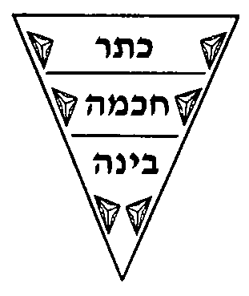

> והנה בה בעצמה יוכרח היות בה בחינת מעילה לעלול שתעלה מבחי' לבחי' עד מעלה מעלה. והמשל בזה הבחי' המשתוה אל הכתר היא העילה אל בחינת עצמותה ובחינת עצמותה היא עילה אל המשתוה אל הבינה [וכן בכל בחי' ובחי' תהיינה ג' בחי' אלו עצמם מעס"ר] ובין כל שתי בחינות יוכרחו עוד ג' בחי' והם בחי' המשתוה הבחי' הראשונה אל הכתר והבחינה עצמה והבחי' המשתוה אותה אל עצמותה. ונצייר צורה גופניות שמתוכה יעלה השכל אל הרוחני כאלו נצייר ראש תור והוא המשולש המשוך הזה.

**2:7:7** Now this triangle slopes downward, and it widens toward its top. It is a parable for the emanated: the nearer they come to their source, the more exalted and the wider they are — not a width of limit and body, but a width of subtlety and spirituality.

> והנה המשולש הזה הוא משפע ויורד ומצד עליונו מתרחב הוא משל אל הנאצלים שכל עוד שיתקרבו אל מקורם הם מתעלים ומתרחבים. לא רוחב גבוליי גשמיי אלא רוחב בדקות ורוחניות.

**2:7:8** And when the inquirer looks well, he will find that the top of Keter is wide, and that it slopes and goes on narrowing until its width comes to be level with the width of Chokhmah. And even at the place where Keter and Chokhmah are level there is a great difference; for this is necessitated by that which pours forth [mashpi'a], sloping [meshuppa] downward, whose descent has no resting-place. For the farther it moves from the upper face, the more the emanated is revealed and is caused by its cause, which is above it. And this is "cause and effect," for one who has the eyes of intellect and whom YHVH has graced with knowledge. And this is the secret of "each one is composed of ten," and the secret of the descent of the grades within the very self of the Sefirah. For the Keter-within-Keter is the side that draws near to the Emanator, and the Malkhut-within-Keter is the side that draws near to Chokhmah, and the Keter-within-Chokhmah is the effect of the Malkhut-within-Keter. And all this can be seen from the figure we have drawn. For the narrow part of Keter is the cause of the wide part of Chokhmah; and so the Keter-within-Chokhmah is the side that draws near to Keter, and the Malkhut-within-Chokhmah is the side that draws near to Binah, and the Keter-within-Binah is the effect of the Malkhut-within-Chokhmah. And on this model it must likewise be said that each and every part is itself composed of ten Sefirot, because the light has no resting-place but keeps moving away and descending; and each and every point, each and every part, is the cause of the point below it and the effect of the point above it. And He saw in His wisdom that unless Keter itself descended ten degrees, Chokhmah could not be emanated from it at all. Likewise, had Chokhmah not descended ten degrees, it would not have been possible for Binah to be emanated from it. And so with all the Sefirot, and so with all the parts and the points. And the same rule and the same reason hold for ABYA [Atzilut, Beriah, Yetzirah, Asiyah]: for in Atzilut there is ABYA, and in Beriah there is ABYA, and in Yetzirah ABYA, and in Asiyah ABYA. For ABYA is the sum of all that is distinct from the First Necessary One, the Ein Sof, King of kings of kings, the Holy One, blessed be He, from Keter down to the central point at the navel of the earth; and they are the kinds of their descent, in four grades. And each one of them, in turn, when we come to divide them, we divide into four grades, and each and every grade into four grades; except that the four of Atzilut are so subtle that the Asiyah-within-Atzilut is the cause and origin of the Atzilut-within-Beriah, and likewise the Asiyah-within-Beriah is the cause and origin of the Atzilut-within-Yetzirah, and so in this order with all the grades and all the parts — so that existence turns out to be like a jointed lampstand, [its parts] united and embracing one another, as explained. And having raised this, I wish by means of it to address the question of the number ten that we asked in the preceding chapters. It is known that every effect is encompassed by its cause, and the cause encompasses the effect, as we shall explain at length in the Gate of the Order of Their Standing, with God's help. And now let us draw a bodily figure, namely a circle within a circle, like this:  

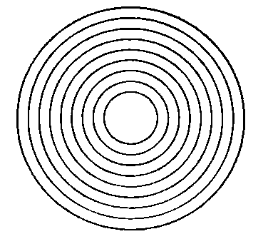

> והנה כאשר יסתכל המעיין היטיב ימצא כי עליון שבכתר הוא רחב ומשפע ומצר והולך עד שיגיע רחבו להשתוות אל רוחב החכמה. ואפילו במקום שווי הכתר והחכמה יש הבדל רב שכן הוכרח מצד המשפיע המשפע ויורד שאין מצב לירידתו כי כל שיתרחק מהפנים העליונים יתגלה הנאצל ויסתבב ממסובבו העליון ממנו והיינו עילה ועלול למי שעיני שכל לו וחננו ה' דעה. וזהו סוד כל אחד כלול מעשר וסוד ירידת המדריגות בעצמות הספי' בעצמה. כי כתר שבכתר הוא הצד המתקרב אל המאציל ומלכות שבכתר הוא הצד המתקרב אל החכמה וכתר שבחכמה הוא עלול ממלכות שבכתר. וכל זה ניכר מתוך הצורה שציירנו. כי הצר שבכתר הוא עילה אל הרחב שבחכמה וכן הכתר שבחכמה הוא הצד המתקרב אל הכתר. ומלכות שבחכמה הוא הצד המתקרב אל הבינה וכתר שבבינה הוא עלול ממלכות שבחכמה. ובדמיון זה ג"כ צ"ל כי כל חלק וחלק כלול מעשר ספירות ג"כ מפני שאין מצב אל האור אלא מתרחק ויורד וכל נקודה ונקודה וכל חלק וחלק עילה לנקודה שלמטה ממנו ועלול מהנקודה שלמעלה ממנו. והוא ראה בחכמתו שאם לא ירד הכתר בעצמו עשר מעלות א"א להיות החכמה נאצלת ממנו כלל ועיקר. וכן אם לא היתה החכמה יורדת עשר מעלות לא היה באפשרות הבינה להתאצל ממנה. וכן לכל הספירות וכן לכל החלקים והנקודות. וזה הדין וזה הטעם לאבי"ע כי באצילות יש אבי"ע ובבריאה יש אבי"ע וביצירה אבי"ע ובעשיה אבי"ע כי ענין אבי"ע הם כללות כל הנבדלים מן המחויב הראשון א"ס ממ"ה הקב"ה מן הכתר עד הנקודה האמצעית שבטבור הארץ והם מיני ירידתם בד' מדרגות. וכן כ"א מהם כאשר נבא לחלקם נחלקם לד' מדרגות וכן כל מדרגה ומדרגה לארבע מדרגות אלא שהד' של אצי' הם דקות כ"כ עד שעשייה שבאצילות סיבה ועילה אל אצילות שבבריאה וכן עשיה שבבריאה היא סיבה ועילה אל אצילות שביצירה וכן על הסדר הזה כל המדרגות וכל החלקים עד שנמצא המציאות כמנורה של פרקים מתיחדים ומתחבקים איש באחיו כמבואר. ואחר שהתעוררנו בזה רצוני בדבר זה להתעורר על שאלת מנין העשר ששאלנו בפרקים הקודמים ידוע כי כל עלול מוקף מעילתו והעילה מקיף העלול כאשר נאריך בשער סדר עמידתן בס"ד. ועתה נצייר צורה גופנית והיא עגול בתוך עגול כזה

**2:7:9** — so that no gap comes between these spheres. And now, if the questioner should ask why this draftsman did not draw yet more circles inside these circles, surely we shall blunt his teeth and tell him that he "has gathered the wind in his fists." For there can be no further addition to the number of circles, since they descend one from another by [no more than] a point, and there cannot possibly exist another circle within the great circle that encompasses them all within it.

> עד שהריוח לא יעבור בין הגלגלים האלה ועתה הישאל השואל למה המצייר הזה לא צייר בתוך העגולים האלה יותר עגולים אחרים. הלא ודאי נקהה את שניו ונאמר לו כי רוח אסף בחפניו כי א"א להיות עוד תוספות על חשבון עגולים אחר שהם יורדים איש מאת אחיו כנקודה וא"א במציאות להיות עוד עגול בתוך העגולה הגדולה המקפת את כולם בתוכה.

**2:7:10** Now from the bodily figure let us raise our intellect to the spiritual matter that we are explaining. It is known that the Sefirot descend one from another by the difference that lies between cause and effect; and therefore they are one within another, the effect encompassed by the cause, like these circles, where the larger encompasses the one smaller than it, which is the effect. Thus Keter encompasses Chokhmah and is its cause, and Chokhmah descends from Keter by the measure of what lies between cause and effect; and Chokhmah is the cause of Binah, so that Binah descends one grade from Chokhmah and two grades from Keter, being the effect of that [Chokhmah] which is the effect of it [Keter]. And in this way the grades descend down to Malkhut.

> והנה מן הצורה הגופניות נעלה שכלנו אל הרוחניות אשר אנו בביאורה. ידוע כי הספירות הם יורדים איש מאת אחיו כהבדל שבין עלה ועלול ולכן הם זו בתוך זו עלול מוקף מעילה כדמיון העגולים האלה שהגדול מקיף הקטן ממנו שהוא העלול ולכן הכתר הוא מקיף אל החכמה והוא עילתו וחכמה יורדת מהכתר כערך מה שבין עילה ועלול והחכמה עילה אל הבינה והרי בינה יורדת מהחכמה מדרגה א' ויורדת מאת הכתר ב' מדרגות שהיא עלולה מזאת העלולה ממנה וע"ד זה ירידת המדרגות עד המלכות.

**2:7:11** And Malkhut is the end of Atzilut and the beginning of Beriah, and it is to Beriah as the Ein Sof is to Atzilut; and the last grade in Beriah is to Yetzirah as Malkhut is to Beriah. And this is their order, until they come to the spheres by way of degrees that are hidden and concealed from us, and revealed to those versed in the account of Creation and the account of the Chariot.

> והנה המלכות הוא סוף לאצילות וראש לבריאה והיא לבריאה כערך הא"ס לאצילות והמדרגה האחרונה שבבריאה אל היצירה כערך המלכות אל הבריאה וזהו סדרם עד בואם אל הגלגלים דרך מעלות הנעלמות ונסתרות לנו ונגלות אל הבקיאים במעשה בראשית ובמעשה מרכבה.

**2:7:12** And there is no difference between Malkhut and Beriah except the difference between cause and effect. And with the descent from the last grade of Atzilut there had necessarily to be the beginning of Beriah, which is the grade that is united with Atzilut as the effect is united with its cause; and so from Beriah to Yetzirah, and so from Yetzirah to Asiyah, down to the spheres.

> והנה אין הבדל בין המלכות והבריאה אלא כהבדל שבין עלה ועלול וברדת מן המדרגה האחרונה שבאצילות הוכרח היות תחלת הבריאה שהיא המדרגה המתייחדת באצילות כיחוד העלול אל העילתו וכן מבריאה אל יצירה וכן מיצירה אל עשייה עד הגלגלים.

**2:7:13** As for the order of the spheres, the astronomers, dim of sight, imagined that each sphere is adjacent to the next, so that no gap comes between them. But this is not the view of the masters of the Torah, who see by the everlasting light; rather, between one firmament and the next is a journey of five hundred years. And although there is this air between them, the matter nevertheless shows the evenness of the creation and its necessity, and that there could not be less than this between sphere and sphere — until the matter comes down to the element of fire; and the element of fire is united with the element of air, and the element of air is united with the element of water, and the element of water is united with the element of earth, one above the other, with no gap between them. And now, who gives a man a mouth to ask, "Let there be so many grades more, or so many fewer," or "Why did He not create the world larger than this, or smaller?" For all this is great foolishness to those who know the order of the grades. And the constitution of the world is in the most excellent way possible, in the order of the grades from the highest that can exist to the lowest that can exist, whether in limit, in finitude or in corporeality. And indeed, were the order of the Sefirot not between Him and the world, the world, on account of its lowliness, could not be governed by the Ein Sof — unless the world were to rise to the spiritual grades, which are the Sefirot; and for that He has already emanated the Sefirot. And the intent is nothing other than to reveal the Emanation and the divinity, and not to conceal it. And it is revealed through the descent of the grades to the lowest aspect, where they now are. For even this thick, coarse earth, down to its navel, has grade after grade, to seven earths, as we shall explain something of this in [the Gate of] the Order of Their Standing, with the help of God. This is the reverse of the view of the foolish astronomers, who imagined they could give the measure of the earth and said that a line of twenty-two thousand mil would encircle it round about, and that, were the earth bored through, [the bore] would pass through to its underside through a thickness of seven thousand three hundred and thirty-three and a third mil. And they walk on in darkness.

> והנה סדר הגלגלים התוכנים חשוכי עינים דמו שהגלגל סמוך לחברו עד שריוח לא יעבור ביניהם. ואין זאת סברת בעלי התורה הרואים באור עולם, אלא שבין רקיע לרקיע מהלך ת"ק שנה ועם היות האויר זה ביניהם עכ"ז הענין מורה על שווי הבריאה וההכרח' ושא"א להיות בין גלגל לגלגל פחות מזה עד רדת הענין אל יסוד האש ויסוד האש מתאחד ביסוד הרוח ויסוד הרוח מתאחד ביסוד המים ויסוד המים מתאחד ביסוד העפר זה למעלה מזה ואין ריוח ביניהם. ועתה מי ישום פה לאדם לשאול יהיה עוד כך וכך מדרגות או יפחות מהם כך וכך או למה לא ברא העולם יותר גדול מזה או קטן ממנו, כי כל זה הוא פתיות גדול ליודעי סדר המדרגות. ותכונת העולם הוא על מציאות היותר משובח שאפשר בסדר המדרגות מהעליונה שאפשר במציאות עד התחתונה שאפשר במציאות אם בגבול אם בתכלית אם בגשמות והנה אם לא היה בינו ובין העולם סדר הספירות א"א לעולם מפני פחיתותו להיותו מתנהג ע"י הא"ס אם לא שיעלה העולם במדרגות הרוחניות שהם הספירות ולענין זה כבר האציל הספירות. ואין זו הכוונה אלא לגלות האצילות והאלקות ולא להעלימו. וגלוייו הוא ע"י ירידות המדרגות להבחינה התחתונה שהם עתה. שהרי אפי' הארץ הלזו העבה והגסה עד טיבורה יש לה מדרגה אחר מדרגה עד ז' ארצות כמו שנבאר קצת בזה בסדר עמידתן בע"ה. הפך סברת הפתאים התוכניים כי דמו לתת מדת הארץ ואמרו שקו בן כ"ב אלף מיל יסוב אותו סביב ואלו תוקדר הארץ יהיה עובר אל עבר פניה התחתונים בעובי ז' אלף מיל ושל"ג ושליש מיל והמה בחשך יתהלכו למו.

**2:7:14** On this matter we have a received teaching and a weighty precedent, as we shall write in the name of the Zohar in the Gate mentioned. And to return to our subject: had the world been created without intermediaries — apart from the fact that this is impossible, for the reason we have explained —

> הנה לנו בענין הזה תורה מקובלת ומעשה רב כאשר נכתוב בשם הזוהר בשער הנזכר. ונחזור לענייננו שאם היה העולם נברא בלי אמצעיות. בזולת שא"א מן הטעם שפירשנו.

**2:7:15** — this would be a concealment of the divinity. For when we came to know His greatness from His governance, would we not believe that, in truth, He is exalted above His world [only] by what lies between a cause and its cause [that is, by one step of cause and effect]? Therefore, so as not to conceal His divinity, He emanated the grades in the way I have explained. For now, when we look upon Keter, may it be blessed and exalted, and then raise above it its cause, the Ein Sof, King of kings of kings — how greatly is His name magnified in the eyes of all His created entities!

> הנה זה יהיה העלם האלקות כשנבא לדעת גדולתו מתוך הנהגתו הלא נאמין שהוא יתעלה מעולמו מה שבין העילה לעילתו לפי האמת. ולכן שלא להעלים אלוהותו האציל המדרגות אל הדרך שפירשתי, כי כאשר נראה עתה בכתר יתברך ויתעלה ונעלה עליו עילתו האין סוף ממ"ה כמה יתגדל שמו בעיני כל ברואיו.

**2:7:16** And so this glorious chapter is complete, and this Gate is concluded. And since YHVH has blessed us thus far, and helped us in all the way that we have gone, we are journeying to the place that we know: namely, to investigate whether the Ein Sof is the Keter, with the help of Heaven.

> והנה נשלם פרק המפואר ונכלל השער הזה. ואחרי אשר עד כה ברכנו ה' ועזרנו בכל הדרך אשר דרכנו, נוסעים אנחנו אל המקום אשר ידענו והוא לחקור אם הא"ס הוא הכתר בסייעתא דשמיא:

---

## Gate 3: Whether the Ein Sof is the Keter

We named it **"Whether the Ein Sof is the Keter"** because in it is explained whether the Ein Sof is Keter, as many have thought, and whether Keter is counted among the sefirot or not, as R. Shem Tov ibn Shem Tov supposed. Its chapters are eight.

### Chapter 3:1. Explanation of the view of those who say the Ein Sof is Keter, and the refutation of their view from reasoning.

**3:1:1** **The Third Gate: To Know Whether the Ein Sof is the Keter:**

> **השער השלישי לדעת אם אין סוף הוא הכתר:**

**3:1:2** What is intended in this Gate is to discuss the matter of the perplexity that has fallen among the Kabbalists, [in coming] to know whether the Ein Sof is the Keter itself or other than it. And this is its name, by which they call it: "Whether the Ein Sof is the Keter."

> הנרצה בשער הזה הוא לשאת ולתת בענין המבוכה נפלה בין המקובלים לדעת אם א"ס הוא הכתר עצמו או זולתו. וזה שמו אשר יקראו לו אם הא"ס הוא הכתר:

**3:1:3** **Chapter One:**

> **פרק ראשון:**

**3:1:4** Many of the Kabbalists among the people of our nation have been perplexed with a great perplexity, and have fallen into the pit of error, and thought that the supernal Keter is the Ein Sof, and that it is in the number of the ten. And [there are] some of them who said that, since we have ten grades, what need is there for a further emanation? — but rather that the matter of the Emanator with the emanated [beings] is [the] ten. And they [thought to] support themselves from the Mishnah of Sefer Yetzirah, which said "ten and not nine, ten and not eleven"; and they said that [its] saying "and not eleven" [means] to say that we should not add further upon ten — but [rather] that the ten are precisely [the count], [including] the Emanator, who is the Ein Sof, the supernal Keter. This is their way — and may their Master forgive them, for this is a matter of cutting [the shoots] and separation; and one who looks at what I explained concerning that Mishnah, in the First Gate, ch.6, will see that, on the contrary, from there [comes] a proof to the opposite.

> רבים מהמתקבלים בבני עמנו נבוכו במבוכה רבה ונפלו בשוחת הטעות וחשבו כי הכתר עליון הוא הא"ס והוא במנין העשר. ויש מהם אמרו כי מאחר שיש לנו עשר מדרגות מה צורך אל אצילות יותר אלא שענין המאציל עם הנאצלים הם עשר. ודמו להסתייע ממשנת ספר יצירה שאמר עשר ולא תשע עשר ולא אחד עשר ואמרו שאמרו ולא אחד עשר לומר שלא נוסיף עוד על עשר אלא שעשר הם ממש עם המאציל שהוא הא"ס כתר עליון. זה דרכם. ושרי להו מרייהו כי זהו ענין קצוץ ופרוד והרואה במה שפירשתי במשנה ההיא בשער הראשון בפ' ששי יראה כי אדרבה משם ראיה להפך.

**3:1:5** Now this view is rejected for several reasons. If you wish, [argue] from Scripture; if you wish, [argue] from reason. The [argument from] reason is: that since the Emanator is distinguished from His emanated [beings] in several matters — first, that the emanated [beings] fall under time, and He does not fall under time. And I do not wish to say "time" according to what appears from the plain sense of our words, but the intent is that there was already a time when they were not emanated, as [for instance] before the Emanation. And this is one of the things impossible in the Ein Sof — that there was [ever] an existence in which He did not exist; rather, He is necessarily existent, and He brought time into existence, and not that He is possessed of time, God forbid. And in this matter is understood [the saying] "first, yet there is no beginning to its beginning" — for although we say "first," and every expression "first" indicates that it has a beginning (for it is true that He is first to all that come after Him) — yet the expression "first" indicates the beginning of time. And therefore it said that He is first, and even so there is no beginning to His beginning; and the expression "first" is only to negate that no other preceded Him. And this is what is said in the Tikkunim, "I am first and I am last." And Rashbi, peace be upon him, explained that ANI (I) is AYIN (Nothing), which is the supernal Keter. And "I" (ani) is Malkhut, which is the end of the Emanation — "its end embedded in its beginning and its beginning in its end" — for AYIN is alef = supernal Keter, yod = Chokhmah, [final] nun = Binah, with the extension of the vav, which is [the] nun, [i.e.] yod upon vav; and the [final] nun itself is Malkhut, in truth. It is found [that] AYIN comprehends the whole Emanation. And this [is] "I am first" — the secret of the extension and spreading of the Emanation from above to below; and "I am last" is the existence of the returning light, reversing from below to above. And by this is understood the matter of "first and last": for Keter is truly called "first," because it is first to all that come "in the beginning," which is [the emanated and below]; but above it, in the Ein Sof, the expression "first" does not apply. And this is "and before One, what can you count?" — the meaning [being]: Keter is called "one," which is the beginning of the count, which is the number of the ten, in which the whole count is comprehended, and the count's foundation is above, as we explained in the preceding Gate. And it said that "before One" — which is that [which is] prior to it, namely the Ein Sof — "what can you count?", for there applies there neither number, nor speech, nor any necessity at all. And of Him it is said (Job 37:20), "shall it be counted to Him when I speak?" — for number does not apply there. And with this premise is understood the verse (Isaiah 43) in which all the literalists were perplexed: "You are My witnesses, says YHVH, and My servant whom I have chosen, that you may know and believe Me and understand that I am He: before Me no God was formed, and after Me there shall be none." And the explanation: "that I am He" — namely Keter, for it is Keter that is truly called "He" (Hu); and to indicate its concealment, the word "Hu" [is] a pronoun for the hidden [third person]. And therefore it said that it is also called "I" (Ani), to indicate that it is the beginning of the Emanation and the end of the Emanation, in the secret of "I am first and I am last," as explained. And it said "before Me no God was formed" — and the word "formed" (notzar) [is] according to its plain sense, whose meaning is "was not emanated"; for the expression "formation" (yetzirah) too serves [to denote] the Emanation, just as the expression "creation" (beri'ah) serves, namely "In the beginning [God] created." And it said: "before Me none was emanated" — for it [Keter] is the head [first] of those that come within the category of the emanated; and it is the end of the whole Emanation, and this is what is said "and after Me there shall be none." And this indicates the strength of the greatness of the Ein Sof, King of kings of kings, the Holy One, blessed be He, which indicates His endurance — that He does not fall under time, but, on the contrary, He brought time into existence, and the existence of His non-being cannot be depicted in any manner in the world. And this is one of His many superiorities over His emanated [beings]: that all of them fall under [contingent] existence, [in] that there was already a time when the Ein Sof was without them, as before the Emanation. And many have thought to say that Keter was prior to all — that is, that, although there was no Emanation, it was in existence, and it is a garment to the Emanator forever. And the holders of this view are masters of the shields [formidable scholars]; and the principal necessity that compelled them to this matter is their saying, of blessed memory, in Pirkei de-Rabbi Eliezer, "before the world was created, He and His name alone existed" — the meaning [being] that "He and His name" are the Ein Sof and Keter; and they necessitated from this that Keter is prior, and that it is unified with the Emanator and a garment to Him. But this matter is not fitting to be believed. Rather, that the whole Emanation was emanated at one time, and Keter too is among the emanated [beings], as is necessitated from several passages, some of which we shall copy in the Gates, with God's help — and in particular in the Gate of Self and Vessels, and in the Gate of the Order of the Emanation, and the Gate of Tzachtzachot, with God's help. It is found that the Emanator is exalted above His emanated [beings] — for His emanated [beings], their non-being preceded them; which is not so [with] the Emanator, King of kings of kings, the Holy One, blessed be He. And behold, [this is] a first distinction. Further, the Emanator is distinguished from the emanated [beings] in that their life depends on another — namely, on the Emanator who gives them life; and He is the source and the light and the effluence to all His emanated [beings] — they are found, all of them, to need Him; whereas the Ein Sof, blessed be He, needs nothing other than Himself, but is the source of life, and life is found from Him, until He is the life of [all] life. And therefore, in some places, Rashbi, peace be upon him, in the Tikkunim, called Him by the expression "a light that does not subsist in [another] light," etc. — since He does not depend on life and effluence from the side of another, but is the source of light to all the other luminaries. And this matter Rashbi, peace be upon him, explained in the Tikkunim (Tikkunei Zohar Chadash, folio 132b) and in the Zohar [on] Bereshit (22): "Rabbi Shimon opened further and said: 'See now that I, I am He, and there is no god with Me.' He said: Companions, hear ancient words that I wish to reveal... What is [the meaning of] what it said, 'See now that I, I am He, and there is no god with Me'? Rather, this is the Cause above all the upper ones, that [One] called the Cause of Causes, the Cause [from] among these causes, [such] that none of these causes does any deed until it takes permission from the one above it, as we established above regarding 'let us make man' — 'let us make,' surely, was said of two, [in] that this one said to the one above it... And the one above it does nothing until it takes counsel from its fellow. But the one called the Cause over all the causes, above which there is none and below which there is none equal to it — this is what is written, 'And to whom will you liken Me, that I should be equal? says the Holy One.' He said: 'See now that I, I am He, and there is no god with Me,' that takes counsel from Him, in the manner of the one that said, 'And God said, let us make man.'" Thus far [the Zohar's] words.

> והנה הסברא הזאת דחויה מכמה טעמים אב"א קרא אב"א סברא. הסברא היא כי מאחר שהמאציל נבדל מנאצליו בכמה עניינים. ראשונה שהנאצלים הם נופלים תחת הזמן והוא אינו נופל תחת הזמן. ואין רצוני לומר זמן כפי הנראה מפשוטן של דברינו, אלא הכוונה שכבר היה זמן שלא היו נאצלות כמו קודם האצי'. וזה אחד מהדברים הנמנעים בא"ס שלא הי' מציאות שלא ימצא, אלא הוא מחויב המציאות והוא המציא הזמן ולא שהוא בעל זמן ח"ו. ובענין זה יובן אמרו ראשון ואין ראשית לראשיתו כי עם שנאמר ראשון וכל לשון ראשון מורה על שיש לו ראשית כי אמת שהוא ראשון לכל הבאים אחריו אבל לשון ראשון מורה על התחלת זמן. וע"כ אמר שהוא ראשון ועכ"ז אין ראשית לראשיתו, ולשון ראשון אינו אלא לשלול שלא קדם אליו זולתו. וז"ש בתקונים אני ראשון ואני אחרון. ופי' הרשב"י ע"ה כי אנ"י הוא אי"ן שהוא הכתר עליון. ואני הוא מלכות שהיא תכלית האצילות נעוץ סופו בתחלתו ותחלתו בסופו כי אי"ן הוא א' כתר עליון י' חכמה ן' בינה עם משך הוא"ו שהוא ן' י' על ו' ומציאות הן' בעצמה היא המלכות לפי האמת נמצא אי"ן כולל כל האצילות. וזה אני ראשון סוד משך והתפשטות אצילות ממעלה למטה. ואני אחרון הוא מציאות אור החוזר המתהפך ממטה למעלה. ובזה יובן ענין ראשון ואחרון כי הכתר יקרא באמת ראשון מפני שהוא ראשון לכל הבאים בראשית שהוא מהנאצלים ולמטה אבל למעלה ממנו בא"ס לא שייך לשון ראשון וזהו ולפני אחד מה אתה סופר. פי' הכתר נקרא אחד שהוא תחלת החשבון שהוא מספר העשרה שבו כלול כל החשבון והחשבון יסודו למעלה כמו שפירשנו בשער הקודם. ואמר כי לפני אחד שהוא הקודם לו דהיינו הא"ס מה אתה סופר דלא שייך תמן לא מנין ולא דבור ולא חיוב כלל. ועליו נאמר (איוב לז כ) היסופר לו כי אדבר ולא שייך תמן מנין. ועם ההקדמה הזאת יובן הפסוק (בישעיה מ"ג) אשר נבוכו בו כל הפשטנים אתם עדי נאם ה' ועבדי אשר בחרתי למען תדעו ותאמינו לי ותבינו כי אני הוא לפני לא נוצר אל ואחרי לא יהיה. ופי' כי אני הוא היינו הכתר כי הוא הכתר הנקרא הו"א באמת. ולהורות על העלמו מלת הוא כנוי אל הנסתר. ולכן אמר שהוא נקרא אני ג"כ להורות שהוא תחלת האצילות וסוף האצי' בסוד אני ראשון ואני אחרון כמו שפי'. ואמר כי לפני לא נוצר אל ומלת נוצר כמשמעו שפי' לא נאצל כי לשון יצירה ג"כ משמש אל האצילות כמו שמשמש לשון בריאה דהיינו בראשית ברא. ואמר כי לפני לא נאצל זולתי, כי הוא ראש הבא בגדר הנאצל. והוא סוף לכל האצילות, וז"ש ואחרי לא יהיה. וזה מורה על תוקף גדולות הא"ס ממ"ה הב"ה שמורה על קיומו שאינו נופל תחת הזמן אלא אדרבה הוא המציא הזמן ולא יצוייר מציאות העדרו בשום אופן בעולם. וזו אחת ממעלותיו הרבות על נאצליו שכלם נופלים תחת המציאות שכבר היה זמן שהיה הא"ס זולתם כמו קודם האצילות. ויש רבים חשבו לומר שהכתר היה קודם לכל ר"ל כי עם היות שלא היה אצילות היה הוא במציאות והוא לבוש אל המאציל לעולם. ובעלי הסברא זאת הם בעלי תריסין ועיקר ההכרח שהכריחם לדבר זה הוא אמרם ז"ל בפדר"א קודם שנברא העולם היה הוא ושמו לבד פי' כי הוא ושמו היינו הא"ס וכתר. והכריחו מזה שכתר קודם ושהוא מתאחד במאציל ולבוש אליו. והענין הזה אין ראוי להאמינו. אלא שכל האצילות נאצל בעת אחת וגם הכתר מכלל הנאצלים כאשר הוא מוכרח מתוך כמה מאמרים וקצתם נעתיק בשערים בע"ה. ובפרט בשער עצמות וכלים ובשער סדר האצי' ושער הצחצחות בס"ד. נמצא שנתעלה המאציל על נאצליו. כי נאצליו קדם אליהם העדרם. משא"כ המאציל ממ"ה הקב"ה. והרי הבדל ראשון. עוד נבדל המאציל מן הנאצלים כי חיותם תלוי בזולתם היינו במאציל המחייה אותם והוא מקור והאור והשפע לכל נאצליו נמצאו כלם צריכין אליו. והא"ס ב"ה אין צריך אל זולתו אלא הוא מקור החיים והחיים נמצאים ממנו עד שהוא חיות החיים. ולכן בקצת מקומות כנהו הרשב"י ע"ה בתקונים בלשון נהורא דלא קיימא בנהורא וכו' אחר שאינו תלוי בחיות ושפע מצד זולתו אלא הוא מקור האור אל כל שאר המאורות. ודבר זה ביאר הרשב"י ע"ה בתקונים (תקוני ז"ח דף קל"ב ע"ב) ובזהר בראשית (דף כ"ב) פתח עוד ר"ש ואמר ראו עתה כי אני אני הוא ואין אלקים עמדי. אמר חבריא שמעו מלין עתיקין דאנא בעינא לגלאה כו' מאי ניהו דאמר ראו עתה כי אני אני הוא ואין אלקים עמדי. אלא דא איהו עילת על כל עלאין ההוא דאתקרי עלות העלות עלת מאלין עלות דלא יעביד חד מאלין עלות שום עובדא עד דנטיל רשותא מההוא דעליה כמה דאוקימנא לעיל בנעשה אדם נעשה ודאי על תרין אתמר דאמר דא לההוא דלעילא מיניה כו' וההוא דלעילא מיניה לאו עביד מדעם עד דנטיל עצה מחבריה. אבל ההוא דאתקרי עלת על כל העלות דלית לעילא מיניה ולית לתתא שוה ליה הה"ד ואל מי תדמיוני ואשוה יאמר קדוש. אמר ראו עתה כי אני אני הוא ואין אלקים עמדי דנטיל עצה מיניה כגוונא דההוא דאמר ויאמר אלקים נעשה אדם עכ"ל.

**3:1:6** Now [Rashbi], peace be upon him, intended, in this holy passage, to exalt this superiority — that the Ein Sof is exalted above His emanated [beings], [in] that they need to take counsel, the lower from the upper, for it [the lower] needs effluence from its cause that emanates upon it; and therefore it says "let us make man" — as if to say, "you emanate, and I will act, and man is found made by the two of us"; and the upper one still needs to be emanated [upon] from its cause, for it too does not have the ability [on its own]. But the Ein Sof, blessed be He, does not need to say to another "let us make," but [says] "I, I am He, and there is no god with Me" — that is, "in assistance with Me" — neither a lower one, for it has none below it equal to it, nor an upper one, for there is no upper one other than it, for it is above all the existents. And it said "the Cause over all the upper ones, the Cause [from] among these causes" — [Rashbi] intended to explain to us that the reason it is called the Cause of Causes is for two reasons. The first: from the expression "ascent" (aliyah), and the intent is that it is above all the upper ones — and the intent is not an ascent of place, God forbid, for nothing enters into [the category of] place in the Emanation, all the more so in the Emanator, but the meaning [is] the existence of an ascent of degree, and spirituality, and ability. And the second meaning is from the expression "cause" (illah) and "reason" (sibbah) — that it is a cause and a reason to all the causes that are in existence.

> הנה כיון במאמר הזה הקדוש ע"ה להפליג במעלה הזאת שמתעלה הא"ס על נאצליו שהם צריכין ליטול עצה התחתון מן העליון כי הוא צריך שפע מעילתו המשפיע עליו ולכן הוא אומר נעשה אדם כלומר תשפיע אתה ואני אפעול ונמצא אדם עשוי ע"י שנינו והעליון עדיין צריך להיות נשפע מעילתו כי אין בידו ג"כ היכולת. אבל א"ס ב"ה אינו צריך לאמר לזולתו נעשה אלא אני אני הוא ואין אלקים עמדי ר"ל בסיוע עמי לא תחתון שאין לו למטה שוה אליו ולא עליון שאין עליון זולתו כי הוא למעלה מכל הנמצאים. ואמר עילת על כל עלאין, עלת מאלין עלות. כיוון לבאר לנו שהטעם שהוא נקרא עלת העלות הוא משני פנים. הא' פי' מלשון עלייה והכוונה שהוא למעלה מכל העליונים. ואין הכוונה בעליית מקום ח"ו שאין שום דבר נכנס במקום באצילות כ"ש במאציל, אלא פי' מציאות עליית מעלה והרוחניות והיכולת. והפי' השני הוא מלשון עילה וסיבה שהוא סבה ועילה לכל העלות שבמציאות.

**3:1:7** Now a second distinction has been explained, by which the Ein Sof, the Emanator, blessed be He, is distinguished from the emanated [beings]. Further, a third distinction, and it is: that all the emanated [beings] have a name among the holy names, which delimits them, by which that Sefirah and that emanated [being] is called — like Ehyeh in Keter, and Yah in Chokhmah, and so for all the rest of the Sefirot, as we explained in the First Gate explicitly. And likewise the four-letter name comprehends the whole Emanation, as is explained in the Zohar, and we shall explain in the Gate of the Four-Letter Name. This is not so [with] the Ein Sof, the Emanator, blessed be He, who has no name and [vowel-]point by which we can designate Him, nor attribute that would delimit Him; and we have not found for Him a name to designate Him except "the Necessarily Existent." And the explanation: that He is necessary in His existence, because the world is impossible, ever, without a conductor who gives effluence and life to all the existents; and for this reason His existence is necessary. And because there is no name that would delimit Him, therefore we designate Him "the Necessarily Existent," and this name the philosophers attributed to Him. Further, they attributed to Him the name Ein Sof (Without End), and the reason [is] because He has no end and terminus. For the thing delimited by a name has an end; and the divinity, because it has no end, has no name that would delimit it, and therefore we designate it by [the name] Ein Sof.

> והנה נתבאר הבדל שני שנבדל הא"ס המאציל ב"ה מן הנאצלים. עוד הבדל שלישי והוא כי לכל הנאצלים יש להם שם משמות הקדש שהוא מגבילם אשר בו יקרא הספירה והנאצל ההוא כענין אהי"ה בכתר וי"ה בחכמה וכן לכל שאר הספירות כמו שבארנו בשער הראשון בפי'. וכן שם בן ד' כולל כל האצי' כלו כמבואר בזהר ונבאר בשער שם בן ד'. מה שאין כן בא"ס המאציל ב"ה שאין שם ונקודה שנוכל לכנותו בה ולא מדה שתגבלהו ולא מצאנו לו שם לכנותו אלא מחויב המציאות. ופי' כי הוא מחויב במציאותו מפני שא"א לעולם בלא מנהיג הנותן שפע ומחיה לכל הנמצאים ומטעם זה מחוייב מציאותו. ומפני שאין שם שיגבילהו לכן נתארהו מחויב המציאות, ושם זה יחסו אליו החוקרים. עוד ייחסו אליו שם א"ס והטעם מפני שאין לו סוף ותכלית. כי הדבר הנגבל בשם יש לו סוף, והאלקות מפני שאין לו סוף אין לו שם שיגבלהו ולכן אנו מתארים אותו בא"ס.

**3:1:8** And further [there is] another explanation: because the inquiry into Him has no end — for it is not in the manner of the other inquiries, which have an end and a settling upon a single conclusion; but the inquiry into the divinity is without end, and therefore there is none who knows in Him any essence at all, except by means of the Sefirot, which reveal somewhat of His greatness — [and] only from His Sefirot and upward; [but] from there [upward] there is no apprehension, on account of the depth of what is apprehended; and therefore they designated Him Ein Sof. Further, they attributed to Him "Cause of Causes," and the intent is that the causes — from which other [things] are caused — are [themselves] caused [by] Him; and therefore He is called "the Cause of [the] causes," since He is a first cause to all the causes in the world: for although they are causes to other caused [things], even so they are all caused [by] Him. And there are [those] who said that the supernal Keter too is called "the Cause of Causes," since it is a cause to all the other causes, which are caused [by] it; which is not so from it [Keter] and below — [in] that Chokhmah is not a cause to all the caused causes, for Keter is the [one] that causes and is not caused [by] Chokhmah, but on the contrary Chokhmah is caused [by] it. And likewise, for this reason, they said that Keter is called "the Cause of Causes," [in] that it is the cause of the causes that are effects of it. However, the Ein Sof is called "the Cause of all causes" and "the Cause over the causes," with the addition of "all," to indicate, concerning the Ein Sof, that it is the cause of all causes — even Keter; which is not so [with] Keter, of which the expression "all causes" does not [rightly] apply (and likewise it lacks the "all"), since there is already a cause and reason of which it is the caused [one] — [in] that Keter is caused [by] the Ein Sof, and the Ein Sof is its cause; and likewise [the expression with "all"] would not be attributed thus to Keter. And these three names — namely, Ein Sof, and "the Cause of all causes," and "the Cause over all causes" — Rashbi attributed to the Emanator, blessed be He, in his books many times; and he likewise attributed to Him other names, such as "the Concealed of the Concealed," and likewise "the Ancient of Ancients," and many like these similar to them; and when the inquirer examines them closely, he will find that they all indicate the concealment, as we explained — that He has no name, nor havayah, nor title that would delimit Him. And behold, [this is] a third distinction, by which the Emanator is distinguished from the emanated [beings] — apart from several other distinctions, such as the removal of measure, and limit, and the predicates, and the changes, for all is in His Sefirot; and we shall not prolong [discussion] of them. And let us say that, since the Emanator is exalted and distinguished from His emanated [beings] [to] the utmost of distinction, and is distanced [to] the utmost of distance, then reason gives that it is not fitting for the Emanator to enter into the number of the emanated [beings], God forbid, as those thought who said that He is the Keter. And now let us come to prove [it] from the proofs.

> ועוד פי' אחר מפני שהחקירה בו אין לו סוף. שאינה כדרך שאר החקירות שיש לה סוף והסכמה אל מסקנא אחת. אמנם החקירה באלקות היא בא"ס ולכן אין מי שידע בו מהות כלל אם לא ע"י ספירות המגלות קצת מגדולתו אמנם מספירותיו ולמעלה אין השגה מצד עומק המושג ולכן תארוהו בא"ס. עוד ייחסו אליו עלת העלות, והכוונה כי העלות אשר מהם עלולים אחרים הם עלולות ממנו ולכן נקרא סבת הסבות לפי שהוא סבה ראשונה לכל סבות שבעולם ואע"פ שהן סבות למסובבים אחרים עכ"ז כלם מסובבים ממנו. ויש שאמרו כי כתר עליון ג"כ נקרא סבת הסבות לפי שהוא סבה לכל שאר הסבות שהן מסובבות ממנו. משא"כ ממנו ולמטה שאין החכמה סבה לכל הסבות המסובבות שהרי הכתר הוא הסובב ואינו מסובב מהחכמה אלא אדרבא החכמה מסובבת ממנו. וכן מן הטעם הזה אמרו שנקרא הכתר עלת העלות שהוא עלת העלות העלולות ממנו. אמנם אין סוף נקרא סבת כל הסבות ועלת על העלות בתוספת כל להראות על הא"ס שהוא סבת כל הסבות ואפי' הכתר. מה שאין כן הכתר שלא יצדק בו לשון כל הסבות וכן כל העלות שכבר יש עילה וסבה שהוא מסובב ממנו שהכתר מסובב מהא"ס וא"ס סבתו. וכן לכל העלות, שלא יתייחס כן בכתר. ושלשה שמות הללו היינו א"ס וסבת כל הסבות ועלת כל העלות יחס הרשב"י אל המאציל ב"ה בספריו פעמים רבות וג"כ יחס אליו שמות אחרים כמו טמירא דטמירין וכן עתיקא דעתיקין וכאלה רבות כיוצא בהם וכאשר ידקדק המעיין בהם ימצא כלם מורים על ההעלם כמו שבארנו שאין לו שם ולא הויה ולא כנוי שיגבילהו. והרי הבדל שלישי שנבדל המאציל מן הנאצלים. בזולת כמה הבדלים אחרים כמו הרחקת השיעור והמדה והתארים והשנויים כי הכל בספירותיו ולא נאריך בהן. ונאמר כי אחר שיתעלה ונבדל המאציל מנאצליו תכלית ההבדל ונתרחק תכלית הרוחק אם כן הסברא נותנת שאין ראוי שיכנס המאציל במנין הנאצלים ח"ו כמו שחשבו האומרים שהוא הכתר. ועתה נבא להוכיח מן הראיות:

### Chapter 3:2. The refutation of their view, and its necessity from many places in the words of the Zohar.

**3:2:1** After we have, in the preceding chapter, established from reason that Keter is not the Ein Sof, now we shall come, in this chapter, to nullify this view from the words of Rashbi, peace be upon him, who enlightens the eyes of Israel in this wisdom; and we have from his words several proofs. First, he said in the book of the Tikkunim (in the Introduction, folio 6), and these are his words: "But the name YHVH is a chariot to its Master, to the supernal Keter. And therefore, 'there is none holy like YHVH' — the Cause over all, hidden and concealed in Keter; and from it His light spread upon YHVH, which is yod = Chokhmah, heh = Binah, vav comprising six Sefirot, heh = Malkhut" — thus far [his words], for our matter. And this is its explanation: YHVH, which is a hint at nine Sefirot, as he expounds and goes on, is a chariot to its Master, [namely] Keter; and the reason he said "its Master" is because it [Keter] is a father to the whole Emanation, and the whole Emanation is a throne to it. And it said "there is none holy like [koh]" — [this] will be understood with what Rashbi, peace be upon him, explained in another place, where he said that "there is none holy like koh" [refers] to Keter. And he said that this is the kaf of "koh," which is the kaf of Keter; and the reason for the kaf is that it is two yods, in the secret of "ten, ten the spoon" (asarah asarah ha-kaf); and this is what he said, "and therefore there is none holy [like koh]" — the meaning [being]: because YHVH is a chariot to Keter — [in] that the four-letter name [has a] yod at the head [beginning], and Adonai [has a] yod at the end — they are two yods, in the secret of direct light and returning light, which is the kaf of Keter — as this matter will be explained at length in the Gate of the Reversal of the Light, with God's help. And because these two lights are a chariot to Keter, which is the cause of the lights [coming] from the side of the Cause of Causes, the Ein Sof, blessed be He, concealed within it — and from it the light spread by means of Keter, in order that there be direct light and returning light — therefore it is called the kaf of Keter, which is two yods. And let the inquirer not hope from us the explanation of this matter, for its principal place is in the aforementioned Gate. Thus far the explanation of the passage, in brief.

> אחר שבפרק הקודם הכרחנו מן הסברא שאין הכתר הא"ס, עתה נבוא בפ' זה לבטל סברא זו בדברי הרשב"י ע"ה מאיר עיני ישראל בחכמה הזאת ולנו מדבריו כמה ראיות. ראשונה אמר בס' התיקונים (בהקדמה ד"ו) וז"ל אבל שם ידו"ד איהו מרכבה למריה לכתר עלאה. ובגין דא אין קדוש כידו"ד עלת על כלא טמיר וגניז בכתר ומניה אתפשט נהוריה על ידו"ד דאיהו י' חכמה ה' בינה ו' כליל שית ספירן ה' מלכות עכ"ל לעניננו. וזה פירושו ידו"ד שהוא רמז לט' ספירות כדמפרש ואזיל הוא מרכבה למריה כתר, וטעם אמרו מריה מפני שהוא אב לאצילות כלו וכל האצילות כסא אליו. ואמר אין קדוש כה', יובן עם מה שבאר הרשב"י ע"ה במקום אחר שאמר שאין קדוש כה' הכוונה על הכתר. ואמר כי זה הוא הכ"ף דכה' שהוא כ"ף כתר וטעם הכ"ף כי הוא שני יודין בסוד עשרה עשרה הכ"ף וזהו שאמר ובג"ד אי"ן קדוש, פי' מפני שידו"ד היא מרכבה אל הכתר שהשם בן ד' יו"ד בראש ואדני יו"ד בסוף הם שני יודי"ן בסוד אור ישר ואור חוזר שהיא כ"ף כתר. כאשר יתבאר הענין הזה בארוכה בשער התהפכות האור בס"ד. ומפני ששתי האורות האלה הם מרכבה לכתר שהוא סבת האורות מצד עלת העלות אין סוף ב"ה הגנוז בו וממנו התפשט האור ע"י הכתר כדי שיהיה האור ישר והאור חוזר לכך נקרא כ"ף כתר שהוא שני יודי"ן. ואל יקוה ממנו המעיין ביאור ענין זה כי עקרו בשער הנזכר. ע"כ פי' המאמר בקיצור.

**3:2:2** Now he said explicitly, "the Cause over all, hidden and concealed in Keter" — indicating that the Ein Sof is not the Keter. Further, he wrote in the Tikkunim (Tikkun 70, folio 124), and these are his words: "It is called YHVH from the side of the supernal Keter, which is closed up like a closed fist (kometz) that is closed — [such] that none knows what soul there is within. And the one that is within is closed up in thought; the Cause of Causes we call it." Thus far [his words].

> והנה אמר בפי' עלת על כלא טמיר וגניז בבתר, מורה על שאין הא"ס הוא הכתר. עוד כתב בתיקונים (תקונא ע' דקכ"ד) וז"ל אתקריאת יהוה מסטרא דכתרא עילאה דאיהו סתים כקומץ דאיהו סתים דלא ידע בר נשמה דאית לגו. ומאן דאיהו לגו איהו סתום במחשבה עלת העלות קרינן ליה עכ"ל.

**3:2:3** And the explanation: that he said at the beginning of his words, above, that in Malkhut is the four-letter name without [vowel-]point; and according to her nourishment, so is her vocalization. And now he said "from the side of Keter" — the meaning [being]: when she [Malkhut] is nourished from it [Keter], she is called by the name YHVH, which is [the four-letter name] with the vocalization of kametz (kometz); and the reason [is] "like a kometz that is closed" — the meaning [being]: like [the One that] is closed up in thought, the meaning [being] that even thought is forbidden in [respect of] Him; and He is called by us "the Cause of Causes" — but not that this name delimits Him, for there is no name that would delimit Him, as we explained in the preceding chapter. And the main part of this passage, with all that follows it, is explained at length in the Gate of the Four-Letter Name.

> ופי' שאמר בתחלת דבריו למעלה שבמלכות הוא השם בן ד' בלא נקודה ולפי יניקתה כך נקודתה ועתה אמר דמסטרא דכתר פי' כאשר היא יונקת ממנו תקרא על שם יהוה שהיא הויה בנקודת קמץ והטעם כקומץ דאיהו סתים פי' כמו הוא סתום במחשבה פי' כי אפי' המחשבה אסורה בו, ונקרא אצלינו עלת העלות אבל לא שיהיה שם זה מגבילו כי אין שם שיגבילהו כדפי' בפרק הקודם. ועיקר המאמר הזה עם כל הנמשך אחריו נתבאר בארוכה בשער שם בן ד'.

**3:2:4** Behold, he explained to us explicitly that the Cause of Causes is hidden and concealed in Keter, and that the Ein Sof is not the Keter itself.

> הנה באר לנו בפי' כי עלת העלות גנוז ונעלם בכתר ושאין הא"ס הכתר עצמו.

**3:2:5** And further, explicitly, in the Tikkunim in another place (Tikkun 70, folio 130), these are his words: "The supernal Keter, although it is primordial light, clear light, refined light, is dark before the Cause of Causes." And the main part of the passage will be explained in the Gate of Tzachtzachot, blessed be God.

> ועוד בפי' בתיקונים במקום אחר (תקונא ע' דף ק"ל) ז"ל כתר עלאה אע"ג דאיהו אור קדמון אור צח אור מצוחצח, אוכמא איהו קדם עלת העלות. ועיקר המאמר יתבאר בשער הצחצחות ב"ה.

**3:2:6** Behold, he indicated explicitly that Keter is not the Ein Sof, in his saying that Keter is dark — that is, that its light does not shine at all [by comparison], that it has no power before the Cause of Causes, which is its Emanator. Further, in the Tikkunim (Tikkun 18, folio 112), these are his words: "A unique Lord, ruling over them all, hidden and concealed in Keter." Thus far [his words].

> הנה הורה בפירוש שאין הכתר הא"ס. באמרו שהכתר הוא חשוך. ר"ל שאין אורו מבהיק לכלום. שאין לו כח לפני עלת העלות שהוא מאצילו. עוד בתיקונים (בתיקון י"ח דף קי"ב.) וז"ל אדון יחיד שליט על כלהו מופלא ומכוסה בכתר עכ"ל.

**3:2:7** And the explanation: that above this passage he spoke of the matter of the spiritual life-forces and chariot in the Sefirot, and afterward he said that the Ein Sof — who is called "a unique Lord," as is explained in Sefer Yetzirah — is hidden and concealed in Keter. And the intent is that His divinity is revealed only by means of the sheath of His light and His garment, which is Keter, and by means of it He rides in the rest of the Sefirot.

> ופי' כי למעלה מן המאמר הזה אמר ענין החיות והמרכבה הרוחניות בספי' ואח"כ אמר שהא"ס שנקרא אדון יחיד כמבואר בס"י הוא מופלא ומכוסה בכתר. והכוונה שאין אלהותו מתגלה אלא על ידי תיק אורו ולבושו שהוא הכתר ועל ידה רוכב בשאר הספירות.

**3:2:8** Behold, he indicated explicitly that Keter is not the Ein Sof. Further, in the Ra'aya Mehemna (Pinchas, folio 243), these are his words: "Because the Cause of Causes is hidden and concealed in this Keter and spread out in the name YHVH. On Sabbaths and festivals there is no dominion to Samael and the Serpent, nor to all his appointed [forces]; and there is no dominion to Gehinnom — the evil female of Samael and the Serpent — nor to his hosts: all of them are hidden away before the hosts of the King, in the manner that the nations of the world will be hidden away when the Messiah is revealed; this is what is written, 'and they shall come into the caves of the rocks and into the clefts of the crags.'" And its explanation is clear; and from it, it appears with clarity that one cannot say that Keter is the Ein Sof — [the Ra'aya Mehemna] indicates this in saying "the Cause of Causes is hidden and concealed in this Keter." It appears from his words that Keter is a palace for the Cause of Causes.

> הנה הורה בפירוש שאין הכתר האין סוף. עוד בר"מ (פינחס דף רמ"ג) וז"ל בגין דעלת העלות מופלא ומכוסה בהאי כתר ואתפשט בשם יהו"ה. בשבתות וימים טובים לית שלטנותא דסמא"ל ונחש ולכל ממנן דיליה ולית שלטנותא לגיהנם נוקבא בישא דסמאל ונחש ולא למשריין דיליה, כלהון מיטמרן קדם משריין דמלכא כגוונא דאתטמרון אומין דעלמא כד אתגליא משיח הה"ד ובאו במערות צורים ובנקיקי הסלעים. ופירושו מבואר וממנו נראה בביאור שאין לומר שהכתר הוא הא"ס מורה על זה באמרו עלת העלות מופלא ומכוסה בהאי כתר. נראה מדבריו שכתר היכל לעלת העלות.

**3:2:9** Now we have several clear proofs and faithful witnesses that Keter is not the Ein Sof, apart from several other proofs besides — and we have not copied them, because we need to copy them in the coming Gates, such as the passage of Elijah, "You are One," etc., which we shall copy in the Gate of Self and Vessels, ch.5; and some of them we have not seen [fit] to copy at all, on account of the length. Even so, by these proofs the view of those who say that Keter is the Ein Sof is nullified.

> והנה לנו כמה ראיות ברורות ועדים נאמנים שאין הכתר הוא הא"ס, בזולת עוד כמה ראיות אחרות, ולא העתקנום מפני שאנו צריכים להעתיקם בשערים הבאים כמו מאמר אליהו דאנת הוא חד כו' שנעתיקה בשער עצמות וכלים פ"ה וקצתם לא ראינו להעתיקם כלל מפני האריכות. עכ"ז בראיות האלה בטלה דעת האומרים שהכתר הוא האין סוף:

### Chapter 3:3. Explanation of R. Shem Tov ibn Shem Tov's view that Keter is not counted among the sefirot, and its refutation from reasoning and from proofs in the words of Rashbi in the Zohar.

**3:3:1** After we have, in the preceding chapter, striven to establish, of necessity, that the Ein Sof is not the Keter, but [that] each of them is a matter in its own right — that is, this [one is] Emanator and this [one] emanated — we have seen [fit], in this chapter, to nullify another view, close to the view of the earlier Kabbalists, namely the view of Rabbi Shem Tov in Sefer ha-Emunot, Gate 4, ch.1, who first counted the Sefirot and said that Keter is the first Sefirah, [and] afterward said that Keter is not in the category of the Sefirot. And this is the form of his language, in utmost brevity: "All the Kabbalists agreed to count these ten Sefirot — the first, supernal Keter; the second, Chokhmah, etc.; however, the most wondrous and the deepest in the wisdom agreed that, in truth, the supernal Keter is not to be counted in the category of the ten, for it is like the Ein Sof; and just as the Cause of all causes is not to be counted at all, so it is not fitting to count the supernal Keter, for there is no beginning and no terminus and end in it, and it is the All. And Rashbi warned about this in several places, and to this he directed [his words] in Sefer Yetzirah, 'ten and not eleven.' And you already know that it is agreed among the sages of the Mishnah that Elijah the prophet is revealed to all the worthy; and there is a tradition, to some of the later [authorities] of blessed memory, that he was revealed to the great Rabbi Abraham, the pious Av Beit Din, of blessed memory, and from him the great Rabbi Ra'avad, his son-in-law, received [it], and the pious Rabbi Isaac, whose tradition is choice flour, [penetrating] very deep into the wisdom of Kabbalah. And he too explained 'ten and not eleven' — that Keter is not to be brought into the count; and the one that completes the count is the supernal Da'at, which the verse hinted at (Proverbs 3:20), 'by His knowledge the depths were cleaved.' And of it [Sefer] ha-Bahir said that it is the holy palace. And the principal [reference] of the unique name written in the books of the Prophets, they directed [it] in the letters of the Name, by means of Tiferet, to this [Da'at], for it is a palace to the supernal root." Thus far [his words].

> אחר שבפרק הקודם השתדלנו להעמיד בהכרח שאין הא"ס הוא הכתר אלא כל אחד מהם ענין בפ"ע ר"ל זה מאציל וזה נאצל. ראינו בפרק זה לבטל סברא אחרת קרובה לדעת המקובלים הקודמים והיא סברת הר' שם טוב בספר האמונות שער ד' פ"א שתחלה מנה הספירות ואמר שכתר היא ספירה ראשונה, אח"כ אמר שאין הכתר בכלל הספירות. וזה טופס לשונו בקצור נמרץ. כל המקובלים הסכימו למנות עשר ספירות אלו א' כתר עליון ב' חכמה וכו', אולם המופלאים והעמוקים שבחכמה הסכימו שאין למנות כ"ע ע"ד האמת בכלל העשר כי הוא כא"ס, וכמו שסבת כל הסבות אין למנותו כלל כן אין ראוי למנות לכ"ע כי אין שום התחלה ושום קץ וסוף בו והוא הכל. ורשב"י הזהיר על זה בכמה מקומות ועל זה כוון בס' יצירה עשר ולא אחד עשר. וכבר ידעת היות מוסכם אצל חכמי המשנה שאליהו הנביא מתגלה אל כל הראוים. ויש קבלה למקצתן מן האחרונים ז"ל שהיה מתגלה להרב הגדול ר' אברהם אב"ד החסיד ז"ל וממנו קבל הרב הגדול הראב"ד חתנו והרב החסיד רבי יצחק שקבלתו סלת נקייה לעמוק מאד בחכמת הקבלה. והוא ג"כ פירש י' ולא י"א שאין להכניס במנין הכתר. והמשלים המנין הוא הדעת העליון שרמז הכתוב (משלי ג כ) בדעתו תהומות נבקעו. ועליו אמר בספר הבהיר שהוא היכל הקודש. ועיקר שם המיוחד הכתוב בספרי הנביאים כוונו באותיות השם באמצעות הת"ת לזה כי הוא היכל לשרש העליון עכ"ל.

**3:3:2** And he prolonged much further according to this view. And in another place he wrote that, for this reason, Sefer Yetzirah called Chokhmah "the depth of beginning," for it is the beginning, etc. This is the view of Rabbi Shem Tov, who wished to say that Keter is not in the count of the Sefirot — though he admitted, regarding the matter, that the Ein Sof is not the Keter, as is proved from his language in which he said, "and just as the Cause of all causes is not to be counted at all, so it is not fitting to count the supernal Keter" — [thereby] indicating that the Cause of all causes is not the Keter, but [rather] Keter is emanated from it. And before we enter into the demolition of this view, it is fitting that we know who brought them into this error; and we say that they were driven to this view on account of three things. First, the passage "By ten utterances the world was created" (Avot 5:1), which we copied in the preceding Gate, in ch.3; and there we strove with the matter and established that from that passage there is no proof for his words at all. And the second: that they saw [that] in Sefer Yetzirah [the author] began to count from the mishnah of the depths from Chokhmah, in his saying "the depth of beginning and the depth of end," which are Chokhmah and Binah — so that it appears that it [Chokhmah] is first to the Emanation, and Keter is not in the count of the Sefirot; and likewise in his saying "one: the spirit of the living God," etc., "two: spirit from spirit" — they said that "one: the spirit of the living God" is Chokhmah, and "spirit from spirit" is Binah, etc. — [so that] it appears that the count of the ten Sefirot begins from Chokhmah. And the third: that they found a great tree on which to hang, namely the divine Rashbi, peace be upon him, in the Idra, [where] these are his words: "The place where the beginning is found is from the Holy Ancient One, which is illumined from the mazal," etc., as we shall copy, with God's help.

> ועוד האריך הרבה ע"פ הסברא הזאת. ובמקום אחר כתב כי מטעם זה קרא בס"י לחכמה עומק ראשית כי הוא תחלה וכו'. זאת היא סברת רש"ט שרצה לומר שהכתר אינו במנין הספירות עם שהודה בענין שהא"ס אינו הכתר כדמוכח מתוך לשונו שאמר וכמו שסבת כל הסבות אין למנותו כלל כן אין ראוי למנות לכ"ע, הורה שסבת כל הסבות אינו הכתר, אמנם הכתר נאצל ממנו. וקודם שנכנס בהריסת סברא זו ראוי שנדע מי הביאם בטעות זה ונאמר כי הוזקקו לסברא זו מפני ג' דברים ראשונה מאמר בעשרה מאמרות נברא העולם (אבות פ"ה מ"א) שהעתקנהו בשער הקודם בפ"ג. ושם השתדלנו בענין והכרחנו שאין מאותו המאמר ראייה לדבריו כלל. והשני שראו בס"י התחיל למנות משנת העמקים מחכמה באומרו עומק ראשית ועומק אחרית שהן חכמה ובינה שנראה שהיא ראשונה לאצילות ואין הכתר בחשבון הספירות וכן באמרו אחת רוח אלקים חיים וכו' שנייה רוח מרוח אמרו כי אחת רוח אלקים חכמה ורוח מרוח בינה וכו' נראה שמחכמה מתחיל מנין הע"ס. והשלישית כי מצאו אילן גדול לתלות בו והוא האלהיי רשב"י ע"ה באדרא וז"ל אתר דשירותא אשתכח מעתיקא קדישא דאתנהיר ממזלא וכו' כמו שנעתיקהו בע"ה.

**3:3:3** Now, since the beginning of the Emanation is from Chokhmah, which is illumined from Keter, it appears explicitly that Keter is not in the category of the count of the ten Sefirot; therefore they pressed themselves to seek the completion of the count of the ten, and sought Da'at. But in truth they did not seek what is right. For the matter of this view is rejected — if you wish, [argue] from Scripture; and if you wish, [argue] from reason. A proof from reason: because [Keter] cannot escape [being one] of two things — either it is emanated, or it is not emanated. If it is emanated, then, since it is an effect of the First Cause, why should it not enter into the count of the Sefirot? For who diminished the honor of the Emanation [so much] that Keter, because it is like the Ein Sof and is great and praiseworthy, should not enter into the count of the Sefirot? — for the Sefirot (namely Chokhmah and Binah) are also like the Ein Sof in their power and their excellence, and even so we did not restrain ourselves from counting them among the ten. And behold, since Keter is a cause to Chokhmah, and Chokhmah a cause to Binah, and the three of them are surely emanated — then as Chokhmah [stands] to Binah, so Keter [stands] to Chokhmah; and just as Chokhmah is counted in the count of the Sefirot together with Binah, so Keter should be counted together with Chokhmah. If so, what is the reason that we should elevate Keter above all the rest of the emanated [beings]? And further, that which he said — that it is like the Ein Sof — is no excellence at all, since it is impossible for it to be exactly equal to the Emanator, for, being an effect of Him, it necessarily descended from the degree of its cause; and after we have exalted the Cause of all causes as much as is possible in [what is] without end, it is not fitting to exalt Keter so much, for it is not at the degree of its Emanator, since it is emanated and an effect of a First Cause, as explained. And as Rashbi, peace be upon him, explained in saying "it is dark before the Cause of Causes" — he indicated that it is not at the degree of the Ein Sof, God forbid; and if so, why is it "like the Ein Sof"? For the definition of the Ein Sof is a predicate by which nothing is [truly] predicated at all, except [of] the Emanator. And since it [Keter] is in the category of the emanated [beings] and is not like the Ein Sof, then why should it not come into the count of the Sefirot? — for it is only of the count of the emanated [beings]; and why should we count some of them and leave out some? This is not fitting. And if you say that it is not emanated — this is impossible to believe, unless we say that it is the Cause of all causes and there is none besides it; for if not so, it is a duality, God forbid, [for us] to say that there is one thing besides the Cause of all causes that was not emanated from it. And if we say that it is emanated as well, but [that] it is not like the rest of the emanated [beings] because it preceded them by a long time — this is impossible, for there cannot be priority over Chokhmah except the priority of cause and effect; for it is impossible to separate and distinguish between every emanated [being] and emanated [being] except like the distinction of cause and effect; and so too the distinction between Chokhmah and Binah. And just as we bring into the count of the emanated [beings] Chokhmah together with Binah, so we also bring in Keter together with Chokhmah. And since, from reason, it is necessitated that Keter is in the count of the ten, it is likewise necessitated from the proof from the words of Rashbi, peace be upon him, in the Tikkunim (Tikkun 70, folio 118), [where] these are his words: "And these limbs are all in the Sefirot: the head [is] Keter; the brain, Chokhmah; Binah [is] the heart, and in it 'the heart understands'; the two arms, Chesed and Gevurah; the body, the central pillar; the two thighs, Netzach and Hod; Yesod [is] the member (amah); the Shekhinah [is] its sign (ot)." Thus far [his words].

> והנה אחר כי תחלת האצילות הוא מחכמה המתנהרת מהכתר נראה בפי' שאין הכתר מכלל מנין ע"ס לכן דחקו עצמם לבקש תשלום מנין העשר ובקשו דעת. והאמת לא בקשו צדק. כי ענין הסברא הזאת היא דחויה אב"אי קרא ואב"אי סברא. ראייה מן הסברא מפני שלא ימלט מב' דברים בכתר אם הוא נאצל או אינו נאצל. אם הוא נאצל א"כ מאחר שהוא עלול מהסבה הראשונה למה לא יכנס במנין הספירות כי מי המעיט בכבוד האצילות עד שהכתר מפני שהוא כא"ס והוא גדול ומשובח לא יכנס במנין הספירות כי הספירות (הם חכמה ובינה) הם ג"כ כאין סוף בכחם ומעלתם ועכ"ז לא מנענו עצמנו מלמנותם בעשר. והרי אחר שהכתר עילה לחכמה וחכמה עילה לבינה ושלשתם ודאי נאצלים א"כ כערך חכמה אל הבינה כן ערך הכתר אל החכמה וכמו שהחכמה נמנית במנין הספי' עם הבינה כן הכתר ימנה עם החכמה א"כ מה הטעם שנעלה הכתר על כל שאר הנאצלים ועוד כי מה שאמר שהוא כא"ס אינו מעלה כלל לפי שהרי א"א שיהיה שוה אל המאציל ממש מאחר שהוא עלול ממנו בהכרח ירד ממעלת עילתו ואחר שנפליג בעלת כל העלות כל מה שאפשר במה שהוא א"ס אין ראוי להפליג כ"כ בכתר כי אינו במעלת מאצילו אחר שהוא נאצל ועלול מעילה ראשונה כדפי'. וכמו שפי' הרשב"י ע"ה באמרו אוכמא איהו קדם עלת העלות הורה שאין הוא במעלת הא"ס ח"ו וא"כ למה הוא כא"ס כי גדר הא"ס הוא תואר שלא יתואר בו כלל באמיתית כ"א במאציל. ומאחר שישנו בכלל הנאצלים ואינו כא"ס א"כ למה לא יבא במנין הספירות כי אינו רק ממנין הנאצלים ולמה נמנה קצתם ונניח קצתם זה בלתי ראוי. וא"ת שאינו נאצל, זה א"א להאמינו אם לא שנא' שהוא סבת הסבות ואין זולתו שאל"כ הוא שניות ח"ו שנאמר שיהיה דבר אחד זולת סבת הסבות ולא היה נאצל ממנו. ואם נאמר שהוא נאצל ג"כ אלא שאינו כדמיון שאר הנאצלים מפני שקדם להם זמן רב. זה א"א כי א"א קדימה על החכמה אלא קדימת עילה ועלול כי א"א להפרד ולהבדיל בין כל נאצל ונאצל אלא כהבדל עילה ועלול וכן ההבדל ג"כ בין החכמה ובין הבינה וכמו שנכניס במנין הנאצלים החכמה עם הבינה כן נכניס ג"כ הכתר עם החכמה. ואחר שמתוך הסברא הוא מוכרח שהכתר הוא במנין עשר ג"כ מוכרח מתוך הראיה מדברי הרשב"י ע"ה בתקונים (תקונא ע' דף קי"ח) וז"ל ואברין אלין כלהו בספירן. רישא כ"ע, מוחא חכמה, בינה לבא ובה לב מבין, תרין דרועין חסד וגבורה, גופא עמודא דאמצעיתא, תרין שוקין נצח והוד, יסוד אמה. שכינתא אות דיליה עכ"ל.

**3:3:4** And although there is somewhat in it to rouse [discussion], even so it is not of [what is] relevant to us.

> ועם היות שיש בו להתעורר קצת עכ"ז אינו מהמתיחס אלינו.

**3:3:5** Now he counted ten Sefirot against the limbs, and counted the supernal Keter [as] the head, and did not count Da'at at all — thus the supernal Keter is in the category of the Sefirot. Further, in the Tikkunim (in the Introduction, folio 3): "And I heard the sound of their wings, in ten kinds of praise. In a simple song, which is yod — Keter; a doubled song, which is YH — Chokhmah and Binah; a tripled [song] in YHV — which is ChaGaT [Chesed-Gevurah-Tiferet]; a quadrupled [song] in YHVH — which is NHYM [Netzach-Hod-Yesod-Malkhut]." Thus far [his words].

> והנה מנה י"ס נגד האברים ומנה כ"ע רישא ולא מנה דעת כלל, הרי שכ"ע בכלל ספירות. עוד בתקונים (בהקדמה דף ג') ואשמע את קול כנפיהם בעשר מיני תהלים. בשיר פשוט דאיהו י' כתר, שיר כפול דאיהו י"ה, חכמה ובינה משולש ביה"ו דאיהו חג"ת, מרובע בידוד דאיהו נהי"ם עכ"ל.

**3:3:6** Behold, he counted ten Sefirot in ten letters, and did not count Da'at at all, but [rather] Keter. And there is no reason to say that this Keter that he counted is Da'at — for if so, he should have begun from Chokhmah, which is the beginning of the Emanation according to their view; and further, [because] all agree that this one's name is Keter and this one's name is Da'at, and they differ only [as to] which of them comes into the count of the ten.

> הנה מנה עשר ספירות בעשר אותיות ולא מנה הדעת כלל אלא הכתר. ואין סברא לומר כי זה הכתר שמנה הוא הדעת, א"כ היה לו להתחיל מחכמה שהוא ראשית האצילות לפי דעתם ועוד דכולי עלמא סברי שזה כתר שמו וזה דעת שמו ולא פליגי אלא איזה מהם יבא במנין עשר.

**3:3:7** And further, a proof from the Zohar, Parashat Bereshit (folio 31), [where] these are his words: "And therefore 'Bereshit' — bet [+] reshit — is Chokhmah, as Yonatan rendered 'Bereshit' [as] 'with wisdom' (be-chokhmeta), because it is second to the count. And it is called 'reshit' (beginning); [yet] this supernal Keter, [being] concealed, is first; and because it does not enter into the count, the second is [called] 'reshit' — therefore, bet [+] reshit." Thus far [his words].

> ועוד ראייה מהזהר פ' בראשית (דף ל"א) וז"ל וע"ד בראשית ב' ראשית היא חכמה כמה דתרגם יונתן בראשית בחכמתא, בגין דאיהו תניינא לחשבנא. ואקרי ראשית, דהאי כתרא עלאה טמירא היא קדמאה. ועל דלא עייל בחושבנא, תניינא הוי ראשית, בג"ד ב' ראשית עכ"ל.

**3:3:8** And the explanation: that he found a difficulty in the word "Bereshit," for the bet is large, and it hints at Chokhmah, as is known, and the word "reshit" too hints at Chokhmah — it is found, then, that Chokhmah is hinted at in this word twice, improperly; and this he intended in saying "Bereshit — bet [+] reshit — is Chokhmah," the meaning [being] that both hint at Chokhmah: the bet, as is well known that it is bet, and "reshit" in his saying "reshit," which is Chokhmah. And because, from this difficulty, I might have said that "Bereshit" in its entirety hints at Chokhmah — that is, that there is no hint at Chokhmah for the word "reshit" unless it comes with a bet, namely "Bereshit" — [therefore] he established that the word "reshit" alone is the hint at Chokhmah; and a proof of this [is] from the Targum of Yonatan, who rendered "be-chokhmeta" and did not say "chokhmeta" — as it appears that the bet always hints at Chokhmah, apart from the word "reshit," which is also a hint at Chokhmah, as Yonatan rendered "be-chokhmeta," the bet [being] a servile [prefix].

> ופי' כי הוקשה לו במלת בראשית כי הבי"ת היא גדולה והיא רומזת לחכמה כנודע ומלת ראשית ג"כ הוא רומז בחכמה נמצא א"כ החכמה נרמזת בתיבה זו שני פעמים שלא כראוי וזה כוון באמרו בראשית ב' ראשית היא חכמה. פי' שניהם רומזים בחכמה הבי"ת כמפורסם שהוא בי"ת וראשית באמרו ראשית שהיא חכמה ומטעם כי מתוך קושיא זו הייתי אומר בראשית בכללה רומז בחכמה, ר"ל כי אין הרמז בחכמה למלת ראשית אם לא שיבא בבית דהיינו בראשית, לזה הכריח כי מלת ראשית לבד הרמז בחכמה וראייה לזה מת"י שפירש בחכמתא ולא אמר חכמתא כנראה כי הבית לעולם היא רומזת בחכמה מלבד מלת ראשית שהוא ג"כ רמז בחכמה כמו שפירש יונתן בחכמתא הבי"ת שימושית.

**3:3:9** Now from the Targum of Yonatan it is necessitated that it is always a doubling, for "reshit" is "chokhmeta" and the bet too hints at Chokhmah. And he answered to the matter of the doubling: because the word "reshit" indicates "beginning," and it would appear that Chokhmah is the beginning of the Emanation and its first [point] — and this is not so, for Keter is the beginning of the Emanation; therefore [the word] came with the letter bet at its beginning, as if to say: although it is called "reshit," even so it is second, by the count of the Sefirot, and Keter is the first. And this is what is said, "because it is second to the count" — the meaning [being]: Chokhmah is second to the count of the Sefirot. "And it is called reshit" — the meaning [being]: and why is it called "reshit," which is, in truth, the place of error, [given] that Keter is the first and the prior? (And therefore he needed to say "bet," as he concludes at the end of his words.) To this he said, "this supernal Keter, [being] concealed, is first" — the meaning [being]: because he found a difficulty [in] that, since in truth it [Chokhmah] is second and not first, then why is it called "reshit," [when] it is not first, since Keter precedes it? And to this he said that Keter is concealed and hidden, and it is not fitting that it be called "reshit"; for the meaning of "reshit" is the beginning of revelation, and the beginning of revelation is in Chokhmah, not in Keter, as will be explained, with God's help. Therefore Chokhmah is called "reshit," and not Keter. And although it is not fitting for Keter to be called "reshit," even so it is first to the Emanation and enters into the count of the Emanation — and this is what is said, "it is first." "And because it does not enter into the count" [the meaning being: into the category of the revealed], as explained, "the second is [called] reshit" — the meaning [being]: it [Chokhmah] is the second, although it is called "reshit," for the reason we explained. "Therefore, bet [+] reshit" — the meaning [being]: and therefore the word "reshit" came doubled, to tell you [that] Chokhmah is called "reshit," and [that] although it is "reshit" it is second — and this is the bet at the head of the word. Thus far the explanation of the passage.

> והנה מת"י מוכרח שלעולם הוא כפל כי ראשית היא חכמתא והבי"ת ג"כ רומז אל החכמה. והשיב אל הענין הכפל מפני שמלת ראשית מורה על תחלת, והיה נראה שהחכמה תחלת האצילות וראשיתו. וזה אינו כי הכתר תחלת האצילות, לכן באה באות בית בתחלתה כאומר אע"פ שנקרא ראשית עכ"ז היא שנית לי' למנין הספירות וכתר הוא הראשון. וז"ש בגין דאיהו תניינא לחושבנא פי' חכמה שנית למנין הספירות. ואיקרי ראשית, פי' ולמה נקרא ראשית והוא מקום הטעות לפי האמת מפני שהכתר הוא הראשון והקדום, (ולכן הוצרך לומר בי"ת כדמסיק בסוף דבריו). לז"א דהאי כתרא עלאה טמירא היא קדמאה. פי' מפני שהוקשה לו כי כיון שלפי האמת היא שנית ולא ראשונה א"כ למה נקרא ראשית שאינה ראשונה מאחר שהכתר קודם אליה. ולזה אמר שהכתר טמיר ונעלם ואין ראוי שיקרא ראשית, כי פירוש ראשית ר"ל תחלת הגלוי ותחלת הגלוי הוא בחכמה לא בכתר כמו שיתבאר בע"ה. לכן נקרא החכמה ראשית ולא הכתר. ועם היות שאין ראוי לכתר להיות נק' ראשית עכ"ז הוא ראשון לאצי' ונכנס בחשבון האצי' וז"ש היא קדמאה. ועל דלא עייל בחושבנא [ר"ל בכלל הגלוי] כדפי', תניינא הוו ראשית, פי' הוי הוא שנית עם שהיא נקרא ראשית מן הטעם שבארנו. בג"ד ב' ראשית, פי' ולפיכך באה מלת ראשית כפולה לומר לך חכמה נקרא ראשית ועם היותה ראשית היא שניה והיינו בית שבראש התיבה. ע"כ פי' המאמר.

**3:3:10** Now he has indicated to us explicitly that Keter is in the count of the ten Sefirot, and that there is no doubt in it, even though Chokhmah is called "reshit." And we have yet very many good proofs, the like of these and these; and we shall not trouble ourselves with copying them here, since we are obliged to copy them in the coming Gates, with God's help.

> והנה הורה לנו בפי' כי הכתר הוא במנין ע"ס, ושאין בו פקפוק עם שהחכמה נקרא ראשית ויש לנו עוד ראיות טובות הרבה מאד כהנה וכהנה ולא נטריח עצמינו בהעתקתם הנה להיות שאנו מוכרחים להעתיקן בשערים הבאים בע"ה.

**3:3:11** Now we have established explicitly that Keter is of the count of the Sefirot. (See in [the commentary] Pelach ha-Rimmon.)

> והנה הכרחנו בפי' שהכתר ממנין הספירות (ע' בפלח הרמון):

### Chapter 3:4. Explanation and emendation of the Mishnah of Sefer Yetzirah that seemingly teaches in accordance with R. Shem Tov's view; we offered another interpretation of it.

**3:4:1** Since, in the preceding chapter, we established that Keter is in the count of the Sefirot, it remains for us to explain the matter of the passages that, on their face, oppose this view — namely, those from which the commentators drew a necessity for their view. First, from Sefer Yetzirah, which said in the mishnah of the depths, [where] these are its words: "Ten Sefirot of belimah; their measure is ten, which have no end: the depth of beginning and the depth of end, the depth of good and the depth of evil, the depth of above and the depth of below, the depth of east and the depth of west, the depth of north and the depth of south. And a unique Lord, God, faithful King, ruling over them all from His holy abode for ever and ever." Thus far [its words].

> להיות שבפרק הקודם הכרחנו שהכתר במנין הספירות, נשאר לנו לבאר ענין המאמרים המנגדים לכאורה סברא זו והם אותם שהכריחו המפרשים לדעתם מהם. ראשונה מספר יצירה שאמר במשנת העמקים וז"ל ע"ס בלימה מדתן עשר שאין להם סוף. עומק ראשית ועומק אחרית, עומק טוב ועומק רע, עומק רום ועומק תחת, עומק מזרח ועומק מערב, עומק צפון ועומק דרום. ואדון יחיד אל מלך נאמן מושל בכולן ממעון קדשו ועד עדי עד עכ"ל.

**3:4:2** And they said that, since the depth of beginning is Chokhmah and the depth of end is Binah, as they explained, then it is necessitated that the count of the Sefirot is specifically from Chokhmah and below, and that Keter is not in the count of the Sefirot, and [that] the "depth of above" mentioned in the mishnah is Da'at.

> ואמרו כי מאחר שעומק ראשית היא החכמה ועומק אחרית היא הבינה כמו שביארו, א"כ הוא מוכרח כי מנין הספי' הם דוקא מהחכמה ולמטה ושאין הכתר במנין הספי' ועומק רום הנזכר במשנה הוא הדעת.

**3:4:3** And further, they added to bring a proof from another mishnah like this one in Sefer Yetzirah, [where] these are its words: "Ten Sefirot of belimah. One: the spirit of the living God, blessed and praised be the name of the Life of the worlds — voice, and spirit, and speech; and this is the holy spirit. Two: spirit from spirit; He hewed and engraved in it twenty-two letters — three mothers, and seven doubles, and twelve simples — and a [single] spirit [is] in each one of them. Three: water from spirit; He engraved and hewed in them formlessness and void, mire and clay; He engraved them like a kind of garden-bed, and set them up like a kind of wall, and covered them like a kind of ceiling. Four: fire from water; He engraved and hewed in it the throne of glory, and the ophanim, and the seraphim, and the holy living-creatures, and the ministering angels; and from the three of them He founded His abode, as it is said (Psalms 104:4), 'who makes His angels [of] winds, His ministers a flaming fire.' Five: He sealed [the] height; He chose three letters from the simples and fixed them in His great name, YHV, and sealed with them six extremities; He turned upward and sealed it with YHV. Six: He sealed [the] depth-below; He turned downward and sealed it with YVH. Seven: He sealed [the] east; He turned before Him and sealed it with HYV. Eight: He sealed [the] west; He turned behind Him and sealed it with HVY. Nine: He sealed [the] south; He turned to His right and sealed it with VYH. Ten: He sealed [the] north; He turned to His left and sealed it with VHY. These [are] ten Sefirot of belimah: the spirit of the living God; and spirit; and water; and fire; and height-above, and below, east, west, north, south." Thus far [its words].

> ועוד הוסיפו להביא ראיה ממשנה אחרת כזו שבס"י וז"ל ע"ס בלימה. אחת רוח אלקים חיים ברוך ומבורך שמו של חי העולמים קול ורוח ודבור וזהו רוח הקודש. שתים רוח מרוח חצב וחקק בו עשרים ושתים אותיות שלש אמות ושבע כפולות ושתים עשרה פשוטות ורוח לכל אחת מהן. שלש מים מרוח חקק וחצב בהן תהו ובהו רפש וטיט חקקן כמין ערוגה והציבן כמין חומה וסככן כמין מעזיבה. ארבע אש ממים חקק וחצב בה כסא הכבוד ואופנים ושרפים וחיות הקודש ומלאכי (השרש) [השרת], ומשלשתן יסד מעונו שנאמר (תהלים קד ד) עושה מלאכיו רוחות משרתיו אש לוהט. חמש חתם רום ג' אותיות מן הפשוטות קבען בשמו הגדול יה"ו וחתם בהם שש קצוות פנה למעלה וחתמו ביה"ו. שש חתם תחת ופנה למטה וחתמו ביו"ה. שבע חתם מזרח פנה לפניו וחתמו בהי"ו. שמנה חתם מערב ופנה לאחריו וחתמו בהו"י. תשע חתם דרום ופנה לימינו וחתמו בוי"ה. עשר חתם צפון ופנה לשמאלו וחתמו בוה"י. אלו עשר ספירות בלימה רוח אלהי' חיים, ורוח, ומים, ואש, ורום מעלה, ותחת, מזרח, מערב, צפון, דרום עכ"ל.

**3:4:4** Behold, it appears explicitly that [the author] took the path of the other mishnah, and said: "one: the spirit of the living God," which is Chokhmah; and "two: spirit," which is Binah; "three: water from spirit," which is Chesed; "four: fire," which is Gevurah; and "height" is necessarily Da'at — thus necessarily the count of the Sefirot is only from Chokhmah. This is the view of Rabbi Shem Tov, and his [argument from] necessity. And now we are surely obliged to explain these mishnayot, so that all may be rectified, blessed be God. First our occupation will be with the mishnah of the depths, and from there the matter of the preceding mishnah will be explained. And on this mishnah Ramban, of blessed memory, wrote, "I do not understand this clause." Thus far [his words].

> הנה בפי' נראה שדרך דרך המשנה האחרת ואמר א' רוח אלקים חיים שהוא חכמה, וב' רוח שהיא הבינה, ג' מים מרוח שהיא החסד, ד' אש שהיא הגבורה. ורום בהכרח הוא הדעת, הרי בהכרח שאין מנין הספי' אלא מחכמה. זהו דעת רש"ט וההכרח שלו. ועתה ודאי חייבים אנו לבאר המשניות האלה כדי שיתוקן הכל בה"ו. תחלה יהיה עסקנו במשנת העמקים ומשם יתבאר ענין משנה הקודמת. ובמשנה זאת כתב הרמב"ן ז"ל איני מבין בבא זו עכ"ל.

**3:4:5** And in truth, the difficulty of this mishnah is not so [great] — unless we say that the order was difficult for him. And even so, the humility of the pious one [Ramban], peace be upon him, appears from this: that he chose to say "I do not understand" rather than to demolish the reasoning of his received tradition on account of the difficulty of a single mishnah — because he wished to suspect his [own] view, and not to demolish the boundary of the early [authorities]. And even so, we see no difficulty in this mishnah at all. And this is its explanation: "Ten Sefirot of belimah" — the meaning: this word is divided into two, that is, "beli mah," and the meaning of "mah" [what] is "essence" (mahut); and the intent is that the ten Sefirot are without essence, since their essence is not apprehended by us. And even if we say "this is judgment and this is mercy" and the like, all is apprehended by us [only] from their action, but from their very selves they are belimah. Further, it is from the expression "muzzling," as it is written (Psalms 32:9), "with bit (beli) to muzzle" — that it is fitting for a person to muzzle his mouth and not multiply his words about their essence and their matter, on account of the shortness of the apprehender and the depth of what is apprehended. Or it is from the expression of concealment and hiding, like "with [adornment] to muzzle," namely the covering of the adornment and its concealment.

> והאמת אין קושי המשנה הזאת כ"כ אם לא שנאמר שהוקשה לו הסדר. ועכ"ז נראה מזה ענותנותו של החסיד ע"ה, שבחר לומר אינו מבין מלסתור טעם קבלתו מפני דוחק משנה אחת. מפני שרצה לחשוד דעתו ולא לסתור גבול ראשונים. ועכ"ז אין אנו רואים במשנה זו דוחק כלל. וזה פירושה עשר ספירות בלי מה פי' המלה הזאת נחלקת לשתים שר"ל בלי מה ופי' מה היינו מהות. והכונה שע"ס הם בלי מהות לפי שאין מהותם מושג אלינו. ואף אם נאמר זו דין וזו רחמים וכיוצא בזה, הכל מושג אלינו מתוך פעולתם אבל מתוך עצמותם הם בלימה. עוד הוא מלשון בלום כדכתיב (תהלים לב ט) עדיו לבלום שראוי לאדם לבלום פיו ואל ירבה דבריו במהותם ובענינם מפני קוצר המשיג ועומק המושג. או יהיה מלשון הסתר והעלם כמו עדיו לבלום והיינו כסוי העדי והסתרו.

**3:4:6** Now the Sefirot are called belimah — that is, the Sefirot of concealment, [in] that they are concealed. And these three explanations rise to one place: that the intent is to indicate their concealment and the shortness of [their] apprehension, and that it is not fitting to prolong speech about them on account of their concealment. And it said "their measure is ten"; and because from this it would follow that they have a limit, God forbid, [therefore] it said "which have no end." And although this is a thing and its opposite — that we set a limit in it and afterward say that they have no limit — it has already been explained in the preceding chapters that, in respect of the aspect that they have toward the Emanator, they have no limit, but in respect of their aspect and their action that proceed toward us, they have a limit to their action, according to our reception, [in] that we are possessors of limit. And this is the great power of our Fashioner: without limit, He limits and contracts (tzimtzum) it for the benefit of the lower [beings], who are possessors of limit and end. And at this matter let not the eye of the enlightened be alarmed, for it is not far[-fetched]: for the heavens and the heavens of heavens cannot contain Him, [how much more] blessed be He — and even so, for the love of Israel, He would contract His Shekhinah between the two staves of the Ark, as our Sages of blessed memory explained. "The depth of beginning and the depth of end" are Chokhmah and Binah — for Chokhmah is called "beginning," as is explained in the preceding chapter, and Binah is called "end," for there [is] the end and the conclusion of the things, in the secret of the Jubilee; and this [is] the beginning of the concealment and this [is] its end, in the secret of the transmigration and the Jubilee, as we shall explain in the Gate of the Order of the Emanation. And the reason it said "depth" for each one [is] to indicate that, although "beginning" and "end" and "east" and the rest of the boundaries indicate the limit, even so they are deep — "deep, deep, who can find it?" — and the apprehension of them is precluded, because they are without limit, as explained. And "good" and "evil" are Gedulah and Gevurah, and are called "good" and "evil" because Chesed performs the action of good and reward, and Gevurah performs the action of judgment and punishment; and even so, the expression "evil" is not precise. And after he explained these four depths, he returned to explain six depths, which are the six extremities — namely, the depth of above and the depth of below, east, west, north, south. And this is the reason for the delaying of Keter until here, to [associate it with] the [account of the] extremities — although it is not [properly] associated in [respect of] the matter of the order of the Sefirot; for close to this matter the commentators need to explain, according to their view, that "above" (rom) is Da'at — because Da'at is above Gedulah and Gevurah and below Chokhmah and Binah, as is proved by the verses (Exodus 31:3), "and I filled him with the spirit of God, in wisdom, and in understanding, and in knowledge, and in all manner of work," etc.; and further it is written (Proverbs 24:3-4), "by wisdom a house is built, and by understanding it is established, and by knowledge the chambers are filled" — thus Da'at precedes Chesed and Gevurah. And if so, why did they delay it until after "the depth of evil" and "the depth of good"? Rather, what have they to say [but] that the reason is on account of the order of the extremities? — if so, for us too the delaying of Keter is on account of the order of the extremities.

> והנה הספי' נקראו בלימה ר"ל ספירות ההעלם שהן נעלמות. וג' פירושים אלה עולים אל מקום אחד שהכוונה להורות על העלמם וקוצר השגה ושאין ראוי להאריך בהן הדבור מפני העלמן. ואמר מידתן עשר ומפני שמזה יומשך היות להן גבול ח"ו לז"א שאין להם סוף. ועם היות שהוא דבר והפכו שאנו נותנים בו גבול ואח"כ נאמר שאין להם גבול, כבר פי' בפרקים הקודמים כי בערך שיש להן בחינתם אל המאציל אין להם גבול, אבל בערך בחינתם ופעולתם הנמשכות אלינו יש להם גבול אל פעולתם כפי קבלתנו שאנו בעלי גבול וזה כח גדולתו של יוצרינו מבלי גבול יגבילהו ויצמצמהו לתועלת התחתונים בעלי גבול ותכלית. ולדבר זה אל יבהל עיני המשכיל. שאינו רחוק, כי השמים ושמי השמים לא יכלכלהו אף כי ב"ה, ועכ"ז לאהבת ישראל היה מצמצם שכינתו בין שני בדי הארון כמו שפי' רז"ל. עומק ראשית ועומק אחרית הם חכמה ובינה, כי חכמה נקרא ראשית כמבואר בפרק הקודם ובינה נקראת אחרית כי שם אחרית וסוף הדברים בסוד היובל וזו תחלת ההעלם וזו סופו בסוד הגלגול והיובל וכמו שנבאר בשער סדר האצילות. וטעם אמרו עומק בכאו"א, להורות כי עם היות שראשית ואחרית ומזרח ושאר הגבולים מורים על הגבול, עכ"ז הם עמוקות עמוק עמוק מי ימצאנו וההשגה בהם נמנעת מפני שהם בלי גבול כדפי'. וטוב ורע הם גדולה והגבורה ונקראים טוב ורע, מפני שהחסד פועל פעולת הטוב והשכר, והגבורה פועל פעולת הדין והעונש. ועכ"ז לישנא דרע לאו דוקא. ואחר שבאר הד' העמקים האלה חזר לבאר ששה עמקים שהם ו' קצוות שהם עומק רום ועומק תחת מזרח מערב צפון דרום. וזה הטעם איחור הכתר עד הנה ליחס הקצוות. עם היות שאינו מתייחס בענין סדר הספי', כי קרוב לדבר זה צריכין המפרשים לבאר לפי דעתם שרום הוא הדעת. מפני שהרי דעת למעלה מגדולה וגבורה ולמטה מחכמה ובינה, כדמוכח קראי (שמות לא ג) ואמלא אותו רוח אלהים בחכמה ובתבונה ובדעת ובכל מלאכה וכו', ועוד כתיב (משלי כ"ד) בחכמה יבנה בית ובתבונה יתכונן ובדעת חדרים ימלאו. וכן פי' רז"ל בג' דברים מהי' שבהם נברא העולם, בחכמה ובתבונה ובדעת. הרי שהדעת קודם אל החסד והגבורה. וא"כ למה אחרו עד לאחר עומק רע ועומק טוב, אלא מאי אית להו למימר כי הטעם מפני סדר הקצוות. א"כ לדידן נמי איחור הכתר מפני סדר הקצוות.

**3:4:7** And further he said "the depth of above and the depth of below": namely, the supernal Keter, which is exalted above all the Emanation; and the depth of below, namely Malkhut, which is beneath all the Emanation. And the depth of east [is] Tiferet. And the depth of west is Yesod, in which all the powers are mingled — the power of judgment, and the power of Chesed, and the power of mercy — and therefore it is called "west" (ma'arav). Or he means [by] the depth of below, Yesod, which is beneath all the Emanation, [since] Malkhut's place is above, were it not for the accusation, as will be explained in the Gate of the Diminishment of the Moon, with God's help; and the depth of west [would then be] Malkhut, in which all the powers are mingled.

> ועוד אמר עומק רום ועומק תחת היינו כ"ע שהוא המרומם על כל האצילות ועומק תחת היינו המלכות שהיא תחת כל האצילות. ועומק מזרח ת"ת. ועומק מערב הוא יסוד, שבו מתערבים כל הכחות כח הדין וכח החסד וכח הרחמים ולכן נקרא מערב. או ירצה עומק תחת, יסוד. שהוא תחת כל האצילות שהמלכות מקומה למעלה אם לא מפני הקטרוג, כאשר יתבאר בשער מיעוט הירח בע"ה. ועומק מערב היא המלכות שבה מתערבים כל הכחות.

**3:4:8** And further, [Yesod] is always opposite the east. And east and west [are] Tiferet and Malkhut. And the depth of north and the depth of south are Netzach and Hod — for Netzach's inclination is toward Chesed, namely south, and Hod's inclination is toward Gevurah, namely north; and therefore north and south rightly [apply] to them. And "a unique Lord" is the Ein Sof, who is not in the count of the Sefirot, God forbid — the opposite of that view which we nullified in chapter 1 and chapter 2 of this Gate. And as for the reason he said "[God] (El), [faithful] King (melekh ne'eman)" — we may say that [their] initials [are] AMeN [alef-mem-nun]; and AMeN equals 91, like the count of [the combined name] YAHDVNHY [the interweaving of YHVH and Adonai]. And so Rashbi, peace be upon him, explained many times. And some of the masters of the wisdom attributed this name [Amen] to the Ein Sof — not because the Ein Sof receives a name, God forbid, but because this name indicates the union and the joining to the Sefirot that [occurs] by means of Tiferet and Malkhut, from below to above and from above to below. For the four-letter name comprehends all the Sefirot from above to below, and Adonai comprehends the ten Sefirot from below to above. And this is [the] yod at the head [beginning], and this is [the] yod at the end, as we shall expand the explanation in the Gate of the Reversal of the Light, with God's help. Therefore they attributed this name to it, to indicate that this union, hinted at in the [combined] name YAHDVNHY, is by means of it. And this is [why] he designated it here "[God] (El), [faithful] King (melekh ne'eman)."

> ועוד שהוא נגד מזרח לעולם. ומזרח ומערב, ת"ת ומלכות. ועומק צפון ועומק דרום, הם נצח והוד. כי נצח נטייתו לחסד דהיינו דרום, והוד נטייתה אל הגבורה דהיינו צפון. ולכן יצדק בהן צפון ודרום. ואדון יחיד הוא הא"ס. שאינו במנין הספירות ח"ו. הפך אותה הדעת שבטלנו בפרק א' ובפרק ב' מזה השער. וטעם אמרו "אל "מלך "נאמן. נוכל לומר כי ר"ת אמ"ן. ואמ"ן עולה צ"א, כמנין יאהדונה"י. וכן פי' הרשב"י ע"ה פעמים הרבה. וקצת מבעלי החכמה יחסו שם זה לא"ס לא מפני שא"ס מקבל שם ח"ו אלא מפני ששם זה מורה על היחוד והחיבור לספירות שיש על ידי הת"ת והמלכות ממטה למעלה ומלמעלה למטה. כי שם בן ארבע כולל כל הספי' מלמעלה למטה, ואדני הוא כולל עשר ספי' ממטה למעלה. וזהו י' בראש וזהו י' בסוף כמו שנרחיב הביאור בשער התהפכות האור בס"ד. לכן יחסו השם הזה אליו להורות כי היחוד הזה הנרמז בשם יאהדונה"י הוא על ידו. וזהו שכנה אותו כאן "אל "מלך "נאמן.

**3:4:9** And further: the word "El" (God) indicates the necessity of His existence; and "melekh" (King) indicates the existence of His providence and His kingship in the lowly world and in all the worlds; and "ne'eman" (faithful) indicates His eternity and His endurance — that He is faithful [in] that He shall not be moved, God forbid. And this whole matter necessitates the Ein Sof, as we explained somewhat in chapter 1. And it said "ruling over them all" — the meaning: from above to below and from below to above.

> ועוד כי מלת אל מורה על חיוב מציאותו, ומלך מורה על מציאות השגחתו ומלכותו בעולם השפל ובכל העולמות, ונאמן מורה על נצחיותו וקיומו שהוא נאמן שלא ימוט ח"ו. וכל זה הענין מחייב הא"ס כדפי' קצת בפ"א. ואמר מושל בכולן פי' ממעלה למטה וממטה למעלה.

**3:4:10** And the matter of "ruling over them all" [is] to indicate the Self that spreads within the vessels, as we shall expand the explanation in the Gate of Self and Vessels, with God's help. "From His holy abode" — this is Keter, where its [the Ein Sof's] concealment is, as was explained in chapter 2 from [the words of] Rashbi, peace be upon him. "For ever and ever" (ad adei ad) — the meaning: three attributes called "ad," [namely] Binah, Yesod, Malkhut, which comprehend the whole Emanation in general. For Binah comprehends the first three; and Tiferet and Yesod are all one, for "body and covenant we reckon as one"; and this is the vav, which comprehends the six extremities; and Malkhut is itself. Thus, in the matter of "ve-AD ADei AD," the whole Emanation is comprehended. Or it is possible to say "ve-ad adei ad" [means]: although the beings have spread for ever and ever, even so He rules over them all, whether they grow distant or whether they draw near. Thus far the explanation of the mishnah. And we have answered the matter of its beginning with Chokhmah — for its intent is not, God forbid, that Keter does not enter into the count of the Sefirot, but [that] the "depth of above" is Keter; and if it did not count it in its order, first to all the Sefirot, it is on account of the order of the extremities. And in this manner is the way, and this is the reason, for the mishnah of the seals that we wrote at the beginning of [this] chapter. And it is found that these mishnayot are no necessity at all to overturn the premises that are our received tradition.

> וענין מושל בכלן להורות על עצמות המתפשט בתוך הכלים, כאשר נרחיב הביאור בשער עצמות וכלים בס"ד. ממעון קדשו. הוא הכתר ששם העלמו כמו שנתבאר בפ"ב מתוך הרשב"י ע"ה. ועד עדי עד. פי' ג' מדות הנקראות עד, בינה יסוד מלכות. שהם כוללים כל האצילות בכלל. כי בינה כוללת ג"ר. ות"ת ויסוד הכל אחד כי גוף וברית חשבינן חד. והיינו וא"ו, שהיא כוללת שש קצוות. ומלכות היא עצמה. הרי בענין וע"ד עד"י ע"ד כלול כל האצילות. או אפשר לומר ועד עדי עד. פי' אע"פ שנתפשטו ההויות לעדי עד עכ"ז הוא מושל בכלם אם ירחקו ואם יקרבו. ע"כ פי' המשנה. ותרצנו ענין התחלתו בחכמה כי אין כוונתו ח"ו שלא יכנס הכתר במנין הספי' אלא עומק רום הוא הכתר. ואם לא מנה אותו כסדרו תחלה לכל הספי', הוא מפני סדר הקצוות. ובענין זה הוא הדרך והיא הטעם למשנת החותמות שכתבנו בריש פרקין. ונמצא שאין המשניות אלו הכרח כלל להפוך ההקדמות המקובלות לנו:

### Chapter 3:5. Explanation of the aforementioned Mishnah in the manner that Rashbi, peace be upon him, explained it.

**3:5:1** After we have, in the preceding chapter, explained the aforementioned mishnah in the way that the commentators explained it — "to show the peoples and the princes its beauty," and [to show] that there is no necessity from it for the words of the commentators at all, even according to their way — now we have seen [fit] to write [in] it what is [further] expounded. And it is written in the Tikkunim (in the Introduction, folio 14), [where] these are his words: "Ehyeh is YHV, and it is the sum of six sides, with which He sealed six sides; and they are YHV, HVY, VHY, VYH, HYV, YVH. YHV — He took it [to] the right, which is Chesed, and sealed Chokhmah with it; and with it, 'one who wishes to become wise, let him turn south.' HVY — He took [to] the left, which is Gevurah, and sealed wealth with it; and with it, 'one who wishes to become rich, let him turn north.' VHY — He turned to the east and took the central pillar and sealed 'children' (banai). VYH — He took it [to] the right thigh and looked with it upward and sealed 'life' (chayei) with it. HYV — He took it [to] the left thigh and looked downward and sealed 'sustenance' (mezonei) with it; He looked upward toward Chokhmah and bound [it] to the right thigh and sealed 'life' with it, because of Chokhmah it is said, 'wisdom gives life to its possessors'; He looked upward toward the supernal Imma and bound [it] to the left thigh and sealed 'sustenance' with it. YVH — He turned to the west, to the Tzaddik, which is the mixing (eruv), where all the powers are mingled; and it was included in eighteen (ch"y) letters, which are YHV, HVY, VHY, VYH, HYV, YVH — these are the eighteen (ch"y) letters by which He is called 'Living (ch"y) of worlds,' and the Tzaddik by them is called 'Life (ch"y) of worlds.'" Thus far [his words].

> אחר שבפרק הקודם פי' המשנה הנז' ע"ד שפירשו המפרשים להראות העמים והשרים את יופיה ושאין ממנה הכרח לדברי המפרשים כלל אפי' לפי דרכם. עתה ראינו לכתוב בה המתבאר. וכתוב בתיקונים (בהקדמה דף י"ד) וז"ל אהי"ה איהו יה"ו ואיהו כללא דשית סטרין דבהון חתים שית סטרין ואינון יה"ו הו"י וה"י וי"ה הי"ו יו"ה. יה"ו נטל ליה ימינא דאיהו חסד וחתים ביה לחכמתא וביה הרוצה להחכים ידרים. הו"י נטיל לשמאלא דאיהו גבורה וחתים ביה לעותרא וביה הרוצה להעשיר יצפין. וה"י פנה למזרח ונטיל לעמודא דאמצעיתא וחתים בני. וי"ה נטיל ליה ירכא ימינא ואסתכל בה לעילא וחתים ביה חיי. הי"ו נטיל ליה ירכא שמאלא ואסתכל לתתא וחתים ביה מזוני, אסתכל לעילא לגבי חכמה ואתקשר בירכא ימינא וחתים ביה חיים בגין דחכמה עליה אתמר החכמה תחיה בעליה, אסתכל לעילא לגבי אימא עלאה ואתקשר בירכא שמאלא וחתים ביה מזוני. יו"ה פנה למערב לצדיק דאיהו ערוב דתמן מתערבין כל חיילין ואתכליל בח"י אתוון דאינון יה"ו הו"י וה"י וי"ה הי"ו יו"ה אלין אינון ח"י אתוון דבהון ח"י עלמין אתקרי וצדיק בהון איקרי ח"י עלמין עכ"ל.

**3:5:2** And in truth, at this explanation the enlightened one will be astonished — for the six extremities mentioned are literally six extremities, as is its custom throughout the Zohar; for the six extremities are always the six days of construction, and there are no "extremities" except in the place of construction. And this matter — how good and how pleasant! But the matter of "one," and "two," and "three," and "four" is difficult for them, for there is, on its face, no way to explain them. Further, we have seen, regarding the matter of the mishnah of the depths, that Rashbi, peace be upon him, explained in this manner — these are his words in the Tikkunim (Tikkun 70, folio 120b), in this matter, [in] the book "These are the generations of Adam" and in the matter of "and you shall envision" — [where] these are his words: "These four letters are clothed in these four colors: yod in a white color, heh in a red color, vav in a green color, heh in a black color. This name is the one that embroiders colors in every place, and it is the one that depicts the lines of the forehead, in this manner: YHVH; and these [are] the four traced [lines] of the lines, which are the depth of above, and the depth of below, and the depth of east, and the depth of west." Thus far [his words].

> ועל האמת על הפי' הזה ישתומם המשכיל כי השש קצוות הנז' הן ו' קצוות ממש כמנהגו בכל הזוהר כי לעולם שש קצוות הן ששת ימי הבנין ואין קצוות אלא במקום הבנין והענין הזה מה טוב ומה נעים. אבל קשה להם ענין אחת ושתים ושלש וארבע, שאין דרך לכאורה לפרשם. עוד ראינו בענין משנת העמקים פי' הרשב"י ע"ה בדרך הזה וז"ל בתיקו' (תקונא ע' דף ק"כ ע"ב) בענין זה ספר תולדות אדם ובענין ואתה תחזה וז"ל. ארבע אתוון אלין מתלבשין בד' גוונין אלין. י' בגוון חוור, ה' בגוון סומק, ו' בגוון ירוק, ה' בגוון אוכם. האי שמא איהו דרקים גוונין בכל אתר ואיהו דצייר שרטוטין דמצחא כגוונא דא ידוד. ואינון ד' רשימין דשרטוטין דאינון עומק רום ועומק תחת ועומק מזרח ועומק מערב עכ"ל.

**3:5:3** Now he indicated that the four depths of the mishnah — which are above, below, east, and west — are four colors, which are white, red, green, black. And in truth, according to what is customary, white and red [are] Chesed and Gevurah. But he did not explain so in the mishnah of the seals, as is proved above; rather, [there] above and below are Netzach and Hod — and so Rashbi, peace be upon him, explained in other places, regarding the verse (Ezekiel 1:27), "from the appearance of His loins and upward" and "from the appearance of His loins and downward," that they are Netzach and Hod. And therefore we may [be] press[ed] to explain that the "depth of above" and "depth of below" mentioned are also Netzach and Hod, and that they too are red and white — although these are not their intrinsic colors, even so they are included in these colors, for this one's inclination is toward the right and this one's toward the left; and with this, the matter of yod and heh — which are the letters clothed in these two colors — is also related to them, as he explained. And he said, "these four letters are clothed in these four colors: yod in a white color, heh in a red color" — in the manner that we said in the preceding passage, in the explanation of the mishnah of the seals, where he said, "He looked upward toward Chokhmah and bound [it] to the right thigh," and likewise Hod, with which Binah is bound — and it is found that the yod is in Netzach and the heh is in Hod, [pointing] to this matter. And now the words of Rashbi, peace be upon him, in the two places, in the two mishnayot, are found according to his way; and from within it there came forth for us a great light regarding the matter under discussion before us. First, he said "one: the spirit of the living God" — it is Keter; and so it is necessitated from what he said, "blessed and praised be His name." And these are his words also in Sefer ha-Bahir, in the Sefirah of Keter, where he said: "And what are the utterances? The first — the supernal Keter, blessed and praised be His name." As it appears that he attributed "blessed and praised be His name" [as] relating to this Sefirah. And the matter is that, although the word "blessed" (barukh) is found hinted at in various places, its principal hint is in Keter. And so he explained in the Tikkunim (Tikkun 70, folio 116b), [where] these are his words: "For 'in Yah, YHVH, is the rock of worlds'; and it is the bet of 'barukh' (blessed). And the sign: 'barukh' in the initials of [its] letters — resh [=] head (rosh), vav [=] source (makor), kaf [=] all (kol): the blessings (berakhot), [in] that this is the head and the source of all the blessings. And therefore bet — it is Chokhmah and indicates Keter, which is the head and the wellspring of all blessings; and therefore bet is two, by the count." Thus far [his words].

> והנה הורה כי ד' עמקי המשנה שהם רום תחת מזרח ומערב, הם ד' גוונים שהן לבן אדום ירוק שחור. ועל האמת לפי המורגל כי אדום ולבן חסד וגבורה. אבל לא פי' כן במשנת החותמות כדמוכח לעיל. אלא שמעלה ומטה הם נצח והוד, וכן פירש הרשב"י ע"ה במקומות אחרים בפסוק (יחזקאל א כז) ממראה מתניו ולמעלה וממראה מתניו ולמטה שהם נצח והוד. ולכן נוכל לדחוק ולפרש כי עומק רום ועומק תחת הנזכרים ג"כ הם נצח והוד ושהם ג"כ אדום ולבן, עם היות שאין כן גוונים העצמיים עכ"ז הם נכללים בגוונים האלו כי זה נטייתו אל הימין וזה נטיתו אל השמאל, ועם זה יתייחס ג"כ אליהם ענין י' וה' שהם אותיות המתלבשות בשני גוונים אלו כדפריש'. ואמר ד' אתוון אלין מתלבשין בד' גוונים אלין י' בגוון חוור ה' בגוון סומק. כענין שאמרנו במאמר הקודם בפי' משנת החותמות שאמר אסתכל לעילא לגבי חכמה ואתקשר בירכא ימינא. וכן הוד שנתקשר עמו בינה ונמצא שיו"ד בנצח וה' בהוד אל הענין הזה. ועתה נמצאו דברי הרשב"י ע"ה בשני המקומות בשני המשניות לפי דרכו. ומתוכו יצא לנו אור גדול לענין הנדון שלפנינו. ראשונה אמר אחת רוח אלהים חיים, הוא הכתר. וכן מוכרח מתוך מה שאמר ברוך ומבורך שמו. וז"ל ג"כ בספר הבהיר בספירת הכתר שאמר ומאי נינהו מאמרות ראשון כ"ע ברוך ומבורך שמו. כנראה שיחס ברוך ומבורך שמו הוא מתייחס אל הספי' הזאת. והענין כי עם היות שימצאו מלת ברוך רומזת במקומות שונים, עקר רמיזתו בכתר. וכן פי' בתיקו' (תקונא ע' דף קט"ז ע"ב) וז"ל כי בי"ה ה' צו"ר עולמים. ואיהו ב' ברוך. וסימן ברוך בראשי אתוון, ר' ראש, ו' מקור, ך' כ"ל, ב' ברכות דדא הוא ראש ומקור לכל הברכות. ובג"ד ב' איהי חכמה ומורה על הכתר דאיהו רישא ומבועא דכל ברכאן. ובג"ד ב' תרין איהי לחושבנא עכ"ל.

**3:5:4** And its principal place [is] there, in the matter of the bet of Avgitatz; and he said that it is a head, that it is the name BYHRYRWN (Bihariron). The meaning: "for in Yah, YHVH, is the rock of worlds." And he said that the letter bet of "ba-Yah" (in-Yah) means "barukh." And the matter is that "barukh" [signifies] the head and source of all blessings, namely Keter, which is the source of all the blessings. And therefore the word "ba-Yah" came [with] a bet at its head, to indicate that it [Chokhmah] is second (namely Chokhmah), emanated from the source of the blessings, which is Keter, the first Sefirah. And now let us say that the meaning of "blessed and praised be His name" [is]: it is Keter; it is "blessed" (barukh), whose meaning is the head and source of all the blessings, and it blesses and emanates to Chokhmah, which is the name of Keter. For the definition of "name" means a garment and covering, as will be explained in the Glossary of Titles, with God's help; and the garment and covering of Keter is Chokhmah. And the meaning of "one: the spirit of the living God": the meaning [of] "one" [is] that it is a soul and a vital spirit to Chokhmah, which is "the living God" (Elohim Chayim); and it is called so, because from Chokhmah the source of life flows. And Keter is called "one," for so he hinted: "one," "one and one" — they are the first three, as is explained in the words of Rashbi, peace be upon him, in many places. "Blessed and praised be the name of the Life of the worlds" — I have already explained that this is expounded of Keter; and it is called "the Life of the worlds" because Keter is the life of all the existents, since it is the source of all the blessings entirely. "Voice, and spirit, and speech," etc. — the meaning, in the matter that it is called "the Life of the worlds": the meaning [of] "the worlds" [is] the worlds standing concealed in Chokhmah, where its [Keter's] effluence is; for the worlds revealed from Chokhmah and below, although they are nourished by means of Keter, [it is] by means of intermediaries; but when these worlds are in Chokhmah, then in truth they are nourished from it — from Keter specifically. And this is "voice, and spirit, and speech" — the meaning [of] the worlds of which Keter is called their life. And this is what he said, "voice," namely Tiferet, which comprehends the six extremities; "and spirit" is "a voice that is not heard," which is the still small voice, namely Binah, which is a spirit that has no sound, but [is] "a voice that is not heard," as explained, namely Binah; "and speech" is Malkhut. And this is "the holy spirit" — the meaning [being] that the sum of these three is [the place] where they are nourished from Keter; and then it is called "blessed" and the source of blessings and "the Life of the worlds," namely these three letters, which are HVH concealed in the yod. "Two: spirit from spirit; He hewed and engraved in it" — the meaning [of] "in it" [is]: with it, namely, by the power of Chokhmah He engraved and emanated effluence, so that the letters would be depicted in Binah, namely the twenty-two letters. Or we may say "in it" literally, in its plain sense; and the reason [is] that the matter in which the supernal forms were depicted is the thirty-two paths, and they were the matter and the thickening of the earth in which the twenty-two letters were cast — namely the three mothers, which are AMaSh, which are KaChaB [Keter-Chokhmah-Binah], or we may say Ch[okhmah]-B[inah]-and-Da'at. And according to all the explanations, AMaSh — its matter is the letters YHV, as we shall explain in the Gate of the Reversal of the Light. And it is known that the manifestation of the vav in Keter is the secret of Da'at, as this will be explained, with God's help. And now "in it" — in Chokhmah, literally — is the existence of the depiction of Ch[okhmah]-B[inah]-and-Da'at; and therefore the creation of the world was in ChaBaD, namely the thirty-two paths of Chokhmah; and all is one, unified. "Seven doubles" are the seven Sefirot of construction, which are double, composite of judgment and mercy, the hint at which is in BeGeD KeFeReT, which receive dagesh — namely judgment — and rafe — namely mercy. "And twelve simples" are the twelve diagonal boundaries, which will be explained at length in the Gate of Particulars of Names, with God's help.

> ועקרו שם בענין ב' של אבגית"ץ ואמר שהוא רישא שהוא שם ביהרירו"ן. פי' כי בי"ה ה' צור עולמים. ואמר שאות בי"ת של בי"ה ר"ל ברוך. והענין כי ברוך פי' ראש ומקור כל ברכות דהיינו הכתר שהוא מקור לכל הברכות. ולכן בא מלת בי"ה ב' בראשה להורות שהיא שנייה (היינו החכמה), מושפעת ממקור הברכות שהוא הכתר ספירה ראשונה. ועתה נאמר כי פי' ברוך ומבורך שמו פי' הוא הכתר הוא ברוך שפירושו ראש ומקור כל הברכות והוא מברך ומשפיע לחכמה שהיא שם הכתר. כי גדר השם ירצה לבוש וכסוי כאשר יתבאר בשער ערכי הכנויים בעה"ו. ולבוש וכסוי כתר הוא החכמה. ופי' אחת רוח אלהים חיים. פי' אחת שהיא נשמה ורוח חיונית לחכמה שהוא אלהים חיים. ונקרא כן, מפני שמן החכמה מקור החיים נובע. והכתר נקרא אחת. שכן רמז, אחת, אחת ואחת. הם ג"ר. כמבואר בדברי הרשב"י ע"ה במקומות רבים. ברוך ומבורך שמו של חי העולמים. כבר פירשתי כי זה נדרש אל הכתר. ונקרא חי העולמים, מפני שהכתר חיות הנמצאות כלם מאחר שהוא מקור כל הברכות כלם. קול ורוח ודבור וכו' פי' בענין שהוא נקרא חי העולמים. פי' העולמים העומדים נעלמים בחכמה ששם השפעתו כי העולמים המתגלים מחכמה ולמטה עם היות שהם נזונים ע"י הכתר אבל הוא ע"י אמצעיים, אבל כאשר העולמים האלה הם בחכמה אז באמת הם נזונים ממנו מהכתר דוקא. וזהו קול ורוח ודבור פירוש העולמות אשר הכתר נקרא חייהם. וזהו שאמר קול והיינו ת"ת הכולל ו' קצוות. ורוח הוא קלא דלא אשתמע שהיא קול דממה דקה דהיינו בינה שהיא רוח שאין לו הברה אלא קלא דלא אשתמע כדפי' והיינו הבינה. ודבור היא המלכות. וזהו רוח הקדש, פי' כי כללות ג' אלה הם ששם הם יונקים מהכתר ואז נקרא ברוך ומקור הברכות וחי העולמים דהיינו ג' אותיות אלה שהם הו"ה הנעלמות ביו"ד. שתים רוח מרוח חצב וחקק בה. פי' עמה, דהיינו בכח החכמה חקק והאציל שפע שיצטיירו האותיות בבינה דהיינו כ"ב אותיות. או נאמר בה בה ממש כמשמעו, והטעם כי החומר שבו נצטיירו הצורות העליונות הם ל"ב נתיבות והם היו החומר ומעבה האדמה שבו היה יוצק כ"ב אותיות דהיינו ג' אמות שהם אמ"ש שהם כח"ב או נאמר ח"ב ודעת. ולכל הפירושים אמ"ש עניינו אותיות יה"ו כמו שנבאר בשער התהפכות האור. ונודע כי מציאות ו' בכתר הוא סוד הדעת כמו שיתבאר זה בס"ד. ועתה בה בחכמה ממש היא מציאות ציור ח"ב ודעת ולכן בריאות העולם היתה בחב"ד והיינו ל"ב נתיבות חכמה והכל אחד מיוחד. ז' כפולות הן ז' ספירות הבנין שהן כפולות מורכבות מדין והרחמים שהרמז אליהן בג"ד כפר"ת שמקבלות דגש דהיינו דין. ורפה דהיינו רחמים. ושתים עשרה פשוטות הן י"ב גבולי אלכסון שיתבאר בארוכה בשער פרטי השמות בע"ה.

**3:5:5** And the matter of three and seven and twelve will be explained yet further in the Gate of Manifestations, with God's help. "And a spirit [is] in each one" — the meaning: when He emanated the letters, there was emanated from the very self of Chokhmah a spirit and a soul to each one of them, namely the vocalization, which is a soul to the letters — the letters [being] in Binah and the vocalization from Chokhmah. And in the Sefirot, "a spirit in each one of them" [is] the Self that spreads within the vessels, for such was the existence of their emanation, as will be explained from the passage of the Zohar in the Gate of Self and Vessels, in ch.7. "Three: water from spirit" is Binah, which is third. [The meaning [of] "water" (literally) — as is written in the Gate of the Reason for the Emanation, ch.4 — [is] in the matter of the third utterance, which is "let the waters be gathered," [and] is in Binah. And the reason it is called "water" is because they are thicker than the spirit, and they receive the depiction more; and likewise it [Binah] receives more the depiction of the existents, and there they are revealed more than in Chokhmah.] "He engraved in them formlessness and void, and mire and clay," which are the existence of the four letters that are in Binah: formlessness (tohu) [is] yod, void (bohu) [is] heh, vav [is] mire (refesh), heh [is] clay (tit). And in [Genesis] Rabbah it explained: what is "bohu"? — a thing that clothes the tohu. And it said [that] tohu is "a green line that encircles the world," which is Binah — and not Binah itself, but the yod that is in Binah, which has a hylic manifestation that is not revealed in itself — that is, that the intellect judges in it all judgments, in the manner of the hyle (prime matter), and it bears them, on account of its great distance from [human] knowledge [to apprehend]; but "bohu," which is the heh, clothes the yod, namely heh, a house and a palace to the yod, like this:  

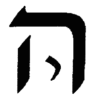

> וענין ג' וז' וי"ב יתבאר יותר עוד בשער המציאות בס"ד. ורוח לכל אחת פי' כאשר האציל האותיות נאצל מעצמות החכמה רוח ונשמה לכל א' מהן, דהיינו הנקוד שהוא נשמה לאותיות, האותיות בבינה והנקוד מחכמה. ובספירות רוח לכל אחת מהן היינו העצמות המתפשט לתוך הכלים שכך הי' מציאות אצילותם כאשר יתבאר מתוך מאמר הזהר בשער עצמות וכלים בפ"ז. שלש מים מרוח היא הבינה שהיא שלישית, [פי' מים (ממש) (כש"כ בשער טעם האצילות פ"ד) בענין מאמר ג' שהוא יקוו המים הוא בבינה. והטעם שנקראת מים מפני שהם עבים מהרוח והם מקבלות הציור יותר וכן היא מקבלת יותר ציור הנמצאות ושם מתגלות יותר מבחכמה. חקק בהם תהו ובהו ורפש וטיט שהם מציאות ד' אותיות שבבינה. תהו י', בהו ה', ו' רפש, ה' טיט. ובב"ר פי' מאי בהו, דבר המלביש את התהו. ואמר תהו הוא קו ירוק דאסחר עלמא שהיא הבינה. ולא הבינה ממש, אלא הי' שבבינה שיש לה מציאות היולי שאינו מתגלה בעצם. ר"ל כי השכל שופט בה כל השפטות כענין ההיולי והוא סובלן לרוב הרחקו מהדעת [של האדם להשיג], אבל בהו שהוא הה"א מלביש הי' דהיינו ה' בית והיכל אל י' כזה.

**3:5:6** And it is "bohu" that gives depiction to the tohu and reveals the matters concealed in it. "Mire" (refesh) is a greater thickness, indicating greater revelation; and this is "mire," which is the vav, which is Tiferet, which is the revelation of Binah, although it is still concealed in it. And "clay" (tit) is [a still] greater thickness and revelation, namely Malkhut, which is the final heh.

> והוא בהו שנותן ציור אל התהו ומגלה העניינים הנעלמים בה. רפש הוא עביות יותר מורה על גלוי יותר והיינו רפש שהוא הו' שהוא התפארת שהוא גלוי הבינה עם היות שהוא עדיין נעלם בה. וטיט הוא עביות וגלוי יותר היינו המלכות שהיא ה"א האחרונה.

**3:5:7** Now the existence of their emanation in Binah is from the power of Chokhmah. "He engraved them like a kind of garden-bed," etc. — here he included the existence of the six extremities: namely, "like a kind of garden-bed" is the below; "and set them up like a kind of wall" is the girding of the four walls of the wall — west, east, north, south; "covered them like a kind of ceiling" is the above — to indicate that, in the existence of the vav stated in the word "mire" (refesh), as I explained there, the six extremities mentioned are included, and they are in the power of Binah. "Four: fire from water," etc. — it is Malkhut; and by means of it the rest of the worlds were created, for by means of the first three all the Emanation was made and emanated, and in particular by means of Binah. And he placed Malkhut first [with the word "clay"], before the existence of the [other] extremities, because they were already hinted at in their existence within Binah. And because he mentioned their emanation from Binah, he mentioned the rest of the existence of the worlds, namely the throne of glory and the seraphim, etc. And Malkhut is called "fire" because it is the lower Gevurah; and he said "from water," [in] that it is Malkhut from Binah, and so [is] their inclination: Binah, the upper heh, its inclination is toward the right, and Malkhut, the lower heh, its inclination is toward the left, and they are the right hand and the left hand, as is proved in the Tikkunim, and as will be explained in the Glossary of Titles, with God's help. And the secret of the throne of glory is Beriah, as we shall explain in the Gate of ABYA. "And from the three of them He founded His abode" — the meaning: from these three aspects, which are spirit, water, fire, are the foundation and the abode of the Shekhinah, as is proved by the verses. "Five: He sealed [the] height," etc. — namely Netzach, namely above. And he placed it first for [several] reasons: either because its principal sealing was by means of Chokhmah, as Rashbi, peace be upon him, explained, as we set down earlier; and likewise the sealing of the below, which is Hod, was by means of Binah, and therefore he placed it first; or for the sake of the order of the extremities. And Rashbi, peace be upon him, was compelled, in the passage of the Tikkunim, to explain that the sealing of above and below was by means of Chokhmah and Binah, because with them were sealed "life" (chayei) and "sustenance" (mezonei); and we hold that "children, life, and sustenance" depend not on merit (zekhut) — namely Chesed — but on mazal — namely Keter; and not Keter specifically, but the first three. And so it is proved in the Zohar in Parashat Vayera, on the verse "behold, I [will] add to your days" — that it did not say "I am adding" (mosif), speaking in the present[, addressed] to [the listener's] presence, but "I will add" (yosif), speaking of the hidden [third person], which is Binah. Therefore, surely, the mazal — although it is principally Keter — is in partnership with the first [three]; and therefore, in order to seal "life" and "sustenance" in Netzach and Hod, it was necessitated [that it be] by means of Chokhmah and Binah. And by this is understood the doubled language of Rashbi, peace be upon him, in the passage [mentioned above]. "Seven: He sealed [the] east," etc.; "Eight: He sealed [the] west," etc. — namely Tiferet and Yesod, as explained in the preceding chapter, and so Rashbi, peace be upon him, explained. And north and south [are] according to their plain sense, which are GaG [Gedulah-Gevurah]. And after we have included the explanation of the mishnah of the seals, let us explain the mishnah of the depths; and this is its explanation, in this manner, and not exactly like it: "the depth of beginning and the depth of end" are Keter and Malkhut, in the secret of "I am first and I am last," which we explained in chapter 1. "The depth of good and the depth of evil" are Chokhmah and Binah, for this is the source of mercy and Chesed, as is known, and this is the source of judgment and punishment; and according to all the explanations, "evil" is not precise. And "the depth of above and the depth of below," etc., are the six extremities, as I explained above. And we have gained, by the way, that these six extremities are literally the six sides mentioned, and [are] hinted at in the words of Rashbi, peace be upon him, in several places; and there is nothing twisted or crooked in them, and "each man comes to his place in peace." And their proof from these mishnayot is nullified, [in] that "the pendants that were leaning [on it] are washed away." And in the way that he explained in the Tikkunim, he likewise explained in the Ra'aya Mehemna, in the completion of the ten emendations of the table; and we have not seen [fit] to copy it here, so as not to be lengthy.

> והנה מציאות אצילתן בבינה הם מכח החכמה. חקקן כמין ערוגה וכו' כאן כלל מציאות ו' קצוות. דהיינו כמין ערוגה הוא התחת. והציבן כמין חומה היינו חגורת ארבע דפנות החומה מערב מזרח צפון דרום. סככן כמין מעזיבה היינו מעלה. להורות כי במציאות הוא"ו האמורה במלת ורפש כדפרישת שם כלולים הו"ק הנזכר והם בכח הבינה. ארבע אש ממים כו' הוא המלכות ועל ידה נבראו שאר העולמות כי ע"י ג' הראשונות נעשה ונאצל כל האצילות ובפרט ע"י הבינה. והקדים המלכות [במלת וטיט] אל מציאות הקצוות מפני שכבר נרמזו במציאותן בתוך הבינה. ולפי שהזכיר אצילתן מהבינה הזכיר שאר מציאות העולמות דהיינו כסא הכבוד ושרפים כו'. והמלכות נקרא אש מפני שהיא גבורה תתאה, ואמר ממים שהיא מלכות מבינה וכן נטייתם. הבינה ה' עילאה נטייתה אל הימין ומלכות ה' תתאה נטייתה אל השמאל והם יד ימין ויד שמאל כדמוכח בתיקונים וכמו שיתבאר בשער ערכי הכנויים בס"ד. וסוד כסא הכבוד היינו הבריאה כמו שנבאר בשער אבי"ע. ומשלשתן יסד מעונו פירוש מג' בחינות אלה שהם רוח מים אש הן יסוד ומעון השכינה כדמוכח מקראי. חמש חתם רום כו' היינו נצח דהיינו מעלה. והקדימו לסיבות. אם מפני שעיקר חתימתו הי' על ידי החכמה כמו שפירש הרשב"י ע"ה כמו שהקדמנו. וכן חתימת התחת שהיא ההו"ד הי' ע"י הבינה ולכן הקדימו. או לסבת סדר הקצוות. והוכרח הרשב"י ע"ה במאמר התיקונים לבאר שחתימת מעלה ומטה הי' ע"י החכמה והבינה מפני שבהם נחתמו חיי ומזוני וקי"ל דבני חיי ומזוני לאו בזכותא תליא מלתא דהיינו חסד אלא במזלא דהיינו כתר ולאו דוקא כתר אלא ג' ראשונות וכן מוכח בזוהר בפ' וירא [ב] בפסוק הנני יוסיף על ימיך שלא אמר מוסיף כמדבר לנוכח אלא יוסיף כמדבר לנסתר שהיא הבינה. לכן ודאי מזלא עם היות שעקרו כתר הוא בשתוף הראשונות ולכן כדי לחתום חיי ומזוני בנצח והוד הוכרח להיות ע"י חכמה ובינה. ובזה יובן כפל לשון הרשב"י ע"ה במאמר [התקונים הנ"ל]. ז' חתם מזרח כו' ח' חתם מערב כו' היינו ת"ת ויסוד כדפי' בפרק הקודם וכן בארו הרשב"י ע"ה. וצפון ודרום כמשמען שהם ג"ג. ואחר שכללנו באור משנת החותמות נבאר משנת העמקים וזהו פירושו עד"ז ולא ממש כמוהו. עומק ראשית ועומק אחרית הם כתר ומלכות בסוד אני ראשון ואני אחרון שבארנו בפ"א. עומק טוב ועומק רע הם חכמה ובינה, כי זה מקור הרחמים והחסד כנודע, וזה מקור הדין והעונש. ולכל הפירושים רע לאו דוקא (ו' או) (ואומרו עומק רום ועומק תחת כו' הם) ו"ק כדפי' לעיל. והרוחנו אגב אורחין שהני שש קצוות הם ממש שית סטרין הנזכר ורמוזים בדברי הרשב"י ע"ה בכמה מקומות. ואין בהם נפתל ועקש ואיש על מקומו יבא בשלום. ובטלה ראייתם מתוך משניות אלו דבתלי דהוו סמוכי איתסחו. ובדרך זה שביאר בתיקונים ביאר ג"כ בר"מ בתשלום י' תיקוני השלחן. ולא ראינו להעתיקו הנה שלא להאריך:

### Chapter 3:6. Emendation of the statement of the Idra, "after the beginning was found" (*achar de-sharuta ishtekach*), which seemingly accords with R. Shem Tov; we cited another commentator's interpretation and our objection to him.

**3:6:1** After we have, in the preceding chapter, striven in the explanation of the mishnah of Sefer Yetzirah and to nullify the proofs of Rabbi Shem Tov and the rest of the commentators who say that Keter does not enter into the count of the Sefirot, we shall now come, in this chapter as well, to nullify his proof from the words of Rashbi, peace be upon him (in the Idra of Ha'azinu, folio 289b), [where] these are his words: "The place where the beginning is found is from the Holy Ancient One, which is illumined from the mazal — it is the illumination of Chokhmah, which spreads to thirty-two directions; and they came forth from that concealed brain, from the illumination that is in it. And what the Holy Ancient One illumines first (a variant: in Chokhmah) — this it is; and the beginning was from what was revealed; and it was made into three heads, and one head includes them. And these three spread out in Zeir Anpin, and from these all is illumined. This Chokhmah was engraved, and it brought forth one river that flows and issues to water the garden; and it entered the head of Zeir Anpin, and was made into one brain; and from there it is drawn and flows into the whole body, and waters all those plantings; this is what is written, 'and a river issues from Eden [to water the garden,' etc. Again,] this Chokhmah was engraved and was drawn, and entered the head of Zeir Anpin, and was made into another brain. That illumination which was drawn from it — these two drawings were engraved and joined as one by means of [one] drawing of the depth of the well, of which it is written, 'by His knowledge the depths were cleaved'; and it entered the head of Zeir Anpin and was made into another brain; and from there it is drawn and enters within the body, and fills all those chambers and halls of the body; this is what is written, 'and by knowledge the chambers are filled.' And these are illumined from the illumination of that supernal, concealed brain that is illumined by the mazal of the Holy Ancient One; and all are suspended this from that, and bound this to that and that to that — until it is recognized that all is one, and all is the Ancient One, and nothing is separated from it. These three lights illumine three others, which are called the fathers; and these fathers illumine the sons; and all is illumined from one place." Thus far [his words].

> אחר שבפרק הקודם השתדלנו בביאור משנת ס"י ולבטל ראיות הרש"ט ושאר המפרשים האומרים שכתר אינו נכנס במנין הספירות, נבא עתה בפ' זה ג"כ לבטל ראיותו מדברי הרשב"י ע"ה (באידרת האזינו דף רפ"ט ע"ב) וז"ל אתר דשרותא אשתכח, מעתיקא קדישא דאתנהיר ממזלא, הוא נהירו דחכמתא דאתפשט לל"ב עיבר, ונפקו מההוא מוחא סתימאה מנהירו דביה. ומה דעתיקא קדישא נהיר בקדמיתא (נ"א בחכמתא), דא היא, ושרותא ממה דאתגליא הוה, ואתעביד לתלת רישין. ורישא חדא כליל לון. ואלין תלת מתפשטין בזעיר אנפין. ומאלין נהרין כלא. אתגליף האי חכמתא, ואפיק חד נהרא דנגיד ונפיק לאשקאה גינתא. ואעיל ברישא דזעיר אנפין, ואתעביד חד מוחא. ומתמן אתמשך ונגיד בכל גופא, ואשקי כל אינון נטיען. הה"ד ונהר יוצא מעדן [להשקות את הגן וגו'. תו) אתגליף האי חכמתא ואתמשיך, ועייל ברישא דזעיר אנפין, ואתעביד מוחא אחרא. ההוא נהירו דאתמשכא מניה אלין תרין משיכן אתגליפו ואתחברן כחד ע"י [חד] משיכו דעמיקא דבירא, דכתיב בדעתו תהומות נבקעו. ועייל ברישא דזעיר אנפין ואתעביד מוחא אחרא, ומתמן אתמשך ועייל בגו גופא, ומלייא כל אינון אידרין ואכסדרין דגופא. הה"ד ובדעת חדרים ימלאו. ואילין נהירין מנהירו דההוא מוחא עילאה סתימאה דאתנהיר במזלא עתיקא קדישא, וכלא דא בדא תליין. ואתקשיר דא בדא ודא בדא. עד דאשתמודע דכולא חד, וכלא הוא עתיקא ולא אתפרש מניה כלום. אלין תלת נהורין נהרין לתלת אחרנין דאקרון אבהן, ואלין אבהן נהרין לבנין וכלא נהיר מאתר חד עכ"ל.

**3:6:2** And regarding this passage, there has come to us a certain treatise (kuntres) from one of the accepted sages of this generation, and he explained in it an interpretation at length, with proofs from passages of the Zohar. And since, afterward, he returned and explained the construal of the language of the passage and its explanation without [bringing] proofs to his premises, we have seen [fit] to copy here that [shorter] interpretation, so that the examiner may be wary of it — for we shall not need to be lengthy, since most of our premises are explained in these Gates. And these are his words: "'The place where the beginning is found' — the place of the beginning of the Emanation, which is found and emanated from the Holy Ancient One, the Ein Sof, which illumines by way of Keter, called 'mazal' — and the reason you will find in the long explanation. 'It is the illumination of Chokhmah' — it is the light of Chokhmah, the wisdom of God, whose light spreads in the thirty-two paths. 'And they came forth,' etc. — that the spreading of this light comes and issues from Keter, called the supernal Keter, sealed and concealed, and does not fall under thought. 'And what the Holy Ancient One illumines,' etc. — and what the Ein Sof illumines first. 'This it is' — that is, Chokhmah. 'And the beginning was from what was revealed,' etc. — and the beginning of the revelation of the Emanation from the Ein Sof is this [Chokhmah], for Keter is not apprehended even in thought. 'And it was made into three heads' — this Emanation that comes from the Ein Sof was made [into] three heads, [which] are Keter, Chokhmah, Binah. 'And one head includes them' — for although they have [their separate] place, the true union is only in [all] three of them. 'And these three spread out in Zeir Anpin' — the three mentioned spread their emanation down to the last [Sefirah], called Zeir Anpin; and the matter, [see the long explanation]. 'And from these all is illumined' — all of them receive these light and effluence, and they have none besides them. 'This Chokhmah was engraved' — the meaning of what he said above, 'and three heads were made': for we found only two, and the third — how was it emanated? He said, 'it was engraved,' etc. — this [Chokhmah] was opened and there was emanated from it [the third]. 'An illumination that flows and issues' — it is Binah; and the reason it is called so, [see the long explanation]. 'These two' — they are Chokhmah and Binah, which were emanated and drawn from Keter, [and which] open and draw themselves together in one drawing into the depth of Tiferet, into all those chambers and halls; and the matter of the drawing of this light from Chokhmah and Binah, [see the long explanation]. 'And these illumine with illumination' — these chambers all illumine with the light of that attribute, which is Keter, the mazal of the Holy Ancient One. 'And all are suspended this from that' — and all the Sefirot are bound this to that, until the Emanation that comes from the Ein Sof is recognized and known and apprehended; and this matter is a great secret among the secrets of the Kabbalah, and the matter you will understand, [see the long explanation]. 'And all is one' — and all is unified, this unifying with that. 'And all is the Ancient One' — and all of them are unified in it like a flame bound to a coal. 'These three lights' — they are Keter, Chokhmah, Binah. 'Illumine three others' — they are Chesed, Pachad, Tiferet, which, below them, are unified each one opposite [the upper] one: Chesed in Chokhmah, and Pachad in Binah, and Tiferet ascends by way of the middle line and is unified in Keter; and the reason, [see the long explanation]. 'And these fathers illumine the sons' — they are Netzach, Hod, Yesod; and [the reason] he called these 'fathers' and these 'sons,' [see the long explanation]. 'And all is illumined from the place of the beginning' — he now returned and included all that he said above, and concluded with that with which he began: all the Sefirot receive their light from the place of the beginning of the Emanation." Thus far the short interpretation. And in every place where "TBH" (tav-bet-heh) is written [in his text], its initials [mean] "you will find it in the long explanation," since there he brought a passage or passages from the Zohar as proof for that matter; and these passages neither raise nor lower [anything] in the explanation of the passage at all. And what there is to object to him is this: that he explained "the Holy Ancient One" [as] the Ein Sof — and this does not appear [correct], for even Keter, most of the time, Rashbi, peace be upon him, designates by the name "Ancient of Ancients" (Atika de-Atikin); how much more, then, would he now designate the Ein Sof by the name "Holy Ancient One"?

> ובמאמר הזה נמצא אלינו קונטריס אחד מהחכמים המתקבלים בדור הזה ובאר בו פי' בארוכה בראיות ממאמרים מהזוהר. ולהיות שאח"כ חזר ובאר התכת לשון המאמר וביאורו בלי ראיות אל הקדמותיו ראינו להעתיק הנה הפירוש ההוא להזהר ממנו המעיין כי לא נצטרך להאריך יען היות רוב הקדמותינו מבוארות בשערים האלה. וז"ל אתר דשרותא אשתכח, מקום התחלת האצילות שנמצא ונאצל מעתיקא קדישא אין סוף שמאיר דרך הכתר הנקרא מזל והטעם תמצאנו בביאור הארוך. הוא נהירו דחכמתא, הוא אור החכמה חכמת אלקים שאורה מתפשטת בל"ב נתיבות. ונפקו וכו', שהתפשטות האורה הזאת באה ויוצא מהכתר הנקרא כ"ע סתים וחתים ואינו נופל תחת המחשבה. ומה דעתיקא קדישא נהיר וכו', ומה שאין סוף מאיר בתחלה. דא היא, ר"ל החכמה. ושירותא ממה דאתגליא הוה וכו', והיא תחלת התגלות האצילות מהאין סוף היא זו כי הכתר אינו מושג אפילו במחשבה. ואתעביד לתלת רישין, האצילות הזה הבא מאין סוף נעשה ג' ראשין הן כתר חכמה בינה. ורישא חדא כליל לון, כי אע"פ שיש להם מקום אין היחוד האמיתי כ"א בשלשתן. ואלין תלת מתפשטין בז"א, השלשה הנזכרים מתפשטין אצילותן עד האחרונה הנקרא זעיר אנפין, והענין תב"ה. ומאלין נהרין, כלהו מקבלין אור ושפע האלה ואין להם זולתם. אתגליף האי חכמתא, פי' מה שאמר למעלה ואתעבידו תלת רישין כי לא מצינו אלא שנים והג' האיך נאצל אמר אתגליף וכו' נפתחה זאת ונאצל ממנה. נהיר דנגיד ונפיק, והיא הבינה, והטעם שנקרא כך תב"ה. אלין תרין, הן חכמה ובינה אשר נאצלו ונמשכו מן הכתר מתפתחין וממשיכין עצמן יחד בהמשך אחד בעומק הת"ת בכל אינון אדרין ואכסדרין, וענין המשך האור הזה מן החכמה והבינה תב"ה. ואלו נהרין בנהירו, אלו החדרים כלם מאירים באור של אותה מדה והיא כתר מזלא עתיקא קדישא. וכלא דא בדא תליין, וכל הספירות מתקשרות זו בזו ועד שניכר ונודע ונישג האצילות הבא מאין סוף, והענין הזה סוד גדול מסודות הקבלה, והענין תבינהו מב"ה. וכלא חד, והכל מיוחד מתיחד זה בזה. וכלא הוא עתיקא, ומתיחדים כלם בו כשלהבת ק"ב. אלין תלת נהורין, הן כתר חכמה בינה. נהירן לתלת אחרנין, הם חכמה פחד תפארת אשר למטה מהם מתיחדים כל אחד זה כנגד זה החסד בחכמה והפחד בבינה והת"ת עולה דרך קו האמצעי ומתייחד בכתר והטעם תב"ה. ואלין אבהן נהירין לבנין, הן נצח הוד יסוד, ומה שקרא לאלה אבות ולאלה בנים תב"ה. וכלא נהיר מאתר שרותא, חזר עתה וכלל כל מה שאמר מלמעלה וסיים במה שהתחיל בו כל הספירות מקבלות אורה ממקום התחלת האצילות עכ"ל הפי' הקצר. ובכ"מ שכתוב תב"ה ר"ת תמצאנו בביאור הארוך לפי ששם הביא מאמר או מאמרים מהזהר לראייה על הענין ההוא ואין המאמרים האלה מעלין ומורידין בפירוש המאמר כלל. ומה שיש להקשות עליו הוא זה כי הוא פי' עתיקא קדישא א"ס, ואינו נראה כי אפילו הכתר רוב פעמים מכנה אותו הרשב"י ע"ה בשם עתיקא דעתיקין כ"ש שיכנה עתה לא"ס בשם ע"ק.

**3:6:3** And further, that it is impossible for the intent of "the Holy Ancient One" to be the Ein Sof, because he [Rashbi] said that the Holy Ancient One is illumined and receives its light from the mazal — and therefore he said "is illumined" (de-itnehir) in the passive form, and did not say "illumines" (de-anhir) or "illumines" (de-nahir), which is an active verb; and so it is written in all the versions, and so it was written in the version of this commentator [too] — and even so, he pressed to explain it [in] the active form, [in] that he said "the Holy Ancient One, the Ein Sof, which illumines by way of Keter, called mazal." Thus far [his words].

> ועוד שא"א שתהיה כונת ע"ק בא"ס מפני שאמר כי ע"ק מתנהר ומתקבל אורה מהמזל ולכן אמר דאתנהיר בלשון התפעל ולא אמר דאנהיר או דנהיר שהוא פועל יוצא וכן כתוב בכל הנוסחאות וכן היה כתוב בנוסחת המפרש הזה ועכ"ז דחק לפרשו לשון פועל יוצא שאמר עתיקא קדישא אין סוף שמאיר דרך הכתר הנקרא מזל עכ"ל.

**3:6:4** And further, his saying is difficult: "and what the Holy Ancient One illumines first — this it is." And he explained: "that which the Ein Sof illumines first is this," that is, Chokhmah. And it is difficult — for, granted, "'and the beginning was from what was revealed,' etc." is fine, for although it [Chokhmah] is second to the Emanation, even so it is first to the revelation; but "'and what the Holy Ancient One illumines,' etc." appears [to mean] that this is literally the beginning of its illumination — and this is not so, for Keter is the beginning of illumination and Emanation according to all the explanations, even according to the words of Rabbi Shem Tov; for, certainly, they differ only [in] that he says it is not fitting that Keter enter into the count, but he admits that it is the beginning of the illumination of the Ein Sof.

> ועוד קשה אמרו ומה דנהיר עתיקא קדישא בקדמיתא דא היא. ופי' שאין סוף מאיר בתחלה היא זו ר"ל החכמה. וקשה כי בשלמא ושרותא ממה דאתגליא וכו' ניחא כי עם היות שהיא שניה אל האצילות עכ"ז היא ראשונה אל הגלוי, אבל ומה דע"ק נהיר וכו' נראה שממש זה תחלת הארתו, וזה אינו כי הכתר הוא תחלת הארה ואצילות לכל הפירושים אפילו לדברי הרש"ט דע"כ לא פליגי אלא שאומר שאין ראוי שיכנס הכתר במנין אבל מודה שהוא תחלת הארת של אין סוף.

**3:6:5** And further, the doubled language "and the beginning" does not settle with his interpretation at all. Further, his saying "and it was made into three heads" — for, granted, if he were speaking of the existence of the Emanation in general, it would be fine for him to say that this Emanation was made [into] three heads, which are Keter-Chokhmah-Binah; but the intent of the passage was only to say that the existence of the beginning of the revelation is Chokhmah — if so, why did he say "it was made into three heads"? For which one was made into three heads? — since the particulars of the heads he mentioned above, [where] he said "which is illumined from the mazal," namely Keter, "it is the illumination of Chokhmah," namely Chokhmah: it is not applicable to it [Chokhmah] [to say] "it was made into three heads." Further, he said "and one head includes," etc. — he explained: that although they have [their separate] place, the true union is only in [all] three of them. And it is difficult — for if the intent were to say that the three of them are reckoned as one, he should not have said "and one head," which implies one Sefirah that includes them, but [rather] "and they are included in one," the intent [being] that the three of them are reckoned as one. Further, he said "and these three spread out in Zeir Anpin," and explained: the three mentioned spread their emanation down to the last [Sefirah], etc. — and this is very strained, for the nature of the language does not indicate that his occupation here is with the matter of the existence of the Emanation; and likewise it would not have been fitting for him to say "and they spread out in Zeir Anpin," which implies that Zeir Anpin is already emanated, whereas according to his interpretation he is still occupied with the beginning of the Emanation, before the whole structure was emanated. And there are yet very many matters with superfluous language, whose matter is not explained according to his interpretation; and so as not to be lengthy, it is not my wish to object to all his words — and with a little examination the difficulty of his understanding in the interpretation will be apprehended. And now it is fitting that we come to the interpretation of the passage in a manner that a settled explanation may be explained, and the proofs of Rabbi Shem Tov nullified, with God's help.

> ועוד כפל לשון ושירותא שאינו מתישב לפירושו כלל. עוד אמרו ואתעביד תלת רישין. כי בשלמא אם היה אומר מציאות האצילות בכלל הוה ניחא שיאמר שהאצי' הזה היה נעשה בג' ראשין שהן כח"ב. אבל כוונת המאמר לא היה אלא לומר שמציאות תחילת הגלוי הוא החכמה א"כ מה אמר דאתעביד לתלת רישין כי איזהו נעשה לג' ראשים שהרי פרטיות הראשים הזכיר למעלה שאמר דאתנהיר ממזלא דהיינו כתר הוא נהירו דחכמתא היינו חכמה לא שייך עלה דאתעביד לתלת רישין. עוד אמר ורישא חדא כליל וכו' פי' כי אע"פ שיש להם מקום אין היחוד האמיתי כי אם בשלשתם ע"כ, וקשה דאם הכונה לומר ששלשתם חשובות כאחד לא היה לו לומר ורישא חדא דמשמע ספירה אחת כוללת אותם אלא ואתכללן בחד שהכוונה ששלשתן חשובות כאחד. עוד אמר ואלין תלת מתפשטין בז"א ופירש השלשה הנזכרים מתפשט אצילותן עד האחרונה כו', ודוחק גדול הוא זה כי אין טבע הלשון מורה שיהיה עסקו כאן בענין מציאות האצילות, וכן לא היה ראוי שיאמר ומתפשטין בז"א שמורה שז"א היא נאצל כבר ולפי פירושו עדיין הוא עוסק בתחלת האצי' קודם שנאצל הבנין כלו. ויש עוד כמה וכמה עניינים ביתור לשון ועניינם אינם מתבארים לפירושו, וכדי שלא להאריך אין רצוני להקשות על כל דבריו ובמעט העיון יושג קושי הבנתו בפי'. ועתה ראוי שנבא בפירוש המאמר באופן שיתב' ביאור מתישב ותתבטל ראיות הרש"ט בס"ד:

### Chapter 3:7. A lengthy explanation of the aforementioned statement.

**3:7:1** Before we enter into the explanation of this passage, we must preface one premise briefly — and its explanation will be at length in the book Or Yakar, in the commentary on the Idra, with God's help. And the matter is that, although ten Sefirot are emanated, and they are garments to the light of the providence of His governance, as we shall explain in the Gate of Self and Vessels, with God's help — even so, He clothes Himself in Keter, and there is the palace of His providence and His light; and it [Keter] is what cleaves and unites with the Emanator [to] the utmost [degree of] cleaving and union, to the point that it is forbidden to prolong speech about this matter.

> קודם שנכנס בביאור המאמר הזה צריכין אנו להקדים הקדמה אחת בקצרה ויאריך ביאורה בספר או"ר יק"ר בפירוש האידרא בע"ה. והענין הוא שעם היות עשר ספירות נאצלות והם לבושים אל אור השגחת הנהגתו כמו שנבאר בשער עצמות וכלים בע"ה, עכ"ז הוא מתלבש בכתר ושם היכל השגחתו ואורו והוא המתדבק ומתאחד במאציל תכלית הדיבוק והיחוד עד שיהיה אסור להאריך הדבור בענין זה.

**3:7:2** Now, by means of Keter, the concealment of His existence is a first concealment. And accordingly, the concealment of Keter was necessitated, to the point that its manifestation is not literally revealed in the rest of the Sefirot, nor will it be revealed in them; and just as they are not comprehended of the existence of the Emanator, so they are not comprehended of Keter — except that Keter pours its effluence, by the power of the Emanator, into the Sefirot, by means of Da'at, as will be explained, with God's help. And on account of the great concealment of Keter, we do not call it "the beginning of the Emanation," because it is not the beginning of the Emanation that is revealed to us — but [rather] Chokhmah; and from Chokhmah and below are the totality of the Sefirot, [counted] from ten, by means of the Da'at that completes [the count]. And not that Da'at is a Sefirah — rather, it is an aspect that completes the totality of the Sefirot, [enabling] them to be composed of ten from Chokhmah and below, as we shall expand the explanation in the aforementioned book. And we know that this matter alarms the heart of beginners in the wisdom of Kabbalah, and the things do not settle for them until they come to the place that we have appointed for this inquiry — and then the gates of light will be opened.

> והנה ע"י הכתר העלם מציאותו העלם ראשון. ולפ"ז הוכרח העלם הכתר עד שאין מציאותו ממש מתגלה בשאר הספי' ולא יגלה בהם וכמו שלא יוכללו ממציאות המאציל כן אינן נכללות מהכתר אלא שהכתר שופע שפעו בכח המאציל בספי' ע"י הדעת שיתבאר בע"ה. ולרוב העלם הכתר לא נקראהו תחלת האצילות מפני שאינו תחלת האצילות המתגלה אלינו אלא החכמה ומחכמה ולמטה הם כללות הספירות מעשר באמצעות הדעת המשלים. ולא שהדעת היא ספירה, אמנם היא בחינה משלמת כללות הספירות להיותם כלולות מעשר מחכמה ולמטה כמו שנרחיב הביאור בספר הנזכר. וידענו היות ענין זה מבהיל לב המתחילים בחכמת הקבלה ואין הדברים מתישבים אליהם עד שיבאו אל המקום שיעדנו אל הדרוש הזה ואז יפתחו שערי אורה.

**3:7:3** Now the emanation of Keter is called Arikh Anpin (the Long Face), and it is the first concealment to the Emanator. The second concealment is Zeir Anpin (the Small Face), and it includes all eight Sefirot, which are from Chokhmah to Yesod; and this is the secret of the second concealment to the Emanator. The third concealment is called Nukva de-Zeir Anpin (the Female of Zeir Anpin), and it is Malkhut. And the secret of these three concealments is explained in the Idra, at the passing of Rashbi, peace be upon him, as the explanation will be expanded for us there. And even so, let these matters be [set] before the examiner; and let him not rebel against them, but let him kiss his lips and say, "if it is a received tradition, we shall receive [it]" — for the place of their explanation we have appointed to the aforementioned book, with God's help.

> והנה אצילות הכתר נקרא אריך אנפין והוא העלם ראשון אל המאציל. העלם ב' הוא זעיר אנפין והוא כולל כל ח' ספירות שהם מחכמה עד יסוד וזהו סוד העלם שני אל המאציל. העלם ג' הוא נקרא נוקבא דזעיר אנפין והוא המלכות. וסוד ג' העלמים אלה הם מתבארים באדרא בפטירת הרשב"י ע"ה כאשר יתרחב לנו הביאור שם. ועכ"ז יהיו הדברים האלה נגד המעיין ואל יתריס כנגדם וישק שפתיו ויאמר אם קבלה נקבל כי מקום ביאורם יעדנו אל הספר הנזכר בעה"ו.

**3:7:4** And further, we must preface a premise that we received from our teacher and master, Rabbi Solomon — may his light shine — that each and every Sefirah is examined in three aspects: the first aspect, in respect of what it receives; the second, in respect of its own self; the third, in respect of what it emanates. The example of this [is] in Chokhmah, which is the matter under discussion before us: it has a first aspect, in respect of which it is equalized to Keter — [and] in this aspect it receives and is illumined from it; and this aspect is its subtlety and its spirituality, higher in degree than the aspect of its own self, since the supernal Keter is joined to it. And it has a second aspect, which is the aspect of its own self, which is its [particular] character — which is the light that illumines in its own self, without any other Sefirah besides it being joined to it. And it has a third aspect, which is the aspect in which it is equalized to Binah, in order to emanate to it from its effluence.

> ועוד צריכין אנו להקדים הקדמה קבלנוה ממורינו ורבינו הר"ר שלמה נר"ו, שכל ספירה וספירה תבחן בג' בחינות. בחינה ראשונה בערך מה שמקבלת, ושנייה בערך עצמותה, שלישית בערך מה שמשפעת. המשל בזה בחכמה שהוא הנדון שלפנינו יש לה בחינה ראשונה בערך שמשתוות אל הכתר שבבחינה זו היא מקבלת ומאירה ממנה ובחי' זו היא דקותה ורוחניותה עליונה במעלה יותר מבחינת עצמותה להיות שנצטרף אליה הכתר עליון. ויש לה בחי' שניה והיא בחינת עצמותה אשר היא תכונתה אשר הוא האור המאיר בעצמותה בלי שיצטרף אליה שום ספי' אחרת זולתה. ויש לה בחי' ג' היא בחינת שהיא משתווית בה אל הבינה כדי להשפיע לה משפעה.

**3:7:5** Now this aspect is not subtle and spiritual like the first two aspects, for the reason that the lower attribute, which is below it, is joined to it. And not specifically Binah — rather, the same applies to Chesed and the rest of the Sefirot that draw sustenance from it.

> והנה הבחינה הזאת אינה דקה ורוחניות כשני בחי' הראשונות מטעם שנצטרף אליה מדה התחתונה שהיא למטה ממנה. ולאו דוקא הבינה אלא ה"ה החסד ושאר הספי' היונקות ממנה.

**3:7:6** And further, we must preface, regarding the matter of this passage in general: that this passage was expounded in Parashat Ha'azinu, at the time of the passing of Rashbi, peace be upon him, after he had expansively spoken of the matter of Keter and its concealment, and that upon it depends all that is principal in the Emanation. Afterward he began to speak of the manifestation of the Emanation that is revealed, and said that, from the side that Keter is not revealed, therefore the beginning of all the limbs of the Holy Ancient One — their beginning is Chokhmah; and the matter of the three brains, which are opposite the three supernal [Sefirot], because Keter is concealed, as he explained there. He said, in the totality of this passage, that the existence of the three brains included in the Chokhmah that is in Keter are three Sefirot; and its two aspects [those of Chokhmah] come in the place of the two Sefirot, which are Keter and Binah, and the aspect of Da'at that is in Chokhmah is found in the place of Keter itself, as he explains and goes on. And since he came to explain the matter of the three brains that are in Arikh Anpin, by the way he indicated to us the order of the drawing-of-sustenance of the grades — that is, the three fathers, which are Gedulah, Gevurah, Tiferet, draw sustenance from the three brains; for the first of them — that is, the matter of Da'at, as will be explained, and it is in the place of Keter — and from there [is] their sustenance, that is, from these three aspects. And from the three fathers [is] the sustenance of the three branches, which are Netzach, Hod, Yesod. And now the matter of the sustenance of the Sefirot, three from three, is understood, although Keter is concealed. And now we shall come to the explanation of the language of the passage, with God's help. "The place where the beginning is found" — the meaning: the place of the revelation of the Emanation and its being found by us; that is, although the beginning of the Emanation is from the supernal Keter, which is Arikh Anpin, even so it is concealed and is not revealed on account of its great concealment, and the beginning of the revelation of the Emanation is from Zeir Anpin, whose beginning is Chokhmah; and it is called "the beginning" (shiruta) because it is the beginning of the revelation. And he said that its emanation and its existence, in [terms of] existence, is from Arikh Anpin, which is Keter. And this is what he said, "the place where the beginning is found" — the meaning: the place where Chokhmah is emanated and found and revealed is from the Holy Ancient One, that is, Keter, Arikh Anpin, called the Holy Ancient One. And the expression "Ancient One" (Atika) indicates priority, as he indicated in the verse (Daniel 7:9), "and the Ancient of Days." And it is called "Holy" (Kadisha), for there is the source of all the holinesses; or he means that "holy" (kadosh) means "separate" and "elevated," and it is holy [i.e., separate] in respect of Zeir Anpin, which is emanated in revelation.

> ועוד צריכים אנו להקדים בענין המאמר הזה בכללו כי המאמר הזה נדרש בפרשת האזינו בשעת פטירת הרשב"י ע"ה אחר שהפליג לדבר בענין הכתר והעלמו ושבו תלוי כל עיקר האצילות. אח"כ התחיל לומר במציאות האצילות המתגלה ואמר כי מצד שהכתר אינו מתגלה לכן תחלת כל אברי עתיקא קדישא תחלתם הם החכמה וענין ג' מוחין שהם כנגד ג' עליונות ביען שהכתר הוא נעלם כאשר באר שם. אמר בכללות המאמר הזה כי מציאות ג' מוחות הנכללות בחכמה שבכתר הם ג' ספי' ובאים שתי בחינותיה במקום שתי הספי' שהם כתר ובינה ונמצאת בחינת הדעת שבחכמה במקום הכתר בעצמו כדמפרש ואזיל. ומאחר שבא לבאר ענין ג' מוחות שבאריך אנפין אגב אורחיה הורה לנו סדר יניקת המעלות ר"ל ג' אבות שהם גדולה גבורה תפארת יונקים מג' מוחות כי הא' מהם ר"ל ענין הדעת כאשר יתבאר והוא במקום הכתר ומשם יניקתם ר"ל מג' בחינות אלה. ומג' אבות יניקת ג' ענפים שהם נצח הוד יסוד. ועתה יובן ענין יניקת הספירות מג' לג' עם היות שהכתר הוא נעלם. ועתה נבא בביאור לשון המאמר בע"ה. אתר דשרותא אשתכח, פירוש מקום התגלות האצילות והיותו נמצא אלינו ר"ל כי אע"פ שתחלת האצילות הוא מכ"ע שהוא אריך אנפין עכ"ז הוא נעלם ואינו מתגלה לרוב העלמו ותחלת התגלות דאצילות הוא מז"א שתחלתו החכמה והוא נק' שירותא לפי שהוא תחלת הגלוי ואמר כי אצילותה ומציאותה במציאות הוא מאריך אנפין שהוא הכתר. וז"ש אתר דשרותא אשתכח פי' מקום שהחכמה נאצלה ונמצאת ונגלית הוא מעתיקא קדישא ר"ל כתר אריך אנפין הנקרא ע"ק. ולשון עתיקא מורה על הקדימה כאשר הורה בפסוק (דניאל ז ט) ועתיק יומין. ונקרא קדישא כי שם מקור הקדושות כולן, או ירצה כי קדוש פי' נבדל ונעלה והוא קדש בערך ז"א הנאצל בגלוי.

**3:7:7** And further, because there are two elders — this elder, who has acquired wisdom, and there is, in the Other Side [Sitra Achra], a worthless elder (zaken ashmai), as is known, in the secret of Laban the Aramean — therefore he called it "the holy elder," the meaning [being]: in the secret of holiness, and in its joy no stranger may mingle. "Which is illumined from the mazal" — the meaning: that this "beginning" of which he spoke does not illumine from the side of Keter itself, for it is concealed [to] the utmost concealment, but [rather] from the side of a revealed aspect within it, which is the secret of the beard (dikna) of the Holy Ancient One, the beard of Arikh Anpin, and it is called "mazal." And it is the secret of the aspect of Binah that is in Keter, as will be explained in the aforementioned book. And this aspect in Keter is called by the name "mazal" to indicate the emanating aspect within the supernal Keter — that it emanates by it into Zeir Anpin; for that aspect is called "mazal," from the expression "water shall flow (yizal) from his buckets" (Numbers 24:7), and "and flowing [streams] (nozlim) from Lebanon" (Song of Songs 4:15). And the intent now [is]: although Keter was emanated, the beginning of the revelation of the Emanation is in Chokhmah, in the aspect of its reception from the supernal Keter. And it is found, accordingly, that the aspect of the beard that is in Keter emanates into the first aspect of Zeir Anpin, which is Chokhmah; and this is what is meant in his saying "which is illumined from the mazal." And so [is] the way — for the last aspect of this [Sefirah] emanates into the first [aspect of the next], and the first aspect of Chokhmah is the beginning of the revelation. "It is the illumination of Chokhmah, which spread to the thirty-two directions" — before its interpretation, we must preface that there are two Chokhmahs, and of them it is said (Proverbs 1:20), "wisdoms (chokhmot) cry aloud outside"; and as Rashbi, peace be upon him, explained in the Idra: and they are the concealed Chokhmah that is in Keter — and it is the brain of Arikh Anpin, and this is called "the concealed brain" (mocha stima'ah), which does not open even to Binah, and whose paths are not known; and this is called "the brain that rests on its dregs," which does not spread at all, as Rashbi, peace be upon him, explained there. However, the brain of Zeir Anpin is the emanated Chokhmah; it spreads and is revealed from the side of its paths, which spread from it to Binah; and not that it is literally revealed, but that it is not concealed like the concealment of the supernal Chokhmah that is in Keter. And we have expanded the explanation of this matter in the commentary on the Idra in the aforementioned book.

> ועוד לפי שיש ב' זקנים, זקן זה שקנה חכמה, ויש בסטרא אחרא זקן אשמאי כנודע בסוד לבן הארמי. לכן קראו זקן הקדוש פי' בסוד הקדושה ובשמחתו לא יתערב זר. דאתנהיר ממזלא, פי' כי שרותא הזאת שאמר אינה מאירה מצד עצם הכתר כי הוא נעלם תכלית ההעלם אלא מצד בחי' מתגלת שבו שהוא סוד דיקנא דע"ק דיקנא דא"א והיא נקראת מזלא. והוא סוד בחינת הבינה שבכתר כאשר יתבאר בספר הנז'. ונקראת בחינה זו בכתר בשם מזל להורות על בחינה המשפעת שבכ"ע שהוא משפיע בה בז"א כי אותה בחי' יקרא מזל מלשון יזל מים מדליו (במדבר כד ז). ונוזלים מן לבנון (שה"ש ד טו). והכוונה עתה אעפ"י שהכתר היה נאצל, תחלת התגלות האצי' הוא בחכמה בבחינת קבלתה מכ"ע. ונמצא לפ"ז כי בחינת דיקנא שבכתר משפיע בבחינה ראשונה דז"א שהיא חכמה וזהו הנרצה באומרו דאתנהיר ממזלא וכן הדרך כי בחי' אחרונה של זו משפעת בראשונה ובחינה ראשונה של חכמה היא תחלת ההתגלות. הוא נהירו דחכמתא דאתפשטא לל"ב עיבר. קודם פירושו צריכין אנו להקדים כי ב' חכמות הן ועליהם נאמר (משלי א כ) חכמות בחוץ תרונה. וכדפי' הרשב"י ע"ה באידרא והם חכמה נעלמת שבכתר והיא מוחא דא"א וזו נקראת מוחא סתימאה שאינה נפתחת אפי' אל הבינה ונתיבותיה לא נודעו. וזו נקרא מוחא דשקיט על דורדייה שאינו מתפשט כלל כמו שפי' שם הרשב"י ע"ה. אמנם מוחא דזעיר אנפין היא חכמה הנאצלת היא מתפשטת ומתגלית מצד נתיבותיה המתפשטים ממנה אל הבינה. ולא שהיא נגלית ממש אלא שאינה נעלמת כהעלם החכמה העליונה שבכתר. והרחבנו פי' ענין זה בפי' האדרא בספר הנזכר.

**3:7:8** Now the emanation of the revealed Chokhmah is from the concealed Chokhmah. And now, in this, he said that the aforementioned "beginning" is Chokhmah; and because there are two Chokhmahs, as I explained, he said [it is] that revealed Chokhmah which spreads to thirty-two — unlike the concealed Chokhmah, as explained. And he said "and they came forth from that brain" — the meaning: that this Chokhmah and its thirty-two paths are emanated and found from the concealed Chokhmah that is in Keter, which is the brain of the Holy Ancient One, the brain of Arikh Anpin. And he was compelled to say so, lest we err [and] say that this Chokhmah is emanated from Keter itself — for if so, it would be found that Keter itself is revealed, and this is not so, as he expanded there [regarding] its concealment; therefore he said that its source and its emanation is from the Chokhmah that is in Keter. And some read "from that concealed [brain]" (mehahu stima'ah), the intent [being] upon the concealed Chokhmah that is in Keter; and even so, the more correct [reading is] "from that brain" (mehahu mocha), and the intent [is] the brain of Arikh Anpin. And it is possible that the true reading is "from that concealed brain" (mehahu mocha stima'ah), and it is all one matter. And the secret of "from the illumination that is in it" — the intent [is] upon the Chesed that is within the Chokhmah that is within Keter; and this matter is explained and necessitated in the Idra, as we shall explain in the book Or Yakar, in Gate 7, sign 15. "And what the Holy Ancient One illumines," etc. — two [things] were difficult for him, according to his words. One: since the emanation of Chokhmah is not from Keter, as explained, but from the aspect of the concealed Chokhmah — if so, what [does] he mean [by] "the beginning is found from the Holy Ancient One," as explained above? And to this he answered, "and what the Holy Ancient One illumines," etc., "this it is" — the meaning: that all [of] Keter itself [that] is revealed is only this; and since Keter has no other revelation than Chokhmah, it is fitting that we attribute its emanation to it. Again, a second [thing] was difficult for him: why did he say that Chokhmah is the "beginning," since in truth Keter and all its configurations are the beginning to all the emanated [beings]? And he answered that the intent in his saying "beginning" is not the beginning of the emanated [beings], but the beginning of the revealed [ones]; and Keter is not revealed; and this is what he said, "and the beginning was from what was revealed," the meaning [being] this Chokhmah, as explained. "And it was made into three heads" — the intent [is] upon three aspects, of which the one opposite Keter is Da'at, the second opposite Chokhmah, the third opposite Binah; and they are three brains, for the brain is always in Chokhmah, as is proved in the Zohar, and therefore the brain was made [into] three heads in three cavities, as is proved there in the Idra. "And one head includes" — the meaning: that the three of them are in Chokhmah, [corresponding] to its three aspects, included together; and it is called "the skull" (gulgalta), as explained. "And these three spread out in Zeir Anpin" — it is the totality of the Emanation down to Malkhut; and in respect of Arikh Anpin and its adornments and its configurations, the whole is called Zeir Anpin.

> והנה אצילות החכמה המתגלית היא מהחכמה הנעלמה. ועתה בזה אמר כי השרותא הנזכר היא החכמה ומפני שהן שתי חכמות כדפירש' אמר דהיינו אותה החכמה המתגלית המתפשטת לל"ב, משא"כ החכמה הנעלמת כדפי'. ואמר ונפקין מההוא מוחא, פי' כי החכמה הזאת ול"ב נתיבותיה הם מתאצלים ונמצאין מהחכמה הנעלמה שבכתר שהיא מוחא דעתיקא קדישא מוחא דאריך אנפין. והוכרח לומר כן שלא נטעה לומר שהחכמה הזאת נאצלת מעצם הכתר, שא"כ נמצא שעצם הכתר מתגלה וזה אינו כמו שהפליג שם בהעלמו. לכן אמר כי מוצאה ואצילותה הוא מחכמה שבכתר. ואית דגרסי מההוא סתימאה והכוונה על החכמה הסתומה שבכתר, ועכ"ז היותר נכון מההוא מוחא והכונה מוחא דאריך אנפין. ואפשר היות הגרסא האמיתית מההוא מוחא סתימאה והכל ענין אחד. וסוד מנהירו דביה. הכוונה על החסד שבתוך החכמה שבתוך הכתר ודבר זה מבואר ומוכרח באדרא כמו שנבאר בספר אור יקר בשער ז' סימן ט"ו. ומה דעתיקא קדישא נהיר וכו'. הוקשה לו לפי דבריו תרתי. חדא אחר שאין אצילות החכמה מהכתר כדפי' אלא מבחינת החכמה הנעלמת א"כ מאי קאמר דשרותא אשתכח מע"ק כדפי' לעיל. ולזה תירץ ומה דע"ק נהיר כו' דא היא. פי' מה שכל עצם הכתר מתגלה אינו אלא זאת. ואחר שאין לכתר גלוי אחר אלא החכמה ראוי שניחס אצילותה אליו. שוב הוקשה לו שנית למה אמר שהחכמה הוא שרותא שהרי לפי האמת הכתר וכל תקוניו הם ראשית לכל הנאצלים. ותירץ כי אין הכוונה באמרו שרותא ראשית הנאצלים אלא ראשית גלויים והכתר אינו מתגלה וז"ש ושרותא ממה דאתגלייא הוה פי' החכמה הזאת כדפי'. ואתעבידא לתלת רישין, הכונה אל ג' בחינות אשר האחד כנגד הכתר הוא הדעת ב' כנגד חכמה ג' כנגד בינה, והן ג' מוחות כי לעולם מוח הוא בחכמה כדמוכח בזהר ולכן המוח נעשה ג' רישין בג' חללין כדמוכח שם באידרא. ורישא חדא כליל, פי' כי שלשתם הם בחכמה נגד ג' בחינותיה הכלולות יחד והיא נקרא גולגלתא כדפי'. ואינון תלת מתפשטין בז"א, הוא כללות האצילות עד המלכות. ובערך א"א וקשוטיו ותיקוניו נקרא הכל ז"א.

**3:7:9** And the matter of its spreading in Zeir Anpin he explains further on. "And from these all is illumined" — the meaning: three lines, which are GaGaT [Gedulah-Gevurah-Tiferet], and likewise NHY [Netzach-Hod-Yesod], and they are Chesed, Din, [and] mercy, as he concludes. And the matter is that their sustenance is not literally from Keter, on account of its great concealment, except by means of this aspect, which is the brain of Zeir Anpin, as explained. And they are three roots: Chokhmah, a root to Chesed; Da'at, a root to mercy; Binah, a root to Din. "This Chokhmah was engraved," etc. — the intent [is] to explain the order of the three brains in Zeir Anpin, [namely] their being three heads that are included as one, as explained. And he said that the Chokhmah included from three heads itself was revealed and engraved and emanated Binah from within the third aspect; and therefore he said, regarding this aspect, "and it brought forth" (ve-afik), which was not said so regarding all the rest of the aspects. "And it brought forth one river" — the meaning: Binah, which is the river, and it "issues from Eden," which is Chokhmah; and the matter of "issues" is the expression "brought forth" (afik) that he stated, [in] that it is its emanation, "to water the garden," which are the seven plantings, which are the seven days of construction, as was explained. "And it entered the head of Zeir Anpin" — that is, the first brain, from below to above, in Zeir Anpin. "And there it was made into one brain; and from there it is drawn and flows into the whole body" — he means the spreading of Binah from the head of Zeir [Anpin] into the six Sefirot that are in Zeir Anpin — that is, that it is drawn from the head to water the body. And the intent is that, from Chokhmah itself, they are engraved in its manifestation, and afterward, from its place, it is drawn to water the body — that is, into the plantings of the garden, which are the six extremities, [together] with Tiferet, called "body," in which is the vav that is in the name; for Zeir Anpin is Tiferet, as we shall expand its explanation in the book Or Yakar. And he said that from there — from the head of Zeir Anpin that is in Tiferet, which is the totality of the three supernal [Sefirot] that are in it — Binah is drawn to water the rest of the plantings, which are the six extremities that are in it, that is, the "body," as explained. "Again, this Chokhmah was engraved," etc. — it is the aspect of Chokhmah itself; and he did not say "and it brought forth," because no new emanation [occurs], but [only] a drawing, which is the spreading of its light from the head of Zeir Anpin — that is, the aspect of the skull (gulgalta), which includes [all] three, upon Zeir Anpin — and in it a second brain was made. "That illumination which was drawn" — it is possible that it refers above and returns to Chokhmah; and the more correct [reading is] that it is drawn below, and he means: that illumination which is drawn from it [as] these two drawings — that is, Chokhmah, which includes Binah, and Chokhmah in the manifestation of Chokhmah. "Were engraved" — the meaning: these two aspects were engraved into the aspect of themselves, which is Chokhmah and Binah literally; and this "engraving" is not like the engraving mentioned above, for above [it] was revealed in order to spread into Zeir Anpin, and here they were engraved into the aspect of themselves, as explained.

> וענין התפשטו בזעיר אנפין מפרש לקמיה. ומאילין נהרין כלא, פי' ג' קוין שהן גג"ת וכן נה"י והן חסד דין רחמים וכדמסיק. והענין כי אין יניקתם ממש מכתר לרוב העלמו אם לא ע"י בחינה הזאת שהוא מוחא דז"א כדפי'. והן ג' שרשים חכמה שורש אל החסד דעת שרש אל הרחמים בינה שורש אל הדין. ואתגליף האי חכמתא כו', הכוונה לבאר סדר ג' מוחות בזעיר אנפין היותם ג' ראשים דכלולין כחד כדפי'. ואמר כי החכמה הכלולה מג' ראשים היא בעצמה נתגלה ונתחקקה והאצילה הבינה מתוך הבחי' השלישית ולכן אמר בבחינה זו ואפיק מה שלא נאמר כן בכל שאר הבחינות. ואפיק חד נהרא פירוש הבינה שהוא הנהר והוא יוצא מעדן שהוא החכמה וענין יוצא היינו לישנא דאפיק דקאמר שהוא אצילותה להשקות את הגן שהם ז' נטיעות שהן ז' ימי הבנין כאשר נתבאר. ואעיל ברישא דז"א, היינו מוח ראשון מלמטה למעלה בז"א. ושם אתעביד חד מוחא, ומתמן אתמשך ונגיד בכל גופא, ירצה התפשטות הבינה מרישא דזעיר בשש ספי' שבז"א דהיינו שנמשך מהראש להשקות הגוף. והכונה שמעצם החכמה מתגלפים במציאותה ואח"כ ממקומה נמשכת להשקות את הגוף דהיינו בנטיעות הגן שהן ו' קצוות שעם הת"ת הנקרא גוף שבו ו' שבשם שזעיר אנפין הוא הת"ת כמו שנאריך ביאורו בס' אור יקר. ואמר שמשם מראש ז"א שבת"ת שהוא כללות ג' ראשונות שבו נמשכת הבינה להשקות שאר הנטיעות שהן ו' קצוות שבו דהיינו גוף כדפי'. תו אתגליף האי חכמתא כו'. היא בחינת החכמה בעצמה. ולא אמר ואפיק מפני שאין אצילות מתחדשות אלא המשכה שהוא התפשטות אורה דרישא דז"א דהיינו בחינת גולגלתא הכוללת שלשתן על ז"א ובה נעשה מוח שני. ההוא נהירו דאתמשך, אפשר היותו מוסב למעלה ואהדר לגבי חכמתא. והיותר נכון שהוא נמשך למטה וירצה ההוא נהירו דאתמשך מניה אלין תרין משיכין דהיינו חכמה הכוללת הבינה והחכמה במציאות חכמה. אתגלפו, פי' נחקקו שתי בחינות אלה לבחינת עצמם שהיא חכמה ובינה ממש. ואין אתגליפו זה כענין גליפו הנזכר למעלה כי למעלה נתגלה להתפשט אל ז"א וכאן אתגליפו אל בחינת עצמם כדפי'.

**3:7:10** And the matter of this engraving and this becoming-visible is in order to unite, in order to emanate a third brain, as we shall explain, with God's help. "And they joined as one by means of one drawing," etc. — since, to explain this language, one must explain the matter of Da'at, which is a very honored and lengthy matter, and whose explanation is fine, therefore we have seen [fit] to devote to it a chapter in its own right.

> וענין הגליפה וההתראות הזה הוא כדי להתיחד כדי להאציל מוח שלישי כמו שנבאר בע"ה. ואתחברן כחד ע"י חד משיכו וכו'. יען כי לבאר לשון זה צריך לבאר ענין הדעת והוא ענין נכבד מאד וארוך וביאורו יפה לכן ראינו ליחד לו פרק בפני עצמו:

### Chapter 3:8. Explanation of the matter of Da'at and its secret, with an interpretation of a fine statement of Rashbi from the Tikkunim: "In the beginning — two, Chokhmah and Binah; the third, the fear of the Lord; the beginning of Da'at."

**3:8:1** **In which the matter of Da'at will be explained, with the help of the One who graciously grants knowledge (chonen ha-da'at).**

> **בו יתבאר ענין הדעת בעזרת חונן הדעת.**

**3:8:2** Da'at is what is called Tiferet, in respect of its supernal manifestation — it is a choice and fair manifestation. And the matter is that Keter is principally the line of Rachamim, although it includes all three lines — the line of Chesed, the line of Rachamim, and the line of Din. And the examiner cannot grasp this matter until the Gate of Essence and Governance, in which this matter will be explained at length, with God's help.

> הדעת הוא הנקרא ת"ת בערך מציאותו העליון הוא מציאות נבחר ויפה. והענין כי הכתר עקרו קו הרחמים עם היות שהוא כולל כל הג' קוים קו חסד וקו רחמים וקו דין. ואין המעיין יכול לעמוד על ענין הזה עד שער מהות והנהגה שבו יתבאר הענין הזה בארוכה בס"ד.

**3:8:3** Now, from Keter is emanated the whole line of Rachamim, which is Tiferet and Yesod and Malkhut, as will be explained in the Gate of the Order of the Emanation, with God's help.

> והנה מן הכתר נאצל כל קו הרחמים שהוא הת"ת והיסוד והמלכות כאשר יתבאר בשער סדר האצילות בעה"ו.

**3:8:4** Now Tiferet has a concealed and choice manifestation in Keter, and that manifestation includes the six extremities; and so it was explained in the Zohar, Parashat Pinchas (folio 220b), on the verse "all that your hand finds [to do, do with your might]," etc., "for there is no doing, nor reckoning, nor wisdom, nor knowledge [in Sheol]," etc.: and they explained, "'and knowledge' (da'at) — this is the secret of the six sides that are suspended in Thought, and they are called the world of that Thought." Thus far [their words].

> והנה הת"ת לו מציאות נעלם ונבחר בכתר והמציאות ההוא כולל ו' קצוות וכן נתבאר בזוהר פ' פנחס (דף ר"כ ע"ב) בפסוק כל אשר תמצא ידך כו' כי אין מעשה וחשבון וחכמה ודעת וכו' ופירשו ודעת דא איהו רזא דשית סטרין דתליין במחשבה ואקרון עלמא דההיא מחשבה עכ"ל.

**3:8:5** The meaning: that Da'at is the secret of the concealment of the six extremities above, in Thought — the meaning: the root of the six extremities, which are six Sefirot, the six days included in the vav of the name, whose root is concealed in the supernal source. And he said that it is called "the world of that Thought" — the meaning: "world" (olam) is the circuit (hekef), that is, the six days, which are the days of the circuit; and these, because they are the supernal circuit, are called "the world of that Thought," that is, Keter and Chokhmah — for both this and that are present in [respect of] the matter of Da'at. Further, in [Sefer] ha-Tikkunim (Tikkun 21, folio 47), these are his words: "Because the soul (neshamah) is the soul of life — Binah, which takes from Chokhmah; the vital soul (nefesh) — Malkhut, [called] Tevunah; the spirit (ruach) — Tiferet, and it is Da'at, [which] includes both; of it is said, 'and by knowledge the chambers are filled.'" Thus far [his words].

> פי' כי דעת סוד העלם ו"ק למעלה במחשבה פי' שורש הו"ק שהן שש ספירות ששת ימים הכלולים בוא"ו של שם ששרשם הוא נעלם במקור העליון. ואמר שנקרא עלמא דההיא מחשבה. פי' עולם הוא ההיקף דהיינו ששת ימים שהם ימי ההיקף ואלו מפני שהם היקף העליון נקראים עלמא דההוא מחשבה דהיינו כתר וחכמה דהא והא איתנהו לענין הדעת. עוד בס' התיקו' (תקונא כא דף מ"ז) וז"ל בגין דנשמתא איהו נשמת חיים בינה דנטלא מחכמה. נפש מלכות תבונה. רוח ת"ת ואיהו דעת כליל תרווייהו עליה אתמר ובדעת חדרים ימלאו עכ"ל.

**3:8:6** And the explanation: that the soul (neshamah) is from Binah, and is called "the soul of life" because it receives from Chokhmah, which is the source of life (Ecclesiastes 7:12) — and it is written, "wisdom gives life to its possessors" — and this is what he said, "which takes from Chokhmah." "The vital soul (nefesh) — Malkhut, [called] Tevunah" — the meaning: that Malkhut, from the side of Binah, is called Tevunah; and so Rashbi, peace be upon him, explained in another place, and it will be explained in the Glossary of Titles (under the entry "Tevunah"). And he intended to say this because, from the side of this aspect, it [Malkhut] is unified with Binah by means of Tiferet; and from this side it is called "nefesh," [in] that it is unified with the soul (neshamah) by means of the spirit (ruach), [namely] Tiferet, which is Da'at. And it is possible that he intended [it] because Da'at always indicates union, as will be explained; and he said that this "spirit" (ruach) is the union of Binah and Malkhut, and therefore it is called Da'at, which includes both; of it is said, "and by knowledge the chambers are filled" — and it is a great secret. And here he intended to explain to us the union of Tiferet with Binah, and he necessitated [it] from this matter: that the "chambers" are in Binah, and the chambers are the six extremities concealed in Binah, and they are a root to the six extremities, the six Sefirot of construction; and they are a house and a palace and a body to Da'at, since Da'at is a soul to them — because Da'at is the manifestation of the six extremities from Chokhmah and above; and just as Chokhmah is male opposite Binah, and Binah is a palace to Chokhmah, so the six extremities — chambers ascending to a thousand thousands of thousands — are a palace to Da'at, and Da'at is a root to them, and it is a source and a root and a soul to them. And however it be, we have learned that the manifestation of Tiferet is called Da'at, and it includes the six sides. Further, this matter was somewhat explained in the Ra'aya Mehemna, [where] these are his words: "And because the teru'ah is in Da'at, and it is the central pillar." Thus far. He indicated explicitly that Da'at is Tiferet — but [it must be] certainly that it is its supernal manifestation, as we have proved from the rest of the passages. Further, in the Ra'aya Mehemna (Teitzei, folio 280b), these are his words: "'in a vision (mar'eh) I make Myself known to him' — 'in a vision': the supernal Imma makes herself known, in Da'at [which is] BeN-YaH; 'in a dream I speak with him' — the last heh." Thus far [his words].

> ופירוש כי הנשמה היא מבינה ונקראת נשמת חיים מפני שמקבלת מחכמה שהוא מקור החיים (קהלת ז יב) וכתיב החכמה תחיה בעליה, וז"ש דנטלא מחכמה. נפש מלכות תבונה, פי' כי המלכות מצד הבינה נקראת תבונה וכן באר הרשב"י ע"ה במקום אחר ויתבאר בשער ערכי הכנויים (בערך תבונה). וכיון לומר זה מפני שמצד הבחינה הזאת היא מתיחדת עם הבינה ע"י ת"ת ומצד זה נקראת היא נפש שהיא מתיחדת עם הנשמה ע"י רוח ת"ת דאיהו דעת. ואפשר שכיון שלעולם דעת מורה יחוד כאשר יתבאר ואמר שרוח דא יחוד הבינה והמלכות ולכן נקרא דעת שהוא כולל שתיהן עליה אתמר ובדעת חדרים ימלאו והוא סוד גדול. וכאן כיון לבאר לנו יחוד הת"ת עם הבינה והכריחו מן הענין הזה כי חדרים הם בבינה והחדרים הם ו' קצוות הנעלמות בבינה והם שרש לשש קצוות שש ספי' הבנין והם בית והיכל וגוף אל הדעת לפי שהדעת נשמה אליהם מפני שהדעת הוא מציאות שש קצות מהחכמה ולמעלה, וכמו שהחכמה זכר נגד הבינה והבינה היכל אל החכמה כן הו"ק חדרים העולים לאלף אלפי אלפים הם היכל הדעת והדעת שורש להם והוא מקור ושרש ונשמה אליהם. ואיך שיהיה למדנו היות מציאות הת"ת נק' דעת והוא כולל שית סיטרין [ג]. עוד נתבאר קצת הענין הזה בר"מ [ד] וז"ל ובגין דתרועה איהו בדעת ואיהו עמודא דאמצעיתא ע"כ. הורה בפי' היות הדעת ת"ת אלא ודאי שיהיה מציאותו העליון כמו שהוכחנו מתוך שאר המאמרים. עוד בר"מ (תצא דף ר"פ ע"ב) וז"ל במראה אליו אתודע. במראה, אימא עלאה אתודע בדעת ב"ן י"ה. בחלום אדבר בו ה' בתראה עכ"ל.

**3:8:7** And he said "Da'at, BeN-YaH" to indicate that it is the concealed manifestation that lies in the bosom of father and mother, which are YaH [Yod-Heh]. And because it spreads principally within Binah, as explained — "and by knowledge the chambers are filled" — therefore the permutation of Binah is BeN-YaH. And after we have been roused to the matter of Da'at['s] being the concealed manifestation of Tiferet, let us further preface that it is among the properties of Da'at to unite Chokhmah and Binah. And so Rashbi, peace be upon him, explained in the Tikkunim (Tikkun 69, folio 95b), [where] these are his words: "'Bereshit' — bet [means] two: Chokhmah and Binah. The third — 'the fear of YHVH [is] the beginning of knowledge (reshit da'at)'; and in this Da'at it is said, 'and the man knew (yada) Eve his wife,' for there is no coupling except through Da'at, which is the central pillar; and just as it is the central pillar — the union of Abba and Imma — so below, the Tzaddik [is] the union of the central pillar and the lower Shekhinah. And of body and covenant (guf u-vrit) it is said, 'for YHVH is a God of knowledges (de'ot),' and the two of them are testimony (edut), for there is no testimony [valid with] fewer than the two of them; and this is between (variant: and this 'son' (ben) is the union of Abba and Imma) Abba and Imma." Thus far [his words].

> ואמר דעת ב"ן י"ה להורות שהוא מציאות הנעלם השוכב בחיק אב ואם שהם י"ה. ולהיות כי עקרו מתפשט בתוך הבינה כדפי' ובדעת חדרים ימלאו לכן צרוף בינה הוא ב"ן י"ה. ואחר שנתעוררנו על ענין הדעת היות מציאותו הנעלם של הת"ת נקדים עוד כי מסגולת הדעת הוא לייחד החכמה והבינה. וכן באר הרשב"י ע"ה בתקונים (תקונא ס"ט דף צ"ה ע"ב) וז"ל בראשית ב' תרין חכמה ובינה. תליתאה יראת ה' ראשית דעת ובהאי דעת אתמר והאדם ידע את חוה אשתו דלית זווגא אלא בדעת דאיהו עמודא דאמציעותא וכמה דאיהו עמודא דאמציעותא יחוד דאבא ואימא הכי לתתא צדיק יחוד דעמודא דאמציעותא ושכינתא תתאה. וגוף וברית עלייהו אתמר כי אל דעות ה' ותרוייהו עדו"ת דלית עדות פחות מתרוייהו והאי איהו בין (לפנינו איתא והאי בן איהו יחודא דאו"א) אבא ואימא עכ"ל.

**3:8:8** And this is its explanation. The intent of Rashbi, peace be upon him, in this passage is to explain that the word "Bereshit" includes three Sefirot, which are Chokhmah, Binah, and Da'at. And the explanation, how: that the bet hints at two, which are Chokhmah and Binah, which are male and female, coupling by means of Da'at, as he concludes; and this is what he said, "bet [means] two," etc. "The third — the fear of YHVH," etc. — the intent is that the letters "reshit" that remain from "Bereshit" are Da'at; and it is called "reshit" (beginning), as it is written (Proverbs 1:7), "the fear of YHVH is the beginning of knowledge (reshit da'at)"; and the intent of the verse, according to the way of the plain sense of the text, is [that] "the fear of YHVH" is a beginning to knowledge and prior to it. However, according to the interpretation of Rashbi, peace be upon him, the intent [is]: "the fear of YHVH," which is Binah — its "reshit," that which is prior to it, is Da'at; for Da'at is a beginning to "the fear of YHVH," as they said, of blessed memory (Avot 2[:5]), "an empty person (bur) does not fear sin." "And in this Da'at," etc. — it was difficult for him that we should say that Da'at, which is Tiferet according to the truth, would be prior to Binah; and he brought a proof and wished to necessitate the matter, and said, "and in this Da'at," etc. It has already been explained that Adam ha-Rishon is Chokhmah, as was explained in the Glossary of Titles, under the entry "what is his name and what is his son's name," and Eve [is] in the place of Binah, and therefore she is called (Genesis 3:20) "the mother of all living." And he said that in this Da'at it is said (Genesis 4:1), "and the man knew (yada)," for "knew" (yada) is from the expression "Da'at" (knowledge), [in] that "there is no coupling except through Da'at." Lest we say that the meaning of "and the man knew" means the knowledge of coupling [i.e., carnal knowledge] — but [rather] this coupling was not by means of an intermediary, [therefore] to this he said "there is no coupling except through Da'at," the meaning [being]: since the expression "Da'at" is an expression of coupling, then the coupling must necessarily be by means of an intermediary, like the covenant that unites a man and his wife; and since there is no coupling except through Da'at, it is found that the coupling of Chokhmah and Binah is by means of Tiferet, called Da'at. And lest we err [and] say that, [while] it is true that the coupling and the union [are] by means of Tiferet and the secret of Da'at, even so, who compels us to say that Da'at is above Binah? — for this was the central point upon which the wheel of this whole passage turns, from its beginning to its end — to this he said, "and just as the central pillar," etc. And one must be precise: that according to the plain sense of the words it implies that his intent is to learn from Tiferet [about] Yesod, and this is the opposite of [what] reason [would expect] — for Yesod is known in the [other] Gates [as to] its action in the matter of coupling, whereas Tiferet has [only] now been newly [introduced] to us in this passage; and how can one learn the explicit from the obscure, and teach [from] that which [itself] is being taught? Rather, certainly, his intent is to necessitate that Tiferet is above Binah; and he said: just as we find union by means of Tiferet, so we find union by means of Yesod; and just as Yesod is above Malkhut, which is the female that is unified with Tiferet, the male, by its means — and it [Yesod] stands between the two of them — so, necessarily, we [must] judge regarding the matter of Tiferet, that it is certainly above Binah, [standing] between Binah and Chokhmah. And this is what he said, "just as it is the central pillar — the union of Abba and Imma," as explained, from the necessity of the verse "and the man knew"; so we find union by means of the Tzaddik, [namely] of Tiferet and Malkhut. And just as Yesod is between Tiferet and Malkhut and above Malkhut, so [there is] a necessity regarding Da'at, which is Tiferet in its concealed manifestation, that it is above Binah, in order to unite it with its husband, who is Chokhmah. And it is found, accordingly, that Da'at is a beginning to Binah, as explained. And now, by this, the word "reshit" rightly [applies] to Tiferet, that is, in its manifestation as Da'at. And he said "and the lower Shekhinah" to indicate her manifestation after the accusation, [in] that she is below Yesod — [whereas] after her ascent, then she will be above Yesod; and the matter of her union then, we shall explain in the Gate of the Diminishment, with God's help. "And of body and covenant it is said, 'for YHVH is a God of knowledges'" — the meaning: he wished to prove that the union of Chokhmah and Binah exists by means of Tiferet. For [were] we to say that their union is not at all by means of it, it would be found that Tiferet is never above Binah; to this he said "body and covenant," that is, Tiferet and Yesod, and he intended to call them by the name "body and covenant" to show that, just as it [Yesod] is concealed and hidden within the body, therefore there is power in the body to unite above — as he explained in the Tikkunim, that there is no true union except by means of Yesod, and if not, it is nakedness (ervah); therefore he said "body and covenant — of them it is said, 'for YHVH is a God of knowledges (de'ot)'" — two, that is, the Da'at of Yesod and the Da'at of Tiferet. He indicated that the action of Tiferet and of Yesod is equal in [respect of] the union. And likewise, by permutation, "de'ot" (knowledges) is "edut" (testimony); and there is no testimony [valid with] fewer than two; and therefore they are necessarily two, that is, Tiferet and Yesod. And since we have necessitated that they are two witnesses [who] unite, then it is necessitated that "this is between Abba and Imma," that is, the supernal Da'at, [namely] Tiferet — for Yesod['s] union is below, [and] the reverse is not applicable; and likewise, to say that it is below the two of them is not applicable to say, as he proved; and therefore he said "and this is between Abba and Imma," literally between the two of them. Or it is possible to explain in another way [regarding] "body and covenant": that he intended to necessitate that Yesod is always above Malkhut, as he said "body and covenant," as is well known that the extension of the body is the covenant — [as] in the words of the divine [Rashbi] in many places, "body and covenant we reckon as one," etc. — to indicate that, even when the light of the moon shall be like the light of the sun, and she [Malkhut] shall ascend to her elevated place, and Yesod shall be the tenth [below her] — even so, Yesod will, in respect of the coupling, have free passage and ascend to between the two of them, as is proved from the matter of "body and covenant," the covenant [being] between a man and his wife; and as this matter will be explained in the Gate of the Diminishment, with God's help. "And of them it is said (1 Samuel 2:3), 'for YHVH is a God of knowledges'" — he intended to necessitate this matter from his saying "for YHVH is a God of knowledges"; and they expounded (the Sages of blessed memory, Berakhot 33b), "great is knowledge (de'ah), which was placed between two letters" — which are two names. And if it were true that Yesod is the tenth [below Malkhut] and unites [the partners for] the coupling from the place of its dwelling [below], then there would be no "knowledge between two names," for one of the two "knowledges" would be below, and there is no name below it; but on the contrary, great is the name that is between the two "knowledges" — rather, what have you to say [but] that it ascends there to the union, as explained. And he further said "and the two of them [are] testimony," etc. — the meaning: the permutation [of] "de'ot" is "edut" (testimony), and there is no testimony [valid with] fewer than two — and especially in the matter of capital cases (dinei nefashot), where it is required that the two of them come and testify as one, and if not, their testimony is not combined; and this is what he said, "and there is no testimony," etc. "And this is between Abba and Imma" — the meaning: since we have necessitated that Yesod is always [present] for the union between the two unifying Sefirot, then from there we learn regarding Tiferet, that it is always [present] for the union, [as] Da'at between Abba and Imma, literally between the two of them, above Binah; and therefore it is called "reshit," [in] that it is a beginning to "the fear of YHVH," which is Binah, as explained.

> וזהו פירושו. כונת הרשב"י ע"ה במאמר הזה לבאר כי מלת בראשית כולל ג' ספירות שהם חכמה ובינה ודעת. ופירוש כיצד, כי הב' רומז ב' שהם החכמה והבינה שהם זכר ונקבה מזדווגים על ידי הדעת כדמסיק וז"ש בי"ת תרין וכו'. תליתאה יראת יהו"ה וכו', הכונה כי אותיות ראשית הנשאר מבראשית הוא הדעת. ונקרא ראשית דכתיב (משלי א ז) יראת ה' ראשית דעת והכונה בפסוק לפי דרך פשט הכתוב הוא יראת ה' הוא ראשית לדעת וקודם אליו. אמנם לפי פי' הרשב"י ע"ה הכונה יראת ה' שהיא הבינה ראשית וקודם אליה הוא הדעת כי הדעת ראשית ליראת ה' כאמרם ז"ל (אבות פ"ב) אין בור ירא חטא. ובהאי דעת וכו', הוקשה לו שנאמר כי הדעת שהוא ת"ת לפי האמת שיהיה קודם אל הבינה. והביא ראיה ורצה להכריח הענין ואמר ובהאי דעת וכו'. כבר נתבאר כי אדם הראשון הוא חכמה כמו שנתבאר בשער ערכי הכנויים בערך מה שמו ומה שם בנו. וחוה במקום בינה וע"כ נקראת (בראשית ג כ) אם כל חי. ואמר כי בהאי דעת אתמר (שם ד א) והאדם ידע. כי ידע מלשון דעת דלית זווגא אלא בדעת. שלא נאמר שפי' והאדם ידע פי' ידיעות זווג אבל זווג הזה לא הי' ע"י אמצעי ולז"א דלית זווגא אלא בדעת פי' כי אחר שלשון דעת הוא לשון זווג א"כ הזווג יוכרח היותו ע"י אמצעי כמו הברית המייחד אדם ואשתו ואחר שאין הזווג אלא בדעת נמצא שזווג החכמה והבינה הוא ע"י ת"ת הנקרא דעת. ומפני שלא נטעה לומר שאמת שהזווג והיחוד ע"י הת"ת וסוד הדעת עכ"ז מי יכריחנו לומר שהדעת למעלה מהבינה שזה היה נקודת המרכז שעליה תסוב גלגל המאמר הזה מראשי ועד סופו. לזה אמר וכמה דעמודא דאמצעותא וכו'. וצריך לדקדק כי לפי פשוטן של דברים משמע שכוונתו ללמוד מהת"ת אל היסוד וזהו הפך הסברא, שהיסוד נודע בשערים פעולתו בענין הזווג אמנם הת"ת נתחדש אלינו במאמר הזה, והיאך ילמד מפורש מן הסתום ומלמד ממתלמד. אלא ודאי כונתו להכריח כי הת"ת למעלה מן הבינה, ואמר כמו שמצינו יחוד ע"י ת"ת כן מצינו יחוד ע"י היסוד וכמו שהיסוד למעלה מהמלכות שהיא הנקבה המתייחדת עם הת"ת הזכר על ידו והוא עומד בין שניהם כן בהכרח נדון אל ענין הת"ת שודאי הוא למעלה מהבינה בינה ובין החכמה. וז"ש כמה דאיהו עמודא דאמציעותא יחודא דאבא ואמא כדפי' מהכרח פסוק והאדם ידע, כן מצינו יחוד ע"י הצדיק מהת"ת והמלכות. וכמו שהיסוד בין הת"ת והמלכות ולמעלה מן המלכות, כן הכרח בדעת שהוא ת"ת במציאותו הנעלם שהוא למעלה מהבינה כדי ליחדה עם בעלה שהיא החכמה. ונמצא לפי זה דעת ראשית לבינה כדפי'. ועתה בזה יצדק מלת ראשית בת"ת דהיינו במציאות דעת. ואמר ושכינתא תתא"ה להורות על מציאותה אחר הקטרוג שהיא למטה מהיסוד, שאחר עלייתה אז תהיה למעלה מהיסוד. ואלי ענין יחודה אז נבאר בשער המיעוט בס"ד. וגוף וברית עלייהו אתמר כי אל דעות ה', פירוש רצה להכריח מציאות יחוד חכמה ובינה על ידי הת"ת. כי נאמר שאין יחודם כלל על ידו ונמצא שלעולם שאין הת"ת למעלה מהבינה. לזה אמר גוף וברית דהיינו תפארת ויסוד וכוון לקראם בשם גוף וברית להראות כי כמו שהוא נעלם ומסתתר בתוך הגוף לכן יש כח בגוף ליחד למעלה כמו שפירש בתיקו' שאין יחוד האמיתי אלא על ידי היסוד ואם לאו הוא ערוה לכן אמר גוף וברית עלייהו אתמר כי אל דעו"ת ה'. תרי, דהיינו דעת יסוד ודעת תפארת. הורה שפעולת תפארת והיסוד שוה אל היחוד. וכן בצירוף דעות הוא עדו"ת ואין עדות פחות משנים ולכן בהכרח הם שנים דהיינו תפארת ויסוד. ואחר שהכרחנו שהם שני מעידים מיחדים א"כ הוכרח דהאי איהו בין אבא ואמא דהיינו דעת עליון תפארת. כי יסוד יחודו למטה, דאפכא לא שייך, וכן לומר שהוא למטה משניהם לא שייך לומר כמו שהוכיח, ולכן אמר והאי איהו בין אבא ואימא בין שניהם ממש. או אפשר לפרש בדרך אחרת בגוף וברית, כי כוון להכריח כי לעולם היסוד למעלה מהמלכות כאמרו גוף וברית כמפורסם כי משך הגוף הוא הברית בדברי האלקיי במקומות רבים גוף וברית חשבינן חד וכו' להורות כי אף כאשר יהיה אור הלבנה כאור החמה ותעלה אל מקומה הרמתה ויהיה היסוד העשירי ועל כל זה יהיה אל היסוד בערך הזווג מהלכים ויעלה אל בין שניהם כדמוכח מענין גוף וברית והברית בין איש לאשתו וכמו שיתבאר הענין הזה בשער המיעוט בס"ד. ועלייהו אתמר (ש"א ב ג) כי אל דעות ה'. כוון להכריח ענין זה מאמרו כי אל דעות ה' ודרשו (רז"ל ברכות לג) גדולה דיעה שנתנה בין ב' אותיות שהם ב' שמות, ואם אמת שהיסוד העשירי ואל הזווג מיחד ממכון שבתו, אם כן אין דעה בין שני שמות שהרי אחד משתי הדיעות הוא למטה ואין שם למטה ממנו אלא אדרבה גדול שם שהוא בין שתי דעות אלא מאי אית לך למימר שעולה שם אל היחוד כדפי'. ואמר עוד ותרוייהו עדות וכו' פי' צרוף דעו"ת הוא עדו"ת ואין עדות פחות משנים ובפרט בענין דיני נפשות שצריך שיבאו ויעידו שניהם כאחד ואם לאו אין עדותן מצטרפין וזהו שאמר ולית עדות וכו'. והאי איהו בין אבא ואימא, פירוש מאחר שהכרחנו שהיסוד לעולם אל היחוד בין שתי הספירות המתיחדות א"כ משם נלמד אל הת"ת כי לעולם הוא אל היחוד דעת בין אבא ואימא בין שניהם ממש למעלה מהבינה, ולפיכך נקרא ראשית שהוא ראשית ליראת ה' שהיא הבינה כדפיר':

**3:8:9** And after the matter of Da'at has been explained as is fitting, and its union between Abba and Imma, let us come to explain the rest of the passage [from the Idra] that we are explaining. For Chokhmah and Binah, which are "the two drawings that were engraved," as I explained in the preceding chapter, are joined — the meaning: coupled — by means of "one drawing from the depth of the well," which is Da'at, drawn from Keter, called "the depth of the well"; and it is the supernal aspect that is in Chokhmah. And in order to draw Da'at to the third brain, they [Chokhmah and Binah] must be united by means of the drawing of the depth of the well. And the reason Keter is called "the depth of the well" is as if to say: the well itself is Binah, which is called "a well," as we shall explain in the Glossary of Titles, with God's help; and from it living waters flow by means of Chokhmah, which are its walls that deepen [it]; and its depth, which is its bottom, from within which the water flows, is Keter. And by means of Da'at, which is emanated from Keter and drawn from it to between the two of them, in Chokhmah itself, they are united and receive one from another. And by means of Da'at, these two deeps are cleaved — this one receives and this one emanates — and there is emanated between the two of them the concealed manifestation of Da'at, and it is drawn to the head of Zeir Anpin and is made into a third brain, as he explains and goes on. "And from there it is drawn and enters within the body" — this Da'at spreads within the six extremities; for Da'at is the six supernal [Sefirot], and "body" [is] the six lower [Sefirot]; and the lower [ones] are literally a body to the upper [ones], and the upper [ones] are a soul to the six lower Sefirot. And there it "fills the chambers and the halls," as explained; and the matter of "chambers and halls," this is not the place of its explanation. "And these are illumined" — the meaning: these two aspects, which are Chokhmah and Binah, are illumined by the power of the first, primordial Chokhmah, which is its aspect in Keter; and this is what he said, "from the illumination of that supernal, concealed brain," etc. — the meaning: the aspect of Chokhmah that is in Keter, which is the supernal brain and the third brain that is in Arikh Anpin. "Which is illumined by the mazal" — the meaning: that that supernal Chokhmah within Keter itself illumines, in its aspect called "mazal," which is in the Holy Ancient One, which is the concealed Chokhmah, as explained in the preceding chapter. "And all are suspended this from that," etc. — the meaning: these aspects are suspended in the secret of their aspect in Keter, Arikh Anpin; and likewise in [respect of] the matter of [drawing] sustenance, for the life of the lower [ones] is suspended in the upper [ones]. "Until it is recognized [that all is one]" — by this their unity is recognized, and they correspond [like] the loops. And although we say "Arikh Anpin" and "Zeir Anpin," even so all is one, since there is nothing above except aspects of the manifestation of what is below. "And all is the Ancient One" — the meaning: these three aspects are the three supernal [Sefirot], [all] three of which are in Arikh Anpin, and from it they are drawn, and all is one, and nothing is separated from it, God forbid. "These three lights illumine three others" — the meaning: these three brains, which are three supernal aspects, emanate into GaGaT [Gedulah-Gevurah-Tiferet]; for so [is] the way of their sustenance: Gedulah from the side of Chokhmah literally, Gevurah from the side of Binah literally, Tiferet — in the secret of Da'at — from the side of the supernal aspect, [namely] Keter. And these three are called "fathers," and Netzach-Hod-Yesod are like sons in respect of them; for all that is in these is in those — except that these are "fathers" and these are "sons," these are "appointers" and these are "agents," as Rashbi, peace be upon him, explained in many places. "And all is illumined from one place" — that is, Keter itself, in which these three aspects are concealed, in the secret of "primordial light, clear light, refined light," as will be explained in the Gate of Tzachtzachot, with God's help. And the reason he did not mention Malkhut is because it is a female, and Zeir Anpin includes everything; and he came only to teach us that there are three lines drawn from three aspects — the line of Chesed from the aspect of Chokhmah, the line of Din from the aspect of Binah, the line of Rachamim from the aspect of Da'at and Keter, as I explained above. But Malkhut includes these three aspects, and there is nothing to say about it in respect of this inquiry. And with this, the explanation of the passage is completed. And by the way, we have learned the matter of Da'at — that its matter is not as Rabbi Shem Tov thought, who supposed [it possible] to make it a Sefirah in its own right; and the matter is not so, but [rather] it is the concealed manifestation of Tiferet, as I explained at the beginning of [this] chapter. And just as it is not fitting to count [as separate Sefirot] the [other] manifestations on their own — and the several other manifestations that the Sefirot have, besides Tiferet, as will be explained in the Gate of Manifestations, with God's help — so it is not fitting to count Da'at as a Sefirah in its own right at all. And by the way, it has been explained that his saying "the place where the beginning is found" does not [mean] that there is the beginning of the Emanation and the count of the Sefirot, as he [Rabbi Shem Tov] thought, God forbid; rather, Keter is in the count of the Sefirot. However, the intent in his saying "the place where the beginning [is found]" [is]: the beginning of the revelation and the apprehension — in the manner that [the Zohar] explains it most of the time: "the beginning that stands to be questioned" [in reference] to Binah, and likewise "the beginning that stands to be questioned and to be answered" [in reference] to Chesed; and all [of this is] in [respect of] the matter of the revelation, and as Rashbi, peace be upon him, explained in the last passage that we copied in ch.3.

> ואחר שנתבאר ענין הדעת כראוי ויחודו בין אבא ואימא נבא לבאר שאר המאמר [מהאדרא] שאנו בביאורו. כי החכמה והבינה שהם תרין משיכין דאתגליפו כמו שפי' בפ' הקודם הם מתחברין פי' מזדווגין ע"י חד משיכו מעמיקא דבירא הוא הדעת הנמשך מהכתר הנק' עומק הבאר והיא הבחי' העליונה שבחכמה וכדי להמשיך הדעת אל המוח הג' הן צריכין להתיחד ע"י משיכו דעמיקא דבירא. והטעם שנקרא כתר עומק הבאר הוא כאלו נאמר מציאות הבאר היא בינה שנקראת באר כמו שנבאר בשער ערכי הכנויים בע"ה, וממנו שופעים מים חיים על ידי החכמה שהם כתליו המעמיקים. ועמקו שהוא תחתיתו שמתוכו שופע המים הוא הכתר. ועל ידי הדעת המתאצל מהכתר ונמשך ממנו אל בין שניהם בעצם החכמה הם מתייחדים ומקבלים זה מזה. ועל ידי הדעת שתי תהומות אלה נבקעים זה מקבל וזה משפיע, ומתאצל בין שניהם מציאות הדעת הנעלם ונמשך אל ראש זעיר אנפין ונעשה מוח ג' כדמפרש ואזיל. ומתמן אתמשיך ועייל בגו גופא. הדעת הזה מתפשט בתוך שש קצוות כי הדעת הם שש עליונות וגוף שש תחתונות והתחתונות גוף ממש אל העליונות והעליונות נשמה אל הספירות הששה תחתונות. ושם ממלא אדרין ואכסדרין כדפי', וענין אדרין ואכסדרין אין זה מקום ביאורו. ואלין נהרין, פירוש אילין ב' בחינות שהם (נגד) חכמה ובינה הם מאירות מכח החכמה הראשונה הקדומה שהיא בחינתה בכתר, וזה שאמר מנהירו דההוא מוחא עילאה סתימאה וכו' פירוש בחינת חכמה שבכתר שהיא מוח עליון ומוח ג' שבאריך אנפין. דאתנהיר במזלא, פירוש שהיא מאירה אותה החכמה העליונה שבתוך הכתר ממש בבחינתו הנקרא מזל שהיא בעתיקא קדישא שהיא חכמה סתימאה כדפי' בפרק הקודם. וכלא דא בדא תליא וכו', פי' הבחינות האלה תלויות בסוד בחינתן בכתר אריך אנפין וכן לענין היניקה כי חיות התחתונות תלוי בעליונות. עד דאשתמודע [דכולא חד], בזה ניכר אחדותן והן מקבילות הלולאות. ועם היות שאנו אומרים אריך אנפין וזעיר אנפין עכ"ז כלא חד, מאחר שאין למעלה אלא בחינות מציאות מה שלמטה. וכלא הוא עתיקא, פי' ג' בחינות האלה הן ג' ראשונות ששלשתן באריך אנפין וממנו נמשכין והכל אחד ולא אתפריש מניה כלום ח"ו. אלין תלת נהורין נהרין לתלת אחרנין, פי' ג' מוחות אלה שהן ג' בחינות ראשונות הן משפיעות לגג"ת כי כן דרך יניקתם גדולה מצד חכמה ממש גבורה מצד הבינה ממש ת"ת בסוד הדעת מצד הבחינה העליונה כתר. ואלו ג' נקראו אבות ונה"י הם כמו בנים בערכם כי כל מה שיש באלו יש באלו אלא אלו הם אבות ואלו בנים אלו ממנן ואלו שליחן כמו שפי' רשב"י ע"ה במקומות הרבה. וכלא נהיר מאתר חד, דהיינו מציאות הכתר בעצמו שבו ג' בחינות אלו נעלמות בסוד א"ק אור צח א"מ כאשר ית' בשער הצחצחות בס"ד. וטעם שלא הזכיר המלכות, מפני שהיא נוקבא וז"א כולל הכל, ולא בא אלא ללמדנו מציאות ג' קווין נמשכין מג' בחינות, קו החסד מבחינת החכמה קו הדין מבחינת בינה קו הרחמים מבחינת הדעת והכתר כדפירשתי לעיל. אבל המלכות היא כוללת ג' בחינת האלה ואין לדבר בה ביחס הדרוש הזה. ובזה נשלם ביאור המאמר. ואגב אורחין למדנו ענין הדעת שאין ענינו כמו שחשב הרש"ט שדימה לעשותו ספירה בפני עצמה ואין הענין כך אלא שהוא מציאות הת"ת הנעלם כדפי' בריש פירקין. וכמו שאין ראוי למנות הספירות בפני עצמן וכמה מציאיות אחרות שיש לספי' בזולת התפארת כמו שיתבאר בשער המציאות בס"ד, כן אין ראוי למנות הדעת לספירה בפני עצמו כלל. ואגב אורחא נתבאר כי אמרו אתר דשרותא אשתכח אין הכונה ששם הוא תחלת האצילות ומנין הספירות כאשר חשב ח"ו. אלא הכתר הוא במנין הספירות. אמנם הכוונה באומרו אתר דשרותא פי' תחלת הגלוי וההשגה כענין שמבאר אותה רוב פעמים בזהר שרותא דקיימא לשאלא אל הבינה וכן שרותא דקיימא לשאלא ולאתבא אל החסד. והכל לענין הגלוי וכמו שפי' הרשב"י ע"ה במאמר האחרון שהעתקנו בפ"ג.

**3:8:10** And with this, this glorious Gate is concluded; and from God we ask forgiveness and pardon and atonement, for the general and for the particular. Amen.

> והנה בזה נכלל השער המפואר הזה ומהאל נשאל הסליחה והמחילה והכפרה על הכלל ועל הפרט אמן:

---

## Gate 4: Self and Vessels

We named it **"Self and Vessels"** because in it we inquire whether the ten sefirot are the very Self (*atzmut*) of the Godhead, as many have thought, or whether they are His vessels — like a craftsman's tools for working — and not His Self. Its chapters number ten.

### Chapter 4:1. Citation of the words of R. Menachem Recanati, whose view is that they are vessels.

**4:1:1** **The Fourth Gate is the Gate of Self and Vessels.**

> **שער הרביעי הוא שער עצמות וכלים:**

**4:1:2** This Gate's name attests to it: it is to explain, regarding the matter of the Sefirot, whether they are the very Self [atzmut] of the Emanator, or [whether] they are His vessels, like vessels to the craftsman. And this is a great perplexity that fell among the later Kabbalists — that is, among the later authors, such as Rabbi Menachem Recanati and Rabbi David. And with this matter will our occupation be in this Gate, with God's help.

> השער הזה שמו מוכיח עליו, והוא לבאר בענין הספירות אם הם עצמות המאציל או הם כליו ככלים אל האומן. והיא מבוכה רבה נפלה בין המקובלים האחרונים ר"ל מהמחברים האחרונים כמו הר' מנחם מראקנטי והרב ר' דוד. ובענין זה יהיה עסקנו בשער זה בע"ה:

**4:1:3** **Chapter One.**

> **פרק ראשון:**

**4:1:4** The intent in this chapter is to copy the view of Rabbi Menachem Recanati regarding the Sefirot — whether they are Self or vessels — briefly, so far as is possible, although in the book Ta'amei ha-Mitzvot he prolonged the matter much. And we shall abridge his words and copy his principal proofs, and not all of them, for they are not of [what is] needed by us. And these are his words: "It is a truth in which there is no stammering [doubt], that in the Creator, blessed be He, neither multiplicity nor change can be predicated. If so, it is difficult: if the Sefirot are the Self of divinity, how can it be predicated of them that they perform judgment and mercy, the right side and the left side — for all this indicates change? Second: that in the Creator, blessed be He, limit cannot be predicated — and this is a truth in which there is no doubt; if so, how, in the Sefer Heikhalot, did they speak of limit in the Creator, blessed be He, in their saying 'from His right to His left, sixteen myriad parasangs; the measure of His stature, two hundred thirty-six thousand myriad parasangs' — all this surely indicates limit, and cannot be predicated [of Him]. And further, that in the Creator number cannot be predicated; if so, how do we say 'ten'? And further, that what is not a body is not divisible; if so, how do we say 'this is judgment and this is mercy and this tips the balance between them,' etc. — for all this indicates corporeality."

> הכונה בפרק זה להעתיק דעת ר' מנחם מראקנטי בספירות אם הם עצמות או כלים בקצרה כפי האפשר. עם היות שבספר טעמי המצות האריך בענין הרבה. ואנחנו נקצר בדבריו ונעתיק עיקר ראיותיו ולא כולם כי אינם מהמצטרך אלינו וז"ל. אמת שאין עליה גמגום שבבורא יתברך לא יצדק בו לא רבוי ולא שנוי א"כ קשה אם הספירות הוא עצם אלקות איך יוצדק היותם פועלות דין ורחמים וצד ימין וצד שמאל כי כל זה מורה שנוי. שנית כי בבורא יתברך לא יצדק הגבול וזה אמת שאין בה ספק, א"כ איך בספר היכלות אמרו גבול בבורא יתברך באמרם מימינו עד שמאלו ששה עשר רבבות פרסאות שיעור קומתו רל"ו אלפים רבבות פרסאות, כל זה ודאי יורה גבול ולא יוצדק. ועוד כי בבורא לא יוצדק מנין וא"כ איך אנו אומרים עשר. ועוד כי מה שאינו גוף לא יתחלק, וא"כ איך אנו אומרים זה דין וזה רחמים וזה מכריע ביניהם וכו', כי כל זה יורה גשמות.

**4:1:5** "Know that, in truth, the Creator, blessed be He, has no change at all, and none of the attributes of corporeality can be predicated of Him, God forbid; and all that they measured in the book of the Merkavah, they did not say of the Creator literally, but of the Sefirot. And if you say: but it is known that the power of the Emanator is in the emanated, and if so, [then] from the [same] reason for which it cannot be predicated of the Emanator, it likewise cannot be predicated of the emanated — if so, how do we say that they are in the Sefirot? — there is to say: Know that what we speak of the Sefirot, we do not say of the Creator; rather, the Sefirot are like the vessels of the craftsman, with which he performs his work — to draw a distinction many times over. And the Sefirot are equal to a thing and its opposite. And to bring the matter near to the intellect, the sages compared it to the will of the soul, which is equal to all the desires and to all the thoughts that spread from it; and although they are many, their root is only one, and the soul does not change — rather, the change is in the body, which brings the thought of the soul into actuality. And therefore there is to say that they are things equal to a thing and its opposite, for if we did not say so, there would not be in them the power for every thing. And therefore they compared them to the will of the soul; and just as the soul is clothed by the body, so the Creator, blessed be He — from His great light these vessels sparkled, and the sages called them 'Sefirot'; and the spreading of the First Cause into these vessels is called Emanation." Thus far [his words].

> דע כי באמת הבורא יתברך אין לו שום שנוי ולא יצדק בו דבר ממשיגי הגשמות ח"ו וכל מה שמדדו בס' מרכבה לא אמרו בבורא ממש אלא בספירות. וא"ת והרי ידוע כי כח המאציל בנאצל וא"כ מן הטעם אשר לא יצדק במאציל לא יצדק ג"כ בנאצל, וא"כ איך אנו אומרין כי הם בספירות. יש לומר דע כי מה שנדבר בספירות אין אנו אומרים בבורא אלא הספי' הם כמו כלי האומן שפועל בהם פעולתו להבדיל כמה פעמים. והספי' הם שוים לכל דבר ותמורתו. ולקרב הדבר אל השכל דמו החכמים אותה אל רצון הנפש שהוא שוה לכל החפצים ולכל המחשבות המתפשטות ממנו ואע"פ שהם רבים אין עקרם אלא א' והנפש אינה משתנית, אלא השנוי הוא בגוף שמוציא לפועל מחשבת הנפש וע"כ יל"ל כי הם דברים שוים לכל דבר ותמורתו שאם לא נאמר כן לא היה בהם כח לכל דבר. ועל כן דמו אותם לרצון הנפש וכמו שהנשמה מתלבשת מן הגוף כן הבורא ית' מאורו הגדול התנוצצו הכלים האלה וקראו אותם החכמים ספירות והתפשטות הסבה הראשונה בכלים האלה נקרא אצילות עכ"ל.

**4:1:6** And he brought a passage [as] a proof for his words; and since it is not of the matter, we have not copied it. And let us return to his words: "And the Sefirot do not delimit Him; rather, they receive the effluence from Him first, more than all the rest of the created [entities]; and God forbid that there be in them body or corporeality — rather, they are kinds of light, like the light that issues from the eye, which is not apprehended or grasped, for it is nothing; but [only] the thing apprehended, after the light, is grasped in the depiction of the heart's thoughts, and that form is depicted by the power of the attribute. And behold, I add for you, with many proofs from the words of our Sages of blessed memory, that all that they spoke of the Sefirot is not fitting to say of Him, blessed be He. And I found in the wondrous Zohar (Naso, folio 137b), these are its words: 'Thus it is taught: it is not enough for the wicked that they do not turn the attribute of judgment into the attribute of mercy, but that they [even] turn the attribute of mercy into the attribute of judgment? And how do they turn [it]? — but is it not written, "I, YHVH, have not changed"? Rather: at every time that the Ancient of Ancients, the white head, is revealed, the delight-in-delightings is revealed, [and] great mercies are found in all. And at the time it is not revealed, all the judgments of Zeir Anpin are ready; and, as it were, mercy performs judgment — that Ancient One of all. For it is taught: when the Ancient of Ancients, the delight-in-delightings, is revealed, all the lamps that are called by this name are illumined, and mercy is found in all. And at the time the concealed of the concealed is not revealed, and these lamps are not illumined, judgments are roused and judgment is performed. Who caused this judgment? — the delight-in-delightings that is not revealed. And therefore the wicked turn mercy into judgment.' Thus far the Zohar. And 'do not make yourself as one dozing' in your reading of this — for if you are precise in the passage, you will find that it proves that the Sefirot are not literally the Self of the Creator; for if not so, what did it answer, 'Rather, at every time that the Ancient of Ancients,' etc.? — since, in the end, it said, 'and at the time it is not revealed.' Rather, it appears that the judgment is [present] in the concealment of His face, blessed be He, from a Sefirah, and then it would be consumed of itself. A parable [of] a king who commanded one of his servants, 'When you see a man swift in his work, you shall surely endow him from your threshing-floor and your winepress,' and commanded another, 'When you see a lazy man, strike him' — and behold, the king neither does evil nor does good to either of them; rather, all is by his command. So He, blessed be He, emanates into the attributes to perform actions, and He does not change His actions. Further, in the Zohar (there, folio 136), these are his words: 'In the cavities of the skull, three cavities are found, in which a brain dwells, and a thin membrane that covers them — but not a hard, concealed membrane like the Ancient of Days; and therefore this brain spreads and issues to thirty-two paths; this is what is written, "and a river issues from Eden." And it is taught: in the three cavities of the skull a brain dwells; from one cavity there bursts and spreads one wellspring to four directions, and there issues from that brain that dwells in this cavity thirty-two paths, spirits of wisdom. From the second cavity there bursts and spreads another wellspring, and fifty gates are opened; from these fifty gates are bound the fifty days of the Torah, and the fifty years of the Jubilee, [and] the fifty thousand generations that the Holy One, blessed be He, is destined to return the spirit to him and to make it dwell in him. From the third cavity there issue a thousand thousands [of] chambers and halls, upon which Da'at dwells, and dwells in them; and this cavity sets its dwelling between this cavity and that cavity, and all those chambers are filled from two sides; this is what is written, "and by knowledge the chambers are filled." And these three cavities spread out in the whole body, to this side and to that side; and in them the whole body is bound, and the body is bound in them on all its sides; and in the whole body they spread and are found,' etc., until: 'and in this are suspended the right and the left, light and darkness, mercy and judgment; and all the right and the left are suspended in this and not in the Ancient One.' Thus far [his words]."

> והביא מאמר ראיה לדבריו ולפי שאינו מן הענין לא העתקנוהו. ונחזור לדבריו ואין הספירות מגבילות אותו אלא הן מקבלות ממנו השפע תחלה יותר מכל שאר הנבראים וחלילה שיהיה בהם גוף וגשמות אלא הם מיני אורה כמו האור היוצא מן העין שאין מושג ונתפס כי אינו כלום אלא הדבר המושג אחרי האור נתפס בציור מחשבות הלב ומצויירת הצורה ההוא בכח המדה. והנני מוסיף לך בראיות הרבה מדברי רז"ל כי כל מה שדברו בספירות אינו ראוי לאמרו בו יתברך. ומצאתי בזוהר המופלא (נשא דף קל"ז ע"ב) וז"ל הכי תאנא לא דיין לרשעים שאין מהפכין מדת הדין למדת רחמים אלא שהן מהפכין מ"ר למ"ה. והיאך מהפכין והכתיב אני ה' לא שניתי. אלא בכל זמנא דעתיקא דעתיקין רישא חוורא אתגליא רעוא דרעווין אתגלייא רחמין רברבין אשתכחו בכלא. ובשעתא דלא אתגליא כל דינין דזעיר אנפין זמינין. וכביכול רחמי עביד דינא ההוא עתיקא דכלא. דתניא, כד אתגליא עתיקא דעתיקין רעוא דרעוין כולהו בוציני דאקרון בשמא דא נהירין, ורחמי אשתכחו בכלא. ובשעתא דלא אתגליא טמירא דטמירין, ולא נהירין אלין בוציני, מתערין דינין ואתעביד דינא. מאן גרים להאי דינא, רעוא דרעוין דלא אתגליא, ובג"כ מהפכי חייביא רחמי לדינא, עכ"ל הזהר. ועל תעשה עצמך כמתנמנם בקראך זה כ"א תדקדק במאמר תמצא שהוא מוכיח כי אין הספירות עצמות הבורא ממש שאל"כ מאי תירץ אלא בכל זמנא דעתיקא דעתיקין וכו' כיון שלסוף אמר ובשעתא דלא אתגליא, אלא נראה כי הדין הוא בהסתר פניו יתברך מספירה ואז והיה לאכול מעצמו. משל למלך שצוה לאחד מעבדיו כשתראה איש מהיר במלאכתו העניק תעניק לו מגרנך ומיקבך ולאחר צוה כשתראה איש עצל הכה אותו והנה המלך אינו מריע ואינו מטיב לאחד מהם אלא הכל במצותו, כך הוא ית' משפיע אל המדות לפעול פעולות והוא אינו משנה את פעולתיו. עוד בזהר (שם דף קל"ו.) ז"ל בחלליה דגלגלתא תלת חללין אשתכחו דשריא בהו מוחא, וקרומא דקיק דחפיא עלייהו. אבל לא קרומא קשישא סתימאה כעתיק יומין ובג"ד האי מוחא אתפשט ונפיק לל"ב שבילין, הה"ד ונהר יוצא מעדן. ותנא, בתלת חללין דגולגלתא מוחא שריא, מחללא חד מתבקע ומתפשט חד מבועא לד' סטרין, ונפיק מההוא מוחא דשריא בהאי חללא ל"ב שבילן רוחין דחכמתא. מחללא תניינא מתבקע ומתפשט חד מבועא אחרא ומתפתחין חמשין תרעין. מאלין חמשין תרעין אתאחדין חמשין יומין דאורייתא ונ' שנין דיובלא. נ' אלף דרין דזמין קב"ה לאתביה ליה רוחא ולשרייא ביה. מחללא תליתאה נפקין אלף אלפין אדרין ואכסדרין דדעתא שריא עלייהו ודרי בהו. והאי חללא שרי מדוריה בין האי חללא להאי חללא. ומתמליא מתרין סיטרין כל אינון אדרין, הה"ד ובדעת חדרים ימלאו. ואלין תלת חללין מתפשטין בכל גופא להאי סטרא ולהאי סטרא. ובאינון אחיד כל גופא ואחיד בהו גופא מכל סטרוי ובכל גופא אתפשטן ואשתכחן וכו'. עד ובהאי תליין ימינא ושמאלא נהורא וחשוכא רחמי ודינא. וכל ימינא ושמאלא בהאי תליא ולא בעתיקא עכ"ל.

**4:1:7** And we have seen [fit] to abridge it, and not to copy the interpretation of Rabbi Menachem, of blessed memory, upon it — for he did not delve into it at all, but [gave only] the surface of the passage, and the rest of the passage neither raises nor lowers [anything]. And let us return to his words: "Contemplate this matter greatly, and turn it over in your thought, and you will see that he removed the attributes [predicates] from Him, blessed be He, in that he said 'in this they are suspended, and not in the Ancient One'; for of the Creator, blessed be He, one cannot say 'light' or 'darkness' or any of the opposites, which are attributed only to the attributes [Sefirot]; and if we say that the attributes are the Self of divinity, how did he say 'and not in the Ancient One'? — Behold, we have in this matter two proofs. Further, a third proof, in the Zohar (Bamidbar, folio 120), in this language: 'Rabbi Elazar asked Rabbi Shimon his father; he said to him: a sign for the coupling of union — whence [is it]? He said to him: My son, although we have established matters for each and every side, and they were scattered — here a matter and there a matter — take this sign in your hand, and so it is: like the circuit of the altar, as we have learned, "he comes to the southeast corner, [then] the northeast, [then] the northwest, [then] the southwest," etc.' And we must explain the question and the answer; and with this our intent will be explained, with God's help. 'A sign for the coupling' — the meaning: how shall a person emanate to the head of the Tzaddik, and which attribute receives before its fellow, [and] how is the order of the union. And Rabbi Shimon answered that a person must first unite the east, which is Tiferet, with the south, which is Chesed — for it is the attribute of mercy; but not so much as the Chesed, because the attribute of judgment is emanated there, which is north, as it is said (Jeremiah 1:14), 'from the north the evil shall break forth'; and afterward one needs also the east with the north, for it receives from both of them; afterward one must join the wife to her husband by way of the attribute of judgment, which receives first, from the north by way of the east; and afterward one must unite her with the south, by way of the attribute of mercy, so that she shall not separate from the supernal waters and become the harsh attribute of judgment. And because the Shekhinah receives last, therefore they said that the Shekhinah is in the west — that is, for there the effluence and the blessing, the attribute of judgment and [the attribute] of mercy, are mingled; and then the blessings are found above and below. And I found a support for this order in the matter of the union [in] what is written (Song of Songs 4:16), 'awake, O north, and come, O south,' etc.; and see how it explained here that the garden, which is likened to the Shekhinah, receives first from the north and afterward from the south, as it is said, 'awake, O north, and come, O south, [that] my garden [may breathe out]' — the meaning: to draw the blessing to the dry garden and to water it from the waters of repentance and mercy. And all this effluence and this drawing comes entirely from the Creator, blessed be He, by the spreading of the Cause of Causes into the attributes, which is called 'the union,' and it is the Emanation, as I explained above. And so that you may be expert in the corners [directions], he said, 'take a sign,' etc. And it appears to me that from here we may say that the extremities are not joined to Him, blessed be He — for if so, they would not need the effluence and the blessing, if He, blessed be He, and the Sefirot were one Self, as we explained above. And since the emanated is not separated from the Emanator, we have to say that it was not of the Creator that they said that there is in Him neither joining nor separation, but [only] of the attributes." Further, Rabbi Menachem brought proofs from the prayer of Rabbi Nechunya; and since they are not such [strong] proofs, I have not written them; and likewise from the Sefer ha-Bahir.

> וראינו לקצרו ושלא להעתיק פי' ר' מנחם ז"ל עליו כי לא העמיק בו כלל אלא שטחיות המאמר ושאר המאמר אינו מעלה ולא מוריד. ונחזור לדבריו, תתבונן מאוד על דבר זה והשיבהו במחשבתך ותראה שסילק התוארים ממנו יתברך שאמר בהאי תלייא ולא בעתיקא, כי הבורא ית' אין לומר עליו לא אור ולא חשך ולא אחד מן ההפכים שלא יוחסו אלא במדות, ואם נאמר שהמדות עצם האלהות איך אמר ולא בעתיקא, הנה שיש לנו בדבר הזה ב' ראיות. עוד ראייה ג' בספר הזוהר (במדבר דף ק"כ) בלשון זה, ר' אלעזר שאיל לר' שמעון אבוי אמר ליה סימנא לזווגא דיחודא מניין. א"ל ברי אע"ג דאוקימנא מלין לכל סטר וסטר ואתבדרו הכא מלה והכא מלה סימנא דא נקוט בידך והכי הוא כעין סחרא דמדבחא דתנן בא לו לקרן דרומית מזרחית מזרחית צפונית צפונית מערבית מערבית דרומית וכו'. וצריכין אנו לבאר השאלה והתשובה. ובזה יתבאר כוונתנו בעה"ו. סימנא לזווגא, פי' האיך ישפיע האדם לראש צדיק ואיזו מדה מקבלת קודם חברתה היאך הוא סדר היחוד. והשיב ר"ש כי צריך האדם ליחד קודם מזרח שהוא ת"ת בדרום שהוא חסד כי הוא מדת רחמים אבל לא כ"כ כמו החסד בעבור שמדת הדין נשפעת שם שהיא צפון שנאמר (ירמיה א יד) מצפון תפתח הרעה, ואח"כ צריך ג"כ מזרח בצפון כי היא מקבלת משניהם, אח"כ צריך להדביק אשה בבעלה דרך מדת הדין שהיא מקבלת קודם מצפון דרך מזרח, ואח"כ צריך ליחד אותה בדרום דרך מדת הרחמים כדי שלא תפרד מן המים העליונים ותהיה מדת הדין הקשה. ובעבור כי השכינה מקבלת באחרונה ע"כ אמרו כי השכינה במערב ר"ל כי שם מתערב השפע והברכה מדת הדין והרחמים ואז נמצאו הברכות למעלה ולמטה. ומצאתי סמך לזה הסדר בענין היחוד הכתוב (שה"ש ד טז) עורי צפון ובואי תימן וכו', ותראה האיך פי' כאן כי הגן שהוא נמשל לשכינה מקבל קודם מן הצפון ואח"כ מדרום שנא' עורי צפון ובואי תימן, והפיחי גני ר"ל להמשיך הברכה אל הגן היבש ולהשקות אותו מימי התשובה והרחמים. וכל ההשפעה וההמשכה הזאת כולה באה מאת הבורא ית' בהתפשטות עלת העלות במדות שקורא היחוד והוא האצילות כאשר פירשתי למעלה. ובעבור תהיה בקי בפאות אמר נקט סימנא וכו'. ונ"ל כי מכאן נוכל לומר כי הקצוות אינם דבוקות בו ית' כי א"כ לא היו צריכין ההשפעה והברכה אם הוא ית' והספירות הם עצם א' כמו שבארנו למעלה ולפי שאין הנאצל נפרד מן המאציל יש לנו לומר כי לא מן הבורא אמרו שאין בו לא חיבור ולא פירוד אלא במדות. עוד הביא ר' מנחם ראיות מתפלת רבי נחוניא ולפי שאינם ראיות כ"כ לא כתבתים, וכן מספר הבהיר.

**4:1:8** Now we have completed what was in our mind to copy from the words of Rabbi Menachem; and likewise Rabbi Yehudah Chayyat copied his words at length in his book Minchat Yehudah, and added to him a little — small, not great — and said that, although the law is according to the words of Rabbi Menachem, even so, that which he necessitated from the matter of the parasangs stated in the book of the Merkavah — the intent is not literal parasangs, in a quantitative sense, God forbid, but [rather] the expression is derived from the expression (Daniel 5:28) "your kingdom is divided (peres)," and the intent [is] sparks spreading from Him to every side. And Rabbi Yehudah took issue with Rabbi Menachem regarding the interpretation of the passage of the union as well, [and] likewise regarding what he wrote in the likeness of "the light that issues," etc.; and Rabbi Yehudah set forth another parable, and said: like the likeness of the spark of the sun's light and its light, which is not the very self of the sun but a property in it — so the Emanation is a property in the Emanator, and is not the Self of the Emanator. Thus far have the words of the one who says that the Sefirot are vessels reached, in brief.

> והנה השלמנו מה שהיה בדעתנו להעתיק מדברי ר' מנחם וכן העתיק דבריו בארוכה ר' יהודא חייט בספרו מנחת יהודה והוסיף עליו קצת מזעיר לא כביר ואמר אעפ"י שהלכה כדברי ר"מ עכ"ז מה שהכריח מענין הפרסאות שנאמר בספר מרכבה אין הכונה פרסאות ממש בענין כמותי ח"ו אלא הלשון נגזר מלשון (דניאל ה כח) פריסת מלכותך והכונה ניצוצות מתפשטות ממנו לכל צד ותפס ר' יהודה על ר"מ על פי' מאמר היחוד ג"כ על מה שכתב בדמיון האור היוצא וכו' והמשיל ר' יהודה משל אחר ואמר כדמיון ניצוץ האור השמש ואורו אשר אינו עצמות השמש אלא סגולה בו כך האצילות סגולה במאציל ואינו עצמות המאציל. ע"כ הגיעו דברי האומר שהספירות הם כלים בקיצור:

### Chapter 4:2. Citation of the words of R. David, whose view is that they are Self.

**4:2:1** After we have, in the preceding chapter, written the view of the one who says that the Sefirot are vessels — namely Rabbi Menachem, and Rabbi Yehudah followed after him — our intent in this chapter is to copy the view of Rabbi David, in the book Magen David, who held that they are the very Self of divinity. And because the objections that we brought from Rabbi Menachem in the preceding chapter were difficult for him, he resolved [them] and said: "Know that the variation of the names, or the number of the Sefirot, does not necessitate multiplicity in the Creator, blessed be He, God forbid. For the one who said, by the name Ehyeh, that it indicates perfect mercy, and by the name Elohim, that it indicates justice and judgment, and likewise in the significations of the rest of the Sefirot and their titles — this is nothing but the variation of the aspects, in [their] being joined to differing actions. That is, when you examine the Self of divinity from the side that it indicates perfect mercy — that is, that it performs the action of mercy — you call it by the name Ehyeh; and when you examine it from the side that it indicates judgment and justice — that is, that it performs the [acts of] justice — you call it by the name Elohim. And likewise in the Sefirot and in the rest of the names: that there is here nothing but one Self, in the utmost of unity and simplicity, which, according to the variation of the aspects in it, in [their] being joined to its differing actions, is called by many names, and it is said of it that it is ten Sefirot. And let it not carry you away [to think] that this necessitates multiplicity in the Creator, blessed be He — for these are said by way of the analogy of His Self, blessed be He, to His created [entities]." Thus far [his words].

> אחר שבפרק הקודם כתבנו דעת האומר שהספירות הם כלים והוא רבי מנחם ונמשך אחריו רבי יהודה. כונתנו בפרק זה להעתיק סברת ר' דוד בספר מגן דוד דס"ל שהם עצם אלהות. ולפי שהוקשה לו ההערות שהבאנו מר' מנחם בפרק הקודם. תירץ ואמר דע שאין חלוף השמות או מנין הספי' מחייב רבוי בבורא ית' חלילה. כי מי שאמר בשם אהיה שהוא יורה הרחמים הגמורים ובשם אלקים שהוא מורה על משפט ודין, וכן בהוראות שאר הספי' וכנוייהן, זה אינו כי אם חלוף הבחינות בהצטרף אל פעולות מתחלפות, ר"ל שכאשר תבחן עצם האלקות מצד שיורה על הרחמים גמורים ר"ל שהוא פועל פעולת הרחמנות תקראהו בשם אהיה, וכאשר תבחנהו מצד שיורה על דין ומשפט רצה לומר שהוא פועל המשפטים תקראהו בשם אלהים. וכן בספירות וביתר השמות, שאין כאן אלא עצם א' בתכלית האחדות והפשיטות אשר לפי חילוף הבחינות בו בהצטרף אל פעולותיו המתחלפות יקראו בשמות רבים ויאמר בו שהוא עשר ספי', ואל ישאוך שזה יחייב רבוי בבורא ית' כי אלו נאמרים בהקש עצמותו ית' אל נבראיו עכ"ל.

**4:2:2** And afterward he aimed to necessitate this with philosophical proofs, and we have not copied them, on account of the smallness of their usefulness. And he brought a proof that the Sefirot are the Self of divinity from the Zohar (Ha'azinu, folio 297), [where] these are its words: "'For I call upon the name of YHVH' — what is 'for I call upon the name of YHVH'? Rabbi Shimon said: behold it is written, 'ascribe greatness to our God,' etc. 'Ascribe greatness' — this is Gedulah. 'The Rock, His work is perfect' — this is Gevurah. 'For all His ways are judgment' — this is Tiferet. 'A God of faithfulness' — this is Netzach. 'And without iniquity' — this is Hod. 'Righteous' — this is Yesod. 'And upright' — this is Malkhut. He is all the holy name of the Holy One, blessed be He. And therefore 'for I call upon the name of YHVH,' etc. Rabbi Chiya said: from this verse I have learned supernal wisdom, and so it is; but the end of the verse binds the bond of faith, in what is written, 'He' (Hu), as it is said, 'righteous and upright is He' — that is to say, He is all, He is one without separation. For lest you say [that] all these are many, it returned and said 'He' — they all ascend and are bound and unified in one. And all is 'He': He was, and He is, and He will be; and He is one — blessed be His name forever and unto the ages of ages." Thus far [its words].

> ואח"כ כיון להכריח בזה בראיות פלוסופיות ולא העתקנום למעוט תועלתם. והביא ראיה שהספי' הם עצם האלקות מספר הזוהר (האזינו דרצ"ז) וז"ל כי שם ה' אקרא מאי כי שם ה' אקרא. א"ר שמעון הא כתיב הבו גודל לאלקינו כו'. הבו גודל, דא גדולה. הצור תמים פעלו, דא גבורה. כי כל דרכיו משפט, דא ת"ת. אל אמונה, דא נצח. ואין עול, דא הוד. צדיק, דא יסוד. וישר, דא מלכות. הוא כלא שמא קדישא דקב"ה. ובג"כ כי שם ה' אקרא כו'. א"ר חייא האי קרא מיניה אוליפנא חכמה עלאה והכי הוא, אבל סיפא דקרא מקשר קשורא דמהימנותא במאי דכתיב הוא, כד"א צדיק וישר הוא, כלומר הוא כלא, הוא חד בלא פרודא. דאי תימא כל הני סגיאין אינון, חזר ואמר הוא, כלהו סלקין ומתקשרין ומתאחדין בחד. וכלא הוא היה והוא הוה והוא יהיה, והוא חד בריך שמיה לעלם ולעלמי עלמין, עכ"ל.

**4:2:3** Here you have a clear proof for what we have said. For he said that the end of the verse, in the word "He" (Hu), binds all the Sefirot together in a firm bond — to show that, although the Sefirot are many in number, ten, from the side of the aspect toward His actions, even so we may say that they are "He," that is, [that] they are the very Self of the Name, blessed be He, who is unique in the utmost of unity, to the point that it is said of Him "He." And therefore he said, "lest you say [that] they are many" — that is, lest you say that all these Sefirot are many, and if so, how is it possible that they be one thing — therefore he answered him, [in] that the verse said "He" after it mentioned the ten Sefirot, to indicate that they are unified in His Self, blessed be He, and the multiplicity is in [their] being joined to the recipients, in differing aspects. And this is a great proof. And it is impossible to make it known to you without my explaining to you the intent of the Zohar: for at first it mentioned the attributes in particular, and afterward included them under one name.

> הא לך ראייה מבוררת במה שאמרנו. כי אמרו שסוף הפסוק במלת הוא קושר כל הספי' יחד בקשר אמיץ. להראות שאעפ"י שהספירות הם רבות במספר עשר מצד הבחינה אל פעולותיו מ"מ נוכל לומר שהם הוא כלומר הם עצם השי"ת שהוא יחיד בתכלית האחדות עד שנאמר עליו הוא. ולכן אמר דאי תימא סגיאין אינון, כלומר א"ת שכל אלו הספירות הם רבים וא"כ היאך אפשר שיהיו דבר א', לכך השיבו שאמר הכתוב הוא אחר שהזכיר ע"ס. להורות שהן מתיחדים בעצמותו ית', והרבוי הוא בהצטרף אל המקבלים בבחינות מתחלפות. וזו ראייה גדולה. וא"א להודיעך מבלי שאפרש לך כונת הזוהר. כי בראשונה הזכיר המדות בפרט, ואחר כך כללם בשם אחד.

**4:2:4** Now, "for the name of YHVH" hints at the first three. "Ascribe greatness to our God" — Chesed is called Gedulah. "The Rock, His work is perfect" — this hints at the Fear of Isaac, which is mighty and strong. "For all His ways are judgment" — hints at Tiferet, etc. And after the hint [to] the whole spreading, he returned and included it in complete union in the word "He" — that is to say, these Sefirot, which are ten in respect of the recipients, are thus literally "He," that is, the Self of divinity, simple in the utmost. Further, he brought a proof from a mishnah in Sefer Yetzirah, from the matter of the depths, which we explained above in the Gate of Whether the Ein Sof is the Keter. And he said that, after it mentioned all the Sefirot, it said that the Name is unique in them; and if so, they are the Self of divinity literally. Further, he brought a proof from another mishnah, "ten Sefirot of belimah: their end is fixed in their beginning and their beginning in their end," etc., "that a unique Lord, and He has no second. And before one, what do you count?" — that is to say, [although] the Sefirot are ten in respect of differing aspects, even so the end is fixed in the beginning, for the head is the end and the end is the head, from the side of the abundance of their unity in the Self of the Creator; and YHVH, blessed be He, is unique in them, and there is no duality there, God forbid, to the point that no number or multiplicity may be attributed to Him, God forbid — and this is their saying, "before one, what do you count?" — for one cannot say [anything] except that He is one, one in the utmost of unity. Further, a proof (from Midrash Rabbah, Shemot, ch.3) on the verse "and they say to me, what is His name?" Rabbi Abba bar Memel said: the Holy One, blessed be He, said to Moses, "My name you wish to know? — according to My deeds I am called. Sometimes I am called by El Shaddai, by Tzeva'ot, by Elohim, by Adonai," etc. "When I judge the creatures, I am called Elohim," etc.

> והנה כי שם ה' רומז לג' ראשונות. הבו גודל לאלקינו, חסד נקרא גדולה. הצור תמים פעלו, זה רמז לפחד יצחק שהוא תקיף וחזק. כי כל דרכיו משפט, רמז ת"ת וכו'. ואחר הרמז כל ההתפשטות, חזר וכללו ביחד גמור במלת הוא, כלומר אלה הספירות שהם עשר בערך המקבלים הכי הוא ממש, ר"ל עצם האלקות הפשוט בתכלית. עוד הביא ראיה ממשנה בספר יצירה מענין עמקים שפירשנו למעלה בשער אם הא"ס הוא הכתר. ואמר שאחר שהזכיר כל הספירות אמר שהשם הוא יחיד בהם, וא"כ הם עצם האלקות ממש. עוד הביא ראייה ממשנה אחרת עס"ב נעוץ סופן בתחלתן ותחלתן בסופן וכו' שאדון יחיד ואין לו שני. ולפני אחד מה אתה סופר ע"כ. כלומר שהספירות הם עשר בערך אל בחינות מתחלפות מ"מ נעוץ הסוף בתחלה כי הראש הוא סוף והסוף הוא ראש מצד רוב אחדותם בעצמות הבורא. וה' ית' הוא יחיד בהם. ואין שם שניות חלילה, עד שאין ליחס אליו שום מספר ורבוי ח"ו, וזהו אמרם לפני אחד מה אתה סופר. שאין לומר אלא שהוא אחד, אחד הוא בתכלית האחדות. עוד ראיה (מב"ר) [ממ"ר] (שמות פ"ג) בפסוק ואמרו לי מה שמו. אמר רבי אבא בר ממל, אמר ליה הקב"ה למשה, שמי אתה מבקש לידע, לפי מעשי אני נקרא. פעמים שאני נקרא באל שדי בצבאות באלקים באדני וכו'. כשאני דן את הבריות אני נקרא אלקים וכו'.

**4:2:5** Behold, this Midrash is literally a necessitation for what we have said: that YHVH, blessed be He, is one, and if we take Him in respect of His actions in the created [entities], thus is He called by His differing names. Further, he brought a proof from the Zohar (Bereshit, folio 19b), on the verse "I went down into the garden of nuts": "And the whole world is like this kind [of thing], above and below — from the head of the secret of the supernal point to the end of all the grades, all of it is [one], this within that and that within that, until it is found that this is a husk to that and that to that. The primordial point is an inner illumination that has no measure [by which] to know its purity and subtlety and clarity, until it spread a spreading; and that spreading of that point became one palace, for that point to be clothed [in it] — an illumination that is not known, for the abundance of its purity. The palace, which is a garment to that concealed point, is an illumination that has no measure; and even so, it is not [so] subtle and pure as that primordial point, hidden and concealed. That palace spread a spreading [of] primordial light; and that spreading is a garment to that palace, [which is itself] subtle and pure, more inward. From here onward, this spreads in that and is clothed in that, until it is found that this is a garment to that and that to that — this [is] kernel [mocha, the 'brain' of the nut] and that [is] husk. And although this is a garment, it becomes kernel to another grade. And all is made in this manner below, until [it is found] that a human being in this world is kernel and husk, body and spirit; and all is the rectification of the world." Thus far [its words].

> הנה זה המדרש הוא ממש הכרח אל מה שאמרנו. כי ה' ית' הוא אחד ואם נקחהו בערך אל פעולותיו בנבראים כן יקרא בשמותיו המתחלפים. עוד הביא ראייה מספר הזוהר (בראשית דף י"ט ע"ב) בפ' אל גנת אגוז ירדתי וכל עלמא דא כהאי גוונא, עילא ותתא. מריש רזא דנקודה עלאה עד סופא דכל דרגין כלא איהו כו', דא לגו מן דא ודא לגו מן דא, עד דאשתכח דהאי קליפה להאי והאי להאי. נקודה קדמאה הוא נהירו פנימאה דלית לה שעורא למנדע זכיכו ודקיקו ונקיו דיליה, עד דאתפשט פשיטו. וההוא פשיטו דההיא נקודה, אתעביד חד היכלא לאתלבשא ההוא נקודה נהירו דלא ידיע לסגיאו זכוכא דיליה. היכלא דאיהי לבושא לההוא נקודא סתימא, איהו נהירו דלית ליה שיעורא. ועכ"ד לאו דקיק וזכיך הוא כההוא נקודה קדמאה טמיר וגניז. ההוא היכלא אתפשט פשיטו אור קדמאה. וההוא פשיטו איהו לבושא לההוא היכלא דקיק וזכיך פנימאה יתיר. מכאן ולהלאה אתפשט דא בדא ואתלבש דא בדא עד דאשתכח דדא לבושא לדא ודא לדא. דא מוחא ודא קליפה. ואע"ג דדא לבושא, אתעביד איהו מוחא לדרגא אחרא. וכלא כגוונא דא אתעביד הכי לתתא עד כו' דב"נ בהאי עלמא מוחא וקליפה גופא ורוחא, וכולא איהו תיקונא דעלמא עכ"ל.

**4:2:6** Now, when you contemplate this passage well, you will understand the saying of the masters of Kabbalah, who called YHVH, blessed be He, "a soul to souls" — for He, blessed be He, is a soul to His attributes, which are called "souls"; for the upper [one] is a soul to that [one] below, and each [is a soul] to its fellow; and they are unified in a complete, true union.

> והנה כשתתבונן היטב זה המאמר תבין מאמר בעלי הקבלה שקראו לה' ית' נשמה לנשמות כי הוא ית' נשמה למדותיו הנקראים נשמות כי העליונה נשמה לשל מטה וכל אחד לחברתה והן מיוחדים ביחוד גמור אמתי.

**4:2:7** And the matter of the parable of the soul is this: that, just as the soul of a person is one, and we cannot apprehend its truth except by its actions that appear in the limbs of the body, so — to draw a distinction [of] a thousand thousands of thousands, without end — we cannot apprehend Him, blessed be He, except from the side of His actions performed by means of His attributes. And just as there is no action for the limbs of the body without the soul, for it is their life and their cause, so there is no action for the attributes without the will of their Possessor, blessed be He, for He is the cause of their endurance. And just as the soul is one, and its powers are bound up in it and are the soul itself — except that it has differing names according to the origins of its actions, and therefore it is sometimes called "vital" (chiyyunit) and sometimes "natural" (tiv'it) and sometimes "psychic" (nafshit), [these] being powers chained-down from the very self of the simple soul — so the Sefirot are unified in the Self of the Creator, blessed be He, and the multiplicity and the variation is in respect of the actions chained-down from the unity of the Creator; not that there is any variation in Him, but [only] in respect of the recipients. And therefore our Sages of blessed memory (Berakhot 10[a]) likened the soul to the Holy One, blessed be He, in five things." Thus far [his words].

> וענין משל הנשמה הוא כי כמו שנשמת האדם הוא אחת ולא נוכל להשיג אמיתתה רק בפעולותיה הנראות באברי הגוף, כן להבדיל אלף אלפי אלפים לאין קץ לא נוכל להשיגו ית' רק מצד פעולותיו הנעשות ע"י מדותיו. וכמו שאין פעולה לאברי הגוף בלתי נשמה כי היא חיותם וסיבתם, כך אין פעולה למדות מבלי רצון קונם ית', כי הוא סיבת קיומם. וכמו שהנפש היא אחד וכחותיה אדוקים בה והם עצם הנפש, אלא שיש לה שמות מחולפים לפי התחלות פעולותיה, ולזה תקרא לפעמים חיונית ולפעמים טבעיות ולפעמים נפשיות, עם היות כוחות המשתלשלות מעצמות הנפש הפשוט, כן הספירות מתאחדות בעצמות הבורא ית' והרבוי וההתחלפות הוא בערך אל הפעולות המשתלשלות מאחדות הבורא לא שיהא בו חלוף אלא בערך המקבלים. ולכן דימו רז"ל (ברכות ד"י) הנשמה להקב"ה בה' דברים עכ"ל.

**4:2:8** And he further prolonged with proofs from Rav Chamai and Rabbeinu Hai Gaon, of blessed memory, and Rabbeinu Bachya, of blessed memory — that is to say, that they all agree with his view. And in truth, neither the words of the Zohar nor the words of the commentators agree with his view, [and] all the more [is there no] necessity for that view; for with a little examination a person can contemplate that all his proofs — the wind will carry them all away, and there is no substance in them. And in truth, we have copied [only] the most nearly-approaching of his proofs to his view. And not enough [is] this, but that he prolonged against Rabbi Menachem and nullified some of his proofs in a tongue not soft but [in] bone-breaking [fashion]; and even so, let us copy here some of his answers to the difficulties of Rabbi Menachem. He resolved that number does not befall Him, blessed be He, from the side of His Self, but [only] from the side of the division of the aspects; and likewise the division of the attributes, and branch and root, and judgment and mercy, and right and left — all these things are said of Him, blessed be He, and of His Self, and there is no deficiency in His Self, for they are not said of Him, blessed be He, from the side of His absolute Self, but [only] from the side of what is examined in differing aspects. And understand this. And we have no need of his view; for how could we say it [otherwise]? — since it is well known in all the books of Kabbalah, and he too will admit this, that the Sefirot are emanated and not created; and it is known that everything of which "emanation" is said is the power of the Emanator in the emanated, and the emanated is not separated from the Emanator; and if so, all that is said of the Sefirot is literally said of the Creator, blessed be He. And how can he divide [and say] that they said [it] of the Sefirot and not of the Creator — since it is His Self, blessed be He? And he already touched upon this and magnified the difficulty, and answered in the aforementioned way; and what he answered is no answer to this difficulty. And how shall that which he said in Sefer Yetzirah be settled — that they are in a wondrous unity, "like a flame bound to a coal"? And how shall we also resolve the rest of the passages that he stated above?

> ועוד האריך בראיות מרב חמאי ורבינו האי גאון ז"ל ורבינו בחיי ז"ל, ור"ל שכולם מסכימים אל דעתו. ועל האמת כי לא דברי הזהר ולא דברי המפרשים מסכימים אל דעתו כ"ש שיהיה הכרח אל הסברא ההיא כי במעט העיון יוכל האדם להתבונן כי כל ראיותיו את כלם ישא רוח ואין בהם ממש. והאמת כי העתקנו מראיותיו היותר מתקרבות אל דעתו. ולא דיו בזה אלא שהאריך נגד הר' מנחם ובטל קצת ראיותיו בלשון לא רכה אלא בשבירת גרם ועכ"ז נעתיק הנה קצת מתשובותיו לקושיות הר' מנחם תירץ כי המספר אינו נופל בו ית' מצד עצמו אלא מצד חלוק הבחינות, וכן חלוק המדות וענף ושרש ודין ורחמים וימין ושמאל כל אלה הדברים נאמרו בו ית' ובעצמותו, ואין חסרון בעצמו כי לא נאמרו בו ית' מצד עצמותו המוחלט אלא מצד מה שנבחן אל בחינות מתחלפות. והבן זה. ולא נצטרך אל סברתו. כי היאך נוכל לאומרו כי מפורסם בכל ספרי הקבלה וגם הוא יודה בזה כי הספירות הן נאצלות ולא נבראות וידוע הוא כי כל דבר שנאמר בו אצילות הוא כח המאציל בנאצל ואין הנאצל נפרד מן המאציל וא"כ כל מה שנאמר בספירות הוא ממש נאמר בבורא ית' והיאך יוכל לחלק כי מן הספירות אמרו ולא מן הבורא והלא הוא עצמותו ית'. וכבר נגע הוא בזה והגדיל הספק והשיב בדרך הנז' ואין מה שהשיב תשובה לספק זה. והיאך יתישב מה שאמר בס"י שהן באחדות נפלא כשלהבת קשורה בגחלת. והיאך נתרץ ג"כ שאר המאמרים שאמר למעלה.

**4:2:9** And further, [in] that, in what he resolved, he returned to the perplexity: for if we say [there is] division in His attributes and multiplicity, then they would necessitate multiplicity in Him, blessed be He, when He is described by them, since they are distinct from Him.

> ועוד כי במה שתירץ חזר אל המבוכה, שאם נאמר חילוק במדותיו ורבוי א"כ יחייבו הרבוי בו ית' כשיתואר בהם כיון שהם נבדלים ממנו.

**4:2:10** And further, [in] that the parable of the soul that he brought above — which is "equal to all the desires," etc. — is the opposite of his intent: for since the Sefirot are not the Self of divinity, how do they spread from Him, their root being one? — for, according to his view, they are separate from Him. And the passages that he brought are the opposite of his intent, and a proof for our words. The first passage: "but is it not written, 'I, YHVH, have not changed'; if so, how do they turn His attributes?" — since His attributes and He, blessed be He, are all one thing, [then] how do you say that they turn [them]? Know that the Tanna said only "mercy into judgment," for if not so, what was difficult for him? Rather, certainly, since the attributes are His Self, therefore he found it difficult, [in] that even [of] the attributes it is not fitting to say they "turn" [them]. And as for the matter of all the passages, the resolution [is] that all the things he said — judgment and mercy, right and left, north and south — all these things are from the side of His aspect, not from the side of His Self; rather, from the side of the concealment of His face He performs judgment from His Self, and then we say that He is "judgment"; and when He emanates, the intent is whitened toward mercy, and then we say that He is "mercy." Thus far the words of Rabbi David. And even so, he wished to overturn the proofs and the passages; and since this matter neither raises nor lowers [anything] for our view, we have seen [fit] to abridge. And in truth, most of his objections against Rabbi Menachem have no place. For Rabbi Menachem said that what they said — that they are the Emanation and the power of the Emanator, etc. — is specifically [in reference] to His providence that spreads within His Sefirot, but not [to] the Sefirot [themselves]. And likewise, that which he objected from the matter of the parable of the soul that Rabbi Menachem set forth, etc. — his intent is not as he explained in the words of Rabbi Menachem; rather, the intent of Rabbi Menachem was to resolve, regarding the matter [that] the attributes are ten and the actions are without end — and to this his intent was to say that each and every attribute performs a thing and its opposite, like the soul, for if not so, it would be fitting that the Sefirot be without end, like the actions, which have no end; and this is certainly a mighty difficulty for Rabbi David. And when we are precise in the words of Rabbi Menachem, we find this matter explained, and these are his words: "and the Sefirot are things equal to a thing and its opposite." And the intent is that the Sefirot themselves sometimes punish [and] sometimes reward; and the reason is that the one who fulfills the commandment of the covenant, which is dependent on Yesod — that attribute will surely give him good reward for his labor, and his reward will be by its means, as we find (in the Zohar, Miketz, 197) regarding Joseph the Righteous — because he fulfilled the commandment of guarding the covenant, he ate the fruit of his deeds in this world, and merited kingship, and to sustain the whole world, in the manner of Yesod, which nourishes and sustains the world. And likewise, if a man sins in this commandment and profanes his covenant, behold, by means of Yesod will his punishment surely be. And regarding this matter our Sages of blessed memory said (Sotah 8b), "with the measure that a person measures, it is measured out to him" — the intent [being] that, according to the blemish blemished by his hand, so will his punishment be, by means of that attribute. And we shall not trouble ourselves with the explanation of this matter here, because it is appointed for the Gate of Essence and Governance, with God's help. And likewise, that which he objected against Rabbi Menachem — that if they are vessels, how is He, blessed be He, described by them? — this too is no difficulty; for according to him, is it well [resolved]? — if they are aspects, how is He described, etc.? Rather, what is there to say [but] that they are in respect of the recipients, in the manner of the sun that melts and dries, etc., and it is in respect of the recipients; and also, according to this [view], in divinity, etc., as is explained from within his words — likewise, according to the words of Rabbi Menachem, we shall resolve that they are in respect of the aspects of the Sefirot, not in respect of Him, blessed be He; and although He is described by them, the intent is [His] being [the one who] acts by means of them. Thus far what we have seen [fit] to explain in the words of Rabbi Menachem and Rabbi David, without the pursuit of length, but [in] utmost brevity. And we shall not trouble ourselves with the settling of the passages from within which they necessitated their proof, because neither side of this inquiry disputes with our intent.

> ועוד כי משל הנפש שהביא למעלה שהוא שוה לכל החפצים וכו' הוא הפך כונתו. שכיון שאין הספירות עצם האלקות, היאך מתפשטות ממנו ועקרם א' והלא לדעתו נפרדות הן ממנו. והמאמרות שהביא הם הפך כונתו וראייה אל דברינו. מאמר הראשון והכתיב אני ה' לא שניתי א"כ איך מהפכים מדותיו. אחר שמדותיו והוא ית' הכל דבר א' א"כ איך אתה אומר שמהפכין. תדע כי התנא לא אמר אלא מה"ר למה"ד דאל"כ מאי קשיא ליה. אלא ודאי כי כיון שהמדות הם עצמותו, לפיכך הקשה כי אפי' המדות אין ראוי לומר מהפכין. ולענין המאמרים כלם התירוץ כי כל הדברים שאמר מדין ורחמים ימין ושמאל צפון ודרום, כל אלו הדברים הם מצד בחינתו לא מצד עצמותו. אלא מצד הסתר פניו יפעל הדין מעצמותו, ואז נאמר שהוא דין. וכשישפיע יתלבן הכונה אל הרחמים, ואז נאמר שהוא רחמים. עכ"ל ר' דוד, ועכ"ז רצה להפך הראיות והמאמרים, ולפי שאין אל דעתינו ענין זה לא מעלה ולא מוריד ראינו לקצר. ולפי האמת רוב השגותיו על ר"מ אין להם מקום. כי ר"מ אמר כי מה שאמרו שהם האצילות וכח המאציל וכו' והוא דוקא אל השגחתו המתפשטת בתוך ספירותיו, אבל לא הספירות. וכן מה שהקשה מענין משל הנפש שהמשיל ר' מנחם, וכו' אין כונתו כמו שפי' הוא בדברי ר"מ. אלא כונת ר"מ היה לתרץ על הענין המדות שהן עשר והפעולות הם לאין תכלית, וע"ז היתה כונתו לומר כי כל מדה ומדה היא פועלת דבר והפכו, כמו הנפש, שאל"כ הי' ראוי שיהיו הספירות לאין תכלית, כמו הפעולות שאין להם תכלית, ודא ודאי קושיא עצומה לר' דוד. וכאשר נדקדק בדברי ר"מ, נמצא זה הענין מבואר וז"ל והספי' הם דברים שוים לכל דבר ותמורתו. והכונה כי הספי' עצמם פעם תעניש פעם תשכיר, והטעם כי המקיים מצות הברית שהיא תלויה ביסוד המדה ההיא ודאי תתן לו שכר טוב בעמלו, והיה שכרו על ידה כמו שמצינו (בזהר מקץ קצ"ז) ביוסף הצדיק, מפני שקיים מצות נטירת הברית, אכל מפרי מעלליו בעה"ז, וזכה למלוכה ושיכלכל כל העולם כדרך היסוד שהוא זן ומפרנס העולם. וכן אם יחטא איש במצוה זו ויחלל בריתו הנה ע"י היסוד יהיה עונשו ודאי. ועל ענין זה אמרו רז"ל (סוטה ד"ח ע"ב) במדה שאדם מודד בה מודדין לו. הכונה כי כפי הפגם הנפגם על ידו כן יהיה עונשו ע"י המדה ההוא, ולא נטריח עצמינו בביאור הענין זה הנה מפני שהוא מיועד אל שער מהות והנהגה בס"ד. וכן מה שהשיג על ר"מ שאם הם כלים איך יתואר בהם ית', האי נמי לא קשיא, דלדידיה מי ניחא אם הם בחינות איך יתואר וכו', אלא מאי איכא למימר, שהם בבחינת המקבלים כענין השמש המתיך והמיבש וכו' והוא בבחינת המקבלים וגם לדעת זה באלקות וכו' כמבואר מתוך דבריו, וג"כ לדברי הר"מ נתרץ שהם בבחינות הספירות לא בבחינתו ית', ואע"פ שיתואר בהם הכונה להיותו פועל בהם. ע"כ מה שראינו לבאר בדברי ר' מנחם ור' דוד בלי רדיפת האריכות, אלא בקוצר נמרץ. ולא נטריח עצמינו בישוב המאמרים שמתוכם הכריחו ראייתם, מפני שאין אחד מצדי הדרוש הזה חולק עם כונתינו.

**4:2:11** And further, [in] that all those passages incline to this side and to that side, and there is from them no necessity, neither for this [view] nor for that, as will be seen from them by light examination.

> ועוד שכל המאמרים ההם נוטים לצד זה ולצד זה ואין מהם הכרח לא לזה ולא לזה כאשר יראה מהם בעיון קל:

### Chapter 4:3. Our objection to both — to those who say "Self" and to those who say "vessels."

**4:3:1** After we have, in the preceding chapters, set forth these two arrays — namely the view of Rabbi Menachem, that they are vessels, and the view of Rabbi David, that they are Self — let us now rouse, in this chapter, our short and weak opinion upon them. The first array, which was arrayed in chapter 1 — the view of Rabbi Menachem, and the view of Rabbi Yehudah Chayyat following after him — and it is this: that the Sefirot are the vessels of the craftsman, [for him] to perform by means of them, as he wills, a thing and its opposite; and the good actions and their opposites are all chained-down from the attributes, which are His vessels, and not from His Self, God forbid. And there is [reason] to rouse [an objection] against this view. Behold, it is known that the knowledge of the Name, blessed be He, is not like the knowledge of the rest of the created [entities]; for they know with a knowledge outside themselves. The example of this [is] a person who knows a form among the forms, or some thing that is depicted in his mind: behold, in any case there will be three things. One: the knowledge [faculty] that was devoid of that form before his knowing it — that is one; and the knowledge by which he knew and recognized that form — that is two; and the known form — that is three; and they are called the knowledge, the knower, [and] the known. And the knowledge of the Holy One, blessed be He, is not so, God forbid; rather, He is the knowledge, and He is the knower, and He is the known, as will be explained at length in the Gate of Essence and Governance, in ch.13, with God's help. And if so, since this premise is true and fitting to be fixed in the heart of the believers, how can our saying be valid that the Sefirot are not His Self? — for behold, God forbid, He would be knowing by a wisdom outside Himself, God forbid, God forbid; and likewise, how would He be understanding by a Binah outside Himself, God forbid? And in this manner we infer regarding the rest of the Sefirot attributed to the rest of the actions. Further, according to his view, that the reward and the punishment are chained-down from the attributes — for of divinity it cannot be predicated, neither light nor darkness, neither judgment nor mercy, etc. — if so, it is found, accordingly, that the attributes are the rewarders and the punishers by their nature, which their Emanator implanted in them, as he said, "a parable [of] a king who commanded one of his servants," etc. — if so, according to this view, God forbid, there is in divinity no capacity of the rewarder and the overseer, but [rather] YHVH has abandoned the earth into the hand of the attributes; and if a man sins, his prayer before the Emanator will not avail to emanate good to him and to forgive his offense, since his reward and his punishment do not depend on Him, but [rather] let him pray to that servant whom the king appointed over the reward and the punishment. For if we should wish to say, according to his view, that when a person prays to the Cause of Causes, He receives his prayer and commands the servant to do good to him and to remove his evil from before his face — if so, it would be found that by His command and His will are the life and the good and the death and the evil, the reward and the punishment, and He changes from will to will: before his prayer He desired his destruction and to punish him, and now He desires his endurance and his life and his good. Rather, what have you to say, according to his view? — [that] the life and the good and the opposite are all handed over into the hand of the attributes, which is the faithful servant likened [to] above; and with this, God forbid, His providence, blessed be He, is removed from the world, and likewise our worship before Him is removed — for before Him all are equal in [respect of] good, the righteous like the wicked, since there is in His will no examination [distinction] between good and evil, God forbid. And these things, and the like of them, are the demolition of faith, God forbid, and not its establishment. And it is clear to us that Rabbi Menachem, of blessed memory, was of those steeped in perfect faith. Further, there is [reason] to be precise [in objecting] to this view: that since the Self of divinity is not the rewarder and the punisher — for the reason that no change of will is found in Him — if so, accordingly, He is devoid of the capacity to do good and to do evil, for He removed His capacity and handed it to that servant. For if you do not say so, according to his view, but [say] rather that it is within His capacity to reward and to punish, it is found, accordingly, that there is in Him a change of will, for from the change of will follow the reward and the punishment and the judgment and the mercy. And since He has no change of will, it is found that it is not within His capacity to judge for liability or for merit; for the liability follows from the will of judgment to do evil to that liable man, to destruction, and the merit and the reward follow by reason of the change of His will toward the doing-of-good and the success of that upright man; and as a person changes from the good way to the evil way, so the judgment changes upon him, and as he changes from the evil [way] to the good [way], so the judgment changes toward him, whether for good or for evil. It is found, accordingly, that this matter does not depend on His knowledge and His will — but rather, the one whom He [finds] good from his beginning, He does good to him, even if he changes to evil; and the one who [is] evil at his beginning, He does evil to him, even if he changes to good — and all these things are against uprightness and righteousness. And now it would be found, accordingly, God forbid, that the whole Torah was not given by God, but by His servants — for in it is written reward and punishment, and in particular in the verse (Deuteronomy 28:63), "and it shall be, just as YHVH rejoiced over you to do you good and to multiply you, so YHVH will [cause others to] rejoice over you to destroy you and to annihilate you" — for these are nothing but the words of a servant among His servants, since there is in God no change of will, neither to do good nor to do evil; and likewise the majority of the fundamentals of the Torah. And may the Merciful One save us from this view! For this is nothing but the view of the philosophers, who speak of God [in] error, fabricating from their heart deception and falsehood; and of them it is said (Psalms 139:20), "who speak of You with wicked intent (li-mzimah)," etc. — for they exchange their glory for shame. And surely we have to believe that this is not the intent of the pious Rabbi Menachem, of blessed memory; rather, surely another spirit was with him, and the hand of his tongue fell short in his transferring [it] from the intellect to the mouth and from the mouth to the pen — for it is known to all who see his books, his piety and his uprightness; and "if the animal of the righteous — the Holy One, blessed be He, does not bring a mishap by means of [it], the righteous themselves all the more so." Rather, surely the correct [thing] is to believe that this was not his intent, according to the plain sense understood from his words, God forbid.

> אחר שבפרקים הקודמים הצגנו שתי המערכות האלה והם דעת ר"מ שהם כלים ודעת ר' דוד שהם עצמות, נעורר עתה בפ' זה עליהם את דעתנו הקצר והחלש. המערכה הראשונה שהיא הנערכת בפ"א דעת הר"מ ונמשך אחריו דעת רבי יהודה חייט, והיא זאת כי הספירות הן כלי האומן לפעול בהם כרצונו דבר והפכו והפעולות הטובות והפכיותם כלם נמשכות מהמדות שהם כליו ולא מעצמותו חלילה. ויש לעורר על הדעת הזה, הנה כי ידוע הוא כי אין ידיעת השם יתברך כידיעת שאר הנבראים כי המה יודעים בידיעה חוץ מהם. המשל בזה האדם היודע צורה מן הצורות או איזה דבר שיצטייר בדעתו הנה עכ"פ יהיו ג' דברים. א' הדעת שהיה משולל מאותה הצורה קודם ידיעתו אותה הרי א', והדעת שבו ידע ויכיר הצורה ההיא הרי ב', והצורה הידועה הרי ג'. ונקראים הדעת היודע והידוע. ואין ידיעת הקב"ה כן ח"ו אלא הוא הדעת והוא היודע והוא הידוע כאשר יתבאר בארוכה בשער מהות והנהגה בפי"ג בס"ד. וא"כ אחרי היות ההקדמה הזאת אמיתית וראויה להיות נקבעת בלב המאמינים, איך יצדק אמרנו כי הספירות אינם עצמותו והלא ח"ו יהיה יודע בחכמה שחוץ ממנו חלילה חלילה, וכן איך יהיה מבין בבינה שחוץ ממנו ח"ו, ועל דרך זה נקיש לשאר הספירות המיוחס' אל שאר הפעולות. עוד לפי דעתו שהשכר והעונש נמשך מהמדות כי באלקות לא יצדק בו לא אור ולא חושך לא דין ולא רחמים וכו', א"כ נמצא לפ"ז שהמדות הם המשכירות והמענישות מטבעם שהטביע בהם מאצילם כאמרו משל למלך שצוה לא' מעבדיו כו', א"כ לפי דעת זה ח"ו אין באלקות יכולת המשכיר והמשגיח אלא עזב ה' את הארץ ביד המדות, ואם יחטא איש לא תועיל תפלתו לפני המאציל להשפיע לו טוב ושימחול עלבונו אחר שאין תלוי שכרו ועונשו בו אלא יתפלל לעבד ההוא שמנהו המלך על השכר והעונש. שאם נרצה לומר לפי דעתו כי כשיתפלל האדם אל סבת הסבות יקבל תפלתו ויצוה לעבד להטיב לו ולהעביר רעתו מעל פניו, א"כ ימצא שבמצותו וברצונו החיים והטוב והמות והרע השכר והעונש והוא משתנה מרצון אל רצון קודם תפילתו היה רוצה באבודו ולהענישו ועתה רוצה בקיומו וחיותו וטובתו. אלא מאי אית לך למימר לפי דעתו כי החיים והטוב וההפך הכל נמסר ביד המדות שהוא העבד הנאמן הנמשל למעלה, ועם זה ח"ו תסתלק השגחתו ית' מן העולם וכן תסתלק עבודתנו מלפניו כי לפניו הכל שוים בטובה כצדיק כרשע כי אין ברצונו הבחינה בין טוב ובין רע ח"ו. ודברים אלה וכיוצא בהם הם סתירת האמונה ח"ו ולא קיומה. וברור לנו כי הר"מ ז"ל מן השקועים באמונה השלימה. עוד יש לדקדק לסברא זו כי כיון שאין עצם האלקות המשכיר והמעניש מטעם כי אין שינוי הרצון נמצא בו א"כ לפ"ז שהוא משולל היכולת להטיב ולהרע כי סלק יכלתו ומסרו ליד העבד ההוא. שאם לא תאמר כן לפי דעתו אלא שביכלתו להשכיר ולהעניש נמצא א"כ שיש בו שינוי רצון כי משינוי הרצון ימשך השכר והעונש והדין והרחמים. וכיון שאין לו שינוי רצון נמצא שאין ביכלתו לדין לחובה ולזכות, כי החובה נמשכת מרצון הדין להרע עם האיש החייב ההוא עד כלה. והזכות והשכר נמשך מטעם שנוי רצונו אל ההטבה וההצלחה אל האיש הישר ההוא, ובהשתנות האדם מן הדרך הטובה אל הדרך הרעה כן ישתנה הדין עליו וכאשר ישתנה מן הרעה אל הטובה כן ישתנה הדין אליו אם לטובה אם לרעה. נמצא א"כ שאין דבר זה תלוי בדעתו וברצונו כ"א את אשר ייטב מראשיתו יטיבהו ואם ישתנה לרעה ואת אשר ירע בתחלתו יריעהו ואם ישתנה לטובה, וכל הדברים האלה נגד היושר והצדקות. ועתה ימצא לפ"ז ח"ו כי התורה כלה לא נתנה מאת האלהים כ"א מעבדיו שהרי בה כתוב השכר והעונש ובפרט בפסוק (דברים כח סג) והי' כאשר שש ה' עליכם להטיב אתכם ולהרבות אתכם כן ישיש ה' עליכם להאביד אתכם ולהשמיד אתכם. כי אין אלו אלא דברי עבד מעבדיו כי אין באלוה שנוי רצון ולא להטיב ולהרע וכן רוב גופי תורה ורחמנא לצלן מהאי דעתא. כי אין זה רק דעת הפלוסופים המדברים על ה' תועה הבודים מלבם כחש וכזב, ועליהם יאמר (תהלים קלט כ) אשר יומרוך למזימה וכו' כי הם ממירים כבודם לקלון. ובודאי יש לנו להאמין כי אין זו כונת החסיד ר' מנחם ז"ל אלא שבודאי רוח אחרת היתה עמו וקצרה יד לשונו בהעתקתו מהשכל אל הפה ומהפה אל הקולמוס כי נודע לכל רואה ספריו חסידותיו ויושרו, ומה בהמתן של צדיקים אין הקב"ה מביא תקלה ע"י צדיקים עצמם לכש"כ. אלא ודאי הנכון להאמין כי לא זאת היתה כונתו כפי הפשט המובן מדבריו ח"ו.

**4:3:2** And further, there is [reason] to object against the masters of this view, the like of these and these; but it is not fitting to prolong [discussion] in these matters, for the honor of our Fashioner. And even this it would not have been fitting to raise in writing, except in order to remove the weak of understanding from error, God forbid; and may God atone. And [now] to the second array, which Rabbi David, of blessed memory, arrayed, and [in which] he wished to rely on the view of Rav Hai and Rav Chamai and the author of the Ma'arekhet — and it is that the Sefirot are the Self of divinity; however, the multiplicity is not from His side, blessed be He, but [only] from the side of the aspect of His actions toward us, in the likeness of the sun — for so he explained at the end of his words, when one examines [them] in his book. And regarding this matter we say: "how this man neither ails nor feels, and as though sleeping and lying down he said it!" For since the existence of the Sefirot is [merely] the aspect of the actions, in the likeness of the sun, as explained — if so, why should it be necessary that Malkhut receive from Tiferet, and any [other] attribute from another besides it, since they are [merely] from the side of the aspect of His actions, blessed be He, and they are all grasped in His Self, in the likeness of the light of the sun, as explained? If so, it cannot be validly said of Him that the attribute of His being a dryer needs the attribute of His being a melter — for this would not be necessary in order that its fellow be emanated from it and this one draw sustenance from that, since they are all equal in [respect of] good: Keter equal to Malkhut, and Malkhut to Keter, and likewise all of them. It is found, accordingly, that the matter of the channels, and the grades of the worlds, and their binding and their union one with another, and likewise the order of their emanation, is nullified — for they have no order, since they are all bound in Him like one man, in the likeness of the sun, whose attributes are bound up in itself, not an attribute in [another] attribute, as explained.

> ועוד יש להשיג כנגד בעלי הסברא הזאת כהנה וכהנה אלא שאין ראוי להאריך בדברים האלו מפני כבוד יוצרנו. ואפי' זה לא היה ראוי להעלות בכתב אלא כדי לסלק חלושי הדעת מן הטעות ח"ו והאל יכפר. ואל המערכת השנית אשר ערך ר' דוד ז"ל ורצה להסמך על דעת רב האי ורב חמאי ועל בעל המערכת. והיא שהספירות הם עצם האלקות האמנם אין הרבוי מצדו ית' אלא מצד בחינת פעולותיו אלינו כדמיון השמש כי כן באר בסוף דבריו כשיעויין בספרו. ועל דבר זה אנו אומרים כמה לא חלי ולא מרגיש האי גברא וכי נאים ושכיב אמרה. וכי מאחר שמציאות הספירות הם בחינת הפעולות כדמיון השמש כדפי' א"כ למה יצטרך שיקבל המלכות מהת"ת ושום מדה אחרת מזולתה מאחר שהן מצד בחי' פעולותיו ית' וכלם נאחזים בעצמותו כדמיון אור השמש כדפי' א"כ לא יצדק בו שנאמר כי מדת היותו מיבש צריך אל מדת היותו מתיך כי לא יצטרך זה כדי שתהיה חברתה נאצלת ממנה וזו יונקת מזו כי כלם שוים לטובה הכתר שוה למלכות והמלכות לכתר וכן כלם. נמצא לפי זה שבטל ענין הצנורות ומדרגות העולמות וקשורם ויחודם זה עם זה וכן סדר אצילותם כי אין להם סדר כי כלם אדוקים בו כאיש אחד כדמיון השמש שמדותיו אדוקות בעצמו לא מדה במדה כדפי'.

**4:3:3** Now Rabbi David wished to support himself from what is said in the Zohar, "this is kernel to that and that is husk to that" — and it is opposed to his words in every [respect], as explained; for according to his view there is no attribute that needs another besides it, or [else] they would all be kernels or all husks. And likewise he wished to support himself from the words of the Geonim and the commentators; and his view does not agree with any one of them, as is explained to the examiner in their books, of blessed memory. Further, it is difficult: for according to this view, the whole intent of prayer and the commandments and the unification of the worlds, one with another, is nullified.

> והנה הרב ר' דוד רצה להסתייע ממ"ש בזהר דא מוחא לדא ודא קליפה לדא, והוא מנגד אל דבריו מכל וכל כדפי' כי לפי דעתו אין מדה שתצטרך אל זולתה או יהיו כלם מוחות או כלם קליפות. וכן רצה להסתייע מדברי הגאונים והמפרשים ואין דעתו משתוה עם שום אחד מהם כמבואר למעיין בספריהם ז"ל. עוד יקשה כי לפי דעת זה בטלה כל הכונה מהתפלה והמצות והתאחדות העולמות זב"ז.

**4:3:4** Now he aimed to establish the corner[stone] of unity — and the like, [which] he [had] demolished; for the intent of the verse "Hear, O Israel," etc., is to unite the Sefirot together, and in the word "one" (echad) to unite Malkhut with all of them, and all of them with Malkhut, and to raise her by way of the rungs by which she descended. And according to his view, neither "the diminishment of the moon" nor "and the light of the moon shall be like the light of the sun" is applicable there.

> והנה כוון להקים פנת האחדות וכדומה שסתרו, כי כונת הפסוק שמע ישראל וכו' הוא ליחד הספירות יחד ובמלת אחד ליחד מלכות עם כלם וכלם עם המלכות ולהעלותה דרך המעלות אשר ירדה ולפי דעתו לא שייך שם לא מיעוט הירח ולא והיה אור הלבנה כאור החמה.

**4:3:5** And further, if so — since the Sefirot are [there only] when you examine [them] in respect of their actions — then the Sefirot are not found except at the time the actions are performed. The example: you find the existence of the Sefirah of Chesed [in] its performing the action of Chesed; and when its action is removed, that attribute is removed; it is found that sometimes they are ten, when He performs all His actions, and sometimes they are five or two, all according to the measure of His actions; and sometimes, too, they ascend above ten, when His actions are multiplied in this world. And even if it is possible to settle, with some strain, a few of these our questions, even so the words of truth are recognizable.

> ועוד אם כן כיון שהספירות הם כשתבחון אל פעולותיהם א"כ לא ימצאו הספירות כי אם בזמן שהפעולות נפעלות. המשל תמצא מציאות ספירת החסד היותו פועל פעולת החסד ובהסתלק פעולתו תסתלק המדה ההיא נמצא כי פעמים יהיו עשר כאשר יפעל כל פעולותיו ופעמים יהיו חמשה או שנים הכל כפי שיעור פעולותיו ופעמים ג"כ יעלו למעלה מעשר כאשר יתרבו פעולותיו בעה"ז. ואף אם אפשר לישב בדוחק קצת משאלותינו אלה מ"מ ניכרים דברי אמת.

**4:3:6** And further, there is [reason] to be precise: that, according to his view, [in] that the Sefirot are only from the side of the examination of His actions toward the recipients — if so, it is found that the Sefirot are not found in the true existence; and if so, what is expounded in the Zohar regarding the matter of the Sefirot and the subtlety of those worlds, and in particular in the Idra of Naso and in the Idra of Ha'azinu — toward which, surely, the longing of the soul is directed [and] nothing [else] — [would be void].

> ועוד יש לדקדק כי דלפי דעתו שאין הספירות אלא מצד הבחנת פעולותיו אל המקבלים א"כ נמצא כי אין הספי' נמצאות במציאות האמיתי וא"כ מה שנדרש בזהר בענין הספירות ודקות העולמות ההם ובפרט באדרא דנשא ובאדרא דהאזינו אשר ודאי תשוקת הנשמה אינה כ"א אליהם.

**4:3:7** And further, [in] that it is explained in several places in the Zohar regarding the matter of the soul and its emanating, by means of its deeds, from the Sefirot to the worlds, and its ascent to cleave, by way of its deeds, to its honored roots, which are the Sefirot. And according to his view, that the Sefirot are only as [stated] above, behold, it will not cleave to anything at all — for they are not Sefirot except in respect of the actions, in the likeness of the sun, of which we cannot say that there is in it the existence of attributes; and likewise in divinity there are no Sefirot, God forbid; and by what would the souls be unified? Can we say that they would be unified in the divine Self [itself]? — this, surely, [is] not [so]. And these things, and the like of them, are the demolition of the wisdom and its cessation. And now, where is the one who counts, and where is the one who weighs? — [every] concealed inquiry among the inquiries of the wisdom is rejected, [and] the majority of its corners[tones].

> ועוד שנתבאר בכמה מקומות מהזהר מענין הנשמה והשפעתה ע"י מעשיה מהספירות אל העולמות ועלייתה להדבק דרך מעשיה בשרשיה הנכבדים שהן הספי' ולפי דעתו שאין הספירות אלא כנ"ל הנה לא יתדבק אל דבר כלל כי אינם ספי' אלא בבחינת הפעולות כדמיון השמש שלא נוכל לומר שיש בו מציאות מדות וכן באלקות אין ספירות ח"ו ובמה יתיחדו הנשמות הנוכל לומר שיתיחדו בעצם האלקי זה ודאי לא. ואלו הדברים וכיוצא בהם הם סתירת החכמה והשבתתה. ועתה איה סופר ואיה שוקל העלם דרוש מדרושי החכמה נדחה רוב פינותיה.

**4:3:8** And behold, Rabbi David demolished a wall in order to bring in a mat — for, on account of one perplexity in which he was perplexed in the wisdom, he demolished the majority of its corners[tones]. Thus far has reached what we have seen [fit] to rouse against the view of Rabbi Menachem and Rabbi David; and with this, this chapter is concluded.

> והנה רבי דוד סתר כותל מפני הכנסת מחצלת כי מפני מבוכה אחת שהיה נבוך בחכמה סתר רוב פינותיה. עד כאן הגיע מה שראינו לעורר על דעת ר"מ ור' דוד, ובזה נכלל זה הפרק:

### Chapter 4:4. Explanation of our own view: that the sefirot are both Self and vessels.

**4:4:1** After we have already set forth the view of Rabbi Menachem and Rabbi David and have roused ourselves against them with a strong hand, we shall now come, in this chapter, to explain the view of Rashbi—may peace be upon him—in this inquiry. And first of all, we shall not deny that these men are at peace with us in their proofs, whether the Sefirot be Self or whether they be vessels; and these and those are the words of the living God, and the law is in accordance with them—though not for their reasons, as shall be explained. Therefore we shall not be concerned to refute their proofs at all, for they are all men of our peace, and they shall come in peace and rest upon their couches, each man coming in peace to his place. It is true that our Maker, who forms all, the Ein Sof, the King of the kings of kings, the Holy One blessed be He—of whom it is not apt to say "may He be blessed," nor "may He be praised," nor "may He be glorified," and the like, because He is not blessed by any other, nor praised, nor glorified by another; rather He is the One who blesses and praises and glorifies and gives life, from the first point of His Emanation to the lowest point, from the horns of wild oxen to the eggs of lice. And before the formation of the world He had no need of the Emanation, as was explained in the preceding Gate, and He was concealed in His holy and pure simplicity. And even though He emanated this holy and pure Emanation, no letter, vowel-point, or figure is apt to Him; for even Keter, the beginning of the Emanation, is denied any name or figure—how much more so, a fortiori, the Emanator, the King of the kings of kings, the Holy One blessed be He. Of Him we are unable to speak, nor to depict, nor to predicate—neither judgment nor mercy, neither wrath nor anger, neither change nor limit, nor any attribute—not before the Emanation and not now, after the Emanation. However, what is fitting for us to know is that at the beginning of the Emanation the Ein Sof, the King of the kings of kings, the Holy One blessed be He, emanated ten Sefirot which are of His Self, unified with Him; and He and they are all a perfect unity. And these Sefirot are a soul, and they clothe themselves in ten Sefirot designated by names, which are vessels—as though we were to say that the ten Sefirot which are Self are a kernel and a soul to the ten Sefirot which are vessels. And this matter will be well understood when we look to the spheres, which all the sages agreed to be bodies; though they are living and eternal, they are corporeal and refined, and a divine power is set in each one of them, the power that revolves it, and that power is its soul, and it is the one that recounts the glory of God, as in the words of the Psalmist (Psalms 19:2).

> אחר שכבר העתקנו סברת ר"מ ורבי דוד והתעוררנו עליהם בחזקת היד, נבא עתה בפרק זה לבאר דעת הרשב"י ע"ה בדרוש הזה. וקודם כל דבר לא נכחיש כי האנשים האלה שלמים הם אתנו בראיותיהם אם עצמות הן הספי' או הן כלים ואלו ואלו דברי אלקים חיים והלכה כמותם ולא מטעמם כאשר יתבאר. ולפיכך לא נחוש בביטול ראיותיהם כלל כי כלם הם אנשי שלומינו והם יבאו בשלום ינוחו על משכבותם ואיש על מקומו יבא בשלום. אמת כי יוצרנו יוצר הכל א"ס מלך מלכי המלכים הקב"ה אשר לא יצדק אמרנו בו ית' ולא ישתבח ולא יתפאר וכיוצא בהם מפני שאינו מתברך משום אחד ולא משתבח ולא מתפאר מזולתו אלא הוא המברך והמשבח והמפאר והמחייה מתחלת נקודת אצילותו עד נקודה תחתונה מקרני ראמים ועד ביצי כנים. וקודם יצירת העולם לא הוצרך אל האצילות כאשר נתבאר בשער הקודם והיה נעלם בפשיטותו הקדוש והטהור. ואף כי האציל האצילות הזה הקדוש והטהור לא יצדק בו שום אות ונקודה וציור. כי אפי' כתר תחלת האצילות נשלל ממנו השם והציור כ"ש וק"ו המאציל מלך מלכי המלכים הקב"ה. ובו אין אנו יכולין לדבר ולא לצייר ולא לחייב לא דין ולא רחמים לא רוגז ולא כעס לא שנוי ולא גבול ולא שום מדה לא קודם האצילות לא עתה אחר האצילות. אמנם מה שראוי שנדע הוא כי בתחלת האצילות האציל האין סוף ממ"ה הקב"ה עשר ספירות אשר הם מעצמותו מתיחדות בו והוא והם הכל אחדות שלימה. והספירות האלה הם נשמה ומתלבשות בע"ס הנקובות בשמות שהם כלים כאלו נאמר שע"ס שהם עצמות הם מוח ונשמה לע"ס שהם כלים. ויובן הדבר הזה היטיב בהיותינו מביטים אל הגלגלים שכל החכמים הסכימו היותם גופים עם שהם חיים נצחים הם גשמיים זכים וכח אלוה נתון בכל אחד מהם המסבב אותו והכח ההוא היא נשמתו והיא המספרת כבוד אל כאמור בדברי המשורר (תהלים יט ב).

**4:4:2** And behold, in truth they are two kinds of spheres, unified as one: the first, the corporeal spheres; and the second, the power that gives them life, which is the divine power overflowing upon them, spreading forth within the spheres. So too can we liken it in the Sefirot—with however many distinctions of difference. And in truth the vessel is not called "Chokhmah"—I mean the outer Sefirah, which is a garment to the middle one; for it is the middle one that is called Chokhmah in truth, and this is a garment to it, to display to the peoples and the princes the beauty of its soul that acts within it. Likewise Binah is not the outer Sefirah—I mean the vessel, which is a garment to the middle one; rather the soul that enters into it and is concealed within it is Binah in truth, and the outer is a garment to it; and so for the rest of the Sefirot. And therefore there will be no change in the Emanator, nor division in Him, such that it would be apt to say of Him that He is divided into parts by these parts of the ten Sefirot; for the change and the division are not in Him, but only in the outer Sefirot. And we may set forth a fine parable, so that this matter may be received in the mind of the discerning. The parable is to water, which is divided among vessels, and the vessels differ in their color—this one white, this one red, this one green, and so all of them.

> והנה לפי האמת הם שני מיני גלגלים מתיחדים כאחד. הא' הגלגלים הגשמיים והשני הכח המחייה אותם שהוא הכח האלוק השופע עליהם המתפשט בגלגלים. כן נוכל לדמות בספירות להבדיל כמה הבדלות. ולפי האמת לא יקרא החכמה הכלי רצה לומר הספירה החיצונה שהוא לבוש אל התיכונה כי התיכונה הוא אשר יקרא חכמה באמיתית וזו לבוש אליה להראות העמים והשרים את יופי נשמתה הפועלת בה וזו לבוש אליה. וכן אין הבינה הספירה החיצונה ר"ל הכלי אשר היא לבוש אל התיכונה אלא הנשמה הנכנסת בה ונסתרת בתוכה היא הבינה באמיתית והחיצונה לבוש אליה וכן לשאר הספירות. ולזה לא יהיה שנוי במאציל ולא חלוק בו כדי שיצדק לאמור בו היותו מתחלק לחלקים באלה חלקי הע"ס כי אין השנוי והחלוק בו אלא בספירות החיצוניות. ונוכל להמשיל משל נאה כדי שיתקבל דבר הזה בדעת המשכיל. המשל אל המים אשר הם מתחלקים אל הכלים והכלים משונים בגוונם זה לבן וזה אדום וזה ירוק וכן כלם.

**4:4:3** For when the water spreads forth into those vessels—though the water is simple, free of all color—behold, it appears in the colors of those vessels and changes to their color.

> הנה כאשר יתפשט המים אל הכלים ההם עם היות המים פשוטים מכל גוון הנה יתראו בגווני הכלים ההם וישתנו אל גוונם.

**4:4:4** And behold, in truth that change of color does not belong to the water; rather, by means of the differing vessels it changes to that color accidentally, not intrinsically—and that accident is in relation to the beholders, not in relation to the water itself. So too is the matter with the Sefirot. The vessels are the Sefirot designated to us as Chesed, Gevurah, Tiferet (ChaGaT), and they have a color according to their action—white, red, and green; and the light of the Emanator, which is the Self of the ten lights spreading forth within the ten Sefirot, is the water, which has no color at all, for they are simple, free of all change and all action, and they effect the change only by means of the vessels that change in their action. And there is no change in the Self that spreads forth within them intrinsically, but only accidentally, to the eye of beholders—I mean according to the recipients, not according to themselves. And let us set forth yet another, more fitting parable: the parable of the ray of the sun that passes through a window and, in the course of its passage, [passes] by way of ten lanterns of ten differing colors, and the light shines toward their surface.

> והנה לפי האמת אין שינוי הגוון ההוא קנוי במים, אבל ע"י הכלים המשונים ישתנו אל הגוון ההוא במקרה לא בעצם, והמקרה ההוא בערך הרואים לא בערך המים בעצמם. וכן הדבר בספירות. הכלים הם הספירות המכונים אלינו חג"ת ולהן גוון לפי פעולתם לבן אדום וירוק ואור המאציל שהוא עצמות העשר אורות המתפשט בע"ס הם המים אשר אין להם גוון כלל כי הם פשוטים מכל שנוי ומכל פעולה ולא יפעלו השינוי אלא ע"י הכלים המשתנים בפעולתם. ואין שנוי בעצמות המתפשט בהם בעצם אלא במקרה לעין רואים ר"ל לפי המקבלים לא לפי עצמן. ונמשיל עוד משל יותר נאות והמשל אל ניצוץ השמש העובר דרך החלון ודרך מעברו בדרך עשר עששיות מעשר גוונים משונים ומאיר האור אל עבר פניהם.

**4:4:5** And behold, in truth the light of the sun takes on no color at all; and yet, in the course of its passage through the lanterns, it changes by reason of the change of the lanterns, and the light is found shining toward their surface, inward, in the color of the lanterns. And in truth the change does not belong to the light as an intrinsic possession, but only in relation to its aspect toward the beholders. And precisely this is the matter with the Sefirot. For the light that clothes itself in the ten Sefirot, which are the vessels, is the Self—likened in our words to the ray of the sun—in which Self there is no change of color at all, neither judgment nor mercy, neither right nor left. However, by means of its spreading forth within the Sefirot, which are the lanterns differing in their color, by them are judgment and mercy adjudged; and the light that shines toward the surface is the governance that flows from it, precisely by means of its Sefirot, according to the change of its Sefirot, which are the vessels—they change and alter the action according to the will of the light, to illumine or to darken; and the light that changes does so accidentally, not by an intrinsic change belonging to the light. And it is known that according as the lanterns or the vessels grow greater, so their light and their soul and their inner Sefirah grow greater.

> והנה לפי האמת אור השמש לא יתפס בו גוון כלל (ועל) [ועם] כל זה דרך העברת העששיות ישתנה בסיבת שנוי העששיות ונמצא האור מאיר אל עבר פניהם ביתה כגוון העששיות, ולפי האמת אין השנוי נקנה באור קנין עצמי אלא בערך בחינתו אל הרואים. וכענין ההוא ממש אל הספירות. כי האור המתלבש בע"ס שהם הכלים הוא העצמות הנמשל בדברינו אל ניצוץ השמש שאין בעצמות ההוא שנוי גוון כלל לא דין ולא רחמים לא ימין ולא שמאל. אמנם ע"י התפשטותו בספירות שהם העששיות המשונות בגוונם שבהם ישפט הדין והרחמים והאור המאיר אל עבר פנים הוא ההנהגה הנמשכת מאתו ממש ע"י ספירותיו כפי שנוי ספירותיו שהם הכלים משתנים ומשנים הפעולה כפי רצון האור להאיר ולהחשיך והאור המשתנה הוא במקרה לא שנוי עצמי קנוי באור. וידוע כי כפי אשר יגדלו העששיות או הכלים יגדל אורם ונשמתם וספירתם הפנימית.

**4:4:6** And behold, the limit was only in the limited vessels. And in saying "limited," the intent is only the limit that is bounded in action toward us—but not that there is any limit in them, God forbid; and in relation to the Emanator there is no limit, even in the action that flows forth. And this change is no intrinsic change, God forbid; for even in the Sefirot the change is not intrinsic. And the change is in relation to the investing of the Emanation in Creation, and of Creation in Formation, and of Formation in Action, and by means of them the change is effected, as shall be further explained, God willing. And the truth is that their power lies in their soul—to enlarge or diminish them, to establish them and to support them, as is His will. And in saying "to enlarge or diminish," I mean: to raise up that which is emanated tenth so that it may become equal to the sixth, as in the matter of the union of Tiferet and Malkhut; or to diminish, as in the matter of "Go and diminish yourself," as shall be explained in the coming Gates, God willing.

> והנה הגבול לא היה כ"א בכלים המוגבלים. ואמרנו מוגבלים אין הכוונה אלא על הגבול הנגבל בפעולה אלינו. אבל לא שיהיה בהם גבול ח"ו ובערך המאציל אין גבול אפי' בפעולה הנמשכת. והשינוי הזה אין שנוי בעצם ח"ו כי אפי' בספירות אין השינוי בעצם. והשינוי הוא בערך התלבש האצילות בבריאה והבריאה ביצירה והיצירה בעשייה ועל ידיהם יפעל השינוי ויתבאר עוד בע"ה. והאמת שכחם בנשמתם להגדיל או להקטין אותם ולכוננם ולסעדם כאשר ברצונו. ואמרנו להגדיל או להקטין, ר"ל להעלות מה שהוא נאצל עשירי שישתתוה אל הששי כענין יחוד ת"ת ומלכות, או להקטין כענין לכי ומעטי עצמך כמו שיתבאר בשערים הבאים בס"ד.

**4:4:7** And behold, there are now two kinds of Sefirot, and both are united in the utmost union. The first is like a wheel within a wheel, and it is the soul and the true Sefirot, the power that truly acts—and it is the spreading-forth of the Self and the power of our Maker. And the second is the vessels, which are the emissaries of their soul to the actions. And we may set forth a fine and true parable, which makes known every detail of this inquiry: the parable of the soul that spreads forth within the body and acts by means of it. And it is known that the limb of the hand—the actions of the hand do not depend upon it, for there are many who have hands and yet do not have the power of their action, because the vitality and the soul do not spread forth into that hand; thus the action is found to depend principally upon the soul that illumines within that hand.

> והנה עתה שני מיני ספירות ושניהם מיוחדים תכלית היחוד. הא' כמו אופן בתוך האופן והיא הנשמה והספירות האמיתית והכח הפועל באמיתית והוא התפשטות עצמותו וכחו של יוצרנו. והשני הכלים שהם שלוחי נשמתם אל הפעולות. ונוכל להמשילו משל נאה ואמיתי המודיע כל פרטי הדרוש הזה והוא המשל אל הנשמה המתפשטת בגוף ופועלת על ידו. וידוע כי אבר היד אין פעולות היד תלוים בו כי כמה וכמה יש להם ידות ואין להם כח פעולתם מפני שאין החיות והנשמה מתפשטות ביד ההוא א"כ נמצא עקר הפעולה תלוי בנשמה המאירה ביד ההוא.

**4:4:8** And behold, in truth we may say that there is no change between the soul of the hand and the soul of the eye; and yet their action is not the same, for this one's action is seeing and this one's action is touch. But the action depends upon the inner soul in truth, and is altered by means of the outer limb according to the appearance of the action; and the change of action is not in the soul, but rather in the hand or in the foot, in the partnership of the soul with that limb that performs that action.

> והנה באמיתית נאמר שאין שינוי בנפש היד מנפש העין ועכ"ז אין פעולתם שוות שזו פעולתה ראייה וזו פעולתה המישוש אבל הפעולה תלויה באמיתית הנפש הפנימית ומשתנית על ידי האבר החיצון כמראה הפעולה, ושינוי הפעולה אינו בנפש, אלא או ביד או ברגל בשיתוף הנפש עם האבר ההוא העושה הפעולה ההיא.

**4:4:9** And behold, when we ask: what is the definition of the foot or the hand?—it is aptly [answered], in truth, only by the power of the soul that overflows [into it], since it is the power of walking or the power of grasping. And so is the matter with the Sefirot, which are like the likeness of body and soul: the soul is the Self that spreads forth within the Sefirot and gives them the power to perform a thing and its opposite; and the change of the actions depends upon the existence of the Sefirot, which are the vessels—such that, God forbid, when the overflowing light (which is the souls, the Sefirot of the Self) gathers in, the others remain like a body without a soul. And what is fitting for us to know is that when the abundance of the shining light gathers in and does not shine within them as is fitting, God forbid, then the world is in judgment, until destruction. And to this matter there are divisions upon divisions, without end. Yet we shall rouse [attention] to some of them, and from there the discerning one will go forth to draw an analogy to many aspects beyond them. And before we explain the matter, let us set forth a parable: to a story atop a story, and a story atop a story, up to ten; and the stories have an aperture in the middle of each one, this one opposite that, and by way of the uppermost the light of the sun and its ray enter through those apertures into all the stories, and it shines toward their surface, inward. And when, the world being in stillness and tranquility, [this] indicates that those apertures correspond one to another, until they draw in the light of the sun's ray. But if, God forbid, it should arise in thought that one of those stories inclined to one of the sides, and the light of the sun is withheld from the story whose aperture inclined to the side and does not receive the sun's ray—then surely that story is found in great darkness, together with all those below it, according to the place where that defect falls. And behold, in truth the darkness is not from the absence of the light, nor is its darkening in the light itself; rather it follows from the poor preparedness of the recipient. And now, after we have roused [attention] by this parable, it is fitting to look into the thing signified, and we find that the Sefirot shine from the light of that soul which spreads forth by way of the channels; and if, God forbid, one of the Sefirot is blemished, surely the light will not shine by way of that Sefirah, and it will gather upward, because the Holy One blessed be He does not cause His Presence and His providence to rest except in a perfect place. And when that Sefirah is blemished by reason of the evil of the deeds of human beings, the Sefirah will turn its face away from looking toward the place of light, by reason of its shame and disgrace at the evil deeds of human beings and that blemish; and the light is found to depart, and the apertures are stopped up, and the channels are broken, and darkness and judgment come to be.

> והנה כאשר נשאל מהו הגדר הרגל או היד לא יצדק באמיתות כ"א בכח הנפש השופע כיון שהוא כח ההליכה או כח הלקיחה וכן הענין בספירות שהם כדמיון גוף ונשמה, הנשמה הוא העצמות המתפשט בספירות ונותן בהם כח לפעול דבר ותמורתו ושינוי הפעולות תלוי במציאות הספירות שהן הכלים אשר ח"ו בהתאסף האור השופע שהם הנשמות הספירות העצמיות ישארו האחרות כגוף בלא נשמה. ומה שראוי שנדע הוא כי בהתאסף רוב האור המאיר ולא יאיר בהם כראוי ח"ו אז העולם בדין עד כלה. ואל הענין הזה יש כמה חלוקי חלוקים עד אין תכלית. ועכ"ז נעורר על קצתם ומשם יצא המשכיל להקיש אל כמה בחינות זולתם וקודם שנבאר הענין נמשיל משל אל עלייה ע"ג עלייה ועלייה ע"ג עלייה עד עשר והעליו' יש להן ארובה באמצע של כאו"א מהן זו כנגד זו ודרך העליונה יכנוס אור השמש וניצוצו דרך אותם הארובות אל כל העליות ויאיר אל עבר פניהן ביתה. וכאשר בהיות העולם בהשקט ובשלוה יורה היות הארובות ההם מקבילות אחת אל אחת עד היותן שואבות אור ניצוץ השמש. ואם ח"ו עלה בדעת שעליה אחת מהן נטתה לאחד מהצדדים ויעדר אור השמש מהעלייה אשר נטתה הארובה אל הצד ואינה מקבלת ניצוץ השמש נמצא ודאי העלייה ההוא בחשכה גדולה עם כל אותם שלמטה ממנה לפי המקום שיפול שם הפגם ההוא והנה באמת אין החשך מהעדר האור וחשכו בעצם האור אמנם נמשך מפני רוע הכנת המקבל. ועתה אחר שנתעוררנו במשל הזה ראוי להסתכל בנמשל ונמצא כי הספי' הן מאירות מאור הנשמה ההיא המתפשטת דרך הצינורות ואם ח"ו תפגם ספירה מן הספירות בודאי לא יאיר האור דרך הספירה ההיא ויתקבץ למעלה מפני שאין הקב"ה משרה שכינתו והשגחתו אלא במקום שלם. ובהיות הספירה ההיא נפגמת מפני רוע מעללי ב"א, תהפוך הספי' פניה מבלי להביט אל מקום האורה מפני בשתה וכלימתה מרוע מעשה בני אדם והפגם ההוא, ונמצא האור מסתלק והארובות נסתמות והצינורות נשברים והחשך והדין הווה.

**4:4:10** And behold, this is not by reason of the light; rather, by reason of the concealment of the face of mercy, the supernal shining light departs, and that Sefirah remains of itself darkened, and Gevurah clothes itself within it—even though it be of the attribute of Chesed or of mercy. And with this introduction one may understand the first passage that we cited in chapter 2, in the words of Rabbi Menachem, of blessed memory—"And YHVH rained down … not as a judge," etc.; for the reversal by which the upright one turns judgment into the attribute of mercy is by means of the appearance of that light, in superabundance beyond the accustomed, and then the concealed roots are changed and judgment is sweetened, as shall be explained in the Gate of Essence and Governance, God willing. And the reversal, by the wicked one, of the attribute of mercy into the attribute of judgment is, God forbid, by means of the concealment of the shining light, through his blemishing above, in the honored roots, as shall be explained in the said Gate. And with this introduction that passage and the like of it may be understood. However, the matter of the blemish and its existence above by means of the deeds of human beings will be explained in the Gate of the Soul, and this inquiry is not now germane to the case before us.

> והנה אין זה בסבת האור, אמנם בסבת הסתר פני רחמים והאור העליון המאיר נסתלק ונשארה הספירה ההיא מעצמה חשוכה ומתלבשת בה הגבורה ואע"פ שתהיה ממדת החסד או הרחמים. ועם ההקדמה הזאת יובן מאמר הראשון שהעתקנו בפ"ב בדברי ר' מנחם ז"ל וה' המטיר לא דיין וכו', כי ההפוך שהישר מהפך מה"ד למדת הרחמים, הוא על ידי הופעת האור ההוא בתגבורת על המורגל ואז ישתנו השרשים הנעלמים וימתק הדין כאשר יתבאר בשער מהות והנהגה בס"ד. וההפוך של רשע מה"ר למה"ד הוא ח"ו ע"י הסתר האור המאיר בפגמו למעלה בשרשים הנכבדים כאשר יתבאר בשער הנזכר. ובהקדמה זו יובן המאמר ההוא וכיוצא בהם. ואמנם ענין הפגם ומציאותו למעלה ע"י מעשה ב"א יתבאר בשער הנשמה ואין הדרוש הזה עתה מתיחס אל הנדון אשר לפנינו.

**4:4:11** And behold, the matter of Self and vessels has been well explained, and all our words will be borne out from within the words of Rashbi—may peace be upon him—in many places, in the coming chapters, with the help of Heaven.

> והנה נתבאר ענין עצמות וכלים היטב וכל דברינו יתבארו מתוך דברי הרשב"י ע"ה במקומות רבים בפרקים הבאים בעה"ו:

### Chapter 4:5. Explanation of the necessity of our view from the Zohar, with an explanation of part of the statement "Elijah [opened and said]: Master of the worlds, You are One and not in [the sense of] number," etc., in the Tikkunim.

**4:5:1** After we encompassed, in the preceding chapter, the whole of our intent in the matter of this lovely inquiry, we come, in this chapter, to compel this matter from within the discourse of Elijah to Rashbi and his companions in the Sefer ha-Tikkunim (in the Introduction, fol. 15). And these are his words: Elijah opened and said: Master of the worlds, You are the One, but not in number. You are the Highest over all the high, the most Concealed over all the concealed; no thought grasps You at all. You are the One who produced ten rectifications (tikkunin), and we call them ten Sefirot, with which to govern hidden worlds that are not revealed and worlds that are revealed; and by them You are concealed from human beings. And You are the One who binds them and unites them; and because You are within, whoever separates one of these ten from its fellow, it is reckoned to him as though he had made a separation in You. And these ten Sefirot proceed in their order: one long, one short, and one intermediate. And You are the One who governs them, and there is none who governs You—neither above, nor below, nor from any side. Garments You arrayed for them, from which souls fly forth to human beings. And several bodies You arrayed for them, which are called "body" relative to the garments that cover over them; and they are called, in this arrayment: Chesed, the right arm; Gevurah, the left arm; Tiferet, the body; Netzach and Hod, the two thighs; Yesod, the conclusion of the body, the sign of the holy covenant; Malkhut, the mouth—the Oral Torah we call it. Chokhmah is the brain, it is the thought within; Binah is the heart, and of it is said, "the heart understands." And of these two it is written, "The hidden things belong to YHVH our God." The supernal Keter is the crown of Malkhut, and of it is said, "declaring the end from the beginning"; and it is the pate of the tefillin. Within, it is Yod-Heh-Vav-Heh, which is the path of Emanation; and it is the watering of the Tree in its arms and its branches, like water that waters a tree, and it grows by that watering. Master of the worlds, You are the Cause of Causes and the Cause of causes, who waters the Tree by that welling; and that welling is like a soul to the body, which is life to the body. And in You there is no likeness and no image, of anything within or without. And You created heaven and earth, and brought forth from them the sun and the moon, the stars and the constellations; and upon the earth, trees and grasses and the Garden of Eden and herbs and beasts and birds and fish and cattle and human beings—so that by them the supernal ones might be made known, and how the supernal and the lower ones are governed, and how the supernal and the lower ones are distinguished. And there is none who knows You at all. And apart from You there is no unity among the supernal and the lower ones, and You are known as Lord over all. And each of the Sefirot has a known name, and by them the angels are called; but You have no known name, for You are the One who fills all names, and You are the completeness of them all. And when You depart from them, all the names remain like a body without a soul. You are wise, but not with a known wisdom; You understand, but not with a known understanding. You have no known place, except to make known Your might and Your power to human beings, and to show them how the world is governed in judgment and mercy—which are righteousness and justice—according to the deeds of human beings. Judgment is Gevurah; justice is the central pillar; righteousness is the holy Malkhut; the scales of righteousness are the two supports of truth; the just hin is the sign of the covenant. All this is to show how the world is governed—but not that You have a known righteousness which is judgment, nor a known justice which is mercy, nor any of these attributes at all. End of his words, for we have no more. And even though it is evident from within it that the end of the passage is missing, nonetheless from his words a great light has gone forth to us, toward what we desire in this Gate.

> אחר שכללנו בפרק הקודם כל כונתינו בענין הדרוש הזה הנחמד. באנו בפרק זה להכריח הענין הזה מתוך מאמר אליהו אל רשב"י וחבריו בספר התקונים (בהקדמה דף ט"ו). וז"ל פתח אליהו ואמר. רבון עלמין דאנת הוא חד ולא בחושבן. אנת הוא עלאה על כל עלאין סתים על כל סתימין. לית מחשבה תפיסא בך כלל. אנת הוא דאפיקת עשר תיקונין וקרינן לון י' ספירן לאנהגא בהון עלמין סתימין דלא אתגליין ועלמין דאתגליין. ובהון אתכסיאת מבני נשא. ואנת הוא דקשיר לון ומיחד לון. ובגין דאנת מלגו כל מאן דאפריש חד מן חבריה מאילין עשר אתחשיב לה כאילו אפריש בך. ואילין עשר ספירן אינון אזלין כסדרן חד אריך וחד קצר וחד בינוני. ואנת הוא דאנהיג לון, ולית מאן דאנהיג לך לא לעילא ולא לתתא ולא מכל סטרא. לבושין תקינת לון דמנייהו פרחין נשמתין לבני נשא. וכמה גופין תקינת לון דאתקריאו גופא לגבי לבושין דמכסיין עליהון. ואתקריאו בתיקונא דא, חסד דרועא ימינא, גבורה דרועא שמאלא, ת"ת גופא, נצח והוד תרין שוקין, ויסוד סיומא דגופא אות ברית קדש, מלכות פה תורה שבעל פה קרינן לה, חכמה מוחא איהו מחשבה מלגו, בינה לבא וביה אתמר הלב מבין, ועל תרין אלין כתיב הנסתרות לידו"ד אלהינו. כתר עילאה איהו כתר מלכות, ועליה אתמר מגיד מראשית אחרית. ואיהו קרקפתא דתפילי. מלגו איהו יו"ד ה"א וא"ו ה"א דאיהו ארח אצילות, ואיהו שקיא דאילנא בדרועוי וענפוי כמיא דאשקי לאילנא ואתרבי בההוא שקיו. רבון עלמין אנת הוא עלת העלות וסבת הסבות דאשקי לאילנא בההוא נביעו. וההוא נביעו איהו כנשמתא לגופא דאיהו חיים לגופא ובך לית דמיון ולית דיוקנא מכל מה דלגו ולבר. ובראת שמיא וארעא ואפיקת מנהון שמשא וסיהרא ככביא ומזליא, ובארעא אילנין ודשאין וגנתא דעדן ועשבין וחיון ועופין ונונין ובעירין ובני נשא לאשתמודעא בהון עלאין ואיך יתנהגון עלאין ותתאין ואיך ישתמודעין עלאי ותתאי. ולית דידע בך כלל. ובר מינך לית יחודא בעלאי ותתאי. ואנת אשתמודע אדון על כלא. וכל ספירן כל חד אית ליה שם ידיע ובהון אתקריאו מלאכיא, ואנת לית לך שם ידיע דאנת הוא ממלא כל שמהן ואנת הוא שלימו דכלהו. וכד אנת תסתלק מנהון אשתארו כולהו שמהן כגופא בלא נשמתא. אנת חכים ולא בחכמה ידיעא, אנת הוא מבין ולא מבינה ידיעא. לית לך אתר ידיעא, אלא לאשתמודעא תוקפך וחילך לבני נשא ולאחזאה לון היאך יתנהג עלמא בדינא ורחמי דאינון צדק ומשפט כפום עובדיהון דבני נשא. דין הוא גבורה, משפט עמודא דאמצעיתא, צדק מלכותא קדישא, מאזני צדק תרין סמכי קשוט, הין צדק אות ברית. כלא לאחזאה איך אתנהג עלמא, אבל לאו דאית לך צדק ידיע דאיהו דין, ולא משפט ידיע דאיהו רחמי, ולאו מכל אלין מדות כלל עכ"ל כי לא נמצא אתנו יותר. ואע"פ שמתוכו נתבאר שחסר סוף המאמר, עכ"ז מדבריו יצא לנו אור גדול אל הנרצה לנו בשער הזה.

**4:5:2** And behold, Elijah, of blessed memory, intended in this passage to explain, in most concise fashion and in words that hint, the bulk of the fundamentals of the divine wisdom. And he explained the principle of the Ein Sof in His simple unity, and the matter of the Emanation, and the inquiry into Self and vessels, and the reason for the Emanation, and the number of the Sefirot and their necessity—and all this in fitting eloquence, great in quality and small in quantity, words suitable and as if from the mouth of their Speaker, and according to the measure of their hearers: Elijah was speaking, and Rashbi—may peace be upon him—and Rabbi Yehudah and the rest of the esteemed companions, together with the pious and the righteous who are in the Garden of Eden, were listening. For so is that holy book, the Sefer ha-Tikkunim, as is explained within it.

> והנה אליהו ז"ל כיוון לבאר במאמר הזה בקיצור נמרץ ובמלות נרמזות רוב גופי החכמה האלקות. ובאר עיקר הא"ס באחדותו הפשוט וענין האצילות ודרוש עצמות וכלים וטעם האצילות ומנין הספירות והכרחתם. וכל זה במליצה נכונה רבת האיכות ומעט הכמות דברים נאותים וכמפי אמרם וכשיעור שומעיהם אליהו היה אומר ורשב"י ע"ה ורבי יהודא ושאר החברים החשובים עם החסידים והצדיקים שבגן עדן היו שומעים. כי כן הספר הקדוש ההוא ספר התיקונים כמבואר בתוכו.

**4:5:3** And behold, he said "Master of the worlds"—the intent is toward the Ein Sof; and he called Him "Master of the worlds" because he wished to speak concerning the matter of the world and its Emanation, and therefore he called the Ein Sof "Master of the worlds."

> והנה אמר רבון עלמין הכוונה נגד האין סוף וקראו רבון עלמין כי הוא רצה לדבר בענין העולם ואצילותו לכן קרא להא"ס רבון עלמין.

**4:5:4** And further, "Master of the worlds" is as if [to say] "the Necessarily Existent"; for from the existence of the created entities a person comes to affirm that the world has a Governor, and therefore it is apt to call Him "Master of the worlds." And the intent of "You are"—that is, You are the Necessarily Existent—refers back to "Master of the worlds" aforementioned; and this is what he said, "Master of the worlds, You are." And he dwelt upon the word "are" (hu), whose meaning is "the Necessarily Existent." "One, but not in number": this matter is understood by what is customary in the mouths of the masters of the faith when they say "one, but not like the one that is counted." And its meaning is that the counted one has many fellows; for although we say "one," nonetheless there is another such that this "one" is like it, except that the prior is "one" and the one that comes after it we designate by the name "two"; and yet between the one and the two they are equal. This is not so with the Master of the world, who is one and has no second; and He is also not like the one of a genus, which comprises many species, nor like the one of a species, which comprises many individuals; but rather a "one" whose like in oneness there is none in the world.

> ועוד שרבון עלמין הוא כמו מחוייב המציאות כי מתוך מציאות הנבראים יבא האדם לחייב שיש לעולם מנהיג ולכן יצדק שיקרא אותו רבון העולמים. והכוונה דאנת הוא. פירוש אתה הוא מחוייב המציאות. וחוזר לרבון עלמין הנ"ל וז"ש רבון עלמין דאנת הוא. והאריך במלת הוא. ומשמעותו מחוייב [המציאות]. חד ולא בחושבן. הענין הזה יובן במה שמורגל בפי בעלי האמונה באמרם אחד ולא כאחד המנוי. ופי' כי אחד המנוי יש לו חברים רבים. כי אע"פ שנאמר אחד עכ"ז יש אחר שהאחד הזה כמוהו אלא שהקודם אחד והבא אחריו אנו מכנים בשם שני. ועכ"ז בין האחד ובין השני הם שוים. משא"כ ברבון העולם שהוא אחד ואין שני לו. וגם אינו כאחד הסוג שכולל מינים רבים ולא כאחד המין שכולל אישים רבים. אלא אחד שאין כאחדותו בעולם.

**4:5:5** And further, the definition "one" is apt only of a thing apprehended in essence and bounded on all its sides, as when one says "one man"—here, by the word "one," he bounds it.

> ועוד גדר אחד לא יוצדק כ"א על ענין המושג במהות ומוגבל מכל צדדיו כאמרו איש אחד הנה במלת אחד יגבילהו.

**4:5:6** And behold, when we say "one man," we bound the man on all his sides, and his essence is apprehended. But not so the definition "one" in the Godhead; for it is not apt of Him on the side of affirmation—to affirm that He is one by an affirmative definition "one"—but rather the intent is on the side of negation, that He is one in the sense that there is no second. And this is what Rabbi Solomon ibn Gabirol intended in his prayer when he said, "You are one, and in the secret of Your oneness the wise of heart are astonished"—for they did not know what it is. The intent is that the "one" is not apprehended by any apprehension at all; rather, the word "one" is aptly [said] of Him, may He be blessed, on the side of negation, not on the side of affirmation. And this is the intent of Elijah in saying "You are One, but not in number"; for the counted one has apprehension in it, whereas His oneness, may He be blessed, is not aptly [described by] "one" except in the manner explained. And this is the intent of the founders of the faith in saying "one, but not like the one that is counted"—I mean, that the "one" is only by way of negation, as explained. And this is what is intended in the Sefer Yetzirah when it says: "Ten Sefirot of belimah; their measure is ten, which have no end. Their end is embedded in their beginning, and their beginning in their end, like a flame bound to a coal. For the Lord is one and there is no second to Him; and before One, what can you count?" End of its words.

> והנה באמרנו איש אחד נגביל האיש בכל קטריו ומושג מהותו. ולא כן גדר אחד באלקות כי לא יצדק בו על הצד החיוב לחייב שהוא אחד בחיוב גדר אחד אלא הכוונה על צד השלילה שהוא אחד בערך שאין שני. וזהו שכיון ר' שלמה בן גבירול בתפלתו באמרו אתה אחד ובסוד אחדותך חכמי לב יתמהו כי לא ידעו מהו. הכוונה כי אין האחד מושג בהשגה כלל. אמנם יצדק בו יתברך מלת אחד על צד השלילה לא ע"צ החיוב. וזהו כוונת אליהו באמרו דאנת הוא חד ולא בחשבן, כי האחד המנוי יש לו בו השגה, אמנם אחדותו יתברך לא יצדק בו אחד כ"א על הדרך שפי'. וזו כוונת מעמידי האמונה באמרם אחד ולא כאחד המנוי ר"ל כי אין האחד כ"א ע"ד השלילה כדפי'. וזה כוון בס"י באמרו עשר ספירות בלימה מדתן עשר שאין להם סוף נעוץ סופן בתחלתן ותחלתן בסופן כשלהבת קשורה בגחלת שאדון יחיד הוא ואין שני לו ולפני אחד מה אתה סופר עכ"ל.

**4:5:7** And the intent is that he counted ten Sefirot, and said of the ten that they are belimah, which means "without essence"—as explained in the third Gate, chapter 4; see there. And because he counted ten, and number is a limit, therefore he said "their measure is ten, which have no end." And the intent is that they are without measure, for in relation to their aspect toward the Emanator they have no limit; but in relation to their action that flows toward us they have a limit, for they are the agents of limit. And because number indicates multiplicity, he united them in the utmost union and said "their end is embedded in their beginning, and their beginning in their end"—I mean, united in a true union, in their binding of head to end and end to head.

> והכוונה כי הוא מנה ע"ס ואמר אל העשר שהם בלימה ופי' בלי מהות. וכדפי' בשער הג' בפ"ד יע"ש. ולפי שמנה עשר והמספר הוא גבול, לזה אמר מידתן עשר שאין להם סוף. והכוונה שהם בלי מדה כי בערך בחינתם אל המאציל אין להם גבול. אבל בערך פעולתם הנמשכות אלינו יש להם גבול כי הם פועלות הגבול. ומפני שהמספר מורה על רבוי, יחדם תכלית היחוד ואמר נעוץ סופן בתחלתן ותחלתן בסופן. ר"ל מיוחדים ביחוד אמיתי בקישורם ראש בסוף וסוף בראש.

**4:5:8** And the matter of "their end is embedded in their beginning" will be explained in the Gate of the Reversal of the Light, chapter 1.

> וענין נעוץ סופן בתחלתן יתבאר בשער ההתהפכות האור בפ"א.

**4:5:9** And the matter of "like a flame bound to a coal" means: just as the flame is bound to the coal—for a person cannot depict a flame without a coal, and the binding and union of the flame with the coal is necessitated—so the Sefirot, each is bound to its fellow like the coal to the flame that issues from it. And he compelled the matter from what is said above, that "the Lord is one, ruling over them all." And the intent is that the Ein Sof rules over them and governs by means of them, over them all, for "the Lord is one and there is no second to Him." And by this he gives the reason for the unity in the Sefirot: that since the Lord is one and has no second, it was therefore necessitated that the garment in which He clothes Himself and by which He is revealed—namely, the ten Sefirot—be united in the utmost union; and this is what he said, "for the Lord is one," etc. And the reason he said "and there is no second to Him" is to indicate what we said: that the intent of the word "one" is only to negate duality, not to affirm; and therefore it is fitting that His Sefirot too be united. "And before One, what can you count?" This means: "one" applies, on the side of affirmation, only to Keter; and the reason is that it is "one." And it does not [mean] to negate that there is a "one" like it, for there is one more exalted than it—namely, the Emanator, blessed be He, who precedes all. But the name "one" is aptly [said] of Keter because it is the first of the Emanation, and before it nothing whatever was emanated; and [of the Emanator] even the name "one" is not aptly [said]. And this is what he said, "and before One, what can you count?"—meaning: since Keter is "one," number does not apply to that which precedes the One. And it is found that there is no "one" except in Keter, and above Keter "one" does not apply, for the reasons we have said. And a disclosure of this explanation is found in the Tikkunim (in Tikkunei Zohar Chadash, fol. 112b), and these are its words: "All the calculations and gematrias of the boundaries—these are the appetizers to wisdom; for in the supernal Keter there is no boundary and no number, as it says in the Sefer Yetzirah, 'and before One, what can you count?' The head of all boundaries is Chokhmah," etc. End of its words, as relevant to our matter. And the intent is that number and reckoning apply only to Chokhmah, which is second, and number is apt of it, for since we add one to one, behold it is a number—though it be not a whole number, nonetheless it is already a number. But from Keter and above there is no number, because Keter is "one" and is no number at all; and how much more so from there and above, where there is no number "one"—for the One is no number, how much more so that which precedes the One. And this is what he said, "and before One, what can you count?"—meaning: before the One, which is the supernal Keter, what can you count? And let us return to the words of the passage: "You are the Highest over all the high"—meaning, He is highest over all the high ones, Keter; He is the cause to them all, and they are all effects from Him. And because he said "highest" and the word "You"—all of which would seem, God forbid, to make Him apprehended in place and grasped in essence (by saying "You," which indicates essence, and by saying "highest," which indicates place), and this is not among the [proper] attributes of God, for He is not apprehended in place, nor grasped at all—therefore he said, "the most Concealed over all the concealed; no thought grasps You at all." "Concealed," etc., is to indicate that He has no place, God forbid, but rather He is concealed over all the concealed—meaning, that even in relation to the concealed ones He is concealed and hidden from them, for they do not apprehend Him at all. And even in relation to the incorporeal ones He is devoid of bodily existence—as if to say that the separate intelligences are, in relation to Him, like the corporeal ones, by reason of the abundance of His concealment and His not being corporeal. And to the word "You," which indicates apprehension of essence, he said, "no thought grasps You at all." The intent is that there is no apprehension of His essence and His very Self at all; for even a slight grasp in thought is not in Him at all, God forbid. And after he had soared in [describing] the heights of the Emanator in brief words, he began to speak concerning the matter of the Emanation, saying, "You are the One who produced ten rectifications." This means: He emanated ten emanated ones, and called them "rectifications" because in them is the rectification of the Emanator, by reason that in them the Holy One blessed be He reveals His power and His might, as we shall explain, God willing; or he means, because in them is the rectification of the world, for the world is impossible without them, and they are the ones that govern it by the power of the Emanator revealed within them. "And we call them ten Sefirot": this means, the ten rectifications aforementioned we designate as Sefirot. And the reason is that it is from the language of "sapphire" and from the language of "illumination," because by them the revealed and the concealed things are illumined—as is known, that by means of the Sefirot is the illumination of all the worlds. And this is what he said, "to illumine by them the hidden worlds that are not revealed and the worlds that are revealed." For the reason for the Emanation of the ten rectifications is so that the Ein Sof might illumine, by means of them, the upper and lower worlds; for were there no Sefirot, the worlds would not suffice to receive the effluence from the Ein Sof, by reason of the abundance of His exaltedness; and now, by means of the Sefirot, they receive the effluence and the illumination from Him and from His greatness. And the reason is that the cause of the Emanation is on account of two things—though they are one, as explained above in the Gate of the Reason for the Emanation, chapter 6: whether because He wished to conceal Himself, so that the created entities might be finite; or because He wished to reveal Himself, so that the created entities might be able to apprehend His greatness, blessed be He. And to this he directed his words, toward the two reasons, in saying "to illumine," etc.—for they would not be able to be illumined, nor to apprehend His Self, nor to take pleasure in His radiance, except by means of the Sefirot; and this is the revelation. [And] whether because He wished to conceal Himself, so that the things might be finite—he said, "and by them You are concealed from human beings," for by them He is concealed from them, and the things descended from before His presence, by means of intermediaries, to coming-to-be and passing-away and the lowly, base composition—like the composition of the children of earth and the like. And this is what he said regarding the first reason, "to illumine by them the worlds"; and regarding the second reason he said, "and by them You are concealed from human beings"—meaning, in relation to revelation, the principal revelation is in the concealed worlds; but the concealment, its principal [locus] is for human beings and the lowly of this composition. But in relation to the upper worlds, He is revealed to them more, to each one according to its measure. "And You are the One who binds them and unites them"—for the binding of the Sefirot and their union is by the power of the Ein Sof hovering over them. And for this reason there is one who designates Him by the name YAHDVNHY, indicating the union, as Rashbi—may peace be upon him—explained concerning it at all the length required. And at this he hinted here in saying, "And You are the One who binds," etc. And his saying "who binds and unites" is to hint at two unions that there are in the Sefirot: the first is the binding they have in relation to their union and binding one to another; and the second is the union—that is, coupling—which is apt only of four Sefirot: Chokhmah and Binah, Tiferet and Malkhut, as shall be explained in the Gate of Essence and Governance, chapter 3.

> וענין כשלהבת קשורה בגחלת פי' כענין השלהבת הקשור בגחלת שאין אדם יכול לצייר שלהבת בלי גחלת ויחוייב קשר ויחוד השלהבת עם הגחלת, כן הספירות כ"א נקשרה בחברתה כמו הגחלת לשלהבת הנמשכת ממנה. והכריח הענין ממ"ש למעלה שאדון יחיד מושל בכלן. והכוונה כי האין סוף מושל בהן ומתנהג בהן בכלן, שכן אדון יחיד הוא ואין שני לו. ובזה הוא נתינת טעם אל האחדות בספירות, שכיון שאדון יחיד ואין שני לו א"כ הוכרח כי הלבוש שהוא מתלבש בו ומתגלה על ידו דהיינו ע"ס יהיו מיוחדות תכלית היחוד וז"ש שאדון יחיד וכו'. וטעם אמרו ואין שני לו להורות על מה שאמרנו כי אין הנרצה במלת אחד אלא לשלול השניות לא לחיוב ולכן ראוי שספירותיו ג"כ תהיינה מיוחדות. ולפני אחד מה אתה סופר. פי' אחד לא שייך על דרך החיוב אלא בכתר והטעם שהוא אחד. ולא לשלול שיהיה אחד כמוהו שהרי יש משובח ממנו והוא המאציל ב"ה הקודם לכל. אבל שם אחד יצדק בכתר מפני שהוא ראשון לאצילות ולפניו לא נאצל כלל ואפי' שם אחד לא יצדק בו. וז"ש ולפני אחד מה אתה סופר. פירוש אחר שהכתר הוא אחד לא שייך מנין במה שקודם אל האחד. ונמצא שאין אחד אלא בכתר ולמעלה מכתר לא שייך אחד מן הסבות שאמרנו. ונמצא גילוי לפירוש הזה מהתיקו' (בתז"ח דף קי"ב ע"ב) וז"ל כל חשבונות וגמטריאות דקצין, אינון פרפראות לחכמה. דבכתרא עילאה לית קץ וחשבון כמו שאמר בס"י ולפני אחד מה אתה סופר רישא דכל קצין חכמה וכו' עכ"ל לעניינו. והכונה כי מניין וחשבון לא שייך אלא בחכמה שהיא שנייה וצודק בה מספר שכיון שנוסיף אחד על אחד הרי הוא מספר, עם היות שאינו מספר שלם עכ"ז כבר הוא מספר. אבל מהכתר ולמעלה אין מספר מפני שהכתר הוא אחד ואינו מספר כלל. וכ"ש משם ולמעלה שאין מספר אחד. שהאחד אינו מספר, כ"ש הקודם אל האחד. וז"ש ולפני אחד מה אתה סופר. פי' לפני אחד שהוא כתר עליון מה אתה סופר. ונחזור לדברי המאמר אנת הוא עלאה על כל עלאין, פי' הוא עליון על כל העליונים כתר. הוא עילה לכולם, וכלם עלולים ממנו. ומפני שאמר עליון ומלת אנת שכל זה נראה ח"ו היותו נתפס במקום ומושג במהות. באמרו אנת, מורה מהות. ובאמרו עליון, מורה מקום. ואין זה מן המדות באלוה, כי אינו נתפס במקום, ולא מושג כלל. לז"א סתים על כל סתימין, לית מחשבה תפיסא בך כלל. סתים וכו', להורות שאין לו מקום ח"ו אלא הוא סתים על כל סתימין. פי' כי אפי' בערך הסתומים, הוא סתים ונעלם אליהם שאינם משיגין בו כלל. ואפי' בערך הבלתי בעלי הגוף הוא משולל ממציאות גופני. כאילו נאמר כי השכלים הנפרדים הם בערכו בערך בעלי הגוף לרוב העלמו ולבלתי היותו בעל הגוף. ולמלת אנת דמורה השגת מהות, אמר ליה מחשבה תפיסא בך כלל. הכונה כי אין השגה למהותו ולעצמותו כלל. כי אפי' תפיסה מועטת במחשבה אין בו כלל ח"ו. ואחר שהפליג במעלות המאציל במלות קצרות התחיל לדבר בענין האצילות באמרו אנת הוא דאפיקת עשר תיקונין. פי' האציל עשרה נאצלים וקראם תיקונים מפני שבהם תיקון המאציל, מטעם שבהם מגלה הקב"ה כחו וגבורתו כאשר נבאר בס"ד. או ירצה מפני שבהם תיקון העולם, דא"א לעולם זולתם, והם המנהיגים אותו בכח המאציל המתגלה בתוכם. וקרינן לון י' ספירן, פי' העשרה תיקונים הנזכר אנו מכניס אותם ספירות. והטעם כי הוא מלשון ספיר ומלשון הארה מפני שבהם מאירים הדברים הנגלים והנעלמים כנודע שע"י הספירות הוא הארות כל העולמות. וזהו אמרו לאנהרא בהון עלמין סתימין דלא אתגליין ועלמין דאתגליין. מפני כי טעם אצילות העשר תקונים הוא כדי שיאיר הא"ס על ידם העולמות העליונים ותחתונים. כי אם לא היו הספירות לא היו העולמות מספיקין לקבל שפע מא"ס לרוב רוממותו, ועתה ע"י הספירות הם מקבלים השפעה ואורה ממנו ומגדולתו. והטעם כי סבת האצילות הוא מפני שני דברים ואם הם אחד כדפי' למעלה בשער טעם האצילות בפ"ו. אם מפני שרצה להתעלם כדי שיהיו הנבראים בעלי התכלית, אם מפני שרצה להתגלות כדי שיוכלו הנבראים להשיג גדולתו ב"ה. ולזה כיון בדבריו אל שני הטעמים באמרו לאנהרא וכו', כי לא היו יכולין להאיר ולהשיג עצמותו וליהנות מזיוו אם לא ע"י הספירות וזהו הגילוי. אם מפני שרצה להתעלם כדי שיהיו הדברים בעלי תכלית. אמר ובהון אתכסיאת מבני נשא. שבהן נעלם מהם והדברים ירדו מאת פניו על ידי אמצעיים אל ההויה וההפסד וההרכבה הנבזית והפחותה כהרכבת בני האדמה והדומה להם. וזהו שאמר אל הטעם הראשון לאנהרא בהון עלמין. ואל הטעם השני אמר ובהון אתכסיאת מבני נשא. פי' בערך הגלוי עקר הגלוי בעולמות הנעלמים. אמנם ההעלם עקרו לבני האדם ופחותי ההרכבה הזאת. אבל בערך העולמות העליונים מתגלה הוא אליהם יותר, לכל אחד לפי ערכו. ואנת הוא דקשיר לון ומיחד לון, כי קשר הספירות ויחודם הוא בכח הא"ס החופף עליהם. ומטעם זה יש מכניס לו שם יאהדונה"י מורה היחוד כדפירש הרשב"י ע"ה בו כל הצורך. ואל זה רמז כאן באמרו ואנת הוא דקשור וכו'. ואמרו דקשיר ומיחד הוא לרמוז אל שני יחודים שיש בספירות. האחד הוא קשר שיש להם בערך יחודם וקשורם זה בזה. והשני הוא יחוד דהיינו זווג. שזה אינו צודק אלא בד' ספי', חכמה ובינה ת"ת ומלכות. כמו שנפ' בשער מהות והנהגה פ"ג.

**4:5:10** And behold, these two unions are by the power of the Ein Sof, which unites and binds them. "And because You are within," etc.—by this he intended to explain the matter we are explaining, namely the matter of the Self that spreads forth within the vessels. And this is what he said, "and because You are within," for the Self of the Ein Sof spreads forth within them in the manner of the soul that spreads forth within the body, as we explained in the preceding chapter. And [the passage] proceeds to this inquiry, to explain to us how, if a person sins and blemishes the Sefirot, "God judges him"—even though He is without attributes; and likewise, if he acts righteously, what it effects for Him. And the reason is: although the blemish is in the Sefirot, nonetheless, because the Emanator clothes Himself in them, [the offender] forfeits his head to the King. And the parable for this is to a person who tears, with malice, the garments of the King—and all the more so when they are upon the King; even though he did not touch the King Himself, nonetheless he has touched the honor of the King, and has forfeited his head to the kingship. So is the matter with the Sefirot: by reason that the Ein Sof, blessed be He, clothes Himself in them, it is fitting that the one who blemishes them, God forbid, should be liable as though he had touched the King Himself. And this is what he said, "and because You are within, whoever separates," etc. The matter of separation and parting is the matter of the "cutting," as explained in the preceding chapter in the parable of the stories. "And these ten Sefirot proceed in their order"—by this he intended to indicate to us that the order of their standing is according to the order of their emanation, this one above that, by way of cause and effect, even though [more] shall be said of this in the Gate of the Order of Their Standing, God willing. And we saw fit to divide this passage into two chapters, in order to give space between the contiguous [portions], so that the one who studies may be able to encompass the matter of the chapter, by reason of its being brief.

> והנה שני יחודים האלה בכח הא"ס המייחד וקושר אותם. ובגין דאנת מלגאו וכו', בזה כוון לבאר הענין אשר אנו בביאורה היא ענין העצמות המתפשט בתוך הכלים. וז"ש ובגין דאנת מלגאו, כי הא"ס עצמותו מתפשט בתוכם כדרך הנשמה המתפשטת בתוך הגוף כאשר בארנו בפרק הקודם. ונמשך אל הדרוש הזה לבאר לנו כיצד אם יחטא איש ויפגם בספירות ופללו אלקים עם היותו בלתי בעל מדות וכן אם יצדק מה יפעול לו. והטעם הוא הגם שהפגם הוא בספירות עכ"ז מפני היות המאציל מתלבש בהם יחוייב ראשו למלך. והמשל בזה אל האדם הקורע בזדון לבו לבושי המלך ומה גם בהיותם על המלך אע"פ שלא נגע במלך עצמו עכ"ז נגע בכבוד המלך וחייב ראשו למלכות. כן הדבר בספירות מטעם שא"ס ב"ה מתלבש בהן ראוי שיחוייב הפוגם בהם ח"ו כאלו נגע במלך עצמו, וז"א ובגין דאנת מלגאו כל מאן דאפריש וכו' ענין הפירוד וההפרשה הוא עניין הקצוץ כמבואר בפרק הקודם במשל העליות. ואלין עשר ספירן אינון אזלין כסדרן. בזה כוון להורות לנו כי סדר עמידתן הוא כסדר אצילתן זו למעלה מזו בדרך עילה ועלול ואע"פ שנאמר בזה בשער סדר עמידתן בס"ד. וראינו לחלק המאמר הזה לשני פרקים כדי לתת ריווח בין הדבקים למען יוכל המעיין לכלול ענין הפרק מצד היותו קצר:

### Chapter 4:6. Explanation of the rest of that statement, which, because of its length, we divided into two chapters.

**4:6:1** "One long, one short, and one intermediate"—the intent is to explain to us that the Chesed and the mercy and the judgment are all by means of the Sefirot, not in the Emanator. And this is what he said, that the Sefirot proceed in their order, and their order is "one long and one short," which indicates the attributes, as we shall explain, God willing; and all of it is on the side of the emanated ones, who are the bounded, not the Emanator. And the intent in saying "long and short" is not "long and short" in any truly bounded length and shortness, God forbid; but rather the intent is: "long"—from the side of the line of Chesed, where there is long-suffering even to the wicked; and "short"—I mean short of patience, that is, given to wrath, which is the line of judgment; and "intermediate"—which is the line of Rachamim that mediates between the two, namely Tiferet between Gedulah and Gevurah, and Yesod between Netzach and Hod. And all is comprised in "long, short, and intermediate"—that is, Chesed, judgment, and mercy, which is the inclusiveness of the whole Emanation, as we shall explain in the Gate of Essence and Governance, God willing. "And You are the One who governs them"—the intent is that, although he said that the change of judgment and mercy and the other changes are on the side of the Sefirot, not on that account do we attribute the action to them; for the action is only by means of the Governor, the Emanator, who is the soul that spreads forth within them—namely, the ten Sefirot that are Self, as explained in chapter 4. For by means of the power that hovers over them, governing them like a shepherd his flock, and inclining them to whatever He wishes, there is none who governs them but Him, and none who saves but Him—like the likeness of the soul, whose actions are by means of the soul, and whose changes are by means of the body, as explained there. And it is found, accordingly, that the Chesed and the judgment and the mercy are in relation to them, who are subject to change, while the power for the action is the Self. "Garments You arrayed for them"—meaning that they are like garments to that which is within them, as in the matter of the body, which is a garment to the soul. And he compelled this matter from the matter of the soul, and said that the souls are emanated from the Sefirot; and as the soul is to the body, so is the Ein Sof to the Sefirot. And this is what he said, "from which souls fly forth"—that is, the emanation of the souls is from the Sefirot. And although their emanation is from one place—namely, the Sefirot—and therefore it would be necessitated that human beings be in one uniformity, by reason of the uniformity of their soul; and even if they differ according to the grades of the Sefirot, nonetheless the changes would not multiply, by reason of the fewness of the sources—I mean, the source of the emanation of the souls, which are but ten aspects corresponding to the ten Sefirot—nonetheless the souls were differentiated by reason of their partnership with the body, until no person resembles his fellow.

> חד אריך וחד קצר וחד בינוני, הכונה לבאר לנו כי החסד והרחמים והדין הכל ע"י הספירות לא במאציל. וז"ש שהספירות הולכים כסדרן וסדרן הוא חד אריך וחד קצר שזה מורה על המדות כמו שנבאר בס"ד, והכל הוא מצד הנאצלים והם הגבוליים לא המאציל. ואין הכוונה באמרו אריך וקצר על אורך וקוצר גבוליי ממש חלילה. אלא הכונה. אריך, מצד קו החסד ששם אריכת אפים אפילו לרשעים. וקצר, ר"ל קצר אפים דהיינו בעל חימה שהוא קו הדין. ובינוני, שהוא קו הרחמים המתמצע בין שניהם, דהיינו ת"ת בין ג"ג, ויסוד בין נצח והוד. והכל נכלל באריך וקצר ובינוני דהיינו חסד דין רחמים שהוא כללות כל האצילות כמו שנבאר בשער מהות וההנהגה בס"ד. ואנת הוא דאנהיג לון, הכונה כי עם היות שאמר ששנוי הדין והרחמים ושאר השינוים הם מצד הספירות לא מפני כך ניחס הפעולה אליהם שאין הפעולה אלא ע"י המנהיג המאציל שהוא הנשמה המתפשטת בתוכם, דהיינו הע"ס שהם עצמות כדפי' בפ"ד. כי ע"י הכח החופף עליהם המנהיג אותם כרועה עדרו ולכל אשר יחפוץ יטם ואין מנהיג אותם זולתו ומושיע אין בלתו. כדמיון הנפש שהפעולות הם ע"י הנפש ושנויים ע"י הגוף כדפי' שם. ונמצא לפ"ז כי החסד והדין והרחמים הם בערכם שהם בעלי שנוי והכח אל הפעולה הוא העצמות. לבושין תקינת לון, פי' שהן כמו לבושין אל מה שבתוכם כענין הגוף שהוא לבוש אל הנפש. והכריח הענין הזה מענין הנפש ואמר שהנשמות אצולות מהספירות וכעניין הנשמה אל הגוף כן הא"ס אל הספירות. וז"ש דמנייהו פרחין נשמתין. פירוש אצילות הנשמות הוא מהספירות. ועם היות שאצילותן ממקום אחד דהיינו הספירות ולזה יתחייב שיהיו האנשים בשווי אחד מפני שווי נשמתם ואף אם ישתנו לפי מדרגות הספירות עכ"ז לא יתרבו השנוים מפני מיעוט המקורות ר"ל מקור אצילות הנשמות שאינן אלא י' בחינות כנגד י' ספירות. ועכ"ז נשתנו הנשמות מפני שתופן אל הגוף עד שאין אדם דומה לחבירו.

**4:6:2** And behold, these changes are in the aspects of the body, even though the soul has no changes. And so is the matter with the Sefirot, which are the sources of the souls, which are a garment to the Emanator; and although the Emanator has no changes, nonetheless the changes are in the aspect of the emanated ones, who are a garment to the Emanator. Or he means "Garments You arrayed for them"—that is, the Emanator further created ten other Sefirot, which are garments to the Sefirot. And the Sefirot, in relation to the garments—which are the other Sefirot—are as the Ein Sof is in relation to the Sefirot in which He clothes Himself; for just as the Ein Sof, blessed be He, is not at all subject to change, so the Sefirot, which are vessels to the soul, are not intrinsically subject to change, by reason of their nearness to their source, they being the first emanated ones; therefore the ten Sefirot of Creation were necessitated. And the Emanation, in relation to Creation, is as the soul that spreads forth into the vessels. And to the second ones, called Creation, there is yet a garment, called Formation, to which Creation is as the soul within the body—for in Formation the changes are more particular than in Creation. And likewise, the relation of Creation to Formation is as the relation of the Emanation to Creation.

> והנה השנויים האלה הם בבחינות הגוף עם היות שהנפש אינה בעלת שנויים. וכן העניין בספירות שהם מקורות הנשמות שהם לבוש אל המאציל ועם היות שהמאציל אינו בעל שנוים עכ"ז השנויים הם בבחינת הנאצלים שהם לבוש אל המאציל. או ירצה לבושין תקינת להון פי' כי עוד ברא המאציל י' ספירות אחרות שהן לבושין אל הספירות. והספירות בערך הלבושין שהם הספי' האחרות כערך הא"ס אל הספירות המתלבש בהן כי כמו שא"ס ב"ה אינו כלל בעל שנוי כן הספירות שהם כלים אל הנשמה אינם בעצם בעלי שנוים לקרבתם אל מקורם והם נאצלים ראשונים ע"כ הוצרך לי"ס דבריאה. והאצילות בערך הבריאה כערך הנשמה המתפשטת אל הכלים. והשניים הנקראים בריאה עוד אליהם לבוש הנקרא יצירה שהבריאה אליו כענין הנשמה בתוך הגוף, שביצירה השינויים יותר פרטיים מהבריאה. וכן ערך הבריאה אל היצירה כערך האצילות אל הבריאה.

**4:6:3** And further, by reason of their nearness to their source, the third array—which is Formation—required a fourth array, which is Action; and by means of the chaining-down of these garments, the limit and the changes and the cessation and the finitude are effected. And the matter will be explained in the Gate of ABYA, God willing. And let us return to the explanation of the passage: for the Emanation, which is ten Sefirot, are vessels in relation to the soul that spreads forth within them; and yet the soul and the vessels are united in a complete union; and the Emanation is a soul to Creation, and Creation a body to the Emanation, and Formation as a kind of garment to the body—for just as the garment covers the body and clothes it, so Formation is a garment in which Creation clothes itself, as explained there. And this is what he said, "and several bodies You arrayed for them"—meaning, You arrayed for these Sefirot, further, garments in which the bodies clothe themselves to effect the changes; for even those bodies have yet a garment in which they clothe themselves—namely, Formation, which is the garment of Creation. And this is what he said, "which are called body relative to the garments that cover over them"—meaning, those bodies are called "body" in relation to another garment in which that body clothes itself, namely Creation, which is a body to the Emanation; and to this Creation there is a garment, which is Formation, as explained. And this explanation is the principal and correct one. And to indicate precisely that they are like the likeness of the soul in the body, he said that the Emanation is designated, in its totality, by the limbs of the body. And this is what he said, "and they are called, in this arrayment," etc.: Chesed, the right arm; and Gevurah, the left arm; and Tiferet is the body that is between the two arms; and from it extend the thighs, which are Netzach and Hod, this one to the right and this one to the left; and the covenant, "the Righteous One, Foundation of the world," Yesod, extends from the extension of Tiferet; and Malkhut is the mouth. And by reason that the order troubled him—for it would have been fitting that Malkhut be in the order of the lower Sefirot, not above them all, as the mouth—therefore he compelled the matter, that it is called the Oral Torah because it is dependent upon the mouth. And afterward he returned to explain the first three, and said that Chokhmah is the brain, and therefore it is called "thought," for thought is in the brain; and Binah is in the heart, and proof of this is from what the Sages, of blessed memory, said—"the heart understands"—they hinted that the heart is from Binah. And because the thought and the understanding that are in the heart are concealed actions of the body—for you have in the body no actions more concealed than the thought and the understanding that are in the heart—and because, in the supernal Form, the brain in which is thought and the heart in which is understanding are Chokhmah and Binah, therefore of them it is said (Deuteronomy 29:28), "The hidden things"—which are the thought and the understanding—"belong to YHVH our God"—which are Chokhmah and Binah, called "YHVH our God," which are the thought and the understanding of the heart, which are hidden. "The supernal Keter is the crown of Malkhut, and of it is said," etc.—meaning, now he comes to explain, concerning the matter of Keter, why Malkhut is called "mouth," which is above, in the head, embedded in the skull, which is Keter; and therefore the head is called "the crown of Malkhut," by reason that the two of them are united—"crown of Malkhut" in the secret of "declaring the end from the beginning" (Isaiah 46:10): "beginning" is Keter, and "end" is Malkhut, and its extension and its emanation are from the supernal Keter. And this is the reason that he placed the seven Sefirot of the structure before the first ones: because the explanation of the mouth, which is Malkhut, is settled only from within the explanation of Keter, as explained. And there are versions in which is written "the skull that lays no tefillin." And it appears to me that it is possibly a scribal error, and that the principal correct version is "skull" alone; and its meaning is the cranium in the head, which hovers over the brain, and it is Keter, which crowns Chokhmah, and it is above all. But if we do read it [as "the skull that lays no tefillin"], its explanation is thus: that below Keter there is the skull of Zeir Anpin, which lays tefillin—which are four passages, four lights: "Kadesh"—Chokhmah; "Ve-haya ki yevi'akha"—Binah; "Shema"—Chesed; "Ve-haya im shamoa"—Gevurah—and these are the tefillin on the head of Zeir Anpin. However, on the head of Arikh Anpin there are no tefillin, because there is no emanation above its emanation; and therefore it is called "the skull that lays no tefillin."

> ועוד מפני קרבתם אל מקורם הוצרך המערכת השלישית שהיא היצירה למערכה רביעית שהיא העשייה וע"י השתלשלות הלבושים האלה תפעל הגבול והשנויים והאפיסה והתכלית. ויתבאר העניין בשער אבי"ע בס"ד. ונחזור אל פי' המאמר, כי האצילות שהם עשר ספירות הם כלים בערך הנשמה המתפשטת בהן ועכ"ז הנשמה והכלים מתיחדים יחוד גמור והאצילות נשמה אל הבריאה והבריאה גוף אל האצילות והיצירה כדמות לבוש אל הגוף כי כמו שהלבוש מכסה את הגוף ומלבישו כן היצירה לבוש שבו מתלבש הבריאה כמבואר שם וז"ש וכמה גופין תקינת לון. פירוש תקינת עוד לספירות אלה לבושין שבהן מתלבשין הגופין לפעול השנויים כי אפילו אותם הגופים יש להם עוד לבוש שבהן מתלבשים דהיינו יצירה היא לבוש הבריאה. וז"ש דאתקריאו גופא לגבי לבושין דמכסיין עליהון פי' אותם הגופים הן נקראים גוף בערך לבוש אחר שבו מתלבש אותו הגוף והיא הבריאה שהיא גוף אל האצילות ואל הבריאה הזאת יש לבוש שהיא היצירה כדפי', וזה הפירוש עיקר ונכון. ולהורות ממש שהן כדמיון הנשמה בגוף אמר שהאצילות מכונה בכללו באברי הגוף וז"ש ואתקריאו בתקונא דא וכו' חסד זרוע ימין, וגבורה זרוע שמאל, והת"ת הוא הגוף שבין שתי הזרועות, וממנו נמשכים השוקים שהם נצח והוד זה לימין וזה לשמאל, והברית צדיק יסוד עולם נמשך ממשך הת"ת, והמלכות הוא הפה. ומטעם שהוקשה לו הסדר, שמן הראוי היה שהמלכות תהיה בסדר הספי' התחתונות לא למעלה מכלם שהיא הפה. לזה הכריח הענין שהיא נקראת תורה שבעל פה מפני שהיא תלוייה בפה. ואח"כ חזר לבאר הג' ראשונות ואמר כי החכמה הוא מוחא ולכן נקרא מחשבה כי המחשבה במוח. ובינה בלב, וראיה לזה ממה שארז"ל הלב מבין רמזו שהלב מבינה. ולהיות שהמחשבה והבינה שבלב הן פעולות נסתרות שבגוף כי אין לך בגוף פעולות נסתרות יותר מהמחשבה וההבנה שבלב, ולהיותם בצורה העליונה המוח שבה המחשבה והלב שבה הבינה הם החכמה והבינה. עליהם נאמר (דברים כט כח) הנסתרות שהן המחשבה והבינה לה' אלקינו שהם החכמה והבינה שהם נקראים ה' אלהינו שהם המחשבה והבנת הלב שהם נסתרות. כתר עלאה איהו כתר מלכות ועליה אתמר וכו'. פי' עתה בה לבאר בענין הכתר למה המלכות נקראת פה שהיא למעלה בראש נעוצה בקרקפתא שהוא הכתר ולכן הראש נקרא כתר מלכות מפני ששניהן מיוחדים כתר מלכות בסוד מגיד מראשית אחרית (ישעיה מו י) ראשית הוא הכתר ואחרית המלכות והמשכתה ואצילותה מכתר עלאה. וזהו טעם שהקדים ז' ספי' הבנין אל הראשונות, מפני שביאור הפה שהוא המלכות אינה מתישבת אלא מתוך ביאור הכתר כדפי'. ויש נסחאות כתוב בהן קרקפתא דלא מנח תפילין. ונ"ל שאפשר שט"ס הוא ועיקר הנוסחא הנכונה קרקפתא לבד וענינו הגלגולת שבראש החופף על המוח והוא הכתר הכותר החכמה והוא למעלה מן הכל. ואי גרסינן ליה ה"פ, כי יש למטה מהכתר קרקפתא דזעיר אנפין ומנח תפילין שהן ד' פרשיות ד' אורות, קדש חכמ"ה, והיה כי יביאך בינ"ה, שמע חס"ד, והיה אם שמוע גבור"ה. והם תפילין ברישא דזעיר אנפין. אמנם בריש אריך אנפין לית תפילי מפני שאין אצילות למעלה מאצילותו. ולכן נקרא קרקפתא דלא מנח תפילין.

**4:6:4** And this matter will be explained in the Idra, in the Sefer Or Yakar. "Within, it is Yod-Heh-Vav-Heh"—he has already explained above that within the Sefirot is the Self, and the Sefirot are a body to the soul that spreads forth within them. And therefore, after he explained the matter of the Emanation in the form of a body and a fitting parable, he came to explain the Self that spreads forth within them. And it is already well known that the four-letter name, though its basis is four letters, amounts to ten letters in its plene spelling—which are ten Sefirot; and they are the Sefirot that spread forth within the vessels. "And it is the watering of the Tree," etc.—meaning, as we explained in chapter 4, that it is within the power of the Self to enlarge the Sefirot and to add to them, to enlarge them and to diminish them according to the will of their Emanator, as is explained in the passage of the Ra'aya Mehemna that we shall explain in chapter 8. And therefore he called the Self "the watering of the Tree"; for just as the water enlarges the tree and makes it grow, so the inner Emanation enlarges and gives life to the vessels that clothe the Self. And this is what he said, "and it is the watering of the Tree in its arms and its branches, like water that waters a tree, and it grows by that watering." And this is the effluence itself, as we shall explain, God willing. "Master of the worlds," etc.—he needed to dwell upon this to indicate that the four-letter name in its plene spelling, which is the watering of the Tree, is the Self, the innerness of the Sefirot, which spreads forth from the Ein Sof into the midst of the Sefirot. And the Self is the soul to the Sefirot, the vessels; and they are alive by reason of the inner Sefirot, like a soul that gives life to the body. "And in You there is no likeness and no image," etc.—he comes to explain to us that the existence of the actions, and the judgment and the mercy effected by means of the Self that spreads forth, does not belong to the Self as a possession; rather the action is performed accidentally by means of the Self, and intrinsically by means of the vessels—like the likeness of the water that is in the vessels, and the likeness of the light that spreads forth in the lanterns, which we mentioned above. And therefore he said "and in You"—meaning, in the Ein Sof above, before its spreading forth in the Sefirot, there is nothing: not in action, not accidentally and not intrinsically. And the actions are after the spreading-forth of the Sefirot of the Self within the vessels. And this is what he said, "and in You there is no likeness and no image, of anything within or without"—meaning, neither of the actions that are in the Self nor of the actions that are in the vessels. And now this will in no way be apprehended from all that we apprehended of the view of Rabbi Menachem; for according to our view the principal providence and governance is by means of the Sefirot, which are the Self that spreads forth within the vessels. And that Self and the Ein Sof are all one unified thing—except that there is a distinction in our apprehension of Him, between before His spreading forth and after His spreading forth: I mean, the Ein Sof, blessed be He, in His aspect before the Emanation—in which aspect no action whatever is to be adjudged—or in relation to His aspect after the Emanation, when He was revealed and shone by way of these Sefirot, and then the Self spreads forth within the vessels. And the revelation that was revealed, and before its revelation, are all one and unified—like the likeness of the water unified in the spring even after its spreading forth, and like the likeness of the ray of the sun in its source. "And You created heaven and earth," etc.—meaning, now, in the manner we have explained, it is apt that the creation of heaven and earth and the rest of the created entities was by means of the Self of the Godhead, not by means of the vessels, as would arise in the mind from the side of inquiry, which is the view of the inquirers—as they say, that He has removed His providence from this world, as explained in chapter 3; rather the creation was in truth by means of the simple Self, and yet from this there followed for Him neither multiplicity nor change, as explained. And therefore he was abundant in mentioning the matters of creation, saying "heaven and earth," etc.; for although these are many things differing one from another, with all this no multiplicity is necessitated in Him, God forbid. "So that by them [the supernal ones] might be made known"—the intent is that by means of the creation, in which he was abundant in the matters of the actions, [it is] to make known by them the supernal things, for from the lower things we recognize the supernal—as he said (Job 19:26), "and from my flesh I behold God"; and by them a person recognizes the Godhead. And after a person discerns the supernal from the lower, he returns from above to below and recognizes the greatness of the lower, which are suspended from the supernal; for so is the order of the apprehension of the hidden things—from the later to the prior, and afterward from the prior to the later. And the matter is that He emanated His Emanation first, and within it spreads forth the Self; and after the Emanation, Creation; and after Creation, Formation; and after Formation, Action—all this to make known His greatness and His existence in the world; for from Action we discern Formation, and from Formation we ascend and discern Creation, and from Creation we ascend and discern the Emanation, and from the Emanation we recognize the Self that spreads forth; and afterward we recognize the binding of the things in the First Cause, for we know and recognize the binding and union of the Self with the Emanation, and the two of them are united in a firm bond in the Cause of all causes; and from there we recognize and know the binding and union of Creation with the Emanation, and from Creation we know and recognize the binding and union of Formation with Creation, and from Formation we know and recognize the binding and union of Action with Formation—all one, unified, like a strong and mighty chain and a jointed lampstand. And all this is in what is emanated and created and formed and made from Him; but in His Self there is no apprehension, except that we know and recognize that all is suspended upon Him, like an amulet on the arm. And this is what he intended in saying, "and there is none who knows You at all"; for there is none who can apprehend His exaltedness at all, but only that we recognize and know that He is Lord of all, and that from Him all is drawn, in a chain of will and love, and not by compulsion at all—only by benefaction, from cause to effect; and He is the cause over all. And this is what he said, "and You are known as Lord over all"; for the apprehension of the human intellect concerning Him is the chaining-down of the worlds from Him, from cause to effect, and He is the cause over all. "And each of the Sefirot has a known name"—I mean, as was explained in the first Gate, and as will be explained in the Gate of the Four-Letter Name, that the names and the Sefirot, in existence, are all one thing; and the name that bounds the Sefirah comprises the Sefirah in the existence of its spirituality. And he said "a known name," that each Sefirah has a name of its own, this one not like that, just as their actions are not the same. "And by them the angels are called"—for those names which belong to the Sefirot, sometimes the angels appointed over the actions of the Sefirot are called by them, as will be explained in the Gate of the Palaces, chapter 15. And he was lengthy in this to say that, although the relation of the Sefirot to Creation is as the relation of the Ein Sof to the Sefirot, and likewise the relation of Creation to Formation, as explained above, nonetheless the matters are not equal. For the Ein Sof is not called by the name of the Sefirah, whereas the angel is called by the name of the Sefirah, and the Sefirah by the name of the action—as in the matter of Gevurah, Gabriel. But not so the Ein Sof, for He Himself is not called "mighty," since He has no descriptions. And from this we may draw an analogy to the havayot and the names that may not be erased: for the Sefirah and the angel are called by one name, because they are bounded by that name or that havayah. But in the Ein Sof there is no havayah or name that bounds Him. And this is what he said, "but You have no known name," because there is no relation of the actions in Him, and He is not subject to change, nor bounded by a limit, nor finite, such that He should be designated by a name of action, or by a havayah and name. "For You are the One who fills all names"—as is known, that He is the Self that spreads forth within the Sefirot and fills and gives life to them, and is their root, like the likeness of the soul that is the root of the body. And this is what he said, "and You are the completeness of them all," for their completeness is in their power, and their power is the Self that spreads forth. And to indicate that He is the soul and that the action depends principally upon Him—and even though the actions are performed by means of the Sefirot, as I explained—therefore he said, "and when You depart from them," etc.: meaning, that upon the departure of His Self that spreads forth within the Sefirot, the vessels remain empty, without benefit, like a body without a soul, God forbid. "You are wise, but not with a known wisdom"—he was emphatic to say that, although the Sefirah is called "Chokhmah," the intent is not that He is wise by means of this Chokhmah; and likewise, though He is called "understanding," it is not that He understands by means of this Binah; rather, on the contrary, He is the source of Chokhmah and Binah, and Chokhmah and Binah are vessels to His wisdom and His understanding; and it is not that the Sefirah is literally His wisdom and His understanding, for then He would be found wise by a wisdom outside Himself. And He is the vitality of Chokhmah and Binah, and they are emanated from Him—as the Ra'aya Mehemna explained, in a passage that will be explained in chapter 8, where it said "wise of Himself," etc., "for Chokhmah is not called wisdom of itself," etc. "You have no known place, except to make known," etc.—meaning, it is not that, because we say He is wise with Chokhmah and understands with Binah, it would be necessitated from this that His source and His Presence are in Chokhmah and Binah, God forbid; for He is not subject to place, and Chokhmah and Binah and the rest of the Sefirot do not bound His greatness and His exaltedness, for He is not grasped in limit and place. And even though the Emanation is the place of His Presence, this is that He contracted Himself to show the peoples His glory, so that they might be able to apprehend some of His greatness. And the measure of the phrase "You have no known place" is: because place necessitates limit and corporeality, for that which is grasped in place is a body, possessing limit; and the matter is not so in the Emanation; for the Ein Sof is not grasped in place, and even if He clothes Himself in the Emanation and is revealed in it [in] some of His greatness, it is in order to show the peoples and the princes that they might know Him. And this is the reason for the Emanation, as explained in the second Gate, God willing. "And to show how the world is governed in judgment and mercy"—meaning, He revealed His Emanation to show His governance to the inhabitants of the world; and as he concludes, the matter of righteousness and justice is in the Sefirot in relation to human beings—not that any attributes whatever are grasped in Him; and the attributes are in Him accidentally, and intrinsically in the Sefirot. Thus far has our poor intellect reached in the explanation of the passage that comprises the bulk of the corners of the wisdom. And we entreat the face of the one who studies, that in this passage he labor at the doors of contemplation, once and twice and three times, and he will find for his soul repose in this matter, as explained.

> וענין זה יתבאר באדרא בספר אור יקר. מלגאו איהו יו"ד ה"א וא"ו ה"א, כבר פי' למעלה כי בתוך הספירות הוא העצמות, והספירות גוף אל הנשמה המתפשטת בתוכם. ולכן אחר שפירש ענין האצילות בצורת גוף ומשל נאות בא לבאר העצמות המתפשטת בתוכם. וכבר נתפרסם כי שם בן ד' עם היות שיסודו ד' אותיות עולה י' אותיות במלוי שהם עשר ספירות והם הספירות המתפשטין בתוך הכלים. ואיהו שקוו דאילנא וכו'. פי' כמו שבארנו בפ"ד שבכח העצמות לגדל הספירות ולהוסיפם להגדילם ולהקטינם כפי רצון מאצילם כמבואר בפי' במאמר רע"מ שנבאר בפ"ח. ולכן קרא לעצמות שקיו דאילנא כי כמו שהמים מגדלין האילן ומצמיחים אותו, כן האצילות הפנימי מגדל ומחיה הכלים המלבשים העצמות. וז"ש ואיהו שקיו דאילנא בדרועוי וענפוי כמיא דאשקי לאילנא ואתרביא בההוא שקיו. וזהו עצם השפע כאשר נבאר בה"ו. רבון עלמין וכו', הוצרך להאריך זה להורות כי שם בן ד' במלואו שהוא השקאת האילן הוא עצמות פנימיות הספירות המתפשט מאין סוף אל תוך הספירות. והעצמיות הוא הנשמה לספירות הכלים והם חיים בסבת הספירות הפנימיות כנשמה המחיה את הגוף. ובך לית דמיון ולית דיוקנא וכו'. בא לבאר לנו כי מציאות הפעולות והדין והרחמים הנפעל על ידי העצמות המתפשט אינו נקנה בקנין אל העצמות אמנם הפעולה נעשית במקרה ע"י העצמות ובעצם ע"י הכלים כדמיון המים שבכלים וכדמיון האור המתפשט בעששיות שאמרנו למעלה. ולכן אמר ובך, פירוש בא"ס למעלה קודם התפשטותו בספירות אין דבר לא בפעולה לא במקרה ולא בעצם. והפעולות הם אחר התפשטות הספירות העצמיות בתוך הכלים. וזה שאמר ובך לית דמיון ולית דיוקנא מכל מה דלגאו ולבר, פי' לא מן הפעולות שבעצם ולא מן הפעולות שבכלים. ועתה לא יושג לזה כלל מכל מה שהשגנו לדעת ר' מנחם, כי לפי דעתנו עיקר ההשגחה וההנהגה על ידי הספירות שהן עצמות המתפשט בתוך הכלים. והעצם ההוא והא"ס הכל דבר אחד מיוחד. אלא שיש חלוק אל השגתינו בו בין קודם התפשטותו אל אחר התפשטותו. פי' הא"ס ב"ה בבחינתו קודם האצילות שבבחינה זו לא יושפט בה פעולה כלל. או בערך בחינתו אחר האצילות שאז נתגלה והאיר דרך הספירות האלה ואז העצם מתפשט בתוך הכלים. והגלוי שנתגלה וקודם גילויו הכל אחד מיוחדים כדמיון המים המיוחדים במעיין אפי' אחר התפשטותם וכדמיון ניצוץ השמש במקורו. ובראת שמיא וארעא כו', פי' עתה בדרך הזה שבארנו יצדק שבריאת שמים וארץ ושאר הנבראים היו ע"י עצם האלקות לא ע"י הכלים כפי העולה על הדעת מצד החקירה והיא סברת החוקרים כפי מה שאומרים שסלק מן העולם הזה השגחתו כמבואר פרק ג' אלא הבריאה היתה באמת ע"י העצם הפשוט ועכ"ז לא נמשך לו מזה לא רבוי ולא שנוי כדפי' ולכן הרבה בהזכרת עניני הבריאה באמרו שמיא וארעא וכו' כי עם היות שהן דברים הרבים משונים זה מזה עם כל זאת לא יתחייב בו רבוי חלילה. לאשתמודעא בהון, הכוונה כי על ידי הבריאה שהרבה בענייני הפעולות הוא להודיע בהן הדברים העליונים כי מן התחתונים אנו מכירים העליונים. כאמרו (איוב יט כו) ומבשרי אחזה אלוה. ועל ידם אדם מכיר באלקות. ואחר שישכיל האדם מן התחתונים את העליונים, יחזור מלמעלה למטה ויכיר גודל התחתונים שהן נתלים בעליונים כי כן סדר השגת הנסתרות מן המאוחר אל הקודם ואחר כך מן הקודם אל המאוחר. והענין הוא שהאציל אצילותו בתחלה ובתוכו מתפשט העצמות ואחר האצילות בריאה ואחר הבריאה יצירה ואחר יצירה עשייה כל זה להודיע גדולתו ומציאותו בעולם כי מן העשייה נשכיל היצירה ומן היצירה נעלה ונשכיל הבריאה ומן הבריאה נעלה ונשכיל האצילות ומן האצילות נכיר העצמות המתפשט ואחר כך נכיר קשר הדברים בסבה הראשונה כי נדע ונכיר קשר ויחוד העצם באצילות ושניהם מיוחדים בקשר אמיץ בסבת כל הסבות ומשם נכיר ונדע קשר ויחוד הבריאה עם האצילות ומן הבריאה נדע ונכיר קשר ויחוד היצירה עם הבריאה ומן היצירה נדע ונכיר קשר ויחוד העשייה ביצירה הכל יחיד מיוחד כשלשלת חזק ואמיץ ומנורה של פרקים. וכל זה בנאצל ונברא ונוצר ונעשה ממנו, אבל בעצמותו אין השכלה אלא שנדע ונכיר שהכל תלוי בו כקמיע בזרוע. וזה רצה באמרו ולית דידע בך כלל, כי אין שיוכל להשיג ברוממותו כלל אלא שנכיר ונדע שהוא אדון הכל וממנו נמשך הכל בשלשלת הרצון והאהבה ולא בהכרח כלל רק בנדבה מעלה לעלול והוא עילה על כלא. וז"ש ואנת אשתמודעא אדון על כלא, כי השגת השכל האנושי בו הוא השתלשל העולמות ממנו מעלה לעלול והוא עילה על הכל. וכל ספירן כל חד אית לה שם ידיע. ר"ל כאשר נתבאר בשער הראשון ויתבאר בשער שם בן ד' כי השמות והספירות במציאות, הכל דבר אחד. והשם המגביל הספירה הוא כולל הספירה במציאות רוחניותו. ואמר שם ידיע שיש לכל ספירה שם בפני עצמו אין זה כזה כמו שאין פעולותיהם שוות. ובהון אתקריאו מלאכיא, כי אותן השמות אשר לספירות, פעמים יקראו בהן המלאכים הממונים על פעולות הספירות כמו שיתבאר בשער ההיכלות פרק ט"ו. והאריך בזה לומר כי עם היות שערך הספירות אל הבריאה כערך הא"ס אל הספירות וכן ערך הבריאה אל היצירה כדפי' לעיל. עכ"ז לא ישתוו העניינים. כי האין סוף אינו נקרא בשם הספירה והמלאך נקרא בשם הספירה והספירה בשם הפעולה כענין הגבורה גבריאל. ולא כן בא"ס, כי לא יקרא הוא בעצמו גבור שאינו בעל תארים. ומזה נקיש אל ההויות ושמות שאינם נמחקים. כי הספירה והמלאך נקראים בשם אחד, מפני שהם נגבלים בשם או ההויה ההיא. אבל בא"ס אין הויה ושם שיגבילהו. וזה שאמר אבל אנת לית לך שם ידיע, מפני שאין בו יחס הפעולות ואינו בעל שנוי ולא נגבל בגבול ולא בעל תכלית כדי שיהיה מכונה בשם פעולה או בהויה ושם. דאנת הוא ממלא כל שמהן, כנודע כי הוא עצמות המתפשט בתוך הספירות וממלא ומחיה אותן והוא עיקרן כדמיון הנשמה שהיא עיקר אל הגוף. וזה שאמר ואנת הוא שלימו דכלהו, כי שלמותם בכחם וכחם הוא העצמות המתפשט. ולהורות שהוא הנשמה ועיקר הפעולה תלויה בו ואעפ"י שהפעולות נפעלות על ידי הספירות כדפירשתי, לכן אמר וכד אנת תסתלק מנהון וכו'. פי' כי בהסתלקות עצמותו המתפשט בתוך הספירות נשארו הכלים ריקנים בלי תועלת כגוף בלא נשמה ח"ו. אנת חכים ולא בחכמה ידיעא. הפליג לומר כי עם היות שהספירה נקרא חכמה אין הכוונה שהוא חכם על ידי החכמה הזאת וכן עם היותו נקרא נבון שאינו מבין מתוך הבינה הזאת, אלא אדרבא הוא מקור החכמה והבינה, והחכמה והבינה כלים אל חכמתו ובינתו, ולא שהספירה הוא ממש חכמתו ובינתו שא"כ נמצא חכם בחכמה שחוץ ממנו. והוא חיות החכמה והבינה והם נשפעים ממנו כמו שביאר הרעיא מהימנא במאמר שיתבאר בפ"ח שאמר חכם מעצמו כו' כי החכמה לא אתקריאת חכמה מעצמה כו'. לית לך אתר ידיעא אלא לאשתמודע וכו'. פי' כי לא מפני שאנו אומרים שהוא חכם בחכמה ומבין בבינה יחויב מזה שיהיה מקורו ושכינתו בחכמה ובינה ח"ו שאינו בעל מקום ואין החכמה והבינה ושאר הספירות מגבילות גדולתו ורוממותו, כי אינו נתפס בגבול ומקום. ואעפ"י שהאצילות הוא מקום שכינתו זהו שצמצם את עצמו להראות העמים כבודו כדי שיוכלו להשיג בקצת מגדולתו. ושעור הלשון לית לך אתר ידיע, מפני שהמקום מחייב גבול וגשמות שהנתפס במקום הוא גוף בעל גבול. ואין הדבר כן באצילות. כי הא"ס אינו נתפס במקום ואף אם יתלבש באצילות ומתגלה בו קצת מגדולתו הוא כדי להראות העמים והשרים שידעוהו. וזהו טעם האצילות כדפי' בשער השני בס"ד. ולאחזאה איך אתנהג עלמא בדינא ורחמי. פי' גלה אצילותו להראות הנהגתו לבני עולם וכדמסיק כי ענין צדק ומשפט הם בספירות בערך בני אדם לא שיהיה נתפס בו מדות כלל והמדות הם בו במקרה ובעצם בספירות. ע"כ הגיע שכלנו הדל בביאור המאמר הכולל רוב פינות החכמה. ונחלה פני המעיין שבמאמר הזה ישקוד על דלתי העיון פעם ופעמים ושלש וימצא לנפשו נופש בענין הזה כדפי':

### Chapter 4:7. A further proof from a statement of Rashbi, peace be upon him, in the Zohar: "a point that does not stand in light," etc., concerning the measuring line (*kav ha-midah*).

**4:7:1** We have yet a sound proof for this inquiry from within the words of Rashbi—may peace be upon him—(in Zohar Chadash, portion Va'etchanan, fol. 67), in the passage [of the Measuring Line]. And these are his words: A light that does not subsist in [another] light engraved and brought forth the spark of all sparks, and it struck within the delight-in-delightings, and was concealed within it and not known. At the time when this delight wished to expand, this spark, concealed within that will, issued forth in a manner that is seen and not seen, [yet] did not abide so as to subsist in that manner. When this will expanded, this spark struck—showing color and not color—and entered into this expansion and issued forth in its colors, and ascended and descended and stood, in [its] ascent, within the will and the expansion. The will struck its expansion in the concealment that is not known, and brought forth subtle lights, comprised as one. When these subtle lights wished to issue forth—the spark in which are lights—it struck against that expansion and was distanced (another reading: was pressed); and from within the distancing (another reading: the pressing) those subtle lights issued forth and were heard as one. Then this spark showed its colors in them, and they were all colored as one—white and red, green and black; and it tarried within it twelve months. Afterward they were uprooted from there and transplanted in another place. And this spark ascends and descends; and this is called the Botzina de-Kardinuta (the Hardened Light). This [light] arrayed and struck within all the plantings of lights, and says to it, "Grow!" Then it brought forth the wellsprings of that first expansion; and it darkened and gave light to them all, and they were enlarged by this Botzina de-Kardinuta. He who gives light, gives light, and it ascends and descends and expands in all directions. And then it is called the Measuring Line; and the measure abides above and below. The Measuring Line is the Botzina de-Kardinuta, the concealed of all concealed; a shining measure that arrayed beauty for all—that beauty which issues from the first simplicity, it arrayed them. By it they abide, to measure above and below. Whoever merits this and knows it merits to know the wisdom of his Master. Happy is his portion in this world and in the world to come. End of his words.

> יש לנו עוד ראיה נכונה אל הדרוש הזה מתוך דברי הרשב"י ע"ה (בז"ח פ' ואתחנן דף ס"ז). במאמר [קו המדה] וז"ל נהורא דלא קיימא בנהורא גליף ונפיק נציצו דכל נציצין ובטש גו רעוא דרעוון ואתטמיר ביה ולא ידיעא. בזמנא דרעוא דא בעא לאתפשטא נפיק האי נציצו דטמיר גו ההוא רעותא כגוונא דאתחזי ולא אתחזי לאתקיימא כגוונא. כד אתפשט רעותא דא בטש האי נציצו דאחזי גוון ולא גוון ואעל בהאי אתפשטותא ונפיק בגוונוהי וסלקא ונחתא וקיימא בסליקו גו רעותא ואתפשטותא. בטש רעותא אתפשטותא דיליה בסתימו דלא אתיידע ואפיק נהורין דקיקין כלילן כחדא. כד בעאן לנפקא האי נציצו די ביה נהורין, בטש בההוא אתפשטותא ואתרחיק (נ"א ואתדחיק) ומגו רחיקו (נ"א דחיקו) נפקין אינון נהרין דקיקין ואשתמעו כחדא. כדין האי נציצו אחזי בהו גונוהי ואצטבעו כלהו כחדא חוור וסומק ירוק ואכם. ואתעכב ביה תריסר ירחין. לבתר אתעקרו מתמן ואשתילו באתרא אחרא. והאי נציצו סלקא ונחתא. והאי אקרי בוצינא דקרדוניתא. האי אתקין ובטש בכל נטיען נהורין ואומר לו גדל כדין אפיק מבועי ההוא אתפשטותא (עלמא) (נ"א עילאה) קדמאה וחשיך ונהיר לכלהו ואתרביאו. בהאי בוצינא דקרדוניתא, נהיר מאן דנהיר וסלקא ונחתא ואתפשט בכל סטרין. וכדין אקרי קו המדה וקיימא משחתא לעילא ותתא, קו המדה בוצינא דקרדוניתא סתימא דכל סתימין משחתא נהירא [דאתקין] שפירו לכלא ההוא שפירו דנפיק מפשיטו קדמאה איהו אתקן לון. ביה קיימין למשחתא לעילא ותתא. מאן דזכי בהאי וידע ביה זכי למנדע בחכמתא דמריה. זכאה חולקיה בהאי עלמא ובעלמא דאתי עכ"ל.

**4:7:2** We saw fit not to be lengthy in the precise [parsing] of the language of the passage, but rather to explain it with a strong hand, because there is no comprehension in it at all; and by our way the whole will be explained, God willing. "A light that does not subsist in [another] light"—meaning, the Ein Sof, the King of the kings of kings, who is a light shining to all the lights; and yet He does not subsist in the light of the Sefirot, but rather rules over them, and is not revealed within them, for in His existence He is the Necessarily Existent, abiding in Himself as before His spreading forth in the Sefirot. Or he means: that it would be fitting that the Ein Sof, by reason of the abundance of His concealment, be called "darkness"; and since Malkhut, too, is called "darkness," yet the two are not equal—for the darkness of the Ein Sof is by reason of the utmost brilliance, which is not apprehended nor revealed, and by reason of the abundance of His concealment He is called "darkness"; whereas Malkhut is called "darkness" by reason of the absence of light.

> ראינו שלא להאריך בדקדוק לשון המאמר אלא לפרש אותו בחזקת היד מפני שאין בו הבנה כל עיקר ועל פי דרכנו יתבאר הכל בע"ה. נהורא דלא קיימא בנהורא, פי' אין סוף מלך מלכי המלכים שהוא אור מאיר לכל האורות. ועכ"ז אינו עומד באור הספירות אלא מושל בהן ואינו מתגלה בהן כי הוא במציאתו המחוייב העומד בעצמו כקודם התפשטותו בספירות. או ירצה כי מן הראוי שהא"ס לגודל העלמו יקרא חשך, ולאשר המלכות ג"כ נקראת חשך, ואין שניהם שווין כי חשך הא"ס הוא לתכלית הבהירות שאינו מושג ומתגלה ומרוב העולמו יקרא חשך, והמלכות נקרא חשך להעדר האור.

**4:7:3** And behold, by reason that he called the Ein Sof "light," which is not fitting—for it is not apprehended that it should be called "light," but he was compelled to call it "light" to indicate that it is the source of all the lights, and the whole Emanation are sparks of light shining from it, and therefore he designated it by the name "light"—afterward he made amends for this: that even though he called it "light," it is not an apprehended light, but a concealed light that is not fit to be designated by the name "light," except "a light that does not subsist in [another] light," but rather is concealed in the utmost concealment. Or he means "a light," etc.—the Ein Sof, who is a radiance shining to all the luminaries and exalted above all the lights: for the other lights receive light from another and are suspended upon lights other than themselves; but the Ein Sof, blessed be He, is a light that does not receive and has no need of another. And the meaning of "engraved" is "incised." And this is because it is already well known that the Sefirot are subtler when they are in their source than after their spreading forth, as will be explained in the Gate of the Order of the Emanation, God willing. And now, since he wished to say "and brought forth," which is the beginning of the Emanation and the revelation and the thickening, he had to say "engraved"—the intent being to say [it is] the beginning of the thickening of the light to be revealed; all this by way of parable, to our human intellect and our limited understanding. And he said "and issued forth" (nafik), which is an intransitive verb, and he did not say "and brought forth" (apik), because these sparks are the Self that spreads forth within the Sefirot, as will be explained; and since this is the existence of His Self, therefore he said "and issued forth," whose meaning is that it issued forth of itself, and did not bring forth another; for the spreading-forth of His Self and its revelation is by means of itself, not by means of another. "The spark of all sparks"—meaning, the light of the luminaries, a soul to the souls, which is the Self of the Godhead, namely the ten Sefirot, a soul to the Sefirot the vessels, as explained in the preceding chapters. "And struck within the delight-in-delightings"—the intent is the Keter, when it is concealed in the Ein Sof; then it is called "delight-in-delightings."

> והנה מטעם שקרא לאין סוף אור שלא כראוי, כי אינו מושג שיקרא אור. והוכרח לקרא לו אור להורות שהוא מקור כל האורות כלם, והאצילות כלו הם ניצוצי אור מאירים ממנו. ולכן כנהו בשם אור. אחר כך תקן בזה שאעפ"י שקראו אור אינו אור מושג, אלא אור נעלם שאין ראוי שיכונה בשם אור אלא נהורא דלא קיימא בנהורא אלא נעלם תכלית ההעלם. או ירצה נהורא כו', פי' האין סוף שהוא זוהר מאיר לכל המאורות ונתעלה על כל האורות. ששאר האורות מקבלים אור מזולתם והם נתלים באורות זולתם. אבל אין סוף ב"ה הוא אור שאינו מקבל ולא צריך לזולתו. ופי' גליף חקק. וזה כי כבר מפורסם שהספירות הם יותר דקות בהיותם במקורם ממו, שהן אחר התפשטותן כאשר יתבאר בשער סדר האצילות בס"ד. ועתה כיון שרצה לומר ונפיק שהוא תחלת האצילות וההתגלות והעבות, הוצרך לומר גליף. הכוונה לומר התחלת העבות האור להתגלות, כל זה דרך משל אל שכלנו האנושי ולדעתינו הקצר. ואמר ונפיק שהוא פועל עומד ולא אמר ואפיק, מפני כי הנצוצות האלה הם העצם המתפשט בתוך הספירות כאשר יתבאר ולהיות כי זהו מציאות עצמותו לכן אמר ונפיק שפירושו יצא הוא בעצמו ולא מוציא לזולתו כי התפשטות עצמותו וגלויו הוא על ידי עצמו לא על ידי זולתו. נציצו דכל נצוצין. פירוש אור המאורות נשמה לנשמות שהוא עצם האלקות שהם עשר ספירות נשמה לספירות הכלים כדפי' בפרקים הקודמים. ובטש גו רעוא דרעוון. הכוונה הכתר בהיותו נעלם בא"ס אז יקרא רעוא דרעוון.

**4:7:4** And behold, it struck within it to be revealed, and the spark was concealed within the Keter, as is fitting, because it is a soul to it. And this is what he said, "and was concealed within it and not known"—the intent is that neither the Keter nor the spark, which is a soul to it, was revealed, by reason of the abundance of concealment. "At the time when this delight wished to expand"—meaning, the Keter is called "delight"; and the reason he called it "delight" and did not call it "delight-in-delightings" as above is because it is already emanated and stands to emanate—for it has a revelation greater and greater than when it was concealed in the Ein Sof—and therefore it is called "delight" alone, indicating the revelation. "Wished to expand"—the intent is that the Keter wished to be revealed and to emanate an expansion, which is Chokhmah, together with the Sefirot that were concealed within the Keter. "This spark issued forth"—it is a simple matter that, before the emanation of the Sefirot, He had to emanate the soul; for the soul is the cause of the Sefirot, and it is the one that enlarges and gives life to them, as explained above and as will be explained, God willing. And so it was necessitated to order the matter, to emanate the soul, which is the spark—namely the light that shines and sparkles within the Sefirot; and afterward Chokhmah, which is the Sefirah itself, the vessel, would be revealed and emanated; and afterward the spark and the soul would enter into the midst of Chokhmah. And this is why he first said "this spark issued forth and was concealed within that will," which is the light of the soul concealed within the Keter, which is "the will." "In a manner that is seen and not seen," etc.—meaning, while it was in the Keter it was concealed and hidden; and above, in the Keter, by reason of the abundance of concealment, he said "and not known." But now, after the spreading-forth into the existence of Chokhmah, the light and the soul sparkle within it, because it has more revelation—as is known, that it is called "being"—he said "in a manner that is seen and not seen." And he was precise in saying "in a manner" (ke-gavna) and did not say "in the manner" (be-gavna, with a bet), because even "manner" is not aptly [said] except [as] "seen and not seen"—meaning, an apprehended existence, yet not a sufficient apprehension; rather, "and did not abide so as to subsist in that manner"—meaning, the colors are the actions, and the action of Chokhmah is not apprehended, as we shall explain in the Gate of Essence and Governance, chapter 3, God willing. "When this will expanded"—meaning, above he said "when it wished," that is, when it wished to expand and be revealed and had not yet expanded, and then there was the existence of the soul of Chokhmah; and now he said "when it expanded," that is, that Chokhmah itself was literally emanated. "This spark struck," etc.—meaning, the soul of Chokhmah struck within it and emanated it and entered into it, for so is the way of the soul within the Sefirot. And he said "color and not color," and did not say "seen and not seen" as he said above; the reason is that above it was within the Keter and was more concealed, and therefore he said "seen," etc.; but now that it is literally within Chokhmah, he said "color and not color," which is more revealed—namely, an apprehended color; and that a person cannot judge which color it is, because the essence of Chokhmah is not apprehended at all. "And issued forth in its colors"—the intent is that there were emanated in Chokhmah all the rest of the Sefirot, which were concealed within the Keter; and likewise there were emanated there also the rest of the souls of the Sefirot, comprised in the spark, which is the soul of Chokhmah; and they are called "colors" because there is nothing in the lantern to show its colors except by means of the light that shines and makes its colors shine toward its surface; therefore the colors are attributed to the soul, namely the spark and the light.

> והנה בטש בו להתגלות והנציצו נתעלם בתוך הכתר כראוי מפני שהוא נשמה אליו וזה שאמר ומתטמר ביה ולא ידיעא הכוונה לא היה מתגלה לא הכתר ולא הנציצו אשר הוא הנשמה אליו מרוב העלם. בזמנא דרעוא דא בעא לאתפשטא. פי' רעוא נקרא הכתר והטעם שקראו רעוא ולא קראו רעוא דרעוון כמ"ש למעלה, מפני שכבר נאצל ועומד להאציל שיש לי גלוי יותר ויותר מבהיותו נעלם בא"ס, ולכן נקרא רעוא לבד מורה על הגלוי. בעא לאתפשטא, הכוונה שרצה הכתר להתגלות ולהאציל התפשטות שהיא החכמה עם הספירות שהיו נעלמות בתוך הכתר. נפק האי נציצו. דבר פשוט הוא שקודם אצילות הספירות הוצרך להאציל הנשמה. כי הנשמה היא סבת הספירות והוא המגדל ומחיה אותם כאשר התבאר למעלה ויתבאר בה"ו. ואם כן הוכרח לסדר הענין להאציל הנשמה שהוא הנציצו דהיינו אור המאיר ומתנוצץ בספירות, ואח"כ יתגלה ויתאצל החכמה שהוא עצם הספירה שהוא הכלי, ואח"כ יכנס הנציצו והנשמה בתוך החכמה. וזהו שבתחלה אמר נפיק האי נציצו וטמיר גו ההיא רעותא שהוא אור הנשמה הנעלמת בתוך הכתר שהוא רעותא. כגוונא דאתחזי ולא אתחזי כו', פי' שבהיותו בכתר היה טמיר נעלם ולמעלה בכתר מרוב ההעלם אמר ולא ידיעא. אבל עתה אחר התפשטות אל מציאות החכמה והאור והנשמה מתנוצץ בה מפני שיש בה גלוי יותר כנודע שנקרא יש, אמר כגוונא דאתחזי ולא אתחזי. ודקדק באמרו כגוונא ולא אמר בגוונא בבי"ת מפני כי אפי' גוון לא יצדק כ"א אתחזי ולא אתחזי פי' מציאות מושג ואינה השגה מספקת אלא ולא אתחזי לאתקיימא כגוונא. פי' הגוונים הם הפעולות ופעולות החכמה אינה מושגת כמו שנבאר בשער מהות והנהגה פ"ג בס"ד. כד אתפשט רעותא דא. פי' למעלה אמר כד בעא פי' כאשר רצה להתפשט ולהתגלות ועדיין לא נתפשט ואז הי' מציאות הנשמה של החכמה, ועתה אמר כד אתפשט דהיינו שממש נתאצל מציאות החכמה בעצמה. בטש האי נציצו וכו'. פי' נשמת החכמה בטש בה והאצילה ועאל בה, שכן דרך הנשמה בתוך הספירות. ואמר גוון ולא גוון ולא אמר אתחזי ולא אתחזי כאשר אמר למעלה, הטעם כי למעלה היה בתוך הכתר והיה נעלם יותר ולפיכך אמר אתחזי וכו' ועתה שהוא בתוך החכמה ממש אמר גוון ולא גוון שהוא יותר גלוי דהיינו גוון המושג. ושלא יוכל האדם לשפוט איזה גוון הוא מפני שאין מהות החכמה מושגת כלל. ונפק בגוונוהי. הכונה שנתאצלו בחכמה שאר הספי' כלם שהיו נעלמות בתוך הכתר וכן נתאצלו שם ג"כ שאר נשמות הספירות הנכללות בנציצו שהוא נשמת החכמה ונקראים גוונים מפני שאין בעששית להראות גווניה אם לא על ידי האור המאיר ומאירים גווניה אל עבר פניה לכן נתייחס אל הנשמה דהיינו הנציצו והאור הגוונים.

**4:7:5** And the matter of how the Sefirot were comprised in the Keter and were emanated to Chokhmah, etc., will be explained in the Gate of the Order of the Emanation, God willing. "And ascended and descended and stood, in [its] ascent, within the will and the expansion"—meaning, the soul is concealed within the Ein Sof, that is, His Self; and it pierces and descends down to the order of the Sefirot. For one may not say that what is in Chokhmah is not what is in Keter, and what is in Keter is not what is in Chokhmah, God forbid; rather all is one thing, like the likeness of the ray of the sun shining through the lanterns: for although the light shining through one lantern is red, and that shining through another is green, with all this we shall not deny that the two lights are one unified light, and the change follows from the change of the lanterns. And so for the matter of the soul, that all is one unified light, and even if it is changed, it is by reason of the Sefirot. And accordingly the soul "ascends and descends and stands, in [its] ascent," for the two of them are crowned as one, and all is unified in the Ein Sof. And although we say that the light is one and unified, we shall not deny that the light shining through the Keter is the first grade, and the light is revealed there [at] the utmost height; and as the light descends from before the presence of the Ein Sof, so it descends wondrously according to the descent of the grades, from cause to effect. And with all this, the reason for the changing is by reason of the screens and the lanterns that thicken the light and darken it, and it is accidental to them, not intrinsic; and from this no blemish whatever follows to the light, just as no blemish is attributed to the ray of the sun even though its light is darkened by reason of the lanterns. And this is what he said, "and ascended and descended and stood, in [its] ascent," which is the Ein Sof; "within the will" is the Keter; "and the expansion" is Chokhmah; and the intent is that the light is united in a complete union, as explained. "The will struck its expansion"—for Chokhmah, by the power of Keter, emanated Binah together with the rest of the Sefirot; and this is "the will struck," which is the Keter; "its expansion" is Chokhmah. "In the concealment that is not known"—meaning, in the first aspect of Chokhmah together with Keter; and from there [comes] the union of Keter with Chokhmah, to give it power to emanate Binah; and that aspect is concealed, as is fitting to the Keter; and from within that aspect the Keter was united with Chokhmah, so that Chokhmah might emanate, from its power, Binah; and this matter will be explained at length in the Gate of the Order of the Emanation, God willing. "And brought forth subtle lights, comprised as one"—the intent is Binah, which comprises seven Sefirot; and then, while they are there, they are like the horns of locusts—until the Holy One blessed be He transplanted them, etc. And this is what he said, "subtle"—that they are not in revelation and thickness as when they are emanated below, but rather are in great subtlety. And he said "comprised as one"—the intent is Binah, which comprises them, as we said; and the whole principal [function] of Binah is the inclusiveness of the six extremities; and by them it is called heh, which is the five bars of the Tabernacle, which are from Chesed downward, comprised in the five lights that are in the account of creation, as we shall explain in the Gate of the Fifty Gates, chapter 7, God willing. "When they wished to issue forth"—meaning, although he said above that they were already emanated, we have already explained that they cannot be emanated unless their soul and their sparkling light are emanated to them first; but he wished to complete the matter of the emanation of the Sefirot, [and] afterward he returned and said that when they wished to be revealed, they were revealed by means of the soul, which is called "spark." "In which are lights"—it is the soul fitting to Binah, which comprises the souls of the rest of the Sefirot, just as it comprises the actual Sefirot as well, as we explained. "It struck against that expansion and was distanced," etc.—the intent is that by the power of the soul the Sefirot were emanated, subtle lights, in the manner we explained above, for they were like the horns of locusts. "And were heard as one"—the intent is that until now the lights were not revealed in revelation at all; and even now that they are revealed, it is not an intrinsic revelation but a partial revelation: somewhat of hearing without sight; and this is what he said, "and were heard as one." And his saying "as one" means united as one in the existence of Binah, and in it the Sefirot appear at the beginning of their revelation, as we shall explain the law and its reason in the Gate of the Order of the Emanation, God willing. "Then this spark showed its colors in them"—that is, the spark of the soul; and here he said "showed" and not above, and the reason is that in Binah is "the grade that stands to be asked of," as is known, and therefore "it showed its colors in them," which is not so above; and this is what he said above, "and were heard," to indicate that in Binah is the beginning of the revelation, as we explained. And the reason for "its colors" is not that the spark, namely the soul that spreads forth, possesses colors—for we already premised above that the soul is simple, etc.—but rather, by means of the revealed light the colors appear in the Sefirot, as in the parable of the lantern, which possesses known colors, and those colors are revealed only by means of the ray of the sun shining through it, and then, by means of the light, the colors are seen. And so is the matter with the Sefirah: it was not able to show the peoples and the princes its power except by means of the soul that gives it life and gives it power to act—like the likeness of the body, which has no action except by means of the soul, even though the soul is simple, as explained; and the intent is that the soul reveals the colors of Binah. And the measure of the phrase is thus: "it showed its colors in them"—I mean, it shows in them, in the Sefirot themselves, their colors. And the reason he said "its colors" in the singular and did not say "their colors" is because they are comprised in Binah in a unified oneness, as explained. "And they were all colored as one," etc.—meaning, there are no colors except in Binah when it is revealed in itself; and "they were colored" afterward, below, by means of revelations; and since from there downward are the colors, namely the actions, therefore, close to their revelation, he said "they were colored." "White"—Chesed, and Netzach, which branches from it, for it too is white, but not like it. "Red"—Gevurah and Hod, both of which are red, in the secret of judgment. "Green"—Tiferet and Yesod, which are between the two colors, white and red. "And black"—it is Malkhut; and it is named thus by way of the "darkness" we explained above. And all this will be explained in the Gate of Colors, God willing. "And it tarried within it twelve months"—it is already well known that we reckon the molad of BaHaRaD for the conjunction before the creation of the world (see Tur, Orach Chayim, §427).

> וענין הספירות איך היו נכללים בכתר ונתאצלו אל החכמה וכו' יתבאר בשער סדר האצילות בס"ד. וסלקא ונחתא וקיימא בסליקו גו רעותא ואתפשטותא. פי' כי הנשמה מתטמרא בא"ס דהיינו עצמותו. ונוקב ויורד עד סדר הספירות שאין לומר שמה שהוא בחכמה אינו מה שבכתר ומה שהוא בכתר אינו מה שבחכמה ח"ו. אלא הכל דבר אחד כדמיון ניצוץ השמש המאיר דרך העששיות. כי עם היות שאור המאיר דרך העששיות האחת הוא אדום והמאיר דרך האחרת הוא ירוק עם כל זאת לא נכחיש ששתי האורות הם אור אחד מיוחד והשנוי נמשך משנוי העששיות. וכן לענין הנשמה שהכל אור אחד מיוחד ואף אם תשתנה הוא מפני הספירות וא"כ הנשמה סלקא ונחתא וקיימא בסליקו ששתיהן מתעטרות כחד והכל מיוחד בא"ס. ועם היות שנאמר שהאור אחד מיוחד. לא נכחיש שהאור המאיר דרך הכתר הוא מדרגה ראשונה והאור מתגלה שם תכלית המעלה. וכאשר תרד האור מאת פני הא"ס כן תרד פלאים לפי ירידת המדרגות מעילה לעלול. ועם כל זאת טעם השתנות הוא מפני המסכים והעששיות המעבים את האור ומחשיכים אותו והוא מקרה אליהם לא עצם. ולא ימשך מפני זה פגם אל האור כלל כמו שלא יוחס פגם אל ניצוץ השמש עם היות שיחשיך אורו בסבת העששיות. וזה שאמר וסלקא ונחתא וקיימא בסליקו והיינו הא"ס. גו רעותא הוא הכתר, ואתפשטותא הוא החכמה. והכוונה כי האור מתיחד יחוד גמור כדפי'. בטש רעותא אתפשטותא דיליה. כי החכמה בכח הכתר האצי' הבינה עם שאר הספירות וזהו בטש רעותא שהוא הכתר, אתפשטותא דיליה חכמה. בסתימו דלא מתידע. פי' בבחינת הראשונה אשר לחכמה עם הכתר. ומשם יחוד הכתר עם החכמה. לתת לה כח להאציל הבינה. והבחינה ההיא נעלמת כאשר ראוי אל הכתר. ומתוך הבחי' ההיא נתייחד הכתר עם החכמה. למען יאציל החכמה מכחו הבינה. ויתבאר הענין הזה בארוכה בשאר סדר האצילות בסייעתא דשמיא. ואפיק נהורין דקיקן כלילן כחדא. הכוונה אל הבינה אשר היא כוללת ז' ספירות. ואז בהיותם שם הן כקרני חגבים. עד ששתלן הב"ה וכו'. וז"ש דקיקין. שאינם בגלוי ובעביות כמו כאשר מתאצלים למטה, אלא הם בדקות הרבה. ואמר כלילן כחדא. הכוונה אל הבינה שהיא הכוללות אותם כאשר אמרנו. וכל עיקר הבינה הוא כללות שש קצוות. ועל ידם נקרא ה"א שהוא חמשה בריחי המשכן. שהם מחסד ולמטה נכללים בה' אורות שבמעשה בראשית כאשר נבאר בשער נ' שערים בפ"ז בס"ד. כד בעאן לנפקא. פי' אעפ"י שאמר למעלה שכבר נאצלו כבר פירשנו שאי אפשר להתאצל אם לא תתאצל תחלה אליהם נשמתם ואורם המתנוצץ בהם. אלא שרצה להשלים ענין אצילות הספירות. אח"כ חזר ואמר כי כאשר רצו להתגלות להם נתגלו ע"י הנשמה שהיא הנקרא נציצו. די ביה נהורין. הוא הנשמה הראויה לבינה הכוללת נשמתן של שאר הספירות כענין שהיא כוללת ג"כ הספירות ממש כדפירשנו. בטש בההוא אתפשטותא ואתרחיק וכו'. הכונה כי מכח הנשמה נאצלו הספי' נהורין דקיקין על הדרך שפירשנו למעלה כי כקרני חגבים היו. ואשתמעו כחדא. הכונה כי עד עתה לא נתגלו האורות גלוי כלל ואפי' עתה שהם גלוי' אינו גלוי עצמי אלא גלוי קצת שמיעה בלא ראייה וזה שאמר ואשתמעו כחדא. ואמרו כחדא, פי' מיוחדים כאחד במציאות הבינה ובה מתראות הספירות תחלת גלויים כאשר נבאר הלכתא וטעמא בשער סדר האצילות בס"ד. כדין האי נציצו אחזי בהו גוונוהי. פי' נציצו הנשמה. וכאן אמר אחזי ולא למעלה, והטעם כי בבינה הוא דרגא דקיימא לשאלא כנודע, ולפיכך אחזי בהו גוונוהי, משא"כ למעלה וזה שאמר למעלה ואשתמעו להורות כי בבינה תחלת ההתגלות כדפירשנו. וטעם גוונוהי. לא שהנציצו דהיינו הנשמה המתפשטת היא בעלת הגוונים כי כבר הקדמנו למעלה כי הנשמה פשוטה וכו' אלא ע"י האור המתגלה מתראים הגוונים בספירות כמשל העששיות שהיא בעלת גוונים ידועים ולא יתגלו הגוונים ההם אלא ע"י ניצוץ השמש המאיר דרך בה ואז ע"י האור נראים הגוונים. וכן הדבר בספירה לא היתה יכולה להראות העמים והשרים כחה אלא ע"י הנשמה המחיה אותה ונותן לה כח לפעול כדמיון הגוף שאין לו פעולה אלא על ידי הנפש ואעפ"י שהנפש פשוטה כדפי' והכוונה שהנשמה מגלה גווני הבינה. ושיעור הלשון כך. אחזי בהו, ר"ל מראה בהם בעצמי הספירות הגוונים שלהם. וטעם אמרו גוונוהי בלשון יחיד ולא אמר גוונייהו להיות שהם כלולים בבינה באחדות מיוחד כדפי'. ואצטבעו כלהו כחדא וכו', פי' אין גוונים אלא בבינה כאשר היא מתגלית בעצם. וזה ואצטבעו אח"כ למטה באמצעות גלוים, ולפי שמשם ולמטה הם הגוונים דהיינו הפעולות לכן קרוב אל גלויים אמר ואצטבעו. חוור, חסד, ונצח המסתעף ממנו כי הוא ג"כ לובן אבל לא כמוהו. סומק, גבורה והוד, ששניהם אדומין בסוד הדין. ירוק, ת"ת ויסוד, אשר הם בין שני הגוונים חוור וסומק. ואוכם, היא המלכות, ושמה כך על דרך החשך שפירשנו למעלה. ויתבאר כ"ז בשער הגוונים בס"ד. ומתעכב ביה י"ב ירחין, כבר מפורסם שאנו מונין בהר"ד למולד קודם בריאת העולם (עי' טאו"ח סי' תכ"ז).

**4:7:6** And behold, it had to be a full month, and there is no month without a year; therefore there had to be, before the emanation of the structure, some [span of] time—not "time," God forbid, but a priority in the manner of the other priorities, which are a priority of rank, like the priority of the cause over the effect. And therefore there had to be, before the emanation of the six days of the structure, [a state in which] they were crowned in Binah, in the secret of six and six: six for mercy, and six for judgment. And this is what is called "tarrying." And these are the twelve boundaries that are likewise in Binah, which are the twelve havayot that are in Tiferet after its emanation in its place, as will be explained in the Gate of Particulars of Names, chapters 6, 7, and 8, God willing.

> והנה הוכרח להיות חדש שלם ואין חדש בלא שנה אם כן הוכרח להיות קודם האצילות הבנין זמן מה ולא זמן ח"ו אלא קדימה על דרך שאר הקדימות שהם קדימת מעלה כקדימת העילה על העלול. ולכן הוכרח כי קודם אצילות ו' ימי הבנין היו מתעטרים בבינה בסוד ששה וששה. ששה לרחמים, וששה לדין. וזהו הנקרא עכוב. והם הם י"ב גבולים שבבינה ג"כ, שהם י"ב הויות שבת"ת אחר אצילותו במקומו כאשר יתבאר בשער פרקי השמות בפרק ו' ז' ח' בס"ד.

**4:7:7** And behold, with this there may be understood a great doubt that falls upon the account of creation, namely their saying that there was no creation on the seventh day—and why, since the creation of the Sabbath day itself was already [accomplished], for the day itself requires creation; for so it is said in the Zohar: "six days the Lord made"—it says "six," and not "in six," implying that the six themselves the Lord made, which is the creation of heaven and earth, which are the six that comprise the six extremities; and accordingly, the creation of the Sabbath itself was already [accomplished]; and if so, how did He "rest" and "cease" on the seventh day? Rather, surely the Sabbath preceded the world; and were it not for the Sabbath, which gives power to the six days, they would have no power to act, because all six days, which are the six extremities, receive power from the central point, which is the sustaining of the hollow of the extremities, as we shall explain in the Gate of the Fifty Gates, chapter 5, God willing.

> והנה עם זה יובן ספק גדול הנופל במעשה בראשית והוא אמרם שלא היתה בריאה ביום השביעי ולמה שכבר היתה בריאת יום השבת בעצמו שהיום בעצמו צריך בריאה שכן אמר בזהר כי ששת ימים עשה ה' ששת קאמר ולא בששת משמע ששת עצמן עשה ה' והיינו בריאת שמים וארץ שהם ששת שהן כוללות שש קצוות, וא"כ לפי"ז כבר היתה בריאת שבת בעצמו ואם כן איך שבת ונח ביום ז'. אלא ודאי שבת קדמה לעולם ואלולי שבת שנותן כח בששת ימים לא היה בהן כח לפעול מפני כי כל ששת ימים שהן ו' קצוות מקבלים כח מהנקודה האמצעית שהוא קיום חלל הקצוות כמו שנבאר בשער נ' שערים בפ"ה בס"ד.

**4:7:8** And behold, the six days had to tarry in the Sabbath to receive their sustenance from it; and if so, the Emanation was only six days, for the Sabbath preceded the world. And likewise the matter of this world: after six days will be the Sabbath; and just as the days of the week draw sustenance from the Sabbath and enter into it, this is "and it tarried there twelve months," which are a year—namely Tiferet, which comprises six extremities, and it draws sustenance [of] judgment and mercy; and so it is found, six for judgment and six for mercy, which are the twelve months. And this is the choicest of the explanations that arise in this matter. "And were transplanted in another place"—the intent is their emanation to their places, as is known, that they were like the horns of locusts, and the Holy One blessed be He transplanted them.

> והנה הוכרחו ששת ימים להתעכב בשבת לקבל ממנו פרנסתם וא"כ האצילות לא הי' כ"א ששת ימים כי שבת קדמה לעולם. וכן ענין העה"ז אחר ששת ימים תהיה שבת וכמו ימי השבוע שיונקים משבת ונכנסים בו וזהו ואתעכב תמן י"ב ירחין שהן שנה דהיינו ת"ת הכולל ו' קצוות והוא יונק דין ורחמים נמצא ו' לדין וששה לרחמים והיינו י"ב ירחין. וזהו מבחר הפירושים העולים בענין זה. ואשתילו באתר אוחרא. הכונה אל אצילותם אל מקומותם כנודע שהיו כקרני חגבים ושתלן הקב"ה.

**4:7:9** And the matter of the reason for the transplanting and the planting will be explained at length in the Gate of the Order of the Emanation, God willing. "And this spark ascends and descends"—the intent is the soul that is unified within them, and ascends up to the uttermost height, and descends down to the uttermost depth, as I explained. "And this is called the Botzina de-Kardinuta"—the meaning of "Botzina de-Kardinuta" in all the Zohar is "brimstone," and the intent is the Keter; for the supernal light, which is the Ein Sof, cleaves to the Keter and is held within it, like a lamp of brimstone in which the light is held most firmly. And some read kadrinuta, and its meaning is "blackness," by reason of the abundance of its concealment. And we have another way in this matter, and it is explained in the Sefer Or Yakar, God willing. And now, accordingly, the light that spreads forth from within the Ein Sof, which is concealed in the supernal Keter, spreads forth from there and descends and shines by way of the Sefirot, of which it is the soul. And because the source of the light and the Self is from the Keter, therefore the whole Self is called Botzina de-Kardinuta, because its root and the source of the light is related to the Keter. And so Rashbi—may peace be upon him—explained in the Tikkunim (in the Introduction, fol. 6): "The Cause over all, hidden and concealed in the Keter; and from it His light spreads forth by way of YHVH"—that is, yod, Chokhmah; heh, Binah; vav, comprising six Sefirot; heh, Malkhut. End of his words. And we have already explained it with a strong hand in the third Gate, chapter 2, God willing.

> וענין טעם השתילה והנטיעה יתבאר בארוכה בשער סדר האצילות בס"ד. והאי נציצו סלקא ונחתא. הכונה אל הנשמה המתיחדת בתוכם, ועולה עד מעלה מעלה, ויורדת עד מטה מטה כדפירשתי. והאי אקרי בוצינא דקרדוניתא. פי' בוצינא דקרדוניתא בכל הזהר גפרית, והכונה על הכתר, כי האור העליון שהוא א"ס דבק בכתר ונאחז בו כמו מנורה של גפרית שהאור נאחז בה ביותר. ויש גורסין קדרינותא ופי' שחרות על רוב העלמו. ויש לנו דרך אחר בענין זה ונתבאר בספר אור יקר ב"ה. ועתה לפי"ז האור המתפשט מתוך הא"ס שהוא נעלם בכתר עליון מתפשט משם ויורד ומאיר דרך הספירות שהוא נשמתן. ומפני היות מקור האור והעצמות מן הכתר, לכן נקרא כל העצמות בוצינא דקרדוניתא מפני שעקרו ומקור האור מתיחס אל הכתר. וכן באר הרשב"י ע"ה בתיקונים (בהקדמה ד"ו) עלת על (כל) כלא טמיר וגניז בכתר, ומניה אתפשט נהוריה על ידו"ד דהיינו י' חכמה ה' בינה ו' כליל שית ספירן ה' מלכות עכ"ל, וכבר בארנו אותו בחזקת היד בשער ג' פ"ב בס"ד.

**4:7:10** And behold, our whole matter appears from within it: that the light of the Self that spreads forth within the Sefirot has its source [in] the Keter, by means of the Ein Sof concealed within it. If so, it is fitting that this light be called by the name Botzina de-Kardinuta, which is a name of the Keter; for by means of this light the Keter is so called, because it shines like a lamp, etc. "This [light] arrayed and struck within all the plantings of lights, and says to it, 'Grow!'"—meaning, by means of this light, which overflows and shines within the Sefirot, it enlarges them and gives them measure and weight according to the will of the Emanator, namely His Self that spreads forth. And to this the Sefer Yetzirah directed [its words] (cited above in the third Gate, chapter 4), saying, "their measure is ten, which have no end," etc.—that it is in His power to enlarge them without end, and to bound them with a limit, in the manner explained above in the preceding Gates. And concerning the matter of the soul he said, "and the Lord is one," etc.—who is unified in the source, for the soul and the source are all one. "Ruling over the Sefirot, all of them, and forever and ever"—the intent is that, if He wishes, He would expand them up to the Ein Sof, without end; and the intent is in the increase of the revelation of His light within them. And the measure of the language of the said passage [is thus]: "This [light] arrayed and struck," which is the Emanation; "within all the plantings," which are the Sefirot; "lights," which are the souls and the Self that spreads forth—meaning, He emanates within the Sefirot lights and Self. "Then it brought forth the wellsprings of that [supernal] expansion," etc.—meaning, then, after the emanation and the arraying of the order of the Sefirot, each one according to its rank, then Chokhmah—which is the expansion mentioned above—arrays the source of the lights, I mean the effluence from the Keter, and it is in its power to add or to diminish. The matter is that the absence of the light and its departure, or its providence and its descent by way of the Sefirot, is in Chokhmah—as in the matter of (Psalms 10:1) "Why, O Lord, do You stand afar off?"—in the manner of the light likened in the parable of the stories, which I explained, God willing. And therefore Chokhmah is the one that brings forth the sources and the light of the Sefirot, in order to give them life and to enlarge them by that effluence of light; and it is in its power to conceal the light, so that it does not shine as is fitting, and then judgment comes to be. And this is what he said, "then it brought forth the wellsprings," etc., "by this Botzina de-Kardinuta"—meaning, by means of the light of the Self that spreads forth from the supernal Keter, as explained. "He who gives light, gives light"—meaning, by means of it the Ein Sof, who is designated, in concealment, [as] "He who gives light, gives light," so as not to designate Him by a name, gives light. Or he means: by means of the Botzina de-Kardinuta there is light and effluence to every possessor of light, and it shines, because there is no light to a Sefirah except by means of the Botzina de-Kardinuta, which is the source of light to all the lights. "And it ascends and descends and expands in all directions"—meaning, by means of the light it enlarges the Sefirot and gives them measure in every direction, as he concludes; though this light is unified in its source, as explained; and therefore it is called the Measuring Line—meaning, a line in the manner of the attributes, which are in a line; and it is the Measuring Line that gives measure to all the Emanation. And it is literally the Botzina de-Kardinuta, as we explained; except that the aspect of the light itself is called Botzina de-Kardinuta, and in the aspect of the attributes, [in] measuring them according to His will, which is the Self of the Emanator, it is called the Measuring Line. And this is what he said, "by this Botzina de-Kardinuta," which is the light, as explained, "when it expanded in all directions," that is, that it gives measure to every side of the sides of the Emanation, then it is called the Measuring Line. "And the measure abides above and below"—meaning, in the aspect of its giving measure to all the attributes, it is called the Measuring Line, and in the aspect of its Self, it is called Botzina de-Kardinuta; for that is its aspect in relation to before its spreading forth in the Sefirot, to illumine and to measure. And this is what he said, "and the Measuring Line is the Botzina de-Kardinuta"—meaning, this Measuring Line is itself the Botzina de-Kardinuta, the concealed of all concealed—that is, its aspect before it spread forth to measure and to give measure to the Sefirot. "A shining measure that arrayed beauty for all—that beauty which issues from the first simplicity"—meaning, the Botzina de-Kardinuta and the Measuring Line are two aspects unified in the utmost union; for the matter of its aspect before its spreading forth, that is, the departure of the light into the source, and the aspect of its measure, are all together—namely, "a shining measure," which is the light that spreads forth and gives beauty to all the attributes, in the manner of the parable of the light to the lanterns, as explained. "Which issues from the first simplicity"—if so, its being a measure to the attributes, and its being a lamp (botzina)—that is, "which issues from the first simplicity"—are all one, unified. "It arrayed them by it," etc.—meaning, the Botzina de-Kardinuta is the one that arrays the attributes by the Self, namely the Measuring Line. "Whoever merits this," etc.—as is well known, that the one who discerns the courses of the Self within the Sefirot, that is the lovely rank, above which there is no rank; and of such a one, and the like of him, it is said, "He saw his world in his lifetime, [and] recognizes his Maker." And of him it is said (Psalms 91:14), "I will set him on high, because he has known My name"; and of this it is said (1 Chronicles 28:9), "Know the God of your father, and serve Him." And let not the one who studies think that the departure of this light of the Self that spreads forth, to its source, or its spreading forth, indicates change in the Emanator, God forbid; for change is not aptly [predicated] of such a matter, just as change is not aptly [predicated] of the removal of providence from the world, even according to the way of Rabbi David and the rest of those who speak on this matter; for the change in the attributes is by reason that they are not prepared to receive the Self—not by reason of change, God forbid.

> והנה כל ענייננו נראה מתוכו כי האור העצמות המתפשט בתוך הספירות מקורו הכתר ע"י הא"ס המתעלם בתוכו. א"כ ראוי שאור הזה יקרא בשם בוצינא דקרדוניתא שהוא שם כתר כי ע"י האור הזה נקרא הכתר כן כי הוא מאיר כבוצינא וכו'. האי אתקין ובטש בכל נטיען נהורין ואומר לו גדל. פי' כי ע"י האור הזה שהוא שופע ומאיר בספירות הוא מגדל אותן ונותן להם מדה ומשקל כפי רצון המאציל דהיינו עצמותו המתפשט. ואל זה כיון בס"י (המובא לעיל בשער ג' פ"ד) באמרו מדתן עשר שאין להם סוף כו', שבידו להגדילן עד אין תכלית ולהגבילם בגבול על דרך שפי' למעלה בשערים הקודמים. ועל ענין הנשמה אמר ואדון יחיד כו' שהוא מיוחד במקור, שהנשמה והמקור הכל אחד הוא. מושל בספירות כולן ועד עדי עד, הכונה שאם ירצה ירחיבם עד א"ס ואין תכלית. והכונה בהתרבות גלוי אורו בהם. ושיעור לשון המאמר הנז'. האי אתקין ובטש, דהיינו אצילות. בכל נטיען, שהם הספי'. נהורין, שהם הנשמות, והעצם המתפשט. פי' מאציל בספירות אורות ועצמות. כדין אפיק מבועי ההוא אתפשטותא [עילאה] וכו' פי' אז אחר האצילות ותיקון סדר הספירות איש איש לפי מעלתו אז החכמה שהיא התפשטות הנז' לעיל הוא מתקן מקור האורות, ר"ל השפע מן הכתר, ובידו להוסיף או להמעיט. הענין כי העדר האור והסתלקו, או השגחתו ורדתו דרך הספירות היא בחכמה. כענין (תהלים י א) למה ה' תעמוד ברחוק. ע"ד האור הנמשל במשל העליות שפירשתי בס"ד. ולכן החכמה הוא המוציאה המקורות ואור הספירות כדי לחיותם ולגדלם בשפע האור ההוא ובידה להעלים האור ולא יאיר כראוי ואז הדין הווה. והיינו דאמר כדין אפיק מבועי וכו' בהאי בוצינא דקרדוניתא. פי' ע"י האור העצמות המתפשט מכתר עליון כדפי'. נהיר מאן דנהיר. פי' על ידו מאיר הא"ס המכונה בהעלם נהיר מאן דנהיר שלא לכנותו בשם. או ירצה ע"י בוצינא דקרדוניתא יש אור ושפע לכל בעל אור ומאיר מפני שאין אור לספירה אלא ע"י בוצינא דקרדוניתא שהוא מקור האור לכל האורות. וסלקא ונחתא ואתפשט לכל סטרין. פי' כי ע"י האור מגדל הספירות ונותן בהן מדה לכל צד כדמסיק עם היות האור הזה מתיחד במקורו כדפי', ולכן נקרא קו המדה פי' קו בדרך המדות שהם בקו והיא קו המדה שנותן מדה לכל האצילות. והיא ממש בוצינא דקרדוניתא כדפירשנו. אלא שבחינת האור בעצמה נקרא בוצינא דקרדוניתא. ובבחינות המדות למוד אותם כרצונו שהוא עצם המאציל נקרא קו המדה. וז"ש בהאי בוצינא דקרדוניתא שהוא האור כדפי', כד אתפשט לכל סטרין, דהיינו שנותן מדה לכל צד מצדי האצילות, אז נקרא קו המדה. וקיימא משחתא לעילא ותתא. פי' כי בבחינת היותו נותן מדה לכל המדות, נקרא קו המדה. ובבחינת עצמותו, נקרא בוצינא דקרדוניתא. כי הוא בחינתו בערך אל קודם התפשטותו בספירות להאיר ולמוד. וזה שאמר וקו המדה בוצינא דקרדוניתא, פי' קו המדה הזאת היא עצמה בוצינא דקרדוניתא סתימא דכל סתימין. דהיינו בחינתה קודם התפשטה למוד ולתת מדה אל הספירות. משחתא נהירא דאתקן שפירו לכלא ההוא שפירו דנפיק מפשיטו קדמאה. פי' בוצינא דקרדוניתא וקו המדה שתי בחינות מיוחדות תכלית יחוד. כי ענין בחינתה קודם התפשטותה דהיינו הסתלקות האור במקור ובחינת מדתה הכל ביחד דהיינו משחתא נהירא. והוא האור המתפשט ונותן יופי לכל המדות. כענין משל האור אל העששיות כדפי'. דנפיק מפשיטו קדמאה, א"כ היותה מדה למדות והיותה בוצינא דהיינו דנפיק מפשיטו קדמאה הכל אחד מיוחד. איהו אתקן לון ביה וכו' פי' בוצינא דקרדוניתא הוא המתקן המדות בעצמות דהיינו קו המדה. מאן דזכי בהאי וכו', כמפורסם כי המשכיל תהלוכות העצם בתוך הספירות היא המעלה הנחמדת אשר אין ערך עליה ועל כיוצא בזה נאמר ראה עולמו בחייו מכיר את קונו. ועליו נאמר (תהלים צא יד) אשגבהו כי ידע שמי, ועל זה אמר (דה"א כח ט) דע את אלקי אביך ועבדהו. ואל יחשב המעיין כי הסתלקות האור העצם הזה המתפשט אל מקורו או התפשטותו מורה שנוי במאציל ח"ו כי לא יצדק על ענין כזה שנוי כמו שלא יצדק שנוי בסלוק ההשגחה מן העולם אפילו בדרך ר' דוד ושאר המדברים בענין זה. כי השנוי במדות מפני שאינן מוכנות לקבל העצם לא מפני שנוי חלילה וחס.

**4:7:11** And behold, the explanation of this passage is completed, according as it was poured forth upon us from Heaven. And it is not hidden from us that this passage requires a wider explanation, and an intellect that is not now within the human compass—how much more so that the absence of [such] existence could explain it; but with all this we have done what was incumbent upon us, and from within it we have learned the existence of the Sefirot and the Self that spreads forth within them, as has been explained, and it will yet be explained at length, God willing. And blessed is YHVH, the God of Israel, who has not let a redeemer cease for us, and has enlightened our eyes in this passage—which is in the apprehension of a thing agreed upon in the mouths of all the Kabbalists when they say "the effluence that overflows." And from within them the give-and-take has been clarified: that the effluence is the revelation of the soul of the Sefirot and of the Self of the Emanator within the Sefirot; and then His light descends and pierces down to the abyss, for the Sefirot will answer [with] the light to Creation, and Creation to Formation, and Formation to Action, and Action to the heavens, and the heavens will answer the earth, and the earth will answer Israel; and "abundant good to the house of Jacob" in their cleaving to their God, as it is written (Deuteronomy 4:4), "And you who cleave to YHVH your God are alive, all of you, this day." For the cause of life is by reason of the cleaving. And he means by saying "alive, all of you"—that you all draw sustenance from the Living, Eternal One; and therefore "alive, all of you."

> והנה נשלם באור המאמר הזה כאשר נשפע עלינו מן השמים. ולא נעלם ממנו כי המאמר הזה צריך באור יותר רחב ושכל שאינו בחק האנושי עתה כ"ש שיוכל לבארו ההעדר המציאות אבל עכ"ז עשינו המוטל עלינו ומתוכו למדנו מציאות הספירות והעצמות המתפשט בתוכם כאשר נתבאר. ויתבאר עוד בארוכה בע"ה. וברוך ה' אלקי ישראל אשר לא השבית לנו גואל והאיר עינינו במאמר הזה והוא בהשגת דבר מוסכם בפי כל המקובלים באמרם שפע השופע ונתבאר מתוכם שקלא וטריא כי שפע הוא גילוי נשמת הספירות ועצמות המאציל בספירות ואז יהיה אורו יורד ונוקב עד התהום כי הספירות יענו האור אל הבריאה והבריאה אל יצירה ויצירה אל עשייה ועשייה אל השמים והשמים יענו את הארץ והארץ תענה את ישראל ורב טוב לבית יעקב בהיותם דבקים באלהיהם כדכתיב (דברים ד ד) ואתם הדבקים בה' אלהיכם חיים כלכם היום. כי סבת החיים הוא בסבות הדביקות. וירצה באמרו חיים כלכם יונקים מהחי נצחי ולכן חיים כלכם:

### Chapter 4:8. A further proof from a statement of Rashbi in the Zohar, *Ra'aya Mehemna*: "and to whom will you liken Me."

**4:8:1** After we have compelled, from the passage in the preceding chapter, the matter of the Self and the vessels, there is yet a clear proof to bring, in a third passage of Rashbi—may peace be upon him—in the book of the Ra'aya Mehemna (portion Bo, fol. 42b). And these are his words: "And to whom will you liken Me, that I should be equal?" (Isaiah 40:25)—for before the Holy One blessed be He created any image in the world and formed any form, He was alone, without form and without likeness. And whoever apprehends Him as He was before creation—when He is beyond any image—it is forbidden to make for Him a form or image in the world, neither by the letter yod nor by the letter heh, nor even by the holy name, nor by any letter or vowel-point in the world. And this is [the meaning of] "for you saw no likeness"—of anything that has in it a likeness or image you saw nothing. But after He made this image of the Chariot of the supernal Adam, He descended there and was called by that image "YHVH," so that they might apprehend Him by each and every attribute among His attributes; and He was called "El, Elohim, Shaddai, Tzeva'ot, Ehyeh," so that they might apprehend Him by each and every attribute—how the world is governed by lovingkindness and by judgment, according to the deeds of human beings. For were His light not to spread forth over all creatures, how would they apprehend Him, and how would "the whole earth is full of His glory" be fulfilled? Woe to him who likens Him to any attribute—even to any of these attributes that are His own—how much more so to human beings, whose foundation is in the dust, who perish and pass away. Rather, His likeness is according to His dominion over that attribute, and indeed over all creatures, and above that attribute; and when He withdraws from it, He has no attribute, and no likeness, and no form—like the likeness of the waters of the sea, for the waters that issue from it have no graspable [shape] at all, and no form; but by the spreading-forth of the waters of the sea over a vessel, which is the earth, a likeness is made, and we can make there a reckoning. Thus: the source of the sea is one. A spring issues from it, according to its spreading-forth into that vessel, in a circle, which is the yod—behold, the source is one, and the spring that issues from it is two. Afterward He made a great vessel, like one who digs a great pit and it is filled with the water that issues from the spring—behold, that great vessel is called "sea," and it is the third vessel. And that great vessel is divided into seven vessels, like long vessels; thus the water spread from the sea into seven streams. Behold, the source, and the spring, and the sea, and the seven streams—these are ten. And if the Craftsman should break those vessels that He fashioned, behold, the water returns to the source, and the broken vessels remain dry, without water. Thus the Cause of causes made ten Sefirot, and called Keter "source," and in it there is no end to the welling of the light; and therefore He called Himself Ein Sof, and He has no likeness or form, and there is no vessel there to grasp Him, to know Him by any knowledge at all; and therefore it is written, "Into what is too wondrous for you do not inquire, and into what is concealed from you do not search." Afterward He made a small vessel, and this is the yod, and it was filled from Him, and He called it "a welling spring of wisdom," and He called Himself "wise" by it, and He called that vessel "Chokhmah." And afterward He made a great vessel and called it "sea," and called it "Binah," and He called Himself "understanding." By it [He is] "wise of Himself and understanding of Himself." For Chokhmah is not called wisdom of itself, but only on account of that Wise One who fills it from His welling; and it is not called Binah of itself, but only on account of that Understanding One who fills it from Himself. For were He to withdraw from it, it would remain dry; this is [the meaning of] "the waters have failed from the sea, and the river is parched and dry" (Isaiah 19:5). Afterward, "and He smote it into seven streams" (Isaiah 11:15), and made it into seven precious vessels, and called them Gedulah, Gevurah, Tiferet, Netzach, Hod, Yesod, Malkhut. And He called Himself "Great" in Gedulah, and "Pious" in Chesed, and "Mighty" in Gevurah, and "Glorious" in Tiferet; and in Netzach, "the Master, victor of battles," and He is the Victory of victories; and in Hod He called His name "the Majesty of our Maker"; and in Yesod He called His name "Righteous," and Yesod—all the vessels and all the worlds rest upon it; and in Malkhut He called His name "King." And "His are the greatness, and the might, and the glory (Tiferet), and the victory (Netzach), and the majesty (Hod), for all that is in heaven [and earth]"—which is the Righteous One; "His is the kingship"—which is Malkhut. All is in His authority: to diminish in the vessels, and to add to them welling, and to diminish according to His will in it; and there is no other god above Him to add to it or to diminish from it. End of his words, as relevant to our intent. And now, may the repose of the holy Rashbi—may peace be upon him—be exalted, for he has enlightened our eyes with the pleasantness of his sayings and the sweetness of his tongue; he was lengthy in explaining to us all the details upon which we were lengthy in chapter 4. And although our intent is explained from within his words, with all this we shall set our eyes upon this passage, to explain some of the doublings of the language and to expound the depth of his words, God willing. "Before He created," etc.—meaning, before the Ein Sof, blessed be He, was revealed in this pure and holy Emanation of His, the existence of His simple Godhead was united in the Self of His Godhead alone, and He had neither name nor letter nor vowel-point, since the existence of the names is in the Emanation; and if so, since there was no Emanation, there was neither name nor figure. And the meaning of "form and figure" is an attribute that should be designated to Him; for the Emanation is an attribute and a concealed form, apprehended by the prophets—peace be upon them—by means of the intermediaries; but then, before His Emanation, there was neither name nor figure nor attribute at all, but rather the Ein Sof united in the Self of His Godhead, as explained. "And whoever apprehends Him before creation"—meaning, the Ein Sof, blessed be He, has two aspects: whether we consider Him in relation to His Godhead before the Emanation, which is His aspect revealed to His own Self and not to another; or His apprehended aspect, which is His aspect toward the emanated ones. And now he said "and whoever apprehends Him"—the intent is that one who wishes to engage in His existence, in the knowledge of His Godhead above the emanated ones—which is the first aspect—must take care not to depict in Him any name or letter or vowel-point. And this is what he said, "and whoever apprehends Him before creation"—meaning, to engage with Him before the emanation of the created entities and the emanated ones, namely His first aspect, which is "beyond image"—meaning, that He is above the emanated ones, that is, His aspect concealed from them. He said that it is forbidden to make for Him a form and image, etc.—meaning, that it is not fitting to bound Him by a letter or a vowel-point, to say "His attribute is thus," [since] He has no attributes above. And therefore He is not designated by letters, for the letters and the attributes are all one. And the matter is that the letters are emanated forms that bound the corporeal letters to the spiritual; and how would it be apt to ascribe emanated forms to the aspect of the Ein Sof before the Emanation? And therefore neither name nor vowel-point is apt of the Ein Sof; and even in Keter, letters are not applicable in the aspect of its own self, but only in the aspect of its rectification—that is, what it comprises of nine Sefirot; and therefore it is called by the name Ehyeh and by the name YHVH: from the side of Chokhmah it is called by the name YHVH, and from the side of Binah by the name Ehyeh, for the name Ehyeh is female to the name YHVH. And this matter will be explained in the coming Gates, God willing, and in the Sefer Or Yakar, in the commentary on the Idra. "And not even by the holy name," etc. And at first glance this is difficult, in view of what is expounded in Pirkei de-Rabbi Eliezer, which said that before the world was created the Holy One blessed be He and His name alone existed—from which it appears that the four-letter name preceded [the world] as [old as] His own pre-eternity. But this is no question, for the four-letter name is the existence of the Sefirot, and it is a coming-to-be in the coming-to-be of the Sefirot; but in the Ein Sof neither name nor vowel-point is applicable.

> אחר שהכרחנו מן המאמר בפרק הקודם ענין העצמות והכלים. יש עוד להוכיח הוכחה ברורה. במאמר שלישי להרשב"י ע"ה בס' ר"מ (פ' בא דף מ"ב ע"ב) וז"ל ואל מי תדמיוני ואשוה. דהא קדם דברא קב"ה דיוקנא בעלמא וצייר צורה הוה הוא יחידאי בלי צורה ודמיון. ומאן דאשתמודע ליה קדם בריאה דאיהו לבר מדיוקנא אסור למעבד ליה צורה ודיוקנא בעלמא, לא באת יו"ד ולא באת ה"א ואפילו בשמא [קדישא] ולא בשום את ונקודה בעלמא. ודא איהו כי לא ראיתם כל תמונה, מכל דבר דאית ביה תמונה ודמיון לא ראיתם. אבל בתר דעביד האי דיוקנא במרכבה דאדם עלאה, נחית תמן ואתקריא בההוא דיוקנא ידו"ד בגין דישתמודעין ליה בכל מדה ומדה במדות דיליה וקרא אל אלקים שדי צבאות אהיה בדיל דישתמודעין ליה בכל מדה ומדה איך אתנהג עלמא בחסד ודינא כפום עובדיהון דבני נשא. דאי לא יתפשט נהוריה על כל בריין איך ישתמודעין ליה ואיך יתקיים מלא כל הארץ כבודו. ווי ליה מאן דישוה ליה לשום מדה אפילו מאלין מדות דיליה כ"ש לבני אדם אשר בעפר יסודם דכלים ונפסדים. אלא דמיונא דיליה כפום שלטנותיה על ההוא מדה ואפילו על כל בריין ולעילא מההוא מדה. וכד אסתלק מינה לית ליה מדה ולא דמיון ולא צורה. כגוונא דמיא דימא דלית למיין דנפקין מיניה תפיסו כלל ולא צורה, אלא באתפשטותא דמיא דימא על מאנא דאיהי ארעא אתעביד דמיון ויכילנא למעבד תמן חושבן. כגון המקור דימא הא חד. נפיק מיניה מעיין כפום אתפשטותא דיליה בההוא מאנא בעגולה דאיהי יו"ד. הא מקור חד, ומעיין דנפיק מיניה תרין. לבתר עבד מאנא רברבא כגון מאן דחפר חפירא רברבא ואתמלייא מן מייא דנפיק מן מעיין, הא ההיא מאנא רברבא אקרי ים והיא מנא תליתאה. וההיא מנא רברבא אתפלג לז' מאנין, כפום מאנין ארוכין הכי אתפשט מיא מן ימא לז' נחלין. והא מקור ומעיין וימא וז' נחלין הרי עשר. ואי יתבר אומנא אלין מאנין דתקין, הא מיא אתחזר כלא למקור ואשתארו מאנין תבירין יבשין בלא מיא. הכי עלת העלות עביד עשר ספירות וקרא לכת"ר מקו"ר וביה לית סוף לנביעו דנהורא, ובג"ד קרא לגרמיה א"ס ולית ליה דמות וצורה, ותמן לית מנא למתפס ליה למנדע ביה ידיעה כלל ובג"ד כתיב במופלא ממך אל תדרוש ובמכוסה ממך אל תחקור. לבתר עבד מנא זעירא ודא יו"ד ואתמליא מניה וקרא ליה מעיין נובע חכמה. וקרא ביה גרמיה חכם ולההוא מאנא קרא חכמה. ולבתר עבד מאנא רברבא וקרא לה ים וקרא לה בינה, והוא קרא לגרמיה מבין. בה חכם מעצמו ומבין מעצמו. כי החכמה איהי לא אתקריאת חכמה מעצמה, אלא על שם ההוא חכם דאמלי לה מנביעו דיליה. ואיהי לא אתקריאת בינה מגרמה, אלא על שם ההוא מבין דאתמליא היא מניה. דאי הוא אסתליק מינה, אשתארת יבשה, הה"ד אזלו מים מני ים ונהר יחרב ויבש. לבתר והכהו לשבעה נחלים, ועביד ליה לשבע מאנין יקירין וקרא לון גג"ת נה"י מלכות. וקרא גרמיה גדול בגדולה, וחסיד בחסד, וגבור בגבורה, ומפואר בתפארת, ובנצח מרי נצחן קרבין ואיהו נצח נצחים. ובהוד קרא שמיה הוד יוצרנו, וביסוד קרא שמיה צדיק. ויסוד כלא סמיך ביה כל מאנין וכל עלמין. ובמלכות קרא שמיה מלך. ולו הגדולה והגבורה והת"ת והנצח וההוד כי כל בשמים דאיהו צדיק, ולו הממלכה דאיהי מלכות. כלא ברשותיה למחסר במאנין ולאוספא בהון נביעו ולמחסר כפום רעותיה ביה, ולית עליה אלהא אחרא דאוסיף ביה או יגרע ביה. עכ"ל המתייחס אל כוונתנו. ועתה יתעלה מנוחתו של הקדוש רשב"י ע"ה כי האיר עינינו בנועם אמריו ומתיקות לשונו האריך לבאר לנו כל הפרטים אשר הארכנו בהם בפ"ד. ועם היות כונתינו מבואר מתוך דבריו עכ"ז נשים עינינו אל המאמר הזה לבאר קצת מכפלי הלשון ולפרש עוצם דבריו בע"ה. קודם דברא וכו', פי' כי קודם שהא"ס ב"ה נתגלה באצילותו הטהור והקדוש הזה. מציאות אלקותו הפשוט היה מתאחד בעצם אלקותו לבד ולא היה לו לא שם ולא אות ולא נקודה, לפי שמציאות השמות הן באצילות, וא"כ מאחר שלא היה אצילות לא היה לא שם ולא ציור. ופי' צורה וציור, הכוונה מדה שיכונה אליו כי האצילות הוא מדה וצורה נעלמת מושגת לנביאים ע"ה ע"י האמצעיים. אבל אז קודם אצילותו לא היה לא שם ולא ציור ולא מדה כלל, אלא הא"ס מתאחד בעצם אלקותו כדפי'. ומאן דאשתמודע ליה קדם בריאה, פי' הא"ס ב"ה יש לו שתי בחינות, אם שנבחנהו בערך אלקותו קודם האצילות שהוא בחינתו הנגלית אל עצמותו ולא לזולתו, או בחינתו המושגת שהיא בחינתו אל הנאצלים. ועתה אמר ומאן דאשתמודע ליה, הכוונה הרוצה לעסוק במציאותו בידיעת אלקותו למעלה מן הנאצלים שהיא הבחינה הראשונה צריך ליזהר שלא לצייר בו לא שם ולא אות ולא נקודה. וז"ש ומאן דאשתמודע ליה קדם בריאה, פי' לעסוק בו קודם אצילות הנבראים והנאצלים והיינו בחינתו הראשונה שהוא לבר מדיוקנא, פי' שהוא למעלה מן הנאצלים דהיינו בחינתו הנעלמת מהם. אמר שאסור למעבד ליה צורה ודיוקנא וכו', פי' שאין ראוי להגבילו לא באות ולא בנקודה לומר מדתו כך שאין לו מדות למעלה. ולכן אינו מכונה באותיות כי האותיות והמדות הכל אחד. והענין כי האותיות הן צורות נאצלות מגבילות האותיות הגשמות אל הרוחניות ואיך יצדק ליחד צורות נאצלות אל בחינת הא"ס קודם האצילות. ולכן לא יצדק בא"ס לא שם ולא נקודה ואפילו בכתר לא שייכי אותיות בבחינת עצמותו אלא בבחינת תיקונו דהיינו מה שהוא נכלל מט' ספירות ולכן נקרא בשם אהי"ה ובשם ידו"ד. מצד החכמה נקרא בשם ידו"ד. ומצד הבינה בשם אהי"ה, כי שם אהי"ה נוקבא לשם ידו"ד. ודבר זה יתבאר בשערים הבאים בס"ד ובספר אור יקר בפי' האידרא. ואפילו בשמא קדישא כו'. ולכאורה קשה עם מה שנדרש בפרקי דרבי אליעזר שאמר עד שלא נברא העולם היה הקב"ה ושמו לבד, כנראה ששם בן ד' קדם כקדמותו. וזו אינה שאלה, ששם בן ד' הוא מציאות הספירות והוא חדוש בחדוש הספירות אבל בא"ס לא שייך לא שם ולא נקודה.

**4:8:2** And the matter of the passage will be explained in the Gate of the Order of the Emanation, chapter 4, God willing. "Of anything that has in it a likeness," etc.—meaning, of all the Sefirot that receive likeness and image upon His spreading-forth within the vessels, as will be explained; and this is the second aspect of the Emanator, which is His aspect toward His Sefirot, namely His Self that spreads forth within them; and this aspect receives likeness by means of the Sefirot, like the likeness of the soul that receives form and likeness by means of the body. And he said that even that existence is not fitting to ascribe to His aspect concealed from all His emanated ones, for there is no apprehension of it, and no name, at all. And the measure of the language, "of anything that has in it a likeness," etc., means [the likeness] that is the bounding of the Sefirot, even though it is not [literally] a bound. "You saw" nothing in the Ein Sof; and even though no prophet or seer can reach Keter, how much more so the Ein Sof above. The intent is that they reached, in the grades of Chokhmah, to know the simplicity of the Ein Sof in itself, in the understanding of the intellect, and they discerned that above, in the First Cause, it is impossible to depict by any figure His spreading-forth within the Sefirot, because He is not apprehended by another, as I explained. "But after He made," etc.—the intent is, after He emanated the pure and holy Emanation, that is, the figure of Adam, by way of parable, as explained above in chapter 6 in the passage of Elijah. "He descended there"—meaning, that is His spreading-forth within the Sefirot. "And was called," etc.—meaning, just as the Sefirot are [named], so the light that spreads forth within them is called. "So that they might apprehend Him"—meaning, therefore He spreads forth within them; and the reason is that the whole Emanation itself is only to reveal His Godhead to the lowly, as explained in the Gate of the Reason for the Emanation. "By each and every attribute," etc.—meaning, He spread forth according to His attributes, so that the inhabitants of the world might recognize Him according to His existence in each and every attribute, and His action by means of it. "For were He not to spread forth," etc.—the intent is that, were the grades not to descend to this limit, with the soul, which is the Self, spreading forth within them, they would not recognize the Maker, as explained in the said Gate. "And how would the whole earth is full of His glory be fulfilled?"—this is a second reason that His spreading-forth within all His emanated ones was necessitated: for were He not spreading forth within them, how would "the whole earth is full of His glory" be fulfilled? And this matter will be explained at length in the Gate of the Order of Their Standing, God willing. "Like the likeness of the waters of the sea"—meaning, just as the waters that gather into the vessels, whether long or round or square, will be in the likeness of the vessels, and that likeness and form belongs to the water only while it is there—not intrinsically but accidentally—so the Self that spreads forth into the midst of the Sefirot: the changes and the attributes do not belong to it intrinsically but accidentally, like the likeness of the spreading-forth of the soul within the body; and the judgment and the mercy are intrinsic to the Sefirot, which are called vessels, and accidental to the Sefirot which are called Self. And the matter is by means of the Sefirot; and after His withdrawal from the Sefirot, no attribute belongs to Him. "Into what is too wondrous for you do not inquire," etc.—it is already well known that the attribute of Keter is not apprehended even by the Sefirot at all, and therefore it is expounded concerning this Sefirah, "into what is too wondrous," etc. "He made a small vessel"—the intent is to the smallness of the apprehension in it, and therefore it is called "small"; but in the matter of its existence it is greater than the one below it, for it is a cause to all that is beneath it. "And He called it a welling spring of wisdom"—meaning, to His spreading-forth which is within the Sefirot He called "spring," etc. "And that vessel"—meaning, the Sefirah, which is the vessel, He called "Chokhmah," etc. "By it [He is] wise of Himself and understanding of Himself." The intent is to explain to us how He is wise with a wisdom that is His own, and not with a wisdom outside Himself—even though they are vessels—since they are wisdom and understanding only by means of the Self that spreads forth within them, and that Self is the principal Chokhmah and Binah; and accordingly it is found that He is wise with a wisdom that He Himself is the Chokhmah, and understanding with an understanding that He Himself is the Binah, and Chokhmah and Binah are vessels in which His wisdom and His understanding clothe themselves. "And He called Himself Great in Gedulah," etc.—His intent is to explain to us that, although in Him, may He be blessed, the descriptions are not ascribed, since He is utterly simple, without descriptions, with all this, from the side of His uniting with the Sefirot and spreading forth within them, the descriptions were necessitated for Him. And this is "and He called Himself," etc.—meaning, He called Himself "Great" by means of His spreading-forth within Gedulah, etc.; and so for the rest of the Sefirot. "To add to the vessels or to diminish in them"—in the manner explained in the preceding chapter, that the spreading-forth that is within them is what enlarges them, and brings them into a limit, and expands them forever and ever, for they are His vessels, and all is according to His will; which is not so in His Self, the King of the kings of kings, for there is none who overflows to Him, and He overflows to them all. Thus far has reached the force of the words of Moses our Teacher—peace be upon him—with Rashbi—may peace be upon him—and his companions, in a manner direct toward them and revealed to their eyes, as he explained in the Introduction of the Tikkunim, that He grants permission to the heads of the academies that are in the Garden of Eden to gather to them and to engage with them in this wisdom.

> וענין המאמר יתבאר בשער סדר האצילות פ"ד בס"ד. מכל דבר דאית ביה תמונה וכו'. פירוש מכל הספי' המקבלת תמונה ודמיון על התפשטותו בתוך הכלים כאשר יתבאר. והוא הבחינה השנית אשר למאציל שהיא בחינתו אל ספירותיו דהיינו עצמותו המתפשט בתוכן, והבחינה הזאת מקבלת דמיון ע"י הספירות כדמיון הנפש המקבלת צורה ודמיון ע"י הגוף. ואמר כי אפי' אותו המציאות אין ראוי ליחס אל בחינתו הנעלמת מכל נאצליו כי אין בו השגה ולא שם כלל. ושעור הלשון מכל דבר דאית ביה תמונה וכו', פירוש שהוא הגבלת הספירות אע"פ שאינו גבול. לא ראיתם בא"ס ואע"פ שאין נביא וחוזה יכול להגיע לכתר כ"ש בא"ס למעלה. הכונה כי הגיעו במדרגות החכמה לדעת פשיטות הא"ס בעצם בהבנת השכל והשכילו כי למעלה בסבה ראשונה א"א לצייר בציור התפשטותו בספירות מפני שאינו מושג לזולתו כדפירשתי. אבל בתר דעביד וכו', הכוונה אחר שהאציל האצילות הטהור והקדוש דהיינו ציור אדם במשל כדפי' למעלה בפ"ו במאמר אליהו. נחית תמן, פי' היינו התפשטותו בספירות. ואתקריא כו', פירוש כענין הספירות כן נקרא האור המתפשט בהם. בגין דישתמודעין ליה, פי' לכן הוא מתפשט בהם. והטעם כי כל עצם האצילות אינו אלא לגלות אלקותו אל השפלים כדפי' בשער טעם האצילות. בכל מדה ומדה כו', פי' נתפשט לפי מדותיו כדי שיהיה בני העולם מכירים אותו לפי מציאותו בכל מדה ומדה ופעולתו על ידה. דאי לא אתפשט כו', הכוונה שאם לא היו המדרגות יורדות עד התכלית הזה והנשמה שהוא העצמות מתפשטות בתוכם, לא היו מכירים היוצר כדפי' בשער הנז'. ואיך יתקיים מלא כל הארץ כבודו, הוא טעם שני שהוצרך התפשטותו בכל נאצליו. שאם לא היה מתפשט בתוכם איך יתקיים מלא כל הארץ כבודו, וזה הענין יתבאר בארוכה בשער סדר עמידתן ב"ה. כגוונא דמיא דימא. פי' כמו המים אשר יתקבצו אל הכלים הארוכים או העגולים או המרובעים יהיו המים כדמות הכלים ואין הדמיון והצורה ההיא נקנית במים אלא בעודם שם לא בעצם אלא במקרה. כן העצמות המתפשט אל תוך הספירות אין השנויים והמדות נקנים אליו בעצם אלא במקרה כדמיון התפשטות הנפש בתוך הגוף והדין ורחמים הוא בעצם אל הספירות הנק' כלים, ובמקרה אל הספי' הנקרא עצמות. והענין על ידי הספירות, ואחר הסתלקו מן הספירות אין מדה קנוי אליו. במופלא ממך אל תדרוש וכו'. כבר מפורסם כי מדת כתר אפי' לספירות אינה מושגת כלל ולכן נדרש על הספיר' הזאת במופלא וכו'. עבד מאנא זעירא, הכוונה על מיעוט ההשגה בה ולכך נקרא זעירא אבל בענין מציאתה היא יותר גדולה מאותה שלמטה ממנה כי היא סבה לכל מה שתחתיה. וקרא לה מעיין נובע חכמה, פי' להתפשטותו אשר בתוך הספי' קרא מעיין וכו'. ולההוא מאנא, פירוש לספי' שהוא הכלי קרא חכמה כו'. בה חכם מעצמו ומבין מעצמו. הכוונה לבאר לנו כיצד הוא חכם בחכמה שהוא בעצמו ולא בחכמה שחוץ ממנו אע"פ שהן כלים, כיון שאינם חכמה ובינה אלא ע"י העצמות המתפשט בתוכם ואותם העצמות הוא עקר החכמה והבינה, וא"כ נמצא שהוא חכם בחכמה שהוא עצמו הוא החכמה ומבין בבינה שהוא עצמו הוא הבינה, וחכמה והבינה הם כלים שבהם תתלבש חכמתו ובינתו. וקרא גרמיה גדול בגדולה כו'. כונתו לבאר לנו כי אע"פ שבו יתברך אין התוארים מתיחסים לפי שהוא פשוט בתכלית בלתי תארים. עכ"ז מצד התיחדו בספירות והתפשטות בהם נתחייבו אליו התארים. וזהו וקרא גרמיה וכו' פירוש קרא עצמו גדול ע"י שהוא מתפשט בגדולה וכו' וכן לשאר הספי'. לאוספא במאנין או למחסר בהון. ע"ד שפי' בפרק הקודם כי ההתפשטות אשר בתוכם הוא המגדיל אותם והמביאם בגבול והמפשטם עד עדי עד כי כליו הם והכל כרצונו. משא"כ בעצמותו ממ"ה כי אין מי שישפיע אליו והוא משפיע לכלם. ע"כ הגיעו תוקף דברי מרע"ה עם הרשב"י ע"ה וחביריו בדרך נכוחה אליהם וגלוי לעיניהם. כאשר באר בהקדמת התיקונים שנותן רשות לראשי ישיבות שבג"ע להקבץ אליהם ולעסוק עמהם בחכמה הזאת.

**4:8:3** And behold, it has been explained from within these passages that the Sefirot are the Self of the Creator, and that He is the soul that spreads forth within the Sefirot, which are vessels; and behold, in this manner the Ein Sof is called "a soul to the souls," for He is a soul to the Sefirot, which are souls to the rest of the effects beneath them; and they are subtle, the utmost of subtlety, until the intellect cannot liken them to anything in the world, by reason of the abundance of their subtlety and their eminence.

> והנה נתבאר מתוך המאמרים האלה כי הספירות הם עצמות הבורא והוא הנשמה המתפשטת בתוך הספירות שהם כלים והנה על דרך זה יקרא הא"ס נשמה לנשמות כי הוא נשמה לספירות שהן נשמות אל שאר העלולים אשר תחתיהן והן דקות תכלית הדקות עד שאין השכל יכול להמשילם אל דבר בעולם לרוב דקותם ומעלתם:

### Chapter 4:9. Explanation of the unification of the Ein Sof within the ten sefirot, and whether the act of emanating the sefirot constitutes any novelty or change in the Emanator or not.

**4:9:1** After we have agreed, in the matter of the Sefirot, that they are Self and vessels, and the matter has been well explained—that the descriptions in the Ein Sof are not literally in Him, but by means of His Sefirot, as we explained in the preceding chapters—we have gained a fine and pleasant resolution to the great perplexity in which all the philosophers, and most of the later sages of Israel who engage in the externals, were perplexed. And it is that which Rambam, of blessed memory, asked in the Sefer ha-Madda, in Hilkhot Teshuvah, chapter 5, and these are his words: "Perhaps you will say: but does not the Holy One blessed be He know all that will be before it comes to be? Did He know that this one would be righteous or wicked, or did He not know? If He knew that he would be righteous, it is impossible that he should not be righteous; and if you say that He knew he would be righteous and [yet] it is possible that he should be wicked, then He did not know the matter in its fullness." End of his words.

> אחר שהסכמנו בענין הספירות היותם עצמות וכלים, ונתבאר הענין היטיב שהתוארים שבא"ס לא בו ממש הם אלא באמצעיות ספירותיו, כפי שבארנו בפרקים הקודמים, הרווחנו תירוץ יפה ונעים על המבוכה הגדולה שנבוכו בה כל הפילוסופים ורוב חכמי ישראל האחרונים העוסקים בחיצוניות. והיא אותה ששאל הרמב"ם ז"ל בספר המדע בה' תשובה פ"ה וז"ל שמא תאמר והלא הקב"ה יודע כל מה שיהיה וקודם שיהיה, ידע שזה יהיה צדיק או רשע או לא ידע. אם ידע שיהיה צדיק, אי אפשר שלא יהיה צדיק. וא"ת שידע שיהיה צדיק ואפשר שיהיה רשע, הרי לא לא ידע הדבר על בוריו עכ"ל.

**4:9:2** And behold, according to this question, it is impossible to say that the foreknowledge is above and the free will is in the hand of the human being, for the one contradicts the other. And now we have from this no difficulty at all, neither root [nor branch]. And the matter is that they posited foreknowledge in the Creator, and said that He knows, wills, and is able; for although in the rest of the descriptions they are not to be ascribed to Him, these we are compelled [to ascribe]. And so some of the Kabbalists wrote. But I say that, since we said above that the Creator is wise by means of the attribute of Chokhmah and not by a wisdom outside Himself—as we expanded the explanation in the preceding chapters—so we say that Keter is called "Will," and the Creator wills by means of it; and we shall yet be lengthy in this in the Gate of Tzachtzachot, chapter 6, God willing. And likewise the Creator is able by means of Binah, for it is called "Power," as is known. And He knows by means of Da'at, for the attribute of Da'at is the Creator's knowledge—I mean, that He knows by means of it; and from within it, in the manner we explained above. And so it is proven that this Da'at is His knowledge and His foreknowledge, for so says the verse (Proverbs 3:20), "by His knowledge the depths were split." And it will not be difficult for us [to say] that, accordingly, He and His knowledge are not [literally] one—just as it is not difficult for us that He and Chokhmah are not [literally] one, as was explained above. And now, behold, it is known that the Da'at is Tiferet, as we explained in the third Gate, chapter 8; and it is known that the free will of the human being is from the side of Malkhut, for from it downward are the two ways, and "sin crouches at the door," and it is what is called "free will"; and so it is called "the House of Choice," as is known. And now we say that there is a distinction in the foreknowledge before a person sins—even though he is destined to sin—and after he has sinned: for before he sinned, the knowledge of that sin was in Da'at, but it was not making a blemish or impression above, because he had not yet blemished, nor empowered the outer [forces]. And so too in this manner regarding the supernal foreknowledge with respect to charity and the rest of the commandments: for although it is known above, the commandment does not overflow and does not illumine until he performs it; and this is [the meaning of] (Genesis 22:12) "now I know that you fear God." And the intent is that, although the foreknowledge was above, with all this Tiferet and Malkhut were not uniting and overflowing from the side of that knowledge, for it was in potential; but after it came into actuality and the commandment was performed, behold, the knowledge was in actuality, and Tiferet united with Malkhut by means of it. And this is "now I know," which is a term of knowledge and of joining, like "and the man knew," etc. (Genesis 4:1). And likewise regarding the transgression: that supernal foreknowledge which was in Da'at made no impression, because the Holy One blessed be He judges only [a man] as he is there; but after he has sinned, it makes an impression and a blemish above. And now, after we have known this distinction, we shall further know that Tiferet is the attribute of mercy, and Malkhut the attribute of judgment.

> והנה לפי השאלה הזאת א"א לומר שתהיה הידיעה למעלה ובחירה ביד האדם כי האחת מכחשת חברתה. ועתה אנו אין לנו מזו קושיא כלל ועקר [ה] והענין כי הם הניחו בבורא הידיעה ואמרו שהוא יודע רוצה ויכול, כי עם היות בשאר התארים אין ליחסם אליו האלו אנו מוכרחים. וכן כתבו קצת מן המקובלים. ואני אומר כי אחר שאמרנו למעלה שהבורא חכם מתוך מדת החכמה ולא בחכמה שחוץ ממנו כמו שהרחבנו הביאור בפרקים הקודמים. כן נאמר כי הכתר נק' רצון והבורא רוצה בו וכבר נאריך בזה בשער הצחצחות פ"ו בע"ה. וכן הבורא יכול בבינה כי הוא נקרא' כח כנודע. ויודע בדעת כי מדת הדעת היא דעתו של הבורא ר"ל שהוא יודע בו. ומתוכו כדרך שביארנו למעלה וכן מוכח כי דעת זה הוא דעתו וידיעתו שכן אמר הכתוב (משלי ג כ) בדעתו תהומות נבקעו. ולא יקשה עלינו א"כ נמצא שאין הוא ודעתו אחד כמו שלא יקשה עלינו שאין הוא וחכמה אחד כמו שנתבאר למעלה. ועתה הנה נודע כי הדעת הוא הת"ת כמו שבארנו בשער שלישי פ"ח. ונודע שבחירת האדם היא מצד המלכות כי ממנה ולמטה שני הדרכים ולפתח חטאת רובץ והיא הנקראת בחירה וכן נקראת בית הבחירה כנודע. ועתה נאמר כי יש חילוק בידיעה קודם שיחטא האדם אעפ"י שעתיד לחטוא בין לאחר שחטא. כי קודם שחטא היתה הידיעה בחטא ההוא בדעת אבל לא היה עושה פגם ורושם למעלה מפני שעדיין לא פגם ולא הגביר החיצונים. וכן דרך זה בידיעה העליונה לענין צדקה ושאר מצות כי עם היות שידוע למעלה אין המצוה משפעת ולא מאירה עד שיעשה אותה וז"ש (בראשית כב יב) עתה ידעתי כי ירא אלקים אתה. והכונה כי עם היות שהידיעה היתה למעלה עכ"ז לא היתה התפארת והמלכות מתיחדים ומשפיעים מצד אותה ידיעה כי היתה בכח. אמנם אחר שבאה בפועל ונעשה המצוה הנה היתה הידיעה בפועל ונתיחדו הת"ת עם המלכות על ידו. וזהו עתה ידעתי שהוא לשון ידיעה וחיבור כמו והאדם ידע כו' (שם ד א). וכן לענין העבירה אותה הידיעה העליונה שהיתה בדעת לא עשתה רושם מפני שהקב"ה אינו דן אלא באשר הוא שם אבל אחר שחטא הוא עושה רושם ופגם למעלה. ועתה אחר שידענו חלוק זה עוד נדע כי הת"ת הוא מדת רחמים והמלכות מדת הדין.

**4:9:3** And behold, from the side of Tiferet there is the four-letter name in direct [order], thus: YHVH; and this name is called "male," for the male is in the secret of mercy—because this name strengthens mercy over judgment, that is, the yod, which is Chokhmah, over the heh, which is Binah; this is mercy and that is judgment. And likewise the vav over the heh, that is, Tiferet (vav) strengthens over Malkhut, which is heh. And the yod and the vav are Abba and Son, mercy; and the two hehs are Imma and her daughter—or bride and her mother-in-law—which are from the side of judgment. And Malkhut is the Name in reverse, thus: HVHY; and this is [when] the females rule, and it is judgment. And all this has been explained at length in the Tikkunim, and it will yet be explained in the Gate of the Reversal of the Light. And now we say that, just as it is not far-fetched that judgment should prevail over mercy—even though the Ein Sof Himself judges His creatures by means of them—and likewise that it is not far-fetched that Malkhut should sometimes prevail over Tiferet, even though the Ein Sof clothes Himself in them—so it is not far-fetched that Malkhut, which is the free will, should prevail over Tiferet, which is the foreknowledge and the Da'at. And all the more so, since that foreknowledge makes no impression, as we explained; for after an impression has been made, repentance is needed, which is Binah, which is higher.

> והנה מצד הת"ת הוא שם בן ד' ביושר כזה ידו"ד ושם זה נקרא זכר כי הזכר בסוד הרחמים. מפני ששם זה מגביר הרחמים על הדין דהיינו י' שהוא חכמה על ה' שהיא בינה זה רחמים וזו דין. וכן ו' על ה' דהיינו ת"ת ו' גובר על מלכות שהיא ה'. ויו"ד וא"ו הם אבא וברא רחמים. ושתי ההי"ן אימא ובתה או כלה וחמותה שהם מצד הדין. והמלכות הוא השם בהיפוך כזה הוה"י והיינו הנקבות שולטות והוא הדין. וכל זה נתבאר בארוכה בתיקונים, ויתבאר עוד בשער ההתהפכות האור. ועתה נאמר כי כמו שלא יתרחק שיגבר הדין על הרחמים עם היות שהא"ס בעצמו דן את בריותיו בהן, וכמו כן שלא יתרחק היות המלכות פעמים גוברת על הת"ת עם היות הא"ס מתלבש בהן. כן לא יתרחק היות המלכות גוברת שהיא הבחירה על הת"ת שהוא הידיעה והדעת. ומה גם שאותה הידיעה אינה עושה רושם כמו שביארנו. כי אחר שנעשה רושם צריך אל התשובה שהיא הבינה שהיא יותר עליונה.

**4:9:4** And behold, the free will will prevail over the foreknowledge in other commandments that a person performs, and he will not sin. And by this may be understood what they said, of blessed memory (in tractate Avodah Zarah, fol. 4[b]), "Israel were not fit for that deed," etc.; and likewise David was not fit for that deed—that is, by means of their making the free will prevail over the foreknowledge. Further, we have gained much doubled good concerning the matter that was difficult for the commentators in the explanation of Rabbi Menachem. According to his view, since the Sefirot are subject to change and limit—even though it is not literally a limit, but in the manner explained in the preceding Gates—if so, how is it possible that the Ein Sof, though removed from this matter to the utmost remove, should join with them and accompany those subject to changes? And in truth this is more and more difficult upon the view of Rashbi—may peace be upon him—who explained above that the very Self of the Godhead literally spreads forth within the Sefirot: how is it possible to say that two opposite things were united, since the Ein Sof is devoid of descriptions and opposites and changes and limit, and the Sefirot possess these matters—and how is it possible to say that the Ein Sof and the Sefirot are all one thing? So much so that some of the commentators said that the matter of His binding and union in the Sefirot is concealed and exalted, just as there is concealed from us also the existence of the union and binding of the soul with the body—even though the body is coarse and thick, possessing the corporeal desires and the rest of the things ascribed to it, while the soul is devoid of the natures of the body and its accidents, and is a subtle and spiritual being; if so, how is it possible that they should be united? Rather, surely they are united, and their manner is exalted and concealed from the eye of the created entities, and the eyes of the sages have grown dim from comprehending this matter. And if the soul that is within us is thus, then how shall we have any engagement with the hidden things? This is the sum of their view in the matter. But for us this answer is not sufficient, for the existence of the binding of the soul with the body is explained for us, and it is among the simple matters of this wisdom, as will be explained in the Gate of the Soul; for there is a great affinity of the soul with the body, such that their union and binding is no wonder. And so we say in the matter of the Sefirot and the Ein Sof, blessed be He. For the Ein Sof has attributes; and if they are not attributes in relation to Himself, they are attributes in relation to the created entities. For it is known that He is wise of Himself and great of Himself; and yet, to guide the created entities, He had to display His action to another. And since this is so, He had to emanate an Emanation, and to bring it about in such a way that the greatness and the Chesed would act in this world; and moreover He had to [arrange] that the governance be by means of Him specifically, not by means of another. And if so, in His love for the creation He had to emanate a vessel for His work, such that that Chesed would be united with His piety, and the Gevurah with His might, and His judgment with His being a Judge. And therefore it is found that all the matters of Chesed are ascribed to the Chesed which is the Self; and the Chesed which is the Self, in order to perform its action, needs the Chesed which is the vessel; and the Chesed which is the vessel needs the Chesed which is the Self; and they are united in the utmost union. And it is "like that locust whose garment is of its own [body]"—for the garment without it is a dumb stone, and it, without a garment, has no means for its actions. And so it is with the matter of the Sefirot.

> והנה תגבר [הבחירה על הידיעה במצוות אחרות שיעשה האדם] ולא יחטא. ובזה יובן אמרם ז"ל (במס' ע"א דף ד') לא היו ישראל ראוי' לאותו מעשה וכו' וכן דוד לא הי' ראוי לאותו מעשה, והיינו ע"י שיגבירו הבחירה על הידיעה [ו]. עוד הרוחנו כמה וכמה טובה כפולה מענין שהוקשה למפרשים בפי' ר' מנחם. ולדעתו מאחר שהספירות בעלי השנוי והגבול עם היות שאינו ממש גבול אלא ע"ד שפי' בשערים הקודמים, א"כ איך אפשר שהאין סוף עם היותו מרוחק מהענין הזה תכלית הרוחק יתחבר אליהם ויתלוה אל בעלי השינויים. והאמת כי יקשה זה יותר ויותר על דעת הרשב"י ע"ה שפי' למעלה שממש עצם האלקות מתפשט בתוך הספירות, איך אפשר שנאמר שנתייחדו שני דברים הפכים, כי האין סוף משולל מהתוארים וההפכים והשנויים והגבול, והספירות בעלי הענינים האלה, ואיך אפשר שנאמר שא"ס והספירות הכל דבר אחד. עד שקצת מן המפרשים אמרו כי ענין קשרו ויחודו בספירות נעלם ונשגב, כמו שנעלם ממנו ג"כ מציאות יחוד וקשר הנשמה עם הגוף, עם היות שהגוף הוא גס ועב בעל התאוות הגשמיות ושאר הדברים המתיחסים אליו והנשמה משוללת מטבעי הגוף ומקריו והיא הויה דקה ורוחניות, א"כ איך אפשר שיתיחדו. אלא ודאי הם מיוחדים ודרכם נשגבה ונעלמה מעין הנבראים וכהו עיני החכמים מהשכיל הענין הזה. ואם הנשמה אשר בקרבנו כך א"כ איך יהי' לנו עסק בנסתרות. זהו כללות דעתם בענין. ולנו אין התשובה הזאת מספקת כי מציאות קשר הנשמה עם הגוף מבואר אצלינו והוא מן הדברים הפשוטים שבחכמה הזאת כמו שיתבאר בשער הנשמה כי יש יחס גדול לנשמה עם הגוף עד שלא יפלא יחודם וקשורם. וכן נאמר בענין הספירות והא"ס ב"ה. כי האין סוף יש לו מדות ואם אינם מדות בערכו הם מדות בערך הנבראים. כי ידוע שהוא חכם מעצמו וגדול מעצמו ועכ"ז לנהל הנבראים הוצרך להראות פעולתו אל זולתו. ואחר שכן הוצרך להאציל אצילות ולעשות באופן שתהיה הגדולה והחסד פועלת בעה"ז ומצורף לזה הוצרך שהנהגה תהיה על ידו דוקא לא ע"י זולתו. וא"כ הוצרך לאהבתו להבריאה להאציל כלי למעשהו שיהיה מתיחד החסד ההוא אל חסידותו, והגבורה אל גבורתו, ודינו אל היותו דיין. ולכן נמצא כי כל ענייני החסד הם מתיחסים אל החסד שהוא העצמות. והחסד שהוא העצם כדי לפעול פעולתו צריך אל החסד שהוא הכלי, והחסד שהוא הכלי צריך אל החסד שהוא העצמות. והם מיוחדים תכלית היחוד. והוא כהדין קמצא דלבושיה מניה, שהלבוש בלעדו הוא כאבן דומם והוא בלא לבוש אין לו מציאות אל פעולותיו. וכ"ה אל ענין הספירות.

**4:9:5** And behold, just as the questioner will not ask, and will not wonder, at the choice speaking creature [the human] that accompanies the garments, which are lacking in perfection, of base worth, of worn-out rags—because he sees that a person is ascribed to those garments, so that even the abstinent do not wholly remove themselves from them, as in the matter of "bread to eat and clothing to wear" that Jacob our father—peace be upon him—requested (Genesis 28:20), though he was the choicest of the secluded contemplatives of his generation, to the point that he drove sleep from his eyes for twenty years—so it should be no wonder, in the supernal matters, that they should be a need of the Godhead, and a union of the Godhead with them; for they are a supernal need, for the governance of the lowly. Even though it is true that the Emanation was not for a need that He had of them, God forbid, but only a benefaction that His attribute freely bestowed, to do good to another, and not that He was compelled—but only by will and love; and this matter, too, will be explained in the Gate of Essence and Governance, God willing. And it remains incumbent upon us to explain a mighty question that falls under the category of the inquiry with which we have engaged in this Gate, and it is this: that, if it is true—as it is, beyond doubt—that the Creator, the King of the kings of kings, has no change at all, and does not change from matter to matter; and likewise He is not subject to composition, God forbid, for He is simple, and His simplicity is not like the simplicity of the angels, the separate intelligences, for they are contingently existent, and there was a time when they did not exist, as is proven in the words of the Sages, of blessed memory (in Bereshit Rabbah, ch. 3), and especially in Pirkei de-Rabbi Eliezer, where he hinted that the angels were created on the second day—and if so, they are contingently existent; and from this side is their composition, for they are composed of privation and existence—which is not so with God, who is one, simple, the utmost of simplicity, necessarily existent, and His existence neither lacks nor exceeds; and were the cessation of all created entities to be imagined, no deficiency would reach Him on that account, God forbid; and were their multiplication imagined, He would not be multiplied on that account, God forbid; and were the cessation of all created entities imagined, they would perish and He would stand. And since these premises are true, and fit to be like nails driven into the heart of the believers, how can we restrain ourselves before the modest ones, the masters of [divine] service, who say that the Sefirot are His Self, and that they are emanated from some time—be it much or little? According to their view, there was already a time when they were not in existence; if so, they are contingently existent, and behold, from this side they are composite, like the composition of the angels—and this is contrary to the true faith. And it is true that one can answer this in the manner in which some of the commentators wished to answer, and they said that the coming-to-be and the Emanation is not from the side of the Emanator, for the Emanation itself was concealed in His Self, in the best, most subtle, and most excellent potential of the Agent; but now they were revealed and went forth from potential to actuality, and this is a coming-to-be in relation to the created entities, and not in relation to the Emanator. And this matter will suffice to say that the Emanation is no coming-to-be in relation to the Emanator, who is the Self of the simple Ein Sof. But as for the existence of the Emanation itself, namely the Sefirot, which are His Self as I explained, surely we shall not deny that, even though they were concealed, with all this this existence of theirs—which is the existence of their spreading-forth—did not exist. If so, we say that this existence of theirs is contingent; and since it is contingent—for it is possible that it should be and possible that it should not be—even we say that they are not like the existence of God at all, for God is necessarily existent. And now, to repair and settle this matter, let us set forth a fine parable, ascribed to the Emanation, and it is: that a person should depict in his mind a great fire, in the utmost [degree], and from the abundance of the brilliance of its light and the intensity of its heat—if some formed thing should be depicted within that fire, would it not be scorched and perish in an instant?

> והנה כמו שלא ישאל השואל ולא יתמה על הב"ח המדבר החשוב המתלוה אל המלבושים שהם חסרי השלימות פחותי הערך בלוי הסחבות. מפני שרואה שייחס האדם אל המלבושים ההם עד שאפי' הפרושים לא יזירו עצמם מהם כלל כענין לחם לאכול ובגד ללבוש ששאל יעאע"ה (בראשית כח כ) עם היותו מבחר המתבודדים שבדורו עד שנדד שינה מעיניו כ' שנה. כן לא יפלא בדברים העליונים היותם צורך האלקות ויחוד האלקות עמהם כי הם צורך גבוה להנהגת השפלים. עם היות אמת שהאצילות לא לצורך שהיה לו אליהם ח"ו אלא רק נדבה שנדבו מדתו להטיב אל זולתו ולא שהוכרח רק ברצון ואהבה וענין זה יתבאר ג"כ בשער מהות וההנהגה בס"ד. ונשאר עלינו לחובה לבאר שאלה עצומה נופלת תחת סוג הדרוש הזה שנתעסקנו בשער הזה והיא זאת כי א"כ שהוא אמת שאין בו ספק כי הבורא ממ"ה אין בו שנוי כלל ולא ישתנה מענין לענין, וכן אינו בעל ההרכבה ח"ו שהוא פשוט ואין פשיטותו כפשיטות המלאכים השכלים הנבדלים כי הם אפשרי המציאות וכבר היה זמן שלא נמצאו כדמוכח בדברי חז"ל (בב"ר פ"ג) ובפרט בפרקי ר' אליעזר שרמז שם שהמלאכים נבראו ביום שני ואם כן הם אפשרי המציאות. ומצד זה הוא הרכבתם שהם מורכבים מהעדר ומציאות משא"כ באלוה שהוא אחד פשוט תכלית הפשיטות מחוייב המציאות ומציאותו לא יחסר ולא יעדיף. ואלו יצוייר השבתת כל הנבראים לא יגיעהו מפני זה חסרון חלילה, ואולי יצוייר רבוים לא מפני זה יתרבה ח"ו, ואלו יצוייר השבתת כל הנבראים הם יאבדו והוא יעמוד. ואחר שהקדמות האלה אמתיות וראוים להיות כמסמרות נטועים בלב המאמינים איך נוכל להתאפק נגד הצנועים בעלי העבודה שהם אומרים שהספירות הם עצמותו והן נאצלות מזמן מה הן רב הן מעט. לפי דעתם כבר היה זמן שלא היו במציאות א"כ הם אפשרי המציאות והנה מצד זה הן מורכבות כהרכבת המלאכים והוא הפך האמונה האמיתית. והן אמת שאפשר לתרץ לזה כדרך שרצו לתרץ קצת המפרשים ואמרו כי החדוש והאצילות אינו מצד המאציל כי האצילות עצמו היה נעלם בעצמותו בכח היותר טוב ודק ומשובח מן הפועל אמנם עתה נתגלו ויצאו מן הכח אל הפועל והוא חדוש בערך הנבראים ולא בערך המאציל. והענין הזה יספיק לומר שאין האצילות חדוש בערך המאציל שהוא עצם הא"ס הפשוט. אבל אל מציאות האצילות בעצמו שהן הספי' שהן עצמותו כדפירשתי ודאי לא נכחיש שעם היות שהיו נעלמות עכ"ז מציאותם זה שהוא מציאות התפשטותם לא היה. א"כ נאמר שהן אפשרי המציאות הזה ואחר שהמציאות הזה הוא אפשרי שאפשר שיהיה ואפשר שלא יהיה, אף אנו נאמר שאינם כמציאות האלוה כלל מפני שהאלוה מחוייב המציאות. ועתה לתקן ולישב הענין הזה נמשיל משל נאה ומתיחס אל האצילות והוא כי יצייר האדם בדעתו אש גדול בתכלית ומרוב בהיקת אורו ועוצם חמימותו אם יצויר איזו יצירה בתוך האש ההוא הלא תכוה ויאבד כרגע.

**4:9:6** And behold, He brought into being within it, and brought about by means of it, by the abundance of His power, by His will, a sphere that conceals the fire from all its sides, so that the light should not be revealed at all; and even though that sphere is not of the very self of the fire, nonetheless the light that shines in the sphere and governs it is the bright light prior to the existence of the sphere, and its existence did not change, except that its light was somewhat withheld from what it had been, by reason of the sphere; and there is no change to the light and to the heat, but only to the sphere. Further, He saw in His wisdom that if, within the first sphere, there should come to be a being that arises in His will to come to be, it would not be able to subsist, and the intent would not go forth into actuality, by reason of the abundance of the brilliance of the light and the heat of the fire. Therefore He had to bring into being a sphere within the sphere, so that each and every one of them should conceal the light and the brilliance of the great fire, which warms and illumines toward the surface of the spheres, inward—until the spheres reached the number of ten. And afterward He further brought into being within them spheres, from ten to ten, all of them spheres, garments, and screens to the light and the heat that comes from the roots of the great fire, and chains down by way of the spheres and clothes itself in them, until the inner Creation—which is the middle one, and which is in truth the most external—is able to bear a light, and a sweet heat, equal to its temperament, that will benefit it and not harm it.

> והנה המציא בתוכו והווה באמציעותו ברוב כחו ברצונו כדור מעלים האש מכל פאותיו לבלתי יתגלה האור כלל ועם היות כי הכדור ההוא אינו מעצמות האש עכ"ז האור המאיר בכדור ומנהיגו הוא האור הבהיר הקודם אל מציאות הכדור ולא נשתנה מציאותו אלא שנמנע אורו קצת מכמות שהיה מפני הכדור ואין שנוי אל האור ואל החמימות אלא אל הכדור. עוד ראה בחכמתו שאם בתוך הכדור הראשון תתהוה הויה העולה ברצונו להתהוות לא תוכל להתקיים ולא תצא הכוונה אל הפועל מרוב בהיקת האור וחום האש. ע"כ הוצרך להמציא כדור בתוך הכדור כדי שיעלים כל א' וא' מהם האור ובהיקת אש הגדולה המחמם ומאיר אל עבר הכדורים ביתה עד שהגיעו הכדורים למספר העשר. ואח"כ עוד המציא בתוכם כדורים מעשר לעשר כלם כדורים לבושים ומסכים אל אור והחום הבא משרשי האש הגדולה ומשתלשל דרך הכדורים ומתלבש בהם עד אשר הבריאה הפנימית שהוא האמצעיות והיא החיצונית ביותר לפי האמת תוכל לסבול אור וחום מתוק שוה למזגו יועילהו ולא יזיקהו.

**4:9:7** And behold, all this is not by reason of the light and the heat, but by reason of the weakness of that Creation, which cannot bear the light and the heat that flows from the fire without intermediaries. And we shall not say that by means of the intermediaries the light and the heat changed, in relation to the heat and light [themselves]; for the first heat and light is the last, and in relation to the existence of the light and the heat themselves, it never changed. And the change is in relation to those spheres and screens, which change and descend, and by reason of which the brilliance of the light does not reach them as at its source.

> והנה אין כל זה לסבת האור והחום אלא לחולשת הבריאה ההיא שאינה יכולה לסבול האור והחום הנמשך מהאש בלתי אמצעיים. ולא נאמר כי ע"י האמצעיים נשתנה האור והחום בערך החום והאור. כי החום והאור הראשון הוא האחרון ובערך מציאות עצמות האור והחום לעולם לא נשתנה. והשנוי הוא בערך אותם הכדורים והמסכים שהם משתנים ויורדים ובסבתם לא יגיע להם בהיקת האור כבמקורו.

**4:9:8** And behold, the light and the heat that spreads forth within the spheres did not come to be with the coming-to-be of the spheres; rather, on the contrary, it preceded them, as the great fire—which is the source of the light and the heat—precedes [them]; and only the spheres and the vessels that thicken its light came to be, in relation to themselves, not in relation to the light and the heat, whose power then is its power now. And on the contrary, beforehand its light reached a more revealed and more excellent manifestation than this, except that the spheres clothed it and concealed it. And now, behold, the great fire is the Ein Sof, the King of the kings of kings; and it is the thing signified, here, in the parable of the great fire, by the likeness of some of the properties [of fire], as the commentators were lengthy. And the spheres are the Sefirot, the vessels. And the light and the heat that spreads forth within them is His Self [may He be exalted, the concealed One that spreads forth within the Sefirot—from Asis Rimonim], which is a soul to the soul, and gives life to the Sefirot, and enlarges them and strengthens them, and gives them the power to stand and to serve.

> והנה האור והחום המתפשט בתוך הכדורים לא נתחדש בהתחדש הכדורים אלא אדרבא קדם אליהם כקדימת האש הגדולה שהוא מקור האור והחום ולא נתחדשו אלא הכדורים והכלים המעבים אורו בערכם לא בערך האור והחום שככחו אז כחו עתה. ואדרבה קודם היה מגיע אורו אל מציאות מתגלה ומובחר יותר מזה אלא שהכדורים הלבישוהו והעלימוהו. ועתה הנה האש הגדולה הוא א"ס ממ"ה והוא הנמשל הנה במשל האש הגדולה לדמיון קצת סגולות [האש] כאשר האריכו המפרשים. והכדורים הם הספירות הכלים. והאור והחום המתפשט בהם הוא עצמותו [ית' הנעלם המתפשט בספירות, מעסיס רמונים] שהוא נשמה לנשמה ומחייה הספירות ומגדלן ומחזקן ונותן בהם כח לעמוד ולשרת.

**4:9:9** And behold, the light and the heat did not come to be and did not change, except in relation to the renewed vessels. But in relation to the light itself, there is no coming-to-be and no change, for the soul existed beforehand. But in relation to the vessels, He brought into being for them a place in His Self, so that by means of them the living [vessels] might bear the power of His Godhead. Thus far has reached the parable and the thing signified.

> והנה לא נתחדש ולא נשתנה האור והחום אלא בערך הכלים המחודשים. אמנם בערך האור בעצמו אין חדוש ושנוי כי הנשמה היתה מקודם. אמנם בערך הכלים המציא להם מקום בעצמותו כדי שעל ידם יסבלו החיים [הכלים] כח אלקותו. ע"כ הגיע המשל והנמשל.

**4:9:10** And behold, this inquiry has been explained with a fine explanation. And to be lengthy in this is iniquity and guilt; and our intent is only for the honor of the Omnipresent, to establish faith in the heart of the discerning. And when they look upon these our words with good consideration, in this parable, there will be understood and discerned from within it several things sweeter than honey; and the brevity is fine; and may God forgive.

> והנה נתבאר הדרוש הזה ביאור יפה. והאריכות בזה עון ואשמה ואין כונתנו אלא לכבוד המקום לקבוע אמונה בלב המשכילים. וכאשר יעיינו דברינו אלה בטוב ההשקפה במשל הזה יובנו ויושכלו מתוכו כמה דברים מתוקים מדבש והקיצור יפה והאל יכפר:

### Chapter 4:10. Citation of a statement of Rashbi that clarifies all the facets of the inquiry pursued in the previous chapters.

**4:10:1** Behold, the intent in this chapter is only to cite a passage of Rashbi—may peace be upon him—that reveals the matter of the attributes in all the facets of the inquiry with which we have engaged in the preceding chapters; and from within it some of the passages that Rabbi David brought to compel his view will be explained. And these are the words of [Rashbi] in the Ra'aya Mehemna (Pinchas, fol. 257b), [on] the thirteenth commandment, the recitation of the Shema: And one must know that He is called "wise" in all kinds of wisdom, and "understanding" in all kinds of understanding, and "pious" in all kinds of pieties, and "mighty" in all kinds of mighty deeds, and "counselor" in all kinds of counsels, and "righteous" in all kinds of righteousness, and "king" in all kinds of kingship—up to the Ein Sof (another reading: up to Keter)—and up to that which has no investigating. And in these grades, by one He is called "merciful" and by one "judge"; and so in several grades, up to the Ein Sof. If so, is there a change between "merciful" and "judge"? Rather, before He created the world, He was called by all these grades on account of the creatures that were destined to be created; for were there no creatures of the world, why would He be called "merciful," "judge"? Rather, on account of the creatures that were destined [to be]. And therefore all the names are His titles, after His deeds. In like manner He created the soul in His image, which is called after its actions in each and every limb of the body, which is called "a small world" [microcosm]. And just as the Master of the world is governed in all creatures and in each and every generation according to their deeds, so the soul [is named] according to its deeds in each and every limb: that limb in which it performs a commandment, the soul is called, in relation to it, "compassion," and "lovingkindness," "favor," and "mercy"; and that limb in which it performs a transgression, the soul is called, in relation to it, "judgment," and "wrath," and "anger." But outside the body, toward whom would there be compassion or cruelty? So too the Master of the world, before He created the world and created His creatures—toward whom would He be called "merciful" and "gracious," or "judge"? Rather, all His names are titles, and [yet] not titles; and He is called by them only on account of the creatures of the world. And therefore, when the masters of the generation are good, He is called toward them "YHVH," in the attribute of mercy; and when the generation are guilty, He is called "Adonai," in the attribute of judgment—to each generation and to each human being according to his measure. But not that He has a [fixed] attribute or a known name. In like manner to the Sefirot: for each Sefirah has a known name, and has an attribute and a bound and a border; and by these names the Master of the world spreads forth, and reigns in them, and is called by them, and is concealed in them, and dwells in them, like a soul in all the limbs of the body. And just as the Master of the worlds has no known name and no known place, but rather His dominion is on every side, so too the soul has no known name and no known place in the whole body, but its dominion is on every side, and there is no limb empty of it. And therefore one may not mark it in one place; for were one [to do so], its dominion would be lacking in the rest of the limbs. Nor [may one] call it by one name, or by two, or by three—to say of it that it is "Chokhmah," and "Binah," and that it has "Da'at," and no more; for were one to do so, behold, it would be lacking from the rest of the grades. How much more so the Master of the world, whom one may not mark in a known place, nor call by known names, nor make Him two by them, nor make Him three by them—like the grade of the Chariot, of which it is said "they shall make threefold the holiness to You"; for all His grades and Chariots, all of them are threefold, like the Patriarchs, who are the Chariot—for they are the likeness of lion, ox, eagle, and they are a Chariot to "Adam," of whom it is said, "and the likeness of their faces was the face of a man"; and from the side of the female they rule over "Adam," and the female is a Chariot to them; and therefore it is said of it, "they shall make threefold the holiness to You." In like manner the letters, which are the faces of the living creatures, are threefold, thus: YHV, HVY, VHY—the fourth heh: "they shall make threefold the holiness to You," it [the fourth] is the completion of them all, to complete by them the name YHVH. But the Master of all—one may not make Him threefold by names or by letters; rather, He is called by all the names, and He has no known name, and each and every name testifies of Him: that He is Lord over all the worlds, the name Adonai testifies of Him. And there is none who knows that there is a person who inherits three hundred and ten worlds—this is [the meaning of] "to endow those who love Me with substance (yesh)," according to his grade, which is called "substance from nothing," and this is the supernal Chokhmah. And there is a person who inherits only one world, according to his grade, as we have established, "each and every righteous one has a world of his own"; and so every human being of Israel inherits worlds according to his grade above. But the Master of the world—one may not mark for Him worlds in number, but rather He is Lord over all worlds, and Adonai testifies of Him. So too YHVH: from it depend all the beings [havayot], and it and all its havayot testify of the Master of the world, that He was before all the beings, and He is within every being, and He is after every being; and this is the secret of the havayot testifying of Him: "was, is, and will be." Judgment, in the reversal of the letters, is Adonai; and therefore the Sages, of blessed memory, said, "the law of the kingdom is law." The name El testifies of the Master of all, that there is no capacity in any name and havayah and grade—how much more so in the rest of the creatures lesser than it—this is [the meaning of] "and all the inhabitants of the earth are reckoned as nothing, and according to His will He acts in the host of heaven," etc. Elohim testifies of His Godhead, that He is Elohim, and the God of gods, and He is God over all, and there is no god above Him. Tzeva'ot testifies, as it is said, "and according to His will He acts in the host of heaven." Shaddai testifies of Him, that when He said to His world "Enough!" it stood within its border and its bound, and did not spread forth further—and so too to the water, and the wind, and the fire. And so too every name and havayah testifies of Him: that when He was one, before He created the world, why would He need to be called by these names, or by the rest of the titles, such as "merciful," "gracious," "long-suffering," etc., "judge," "powerful," "mighty"? And by many of all these names and titles He is called, on account of all the worlds and their creatures, to show His dominion over them. So too the soul: in relation to its dominion over all the limbs of the body, it is likened to Him—not that it is comparable to Him in itself, for He created it, and there is no god above Him who created Him.

> הנה הכונה בפרק זה לבד להעתיק מאמ' מהרשב"י ע"ה מגלה ענין המדות בכל פאות הדרוש אשר התעסקנו בפרקים הקודמים. ומתוכו יתבארו קצת המאמרים שהביא רבי דוד להכריח דעתו. וז"ל [הרשב"י] ברע"מ (פנחס דף רנ"ז ע"ב) פקודא י"ג ק"ש. ואית למנדע דאיהו אקרי חכם בכל מיני חכמות ומבין בכל מיני תבונות וחסיד בכל מיני חסדים וגבור בכל מיני גבורות ויועץ בכל מיני עצות וצדיק בכל מיני צדקות ומלך בכל מיני מלכות עד א"ס (ס"א עד כתר) ועד אין חקר. ובאלין דרגין בחד אקרי רחמן ובחד דיין והכי בכמה דרגין עד א"ס. אי הכי שנוי אית בין רחמן לדיין. אלא קודם דברא עלמא אקרי הוא בכל אילין דרגין על שם בריין דהוו עתידין להבראות. דאי לאו בריין דעלמא אמאי אתקרי רחום דיין. אלא ע"ש בריין דעתידין. ובג"ד כל שמהן אינון כנויין דיליה על שום עובדין דיליה. כגוונא דא ברא נשמתא בדיוקנא דיליה דאתקריאת על שם פעולות דילה בכל אבר ואבר דגופא דאתקרי עלמא זעירא. וכגוונא דמרי עלמא אתנהיג בכל בריין ובכל דרא ודרא כפום עובדי [כך נשמתא כפום עובדוי] דכל אבר ואבר. ההוא אבר דעביד ביה פקודא אתקריא נשמתא לגביה חמלה וחסדא חנא ורחמי. ובההוא אבר דעביד ביה עבירה אתקרי נשמתא לגביה דינא וחימה וכעס. אבל לבר מגופא למאן תהי חמלה או אכזריות. אוף הכי מארי עלמא קדם דברא עלמא וברא בריין דיליה למאן אתקרי רחום וחנון או דיין. אלא כל שמהן דיליה אינון כנויין ולא כנויין, ולא אתקרי בהון אלא על שם בריין דעלמא. ובג"ד כד מארי דרא אינון טבין אקרי לגבייהו י"הוה במדת הרחמים וכד דרא אינון חייבא איהו איקרי אדני במדת הדין, לכל דרא ולכל בר נש כפום מדה דיליה. אבל לאו דאית ליה מדה ולא שם ידיעא. כגוונא דספיראן, דכל ספירה אית לה שם ידיעא ואית לה מדה וגבול ותחום, ובאילין שמהן מרי עלמא איהו אתפשט ואמליך בהון ואתקרי בהון ואתכסי בהון ודר בהון כנשמתא בכל אברין דגופא. ומה רבון עלמין לית ליה שם ידיע ולא אתר ידיע אלא בכל סטרא שלטנותיה, אוף הכי לית לה לנשמתא שם ידיע ולא אתר ידיע בכל גופא אלא בכל סטר שולטנותה ולית אבר פנוי מנה. ובג"ד לית לרשמא לה באתר חד. דאי לאו, חסר שולטנותה בשאר אברים. ולא לאתקרי לה בשמא חד או בתרין או בג' למימר בה דאיהי חכמה ומבינה ואית לה דעת ולא יתיר. דאי עביד הכי הא חסיר לה משאר דרגין. כ"ש למרי עלמא דלית לרשמא ליה באתר ידיעא או לאתקרי ליה בשמהן ידיען או לשנאה ליה בהון או לשלשא ליה בהון כגון דרגא דמרכבתא דאתמר בה קדושה לך ישלשו דכל דרגין ומרכבות דיליה כולהון משולשין כגון האבות הן הן המרכבה דאינון דמות אריה שור נשר ואינון מרכבה לאדם דאתמר עליה ודמות פניהם פני אדם ומסטרא דנוקבא אינון שלטין על אדם ונוקבא איהו מרכבה לגבייהו ובג"ד אתמר עלה קדושה לך ישלשו. אוף הכי אתוון דאינון אנפין דחיון משולשין כגוונא דא יה"ו הו"י וה"י ה' רביעאה קדושה לך ישלשו איהו שלמים דכלהו לאשלמא בהו שם ידו"ד. אבל למריה דכלא לית לשלשא ליה בשמהון ולא באתוון, אלא איהו אקרי בכל שמהן ולית ליה שם ידיע, וכל שם ושם אסהיד עליה. דאיהו אדון על כל עלמין אסהיד עליה אדנ"י. ולית דידעין דאית בר נש דירית תלת מאה ועשר עלמין הה"ד להנחיל אוהבי יש כפום דרגא דיליה דאקרי יש מאין ודא חכמה עלאה. ואית בר נש דלא ירית אלא עלמא חדא כפום דרגא דיליה כמה דאוקימנא כל צדיק וצדיק יש לו עולם בפני עצמו והכי ירית עלמין כל בר נש דישראל כפום דרגא דיליה לעילא. אבל למרי עלמא לית לרשמא ליה עלמין בחושבן אלא אדון על כל עלמין ואדני קסהיד עליה. אוף הכי ידו"ד מינה תליין כל הויין, ואיהו וכל הוויין דיליה סהדין על מרי עלמא דאיהו הוה קודם כל הוויין ואיהו בתוך כל הויה ואיהו לאחר כל הויה, ודא רזא דסהדי הוויין עליה היה הוה ויהיה. דינא בהיפוך אתוון אדני ובג"ד ארז"ל דינא דמלכותא דינא. שם א"ל סהיד על מריה דכלא דלית יכולת לכל שם והויה ודרגא כ"ש לשאר בריין פחות מניה הה"ד וכל דיירי ארעא כלא חשיבין וכמצבייה עביד בחיל שמייא וגו'. אלהים סהיד על אלקות דיליה דאיהו אלקים ואלקי האלקים ואיהו אלוה על כלא ולית אלוה עליה. צבאות סהיד כמה דאתמר וכמצבייה עביד בחיל שמייא. שדי סהיד עליה דכד איהו אמר לעולמו די עמד בתחומיה וגבוליה ולא אתפשט יתיר, ואוף למיא ורוחא ואשא. ואוף הכי כל שם והויה קא סהדין עליה. דכד הוה איהו יחיד קדם דברא עלמא אמאי הוה איהו צריך לאתקרי בשמהן אילין או בשאר כנויים כגון רחום וחנון ארך אפים וגו' דיין אמיץ חזק וסגיאין בכל אלין שמהן וכנויין אתקרי על שם כל עלמין ובריין דילהון לאתחזאה שולטנותיה עלייהו. אוף הכי נשמתא על שלטנותא דכל אברין דגופא אמתיל לה לגביה. לאו דאיהי אדמיא ליה איהי בעצמה. דאיהו ברא לה ולית ליה אלהא עליה דברא ליה.

**4:10:2** And further, the soul has several changes and accidents and causes that are ascribed to it, which is not so for the Master of all; and therefore it is likened to Him in its dominion over all the limbs of the body, but not in any other matter. End of his words.

> ועוד נשמתא אית לה כמה שנויין ומקרים וסבות דאתקריאו לה, מה דלאו הכי למארי כלא. ובג"ד היא אדמייא לגביה בשולטנותא דילה על כל אברי גופא, אבל לא במלה אחרא עכ"ל.

**4:10:3** And from within it are explained all the parts and sides of the inquiry expounded in this Gate. And now it is our wish to be lengthy in its explanation and in the details of his words, by reason of the abundance of its usefulness.

> ומתוכו מתבארים כל חלקי וצדדי הדרוש הנדרש בשער זה. ועתה רצוננו להאריך בביאורו ובפרטי דבריו מפני רבוי תועלתו.

**4:10:4** And further, from within it will be explained most of what we explained in the preceding chapters. And the meaning of "wise in all kinds of wisdom" is because there are many aspects to Chokhmah and Binah, and they are "kinds of wisdom" according to the change and multiplicity of the aspects; and within them all the Ein Sof spreads forth, in order to perform all the actions, for the attributes have no power to perform an action apart from Him. And he said "up to the Ein Sof." The meaning is that all His actions are not like the actions of the attributes themselves, because the actions of the attributes have a limit and an end, according to the apprehension of each and every attribute in the Self that spreads forth into the Sefirot; but the Self that spreads forth into the Sefirot has no end to its actions. And the reason he did not mention Keter at all is because in Keter there is no attribute and no action at all, and it is only a throne and a palace to the Ein Sof, by means of which the Emanation and the Self spread forth within the vessels.

> ועוד שמתוכו יתבאר רוב מה שפי' בפרקים הקודמים. ופי' חכם בכל מיני חכמות, מפני שיש בחי' רבות אל החכמה והבינה. והם מיני חכמות כפי שנוי ורבוי הבחינות. ובכלן מתפשט הא"ס כדי לפעול כל הפעולות כי אין בכח המדות לפעול פעולות זולתו. ואמר עד אין סוף. פי' כי כל פעולותיו אינן כפעולות המדות בעצמן. מפני שפעולות המדות יש להן גבול וסוף כפי השגת כל מדה ומדה בעצם המתפשט לספירות. אבל לעצמות המתפשט לספירות אין סוף לפעולותיו. ומה שלא הזכיר הכתר כלל מפני שאין בכתר מדה ופעולה כלל ואינו אלא כסא והיכל לא"ס שעל ידו מתפשט האצילות והעצמות בתוך הכלים.

**4:10:5** And behold, Keter is a source and a cause to the vessels, and the Ein Sof is a source [and] cause to the Self; and the two of them spread forth as one, the Emanator clothing Himself in the emanated. And for this reason the first emanated [Keter] has no action at all, and the beginning of action is from Chokhmah. "And counselor in all kinds of counsels"—that is, in Netzach and Hod, which are "kidneys that counsel," and by means of the overflowing of the counsel in the supernal court—that is, in the partnership of Tiferet with them, for the principal counsel is from it. And his saying "that He is called," that is, to ascribe the attributes to the Self of the Ein Sof. And this is "and in these grades by one He is called," etc.—that is, that the Self of the Ein Sof is so called by means of the attributes, as will be explained. "By one He is called merciful"—and the intent is "merciful" from the side of the right, and "judge" from the side of the left, that is, the change from judgment to mercy and from mercy to judgment. And therefore he raised the difficulty, how there could be the change. And by this two things are difficult: one, that He has descriptions; the second, that He is subject to changes. And if you say that this is in the aspect of the created entities—

> והנה הכתר מקור וסבה אל הכלים וא"ס מקור סבה לעצמות. ושתיהן כאחד מתפשטים, מאציל מתלבש בנאצל. ולזה אין לנאצל הראשון פעולה כלל ותחלת הפעולה מחכמה. ויועץ בכל מיני עצות, היינו בנצח והוד שהן כליות יועצות וע"י השפעת העצה בבית דין העליון והיינו בשתוף הת"ת עמהן שעקר העצה ממנו. ואמרו דאיהו אתקרי דהיינו ליחס המדות אל עצם הא"ס. וז"ש ובאלין דרגין בחד אתקרי וכו' והיינו שעצם הא"ס נקרא כך ע"י המדות וכמו שיתבאר. בחד אתקרי רחמן, והכוונה רחמן מצד הימין ודיין מצד השמאל והיינו השנוי מדין לרחמים ומרחמים לדין. ולזה הקשה איך יהיה השנוי. ויקשה לזה שתים. אחת שהוא בעל התוארים, שנית שהוא בעל השנויים. וא"ת שזהו בבחי' הנבראים.

**4:10:6** behold, it is difficult that, before the creation of the created entities, He was not called "merciful" and "judge"—and it is a very strained reading to say that titles came to be in Him with the coming-to-be of human beings. And therefore he answered that the titles and the attributes and the changes are forever from the side of human beings, who are acted upon by Him by means of the attributes; and also before the creation of the created entities He was called by these titles, after the names of the attributes concealed within Him—like the concealment of the flame in the coal, and like the concealment of the fire in the flint—as we shall explain in the Gate of the Order of the Emanation, God willing. And He was called "merciful" and "judge" after [the fact] that, in the emanating and spreading-forth of the attributes by means of them, He performs the mercy and the judgment. And this is [the meaning of] "Rather, before He created the world," etc., "for were there no creatures," etc. He compelled [the point] that the descriptions are not from His side but from the side of the created entities—[both] the matter of the descriptions themselves, and likewise the changes; for the titles are "judge" and "merciful" and the like, and likewise the changes from judgment to mercy and from mercy to judgment; and behold, this matter is necessarily from the side of the created entities, not from His side—meaning, from the side of His aspect before the spreading-forth of the Emanation; for otherwise, how would "merciful" and "judge" be apt of Him—toward whom would He be merciful, and whom would He judge? Rather, what have you to say? That it is applicable only from the side of the spreading-forth of the Emanation and the creation of the created entities. And this is what he said, "for were there no creatures in the world, why would He be called," etc. "And therefore all the names," etc.—meaning, granted, we have compelled [the point] with respect to the titles "merciful" and "gracious," which are actions going forth to another, acted from Him toward another; but with respect to "wise" and "understanding" and the rest of the names and titles, which stand alone in themselves and do not go forth to another, we have no compelling [argument], and we might forever say that they are in Himself, and that He is, after all, a possessor of descriptions and changes. And to this he answered "and therefore"—meaning, since we are compelled to say of some of them that, by means of His uniting with the attributes to act upon human beings, they are those descriptions, even we shall say so of all the rest of the titles and names, for some of them disclose [the nature of] the others. And this is what he said, "and therefore all the names," etc.: though they stand alone, they are titles to Him after the [His] actions. And it is possible that the intent in saying "after His deeds" is His Sefirot, which are His works, and that by means of His Sefirot are His titles. And the matter is that, before the spreading-forth of the attributes, He was wise in His Self, and His wisdom was in the apprehension of His Self, for He and His wisdom are all one Self; but His wisdom spread forth into the vessel of Chokhmah, to make another wise, and likewise in Binah; and forever, that which spreads forth in Chokhmah and Binah is His Self, which is the source of Chokhmah and Binah. "In like manner He created the soul"—behold, the parable of the soul that we set forth in chapter 4, and it is a fitting parable, that the soul has no corporeal actions—to say, from this aspect it sees and from this aspect it hears—and yet, in conjunction with the body, it acts in the action of the body according to the preparedness of its limbs: there is a limb in which it sees, and a limb in which it hears. And so is the matter with the Ein Sof, who is a soul to the souls: in His conjunction with the attributes, the attributes perform those changes by His power, just as the body acts by the power of the soul. And this is what he said, "He created the soul in His image, which is called after its actions," as explained: that the names of the corporeal actions are ascribed to the soul, because, by means of its conjunction with the body, the actions are performed, as explained. "That limb in which it performs a commandment," etc.—this whole matter is to ascribe the judgment and the mercy to the soul, as in the matter of the Ein Sof. And this is because the human being comprises, in his creation, all the existents, all of them, from the first point to the end of Creation and Formation and Action, as it is written (Isaiah 43:7), "I created it, I formed it, indeed I made it"; and corresponding to the Ein Sof, who spreads forth and illumines and gives life from the beginning of all to the end, so is the soul in the body. And therefore, by means of the body it has actions, and outside the body it has no actions, as in the matter of the Ein Sof, as explained. And therefore there is no parable more fitting than the parable of the soul. And this is what he said, "So too the Master of the world," etc., "titles and not titles"—meaning, they are titles from the side of [His] conjunction with the attributes, and they are not titles from His own side, for in Him there is no attribute, and no description, and no action. "And by these names," etc.—meaning, they are ten Sefirot, ten names; for the names are the Sefirot, and the Sefirot are the names. "He spreads forth"—that is, the spreading-forth of His Self within the names and the Sefirot. "And reigns in them"—for they have no action except from His side, for He reigns in them according to His will, and by means of Him is their action. "And is called by them"—for by this He is called by them; but not that the names are apt of Him from His own side, but rather from the side that He reigns in them, as explained. "And is concealed in them"—for the Emanation is by reason of the revelation of the Emanator; and likewise "and is called by them," for He has no name and place by which to call Him or to utter Him, except by means of His actions, and this is the cause of His revelation; and likewise they are the cause of His concealment and His covering, so that His Godhead should be revealed only to the fitting; and these are screens dividing between Him and the lower ones. And this is [the point] that the revelation is the cause of the concealment, and the concealment is the cause of the revelation. "And dwells in them," etc.—that is, that the Sefirot and the names, the emanated ones, are a garment to the Emanator, as is known. "And therefore one may not mark it," etc., "how much more so the Master of the world," etc.—to say that He is revealed in Keter and in Chokhmah and the like, for if so, He would diminish His dominion and His actions. And this is what he said, "for were one to do so, behold it would be lacking from the rest of the grades; how much more so the Master of the world," etc. And it is difficult, for in several places in the Zohar it is implied that, when His providence withdraws from the attributes, the world perishes and is consumed in an instant; and according to his words, behold, at the time of His withdrawal He is "lacking His dominion." And one cannot say that "to be lacking His dominion" and "to withdraw His providence" forever is what we said is not fitting, but that for a time it is possible that He withdraws His providence—because, if so, after all, at that time a deficiency would be necessitated, God forbid. For when He withdraws His providence from Malkhut, by reason that it performs judgment, then He would not be called "King," and the Godhead would be found lacking the title of kingship; and this is not fitting, for He has no change, neither addition nor diminution, in His titles and His attributes—from the reason and the great principle that they are ten and not nine, ten and not eleven. And from this reason it is forbidden for us to add to the Sefirot or to diminish from them, because they are the limbs of a supernal form; and with the addition of the limbs one is found adding to their soul, and likewise when one diminishes one of them, God forbid. Rather, surely this is no answer. And the principal answer is as we shall explain in the Gate of Essence and Governance, chapter 3: that the kinds of effluence are three. And the first is the perpetual [effluence], which neither lacks nor exceeds, and it is the Self that spreads forth, which gives life to the attribute; for even though that attribute should clothe itself in harsh judgment, its perpetual effluence is never lacking—for otherwise, even in judgment it would not be acting, but would be like a vessel in which there is no desire, and it would be as though it were not, God forbid; rather, by reason of its soul that overflows in it perpetually, it performs everything. But the intensification that intensifies upon this matter, in order to raise the attribute, and enlarge it, and equalize it to the supernal one, and the like—this is what sometimes withdraws, God forbid; and this is what is explained in the said Gate, in the matter of the three kinds of effluence. Which is not so in the attributes, for there is an attribute whose light spreads forth up to such-and-such a place, and there is [one] up to such-and-such a place—as he concludes, that there is a fourfold Chariot and there is a threefold Chariot. But in the Ein Sof it is not so; rather, "in all is He," and as he explains, "He is called by all the names," because they all draw from Him and have no existence apart from Him; and yet the names do not belong to Him. And this is what he said, "and He has no known name." Or he means that He has no special name, but rather He spreads forth in them all, as he concludes. "That there is a person who inherits," etc.—the intent is to the soul, which is not comparable to the Ein Sof, God forbid; for above there is a soul that inherits three hundred and ten (yesh) worlds, which is Chokhmah—that is, the soul that merited to ascend to that grade; and there is a soul that merits only [the level] corresponding to the Righteous One, Foundation of the world, and has only one world, that is, in the secret of the inclusiveness of the attributes. For in relation to each and every part of the inclusiveness of Yesod, the soul has three hundred and ten (yesh) inclusivenesses and aspects.

> הנה יקשה שקודם בריאת הנבראים לא היה נקרא רחום ודיין וזה דוחק גדול שנאמר שנתחדשו בו כנויים בהתחדש בני אדם. ולזה תירץ כי לעולם הכינויים והמדות והשנויים הם מצד בני אדם הנפעלים ממנו על ידי המדות וגם קודם בריאת הנבראים היה נקרא בכינויים אלה ע"ש המדות הנעלמות בו כהעלם השלהבת בגחלת וכהעלם האש באבן החלמיש כאשר נבאר בשער סדר האצילות בע"ה. והיה נקרא רחום ודיין ע"ש שבהתאצל והתפשטות המדות על ידם יפעל הרחמנות והדין. וז"ש אלא קדם דברא עלמא וכו' דאם לאו בריין וכו'. הכריח שאין התוארים מצדו אלא מצד הנבראים מענין התוארים בעצמם וכן השנויים שהרי הכנוים הן דיין ורחום וכיוצא וכן השנויים מדין לרחמים ומרחמים לדין, והנה הענין הזה בהכרח הוא מצד הנבראים לא מצדו פי' מצד בחינתו קודם התפשטות האצילות שאל"כ איך יצדק בו רחום ודיין למי מרחם ולמי דן. אלא מה אית לך למימר דלא שייך אלא מצד התפשטות האצילות ובריאת הנבראים וזה שאמר דאי לאו בריין בעלמא אמאי אתקרי וכו'. ובג"ד כל שמהן וכו', פי' תינח שהכרחנו לגבי כנויים דרחום וחנון שהן פעולות יוצאות להזולת נפעלות ממנו אל זולתו. אבל בענין חכם ונבון ושאר השמות והכנויים שהן עומדים בודדים בעצמם ואינם יוצאים אל זולתו אין לנו הכרח. ולעולם נאמר שהן בעצמו וסוף סוף בעל תוארים ושנויים הוא. ולזה תירץ ובג"ד, פי' מאחר שאנו מוכרחים לומר בקצתם שעל ידי התיחדו עם המדות לפעול בבני אדם הם אותם התוארים. אף אנו נאמר כן בכל שאר הכנויים והשמות כי קצתם גלו על קצתם. וזה שאמר ובג"ד כל שמהן כו', עם היותם בודדים הם כינויים אליו על שם הפעולות. ואפשר שהכוונה באומרו ע"ש עובדין דליה, פי' ספירותיו שהם מעשיו ועל ידי ספירותיו הם כנוייו. והענין כי קודם התפשטות המדות היה מתחכם בעצמותו וחכמתו בהשגת עצמותו. כי הוא וחכמתו הכל עצם אחד. אמנם נתפשטה חכמתו בכלי החכמה להחכים לזולתו וכיוצא בזה בבינה ולעולם המתפשט בחכמה ובינה הוא עצמותו שהוא מקור החכמה והבינה. כגוונא דא ברא נשמתא, הרי משל הנשמה שהמשלנו בפ"ד והוא משל נאות שאין פעולות גשמיות לנשמה לומר מבחינה זו רואה ומבחינה זו שומעת ועכ"ז בהצטרפות אל הגוף תפעל בפעולת הגוף לפי הכנת איבריו יש אבר שבו רואה ויש אבר שבו שומעת. וכן הענין בא"ס שהוא נשמה לנשמות בהצטרפו אל המדות יפעלו המדות השנויים ההם מכחו כמו שפועל הגוף מכח הנשמה. וז"ש ברא נשמתא בדיוקנא דיליה דאתקריאת על שם פעולות דילה, כדפי' כי יתייחסו שמות הפעולות הגשמיות אל הנשמה מפני שבאמצעות צרופה אל הגוף נפעלות הפעולות כדפי'. ההוא אבר דעביד ביה פיקודא וכו', כל הענין הזה ליחס הדין והרחמים אל הנשמה כענין הא"ס. וזה כי האדם כולל בבריאתו כל הנמצאות כלם מן הנקודה הראשונה עד תכלית הבריאה והיצירה והעשייה כדכתיב (ישעיה מג ז) בראתיו יצרתיו אף עשיתיו. וכנגד הא"ס המתפשט והמאיר והמחייה מראשית כל עד סוף, כך היא הנשמה בגוף. ולכן על ידי הגוף יש לה פעולות, וחוץ מן הגוף אין לה פעולות כענין הא"ס כדפי'. ולכן אין לזה משל יותר נאות ממשל הנשמה. וזה שאמר אוף הכי מרי עלמא וכו' אינון כנויין ולא כנויין. פי' הן כנויין מצד הצטרפות אל המדות. ואינן כנויין מצד עצמו. שאין בו לא מדה ולא תואר ולא פעולה. ובאלין שמהן כו', פי' הם ע"ס עשר שמות. כי השמות הן הספי' והספירות הן השמות. איהו אתפשט. היינו התפשטות עצמותו בשמות ובספי'. ואמליך בהון. שאין להם פעולה אלא מצדו. שהוא מולך בהן כרצונו, ועל ידו הוא פעולתם. ואתקרי בהון. כי ע"י כך הוא נקרא בהן. אבל לא שיצדק בו השמות מצד עצמו. אלא מצד שהוא מולך בהן כדפי'. ואתכסי בהון. כי האצילות הוא בסבת התגלות המאציל. והיינו נמי ואתקרי בהן שאין לו שם ומקום לקראו או לאמרו אם לא ע"י פעולותיו, וזהו סבת גלויו. וכן הן סבת העלמו וכסויו כדי שלא יהיה אלקותו נגלה אלא לראוים ואלו הן מסכים מבדילים בינו ובין התחתונים. וזהו שההתגלות סבת ההעלם, וההעלם סבת ההתגלות. ודר בהון וכו'. היינו שהספירות והשמות הנאצלים הם לבוש אל המאציל כנודע. ובג"ד לית לרשמא לה וכו' כ"ש למארי עלמא כו', לומר שהוא מתגלה בכתר ובחכמה וכיוצא, שאם כן הוא גורע שולטנותו ופעולותיו. וז"ש דאי עביד הכי הא חסר לה משאר דרגין. כל שכן למארי עלמא כו'. וקשה שהרי בכמה מקומות מהזוהר משמע, כשמסתלק השגחתו מהמדות העולם אבד וכלה כרגע. ולפי דבריו הרי בעת הסתלקו הוא חסר שלטנותיה. ואין לומר כי לחסר שלטנותיה ולסלק השגחתו לעולם הוא דאמרן דאין ראוי, אבל לפי שעה אפשר שהוא מסלק השגחתו. משום דא"כ סוף סוף הרי בעת ההיא יחוייב חסרון חלילה. שהרי כשסלק השגחתו מהמלכות מפני שהיא פועלת דין א"כ הרי לא יקרא מלך, ונמצא האלקות חסר כנוי המלכות. וזה אינו ראוי שאין לו שנוי לא תוספת ולא גרעון בכנוייו ומדותיו מהטעם והעיקר הגדול שהוא י' ולא תשע, י' ולא י"א. ומזה הטעם אסור לנו להוסיף על (העצמות) [הספירות] ולא לגרוע מהם מפני שהם אברי תמונה עליונה. ובתוספת האברים נמצא מוסיף על נשמתן. וכן כאשר יחסר א' מהן חלילה וחס. אלא ודאי זה אינו תירוץ. ועיקר התירוץ הוא כמו שנבאר בשער מהות והנהגה פ"ג כי מיני השפע הם ג' והראשון הוא התמידי אשר לא יחסר ולא יעדיף והוא עצמות המתפשט שהוא מחיה את המדה כי אפי' תתלבש המדה ההיא בדין חזק לעולם לא יחסר [שפעה התמידי] שאל"כ אפי' בדין לא היתה פועלת אלא היתה ככלי אין חפץ בו והיה כלא היה ח"ו. אלא מצד נשמתה השופע בה תמיד היא פועלת הכל. אמנם התגבורת המתגבר על הענין הזה כדי להעלות המדה ולהגדילה ולהשוותה אל העליונה וכיוצא בזה זהו שמסתלק לפעמים ח"ו וזהו שפי' בשער הנזכר בענין ג' מיני שפע. מה שאין כן במדות שיש מדה שמתפשטת אורה עד מקום פלוני, ויש עד מקום פלוני וכדמסיק שיש מרכבה מרובעת ויש מרכבה משולשת. אבל בא"ס לאו הכי אלא בכל איהו, וכדמפרש, איהו איקרי בכל שמהן, מפני שכלם שואבים ממנו ואין להם מציאות זולתו. ועכ"ז אין השמות נקנין בו וז"ש ולית ליה שם ידיע. או ירצה שאין לו שם מיוחד אלא הוא מתפשט בכולן וכדמסיק. דאית בר נש דירית וכו', הכוונה אל הנשמה שאינה שוה אל הא"ס חלילה וחס. כי למעלה יש נשמה שנוחלת י"ש עולמות והיא החכמה דהיינו הנשמה שזכתה לעלות אל המדרגה ההיא. ויש נשמה שאינה זוכה אלא כנגד הצדיק יסוד עולם ואין לה אלא עולם אחד והיינו בסוד כללות המדות. כי בערך כאו"א מחלק כללות היסוד יש אל הנשמה י"ש כלליות ובחינות.

**4:10:7** And behold, the soul has a reckoning of three hundred and ten (yesh) worlds in which it spreads forth; but the Ein Sof is called "Adonai," meaning Lord over all the existence of worlds, up to the Ein Sof. And this is the import of the name Adnut [lordship]. And the four-letter name indicates that He was [hayah] before every being [havayah], meaning that He is the essence of the beings [havayot] and the cause prior to them, like the priority of the cause to the effect. "And He is within every being"—He is the cause of every being, and its subsistence, and its life, and without Him it has no existence; and He is the soul of the beings and their subsistence. "And He is after every being"—that is, that He is their end, at the time when He will gather His spirit and His soul to Himself. It is found that He is the soul of all the beings, and He is their subsistence, and He is the end of all the beings. And this is the secret of "the havayot testifying of Him: was," etc.—meaning, the name of four letters comprises "was, is, and will be" (hayah, hoveh, ve-yihyeh), for these three words are formed from the letters of the Name; and this is the secret of the composite twelve-letter [name], which we shall explain in the Gate of Particulars of Names, in chapter 9. "El testifies," etc.—that is, that the word "El" is a term of power and strength, as in "and the mighty of the land he took" (Ezekiel 17:13), and "Your righteousness is like the mighty mountains" (Psalms 36:7), and many others like them. "Elohim testifies," etc. And because He is God over all the emanated ones, He is called "Elohim," which is close to a plural form; and this is what he was precise about in his language, saying "that He is Elohim and the God of gods." "Tzeva'ot testifies," etc.—meaning, that He is called "Tzeva'ot" because He is a prince over all hosts (tzeva'ot), to do with them according to His will, as it is written (Daniel 4:32), "and according to His will," etc. "Shaddai," etc.—indicates that He said to the world "Enough!" (dai), that is, to the lower world, the foundation of the earth, and so too to the rest of the elements. And he is lengthy in all this to teach that all the names are only from the side of the actions that flow from Him for the need of the created entities. But from the side of the aspect of His Self, there is no need for names at all; and there is not in Him any name among the holy names, how much more so titles, which literally indicate actions, as he sets forth and proceeds. Thus far has our understanding reached in this delightful inquiry, according as it was poured forth upon us from Heaven. And of the One exalted above all blessing and praise we ask forgiveness and atonement for opening the doors of our lips, for all is for His honor and for the honor of His name. And this Gate is herewith concluded. And after the Lord has helped us up to here, we journey onward to the Gate of the Order of the Emanation, with the help of Heaven.

> והנה הנשמה יש לה חשבון י"ש עולמות שהיא מתפשטת בהן אבל אין סוף נקרא אדנ"י פי' אדון לכל מציאות עולמות עד א"ס. וזה הוראות שם אדנות. ושם בן ד' מורה על שהוא היה קודם כל הויה, פי' שהוא מהות ההויות והוא סבת הקודם אליהם כקדימת העילה לעלול. ואיהו בתוך כל הויה, הוא סבת כל הויה וקיומה וחיותה, וזולתו אין לה מציאות. והוא נשמת ההויות וקיומן. ואיהו לאחר כל הויה, היינו שהוא אחריתם לעת יאסוף רוחו ונשמתו אליו. נמצא שהוא נשמת כל ההויות והוא קיומם והוא סוף כל ההויות. ודא רזא דסהדין הוויין עליה היה כו', פי' שם בן ד' כולל הי"ה הו"ה ויהי"ה כי ג' תיבות אלו מצטרפים מאותיות השם וזהו סוד בן י"ב המצורף שנבאר אותו בשער פרטי השמות בפ"ט. אל סהיד וכו' היינו שלשון אל הוא לשון כח וחוזק כמו ואת אילי הארץ לקח (יחזקאל יז יג), וכן צדקתך כהררי אל (תהלים לו ז) וכיוצא בהם רבים. אלקים סהיד וכו'. וע"ש שהוא אלוה על כל הנאצלים נקרא אלקים שהוא קרוב ללשון רבים וזהו שדקדק בלשונו באמרו דאיהו אלקים ואלקי האלקים. צבאות סהיד וכו', פי' כי הוא נקרא צבאות מפני שהוא שר על כל צבאות לעשות בהם כרצונו כדכתיב (דניאל ד לב) וכמצבייה וכו'. שדי וכו' מורה שאמר לעולם די, דהיינו עולם התחתון יסוד הארץ וכן לשאר היסודות. ומאריך כל זה להורות שכל השמות אינם אלא מצד הפעולות הנמשכות ממנו לצורך הנבראים. אמנם מצד בחי' עצמותו אין צורך לשמות כלל ואינו בו לא שמות משמות הקדש כל שכן כינויין שהם ממש מורים על פעולות כדמפרש ואזיל. ע"כ הגיע דעתנו בדרוש הזה הנחמד כפי הנשפע עלינו מן השמים. ומהמרומם על כל ברכה ותהלה נשאל הסליחה והכפרה על פתיחת דלתי שפתינו כי הכל לכבודו ולכבוד שמו. ונכלל השער הזה. ואחרי אשר עד כה עזרנו ה' נוסעים אנחנו אל שער סדר האצילות בס"ד:

---

## Gate 5: The Order of the Emanation

We named it **"The Order of the Emanation"** because in it is explained, regarding emanation, who was emanated by whom and who preceded whom, since the opinions on this are many. Its chapters number six.

### Chapter 5:1. Explanation of the view of the Geonim who say the sefirot were emanated in their order, and the necessity for their intention from Scripture and from reasoning.

**5:1:1** **The Fifth Gate: The Order of the Emanation**

> **שער החמישי  הוא סדר האצילות**

**5:1:2** The intent in this Gate is to explain in what manner these Sefirot were emanated, and the matter of their emanation according to their divisions. And the order of their standing will be explained in a separate Gate, with the help of Heaven.

> הכוונה בשער זה לבאר על איזה דרך נאצלו ספירות אלו וענין אצילותם למחלקותם. וסדר עמידתן יתבאר בשער בפני עצמו בס"ד:

**5:1:3** **Chapter One:**

> **פרק ראשון:**

**5:1:4** After we have pursued the matter of the order of the emanation of the Sefirot—as a reader pursues [a path] in the mountains—we found that Rav Sherira Gaon wrote the order of their emanation, and Rabbi Shem Tov ben Shem Tov copied his language in the Sefer ha-Emunot, Gate 4, chapter 11. And these are his words: The first emanation, Keter, etc. The second emanation, Avir [air], which is Chokhmah, etc. The third emanation, Mada [knowledge]—and the mnemonic is "discerning, and he shall know them" (Hosea 14:10)—which is Tevunah [understanding], etc. The fourth emanation is the right arm—and the mnemonic is "long-suffering and abundant in lovingkindness" (Psalms 145:8)—and it is Chesed. The fifth emanation, the left arm—and the mnemonic is "Yours is an arm with might" (ibid. 89:14). The sixth emanation, the central pillar—and the mnemonic is "behold, You desire truth in the inward parts," etc. (ibid. 51:8). The seventh emanation, the everlasting covenant—and the mnemonic is "righteousness calls it to its foot" (Isaiah 41:2), meaning that Malkhut is called "righteousness" [tzedek], receiving from the Righteous One [tzaddik], Foundation of the world. The eighth emanation, the right thigh—and the mnemonic is "pleasures in Your right hand forever (netzach)" (Psalms 16:11). The ninth emanation, the left thigh—and the mnemonic is "His footstool" (Lamentations 2:1). The tenth emanation, the daughter-voice [bat kol]—and the mnemonic is "all glorious is the king's daughter within" (Psalms 45:14). This is the sum of the secret of the ten crowns that the heads of the academies received, etc. End of his words.

> אחרי רדפנו בענין סדר אצילות הספירות כאשר ירדוף הקורא בהרים מצאנו הר' רבינו שרירא גאון כתב סדר אצילתן והעתיק לשונו ה"ר שם טוב ן' שם טוב בספר האמונות שער ד' פי"א. וז"ל אצילות הראשון כתר וכו', אצילות השני אויר היא החכמה וכו', אצילות ג' מדע והסימן נבון וידעם (הושע יד י) היא התבונה וכו', אצילות ד' הוא זרוע ימין והסימן ארך אפים וגדל חסד (תהלים קמה ח) והוא החסד, אצילות ה' זרוע שמאל והסימן לך זרוע עם גבורה (שם פט יד). אצילות ו' עמוד האמצעי והסימן הן אמת חפצת בטוחות וגומר (שם נא ח). אצילות ז' ברית עולם והסי' צדק יקראהו לרגלו (ישעיה מא ב) ר"ל כי המלכות נקרא צדק מקבל מצדיק יסוד עולם, אצילות ח' שוק הימין והסי' נעימות בימינך נצח (תהלים טז יא). אצילות ט' שוק שמאל והסימן הדום רגליו (איכה ב א). אצילות י' בת קול והסימן כל כבודה בת מלך פנימה (תהלים מה יד). זה כלל סוד י' כתרים אשר קבלו ראשי ישיבות וכו' עכ"ל.

**5:1:5** And he was very lengthy, and we have abbreviated, by reason of [the maxim] "a person should always teach his students by a short way." But what appears from the explanation of his words is that they were emanated one after another, in order; and this he was precise about in saying "the first emanation, the second, and the third." And so it is proven from several places where we have seen Rashbi—may peace be upon him—counting the order of the Sefirot as KaChaB, ChaGaT, NeHiYaM. And so it is proven from the verse (Job 28[:12]), "but Chokhmah—from where is it found?"—he disclosed in [this] explanation that Chokhmah is emanated and found from "Nothing," which is Keter. And afterward it says, "and where is the place of Binah?"—meaning, Alef-Yod (A-Y), that is, Chokhmah, which is yod, in partnership with Keter, which is alef, is the place and the existence of Binah—indicating the order of these three. And likewise King David, peace be upon him, said (I Chronicles 29[:11]), "Yours, O YHVH, is the greatness, and the might, and the glory, and the victory (netzach), and the majesty (hod), for all (kol)"—which is Yesod, that "grasps in heaven and on earth," and so the Targum renders—and afterward it says "Yours, O YHVH, is the kingship," that is, Malkhut.

> והאריך הרבה ואנו קצרנו משום לעולם ישנה אדם לתלמידיו דרך קצרה. אמנם הנראה בפי' מדבריו כי אחד לאחד על הסדר נאצלו וזה דקדק באמרו אצילות ראשון שני ושלישי וכן מוכח מכמה מקומות שראינו להרשב"י ע"ה מונה סדר הספי' כח"ב גג"ת נהי"מ. וכן מוכח מתוך הכתוב (איוב כח) והחכמה מאין תמצא גילה בפי' כי החכמה נאצלת ונמצאת מאין שהוא הכתר. ואח"כ אמר ואיזה מקום בינה פי' א"י שהוא חכמה שהוא י' בשתוף הכתר שהוא א', הוא מקום ומציאות הבינה. מורה על סדר ג' אלו. וכן אמר דהמע"ה (ד"ה א' כ"ט) לך ה' הגדולה והגבורה והת"ת והנצח וההוד כי כ"ל הוא יסוד דאחיד בשמיא ובארעא, וכן ת"י, ואח"כ אמר לך ה' הממלכה דהיינו מלכות.

**5:1:6** Behold, he has proven the order of the emanation. And so it is necessitated that the order of their emanation is one after another, and no more. For it is impossible to say that two were emanated [at once], since each one is a cause to its fellow; if so, it is necessitated that the cause precede the effect. And therefore they were emanated one after another; for were it not so, one Sefirah would be found a cause to two—and this is impossible, for then they would be equal, meaning that, since both are effects of one cause, the two effects are equal; and since they are equal, then by what would they be distinguished? For that which is not a body is not divided into parts. If so, of necessity they are effects one from another, and there are not two effects [emanated] together equally. And surely the words of the Gaon are correct, and they accord with the words of Rashbi in the flow of his language in the Zohar, in his numberings in the order of one after another; and never does a Tanna omit to put Chokhmah before Keter, nor Binah before Chokhmah, and so the rest—indicating their union one with another. And both the Gaon and the Tanna agree and are correct with the verses we explained above, indicating the truth of the matter. And in addition to this, the reasonings and the true premises are agreed upon even according to the words of the investigators. And if so, we have proven clearly that the order of the Sefirot is thus: the first emanation, Keter; and from Keter was emanated, etc.; and Malkhut is the end of the emanation. And what is to be examined closely in the language of the Gaon is what he wrote, "the seventh emanation, the everlasting covenant," etc., the intent being upon Yesod. And it is known that Yesod is ninth, below Netzach and Hod, according to what is agreed in most of the verses explicitly, and especially in what we wrote, that he said "and the victory and the majesty, for all (kol)"—first Netzach and Hod, and afterward Yesod, that is, "for all (kol)," as explained. And likewise most of the sayings of Rashbi—may peace be upon him—in the Tikkunim and in the Zohar, as we have already copied in the preceding Gates some sayings indicating this matter. But while we were gathering lilies and roses in the field of the divine Chokhmah and Kabbalah from Rashbi—may peace be upon him—the Lord brought before us a saying in which he took this way, and by it all will be rectified, with the help of Heaven; and we shall set it as a separate chapter, to give space between one chapter and another.

> הנה הוכיח סדר האצילות. וכן מוכרח כי סדר אצילתן הן א' לאחד ולא יותר. כי א"א שנאמר שנאצלו שתים, כי כל אחת עילה לחברתה אם כן מוכרח היות העילה קודמת לעלול. ולכן אחד לאחד נאצלו שאל"כ נמצאת ספירה אחת עילה לשתים וזה א"א שא"כ יהיו שוות, ר"ל אחר ששתיהן עלולות מעלה א', ב' העלולות הם שוות, ואחר שהן שוות א"כ במה יפרדו כי מה שאינו גוף לא יפרד לחלקים. אם כן בהכרח עלולות זו מזו ואין שתים עלולות כאחת בשוה. ובודאי צדקו דברי הגאון, ומוסכם עם דברי הרשב"י בשטפי דלישניה בזהר במניינם כסדר זא"ז, ולעולם לא משתמיט תנא להקדים חכמה לכתר ולא בינה לחכמה וכן השאר, מורה על יחודם זו עם זו. וכן שניהם הגאון והתנא מסכימים וצודקים עם הכתובים שפירשנו למעלה מורה על אמתת הדבר. ונוסף ע"ז הסברות וההקדמות האמיתית מוסכמות אפי' לדברי החוקרים. וא"כ הוכחנו בבירור היות סדר הספירות כך אצילות ראשון כתר. ומכתר נאצל וכו', והמלכות היא סוף האצילות. ומה שיש לדקדק בלשון הגאון הוא מה שכתב אצילות ז' ברית עולם וכו' והכונה על יסוד. וידוע כי יסוד הוא ט' למטה מנצח וההוד כפי המוסכם ברוב הפסוקים בפירוש ובפרט במה שכתבנו שאמר והנצח וההוד כי כל. תחלה נצח והוד סמוך לת"ת ואח"כ יסוד דהיינו כי כ"ל כדפי'. וכן רוב מאמרי הרשב"י ע"ה בתיקונים ובזהר כמו שכבר העתקנו בשערים הקודמים קצת מאמרים מורים על ענין זה. אבל בהיותנו מלקטים שושנים וורדים בשדה החכמה והקבלה האלהיית מהרשב"י ע"ה, הקרה ה' לפנינו מאמר דרך בו דרך זו ובו יתוקן הכל בע"ה, ונציב לו פרק בפ"ע לתת ריוח בין פרק לפרק:

### Chapter 5:2. Explanation of the statement "open for me" (*pitchi li*) of Rashbi from the Tikkunim; and there the reason is explained why Yesod sometimes precedes Netzach and Hod.

**5:2:1** And these are the words of Rashbi, peace be upon him, in the Tikkunim (Tikkun 69, fol. 102b): "Open for me" (Song of Songs 5:2) on the first day, which is the right, of which it is said "You open Your hand," etc. (Psalms 145:16)—"Your hands" (yadeikha) [is read] "Your yods" (yodeikha), this is the yod, which is to the right. "My sister" on the second day, where the heh is. "My dove" on the third day, where the vav is. "For my head is filled with dew" (SoS 5:2) on the fourth day, which is the combination of Yod-Heh-Vav, which is the reckoning of [the word] tal [dew, = 39]; and this is body and covenant, which are reckoned as one in [their] reckoning, which is vav, ascending to one (echad). The upper vav is the central pillar; the lower vav is the Righteous One. The alef shows concerning the two of them that they are one. "My locks"—these are the six extremities, which are the heh, six segments comprised within the two thighs, which are the fifth day and the sixth day, of which it is said "his thighs are pillars of marble (shesh)" (SoS 5:15). "The drops of the night"—this is the lower Shekhinah, the combination of Yod-Heh-Vav-Heh. And why is she called "night"? Because she is the night of the Sabbath; a night of watching she surely is, unto YHVH. End [of quotation].

> וז"ל הרשב"י ע"ה בתקונים (תקונא ס"ט דף ק"ב ע"ב) פתחי לי ביומא קדמאה דאיהו ימינא דעליה אתמר פותח את ידיך כו' ידיך יודיך דא יו"ד דאיהו לימינא. אחותי ביומא תניינא דתמן ה"א. יונתי ביומא תליתאה דתמן ו'. שראשי נמלא טל ביומא רביעאה דאיהו כללא דיו"ד ה"א וא"ו דאיהו חושבן ט"ל, ודא גופא וברית דחשבינן חד בחושבן דאיהו וא"ו דסלקין אח"ד. ו' עילאה עמודא דאמצעיתא ו' תתאה צדיק. א' אחזי על תרווייהו דאינון חד. קווצותי אילין שית קצוות דאינון ה"א שית פירקין דכלילין בתרי שוקין דאינון יום חמישי ויום ששי דעלייהו אתמר שוקיו עמודי שש. רסיסי לילה דא שכינתא תתאה כללא דיו"ד ה"א וא"ו ה"א ואמאי אתקרי לילה דאיהי ליל שבת ליל שמורים איהי ודאי לידוד ע"כ.

**5:2:2** And behold, in this saying he indicated explicitly that Yesod is adjacent to Tiferet, above Netzach and Hod; and this is surely a very strained reading, and the opposite of his great [view] in most of the sayings. And we shall explain his language, and from within it all will be rectified, blessed be He. "Open for me," etc.—above this saying he explained that Tiferet is the husband of the Shekhinah, who is the beloved knocking at the door of his desired one; and he said that he comes comprised of six extremities, which are the six days of Creation. And now he explains the matter of his being comprised within them, and his explanation is in the verse. And he said that the intent of "open for me" is in Chesed, which is the right, and it is the first day, as is well known. And because, at first glance, the opening has no relation to Chesed—but rather, on the contrary, there is the place of the closing-up and the sealing, in the manner of the kametz, which is in Chesed (and it is a full verse, "and the priest shall take a handful" [ve-kamatz])—therefore he necessitated the matter by the verse "You open Your hand"; and the word "Your hands" means "Your yods," that is, the yod indicates that the existence of the opening is in the place of the yod, that is, in Chesed, in the secret of Chokhmah, which sets its dwelling upon it, as the Sages, of blessed memory, said (Bava Batra, fol. 25): "one who wishes to become wise should turn southward."

> והנה הורה במאמר הזה בפי' היות היסוד סמוך אל ת"ת למעלה מנצח והוד, וזה ודאי דוחק גדול והפך דעתו הגדול ברוב המאמרים. ונבאר לשונו ומתוכו יתוקן הכל ב"ה. פתחי לי וכו', למעלה מן המאמר הזה ביאר כי הת"ת בעל השכינה שהוא הדוד הדופק לפתח חשוקתו ואמר כי הוא בא כלול משש קצוות שהן ששת ימי בראשית. ועתה הוא מבאר ענין כלולתו בהן וביאורו בכתוב. ואמר כי כונת פתחי לי הוא בחסד שהוא הימין והוא יום ראשון כמפורסם. ומפני שלכאורה אין יחס הפתיחה אל החסד אלא אדרבא שם הקמיצא והסתימא כענין קמץ שהוא בחסד ומקרא מלא הוא וקמץ הכהן. לכן הכריח הענין בפסוק פותח את ידיך ומלת ידיך ר"ל יודי"ך דהיינו יו"ד מורה על מציאות הפתיחה היותה במקום היו"ד דהיינו בחסד בסוד החכמה הנותן משכנה עליה כדפי' רז"ל (ב"ב דף כ"ה) הרוצה להחכים ידרים.

**5:2:3** And the matter of "and the priest shall take a handful" will be explained in the Gate of Vowel-Points. "My sister on the second day"—meaning Gevurah, which is the second day, as is well known. And because it was difficult for him that the word "my sister" does not indicate the existence of Gevurah at all, therefore he explained and said "where the heh is," meaning that in Gevurah is the dwelling of Binah, which is the first heh of the name. And because the existence of Tiferet is by means of Binah—in the manner explained, "He established the heavens by understanding" (Proverbs 3:19)—and from there Malkhut is called "heh," as will be explained, blessed be He, therefore he said that, since the dwelling of Binah, which is heh, is in Gevurah, and from there Malkhut is heh, and from there "He established the heavens by Binah," if so, it is found that from the side of Gevurah, in the secret of Binah, Tiferet and Malkhut are siblings; and therefore from the side of Gevurah he called her "his sister."

> וענין וקמץ הכהן יתבאר בשער הנקודות. אחותי ביומא תניינא פי' הגבורה שהוא יום שני כמפורסם. ומפני שהוקשה לו כי אין מלת אחותי מורה אל מציאות הגבורה כלל לכן ביאר ואמר דתמן ה"א פי' כי בגבורה משכן הבינה היא ה"א ראשונה של שם. ומפני היות מציאות הת"ת ע"י הבינה כענין שנתבאר כונן שמים בתבונה (משלי ג יט) ומשם המלכות נקרא ה"א כאשר יתבאר ב"ה, לכן אמר כי אחר שמשכן הבינה שהיא ה' בגבורה ומשם המלכות ה"א ומשם כונן שמים בתבונה שהיא הבינה א"כ נמצאו מצד הגבורה בסוד הבינה ת"ת ומלכות אחים. ולכן מצד הגבורה קראה אחותו.

**5:2:4** And behold, now the word "my sister" is related in the secret of Gevurah. "My dove on the third day, where the vav is"—meaning, she is called "dove" from the side of Tiferet itself, which is the third day, as is known. And to understand the relation of "my dove" to Tiferet, we need [to refer] to what he explained in another place (Tikkun 6, fol. 23): and these are his words: "The supernal Imma nests in the Throne, in the three upper Sefirot. The central pillar comprises six Sefirot, [which] nest in Metatron. The lower Imma nests in the Ophan, of which it is said (Ezekiel 1:15), 'and behold, one Ophan upon the earth.'"

> והנה עתה יתיחס מלת אחותי בסוד הגבורה. יונתי ביומא תליתאה דתמן וא"ו, פי' היא נקראת יונה מצד הת"ת בעצמו שהוא יום ג' כנודע. ולהבין יחס יונתי אל הת"ת צריכים אנו אל מה שבאר במקום אחר (תקונא ו' דף כ"ג) וז"ל אימא עלאה מקננא בכרסייא בתלת ספירן עלאין. עמודא דאמצעיתא כליל שית ספירן מקננן במטטרון. אימא תתאה מקננא באופן דאתמר ביה (יחזקאל א טו) והנה אופן אחד בארץ.

**5:2:5** "And further, the Shekhinah, from the side of the Throne, is called nesher [eagle]; and from the side of na'ar [the youth], yonah [dove]; and from the side of the Ophan, tzippor [bird]." End [of quotation], as relevant to our matter. And we shall not trouble ourselves with the explanation of this saying, for it will be explained at length in the Gate of ABYA. And what comes out for us from his words, toward his intent, is that the Shekhinah is called "dove" from the side of na'ar, since Tiferet, comprised of six extremities, dwells there. And for this reason he said, in the case before us, "my dove," from the side of the third day, which is Tiferet; and he said "where the vav is," the intent being to explain that it comprises six extremities, for it is what is signified by the vav. And it is possible to say that the reason he said, in [the case of] Gedulah, "where the yod is," and in Gevurah "where the heh is," and in Tiferet "where the vav is," is a preparation toward his intent below, upon the verse that said (SoS 5:2), "for my head is filled with dew (tal)," which is the fourth day, that is, Yesod—for the matter of tal is the combination of Yod-Heh-Vav—to indicate that he was compelled to count Yesod adjacent to ChaGaT, which are [the gematria] tal; and this is because Yesod is filled with the effluence of tal, which is YHV [=] ChaGaT. "Filled with dew on the fourth day," the intent being upon Yesod, as we explained. "The combination of Yod-Heh-Vav," the intent being that there the effluence of the three Patriarchs—which are the three letters YHV—is made to overflow; and it is also called kol [all] because it comprises all. And therefore he said "which is the combination," meaning the combination of the three letters, which are the three Patriarchs. "And this is body and covenant, which are reckoned," etc. It was difficult for him [what] was difficult for us in the words of Rav Sherira, of blessed memory: that he should have said first Netzach and Hod, and afterward Yesod; and why did he change the order? To this he answered that, since body and covenant—which are Tiferet and Yesod—are reckoned as one, it is fitting to mention it [Yesod] right after Tiferet. And the intent is that, when Tiferet was emanated, Yesod was concealed within it, and Yesod was somewhat revealed in a delightful manifestation; and for this reason the term "seventh emanation" applies to it. And [the term] that it is ninth or tenth applies to it because there the emanation arrived, and it was the end of all, and it was revealed after Netzach and Hod with an intrinsic revelation that reveals it in itself, and not in the subtle manifestation such as it is in Tiferet. And this is as he sets forth and proceeds: "one in reckoning," etc., "ascending to one." The intent is that Tiferet is vav, and Yesod is the extension of the vav; if so, the two of them together are vav, and they ascend to one, for they are one body. And afterward he explained yet another proof, that they are two vavs, an upper and a lower: the vav in its full spelling [vav-alef-vav] is two vavs with an alef in the middle. The intent is to unite them, that they are one and all one matter. And we said "to unite them"—the intent is that two attributes do not unite unless there comes to be between them a distinct existence that unites them, meaning an intermediate aspect between the two of them, by means of which aspect they unite; and this intermediate aspect is of them intrinsically: not of the upper one, since it is revealed from it, and not of the lower one, since it is concealed from it; rather it is the aspect that mediates between the two of them, and this aspect is called alef, because in it is the power of union, to unite these two attributes. And of this aspect we have a proof from the Sefer ha-Zohar, portion Acharei (fol. 74b), in the matter of A-V-Y, V-Y, H-V-Y, where it says there, in the matter that the vav was removed and the head of [the word] tzaddik—let it be examined in its place, and it will be explained for us in the Sefer Or Yakar. And let us return to the matter of the saying: that, by reason of the two reasons he stated, it is not fitting to separate Yesod from Tiferet; therefore it is fitting that Tiferet should be the third day, and Yesod after it, the fourth day. "My locks," etc.—meaning, that there are extremities that are in Netzach and Hod. And he explained them in another place in the Zohar (Vayechi, fol. 241), and said there "Netzach of netzachim, Hod of hodot." And the intent is upon three aspects, in each one of which the middle is the true Netzach, and the two outermost are called netzachim—they are the two aspects of the extremities: the aspect that Netzach has from the side of Chesed, which is in relation to what it receives from it; and the third aspect, which is in relation to what it overflows. And these two aspects are not in Netzach itself, but are aspects subordinate to it; and Netzach itself is the middle aspect, and the outermost ones are Netzach by accident, not intrinsically, like the middle one. And likewise, in this manner, in Hod. And we have already explained the matter of these three aspects in the Gate of Whether the Ein Sof is the Keter, chapter 7—let it be examined there. "Of which it is said, his thighs are pillars of marble (shesh)." It was difficult for him: just as there is Netzach of netzachim, Hod of hodot, there is also Chesed of chesadim, Gevurah of gevurot, as he explained in the Zohar, portion Vayetzei (fol. 155a), in the matter of the twelve tribes of Israel and "all their backs were inward"; and if so, accordingly, it would be found that there are already six extremities in Gedulah and Gevurah. To this he said that the extremities that are in Netzach and Hod are more well-attested in the verse, in his saying "his thighs are pillars of marble (shesh)" [shesh = six]. "The drops of the night, this is the Shekhinah," etc.—for she comprises all that is above, as is known. "And why is she called night?"—the intent is not to ask why she is called "night," for it is clear that she is the attribute of night, and "night" is forever a title for Din, as explained in the Glossary of Titles. Rather, the intent of the question is, since the import of the verse is that now "the voice of her beloved knocks" at the door of her house to embrace his desired one, as it appears that he has not yet coupled with her—and we hold, according to the Zohar, that she is called "night" only after her receiving from the male and her union with him. And these are his words in the Zohar, portion Bo (fol. 38b): "We have learned, it is written, 'if there shall be a maiden, a virgin' (Deuteronomy 22:23)—[but] na'ar [youth, masc.] is written. What is the reason? Because as long as she has not received the male she is called na'ar; once she has received the male she is called na'arah. So too, [she is called] leil [night] before she has received the male; and even though 'watching' (shimurim) is written of it, the male was destined to join with her. And at the time when the male joined with her, it is written (Exodus 12:42), 'this is the night (laylah) of watching unto YHVH'—'watching,' male and female; and therefore it is written 'this is the night.' And after male and female are found [together], there is none to praise but the male." End [of quotation].

> ועוד שכינתא מסטרא דכורסייא אתקריאת נשר ומסטרא דנער יונה ומסטרא דאופן צפור עכ"ל לענייננו. ולא נטריח עצמנו בבאור המאמר הזה כי יתבאר ביאור רחב בשער אבי"ע. והיוצא לנו מדבריו אל כונתו כי שכינה נקרא יונה מסטרא דנער להיות ת"ת כלול משש קצות שוכן שם. ומטעם זה אמר בנדון שלפנינו יונתי מסטרא דיומא תליתאה שהוא הת"ת, ואמר דתמן וא"ו הכונה לבאר על היותו כולל שש קצות כי הוא הנרצה בוא"ו. ואפשר לומר כי טעם אמרו בגדולה דתמן יו"ד ובגבורה דתמן ה"א ובת"ת דתמן וא"ו, הצעה אל כונתו למטה על פסוק שאמר (שה"ש ה ב) שראשי נמלא ט"ל שהוא יומא רביעאה דהיינו יסו"ד שענין ט"ל הוא כללות יו"ד ה"א וא"ו להורות שהוכרח למנות היסוד סמוך אל גג"ת שהן ט"ל והוא כי היסוד מלא משפע ט"ל דאיהו יה"ו גג"ת, נמלא ט"ל ביומא רביעאה הכונה על יסוד כמו שבארנו. כללא דיו"ד ה"א וא"ו, הכונה כי שם יושפע שפע של שלשה אבות שהן ג' אותיות יה"ו והוא נקרא כ"ל ג"כ על שם שהוא כולל הכל. ולזה אמר דאיהו כללא פי' כלל ג' אותיות שהן ג' אבות. ודא גוף וברית דחשבינן וכו'. הוקשה לו מה שקשה לנו בדברי רב שרירא ז"ל כי היה לו לומר תחלה נצח והוד ואח"כ יסוד ולמה שנה הסדר. לזה תירץ שכיון שגוף וברית שהם ת"ת ויסוד הן חשובין כאחד א"כ ראוי לאמרו אחר הת"ת. והכונה כי כאשר נאצל הת"ת נעלם בתוכו היסוד והיה היסוד מתגלה קצת במציאות נחמד. ומטעם זה יוצדק עליו אצילות שביעי. ויצדק עליו שהוא תשיעי או עשירי מפני ששם הגיע האצילות והוא היה סוף כל ונתגלה אחר נצח והוד גלוי עצמי המגלה אותו בעצם ולא במציאות דק כמו שהוא בת"ת. והיינו כדמפרש ואזיל חד בחשבן כו' דסלקין אחד. הכונה הת"ת וא"ו והיסוד משך הוא"ו א"כ שניהן יחד הן וא"ו ועולין אחד כי הן גוף אחד ואח"כ פי' עוד ראיה אחת כי הן שני ווי"ן עלאה ותתאה וא"ו במילואה הן שני ווי"ן וא' באמצע. הכונה ליחדם שהן אחד וכלם ענין אחד. ואמרנו אחד ליחדם, הכונה לפי שלא יתיחדו שתי מדות שלא יתחדש בין שתיהן מציאות מיוחד המייחדם ר"ל ענין בחינה אמצעית שבין שתיהן שע"י אותה בחינה מתיחדות וזו הבחי' אמצעית ממנם בעצם. לא מהעליונות לפי שהיא נגלית ממנה, ולא מהתחתונה שהיא נעלמת ממנה. אבל היא בחי' המתמצעת בין שתיהם ונקרא הבחינה הזאת אל"ף מפני שבה כח היחוד ליחד שתי המדות האלה. ויש לבחינה זו לנו ראייה מספר הזוהר פ' אחרי (דע"ד ע"ב) בענין או"י ו"י הו"י שאמר שם בענין שנסתלק ו' וראש צדיק יעוין במקומו ויתבאר אלינו בספר אור יקר. ונחזור לענין המאמר כי מפני שני הטעמים שאמר אין ראוי להפריד היסוד מן הת"ת לפיכך ראוי שיהיה הת"ת יום שלישי והיסוד אחריו יום רביעי. קווצותי וכו' פי' שיש קצוות שהן בנצח והוד. וביארם במ"א בזוהר (ויחי דרמ"א) ואמר שם נצח נצחים הוד הודות. והכונה על ג' בחינות אשר בכל א' מהם האמצעי הוא הנצח האמיתי' והשנים הקיצונות נקראו נצחים הן השתי בחינות הקצוות הבחינה אשר לנצח מצד החסד והוא בערך מה שמקבלת ממנה והבחינה הג' והיא בערך מה שמשפיע. ואלה השתי בחינות אינם בעצם הנצח אלא בחינת נטפלות אליה. ועצם הנצח היא הבחינה האמצעיות והקיצונות הן נצח במקרה לא בעצם כאמצעיות. וכן על דרך זה בהוד. וכבר בארנו ענין שלש בחינות אלה בשער אם הא"ס הוא הכתר פ"ז יעוין שם. דעלייהו אתמר שוקיו עמודי שש. הוקשה לו כי כמו שיש נצח נצחים הוד הודות גם כן יש חסד חסדים גבורה גבורות כמו שבאר בזוהר פ' ויצא (דף קנ"ה.) בענין שנים עשר שבטי ישראל וכל אחוריהם ביתה, וא"כ לפי"ז נמצא שכבר ימצא שש קצוות בגדולה וגבורה לזה אמר כי הקצוות שהן בנצח והוד הם יותר מפורסמים בפסוק באמרו שוקיו עמודי שש. רסיסי לילה דא שכינתא וכו', כי היא כוללת כל מה שלמעלה כנודע. ואמאי אתקרי לילה, אין הכונה לשאול למה נקרא לילה כי ברור הוא שהיא מדת לילה ולילה לעולם כנוי אל הדין כמבואר בערכי הכנויים. אמנם כוונת השאלה הוא לפי שמשמעות הפסוק שעתה קול דודה דופק לפתח ביתה להתחבק עם חשוקתו כנראה שעדיין לא נזדווג עמה. ואנן קיימא לן עפ"י הזוהר שלא נקראת לילה כי אם לאחר קבלתה מהזכר ויחודה עמו. וז"ל בזוהר פרשת בא (דף ל"ח ע"ב) תנינן כתיב כי יהיה נערה בתולה. נער כתיב. מ"ט, משום דכל זמן דלא קבילת זכר אתקריאת נער מדקבילת דכר אתקרי נערה. אוף הכי ליל עד לא קבילת דכר. ואף על גב דכתיב ביה שמורים, דכר הוה זמין להתחבר עמה. ובשעתא דאתחבר עמה דכר כתיב (שמות יב מב) הוא הלילה הזה לה' שמורים. שמורים דכר ונוקבא. ובג"כ כתיב הוא הלילה הזה. ובתר דאשתכחו דכר ונוקבא לית לשבחא אלא לדכורא עכ"ל.

**5:2:6** And at first glance this matter appears [to be] the opposite of reason; for it would have been fitting that, while she has not [yet] received the male, she should be called "leil," indicating the feminine, and when she has received the male she should be called "laylah," indicating the masculine; and likewise na'ar [and] na'arah. But the matter will be understood by what the Sages, of blessed memory, said (Sanhedrin, fol. 22): "a woman makes a covenant only with the one who made her a vessel." And the matter of making the female into a vessel is by means of the male; and the letter that indicates the matter of making the vessel is the heh; and therefore, when she has received the male, she is called "laylah," with a heh, a hint at her being made a vessel, as a female to receive by means of her husband. And then, with the male having joined with her, her husband having made her a vessel, she is called "laylah." And the matter is that the heh that is in Malkhut is a hint at three vavs, which are chesed, din, and rachamim. And there is a great distinction between the upper heh and the lower heh: for the three vavs that are in the lower heh are Netzach, Hod, Yesod, and the three vavs that are in the upper heh are Gedulah, Gevurah, Tiferet. And the union of Tiferet with Malkhut is by means of the holy member, which is Yesod, and the two testicles of the male, which are Netzach and Hod.

> ולכאורה נראה דבר הזה הפך הסברא כי מן הראוי היה שבעוד שלא קבלה הזכר שנקרא לה לילה להורות על הנקבות וכאשר קבלה הזכר תקרא ליל המורה זכרות, וכן נער נערה. אבל הענין יובן במה שארז"ל (סנהדרין דף כ"ב) אין האשה כורתת ברית אלא למי שעשאה כלי. ועניין עשיית הנקבה כלי הוא ע"י זכר והאות המורה ענין עשיית הכלי הוא הה"א ולכן כאשר קבלה הזכר נקראת לילה בה"א רמז אל היותה עשויה כלי כנקבה לקבל על ידי בעלה. ואז לזכר שיתחבר עמה בעלה ועשאה כלי נקראת לילה. והענין הוא כי ה"א שבמלכות הוא רמז לג' ווי"ן שהן חסד דין רחמים. ויש חלוק גדול בין ה"א עלאה לה"א תתאה כי ג' ווי"ן שבה"א תתאה הן נצח הוד יסוד, וג' ווי"ן שבה"א עלאה הן גדולה גבורה ת"ת. והיחוד ת"ת עם המלכות על ידי האבר הקדוש שהוא היסוד ותרין ביעין דדכורא שהן נצח והוד.

**5:2:7** And behold, while she has not [yet] received the male—who is the one who sends to her the gift, to adorn herself with these three vavs, so that there may be in her a dwelling upon her at the time of coupling—she is called "leil," or "na'ar," or "tzedek," and the like, indicating that she has not yet received upon herself the light of the male, and that she lacks the adornment, which is the heh, which is three vavs. But when she has received upon herself the member of the male, then these three lights illumine in her—which are Netzach, Hod, Yesod—and there are figured in her beautiful adornments, which are the form of the heh, which is three vavs, like this: ה. And the intent is not that, when she has received the male upon her, the union of coupling itself is effected; rather, the preparation and readying toward the coupling is the matter of "receiving the male upon her" mentioned here—that is, the betrothal and engagement, in that she has received upon herself the name of the husband. And this is her receiving, before the coupling, from the right and from the left, in the secret of "his left hand is under my head" (SoS 2:6), as we shall explain at length in the Gate of Essence and Governance and in the Gate of Particulars of Names. And then, with the figuring of the form of the heh—that is, the three vavs—she is surely made a vessel, that is, a receptacle to receive the three Sefirot themselves, which are Netzach, Hod, Yesod, which dwell in her at the time of coupling literally, in the existence of the heh, which is the existence of the three vavs that are in it, as explained. And now, accordingly, it was difficult for him: he should have said "my locks, the drops of leil," as we said, that he has not yet coupled with her. To this he rectified and said "she is the night of the Sabbath, a night of watching"—the intent being that it is the night of the Sabbath, which is the time of her conjugal due, and a night of watching, the intent being that she is kept for her husband, for YHVH; and if so, since she is at "the door of hope," it is fitting that she be called "laylah," since her time has already arrived and she is adorned—for the word "laylah" is not a hint at union itself and intrinsic union. Rather, "laylah" means "leil heh," that is, the leil that is Malkhut in the secret of the intensity of Din has already become "laylah," the meaning being that the male has illumined her and adorned her in the secret of the heh, which is chesed, din, rachamim, white, red, green—the secret of the three vavs mentioned above. And in truth, this is not union but adornment; for upon these three colors he explained, in the matter of the rainbow, in portion Noach (9:16), "and I will see it, to remember the everlasting covenant"—"and I will see it" [the rainbow], like a bride adorning herself for her husband with colors, and then "to remember the covenant," which is the union. Behold, [it is stated] explicitly that the existence of the light of the heh, which is three colors, and these three vavs, are only adornment. And even though he said "once she has received the male upon her she is called na'arah," this is because these colors are not hers except from the side of the male, as explained, and not because there is then literally complete union; for if so, it would be fitting that she be called by the name of the male, or by a word that intrinsically indicates the male, not "laylah" and "na'arah," for in truth the heh is principally in the female. Rather, surely, as explained, the principal union is not in this matter, and its principal [mode] is one, which is called "laylah," which is the adornment; and her being called "laylah" is the hint at her adornments, while she sits and awaits her bridegroom—when will he come to the chamber to unite. And this is what he said: "a night of watching," it is "surely unto YHVH"—meaning, that her being called "laylah" means "leil," the one who waits for her husband, who is not lacking the adornment but [only] awaits her husband.

> והנה בעוד שלא קבלה הזכר שהוא המשלח אליה הדורון להתקשט בג' ווי"ן אלה כדי שיהיה בה משכן עליה בעת הזווג נקראת ליל או נער או צדק וכיוצא בהן המורה שעדיין לא קבלה עליה אור הזכר והיא חסרת הקשוט שהיא הה"א שהן שלשה ווין. אבל כאשר קבלה עליה אבר הזכר אז מאירים בה שלשה אורות אלו שהם נצח הוד יסוד ומצטיירים בה קשוטים נאים והם צורת ה"א שהיא שלשה ווי"ן כזה ה. ואין הכונה כד קבילת עלה דכורא שיתייחד יחוד הזווג ממש, אלא ההזמנה וההכנה אל הזווג הוא ענין קבלת עליה דכורא הנזכר הנה. דהיינו שדוכין וארוסין שקבלה עליה שם הבעל. והיינו קבלתה קודם הזווג מן הימין ומן השמאל בסוד שמאלו תחת לראשי (שה"ש ב ו) כמו שנרחיב הביאור בשער מהות וההנהגה ובשער פרטי השמות. ואז בציור צורת הה"א דהיינו ג' ווי"ן נעשית ודאי כלי דהיינו בית קבול לקבל מציאות שלש הספירות בעצמן שהן נצח הוד יסוד שהן שוכנים בעת הזווג בה ממש במציאות הה"א שהיא מציאות שלשה ווי"ן שבה כדפי'. ועתה לפי"ז הוקשה לו כי היה לו לומר קווצותי רסיסי ליל כאשר אמרנו שעדיין לא נזדווג עמה. לזה תקן ואמר דאיהי ליל שבת ליל שמורים, הכונה כי הוא ליל שבת שהוא זמן עונתה וליל שמורים שהכונה שמורה לבעלה לה' וא"כ כיון שהיא לפתח תקוה ראוי שתקרא לילה כיון שכבר הגיע זמנה והיא מקושטת כי אין מלת לילה רמז אל יחוד ממש ויחוד עצמי. אמנם לילה פי' ליל ה' דהיינו ליל שהיא המלכות בסוד תוקף הדין נעשה כבר לילה שפי' שהאיר אותה הזכר וקשט אותה בסוד הה"א שהם חסד דין רחמים לבן אדום ירוק סוד ג' ווי"ן הנזכרים לעיל. ולפי האמת כי זה אינו יחוד אלא קישוט, כי על ג' גוונים אלו פי' בענין הקשת בפ' נח (ט טז) וראיתיה לזכור ברית עולם וראיתיה ככלה המתקשטת לבעלה בגוונין ואז לזכור ברית דהוא היחוד. הרי בפירוש שמציאות אור הה"א שהיא ג' גוונים ואלו הג' ווי"ן אינם אלא קישוט ואעפ"י שאמר מדקבילת עלה דכורא אתקריאת נערה. לפי שאין גוונין אלו אליה אלא מצד הזכר כדפי' ולא מפני שיהיה אז ממש יחוד שלם כי א"כ היה ראוי שתקרא בשם הזכר או מלה המורה בעצם על הזכר לא לילה ונערה שלפי האמת עקר הה"א בנקבה אלא ודאי כדפי' שאין עיקר היחוד בענין זה ועקרו הוא אחד שהוא נקרא לילה שהוא הקישוט והיותה נקרא לילה הרמז אל קשוטיה והיא יושבת ומצפה לחתנה מתי יבא החדרה להתיחד. וזה שאמר ליל שמורים הוא ודאי לה' פירוש כי היותה נקרא לילה פירוש ליל הממתנת לבעלה שאינה חסר הקישוט אלא מצפה לבעלה.

**5:2:8** And the matter of the verse "a night of watching, it is unto YHVH"—"this is the night, unto YHVH." The meaning of "a night of watching," etc., is the matter of her sitting and awaiting—for this is the import of "watching"—"this is the night," etc. And it is found that "laylah," with a heh, and "a night of watching, it is unto YHVH," are all one matter. And this is what the verse explained: "a night of watching, it is unto YHVH"; "this is the night," etc. And his saying "the drops of the night"—the intent is that all these limbs, which are the days, are filled with effluence and abundant good, which is the drop of seed fitting for the night; and afterward, "open for me," etc. End [of quotation].

> וענין הכתוב ליל שמורים הוא לה' הוא הלילה הזה לה'. פי' ליל שמורים וכו' שהוא ענין היותה יושבת ומצפה שזהו לשון שמורים הוא הלילה וכו'. ונמצא כי לילה בה"א וליל שמורים הוא לה' הכל ענין אחד. וזה שבאר הכתוב ליל שמורים הוא לידוד הוא הלילה וכו'. ואמרו רסיסי לילה הכונה כל אלו האיברים שהם הימים מלאים שפע ורב טוב שהן טפת הזרע הראוי ללילה ואחר כך פתחי לי וכו' ע"כ.

**5:2:9** And behold, our intent in this saying is completed, and it has been explained in it that it is already fitting that Yesod be after Tiferet, prior to Netzach and Hod—and this by accident, not by nature, for its customary [place] is ninth. And the reason for the change of practice in this saying, Rashbi—peace be upon him—explained in his language, in saying "body and covenant are reckoned as one"; and since the intent of the verse is the matter of union and coupling, therefore he united Tiferet and Yesod, which are body and covenant, that unite together toward the coupling. And we may already examine somewhat from this in the words of the Gaon, in his saying "the seventh emanation, the everlasting covenant, and the mnemonic is 'righteousness calls it to its foot.'" And was it hidden from the Gaon that Yesod is called "yesod," and it is a full verse, "and the Righteous One is the foundation of the world"? Rather, the intent is to explain the union of Malkhut with Yesod—she being the one called "tzedek" [righteousness], grasped at the foot of Yesod, in that she joins to Tiferet; and therefore he gave it precedence, to indicate its manifestation prior to the netzachim. And to its manifestation after the netzachim he directed in his saying "the sixth emanation, the central pillar, and the mnemonic is 'behold, You desire truth in the inward parts.'" And was the verse "You give truth to Jacob" hidden from the Gaon, for it is the most well-attested? Rather, [it was] to explain to us how it [Tiferet] is united with the inward parts [tuchot], which are Netzach and Hod: and the intent of the verse is "behold, truth"—which is Tiferet—"You desire," overflowing desire and satiety, "in the inward parts (batuchot)," which are Netzach and Hod. And great is the power of the Gaon, who intended to explain to us two matters in one utterance. And behold, the matter of the precedence has been explained, and we shall speak further in the coming chapters. And the sum of the matters is that the emanation is emanated one after another: for Keter emanated Chokhmah, and Chokhmah emanated, etc., up to the emanation of Malkhut. And it is a correct view, agreed upon from the verses, and from reason, and from the words of the holy Tanna, Rashbi, and from the words of the Gaon.

> והנה נשלמה כונתינו במאמר הזה, ונתבאר בו כי כבר יוצדק היות היסוד אחר הת"ת קודם אל נצח והוד וזה במקרה לא בטבע כי היותו מורגל הוא תשיעי. וטעם שנוי המנהג במאמר הזה באר הרשב"י ע"ה בלשונו באמרו גוף וברית חשבינן חד וכיון שכוונת הכתוב לענין היחוד והזווג לכן יחד התפארת והיסוד שהן גוף וברית המתיחדים יחד אל הזווג. וכבר נוכל לדקדק קצת מזה מדברי הגאון באמרו אצילות שביעי ברית עולם והסי' צדק יקראהו לרגליו. וכי נעלם מהגאון שהיסוד נקרא יסוד ומקרא מלא הוא וצדיק יסוד עולם. אלא הכונה לבאר יחוד המלכות עם יסוד שהיא הנקרא צדק אחוזה ברגלו של היסוד להיותה מתחברת אל הת"ת ולכן הקדימו להורות אל מציאותו הקדום אל הנצחים. ואל מציאותו אחר הנצחים כוון באמרו אצילות ששי עמוד האמצעי והסי' הן אמת חפצת בטוחות. וכי נתעלם מהגאון הפסוק תתן אמת ליעקב כי הוא היותר מפורסם. אלא לבאר לנו איך הוא מיוחד אל הטוחות שהן נצח והוד, וכוונת הכתוב הן אמת שהוא ת"ת חפצת משפיע חפץ ושובע בטוחות שהן נצח והוד. וגדול כח הגאון שכוון לבאר לנו שני ענינים בדבור אחד, והנה נתבאר ענין הקדימה, ועוד נדבר בפרקים הבאים. וכלל הדברים הוא כי האצילות הוא נאצל אחד לאחד. כי כתר האציל חכמה וחכמה האציל וכו' עד אצילות המלכות. והיא סברה נכונה ומוסכמת מן הכתובים ומן הסברא ומדברי התנא הקדוש הרשב"י ומדברי הגאון:

### Chapter 5:3. Explanation of the commentators' view on the order of emanation, and the raising of objections against them.

**5:3:1** The intent in this chapter is to explain another view, contradicting this. And it is the Kabbalah of my teacher and master, the pious one, our honored teacher Rabbi Yosef Karo—may God preserve and keep him. And these are his words: "Behold, I have come to make known to you the truth of the matter and the secret of secrets—these [things] to know: that when delight-in-delightings, the Ancient of Ancients, the Ein Sof, arose to create worlds, there struck forth from Him one striking, and there shone one shining, which comprises three. And as the Rabbis said, 'and one point, it comprises three'—length, and breadth, and depth. And so that shining was one, and comprised within it were three—these are Keter, Chokhmah, Binah. Afterward, each one of these three struck forth from itself one shining that comprises two. Chokhmah struck forth from itself one shining that comprises two, which is Chesed and Netzach; and with Chokhmah itself it was three. And Binah, too, struck forth from itself one shining that comprises two, which is Gevurah [and] Hod; and with Binah itself it was three. And Keter struck forth from itself one shining that comprises three, which are Tiferet, Yesod, Malkhut—because, since it is closer to the Ein Sof and resembles it (for it too is very concealed, after the manner of the Ein Sof), therefore in the shining that it brought forth there were comprised three, after the manner of the Ein Sof. And now, since Keter, Chokhmah, Binah were one shining, and Malkhut goes forth from Keter and Abraham from Chokhmah, it was as though both went forth from one place. And for this reason Abraham said of her (Genesis 20:12), 'and indeed she is truly my sister, the daughter of my father, but not the daughter of my mother'; and behold, these ten Sefirot were completed for them." End of his words—[in keeping with] the description of his righteousness and his piety. And the sum of his words is that Chokhmah emanated Chesed-Netzach [ChaN], Binah emanated Gevurah-Hod [GaH], and Keter [emanated] Tiferet-Yesod-Malkhut [TYM].

> הכונה בפרק זה לבאר סברא אחרת מנגדת לזה. והוא קבלת מורי ורבי החסיד כמהר"ר יוסף קארו נר"ו וז"ל. הא אתינא לאודעא לך קושטא דמלתא ורזא דרזין אלו למנדע. דכד סליק רעוא דרעוין עתיקא דעתיקין א"ס למברי עלמין. בטש מניה חד בטישו ונהיר חד נהירו דאיהו כליל תלת. וכדאמרי רבנן ונקודה חדא איהי כלילא תלת. אורכא ורוחבא ועומקא. והכי ההוא נהירו הוה חד וכלילן ביה תלת "אינון כתר חכמה בינה. לבתר כל חד מהני תלת בטש מיניה נהירו חד דאיהו כליל תרי. חכמה בטיש מיניה נהירו חד דאיהו כליל תרין דאיהו חסד ונצח ועם חכמה גופא הוה תלת. ובינה נמי בטיש מיניה נהירו חד דאיהו כליל תרי דאיהו גבורה הוד ועם בינה גופא הוה תלת. וכתר בטיש מיניה חד נהירו דאיהו כליל תלת דאינהו תפארת יסוד מלכות. דבגין דאיהו קריב טפי לא"ס ודמי ליה דהא נמי איהו נעלם טובא כגוונא דא"ס, מש"ה בנהירו דאפיק כלילן תלת כגוונא דא"ס. והשתא מגו דכח"ב הוה חד נהירו ומלכות נפיק מכתר ואברהם מן חכמה הוו כאלו נפקו תרווייהו מאתר חד. ומשום הכי קאמר אברהם עלה (בראשית כ יב) וגם אמנה אחותי בת אבי היא אך לא בת אמי והא אשתלימו להון ע"ס אילין. עכ"ל תאר צדקותו וחסידותו. וכלל דבריו כי החכמה האצילה ח"ן ובינה האצילה ג"ה וכתר תי"מ.

**5:3:2** And behold, this matter is necessitated from reason. For since Chesed is by its nature lovingkindness, how is it possible that Gevurah should be emanated from it, Gevurah being Din and a strong fire? And likewise, how is it possible that, Gevurah being Din and a strong fire, it should be a cause to Tiferet, which is mercy? This is impossible—to say that the action of the effect is the opposite of the action of the cause. Rather, of necessity we say that Chokhmah, whose foundation is Chesed, is a cause to ChaN [Chesed-Netzach], whose actions are lovingkindness in their root, which is Chesed. And likewise GaH [Gevurah-Hod], which are Din, their foundation is Binah, from which the [powers of] Din are aroused, as we shall explain at length in the matters of these inquiries in the Gate of Essence and Governance. And therefore it is expounded in Pirkei de-Rabbi Eliezer: "by ten utterances the world was created, and they are included within three—within Chokhmah, and within Tevunah, and within Da'at." He indicated that, although they are ten, they are included within three—which are Chokhmah, root of the line of Chesed; Tevunah, root of the line of Din; and Da'at, root of the line of Rachamim. And the reason he said "Da'at" and not "Keter," we shall explain at length in the said Gate. All this indicates the strength of my teacher's view, that it is correct and true. But it is somewhat difficult, for in the Zohar it is expounded: "the waters departed [from] darkness"; and a proof (Genesis 25:19), "Abraham begot Isaac"—meaning that Gevurah is an effect of Chesed; and this is a very strained reading, and at first glance the opposite of reason. And likewise they also expounded in the Sefer ha-Bahir, "the waters conceived and gave birth to gloom," indicating that the cause and the source of Gevurah, which is the gloom, was Chesed, which is the waters. And how difficult this matter is to settle, for it is the opposite of reason, as we explained—for how is it possible that Din should be an effect of Chesed?

> והנה הענין הזה מוכרח מן הסברא. כי מאחר שהחסד הוא מטבעו חסד איך אפשר שתהיה גבורה נאצלה ממנו בהיות הגבורה דין ואש חזק. וכן איך אפשר כי בהיות גבורה דין ואש חזק תהיה עילה אל התפארת שהוא רחמים. זה בלתי אפשר שנאמר שתהה פעולת העלול הפך פעולת העילה. אלא בהכרח נאמר כי החכמה שיסודה חסד הוא עילה לח"ן שפעולותם חסד בשרשם שהוא חסד. וכן ג"ה שהם דין יסודם הבינה שמשם הדינין מתערין כמו שנרחיב הביאור בענייני הדרושים האלה בשער מהות וההנהגה. ולכן נדרש בפרקי דרבי אליעזר בעשרה מאמרות נברא העולם ובשלשה נכללו בחכמה ובתבונה ובדעת. הורה על שעם היותם עשר נכללות בשלשה, שהן חכמה שרש קו החסד, ותבונה שרש קו הדין, ודעת שרש קו הרחמים. וטעם אמרו דעת ולא כתר, נרחיב ביאורה בשער הנזכר. כל זה מורה על חוזק דעת מורי היותו צודק ואמיתי. אבל קשה במקצת כי בזוהר נדרש, מיא אעדו חשוכא, וראיה (שם כה יט) אברהם הוליד את יצחק, ר"ל כי גבורה עלולה מחסד וזה דוחק גדול. ולכאורה הפך הסברא. וכן ג"כ דרשו בספר הבהיר המים הרו וילדו אפילה. מורה כי עלת וסבת הגבורה שהיא האפלה היה החסד שהן המים. וכמה קשה ענין זה להולמו כי היא הפך הסברא כדפירשנו. כי איך אפשר שהדין יהיה עלול מחסד.

**5:3:3** And further, Rashbi—peace be upon him—explained the opposite of this, in saying that the [powers of] Din are aroused from the side of Binah, as we shall explain in the said Gate—indicating that the cause of Gevurah is Binah, and from there [come the] judgments, and it is its cause. And besides these two views that we have set forth concerning the emanation, there is yet a third view, which is the view of Rashbi—peace be upon him—and it is explained in many places: that Keter emanated Chokhmah, and Chokhmah emanated Binah, and Binah emanated the whole structure together. And this was explained from the saying that we copied in the Gate of Self and Vessels, chapter 7. And so it is agreed in several places, that the plantings of the Emanation were in Binah, and from there they were planted below, to the place of their emanation. And in this way he proceeded also several times, in several places. And at first glance it appears that this view is the one agreed upon in most of the words of Rashbi—peace be upon him. And to necessitate this view there is no need, for it is very well-attested. And now, to whom shall we flee for help, and who will arbitrate for us between the three views, all three of which are the words of Rashbi—peace be upon him? And upon which of them all shall we lean, to say, "this is the straight way, let us walk in it"? And when these views have pressed upon us, we say: we have no way to exempt ourselves from rectifying these views according to their measure, until there remains for us no doubt, neither small nor great. And of God we ask the help.

> ועוד כי הרשב"י ע"ה פי' הפך זה באמרו כי דינין מתערין מסטרא דבינה כמו שנבאר בשער הנזכר מורה כי עילת הגבורה היא הבינה ומשם דינים והיא סבתה. ובזולת שתי הדעות האלה שהצגנו בענין האצילות, עוד דעת ג' והוא דעת הרשב"י ע"ה והוא מבואר במקומות הרבה שהכתר האציל החכמה והחכמה האצילה הבינה והבינה האצילה כל הבנין יחד. וזה נתבאר מהמאמר שהעתקנו בשער עצמות וכלים פ"ז. וכן מוסכם בכמה מקומות כי נטיעות האצי' היו בבינה ומשם נשתלו למטה אל מקום אצילותן. ובדרך זה דרך ג"כ כמה פעמים בכמה מקומות. ולכאורה נראה היות דעת זה מוסכם ברוב דברי הרשב"י ע"ה. ולהכריח הסברא הזאת אין צורך כי היא מפורסמת הרבה. ועתה אל מי ננוס לעזרה ומי יפיס לנו בין ג' הדעות ששלשתם דברי הרשב"י ע"ה ועל מי מכלם נשען לאמר זה הדרך הישר נלך בה. וכאשר לחצנו הדעות האלה, נאמר אין לנו מקום להפטר מלתקן דעות האלה על מתכונתם עד בלי השאיר לנו פקפוק לא קטן ולא גדול. ומהאל נשאל העזר:

### Chapter 5:4. Explanation that the beings cannot be revealed through Keter, nor through Chokhmah; and there the statement in the Idra de-Nazir is explained — "it is taught: the Ancient of Ancients, the Concealed of the Concealed," the opening of the Idra — and likewise the statement "before the creation of the world, He and His name alone existed."

**5:4:1** Before the emanation of the emanated ones, the simple Ein Sof was in the utmost simplicity, concealed in the utmost concealment. And His Godhead was not revealed to another, by reason of the absence of the beings, by means of which there is some revelation of the loftiness of His unity. And the Sefirot were in their potential, concealed in Him, in His potential, in a subtle and concealed manifestation, as befits His unity. And let not the heart of a person wonder at our saying that they were concealed in Him, and let him not hasten to reply, "if so, it is found that the Sefirot already existed in Him—there is necessitated from this multiplicity and change." For this is not among the questions of the wise, but rather an enticement of the intellect. And the reason is that, even though we say that the Sefirot were concealed in Him, our intent in this matter is not to say that the Sefirot were literally as they are now; rather, they were unified in His unity, in true and strong union. And we shall set forth a fine parable: to the flint stone, from which fire is brought forth by the striking of iron, and from the fire there goes forth lightning. And now, in truth, it is not correct [to say] that that fire was literally within the stone, and that the stone was divided into a multiplicity of parts according to the parts of the sparks scattered from it—this, surely, the intellect of the discerning will not judge. Rather, on the contrary, that fire was concealed within the stone and unified in it in true and strong union, in such a way that there is no division or separation at all between the stone and the fire within it. So is the matter with the Self of the simple Godhead: before the spreading-forth to govern the lower ones, the Sefirot were unified in His Self and bound to Him in a mighty and strong bond, until [the term] "existence of the Sefirot" would scarcely apply to it at all—but rather the true union. And this union, and the subtlety mentioned, is the source of the Sefirot concealed within Him, which are called the supernal Tzachtzachot, from which yet other tzachtzachot were emanated, to which the term "tzachtzachot" does not yet even apply, as will be explained in the Gate of Tzachtzachot, with the help of Heaven. And when it arose in His simple Will to reveal His Godhead and to do good with His concealed attributes to another, He brought forth the privation into being, and emanated from His simple light a first Sefirah, which is called Keter. And this Sefirah, by reason of the abundance of its subtlety, is not revealed at all, even after its emanation—how much more so that the beings should be by means of it. For, by reason of the abundance of its adherence to its source, [the term] "Something" (yesh) does not even apply to it, but only "Nothing" (ayin). And even the name "Nothing" does not apply to its simplicity, except in its conjunction with Chokhmah and Binah. And the reason is that "Nothing" applies only to a thing whose existence is in some measure apprehended as necessitated, and one asks concerning this apprehension, "what is it?", and they reply, "nothing"—to indicate that it is a thing not [fully] apprehended, but the intellect has already apprehended it and necessitated it, to the point that one asks concerning it "what is its matter?", and the reply is "nothing." But Keter, by reason of the smallness of the apprehension in it—for the lower ones have no apprehension of it at all—the word "Nothing" is not necessitated of it in its aspect toward the Emanator, but only in its aspect toward the ones emanated from it, which is its partnership with Chokhmah and Binah; [in that aspect] it is called "Nothing." And so "Nothing" (ayin) hints: alef = Keter, yod = Chokhmah, nun = Binah, as is explained in the words of Rashbi—peace be upon him—in many places, and as is explained in the Glossary of Titles, blessed be He. [Its subtlety reaches so far] that it is even called, in some places, "Ein Sof," by way of accident; and likewise it is called "the Cause of causes," by way of accident; and likewise several titles that indicate concealment. And Chokhmah, in relation to it, is called "Something" (yesh). And this is its saying "Something from Nothing," meaning Chokhmah from Keter. And even though Chokhmah was emanated, it is still the utmost of subtlety, and the beings cannot be revealed by means of it, for, by reason of the abundance of its subtlety, they call it by the name "Thought"—for, just as Thought is privation and not [an actualized] being, so Chokhmah is subtle, and the beings toward [actual] governance are [there] in privation—even though it is not like the subtlety of Keter, since it is called "Something." And although we said that it is called "Something," the intent in "Something" is not literally apprehended somethingness, complete somethingness, God forbid; rather, the intent in the word "Something" is in the distinction between "Nothing" and "Something"—not complete somethingness, but as the negation of "Nothing," and not affirming "Something" at all. And even the word "Something" does not apply to Chokhmah in respect of its aspect toward Keter, except in respect of its aspect toward Binah and its conjunction with it; for thus is "Something" (yesh) explained: yod = Chokhmah, shin = Binah, as is explained in the Glossary of Titles. And therefore, even though the two Sefirot were emanated, by reason of the abundance of their nearness to their source, the being cannot come to be.

> קודם אצילות הנאצלים היה הא"ס הפשוט בתכלית הפשיטות, נעלם תכלית ההעלם. ולא היה אלקותו מתגלה אל זולתו להעדר ההוויות אשר על ידם קצת גילוי רוממות אחדותו. והיו הספי' בכחם נעלמים בו בכחו במציאות דק ונעלם כאשר ראוי אל אחדותו. ואל יתמה לב האדם באמרנו שהיו נעלמים בו ואל יתבהל להשיב א"כ נמצא שכבר היו הספירות בו יתחייב מזה הרבוי והשינוי. כי אין זה מכלל שאלת החכמים כי אם פתוי השכל. והטעם כי עם היותנו אומרים שהיו הספירות נעלמות בו אין כונתינו בענין זה לומר שהיו הספירות ממש כמו שהן עתה. אבל היו מתיחדים באחדותו יחוד האמיתי וחזק. ונמשיל משל נאה אל אבן החלמיש שמוציאין ממנו האש ע"י הכאת הברזל ומן האש יוצא ברק. ועתה לפי האמת לא יצדק שהאש ההוא ממש היה בתוך האבן והיה אבן נחלק לרבוי החלקים כפי חלקי הניצוצים הנתזים ממנו, זה ודאי לא ישפוט בשכל המשכיל. אלא אדרבה האש ההוא נעלם בתוך האבן ומיוחד בו יחוד אמיתי וחזק באופן שאין בין האבן והאש שבתוכה חלוק ופרוד כלל. כן הדבר בעצם האלקות הפשוט קודם התפשטות לנהל התחתונים היו הספירות מתיחדים בעצמותו וקשורים בו קשר אמיץ וחזק עד שכמעט לא יוצדק בו שם מציאות הספירות כלל אלא יחוד האמיתי. והיחוד הזה והדקות הנזכר הוא מקור הספי' הנעלמים בתוכו הנקראות צחצחות עליונות אשר מהן נאצלו עוד צחצחות אחרות שלא יצדק בהן עדיין אפי' לשון צחצחות כאשר יתבאר בשער הצחצחות בס"ד. וכאשר עלה ברצונו הפשוט לגלות אלקותו ולהטיב במדותיו הנעלמים אל זולתו הוציא ההעדר אל ההויה והאציל מאורו הפשוט ספירה ראשונה הנקר' כתר. והספי' הזאת לרוב דקותה אינה נגלית אפי' אחר אצילותה כל עיקר כ"ש שיהיו ההויות על ידה. כי א"א לרוב אדיקותה במקורו עד שלא יצדק בו יש כלל אלא אי"ן. ואפי' שם אין לא יצדק בפשיטותה אלא בהצטרפה להחכמה והבינה. והטעם כי אי"ן לא יצדק אלא על דבר שיושג חיוב מציאותו השגה במקצת ונשאל על השגה זו מה היא וישיבו אין. להורות שהוא דבר בלתי מושג אבל כבר השיג השכל וחייבה עד ששאל עליה מה ענינה והושב אין. וכתר למיעוט ההשגה בו שאין השגה לתחתונים בו כלל. לא יתחייב בו מלת אין בבחינתו אל המאציל. אלא בבחינתו אל הנאצלים ממנו, שהוא שתופו עם החכמה והבינה, נקרא אין. וכן רמז אי"ן, א' כתר, י' חכמה, ן' בינה, כמפורש בדברי הרשב"י ע"ה במקומות רבים. וכן מבואר בשער ערכי הכנויים ב"ה. עד שהגיע דקותו להיותו מכונה בקצת מקומות א"ס על דרך מקרה. וכן נקרא עלת העלות במקרה. וכן כמה כנוים המורים על העלמה. והחכמה בערכו נקרא י"ש. וזהו אמרו יש מאין, ר"ל חכמה מכתר. ואע"פ שהאציל החכמה עדין היא תכלית הדקות ואל ההוויה לא יוכלו ההויות להתגלות על ידה שמרוב דקותה מכנים אותה בשם מחשבה כי כמו שהמחשבה היא העדר ואינה הויה כן החכמה היא דקה וההויות אל ההנהגה הן בהעדר ואעפ"י שאינה כדקות הכתר לפי שהיא נקרא יש. ועם היות שאמרנו שנקרא יש אין הכונה ביש ישות המושג ממש ישות גמור ח"ו אמנם הכונה במלת יש בההבדל אשר בין האין והיש. לא ישות גמור, אלא כשולל האין. ולא מחייב היש כלל. ואפי' מלת יש לא שייך בחכמה בערך בחינתה אל הכתר אם לא בערך בחינתה אל הבינה והצטרף אליה. שכן פי' י"ש י' חכמה ש' בינ"ה כמבואר בשער ערכי הכנויים. ולפיכך, אעפ"י שנאצלו שתי הספי' לרוב קרבתם אל מקורם לא תוכל ההוי"ה להתהוות.

**5:4:2** And the intent in this matter is not that the Sefirot could not be emanated at all, for they were already being emanated, all of them in Keter, and all of them in Chokhmah. But the matter is a concealed secret, and it is not our way to exaggerate matters, God forbid, but [only] to reveal them. And the matter is that mercy is near the source, because it is not so subject to changes; and the more [a thing] draws near to the source, the more [it is] mercy. And [this is] not by reason of the subtlety, as many have thought—that the spreading-forth was the cause of the Din; for this, to us, is a rejected view, as will be explained in the Gate of Essence and Governance. Rather, the reason is that "in the light of the King's face is life"; and the more the Sefirot draw near to the Emanator, the more the Din is diminished from the Sefirah that is the root of Din, and it is so refined that all becomes light and life, the Will of the Benefactor; and the decrees of Din do not act, and are nullified, and its powers do not go forth into actuality to act, by reason of the nearness of the emanated ones to the Emanator. And the powers of Din were rising in thought, and not [being] actualized. And this is the secret of "and these are the kings," etc., "and he died, and there reigned," etc. (Genesis 36). And the principal governance is from the side of the masters of Din, as the Sages, of blessed memory, explained: "He saw that the world could not endure; He associated with it the attribute of mercy." But, with all this, the principal governance is by Din, except that He associated with it the attribute of mercy, a mere association. And therefore, when the first two grades existed—which are Keter [and] Chokhmah—the powers of Din were not revealed at all. And from this we shall know the reason that the line of Din journeys last. For it would have been fitting that Binah be second—for, just as Gedulah is first and Gevurah second, and Tiferet, the arbiter, is third, so too [among] the supernal roots it would have been fitting that their emanation be thus: first the emanation of Chokhmah, root of Chesed; and second the emanation of Binah, root of Din; third Keter, root of mercy, the arbiter line. But, by reason of the abundance of their nearness to the source, it is impossible for Din to decree its decrees and to judge its judgments, for "in the light of the King's face is life"; and therefore the emanation had to be drawn out, and the root of Din was not emanated until the third grade, as we shall explain.

> וענין זה אין הכוונה בו שלא יוכלו הספירות להתאצל כלל, שכבר היו מתאצלים כלם בכתר וכלם בחכמה. אבל הענין סוד נעלם ואין מדרכנו להפליג הדברים ח"ו אלא לגלותם. והענין כי הרחמים הן קרובים אל המקור מפני שאינם כ"כ הבעלי השנויים וכל עוד שיתקרב אל המקור הם יותר רחמים. ולא מפני הדקות כאשר חשבו רבים כי ההתפשטות היה סבת הדין, כי זו אלינו סברא דחויה כמו שיתבאר בשער מהות וההנהגה. אלא הטעם כי באור פני מלך חיים וכל עוד שיתקרבו הספירות אל המאציל ימעט הדין מהספירה שהיא שרשי הדין ויזדכך כ"כ עד שיהי' הכל אור וחיים רצון המטיב ולא יפעלו גזירות הדין ויתבטלו וכוחותיו לא יצאו לפועל לפעול מפני קירוב הנאצלים במאציל והיו כוחות הדין עולים במחשבה ולא נפעלים. וזהו סוד ואלה המלכים וגו' וימת וימלוך וגו' (בראשית לו). ועקר ההנהגה היא מצד בעלי דין כדפירשו רז"ל ראה שאין העולם יוכל להתקיים שתף עמו מדת רחמים אבל עכ"ז עיקר ההנהגה הוא בדין אלא ששתף עמו מדת רחמים שתוף בעלמא. ולכן בהיות שתי מדרגות ראשונות שהן כתר חכמה לא היו כחות הדין מתגלים כלל. ולזה נדע הטעם שקו הדין באחרונה יסע. שמן הראוי להיות הבינה שנייה. כי כמו שהגדולה ראשונה וגבורה שנייה ות"ת המכריע הוא השלישי. אף כי השרשים העליונים היה ראוי שיהיה אצילותם כן, ראשונה אצילות חכמה שרש החסד, ושנייה אצילות בינה שורש הדין, שלישית כתר שרש הרחמים קו המכריע. אלא מפני כי לרוב קורבתן אל המקור א"א אל הדין לגזור גזירותיו ולדון דיניו, כי באור פני מלך חיים. ולכן הוצרך לימשך האצילות ולא נאצלה שורש הדין עד המדרגה השלישית וכאשר נבאר.

**5:4:3** And this matter is explained in the Zohar, in the Idra de-Nazir (fol. 128a). These are its words: "It is taught: the Ancient of Ancients, the Concealed of the Concealed, before He had prepared the adornments of the King and the crownings of the crowns, beginning and conclusion there was not. And He was engraving and measuring within Himself, and He spread before Himself one hanging [parsa], and on it He engraved [and measured] kings; but their adornments were not established. This is [the meaning of] 'and these are the kings who reigned in the land of Edom before there reigned a king over the children of Israel' (Genesis 36:31)—the first king, [corresponding] to the first of 'the children of Israel.' And all those engraved [ones] were called by names, and were not established, until He set them aside and stored them away. And after a time, He withdrew into that hanging and was arrayed in His adornments. And it is taught: when it arose in [His] Will to create the Torah and He brought it forth, immediately it said before Him, 'whoever wishes to be arrayed and to be made, let him first array His adornments'—the Concealed of the two thousand years." End [of quotation].

> וענין זה נתבאר בזוהר באדרא דנזיר (דף קכ"ח.) ז"ל תנא עתיקא דעתיקין טמירא דטמירין, עד לא זמין תקוני מלכא ועטורי עטרין שרותא וסיומא לא הוה. והוה מגליף ומשער ביה ופריס קמיה חד פרסא ובה גליף [ושיער] מלכין. ותקנוהי לא אתקיימו. הה"ד ואלה המלכים אשר מלכו בארץ אדום לפני מלך מלך לבני ישראל. מלכא קדמאה, לבני ישראל קדמאה. וכולהו דגליפין בשמהן [אתקרון] ולא אתקיימו עד דאנח להו ואצנע להו. ולבתר זמנא הוא אסתלק בההוא פרסא ואתתקן בתקנוהי. ותנא, כד סליק ברעותא למברי אורייתא ואפקה, מיד אמרה קמיה מאן בעי לתקנא ולמעבד, יתקן בקדמיתא תקנוהי, טמירא דתרי אלפין שנין עכ"ל.

**5:4:4** And the meaning of "the Ancient of Ancients" is the supernal Keter. And it is called "the Elder of elders." And the intent is that it is prior to the prior ones. For Keter is "elder" in relation to Chokhmah and Binah, which are "elders"; and this is "the Ancient of Ancients"—even in relation to the elders, which are Chokhmah and Binah, it is elder and concealed, to indicate its subtlety, for it is an elder concealed and exalted above the concealed supernal ones. "The Concealed of the Concealed"—meaning, concealed from the concealed ones. The intent is that, even from those Sefirot that are in concealment, it is concealed. "Before He had prepared"—meaning, before the revelation of the adornments of the great King, which is Keter, which had already been emanated, except that it was not revealed; and its concealed Sefirot and its matters are called "the crownings of the crowns," for they are a crown to the crowns of all the Sefirot. And the intent is: before the revelation of the adornments of the King and the crownings of the crowns. "Beginning and conclusion there was not." The meaning is: Chesed and Din were not in the world. For Chesed is called "beginning," as they said, "we begin with merit first"; and therefore Chokhmah is called "beginning," and in it is the beginning of the revelation of the line of Chesed. And "conclusion" is called Binah, for it is the line of Din, as is known. And these are the beginning of the beings and their privation: for in Chokhmah is the beginning of their existence, and in Binah is the completion of their circuit, in the secret of the Jubilee, where the beings return upon their being completed, to complete the circuit of seven years seven times. And therefore he said that "beginning and conclusion there was not." And one should not say that the line of mercy, which is the middle, did not exist at all, for it already existed somewhat, being the emanation of Keter, which is the Ancient itself. And therefore we say [that only] "beginning and conclusion," which are the two extremities, "there was not." "And He was engraving and measuring within Himself." The meaning is: the Sefirot and the extremities, in the secret of the aspect of Din, were being emanated within the existence of Keter, and there they were being engraved, and were not [being] established—for the world could not be governed by means of them, because of the Din that was not [yet] revealed, as explained. And when He saw the subtlety of the beings and the smallness of the Din, He emanated Chokhmah and began to incise within it the beings, and to bring them forth to the revelation of Din in their existence. And this is what he said: "and He spread before Himself one hanging," that is, Chokhmah, which is a veil and a screen that conceals Keter and closes it off. "And on it He engraved the measure of kings." And "their adornments" [tikkunohi] are the powers of Din—not His external powers, meaning the actual master of Din, but the matters of Gevurah and its judgments, and the worlds that are in it, which are called "the measure of kings," that is, the kings of Edom, as he sets forth and proceeds. "And their adornments"—that is, the rectification and the emanation and its revelation—"were not established." The meaning is that it was not yet possible for the Din to be emanated and to be revealed, by reason of its nearness to its source.

> ופי' עתיקא דעתיקין הוא כתר עליון. ונקרא זקן זקנים. והכונה כי הוא קודם לקדומים. כי הכתר הוא זקן בערך חכמה ובינה שהם זקנים. וזהו עתיקא דעתיקין. אפי' בערך הזקנים שהן חכמה ובינה הוא זקן ונעלם. להורות על דקותו כי הוא זקן נעלם ומתעלה על העליונות הנעלמות. טמירא דטמירין. פירוש נעלם מן הנעלמים. הכונה כי אפי' מאותם הספירות שהן בהתעלמות. הוא נעלם מהן. עד לא זמין. פי' קודם גלוי תקוני המלך הגדול שהוא הכתר שכבר היה נאצל, אלא שלא היה מתגלה. וספירותיו הנעלמות ועניניו נקרא עטורי עטרין שהן עטרה לעטרות הספירות כלן. והכונה קודם גלוי תקוני מלכא ועטורי עטרין. שרותא וסיומא לא הוה. פי' חסד ודין לא היה בעולם. כי החסד נקרא ראשית שכן אמרו פותחין בזכות תחלה. ולכן חכמה נקרא ראשית ובו תחלת גלוי שורת החסד. וסיומא נקראת בינה, כי היא שורת הדין כנודע. והן תחלת ההויות והעדרן, כי בחכמה תחלת מציאותן, ובבינה הוא תשלום היקפן בסוד היובל ששם תשובות ההויות בהתימם להקיף שבע שנים שבע פעמים. ולכן אמר כי שרותא וסיומא לא הוה. ואין לומר ששורת הרחמים שהיא האמצעי לא היתה במציאות כלל, שכבר היתה קצת שהיא אצילת הכתר שהוא עתיקא בעצמו. ולכן נאמר שרותא וסיומא שהן שתי הקצוות לא הוה. והוה מגליף ומשער ביה. פי' היו הספירות והקצוות בסוד בחינת הדין מתאצלות במציאות הכתר ושם היו מתחקקות ולא היו מתקיימים שלא היה העולם יכול להתנהג על ידם מפני הדין שלא היה מתגלה כדפי'. וכאשר ראה דקות ההויות ומעוט הדין האציל החכמה והתחיל להחריט בה ההויות ולהוציאם אל גלוי הדין במציאותם. וז"ש ופריס קמיה חד פרסא, דהיינו החכמה שהוא פרוכת ומסך המעלים הכתר וסוגר בעדו. ובה גליף שעור מלכין. ותקונוהי, הן כוחות הדין. ולא כוחותיו החצונים, ר"ל בעל הדין ממש. אלא ענייני הגבורה ודיניה והעולמות שבה הן הנקרא שעור מלכין דהיינו מלכי אדום כדמפ' ואזיל. ותקנוהי, הוא התיקון והאצילות וגילויו, לא אתקיימו. פי' כי לא היה אפשר עדיין בהדין להתאצל ולהתגלות מפני קרבתו אל מקורו.

**5:4:5** And behold, in Chokhmah it is in great subtlety and near the Emanator, and therefore the secret of mercy prevails.

> והנה בחכמה הוא בדקות גדול וקרוב אל המאציל ולכן סוד הרחמים מתגברים.

**5:4:6** And further, the secret of the emanation from the side of the [powers of] Din "was not established." This is [the meaning of] "and these are the kings who reigned"—meaning, the powers of Din that arose in thought to be emanated were not emanated and were not revealed, by reason of the subtlety of Chokhmah; and therefore it is said of them "and he died," that is, concealment. And so Rashbi explained in the Idra further on, and said that the intent is not that they were nullified, God forbid, but that they were concealed, until the emanation was emanated, and from there these worlds were revealed in the fitting place, after the manner of the Sefirot—for they were being revealed in Keter, and afterward in Chokhmah, but the emanation was not rectified there, until they were emanated to their place and to their line, as is fitting.

> ועוד סוד האצילות מצד הדינים לא אתקיימו. הה"ד ואלה המלכים אשר מלכו, פי' כוחות הדין אשר עלה במחשבה להתאצל, לא נאצלו ולא נתגלו מפני דקות החכמה ולכן נאמר בהן וימת, דהיינו העלם. וכן פי' הרשב"י באדרא לקמן, ואמר שאין הכונה שנתבטלו ח"ו אלא שנעלמו עד שנתאצל האצילות ומשם נתגלו העולמות האלה במקום הראוי כדרך הספירות כי היו מתגלות בכתר ואח"כ בחכמה ולא נתקן שם האצי' עד שנאצלו אל מקומם ואל שורתם כראוי.

**5:4:7** And the matter of "and he died, and he died" is the concealment of the world of Din and its line, which were not able to be revealed by reason of its intensity. And his saying "before there reigned a king over the children of Israel": the meaning is "the first king" [is Binah], and "the children of Israel," the first—that is, "Israel," the first—is Tiferet. And this is because the verse said "before there reigned a king over the children of Israel," meaning: before Binah, which is "king," should reign and be emanated, and before Israel, which is Tiferet. And this is the existence of the revelation of those worlds in Chokhmah. And it said "in the land of Edom," the intent being "in the place of Din"; for there He was incising the world before Himself—that is, the line of Din—and the worlds were being concealed, not revealed, because Binah, where the beginning of Din is, had not yet been emanated. "Until He set them aside and stored them away." The meaning is that they did not literally die—which would imply that they were nullified—but rather "He stored them away," that is, He concealed them, as he explained there, in the [matter of the] adornments of Zeir Anpin. And they were concealed, after the manner of the Sefirot themselves, which are concealed in Chokhmah, as we shall explain. "And after a time He withdrew into that hanging." The meaning is that the cause of the revelation is the cause of the concealment, and the cause of the concealment is the cause of the revelation. And the matter is that, in the concealment of the strong light and its being clothed in a garment, it is revealed.

> וענין וימת וימת הוא העלם עולם הדין ושורתו שלא היו באפשרות להתגלות מפני תוקפו. ואמרו לפני מלך מלך לבנ"י. פי' מלכא קדמאה [היינו הבינה] . לבנ"י קדמאה. פי' ישראל קדמאה היינו הת"ת. וזה כי [הכתוב] אמר לפני מלך מלך לב"י. פירוש קודם שימלוך ויתאצל הבינה שהוא מלך, וקודם אל ישראל שהוא ת"ת. והיינו מציאות גלוי העולמות ההם בחכמה. ואמר בארץ אדום. הכונה במקום הדין. כי שם היה מחריט לפניו העולם דהיינו שורת הדין והיו העולמות מתעלמים בלתי מתגלים מפני שעדין לא נאצלה הבינה ששם תחלת הדין. עד דאנח להו ואצנע להו. פי' כי לא מתו ממש דמשמע שנתבטלו. אלא אצנע להו, דהיינו שהעלימם, כמו שפירש שם בתקוני זעיר אנפין. ונעלמו כענין הספירות עצמן שהם נעלמות בחכמה כמו שנבאר. ולבתר זימנא הוא אסתלק בההוא פרסא. פי' כי סבת ההתגלות הוא סבת ההעלם, וסבת ההעלם הוא סבת ההתגלות. והענין כי בהעלמות האור החזק והתלבשו בלבוש הוא מתגלה.

**5:4:8** And behold, the light is concealed, and in truth it is revealed; for if it were not concealed, it would not be revealed—like the likeness of one who comes to gaze at the ray of the sun: by reason of the revelation of the ray of the sun is its concealment, for a person cannot gaze at it by reason of the abundance of its brilliance; and when he conceals it and gazes at it through screens, then he attains to gaze at it with his eye and it does not harm him. And so is the matter with the emanation: that it conceals itself and clothes itself in order to be revealed. And this is what he said, "and after a time"—meaning, after this incising, as we shall explain—then "He withdrew into that hanging." The meaning is: the supernal Keter withdrew, with Chokhmah, and emanated Binah; and there it was rectified, for from there is the beginning of the revelation of Din, as is known, for from Binah the [powers of] Din are aroused, as we shall explain in the Gate of Essence and Governance, with the help of Heaven. "And it is taught: when it arose in [His] Will." He brought this baraita to support what is expounded. "It arose in Will"—that is, Keter. "To create the Torah"—that is, Chokhmah, which is the supernal Torah, prior by two thousand years, etc. And the intent is that by means of it shall be the governance and the line of Din. "And He brought it forth immediately," etc.—meaning, that He emanated it to the existence of Chokhmah, outside of Keter; "and it said before Him," that is, a parable to the existence of the worlds and the line of Din, which were not revealed in Chokhmah, and were dying and being concealed. And this is the matter of its saying [this] before its Emanator—like the matter of the hanging that he mentioned at the beginning of the discourse. "Whoever wishes to be rectified and to be made," etc. The meaning is that it is impossible for the concealed ones and the beings to be revealed unless Keter, which was not [yet] ready, be revealed further, as explained above. And afterward, when there was revealed yet a third grade—that is, in Binah—then it would be possible for the beings and the line of Din to come into being as is fitting. And he called Keter "the Concealed of the two thousand years." The meaning is: Keter is concealed from Chokhmah and from Binah, which are the two thousand years. For every Sefirah is comprised of ten, ascending to a hundred; and ten times ten are a hundred, and ten times a hundred are a thousand. It is found that Keter is concealed by [the] two thousand years. And he called it "concealed" because, at such a time, it was concealed even from the two thousand years—for so he called it above, "the Ancient of Ancients, the Concealed of the Concealed," as explained. And then, after Keter had rectified itself in what would be revealed and made ready by means of Binah, then it was possible for the beings to be revealed and emanated. And with the preface of this saying, the matter of the return of the Sefirot at the Jubilee, in the fiftieth year, to Binah will be understood—and why they do not return to Keter, which is a subtler existence, more excellent and more exalted. And the reason is that in Binah they are there in the revealed existence of the Sefirot; but from Binah upward, if they ascend, they are concealed as in their priority. And there is no advantage [such] that they should be nullified, God forbid; for there is no revelation of the Sefirot except from Binah downward, where the line of Din is in force. And with this saying will be understood what is expounded in Pirkei de-Rabbi Eliezer—and these are its words: "Before the world was created, the Holy One blessed be He and His name alone existed. And it arose in [His] thought to create the world. And He was incising the world before Himself. A parable to a king who wished to build a palace: if he does not incise in the ground its foundations and its exits, he does not begin to build. So too the Holy One blessed be He was incising the world before Himself, and it did not stand until He created repentance." End of his words.

> והנה האור מתעלם ולפי האמת הוא מתגלה שאם לא היה מתעלם לא היה מתגלה. כדמיון הבא להביט בניצוץ השמש מפני גלוי ניצוץ השמש הוא העלמו שלא יוכל האדם להביט ברוב בהיקתו וכאשר יעלימהו ויביט בו דרך מסכים אז ישיג להביט בעינו ולא יזיקהו, וכן הענין באצילות כי יתעלם ויתלבש כדי שיתגלה. וז"ש ולבתר זמנא, פי' אחר החריטה הזאת כאשר נבאר אז אסתלק בההוא פרסא. פי' נסתלק כ"ע עם החכמה והאציל הבינה. ושם נתקן, כי משם תחלת גלוי הדין כנודע, דמבינה דינין מתערין, כמו שנבאר בשער מהות וההנהגה בס"ד. ותנא כד סליק ברעותא. הביא הברייתא הזאת להסתייע על הנדרש. סליק ברעותא, היינו הכתר. למברי אורייתא, היינו חכמה שהיא תורה של מעלה הקודמת אלפים שנה וכו'. והכונה שעל ידה תהיה ההנהגה ושורת הדין. ואפקה מיד כו', פי' שהאצילה אל מציאות החכמה חוץ מהכתר, ואמרה קמיה היינו משל אל מציאות העולמות ושורת הדין שלא היו מתגלים בחכמה והיו מתים ומתעלמים. וזהו ענין אמירתה לפני מאצילה (כענין) כענין הפרסא שהזכיר ריש שמעתין. מאן בעי לאתקנא ולמעבד וכו'. פי' כי א"א אל הנעלמים וההויות להתגלות אם לא יתגלה עוד הכתר שלא היה מזומן כדפי' לעיל. ואח"כ כשנתגלה עוד מדרגה שלישית דהיינו בבינה, אז יהיה באפשרות ההויות ושורת הדין להתהוות כראוי. וקרא לכתר טמירא דתרי אלפין שנין. פי' כתר הוא נעלם מחכמה ומבינה שהן תרי אלפין שנין. כי כל ספירה כלולה מי' עולין אל אלף. כי י"פ י' הן ק', וי"פ ק' הן אלף. נמצא הכתר טמירא בתרי אלפי שנין. וקראו טמירא, מפני שלעת כזאת היה נעלם אפי' מתרי אלפי שנין שכן קראו לעיל עתיקא דעתיקין טמירא דטמירין כדפי'. ואז אחר שתקן הכתר בעצמו במה שיתגלה ויזדמן ע"י הבינה אז אפשר לההויות להתגלות ולהתאצל. ועם הקדמת המאמר הזה יובן ענין תשובת הספירות ביובל בשנת החמישים אל הבינה. ולמה לא ישובו אל הכתר שהוא דקות יותר משובח ויותר מתעלה. והטעם כי בבינה הם שם במציאות גלוי ספירו'. אבל מן הבינה ולמעלה, אם יתעלו. יתעלמו כקדמותם. ואין מעלה שיתבטלו ח"ו. כי אין גלוי הספירות אלא מבינה ולמטה, שמשם שורת הדין נוהג. ועם המאמר הזה יובן מה שנדרש בפרקי דרבי אליעזר וז"ל עד שלא נברא העולם היה הקב"ה ושמו לבד. ועלה במחשבה לברא את העולם. והיה מחריט לפניו את העולם. משל למלך שרצה לבנות פלטרין אם אינו מחריט בארץ יסודותיו ומובאיו אינו מתחיל לבנות. כך היה הקב"ה מחריט לפניו את העולם ולא היה עומד עד שברא את התשובה עכ"ל.

**5:4:9** The meaning of "before the world was created": the intent is, before Binah was emanated—for she is called "world," as we shall explain in the Glossary of Titles—the Holy One, blessed be He, and His name alone existed. Now many explain it [thus]: "the Holy One, blessed be He" is the Ein Sof, and "His name" is Keter. But to us this is very strained, for the word "the Holy One, blessed be He" does not properly apply to the Ein Sof, since the word "blessed" [implies one who] is a recipient of effluence. And even if we explain that its meaning is "the source of the blessings," we have already explained, in the Gate of Whether the Ein Sof is the Keter, chapter 5, that the source of blessing is Keter according to the view of Rashbi, peace be upon him. Therefore we say that "the Holy One, blessed be He" is Keter, and "His name" is Chokhmah.

> פי' עד שלא נברא העולם, הכוונה עד שלא נתאצלה הבינה שהיא נקראת עולם, כמו שנבאר בשער ערכי הכנויים, היה הקב"ה ושמו לבד. ורבים פירושו, הקב"ה א"ס, ושמו כתר. וזה לנו דוחק גדול. שאינו צודק מלת הקב"ה בא"ס, כי מלת ברוך הוא מושפע. ואף אם נבאר שפירוש מקור הברכות, כבר בארנו בשער אם א"ס הוא הכתר פ"ה כי מקור הברכה הוא הכתר לפי דעת הרשב"י ע"ה. ולכן נאמר כי הקב"ה הוא הכתר, ושמו היינו החכמה.

**5:4:10** And the notion of "name" [referring] to Chokhmah is not strange, for the meaning of "name" everywhere is a garment, as we shall explain in the Glossary of Titles (under the entry "name").

> וענין שם בחכמה אינו זר. כי פי' שם בכל מקום הוא לבוש, כמו שנבאר בערכי הכנויי' (בע' שם).

**5:4:11** And behold, the garment of Keter is Chokhmah. And if we explain it according to their way: "the Holy One, blessed be He" is the Ein Sof, and "His name" is Keter; and "it arose in thought" is Chokhmah; "to create the world" means the emanation of the beings as the line of Din, which are the world in truth, and after their name Binah is called "world."

> והנה לבוש הכתר הוא החכמה. ואם נבאר לפי דרכם, הב"ה א"ס, ושמו כתר, ועלה במחשבה היא החכמה, לברא את העולם היינו אצילות ההויות כשורת הדין שהן העולם באמיתות ועל שמם נקרא הבינה עולם.

**5:4:12** And behold, the beings and the line of Din arose in thought and were engraved within her [Chokhmah], after the manner of the hanging "upon which He was engraving," etc.; and this is [the meaning of] "He was incising the world before Himself." Yet it did not endure, by reason of the subtlety—like the matter of the death of the kings that we explained above—for by reason of the great subtlety of Chokhmah and her nearness to her source, no being there is revealed and no Din is revealed, "for in the light of the King's face is life." [This continues] until He emanated Binah, for there is the revelation of the matters; and this is what it said, "until He created repentance."

> והנה עלו במחשבה ונחקקו בה ההויות ושורת הדין כענין הפרסא דהוה מגלף וכו' והיינו היה מחריט לפניו את העולם, ולא היה עומד מפני הדקות כענין מיתת המלכים שפירשנו למעלה שמפני רוב דקות החכמה וקרבתה אל מקורה אין שם הויה נגלית ולא דין מתגלה כי באור פני מלך חיים. עד שהאציל הבינה כי שם גלוי הדברים וזה שאמר עד שברא את התשובה.

**5:4:13** And behold, there has emerged for us from this that the existence of the beings and their revelation is by means of Binah; and he was precise in calling her "repentance" (teshuvah), for there is the "returning" (teshuvah) of the circuit and its return after the Jubilee.

> והנה יצא לנו מזה כי מציאות ההויות וגלויים ע"י הבינה ודקדק וקראה תשובה כי שם תשובת ההיקף וחזרתו אחר היובל:

### Chapter 5:5. Explanation of the emanation of the first three sefirot and several aspects of emanation — how many times each sefirah emanated to another in kinds of revelation — and the four arrays of the sefirot in Chokhmah, Binah, Tiferet, and Malkhut; and one statement of the Zohar, "You made them all with wisdom."

**5:5:1** The intent in this chapter is to explain further the matter of the three first ones in their emanation. And it is this: that the principal governance of the lower ones is only by means of the six extremities—namely Gedulah, Gevurah, Tiferet, Netzach, Hod, Yesod—and these are the streams that judge the world for good and for ill, according to the will of their Possessor.

> הכוונה בפרק זה לבאר עוד בענין ג' ראשונות באצילתן. והוא כי עקר ההנהגה בתחתונים אינה כ"א ע"י השש קצוות שהם גדולה גבורה ת"ת נצח הוד יסוד. והם הנחלים הדנין את העולם לטוב ולרע כאשר ברצון קונם.

**5:5:2** And behold, these six extremities are a likeness to the Tree, which requires planting and transplanting. The intent is that there is needed, first, a concealed manifestation by which the watering of this Tree shall take place; and these are its roots, fixed and planted within Binah; and thence "the river issuing from Eden" waters the garden of delights, so that it may bear fruit after its kind "whose seed is in it" upon the lower earth, which is Malkhut. It emerges that these extremities—that which was designated by us in the preceding chapter by the name "the beings" and by the name "the root of Din"—[have] three necessary manifestations: the manifestation of planting, which are the roots; the manifestation of transplanting, which are the branches of the Tree; and the manifestation of the fruits [the Sefirot], which are below, the place where the actions are emanated.

> והנה הו"ק האלה הם דמות אל האילן הצריך נטיעה ושתילה. הכוונה כי צריך ראשונה מציאות נעלם שעל ידו תהיה השקאת האילן הזה. והם שרשיו התקועים ונטועים בתוך הבינה ומשם הנהר היוצא מעדן משקה גן עדנים כדי שיהיה עושה פרי למינהו אשר זרעו בו על הארץ התחתונה היא המלכות. נמצא אל הקצוות האלה שהוא המכונה אלינו בפ' הקודם בשם ההויות ובשם שורש הדין ג' מציאיות מוכרחים. והם מציאות הנטיעה שהם השרשים, ומציאות השתילה שהם ענפי האילן, ומציאות הפירות [הספירות] שהם למטה מקום השפעת הפעולות.

**5:5:3** And behold, since the matter of the existence of the Emanation requires these three things: when it arose in His will that their planting be in Keter, it would not endure; and likewise in Chokhmah, by reason of their nearness to their source, as explained—and the beings within them were [held] in the power of the simple mercies, and Din was not seen in them as the governance requires, as explained. Therefore, when the extremities reached Binah, there was their first planting, and there [was] the existence of their root, so that from there their effluence might flow to them by means of the concealed roots within Binah. And their root that is in Binah is from their root that is in Chokhmah, and their root that is in Chokhmah is from their root that is in Keter. And there in Binah [is] the first manifestation for the extremities, in a manifestation revealed to Din and to mercy. For in Chokhmah, although their manifestation is there too—as he testified in saying "and He was engraving," etc., that He incises within her, in the hanging, [which] indicated that their manifestation is in Chokhmah, as we shall explain—yet in Binah there was revealed a manifestation revealed to Din and to mercy, after the matter that "[mercy] and judgments are aroused from her," as we shall explain in the Gate of Essence and Governance. And afterward, from Binah they were transplanted to their own place—that is, the second manifestation for the extremities, which is their actual place, where they are the six extremities, all of them shining and effecting their action. And they are like the substance of the Tree that draws sustenance from its roots: so the Sefirot draw sustenance from their roots concealed in Binah, and this is the second manifestation for all the extremities. Afterward the Tree bears its fruits, which are the actions of the Sefirot effected by means of Malkhut, as is known.

> והנה להיות ענין מציאות האצילות צריך אל ג' עניינים האלה. כאשר עלה ברצונו להיות נטיעתן בכתר ולא היה מתקיים וכן בחכמה לסבת קורבתם אל מקורם כדפי' וההויות בהם היו בכח הרחמים הפשוטים ולא היה הדין נראה בהם כצורך ההנהגה כדפי'. לכן כשהגיעו הקצוות אל הבינה שם היה נטיעתן ראשונה ושם מציאות שרשם כדי שמשם יהיה שפעם נשפע להם על ידי השרשים הנעלמים בבינה. ושרשם שבבינה משרשם שבחכמה ושרשם שבחכמה משרשם שבכתר. ושם בבינה מציאות ראשון אל הקצוות במציאות מתגלה אל הדין ואל הרחמים. כי בחכמה עם היות ששם ג"כ מציאותם כמו שהעיד באמרו והוה מגליף כו' שמחקק בה בפרסא, הורה שמציאותם בחכמה וכמו שנבאר. אבל בבינה נתגלו מציאות מתגלה אל דין ואל רחמים כענין שהוא [רחמים] ודינין מתערין מינה כמו שנבאר בשער מהות והנהגה. ואח"כ מהבינה נשתלו אל מקומם העצמי דהיינו מציאות שני אל הקצוות והוא מקומם ממש שהם הו"ק מאירות כלם ופעלו פעולתם. והם כמו עצם האילן היונק משרשיו כן הספי' יונקים משרשם הנעלמים בבינה וזהו מציאות שני אל הקצוות כלם. אח"כ האילן עושה פירותיו שהם פעולות הספירות הנפעלות על ידי המלכות כנודע.

**5:5:4** And the matter of these six extremities: they are doubled—six for Din and six for mercy. And these are the twelve havayot within Tiferet, which are the twelve boundaries that are the officers of the Teli, the sphere, and the heart [Teli, galgal, lev], whose sign is TaGaL. And they are "world, year, soul"—sign: OSheN—for these three are Binah, Tiferet, Malkhut, in which are the three manifestations of the extremities; and therefore the boundaries were depicted in these three places, as we shall expand on at length in the Gate of Particulars of Names, chapters 7, 8, 9, [and] 10. And now that we have called attention [to the fact] that the extremities could not be revealed by means of Keter and Chokhmah, let us proceed to explain the order of their emanation until their arrival at Binah; and afterward we shall explain, in a separate chapter, their emanation from Binah downward.

> וענין הקצוות האלה הששה הם כפולים ששה לדין וששה לרחמים. והן הן י"ב הויות שבת"ת שהם י"ב גבולים שהם פקידי התל"י גלג"ל ול"ב שסימנם תג"ל. והם עולם שנה נפש וסי' עש"ן שג' אלה הם בינ"ה ת"ת מלכות, שבהם ג' מציאות של הקצוות, ולכן נצטיירו הגבולים בג' מקומות אלה כמו שנרחיב ביאור בשער פרטי שמות בפ' ז' ח' ט' י'. ואחר שנתעוררנו כי מציאות הקצוות לא היה באפשר להתגלות ע"י כתר וחכמה נבא לבאר סדר אצילתן עד הגיעם אל הבינה. ואח"כ נבאר בפ"ע אצילתן מבינה ולמטה.

**5:5:5** Behold, when it arose before Him to emanate Keter, at the time of its emanation there were within it the ten Sefirot, this one within that and that within this, each concealed within its fellow, and all of them within Keter. However, the seven Sefirot were not [the ones] revealed within Keter; rather, the [ones] that were principally revealed within it were Chokhmah and Binah. It emerges that in Keter [there is] a point composed of three points revealed within it, which were made from three lights that are concealed roots—namely, primordial light, clear light, [and] dazzling light—as we shall expand on in the Gate of Tzachtzachot.

> הנה כאשר עלה לפניו להאציל הכתר בעת אצילותו היה בתוכו ע"ס זו בתוך זו וזו בתוך זו מתעלמת אחת בחברתה וכלם בתוך הכתר, אמנם לא היו מתגלים בתוך הכתר הז' ספירות אבל העיקר שהיו מתגלים בו היו החכמה והבינה. נמצא שבכתר נקודה כלולה מג' נקודות מתגלות בתוכו שהם נעשו מג' אורות שהם שרשים נעלמים שהם אור קדמון אור צח אור מצוחצח כמו שנרחיב ביאור בשער הצחצחות.

**5:5:6** And behold, within these three points the Sefirot were concealed, as we shall explain in chapter 6, with God's help.

> והנה בתוך הג' נקודות האלו היו הספי' נעלמות כמו שנבאר בפ"ו בע"ה.

**5:5:7** And behold, Keter emanated Chokhmah and emanated into her all the Sefirot, which are comprised within three points; and they are three aspects within Chokhmah, corresponding to the three first ones, which are the three brains that we explained from the words of Rashbi, peace be upon him, in the Gate of Whether the Ein Sof is the Keter, chapter 7, with the help of Heaven.

> והנה הכתר האציל החכמה והשפיע בתוכה כל הספי' שהם נכללות בג' נקודות והם ג' בחינות שבחכמה כנגד ג' ראשונות שהם ג' מוחות שבארנו מתוך דברי הרשב"י ע"ה בשער אם הא"ס הוא הכתר בפ"ז בס"ד.

**5:5:8** And behold, Chokhmah emanated Binah, and within her [are] three points in which the whole Emanation is comprised, and they too correspond to the three first ones.

> והנה החכמה האצילה הבינה ובה ג' נקודות שבהם נכלל כל האצילות והם ג"כ נגד ג' ראשונות.

**5:5:9** And behold, it was not at the time of the emanation of Chokhmah or of Binah that the Sefirot were emanated within her; rather, in the matter of the emanation of each and every Sefirah of these three first ones there were six aspects. The first aspect: the concealed aspect, prior to its revelation, [hidden] in the Sefirah that emanates it; and it is so concealed that it is well-nigh absent. The second aspect: it is a revealed [aspect] that is revealed and seen within the Sefirah that emanates it. The third aspect: revealed in itself at its fitting place—and this is the [proper] manifestation of the Sefirah. The fourth aspect: to place within it the power whereby the upper Sefirah is able to emanate the Sefirot within it and to receive all the rest of the Sefirot. The fifth aspect: it is to place within it the power whereby it is able to emanate the Sefirot concealed within it to their revealed manifestation in its own self. The sixth aspect: revealed at their fitting place. And the matter is thus: at first the Ein Sof emanated Keter, and Keter was concealed and unrevealed—"air that is not grasped." Afterward the Ein Sof struck within it and emanated it [as] a revealed aspect. Third, He struck within it and emanated it at its fitting place. Fourth, afterward He struck within it and emanated within it the power that it might be able to receive the Sefirot. Fifth, He emanated within it the power that the Sefirot might be seen within it. Sixth, He emanated within it the power that it might be able to emanate the Sefirot to their fitting place—that is, in Chokhmah, [Keter being] revealed relative to itself. And in the manner of these six aspects pertaining to Keter from the side of the Ein Sof, so [is] the manner of Chokhmah from the side of Keter—except that the last three aspects of Keter are the first three of Chokhmah. How so? The first [of Chokhmah] is revealed in Keter: yet not a revelation that is evident, but only [in that] its manifestation is there—this, then, is the fourth that he stated regarding Keter, that He placed within it the power that it might receive the Sefirot, which are the manifestation of the Sefirot in concealment. And the second of Chokhmah, which is revealed in itself within Keter, is the fifth of Keter, which is that He placed within it the power that the Sefirot might be seen within it. And the third of Chokhmah, which is revealed at its own place, is the sixth of Keter—that is to say, [that] the Ein Sof emanated within it the power that it might be able to emanate the Sefirot to their fitting place. Further, the fourth pertaining to Chokhmah—which is that He placed within her the power that she might receive the Sefirot in her own self—is the first aspect of Binah, which is the manifestation of her emanation in Chokhmah in concealment. The fifth pertaining to Chokhmah—which is that He placed within her the power to reveal the manifestation of the Sefirot in Chokhmah itself—is the second [pertaining] to Binah, that there was revealed within Chokhmah a somewhat-apparent revelation. The sixth pertaining to Chokhmah—which is that He placed within her the power to emanate the Sefirah to its fitting place—is the third [pertaining] to Binah, that she was emanated to her place. Further, the fourth pertaining to Binah, which is the first [in this reckoning], is to place within her the power that she might receive the extremities—and this is the first manifestation for them, the first aspect. Further, the fifth pertaining to Binah is to place within her the power that the manifestation of the extremities might be seen in her, an apparent revelation—and these are the "roots" explained above. Further, the sixth pertaining to Binah, which is to place within her the power that she might be able to emanate the extremities to their own place. Thus the emanation of the three first ones has been stated.

> והנה לא בעת האצילות החכמה או הבינה נאצלו הספי' בתוכה אלא בענין אצילות כל ספירה וספירה מג' ספירות האלה הראשונים היו ששה בחינות. הבחינה הא' בחינה הנעלמה קודם גלויה בספירה המאצלת אותה והיא נעלמת כ"כ עד שכמעט היא נעדרת. בחי' ב' הוא גלויה שמתגלית ונראית בתוך הספירה המאצלת אותה. בחינה ג' גלויה בעצם אל מקומה הראוי והיינו מציאות הספירה. בחינה רביעית לתת בה כח לשתוכל הספי' העליונה להאציל בה הספירות ולקבל כל שאר הספירות. בחי' חמישית היא לתת בה כח שתוכל להאציל הספירות הנעלמות בתוכה אל מציאותם המתגלה בעצמותה. בחינ' ששית גלויים במקומם הראוי להן. והענין הוא בראשונה הא"ס האציל הכתר והיה הכתר נעלם ולא מתגלה אויר שאינו נתפס. אח"כ בטש בו הא"ס והאצילו בחי' מתגלה. שלישית בטש בו והאצילו במקומו הראוי לו. רביעית אח"כ בטש בו והאציל בו כח שיוכל לקבל הספירות. ה' האציל בו כח שיתראו בו הספי'. ו' האציל בו כח שיוכל להאציל הספי' אל מקומם הראוי להם דהיינו בחכמה המתגלית בערך עצמה. וכדרך שש בחי' אלה אל הכתר מצד הא"ס כן דרך החכמה מצד הכתר. אלא שג' בחינות אחרונות של הכתר הן ג' ראשונות של חכמה כיצד ראשונה גלויה בכתר ולא גילוי מתגלה אלא מציאותה שם הרי זו היא רביעית שאמר בכתר שנתן בו כח שיוכל לקבל הספירות שהם מציאות הספי' בהעלם. ושנייה של חכמה שהיא גלויה בעצם בתוך הכתר היינו חמישית של הכתר שהיא שנתן בו כח שיתראו בו הספי'. ושלישית של חכמה שהיא גלויה אל מקומה העצמי היינו ששית של הכתר שהוא ר"ל הא"ס האציל בו כח שיוכל להאציל הספירות אל מקומם הראוי להם. עוד ד' אל החכמה והיא שנתן בה כח שתוכל לקבל הספי' בעצמותה היינו בחינה ראשונה של הבינה שהוא מציאות אצילותה בחכמה בהעלם. חמישית אל החכמה והיא שנתן בה כח שיוכל לגלות מציאות הספירות בעצמות החכמה והיא שנייה אל הבינה שנתגלה בתוך החכמה גלוי מתראה קצת. ששית אל החכמה והיא שנתן בה כח להאציל הספירה אל מקומה הראוי לה והיא שלישית אל הבינה שנתאצלה אל מקומה. עוד רביעית אל הבינה והיא ראשונה לתת בה כח שתוכל לקבל הקצוות והיינו מציאות ראשונה אליהם ובחינה ראשונה. עוד חמישית אל הבינה לתת בה כח שיתראו בה מציאות הקצוות גלוי מתראה והיינו שרשים שפי' למעלה. עוד ו' אל הבינה והיינו לתת בה כח שתוכל להאציל הקצוות אל מקומם העצמי. הרי מציאות אצילות ג' ראשונות אמור.

**5:5:10** And the matter of these aspects [is] like "nails firmly planted," in which there is no doubt at all, for we have derived them from the words of Rashbi, peace be upon him, concerning the Emanation. And we know that when the one who delves descends to the depth of Rashbi's words by means of these our words, his soul will bless us.

> וענין הבחי' האלה הם כמסמרות נטועים אין בהם פקפוק כלל שכללנו אותם מתוך דברי רשב"י ע"ה בענין האצילות. וידענו כי כאשר ירד המעיין אל עומק דברי הרשב"י מתוך דברינו אלה תברכנו נפשו.

**5:5:11** And behold, the manifestation that the extremities have, in the manner of complete concealment within Keter and within Chokhmah, is that which is designated by the "incising" mentioned in the passage in Pirkei de-Rabbi Eliezer; and likewise the matter of the "engraving" and "incising" mentioned in the words of Rashbi, peace be upon him. And the intent in their saying "He was incising the world," and likewise the matter of "He was engraving, and they were not established," is not that He was literally observing whether it were possible to be established—that is, for the line of Din to be revealed there, God forbid—for there is no doubt before Him, nor any lack of knowledge. Rather, it is the manifestation of the sources of the Sefirot concealed in Keter and in Chokhmah, as above.

> והנה מציאות אשר לקצוות בדרך העלם גמור בתוך הכתר ובתוך החכמה היא המכונה בחריטה הנזכר במאמר בפרקי דר"א. וכן ענין הגליפה והחקיקה הנזכר בדברי הרשב"י ע"ה. ואין הכוונה באמרם היה מחריט את העולם. וכן עניין הוה מגליף, ולא אתקיימו. שממש היה מביט אם היה אפשר להתקיים ר"ל להתגלות שורת הדין שם ח"ו שהרי אין ספק לפניו ולא חסרון ידיעה. אלא הוא מציאות מקורות הספירות הנעלמות בכתר ובחכמה כנ"ל.

**5:5:12** And behold, the matter of these four arrays—which are Chokhmah, Binah, Tiferet, and Malkhut—the four letters of the name come as a hint at them, in that within each and every one of them are comprised all ten Sefirot, as we shall explain in the Gate of the Four-Letter Name.

> והנה ענין ארבע מערכות אלו שהם חכמה ובינה ות"ת ומלכות באו הרמז בהם ארבע אותיות שבשם שבכל אות ואות מהם נכלל כל העשר ספירות כמו שנבאר בשער שם בן ד'.

**5:5:13** And behold, the fifth array, which is Keter—the thorn of the yod—by reason of its great subtlety is not mentioned in the name. And the four arrays, which are Chokhmah, Binah, Tiferet, [and] Malkhut, Rashbi, peace be upon him, explained in [the] portion [of] Bereshit, each one separately, in a place of its own, many times. And Rabbi Abba mentioned all four of them together in [the] portion [of] Tazria (folio 43), and these are his words: Rabbi Abba said: "How manifold are Your works, O YHVH" (Psalms 104:24)—how many are the works of the holy King! And they are all concealed in Chokhmah. This is [the meaning of] what is written, "All of them in wisdom You made." They are all comprised in Chokhmah, and they do not issue forth except by known paths toward Binah; and from there all was made and all was rectified, as it is said, "and by understanding it is established." And concerning this, "all of them in Chokhmah"; "You made"—in Binah. "The earth is full"—"the earth," this is the Assembly of Israel, for from there she is filled from all, as it is said (Ecclesiastes 1), "all the streams go to the sea," etc. "Your possessions"—for she brings them forth afterward. This is [the meaning of] "These are the generations of the heaven and the earth when they were created"—"with heh He created them"; and therefore, "the earth is full of Your possessions." Thus far his words.

> והנה המערכת החמשית והיא הכתר קוצו של יו"ד לרוב דקותה אינה נזכרת בשם. וד' מערכות שהם חכמה בינה ת"ת מלכות פי' הרשב"י ע"ה בפ' בראשית כאו"א לבדה במקום בפ"ע פעמים הרבה. והזכירם רבי אבא ארבעתם יחד בפ' תזריע (דף מ"ג) וז"ל אמר רבי אבא, מה רבו מעשיך ה' (תהלים ק ד). כמה סגיאין עובדוהי דמלכא קדישא. וכולן סתימין בחכמה. הה"ד כלם בחכמה עשית. כלם בחכמה כלילן ולא נפקין לבר אלא בשבילין ידיען לגבי בינה. ומתמן אתעבידו כלא ואתתקנו כלא. כד"א ובתבונה יתכונן. ועל דא כלם בחכמה. עשית בבינה. מלאה הארץ, הארץ דא כנסת ישראל דמתמן אתמלי מכלא כד"א (קהלת א) כל הנחלים הולכים אל הים וגו'. קניניך, דהיא אפיקת לון לבתר, הה"ד אלה תולדות השמים והארץ בהבראם בה' בראם ובג"כ מלאה הארץ קנינך עכ"ל.

**5:5:14** And behold, this passage lacks nothing of what we require. He said, "and they are all concealed in Chokhmah." The meaning: although it appears that they are in Chokhmah—since her "making" is with her—nonetheless they are not revealed in Chokhmah; rather, in Chokhmah they are closed and concealed [in] the utmost concealment. And he established the matter by saying "this is what is written," etc.—the meaning [being]: by this [reading] the verse is understood that said, "All of them in wisdom You made," and afterward "the earth is full." Now there is a difficulty in it: for "the earth" is certainly Malkhut, and "Chokhmah" means Chokhmah literally; and if so, how is it possible that the existence of the beings is [drawn] from Chokhmah to Malkhut, with no difference of aspect between them but a single grade? For Chokhmah is the first cause of the beings and Malkhut the fourth effect, and there are two grades between them apart from Chokhmah and Malkhut—and how did Scripture mention them together with respect to the beings? Rather, what have you to say? That "he split the verse with a sharp knife." And the meaning of "all of them in Chokhmah" is not that they are in Chokhmah intrinsically, but [that they are] comprised within her—and this is what it says, "and they are all comprised in Chokhmah." And he was precise [in deriving this] from the expression "all of them," which is an expression of inclusion; and therefore there is no escaping that they go out by means of the paths to the outside—that is, to Binah, where [is] the cascade of the paths, and where they rest from their running. And this is what it says, "and they do not issue forth except by known paths toward Binah." The meaning: perforce their issuing is from Chokhmah to Binah. And if so, Binah is the second array for the extremities, which are the beings. "And from there all was made," etc.—it was difficult for him, for there is no [logical] necessity in that [alone], since it is already possible that their making be in Chokhmah while they pass through Binah merely in passing, and that they effect there no abiding, real action at all. Therefore he said that it is not so, but "from there all was made and all was rectified," etc.—and thus their making and their rectification were principally by means of Binah. And for this he brought a proof from the verse, "and by understanding it is established." The meaning: and by Binah—which is also called "understanding" (tevunah), as explained in the Glossary of Titles—by her the Sefirot and the beings and the deeds are established and set firm.

> והנה לא חסר המאמר הזה כלום מצרכינו ואמר וכלהו סתימין בחכמה. פי' שאע"פ שנראה שהם בחכמה אחר שעשייתה עמה עכ"ז אינם בגלוים בחכמה אבל בחכמה הם סתומים נעלמים תכלית ההעלם. והכריח הענין באמרו הה"ד כו', פי' עם הדבר הזה יובן הפסוק שאמר כלם בחכמה עשית ואח"כ מלאה הארץ. וקשה בו כי הארץ ודאי הוא המלכות, וחכמה היינו חכמה ממש, וא"כ איך אפשר שמציאות ההויות הן מן החכמה אל המלכות ואין ביניהם חילוק בחינה כ"א מדריגה אחת שהרי החכמה עילה ראשונה אל ההויות והמלכות עלה רביעית ויש ביניהם שתי מדרגות זולת החכמה והמלכות והיאך הזכירם הכתוב יחד אל ההויות. אלא מאי אית לך למימר דפסקיה לקרא בסכינא חריפא. ופי' כלם בחכמה ולא שהם בחכמה בעצם אלא כלולים בה, וז"ש וכלהו בחכמה כלילן. ודקדק מלשון כלם שהוא לשון כללות וע"כ אין להמלט שלא יצאו ע"י הנתיבות לחוץ היינו לבינה ששם אשד הנתיבות ושם ינוחו מרוצתם. וז"ש ולא נפקי לבר אלא בשבילין ידיען לגבי בינה. פי' על כרחך יציאתם מהחכמה אל הבינה. וא"כ הרי הבינה מערכה שנייה אל הקצוות שהם ההויות. ומתמן אתעבידו וכו'. הוקשה לו כי אין בכך הכרח כי כבר אפשר שיהיה עשייתם בחכמה והם עוברים דרך הבינה מעבר בעלמא ולא שיפעלו שם פועל קנייני מציאותיי כלל. לז"א שאינו כך אלא מתמן אתעבידו כלא ואתתקנו כלא וכו', והרי עקר עשייתם ותיקונם היה על ידי הבינה. ולזה הביא ראיה מן הכתוב ובתבונה יתכונן. פי' ובבינה שהיא ג"כ נקראת תבונה כדפי' בערכי הכינויים, על ידה יתכוננו ויתייצבו הספירות וההויות והמעשים.

**5:5:15** And behold, accordingly, the word "You made" perforce does not refer back to Chokhmah, but [is] a matter on its own—namely, the "making" of Binah, in [the production of] their beings and their establishment by means of her. And this is what it says, "and concerning this, all of them in Chokhmah"—the meaning [being]: all of them are comprised in Chokhmah; and here they split the verse. "You made"—this is the making of Binah and the rectification of the beings and their revelation in her. "The earth is full," etc.—it was difficult for him, for he had established that the making is in Binah on the grounds that it is impossible that the beings be emanated from Chokhmah to Malkhut, that is, from the [one] extreme to the [other] extreme; and on the strength of this he said that "You made" refers back to Binah. And now, even accordingly there is a difficulty, for between Binah and Malkhut there is likewise a second grade—namely, "year," which is Tiferet, that is, the place of their transplanting, as explained above. And to this he replied that [as for] "the earth is full," the word "the earth" is Malkhut in [the] aspect of her receiving from Tiferet. And this is what it says, "this is the Assembly of Israel." The meaning of "this": as he said, it is impossible to escape [the conclusion] that "the earth" is called Malkhut in her aspect of receiving from Tiferet—for this is the [assembly that] gathers and is gathered from "Israel," which is Tiferet. And likewise "the earth" receives from "the heaven," and "heaven and earth" are Tiferet and Malkhut, as is known. It emerges that her aspect called "earth" and her aspect called "the Assembly of Israel" are all one thing, and both [are] in the secret of her receiving from Tiferet. And how much more so now, when it says "the earth is full"—for the "fullness" of the earth is the streams that are emanated into her, which are the extremities issuing from Binah: branches that receive from their roots and bring forth in Malkhut "the fruit of His deeds." And this is what it says, "for from there"—that is, the aforementioned Binah—"she is filled from all"; the meaning [being]: from all the streams, which are the third array. And he established the matter from the verse, "all the streams go to the sea, yet the sea is not full." It appears that the filling of the sea is by means of the streams, which are the extremities comprised in the great stream, which is the stream [of] Tiferet. And since it said "the earth is full," certainly the intent is that she was filled by means of that which fills her, which is Tiferet—for it comprises the third array, that is, the Sefirah itself and the extremities.

> והנה לפי"ז ע"כ מלת עשית לא אהדר לחכמה, אלא ענין בפ"ע דהיינו עשיית הבינה בהויותם והתכוננותם על ידה. וזה שאמר וע"ד כלם בחכמה, פי' כלם כלולים בחכמה. ופסקין לקרא הכא. עשית, היינו עשיית הבינה ותיקון ההויות וגלויים בה. מלאה הארץ וכו'. הוקשה לו כי הוא הכריח היות העשייה בבינה מטעם כי א"א שיהיו ההויות נאצלות מהחכמה למלכות דהיינו מן הקצה אל הקצה. ומכח זה אמר שעשית אהדר לבינה. ועתה גם לפי"ז קשה שהרי בין בינה למלכות נמי אית מדריגה שנייה דהיינו שנה שהוא הת"ת דהיינו מקום שתילתן כדפי' לעיל. ולזה השיב כי מלאה הארץ, תיבת הארץ היא המלכות בבחינת קבלתה מן הת"ת. וז"ש דא כנסת ישראל. פי' דא, כאמרו א"א להמלט כי הארץ נקרא מלכות בבחינתה המקבלת מן הת"ת שזהו כנסת המקבלת ומכנסת מישראל שהיא הת"ת. וכן הארץ מקבלת מן השמים ושמים וארץ הם ת"ת ומלכות כנודע. נמצא בחינתה הנקרא ארץ ובחינתה הנקראת כנ"י הכל דבר אחד, ושניהם בסוד קבלתה מן הת"ת. ומה גם עתה שנאמר מלאה הארץ. כי המלוי של הארץ הם הנחלים הנשפעים אליה והם ההקצוות היוצאות מן הבינה. ענפים מקבלים משרשיהם ומוציאים במלכות פרי מעשיהו. וזה שאמר דמתמן, דהיינו הבינה הנז' לעיל. היא מתמלאת מכלא, פי' מכל הנחלים שהם המערכה השלישית. והכריח הענין מן הכתוב כל הנחלים הולכים אל הים והים איננו מלא. נראה שמלוי הים הוא ע"י הנחלים שהם הקצוות הנכללים בנחל הגדול הוא נחל ת"ת. וכיון שאמר מלאה הארץ, ודאי שהכוונה שנתמלאה על ידי הממלא אותה שהוא הת"ת שהוא כולל המערכת השלישית דהיינו עצם הספירה והקצוות.

**5:5:16** And behold, now there are found in this verse four divisions, [which] are the four arrays. The first array is Chokhmah, and there the beings are concealed [in] the utmost concealment—and this is what it says, "all of them in Chokhmah." And the second array, which is the array of the roots, is Binah, and it is hinted at in the verse by the word "You made"; and one should not wonder at the matter of "making" [being attributed] to Binah, as we shall explain in the Glossary of Titles (under the entry "making"). And the third array is the array of Tiferet, and it is hinted at by the word "is full," according to the way we have explained. And the fourth array is the array of Malkhut, hinted at by "the earth," and her [role] is to bring the matters forth into their realization below. And this is what it says, "for she brings them forth afterward." And the meaning of "afterward" [is] after these grades mentioned above; for now it is well [understood that] "she brings them forth afterward." But according to what had entered our minds—[namely] that [it ran] from Chokhmah to Malkhut—the explanation of the verse was difficult, since the array of Malkhut is not [immediately] after the array of Chokhmah. But now that he has explained that in the verse three arrays were mentioned—which are "in Chokhmah" and "in Binah" and the extremities, that is, Tiferet—this is [the meaning of] "Malkhut brings them forth afterward," that is, after Chokhmah and Binah and Tiferet in their order. This is [the meaning of] "These are the generations of the heaven and the earth." And the meaning of "the generations of the heaven and the earth," which are Tiferet and Malkhut, [is] that the generations cannot be in the earth except by means of the heaven, which is the male that emanates into the female. "With heh He created them." The meaning: although we say that Tiferet and Malkhut begot and brought into being the generations and the beings, our intent is not that the two of them together brought them into being equally, [such] that the two of them together would constitute a single array. Rather, the intent is that Tiferet, with its extremities, displays the actions and emanates them to Malkhut, and they are one array; and Malkhut displays them below, and she is another array. And this is what Scripture says, "when they were created—with heh He created them," for the creating was with heh alone. And therefore Tiferet came in concealment in the verse, and it did not mention Tiferet in the verse; for it would have been fitting to say, "and heaven and earth are full of Your possessions." Why did it conceal "the heaven" by the word "the earth is full," as we have explained? Rather, certainly it wished to guard, lest we fall into error and say that heaven and earth brought the beings into being together, the two of them in a single union, [such] that the two of them would be found to be a single array, and there would be only three arrays. For this [reason] it said, "the earth is full of Your possessions," for Malkhut is the fourth array, like Tiferet and the extremities themselves; and that which fills the earth, which is Tiferet and the extremities, is the third array on its own. Thus far has reached the explanation of the passage. And from it we have learned the matter of these four arrays; and these four arrays have ever so many proofs, far clearer than these. But since each of the four is, on its own, in a passage of its own—one here and one there—we have not seen [fit] to be lengthy with proofs, [confining ourselves] only to [this] short, lovely, and sweet passage.

> והנה עתה נמצאו בפסוק זה ד' חלוקות הם ד' מערכות. מערכת הראשונה היא החכמה, ושם ההויות נעלמות תכלית ההעלם וז"ש כלם בחכמה. ומערכת שנייה והיא מערכת השרשים והיא הבינה והיא נרמזת בכתוב במלת עשית. ואין לתמוה על עניין עשייה בבינה כמו שנבאר בשער ערכי הכנויים (בע' מעשה). ומערכת שלישית והיא מערכת הת"ת, והוא נרמז במלת מלאה לפי הדרך שפירשנו. ומערכת רביעית והיא מערכת המלכות הנרמזת בארץ, והיא להוציא הדברים על המציאם למטה. וז"ש דהיא אפיקת לון לבתר. ופי' לבתר, לאחר המדרגות האלה נזכר לעיל. דהשתא ניחא דהיא אפיקת לון לבתר. אבל למאי דסלקא דעתין דמחכמה למלכות היה פי' הפסוק קשה, שאין מערכת המלכות לאחר מערכת החכמה. אבל עתה שפי' כי בפסוק הוזכרו ג' מערכות שהם בחכמה ובבינה והקצוות דהיינו הת"ת. היינו דהמלכות אפיקת לון לבתר דהיינו לבתר דחכמה ובינה ות"ת כסדרן. הה"ד אלה תולדות השמים והארץ. ופי' תולדות שמים והארץ, שהם ת"ת והמלכות, הרי שהתולדות א"א להיותם בארץ אם לא ע"י שמים שהוא הזכר המשפיע בנקבה. בה' בראם. פי' כי אע"פ שאנו אומרים שהת"ת ומלכות הולידו והוו התולדות וההוויות, אין כוונתנו ששניהם יחד היו מהוים אותם שוה בשוה ונמצאו שניהם יחד מערכת אחת. אלא הכוונה שהתפארת עם קצוותיו מראה הפעולות ומשפיעם למלכות והם מערכה אחת. והמלכות מראה אותם למטה והיא מערכה אחרת. וז"ש הכתוב בהבראם בה' בראם. כי הבריאה היה בה' לבדה. ובג"כ בא הת"ת בהעלם בפסוק ולא הזכיר הת"ת בפסוק. כי היה ראוי שיאמר ושמים וארץ מלאו קניניך. למה העלים השמים במלת מלאה הארץ כדפירשנו. אלא ודאי שרצה להשמר שלא נבא לכלל טעות לומר ששמים וארץ היו מהווים ההויות יחד שניהם ביחוד אחד ונמצאו שניהם מערכה אחת ואין כ"א שלש מערכות. לזה אמר מלאה הארץ קניניך. כי המלכות היא מערכת רביעית, כמו הת"ת והקצוות עצמן. והממלא הארץ שהוא הת"ת והקצוות הם מערכת שלישית בפ"ע. ע"כ הגיע פי' המאמר. ומתוכו למדנו ענין ד' מערכת אלה, ויש לד' מערכות האלה כמה וכמה ראיות יותר ויותר ברורות מאלה. ולפי שכל אחד מהד' היא לבדה במאמר בפני עצמו אחד הנה ואחד הנה לא ראינו להאריך בראיות כ"א במאמר קצר ונחמד ומתוק:

### Chapter 5:6. Explanation of the order of emanation of the remaining sefirot, and the reconciliation of all the views.

**5:6:1** After we have occupied ourselves in the preceding chapter with the matter of the emanation of the three first ones, and have said that the three of them were comprised in a single point, which is Keter—now we say that what we said, that all the Sefirot were comprised within them, is according to this order: that in the supernal Keter were Tiferet, Yesod, and Malkhut, which are related to the middle line, the line of Rachamim; and in the point [of] the very root of Chokhmah were comprised Gedulah and Netzach, which are related to the right line, the line of Chesed; and in Binah were comprised Gevurah [and] Hod, which are related to the line of Din, on the left side. This matter is necessitated [by reason of] the secret of the actions, as we shall explain in the Gate of Essence and Governance, with the help of Heaven, and as explained above in chapter 3 in the words of my teacher, may God preserve and keep him. And afterward, when the will arose before Him to emanate Chokhmah by the power of Keter—behold, when He had emanated her, He thereafter emanated within her and emanated first Binah, and afterward Tiferet, Yesod, and Malkhut, [though] not in a revealed manifestation like the revelation of Binah. And although we said "Tiferet, Yesod, and Malkhut," nonetheless Yesod does not yet rise in name at all, but only [as] the double-faced [du-partzufin].

> אחרי אשר נתעסקנו בפרק הקודם בענין אצילות ג' ראשונות ואמרנו כי היו שלשתם כלולות בנקודה אחת שהוא הכתר. עתה נאמר מש"א שכל הספירות היו נכללות בהן הוא על סדר זה כי בכתר עליון היו ת"ת ויסוד ומלכות שהם מתיחסים בקו האמצעי קו הרחמים. ובנקודת עצם שרש החכמה היו נכללים גדולה ונצח שהם מתיחסים אל קו הימין קו החסד. ובבינה היו כלולים גבורה הוד שהם מתיחסים אל קו הדין לצד השמאל. זה הענין מוכרח בסוד הפעולות כמו שנבאר בשער מהות והנהג' בס"ד, וכמבואר לעיל בפ"ג בדברי מורי נר"ו. ואחר כך כשעלה הרצון לפניו להאציל בכח הכתר החכמה, הנה כשהאצילה אח"כ השפיע בתוכה והאציל ראשונה הבינה. ואחר כך הת"ת ויסוד ומלכות ולא במציאות מתגלה כגלוי הבינה. ועם היות שאמרנו ת"ת ויסוד ומל', עכ"ז יסוד אינו עולה עדיין בשם כלל אלא ד"ו פרצופין לבד.

**5:6:2** And behold, the beginning of the revelation of the double-faced is in Chokhmah alone. And on this account it is found that the matter of the double-faced—although their root is from Keter—does not rise in name with respect to the matter of their emanation except in Chokhmah alone, since there they were [first] revealed, because they had a first journey from Keter to Chokhmah. Thus in Chokhmah there are now four grades in the emanation. The first is Binah, and she is revealed in her [Chokhmah], because even in Keter she came in [one] point [one of the three comprised within it—from Asis Rimonim], all the more so now. And the second is the emanation of the double-faced, and they are revealed, but not like Binah, since in Keter they were concealed, and now there was revealed only a slight revelation. And the third is the emanation of Chesed and Netzach, and they are concealed, for they have not yet journeyed from their place. And the fourth is the emanation of Gevurah and Hod, which have no revealed manifestation at all, since even their source—which is Binah—was as yet concealed in Chokhmah and had not been emanated. Afterward Chokhmah emanated Binah, by the power of Keter, by the power of the Ein Sof. And at the time of Binah's revelation there was emanated within her own self the secret of the concealed line of Din, for so it is fitting, [since] they are from her own self and she is their root. And immediately upon the emanation of Binah, Chokhmah emanated within her, by her [own] power, Chesed and Netzach, and by the power of Keter, the double-faced. It emerges that Binah has emanated within her three kinds of emanation: the first, her being revealed; and the principal [part] of the double-faced—which the supernal Keter emanated in Chokhmah, and Chokhmah, by the power of Keter, emanated them in Binah—it emerges that Keter Himself emanated them, and from Him they were, as explained.

> והנה תחלת גלוי ד"ו פרצופין הוא בהחכמה לבד. ומפני זה נמצא כי ענין ד"ו פרצופין עם היות שעקרם מכתר אינם עולים בשם אל ענין אצילותם אלא בחכמה לבד מפני ששם היו מתגלים מפני שהיה להם מסע ראשון מהכתר לחכמה. הרי שבחכמה הם עתה ד' מדרגות באצילות. הראשונה בינה והיא מתגלית בה מפני כי אפילו בכתר היתה באה בנקודה [אחת מן הג' הנכללים בו. מעסיס רמונים] כ"ש עתה. והשנייה היא אצילות ד"ו פרצופין והם מתגלים אבל לא כבינה מפני שבכתר היו נעלמים ועתה לא נתגלה אלא גלוי קצת. והשלישית היא אצילות חסד ונצח והם נעלמים שעדיין לא נסעו ממקומם. והרביעית הוא אצילות גבורה והוד שאין להם מציאות הגלוי כלל מפני שאפי' מקורם שהיא הבינה היתה עדיין נעלמת בחכמה ולא נאצלה. אח"כ האצילה החכמה הבינה בכח הכתר בכח הא"ס. ובעת גלוי הבינה נתאצלו בעצמותה סוד קו הדין הנעלם כי כן ראוי שהם מעצמותה והיא שרשם. ותיכף לאצילות הבינה האצילה החכמה בה בכחה החסד והנצח ובכח הכתר הד"ו פרצופין. נמצאת הבינה מתאצלת בתוכה ג' מיני אצילות ראשון היותה מתגלה ועיקר הד"ו פרצופין שהאציל כתר עליון בחכמה והחכמה בכח הכתר האצילם בבינה נמצא הכתר ממש האצילם וממנו היו כדפי'.

**5:6:3** And behold, this emanation [of the double-faced] is more revealed than the rest of the emanation within Binah, for it has a second journey: first they journeyed from Keter to Chokhmah, and afterward from Chokhmah to Binah. And the second emanation is the line of Chesed, which are Gedulah [and] Netzach; and this is more revealed than the line of Din, but not so much as the line of Rachamim, since it has only the first journey, which is from Chokhmah to Binah. But the line of Din is still set in its root, which is in Binah herself, and has not journeyed hither and thither—although it was revealed by means of the [general] revelation, [in] that its root was somewhat revealed. And with this premise the reason is settled why there is no Din except from Binah [downward], and not from Binah upward: because Binah is the root of Din, and even within Binah it has no revelation, all the more so from Binah upward. And also with this premise is understood the reason why Tiferet and Malkhut ascend as far as Keter, as is proven in the Tikkunim—which is not the case for Chesed and Netzach, which never ascend from Chokhmah upward, since their root is in Chokhmah. And it is now found that Tiferet and Malkhut ascend as far as Binah, and there they have a source and a revealed root; further, they ascend into Chokhmah, and there they have a revealed source and a root present—though not like their root in Binah, which is more concealed; further, they ascend as far as Keter, for there is their concealed root. And Chesed and Netzach ascend as far as Binah, and there they have a revealed root; further, they ascend into Chokhmah, and there they have a root more concealed than their root in Binah; and from Chokhmah upward they have no ascent, since they have no root above but [only] the root of their root, which is a root in Chokhmah—and although they are comprised in this root as well, [it is] in great concealment. And Gevurah and Hod ascend as far as Binah alone, and there is their root; and from there upward they have no root except the root of their root, which is the root of Binah, and they are there in great subtlety, as explained. And this is the reason that Din is from Binah downward. And likewise this is the matter of "and these are the kings who reigned in the land of Edom," which Rashbi, peace be upon him, explained—[as] explained [in chapter 4]. And although we said that they have no ascent from there upward, [it is] not, God forbid, that they have no ascent at all—for "who has touched this and remained clean?" Rather, the intent is [that] a single attribute, or two attributes, have no ascent; but when all three lines unite to ascend, each and every line to its root, then they are exalted even as far as the Ein Sof, as explained in the preceding chapter concerning the three points. And likewise, even regarding a single attribute, it may be that Keter descends upon Gevurah, and the like. And let us return to our matter. Behold, after all the extremities had been emanated in Binah in the order stated—behold, by the power of Chokhmah, Binah emanated the Chesed within her, together with the Netzach that is comprised in her with Chesed. And the reason He gave Chesed precedence over Gevurah is that "one opens with [the argument for] acquittal first"; and therefore He was compelled to give Chesed precedence. And to emanate Tiferet in its [usual] way is impossible, since Tiferet is the arbiter between the extremities—and if there is no dispute, why an arbiter? Therefore He was compelled to emanate Chesed first. And afterward Binah, by the power of her own self, emanated Gevurah and Hod comprised within Gevurah—for Netzach is a branch of Chesed and Hod a branch of Gevurah. And afterward Binah emanated, by the power of Keter, the double-faced, to be arbiters between the right, the line of Chesed, and the left, the line of Din. And since the precedence of the double-faced precedes, in their emanation, Gedulah and Gevurah—as is proven above, that they are prior, [in] that their emanation is from Keter—therefore they have a manifestation [ranking] above Chesed and Gevurah. And this is the reason that, most of the time, we count Tiferet as the seventh from below upward, to indicate that it is above Chesed and Gevurah, in the secret of this supernal aspect [of it], which is prior to Gedulah and Gevurah, and which is its concealed aspect, [that] in the secret of its concealment in Binah. But from the side of its emanation below, it is the fifth from below upward, which indicates its being below Gedulah and Gevurah in the order of its emanation. And likewise this matter [applies] to Yesod, as we explained above in chapters 1 and 2.

> והנה האצילות הזה מתגלה יותר משאר האצילות שבתוך הבינה שזה לו מסע שני. ראשונה יסעו מכתר אל החכמה ואח"כ מחכמה אל בינה. ואצילות שני הוא קו החסד שהם גדולה נצח וזה מתגלה יותר מקו הדין ולא כ"כ כמו קו הרחמים. מפני שאין לו אלא מסע הראשון שהוא מחכמה אל הבינה. אבל קו הדין עדיין בשרשו נתון שהוא בבינה עצמה ולא נסע אנה ואנה עם היות שנתגלה על ידי הגלוי ששרשו נתגלה קצת. ועם ההקדמה הזאת יתישב טעם למה אין הדין אלא מבינה ולא מבינה ולמעלה מפני כי הבינה שורש הדין ואפילו בתוך הבינה אין לו גלוי כ"ש מבינה ולמעלה. וגם עם ההקדמה הזאת יובן הטעם למה תפארת ומלכות עולים עד הכתר כדמוכח בתקונים משא"כ לחסד ולנצח שלעולם אינם עולים מהחכמה ולמעלה. מפני ששרשם הוא בחכמה. ונמצא עתה כי הת"ת ומלכות עולים עד הבינה ושם להם מקור ושרש מתגלה. עוד עולים בחכמה. ושם להם מקור מתגלה ושרש נמצא ולא כשרשם בבינה שהוא יותר נעלם. עוד עולים עד הכתר כי שם שרשם הנעלם. והחסד והנצח עולים עד הבינה ושם להם שרש המתגלה. עוד עולים בחכמה ושם להם שרש נעלם יותר משרשם בבינה. ומחכמה ולמעלה אין להם עלייה מפני שאין להם שרש למעלה אלא שרש שרשם שהיא שרש בחכמה, ועם היות שבשרש הזה ג"כ נכללים היינו בהעלם גדול. והגבורה וההוד עולים עד הבינה לבד ושם להם שרשם ומשם ולמעלה אין להם שרש אם לא שרש שרשם שהוא שרש הבינה והם שם בדקות גדול כדפי'. וזהו טעם שהדין מבינה ולמטה. וכן זהו הענין ואלה המלכים אשר מלכו בארץ אדום שפירש הרשב"י ע"ה שפי' [בפ"ד]. ועם היות שאמרנו שאין להם עלייה משם ולמעלה לא ח"ו שאין להם עליה כלל כי מי נגע בזה ונקה. אלא הכוונה מדה אחת או שתי מדות אין להם עלייה אבל כשיתייחדו כל שלשה קוים לעלות כל קו וקו לשרשו אז יתעלו אפי' עד אין סוף כדפי' בפרק הקודם בענין ג' נקודות, וכן אפילו על מדה אחת יכול להיות שתרד הכתר על הגבורה וכדומה. ונחזור לענייננו הנה אחר שנתאצלו כל הקצוות בבינה על סדר האמור, הנה בכח החכמה האצילה הבינה החסד שבה עם הנצח שכלול בה עם החסד. והטעם שהקדים החסד אל הגבורה מפני שפותחין בזכות תחלה ולכן הוכרח להקדים החסד. ולהאציל הת"ת כדרכו א"א מפני שהת"ת הוא המכריע בין הקצוות. ואם אין מחלוקת, מכריע למה. לכן הוכרח להאציל תחלה החסד. ואח"כ הבינה בכח עצמותה האצילה הגבורה וההוד כלול בתוך הגבורה, שנצח ענף החסד והוד ענף הגבורה. ואח"כ האצילה הבינה בכח הכתר ד"ו פרצופין, להיות מכריעים בין הימין קו החסד ובין השמאל קו הדין. ולהיות כי קדימת ד"ו פרצופין קודמת באצילותן אל הגדולה והגבורה כדמוכח לעיל שהם קודמין שאצילתן מכתר לכן יש להם מציאות על החסד והגבורה. וזה הטעם כי רוב הפעמים הת"ת אנו מונים אותו שביעי ממטה למעלה להורות שהוא על החסד והגבורה בסוד הבחינה הזאת העליונה שהוא קודם אל הגדולה והגבורה והוא בחינתו הנעלמת שהוא בסוד העלמו בבינה. אבל מצד אצילותו למטה הוא חמישי ממטה למעלה שמורה על היותו למטה מגדולה וגבורה בסדר אצילותו. וכן הענין הזה אל היסוד כמו שבארנו לעיל בפרק א"ב.

**5:6:4** And behold, it is now found that three Sefirot were emanated: Chesed from the side of Chokhmah, Gevurah from the side of Binah, [and] Tiferet from the side of Keter—and all by means of Binah. And there is now no room for the disputant to dissent and to say that seven were emanated together from Binah; for so it is, that within each and every one of the three patriarchs one branch was emanated. And thus the words of the Gaon are likewise correct, that they were emanated in [sequential] order, for so the matter was, [in] that each and every one precedes its fellow, as we have explained; and thus the words of my teacher, may God preserve and keep him, are [also] correct. Afterward Chesed revealed Netzach by the power of Chokhmah; and afterward Gevurah revealed Hod by the power of Binah; and afterward Tiferet revealed the Yesod concealed within it by the power of Keter. And it will indeed be found, in truth, that Yesod, with respect to its aspect, [together] with Tiferet, is prior to Netzach and Hod—even though it is posterior, for the reason we explained regarding Tiferet.

> והנה נמצא עתה שנאצלו ג' ספירות, חסד מצד החכמה גבורה מצד הבינה ת"ת מצד הכתר, והכל ע"י הבינה. ואין עתה מקום לבעל הדין לחלוק ולומר כי שבעה נאצלו יחד מהבינה שכך הוא שבתוך כל אחד וא' מג' אבות נאצל ענף אחד, וכן צדקו גם כן דברי הגאון שעל הסדר נאצלו שכן היו הענין כי כל אחת ואחת קודמת לחברתה כדפירשנו, וכן צדקו דברי מורי נר"ו. אח"כ גלה החסד הנצח בכח החכמה, ואח"כ גלה הגבורה ההוד בכח הבינה, ואח"כ גלה הת"ת היסוד הנעלם בו בכח הכתר. וכבר ימצא לפי האמת שהיסוד בערך בחינתו עם התפארת קודם אל הנצח וההוד ואף אם הוא מאוחר מן הטעם שבארנו בתפארת.

**5:6:5** And behold, afterward—through our many iniquities—the moon was diminished and was banished from her place, and descended to be the tenth, below Yesod, and Yesod became the ninth, as we shall expand on this matter in the Gate of the Diminishment of the Moon.

> והנה אחר כך בעונותינו שרבו נתמעטה הירח ונטרדה ממקומה וירדה להיות עשירית למטה מהיסוד ונעשה היסוד תשיעי כמו שנרחיב ביאור בענין זה בשער מעוט הירח.

**5:6:6** And behold, this exposition is hereby set in order and settled according to its proper measure, and all the views are brought to completion together with the view that obligates [the conclusion] that they were emanated one after another in [sequential] order, as we have explained. For first Keter was emanated; and afterward Chokhmah was emanated from Keter; and from Chokhmah, Binah was emanated; and from Binah, Chesed was emanated—for so it was, [in] that, although its root is in Chokhmah, it was emanated by means of Binah. And afterward Gevurah was emanated from Chesed—for, although its root is from Binah, we do not deny that by way of Chesed it was revealed to its place, and [that] it passed through her [Chesed] in a manner of passage, by way of a parable to the human intellect. And thus he was precise [in] the language of Rashbi, peace be upon him (Bereshit, folio 32b), who said, "the waters departed and begot darkness"—the meaning [being]: they conceived darkness, for there was a conception, [in] that they conceived from the darkness, after the manner of [the son] that is emanated from the male into the belly of the female, and the female conceives from him—and his root is not from the female but from the male, who deposited him in the belly of the female. And likewise Chesed conceived from Gevurah, and the root of Gevurah was emanated into it from Binah. And likewise Tiferet was emanated, by the power of Keter, from Binah, by way of Chesed and by way of Gevurah, to its fitting place; and afterward Netzach was emanated from Chesed, by way of the grades, to its fitting place; and afterward Hod was emanated from Gevurah; and afterward Yesod from Tiferet, in the manner of the Sefirot mentioned; and afterward Malkhut, by means of the diminishment. And thus the words of Rashbi, who obligated [the conclusion] that they were emanated sevenfold from within Binah, are explained—for so it was, [in] that there the seven Sefirot were found together, and from within her they were emanated below, as explained above concerning the three kinds of emanation within Binah. And thus the words of my teacher, may God preserve and keep him, are explained [with] sufficient explanation; and this is the foundation of our intent regarding the order of the Emanation. [This is so] even though we have no need of the reason why from Keter three were emanated, and from Chokhmah two, and from Binah two—since the matter of the double-faced has already been explained, that the two of them are one, and "they were two halves of one body," and Yesod within them unites them, and "body and covenant are reckoned as one"; and by means of one of these two reasons all is set in order.

> והנה נתקן בזה הדרוש ונתישב על מתכונתו והושלמו כל הדעות עם הדעת המחייב שאחד לאחד על הסדר נאצלו כמו שבארנו. כי תחלה נאצל הכתר ואחר כך נאצל מן הכתר חכמה ומן החכמה נאצלה הבינה ומהבינה נאצל החסד כי כן היה כי עם היות שעקרו בחכמה נאצל ע"י הבינה ואח"כ מחסד נאצלה הגבורה כי עם היות שעקרה מן הבינה לא נכחיש כי דרך החסד נתגלה אל מקומה ודרך בה דרך העברה דרך משל אל השכל האנושי. וכן דקדק לשון הרשב"י ע"ה (בראשית דף ל"ב ע"ב) שאמר מייא אעדו ואולידו חשוכא פי' הרו החשך כי הריון היה שהרו מן החשך כענין [הבן] הנשפע מן הזכר אל בטן הנקבה והנקבה מתעברת ממנו ואין עקרו מן הנקבה אלא מן הזכר שהפקידו בבטן הנקבה. וכן החסד הורה מן הגבורה ועקר הגבורה נשפע בו מן הבינה. וכן הת"ת נאצל בכח הכתר מן הבינה דרך החסד ודרך הגבורה עד מקומו הראוי לו ואח"כ נאצל הנצח מן החסד דרך המדרגות עד מקומו הראוי לו ואח"כ נאצל ההוד מן הגבורה ואח"כ יסוד מן הת"ת בדרך הספירות הנזכר ואח"כ המלכות ע"י המיעוט. וכן נתבארו דברי הרשב"י שחייבו כי שבעתים נאצלו מתוך הבינה כי כן היה כי שם נמצאו השבע ספירות יחד ומתוכה נאצלו למטה כדפי' לעיל בענין ג' מיני אצילות שבתוך הבינה. וכן נתבארו דברי מורי נר"ו ביאור מספיק. והוא יסוד כונתינו בסדר האצילות. עם היות שאין אנו צריכין אל הטעם למה מן הכתר נאצלו ג' ומן החכמה שנים ומן הבינה שנים, מפני שכבר נתבאר ענין ד"ו פרצופין ששניהם אחד ותרי פלגא דגופא הוו והיסוד בתוכם מיחדם. וגוף וברית חשבינן חד. וע"י אחד משני טעמים אלה נתקן הכל.

**5:6:7** And further, [the reason is] that the secret of the line of Rachamim, which is the arbiter between the right and the left, [has] its principal arbitration between Gedulah and Gevurah—in the secret of the element of air and the element of earth, both of which together tip the balance between fire and water, as we shall explain in the Gate of Arbiters; let it be examined in its place. Nonetheless, we do require that reason for the matter of Da'at, which is the root of mercy, in the matter of "and they were all comprised in wisdom, understanding, and knowledge [Chokhmah, Tevunah, and Da'at]," which we wrote above in chapter 3; and the matter will be explained at length in the Gate of Essence and Governance.

> ועוד שסוד קו הרחמים המכריע בין הימין והשמאל עקר הכרעתו בין הגדולה והגבורה בסוד יסוד האויר ויסוד העפר ששניהם יחד מכריעים יחד בין האש והמים כמו שנבאר בשער המכריעין יעויין במקומם. ואמנם צריכין אנו אל הטעם ההוא לענין הדעת שהוא שרש הרחמים בענין ונכללו כלם בחכמה ותבונה ודעת שכתבנו לעיל בפ"ג ויתבאר הענין בארוכה בשער מהות והנהגה.

**5:6:8** And behold, with this the chapter is concluded, and this gate is completed—by the grace of the One who graciously grants knowledge to man.

> והנה בזה נכלל הפרק הזה ונשלם השער הזה בחנינת החונן לאדם דעת:

---

## Gate 6: The Order of Their Standing

We named it **"The Order of Their Standing"** because in it is explained the order of standing of the emanated sefirot according to their place — not spatial place, God forbid, for they are not spatial, but the place of rank and precedence — since opinions are many. Its chapters number eight.

### Chapter 6:1. Explanation of the order of their standing according to all the commentators' views — that is, the form of the Tree — and the principal proof among them from the words of Rashbi.

**6:1:1** **The Sixth Gate: The Order of Their Standing:**

> **שער הששי הוא סדר עמידתן:**

**6:1:2** The intent in this gate is [to treat] what we have seen—[namely] that the later Kabbalists depict for themselves figures concerning the Sefirot, this one saying thus and that one saying thus; and in truth not one of the views is fully satisfactory. And in this gate we shall explain the figure of most of the views, and we shall reveal the way that a person should choose for himself.

> הכוונה בשער הזה הוא מה שראינו המקובלים האחרונים מציירים להם צורות בענין הספירות זה אומר בכה וזה אומר בכה, ולפי האמת אין אחד מן הדעות עולה על הדעת. ובשער זה נבאר צורת רוב הדעות ונגלה הדרך שיבור לו האדם:

**6:1:3** **Chapter One:**

> **פרק ראשון:**

**6:1:4** Concerning the figure of the Sefirot—that is to say, the order of their standing—the views concerning it are many, and the Kabbalists have depicted for themselves figures on large parchments (yeri'ot) and called them an "ilan" [Tree]. There is one who wished to depict them in the figure of an alef. How so? They divided the head into three parts: the [first] to the supernal Keter, and the right side of the head [of the] alef [to] Chokhmah, and the left to Binah. And the line that is below the yod—which is the vav of the alef—its right "head" he called Chesed, and its left "head" Gevurah, and the middle Tiferet. And from the appearance of its loins downward: that which corresponds to the right [is] Netzach, and that which corresponds to the left [is] Hod, and that which is between the two [is] Yesod, and the lower thorn [is] Malkhut. And this is its figure:  

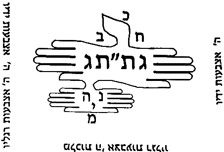

> בענין צורת הספירות ר"ל סדר עמידתן רבו בו הדעות וציירו להם המקובלים צורות ביריעות גדולות וקראום אילן. יש שרצה לציירם בצורת א' כיצד חלקו הראש לג' חלקים הא' לכ"ע וצד ימין של ראש א' חכמה והשמאלי בינה. והקו אשר למטה מהיו"ד שהוא וא"ו של אלף קרא ראשו הימין חסד וראשו השמאלי גבורה ואמצעי ת"ת. וממראה מתניו ולמטה מה שכנגד הימין נצח ומה שכנגד השמאל הוד ומה שבין שניהם יסוד ועוקץ התחתון מלכות וזו צורתה.

**6:1:5** Behold, they intended to depict the figure of the supernal Man in the figure of an alef, to hint that the whole of it is a perfect union: although we say "ten Sefirot"—which indicates separate things—the whole of it is a perfect union, and this he indicated by the likeness of an alef. And there is some support for this view in the words of Rashbi in Sefer ha-Tikkunim (Tikkun 55), and these are his words: "Come and see: this skull is [the letter] alef, like this; it has four sides, [and] in them YHVH is one and His name is one—there is none else besides Him," etc. Thus far [his words].

> הנה כוונו לכתוב צורות האדם העליון בצורת אלף לרמוז כי כלו יחוד שלם. אע"פ שנאמר י"ס שהוא מורה דברים מחולקים כלו הוא יחוד שלם וזה הורה בדמות אלף. ויש קצת סמך לדעת זה בדברי הרשב"י בס' התיקונים (תקון נה) וז"ל תא חזי קרקפתא דא א כגוונא דא, ד' סטרין דיליה בהון ידו"ד הוא חד ושמיה חד אין עוד מלבדו כו' עכ"ל.

**6:1:6** And although his words and his figure are not exactly as above,  

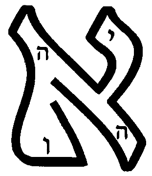

> ואע"פ שאין דבריו וציורו ממש כנ"ל,

**6:1:7** nonetheless, from it [it] appears that the intent of the Name—which is ten Sefirot, as is known—is hinted at in the figure of the alef, to hint at ten Sefirot unified [in] a perfect unity, an equal unity. And this is what it says, "in them YHVH is one and His name is one"—the meaning [being] to indicate that He and His name are unified, although His name indicates ten Sefirot. And behold, the existence of the alef indicates the union.

> אעפ"כ מתוכו נראה כי כוונת השם שהוא י' ספירות כנודע, נרמז בצורת האלף לרמוז אל י"ס מיוחדים אחדות שלימה אחדות שוה. וז"ש בהון ה' הוא חד ושמיה חד פי' להורות שמתייחד הוא ושמו עם היות ששמו מורה י"ס. והנה מציאות הא' מורה על היחוד.

**6:1:8** And the matter of the ten digits and the ten digits—its place is not here, and it will be explained in the Gate of the Soul, chapter 8. And others depicted the figure of the ten Sefirot in the figure of an alef, like this:  

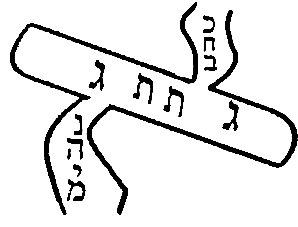

> וענין י' אצבעות וי' אצבעות אין מקומו הנה ויתבאר בשער הנשמה פ"ח. ואחרים ציירו צורת י' ספי' בצורת אלף כזה.

**6:1:9** And it is true that the first figure is the most acceptable, for it is close to the tradition [Kabbalah] in the hand of most of the Kabbalists, as we shall explain. And the intent of these Kabbalists is not to say that this is literally the secret of their standing—for in this figure there are no channels, nor right and left intrinsically (that is to say, Chesed and Din)—but rather their intent is to indicate the complete union: just as the alef means "one," so the ten Sefirot are a perfect unity. And he further intended by this to make the figure of a patach at its [upper] thorn, above Keter, to hint that Keter is not a first cause, God forbid, but [that] above it [is] the sole Lord who rules over all of them and emanates effluence upon them; and one patach below, at Malkhut, to hint that the intent of all this is for the governance of the lower ones, and that it [Malkhut] is a passage for the effluence emanated from the First Cause to His created entities, as we have explained in the preceding gates. Further, another figure Rabbi Moshe de León wrote in the Sefer ha-Shem that he composed, and he said that it depends on the view of Sefer ha-Bahir; and some Kabbalists followed this way, and in particular because they wished to rely on it [to support] the matter of "their end is embedded in their beginning"—for the end, which is Malkhut, is embedded in the beginning, which is Keter. And its figure is like this:  

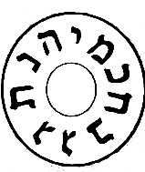

> והן אמת כי הצורה הא' היא היותר מתקבלת כי היא קרובה אל הקבלה אשר ביד רוב המקובלים כאשר נבאר. ואין כוונת המקובלים האלה לומר שזה ממש סוד עמידתן כי במציאות הצורה הזו לא צנורות ולא ימין ושמאל בעצם (ר"ל חסד ודין). אלא כוונתם להורות על היחוד הגמור כמו שהאלף פי' אחד כן הי"ס הן אחדות שלימה. וכיון עוד בזה לעשות צורת הפתח בעוקצה למעלה מן הכתר לרמוז כי אין הכתר סבה ראשונה ח"ו אלא עליו אדון יחיד המושל בכלן ומשפיע עליהם שפע. ופתח אחד למטה במלכות לרמוז כי כוונת כל זה להנהגת התחתונים והוא מעבר אל השפע הנשפע מהסבה ראשונה אל ברואיו כאשר בארנו בשערים הקודמים. עוד צורה אחרת כתבה ר' משה דליאון בספר השם שחבר ואמר שהיא תלויה בדעת ספר הבהיר. וקצת מקובלים דרכו דרך זה ובפרט כי רצו להסמך בו על ענין נעוץ סופן בתחלתן כי הסוף שהיא המלכות נעוץ בתחילה שהוא הכתר וצורתה כזו.

**6:1:10** And their view concerning this figure, in the matter of "their end is embedded in their beginning," is not settled at all, as the one who delves will see with his intellect; rather, the matter of "their end is embedded in their beginning" is a great secret explained in the Tikkunim in the words of Rashbi, and we shall explain it in the Gate "From Below to Above". Further, there are those who wrote a figure close to the agreement of the Kabbalists, and it is like this:  

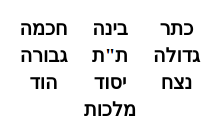

> ואין דעתם בענין צורה הזו בענין נעוץ סופן בתחילתן מתישבת כלל כאשר יראה המעיין בשכלו אלא ענין נעוץ סופן בתחילתן הוא סוד גדול נתבאר בתיקונים בדברי הרשב"י ונבאר אותו בשער ממטה למעלה. עוד יש שכתבו צורה קרובה אל הסכמת מקובלים והיא כזו:

**6:1:11** And Rabbi Moshe de León likewise copied it in the Sefer ha-Shem, and wrote: "And this view does not arise well according to the Kabbalah." But Rabbi Shem Tov ben Rabbi Shem Tov annotated upon it in the margin, [and] these are his words: "In my humble opinion, this view does not conflict with the other views, and it is very deep. And he counted ten Sefirot from the known Keter, whose name is like the name of its master—it is the supernal Keter, the sole Lord; and this is called in Sefer Yetzirah 'He sealed the height' (with yod) [with YHV], and it is called Keter like it, for it encompasses all the Sefirot. And this is the secret of Thought emanated from the supernal Keter—[namely] Chokhmah, that is to say, the more revealed [one]; and it, by the power of the Ein Sof, brings forth the actions, [so as] to act in the likeness of the female, [and] therefore it is on the left. And Binah is called thus [because] she is between the two; in the secret of the Da'at hidden in her [which] is the emanation of the known Keter, in the secret of [the] supernal Keter. And this is the secret of the three names that the Name revealed to Moses at the bush; and the second, in the second name, is entirely the likeness of the female. Concerning this [there is] a very deep secret." Thus far [his words].

> והעתיקה ג"כ רבי משה דיליאון בספר השם וכתב ואין הדעת הזה עולה יפה ע"ד הקבלה אבל ה"ר שם טוב בן ר' שם טוב הגיה עליו בגליון ז"ל לענ"ד אין הדעת הזאת עם הדעות אחרות חולק והוא עמוק מאד ומנה ע"ס מכתר הידוע ששמו כשם רבו הוא הכ"ע אדון יחיד וזה נקרא בס' יצירה חתם רום (ביו"ד) [ביה"ו] ונקרא כתר כמוהו כי הוא המקיף אל כל הספירות וזהו סוד המחשבה הנאצלת מכ"ע החכמה כלומר היותר נגלית והיא בכח הא"ס מוציאה הפעולות לפעול דמיון הנקבה לכן היא בשמאל והבינה נקרא כן שהיא בין שניהם בסוד הדעת הגנוז בה הוא אצילות כתר הידוע בסוד כ"ע וזהו סוד ג' שמות שגילה השם למשה בסנה והשני' בשם שני הוא הכל דמיון הנקבה על זה סוד עמוק מאוד עכ"ל.

**6:1:12** And behold, he intended to give a reason for Binah's being in the middle, [and] for Chokhmah's being on the left. And the beginning of his words may be understood somewhat by the reasoning of the view that is his, which we wrote in the Gate of Whether the Ein Sof is the Keter, chapter 3. But in truth, [to engage in] length concerning this reasoning—that Chokhmah is on the left, and Keter on the right, and Binah in the middle—is a vain exercise, for it is a strange and rejected reasoning; for they hold that Chokhmah is Din, and Binah tips the balance between Chokhmah and Keter. And this view is null, as we shall expound at length in the Gate of Essence and Governance, chapter 5. And the correct view, the received [one], agreed upon in the mouth of all the Kabbalists, is this; and Rabbi Moshe de León wrote it in the Sefer ha-Shem, [and] these are his words: "And there is another view, comely and very acceptable, surpassing them all, and it is true: that the three upper ones are like a segolta." And it is this:  

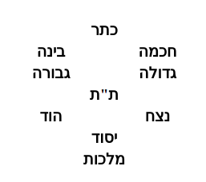

> והנה כיון לתת טעם לבינה שהיא בנתים לחכמה שהיא בשמאל. ותחלת דבריו יובנו קצת בסברת הדעת אשר לו אשר כתבנו בשער אם הא"ס הוא הכתר פ"ג. ולפי האמת אריכות בענין הסברא הזאת שחכמה אל השמאל וכתר אל הימין ובינה היא באמצע הוא פועל בטל כי הוא סברא זרה ודחיה כי סבירא להו שחכמה היא דין ובינה מכרעת בין החכמה והכתר. והדעת זה בטל כמו שנאריך בשער מהות והנהגה בפרק ה'. והדעת הנכונה והמקובלת המוסכמת בפי כל המקובלים היא זו וכתבה ר' משה דיליאון בספר השם וז"ל ויש דעת אחרת נאה ומקובלת מאוד עולה על כולנה והיא אמת שג' עליונות כעין סגולתא והוא זאת.

**6:1:13** And [these are] the gracious words of a wise man, for it is fine sifted flour. And this way was adopted by Rabbi Yehudah Chayyat in his book, and he gave a sign for the matter: "segolta, segol, segol"—for the three first ones [are] a segolta, the three second ones a segol, and the three third ones a segol, and Malkhut receives from all of them, below all of them. However, concerning Malkhut he wrote things that are forbidden to hear—and may his Master forgive him. And this figure is likewise agreed upon and necessitated from the words of Rashbi in many places. And in the interpretation of the points [vowels] he holds that the three first ones are a segolta, the segolta's hint being among them; and likewise he holds that the segol [signifies] the three patriarchs, and at times he holds that they are Netzach-Hod-Yesod [NHY]—[which] indicates that this view is agreed upon and necessitated. He further explained, in another place—and it is a great proof for this view—[and] these are his words, in Sefer Ra'aya Mehemna (Beha'alotekha, folio 153): "And Chokhmah, Chesed, [and] Netzach shall be on the right, for on their account David said, 'The right hand of YHVH does valiantly, the right hand of YHVH is exalted, the right hand of YHVH does valiantly.' And three on the left shall be bound together, which are Binah, Gevurah, [and] Hod. And three grades of the middle—Keter, Tiferet, [and] Yesod—which bind [the] right and [the] left." Thus far [his words].

> ודפח"ח כי היא סלת נקיה. והדרך הזה תפס ר' יהודא חייטי בספרו ונתן סימן לדבר סגולתא סגול. סגול. כי ג' ראשונות סגולתא, וג' שניות סגול, וג' שלישית סגול, ומלכות מקבלת מכלן למטה מכלן. אמנם כתב בענין המלכות דברים שאסור לשומען ושרי ליה מאריה. וכן מוסכם ומוכרח הצורה הזאת מתוך דברי הרשב"י במקומות רבים. ובפירוש הנקודות סבירא ליה כי ג' ראשונות הם סגולתא וסגולתא הרמז שלה בהם וכן סבירא ליה שסגול הם ג' אבות ולעתים ס"ל שהם נה"י מורה היות הדעת הזה מוסכם ומוכרח. עוד פי' במ"א והוא הכרח גדול להדעת הזה וז"ל בס' רעיא מהימנא (בהעלותך דף קנ"ג) ויהון חכמה חסד נצח לימין דבגינייהו אמר דוד ימין ה' עשה חיל ימין ה' רוממה ימין ה' עושה חיל. ותלת משמאלא יתקשרון כחדא דאינון בינה גבורה הוד. ותלת דרגין דאמצעיתא כתר ת"ת יסוד, דאחדין בימינא ושמאלא עכ"ל.

**6:1:14** Behold, he explained explicitly that Chokhmah, Chesed, [and] Netzach are on the right, and Binah, Gevurah, [and Hod] are on the left, and Keter, Tiferet, [and] Yesod [are] in the middle. And according to their order known to us, it is necessitated that they be in the manner that we depicted above. And the being of Malkhut beneath Yesod is necessitated, for she receives from him, and he is the "best man" between her and her husband, and it is necessitated that she be beneath him.

> הנה ביאר בפי' כי חכמה חסד נצח הם אל הימין, ובינה גבורה הוא אל השמאל, וכתר ת"ת יסוד באמצע. ולפי סדורם הידוע אצלינו הוכרח היותם על הדרך שציירנו למעלה. והיות המלכות תחת היסוד הוא מוכרח, כי היא מקבלת ממנו, והוא השושבין בינה ובין בעלה, והוכרח היותה תחתיו.

**6:1:15** And further, [it is necessitated] because she is the gate of entry, as is necessitated from the words of Rashbi, peace be upon him, [in] places too many to number. This matter was further explained in the Tikkunim (in Tikkunei Zohar Chadash, folio 112), [and] these are its words: "And the nine Sefirot are arranged in threes upon the central pillar, like this: Chokhmah-Chesed-Netzach, Keter-Tiferet-Yesod, Binah-Gevurah-Hod; Malkhut is the tenth to them and the fourth to them." Thus far [its words].

> ועוד כי היא פתח הכניסה כאשר הוכרח מתוך דברי הרשב"י ע"ה מקומות רבו מספר. עוד נתבאר הענין הזה בתקונים (בתז"ח דף קי"ב) וז"ל ותשע ספירות אינון משולשין בעמודא דאמציעותא כגוונא דא. חכמה חסד נצח, כתר תפארת יסוד, בינה גבורה הוד, מלכות עשירית לון ורביעית לון עכ"ל.

**6:1:16** And the intent is clear: that the Sefirot are arranged three [by] three. And once we have known this matter, of necessity their order is: Keter, Tiferet, Yesod in the middle—because Tiferet and Yesod are intermediaries and arbiters between Din and mercy, as we shall explain in the Gate of Arbiters. And therefore their depiction in this figure that we depicted above was required. It was further explained in the Tikkunim (Tikkun 69, folio 101b), [and] these are its words: "Keter over Chokhmah and Binah is a segolta—a cholam over a tzeirei. A segol is a dot beneath the tzeirei. Chesed, Gevurah, Tiferet below. Netzach, Hod, Yesod in the middle is a shuruk; and so, when Tiferet is in the middle, it is a shalshelet." Thus far [its words], for our matter.

> והכוונה מבוארת כי הספירות מסודרות ג' ג'. ואחר שידענו הענין הזה. בהכרח סדרם הוא כתר ת"ת יסוד באמצע. מפני כי הת"ת והיסוד הם ממוצעים ומכריעים בין הדין והרחמים, כמו שנבאר בשער המכריעין. ולכן הוצרך ציורם בצורה הזאת שציירנו לעיל. עוד נתבאר בתיקונים (תקונא ס"ט דף ק"א ע"ב) וז"ל כתר על חכמה ובינה איהו סגולתא חולם על צר"י. סגול איהו נקודה תחות צר"י. חסד גבורה תפארת לתתא. נצח הוד יסוד באמצעיתא איהו שרק והכי כד תפארת באמצעיתא איהו שלשלת. עכ"ל לעניינו.

**6:1:17** And behold, he said that Keter [is] over Chokhmah and Binah in the figure of a segolta. And he said that Tiferet [is] below Gedulah and Gevurah, and this is a segol. [It is] true that at times it [Tiferet] will be exactly between Gedulah and Gevurah, and then it will be in the figure of a shalshelet—and this is what it says, "when Tiferet is in the middle, it is a shalshelet." And likewise Yesod [is] between Netzach and Hod, and they are a shuruk, which are three dots in one row—although they are not diagonal, as is its norm. Thus far. Thus, from these passages, the figure that most of the commentators depicted for the Sefirot is necessitated; and it is a correct reasoning, and there is no doubt in it.

> והנה אמר כי כתר על חכמה ובינה בצורת סגולתא. ואמר כי תפארת למטה מגדולה וגבורה והיינו סגול. אמת כי לעתים תהיה ממש בין גדולה וגבורה ואז תהיה בצורת שלשלת. וז"ש כד תפארת באמצעיתא איהו שלשלת. וכן יסוד בין הנצח וההוד והם שרק, שהם ג' נקודות בשורה אחת, עם היות שאינם באלכסון כמשפטו, ע"כ. הרי מתוך המאמרים האלה הוכרח הצורה שציירו רוב המפרשים בספירות והיא סברא נכונה ואין בה ספק:

### Chapter 6:2. Explanation of the author of *Me'irat Einayim*, who reverses the views for us, and our objection to him.

**6:2:1** After we have stood, in the preceding chapter, to set up the matter of the Emanation in the figure upon which all the Kabbalists, or most of them, have agreed, and we have necessitated it by means of some passages from the words of Rashbi, peace be upon him, in the Tikkunim—we have seen [fit] to copy here the reasoning of the author of Me'irat Einayim, [showing] that from these passages there is a refutation of his words, [for] he is opposed to all the Kabbalists. And these are his words, in [the] portion [of] Terumah. First he wrote, in the name of Rabbi Shem Tov, one figure, and it accords with the agreed-upon figure and does not conflict with the figure that we necessitated in the preceding chapter, except in the three first ones; and this is its figure:  

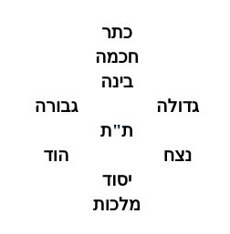

> אחר שבפרק הקודם עמדנו להציב ענין האצילות בצורה שהסכימו בה כל המקובלים או רובם והכרחנו אותו במקצת מאמרים מדברי הרשב"י ע"ה בתקונים. ראינו להעתיק הנה סברת בעל מאירת עינים שיש מתוך המאמרים האלה הריסה אל דבריו והוא מנגד אל כל המקובלים וז"ל בפרשת תרומה. ראשונה כתב בשם ר' שם טוב צורה אחת והיא עם הצורה המוסכמת צודקת ואינה חולקת על הצורה שהכרחנו בפרק הקודם אלא בשלש ראשונות וזו צורתה.

**6:2:2** And although the order of these three first ones is the reasoning of the author of Me'irat Einayim and the view of Rabbi Todros ha-Levi in Sefer ha-Ma'arekhet—and Rabbi Moshe de León likewise wrote something of this reasoning—

> ועם היות סדר ג' ראשונות אלו הוא סברת בעל מאירת עינים ודעת רבי טודרוס הלוי בספר המערכ' וכן כתב קצת מזאת הסברא רבי משה דיליאון.

**6:2:3** Behold, from the passages that we necessitated in the preceding figure, in the preceding chapter, there is found an explicit refutation of their words, and there is no need to be lengthy. He further wrote in Sefer Me'irat Einayim, in the aforementioned portion, [and] these are his words: "Behold, I depict for you the figure of the ten Sefirot in their correct, true positioning, for [the one] to whom the Name, may He be blessed, has given eyes to see and a heart to understand; and I have not seen one in a thousand among all the Kabbalists who perceived this matter, apart from my teacher, from whom I received [it]." And this is it:  

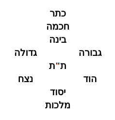

> הנה מתוך המאמרים שהכרחנו בצורה הקודמת בפרק הקודם נמצא הריסה אל דבריהם בפירוש ואין צריך להאריך. עוד כתב בספר מאירת עינים בפרשה הנז' וז"ל הנני מצייר לך צורת עשר ספי' בהעמדתן הנכונה האמיתית לאשר נתן השם ית' עינים לראות ולב להבין ולא ראיתי אחד מן אלף בכל המקובלים שהרגיש בענין זה מבלעדי מורי שקבלתי ממנו וזו היא.

**6:2:4** And whoever says of this form that it is reversed—he is of a perverse generation; and if the speaker's intent is good, his mind is reversed. He seeks to see the hinder parts, whereas we [see] the face, for it is said, "I have set YHVH always before me," etc. And although the Sefirot are nothing but holy spirit—spiritual thoughts, unified one to another [in] a true union, and all unified in the Ein Sof, in [literally] the Ein Sof—and above there is neither right nor left, but rather these incline rightward, to acquittal, and therefore [the right] is called right and mercy, and these incline leftward, to liability, and therefore [the left] is called left and Din—nonetheless, behold, David, peace be upon him, said, "I have set YHVH always before me," etc. (Psalms 16:8). And over and above all this, our Sages of blessed memory said (Yoma, folio 53): when a person takes three steps [back], he gives "peace" to his left first, because the Shekhinah is opposite him; and thus he bows to the right of the Shekhinah, and afterward gives "peace" to his right, which is the left of the Shekhinah. Thus far [his words].

> וכל האומר על התבני' הזאת שהיא מהופכת, דור תהפוכות הוא. ואם כונת האומר טובה, שכלו מהופך הוא. מבקש לראות אחוריים, ואנחנו הפנים שנאמר שויתי ה' לנגדי תמיד וגו'. ואעפ"י שאין הספירות אלא רוח הקדש מחשבות רוחניות מיוחדות זו לזו יחוד אמתי. והכל מיוחד באין סוף, לא"ס. ואין למעלה לא ימין ולא שמאל. אלא שאלו מיימינים לזכות, ולפיכך נקרא ימין ורחמים. ואלו משמאילים לחובה, ולכך נקרא שמאל ודין. מ"מ הרי דהמע"ה אמר שויתי ה' לנגדי תמיד וגו' (תהלים טז ח). ועל כל זאת אחז"ל (יומא דף נ"ג) כשאדם פוסע שלש פסיעות יתן שלום לשמאלו תחלה מפני ששכינה כנגדו והכי הוא משתחוה לימינו של שכינה ואח"כ נותן שלום לימינו שהוא שמאלו של שכינה עכ"ל.

**6:2:5** And we have several responses to him. First, regarding what he said—that he [the opponent] seeks to see the hinder parts, whereas we [see] the face: even according to him there is no substance in this reasoning, for so it is fitting not to gaze upon the face, as it is written (Exodus 33:23), "and you shall see My back, but My face shall not be seen." And even [as for] the hinder parts—how many "hinder parts of hinder parts" are [the ones] that are seen!—all the more so [is it not fitting] to gaze upon the awesome face (see in Tikkun 69, folio 111, in what was said concerning "you shall not be able to see My face"). And this is the opposite of the correct view.

> ויש לנו עליו כמה תשובות. ראשונה במה שאמר הוא מבקש לראות האחוריים ואנחנו הפנים. אפילו לדידיה אין בטעם זה ממש כי כן ראוי שלא להביט בפנים כדכתיב (שמות לג כג) וראית את אחורי ופני לא יראו. ואפילו האחוריים כמה אחוריים לאחוריים הנראים כ"ש להביט בפנים הנוראים (ע' בתקונא סט דקי"א במ"ש על לא תוכל לראות את פני). וזהו הפך הדעת הנכון.

**6:2:6** And further, [the truth is] that the matter is the opposite of his view, for the face is in this order: right opposite right, and left opposite left. And [there is] a proof from the matter of the tefillin: for the first portion, Kadesh—which is Chokhmah—is at the right of the reader and the left of the one laying [the tefillin]; and the portion Ve-haya im shamoa—which is Gevurah—is at the right of the one laying [them] and the left of the reader. But according to his view it should be the opposite, for the one laying [them] lays [them] right opposite right and left opposite left, and the reader, who is opposite him, would have the left toward the right and the right toward the left. And there is no [valid] response from [the fact that] Ve-haya ki yevi'akha—which is Binah—and Shema—which is Gedulah—are in [direct] correspondence: Shema, Gedulah, at the right of the one laying [them], and Ve-haya ki yevi'akha at his left. This is no response at all; for, on the contrary, Chokhmah and Gevurah are the principal [proof] for this matter, for several reasons: for it is fitting to arrange Chokhmah to the right, since it is the rightmost, the head of all the Sefirot, and Gevurah [is] the principal leftmost, [tending] to liability. And why should we reverse these, which are principal, on account of two [others] that are [only] the root of the right and the left?

> ועוד כי הענין הוא הפך דעתו [ז] כי הפנים הם בסדר הזה ימין כנגד ימין ושמאל כנגד שמאל. וראיה מענין דתפילין כי פרשה ראשונה קדש והיא חכמה לימין הקורא ולשמאל המניח, ופרשת והיה אם שמוע שהיא גבורה לימין המניח ולשמאל הקורא. ולפי דעתו היה ראוי להיות בהפך כי המניח מניח ימין כנגד ימין ושמאל כנגד שמאל והקורא שהוא כנגדו יהיה שמאל לימין וימין לשמאל. ואין תשובה מן והיה כי יביאך שהוא הבינה ושמע שהוא הגדולה הם ביושר שמע גדולה לימין המניח והיה כי יביאך לשמאל המניח. זו אינה תשובה כלל, שאדרבה החכמה והגבורה הם עיקר אל הענין הזה מפני כמה דברים. כי מן הראוי לסדר חכמה אל הימין מפני שהוא ימינית ראש לכל הספירות, וגבורה עיקר השמאלית לחובה. ולמה לנו להפך אלו שהם עיקר מפני שנים שאינם [אלא] שורש הימין והשמאל.

**6:2:7** And further, [the proof holds] because Shema, too, [is] at the right of the reader in the aspect of Ve-haya im shamoa; and likewise Ve-haya ki yevi'akha [is] at the left of the reader in the aspect of Kadesh. And this is a compelling proof—what it is impossible to say of Kadesh and Ve-haya im shamoa—that, with respect to the aspect of all of them, Kadesh is always at the left of the one laying [them] and the right of the reader, and Ve-haya im shamoa at the right of the one laying [them] and the left of the reader. And this is certainly a refutation of the words of the author of Sefer Me'irat Einayim.

> ועוד כי שמע נמי אל הימין הקורא בבחי' והיה אם שמוע וכן והיה כי יביאך אל שמאל הקורא בבחינת קדש. וזו ראיה מוכרחת מה שא"א לומר בקדש והיה אם שמוע, שבבחינת כלם לעולם קדש לשמאל המניח וימין הקורא, והיה אם שמוע לימין המניח ושמאל הקורא. וזה ודאי הריסה אל דברי בעל ספר מאירת עינים.

**6:2:8** And [there is] a further proof from the ascent of the altar, for there [is] the foundation of the union, as Rashbi, peace be upon him, explained in the Zohar (Bamidbar, folio 120); and we have copied [its] language in the Gate of Self and Vessels, chapter 1, and in the Gate of Essence and Governance, chapter 21.

> ועוד ראייה מעליית המזבח כי שם יסוד היחוד, כמו שפי' הרשב"י ע"ה בזוהר (במדבר דף ק"ך), והעתקנו ל' בשער עצמות וכלים בפ"א, ובשער מהות והנהגה פכ"א.

**6:2:9** And behold, the ascent of it [the altar] was by the ramp, and the ramp was on the south of the altar; and when [the priest] was ascending, he would turn to the southeast corner, which is the right of the one ascending. And were it true as the words of Sefer Me'irat Einayim, it would be fitting that he turn to his left, for there [would be] the right opposite him; and it would be fitting that the ramp be on the north of the altar, so that in his ascent by the ramp he would turn to the left of the one ascending—that is, the right that is opposite [him]—and turn to the northeast corner, in this order, etc. Rather, what have you to say? That [as for] this figure, there is no doubt that it is reversed, and the true figure is the figure agreed upon in the words of Rashbi, peace be upon him, [namely] that the right [corresponds] to the right and the left to the left. And therefore they expounded, "every turn that you turn shall be only to the right"—and this is the actual right of a person, [such] that "a left opposite him" and "a right opposite him" have no place there. And likewise they expounded concerning Abraham our father, peace be upon him, that all his turnings were to [the side of] Chesed. A further response to what he wished to derive support [for] from the verse "I have set YHVH always before me": it is no proof, for David, peace be upon him, would say so on account of the fear of the Name [being] before his face all the day, and he would think as if the Shekhinah were opposite him perpetually, and he [were] like a servant before the King, so as not to waver from his service, neither little nor much. And [as for] what he wished to derive support [for] from the matter of the three steps—shall we, then, set aside all the rest of the matters of the [Temple] service and bring a proof from a single detail, [namely] the matter of the steps?

> והנה עלייתו היה בכבש והכבש היה בדרומו של מזבח ובהיותו עולה היה פונה לקרן דרומית מזרחית שהוא ימינו של העולה, ואם אמת כדברי ספר מאירת עינים היה ראוי שיפנה על שמאלו כי שם ימין כנגדו, והיה ראוי שיהיה הכבש בצפון המזבח כדי שבעלייתו בכבש יפנה אל שמאל העולה דהיינו ימין שכנגדו ויפנה לקרן צפונית מזרחית כסדר הזה וכו'. אלא מאי אית לך למימר כי הצורה הזאת אין בו ספק שהיא מהופכת והצורה האמיתית היא הצורה המוסכמת בדברי הרשב"י ע"ה שהוא ימין אל הימין ושמאל אל השמאל [ח]. ולכן דרשו כל פנות שאתה פונה לא יהא אלא לימין וזה ימינו של אדם ממש דלא שייך תמן שמאל שכנגדו ולא ימין שכנגדו. וכן דרשו באאע"ה שכל פנותיו היה אל החסד. עוד תשובה אל מה שרצה להסתייע מפסוק שויתי ה' לנגדי תמיד אינו ראייה כי דהמע"ה היה אומר כך משום יראת השם נגד פניו כל היום והיה חושב כאלו שכינה כנגדו לעולם והוא כעבד לפני המלך לבלתי יתמוטט מעבודתו לא מעט ולא הרבה. ומה שרצה להסתייע מענין ג' פסיעות וכי נניח כל שאר ענייני המעשה ונביא ראיה מפרטי אחד והוא ענין הפסיעות.

**6:2:10** Furthermore, there is no proof at all; for [though] you raise an objection against me from the view of Rava, who said "his right" [means] the right of the Holy One, blessed be He, [and] "his left" the left of the Holy One, blessed be He—I [can] support myself from the view of Abaye, who reckoned "his right" [as] his own right and "his left" his own left literally, [so as] to reckon that the matter of the steps is like the intent of the other commandments and deeds. Until Rava taught him that the meaning of "his right" is, that is to say, the right of the Holy One, blessed be He, [and] "his left" the left of the Holy One, blessed be He—the opposite of the other things. And the reason is that now, when one comes to take leave, he comes to teach a person not to think that his words are for naught and in vain, God forbid, but rather that he should be assured that his words were heard—like a person who speaks with the King in the inner chamber and takes leave of the King in peace and love. Or it is possible [that it is] to show a person his faith: that even though he unified the supernal worlds by the "hinder parts" that are seen, nonetheless the Holy One, blessed be He, hearkened to him by the "awesome face." Therefore, when he comes to take leave, he gives peace to the right of the Holy One, blessed be He, which is his [own] left. And in this manner we can explain the verse "I have set YHVH always before me," etc. Or it is possible that we should say that the matter of the peace[-giving] in this is for the [angel] who receives the prayer and makes it into crowns for his Master—even though he said "the right of the Holy One" and "his left." So too they said (in tractate Berakhot, fol. 7): Rabbi Ishmael said, "I saw Aktariel Yah YHVH Tzeva'ot," etc.—and he is the one who receives the prayers, and he is not the King of Glory; for if so, he would not have said "I saw" literally, God forbid. And as is known, Aktariel is a prince on high and not a god. And nevertheless there is no difficulty [in] his saying "Yah YHVH Tzeva'ot," for the angels are called by the name of their Master, by the Glory that hovers over them. And so it says concerning Abraham (Genesis 18:3), "And he said, my Lord [Adonai], do not pass on," and the Sages, of blessed memory, explained that he said [it] to the greatest of them—and the intent is the Glory that hovers over and clothes itself in them, which is the Shekhinah. And so [it is] in the matter of Aktariel, for concerning the Glory that clothes itself in him it says "Yah YHVH Tzeva'ot." And so [it is] in the matter of "He who makes peace," that he gives peace to the right opposite him and to the left opposite him because the Glory hovers over him and clothes itself in him; and there a literal left and a literal right apply. And this secret depends on the knowledge of the matter of the angels; it will be explained in the Gate of the Palaces.

> ועוד כי אין ראייה כלל דאדמותבת לי מסברת רבא דאמר ימינו ימינו של הקב"ה שמאלו שמאלו של הקב"ה, תסייעי לי מסברת אביי דהוה חשיב ימינו ימין דידיה ושמאל שמאל דידיה ממש לחושבו כי ענין הפסיעות ככוונת שאר המצות והמעשים. עד שרבא הורה לו כי פי' ימינו ר"ל ימינו של הקב"ה שמאלו שמאל של הקב"ה הפך שאר הדברים. והטעם כי עתה שבא להפטר בא להורות לאדם שלא יחשוב היות דבריו לריק ולבטלה ח"ו אלא שיהיה מובטח שנשמעו דבריו כאדם המדבר עם המלך החדרה ונפטר מהמלך בשלום ואהבה. או אפשר להראות האדם אמונתו שאעפ"י שייחד העולמות העליונים באחורים הנראים עכ"ז הקב"ה הקשיב לו בפנים הנוראים. לפיכך כשבא ליפטר נותן שלום לימינו של הקב"ה שהוא שמאלו. ועד"ז נוכל לפרש פסוק שויתי ה' לנגדי תמיד וגו'. או אפשר שנאמר כי ענין השלום בזה הוא למקבל התפלה ועושה אותה כתרים לרבו עם היות שאמר ימינו של הקב"ה ושמאלו של הקב"ה. כך ג"כ אמרו (במס' ברכות ד"ז) א"ר ישמעאל ראיתי את אכתריא"ל י"ה ידו"ד צבאות וכו' והוא הוא המקבל התפלות ואינו מלך הכבוד, שא"כ לא היה אומר ראיתי ממש ח"ו. וכמו שהוא ידוע כי אכתריא"ל הוא שר במרום ולא אלוה. ועם כל זאת אין דוחק אמרו י"ה ידוד צבאות, כי המלאכים נקראים בשם רבם בשם הכבוד החופף עליהם. וכן הוא אומר באברהם (בראשית יח ג) ויאמר אדני אל תעבור, ופירשו חז"ל לגדול שבהם אמר, והכוונה הכבוד החופף ומתלבש בהם שהיא השכינה. וכן בענין אכת"ריא"ל כי על הכבוד המתלבש בו נאמר י"ה ידו"ד צבאות. וכן בענין עושה שלום שנותן שלום לימין שכנגדו ולשמאל שכנגדו מפני שהכבוד חופף עליו ומתלבש בו. ושם שייך שמאל ממש וימין ממש. וסוד זה תלוי בידיעה ענין המלאכים יתבאר בשער ההיכלות [ט].

**6:2:11** Furthermore, another response, namely: in that it is well known that man—his forms, his structure, his limbs, his arteries, and his sinews—is the likeness of a supernal reflection. And man is a supernal shadow that became corporealized and thickened in this world, and he is the likeness of a supernal reflection appearing in this world. If so, it is fitting that his right [correspond] to the right of the supernal things and his left to the left of the supernal things—like the matter of the shadow, whose right is opposite the right of its root. And this matter is a root and a fundamental principle in faith and in piety.

> ועוד תשובה אחרת והוא במה שמפורסם היות האדם צורותיו ותכונתו ואבריו ועורקיו וגידיו דמות בבואה עליונה. והאדם הוא צל עליון שנתגשם ונתעבה בעה"ז והוא דמות בבואה עליונה הנראה בעולם הזה. א"כ מן הראוי שיהיה ימינו לימין הדברים העליונים ושמאלו לשמאל דברים העליונים כענין הצל שהוא ימינא נגד הימין שרשו. והענין הוא שרש ועיקר באמונה והחסידות.

**6:2:12** Furthermore, that in truth there is above neither right nor left, but all is right and all is left. And a great proof [is] from the matter of the Tablets, which were one of the supernal branches whose spirituality became corporealized and thickened for the honor of Israel; and the Sages, of blessed memory, testified concerning them (Shekalim, fol. 16) that the Ten Commandments were visible in them from every side and from every direction and from every corner. And if in [something] corporealized [it is] so—that there is in it neither right nor left, but all is right and all is left—how much more so, and a fortiori, in the subtlety of the spiritual that is elevated above every cause, may it be praised and exalted. And if we decree right and left, it is in the aspect of merit and liability, as in the matter of what they said, "these incline to the left, to liability, and these incline to the right, to merit." And it is known that the matter of merit and liability is in our terms, not in the terms of the spiritual [realm]—rather in the terms of its actions toward its created entities. If so, His right is our right and His left is our left, and there is no distinction between this and that.

> ועוד כי לפי האמת אין למעלה לא ימין ולא שמאל והכל ימין והכל שמאל. וראייה גדולה מענין הלוחות שהיו אחד מהענפים העליונים שנתגשם הרוחניות ונתעבה לכבודן של ישראל, והעידו עליהם רז"ל (שקלים דף ט"ז) כי עשרת הדברות נראות בהם מכל צד ומכל עבר ומכל פנה. ואם במתגשם כך שאין בו לא ימין ולא שמאל אלא הכל ימין והכל שמאל, כל שכן וק"ו בדקות הרוחני המתעלה על כל עילה ישתבח ויתעלה. ואם אנו גוזרים ימין ושמאל הוא בבחינת הזכות והחובה כענין שאמרו אלו משמאילים לחובה ואלו מיימינים לזכות. וידוע כי ענין הזכות והחובה הוא בערכנו לא בערך הרוחניות אלא בערך פעולותיו אל נבראיו, אם כן ימינו הוא ימיננו ושמאלו הוא שמאלנו ואין חלוק בין זה לזה.

**6:2:13** And the matter of the steps is according to one of the ways we explained. And we find ourselves learning that the principal, correct figure in this is according to what we drew in the previous chapter and established from the views of Rashbi, peace be upon him: three to the right, three to the left, three in the middle, and Malkhut receiving from them all. This is what emerges from the words of most of the Kabbalists. And there is yet [another] vision, and we shall explain it in the coming chapters, with the help of the Rock and His salvation.

> וענין הפסיעות הוא על אחד מן הדרכים שפירשנו. ונמצאנו למדים שעיקר הצורה הנכונה בזה היא כפי מה שציירנו בפרק הקודם והכרחנו בדעות הרשב"י ע"ה ג' אל הימין ג' אל השמאל ג' באמצע והמלכות מקבלת מכלם. זהו העולה מתוך דברי רוב המקובלים. ויש עוד חזון ונבאר אותו בפרקים הבאים בעזרת הצור וישועתו:

### Chapter 6:3. Explanation of the order of the worlds from the first point to the last; and there the matter of the seven earths from the Zohar is explained.

**6:3:1** After we have occupied ourselves in the previous chapters with the investigation of the figure of the standing of the pure and holy Emanation, and the figure agreed upon in the mouth of all the Kabbalists has emerged by our consensus—it is our wish to disclose to the ear of the discerning, concerning this figure, what its essence and its matter are and what the intent of its depiction is. And before everything, it is necessary to preface: although we say "right" and "left," there is there neither right nor left in their place, [and] neither back nor face. Rather, the matter of the Sefirot is as we shall explain.

> אחרי שנתעסקנו בפרקים הקודמים בחקירת צורת עמידת האצילות הטהור והקדוש, ועלה בהסכמתנו הצורה המוסכמת בפי כל המקובלים. רצוננו לגלות אזן המשכילים בענין הצורה הזו מה מהותה וענינה ומה הכוונה בציורה. וקודם כל דבר צריך להקדים עם היות שאנו אומרים ימין ושמאל אין שם לא ימין ולא שמאל במקומם לא אחור ולא פנים. אמנם ענין הספי' הם כמו שנבאר.

**6:3:2** And behold, it is known that every cause encompasses what it causes, and every cause encompasses its effect, and the effect is encompassed by its cause—just as the point of the earth is in the middle of the firmament, and the firmament surrounds the earth, and the firmament is the cause of all the things that are beneath the heavens, by the will of the Maker; as is well known among the investigators, that the motion of the spheres is the cause of the compounding of the elements. And Rambam, of blessed memory, explained [this] in the fourth [chapter] of Hilkhot Yesodei ha-Torah, and said that the motion of the spheres necessitates the compounding of the elements in the lower world. And likewise the diurnal sphere encompasses all the spheres and is their cause, to the point that it turns them [in] the opposite of their [own] motion—which is from west to east—and it turns them from east to west, by the will of their Maker. And above all, encompassing all, is the sphere of the Intellect. And so [it is] with the ascent of the grades, for each and every one encompasses all the grades that are below it. And this appears [to be] of necessity, and in particular when one examines the chapters of the Account of Creation, he will rejoice and be glad, and the love of this premise of ours will be the more steeped in his heart. And there is a proof for this from the dictum of Resh Lakish (in Chagigah, fol. 12), and these are [the] words: Rabbi Yehudah said, there are two firmaments, for it is said, "Behold, to YHVH your God belong the heavens and the heaven of heavens." Resh Lakish said [there are] seven, and these are they: Vilon, Raki'a, Shechakim, Zevul, Ma'on, Makhon, Aravot. Vilon serves no purpose except [that] it enters at morning and goes out at evening and renews each day the work of creation, for it is said, "who stretches out the heavens like a curtain [dok]." Raki'a—[the firmament] in which are the sun and moon, stars and constellations, fixed [in it], for it is said, "And God set them in the firmament of the heavens." Shechakim—[the firmament] in which millstones stand and grind manna for the righteous, for it is said, "And He commanded the skies [shechakim] above," etc., "and He rained down upon them manna to eat." Zevul—in which are [the heavenly] Jerusalem and the Temple, and an altar is built, and Michael the great prince stands and offers an offering upon it, for it is said, "I have surely built You a house of habitation [zevul], a place for You to dwell in forever." And whence [do we know] that it is called heaven? For it is written, "Look down from heaven and see, from Your holy and glorious habitation [zevul]." Ma'on—in which are companies of ministering angels who recite song by night and are silent by day, for the sake of the honor of Israel, for it is said, "By day YHVH commands His lovingkindness," etc., and what is the reason, etc.—thus far [the passage], to our purpose.

> והנה ידוע כי כל סבה מקיף את מסובבו וכל עילה מקיף את עלולו והעלול מוקף מעילתו, כאשר נקודת הארץ באמצע הרקיע והרקיע סובב את הארץ והרקיע סבת כל הדברים אשר תחת השמים ברצון הקונה, כאשר הוא מפורסם בין החוקרים כי תנועת הגלגלים סבת הרכבת היסודות, וביארו הרמב"ם ז"ל בפ"ד מהלכות יסודי התורה ואמר כי תנועת הגלגלים יחייב הרכבת היסודות בעולם השפל. וכן הגלגל היומי מקיף כל הגלגלים והוא סבתם עד שהוא מחזירם הפך תנועתם שהוא ממערב למזרח והוא מחזירם ממזרח למערב ברצון קוניהם. ועל הכל מקיף את הכל גלגל השכל. וכן מידי עלות המדרגות, כי כל אחד ואחד מקיף את כל המדרגות אשר למטה ממנו. וזה נראה בהכרח ובפרט כשיעיין בפרקי מעשה בראשית ישמח ויגל ויושקע אהבת הקדמתנו זאת יותר בלבבו. ויש לזה ראייה ממאמר דריש לקיש (בחגיגה די"ב) וז"ל אר"י שני רקיעים הן שנאמר הן לה' אלקיך השמים ושמי השמים ריש לקיש אמר שבעה ואלו הן וילון רקיע שחקים זבול מעון מכון ערבות. וילון אינו משמש כלום אלא נכנס שחרית ויוצא ערבית ומחדש בכל יום מעשה בראשית שנאמר הנוטה כדוק שמים. רקיע שבו חמה ולבנה ככבים ומזלות קבועים בו שנאמר ויתן אותם אלקים ברקיע השמים. שחקים שבו רחיים עומדות וטוחנות מן לצדיקים שנאמר ויצו שחקים ממעל וגומר וימטר עליהם מן לאכול. זבול שבו ירושלם ובית המקדש ומזבח בנוי ומיכאל השר הגדול עומד ומקריב עליו קרבן שנאמר בנה בניתי בית זבול לך מכון לשבתך עולמים. ומנא לן דאקרי שמים דכתיב הבט משמים וראה מזבול קדשך ותפארתך. מעון שבו כתות של מלאכי השר' שאומרים שירה בלילה וחשות ביום מפני כבודן של ישראל שנאמר יומם יצוה ה' חסדו ומה טעם וכו'. עכ"ל לעניננו.

**6:3:3** And behold, to say that these seven firmaments are the seven firmaments [i.e., spheres] that the astronomers counted is impossible—for he said that in one of these seven are the sun and moon, stars and constellations; and if these seven firmaments were the seven [spheres] that the astronomers counted, it would have been fitting that he count eight: seven for the seven planets, and one for the constellations. And such is not his intent, for he said that the sun and moon, stars and constellations are in one of the seven firmaments, whose name is Raki'a. And to explain that the Sages, of blessed memory, dispute with the astronomers—holding that the sun and moon, stars and constellations are fixed in a single sphere alone—[that too] is impossible. And therefore the sages of Israel do not dispute with the sages of the [other] nations except [on the question of] whether the sphere is fixed and the constellation revolves, or the constellation is fixed and the sphere revolves; but as to the number of the spheres they do not dispute.

> והנה לומר שהז' רקיעים אלו הם ז' רקיעים שמנו חכמי התכונה א"א שהרי אמר שבאחד משבעה אלו הם חמה ולבנה ככבים ומזלות ואם היו הז' רקיעים אלו שבע רקיעים שמנו חכמי התכונה היה ראוי שימנה שמנה. ז' אל ז' ככבי לכת, וא' למזלות. ולא כן כוונתו שאמר שחמה ולבנה ככבים ומזלות הם באחד מז' רקיעים ששמו רקיע. ולפרש כי רז"ל חולקים עם חכמי התכונה [ס"ל דחמה ולבנה כוכבים ומזלות קבועים בגלגל אחד לבד א"א. וע"כ לא פליגי חכמי ישראל עם חכמי האומות אלא אם גלגל קבוע ומזל חוזר או מזל קבוע וגלגל חוזר אבל במנין הגלגלים לא פליגי.

**6:3:4** Furthermore, the sages of Israel did retract and concede to the sages of the nations that the constellation is fixed and the sphere revolves; but as to the number of the spheres they do not dispute. And since the constellation is fixed and the sphere revolves, a multiplicity of spheres is necessitated according to the number of the constellations, which differ in their courses—and this is compelling. And the correct reason for this is that the totality of all the nine spheres is in one firmament. And likewise all the rest of the firmaments are supernal worlds, and in each one of them are many, many firmaments. And the sages who speak on the matter of the Account of Creation have already said that the number of the firmaments is like the count of [the word] "the heavens" [ha-shamayim] mentioned in the verse (Ezekiel 1:1), "the heavens were opened and I saw visions of God"—and their number is nine hundred and fifty-five; for the closed mem of "ha-shamayim" amounts to six hundred, it being the second letter of the doubles [the final mem]; and they are all included in a short number, [whether] seven firmaments, or nine, or five—for all of them have support and corroboration; and there is no place to elaborate.

> ועוד הרי חזרו והודו חכמי ישראל לחכמי אומות דמזל קבוע וגלגל חוזר אבל במנין הגלגלים לא פליגי. ואחר שמזל קבוע וגלגל חוזר יחויב רבוי הגלגלים לפי מנין המזלות שהם משונים בהתהלכותם, וזה מוכרח. והטעם הנכון לזה הוא כי כלל כל הט' גלגלים הוא ברקיע אחד. וכן כל שאר הרקיעים הם עולמות עליונים ובכל אחד מהם כמה וכמה רקיעים. וכבר אמרו החכמים המדברים בענין מעשה בראשית כי מספר הרקיעים כחשבון השמים הנזכר בפסוק (יחזקאל א א) נפתחו השמים ואראה מראות אלקים ומספרם תשע מאות וחמשים וחמשה כי מ"ם סתומה של השמים עולה שש מאות שהיא אות שניה של הכפולות והם נכללים כלם במספר קצר שהם ז' רקיעים או ט' או ה' כי יש לכלם סמך וסעד, ואין מקום להאריך.

**6:3:5** And behold, when he said "the sun and moon, stars and constellations," he there included the totality of all the firmaments that the astronomers counted. And this is no wonder, for the astronomers counted similarly [in another case]: they said that the sphere of the moon is one, whereas they [also] said explicitly that they are three; and likewise all the spheres, their number is eighteen, as Rambam explained in the third [chapter] of Hilkhot Yesodei ha-Torah. And so [Resh Lakish] included them all in one firmament—and this reasoning is sufficient and correct by way of the plain sense. But in truth he counted in these firmaments none but spiritual matters, as is explained in the Zohar and the Ra'aya Mehemna; and so he designates those spiritual things by the term "firmaments," since they all encompass the world and the spheres. And so [it is with] everything, for the higher the grades ascend, the [more] they surround the grades within them. And so, in this manner, [is] the matter of the Sefirot: for they are all within Ein Sof, the King who reigns; and within Keter, Chokhmah; and within Chokhmah, Binah; and within Binah, Chesed; and within Chesed, Gevurah; and within Gevurah, Tiferet; and within Tiferet, Netzach; and within Netzach, Hod; and within Hod, Yesod; and within Yesod, Malkhut. And within Malkhut, Beriah; and within Beriah, Yetzirah; and within Yetzirah, Asiyah. And in them are included the matter of the Account of Creation and the Account of the Chariot. Thus the chariots are found within Malkhut. And the Sages, of blessed memory, explained in the chapters of the Chariot [matters] concerning the chariots and the thrones. And within those things that are in the chapters of the Chariot [are] those things that are in the chapters of the Account of Creation; and within those things that are in the chapters of the Account of Creation, the spheres; and within the spheres, the earth; and within the earth, at its navel, are seven earths. And concerning this matter of seven earths we were astonished by this very existence, to the point that it arose in our mind to say that the matter of the seven earths stated in the Account of Creation and in the words of Rashbi, peace be upon him, is the matter of the climes that the astronomers divided. Until God, in His mercy, favored us and brought to our hand many dicta that refute this view and concur that there are literally seven earths within the earth. And these are the words of the Zohar, Parashat Vayikra (fol. 9b): Rabbi Yehudah opened: "And God said, let there be a firmament in the midst of the waters." Come and see: at the hour when the Holy One, blessed be He, created the world, He created seven firmaments above, [and] created seven earths below; seven seas, seven rivers, seven days, seven weeks, seven years, seven times, [and] seven thousand years that the world is to be. The Holy One, blessed be He, [is] in the seventh of all. Seven skies [another reading: firmaments] above, and all is one. And in each and every one [are] ministers, stars, and constellations that serve in each and every firmament; and in all of them are those chariots, these upon these, to receive upon themselves the yoke of the kingship of their Master. And in all the firmaments there are chariots and ministers differing one from another, these upon these: some of them with six wings and some of them with four wings; some of them with four faces, some of them with two faces, some of them with one; some of them flaming fire, some of them water, some of them spirit—as it is written, "He makes His angels spirits, His ministers a flaming fire." And all these firmaments [are] these upon these, like the layers of an onion, these below and these above. Each and every firmament goes and trembles from the fear of their Master; by His mouth they journey and by His mouth they stand. And higher than all of them [is] the Holy One, blessed be He, who carries them all by His strength and His might. In like manner [are] the seven earths below, and they are all inhabited—except that these are higher and these are lower. And the land of Israel is higher than all of them, and Jerusalem [is] higher than all the inhabited world. And our companions, the dwellers of the south, saw in the books of the ancients and in the Book of Adam that thus He divides all those earths, [such] that all of them are found below in like manner to those firmaments above, these upon these and these upon these. And between each and every earth [is] a firmament that separates between this and that; and therefore all the earths are distinguished by names, and between them are the Garden of Eden and Gehinnom; and among them are creatures differing one from another, in like manner to those chariots above—some of them with two faces, some with four, some with one, and the appearance of these is not like [that of] those. And should you say: behold, all the inhabitants of the world came forth from Adam—and did Adam descend to all those earths and beget children? And how many wives did he have? Rather, Adam was found only in this world, the highest of all, which is called Tevel (the earth-realm humans inhabit), as it is written, "playing in His Tevel [His earth]." And this Tevel is joined to the firmament above and is bound to the supernal name, as it is written, "and He shall judge Tevel in righteousness"—"in righteousness" indeed. And therefore the children of Adam are found in this higher [earth] that is called Tevel, and they are higher than all, in like manner to that which is above. What is the reason? Just as above, over all the firmaments there is a firmament higher than all, and above [it] is found the Throne of the Holy One, blessed be He—as it is said, "like the appearance of a sapphire stone, the likeness of a throne, and upon the likeness of the throne a likeness like the appearance of a man upon it above"—so too here, in this Tevel is found the King of all; and what is He? Adam [a man]—that which is not found in all the lower [earths]. And those lower ones, whence do they come? Rather, from the residue of the earth and the aid of the firmament above, creatures come forth differing one from another. Some of them [are] in their garments [clothed], some of them in husks like those worms that are found in the earth, some of them in red, black, and white husks, and some of them of all colors. Thus are all the creatures of this kind. And they do not endure in [continued] existence except [for] ten years or more. And in the Book of Rav Hamnuna the Elder it is explained further: that the whole inhabited world revolves in a circle like a ball, these below and these above; and all those creatures differ [according to] the difference of the air [climate] in each and every place, and they stand in their existence like other human beings. And therefore there is a place in the inhabited world where, when it is light for these, it is dark for those: for these [it is] day and for those night; and there is a place where it is all day, and no night is found in it except [for] one brief hour. And this which is stated in the books of the ancients and in the Book of Adam the First, thus it is. For so it is written, "I praise You, for I am awesomely wondrous; wondrous are Your works," and it is written, "How manifold are Your works, O YHVH." And concerning this, all is well; and this secret has been delivered to the masters of wisdom and not to dividers of boundaries, because it is a deep secret of the Torah. In like manner [there is something] in the sea, in which there are many creatures differing one from another, as it is written, "This [is] the sea, great and broad of hands," "there ships go," etc. And all depends one upon the other and is bound one to the other, and all [is] in like manner to that which is above; and in all the worlds [there is] nothing ruling over them all except Adam, and the Holy One, blessed be He, [is] above him. Rabbi Nehorai the Elder set out upon the Great Sea, and the sea raged, and all those who were in the ship perished. And a miracle was wrought for him, and he descended by known paths into the heart of the sea, and came out beneath the sea to one inhabited [land]; and he saw [some] of those creatures, all of them small, and they were reciting a prayer, and he did not know what they were saying. A miracle was wrought for him and he ascended. He said: Happy are the righteous who toil in the Torah and know the hidden things of the supernal secrets! Woe to those who dispute their words and do not believe! From that day on, when he would come to the study-house and they recited words of Torah, he would weep. They said to him: And why do you weep? He said to them: Because I transgressed against the faithfulness of the words of the Rabbis, and I fear the judgment of that world. Thus far [the passage].

> והנה כשאמר חמה ולבנה ככבים ומזלות שם כלל כלל כל הרקיעים שמנו חכמי התכונה. ואין זה מן התימה שהרי חכמי התכונה מנו כיוצא בזה שאמרו שגלגל הירח אחד והם אמרו בפי' שהם ג' וכן כל הגלגלים מספרם י"ח כמו שפי' הרמב"ם בפ"ג מהלכות יסודי התורה. וכן כלל כלם ברקיע אחד והטעם הזה מספיק ונכון על דרך הפשט. ולפי האמת לא מנה ברקיעים אלו אלא עניינים רוחניים כמבואר בזהר ורעיא מהימנא, והרי שמכנה הדברים הרוחניים ההם בלשון רקיעים להיות שכלם מקיפים את העולם ואת הגלגלים, וכן הכל כי כל שיעלו המדרגות יסבבו המדרגות בתוכן. וכן עד"ז ענין הספירות, כי כלם בתוך הא"ס ממ"ה, ובתוך הכתר החכמה, ובתוך החכמה הבינה, ובתוך הבינה החסד, ובתוך החסד הגבורה, ובתוך הגבורה הת"ת, ובתוך הת"ת נצח, ובתוך הנצח הוד, ובתוך ההוד יסוד, ובתוך היסוד המלכות. ותוך המלכות הבריאה, ובתוך הבריאה היצירה, ובתוך היצירה העשייה, ובהם נכללים ענין מעשה בראשית ומעשה מרכבה. נמצאו בתוך המלכות המרכבות. וביארו רז"ל בפרקי מרכבה מענין המרכבות והכסאות. ובאותן הדברים אשר בפרקי מרכבה אותן הדברים אשר בפרקי מעשה בראשית, ובתוך אותן הדברים אשר בפרקי מעשה בראשית הגלגלים, ובתוך הגלגלים הארץ, ובתוך הארץ בטיבורה הם ז' ארצות. ולענין זה מז' ארצות היינו משתוממים בכל המציאות הזה בעצמו עד שעלה בדעתנו לומר שענין ז' ארצות האמור במעשה בראשית ובדברי הרשב"י ע"ה היא ענין האיקלימים אשר חלקו התוכנים. עד שזכנו האל ברחמיו ואנה לידינו מאמרים הרבה המכחישים הסברא הזאת ומסכימים כי שבעה ארצות ממש הם בתוך הארץ. וז"ל הזהר פ' ויקרא (ד"ט ע"ב) רבי יהודא פתח ויאמר אלקים יהי רקיע בתוך המים. תא חזי, בשעתא דקודשא ברוך הוא ברא עלמא ברא ז' רקיעים לעילא, ברא ז' ארצות לתתא, ז' ימים, ז' נהרות, ז' יומין, ז' שבועות, ז' שנים, ז' פעמים, ז' אלפי שנין דהוי עלמא. קב"ה בשביעאה דכלא. ז' שחקים [ס"א רקיעין] לעילא וכלא חד. ובכל חד וחד שמשין ככבים ומזלות דמשמשי בכל רקיע ורקיע ובכלהון מאינון רתיכין אלין על אלין לקבל עליהון עול מלכותא דמאריהון. ובכלהו רקיעין אית רתיכין ושמשין משניין דא מדא אלין על אלין, מנהון בשית גדפין ומנהון בד' גדפין, מנהון בד' אנפין מנהון בתרין אנפין מנהון בחד, מנהון אשא דלהיט מנהון מיא מנהון רוחא הה"ד עושה מלאכיו רוחות משרתיו אש לוהט. וכלהו רקיעין אלין על אלין כגלדי בצלים אלין לתתא ואלין לעילא, כל רקיעא ורקיעא אזלא ורעשא מאימתא דמאריהון על פומיה נטלין ועל פומיה קיימין. ועלאה מכולהו קב"ה דנטיל כלהו בחיליה ותוקפיה. כגוונא דא ז' ארצות לתתא וכלהו בישובא. בר דאילין עלאין ואלין תתאין. וארעא דישראל עלאה מכלהו וירושלים עלאה על כל ישובא. וחבירנא יתבי דרומא חמו בספרי קדמאי ובספרא דאדם דהכי מחלק כל אינון ארצות דכלהו משתכחי לתתא כגוונא דאינון רקיעים לעילא אלין על אלין ואלין על אלין. ובין כל ארעא וארעא רקיע דמפריש בין דא לדא ועל דא כולהו ארצות פרישן בשמהן ובינייהו ג"ע וגיהנם ואית בינייהו בריין משניין אלין מאלין כגוונא דאינון רתיכין דלעילא מנהון בתרין אנפין מנהון בארבע מנהון בחד וחיזו דאלין לאו כאלין. ואי תימא הא כל בני עלמא מאדם נפקא וכי נחית אדם לכלהו ארצות ואוליד בנין וכמה נשין הוו ליה. אלא אדם לא אשתכח אלא בהאי עלמא עלאה מכלהו דאקרי תבל וכמה דכתיב (ויצו לתבל) [משחקת בתבל] ארצו. והאי תבל אחידא ברקיעא דלעילא ואתאחידא בשמא עלאה הה"ד והוא ישפוט תבל בצדק בצדק ודאי ובג"כ בנוי דאדם אשתכחו בהאי עלאה דאקרי תבל ואינון עלאין על כלא כגוונא דלעילא. מ"ט, כמה דלעילא לכלהו רקיעין אית רקיע עלאה מכלהו ולעילא אשתכח כסא דקב"ה כד"א כמראה אבן ספיר דמות כסא ועל דמות הכסא דמות כמראה אדם עליו מלמעלה, אוף הכא בהאי תבל אשתכח מלכא דכלא ומאי איהו אדם מה דלא אשתכח בכלהו תתאין. ואינון תתאי מאן אתו אלא מקסטורא דארעא וסיועא דרקיעא דלעילא נפקין בריין משניין אילין מאילין. מנהון בלבושיהון, מנהון בקליפין כאינון תולעים דמשתכחי בארעא, מנהון בקליפין סומקין אוכמין וחיורין ומנהון מכל גוונין. כך כל בריין כגוונא דא. ולא אשתכחו בקיומא בר י' שנין או יתיר. ובספרא דרב המנונא סבא פריש יתיר דהא כל ישובא מתגלגלא בעיגולא ככדור אלין לעילא ואלין לתתא וכל אילין בריין משניין משנוייא דאוירא כפום כל אתר ואתר וקיימין בקיומייהו כשאר בני נשא. ועל דא אית אתר בישובא כד נהיר יממא לאלין חשוך לאלין לאלין יממא ולאלין ליליא ואית אתר דכולא יממא ולא אשתכח בו ליליא בר בשעתא חדא זעירא והאי דאמרי בספרי קדמאי ובספרא דאדם קדמאה הכי הוא. דהכי כתיב אודך על כי נוראות נפליתי נפלאים מעשיך, וכתיב מה רבו מעשיך ה'. ועל דא כלא שפיר ורזא דא אתמסר למאריהון דחכמתא ולא למפלגי תחומין בגין דאיהי רזא עמיקא דאורייתא. כגוונא דא אית בימא דאית ביה כמה בריין משניין דא מן דא הה"ד זה הים גדול ורחב ידים כו' שם אניות יהלכון כו'. וכלא תליא דא בדא ומתקשרא דא בדא וכלא (כוונא) [כגוונא] דלעילא ובכלהו עלמין לא שלטא בכולהו בר אדם וקב"ה עליה. רבי נהוראי סבא פריש לימא רבא ואתרגיש ימא ואתאבידו כל אינון דהוו בארבא ואתרחיש ליה ניסא ונחית בשבילין ידיעאן בליבא דימא ונפק תחות ימא לישובא חדא וחמא מאינון בריין כולהו זעירין והוו מצלי צלותא ולא ידע מאי קאמרי. אתרחיש ליה ניסא וסליק אמר זכאין אינון צדיקייא דמשתדלי באורייתא וידעי סתימין דרזי עלאי, ווי לאינון דאפליגו על מלייהו ולא מהימני. מההוא יומא כד הוה אתי לבי רב ואמרו מילי דאורייתא הוה בכי. אמרו ליה ואמאי קא בכית אמר לון בגין דעברנא על מהימנותא דמילי דרבנן ומסתפינא מן דינא דההוא עלמא עכ"ל.

**6:3:6** And we know that these things are difficult for the human intellect and terrifying [to] the heart of those who examine [them]. And it is not fitting for one who believes in their tradition to doubt them; for not in vain did the Zohar adduce that Rabbi Nehorai doubted [it], even though he was [one] of the great ones of Israel and of the transmitters of the [oral] tradition, as is evident from the Midrashim and from the Gemara—whether we wish to say that he was Rabbi Meir, who is Rabbi Nehorai, as is explained in tractate [Eruvin] (fol. 13), or whether we say that he was other than him, as is evident from the words of this passage, that he was prior to Rashbi, peace be upon him, or in his time, and was a man of renown and distinguished in his generation. And so it is evident in Midrash Ruth from the Zohar, and likewise in Sefer ha-Bahir. And despite the abundance of his piety and his wisdom, he doubted it and was punished in the matter of the loss of the ship, and saw with his [own] eye [some] of the matter; and therefore those who remain shall hear and fear and shall sin no more presumptuously.

> וידענו כי הדברים האלה קשים אל השכל האנושי ומבהילים לב המעיינים. ואין ראוי למאמין בקבלתם לספק בהן כי לא לחנם הביא הזהר שנסתפק ר' נהוראי עם היותו מגדולי ישראל וממעתיקי השמועה כדמוכח מתוך המדרשים ומתוך הגמ'. אם נרצה לומר שהוא היה ר' מאיר שהוא ר' נהוראי כדפי' במס' [עירובין] (דף י"ג) או אם נאמר שהיה זולתו כדמוכח מתוך דברי המאמר הזה שהיה מוקדם אל הרשב"י ע"ה או בזמנו והיה בעל שם ומסוים בדורו. וכן מוכח במדרש רות מהזוהר וכן בספר הבהיר. ועם רוב חסידותו וחכמתו נסתפק בו ונענש בענין אבידת הספינה וראה בעינו קצת מן הענין, ולכן הנשארים ישמעו ויראו ולא יזידון עוד.

**6:3:7** And behold, from the words of the passage it is understood how they themselves were not expert in this matter with clarity; as is evident from his proofs from the Book of Adam the First and from the Book of Rav Hamnuna, it appears that the words were faint in their hearts and not settled, as the examiner will see and read. And the matters are compelling of themselves, by the power of the true tradition, and there is no [room] to question. And even though there results from this, for the examiner, a doubt or doubts—as happens to us—it is fitting to conceal them and hide them, since they have at present no resolution, so that no one of those slack in [the study of] the words of the Sages, of blessed memory, will come and gibe from his words. And therefore let us hope [that] the mercy of God will favor us with the knowledge of this in truth, without error in the heart. And at present there is nothing to convey to another at all except the strength of the faith transmitted in this from this passage. And [as for] the rest, our eyes are toward YHVH our God, until He favors us and brings forth our judgment to light; and therefore we shall not bring ourselves into the explanation of the passage, neither much nor little. And however it be, behold, it is compelling from this passage that at the navel of the earth there are seven earths, this within that, in the manner of the spheres; and in this manner we ascend from the point of the earth up to the First Cause, the Ein Sof, blessed be He, and all the things are within it. And with this we can understand what they said, "He is the place of the world, and the world is not His place." And "the glory of God is to conceal a matter," and this matter does not necessitate, God forbid, a place for His glory, may He be exalted—even though there are those who say that permission has already been given to ascribe place, [that is,] rank. And even from this we flee; rather, [we say] that His glory fills the whole earth. For even of the ninth sphere they said that from it upward place ceases, and it is without place—how much more so, higher and higher. And what we say here concerning the matter of a Sefirah within the Sefirot—and in these matters—the intent is not that the plain sense of the things is so, God forbid, for this is a criminal iniquity and is a fire that consumes unto destruction; for one who believes in things like these, God forbid, corporealizes the Godhead, and this is the opposite of the perfect faith that He is not a body nor a force in a body. And likewise all the Emanation, since it is close to Him, is divested of body and its accidents; for each one nearer [is] nearer than its fellow, [more] sanctified than its fellow. And what we say [as] "this above that" is priority of rank, not priority of place, as we shall explain. And let the examiner set these words of ours before his eyes, and let him not be among those who think evil, and let him not think that He is one who occupies place; for on the contrary, He is the place of the world and has no place, and He brought forth the place in which every occupier of place came to be. And before the creation of the occupiers of place, He had to create the place in which the occupiers of place would be created. And the investigators have already agreed that from the ninth sphere upward there is no place, and the tenth sphere of the Intellect, which is the holy [one], abides without place and is a place for the occupiers of place that are below it. And let this suffice for us, to be shown to the examiner; and to his God let him return, and let him keep lovingkindness and justice; and one must beware of error, for in these matters the unwittingness of study mounts up to [the level of] willful sin. And we trust in our Maker that one will not come, through our words, to error, God forbid. For concerning the like of this it is said (Ecclesiastes 12:9), "and he weighed and investigated and set in order many parables"; and they expounded in the Gemara (Eruvin, fol. 21), "the Torah was like a basket that has no handles"—although this is expounded in the Gemara concerning the safeguards of the Torah, nonetheless it hints also at our intent: that the Torah was like a basket that has no handles, until [Solomon] set in order the parables, by corporealizing the subtle matters, and from there the spiritual is understood. And how many matters like these are in Sefer ha-Bahir; and how many of the dicta of the Sages, of blessed memory, [serve] to corporealize the matter of the Godhead, in order to make [it] understood and to break [it for] the ear. And therefore the examiner must be cautious and guard himself.

> והנה מתוך דברי המאמר יובן איך הם בעצמם לא היו בקיאים בענין הזה בבירור כדמוכח מתוך ראיותיו מספרא דאדם קדמאה ומספרא דרב המנונא נראה דהוו מילי פייגן בלבייהו ולא מתיישבי כאשר יראה ויקרא המעיין. והדברים מוכרחים מצד עצמם מכח הקבלה האמיתיית ואין להרהר. ואפי' נמשך מזה אל המעיין ספק או ספיקות כאשר יקרה לנו ראוי להעלימם ולהסתירם אחר שאין להם כעת תרוץ. שלא יבא אחר מן הנרפים בדברי רז"ל ויקנתר מתוך דבריו. ולכן נקוה רחמי האל יזכנו בידיעת זה באמיתית בלי שגיאה בלב. וכעת אין להשפיע לזולתו כלל אלא חוזק האמונה הנמסרת בזה מתוך המאמר הזה. [י] ואל היותר עינינו אל ה' אלקינו עד שיחננו ויוציא לאור משפטינו ולכן לא נכניס עצמינו בביאור המאמר לא רב ולא מעט. ואיך שיהיה הנה מוכרח מתוך המאמר הזה כי בטיבור הארץ הם ז' ארצות זו בתוך זו כדרך הגלגלים, וכדרך הזה נעלה מנקודת הארץ עד הסבה הראשונה הא"ס ב"ה וכל הדברים הם בתוכו. ועם זה נוכל להבין מה שאמרו הוא מקומו של עולם ואין העולם מקומו. וכבוד אלקים הסתר דבר ולא יחייב הענין הזה ח"ו מקום לכבודו ית' עם היות שיש אומרים כי כבר נתן רשות ליחס מקום [ר"ל] המעלה. ואף מזה אנו בורחים אלא שמלא כל הארץ כבודו. כי אפי' מגלגל ט' אמרו שממנו ולמעלה אפס המקום והוא בלי מקום כ"ש למעלה למעלה. ומה שאנו אומרים כאן מענין ספירה בתוך הספי' ובדברים האלו אין הכונה היות פשוטן של דברים כן ח"ו כי זה עון פלילי ואש הוא עד אבדון תאכל כי המאמין כדברים האלה ח"ו מגשים האלקות והוא הפך האמונה השלימה שאינו גוף ולא כח בגוף. וכן כל האצילות אחר שהוא קרוב אליו הוא משולל מן הגוף ומקריו כי כל הקרוב קרוב מחבירו מקודש מחבירו. ומה שאנו אומרים זה למעלה מזה הוא קדימת מעלה לא קדימת מקום כמו שנבאר. וישים המעיין דברינו אלה נגד עיניו ואל יהיה בחושבי רע ואל יחשוב היותו בעל מקום. כי אדרבה הוא מקומו של עולם ואין לו מקום והוא המציא המקום שבו נתהוה כל בעל מקום. וקודם בריאת בעלי המקום הוצרך לברוא המקום שבו יברא בעלי המקום. וכבר הסכימו החוקרים כי מגלגל ט' ולמעלה אין מקום, וגלגל השכל העשירי שהוא הקודש חונה בלי מקום והוא מקום אל בעלי המקום שהוא ממנו ולמטה. ודי לנו בזה להתראה אל המעיין ובאלקיו ישוב וחסד ומשפט ישמור וצריך ליזהר מן השגיאה כי בדברים אלו שגגת תלמוד עולה זדון. ובטחנו בקוננו שלא יבא מתוך דברינו אל השגיאה ח"ו. כי על כיוצא נאמר (קהלת יב ט) ואזן וחקר ותקן משלים הרבה, ודרשו בגמ' (עירובין דף כ"א) היתה התורה כקופה שאין לה אזנים. עם שזה נדרש בגמרא על סייגי התורה עכ"ז ירמז גם אל כונתינו כי היתה התורה כקופה שאין לה אזנים עד שתקן המשלים בהגשים הדברים הדקים ומשם יובן הרוחניות. וכמה מעניינים כיוצא באלה בספר הבהיר. וכמה מהמאמרים מרז"ל להגשים עניין האלקות להבין ולשבר את האוזן. ולכן צריך המעיין להזהר ולהשמר:

### Chapter 6:4. Explanation of the order of the sefirot from cause to effect (*me-illah le-alul*) truly and without doubt, and the order by which the sefirot are ten.

**6:4:1** In this chapter it would have been fitting to explain the order of the Sefirot from cause to effect, in truth, without cavil, and likewise the order of the Sefirot as to their being ten. But it is included in the coming chapters, with God's help, and from them we shall find well explained the order of the Sefirot from cause to effect without cavil and the order of the Sefirot as to their being ten; and [as for] turning the bag inside out, why should I [do so]?

> בפרק זה היה ראוי לבאר סדר הספירות מעילה לעלול באמת בלי פקפוק וכן סדר הספירות להיותם עשר. אלא הוא נכלל בפרקים הבאים בס"ד, ומתוכם נמצא באר היטב סדר הספירות מעלה לעלול בלי פקפוק וסדר הספירות להיותם עשר, ואפוכי מטרתא למה לי:

### Chapter 6:5. Explanation of how the sefirot are distinguished so as to be ten, given that they are spiritual — for the spiritual is not divisible into parts — and the connection of the sefirot among themselves and with the Emanator.

**6:5:1** After eras and eras have passed for us concerning this figure that [the previous chapters] furnished us, God illumined the eyes of our intellect in it, and God brought before us holy ones speaking, and we rejoiced in them as over all wealth, since we found in them a support and a stay. Firstly, the author of Sefer Me'irat Einayim—and this is the form of his words: This is the figure of the standing of the ten Sefirot, without essence or change, may His name be blessed and exalted; and this is what the verse said (Job 26:7), "He suspends the earth over nothingness [belimah]." And do not say it is not [so], for it is so; and when you count from your right to your left you will find ten, and you will see that Keter is a house for them all and the source of them all. It turns out that what is prior in the Emanation is great and encompasses all, and what is posterior in the Emanation is small and encompassed by all and composed of them all; and this is like the layers of an onion. And just as this lower earth is small and is in the middle of all the created entities, like a mustard-seed in a ring, and behold it is composed of all the elements and is in the middle of all, like the heart in the body of a man—so, as it were, [is] the Atarah (the diadem).  

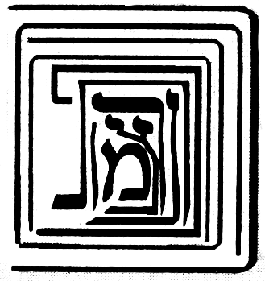

> אחר אשר חלפו לנו עידן ועידנין בענין הצורה הזאת שהמציאונו בפרקים הקודמים האיר ה' עיני שכלנו בה והקרה ה' לפנינו קדושים מדברים ושמחנו בהם כעל כל הון לפי שנמצא לנו בהם משען וסמך. ראשונה בעל ספר מאירת עינים וזה טופס לשונו זו היא צורת עמידתן של עשר ספי' בלי מהות ושנוי יתברך ויתעלה שמו וזה שאמר הכתוב (איוב כו ז) תולה ארץ על בלימה ואל תאמר אינו כי ישנו וכאשר תמנה מימינך לשמאלך תמצא עשרה ותראה כי הכתר בית לכלן ומקור כלן נמצא שהקודם לאצילות גדול ומקיף הכל והמאוחר לאצילות קטן ומוקף מהכל וכלול מכלן וזהו כגלדי הבצלים וכמו שהארץ השפלה הזאת היא קטנה והיא באמצע כל הנבראים כחרדלא בעזקתא והנה היא כלולה מכל היסודות והיא באמצע כל כמו לב בגוף האדם, כך כביכול העטרה.

**6:5:2** And therefore it is called the land of the living, and the heart. And look and see that the Atarah is composed of the Righteous One [Yesod] and of all the supernal ones, unified with them and encompassed by them all and receiving from them all. And so [too] the Righteous One, and so Hod, and so Netzach, and so Gevurah, and so Chesed, and so Binah—each includes all, and they are unified one in another, and each one is composed of them all, and they are all unified in it; and all is unified in Ein Sof, in the Cause of causes. Thus far [his] words. And it is a proof compelling [to] our view, letter by letter, word by word.

> ולפיכך נקראת ארץ החיים והלב. והסתכל ותראה כי העטרה כלולה מהצדיק ומכל העליונים, מיוחדת בהם ומוקפת מכלם ומקבלת מכלם. וכן הצדיק וכן ההוד וכן הנצח וכן הגבורה וכן החסד וכן הבינה כולל הכל ומיוחדים זה בזה וכל א' כלול מכולם וכולם מיוחדים בו והכל מיוחד בא"ס בסבת הסבות עכ"ל. והוא ראייה מוכרחת אל דעתנו אות באות תיבה בתיבה.

**6:5:3** And further, we have a proof and a stay in the Zohar, Parashat Terumah (fol. 165a), and these are [the] words: Rabbi Yossi said: There are nine firmaments, and the Shekhinah is the tenth. For should you say [that] because it is written "ten" [the Sefirot are counted] apart from the Shekhinah—if so, the Shekhinah would be the eleventh, standing over ten. Rather, certainly they are nine, and they are the nine days that are between Rosh Hashanah and Yom Kippur, and Yom Kippur is the tenth. In like manner [is] the Mishkan, which is ten curtains. Ten firmaments [are] a secret of secrets that was not delivered except to those who know wisdom. And all is in the secrets of the holy Lamp [Botzina Kadisha], who reveals the secret of each and every firmament and those ministers who serve in each and every one. Seven firmaments are above, and seven firmaments are below, in like manner to that which is above. There are seven firmaments in which are stars and constellations to govern this world, each according to its way, as is required for it. In all of them the seventh is preeminent—except the eighth, which conducts them all and stands over them all, as it is written, "extol Him who rides upon the Aravot." Who is "He who rides upon the Aravot," and what is Aravot? Rather, this Aravot is the seventh firmament. Why is it called Aravot? Because it is composed of fire and water together, from the side of the south and from the side of the north, and it is mixed [me'orav] of the two sides. Thus far [the passage], to our purpose. And the explanation of the passage: above the [present] matter, Rabbi Chiya expounded on the explanation of the verse "And you shall make the Mishkan [of] ten curtains," etc.; and Rabbi Yossi found difficulty in the verse that said "And you shall make the Mishkan [of] ten curtains"—and it is known that the Mishkan is the Shekhinah, Malkhut. If so, how did he say that one should make ten curtains, which are the ten Sefirot, over the Mishkan, which is Malkhut? It turns out, accordingly, that the Sefirot are eleven—and this is the opposite of the truth, that they are ten and not nine, ten and not eleven, as is explained in [the] gate "Ten and Not Nine." For this [reason] he said that the ten curtains do not necessitate ten Sefirot apart from the Shekhinah; rather, "there are nine firmaments." [That is to say,] nine Sefirot alone are over the Shekhinah, and the Shekhinah is the tenth. And he adopted the wording "nine" and did not say "there are ten firmaments and the Shekhinah is one of them"—which would be more precise, [namely] that the Shekhinah too is called a firmament, as is explained from his words. The reason [is] that the place of the error and the mistake was because he said "And [you shall make] the Mishkan," which is the Shekhinah, "[of] ten curtains," as [if] it appears that ten Sefirot are over Malkhut. And to guard ourselves from this corruption [of understanding], he said, against the error, "nine firmaments," and the Shekhinah, which is the Mishkan, is the tenth to the firmaments—and that is what he said, "and the Shekhinah is the tenth." "For should you say [that] because it is written 'ten,'" etc.: that is, that should you wish to say that, from the fact that the verse said "And you shall make the Mishkan [of] ten curtains" and did not say "nine curtains," it appears that they are ten apart from the Shekhinah, God forbid—if so, you will be saying that they are eleven, and the Mishnah in Sefer Yetzirah said "ten and not eleven." And therefore he did not wish to say [otherwise], but [rather], "if so, the Shekhinah is the eleventh." And in his mentioning the words "the eleventh," who does not know the Mishnah that said "ten and not eleven," and "one who adds to ten is not of the [proper] number"? Rather, certainly they are nine, etc. And it is not Rabbi Yossi's intent to say that Yom Kippur is Malkhut and the ten days of repentance are from above downward—for it is already explained in the Zohar and the Tikkunim and in several places that Yom Kippur is in Binah, and the testimony to this [is] the five afflictions; and it is a foretaste of the World to Come, as the Sages, of blessed memory, said (Berakhot, fol. 17a), "In the World to Come there is no eating or drinking," etc. Rather, Rabbi Yossi's intent is only to tell us that the Sefirot are ten, in the likeness of those days, which are only ten. And if the Sefirot were eleven, the days would be eleven. And just as the days are nine and Yom Kippur is the tenth, so it is fitting concerning the matter of the Sefirot, for the Mishkan itself [is] the tenth. And the matter [is] that the ten days of repentance are days that are in repentance, which is Binah; and behold, the yod is repentance itself—that is to say, the supernal grade within it—and it is included in [the] ten days, which are the ten Sefirot, and it is of the [number of the] days. So [too] the matter of the Mishkan itself: it is the tenth curtain and the tenth Sefirah. And the intent of the verse in saying "And you shall make the Mishkan," etc., the intent [is] that you shall make the existence of the Mishkan such that it be composed of ten Sefirot, which are ten curtains, and the whole ten, that is the Mishkan—not that the Mishkan is one and the curtains ten by themselves, as you might have thought, for if so they would amount to eleven; rather, the Mishkan, that is the totality of the ten curtains. And that is what Rabbi Yossi said, "in like manner [is] the Mishkan, which is ten curtains"—[that] is to say, the Mishkan is the gathering of the ten curtains, which is what we say, [that] Malkhut is composed of ten, as we explained in the previous gates and shall explain in [the] gate "Essence and Governance," blessed be He. "A secret of secrets," etc.: he extolled the wisdom and its excellence. "Who reveals the secret in each and every firmament, and those ministers," etc.: the intent [is] that in each attribute [there are] several angels appointed over the matter of the action of that attribute, and the angels receive the power of the action from the supernal roots by means of ministers that draw near to their source—they are those whom we shall explain in [the] Gate of the Holy Palaces. And from those near to the roots, who sit first in the palace of the King, [there] chain down many thousands and myriads of myriads, from grade to grade and from cause to effect, until they reach this world. And this matter has been explained in the words of Rashbi, peace be upon him, [in] places too many to number. And these angels mentioned are called ministers to those supernal firmaments, which are the Sefirot. And that is the intent of Rabbi Yossi here, in his saying "seven firmaments are above"—the explanation [being]: seven Sefirot alone are the principal ministers for the governance of the world; and therefore the building of the world [is] seven days, with the Sabbath day, since the principal governance [is] with these seven. And just as above there are seven conductors, so in the lower firmaments the conductors of the world are seven—that is, the seven planets. And he said that above six firmaments is a seventh firmament, more excellent than the six that are below it, and it is called Aravot, from the language of "mixing" [erev], for in it two attributes are mixed—that is, its blending between judgment and lovingkindness; and Aravot is Tiferet, which mixes them. And he called it "seventh," even though it is fifth below Gedulah and Gevurah, for the reason we explained in [the] Gate of the Order of the Emanation, in chapter six. And he said that there is an eighth firmament riding over all, that is, Binah, which is the mother crouching over the young.

> ועוד יש לנו ראייה וסמך בזוהר פ' תרומה (דף קס"ה.) וז"ל ר' יוסי אמר תשע רקיעין אינון ושכינתא איהי עשיראה. דאי תימא בגין דכתיב עשר בר משכינתא איהי, אי הכי שכינתא חד סרי איהי דקיימא על י'. אלא ודאי ט' אינון ואינון ט' יומין דבין ר"ה לי"ה וי"ה איהו עשיראה. כגוונא דא משכן דאיהו י' יריעות. י' רקיעין רזא דרזין דלא אתמסר בר לאינון דידעי חכמתא. וכלא איהו ברזין דבוצינא קדישא דאיהי גלי רזא דכל רקיעא ורקיעא ואינון שמשין דמשתמשי בכל חד וחד. ז' רקיעין אינון לעילא וז' רקיעין אינון לתתא כגוונא דלעילא. ז' רקיעין אינון דבהון כוכביא ומזלות לאנהגא עלמא דא כפום אורחיה כמה דאצטריך ליה. בכלהו שביעאה עדיף. בר תמינאה דקא מדבר לכולהו וקיימא על כלהו. דכתיב סולו לרוכב בערבות. מאן רוכב בערבות ומאן איהו ערבות. אלא ערבות דא רקיעא שביעאה. אמאי אקרי ערבות על דאיהו כליל מאש ומים כחדא מסטרא דדרום ומסטרא דצפון ואיהו מעורב מתרין סטרין. עכ"ל לענייננו. ופי' המאמר, שלמעלה מן הענין דרש ר' חייא בפי' הפסוק ואת המשכן תעשה עשר יריעות וגו', ורבי יוסי הוקשה לו בפסוק שאמר ואת המשכן תעשה עשר יריעות וידוע כי המשכן היא שכינה מלכות וא"כ האיך אמר שיעשה עשר יריען שהן ע"ס על המשכן שהיא המלכות. נמצא לפי"ז שהספירות אחד עשר, וזה הפך האמת שהם י' ולא ט' י' ולא י"א וכמבואר בשער י' ולא תשע. לזה אמר שלא היוד יריעות יחייבו עשר ספירות זולת השכינה. אלא ט' רקיעין אינון. פיר' ט' ספירות לבד הם על השכינה והשכינה היא העשירית. ונקט לישנא דט' ולא אמר י' רקיעין אינון ושכינתא חדא מנייהו שהוא יותר מדוקדק שהשכינה ג"כ נקרא רקיע כמבואר מתוך דבריו. הטעם מפני כי מקום הטעות והשגיאה היה מפני שאמר ואת המשכן שהיא השכינה תעשה עשר יריעות כנראה שעשר ספירות הם על המלכות. ולשמור עצמנו מן השבוש הזה אמר נגד הטעות תשע רקיעין והשכינה שהיא המשכן היא עשירית אל הרקיעין והיינו דקאמר ושכינתא איהי עשיראה. דאי תימא בגין דכתיב עשר וכו'. פי' שאם תרצה לומר כי מטעם שאמר הכתוב ואת המשכן תעשה עשר יריעות ולא אמר ט' יריעות נראה שהם עשר מלבד השכינה ח"ו. א"כ נמצאת אומר שהם אחד עשר והמשנה בס"י אמרה י' ולא י"א. ולכן לא רצה לומר אלא אי הכי שכינתא חד סרי. ובהזכירו מלות חד סרי מי לא ידע המשנה שאמרה עשר ולא אחד עשר והמוסיף על עשר אינו מן השם. אלא ודאי ט' אינון וכו'. ואין כונת רבי יוסי לומר שיום הכפורים היא המלכות וי' ימי תשובה הם מלמעלה למטה. לפי שכבר מבואר בזוהר ובתיקונים ובכמה מקומות כי יום הכפורים הוא בבינה והעד על זה ה' ענויים והוא מעין עולם הבא כמו שארז"ל (ברכות דף י"ז.) העולם הבא אין בו לא אכילה ולא שתייה וכו'. אבל כונת רבי יוסי אינו אלא לומר לנו כי הספירות הם עשר בדמיון אותן הימים שאינם אלא עשר. ואם היו הספירות י"א יהיו הימים י"א. וכמו שהימים ט' ויום הכפורים עשירי כן ראוי לענין הספירות כי המשכן עצמו העשירי. והענין כי עשרת ימי תשובה הם ימים שבתשובה שהיא הבינה והנה היוד היא התשובה עצמה רצה לומר המדרגה העליונה שבה והיא נכללת בעשרה ימים שהם עשר ספירות והיא מכלל הימים. כן ענין המשכן עצמו הוא היריעה העשירית והספי' העשירית. וכונת הכתוב באמרו ואת המשכן תעשה וכו' הכונה כי מציאות המשכן תעשה שתהיה כלולה מעשר ספירות שהם י' יריעות וכל העשר היינו המשכן. לא שהמשכן אחד והיריעות עשר בפני עצמן כדקא ס"ד שאם כן יעלו לאחד עשר, אלא שהמשכן היינו כללות עשר יריעות. וזה שאמר רבי יוסי כגוונא דא משכן איהו יו"ד יריעות, פי' המשכן הוא קבוץ היו"ד היריעות דהיינו מה שאנו אומרים מלכות כלולה מי' וכמו שבארנו בשערים הקודמים ונבאר בשער מהות וההנהג' ב"ה. רזא דרזין וכו', הפליג בשבח החכמה ומעלתה. דאיהו גלי רזא בכל רקיעא ורקיעא ואינון שמשין וכו'. הכונה כי כל מדה כמה מלאכים ממונים על ענין פעולת המדה ההיא והמלאכים מקבלים כח הפעולה מהשרשים העליונים על ידי משרתים המתקרבים אל מקורם הם אותם אשר נבאר בשער היכלות הקדושה. ומאותם הקרובים אל השרשים היושבים ראשונה בהיכל מלך משתלשלים כמה אלפים ורבי רבבות ממדרגה אל מדרגה ומעלה לעלול עד הגיעם אל העולם [הזה]. והענין הזה נתבאר בדברי הרשב"י ע"ה מקומות רבו מספר. ואלו המלאכים הנז' הם נקראים משרתים לאותם הרקיעים העליונים הם הספירות וזהו כונת רבי יוסי הנה באמרו ז' רקיעים אינון לעילא, פירוש ז' ספירות לבד הם המשמשים העקריים להנהגת העולם, ולכן בנין העולם ז' ימים עם יום השבת להיות כי עקר ההנהגה עם הז' האלה. וכמו שלמעלה הם ז' מנהיגים, כן ברקיעים התחתונים המנהיגים העולם הם ז', דהיינו ז' כוכבי לכת. ואמר כי למעלה מששה רקיעים הוא רקיע שביעי משובח מהששה אשר למטה ממנו והוא נקרא ערבות מלשון ערוב שבו מתערבות ב' מדות דהיינו מזיגתו בין הדין והחסד והערבות הוא התפארת המערבם וקראו שביעי עם היותו חמשי למטה מגדולה וגבורה מן הטעם שבארנו בשער סדר האצילות בפ"ו. ואמר שיש רקיע שמיני רוכב על הכל, דהיינו הבינה שהיא האם הרובצת על הבנים.

**6:5:4** And behold, the explanation of the passage is comprised, and from it we have learned the matter of the Emanation—that they are in the likeness of the spheres that surround this world, this within that, like the layers of an onion; and for this reason he called them firmaments, and their governance [is] like the governance of the lower firmaments, and they are spheres encompassing all that is within them, like a mustard-seed in a ring. And blessed is God, who made His lovingkindness wondrous to us in a besieged city, and we found ourselves corroboration and a stay from the words of the Zohar—[they are] all of them according to Rashbi, as is known—and there is no doubt in this matter.

> והנה נכלל ביאור המאמר ומתוכו למדנו ענין האצילות שהם כדמות הגלגלים הסובבים העולם הזה זה בתוך זה כגלדי בצלים ומטעם זה קראם רקיעים והנהגתם כהנהגת הרקיעים התחתונים והם גלגלים מקיפים כל אשר בתוכם כחרדלא בגו עזקתא. וברוך ה' אשר הפליא חסדו לנו בעיר מצור ומצאנו לנו סעד וסמך מתוך דברי הזוהר קראי כולהו אליבא דרשב"י כנודע ואין לענין זה ספק:

### Chapter 6:6. Explanation that the sefirot in their standing are one above the other up to ten, and that their standing is three to the right, three to the left, and four in the center — and all is one.

**6:6:1** After we elaborated, in the previous chapter, on the figure of the Emanation and its standing, and established it and confirmed it and upheld it as is fitting—it is fitting to see that this figure is found to demolish the whole edifice that we built in the previous chapters concerning the matter of the figure of the Emanation, [namely] that they are three rights and three lefts and three middle [ones]. And accordingly, this is not [consonant] with its [other] figure, for they are all one within another and there is in them neither right nor left. Now, [since] this and that are the words of Rashbi, it is not fitting to say that his words contradict one another, some of them against others. And likewise the author of Sefer Me'irat Einayim, who wrote that figure that we wrote above in chapter two, and afterward wrote this figure and retracted within the span of an utterance—and he said above that one who denies the first figure is [of] a generation of perversities, etc.—and this is very strained. And to resolve this matter, let us say: a question was asked among the investigators concerning the angels, which they designated by the name "separate intellects," and they said: since they are simple, spiritual, and far from all the accidents of body, if so, by what are they distinguished into the number ten? And Rambam, peace be upon him, wrote the matter of this question in the second [chapter] of Hilkhot Yesodei ha-Torah, and these are [his] words: "And by what are the forms distinguished one from another, seeing that they are not bodies?" And he answered: because they are not equal in existence, but each one of them is below the rank of its fellow, and it exists from its [fellow's] power, this above that, and all exist from the power of the Holy One, blessed be He. Thus far [his] words.

> אחר שבפרק הקודם הארכנו בפ' צורת האצילו' ועמידתן והכרחנוהו ואשרנוהו וקיימנוהו כדחזי. ראוי לראות כי נמצא הצורה הזאת הורסת כל הבנין שבנינו בפרקים הקודמים מענין צורת האצילות שהם ג' ימינים וג' שמאלים וג' אמצעיים. ולפי"ז אין זה לצורתו כי כלם זב"ז ואין בהם לא ימין ולא שמאל. השתא הא והא הם דברי הרשב"י, ואין ראוי לומר שיהיו חולקים דבריו קצתם אל קצתם. וכן בעל ספר מאירת עינים, שכתב הצורה ההיא שכתבנו לעיל בפרק ב', ואחר כך כתב הצורה הזו וחזר בו תוך כדי דבור, והוא אמר לעיל שהמכחיש הצורה ראשונה דור תהפוכות וכו', וזה דוחק גדול. ולתקן הענין הזה נאמר שאלה נשאלה בין החוקרים בענין המלאכים אשר כנו אותם בשם שכלים נבדלים ואמרו כי אחרי שהם פשוטים רוחניים ורחוקים מכל מאורעי הגוף אם כן במה יפרדו אל מנין העשרה. וכתב ענין השאלה הזאת הרמב"ם ע"ה בפ"ב מהלכות יסודי התורה וז"ל ובמה יפרדו הצורות זו מזו והם אינם גופים. ותירץ לפי שאינם שווים במציאות אלא כל אחד מהם למטה ממעלתו של חבירו, והוא מצוי מכוחו זה למעלה מזה, והכל נמצאים מכח של הקב"ה עכ"ל.

**6:6:2** And the intent [is] that he there elaborated on the negation of body and its accidents in [the case of] the angels, and it was difficult for him: since they are far from the accidents of body, and since existents equal in existence are not distinguished one from another except by the accidents of body, and since the angels have no accidents of body—if so, by what are they distinguished, [such] that they are ten grades, as he himself counted? And he answered: because they are not equal in their existence. The explanation [is] that it is true [that] those equal in their existence are not distinguished except by the accidents of body; and the angels, which are distinguished even though they have no accidents of body—the reason is because they are not equal in their existence, but [are] effects one of another, and each one of them is below the rank of its fellow, etc. And the master Rabbi Shem Tov ben Shem Tov, in Sefer ha-Emunot, Gate 4, chapters one, two, [and] three, established with clear proofs that their view is not correct. And these are [his] words: Behold, according to their view, there is nothing between the Cause of causes and them except that this one is a cause to the effects [proceeding] from it; and we have no power to know a single thing of [any] difference between the First Cause and the last of them, etc., except [the relation] from cause to effect—that is to say, they are all unified in a complete unity, for there is among them neither conjunction nor separation, and they have no place at all, for they are not body nor a force in body, but [are] separate intellect[s]; but the cause is above what it causes and the cause is above its effect, and it turns out that the First Cause is a cause to them all, and the first effect is a cause to all the effects that are below it, and they are above the lower ones.

> והכוונה כי הוא הפליג שם בשלילות הגוף ומאורעיו במלאכים והוקשה לו כי אחר שהם רחוקים ממאורעי הגוף ואחר שאין הנמצאים השוים במציאות נפרדים זה מזה אלא במאורעות הגוף ואחר שהמלאכים אין להם מאורעי הגוף א"כ במה יפרדו להיותם עשרה מדרגות כמו שמנה הוא בעצמו. ותירץ לפי שאינם שווים במציאותם. פי' כי אמת הוא כי השוים במציאותם לא יפרדו אלא במאורעי הגוף והמלאכים שהם נפרדים עם היות שאין להם מאורעי הגוף הטעם הוא מפני שאינם שוים במציאותם אלא עלולים זה מזה וכ"א מהם למטה ממעלתו של חבירו וכו'. והרב ר' שם טוב בן שם טוב בספר האמונות שער ד' פרק א' ב' ג' הכריח בראיות ברורות שאין דעתם צודקת. וז"ל הנה לדעתם אין בין עילת העילות אליהם אלא שזה עלה אל העלולים ממנו ואין בנו כח לידע דבר אחד מחילוף בין הסבה הראשונה לאחרון מהם וכו' כי אם מעילה לעלול כלומר כלם יתיחדו באחדות גמור כי אין ביניהם לא חבור ולא פירוד ואין להם מקום כלל כי אינם גשם ולא כח בגשם אלא שכל נבדל אבל הסבה למעלה מן המסובב והעילה למעלה מן העלול ונמצא שהסבה הראשונה סבה לכלם והעלול הראשון עילה לכל העלולים שלמטה ממנו והם למעלה מן התחתונים.

**6:6:3** And further, the master refuted this view concerning the angels, because it is compelling from the words of the Sages, of blessed memory, that the angels were created on the second day or on the fifth day, according to what the Sages, of blessed memory, disputed in this (in Bereshit Rabbah, ch. 3); and he said that if the angels were [as] the unity of the [divine] Name, how is it possible to say that they were created after the creation of heaven and earth? And it is impossible, just as it is impossible to say that they preceded the First Cause.

> ועוד הרב הכחיש סברא זו במלאכים מפני שהוכרח בדברי רז"ל שהמלאכים נבראו ביום ב' או ביום ה' כפי מה שנחלקו בזה חז"ל (בב"ר פ"ג) ואמר שאם היו המלאכים כאחדות השם איך אפשר לומר שאחר בריאת שמים וארץ נבראו והוא נמנע כמו שנמנע לומר שקדמו לסבה ראשונה.

**6:6:4** And further, how does the language of "creation" [rightly] apply to them?

> ועוד איך צודק בהם לשון בריאה.

**6:6:5** And further, he established [the point] from Parashat Vayera, from the vision of Abraham, who saw them in the likeness of men, and he established there that it cannot rightly be said that it was in a prophetic vision. Thus far his objections.

> ועוד הכריח מפ' וירא אליו ממראה אברהם שראה אותם כדמות אנשים והכריח שם כי לא יצדק לומר שהיה במראה הנבואה. עכ"ל השגותיו.

**6:6:6** And behold, he established, on the basis of these questions, that they [the angels] are subtle beings, corporealizing themselves in a subtle and pure body; and for this he adduced [proofs] from the words of the Sages, of blessed memory, as we shall explain in the Gate of the Palaces, with God's help. And now we ourselves ask concerning the matter of the Sefirot, exactly like their question: since we elaborated, in the previous gates, on the matter of the Sefirot and their distancing from body and its accidents—if so, by what are they distinguished, if they are equal in their existence? And we shall answer according to their answer, that their distinction is in that they are not equal in their existence: for Keter exists from Ein Sof, and not so Chokhmah, whose existence is from Keter; and not so Binah, which exists from Chokhmah; and not so Chesed, whose existence is from Binah; and not so Gevurah, whose existence is from Chesed; and not so Tiferet, whose existence is from Gevurah; and not so Netzach, whose existence is from Tiferet; and not so Hod, whose existence is from Netzach; and not so Yesod, whose existence is from Hod; and not so Malkhut, whose existence is from Yesod. And behold, now they are distinguished one from another, in that each one is a cause to its fellow. And now, concerning the Sefirot, what Rabbi Shem Tov found difficult in the words of Rambam will not be difficult for us, because the Sefirot preceded the creation of heaven and earth and do not fall under time, but on the contrary, they are a root to time. For the six Sefirot are a root to the six days, and the seventh is the Sabbath day, as will be explained in the Glossary of Titles, with God's help. And concerning them the Sages, of blessed memory, said (Bereshit Rabbah, ch. 3), "this teaches that an order of times existed before this." And it will also not be difficult for us [to explain] that they appeared to the prophets, for the prophets never apprehended the very Sefirot themselves at all; and even to Moses our teacher, peace be upon him, it was said (Exodus 33:23), "and you shall see My back," etc. And what we say, that the prophecy of Moses our teacher was in Tiferet and [that] of the other prophets in Malkhut—and likewise what we say, that Netzach and Hod are the two prophets of truth—the intent in all this is not that they apprehended the Sefirot literally, but [rather] that from there [is] their nourishment; but their intellection was in the palaces. And so Rashbi, peace be upon him, explained, as we shall explain in the Gate of the Palaces, in chapter two, in the second palace, with God's help. Since his difficulties will not be difficult for us, if so, when we ask: since the Sefirot are belimah, as we explained in the previous gates, [then] by what are they distinguished?—we too shall say that they are distinguished in that the one is a cause to its fellow, as if we should mean that there is no distinction between Keter and its Emanator except that the Emanator is a cause to the emanated. And beyond this they are unified [in] the utmost union; but between Ein Sof and Keter, by reason of Keter['s] being emanated and not Emanator, and Ein Sof Emanator and not emanated, there is much distinction, as explained above in the Gate of Whether the Ein Sof is the Keter and in the Gate of Self and Vessels. And this is clear, that Keter is emanated and Ein Sof the Emanator [is] not emanated. But by reason of their descent, the Sefirot do not descend from it except in the manner [of relation] that [obtains] between Emanator and emanated and that [obtains] between cause and effect; and likewise Chokhmah descends from Keter, and Binah from Chokhmah, and likewise the other Sefirot, like the descent of the effect from the cause. And the matter [is] that Malkhut apprehends Yesod, but not to the measure that it apprehends itself. And Yesod apprehends itself, and apprehends Malkhut with [a] more complete [apprehension] than Malkhut apprehends itself. And likewise it does not apprehend Hod to the measure that it apprehends itself. And Hod apprehends itself more than Yesod apprehended [it]. And likewise it apprehends Malkhut with [a] greater apprehension than Yesod apprehends [it], and how much more so Malkhut itself. And likewise Netzach—its knowledge of itself will be more elevated than Hod apprehends [it]. And likewise Yesod apprehends [it] more than Hod apprehends [it], and how much more so Yesod [apprehends] itself. And likewise it apprehends Malkhut more than Yesod apprehends [it], and how much more so Malkhut itself. And in this manner, too, the apprehension of Yesod in Hod will be more elevated than the apprehension of Malkhut in Hod; and likewise the apprehension of Hod in Netzach will be more elevated than the apprehension of Yesod [in it]; and likewise their apprehensions, one over another, will be elevated, up to the first grade.

> והנה הכריח על פי השאלות האלה שהם הויות דקות מתגשמים בגוף דק וזך ולזה הכריח מדברי רז"ל וכמו שנבאר בשער ההיכלות בס"ד. ועתה נשאל אנחנו בענין הספירות כשאלתם ממש שאחר שהפלגנו בשערים הקודמים בענין הספירות והרחקם מן הגוף ומאורעיו א"כ במה יפרדו אם הם שוים במציאותם. ונשיב כפי תשובתם שהפרדם הוא במה שאינם שוים במציאותם כי הכתר מצוי מא"ס ולא כן חכמה שמציאותה הוא מן הכתר ולא כן הבינה שהיא מצויה מן החכמה ולא כן החסד שמציאותה מן הבינה ולא כן הגבורה שמציאותה מן החסד ולא כן הת"ת שמציאותה מן הגבורה ולא כן הנצח שמציאותה מן הת"ת ולא כן ההוד שמציאותה מן הנצח ולא כן היסוד שמציאותה מן ההוד ולא כן המלכות שמציאותה מן היסוד והנה עתה הם נפרדות זו מזו במה שכל א' עילה לחברתה. ועתה בספירות לא יקשה עלינו מה שהקשה הרש"ט לדברי הרמב"ם. מפני שהספי' קדמו אל בריאת שמים וארץ ואינם נופלים תחת הזמן, אלא אדרבא הם שרש אל הזמן. כי ו' ספירות הם שרש ו' ימים, ושביעית יום שבת. כאשר יתבאר בשער ערכי הכנוים בע"ה. ועליהם אז"ל (בב"ר פ"ג) מלמד שהיה סדר זמנים קודם לכן. וגם לא יקשה עלינו שנראו לנביאים, שמעולם לא ראו הנביאים עצם הספירות ממש, ואפילו למשה רבינו ע"ה נאמר שמות לג כג) וראית את אחורי וכו'. ומה שאנו אומרים שנבואת מרע"ה בת"ת ושאר הנביאים במלכות. וכן מה שאנו אומרים כי נצח והוד הם ב' נביאי קשוט. אין הכוונה בכל זה שהיו משיגים ממש בספירות, אלא שמשם יניקתם. אבל השכלתם הי' בהיכלות. וכן פי' הרשב"י ע"ה כמו שנבאר בשער היכלות בפ"ב בהיכל שני בס"ד. כיון שלא יקשה עלינו קושיותיו. א"כ כשנשאל מאחר שהספירות בלימה כדפי' בשערים הקודמים א"כ במה יבדלו. אף אנו נאמר שהם נבדלות במה שהאחת עילה לחברתה כאלו נרצה שאין הבדל בין הכתר למאצילו אלא שהמאציל עילה אל הנאצל. ואל היותר מזה הם מיוחדים תכלית היחוד אבל בין הא"ס והכתר בסבות היות הכתר נאצל ולא מאציל וא"ס מאציל ולא נאצל הבדל הרבה יש כדפי' לעיל בשער אם הא"ס הוא הכתר ובשער עצמות וכלים. וזה ברור כי הכתר נאצל והא"ס המאציל לא נאצל. אבל מצד רדתם הספירות מאתו אינם יורדות אלא בענין שבין מאציל לנאצל ומה שבין עילה ועלול וכן יורדת החכמה מהכתר והבינה מחכמה וכן שאר הספירות כירידת העלול מן העילה. והענין כי המלכות משיג היסוד אבל לא כשיעור שישיג את עצמו. והיסוד משיג עצמו ומשיג המלכות ביותר שלימות שישיג המלכות את עצמו. וכן אינו משיג בהוד כשיעור שישיג את עצמו. וההוד משיג את עצמו יותר ממה שהשיג היסוד. וכן משיג המלכות ביותר השגה ממה שישיג היסוד וכ"ש המלכות בעצמה. וכן הנצח תתעלה ידיעתו את עצמו ממה שישיג ההוד. וכן ישיג היסוד יותר ממה שישיג ההוד וכ"ש היסוד. וכן ישיג המלכות יותר ממה שישיג היסוד וכ"ש המלכות עצמה. ועל דרך זו ג"כ יתעלה השגת היסוד בהוד מהשגת המלכות בהוד וכן תתעלה השגת ההוד בנצח מהשגת היסוד וכן תתעלה השגתם זו על זו עד המדרגה הראשונה.

**6:6:7** And this matter [is] a great principle in [the realm of] existence, as we shall expand the explanation in Sefer Or Yakar, with God's help. And we know that it will be difficult in the eyes of the examiner that, accordingly, it turns out that Chokhmah is not unified with the Emanator, and likewise Binah with Keter—since that which is an effect from it, this is its cause, and the bond of the effect [is] with its cause, not with the cause of its cause, intrinsically. We shall answer to this: that it is true [that] the questioner has aimed well and is right in his ruling that they are not unified from this side; but they are unified from another side, each one in them all and all in each one, by [virtue of] the aspect of their inclusiveness from [the number] ten.

> וענין זה עיקר גדול במציאות כאשר נרחיב ביאור בספר אור יקר בס"ד. וידענו שיקשה בעיני המעיין שא"כ נמצאו שהחכמה אינה מתייחדת עם המאציל וכן בינה עם הכתר מאחר שמה שהוא עלול ממנו זו עילתו וקשר העלול עם עלתו לא עם עלת עלתו בעצם. נשיב על זה כי אמת הוא יפה כוון השואל וצדק בגזרתו שאינם מיוחדים מצד זה, אבל הם מיוחדים מצד אחר כל אחד בכלם וכלם בכל אחד בערך בחי' כללותם מיו"ד.

**6:6:8** And behold, accordingly, Keter has with Gevurah ten unifications, namely: the Keter-within-Keter with the Keter-within-Gevurah, and the Chokhmah-within-Keter with the Chokhmah-within-Gevurah, and in this manner the other grades; and so for all the Sefirot. And since it has been explained that, by way of inclusiveness, the Sefirot ascend in their manifestations without end—as we shall explain in the Gate of Essence and Governance, chapter two, with God's help—therefore [the matter] will ascend in unification without end. And this is by [reference to] the [relative] measure of their unification and their bond [as] the emanated [Sefirot] themselves. But in the Emanator they are unified in two respects: the one, by [reference to] their bond with their hidden root above, as is explained in the Gate of Tzachtzachot; and the second, in the aspect of the light of the Self that spreads within the grades, which is the Self of the Godhead, not divided into these parts except by means of the Sefirot, as explained in the Gate of Self and Vessels. And the Self that spreads is unified in its source, like the ray of the sun unified in the sun, and in the likeness of the soul unified in its powers that spread through the body. And the Sefirah itself is unified in the Self that spreads [in the] utmost union, just as the soul is unified with the body, for reasons that we shall explain in the Gate of the Soul.

> והנה לפי"ז יש לכתר עם הגבורה יו"ד יחודים והם כתר שבכתר עם כתר שבגבורה והחכמה שבכתר עם חכמה שבגבורה ועד"ז שאר המדרגות וכן לכל הספירות. ואחר שנתבאר כי על דרך הכללות עולה הספי' במציאותי' לאין תכלית כמו שנבאר בשער מהות והנהגה פרק ב' בס"ד. ולפיכך יעלה ביחוד לאין תכלית וזהו בערך יחודם וקשורם הנאצלים הם בעצמם. ובמאציל הם מתייחדים בשתי פנים האחד בערך קשורם עם שרשם הנעלם למעלה כמבואר בשער הצחצחות. והב' בבחינת האור העצמות המתפשט בתוך המדרגות שהוא עצם האלקות בלתי מתחלק לחלקים האלה אלא ע"י הספירות כדפי' בשער עצמות וכלים. והעצם המתפשט מיוחד במקורו כנצוץ השמש המיוחד בשמש וכדמיון הנפש המיוחדת בכחותיה שמתפשטות בגוף. והספי' עצמה מתייחדת בעצם המתפשט תכלית היחוד כמו שמתייחד הנפש עם הגוף לסבות כאשר נבאר בשער הנשמה.

**6:6:9** And behold, after the matter of their bond and the matter of their unification and the matter of their distinction have been explained—that they are in the likeness of cause and effect, cause and what it causes—the Emanation is found [to be] a jointed lampstand, [its parts] unified and bound [in] the utmost union, bond, and longing. And concerning this matter a covenant was cut for those who occupy themselves with the wisdom of the Pardes. And this was the claim of Elisha, [namely] that through this he became Acher [the Other]. And this was the sin of Adam the First, who came to dismantle the tent and was found dismantling on the Sabbath, and therefore he was [held] liable. And one who contemplates this matter, [this] occupation, must beware lest he do according to their pattern; and therefore let the examiner occupy himself with this chapter, and in it he will find rest for his soul, and his soul will abide in well-being, and he will dwell secure with none to make him afraid.

> והנה אחר שנתבאר ענין קשורם וענין יחודם וענין הבדלם שהם כדמיון עילה ועלול סבה ומסובב נמצא האצילות מנורה של פרקים מיוחדים ומקושרים תכלית היחוד והקשר והחשק. ועל ענין זה נכרת ברית למתעסקים בחכמת הפרדס. וזה הי' טענת אלישע שע"י כך נעשה אחר. וזה היה חטא אדם הראשון שבא לפרק את האהל ונמצא מפרק בשבת ולכן חייבו. והמתבונן ענין זה העסק צריך ליזהר שלא יעשה כתבניתם, ולכן המעיין יעסוק בפרק זה ובו ימצא מרגוע לנפשו ונפשו בטוב תלין ושכן לבטח ואין מחריד:

### Chapter 6:7. To explain the matter of the Ein Sof, which has no end, and its expansion through all the grades down to the last point; and the matter of the sefirot, that each is included in its fellow.

**6:7:1** After the matter of the bond of the Sefirot among themselves and their bond with the Emanator has been explained in the previous chapter—when the examiner contemplates it with good diligence, he will find good taste and knowledge and the compelling [force] of the matter of itself, and the truth will show its way. And he will find, accordingly, [that] the Sefirot—when we come to liken them and to depict them, by way of likeness, to the human intellect—[one] will be compelled to believe that they are one above another. For Ein Sof the Emanator is the Cause of all causes and the Source of all causes, and the first effect from it is Keter; and Keter [is] a cause and a cause to Chokhmah, by the power of the Emanator that overflows from its light upon it; and Chokhmah is a cause and a cause to Binah, by the power of the Emanator, by means of Keter, in [its] emanating the light of the Emanator by means of the first emanated [one], Keter, upon it. And so for all the rest of the Emanation: for Binah [is] a cause to Chesed, and Chesed a cause to Gevurah, and Gevurah a cause to Tiferet, and Tiferet a cause to Netzach, and Netzach a cause to Hod, and Hod a cause to Yesod, and Yesod a cause to Malkhut. Behold, they are ten grades, ordered one above another, thus: Keter, Chokhmah, Binah, Gedulah, Gevurah, Tiferet, Netzach, Hod, Yesod, Malkhut. And of what is fitting to know [is] that, apart from this order, they have another order. And the reason for this [is] that each Sefirah has two causes: the one, its cause—that after the preceding [one] was emanated, it was emanated. The example of this [is] that even though the true cause of Netzach is Chesed, nonetheless, because of the order of its emanation, its cause is none but Tiferet, as we elaborated concerning the matter of their emanation in the Gate of the Order of the Emanation, in chapter six.

> אחר שנתבאר מתוך הפרק הקודם ענין קשר הספי' בעצמם וקשורם עם המאציל, כאשר יתבונן המעיין בו בטוב השקידה ימצא טוב טעם ודעת והכרח הענין מעצמו והאמת יורה דרכו. וימצא לפי"ז היות הספירות כאשר נבא להמשילם ולציירם ע"ד דמיון אל השכל האנושי יוכרח להאמין שהם זו למעלה מזו. מפני כי הא"ס המאציל הוא עלת כל העלות וסבת כל הסבות והעלול הראשון ממנו הוא כתר וכתר סבה ועילה לחכמה מכח המאציל השופע מאורו עליו וחכמה הוא סבה ועילה לבינה מכח המאציל ע"י הכתר בהשפיע אור המאציל ע"י הנאצל הראשון כתר עליו. וכזה לכל שאר האצילות כי בינה עילה וסבה לחסד וחסד עלה וסבה לגבורה וגבורה עלה וסבה לת"ת ות"ת עלה וסבה לנצח ונצח עלה וסבה להוד והוד עלה וסבה ליסוד ויסוד סבה ועלה למלכות. הרי הם עשר מדרגות מסודרות זו למעלה מזו כזה כתר חכמה בינה גדולה גבורה תפארת נצח הוד יסוד מלכות. וממה שראוי לדעת כי בזולת הסדר הזה יש להם סדר אחר. וטעם לזה כי לכל ספירה ב' עלות. והם הא' עילתו שאחר שנאצלה הקודמת נאצלה היא. המשל בזה כי אעפ"י שעילתו האמיתית של הנצח הוא החסד עכ"ז מפני סדר אצילותו עילתו אינו אלא התפארת כמו שהארכנו בענין אצילותם בשער סדר האצילות בפ"ו.

**6:7:2** And behold, they have two aspects to their cause and their source: the one, the order that we explained above, one upon another up to the ten; the second, the order of their effluence and their source, according to their division. There is [one] whose aspect is lovingkindness [Chesed], and it must incline to the line of Chesed; and there is [one] whose aspect is judgment [Din], and it must incline to the line of Din; and there is [one] whose aspect is mercy [Rachamim], and it must incline to the line of Rachamim, and it aligns itself between these two lines, toward the mean.

> והנה נמצאו להם ב' בחינות אל עלתם. וסבתם האחד הסדר שפירשנו למעלה זו על זו עד העשר. השני סדר שפעם ומקורם לפי חלוקם יש שבחינתה חסד וצריך היותה נוטה אל קו החסד ויש שבחינתה דין וצריך נטייתה אל קו הדין. ויש שבחינתה רחמים וצריך נטייתה אל קו הרחמים והיא מתיישרת בין שני הקוין האלה אל המיצוע.

**6:7:3** And behold, the matter of these their aspects is their subsistence and their effluence that is poured out upon them. And it turns out, accordingly, that they have two aspects to their causes: the first aspect, the cause of the order, as explained; the second aspect is the nourishment and the effluence and the subsistence. And even though, from the side of the aspect [pertaining] to the order of the emanation, their order [being] one above another is compelling—when we look to the side of their nourishment, which is the cause of their subsistence, they are found [to be] in another arrangement; for we see [that] Keter emanates into Chokhmah and into Binah—if so, it is compelled from this that it is the cause of both of them. And from another side it is compelled that Chokhmah is the cause of Binah and Keter the cause of Chokhmah—if so, it is compelled that [they] be ordered in the likeness of a segolta, thus:  

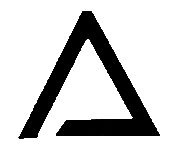

> והנה ענין בחינתם אלה הוא קיומם ושפעם הנשפע עליהם. ונמצא לפי זה להם ב' בחינות אל סבותם. בחי' ראשונה סבת הסדר כדפי'. בחינה שנייה היא היניקה והשפע והקיום. ואעפ"י שמצד הבחינה אל סדר האצילות הוכרח סדרם זו למעלה מזו. כשנביט אל צד יניקתם אשר הוא סבת קיומם נמצאים בענין אחר כי אנו רואים כ"ע משפיע אל החכמה ואל הבינה א"כ יוכרח מזה היותו סבת שתיהם. ומצד אחר יוכרח היות חכמה סבת הבינה והכתר סבת החכמה א"כ יוכרח היות מסודרת כדמות סגולתא כזה.

**6:7:4** Keter; and one channel, which indicates the preceding cause—and their order is Keter, Chokhmah, Binah. And from the side of Keter's emanating into Binah, it is necessitated that there be a channel from Keter to Binah; and the matter of the channels will be explained in a gate of its own. And from the side of Chokhmah's emanating into Chesed, and Binah into Gevurah, it is compelled that Chesed be beneath Chokhmah and Gevurah beneath Binah—which indicates that Chokhmah is the cause of Chesed and Binah the cause of Gevurah. And from the side of Tiferet's drawing sustenance from Keter and from Chesed and from Gevurah, it is compelled that it be opposite it, indicating that its cause is Keter. And from the side of its drawing sustenance from Chesed and from Gevurah, it is compelled that it be between the two of them, to indicate that it is caused by both of them. And from the side of its being sixth in the Emanation, it is compelled that it be drawn somewhat below the two of them, as we have depicted. And from the side of Netzach's being seventh in the Emanation, it is compelled that it draw sustenance from Tiferet. And from the side of its drawing sustenance from Chesed, it is compelled that it be beneath Chesed. And so Hod, in this way, [is] beneath Gevurah. And Yesod is compelled to be beneath Tiferet, for from there is its principal nourishment, and it is its cause from the side of the pouring-forth [of effluence]. And from the side of its drawing sustenance from Netzach and Hod, it is likewise compelled that it be between the two of them. And from the side of its being ninth to them all, it is compelled that it be drawn downward, to beneath them all, as we have depicted.  

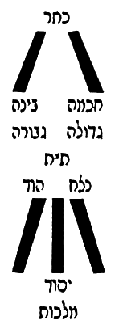

> כתר וצנור א' המורה על הסבה הקודמת והם סדרן כתר חכמה בינה. ומצד היות הכתר משפיע אל הבינה יתחייב היות צנור מכתר אל הבינה, וענין הצנורות יתבאר בשער בפ"ע. ומצד היות חכמה משפעת בחסד והבינה בגבורה יוכרח היות חסד תחת חכמה וגבורה תחת בינה שהוא מורה כי החכמה סבת החסד והבינה סבת הגבורה. ומצד היות הת"ת יונק מן הכתר ומן החסד ומן הגבורה יוכרח היותו כנגדו מורה שסבתו הוא הכתר. ומצד היותו יונק מן החסד ומן הגבורה יוכרח היותו בין שניהם להורות שהוא מסובב משניהם. ומצד היותו ששי אל האצילות יוכרח היותו נמשך קצת למטה משניהם כאשר ציירנו. ומצד היות הנצח שביעי לאצילות יוכרח היותו יונק מן התפארת. ומצד היותו יונק מן החסד יוכרח היותו תחת החסד. וכן הוד ע"פ דרך זה תחת הגבורה. ויסוד יוכרח היותו תחת הת"ת כי משם עיקר יניקתו והוא סבתו מצד ההשפעה. ומצד היותו יונק מן הנצח וההוד יוכרח ג"כ היותו בין שניהם. ומצד היותו תשיעי לכלם יוכרח היותו נמשך למטה אל תחת כלם כאשר ציירנו.

**6:7:5** And Malkhut, from the side of its being tenth, below Yesod, is drawn below Yesod.

> ומלכות מצד היותה עשירית למטה מהיסוד נמשכת למטה מן היסוד.

**6:7:6** And behold, after the matter of the agreement of the figures upon one matter has been explained, it is fitting to explain this matter that is found in the Zohar many times: "ascending and descending" [salka ve-nachta].

> והנה אחר שנתבאר ענין הסכמת הצורות אל ענין אחד ראוי לבאר ענין זה הנמצא בזוהר פעמים רבות סלקא ונחתא.

**6:7:7** And behold, the matter of ascent and descent indicates corporeality, and this does not properly apply at all; and with this premise all will be explained. Namely: since the matter of their being one above another does not intend the existence of place, God forbid, as we have explained, but rather the matter of rank and priority from cause to effect, as explained above at length—

> והנה ענין עליה וירידה הוא מורה על הגשמות וזה אינו צודק כלל, ועם ההקדמה הזו יתבאר הכל. והוא כי אחר שענין היותם זו למעלה מזו אין הכוונה על מציאות המקום ח"ו כאשר בארנו אלא על הענין המעלה והקדימה מעילה לעלול כמבואר לעיל בארוכה.

**6:7:8** behold, the matter of ascent and descent likewise will be in this way. As, for example, Malkhut: before she was driven down to the tenth grade, she was in the seventh grade, beneath Tiferet, in her rank and her subtlety, so much so that she was a cause to Netzach and Hod and Yesod. And when sin caused [it] and she was driven from her place, she descended, and her lights were coarsened and darkened, until she does not have the capacity to be a cause to Netzach and Hod; rather, on the contrary, she is their effect and needs them and receives light and effluence from them—and this is the matter of her descent. And so the matter of her ascent: that she be refined so much that she return to Tiferet, and Tiferet be her cause, and she be a cause to all that is beneath Tiferet, owing to the abundance of her brilliance and her light. And likewise, in this way, when we say that one attribute among the attributes ascends to another attribute higher than it, the intent is this matter: that because of the effluence that that higher attribute poured into the lower attribute, it was refined until it ascends from grade to grade, until it becomes a cause to the other attributes that are beneath the attribute that overflows upon it—and this is called that that attribute "ascended" to the other. And therefore it is explained in the Zohar many times, and in particular in the Commandments [Pikkudin], the commandment "to bless" (in Parashat Ekev, fol. 271a), etc., that it is impossible for any attribute to ascend to another attribute unless it first receives from it abundant effluence in its [own] place, so that, by the measure of the abundance of the effluence, so will it be raised from grade to grade. And there are times when the effluence is not so intensified, and it does not ascend as far as the attribute that overflows upon it, but to another attribute that is beneath it, and from there it receives from it—like Malkhut, who at times ascends as far as Yesod alone, to receive effluence from her husband, Tiferet; and this indicates that Malkhut was refined until she ascended from being tenth to the ninth, and was not refined so much as to be actually seventh, near to Tiferet; rather, from that grade she receives from him. And this is the matter of ascent and descent mentioned in the Zohar concerning the attributes; and this is enough of a remark on this matter. And with this the interpretation of all the matters has been explained, and [that] the figure agreed upon in the mouth of all the Kabbalists is the truest—and not that there is an actual figure there, God forbid, nor a place of their standing, nor face nor back, nor right nor left, except from the side of Din or of Rachamim, according to their nourishment, each and every one according to its pouring-forth and its nourishment. And indeed, the key to all these matters is that being a cause or an effect [and the grades' being one beneath another — from Asis Rimonim] is in the two ways explained above; and with this it is clear that sometimes this depiction will obtain and sometimes another, all according to the pouring-forth [of effluence]—though it is true that this is the customary and the constant one.

> הנה ג"כ ענין העליה והירידה תהיה על דרך זו כמו המשל המלכות היותה קודם שנטרדה למטה במדרגה העשירית היתה במדרגה שביעית תחת הת"ת במעלתה ודקותה כל כך עד שהיא היתה סבה אל הנצח וההוד והיסוד. וכאשר גרם העון ונטרדה ממקומה ירדה ונתעבו וחשכו מאוריה עד שאין בידה סיפוק להיותה סבה אל הנצח וההוד אלא אדרבה היא עלולה מהם וצריכה אליהם ומקבלת מהם אור ושפע וזו היא ענין ירידתה. וכן ענין עלייתה שתזדכך כל כך עד שתשוב אל הת"ת ויהיה הת"ת עילתה והיא עילה וסבה אל כל אשר תחת הת"ת לרוב בהיקותה ואורה. וכן עד"ז כאשר נאמר שתעלה מדה מן המדות אל מדה אחרת עליונה ממנה הכוונה על הענין הזה כי מפני השפע שהשפיעה המדה ההיא העליונה במדה התחתונה נזדככה עד שתעלה ממדריגה אל מדריגה עד היותה עילה אל שאר המדות שהם תחת המדה השופעת עליה וזה יקרא שעלתה המדה ההיא אל האחרת. ולכן נתבאר בזהר פעמים הרבה ובפרט בפקודין פקודא לברכא (בפ' עקב דף רע"א) וכו' שא"א אל שום מדה לעלות אל מדה אחרת אם לא שתקבל ממנה קודם שפע רב במקומה כדי שע"י שיעור רבוי השפע כן תתעלה ממדרגה למדרגה. ויש פעמים שלא יוגבר השפע כ"כ ולא תעלה עד המדה השופעת עליה אלא אל מדה אחרת אשר תחתיה ומשם תקבל ממנה כמו המלכות העולה לפעמים עד היסוד לבד לקבל שפע מבעלה הת"ת וזה מורה כי נזדככה המלכות עד שעלתה מהיותה עשירית אל הט' ולא נזדככה כל כך להיותה ממש שביעית קרובה אל הת"ת אלא מן המדרגה ההיא תקבל ממנו. וזהו ענין עליה וירידה הנז' בזוהר במדות, ודי בזה הערה בענין הזה. ובזה נתבאר פשר כל הדברים והצורה המוסכמת בפי כל המקובלים היותר אמיתית ולא שתהיה שם צורה ממש ח"ו ולא מקום עמידתן ולא פנים ולא אחור ולא ימין ולא שמאל אלא מצד הדין או הרחמים על פי יניקתם כל אחד ואחד כפי השפעתו ויניקתו. ואמנם מפתח כל הדברים כי היות סבה או מסובב [והיות מדרגות זו תחת זו. מעסיס רמונים) הוא על שני דרכים המבוארים לעיל, ובזה מבואר כי פעמים יהיה הציור הזה ופעמים זולתו הכל לפי ההשפעה עם שהוא אמת שזהו המורגל והתמידי:

### Chapter 6:8. To save the student from error in the matter of *ha-edut* [the term is uncertain in this printing — perhaps "the sefirot" or "the grades"] and their Emanator.

**6:8:1** After we have already roused ourselves, as much as is needed, concerning the matter of the order of their standing in the preceding chapters, there remains an obligation upon us, in the matter of this inquiry, to save the inquirer from error. For perhaps he will be in doubt and say: since it is true that the Sefirot have a number, as explained in the preceding gates, and the number necessitated in them is ten—if so, when we come to their matter we shall say that the place of the end of Malkhut is the beginning of Yesod (that is to say, in the way of spirituality, from effect to cause), and the place of the end of Yesod is the beginning of Hod; for what is Hod is not Yesod, and what is Yesod is not Hod, and what is Hod is not Netzach—for they are distinct, [by] what [lies] between cause and effect; and behold, the effect is not the cause, and the cause is not the effect.

> אחר שכבר נתעוררנו כל הצורך בענין סדר עמידתן בפרקים הקודמים. נשאר אלינו לחובה בענין הדרוש הזה להציל המעיין מן הטעות. כי שמא יסתפק ויאמר אחר שהוא אמת שהספירות יש להם מספר כאשר מבואר בשערים הקודמים והמספר המחוייב בהן הוא עשר. א"כ כאשר נבא בעניינם נאמר כי מקום סיום המלכות הוא תחלת היסוד ר"ל דרך הרוחניות מעלול לעילה, ומקום סיום היסוד הוא תחלה ההוד, כי מה שהוא הוד אינו יסוד ומה שהוא יסוד אינו הוד ומה שהוא הוד אינו נצח שהם נבדלים מה שבין עילה לעלול והנה העלול אינו עילה והעילה אינו עלול.

**6:8:2** And behold, accordingly it turns out that, even though they are unified [in] a complete union, nonetheless they are, in this respect, distinct, as explained above. And now, behold, Keter is the effect of the Ein Sof, and the Ein Sof is its cause; if so, what is Keter is not the Ein Sof, and what is the Ein Sof is not Keter—and behold, it turns out that the Ein Sof has a limit, God forbid, [namely] what is not Keter; for the place of the end of Keter is the beginning of the Ein Sof. And on the face of it, this question is the place of the error to which a person is brought [when he comes] to contemplate this; and it is an error and a great confusion. And the laying to rest of this doubt is clear, and there is no place for this question at all. And the reason is that the power of the cause is in the effect, and the effect is not bereft of its cause. That is to say: when we say "this is Keter," we do not on that account necessitate that it is not the Ein Sof, God forbid. For on the contrary, there is no place for the effect apart from the cause; and behold, the effect draws sustenance from it, and its being is its cause—in the likeness of the soul within the body. For you cannot object that what is body is not soul, and what is soul is not body; for this claim does not properly apply, for two reasons. One: because the soul is certainly the cause of the body, and there is no body without a soul, and what is body is the soul—for the soul gives life to the body, and the body is nourished from the soul, and it is impossible to depict that the soul be annulled from a part of the body unless it return to dust. But the living body is certainly a garment to the soul; and therefore it is compelled that what is body be soul, for it is the cause of the body, and a living body cannot be brought into existence without a soul. However, our saying "a soul without a body" does apply properly, for there is indeed a place for a soul without a body, since the soul is not the effect of the body. And so are the matters with the Ein Sof and those that are its effects: for it is not possible to bring into existence an effect without a cause, and what is an effect—certainly the power of the cause is within it. However, a cause without an effect does apply properly; for the cause has an aspect in its own right, from the side of what does not need the effects, and it has an aspect that spreads forth and shines in the effects and gives life to them. And in this way we shall understand the matter of the Sefirot themselves: for on account of this reason it is compelled that the power of Keter be in Chokhmah, for it is a cause to it and it is its vitality; and so the power of Chokhmah in Binah, for the cause of Binah is Chokhmah, and it is its vitality; and so the power of Binah is in Chesed, for it is a cause to it and it is its vitality; and so the power of Chesed in Gevurah, for it is a cause to it and it is its vitality. And with this will be understood what is explained in the Zohar, Parashat Terumah (fol. 167), that the five times "water" in the Account of Creation are on the second day, in Gevurah—and since Gevurah is the power of fire, how is it possible that the power of water be in it? Rather, [it is] in this way. And so the power of Gevurah in Tiferet, for it is a cause to it and it is its vitality; and so the power of Tiferet in Netzach, for it is a cause to it and it is its vitality; and so the power of Netzach in Hod, for it is a cause to it and it is its vitality; and so the power of Hod in Yesod, for it is a cause to it and it is its vitality; and so the power of Yesod in Malkhut, for it is a cause to it and it is its vitality. And it turns out, accordingly, that Malkhut is Yesod, and Yesod is Hod, and Hod is Netzach, and Netzach is Tiferet, and Tiferet is Gevurah, and Gevurah is Gedulah, and Gedulah is Binah, and Binah is Chokhmah, and Chokhmah is Keter, and Keter is the Ein Sof. And not this alone, but [it] spreads forth in them all, so that it cannot properly be said "this is Malkhut and not the Ein Sof," God forbid; rather, Malkhut too has within it the power of the Ein Sof. And not this alone, but in this way is the vitality of the Sefirot, and the vitality of the chariots, and the vitality of the angels, and the vitality of all the work of creation, from the first point to the last. And this is "and You give life to them all" (Nehemiah 9:6), and the Sages, of blessed memory, explained: "and You bring them all into being." And so they explained "and You give life to them all"—and it is all one matter. For since He brought them into being and brought them into existence from Nothing, it is compelled that they be poured upon from Him, and that all draw their vitality from Him; and since He gives life to them, it turns out that He brings them into existence and brings them into being at every time and at every moment and at every hour.

> והנה לפי"ז נמצא שאע"פ שהם מיוחדים יחוד גמור עכ"ז הנה הם בערך זה נבדלים כדפי' לעיל. ועתה הנה הכתר עלול מא"ס והא"ס עלתו א"כ מה שהוא כתר אינו הא"ס ומה שהוא א"ס אינו כתר, והנה נמצא שיש לא"ס גבול ח"ו מה שאינו הכתר כי מקום סיום הכתר הוא תחלת הא"ס. ולכאורה שאלה זו היא מקום הטעות שיביא האדם להתבונן בזה והוא טעות ושבוש גדול. והשבתת ספק זה מבואר ואין מקום לשאלה זו כלל והטעם כי כח העילה בעלול ואין העלול משולל מעילתו. ר"ל כי כאשר נאמר זהו הכתר לא מפני זה נחייב שאינו הא"ס ח"ו. כי אדרבה אין מקום לעלול בזולת העילה והנה העלול יונק ממנה והיותו הוא עלתו כדמיון הנשמה בתוך הגוף. כי לא תוכל להקשות שמה שהוא גוף אינה נשמה ומה שהוא נשמה אינו גוף. כי לא יצדק טענה זו משני פנים. אחד מפני כי הנשמה ודאי עילתה של גוף ואין גוף בלי נשמה ומה שהוא גוף הוא הנשמה כי הנשמה מחייה את הגוף והגוף נזון מן הנשמה וא"א לצייר שיתבטל הנשמה מקצת הגוף אם לא שישוב לעפר אבל הגוף החי הוא לבוש אל הנשמה ודאי ולכן יוכרח היות מה שהוא גוף נשמה דהיא עילת הגוף ואין להמציא גוף חי בלי נשמה. אמנם יוצדק אמרנו נשמה בלא גוף כי כבר יש מקום לנשמה בלא גוף אחר שאין הנשמה עלולה מן הגוף. וכן הדברי' בא"ס והעלולים ממנו, כי אין באפשרות להמציא עלול בלא עילה ומה שהוא עלול בודאי כח העילה בתוכו אמנם עילה בלא עלול יצדק כי יש בחינה לעילה בפני עצמו מצד מה שאינו צריך אל העלולים, ויש לו בחינה המתפשטת ומאירה בעלולים ומחייה אותם. ועד"ז נבין ענין הספירות בעצמן, כי מפני טעם זה יוכרח היות כח הכתר בחכמה כי הוא עילה אליו והוא חיותו וכן כח חכמה בבינה כי עלת הבינה הוא החכמה והיא חיותה וכן כח הבינה בחסד הוא כי עלה אליו והוא חיותו וכן כח החסד בגבורה כי הוא עילה אליה והוא חיותה. ועם זה יובן מה שפי' בזוהר פ' תרומה (דף קס"ז) שחמש פעמים מים שבמעשה בראשית הם ביום ב' בגבורה ואחר שהגבורה כח האש איך אפשר שיהיה בהן כח המים אלא על הדרך הזו. וכן כח הגבורה בת"ת כי היא עלה אליו והוא חיותו וכן כח הת"ת בנצח כי הוא עלה אליו והוא חיותו וכן כח הנצח בהוד כי הוא עלה אליו והוא חיותו וכן כח ההוד ביסוד כי הוא עלה אליו והוא חיותו וכן כח היסוד במלכות כי הוא עלה אליה והוא חיותה. ונמצא לפי"ז כי המלכות הוא היסוד והיסוד הוא ההוד וההוד הוא הנצח והנצח הוא התפארת והת"ת הוא הגבורה והגבורה הוא הגדולה והגדולה הוא הבינה והבינה הוא החכמה והחכמה הוא הכתר והכתר הוא הא"ס. ולא זה בלבד אלא מתפשט בכולן עד שלא יצדק לומר זהו מלכות ולא א"ס ח"ו אלא המלכות ג"כ יש בה כח האין סוף. ולא זו בלבד אלא בדרך זו הוא חיות הספירות וחיות המרכבות וחיות המלאכים וחיות כל מעשה בראשית מן הנקודה הראשונה ועד האחרונה. וזהו ואתה מחיה את כלם (נחמיה ט ו) ופי' רז"ל ואתה מהוה לכולם. וכן פי' ואתה מחיה את כלם והכל ענין אחד. כי מאחר שהוא היוה אותם והמציאם מן האין יוכרח שיושפעו ממנו ושואבים כלם ממנו חיותו ואחר שהוא מחיה אותם נמצאו שהוא ממציאם ומהוום בכל עת ובכל רגע ובכל שעה.

**6:8:3** And behold, bringing-into-being and giving-life are all one matter for them. And by this matter will be understood "and in His goodness He renews every day, continually, the work of creation"—which is the effluence that overflows to give them life and to make them stand and to set them in their [proper] character. And if, God forbid, the withdrawal of His effluence from them should arise in the mind, in a moment they would perish. And they are but renewed, in the secret of the renewal of His light; and it is the effluence of a river that does not cease but is renewed, like the waters of the river, which at every moment are renewed. And let us return to our matter: for the Ein Sof, the King of kings of kings, rules over them all; for His Self pierces and descends by way of the Sefirot and between the Sefirot, and within the chariots and between the chariots, and within the angels and between the angels, and within the spheres and between the spheres, and within the elements and between the lowly elements, and within the earth and between the earth and its offspring, and unto the last point that is in the abysses—"the whole earth is full of His glory." And this is what Rashbi intended in the Tikkunim (in the Introduction, fol. 3b), in his saying: "And the Cause over all shines in the ten Sefirot of Atzilut and in the ten of Beriah, and shines in the ten classes of angels and in the ten spheres of the firmament, and does not change in any place." Thus far [his] words.

> והנה מהוה ומחיה הכל ענין אחד להם. ובענין הזה יובן ובטובו מחדש בכל יום תמיד מעשה בראשית שהוא שפע השופע להחיותם ולהעמידם ולהציבם בצביונם. ואם ח"ו יעלה על הדעת הסתלקות שפעו מהם כרגע יספו. ואינם אלא מחודשים בסוד חדוש אורו והוא שפע נהר שאינו פוסק אלא מתחדש כמימי הנהר שבכל רגע הם מחודשים. ונחזור אל ענינינו כי הא"ס ממ"ה מושל בכלם כי עצמותו נוקב ויורד דרך הספירות ובין הספירות ותוך המרכבות ובין המרכבות ותוך המלאכים ובין המלאכים ותוך הגלגלים ובין הגלגלים ותוך היסודות ובין היסודות השפלים ותוך הארץ ובין הארץ וצאצאיה ועד נקודה האחרונה שבתהומות מלא כל הארץ כבודו. וזה כיון רשב"י בתיקונים (בהקדמה ד"ג ע"ב) באמרו ועלת על כלא נהיר בעשר ספירן דאצילות ובעשר דבריאה ונהיר בעשר כתות דמלאכיא ובעשר גלגלי דרקיע ולא אשתני בכל אתר עכ"ל.

**6:8:4** And he was precise in his saying "and does not change," to guard lest we say that, since He spreads forth in this measure, it turns out that He changes according to the change of the garments, God forbid; for this he said "and does not change in any place." And the rest of the words of the passage will be explained in the Gate of ABYA.

> ודקדק באמרו ולא אשתני, להשמר שלא נאמר שאחר שהוא מתפשט בשעור הזה נמצא שהוא משתנה לפי שנוי הלבושים ח"ו לזה אמר ולא אשתני בכל אתר. ושאר דברי המאמר יתבאר בשער אבי"ע.

**6:8:5** And behold, when the inquirer sets his intellect upon the rightness of the concealment of the King of kings of kings, we shall set him further upon the matter of the Sefirot, of which we said above that Keter is in Chokhmah and Chokhmah in Binah, etc. There is yet [another] chosen order for them, namely: that the power of Malkhut is in Yesod, and the power of Yesod in Hod, and the power of Hod in Netzach, and the power of Netzach in Tiferet, and the power of Tiferet in Gevurah, and the power of Gevurah in Gedulah, and the power of Gedulah in Binah, and the power of Binah in Chokhmah, and the power of Chokhmah in Keter—which we cannot say [in the case of Keter, namely] that the power of Keter is in the Ein Sof. And the intent is not to say that it is not in the Ein Sof, God forbid, as will be explained in the Gate of Tzachtzachot, with God's help; rather, in the way in which we necessitate this order in the Sefirot, we do not necessitate that the power of Keter is in the Ein Sof. And the matter is that the matter of "the Shekhinah among the lower ones is a need on high" has already been explained, and we shall expand the explanation of it in the Gate of Essence and Governance, with God's help. And the matter is that Keter needs Chokhmah, for from the side of its shining to Chokhmah, the Ein Sof shines in it; it turns out that in this aspect Chokhmah is a cause to Keter, and the power of Chokhmah is in Keter. And in this way for all the Sefirot. And it turns out [that] the power of Malkhut is in Yesod, because [Malkhut] is its cause in the respect that Yesod needs it in order to receive from Hod, which is above it; and so the power of Yesod in Hod, because Hod needs it in order to receive from Netzach, which is above it; and so the power of Hod in Netzach, because [Netzach] needs it in order to receive from Tiferet, which is above it; and so the power of Netzach in Tiferet, because Tiferet needs it in order to receive from Gevurah, which is above it; and so the power of Tiferet in Gevurah, because Gevurah needs it in order to receive from Gedulah, which is above it; and so the power of Gevurah in Gedulah, because Gedulah needs it in order to receive from Binah, which is above it; and so the power of Gedulah in Binah, because Binah needs it in order to receive from Chokhmah, which is above it; and so the power of Binah in Chokhmah, because Chokhmah needs it in order to receive from Keter, which is above it; and so the power of Chokhmah in Keter, because Keter needs it in order to receive from the Ein Sof, which is above it. And we cannot say that the power of Keter is in the Ein Sof, for He needs nothing other than Himself, and all need Him, and He is the source of all, and all draw from Him; He is the cause of Himself, and there is no cause prior to Him, God forbid. And concerning the matter of these two inclusions in the Sefirot—which are from below upward and from above downward—[it is] explained many times in the Zohar, and in particular in Parashat Vayetze (fol. 158), on the matter of the tribes, where Rabbi Chizkiyah said: "'The mountains of spices'—who are the 'spices'? These are the six sons of Leah, who include six others; and they are twelve, and they are six, because each one is included in its fellow." Thus far [his] words.

> והנה כאשר יעמיד המעיין שכלו על יושר העלמו של מלך מלכי המלכים. נעמידנו עוד על ענין הספירות שאמרנו למעלה שהכתר בחכמה והחכמה בבינה וכו'. עוד סדר נבחר להם והוא כי כח המלכות ביסוד וכח היסוד בהוד וכח ההוד בנצח וכח הנצח בת"ת וכח הת"ת בגבורה וכח הגבורה בגדולה וכח הגדולה בבינה וכח הבינה בחכמה וכח החכמה בכתר. מה שלא נוכל לומר שכח הכתר בא"ס. ואין הכוונה לומר שאינו בא"ס ח"ו כמו שיתבאר בשער הצחצחות בס"ד. אלא בדרך אשר נחייב בסדר זה בספירות לא נחייב שכח הכתר בא"ס. והענין כי כבר נתבאר ענין שכינה בתחתונים צורך גבוה ונרחיב בו ביאור בשער מהות והנהגה בס"ד. והענין כי הכתר צריך אל החכמה כי מצד הארתו אל החכמה מאיר בו הא"ס נמצא שבבחינה זו החכמה עילה וסבה לכתר וכח החכמה בכתר. ובדרך זו לכל הספירות, ונמצא כח המלכות ביסוד מפני שהוא עילתה בערך שהיסוד צריך אליה לקבל מהוד שלמעלה ממנה, וכן כח היסוד בהוד מפני שהוד צריך אליו כדי לקבל מן הנצח שהוא למעלה ממנה, וכן כח ההוד בנצח מפני שהוא צריך אליה כדי לקבל מהת"ת שהוא למעלה ממנו, וכן כח הנצח בת"ת מפני שת"ת צריך אליו כדי לקבל מהגבורה שהיא למעלה ממנו, וכן כח הת"ת בגבורה מפני שהגבורה צריך אליו כדי לקבל מהגדולה שהיא למעלה ממנה, וכן כח הגבורה בגדולה מפני שהגדולה צריכה אליה כדי לקבל מבינה שהיא למעלה ממנה, וכן כח הגדולה בבינה מפני שהבינה צריכה אליה כדי לקבל מהחכמה שהיא למעלה ממנה, וכן כח הבינה בחכמה מפני שהחכמה צריכה אליה כדי לקבל מהכתר שהיא למעלה ממנה, וכן כח החכמה בכתר מפני שהכתר צריך אליה כדי לקבל מהא"ס שהוא למעלה ממנו. ואין אנו יכולין לומר שיהיה כח הכתר בא"ס כי אינו צריך אל זולתו והכל צריכין לו והוא מקור לכל והכל שואבים ממנו הוא סבת עצמו ואין סבה קודמת אליו ח"ו. ועל ענין שתי הכללות האלה שהם ממטה למעלה וממעלה למטה בספירות פי' פעמים הרבה בזוהר ובפרט בפ' ויצא (דף קנ"ח) בענין השבטים, שאמר שם ר' חזקיה הרי בשמים, מאן אינון בשמים, אילין שית בנין דלאה דכליל שית אחרנין, ואינון תריסר ואינון שית בגין דכל חד כלול בחבריה עכ"ל.

**6:8:6** And in the way that we have explained, it is clear—only that the inclusion is in one of two modes: either the upper ones in the lower ones, or the lower ones in the upper ones. This matter is further explained in the Zohar on the Song of Songs, on the verse "seven and seven pipes," and there he explained the inclusion from below upward, as is explained; and we shall not copy its language here, because it needs a broad explanation, and it is explained by us in its place. This matter is further explained there on the verse (Song of Songs 1:2) "Let him kiss me," etc. And with this will be understood the matter of "that the right is included in the left and the left in the right," which comes in the Zohar many times; and it is a key to several gates.

> וע"ד שפי' הוא מבואר אלא שהכללות באחד משני פנים אם העליונים בתחתונים או התחתונים בעליונים. עוד נתבאר ענין הזה בזוהר שה"ש בפסוק שבעה ושבעה מוצקות ושם ביאר הכללות ממטה למעלה כמבואר ולא נעתיק לשונו הנה מפני שהוא צריך ביאור רחב והוא מבואר אצלינו במקומו. עוד נתבאר הענין הזה שם בפסוק (א ב) ישקני כו'. ועם זה יובן ענין דכליל ימינא בשמאלא ושמאלא בימינא הבא בזוהר פעמים הרבה והוא מפתח לכמה שערים.

**6:8:7** And behold, this chapter is concluded and this Gate is completed, as we were shown from Heaven; and praise [be] to God, blessed be He, who has helped us. Amen.

> והנה נכלל פרק הזה ונשלם השער הזה כאשר הורונו מן השמים והתהלה לאל יתברך אשר עזרנו אמן:

---

## Gate 7: Channels

We named it **"Channels"** because in it is explained the matter of the channels that extend from one sefirah to another — how many they are, what they are, and what they serve. Its chapters number five.

### Chapter 7:1. What the matter of the channels is, what is meant by saying "the channels were broken," how many they are, and their form.

**7:1:1** **The Seventh Gate: The Gate of Channels:**

> **שער השביעי הוא שער הצנורות:**

**7:1:2** The intent in this Gate is to explain the matter of the channels, concerning which the commentators have agreed that they are between each and every Sefirah, [and] by means of which the Sefirot draw their effluence one from another. And so we shall explain what their matter is, and the intent in them, and their figure, and their number.

> הכוונה בשער הזה לבאר ענין הצנורות שהסכימו בהם המפרשים שהן בין כל ספירה וספירה שעל ידם שואבות הספירות שפעם זו מזו. וכן נבאר מה עניינם והכונה בהם וצורתם ומספרם:

**7:1:3** **Chapter One:**

> **פרק ראשון:**

**7:1:4** Before anything [else], we say that the term "channel" [tzinor] is derived from the language of "Deep calls unto deep at the sound of Your channels [tzinorekha]" (Psalms 42:8). And the meaning of tzinor is a pipe made [as] a way by which water comes from place to place. And the Kabbalists applied this [term] to the way of the effluence that is poured from attribute to attribute. And many times the Kabbalists designated the stopping of the effluence by the expression "the breaking of the channels," and likewise "the ruin of the channels," and the like; and these things are not as their plain sense. And the matter is that every Sefirah that receives from its fellow, at the time when it wishes to receive, certainly an arousal must ascend from it to the upper one, so that by means of its arousal the upper one will be aroused and pour effluence into it; and so Rashbi, peace be upon him, explained in many places. And the proof of the matter is from the verse (Genesis 2:6) "And a mist went up from the earth," and afterward "and watered," etc. And we have set this matter apart, to explain it with sufficient explanation in the Gate of Essence and Governance, with God's help. And since the matter is so, therefore when a Sefirah wishes to receive from the Sefirah above it, the lower attribute must shine toward it a shining face, so that by the light of its face, gazing upon the light of the [upper] Sefirah, it will arouse it, and abundant effluence will be poured into it, and its face will shine from the light of the upper Sefirah. And not from all the faces together is it aroused to receive, but particular faces opposite particular faces, according to the will of their Emanator. And as the faces opposite the faces multiply, the channels multiply, as we shall explain in the coming chapters. And the general rule is that the light that is aroused from this one to that one and from that one to this one, by means of which the effluence is poured forth, is called a channel. And the parable for this is the sight of the eye, of which most of the natural philosophers said that a subtle light goes out from the eye and strikes the thing seen, and draws in that light, and from within it apprehends the thing seen. It turns out, according to their view, that the light that is aroused from the eye to draw in the sight would be called a channel, by way of parable: for just as the channel is a passage for the water, and by means of it the water is drawn to the desired place, so the light that goes out from the eye is a channel for the sight, to draw by means of it the thing seen into the eye. And so is the matter in the Sefirot: the light that goes out from the lower one to the upper one, and from the upper one to the lower one, is designated by the name "channel," because by means of it the effluence is drawn from the upper Sefirah to the lower Sefirah. And just as, when a person hides his eyes from seeing, that channel is stopped and the eye does not draw in the sight—and this matter would be designated the breaking of the channel and its stopping—so in the matter of the Sefirot: when, through the multitude of sins, the faces turn aside, and that light is not aroused, and the Sefirah does not draw the effluence from its fellow, this is designated by the name "the breaking of the channels and their stopping." And now, with this matter, how much sweeter than honey is the parable of the stories that we set forth in the Gate of Self and Vessels, chapter four.

> קודם כל דבר נאמר כי לשון צנור נגזר מלשון תהום אל תהום קורא לקול צנוריך (תהלים מב ח). ופירוש צנור הוא סילון העשוי דרך בו יבוא המים ממקום למקום. והמקובלים כינו ענין זה אל דרך השפע הנשפע ממדה למדה. והרבה פעמים כינו המקובלים אל השבתת השפע לשון שבירת הצנורות וכן קלקול הצנורות וכיוצא בזה, ואין הדברים האלה כפשטן. והענין הוא כי כל ספירה המקבלת מחברתה בעת רצונה לקבל בודאי צריך שיעלה התעוררות ממנה אל העליונה כדי שע"י התעוררותה תתעורר העליונה ותשפיע בה וכן פי' הרשב"י ע"ה במקומות רבים. וראיית הענין מפסוק (בראשית ב ו) ואד יעלה מן הארץ ואח"כ והשקה וכו'. ויחדנו הענין הזה לבארו באור מספיק בשער מהות וההנהגה בס"ד. ואחר היות הענין כך לכן כאשר תרצה הספירה לקבל מספירה של מעלה ממנה תצטרך המדה התחתונה להאיר כנגדה פנים מאירים כדי שבאור פניה המביטים באור הספירה יעורר אותה ויושפע בה שפע רב ויאירו פניה מאור הספירה העליונה ולא מכל הפנים יחד תתעורר לקבל אלא פנים מיוחדים כנגד פנים מיוחדים לפי רצון מאצילם. וכאשר יתרבו הפנים נגד הפנים יתרבו הצנורות כאשר נבאר בפרקים הבאים. והכלל כי האור המתעורר מזו לזו ומזו לזו שעל ידה יושפע השפע נקרא צנור. והמשל בזה אל ראות העין שאמרו רוב הטבעיים כי אור דק יוצא מהעין ומכה בדבר הנראה ושואב האור ההוא ומתוכו משיג הדבר הנראה. נמצא לפי דעתם כי האור המתעורר מן העין לשאוב הראות יקרא צנור. ע"ד המשל כי כמו שהצנור הוא מעבר אל המים ועל ידה נשאבים המים אל מקום הנרצה כן האור היוצא מן העין הוא צנור אל הראות לשאוב על ידו הדבר הנראה בעין. וכן הענין בספירות האור היוצא מהתחתונה אל העליונה ומהעליונה אל התחתונה יכונה בשם צנור, מפני שעל ידה נשאב השפע מן הספירה העליונה אל הספירה התחתונה. וכמו שכאשר יעלים האדם עיניו מהראות יושבת הצנור ההוא ולא ישאב העין הראות ויכונה הענין הזה שבירת הצינור והשבתתו, כן בענין הספירות כאשר ברוב העונות תסובנה הפנים ולא יתעורר האור ההוא ולא ישאב הספירה השפע מחברתה זה יכונה בשם שבירת הצינורות והשבתתם. ועתה עם הענין הזה מה מתוק מדבש משל העליות שהמשלנו בשער העצמות וכלים פ"ד.

**7:1:5** And behold, this matter is explained in the Zohar in many places, and in particular in Parashat Vayikra (fol. 15), and these are its words: "For it is taught: at the time when the Holy One, blessed be He, looks upon the world and sees that the deeds of human beings below are worthy, the Holy Ancient One is revealed in Zeir Anpin, and all those holy crowns gaze face to face, concealed, and all of them are blessed. Why are they blessed? Because they gaze one upon another in a straight way, not turning aside to the right or to the left. This is what is written: 'their faces behold [one another] straight.' And all of them are blessed and water one another, until all the worlds are blessed and all the worlds are found as one; and then it is called 'YHVH is one and His name is one.' And when the sins of the world multiply, the Holy Ancient One is concealed, and they do not look face to face. And then judgments are aroused in the world, and thrones are cast down, and the Ancient of Days is concealed and is not revealed. This is what is written: 'I beheld until thrones were cast down, and the Ancient of Days sat,' etc.—for those supernal crowns that water all the others do not stand in their subsistence (in our Zohar the reading is le-okmei be-kiyyumaihu, 'to sustain [them] in their subsistence') (lo, 'not'). And who are they? The Patriarchs. 'And the Ancient of Days sat'—and was not revealed. And then the wicked of the world overturn mercy into judgment." Thus far [its] words.

> והנה הענין הזה פי' בזוהר במקומות רבים ובפרט בפ' ויקרא (דף ט"ו) וז"ל דתאנא, בשעתא דקב"ה אשגח בעלמא וחמא דמתכשרין עובדיהון דבני נשא לתתא, אתגליא עתיקא קדישא בזעיר אפין ומסתכלין כל אינון כתרין קדישין אנפין באנפין סתימין ומתברכין כלהו. מ"ט מתברכין משום דמסתכלין אילין באילין בארח מישור. דלא סטו לימינא ולשמאלא. הה"ד ישר יחזו פנימו. ומתברכין כלהו ומשקיין דא לדא עד דאתברכן כולהו עלמין ואשתכחו עלמין כלהו כחד, וכדין אתקרי ה' אחד ושמו אחד. וכד חובי עלמא סגיאו, אסתים עתיקא קדישא ולא משגיחין אפין באפין. וכדין דינין מתערין בעלמא וכרסוון רמיו ועתיק יומין אסתים ולא אתגלייא. הה"ד חזה הוית עד די כרסוון רמיו ועתיק יומין יתיב כו'. דאינון כתרין עלאין דאשקיין לכלהו אחרנין לא קיימי בקיומייהו (בזהר שלנו איתא לאוקמי בקיומייהו) (לא). ומאן אינון אבהן. ועתיק יומין יתיב ולא אתגלייא. וכדין מהפכי חייבי עלמא רחמי לדינא עכ"ל.

**7:1:6** From within it the matter of the channels and their rectification is explicitly explained: that it is at the time when the Emanator wills to pour forth [effluence]; and then the Holy Ancient One—which is Keter, Arikh Anpin—pours light and effluence to all the Sefirot, and the faces, which are the matter of the Sefirot, are set straight opposite them, and the effluence multiplies. However, when the faces turn aside to the right and to the left through the sin of the generation, then the channels are ruined and no effluence is poured forth. And there are many [passages] like this passage in the Zohar that reveal this matter, and there is no need to go on at length, for they are recognizable as words of truth. And now that the essence of the channel and what is meant by it have been explained, we shall further explain the number of the channels upon which the commentators have agreed. And the number of the channels: three are drawn from Keter—one to Chokhmah, and one to Binah, and one to Tiferet. A further three (a variant reads: four) are drawn from Chokhmah—one to Binah, and one to Chesed (a variant reads: and one to Gevurah), and one to Tiferet. A further two (a variant reads: three) are drawn from Binah—(a variant reads: one to Chesed), one to Gevurah, and one to Tiferet. A further three from Gedulah—one to Gevurah, one to Tiferet, one to Netzach. A further two are drawn from Gevurah—one to Tiferet, and one to Hod. A further three are drawn from Tiferet—one to Netzach, and one to Hod, and one to Yesod. A further two are drawn from Netzach—one to Hod, and one to Yesod; and, in the view of some, one to Malkhut. A further one channel is drawn from Hod to Yesod; and, in the view of some, one to Malkhut. A further one is drawn from Yesod to Malkhut. Their total is found [to be] twenty-two, as the number of "By you [bekha = 22] shall Israel bless, saying" (Genesis 48:20). And it is our wish to depict their figure here, so that understanding them will be easy in the eyes of the discerning; and this is their figure:

> מתוכו מתבאר בפירוש ענין הצנורות ותיקונם שהוא בעת רצון המאציל להשפיע ואז עתיקא קדישא שהוא הכתר אריך אנפין משפיע אור ושפע לכל הספירות והפנים שהם ענין הספירות יישירו נגדם והשפע מתרבה. אמנם כאשר תסובב הפנים אל הימין ואל השמאל בעון הדור, אז הצינורות מתקלקלים ואין שפע נשפע. ויש כיוצא במאמר זה הרבה בזוהר המגלים הענין הזה ואין צורך להאריך כי ניכרים הם דברי אמת. ואחר שנתבאר מהות הצנור והנרצה בו. נבאר עוד מנין הצינורות אשר הסכימו בהם המפרשים. ומנין הצינורות הם ג' נמשכים מהכתר, אחד אל החכמה, ואחד אל הבינה, ואחד אל הת"ת. עוד ג' (נ"א ד') נמשכים מהחכמה, אחד אל הבינה, וא' אל החסד (נ"א וא' אל הגבורה), וא' אל הת"ת. עוד ב' (נ"א ג') נמשכין מהבינה, (נ"א א' אל החסד), א' אל הגבורה, וא' אל הת"ת. עוד ג' מהגדולה, א' אל הגבורה, א' אל הת"ת, א' אל הנצח. עוד שנים נמשכים מהגבורה, א' אל התפארת, ואחד אל ההוד. עוד שלשה נמשכים מן הת"ת, א' אל הנצח, וא' אל ההוד, וא' אל היסוד. עוד שנים נמשכים מהנצח, א' אל ההוד, וא' אל היסוד ולדעת קצת א' אל המלכות. עוד צנור א' נמשך מהוד אל היסוד ולדעת קצת א' אל המלכות. עוד א' נמשך מהיסוד אל המלכות. נמצאו כללם כ"ב כמספר ב"ך יברך ישראל לאמר (בראשית מח כ). ורצוננו לצייר צורתם הנה. כדי שיקל הבנתם בעיני המשכיל וזהו צורתם:

**7:1:7** (Says the editor: We have depicted this figure, the one agreed upon according to the view of the author—namely, four from Chokhmah and three from Binah—for so he depicted and explained in his Sefer Or Ne'erav, part six, chapter two. But in this composition he wrote the view of the commentators, and omitted two channels—one from Chokhmah to Gevurah and one from Binah to Gedulah—and added two channels, one from Netzach to Malkhut and one from Hod to Malkhut. And it is not agreed upon, as he explained in chapter three and proved from the Zohar, Parashat Noach):

> (אמר המגיה ציירנו הצורה הזאת המוסכמת לדעת המחבר דהיינו ד' מחכמה וג' מבינה כי כך צייר וביאר בספר אור נערב שלו בחלק ו' בפרק ב'. אבל בחבור הזה כתב דעת המפרשים וחסר ב' צינורות א' מחכמה אל הגבורה וא' מבינה אל גדולה והוסיף ב' צינורות א' מנצח אל המלכות וא' מהוד אל המלכות. ואינה מוסכמת כמו שביאר בפ"ג והכריח מהזהר פ' נח):

**7:1:8** 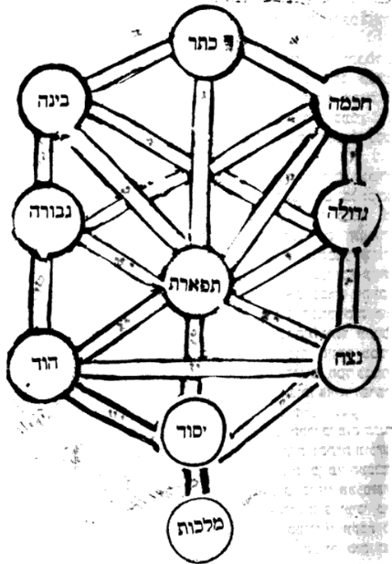

### Chapter 7:2. Explanation of the channels belonging to Keter and Chokhmah down to Hod.

**7:2:1** Since in the preceding chapter we have planted the Tree of Life for the knowledge of good, and [shown] how the deeps [call]—"deep calls unto deep at the sound of the channels"—it is fitting for the inquirer to take care in working it and in keeping it, so that we shall not need to depict it again in the coming chapters, God willing. And now we shall explain what these callings serve.

> אחר שבפרק הקודם נטענו את עץ החיים לדעת טוב וכיצד התהומות תהום אל תהום קורא לקול הצנורות ראוי למעיין ליזהר בעבודתו ובשמירתו כדי שלא נצטרך עוד אל ציורו בפרקים הבאים ב"ה. ועתה נבאר מה הקריאות האלה משמשות.

**7:2:2** And behold, from Keter three channels go out:

> והנה מהכתר יוצאים ג' צנורות:

**7:2:3** The first channel [is] to Chokhmah. From this channel is the beginning of the spreading-forth of the supernal world; and they are the shining face from which the whole world was illumined by the glory of its emanation, and from there all the Sefirot were revealed. And they called its name "the Hidden Channel," since there is none more hidden than it; for the joining of Chokhmah to Keter—it is not known how and in what way—so much so that, almost, by way of that channel Chokhmah at times draws sustenance in effluence from the Ein Sof by means of Keter; for there is the hiding-place of the Cause of causes. And this matter Rashbi, peace be upon him, explained in the Tikkunim (Tikkun 52, fol. 84), and these are his words, on the verse "YHVH Adonai is my strength [cheili]," etc.: "What is 'my strength' [cheili]? The might of all, from above. Cheili—the strength of yod [cheil yod]; and this is Abba, whose might, whose welling, is the Ein Sof (a variant reads: a welling that has no end)." Thus far [his] words.

> צנור ראשון אל החכמה. מזה הצנור התחלת התפשטות של עולם העליון והם הפנים המאירים אשר משם כל העולם האירה מכבוד אצילותו ומשם נתגלו כל הספירות וקראו שמו צנור הנעלם להיות כי אין נעלם יותר ממנו כי התחברות החכמה אל הכתר אין נודע כיצד והאיך עד שכמעט דרך אותו צנור לפעמים יונק החכמה בשפע מהא"ס ע"י הכתר כי שם הסתר סבת הסבות. וזה הענין ביאר הרשב"י ע"ה בתיקונים (תקונא נ"ב דף פ"ד) וז"ל בפסוק אדנ"י ידו"ד חילי וגו'. מאי חילי, תוקפא דכלא מלעילא חילי חיל י' ודא אבא תוקפא דיליה נביעו דיליה א"ס (נ"א נביעו דלית ליה סוף) עכ"ל.

**7:2:4** And because the inquirer might imagine to reject this proof of ours by saying that at times Keter is called Ein Sof, we have seen fit to explain the passage, so that from within it it will be compelled that "Ein Sof" is the actual Ein Sof. And this is its explanation. "What is cheili?"—the reason being that above he explained all the rest of the verse, and now he asked of the word cheili, what its meaning is. And he answered, "the might of all, from above," and the intent is the Ein Sof. And because to the Ein Sof neither name nor word properly applies, for this he said that the meaning of cheili is from the language of power, and the intent is [that] the Ein Sof is the one who gives power and strength and might to all the Sefirot. And because this matter might already apply properly to Keter—for Keter too gives power and strength to all that is below it—therefore he lengthened his language and said "the might of all, from above," meaning: the one who gives power to all, and who is above all, there being none above Him; and that is the Ein Sof. And because, since cheili means the supernal power, I might have said that the meaning of cheili is the strength of Keter, for this he said "the strength of yod," that is, Chokhmah, which is called yod, as is known. And what he said, "and this is Abba," follows along with the rest of the explanation of the passage, and there is no [need] to go on at length. And they said that to this channel, which is from Keter to Chokhmah, the right strap of the head-tefillin hints—that is, with the hint of the housing [bayit] being to Keter—and from this channel went forth "living waters, flowing from Lebanon" to Chokhmah.

> ומפני שידמה המעיין לדחות ראיותינו זו באמרו כי לעיתים כתר יקרא אין סוף ראינו לבאר המאמר כדי שמתוכו יוכרח שא"ס הוא האין סוף ממש. וזה פירושו. מאי חילי. מטעם כי למעלה ביאר כל שאר הכתוב ועתה שאל מלת חילי מהו פירושו. והשיב תוקפא דכלא מלעילא והכוונה בא"ס. ומפני שאין סוף לא יצדק בו לא שם ולא מלה, לזה אמר כי פי' חילי הוא מלשון כח והכוונה האין סוף הוא הנותן כח וחיל ועצמה לכל הספירות. ומפני שכבר יצדק ענין זה בכתר כי כתר נמי נותן כח וחיל לכל אשר למטה ממנו לכן האריך בלשונו ואמר תוקפא דכלא מלעילא. פי' אותו הנותן כח לכל, והוא למעלה מן הכל שאין למעלה ממנו והיינו הא"ס. ומפני כי אחר שחילי ר"ל כח העליון הייתי אומר כי פי' חילי היינו חילי של כתר, לזה אמר חיל י', דהיינו חכמה שהיא הנקרא יו"ד כנודע. ומה שאמר ודא אבא הוא נמשך עם שאר פירוש המאמר ואין להאריך. ואמרו כי אל הצנור הזה שמכתר לחכמה רמז רצועה ימנית של תפלין של ראש והיינו בהיות הרמז של בי"ת בכתר ומן הצנור הזה יצאו מים חיים נוזלים מן לבנון אל החכמה:

**7:2:5** The second channel goes out from Keter to Binah. From this channel Binah receives effluence [of] abundant good from Keter. And they said that from it the perfumed wine spreads forth to Binah, and Binah brings it out from potential to actuality; and the perfumed wine spreads forth as far as the altar, in order to set right the dish of the pot gone rancid on account of the transgressions of Israel, and there, on account of [our] iniquities, they pour it out as a libation. For here "libation-wine" [yein nesekh] does not apply, for there is no touch of a gentile here. And they meant, in their saying "to set right the dish gone rancid," something like what was explained in the Zohar (perhaps he means Zohar, Balak, fol. 189a-b; see there) concerning Isaac: that there was mixed in his wine the wine of Esau, poured out [in order] to bless him; and Jacob brought him of the spiced wine, of the good wine, as it is written (Genesis 27:25), "and he brought him wine"—and then the power of mercy was added to him. And likewise, from this channel mercy is poured to Binah, to suckle the power of the milk to the children, so that our eyes be "washed in milk," and they grow quiet and rest, as we shall explain in the Gate of Essence and Governance, chapter six. And then, as they are washed in milk, the red eyes are whitened; and this is by the power of this channel, which pours the power of the milk from the supernal whiteness. And this channel is hidden. And they said that it is the left strap of the head-tefillin.

> צנור שני יוצא מן הכתר אל הבינה מן הצנור הזה תקבל הבינה שפע רב טוב מהכתר. ואמרו כי ממנו מתפשט היין המבושם אל הבינה והבינה מוציאה אותו מכח אל הפועל והיין המבושם מתפשט עד המזבח כדי לתקן תבשיל הקדרה המסרחת מחמת עבירות ישראל ושם בעונותי' מנסכים אותו. כי כאן לא שייך יין נסך, כי אין כאן מגע גוי. ורצו באמרם לתקן תבשיל המסרחת כענין מה שבארו בזהר (אולי כוונתו לזהר בלק דף קפ"ט א' ב' ע"ש) בענין יצחק כי היה מעורב ביינו יין של עשו הנסוך לברך אותו. והביא לו יעקב מיין הרקח מיין הטוב כדכתיב (בראשית כז כה) ויבא לו יין ואז נתוסף עליו כח הרחמים. וכן מן הצנור הזה נשפע הרחמים אל הבינה להניק כח החלב אל הבנים להיות עינינו רוחצות בחלב וישקטו וינוחו כמו שנבאר בשער מהות והנהגה פ"ו. ואז בהתרחצם בחלב יתלבנו העינים האדומים וזה בכח הצינור הזה המשפיע כח החלב מן הלובן העליון. והצינור הזה נעלם. ואמרו כי היא רצועה שמאלית של תפלין של ראש:

**7:2:6** The third channel goes out from Keter to Tiferet; and from there is the way of its ascent to Keter, to receive effluence and abundant good to pour forth to the four flocks of sheep that are beneath it, and they are Netzach, Hod, Yesod, Malkhut. And by way of this channel it ascends to join Father and Mother in the secret of their union, by means of Da'at, as explained above in the Gate of Whether the Ein Sof is the Keter. And by means of the effluence poured upon it from Keter by way of this channel, it has the power to incline toward Chesed; for because it draws sustenance from Chesed and Gevurah, it stands between the two of them, even; and when effluence is poured upon it from the supernal whiteness, then it inclines toward Chesed. And this channel is called "the middle line," together with its continuation as far as Malkhut. And the commentators explained that this channel is what Moses our teacher, peace be upon him, sought to know, and He answered him, "for no man shall see Me and live" (Exodus 33:20). And these are words of [mere] prophesying, for Moses our teacher, peace be upon him, never asked about this.

> צנור ג' יוצא מהכתר אל הת"ת ומשם דרך עלייתו אל הכתר לקבל שפע ורב טוב להשפיע אל ארבעת עדרי צאן אשר תחתיו והם נצח הוד יסוד מלכות ודרך הצינור הזה יעלה לחבר אב ואם בסוד יחודם ע"י הדעת כמבואר לעיל בשער אם הא"ס הוא הכתר. וע"י השפע הנשפעת עליו מן הכתר דרך הצנור הזה יש לו כח להטות כלפי החסד כי מפני היותו יונק מחסד וגבורה עומד בין שניהם שוה וכאשר יושפע עליו שפע מהלובן העליון אז יטה כלפי חסד והצינור הזה קרוי קו האמצעי עם המשכו עד המלכות. ופירשו המפרשים כי הצינור הזה הוא שבקש מרע"ה לידע והשיב לו כי לא יראני האדם וחי (שמות לג כ). ואלו הם דברי נביאות כי מעולם לא שאל מרע"ה בזה:

**7:2:7** A further three channels are drawn from Chokhmah. The first, to Binah: it is that by which the thirty-two paths are drawn from Chokhmah to Binah—and they are the twenty-two letters and the ten utterances, which are hidden in Chokhmah, "koach mah" (the power of "mah"), and Binah brings them out from potential to actuality; so the commentators explained. And it is possible that this is the channel by which was the spreading-forth from Chokhmah to Binah in the Sefirot themselves, at the beginning of the Emanation, as explained in the Gate of the Order of the Emanation, with God's help. And by way of this channel Chokhmah is hidden within Binah, as is explained in the Zohar in many places.

> עוד ג' צנורות נמשכים מן החכמה. הא' אל הבינה. הוא אשר בו נמשכים הל"ב נתיבות מן החכמה אל הבינה והם כ"ב אותיות וי' מאמרות הנעלמות בחכמה כ"ח מ"ה ובינה מוציאם מכח אל הפועל, כ"פ המפרשים. ואפשר היות זה הצינור שבו היה ההתפשטות מהחכמה אל הבינה בעצמות הספירות בתחלת האצילות כדפי' בשער סדר האצי' בס"ד, ודרך הצינור הזה מתעלמת החכמה בתוך הבינה כמבואר בזוהר בהרבה מקומות:

**7:2:8** The second channel is drawn from Chokhmah to Chesed. By way of this channel the effluence of lovingkindness [chesed] is drawn to Gedulah from Chokhmah. And by way of this channel the seventy-two bridges are drawn to Chesed, as we shall explain in the Gate of Essence and Governance, chapter sixteen. And the seventy-two bridges are in Chokhmah—"koach mah"—in potential, and in Chesed in actuality. And so "Chokhmah" amounts to seventy-three, which are the seventy-two bridges with Chesed hovering over them. And likewise, by means of this channel is drawn "the good oil upon the head, running down upon the beard, the beard of Aaron," as we shall explain in the Glossary of Titles, under the entry "oil"—that the principal [source] of the oil is from Keter, by means of Chokhmah, to the priest, the man of Chesed. And because its root is in Keter, therefore shemen ["oil"] in atbash amounts to bet-yod-tet [21], which is Ehyeh, and it is a holy name. And likewise, by way of this channel the [effluence of] Chokhmah descends to Chesed, as they, of blessed memory, said: "One who wishes to become wise should turn south"; and through this the yod of the name is at times designated in Chesed, as is customary in the Zohar and in the Tikkunim.

> צנור ב' נמשך מהחכמה אל החסד. דרך הצינור הזה נמשך שפע החסד אל הגדולה מהחכמה. ודרך הצינור הזה נמשכים אל החסד הע"ב גשרים כמה שנבאר בשער מהות והנהגה פרק ט"ז. והע"ב גשרים הם בחכמה כ"ח מ"ה בכח, ובחסד בפועל. וכן חכמה עולה ע"ג שהם ע"ב גשרים והחסד חופף עליהם. וכן ע"י הצינור הזה נמשך השמן הטוב על הרא"ש יורד על הזקן זקן אהרן כמו שנבאר בשער ערכי הכינויים בערך שמן שעיקר השמן הוא מהכתר ע"י החכמה אל הכהן איש החסד. ומפני ששרשו בכתר לכן שמ"ן בא"ת ב"ש עולה בי"ט הוא אהי"ה והוא שם קדוש. וכן דרך הצנור הזה ירד [שפע] החכמה אל החסד כאמרם ז"ל הרוצה להחכים ידרים, וע"י כך יכונה י' של שם לעתים בחסד כמורגל בזוהר ובתיקונים:

**7:2:9** The third channel is drawn from Chokhmah to Tiferet; and this we have found only with the author of the parchment (Yeri'ah) [a particular chart of the Tree]. And possibly the reason is that Tiferet is the son of Chokhmah and Binah, and behold, it is compelled that the power of the father be in the power of the son, and likewise the power of the mother; for "there are three partners in a person." And possibly by way of this channel is the matter of "Israel arose in thought." And for this matter there is disclosure from many places in the Zohar and in the Idra, as will be explained in Sefer Or Yakar, with God's help.

> צנור ג' נמשך מהחכמה אל התפארת וזה לא מצאנוהו אלא לבעל היריעה. ואפשר הטעם כי התפארת הוא בן החכמה והבינה והנה יוכרח היות כח האב בכח הבן וכן כח האם כי ג' שותפים באדם. ואפשר כי דרך הצנור הזה הוא ענין ישראל עלה במחשבה. ויש לענין זה גילוי ממקומות הרבה בזוהר ובאדרא כאשר יתבאר בספר אור יקר בס"ד:

**7:2:10** A further two channels are drawn from Binah. The first, to Gevurah. And the commentators explained that it is to quiet the judgment of Gevurah and the power of the husks. And it is known that Binah pours into Gevurah in two modes. The one is judgment and might [gevurah]—for Binah is called "the worker of mighty deeds (gevurot)," and "from its side judgments are aroused," as we shall explain in the Gate of Essence and Governance. And this is specifically when it pours through this channel alone, which is from its own self. However, when it receives through the channel that it has from Keter and pours through this channel into Gevurah, then the effluence is to quiet the judgment and the might. And in this way is drawn the weakening of the husks, which are the officers of the judges, from outside; and when the judgment is annulled, their power is annulled, since they do not effect their action.

> עוד שני צנורות נמשכים מהבינה. הא' אל הגבורה. ופי' המפרשים שהוא להשקיט דין הגבורה וכח הקליפות. וידוע כי משני פנים תשפיע הבינה אל הגבורה. האחד הוא הדין והגבורה. כי הבינה פועל גבורות נקראת. ומסטרא דיליה דינין מתערין. כמו שנבאר בשער מהות והנהגה. וזה דוקא כאשר תשפיע בצינור הזה לבד שהוא מעצמותה. אמנם כאשר תקבל בצנור אשר לה מהכתר ותשפיע בצנור הזה אל הגבורה. אז השפע הוא להשקיט הדין והגבורה. ובדרך הזה ימשך חולשות הקליפות שהם שוטרי הדיינים מבחוץ. ובהתבטל הדין יתבטל כחם, מאחר שאינם פועלים פעולתם:

**7:2:11** The second channel [is] from Binah to Tiferet.

> צנור ב' מבינה אל ת"ת.

**7:2:12** Behold, this channel will be explained in the way that we explained above concerning the third channel, which is drawn from Chokhmah to Tiferet. And by way of this channel Tiferet ascends to Binah. And by way of this channel Binah established Tiferet, as in the matter of "He established the heavens by understanding" (Proverbs 3:19), as will be explained in the Gate of Manifestations, and was explained in the Gate "Ten and Not Nine."

> הנה הצנור הזה יתבאר ע"ד שבארנו למעלה בצנור הג' הנמשך מחכמה אל הת"ת. ודרך הצנור הזה יעלה הת"ת אל הבינה. ודרך הצנור הזה כונן הבינה את הת"ת. כענין כונן שמים בתבונה (משלי ג יט). כמו שיתבאר בשער המציאות ונתבאר בשער י' ולא תשע:

**7:2:13** A further three channels go out from Chesed. And the first of them, to Gevurah. And likewise from Gevurah the power of the fire of Gevurah goes out to Chesed, to dry the moisture of the water of Chesed; and the power of the water of Chesed [goes out] to quench the fire of Gevurah—for so Rashbi, peace be upon him, explained. And with this will be understood a matter in which one thing opposes another: that the south is hot and dry, and the north cold and moist—and it would have been fitting to be the reverse. And what is explained on this is set forth in the Gate of Essence and Governance, in chapter eleven, and in the Glossary of Titles, in the name of Rashbi, peace be upon him. Many have explained that between [the ends of] this channel is Tiferet, which is what combines them. But by what we have explained it is better settled: that apart from Tiferet they have a channel together; and this agrees best with most of the words of the Zohar. And by means of this channel Chesed is included in Gevurah and Gevurah in Chesed, without the joining of Tiferet, as is explained in the Zohar and explained in the Gate of Essence and Governance. The second channel goes out from Chesed to Tiferet. And they said that from this channel thirty-five princes are drawn to Tiferet, and Tiferet brings them out from potential to actuality; and they are those who incline rightward, toward merit—so the commentators explained. And likewise, by means of this channel are also drawn seventy-two powers that are joined to the seventy-two names, as is known—which are the 216 lights: seventy-two of the right, seventy-two of the left, seventy-two of the middle. And Tiferet is what brings them out from potential to actuality and tips them toward the right. And likewise, by means of this channel is the matter of the arbitration, in combination with that of Gevurah.

> עוד ג' צנורות יוצאים מהחסד. והא' מהם אל הגבורה. וכן מהגבורה יוצא כח אש של גבורה אל החסד ליבש לחות המים של חסד. וכח מים של חסד לכבות אש הגבורה. כי כן ביאר הרשב"י ע"ה. ועם זה יובן דבר המנגד זה לזה. כי הדרום הוא חם ויבש, והצפון קר ולח. והיה מן הראוי להיות להפך. ומה שפי' בזה מבואר בשער מהות והנהגה בפי"א ובשער ערכי הכנוים בשם הרשב"י ע"ה. רבים פירשו כי בין הצנור הזה הוא הת"ת שהוא המצרפם. ובמה שבארנו הוא יותר מתיישב כי בזולת הת"ת יש להם צנור יחד והוא היותר מסכים עם רוב דברי הזוהר. וע"י הצנור הזה נכללים חסד בגבורה וגבורה בחסד בלי הצטרפות הת"ת כמבואר בזוהר ופי' בשער מהות והנהגה. צנור ב' יוצא מהחסד אל הת"ת. ואמרו כי מזה הצנור נמשכים ל"ה שרים אל הת"ת. והת"ת מוציאם מהכח אל הפועל. והם המיימינים לזכות, כן פי' המפרשים. וכן ע"י הצינור הזה נמשכים ג"כ ע"ב כוחות המצטרפים אל ע"ב שמות כנודע, שהם רי"ו אורות ע"ב ימינים ע"ב שמאלים ע"ב אמצעים. והת"ת הוא המוציאם מהכח אל הפועל ומכריען אל הימין. וכן ע"י הצנור הזה הוא ענין ההכרעה בצרוף אותו של גבורה:

**7:2:14** The third channel goes out from Gedulah to Netzach; from there is the principal nourishment of Netzach, from Chesed. And the secret [is] "pleasantness at Your right hand forever [netzach]" (Psalms 16:11). For it is the emissary of Gedulah, and the principal action of Netzach is in lovingkindness [chesed]. And just as in Chesed there are seventy-two powers for the name of seventy-two, so there are in Netzach as well. For the three Patriarchs are the three vavs—va-yissa, va-yavo, va-yet (Exodus 14)—and likewise they are Netzach, Hod, Yesod, and in them too is the name of seventy-two. So Rashbi explained in the Tikkunim.

> צנור ג' יוצא מהגדולה אל הנצח משם עיקר יניקת הנצח מהחסד. והסוד נעימות בימינך נצח (תהלים טז יא). כי הוא שליח הגדולה ועקר פעולת הנצח הוא בחסד, וכמו שבחסד ע"ב כוחות אל שם ע"ב כן יש גם בנצח. כי ג' אבות ג' ווי"ן "ויסע "ויבא "ויט (שמות יד). וג"כ הם נצח הוד יסוד, ובהם ג"כ שם ע"ב. כ"פ הרשב"י בתיקונים:

**7:2:15** A further two channels are drawn from Gevurah. The first, to Tiferet. And the commentators explained that from there are drawn thirty-five princes who incline leftward, toward the scale of guilt, and Tiferet brings them out to actuality. And likewise, from within this channel are drawn seventy-two powers that are joined to the seventy-two names, as is known—which are the 216 lights, and seventy-two of them are of the left; and by means of this channel and that of Chesed, it is the arbiter between them, as we have explained. And further, by means of the aid of these channels, of Chesed and of Gevurah, he is united with his bride, in the secret of (Song of Songs 2:6) "His left hand is under my head, and his right hand embraces me," and as we shall explain in the Gate of Essence and Governance. And we have already written a little of this in the preceding gates.

> עוד נמשכים שני צנורות מהגבורה. האחד אל הת"ת. ופי' המפרשים כי משם נמשכים ל"ה שרים המשמאילים לכף חובה והת"ת מוציאם לפועל. וכן מתוך הצנור הזה נמשכים ע"ב כוחות המצטרפים אל ע"ב שמות כנודע שהם רי"ו אורות וע"ב מהם שמאלים וע"י הצנור הזה ושל חסד הוא המכריע ביניהם כאשר בארנו. ועוד ע"י סיוע צנורות אלו של חסד ושל גבורה הוא מתיחד בכלתו בסוד (שה"ש ב ו) שמאלו תחת לראשי וימינו תחבקני. וכמו שנבאר בשער מהות והנהגה. וכבר כתבנו בשערים הקודמים קצת מזה:

**7:2:16** The second channel goes out from Gevurah to Hod, and by means of it is the principal nourishment of Hod from Din, as we explained above in the Gate "Ten and Not Nine." And the commentators explained that by means of this channel the negative commandments are drawn from Gevurah to Hod, and in Hod is their explication; and likewise the positive commandments from Chesed to Netzach, by means of the channel that it has from it. And it is possible that Gedulah and Gevurah are the principal powers of the positive commandments and the negative commandments, and by means of Netzach and Hod they are revealed, just as the other actions that are in Chesed and in Gevurah are revealed by their means.

> צנור ב' יוצא מהגבורה אל ההוד ועל ידו עקר יניקת ההוד מן הדין כאשר בארנו למעלה בשער י' ולא תשע. ופי' המפרשים כי ע"י הצנור הזה נמשכים מצות ל"ת מהגבורה אל ההוד ובהוד ביאורם, וכן מ"ע מהחסד אל הנצח ע"י צנור שיש לו ממנה. ואפשר כי גדולה וגבורה הם עיקר כחות מ"ע ומצות ל"ת וע"י נצח והוד מתגלים כמו ששאר הפעולות שבחסד ובגבורה מתגלים על ידם:

**7:2:17** A further three channels are drawn from Tiferet. The first, to Netzach; and by means of it [Netzach] draws a little sustenance from the redness of Gevurah, for the sake of the blending, as is explained at length in the Gate "Ten and Not Nine," in chapter four. And there is one who did not write this channel, nor the one going out from it to Hod. And this is a void opinion; and this [channel] is agreed upon, as we have explained.

> עוד ג' צנורות נמשכים מהת"ת. הא' אל הנצח. ועל ידו יונק קצת מאודם הגבורה לסבת המזג כמבואר בארוכה בשער י' ולא ט' בפ"ד. ויש מי שלא כתב הצינור הזה וכן היוצא ממנו אל ההוד. וסברא בטלה היא זו. וזו היא מוסכמת כדפירשנו:

**7:2:18** The second channel goes out from Tiferet to Hod, to sweeten its judgment a little. And this is on account of its inclining—the whiteness toward the redness—as is explained in the said Gate and will be explained in the Gate of Colors. And by means of the two said channels the dew pours forth and descends from the heavens, [which is] Tiferet; then they [Netzach and Hod] "grind manna for the righteous"—Yesod and Malkhut, Tzaddik and Tzedek. And it will be explained in the Glossary of Titles, under the entry "Shechakim."

> צנור ב' יוצא מהת"ת אל ההוד למתק דינו מעט. וזה מסבת נטייתו הלובן אל האודם כמבואר בשער הנזכר ויתבאר בשער הגוונים. וע"י שני הצנורות הנז' משפיע ויורד הט"ל מן השמים ת"ת אז והם שוחקים מן לצדיקים יסוד ומלכות צדיק וצדק. ויתבאר בשער ערכי הכינויים בערך שחקים:

**7:2:19** The third channel goes out from Tiferet to Yesod. And by means of it Yesod receives abundant good, to unite the groom with his bride; for by means of it her sustenance descends, and it is the best man. It turns out that this channel has two actions. The one: the sustenance that overflows to the woman by means of the intermediary, and likewise the sustenance of Yesod itself. And the second action: that it is the way of her ascent to be united with her husband, after she has been adorned "as a bride adorns herself with her jewels."

> צנור ג' יוצא מהת"ת ליסוד. ועל ידו מקבל היסוד רב טוב ליחד החתן עם כלתו, כי על ידו ירד מזונה והוא השושבין. נמצא לצנור הזה שתי פעולות. הא' המזון השופע לאשה ע"י השליש וכן מזון היסוד בעצמו. והפעולה השנית כי הוא דרך עלייתה להתיחד עם בעלה אחרי אשר היא מקושטת ככלה תעדה כליה:

**7:2:20** A further two channels go out from Netzach. The first, to Hod. And the commentators explained that by means of this channel they are united to ascend (to the heavens). And it is possible that by means of this channel is the grinding of the manna, in a slight evenness of blending, before its coming to Yesod. And by means of this channel, and likewise the channel that is from Chesed to Gevurah, and likewise the channel that is from Chokhmah to Binah, is the union of Tiferet and Malkhut, in the secret of their inclining to the right and to the left. For Tiferet is in Netzach and Malkhut in Hod: YHVH in Netzach, Adonai in Hod; and by means of Yesod the two of them are united together, and YAHDVNHY is made. And so they are in Chesed and Gevurah—the male to the right and the female to the left: YHVH in Chesed, Adonai in Gevurah; and the two of them are united in Tiferet. And so they are in Chokhmah and Binah—the male to the right and the female to the left: YHVH in Chokhmah, Adonai in Binah; and the two of them are united in Keter—and not actually Keter, but in the secret of Da'at, which is the union of Chokhmah and Binah.

> עוד ב' צנורות יוצאים מהנצח. האחד אל ההוד. ופ' המפרשים שע"י הצנור הזה מתאחדים לעלות (השמים). ואפשר שע"י הצנור הזה הוא שחיקת המן בשווי מזג מועט קודם בואו אל היסוד. וע"י צנור זה וכן צנור שמחסד אל הגבורה וכן צנור שמחכמה אל הבינה הם יחוד ת"ת ומלכות בסוד נטייתם אל הימין ואל השמאל. כי הת"ת בנצח והמלכות בהוד. יהוה בנצח אדני בהוד. וע"י היסוד מתיחדים שניהם יחד ונעשה יאהדונה"י. וכן הם בחסד וגבורה הזכר אל הימין והנקבה אל השמאל יהוה בחס"ד אדני בגבורה. ושניהם מתיחדים בת"ת. וכן הם בחכמה ובינה הזכר אל הימין ונקבה אל השמאל יהו"ד בחכמה אדנ"י בבינ"ה ושניהם מתיחדים בכתר. ולא ממש הכתר אלא בסוד הדעת שהוא יחוד חכמה ובינה.

**7:2:21** And behold, it turns out that these three channels—that from Chokhmah to Binah, and that between Gedulah and Gevurah, and that between Netzach and Hod—are for [set] times; that is to say, for the times of the union of Tiferet with Malkhut.

> והנה נמצאו ג' צנורות אלה שמחכמה לבינה ושבין גדולה וגבורה ושבין נצח להוד הם לעתות ר"ל אל עתות היחוד מת"ת למלכות.

**7:2:22** And the matter of these unifications is explained in the Tikkunim [Tikkun 18, fol. 33a].

> וענין היחודים האלה נתבארו בתיקונים [תקונא י"ח דל"ג.]:

**7:2:23** The second channel goes out from Netzach to Yesod. For by means of this channel and the one opposite it is the blending and the arbitration by which Yesod tips the balance between Netzach and Hod. And by means of these two channels is the power of the seed, and by their means it is ripened—as is known, that Yesod is the member, and Netzach and Hod are the two testicles of the male.

> צנור ב' יוצא מהנצח אל היסוד. כי ע"י הצנור הזה ושכנגדו הוא המזיגה וההכרעה שמכריע יסוד בין נצח והוד. וע"י שני הצנורות הללו הוא כח הזרע וע"י מתבשל כמו שנודע שהיסוד הוא האמה והנצח וההוד הן תרין ביעין דדכורא:

**7:2:24** The third channel goes out from Netzach to Malkhut. And by means of it "a thread of lovingkindness [chesed] was drawn over Esther," and by means of it she receives effluence from Chesed before the coupling. And likewise by means of Hod—for she needs to receive effluence from two places, from the right and from the left, in the secret of (Song of Songs 2:6) "His left hand is under my head," etc. And it will be explained in the Gate of Essence and Governance, with God's help, in chapter twenty-one.

> צנור שלישי יוצא מהנצח אל המלכות. ועל ידו חוט של חסד נמשך על אסתר ועל ידו תקבל שפע מהחסד קודם הזיווג. וכן ע"י ההוד שהיא צריכה קבלת שפע משני מקומות מהימין ומהשמאל בסוד (שה"ש ב ו) שמאלו תחת לראשי וגו' ויתבאר בשער מהות והנהגה בס"ד בפרק כ"א:

**7:2:25** A further two channels go out from Hod. The first, to Yesod; and its rule has been explained above. And the second, to Malkhut. And the author of the parchment explained that from this channel the primordial serpent cast filth into Eve. And his words are words of dreams, like one prophesying a vain vision; for "who set a drunkard among the Nazirites?"—as we shall explain, that the husk has no entry into holiness at all, as will be explained in the Gate of Substitutes. And what it might have been possible to say [is] that by means of this channel judgment is poured from Hod to Malkhut; but all this is without foundation [yesod], as we shall explain in the coming chapter.

> עוד ב' צנורות יוצאים מהוד. האחד אל היסוד. ופי' משפטו למעלה. והשני אל המלכות. ופי' בעל היריעה כי מן הצינור הזה הטיל נחש הקדמוני זוהמא בחוה. ודבריו דברי חלומות כמתנבא חזיון שוא כי מי נתן שכור בין הנזירים כמו שנבאר כי אין מבוא לקליפה בקדושה כלל כאשר יתבאר בשער התמורות. ומה שהיה באפשר לומר שע"י הצינור הזה נשפע הדין מההוד למלכות אבל כל זה בלי יסוד כמו שנבאר בפרק הבא:

### Chapter 7:3. Refutation of two channels the commentators posited — from Netzach to Malkhut and from Hod to Malkhut; and there the statement from the beginning of Parashat Noach is explained.

**7:3:1** And what is fitting to know [is] that what the commentators said concerning the two channels—one from Netzach to Malkhut and the second from Hod to Malkhut—is not tenable at all. For it is clear that Malkhut receives effluence only by means of Yesod, as is explained in the Zohar, Parashat Noach (fol. 59b), and these are its words: "Rabbi Elazar said: 'These' [eleh] in every place invalidates the former ones. We have learned, etc. What is written above, in the portion of Bereshit? 'And a river issues from Eden to water the garden, and from there it divides,' etc. That river that flows and issues [nagid ve-nafik] and enters the garden and waters it with the watering from above, and gives it rest [naycha], and it yields fruit and makes seeds grow—and it is then rest for all. And this is rest for the garden, and this one makes rest in it, as it is said, 'for in it He rested,' and it is written, 'and He rested on the seventh day.' And this is the secret of the matter: this one makes generations, and no other. Come and see: [in like manner] Noah below was the holy covenant, a pattern of that above, and therefore he is called 'a man of the ground.' And we have learned a secret: for Noah needed the ark [tevah], to be joined with it and to sustain the seed of all, as it is written, 'to keep seed alive.' Who is the ark? This is the Ark of the Covenant. And Noah and the ark below were thus, after the pattern of above. Of Noah, 'covenant' is written, as it is written, 'and I will establish My covenant with you,' etc. And until the covenant was established in him he did not enter the ark, as it is written, 'and I will establish My covenant with you, and you shall come into the ark.' And then the ark was the Ark of the Covenant. Ark and Noah—all after the manner of above. And because this covenant above makes generations, in like manner Noah below makes generations. On account of this it is written, 'These are the generations of Noah: Noah was a righteous man.' So it is, certainly, after the manner of above. And therefore it is written, 'and the righteous one is the foundation of the world,' and the earth is sustained upon this; for he is the pillar upon which the world stands. And who is he? This is the Righteous One [Tzaddik]. And Noah is called 'righteous' below. And the secret of all: 'Noah walked with God'—precisely; that he never separated from Him, and [so as] to be on earth after the manner of above: 'a righteous man'—the foundation of the world; 'covenant of peace'—the peace of the world; 'a man of the ground'—certainly. And therefore, 'and Noah found favor in the eyes of YHVH.'" Thus far [its] words.

> ומה שראוי לדעת, כי מה שאמרו המפרשים מענין ב' צנורות א' מנצח אל המלכות והשני מהוד אל המלכות, אינם מתישבים כלל. כי ברור הוא שהמלכות לא תקבל שפע כ"א ע"י היסוד. כמו שנתבאר בזוהר פ' נח (דף נ"ט ע"ב) וז"ל אמר ר' אלעזר אלה בכל אתר פסל את הראשונים. תנינן וכו'. מה כתיב לעילא בפרשתא דבראשית, ונהר יוצא מעדן להשקות את הגן ומשם יפרד וגו'. ההוא נהר דנגיד ונפיק ועייל לגנתא ואשקי ליה משקיו דלעילא ועביד ליה נייחא ועביד איבין ורבי זרעין והוא כדין נייחא לכלא. ודא נייחא ליה לגנתא ודא עביד נייחא ביה. כד"א כי בו שבת, וכתיב וישבות ביום השביעי. ודא רזא דמלה דא עביד תולדות ולא אחרא. תא חזי [כגוונא דא] נח לתתא קיימא קדישא הוה דוגמא דלעילא, ועל דא איקרי איש האדמה. ורזא אוליפנא, דהא נח איצטריך לתיבה לאתחברא בה ולקיימא זרעא דכלא דכתיב לחיות זרע. מאן תיבה, דא ארון הברית. ונח ותיבה לתתא, הכי הוו כדוגמא דלעילא. נח כתיב ביה ברית דכתיב והקימותי את בריתי אתך וגו'. ועד דאתקיים ביה ברית לא עאל לתיבותא, דכתיב והקימותי את בריתי אתך ובאת אל התיבה. וכדין הוה תיבה ארון הברית. תיבה ונח, כלא כגוונא דלעילא. ובגין דהאי ברית לעילא הוא עביד תולדות, כגוונא דא נח לתתא הוא עביד תולדות. בג"כ כתיב אלה תולדות נח נח איש צדיק. הכי הוא ודאי כגוונא דלעילא. וע"ד וצדיק יסוד עולם כתיב. וארעא ע"ד אתקיימא. דהא איהו עמודא דעלמא קיימא עליה. ומאן איהו דא צדיק. ונח איקרי צדיק לתתא. ורזא דכלא את האלקים התהלך נח דייקא. דלא אתפרש מיניה לעלמין. ולמהוי הוא בארעא כגוונא דלעילא. איש צדיק, יסודא דעלמא. ברית שלום, שלמא דעלמא. איש האדמה ודאי. וע"ד ונח מצא חן בעיני ה' עכ"ל.

**7:3:2** What there is to be precise about in this passage is: First, his saying "that river that flows and issues"—what need is there for the word "flows" [nagid]? For his saying "issues" [nafik]—which is the language of the verse, which says "and a river issues from Eden"—suffices.

> מה שיש לדקדק במאמר זה הוא. א'. מ"ש ההוא נהיר דנגיד ונפיק. מה צורך אל מלת נגיד כי באמרו נפיק דהיינו לישנא דקרא דקאמר ונהר יוצא מעדן די.

**7:3:3** And further: he ought to have [said] "issues, and afterward flows"; for such is the way—that first it issues, and afterward it is drawn onward. And we can resolve [this by saying] that he adopted the language of the verse, "a river of fire flowed and issued from before Him" (Daniel 7:10). And nonetheless, according to our way it will be made more precise.

> ועוד נפיק ולבתר נגיד מבעי ליה. דהכי אורחא שקודם יוצא, ואח"כ נמשך. ונוכל לתרץ דלישנא דקרא נקט נהר דינור נגיד ונפיק מן קדמוהי (דניאל ז י). ועכ"ז ע"פ דרכנו ידוקדק יותר.

**7:3:4** And further, on the verse too there is a difficulty: why did it not say "a river … issued from before Him"? Or let it say "issued and flowed"; what is "flowed and issued," not in order? Second: what he said, "and waters it with the watering from above"—certainly it is the watering from above! For such is the way of a river: it is drawn from above downward and waters the lower ones from the effluence of the upper ones. And why did he go on at length about what teaches us nothing, since it is obvious? Third: his saying "and gives it rest," etc., and afterward he said "and it is then rest for the garden," etc., according to one reading—or, according to another reading, "and it is then rest for all," etc. One must see why he did not state, in the first clause, two aspects, as he stated in the latter clause—as appears from the sense of the language, where he says "and it is then rest for the garden, and the garden is rest in it," or, according to the other reading, "and this is rest for the garden, and this one makes rest in it." But in the first clause he said only "and gives it rest," alone. Fourth: his saying "and it yields fruit and makes seeds grow" appears a needless doubling. Fifth: his saying "Who is the ark? This is the Ark of the Covenant"—why did he adopt the language "the Ark of the Covenant," and not say "Who is the ark? This is Malkhut," which would be preferable? Sixth: here it is implied that the ark by itself is the Ark of the Covenant, whereas further on he concludes that when Noah is within the ark, the two of them in union are called the Ark of the Covenant. Seventh: his saying "'a righteous man'—so it is, certainly," etc., up to "for he is the pillar upon which the world stands," etc.—it all appears a lengthening upon what was already expounded at the beginning. Eighth: his saying "And who is he? This is the Righteous One." Now with what was he occupied until now, that he asks "who is he"? Are we not dealing with the Righteous One? And to resolve all this, it seems [right] to explain that for Rabbi Elazar there was a difficulty in the verse, in its saying "These are the generations." And his difficulty was: always, "And these" adds to the former ones; "These" invalidates the former ones—and this "These," what does it invalidate? For one cannot say that it invalidates the whole work of creation, for it would not be pleasing to their Master that one say so. And he said, "We have learned, etc. What is written above, in the portion of Bereshit?"—because it was difficult for him [that] we should say that it invalidates the generations of formlessness [tohu] and void [bohu] and darkness, which are the husks. Therefore he said, "What is written above, in the portion of Bereshit?"—as one who is precise and says that it is not fitting to explain that it refers back to formlessness and void and does not refer back to the whole portion of Bereshit that adjoins it. "And a river issues from Eden to water," etc.—"that river that flows and issues," etc. He said "flows" because Eden is Binah, and the river is Tiferet, and the garden is Malkhut; and because it does not water the garden as [soon as] it issues from its mother's womb—for it must be drawn a journey of five hundred years, that is, the five Sefirot, until it arrives to water the garden—therefore he was compelled to use the language "flows," that is, meaning: it is drawn through all those grades until it arrives at the garden. And he reversed the order in saying "flows" and afterward "issues," because it was difficult for him that it would have been fitting for the verse to be silent about the word "issues" and say "a river from Eden waters the garden," since the word "issues" is not precise—for it issues and is drawn [onward]; or let it say "and a river issues from Eden and comes to water the garden," for now the language of each one would be precise, that is, [that it is] drawn. And at the resolution of this he aimed in saying "flows and issues"; namely, that the verse comes to inform us of a novel matter: that we should not err and say that when Tiferet waters Malkhut it does not actually water [her] from the effluence of Binah, but changes it from its nature and waters Malkhut according to her measure below. For this he said that it is not so; rather, Tiferet pours into Malkhut that effluence according to its nature in Binah, as though Malkhut herself were receiving from Binah itself, with no intermediary at all. And this is what it says: "issues from Eden to water the garden." And therefore it did not say "and comes," because the matter of the drawing-forth does not intrinsically pertain here, since it is not changed from its character on account of the drawing-forth—as though the garden, which is Malkhut, actually receives it from the source, which is Binah, and Tiferet and Yesod serve for this matter of watering only the service of a passage. And this he taught us by his language "flows and issues"—the intent [being]: as is the manner of its issuing from Binah, so is the manner of its being drawn forth. And the measure of the language is thus: it flows in the manner in which it issues, and in the manner in which it issues it enters the garden—as though she herself were receiving from Binah with no intermediary. And this is what he says: "and waters it with the watering from above." The intent is that the effluence that comes to her by means of the river is as though she were drawing sustenance and receiving from Binah itself with no intermediary—"the watering from above," actually; and the intermediaries serve for this matter only the service of a mere channel, although it is not so with regard to other matters and to another effluence. "And gives it rest"—the intent is that Yesod makes rest for Malkhut by this effluence, and no benefit is drawn from it to Yesod; because this effluence is to rectify Malkhut and to adorn her, alone. For this effluence is like the first rainfall [revi'ah] upon the earth, which is for the preparing of the ground, to plough and to sow, and not to make what is sown grow. And therefore he said "and gives it rest"—meaning that this benefit is for Malkhut alone. But after this rectification he pours into her the effluence that is fit to beget, which is the coupling after the rectification and the adornment of the bride. And then the effluence is to make fruit, which are the souls that are poured forth from above in the secret of the union of the groom and his bride. And this is "and it yields fruit"—for the souls are the fruit of the Tree; and this is the matter of the second rainfall, which is to make the existence of the seeds sprout. "And makes seeds grow"—this is the matter of the third rainfall, which is the effluence poured forth to make grow and to make splendid the plantings and the seeds, which are the souls; and this is "and makes seeds grow." And they are a parable for marital relations in the last three months, of which it is explained in the Gemara (Niddah, fol. 31a) that they are good for the child and for the mother—namely, that the child comes forth vigorous. And from our flesh we behold God: for so it is above—when the effluence increases upon the plantings, the plantings multiply and grow. And the witness to this is the matter of the soul that comes in the waning of the moon or in its fullness, expounded in the words of Rashbi in the Tikkunim (Tikkun 69, fol. 98). "And it is then rest for all"—meaning: when the effluence is in these two times, which are the second and the third rainfall, then by this benefit and rest are drawn to all: to Tiferet and Yesod, which are the secret of the river and the secret of the male, and to Malkhut, which is the secret of the female, as is known. For in the coupling there is rest for the male and rest for the female, in the secret of "the Shekhinah among the lower ones is a need on high." "And this is rest for the garden, and this one makes rest in it." He aimed to explain that, although we say "and this is rest for all," the intent is not that it is rest for them equally. Rather, the rest of the Shekhinah is drawn from the river itself; and this is what he says, "and this is rest for the garden"—by means of the said river there is benefit and repose for the Shekhinah. But it is not the rest of the river, [in the sense] that the Shekhinah makes repose for him; rather, it is drawn to him from above on her account. And this is what he says, "and this one makes rest in it"—meaning, the river makes repose, respite and ease in her; and not that she makes the repose for him. Rather, he makes his rest there, and the rest is drawn to him from above on her account, through the river's coupling, until abundant effluence is drawn to him from above. And it is a parable of a weary man who stops to rest in some place: it is not the place that makes rest for him, but he makes his rest there. "As it is said, 'for in it He rested,'" etc. Neither of the verses is specific to his proof, for each of them admits of being explained in two ways. Either we say [that] "for in it He rested" means: [she] rested in Yesod, and not [in] Malkhut; or we say [that] "in it" means: in the garden, which is Malkhut, Yesod rested and reposed. And so the verse "and He rested on the seventh day"—we can explain it in these two ways: the one, meaning that Yesod rested in Malkhut, which is the Sabbath day; or it means that Malkhut rested on the seventh day, which is Yesod—for of both of them the name "seventh day" is correctly predicated, as we shall explain in the Glossary of Titles, under the entry "Sabbath" and under the entry "days." And he aimed to explain from these two verses the two aspects—the rest of Malkhut and the rest of Yesod—for from the superfluity of the verses we expound one thus and one thus; for if you do not say so, why are [both] needed? Rather, [it is] as we have explained. And because on the face of it one [sense] is implied—namely, that Malkhut rested and reposed in Yesod, which on the face of it is the more accepted—therefore he took up first the second verse and said "for in it He rested," that is, the additional verse, which comes to teach us the resting of Yesod in Malkhut; for the resting of Malkhut in Yesod is the first verse, which is "and He rested on the seventh day." And this is what he aimed at in reversing the order of the verses—as if he said: Know that Yesod rested and reposed in Malkhut, for it is written "for in it He rested." What will you say—that this is the resting of Malkhut in Yesod? For this he said, "and He rested on the seventh day," meaning the resting of Malkhut in Yesod—behold, it is [already] written; for they are two verses: the first for the resting of Malkhut in Yesod, and the second for the resting of Yesod in Malkhut. This is the way according to this reading, and it is the more correct reading. And there are books that read, above: "and makes seeds grow, and it is then rest for the garden, and the garden is rest in it, as it is written, 'for in it He rested,'" etc. And it is possible to settle it [thus]: that the intent, with regard to the union, is the two aspects in Malkhut—her manifestation that is united with her husband, which ascends to be united, and her manifestation that remains in its place, in the secret of the manifestations.

> ועוד דאקרא נמי קושיא. אמאי לא קאמר נהר נפיק מן קדמוהי. או לימא נפיק ונגיד. מאי נגיד ונפיק שלא כסדר. ב'. מאי דקאמר ואשקי ליה משקיו דלעילא. ודאי דמשקיו דלעילא איהו. כי כן דרך הנהר נמשך מלמעלה למטה ומשקה התחתונים משפע העליונים. ולמה האריך במה שלא השמיענו דבר כי ברור הוא. ג' אמרו ועביד ליה נייחא כו' ואח"כ אמר והוא כדין נייחא לגנתא כו' לגרסא א', או לגרסא אחרת והוא כדין נייחא לכלא וכו'. יש לראות למה לא אמר ברישא ב' בחינות כמו שאמר בסיפא כפי הנראה ממשמעות לישנא דקאמר והוא כדין נייחא לגנתא וגנתא נייחא ביה, או לגרסא אחרת ודא נייחא ליה לגנתא ודא עביד נייחא ביה. אבל ברישא לא קאמר אלא ועביד ליה נייחא לבד. ד'. אמרו ועביד איבין ורבי זרעין נראה כפל ללא צורך. ה'. אמרו מאן תיבה דא ארון הברית. אמאי נקיט לישנא דארון הברית ולא קאמר מאן תיבה דא מלכות דעדיף טפי. ו' דהכא משמע דתיבה סתם איהו ארון הברית, ולקמן קא מסיק דכד נח בתוך התיבה נקרא תרווייהו ביחודא ארון הברית. ז'. אמרו איש צדיק הכי הוא ודאי כו' עד דהא איהו עמודא דעלמא קיימא וכו', הכל נראה אריכות במה שכבר נדרש ברישא. ח'. אמרו ומאן איהו דא צדיק. וכי עד השתא במאי עסיק דקא שאיל מאן איהו, וכי לאו על צדיק קיימינן. ולתרץ כל זה נראה לפרש שרבי אלעזר הוקשה לו בפסוק מאי דקאמר אלה תולדות. וק"ל לעולם ואלה מוסיף על הראשונים אלה פסל את הראשונים, והאי אלה מאי פסיל. דאין לומר דפסיל כל מעשה בראשית, דלא ניחא למרייהו דלימא הכי. ואמר תנינן וכו' מה כתיב לעילא בפ' דבראשית. משום דקשיא ליה דנימא דפסיל תולדין דתהו ובהו וחשך שהם הקליפות. לכן אמר מה כתיב לעילא בפ' דבראשית, כמדקדק ואומר שאין ראוי לפרש דאהדר לתוהו ובוהו ולא אהדר לכל פרשתא דבראשית דסמיכא ליה. ונהר יוצא מעדן להשקות וגו' ההוא נהר דנגיד ונפיק וכו', אמר נגיד מפני שהעדן היא הבינה והנהר הוא הת"ת והגן הוא המלכות. ומפני שלא כצאתו מרחם אמו ישקה הגן. כי צריך לימשך מהלך ת"ק שנה, דהיינו ה' הספירות עד הגיעו להשקות את הגן. לכן הוכרח לומר לישנא דנגיד דהיינו פי' נמשך כל המדרגות ההם עד הגיעו אל הגן. והיפך הסדר באמרו דנגיד ואח"כ נפיק. משום דקש"ל שמן הראוי דלשתוק קרא מתיבת יוצא ולימא נהר מעדן משקה את הגן כיון שתיבת יוצא לא דייקא שהרי יוצא ונמשך, או נימא ונהר יוצא מעדן ובא להשקות את הגן דהשתא דייק לישנא דכל א' דהיינו נמשך. ולתירוץ זה כיון באמרו נגיד ונפיק והוא שהכתוב בא להודיענו ענין מחודש. שלא נטעה לומר כי כאשר הת"ת משקה המלכות לא ישקה ממש משפע הבינה אבל ישנהו מטבעה וישקה המלכות כפי שעורה למטה, לזה אמר שאינו כן אלא הת"ת משפיע במלכות השפע ההיא כפי טבעה בבינה וכאילו המלכות ממש היתה מקבלת מהבינה ממש בלי אמצעי כלל. וז"ש יוצא מעדן להשקות את הגן. ולכן לא אמר ובא משום דלא שייך בזה בעצם ענין ההמשכה אחר שאינו משתנה מעניינו בסבת ההמשכה, כאלו ממש הגן שהיא המלכות מקבלו מן המקור שהיא הבינה, והת"ת והיסוד משמשים אל ענין ההשקאה הזאת רק שמוש מעבר. וזה השמיענו בלשונו נגיד ונפיק הכוונה כמציאות יציאתו מהבינה כן מציאות המשכתו. ושעור הלשון כך נגיד במציאות דנפיק ובמציאות דנפיק עייל לגנתא כאילו היא ממש היתה מקבלת מן הבינה בלי אמצעי. וז"ש ואשקי לה משקיו דלעילא. הכוונה כי השפע הבא אליה ע"י הנהר כאילו היא היתה יונקת ומקבלת מהבינה עצמה בלי אמצעי משקיו דלעילא ממש ואין האמצעים משמשים אל הענין הזה אלא שמוש צנור בעלמא עם היות שאינו כן אל העניינים אחרים ואל שפע אחר. ועביד ליה נייחא, הכוונה כי היסוד עושה נייחא למלכות בשפע הזה ואין נמשך ממנו תועלת אל היסוד. מפני שהשפע הזה הוא לתקן המלכות ולקשטה לבד. שהשפע הזה הוא כמו רביעה ראשונה לארץ שהוא לתיקון הקרקע לחרוש ולזרוע ולא לגדל זריעה. ולכן אמר ועביד ליה נייחא. פי' שהתועלת הזה הוא אל המלכות לבד. אבל אחר התיקון הזה משפיע לה שפע הראוי להוליד, שהוא הזווג אחר התקון והקישוט אל הכלה. ואז השפע הוא לעשות פירות שהם הנשמות הנשפעות מלמעלה בסוד יחוד חתן וכלתו. והיינו ועביד איבין. שהנשמות הם פרי האילן, והיינו ענין רביעה שניה שהיא להצמיח מציאות הזרעים. ורבי זרעין. הוא ענין רביעה שלישית, שהוא השפע הנשפע לגדל ולהדר הנטיעות והזרעים שהם הנשמות והיינו ורבי זרעין. והם משל אל התשמיש בג' חדשים אחרונים. שפי' בגמרא (נדה דף ל"א.) שיפה לולד ולאם. והוא שיצא הולד מזורז. ומבשרנו נחזה אלוה. כי כן למעלה כאשר יגבר השפע אל הנטיעות, הנטיעות מתרבות ומתגדלות. והעד על זה, ענין הנשמה הבאה בחסרון הלבנה או במלואה הנדרש בדברי הרשב"י בתיקונים (תקונא ס"ט דצ"ח). והוא כדין נייחא לכלא, פי' בהיות השפע בשתי פעמים האלה שהם רביעה שניה ושלישית אז בזה נמשך תועלת ונייחא לכלא, אל הת"ת ויסוד שהם סוד הנהר וסוד הזכר, ואל המלכות שהוא סוד הנקבה כנודע. כי בזווג נייחא לזכר ונייחא לנקבה בסוד שכינה בתחתונים צורך גבוה. ודא נייחא ליה לגנתא ודא עביד נייחא ביה. כוון לבאר כי עם היות שאנו אומרים ודא נייחא לכלא, אין הכוונה שהוא ניחא אליהם בשוה. אלא נייחא דשכינה הוא נמשך מהנהר עצמו. וז"ש ודא נייחא ליה לגנתא ע"י הנהר הנז' הוא תועלת ומנוח אל השכינה. אבל אינו נייחא דנהר ושהשכינה עושה לו מנוח, אלא שנמשך אליו מלמעלה בסבתה. וז"ש ודא עביד נייחא ביה. פי' הנהר עושה מנוח נופש ומרגוע בה. ולא שהיא עושה לו המנוח. אלא הוא עושה מנוחתו שם, והמנוחה נמשכת אליו מלמעלה בסבתה ע"י שיזדווג הנהר עד ימשך אליו מלמעלה שפע רב. והוא משל אל האדם היגע ועומד לפוש במקום מן המקומות שלא המקום עושה לו מנוחה אלא שהוא עושה מנוחתו שם. כד"א כי בו שבת כו'. אין אחד מהכתובים מסויימים אל ראייתו כי כל אחד מהם סובל לבארו על ב' פנים. אם שנאמר כי בו שבת פי' ביסוד שבת ולא המלכות, או שנאמר כי בו פי' בגן שהיא המלכות שבת ונח היסוד. וכן פסוק וישבות ביום השביעי, נוכל לבארו על שני פנים האלו. הא' פי' וישבות היסוד במלכות שהוא יום שבת או ירצה וישבות המלכות ביום השביעי שהוא יסוד כי בשניהם יצדק שם יום שביעי כמו שנבאר בערכי הכינויים בערך שבת ובערך ימים. וכוון לבאר מתוך שני כתובים האלה שתי הבחינות נייחא דמלכות ונייחא דיסוד דמיתורא דקראי דרשיין חדא הכי וחדא הכי. דאי לא תימא הכי אמאי צריכי אלא כדפרשינן. ומשום דלכאורה משמע חדא דהיינו שהמלכות שבת ונח ביסוד שהוא היותר מוסכמת לכאורה. לכן נקט ברישא קרא תניינא וקאמר כי בו שבת דהיינו קרא יתירא דאתא לאשמועינן שביתת היסוד במלכות. דשביתת המלכות ביסוד היינו קרא קדמאה דאיהו וישבות ביום השביעי. וזהו מה שכוון בהפוך סדר הכתובים. כאמרו תדע שהיסוד שבת ונח במלכות דכתיב כי בו שבת מה תאמר היינו שביתת מלכות ביסוד לזה אמר וישבות ביום השביעי פי' שביתת המלכות ביסוד הרי כתיבא דתרי קראי נינהו. וקדמאה לשביתת מלכות ביסוד, ותניינא לשביתת היסוד במלכות. זהו הדרך לגרסא זאת והיא הגרסא היותר נכונה. ואית ספרים דגרסי לעילא ורבי זרעין והוא כדין נייחא לגנתא וגנתא נייחא ביה כמו דכתיב כי בו שבת וגו'. ואפשר ליישבה כי הכונה אל היחוד הם ב' בחינות במלכות. מציאותה המתיחדת בבעלה העולה להתייחד, ומציאותה הנשארת במקומה בסוד המציאיות.

**7:3:5** And behold, the manifestation that ascends—its rest is in her husband himself, who is united with it. And her lower manifestation has rest, but not in her husband himself, for he is not united with it but with the upper manifestation alone. And of these two aspects he spoke. Of the aspect that remains, which is the lower aspect, he said "and it is then rest for the garden"—meaning: repose and contentment are drawn to the garden, but not that her rest is with him himself. And of the second aspect he said "and the garden is rest in it," that is, in him himself—which is the manifestation that ascends to be united. And he brought proof for this matter from the two verses. First, "for in it He rested," that is, in him himself, in the secret of the aspect that is united with her husband above. And the second, "and He rested on the seventh day," which means that He poured forth rest upon the seventh day; but it is not evident from it that [it is] in him himself, as [in] the first verse, which said "for in it He rested," that is, in him himself. And therefore he put first the verse "for in it He rested," because from it it is compelled that "and He rested on the seventh day" is not in him himself—since it did not say "in it" in that verse. "The secret of the matter," etc.—meaning, the sum of the secret of the whole matter is that there is none who gives contentment to Malkhut but Yesod, in the secret of the river from its beginning to its end, that is, the vav, which is the river, as is well known. And by this the word "These" will be understood: for the intent is not "these are generations, and not others"—for there are no others besides them—but this is its explanation: "These are the generations of Noah"—Noah is the master of generations, and none other. And the word "These," which invalidates, does not invalidate generations; rather, it invalidates [another] master of generations—for there is no master of generations but Yesod. And this is what is meant by "the secret of the matter," etc. "Come and see: in like manner, Noah below was the holy covenant." Now he comes to explain "Noah, Noah," which means two rests, as explained above. And to indicate that the intent is Yesod, which is what is hinted at in Noah, he said "Noah was the holy covenant"—meaning: Noah was the chariot for Yesod, which is kayyama kaddisha, whose meaning is "holy covenant." "And therefore he is called 'a man of the ground'"—meaning, husband [ba'al] of the ground; the intent is: husband of Malkhut, who is called "ground." "And we have learned a secret: for Noah," etc. He wished to prove that Yesod has no place into which to pour except Malkhut—lest we say that it is true that Malkhut does not receive from any but Yesod, yet it is still possible that Yesod pours into something other than Malkhut. For this he said, "we have learned a secret," etc., "Noah needed the ark," etc.—the intent being that just as Malkhut needs Yesod, so Yesod needs Malkhut; as he goes on to explain, that there is no subsistence for the generations of Yesod except by means of Malkhut, as he concludes. "Who is the ark? This is the Ark of the Covenant," etc. It was difficult for him, for the correlation of the ark, which is Malkhut, is correlated only with the aspect of Yesod, which is Noah. For [it is] like the head-tefillin, which is the male, and the female correlated with it is the hand-tefillin; and so day in relation to night, and so the sun in relation to the moon, and so the etrog with the species that are in the lulav. And therefore it would be fitting, since Noah is Yesod, that his wife be Malkhut, and she is a correlative aspect. But that Noah, who is a human being, should be correlated with an ark of gopher wood—this is certainly not correlative. For this he said that, on the contrary, the aspect of Malkhut in respect of Yesod is found only in the ark. And the proof is from the Ark where the Torah is: Scripture called it "the Ark of the Covenant"—meaning that Malkhut is called "ark" [aron] and "ark" [tevah] in respect of her joining to Yesod, and this is "the Ark of the Covenant." And now, since Noah is Yesod, that which is correlated with Yesod, which is Noah, is none but the ark. And this is what he says: "And Noah and the ark below were thus, after the pattern of above"—meaning, they are correlated, even though Noah is a human being and this is an ark of wood. And he proved the matter from Scripture, in his saying "Of Noah, 'covenant' is written"—meaning, Scripture testified to his being a chariot for Yesod, as [in] "and I will establish My covenant with you," etc. "And until the covenant was established in him," etc.—meaning: after he proved that Noah is Yesod, he wished to prove also that the ark is Malkhut; and this is what he says, "and until the covenant was established in him"—meaning: since we see that he did not merit to enter the ark until he was at the grade of covenant, it appears that the ark is Malkhut, and he did not merit to enter within Malkhut until he was "covenant," which is Yesod. And this is what Scripture says: "and I will establish My covenant with you, and you shall come into the ark"—meaning: when I establish My covenant with you, that is, that he be a chariot for Yesod, then he will merit to enter within the ark, which is Malkhut. "And then the ark was the Ark of the Covenant"—meaning: when Noah, who is called "covenant," is within the ark, then the ark is called the Ark of the Covenant. And [so] the matter of the ark and Noah is settled—their being correlated with one another in a complete relation. And this is what he says: "Ark and Noah—all after the manner of above," etc.—meaning: just as Noah did not enter the ark until he was "covenant," it appears that Malkhut has no effluence or receiving except from Yesod. And since, in order to keep seed alive, he needed to enter the ark, it appears that Yesod has no place apart from Malkhut. And the intent in this is to explain to us what Scripture said, "These," which invalidated the former ones: that there is none who pours into Malkhut but Yesod, and Yesod has no recipient but Malkhut. And this is "Ark and Noah—all after the manner of above," as explained: that there is no livelihood or subsistence or generations for Noah except by means of the ark, and there is no existence for the ark except through Noah. "Noah was a righteous man—so it is, certainly, after the manner," etc. It was difficult for him: according to what he has now explained—that the intent of Scripture in the matter of "These are the generations of Noah: Noah" is Yesod, which makes generations, and it invalidated [any other], for no other makes generations; and it said twice "Noah, Noah," which are two rests, rest for Malkhut and rest for Yesod—if so, it is difficult, for the verse is superfluous in saying "a righteous man." And he explained that the aspect of his being called "righteous" is not the same as the aspect of his being called "Noah." For he is called "Noah" on account of the generations and the souls, as explained at the beginning of our discussion; but he is called "righteous" from his aspect of being the subsistence of Malkhut—that is to say, from the aspect of Yesod's pouring into Malkhut the effluence without which she has no subsistence. And this is what he says: "So it is, certainly, after the manner of above"—the intent being that just as Yesod has yet another aspect besides the generations, so [too] Noah, who was a chariot for him, [was so] in this aspect as well. And this is what he said, "after the manner of above"—meaning, in all the supernal aspects. "And therefore it is written, 'and the righteous one is the foundation of the world.'" Meaning: he comes to explain that the aspect of Yesod in which it is called "righteous" is on account of Malkhut's having no existence without him—not in the aspect of the souls, but in the aspect of the sustenance and the effluence and the subsistence of Malkhut. And he proved the matter from the verse "and the righteous one is the foundation of the world"; and the intent is that he is the foundation [yesod] of Malkhut, which is the lower world, and she has no existence without him—like a foundation, which is the place of the building and makes it stand, and without which it has no standing or footing. And this is what he says: "and the earth is sustained upon this; for he," etc.—meaning: the existence of the intrinsic subsistence is only by means of Yesod. "And who is he? This is the Righteous One"—meaning: and what is the name and the title that delimits and defines this aspect? You must say: "This is the Righteous One"—[the name] hints at this aspect, as it is written, "and the righteous one is the foundation of the world." If so, it appears of necessity that the word "righteous" hints at the aspect of the subsistence of Malkhut; and this is what Scripture aimed at in saying "a righteous man"—the intent being that he had the aspect of subsistence as well; that in respect of this aspect too he was a chariot for Yesod. And this is what he says: "And Noah is called 'righteous' below"—meaning that he was a chariot for him in this aspect as well. "And the secret of all," etc.—meaning: he proved the matter from Scripture, which said "Noah walked." And if it should arise in the mind that Noah was a chariot for Yesod only in respect of the generations alone, why did Scripture say "with God," etc.—whose intent is that his walking was always with the Shekhinah, who is called "God" [Elohim]? For the aspect of the generations is only from time to time. Rather, certainly [it is] as we have said. "'With God,' etc.—that he never separated from Him"—meaning that the Shekhinah is always with Yesod in union. It appears that he was a chariot also in respect of the perpetual effluence that is poured forth for sustenance. And therefore it is fitting that she not be separated from him, for she has no existence without him. "And [so as] to be on earth after the manner of above"—meaning, in all the aspects that are in Yesod, as explained. "'A righteous man'—the foundation of the world; 'covenant of peace,'" etc. It was difficult for him: granted that it should say "righteous," as we have said—what does "man" come for? For "man" is the very same as "righteous," that is, "husband," as in the saying "the man of God," which means husband of the Shekhinah. For this he resolved that "man" is another aspect besides these two; namely, that Yesod is called "man" when the Shekhinah is clothed in the force of judgment, when she is a sword of war; and Yesod pours into her and sets the blood of war in peace—then he is called "man." And this is what he says, "covenant of peace"—meaning, Yesod is called "covenant of peace"; and his being called "covenant of peace" is in this aspect: that he brings peace to the world, which exists in the force of the judgment that is poured forth from Malkhut reddened with judgment. And this is what he says, "the peace of the world"—in this aspect Noah is called "man." And this is what he says of Noah himself: "'a man of the ground'—certainly"; the intent being that he is "man" and pours forth peace and mercy when Malkhut is called "ground" [adamah]—the intent being: when she is red [adumah], from the side of the force of the redness of judgment. And it is an aspect new beyond the two preceding ones. "And therefore, 'and Noah found favor,'" etc.—meaning: because Noah was a chariot for Yesod from the side of all these aspects, it was said, of the rank of his chariot-hood, "and Noah found favor"—which was not said of any other. For how many others there were who were a chariot for Yesod, and "found favor" was not said of them! Rather, certainly the reason is that he included all the aspects that Yesod has with Malkhut, which is not so with the others. Thus far the explanation of the passage. And the general rule that emerges from the passage is that Yesod pours into Malkhut, and Malkhut does not receive from any other. And by this the view of those who say that there are two channels from Netzach and Hod to Malkhut is annulled; rather, it is impossible for any Sefirah among the Sefirot to pour into Malkhut except by means of Yesod. Further, Scripture said (Isaiah 57), "and none understands that because of the evil the righteous one is gathered in"—meaning, gathered in from pouring forth. It appears that all the effluence depends on Yesod, which is the Righteous One; for if not so, how did it say that the righteous one alone "is gathered in"? And so they expounded of the Assembly of Israel, which is Malkhut, that she is likened to a dove, etc. And so it is said (Isaiah 57:1), "The righteous one has lost," etc.—he has lost the Lady [Matronita]. And the like. All this indicates that there is none who pours into Malkhut but Yesod. And it is indeed true that we find that Netzach pours into Malkhut, and likewise Hod; and likewise, above, in the matter of the thread of lovingkindness from the side of Chesed, and the scarlet thread from the side of Gevurah. The intent is not that they have other channels; rather, the intent is that all is by means of Yesod, which is the passage for all sustenance and effluence that is poured into Malkhut. And just as we insist upon this of her, so we insist in the matter of Yesod, that he has no place into which to pour but her, as is proved from the passage mentioned above.

> והנה המציאות העולה מנוחתה הוא בבעלה ממש המתייחד עמה. ומציאותה התחתונה יש לה מנוחה אבל לא בבעלה ממש שאינו מתיחד עמה אלא עם המציאות העליון לבד. ואל שני בחינות האלה אמר. אל הבחינה הנשארת שהיא הבחינה התחתונה אמר והוא כדין ניחא לגנתא. פי' נמשך מנוח ונחת רוח אל הגן, אבל לא שיהיה מנוחתה עמו ממש. ואל הבחינה השניה אמר וגנתא נייחא ביה, דהיינו בו ממש שהוא המציאיות העולה להתייחד. והביא ראיה אל הענין הזה משני הכתובים. ראשונה כי בו שבת דהיינו בו ממש בסוד הבחינה המתיחדת עם בעלה למעלה. והשנית וישבות ביום השביעי שפי' שהשפיע שביתה אל יום השביעי. אבל אינו ניכר מתוכו שבו ממש ככתוב הראשון שאמר כי בו שבת דהיינו בו ממש ולכן הקדים פסוק כי בו שבת מפני שמתוכו יוכרח כי וישבות ביום השביעי אינו בו ממש מדלא קאמר בו בההוא קרא. רזא דמלה וכו' פי' כלל סוד כל הענין כי אין מי שיעשה נחת רוח למלכות אלא היסוד בסוד הנהר מתחלתו ועד סופו דהיינו ו' שהוא הנהר כמפורסם. ובזה יובן מלת אלה, כי אין הכונה אלה הם תולדות ולא אחרים, שאין אחרים זולתם אלא הכי פירושא, אלה תולדות נח, נח בעל תולדות ולא זולתו. ומלת אלה הפוסל אינו פוסל תולדות. אלא פוסל בעל תולדות שאין בעל תולדות אלא היסוד. וזהו הנרצה ברזא דמלה וכו'. ת"ח כג"ד נח לתתא קיימא קדישא הוה. עתה בא לבאר נ"ח נ"ח שפי' שתי נייחות כדפי' לעיל. ולהורות שהכוונה על היסוד שהיא הנרמז בנח אמר נח קיימא קדישא הוא. פי' נח היה המרכבה אל היסוד שהוא קיימא קדישא שפירושו ברית קודש. וע"ד איקרי איש האדמה. פי' בעל האדמה הכונה בעל המלכות הנקר' אדמה. ורזא אוליפנא דהא נח וכו'. רצה להכריח כי אין ליסוד מקום להשפיע אלא במלכות. שלא נאמר שאמת הוא שאין המלכות מקבלת מזולת היסוד, אבל כבר אפשר שהיסוד ישפיע אל זולת המלכות, לז"א רזא אוליפנא וכו'. נח אצטריך לתיבה וכו'. שהכונה כי כמו שהמלכות צריך אל היסוד, כן היסוד צריך אל המלכות. כדמפרש ואזיל שאין הקיום לתולדותיו של היסוד אם לא ע"י המלכות כדמסיק. מאן תיבה דא ארון הברית וכו'. הוקשה לו כי אין התיחסות התיבה שהיא המלכות מתיחס אלא אל בחינת היסוד שהוא נח. כי כמו שתפלה של ראש שהוא הזכר והנקבה המתיחסת אליו היא תפלה של יד. וכן יום לגבי לילה, וכן שמש לגבי הלבנה, וכן אתרוג עם מינים שבלולב. ולכן הוא מן הראוי שלהיות נח היסוד שתהיה אשתו המלכות והיא בחינה מתיחסת. אבל שיתיחס נח שהוא אדם עם תיבת עצי גופר זה ודאי בלתי מתיחס. לז"א כי אדרבה בחינת המלכות בערך היסוד לא תמצא אלא בתיבה. וראיה מהארון ששם התורה, קראה הכתוב ארון הברית. פי' שהמלכות נקראת ארון ותיבה בערך הצטרפה אל היסוד והיינו ארון הברית. ועתה כיון שנח הוא היסוד, המתיחסת אל היסוד שהוא נח אינו כ"א התיבה. וז"ש ונח ותיבה לתתא הכי הוו כדוגמא דלעילא, פירוש מתיחסים הם עם היות שנח הוא אדם וזו תיבה של עצים. והכריח הענין מן הכתוב באמרו נח כתיב ביה ברית. פי' הכתוב העיד על היותן מרכבה אל היסוד. כמו והקימותי את בריתי אתך וכו'. ועד דאתקיים ביה ברית וכו'. פי' אחר שהכריח שנח הוא היסוד רצה להכריח ג"כ כי התיבה היא המלכות, וז"ש ועד דאתקיים ביה ברית. פי' מדחזינן שלא זכה ליכנס בתיבה עד היותו במדרגת ברית, כנראה שהתיבה הוא המלכות ולא זכה ליכנס בתוך המלכות עד היותו ברית שהוא היסוד. וז"ש הכתוב והקימותי את בריתי אתך ובאת אל התיבה. פי' כאשר אקים את בריתי אתך דהיינו שיהיה מרכבה אל היסוד אז יזכה ליכנס בתוך התיבה שהיא המלכות. וכדין הוה תיבה ארון הברית, פי' בהיות נח הנק' ברית בתוך התיבה אז תקרא התיבה ארון הברית. ויתישב ענין התיבה ונח היותם מתיחסים זה לזה יחס שלם. וז"ש תיבה ונח כלא כגוונא דלעילא כו'. פי' כמו שנח לא נכנס לתיבה עד היותו ברית. כנראה שאין למלכות שפע וקבלה אלא מיסוד. וכיון שלהחיות זרע הוצרך ליכנס לתיבה כנראה שאין ליסוד מקום בלתי המלכות. והכוונה בזה לבאר לנו מה שאמר הכתוב אלה שפסל את הראשונים שאין משפיע למלכות אלא היסוד, ואין ליסוד מקבל אלא המלכות. וזהו תיבה ונח כלא כגוונא דלעילא כדפי', שאין מחייה וקיום ותולדות נח אלא ע"י התיבה ואין מציאות לתיבה אלא בנח. נח איש צדיק הכי איהו ודאי כגוונא וכו'. הוקשה לו כי לפי מה שפי' עתה שכונת הכתוב בענין אלה תולדות נח נח הכוונה על היסוד שהוא עושה תולדות ופסל שאין אחר עושה תולדות. ואמר ב' פעמים נח נח שהם ב' נייחות נייחא למלכות ונייחא ליסוד. א"כ קשה כי הפסוק מיותר שאמר איש צדיק וביאר כי אין בחינת היותו נקרא צדיק שוה עם בחינת היותו נקרא נח. כי נח יקרא בסבת התולדות והנשמות כדפי' ריש סוגיין. אבל צדיק נקרא מבחינתו שהוא קיום המלכות, ר"ל מבחינות השפעת היסוד אל המלכות השפע אשר אין לה קיום זולתו. וז"ש הכי הוא ודאי כגוונא דלעילא. הכונה כי כמו שליסוד עוד בחינה זולת התולדות. כן לנח שהיה מרכבה לו גם כן בבחינה זו. וזה שאמר כגוונא דלעילא, פי' בכל בחינות עליונות. וע"ד וצדיק יסוד עולם כתיב. פי' בא לבאר כי בחינת היסוד שנקרא צדיק, הוא מפאת שאין למלכות מציאות זולתו. לא בבחי' הנשמות, אלא בבחינת המזון והשפע וקיום המלכות. והכריח הענין מפסוק וצדיק יסוד עולם. והכונה כי הוא יסוד. המלכות שהיא עולם התחתון. ואין לה מציאות זולתו, כמו היסוד שהוא מקומה ומעמיד הבנין. וזולתו אין מצב ומעמד לה. וז"ש ועל דא ארעא אתקיימת. דהא איהו וכו' פי' מציאות הקיום העצמי אינו כ"א ע"י היסוד. ומאן איהו דא צדיק. פי' ומי הוא השם והכנוי המגביל והמגדיר הבחי' הזאת. הוי אומר דא צדיק. רומז אל בחינה זו. כדכתיב וצדיק יסוד עולם. א"כ נראה בהכרח היות תיבת צדיק רומז אל בחינת קיום המלכות, וזו שכוון הכתוב באמרו איש צדיק. הכוונה שהיה לו בחינת הקיום ג"כ. שגם בערך בחינה זו היה מרכבה אל היסוד. וז"ש ונח איקרי צדיק לתתא. פי' שהיה ג"כ מרכבה לו בבחי' זו. ורזא דכלא כו', פי' הכריח הענין מן הכתוב שאמר התהלך נח. ואם יעלה על הדעת שלא היה נח מרכבה אל היסוד אלא בערך התולדות לבד למה אמר הכתוב את האלקים וכו' שהכונה שלעולם הליכתו עם השכינה הנקראת אלקים. שהרי אין בחינת התולדות אלא מזמן לזמן. אלא ודאי כדקא אמרן. את האלקים כו' דלא אתפרש מניה לעלמין. פי' שהשכינה לעולם עם היסוד ביחוד. נראה שג"כ היה מרכבה בערך השפע התמידי הנשפע למזון. ולפיכך הוא מן הראוי שלא תפרד ממנו כי אין לה מציאות זולתו. ולמהוי הוא בארעא כגוונא דלעילא. פי' בכל הבחי' אשר ביסוד כדפי'. איש צדיק יסודא דעלמא ברית שלום וכו'. הוקשה לו תינח דלימא צדיק כדקאמרן. איש למאי אתא. דאיש היינו צדיק ממש דהיינו בעל, כאמרו איש האלקים שפי' בעל השכינה. לזה תירץ כי איש הוא בחינה אחרת זולת שתים האלה. והוא כי היסוד נקרא איש בהיות השכינה מתלבשת בתוקף הדין בהיותה חרב מלחמה. ומשפיע בה היסוד ומשים דמי מלחמה בשלום אז נקרא איש. וז"ש ברית שלום. פי' היסוד נקרא ברית שלום. ובהיותו נקרא ברית שלום הוא בבחי' זו שהיא משלים העולם ההווה בתוקף הדין הנשפע מהמלכות המאודמת בדין. וז"ש שלמא דעלמא, בבחינה זו נקרא נח איש. וז"ש בנח עצמו איש האדמה ודאי. שהכוונה שהוא איש ומשפיע שלום ורחמים בהיות המלכות נקרא אדמה. שהכוונה בהיותה אדומה מצד תוקף אדמימות הדין. והיא בחינה מחודשת משתים הקודמות. וע"ד ונח מצא חן כו', פי' להיות שנח היה מרכבה אל היסוד מצד כל הבחינות האלה נאמר במעלת מרכבתו ונח מצא חן. מה שלא נאמר בזולתו. שכמה אחרים שהיו מרכבה אל היסוד ולא נאמר בהן מצא חן. אלא ודאי הטעם מפני היותו כולל כל הבחינות אשר ליסוד עם המלכות מה שאין כן בהזולת. ע"כ פי' המאמר. והכלל העולה מתוך המאמר הוא היות היסוד משפיע במלכות ואין מלכות מקבלת מזולתו. ובטלה בזה דעת האומרים שיש ב' צנורות מנצח והוד למלכות. אלא שא"א לספירה מהספירות להשפיע במלכות אלא ע"י היסוד. עוד אה"כ (ישעיה נ"ז) ואין מבין כי מפני הרעה נאסף הצדיק, פי' נאסף מלהשפיע. נראה שכל השפע תלוי ביסוד שהוא הצדיק. שאל"כ איך אמר נאסף הצדיק לבד. וכן דרשו בכנסת ישראל שהיא המלכות שנמשלה ליונה וכו'. וכן נאמר (ישעיה נז א) הצדיק אבד [יא] וכו' למטרוניתא אבד. וכיוצא בזה. כ"ז מורה על כי אין משפיע למלכות אלא היסוד. והן אמת כי נמצא שהנצח משפיע למלכות. וכן ההוד. וכן למעלה בענין חוט של חסד מצד החסד, וחוט השני מצד הגבורה. אין הכונה שלהם צנורות אחרים. אבל הכונה כי הכל ע"י היסוד שהוא מעבר אל כל מזון ושפע הנשפע למלכות. וכן כמו שאנו מפליגים בה, כן נפליג בענין היסוד שאין לו מקום להשפיע אלא בה כדמוכח מתוך המאמר הנזכר לעיל:

### Chapter 7:4. Explanation of the two channels in Yesod, one impure and one pure.

**7:4:1** A further channel is drawn from Yesod to Malkhut; for it is the course of the great river that issues from the Edens [delights] of Binah to water the garden. And by means of this channel he takes hold of Malkhut, to couple her with her husband above; and by way of this channel she was driven out, through iniquities. And concerning this channel we have seen in the Ta'amei ha-Mitzvot of Ibn Farchi, in the negative commandment not to drink libation-wine [yein nesekh], and these are his words there: "There are two orifices in the supernal Covenant. From the one he pours to the Shekhinah, and that effluence which goes out is called 'sweet waters'; and from there go out many reasons [te'amim, 'flavors'] of Torah, which are called 'water,' as it is said (Isaiah 55:1), 'Ho, everyone who thirsts, come to the water'—and 'water' is nothing but Torah. And the second orifice pours to the powers of impurity, and it is called 'libation-wine,'" etc. Thus far his words, in brief.

> עוד צנור נמשך מיסוד אל המלכות כי הוא משך הנהר הגדול היוצא מעדני הבינה להשקות הגן וע"י הצנור הזה אוחז במלכות לזווגה לבעלה למעלה ודרך הצנור הזה נטרדה בעונות. ובענין הצנור הזה ראינו בטעמי המצות לבן פרחי במצות לא תעשה שלא לשתות יין נסך, וז"ל שם. ב' נקבים יש בברית העליון האחד משם משפיע לשכינה שנקרא אותו השפע היוצא מים מתוקים ומשם יוצאים כמה טעמי תורה שנקראו מים שנאמר (ישעיה נה א) הוי כל צמא לכו למים ואין מים אלא תורה. והנקב השני משפיע לכחות הטומאה ונק' יין נסך וכו'. עכ"ל בקיצור.

**7:4:2** Behold, from his language it is implied that these words of his are words of received tradition [kabbalah]. And the matters prove themselves of their own accord, for "from my flesh I behold God."

> הנה מתוך לשונו משמע היות דבריו אלה דברי קבלה. והדברים מוכיחים מצד עצמם כי מבשרי אחזה אלוה.

**7:4:3** And behold, in a human being there are two orifices: the one to pour into his female, to beget in his likeness, and the second to expel the foul matter and the residue. Further, we have found a companion for him in a book whose author's name is not known to us—it is a commentary on the Song of Songs and a commentary on Parashat Terumah, and its language in some places is Aramaic—and these are its words, in the explanation of the letters, on the letter ayin: "And now we have to show, in the secret of ayin—their source—what the image is; thus it hints: secrets hinted and hidden were engraved. Beneath the chariot of the Holy King is the secret of the holy covenant of the Holy One, blessed be He, which is called 'the righteous one, the foundation of the world'; and it is the wellspring that pours into the holy well, which is the Lady.

> והנה באדם ב' נקבים, האחד להשפיע בנוקבתו להוליד בדומה לו, והשני להוציא הגיעול והמותר. עוד מצינו לו חבר בס' לא נודע שם מחברו אצלנו והוא פי' שיר השירים ופי' פ' תרומה ולשונו בקצת המקומות לשון ארמי, וז"ל בפי' האותיות באות ע'. וכען אית לן להחויא ברזא דע' מקורם מה הוי דיוקנא כך רמז רזין רמיזין טמירין אתגליפו. תחות רתיכא דמלכא קדישא איהי רזא דברית קדישא דקודשא בריך הוא דאתקרי צדיק יסוד עולם ואיהו מבועא דשאיב לבירא קדישא דאיהי מטרוניתא.

**7:4:4** "And those two heads of the ayin are the secret of these two orifices that are in the mouth of the member. And they are two wellsprings: the holy wellspring of the right is the nourishment of the Lady, and from there draw nourishment the prophets and the pious and the blameless and the righteous, who delight in the Garden of Eden. And the second wellspring is the nourishment of the bands of impurity and of the angels that accuse in the world; and from there is the nourishment of Balaam the wicked; and from there comes the good [fortune] of the wicked, who prosper in their ways in this world. And concerning this it is written (Job 38:13), 'and the wicked are shaken out of it'—with a large ayin—for their nourishment is from the second head of the ayin." Thus far [its] words.

> והנהו תרי ראשין דע' אינהו רזא דהני ב' נקבין דאיכא בפומיה דאמה. ואינון תרין מבועין מבועא דימינא קדישא יניקו דמטרוניתא ומתמן ינקי נביאי וחסידי ותמימי וצדיקי דמתפנקא בגנתא דעדן. ומבועא תנייא יניקו דכתות מסאבותא ומלאכין דמקטרגין בעלמא. ומתמן יניקו דבלעם רשיעא. ומתמן אתי טיבו לרשיעא דמצליחין באורחיהון בעלמא דנן. ועל דא כתיב (איוב לח יג) וינערו רשעים ממנה עם עי"ן רבתא. דיניקיהון מרישא תניינא דעי"ן עכ"ל.

**7:4:5** And his words are clear, being a support for the tradition of Ibn Farchi that I wrote above, who said that in Yesod there are two channels, one holy and one for the dross, the smeltings of gold. He further wrote these very things in the explanation of the letter tzadi: "The tzadi has two heads, which hints at the attribute of the Righteous One [tzaddik]; and those are two holy wellsprings. One pours and draws from there to the Lady, and from there the upper and the lower ones are blessed—'for there YHVH commanded the blessing,' etc. And this is the wellspring from which the holy angels were created, and many holy souls were created. And the second wellspring pours to His left side (of the Holy One, blessed be He), and from there is the nourishment of the strange woman and the adulterous woman. And if Israel are worthy, that wellspring is stopped up and the holy wellspring of the right is opened; and if not, that wellspring is opened which pours [to] the strange woman—the powers of impurity that sit outside the supernal academy, which are called 'others' [acherim]," etc. "And from the second wellspring—from there go out [draw nourishment] demons and spirits and night-spirits [lilin] and harmful beings and the wicked, from the left side," etc. Thus far [its] words.

> ודבריו מבוארים היותם עזר לקבלת ן' פרחי שכתבתי למעלה שאמר שביסוד ב' צנורות א' קדוש וא' לסיגים היתוכי זהב. עוד כתב כדברים האלה בעצמם בפי' אות צדי', צ' אית ליה תרין ראשין דרמיז מדת צדיק והנהו תרין מבועין קדישין חד שפיך ושאיב מתמן למטרוניתא ומתמן מתברכין עלאין ותתאין, כי שם צוה ה' את הברכה וכו'. ומבועא דא דמתמן אתבריאו מלאכין קדישין ואתבריאו כמה נשמתין קדישין. ומבועא תניינא איהו שפיך לסטר שמאלוי (דקב"ה) ומתמן יניקו דאשה זרה ואשה מנאפת. ואי זכיין ישראל ההוא מבועא סתים ופתיח מבועא קדישא דימינא. ואי לאו, אפתח ההוא מבועא דשאיב אשה זרה כחות הטומאה היושבים חוץ לישיבה עליונה שנקראו אחרים וכו'. וממבועא שנית משם יוצאין [יונקין] שדין ורוחין ולילין ומזיקין ורשעים מצד השמאלי וכו' עכ"ל.

**7:4:6** And his words are clear and agree with our matter. And there is some proof for this in the Zohar, Parashat Acharei (fol. 74a), and these are its words: "Rabbi Yehudah said: At the time when the righteous multiply in the world, the Assembly of Israel sends up good fragrances and is blessed by the Holy King, and her face shines. And at the time when the wicked multiply in the world, as it were, the Assembly of Israel does not send up fragrance, and she tastes of the bitter Other Side [Sitra Achra]. Then it is written, 'He cast down from heaven to earth the beauty [tiferet] of Israel,' and her face is darkened." Thus far [its] words.

> ודבריו מבוארים ומסכימים לענייננו. ויש לזה קצת הוכחה בזוהר פ' אחרי (דף ע"ד.) וז"ל ר' יהודא אמר בשעתא דאסגיאו זכאין בעלמא כנסת ישראל סלקא ריחין טבאין ומתברכא ממלכא קדישא ואנפהא נהירין. ובזמנא דאסגיאו חייבין בעלמא כביכול כנס"י לא סלקא ריחא ואטעמת מסטרא אחרא מרירא. כדין כתיב השליך משמים ארץ תפארת ישראל. ואנפהא חשוכאן עכ"ל.

**7:4:7** And the intent is that when there are in this world righteous and pious ones, then by means of their good deeds the Shekhinah draws effluence from above through their merit; and they are the female waters [mayin nukvin] that she pours forth in order to receive the male waters [mayin dekhurin], as we shall explain in the Gate of Essence and Governance, with God's help. And so is the matter with regard to the effluence and the blessing. And this is what it says, "sends up fragrances"—meaning, she sends up the fragrance of the deeds of the righteous, as in the matter of (Genesis 27:27) "See, the fragrance of my son is as the fragrance of a field"—for he smelled in him that it was from the supernal field. And when there are no righteous in this world, the effluence does not descend, and Malkhut seeks the waters of lovingkindness [chesed] and there are none. And then the power of judgment is aroused through the claims of the husks, and they are poured upon by way of that evil channel; and then she tastes [what is] more bitter than death. And this is "and she tastes of the Other Side," etc.—meaning, she tastes bitterness from the place of gall, from impurity. And accordingly it is compelled that there be in Yesod two channels: one for blessing, from the side of the right, and one for bitterness, from the side of the left, by which dross is poured to her, from the side of the smeltings of gold, and she receives bitter dross. And one who has eyes of intellect and is of the reapers of the field will understand, by this premise, the matter of the sin of the son of the Israelite woman (Leviticus 24), which is sealed in the Zohar, and they revealed it to those who know; and we shall not explain, because "it is the glory of God to conceal a matter." And the matter will be understood when you are precise about the language of the Zohar in Parashat Emor (fol. 106a), which said there, "the last heh was the female," etc. And with this he was covering over his mother, and he cursed himself, God forbid. "But we will bless Yah." And the reason for there being in the Righteous One these two orifices is that the Righteous One was the governor who poured forth to the upper and the lower, to the inner and to the outer ones, and on him hung the sustenance of all created entities, those of the right and those of the left, before the diminishment; and also whenever Malkhut ascends to her place, to the height [ha-Ramatah], to her husband, for there is her house—sitting at the head of the corner, as will be explained in the Gate of the Diminishment [of the Moon]—then it is compelled that the Righteous One be the one who feeds the world; and then the created entities are poured upon by means of these two orifices: the one for the sustenance, to the sons of the palace, and the second, the residue, to the dogs. And if the questioner should ask, "Who has put residue among the holy things?"—this will be explained in the Gate of Substitutes. And in these matters brevity is fitting, out of regard for the honor of the Omnipresent.

> והכוונה כי בהיות בעולם הזה זכאין וחסידין, אז ע"י מעשיהם הטובים שואבת השכינה מלמעלה בזכותם שפע והם המים נוקבין דאשדית לקבלא מיין דכורין כמו שנבאר בשער מהות והנהגה בס"ד. וכן הדבר לענין השפע והברכה וז"ש סלקא ריחין פי' מעלה ריח מעשה הצדיקים כענין (בראשית כז כז) ראה ריח בני כריח שדה. שהריח בו שהיה מהשדה העליון. וכשאין צדיקים בעולם הזה אין השפע יורד והמלכות מבקשת מימי החסד ואין. ואז מתעורר כח הדין ע"י תביעות הקליפות ונשפעות דרך הצנור הרע ההוא ואז היא טועמת מר ממות וזהו ואטעמת מסטרא אחרא וכו' פי' טועמת מרירות ממקום מרה מהטומאה. ולפי"ז הוכרח היות ביסוד ב' צנורות אחד לברכה מצד הימין ואחד למרירות מצד השמאל הנשפע אליה סיגים מצד היתוכי הזהב והיא מקבלת סיגים מרים. ולמי שעיני שכל לו והוא ממחצדי חקלא יבין בהקדמה זו ענין חטא בן הישראלית (ויקרא כד) הנסתם בזוהר וגלוהו ליודעים ואנו לא נפרש מפני כי כבוד אלקים הסתר דבר. והענין יובן כשתדקדק לשון הזהר בפ' אמור (דף ק"ו.) שאמר שם ה"א בתראה הות נוקבא וכו'. ועם זה הוה מכסה על אמיה וקלל עצמו ח"ו. ואנחנו נברך יה. וטעם היותו בצדיק ב' נקבים האלו הוא מפני שצדיק היה המנהיג המשפיע לעליונים ותחתונים לפנימים ולחצונים ובו היה תלוי מזון לכל הנבראים ימיניים ושמאליים קודם המיעוט וגם מדי עלות המלכות אל מקומה הרמתה אל בעלה ששם ביתה יושבת בראש פנה כאשר יתבאר בשער המיעוט אז יוכרח היות הצדיק זן את העולם ואז יושפעו הנבראים ע"י ב' נקבים אלו האחד אל המזון לבני ההיכל והשני המותר לכלבים. ואם ישאול השואל מי נתן מותר בקדשים, זה יתבאר בשער התמורות. והדברים האלה הקצור בהן יפה לחוס על כבוד המקום:

### Chapter 7:5. Explanation of the matter of the channels according to their varying aspects.

**7:5:1** After we have, in the preceding chapters, summed up the tradition of the channels as it is found in the mouth of all the Kabbalists, early and late, we shall now broaden the explanation and explain the matter of these channels according to their aspect, and according to what is understood by us from the words of Rashbi, peace be upon him, after the whole of the Glossary of Titles, with their explanation, has passed through our mind—as their aspect and their division and their matter will be explained. And after looking into the matter of the bond of the Sefirot according to Rashbi, as will be explained in the Gate of Essence and Governance—and there it is explained that they are bound by means of their equivalents; that is to say, that Keter is united with the nine Sefirot by means of the portion of Keter that is in all the Sefirot, and Chokhmah by means of the portion of Chokhmah that is in all the Sefirot, and Binah by means of the portion of Binah that is in all the Sefirot. And after the intellect has been well strengthened in this premise, by the power of inquiry and correct discernment, as will be explained in the Gate of Essence and Governance, the inquirer will discern with his intellect that the channels vary according to the aspects, by the thousands and the myriads, just as the inclusions of the Sefirot have no number. And the example of this: when the faces turn, and the face of Keter shines upon Chokhmah with the shining face that is in it from the side of its own self, Keter, then it is compelled that Chokhmah show opposite it a face correlative to the face of Keter [which is the Keter-within-Chokhmah]; and then they are united and bound in a mighty union and bond, by means of the shining of the faces and the drawing-forth of the light, in the likeness of the light that goes out from the eye, as explained above at the beginning of chapter one. And this is a superior union, by means of which Chokhmah receives the names [effluence] of Keter and its very aspect, because their union and their channel are by means of Keter itself, pouring and receiving; and this is the most superior union among all the unions. And then three aspects are distinguished between them, besides the three aspects mentioned above, as explained. And these aspects are: the aspect of the Keter that pours, and the aspect of the Keter that receives, and the aspect of the middle channel between them, which raises the light and pours it—behold, their union is complete. And at times they are united by means of the aspects of Chokhmah. The example of this: that Keter reveals the face of Chokhmah that it has, in order to pour into Chokhmah; and then Chokhmah reveals its face, the face of Chokhmah that it has; and then they are united in a mighty union by means of the faces that are equal, for good; and there comes to be between them the channel that befits them, according to the aspect of their union.

> אחר שבפרקים הקודמים כללנו קבלת הצנורות כפי אשר נמצא בפי כל המקובלים הראשונים ואחרונים. עתה נרחיב ביאור ונבאר ענין צנורות האלה כפי בחינתם וכפי המובן אלינו מתוך דברי הרשב"י ע"ה אחר עבור על דעתנו כלל ערכי הכנויים בביאורם כמו שיתבאר בחינתם וחילוקם ועניינם. ואחר ההבטה בענין קשר הספירות להרשב"י כאשר יתבאר בשער מהות וההנהגה ושם מבואר שהם מתקשרות ע"י שוויים. ר"ל כי הכתר מתיחד עם הט' ספירות ע"י חלק הכתר שבכל הספירות, והחכמה ע"י חלק החכמה שבכל הספירות, והבינה ע"י חלק הבינה שבכל הספירות. ואחר שיתחזק השכל בהקדמה זו היטב בכח עיון והשכלה נכונה כמו שיתבאר בשער מהות והנהגה, ישכיל המעיין בשכלו כי הצנורות ישתנו לפי הבחינות לאלפים ולרבואות כמו שכללות הספירות אין להם מספר. והמשל בזה כאשר תסובינה הפנים ויהיו פני הכתר מאירים בחכמה בפנים המאירים אשר בו מצד עצמו כתר אז הוכרח היות החכמה מראה כנגדו פנים המתייחסים אל פני הכתר [שהוא כתר שבחכמה] ואז יתייחדו ויתקשרו ייחוד וקשר אמיץ וע"י הארת הפנים והמשכת האור כדמיון האור היוצא מן העין כדפי' לעיל ריש פ"ק וזהו יחוד משובח שעל ידו תקבל החכמה שמות [שפע] הכתר ובחינותו ממש מפני היות יחודם וצנורותם ע"י הכתר בעצמו משפיע ומקבל וזהו יחוד משובח שבכל היחודים. ואז יבחנו ביניהם ג' בחינות זולת ג' הבחינות הנז' לעיל כדפי'. והבחינות האלה הם בחינת כתר המשפיע ובחינת כתר המקבל ובחינת צנור האמצעי שביניהם המעלה האור ומשפיעו הרי יחודם שלם. ולפעמים יתייחדו ע"י בחינות החכמה, המשל בזה שיגלה הכתר פני החכמה אשר לו להשפיע אל החכמה ואז החכמה יגלה פניה פני החכמה אשר לה ואז יתייחדו יחוד אמיץ ע"י הפנים השוים לטובה ויתהוה ביניהם צנור הראוי להם כפי בחינת יחודם.

**7:5:2** And behold, this union is superior, but not as the first. For in the first, of which we said that the union is by means of Keter, Chokhmah receives from Keter effluence as befits Keter—for from Keter to Keter all is poured—and it receives a hidden effluence according to the measure of the one that pours and the one that receives. But with Chokhmah, even though it receives a superior effluence, nonetheless it is not as the first, for this is the effluence of Chokhmah, since from Chokhmah to Chokhmah it went forth. And in this way the inquirer shall judge for all the unions that this Sefirah has with the one above it. And from the union of this Sefirah will be understood their union one with another, one with them all and them all with one; and so for all the Sefirot. And now, according to this way, when we wish to pour forth mercy in the secret of the mercies of Keter, we unite Chokhmah with Keter in the aspect of Keter, and Binah with Keter in the aspect of Keter, and Chesed with Chokhmah in the aspect of Keter, and Gevurah with Binah in the aspect of Keter. And let no man's heart fail him at our saying that Binah receives from Keter in the aspect of the Keter that is in it and pours into Gevurah in the aspect of the Keter that is in it; for it is known that their being composed of ten ascends without limit and without end. And it turns out, accordingly, [that there are] how many faces to the awesome faces, and how many backs to the backs that are seen. And when it receives, it receives in the aspect of the Keter-within-Keter-within-Binah; and when it pours, it pours in the aspect of the Keter-within-Malkhut-within-Binah. And so for all the Sefirot. For in this way the aspects will be; and accordingly the pouring-forth is found [to be] the pouring-forth of Keter, from Keter to Keter, down to the last grade among the grades, and the mercy [is] simple mercy, in the manner that befits Keter.

> והנה היחוד הזה משובח אבל לא כראשון כי בראשון שאמרנו שהיחוד על ידי הכתר תקבל החכמה מהכתר שפע כפי הראוי מהכתר כי מכתר אל כתר נשפע הכל ויקבל שפע נעלם כפי שעור המשפיע והמקבל. אבל בחכמה אע"פ שתקבל שפע משובח עכ"ז לא יהיה כראשון שזהו שפע חכמה כי מחכמה אל חכמה יצא ועד"ז ישפוט המעיין לכל היחודים אשר לספירה זו עם אותה שלמעלה הימנה. ומהיחוד של ספירה זו יובן יחודם זע"ז אחד עם כלם וכלם עם אחד וכן לכל הספירות. ועתה לפי דרך זה כאשר נרצה להשפיע רחמים בסוד רחמי הכתר נייחד החכמה עם הכתר בבחינת הכתר, והבינה בכתר בבחינת הכתר, והחסד עם החכמה בבחינת הכתר, והגבורה בבינה בבחינת הכתר. ואל יפול לב אדם עליו באמרנו שבינה מקבל מכתר בבחינת הכתר שבה ומשפיע בגבורה בבחינת הכתר שבה. כי ידוע הוא שכלולותם מי' יעלה לאין תכלית ולאין סוף. ונמצא לפי"ז כמה פנים לפנים הנוראים וכמה אחוריים לאחוריים הנראים. וכשמקבלת מקבלת בבחינת הכתר שבכתר שבבינה, וכשמשפעת משפעת בבחינת הכתר שבמלכות שבבינה. וכן לכל הספירות. כי עד"ז יהיו הבחינות וימצא לפי"ז ההשפעה השפעת הכתר מכתר לכתר עד המדרגה האחרונה שבמדרגות, והרחמים רחמים פשוטים בענין שראוי לכתר.

**7:5:3** And further, it is fitting that Keter be united in all the Sefirot through the Keter that is in them, at that same moment; and so Chokhmah, and so for all the Sefirot. And then the effluence is an effluence bright and radiant, as the radiance of those that shine. And when, God forbid, judgment is poured forth, then the Sefirot receive from one another by means of the aspect of Gevurah that is in each one of them; and then the judgment is poured forth with force, "and God hastens to do it," and does not delay the day of its coming. And according to this way we may infer to the other actions. And with this premise it will be understood, manifestly, [that there is] a compelling necessity for the governance—as for the actions—of union, in the agreement of all the Sefirot, in the binding of limb to limb and aspect to aspect, until their agreeing together upon that action; and they are all clothed in the likeness of that action and are transformed according to the aspect of their action. And by this the channels vary in their aspect by the thousands and the myriads; for they are always united according to their bond and their union, which is the union of all the aspects and all the divisions in complete equality—and so the channels, for the aspects and the channels are all one thing. And it has been reported to us that there exists a book whose name is Sefer ha-Tzinorot (the Book of the Channels), which speaks of the matter of the channels specifically and counts six hundred thousand channels. And for our iniquities we have not merited it; and they say that it is found among our brethren in the city of Fez, may their Rock and Redeemer preserve them. And it is our wish now to divide the matter of the divisions by which it is possible for the Sefirot to receive one from another: whether from Keter to Keter down to Malkhut, or from Chokhmah to Chokhmah down to Malkhut, or from Binah to Binah down to Malkhut; and so for all the Sefirot—from Chesed to Chesed, and from Gevurah to Gevurah, and from Tiferet to Tiferet, and from Netzach to Netzach, and from Hod to Hod, and from Yesod to Yesod, and from Malkhut to Malkhut. And by this all the Sefirot are found to be in agreement upon one action, in the secret of the channels, all included and in agreement upon that action. And not only this, from Sefirah to Sefirah, but even within a Sefirah itself, in the secret of its pouring into its parts, it will be likewise in this way—for example, from Keter to Keter, and all within Keter. And the inclusions of the ten Sefirot that are in Keter are found all opened and shining with the light of Keter, or with the light of Chokhmah, or with the light of Binah, and so with the other lights that are in the Sefirot; and so for the parts of the other Sefirot—that the Sefirah of Chokhmah be opened entirely in [the light of] Keter, or entirely in the light of Chokhmah, or entirely in the light of Binah, and so with the other lights of the Sefirot.

> ועוד ראוי שיתייחד הכתר בכל הספירות שבכתר שבהם באותו רגע, וכן חכמה וכן לכל הספירות. ואז השפע שפע בהיר ומזהיר כזוהר המאירים. וכאשר ח"ו יושפע דין, אז יקבלו הספירות אלה מאלה ע"י בחי' הגבורה אשר בכל א' מהן. ואז הדין נשפע בתוקף וממהר האלקים לעשותו ולא יאחר את יום בואו. ולפי דרך זה נקיש אל שאר פעולות. ועם הקדמה זו יובן בפרסום הכרח מוכרח להנהגה כמו הפעולות ביחוד בהסכמות כל הספירות בהקשר אבר אל אבר ובחינה אל בחינה עד הסכמתם יחד אל הפעולה ההיא ויתלבשו כלם כדמות הפעולה ההיא ונתהפכו כפי בחינת פעולתם. ובזה הצנורות ישתנו בחינתם לאלפים ולרבואות כי לעולם הם מתיחדים כפי קשרם ויחודם שהוא ייחוד כל הבחינות וכל החלוקות בשווי גמור וכן הצנורות כי הבחינות והצנורות הכל דבר אחד, והועד אלינו שנמצא ספר ששמו ספר הצנורות הוא מדבר בענין צנורות דוקא ומונה ס' רבוא צנורות. ובעונותינו לא זכינו אליו ואומרים שהוא נמצא אצל אחינו שבמדינת פאס יצ"ו. ורצוננו עתה לחלק ענין החלוקות שאפשר לספירות לקבל זו מזו אם מכתר לכתר עד המלכות, או מחכמה לחכמה עד המלכות, או מבינה לבינה עד המלכות. וכן לכל הספירות מחסד לחסד ומגבורה לגבורה ומת"ת לת"ת ומנצח לנצח ומהוד להוד ומיסוד ליסוד וממלכות למלכות. ונמצאו בזה כל הספי' מוסכמות אל פעולה אחד, בסוד הצנורות כלם נכללים ומוסכמים אל הפעולה ההיא. ולא זו בלבד מספירה לספירה אלא אפי' בספירה עצמה בסוד השפעתה בחלקיה יהיו ג"כ עד"ז. המשל מכתר לכתר והכל בכתר. ונמצאו כללות ע"ס שבכתר כלם נפתחות ומאירות באור כתר או באור חכמה או באור בינה וכן בשאר אורות שבספי' וכן לחלקי שאר הספי' שיהיה ספי' חכמה נפתחת כולה בכתר או כולה באור חכמה או כולה באור בינה וכן בשאר אורות הספירות.

**7:5:4** And behold, there are yet [further] aspects. The example of this: if Keter pours, through the Keter that is in it, into the Chokhmah-within-Chokhmah, and from the Chokhmah-within-Chokhmah into the Binah-within-Binah, and from the Binah-within-Binah into the Chesed-within-Chesed, and so for all the Sefirot in this way—there are many kinds of divisions, which it is impossible to grasp except by a corporeal depiction: that we depict before us ten circles, and in each and every circle ten faces, which are the ten aspects of the ten Sefirot that are in each one of the ten Sefirot; and the faces revolve, face opposite face, as their rule requires. For example: the face of the Malkhut-within-Keter with the face of the Keter-within-Chokhmah, and so the Keter in them all with the Malkhut-within-Keter—for then the effluence is of another kind; and afterward we turn the face of the Yesod-within-Keter to the face of the Keter in them all—the effluence will be of [yet] another kind. And so for all the ten faces of Keter: there are ten kinds of effluence and ten kinds of channels, for according to the change of the effluence the channels change. And now, if we turn Chokhmah alone ten times, for each one of the ten faces of Keter, without the faces of the remaining Sefirot changing or turning, the number of the kinds of effluence will amount to one hundred.

> והנה יש עוד בחינות. המשל בזה אם ישפיע כתר בכתר שבו אל חכמה שבחכמה ומחכמה שבחכמה אל הבינה שבבינה ומבינה שבבינה אל חסד שבחסד וכן לכל הספירות עד"ז יש כמה מיני חלוקות אשר א"א לעמוד בהם אם לא בציור גשמי שנצייר לפנינו עשר עגולים ובכל עיגול ועיגול עשר פנים שהם עשר בחינות מע"ס שבכל אחד מעשר ספירות ויתגלגלו הפנים כנגד פנים כפי אשר יעלה משפטם. המשל פני המלכות שבכתר עם פני הכתר שבחכמה וכן כתר שבכלם עם מלכות שבכתר שאז השפע ממין אחר ואח"כ נסבב פני היסוד שבכתר עם פני הכתר שבכלם יהיה השפע ממין אחר. וכן לכל עשר פני הכתר הוא עשר מיני שפע ועשר מיני צינורות כי לפי שינוי השפע ישתנו הצינורות ועתה אם נסבב החכמה לבד עשר פעמים לכל אחד מעשר פני הכתר מבלי שישתנו ויסבבו פני הספי' הנשארות יעלה המספר אל מיני השפע מאה במספר.

**7:5:5** And the matter of these divisions cannot be set down in writing; and if a person wishes to accustom himself to them, let him occupy himself with the figure depicted before him, and conduct himself in it with inquiry for many days, until YHVH enlightens the eyes of his intellect. For the power of the pen fails to prolong these matters further—unless this matter be passed on from mouth to mouth, or the discerning one delve into them with his intellect by means of this figure.

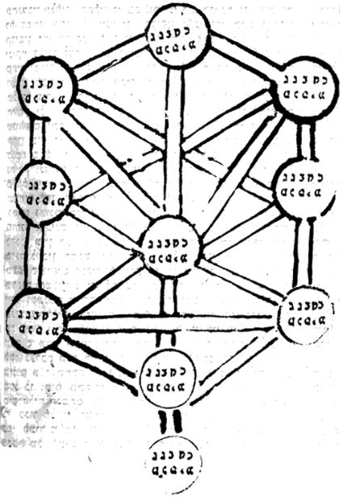

> וענין החלוקים האלה א"א להעלות בכתב ואם ירצה האדם להרגיל עצמו בהם יתעסק בצורה המצויירת לפניו ויתנהג בה בעיון ימים רבים עד יאיר ה' עיני שכלו כי כשל כח הקולמוס להאריך הדברים האלה יותר אם לא שיושפע הענין הזה מפה אל פה או שיעמיק המשכיל בהם בשכלו ע"י הצורה הזאת.

**7:5:6** And behold, with this the Gate is concluded; and blessed is the true Helper, to whom wisdom belongs. And in these matters we fear error and trust in pardon; for of such as this it is said (Proverbs 5:19), "in her love you shall err [tishgeh] always"—these are matters which a person does not grasp except through difficulty.

> והנה בזה נכלל השער הזה וברוך העוזר האמיתי אשר לו חכמה. ואנו בעניינים אלו יריאים מן השגיאה ובטוחים במחילה כי על כזה נאמר (משלי ה יט) באהבתה תשגה תמיד הם דברים שאין אדם עומד בהם אלא מתוך הקושי:

**7:5:7** (Says the editor: These ten circles, in which the ten Sefirot are depicted—let the inquirer picture [them] as though the circles were revolving in their rotation, and then he will understand the intent of the author, peace be upon him. And the matter is: when the inquirer examines the facing of the Sefirot—for example, the aspect of the Chokhmah-within-Chokhmah to the aspect of the Chokhmah-within-Keter, or the aspect of the Binah-within-Binah to the aspect of the Binah-within-Chokhmah or within Keter—then he must imagine and think as though the circle revolves and the Chokhmah-within-Chokhmah, in the circle of Chokhmah, stands opposite the Chokhmah that is in the circle of Keter; and so all of them. Then he will understand and discern the intent of the author, and will know it in truth, with the help of the God of knowledges, YHVH. Thus far [his] words):

> (אמר המגיה אלו עשר עגולים שנצטיירו בו עשר ספירות יצייר המעיין כאלו מתגלגלים העיגולים בסביבובם ואז יבין כוונת המחבר ע"ה והענין כשיעיין המעיין בהבטת הספירות דרך משל בבחינה חכמה שבחכמה לבחי' חכמה שבכתר או בחינת בינה שבבינה בבחינת בינה שבחכמה או שבכתר אז צריך לדמות ולחשוב כאילו העיגול מתגלגל ועומד חכמה שבחכמה בעיגול חכמה נגד חכמה שבעיגול הכתר וכן כולן אז יבין וישכיל כוונת המחבר וידע אותו באמיתית בעזרת אל דעות ה' עכ"ל ע"ב):

---

## Gate 8: Essence and Governance

We named it **"Essence and Governance"** because in it is explained the essence (*mahut*) apprehended in the sefirot — not actual essence, God forbid — together with matters of judgment (*din*) and mercy (*rachamim*), and the governance of the King of the king of kings through them. Its chapters number twenty-six.

### Chapter 8:1. On the sefirot and their union in a single, equal action, despite being divided in their essence — this one judgment, that one compassion; and there the reason for the existence of the ten is explained.

**8:1:1** **The Eighth Gate: Essence and Governance.**

> **שער השמיני הוא מהות וההנהגה.**

**8:1:2** After we occupied ourselves in the preceding Gate with the matter of the channels in all the particulars of their parts, we have seen fit to explain in this Gate the matter of the Sefirot in their essence as it is apprehended by us—whether lovingkindness [Chesed], or judgment [Din], or compassion [Rachamim]—and something of the way of their governance, as far as is apprehended by us.

> אחרי שנתעסקנו בשער הקודם בענין הצינורות בכל פרטי חלקיהם, ראינו לבאר בשער זה ענין הספירות במהותם המושג אלינו אם חסד אם דין אם רחמים וקצת מדרך הנהגתם כפי המושג אלינו:

**8:1:3** **Chapter One:**

> **פרק ראשון:**

**8:1:4** Most of the Kabbalists have agreed that the Sefirot are a power that includes many opposites. And the parable for this is the will of the soul: for it turns to many actions, even if they are almost opposite—such as love and hatred, and anger and laughter, and the other opposite actions like these. And so is the matter in the Sefirot, which have in them judgment and compassion: at times [a Sefirah] clothes itself in judgment, and at times in compassion. And just as it is in the hand of a person to receive and to bestow—and each of these two actions divides into two: whether receiving good or receiving evil, whether bestowing good or bestowing evil—and likewise many [other] actions; and it is a small limb in a person, conducting itself according to the will of the soul: so is the matter of the Sefirot. There is in each and every Sefirah the power to effect a thousand thousands of thousands of differing actions, each and every one according to its matter and its power and its apprehension and its knowledge and its nature, which the Emanator impressed in it. And we know that this premise which we have set forth will be difficult for the inquirer, and he will say: if so, one Sefirah would have sufficed—why did He emanate ten, since the one is a power that includes many opposites, and by it He could effect all the actions? And to this we answer that they were needed for the reason explained in the Gate of the Reason for the Emanation, in chapter six: that for a human being to apprehend the hidden—that is to say, the Godhead—this revelation was needed, up to ten revelations, one below another, so that by this means the created entities might apprehend a little of the knowledge of the exaltedness of the Emanator.

> רוב המקובלים הסכימו כי הספירות הם כח הכולל הפכים רבים והמשל בזה אל רצון הנפש כי היא מתהפכת לכמה פעולות ואם הם כמעט הפכיות כמו אהבה ושנאה וכעס ושחוק ושאר הפעולות ההפכיות כאלו. וכן הענין בספירות שיש בהן דין ורחמים לפעמים היא מתלבשת בדין ולפעמים ברחמים. וכמו שביד האדם לקבל ולהשפיע וכל א' מאלו השני פעולות יתחלקו אל שנים אם קבלת טוב אם קבלת רע אם השפעת טוב אם השפעת רע וכן כמה פעולות והוא אבר קטן שבאדם מתנהג כפי רצון הנפש. כן ענין הספירות יש בכל ספירה וספירה כח לפעול אלף אלפי אלפים פעולות משתנות כל אחד ואחד כפי ענינה וכחה והשגתה וידיעתה וטבעה שהטביע בה המאציל. וידענו כי ההקדמה הזאת אשר הקדמנו יקשה להמעיין ויאמר א"כ די היה בספירה אחת ולמה האציל עשר, מאחר שהאחת היא כח הכולל הפכים רבים ובה יוכל לפעול כל הפעולות. ולזה נשיב כי הוצרכו לטעם מה שפי' בשער טעם האצילות בפ"ו כי להשיג האדם הנעלם ר"ל האלקות הוצרך הגלוי הזה עד עשר גלויים זו למטה מזו כדי שע"י כך יוכלו הנבראים להשיג קצת מידיעת רוממות המאציל.

**8:1:5** And further: even though we say that there is in each Sefirah a power that includes many opposites, nonetheless there are still many things such that what this one pours forth, that one does not pour forth—as they, of blessed memory, said (Mo'ed Katan, fol. 28): "Children, life, and sustenance—the matter does not depend on merit, but the matter depends on mazal." And the meaning is: "merit" is Chesed, and "mazal" is Keter. And the intent is that, although most of the kindnesses and the good things are drawn from Chesed, and its name proves it, nonetheless children, life, and sustenance are not in the hand of this attribute; rather, their principal [source] is in Keter, for it is the supernal mazal. And even though the commentators explained otherwise and said that "merit" is Gevurah, nonetheless [it is] in accordance with these words of ours [that] it is explained in the Tikkunim (Tikkun 10, fol. 24), and as we shall explain in the Glossary of Titles, under the entry "merit." And in this way we shall explain that Binah receives those who return; therefore it is called Repentance [Teshuvah]. And it is there that pardon and atonement principally depend, by the power of the supernal Keter that overflows upon it. And in this way vengeance is in Gevurah; and so various actions are assigned to the Sefirot, and what is assigned to this one is not assigned to that one. And what was said above, that it is a power that includes many opposites, will be in this way: that in the action that is drawn from it, it must effect many opposites—like the eye, whose action is sight, yet it includes opposites: evil sight or good sight, little sight or much sight. And so is the matter in the Sefirot. The example of this: one who returns to YHVH with all his power and with all his intent, like the repentance of King David, peace be upon him, and all the other penitents who returned to YHVH with all that is possible within the bounds of repentance—these, certainly, their repentance is superior and is most accepted, to raise their soul to the choice grade of penitents. And when the sinner does not return to YHVH in this grade, then his repentance is accepted, but his soul will not ascend to that choice grade to which the repentance of King David, peace be upon him, ascended. And likewise one who returns and mortifies his soul with a slight mortification; and there is one who confesses his sin only; and likewise one who does not return until the crushing of the soul. And such things, which exist in parts of parts, the knowledge of human beings cannot take in—only the divine knowledge and power, which belong to Him, may He be blessed and exalted, in the Sefirot. And all these divisions are for good, and to reward with good reward in the World to Come. And there is likewise, in this way, [the power] to punish one who did not afflict himself on Yom Kippur with the five afflictions that depend on Yom Kippur, which is Binah, certainly. For it is not fitting to punish one who ate to his fill as one who ate an olive's bulk or two olives' bulk; and one who ate and drank is not equal to one who had marital relations; and likewise one who had marital relations is not equal to one who anointed himself. And such are the distinctions that actually occur, which human knowledge cannot take in, still less judge—only the divine power.

> ועוד שאפי' שאנו אמרים שיש בכל ספירה כח הכולל הפכים רבים עכ"ז כבר יהיו כמה דברים שמה שתשפיע זו לא תשפיע זו כאמרם ז"ל (מ"ק דף כ"ח) בני חיי ומזוני לא בזכותא תליא מילתא אלא במזלא תליא מלתא. ופי' זכות הוא החסד ומזל הוא כתר. והכוונה כי עם היות שרוב החסדים והטובות הם נמשכים מחסד ושמו מוכיח עליו, עכ"ז בני חיי ומזוני אינה ביד המדה הזאת אבל עקרם בכתר כי הוא המזל העליון. ואעפ"י שהמפרשים פי' בענין אחר ואמרו שזכות הוא גבורה, עכ"ז כדברינו אלו יתבאר בתיקונים (תקונא י' דף כ"ד) וכמו שנבאר בשער ערכי הכנויים בערך זכות. ועד"ז נבאר כי הבינה היא מקבלת השבים לפיכך נקראת תשובה. ושם עיקר תליית הסליחה והכפרה בכח כתר עליון השופע עליה. ועד"ז הנקמה בגבורה, וכן פעולות שונות נפקדות לספירות ומה שנפקד לזו לא נפקד לזו. ומה שאמר למעלה שהוא כח כולל ההפכים רבים יהיה עד"ז, כי בפעולה הנמשכת ממנה צריכה לפעול הפכיים רבים. כענין העין שפעולתו הראות אמנם כולל הפכיים, ראייה רעה או ראייה טובה, ראייה מועטת או ראייה מרובה. וכן הענין בספירות. המשל בזה השב אל ה' בכל כחו ובכל כונתו כתשובת דהמע"ה וכל שאר בעלי תשובה אשר שבו אל ה' בכל האפשר בגדר התשובה. אלו ודאי תשובתם מעולה ומתקבלת ביותר להעלות נשמתם למדרגה הנבחרת אשר לבעלי תשובה. וכאשר לא ישוב החוטא לה' במדרגה הזאת, אזי תשובתו מתקבלת אבל לא תעלה נשמתו במדרגה הנבחרת ההיא אשר עלתה תשובת דהמע"ה. וכן מי שישוב ויסגף נפשו סיגוף מעט, ויש מי שיתוודה על חטאו לבד, וכן מי שלא ישוב עד דכדוכא של נפש. וכאלו הדברים אשר במציאות חלקי חלקים אשר אין דעת בני אדם יכול לכוללם כ"א הדעת והכח האלקי אשר לו ית' ויתעלה בהספירות. וכל אלו החלוקות הם לטוב ולהשכיר שכר טוב לעה"ב. ויש ג"כ עד"ז להעניש מי שלא התענה ביום הכפורים בה' ענויים התלויים ביום הכיפורים שהיא בינה ודאי. שאין ראוי להעניש מי שאכל עד כדי שביעתו כמי שאכל כזית או שני זיתים ולא ישתוה מי שאכל ושתה עם מי ששמש מטתו. וכן לא ישתוה מי ששימש עם מי שסך וכאלו החילוקים הנופלים במציאות אשר אין הדעת האנושי יכול לכללם כ"ש לשופטם כ"א כח האלקי.

**8:1:6** And the matter of the negative commandments and the positive is that they are divided and dependent upon all ten Sefirot. And although all of them in their generality are the 248 positive commandments in Chesed and the 365 negative commandments in Gevurah, nonetheless their particulars are in the ten Sefirot, as we have said. And their punishment, or their reward, or their claim in judgment, or the rectification of the ruin that the sinner has ruined, depends upon the Sefirah at which the commandment hints. And its particulars and its laws and its reward and its punishment, in general and in particular, are [by] the power that includes many opposites, of which we have spoken. For if it were a power fitted to the Sefirah and belonging to it, then if it does good it would not punish, and if it punishes it would not do good; and if it increases reward for one it would not lessen [it] for others, and if it lessens [it] for one it would not increase [it] for others. Rather, certainly, it is compelled that they be a power that includes opposites, to judge the sinner or to reward the doer, whether little or much. And all these actions are by the will of the Emanator, who pours His providence upon them and by means of His Sefirot, as we explained in the Gate of Self and Vessels. And in this way is the governance in the world. And the question does not arise, to say: let all the commandments be in one power, and the judging itself in that power—for several reasons, [among them] the reasons that I explained in the Gate of the Reason for the Emanation and that we explained above.

> וענין מצות לא תעשה ועשה הם נחלקים ותלוים בכל עשר ספי'. ועם היות שכלם בכללם הן רמ"ח מ"ע בחסד ושס"ה ל"ת בגבורה, עכ"ז פרטיהם בי"ס כאשר אמרנו. וענשם או שכרם או תביעתם בדין או תיקון הקלקול אשר קלקל החוטא הוא תלוי בספירות אשר המצוה רומזת אליה. ופרטיו ודיניו ושכרו וענשו בכלל ובפרט הוא כח הכולל ההפכים רבים אשר אמרנו. שאם היה כח מסוגל בספירה וקנוי בה, הנה אם יטיב לא יעניש, ואם יעניש לא ייטב. ואם ירבה שכר לאחד לא ימעט לאחרים ואם ימעט לאחד לא ירבה לאחרים. אלא ודאי הוכרח היותם כח הכולל ההפכיים לדון את החוטא או להשכיר את העושה אם מעט ואם הרבה וכל אלו הפעולות ברצון המאציל השופע עליהם השגחתו וע"י ספירותיו כאשר פירשנו בשער עצמות וכלים. ועד"ז יהיה ההנהגה בעולם. ולא יפול השאלה לומר יהיו כל המצות בכח אחד והשפיטה עצמה בכח ההוא. מכמה טעמים אם מן הטעמים שפירשתי בשער טעם האצילות ופירשנו למעלה.

**8:1:7** And further: because it is not the commandments that necessitated the Sefirot, but the Sefirot that necessitated the commandments. For in our doing the commandment we unite the power that hints at the commandment, which is a branch of the Sefirah, with its root; and this is the will of our Maker, that we unite His Sefirot—for by their light we see light, for in them is His Self—and it is the glory of the kingship of the [King of the] world that we rectify His palaces and His thrones as is fitting, so that His Shekhinah may be among us. And in some of the commandments there is power to remove the spirit of impurity from the earth, "and the idols shall be utterly cut off"; and this is the glory of the King of the world, that we contend with those who rise up against Him. And concerning this the Sages, of blessed memory, said (Sanhedrin, fol. 111): "'and opened her mouth without measure [chok]'—[this is] one who has not fulfilled even one statute [chok]," which is one commandment: even though he has not transgressed a negative commandment, nonetheless he has no portion in His attributes, may He be blessed, since he has not rectified or united there any attribute so that he might cleave to it. We can further answer, on that reason, in another manner, more seemly and acceptable: that the matter of the Sefirot is the revelation of His powers, which are His effects and are included in His Self, as will be explained further in the Gate of Tzachtzachot; and this is for the sake of the governance. And lovingkindness and compassion and might and victory and thanksgiving and righteousness and kingship—all of them are attributes included in Him and hidden in His Self. And no multiplicity befalls the Emanator by this, God forbid, as we explained in the Gate of the Order of the Emanation, and we shall also explain in the Gate of Tzachtzachot, in chapters three [and] four. And now, will the questioner ask why a person has made, in his garment, sleeves, or leggings, or sheaths for the digits? No. For we shall answer him that, since this is the garment for the body, and the body is the cause of the garment, it is compelled that the garment be correlated with the body in all its parts and in all its limbs. And since the Sefirot are the revelation of His attributes, and are a garment to them, as we explained in the Gate of Self and Vessels, in chapter four—if so, the question does not arise, "why thus and not thus," as we have said.

> ועוד מפני כי לא המצות הכריחו הספירות כי הספירות הכריחו המצות כי בעשותינו המצוה ניחד הכח הרומז אל המצוה שהיא ענף הספירה אל שורשו וזה רצון קוננו שנייחד ספירותיו כי באורם נראה אור כי בהם עצמותו והוא כבוד מלכותו של עולם שנתקן היכליו וכסאותיו כראוי לשתהיה שכינתו בינינו. ויש בקצת מהמצות כח להעביר רוח הטומאה מן הארץ והאלילים כרות יכרתון וזהו כבוד מלכו של עולם שנתקוטט במתקומיו וע"ז אחז"ל (סנהדרין דף קי"א) ופערה פיה לבלי חק מי שלא קיים אפילו חק אחד, שהיא מצוה אחת, אעפ"י שלא עבר על מצות לא תעשה עם כל זאת אין לו חלק במידותיו ית' כיון שלא תיקן או ייחד שם איזה מדה לשידבק בה. עוד נוכל להשיב בטעם ההיא באופן אחר יותר נאה ומתקבל, כי ענין הספירות הן ההתגלות כחותיו העלולים ממנו וכלולים בעצמותו כאשר יתבאר יותר בשער הצחצחות וזהו לסבת ההנהגה. והחסד והרחמים והגבורה והנציחה וההודאה והצדקות והמלכות כלם הם מדות כלולים בו ונעלמים בעצמותו. ולא יפול בזה רבוי במאציל ח"ו כאשר בארנו בשער סדר האצילות, ונבאר ג"כ בשער צחצחות בפ"ג ד'. ועתה הישאל השואל למה עשה האדם בלבושו בתי ידים או בתי שוקיים או בתי האצבעות. לא. כי נשיב לו כי אחר שזה הלבוש אל הגוף והגוף סבת הלבוש הוכרח היות הלבוש מתייחס אל הגוף בכל חלקיו ובכל אבריו. ואחר שהספירות הם גלוי מדותיו והם לבוש אליהם כאשר בארנו בשער עצמות וכלים בפ"ד א"כ לא יפול השאלה למה כך ולא כך כאשר אמרנו.

**8:1:8** And behold, in this way it has been explained how the question does not arise concerning the human body—why its limbs are thus and not thus, and why its hairs are thus, and all such things. For the body is a garment to the soul, and the soul reveals its actions by means of it—so much so that when [a person] sins and is defiled, that sin is depicted in the soul and afterward in the body, as the prophet testified in his reproofs (Isaiah 3), "The look of their faces testifies against them," etc. And so it says in the Zohar that at a time when there is pestilence in the city, God forbid, it is fitting for every person to cover his forehead, so that the Angel of Death not recognize his iniquities engraved on his forehead. And so the Sages, of blessed memory, said (Ta'anit, fol. 30b): "Whoever eats meat and drinks wine on the eve of the Ninth of Av—his iniquities are engraved upon his bones, as it is said, 'and their iniquities were upon their bones.'" And all this is for the reason that the soul shows its actions in them, and the stains that are in it, it shows in the body.

> והנה עד"ז נתבאר איך לא יפול השאלה בגוף האדם למה אבריו כך ולא כך ולמה שערותיו כך וכל הדברים כאלה. כי אחר שהגוף הוא לבוש אל הנשמה והנשמה מגלה פעולותיה על ידו עד שכאשר יחטא ויתטנף יצטייר החטא ההוא בנשמה ואח"כ בגוף כאשר העיד הנביא במוסריו (ישעי' ג') הכרת פניהם ענתה בם וכו'. וכן אמר בזוהר כי בזמן שיש דבר בעיר ח"ו ראוי לכל אדם שיכסה מצחו לשלא יכיר מלאך המות עונותיו החקוקים במצחו. וכן אמרו רז"ל (תענית דף ל' ע"ב) כל האוכל בשר ושותה יין ערב תשעה באב עונותיו חקוקים על עצמותיו שנאמר ותהי עונותם על עצמותם. וכל זה לסבה שהנשמה מראה בהם פעולותיה והכתמים אשר בה מראה בגוף.

**8:1:9** And behold, it is known that the soul includes ten, as we explained in the Gate "Ten and Not Nine," chapter five, and as will be explained in the Gate of the Soul. And since the soul includes all the upper worlds, it is compelled that its garment be the mold and form of the soul, which is the form of the upper worlds. And this is what Scripture says (Job 19:26): "and from my flesh I behold God." If so, it turns out, accordingly, that it is compelled that its limbs be in this structure, and [with] these joints and these veins, which are the channels of the effluence that is poured to the limbs. And all these limbs [matters] are verified of themselves and need no proof; and they will be explained at length in the Gate of the Soul, in part two.

> והנה ידוע שהנשמה כלולה מיו"ד כאשר בארנו בשער י' ולא תשע פ"ה ויתבאר בשער הנשמה. ואחר שהנשמה היא כלולה מכל העולמות העליונים הוכרח היות לבושה דפוס וצורת הנשמה אשר הוא צורת העולמות העליונים. וזש"ה (איוב יט כו) ומבשרי אחזה אלוה. א"כ נמצא לפי זה שהוכרח היות אבריו בתכונה ובפרקים האלה והעורקים האלה שהם צנורות השפע המושפע אל האברים וכל האברים [הדברים] האלה הם מאומתים מצד עצמם ואינם צריכין הכרח ויתבארו בארוכה בשער הנשמה בחלק ב'.

**8:1:10** And behold, with this we have added instruction on the matter of the reason for the Emanation, in addition to what we explained in the Gate of the Reason for the Emanation, with the help of Heaven.

> והנה בזה הוספנו לקח על ענין טעם האצילות מוסיף על מה שבארנו בשער טעם האצילות בסייעתא דשמיא:

### Chapter 8:2. Explanation of the term "sefirot" as applied to the emanated entities, and their agreement upon a single action; and there, the whole existence of the totality of the sefirot as apprehended — their being composed of ten, of seven, of five, of four, and of three.

**8:2:1** After we set out in the preceding chapter the matter of the Sefirot, and explained that they are a power that includes many opposites, we can say that this is the reason for their being called Sefirot—from the term "sapphire stone" [even sappir]. For just as the sapphire has no particular color, but includes all the colors that are seen in it, so the Sefirah includes all the opposites, as we have explained. And although each one has a known color, as we shall explain in the Gate of Colors, nonetheless in this aspect they are called Sefirot, as we have explained. And they are also called Sefirot from the term "telling" [sippur]; and so explained Rabbi Shem Tov ben Shem Tov in Sefer ha-Emunot, Gate 4, chapter 4, and these are his words: "In the Bahir I found: Why are they called Sefirot? Because 'the heavens tell [mesapperim] the glory of God' (Psalms 19:2).

> אחר שהקדמנו בפרק הקודם ענין הספירות ופירשנו שהם כח הכולל הפכים רבים, נוכל לומר כי זה טעם היותם נקראות ספירות מלשון אבן ספיר. כי כמו שהספיר אין לו גוון מיוחד אלא כולל כל הגוונים הנראים בו כן הספירה כוללת כל ההפכים כאשר בארנו. ועם שיש לכל אחד גוון ידוע כמו שנבאר בשער הגוונים, עכ"ז בבחי' זו הם נקראים ספי' כדפי'. והם נקראים ספי' ג"כ מלשון סיפור וכן פי' רבי שם טוב ן' ש"ט בספר האמונות ש"ד פ"ד וז"ל בבהיר מצאתי אמאי אקרי ספי' משום השמים מספרים כבוד אל.

**8:2:2** And the intent is that, just as speech and writing, by their delimiting, make plain—so as to be perceptible—the things concealed within the thought of the wise man, so the heavens indicate the Lord, blessed be He; for so the Sefirot are what reveal the concealed thoughts and the forms that are separate from any body, [of which there is] no grasp and no depiction at all." Thus far his words; and [these are] the gracious words of a wise man. For the Sefirot tell of, and set a limit to, what is not limited—though not literally a limit, God forbid, as we explained in the preceding gates. And there are those who explained [it] from the term "number" [mispar], for number is among the things that are limited. And although they are not limited relative to their simple root, they are limited relative to their action toward us, as we explained above (in Gate 2, chapter 1). And other commentators explained [it] from the term "telling" [sippur]; and the intent is that telling and speaking of them is permitted, which is not so of the Ein Sof. And there are those who explained [it] from the term "border" [sefar], as in "a city that is near the border," which is a term of boundary and limit; and the intent is that they set a limit to what is no limit at all—and the intent is not that they literally set a limit, but as we have explained. And what it is fitting to explain is that what we said in the preceding chapter—that the governance, and the reward and the punishment, are by means of a particular attribute—does not mean that He effects lovingkindness for them by means of the attribute of Chesed alone, God forbid; for if so, this is separation and cutting, God forbid. For once it is possible for the action to be by means of one of the Sefirot, it turns out that it is possible for a Sefirah to be separate, in its parts, by itself; and this is not of the truth. Rather, it is not fitting to picture action and governance in any Sefirah by itself, since no Sefirah acts by means of its own manifestation alone; rather, the governance is by means of all of them. And when we say that the action is by means of some Sefirah, the intent is that when lovingkindness prevails in the Sefirah, Malkhut receives their effluence, and then all of them are, in her, Chasadim [lovingkindnesses], and all of them agree toward the side of Chesed. And likewise Gevurah: when judgment and the Gevurot prevail in the Sefirah, Malkhut receives their effluence, and then all of them are, in her, Gevurot, and all of them agree toward the side of Gevurah. And so Rashbi, peace be upon him, explained in the book of the Tikkunim (Tikkun 19, fol. 40a), and these are his words: "When this stone wishes to execute judgment upon Amalek, or upon the Other Side, and likewise upon the guilty, she takes from Gevurah, and all the Sefirot are included in her, and in her they are all called Gevurot. And when she wishes to do favor and lovingkindness in the world, she takes from Chesed, and all the Sefirot are included in her, and they are called Chasadim. And when she wishes to have compassion on the world, she takes from the central pillar, and all the Sefirot are included in her, and they are called Rachamim [compassions]." Thus far [his] words.

> והנה הכונה כמו שהדבור והמכתב יבאר בהגבלתו להיות מורגש הדברים הנעלמים בתוך מחשבת החכם, כן השמים מורים על ה' יתברך, שכן הספי' הם המגלות מחשבות הנעלמות והצורות הנבדלים משום גשם ולא שום תפיסה וציור. עכ"ל ודפח"ח. כי הספירות מספרות ומגבילות הבלתי בעל גבול, ולא גבול ממש ח"ו כמו שבארנו בשערים הקודמים. ויש שפי' מלשון מספר כי המספר מבעלי הגבול. ואע"פ שאינם בעלי הגבול בערך שרשם הפשוט, בעלי גבול הם (ו)בערך פעולתם אלינו כדפי' לעיל (בשער ב' פ"א). ומפרשים אחרים פי' מלשון סיפור. והכונה כי הסיפור והדיבור בם מותר משא"כ בא"ס. ויש שפירשו מלשון ספר כמו עיר הסמוכה לספר והוא לשון תחום וגבול והכונה שהם מגבילות מה שאינו גבול כלל, ואין הכונה מגבילות ממש אלא כדפי'. ומה שראוי לבאר כי מה שאמרנו בפרק הקודם שההנהגה והשכר והעונש הוא על ידי מדה מיוחדת אין ר"ל שיפעל להם חסד ע"י מדת חסד לבד ח"ו שא"כ הוא פירוד וקיצוץ ח"ו. כי אחר שאפשר להיות הפעולה ע"י אחד מן מספירות נמצא שאפשר להיות ספירה נפרדת בחלקיה בפני עצמה ואין זה מן האמת. אלא אין ראוי לצייר פעולה והנהגה בשום ספירה בפ"ע לפי שאין ספירה פועלת באמצעית מציאותה בפ"ע אלא ההנהגה היא באמצעות כלם. ומה שאנו אומרים שהפעולה ע"י איזה ספירה, הכונה כי כאשר יגבר החסד בספירה תקבל מלכות שפעם ואז יהיו כלם בה חסדים וכלם מסכימות אל צד החסד. וכן הגבורה כאשר יגבר הדין והגבורות בספירה תקבל מלכות שפעם ואז יהיו כלם בה גבורות וכלם מסכימות אל צד הגבורה. וכן פי' הרשב"י ע"ה בס' התקונים (תקונא יט ד"מ.) וז"ל כד האי אבנא בעא למעבד דינא בעמלק או בסטרא אחרינא וכן בחייבין נטלא מגבורה ואתכלילן בה כל ספיראן ואתקריאו בה כלהו גבורות. וכד בעאת למעבד חנא וחסדא בעלמא נטלא מחסד וכלהו ספירן אתכלילן בה ואתקריאו חסדים. וכד בעאת לרחמא על עלמא נטלא מעמודא דאמצעיתא וכלהו ספירן אתכלילן בה ואתקריאו רחמי עכ"ל.

**8:2:3** Behold, he explained explicitly how the Sefirot all agree toward the Sefirah that prevails, and all by means of the last attribute, which governs the world, for in her is the principal governance. And what it is fitting to examine closely in this matter is that it is impossible that Chesed should agree toward the side of Gevurah, and likewise Gevurah toward the side of Chesed, since they are two opposites—this one judgment and that one lovingkindness. And how is it possible to say that what is lovingkindness should effect the power of judgment, and that what is judgment should effect the power of lovingkindness? And we answer that this matter is impossible except in that each one of them includes ten; and you will find that there is in Chesed the power of Gevurah, and there is in Gevurah the power of Chesed, and so for all the Sefirot. And by means of this equality they are unified and become equal, as we shall explain in this Gate. And we need to explain the matter of "each one includes ten," so that the inquirer should not think that each one includes ten in the plain sense—that is, that there is in Chesed a recognizable part that is Gevurah, and likewise in Gevurah a recognizable part that is Chesed. For if so, God forbid, the Sefirot turn out to be divided into parts and separated from one another; and what we had in mind to set right by our saying "each one includes ten" is spoiled by what follows from it, for [then] even each one is divided into ten parts. Rather, the intent is that no one can say "this is a part of Chesed" that does not include ten, nor of any part among the parts of the other Sefirot that all the ten are not included in it; and likewise ten from ten, without end and without limit—everything includes ten upon ten, and ten from ten. And should you say: if so—that each one includes all of them—it now turns out, accordingly, that there is no difference among the Sefirot, and all of them are equal; and if so, how do we say that this one is Gevurah and this one Chesed, and so for all of them? Since in Chesed there are ten and in Gevurah ten, all of them turn out equal, for good or for ill, God forbid. To this we answer with a premise that Rambam explained concerning the elements, in chapter 4 of the Laws of the Foundations of the Torah, and these are his words: "Every single body—of man and beast and wild animal and bird and fish and plant and metal and stone—its matter is joined together from fire and air and water and earth. And the four of them are mixed together, and each one of them is changed at the time of the mixing, until what is joined together from the four of them is found to be unlike any one of them when it is alone. And there is not in the mixture of them even one part that is fire by itself, or water by itself, or earth by itself, or air by itself; rather, all have been changed and have become another body. And every body that is joined together from the four of them—there are found in it cold and heat, moist and dry, as one. There are among them bodies in which the element of fire is strong, such as, etc.; and there are among them bodies in which the element of water is strong, etc. And in this way one body is found hotter than another hot body, and one body drier than another dry body; and [there are] bodies in which the cold alone is seen, and bodies in which the moist alone is seen, and bodies in which the cold and the dry are seen as one, equally, etc., or the heat and the dry as one, equally, etc." Thus far his words, for our matter.

> הנה ביאר בפי' איך הספי' כלם הם מסכימות אל הספי' הגוברת והכל ע"י מדה האחרונה המנהגת העולם שבה עיקר ההנהגה. ומה שראוי לדקדק בענין זה הוא כי א"א להיות שהחסד יסכים אל צד הגבורה וכן הגבורה אל צד החסד אחר שהם ב' הפכים זה דין וזה חסד ואיך אפשר לומר שמה שהוא חסד שיפעול כח הדין ומה שהוא דין שיפעול כח החסד. ונשיב כי א"א הענין הזה אלא במה שהם כל א' כלולה מי' ותמצא שיש בחסד כח הגבורה ויש בגבורה כח החסד וכן לכל הספי'. וע"י השווי הזה הם מתיחדות ומשתוות כמו שנבאר בשער זה. וצריכים אנו לבאר ענין כל אחת כלולה מעשר שאל יחשוב המעיין שיהיה כל אחת כלולה מי' כפשוטה ר"ל שיש בחסד חלק ניכר שהוא גבורה וכן בגבורה חלק ניכר שהוא חסד שא"כ ח"ו נמצאו הספי' נחלקו לחלקים ונפרדים זמ"ז. ומה שעלה בדעתינו לתקן במאמרינו כל א' כלולה מי' נתקלקל במה שנמשך מזה כי אפי' כל אחת נחלקת לי' חלקים. אלא הכונה שאין אדם יכול לומר זה חלק חסד שלא יכלול מי' ולא בחלק מחלקי שאר הספי' שלא יהיה נכללים בו כל הי' וכן י' מי' עד לאין סוף ותכלית הכל כלול מיו"ד ליו"ד ויו"ד מיו"ד. וא"ת א"כ שכל א' כלול מכלם ימצא עתה לפי זה שאין חלוק בספי' וכלם יהיו שוות וא"כ איך אנו אומרים שזו גבורה וזו חסד וכן לכלם, כיון שבחסד י' ובגבורה י' נמצאו כלם שוים לטובה או לרעה ח"ו. לזה נשיב בהקדמה אחת שפי' הרמב"ם בענין היסודות בפ"ד מהלכות יסודי התורה. וז"ל ימצא כל גוף וגוף מאדם ובהמה וחיה ועוף ודג וצומח ומתכת ואבן, גולמו מחובר מאש ורוח ומים ועפר. וארבעתם יתערבו ביחד וישתנו כל אחד מהם בעת העירוב עד שימצא המחובר מארבעתם אינו דומה לא' מהם כשהוא לבדו. ואין במעורב מהם אפי' חלק אחד שהוא אש בפני עצמה או מים בפני עצמם או עפר בפ"ע או רוח בפ"ע, אלא הכל נשתנו ונעשו גוף אחר. וכל גוף המחובר מארבעתם ימצא בו קור וחום לח ויבש כאחד. יש מהם גופים שיהיה בהם חזקה מיסוד האש כמו וכו'. ויש מהן גופים שיהא בהם חזקה מיסוד המים כו'. ועד"ז ימצא גוף חם יותר מגוף אחר חם, וגוף יבש יותר מגוף אחר יבש. וגופים שיראה בהם הקור בלבד, וגופים יראה בהם הלח בלבד, וגופים שיראה בהם הקור והיובש כאחד בשוה כו' או החום והיובש כאחד בשוה וכו'. עכ"ל לעניננו.

**8:2:4** And behold, by this premise a person can contemplate the Sefirot: that the principal [thing] is the power of Gevurah, in which judgment is seen and not lovingkindness, and the power of Chesed, in which lovingkindness prevails and not judgment. And we needed all this so as not to make a separation, God forbid, as we have explained. And when this principle is fixed in the heart of the discerning, it will not be far from him to know how Chesed, when Gevurah prevails, can itself also effect Gevurah, since in Chesed too there is the power of Gevurah; and so for all the Sefirot and in all the blendings. However, the matter of this agreement is, intrinsically, by means of the Atarah, which governs the world, for in her this blending is made. For in their own place it is impossible: for if we say that the agreement and the blending are in their place above, it turns out, God forbid, that nine Sefirot are lacking, for all of them are Gevurot or Chasadim. Rather, perforce we say that in their place they are [in] their [own] blending, which their Emanator set in them. It is true that its being drawn to effect that action is by means of the Gevurot that are in them, or by means of the Chasadim that are in each and every Sefirah, as we explained in the Gate of Channels, chapter 5. But that they should be turned to judgment and Gevurah, or to lovingkindness, altogether—this is impossible except by means of Malkhut specifically. And of this Rashbi, peace be upon him, was exact in his wording, in the passage that we copied, in that he said "and all the Sefirot are included in her, and they are called Chasadim," etc.—meaning that first they are included in the stone, which is Malkhut, and then they are called Chasadim or Gevurot or Rachamim altogether. And the hint to their each including ten is in the way that Rashbi said in the book of the Tikkunim (Tikkun 47, fol. 81b), and these are his words: "For there is no Sefirah that does not include ten, each one in its own dominion." Thus far [his] words. And it is clear. And he was exact in saying "in its own dominion"—meaning, even while its dominion, its [own] action, prevails in it, in the way that we have explained.

> והנה בהקדמה הזאת יוכל האדם להתבונן בספי' כי העיקר הוא כח הגבור' אשר יראה בו הדין ולא החסד, וכח החסד אשר יגבר בו החסד ולא הדין. והוצרכנו לכל זה לבלתי עשות פירוד ח"ו כמו שפי'. וכאשר יקבע העיקר הזה בלב המשכיל הנה לא ירחק ממנו המקום לדעת איך יכול החסד כאשר יגבר הגבורה להיות ג"כ הוא פועל הגבורה בהיות כי גם בחסד יש כח גבורה. וכן לכל הספי' ובכל המוזגות. ואולם ענין ההסכמה הזאת היא בעצם ע"י העטרה המנהגת העולם שבה יעשה המזיגה הזאת. שבמקומם אי אפשר, שאם נאמר שההסכמה והמזיגה היא במקומם למעלה נמצא ח"ו חסר תשעה ספי' כי כלם גבורות או חסדים, אלא על כרחינו נאמר שבמקומה הם מזיגתם אשר שם בהם מאצילם. אמת שתהיה המשכתה לפעול הפעולה ההיא ע"י הגבורות שבהם או ע"י החסדים שבכל ספי' וספי' כמו שבארנו בשער הצנורות בפ"ה. אמנם לשיהפכו לדין וגבורה או לחסד מכל וכל, זה א"א כי אם ע"י המלכות דוקא. וזה דקדק בלשונו הרשב"י ע"ה במאמר שהעתקנו שאמר וכלהו כלילן בה ואתקריאו חסדים וכו' פי' כי קודם יכללו בהאבן שהיא המלכות ואז יקראו חסדים או גבורות או רחמים מכל וכל. ולרמוז על היותם כל אחת כלולה מי' היא על הדרך אשר אמר הרשב"י בס' התקונים (תקונא מ"ז דף פ"א ע"ב) וז"ל דלית ספירה דלא אתכלילת בעשר כל חדא בממשלת דילה עכ"ל. ומבואר הוא. ודקדק באמרו בממשלת דילה, פירוש עם היות גובר בה ממשלתה פעולתה על הדרך שפירשנו.

**8:2:5** And now, after we have explained the matter of their including ten, we wish to explain the matter of the revelation of the ten in each and every one, for it is a wondrous rank. And the matter is that—besides their including ten in the way that we have explained, and this inclusion never falls short and never exceeds, just as it is impossible for the Sefirot to be eleven, or nine, so too with regard to the inclusion—there is, however, a matter more important than this, which is not found in them except when there is abundant good: namely, that [the ten] be revealed in them, and each one of them be included in all of them; as if to say that all the ten Sefirot that are in it appear, by reason of its having received from ten and its shining in ten. That is to say, Keter includes ten by reason of its being unified with ten. How so? It shines in the nine, and the nine shine in it, and they shine toward the face of Keter; so that ten shine in it. And so in Chokhmah, and so in Binah. How so? Binah pours forth effluence into the seven lower ones—here are seven that are included in her, and she is included in them; and the two upper ones shine in her and are included in her—here are nine; and further, her own face itself shines in her—here are ten. And so for all the Sefirot. And by this, ten Sefirot appear in all of them; and this is a manifestation choicer than the inclusion expounded above. And this manifestation is found more commonly in Malkhut, as we explained in the Gate "Ten and Not Nine." And the inquirer must keep his eyes open to this manifestation, which is not like the preceding manifestation. And this manifestation will at times be partial—that is, they will be included only in seven, which are the seven Sefirot of the Structure; and this inclusion will not be of the importance and rank that it has when it is of ten, as we shall explain in the Gate of Manifestations, chapter 5. And one should not wonder and say that a separation is seen in this, since only seven appear in it, and not ten. The reason is that, since all the ten are included in it, and [only] on account of the scantness of the light do they not all appear, but are concealed and do not act, it is not called separation. For such is the way of the Sefirot: although they include ten, they act only from the one that prevails, and nonetheless it is not called separation, since all of them are included in it. And for all that, the one that prevails is the principal one—if in Chesed, Chesed; if in Gevurah, Gevurah. And so is the matter with these inclusions: because they received only from the seven, they were included only in seven. And now, accordingly, when we count in them ten times ten, which are a hundred, we mean this important inclusion. And when we count ten times a hundred, we mean to say that even those ten were shining in ten others; and so the number rises from ten to ten without end, and according as the number grows, it indicates the abundance of the inclusion. And likewise, at times we count seven times seven, indicating the seven days of the Structure, which were included in themselves; and so their number rises from seven to seven, by sevens—such as seven times seven, forty-nine, or forty-nine times forty-nine. And at times we compound the two numbers and say that the seven lower ones were included in ten; and now they come to seven times ten, which are seventy, or seven hundred—all according to the strengthening of the inclusion, as we have explained. And there is another aspect, namely that we say that the ten Sefirot include seven; and the number and the inclusion rise in the manner of the preceding number. However, it indicates compassion more, since in this aspect the first three themselves were revealed, which is not so in the preceding aspects, in which they were revealed only in the lower ones; and it is clear. And all these aspects and their inclusion—their explanation has come in the Zohar and in the Tikkunim and in the commentators; and since the matters are scattered, one here and one there, and it would be burdensome for us to bring their proof, we have written them in brief; and they are agreed upon of themselves. Further, the Sefirot include ten in another aspect, and these are the manifestations of the Sefirot themselves. And the matter is that in Keter all the Sefirot were revealed at the time of the Emanation, as we explained in the Gate of the Emanation; and on this account their manifestation must be there, as we shall explain the matter of the manifestations in the Gate of Manifestations.

> ועתה אחר שבארנו ענין היותם כלולות מיו"ד רצוננו לבאר ענין התגלות העשר בכאו"א כי הוא מעלה נפלאה. והענין כי בזולת שהם נכללות מי' על הדרך שבארנו והכללות הזה לא יחסר ולא יעדיף לעולם כמו שא"א לספירות להיותם י"א ולא ט', וכן לענין כללות ג"כ. אמנם יש ענין חשוב מזה אשר זה לא ימצא בהם כי אם בהיות רוב טובה והוא שיתגלה בהם ויוכללו כל אחד מהם בכלם כאלו תאמר שיהיו כל הע"ס שבה מתראות מצד שקבלה מי' ומאירה בי'. ר"ל הכתר כלול מי' מצד שהוא מתייחד בעשר, כיצד הוא מאיר בט' והט' מאירים בו והם מאירות כלפי פני הכתר הרי שמאירים בו עשר. וכן בחכמה וכן בבינה. כיצד הבינה משפעת בז' התחתונות הרי ז' שנכללים בה והיא נכללת בהם, ושני העליונות מאירות בה ונכללות בה הרי ט', ועוד מאירים בה פניה ממש הרי עשר. וכן לכל הספירות. ובזה מתראות בכלן עשר ספי' והוא מציאות מובחר מענין הכללות הנדרש למעלה ונמצא מציאות הזה בהרגל יותר אל המלכות כדפי' בשער י' ולא תשע. וצריך המעיין להיות עיניו פקוחות על המציאות הזה שאינו כמציאות הקודם. והמציאות הזה לעיתים יהיה במקצת ר"ל שלא יוכללו אלא בשבע שהם ז' ספירות הבנין והכללות הזה לא יהיה בחשיבות ומעלה שיהיה כאשר הוא מעשר כמו שנבאר בשער המציאות בפ' ה'. ואין לתמוה ולומר כי יראה בזה פירוד אחר שלא יתראו בה אלא ז' ולא י'. הטעם הוא מאחר שנכללות בה כל העשר ומפני מיעוט האור אינם מתראות כלם אלא מתעלמות ואינם פועלות לא יקרא פירוד. כי כן דרך הספי' עם היותה כלולות מעשר לא יפעלו אלא מהגוברת ועכ"ז לא יקרא פירוד אחר שכלם נכללות בה. ועם כל זאת הגוברת היא העיקרית אם בחסד חסד אם בגבורה גבורה. וכן הענין אל הכללות האלו שמפני שלא קבלו אלא מן השבע לא נכללו אלא בשבע ועתה לפי"ז כאשר נמנה בהם עשר פעמים י' שהם מאה נרצה בענין הכללות החשוב הזה. וכאשר נמנה עשר פעמים מאה נרצה לומר כי אפילו אותם העשר היו מאירות בעשר אחרות וכן יעלה המספר מעשר לעשר עד אין תכלית וכפי אשר יגדל המספר יורה על רוב הכללות. וכן לפעמים נמנה שבעה פעמים שבעה מורה על שבעת ימי הבנין שנכללו הן בעצמן וכן יעלה מספרם מז' לשבעה בשביעיות כמו שבעה פעמים שבעה מ"ט או מ"ט פעמים מ"ט. ולפעמים נרכיב ב' המספרים ונאמר שהשבעה התחתונות נכללו בעשר ועתה יעלו שבעה פעמים עשר שהם שבעים או שבע מאות הכל לפי התגברות הכללות כדפי'. ויש בחינה אחרת והיא שנאמר שי"ס נכללו משבע ויעלו המספר והכללות כדרך המספר הקודם. אמנם יורה על הרחמים יותר להיות שבבחי' זו נתגלו הג' ראשונות בעצמם מה שאין כן בבחי' הקודמות שלא נתגלו אלא בתחתונות והוא מבואר. וכל הבחינות האלה וכללותם באו ביאורם בזהר ובתקונים ובמפרשים, ולהיות הדברים מפוזרים א' הנה וא' הנה ויכבד עלינו להביא ראייתם כתבנום בקצרה והם מוסכמים מצד עצמם. עוד הספי' נכללות מעשר בבחינה אחרת והם מציאיות הספי' בעצמם. והענין כי בכתר נתגלו כל הספי' בעת האצילות כאשר בארנו בשער האצילות. והנה לזה חיוב היות שם מציאותם כמו שנבאר ענין המציאות בשער המציאות.

**8:2:6** And behold, these nine are spiritual beings, subtler than their own self that is revealed below, so that they are sources and a channel through which the life-force is poured to their lower manifestation. And when they were emanated in Chokhmah, there too the manifestation of eight Sefirot remained; and the supernal Keter—its manifestation was emanated in her, so that they should not be nine, God forbid. And further, this was necessary because by means of it the Emanation was emanated. So in Chokhmah there is a manifestation of ten, but not like the manifestation that is within Keter, because in Keter they are in subtlety.

> והנה הט' האלה הם הויות רוחניות דקות מעצמותם המתגלה למטה עד שהם מקורות וצנור שבהם יושפע החיות אל מציאותם התחתון. וכאשר נאצלו בחכמה שם ג"כ נשארו מציאות ח' ספי' וכ"ע נאצל מציאותו בה כדי שלא יהיו ט' ח"ו. ועוד הוכרח כן מפני שע"י נאצל האצילות. הרי בחכמה מציאות עשר אבל לא כמציאות שבתוך הכתר מפני שבכתר הם בדקות.

**8:2:7** And further, the nine above were a source for the nine lower ones, which is not so in Chokhmah, for the eight are a source for the eight lower ones; but Keter, on the contrary—its principal source is the manifestation of the upper Sefirah, which was completed above her in [its] manifestation, and it is a branch and has need of it. And likewise seven were emanated in Binah—here are seven—and they are sources for the seven lower ones, and they are not like the sources that are in Chokhmah. And further, in Chokhmah there were eight, a source for eight, and in Binah seven, a source for seven; and the two upper ones are emanated there to complete [them].

> ועוד כי הט' למעלה היו מקור לתשע התחתונות משא"כ בחכמה כי הח' מקור לח' התחתונות, אבל הכתר אדרבא מקורו העיקרי הוא מציאות ספירות העליונות שנשלמה למעלה ממנה במציאות והיא ענף וצריך אליו. וכן נאצלו ז' בבינה הרי ז' והם מקורות לז' תחתונות ואינם כמקורות אשר בחכמה. ועוד שבחכמה היו ח' מקור לח' ובבינה ז' מקור לז'. ושנים העליונות נאצלות שם להשלים.

**8:2:8** And further, because by means of them was the principal [part] of the Emanation, for by their power the seven were emanated in her; and therefore their manifestation remained there. And in this way for all the Sefirot, for all of them are in all of them. And this is another matter, which is the manifestation of the Sefirah itself in the Sefirah. And so all the Sefirot turn out to have aspects corresponding to all of them. And Malkhut differs from all of them, for she has a literal source in each one of the Sefirot, since she is the last of them all. And this is the reason that her manifestation remained in all the grades of the Sefirot, for she descended by way of the grades of the ladder, as was explained in the Tikkunim (in the Introduction, fol. 10b), and these are its words: "When she was taken from Keter, she was called 'crown of splendor' [ateret tiferet], etc.; when she was taken from the supernal Chokhmah, which is 'beginning' [reshit], she was called after its name; and when she was taken from Binah, she was called after its name, Tevunah; and when she was taken from Chesed, she was called," etc. And in this way he explained there in the Tikkunim, to show her name according to her aspects, by way of the grades of the ladder by which she descended; and according to the sources—to show her ascent to that aspect—she is called after its name, as we shall explain in the explanation of the passage in its place, if God decrees life. Further, the Sefirot have another inclusion, of three—namely the three lines: the line of Chesed, the line of Din, the line of Rachamim—and in this aspect [each] includes three. And at times [each] includes four—namely Chesed, Gevurah, Tiferet, Malkhut, which are the four legs of the Chariot; and they are literally the four letters of the name, for yod is in Chesed and heh in Gevurah, as is explained in the Tikkunim many times; and they are also the face of a man, the face of a lion, the face of an ox, the face of an eagle, as the matter will be explained in the Gate of Titles. And at times they include five, which are Chesed, Gevurah, Tiferet, Netzach, Hod; and the reason is that thus far the Emanation reached, for Malkhut and Yesod are included in Tiferet. And when we consider the aforementioned five with respect to their being included in ten, they come to fifty. And likewise, when we consider them with respect to each one's including five, they come to twenty-five.

> ועוד מפני שעל ידם היה עיקר האצילות כי מכחם נאצלו בה הז' ולכן נשאר שם מציאותם ועד"ז לכל הספירות שכולם הם בכולם. וזה ענין אחר שהוא מציאות הספירה ממש בספי'. ונמצאו לכל הספירות בחינות כנגד כלם. והמלכות נשתנה מכלם כי יש לה מקור ממש בכל אחת מהספירות אחר שהיא אחרונה לכלם. וזה הטעם שנשאר מציאותה בכל מדרגות הספירות כי דרך מדרגות הסולם ירדה וכמו שנתבאר בתקונים (בהקדמה ד"י ע"ב) וז"ל כד אתנטילת מכתר אתקריאת עטרת תפארת כו', כד אתנטילת מחכמה עילאה דאיהי ראשית אתקריאת על שמה, וכד אתנטילת מבינה אתקריאת על שמה תבונה. וכד אתנטילת מחסד אתקריאת וכו'. ובדרך הזה פי' שם בתיקונים להראות על שמה כפי בחינותיה דרך מדרגות הסולם אשר ירדה וכפי המקורות להראות עלייתה אל הבחינה ההיא תקרא על שמה וכמו שנבאר בפי' המאמר במקומו אם יגזור השם בחיים. עוד לספי' כללות אחר' מג' והיינו ג' קווים קו החסד קו הדין קו הרחמים ובבחינתו יוכלל מג' ולפעמים יוכלל מד' והיינו חסד גבורה תפארת מלכות שהם ד' רגלי המרכבה והם ממש הד' אותיות שבשם כי יו"ד בחס"ד וה' בגבורה כמבואר בתיקונים פעמים הרבה והם ג"כ פני אדם פני אריה פני שור פני נשר כמו שיתב' הענין בשער הכינוים. ולפעמים יוכללו מה' והם חסד גבורה ת"ת נצח הוד, והטעם כי ע"כ הגיע האצילות כי מלכות ויסוד הם נכללים בת"ת. וכאשר נבחן החמשה הנז' בערך שהם נכללים בעשר יעלו לנ'. וכן כאשר נבחין אותם בערך שכלול כל א' מה' יעלו כ"ה.

**8:2:9** And further, at times they include six, which are the six extremities that are included in Tiferet; and then each and every one is designated by the name vav [six]. And they are three upper vavs—Gedulah, Gevurah, Tiferet—and they are [those of] va-yissa, va-yavo, va-yet (Exodus 14:19–21): vav, vav, vav; and they are eighteen. And they are likewise in Netzach and Hod and Yesod, and they are another eighteen; their sum is thirty-six. And when they include ten, they come to sixty. And these inclusions and their order are explained in the Zohar and in the Tikkunim many times; and we have abridged the matter in this chapter so that it be set in order before the eyes of the inquirer, for wherever there is need of it.

> ועוד נכללים לפעמים מו' והם ו' קצוות הנכללות בת"ת ואז הם מכונים בשם ו' כאו"א. והם שלשה ווין עליונים גדולה גבורה ת"ת והם ויס"ע ויב"א וי"ט וו"ו והם ח"י. והם ג"כ בנצח והוד ויסוד והם ח"י אחרים כללם ל"ו. וכאשר נכללים מעשר יעלו ששים. והכלליות האלה וסדרם מתבארים בזוהר ובתיקונים פעמים הרבה וקצרנו הענין בפ' זה כדי שיהיה סדור לעיני המעיין לכל אשר יהיה שם הצורך אליו:

### Chapter 8:3. Explanation of the essence apprehended in Keter, and its being composed of ten; and an explanation of the 620 (*tar"kh*) pillars of light; and there, part of the prayer of R. Nechunya ben ha-Kanah.

**8:3:1** After we have occupied ourselves in the preceding chapters with the matter of the inclusion of the Sefirot and their bearing on the governance, we shall add further explanation of the essence apprehended in them by the Kabbalists—a tradition from one man's mouth to another's, back to Moses our teacher, peace be upon him, from the mouth of the Almighty [Gevurah]. The first Sefirah is the first emanated, and it is the supernal Keter, in which, relative to the emanated that are below it, there is no lack at all and no deficiency at all; rather, it is simple compassion, without any admixture of judgment at all. If so, how is it possible for it to include ten? For the inclusion indicates that there is in it a side of Gevurah, which is judgment; and we say that it is simple, without any admixture of judgment at all. And it is possible to answer this in several ways. The first is that it need not be that it includes Gevurah in the aspect of judgment; rather, it includes Gevurah in the aspect of the wealth that is under the hand of Gevurah, as the Sages, of blessed memory, said (Bava Batra, fol. 25b): "One who wishes to become wealthy should turn north"; and its matter corresponds to Gevurah, for there is the gold. And likewise [there are] such matters as these, which are compassion and are of the action of Gevurah—like the rains, which are from the side of Gevurah and are compassion for the world. And likewise a person's being mighty [gibbor], conquering his inclination: that might [gevurah] is from the side of complete compassion, in that he was not delivered into the hand of his inclination—by the power of Gevurah, which made him prevail over his enemy. And so they explained in the Tikkunim (in Tikkunei Zohar Chadash, fol. 114b), and these are its words: "In the fifth month, there is given in it the might of Gevurah, to prevail over the evil inclination from the side of the left, so that it not rule over him," etc.; see there. And although this is expounded there for another matter, nonetheless it emerges for us from his words that a person's prevailing over his inclination is from the side of Gevurah.

> אחר שנתעסקנו בפרקים הקודמים בענין כללות הספי' ועניינם אל ההנהגה. עוד נוסיף ביאור במהות המושג בהם אל המקובלים קבלה איש מפי איש עד מרע"ה מפי הגבורה. הספירה האחד הוא הנאצל הא' והוא כ"ע אשר בערך הנאצלים אשר למטה ממנו אין בו חוסר כלל ולא גירעון כלל אלא הוא רחמים פשוטים מבלי תערובות דין כלל. א"כ איך אפשר להיותה כלולה מיו"ד כי הכללות מורה שיש בה צד גבורה שהוא דין ואנו אומרים שהיא פשוטה מבלי תערובת דין כלל. ואפשר לזה להשיב על כמה פנים. הראשון הוא כי לא יוכרח שיהיה כלול מהגבורה בבחינת הדין אבל יהיה כלול מהגבורה בבחי' העושר אשר תחת יד הגבורה. כמו שאחז"ל (ב"ב דף כ"ה ע"ב) הרוצה להעשיר יצפין. ועניינו כנגד הגבורה אשר שם הזהב. וכן עניינים כאלה אשר הם רחמים והם מפעולת הגבורה. כמו הגשמים שהם מצד הגבורה והם רחרים לעולם. וכן היות האדם גבור כובש את יצרו אותה הגבורה יהי' מצד הרחמים הגמורים אשר לא נמסר ביד יצרו בכח הגבורה שהגבירו על שונאו. וכן ביארו בתקונים (בתז"ח דף קי"ד ע"ב) וז"ל בירחא חמשאה יהיב ביה תוקפא דגבורה לאתגברא על יצר הרע מסטרא דשמאלא דלא שליט ביה וכו' ע"ש. ועם היות כי זה נדרש שם לענין אחר, עכ"ז יצא לנו מתוך דבריו כי היות האדם מתגבר על יצרו הוא מצד הגבורה.

**8:3:2** And further, they have other actions, such and such, good and pleasant. And from the side of the aspect of Gevurah in these actions, Keter includes it. And when Gevurah is aroused, Keter pours forth effluence by the side of Gevurah that it has; and even if it pours forth the action of compassion—such as the effluence of wealth, or of prevailing, below—from the supernal Keter that effluence will strengthen Gevurah, so that there be in it strength and firmness of power to act. And although this matter belongs to Keter accidentally, for its principal pouring-forth was for compassion, nonetheless in Gevurah "kind found its kind," and by it Gevurah was aroused to act. Further, it is possible to answer in another way: that it is true that Keter effects only compassion—this is its power; although it includes Gevurah, nonetheless it has the power to nullify that Gevurah and to subdue it to compassion. And not on this account is its including ten to be denied. As is the matter with the elements: not because a given body shows heat alone, or cold alone, shall we be obliged [to say] that it is simple and is not composed of the four elements at all. Rather, we shall say that it is composed of the four elements, and because of the prevalence of the element of water that is in it the other elements do not act in it, and the cold alone is seen in it. And so is the matter when heat is seen in it: its cause is the prevalence of the fire, as Rambam, peace be upon him, explained in his words that we copied in the preceding chapter. And in this way with the Sefirah of Keter: although there be in it the power of Gevurah, its judgment does not act, as happens with the elements, which we explained. Further, we can resolve [it] in another way, and it is nearer to the truth and is the principal one. And the matter is well known: that in the simple Ein Sof it is necessary that there be a manifestation of the ten Sefirot, as we shall explain in the Gate of Tzachtzachot. And now, why should it not be difficult for us that, accordingly, the simple God turns out to be composite, with a great composition such as this—of ten Sefirot, among which are Gevurah, the power of judgment, and Gedulah, the power of lovingkindness? And in truth there is no composition greater than this. And such is not the rule of the cardinal faith that is fixed in the heart of the believers; for the cardinal principle of the faith is to believe that the Ein Sof is one, simple with the utmost simplicity, without any composition. Rather, certainly, the answer to this question is at its side: for, God forbid, our intent in saying that the manifestation of the Sefirot is in the Ein Sof is not that their manifestation above is in the way that their manifestation is below. Rather, above they are simple with the utmost simplicity, and unified in the very roots with the utmost union, and they are subtle [and] spiritual with the utmost subtlety, so that neither multiplicity nor change, neither judgment nor compassion, is attributed to them; and we shall speak of them at length in the Gate of Tzachtzachot. And now, since Keter is the first emanated, there is nothing between it and the Emanator except that this one is cause and this one is its effect. And according to the measure that we were obliged to go far in the matter of the Sefirot that are in the Ein Sof, in that same way we are obliged to go far in the matter of the Sefirot that are in Keter. For according to their descent from before Him, so the things and the actions are revealed; and according to their nearness to their source, so they are concealed and hidden. And therefore, although Keter includes ten, the intent is not that the ten effect judgment and compassion as is their action in their [own] place; rather, they are concealed sources. And in this way is the manifestation of the emanation of judgment, for those who ask whence judgment came forth, as we shall explain in this Gate explicitly. This is what is given to the human intellect to answer to the question. However, the tradition compels us that Keter is the utmost of compassion, as it is written (Daniel 7:9), "And the Ancient of Days sat; His garment was white as snow." And its effluence is nothing but simple compassion; and "He sits upon a throne of sparks of fire, to subdue them"; and so Rashbi, peace be upon him, explained in the Idra (of Naso, fol. 128b). However, judgment is effected in the concealment of its face, God forbid, and the departure of its effluence from the Sefirot; then judgment acts of itself. For the arousal of the line of Din prevails over the line of Rachamim, and the Gevurah that is in each and every attribute prevails, and by means of it judgment acts. However, the Gevurah that is in Keter is the reverse—[it is] to subdue judgment; and it is "the forehead of the King," for when the forehead of the will is revealed, the judgments are nullified, as Rashbi explained in the Idra (there, fol. 129a); and we shall explain [it] there, with God's help, in the book Or Yakar. However, a mighty difficulty follows from this: for the actions of judgment turn out to be effected by means of nine Sefirot alone, and this is not fitting. And we answer that the departure and the concealment of the face of Keter from the attributes, so that judgment may act—this is called partnership, in that Keter is a partner to judgment. And so Rashbi explained there in the Idra. And this is the explanation of the passage that Rabbi Menachem Recanati explained, as we copied in the Gate of Self and Vessels, in chapter 2: "And YHVH rained upon Sodom," etc. And likewise the matter of the parable of the stories that we explained there in chapter 4. And there is no strain in our saying that the departure and the concealment of its face is called partnership with judgment; for we are compelled to say something close to this matter of the Ein Sof: for if He were spreading forth in all the Sefirot, there would be no judgment at all; and it is impossible to say that judgment is not effected by Him, for if so, punishment turns out not to be by Him, God forbid, and this is the removal of providence. Rather, the concealment of His face and the removal of His providence from His Sefirot is His partnership with judgment. And one may object: if so—that He removes His providence and His Self from the attributes—then it turns out that the Sefirot have actions apart from Him, for they effect judgment upon the departure of His providence. Therefore we answer that certainly there are different aspects to His providence in the Sefirot.

> ועוד יש להם פעולות אחרות כאלה וכאלה טובות ונעימות. ומצד בחינת הגבורה בפעולות האלה הכתר נכלל ממנה. וכאשר תתעורר הגבורה הנה ישפיע הכתר בצד הגבורה אשר לו, ואפי' אם תשפיע פעולת הרחמים כמו שפע העושר או התגברות למטה הנה מכ"ע השפע ההוא יגביר הגבורה באופן שיהיה בה חוזק ואמיץ כח לפעול. ואע"פ שזה הענין יהיה אל הכתר במקרה כי עיקר השפעתו לרחמים היתה, עכ"ז בגבורה מצא מין את מינו ונתעוררה על ידו הגבורה לפעול. עוד אפשר להשיב ע"ד אחרת כי אמת הוא שהכתר אינו פועל אלא רחמים זהו כחו הגם שהוא נכלל מהגבורה עכ"ז יש בו כח לבטל הגבורה ההיא ולהכניעה אל הרחמים ולא מפני זה יוכחש היותה כלולה מעשר. כאשר הענין בהיסודות שלא מפני היות הגשם ההוא מורה על החום בלבד או על הקור בלבד נחייב שהוא פשוט ואינו מורכב מארבע יסודות כלל. אלא נאמר שהוא מורכב מד' יסודות ומפני תגבורות יסוד המים שבו לא יפעלו בו שאר היסודות ויתראה בו הקור לבד. וכן הענין כאשר יתראה בו החום סבתו תגבורת האש כמו שפי' הרמב"ם ע"ה בלשונו שהעתקנו בפ' הקודם. ועד"ז בספירת הכתר אעפ"י שיהיה בו כח הגבורה לא יפעל דינה כמקרה היסודות שפי'. עוד נוכל לתרץ ע"ד אחרת והוא יותר קרוב אל האמת ועיקר. והענין מפורסם הוא שבא"ס הפשוט הוכרח בו היות שם מציאות ע"ס כאשר נבאר בשער הצחצחות. ועתה למה לא יקשה עלינו שנמצא לפי"ז האלוה הפשוט מורכב מהרכבה גדולה כזאת מע"ס שמכללם הגבורה כח הדין והגדולה כח החסד. והאמת שאין הרכבה גדולה מזו. ואין כן חק האמונה העקריות הקבועה בלב המאמינים. שעיקר האמונה להאמין שהא"ס הוא אחד פשוט תכלית הפשיטות בלי שום הרכבה. א"ו תשובת שאלה זו בצדה כי ח"ו אין כונתינו באמרנו שמציאות הספי' בא"ס שיהיה מציאותם למעלה כדרך שמציאותם למטה. אלא למעלה הם פשוטות תכלית הפשיטות ומתייחדות בעצם השרשים תכלית היחוד והם דקות רוחניות תכלית הדקות עד שלא יתיחס בהן רבוי ושנוי ודין ורחמים ונאריך הדבור בהם בשער הצחצחות. ועתה אחר שהכתר הוא הנאצל הראשון אין בינו ובין המאציל כ"א שזה עילה וזה עלול ממנו. ולפי השיעור שחוייבנו להפליג בענין הספירות שבא"ס. על דרך ההוא חוייבנו להפליג בענין הספירות שבכתר, כי כפי רדתם מאת פניו כן יתגלו הדברים והפעולות וכפי קרבתם אל מקורם כן יתעלמו ויסתתרו. ולכן אע"פ שהכתר כלול מעשר אין הכונה שיהיו העשר פועלות דין ורחמים כפעולתם במקומם אלא הם מקורות נעלמים. ועד"ז היא מציאות אצילות הדין להשואלים מהיכן יצא הדין כמו שנבאר בשער זה בפי'. זהו הנמסר אל שכל האנושי להשיב בשאלה. אמנם הקבלה הכרחנו היות הכתר תכלית הרחמים כדכתיב (דניאל ז ט) ועתיק יומין יתיב לבושיה כתלג חוור. ואין שפעו אלא רחמים פשוטים ואיהו יתיב על כורסייא דשביבין דנור לאכפייא לון וכן פי' הרשב"י ע"ה באדרא (דנשא קכ"ח ע"ב). אמנם הדין נפעל בהסתר פניו ח"ו והסתלקות שפעו מן הספירות אז הדין יפעל מעצמו, כי התעוררות קו הדין יתגבר על קו הרחמים, וגבורה שבכל מדה ומדה תתגבר ועל ידה תפעל הדין. אמנם גבורה שבכתר היא להפך להכניע הדין והיא מצחא דמלכא כי בהתגלות מצח הרצון הדינין מתבטלין כדפי' הרשב"י באדרא (שם דף קכ"ט.) ונבאר שם ב"ה בס' אור יקר. אמנם ימשך מזה קושיא עצומה כי נמצא פעולות הדין נפעל ע"י ט' ספירות לבד וזה אין ראוי. ונשיב כי הסתלקות והסתר פני הכתר מן המדות כדי שתפעל הדין זה נקרא שתוף שמשתתף הכתר אל הדין. וכן פי' הרשב"י שם באדרא. והיינו פי' המאמר שפי' ר' מנחם רקאנטי כמו שהעתקנו בשער עצמות וכלים בפ"ב וה' המטיר על סדום וכו'. וכן ענין משל העליות שפי' שם בפ"ד. ואין דוחק באמרנו כי סלוק והסתר פניו נקרא שתוף אל הדין, שהרי מוכרחים אנו לומר קרוב אל ענין זה אל הא"ס שאם היה מתפשט בכל הספי' לא היה דין כלל, וא"א לומר שאין הדין נפעל על ידו, שא"כ נמצא אין העונש על ידו ח"ו וזהו סילוק ההשגחה. אמנם הסתר פניו וסילוק השגחתו מספירותיו הוא שיתופו אל הדין. ויש להקשות שא"כ שהוא מסלק השגחתו ועצמותו מן המדות א"כ נמצא שיש פעולות לספירות זולתו שהרי הם פועלת דין בהסתלק השגחתו. לכן נשיב שודאי יש בחינות שונות אל השגחתו בספירות.

**8:3:3** Behold, when the matter is complete compassion, and the heavens are pure before Him, He is revealed in His attributes with a revelation of [His] Self, so that all of them are unified with the utmost union. However, when the heavens are clothed in blackness, His providence departs from the Sefirot—yet not altogether; rather, He reveals the light in them by means of an intermediary, by means of Binah, in the six extremities, from the side of Gevurah; and the effluence and the providence are scant, so that judgment is effected. And this is the secret of "From afar YHVH appeared to me" (Jeremiah 31:2), and likewise "Why, YHVH, do You stand afar off" (Psalms 10:1)—for the light is not revealed as is fitting; and this is "You hide in times of trouble." And this is the cause of judgment and its coming-to-be, according to the truth. And its tikkun [is by means of repentance], in the secret of the revelation of providence and the shining of the Ein Sof by means of Keter in the Sefirot. And this is the secret of the effluence and the compassion that are poured forth, by means of which judgment is set right, and "eyes washed in milk," as will be explained, with God's help, in the coming chapters. Further, concerning the manifestation of this Sefirah: although it is concealed with the utmost concealment—so that, on account of its great concealment, Chokhmah is called the beginning of the revelation, as we explained in the Gate of Whether the Ein Sof is the Keter, chapter 3—nonetheless our sages and our elders, who received from our prophets, revealed to us that there are in this Sefirah 620 pillars of light, as the number of [the word] keter. And the first to reveal this matter is Rabbi Nechunya ben HaKanah, in his lovely prayer, and these are his words there: "I call You by six hundred and twenty pillars of light, which are the head of Your speech, which are a tikkun for the height of Your rank; and from them the life-force is drawn into all the Sefirot; and they stand one beside another, as a soul within the body; and they are full within and without and on the outside—YHVH YHVH YHVH; and they are engraved in the likeness of male and female, and are reversed into Tiferet and kingship in the permutation [tziruf] of the height of their stature; and to their subtlety there is no end; and they are parts that are not divided at all; and they are exalted in reading and combining and reckoning. There goes forth the wellspring of the flame, which is beyond searching out and beyond number, from the light that is concealed, with the increase of the darkness that is hidden; and it is the manifestation known to all the discerning, in thirteen kinds of substitution [temurah], which are revealed and concealed, laid upon Keter literally: MTzPTz MTzPTz TKh GSPY PSṬPṬ TGL TVMY PGSh SChQ PTYA ṬHG SChQ KTKVMY ṬBT ZPṬ PVBZ PSNTTz PṬDTz." Thus far his words. And its explanation: "I call You by six hundred and twenty"—"calling" [keri'ah] is a term of the pouring-forth of effluence, as in "Deep calls to deep at the voice of Your channels" (Psalms 42:8), and as in "And one called to another and said" (Isaiah 6:3), which the Targum renders "and they receive one from another." And so "I call You," etc., means: I shall draw forth Your effluence in six hundred, etc. "Which are the head of Your speech" means the beginning of the revelation of the Ein Sof, although they are not apprehended by us. And since speech is a figure for revelation—because above, in the Ein Sof, on account of His great concealment, speech of Him is forbidden—therefore he said that the 620 are "the head of Your speech," meaning the first of the emanated things that enter into speech. Or "I call You by six," etc., means: I call You and title You by the name "620 pillars of light"; for it is known that in the Ein Sof there is no name that would limit Him, as we explained in the Gate of Whether the Ein Sof is the Keter, chapter 1, with Heaven's help.

> הנה בהיות הענין רחמים גמורים ושמים זכו לפניו הוא מתגלה במדותיו גלוי עצמי עד שכולם מתיחדות תכלית היחוד. אמנם בהיות השמים לובשים קדרות מסתלק השגחתו מן הספירות ולא מכל וכל אלא הוא מגלה האור בהם ע"י אמצעי ע"י הבינה בשש קצוות מצד הגבורה והשפע וההשגחה מועטת עד שהדין נפעל. וזהו סוד (ירמיה לא ב) מרחוק ה' נראה לי, וכן (תהלים י יא) למה ה' תעמוד ברחוק, שאין האור מתגלה כראוי והיינו תעלים לעתות בצרה, וזהו סבת הדין והווייתו לפי האמת. ותיקונו [הוא ע"י התשובה] בסוד גלוי ההשגחה והארת האין סוף ע"י הכתר בספירות. וזהו סוד השפע והרחמים הנשפעים שעל ידו הדין יתוקן ועינים רוחצות בחלב כאשר יתבאר בע"ה בפ"ה. עוד במציאות ספירה זו עם היותה נעלמת תכלית ההעלם עד שמרוב התעלמותה נקרא החכמה ראשית ההתגלות כמו שבארנו בשער אם הא"ס הוא הכתר פ"ג. עכ"ז גלו לנו חכמינו וזקנינו שקבלו מנביאינו היות בספירה זו תר"ך עמודי אור כמנין כת"ר. והמגלה הראשון אל העניין הזה הוא רבי נחוניא בן הקנה בתפלתו הנחמדה וז"ל שם אקראך בשש מאות ועשרים עמודי אור שהם ראש מילולך, שהם תיקון לרום מעלתך, ומהם יתמשך החיות בכל הספירות, ועומדים זה בצד זה כנשמה בתוך הגוף, והם מלאים מבפנים ומבחוץ ובחיצון, יהו"ה יהו"ה יהו"ה, והם נחקקים כדמות זכר ונקיבה, ומתהפכים לתפארת וממלכה בצירוף רום קומתם, ואין לדקותם תכלית, והן חלקים שאינם מתחלקים כלל, ומתנשאים במאמר ומכלל וחשבון, יוצא מעיין השלהבת שהוא עד אין חקר ואין מספר, מאורה המתעלמת בתוספת החשך המסותרת, והיא המציאות הידוע לכל המשכילים, בי"ג מיני תמורה, שהם גלוים ונעלמים מונחים על הכתר ממש, מצפ"ץ מצפ"ץ ת"ך גספ"י פסטפ"ט תג"ל תומ"י פג"ש סח"ק פתי"א טה"ג סח"ק כתכומ"י טב"ת זפ"ט פוב"ז פסנת"ץ פטד"ץ עכ"ל. ופיר' אקראך בשש מאות ועשרים פי' קריאה מלשון השפעה כענין (תהלים מב ח) תהום אל תהום קורא לקול צנוריך. וכמו (ישעיה ו ג) וקרא זה אל זה ואמר, ות"י ומקבלין דין מדין. והנה אקראך וכו' ירצה אשפיע שפעתך בשש מאות וכו', שהם ראש מילולך פי' תחילת ההתגלות אל הא"ס ואעפ"י שאינן מושגים אלינו. ולפי שהדיבור הוא משל אל הגלוי מפני שלמעלה בא"ס לרוב ההעלמו הדיבור אסור בו לכן אמר כי תר"ך הם ראש מילולך פי' ראשית הדברים הנאצלים הנכנסים בדיבור. או ירצה אקראך בשש וכו' ר"ל אקראך ואכנה אותך בשם תר"ך עמודי אור כי ידוע שבאין סוף אין שם שיגבלהו כמו שביארנו בשער אם הא"ס הוא הכתר פ"א בס"ד.

**8:3:4** And behold, the name of the Ein Sof is the Emanation, all of it as a whole: just as a name indicates the matter that is titled by that name, so the whole Emanation indicates the Ein Sof. And just as a name is like a handhold upon the thing spoken of—as if to say that there is no possibility of speaking of so-and-so unless we title him by such-and-such a name, and by means of that name we have a place to speak of that thing—so with the Ein Sof there is no place to speak of Him except from the side of the aspect of the Emanation and its revelation, and it is the place of a handhold upon Him. Therefore he said "which are the head of Your speech": it is the place of beginning and the head of speech concerning the Ein Sof; for from there and upward there is no place for speech, and the beginning of speech is from the 620, from Keter and downward. "Which are a tikkun for the height of Your rank." Meaning: it was already explained in the Idra de-Nazir—and we copied its words in the Gate of the Order of the Emanation, chapter 4—that the Emanation is a tikkun for the Emanator. Since there is no intellection of the Emanator except by means of the emanated, His tikkun is therefore the Emanation, and His revelation is His beauty; since His desire is for revelation, revelation is beauty and rank for Him. Or "which are a tikkun" means that these pillars are the beauty and the adornment and the tikkun of Keter, which is the height of the rank of the Ein Sof according to what is revealed to us. "And from them the life-force is drawn." Meaning: from these pillars are drawn the light and the effluence that is the life-force of all the Sefirot; for the light of the Ein Sof is what gives life and nourishment to all the emanated, and the emanated take pleasure in the radiance and the light of the Emanator, as we explained in the Gate of the Order of Their Standing, chapter 8. And as it appears, these pillars are channels and sources for the Sefirot, which draw light from the Ein Sof. "And they stand one beside another, as a soul within the body." Meaning: these pillars in Keter are in this order—that they are one beside another, and they are one within another, as a soul within the body; so they are found in the matters of their order, one within another. They are found one beside another, and they are found to be as a soul within the body, one within another, like the order of the Sefirot that we explained in the Gate of the Order of Their Standing, in chapter 4 and in chapter 7. And he said "one beside another" because, relative to the Sefirot, they are one beside another, as we see that the middle points are Sefirot (see Asis Rimonim); so they are found one beside another. And according to the truth, when we come to consider them in themselves, they are one within another, like the soul within the body—this one a cause to that, and that one an effect of this—like the relation of the Sefirot themselves, which are distinct as cause and effect are distinct; such is the difference in the relation of these pillars. "And they are full within and without and on the outside." Meaning: each and every pillar has in it three kinds of effluence, which are "within" and "without" and "on the outside." That is: they are full "within," namely the pillar's own self and the aspect of itself; and "without" is the aspect of its cause, namely the light received by it from above; and "on the outside" is with respect to its aspect that pours forth. And they are now three aspects. The first is its intrinsic aspect, which is the essence of the pillar in itself. And the second is its aspect from the side of its receiving, which is, according to the truth, "without" its Self, although it is more excellent than its Self. The third is "on the outside," which is its aspect with respect to what it pours forth to another; and it is, according to the truth, called "outer," because it goes outward from its grade and from its interior, which is the aspect of its Self.

> והנה שם הא"ס הוא האצילות כלו בכלל כמו שהשם מורה על הענין המכונה בשם ההוא כן האצילות כלו מורה על הא"ס. וכמו שהשם הוא כמו בית אחיזה על הנדבר כאלו נאמר שאין מציאות לדבר על פלוני אם לא שנכנה לו שם פלוני וע"י השם ההוא יהיה לנו מקום לדבר בדבר ההוא, כן בהא"ס אין מקום לדבר בו אם לא מצד בחינת האצילות וגלויו והוא מקום בית אחיזה לו. לכן אמר שהם ראש מילולך הוא מקום התחלה וראש הדיבור בהאין סוף שמשם ולמעלה אין מקום אל הדיבור ותחילת הדיבור הוא מתר"ך מכת"ר ולמטה. שהם תיקון לרום מעלתך. פי' כבר נתבאר באדרא דנזיר והעתקנו לשונו בשער סדר האצילות פ"ד שהאצילות הוא תיקון אל המאציל מאחר שאין השכלה במאציל אלא ע"י הנאצל א"כ תיקונו הוא האצילות וגלויו הוא יופיו אחר שחפצו בגילוי הגילוי לו ליופי ולמעלה. או ירצה שהם תיקון פי' העמודים האלה הם יופי וקשוט ותיקון הכתר שהוא רום מעלת האין סוף לפי הנגלה אלינו. ומהם יתמשך החיות פי' מן העמודים האלה נמשך האור והשפע שהוא חיות הספירות כלם, כי אור הא"ס הוא המחיה והמזון לכל הנאצלים, והנאצלים נהנין מזיו ואור המאציל כמו שביארנו בשער סדר עמידתן פ"ח. ולפי הנראה היות העמודים האלה צנורות ומקורות לספירות ששואבין אור מהא"ס. ועומדין זה בצד זה כנשמה בתוך הגוף. פי' הנה העמודים האלה בכתר הם כסדר זה שהם זה בצד זה והם זה בתוך זה כנשמה בתוך הגוף כן נמצאים בעניני סדרם זבת"ז. נמצאו זה בצד זה ונמצאו שהם כנשמה בתוך הגוף זה בתוך זה כסדר הספירות שפי' בשער סדר עמידתן בפ' ד' ובפ"ז. ואמר זבצ"ז כי בערך הספירות זה בצד זה הם כאשר נראה כי הנקודה האמצעיות הם ספירות (ע' בעסיס רמונים) נמצאו שהם זה בצד זה. ולפי האמת כאשר נראה להעריכם בעצמם הם זה בתוך זה כמו הנשמה בתוך הגוף שזה עילה לזה וזה עלול מזה כערך הספי' בעצמם שהם נבדלות מה שבין עילה ועלול כן הבדל ערך העמודים האלה. והם מלאים מבפנים ומבחוץ ובחיצון פי' כי כל עמוד ועמוד יש בו ג' מיני שפע שהם מבפנים ומבחוץ ובחיצון. פי' הם מלאים מבפנים דהיינו עצם העמוד ובחינת עצמו, ומבחוץ הוא בחי' עילתו דהיינו אור המקובל אליו מלמעלה, ובחיצון הוא בערך בחינתו המשפעת. והם עתה שלשה בחינות, האחד בחינתו העצמי שהוא מהות העמוד בעצמו, והשני בחינתו מצד קבלתו שהוא לפי האמת מבחוץ של עצמותו עם היותו משובח מעצמותו, השלישי בחיצון שהוא בחינתו בערך מה שמשפיע אל זולתו והוא לפי האמת נקרא חיצון מפני שיוצא חוצה ממדרגתו ומפנימתו שהוא בחי' עצמותו.

**8:3:5** And behold, these three aspects are: the first, with respect to the cause that it has; and the second, with respect to itself, which is the effect of the one above it; and the third, with respect to its effect, which is below it. And this is "within," which is the aspect of itself; and "without," the aspect of its cause; and "on the outside," the aspect of its effect; and they are three kinds of effluence. And the light that pours forth upon each and every one of the pillars is "YHVH YHVH YHVH." Meaning: it is already known that the four-letter name includes all the ten Sefirot, and it will be explained in the Gate of the Four-Letter Name. And it is known that each and every pillar includes ten Sefirot, since there is no branch at all in the Sefirot that does not include ten. And therefore, since there are three aspects in each and every pillar, they turn out to be three times ten Sefirot, for each aspect includes ten; and they are three names of the four-letter name, which are YHVH YHVH YHVH. "And they are engraved in the likeness of male and female." Meaning: these names are their engraving and their depiction—that is, their emanation—in the likeness of male and female. And the matter is that the aspect that is with respect to what it receives, namely the aspect called above "without," is the aspect of a male, pouring forth effluence to the aspect of its Self, which is called above "within." If so, there turn out to be two names, the upper one male and the second female—one that pours forth effluence and one that receives it. And likewise the aspect of itself is a male, pouring forth effluence to its aspect that receives the effluence, which is the one titled above "on the outside." And therefore there turn out to be three names, three aspects, whose matter and whose engraving is in the likeness of male and female. "And are reversed into Tiferet and kingship," etc. Meaning: the first aspect, which is the one titled "without" above, and the second aspect, which is the one titled "within"—we said that they are males; and the last, which is "on the outside," is female. He said that they are reversed into Tiferet and kingship, that is, male and female. For the last, outer aspect of this pillar pours forth effluence into the first [aspect], which is the "without," of the lower pillar. So the aspects turn out to have been reversed: what is male was reversed into female, and what was female was reversed into male; for the last aspect is male to the first [aspect] of the pillar that is beneath it, which receives from it. "In the permutation of the height of their stature; and to their subtlety there is no end." Meaning: the reversal; and it is when they are all joined [yitztarfu] according to the order of the height of their stature, in that they are one above another. The last aspect of the upper one of them turns out to be male to the first aspect of the second, which is below it; and this is when we consider them with respect to their joining together [tzirufam] and with respect to the height of their stature, one on top of another, as has been explained. "And to their subtlety there is no end." Meaning: although we have spoken of all these parts in them, the intent is not, God forbid, that there is in them a body that is divided, at all; for, on the contrary, they are subtle and spiritual with the utmost spirituality, on account of their nearness to their source, so that to their subtlety there is no end. And although we distinguish divisions and aspects in them, it is not that they are divided parts, God forbid; rather, they are parts that are not divided except with respect to cause and effect, in the way that we went far [in speaking] of the Sefirot. And it is fitting to go further and further in the matter of the pillars, because they are parts and aspects of one Sefirah; and further, because they are in this Sefirah, which is subtle and spiritual, the first emanated, unified with the Emanator, as is known.

> והנה ג' בחינות האלה הם הא' בערך העילה אשר לו והשני בערך עצמו שהוא העלול מן העליון ממנו והשלישי בערך עלולו אשר למטה ממנו. והיינו מבפנים שהוא בחינת עצמו ומבחוץ בחי' עילתו ובחיצון בחינת העלול ממנו והם ג' מיני שפע. והאור השופע על כאו"א מהעמודים ידו"ה ידו"ה ידו"ה. פי' כבר נודע כי שם בן ד' כולל כל הע"ס ויתבאר בשער שם בן ד'. וידוע כי כל עמוד ועמוד הוא כלול מע"ס לפי שאין ענף וענף בספיר' שלא יהיה כלול מי' ולכן אחר שהם שלשה בחינות בכל עמוד ועמוד נמצא שהם שלשה פעמים י"ס כי כל בחינה כלולה מעשר והן שלשה שמות שם בן ד' שהם ידו"ה ידו"ה ידו"ה. והם נחקקים כדמות זכר ונקבה פי' כי שמות האלה הם חקיקתן וציורן דהיינו אצילותן בדמות זכר ונקבה. והענין כי הבחינה שהיא בערך מה שמקבלת דהיינו הבחי' הנקרא לעיל מבחוץ היא בחינת זכר משפיע אל בחי' עצמותו הנקרא לעיל מבפנים. א"כ נמצאו ב' שמות העליון זכר והשני נקבה משפיע ומושפע. וכן בחינת עצמו הוא זכר משפיע אל בחינתו המושפעת שהיא המכונה לעיל בחיצון. ולכן נמצא ג' שמות ג' בחינות ענינם וחקיקתן כדמות זכר ונקבה. ומתהפכים לת"ת וממלכה וכו'. פי' כי הבחינה הראשונה שהיא המכונה בחוץ למעלה והבחינה השנייה שהיא המכונה בפנים אמרנו שהם זכרים והאחרונה שהיא בחיצון היא נקבה, אמר שהם מתהפכין לת"ת וממלכה דהיינו זכר ונקבה כי הבחינה האחרונה החצונה של העמוד הזה היא משפעת בראשונה שהיא החוץ על עמוד התחתונה נמצאו שנתהפכו הבחינות כי מה שהוא זכר נתהפך אל נקבה ומה שהיה נקבה נתהפך לזכר כי הבחינה האחרונה הוא זכר אל הראשונה של העמוד אשר תחתיו שהיא מקבלת ממנו. בצירוף רום קומתם ואין לדקותם תכלית פי' ההתהפכות והוא כאשר יצטרפו כלם כסדר רום קומתם שהם זה על זה נמצא הבחינה האחרונה של העליון מהם הוא זכר אל הבחינה הראשונה של השני אשר למטה ממנה וזהו כאשר נעריכם בערך צירופם יחד ובערך רום קומתם זה על גב זה כמבואר. ואין לדקותם תכלית פי' אעפ"י שאמרנו בהם כל אלו החלקים אין הכונה ח"ו על שיש בהם גשם המתחלק כלל ועיקר כי אדרבה הם דקים ורוחניות תכלית הרוחניות מפני קורבתם אל מקורם שאין לדקותם תכלית, ואעפ"י שנשפוט בהם חילוקים ובחינות לא שהם חלקים מתחלקים ח"ו אלא הם חלקים שאינם מתחלקים אלא בערך עלה ועלול כדרך שהפלגנו בספירות. וראוי להפליג יותר ויותר בענין העמודים מפני שהן חלקים ובחינות של ספירה אחת, ועוד מפני שהם בספירה הזאת שהיא דקה ורוחניות נאצל ראשון מיוחד במאציל כנודע.

**8:3:6** And we have yet another explanation of this wording, and it will be explained in the coming chapter, with the help of the Rock.

> ועוד לנו פי' בלשון הזה ויתבאר בפ"ה בעזרת הצור:

### Chapter 8:4. Explanation of the 620 pillars of light in explaining R. Nechunya ben ha-Kanah's words; and there, part of the matters of permutation (*tziruf*), in its secret.

**8:4:1** "And they are exalted in reading and combining and reckoning." This matter is, at first sight, very difficult; for these matters are five: arrangement and permutation and reading, combining and letter-reckoning. And so their explanation came in Sefer Ma'ayan ha-Chokhmah, and these are its words: "This is arrangement and permutation and reading, combining and reckoning—that is, of the explicit name, which is unified in the branches of the root of the movement that prevails in thirteen kinds of substitution. How is the arrangement? To bring out a teaching from a reading and a reading from a teaching; and an arrangement from a permutation and a permutation from an arrangement; and combining by reckoning and reckoning by combining; until all things are set in the wellspring of the flame, and the flame in the wellspring, beyond searching out and beyond number, to the light that is concealed, with the increase of the darkness that is hidden; and to bring everything into the completed work, in thirteen kinds of substitution." Thus far its words.

> ומתנשאים במאמר ומכלל וחשבון, הענין הזה לכאורה קשה הרבה שהעניינים האלה הם חמשה תקון וצרוף ומאמר מכלל וחשבון. וכן באו ביאורם בספר מעיין החכמה וז"ל זהו תיקון וצירוף ומאמר מכלל וחשבון פי' של שם המפורש המיוחד בענפי שורש התנועה המתגברת בי"ג מיני תמורה כיצד הוא התיקון להוציא דבר במאמר ומאמר בדבר ותיקון בצירוף וצירוף בתיקון ומכלל בחשבון וחשבון במכלל עד להעמיד כל הדברים במעיין השלהבת והשלהבת במעיין עד אין חקר ואין מספר לאורה המתעלמת בתוספת החשך המסותרת ולהביא הכל במלאכה הנגמרת בי"ג מיני תמורה עכ"ל.

**8:4:2** And behold, at first sight it implies that Rabbi Nechunya wrote only three, which are reading and combining and reckoning; and we need to know what this is and why this is. First it is fitting that we enter into the explanation of these five matters, [and] what their description is. And in Sefer ha-Kanah he explained them briefly, and these are its words: "The arrangement is that you know the name from its beginning to its end, as it is written. And permutation is as you permute it by the twenty-two alphabets that are in the Sefer Yetzirah of Abraham our father; and you shall know how to make a reading from each and every permutation; and afterward to combine everything together, which is the combining; and afterward to know by reckoning, so that you not err in the permutation of the letters, nor in their vowels." Thus far its words.

> והנה לכאורה משמע שר' נחוניא לא כתב אלא ג' שהם מאמר ומכלל וחשבון וצריכין אנו לדעת מה זה ועל מה זה. קודם ראוי שנכנס בביאור ה' עניינים אלה מה תארם. ובספר הקנה ביאר אותם בקצרה וז"ל התיקון שתדע השם מתחלתו ועד סופי כמו שהוא כתוב. וצירוף כמו שתצרף אותו בכ"ב אלפא ביתא שבספר יצירה של אברהם אבינו, ותדע לעשות מכל צירוף וצירוף מאמר, ואחר כך לכלול הכל ביחד שהוא המכלל, ואחר כך לידע בחשבון כדי שלא תטעה בצירוף האותיות גם בנקודם עכ"ל.

**8:4:3** And his words are in the explanation of the forty-two-letter name that comes out of Bereshit, as we shall explain in the Gate of Particulars of Names.

> ודבריו הם בפי' שם בן מ"ב היוצא מבראשית כמו שנבאר בשער פרטי השמות.

**8:4:4** And behold, he explained that the arrangement is that a person know the name with respect to the order of its writing and its arrangement. And this is also explained in a certain baraita that is attributed to Shimon ha-Tzaddik, peace be upon him, and these are its words: "Shimon ha-Tzaddik said to his disciples: Know that the explicit name is divided into five parts, and these are they: arrangement and permutation and reading and combining and reckoning. The arrangement is that a person begin its ordering from beginning to end, as with the three verses that are called the name of seventy-two, which are ויסע (vayissa), ויבא (vayavo), ויט (vayet) (Exodus 14:19–21): the first from its head to its end, and the middle from its end to its beginning, and the last from beginning to end; and this is the order of their reading: והו ילי סיט (Vehu, Yeli, Sit)," etc. Thus far its words, for our matter.

> והנה פירש כי התיקון הוא שידע האדם השם בענין סדר כתיבתו ותיקונו וזה נתבאר ג"כ בברייתא אחת המכונה לשמעון הצדיק ע"ה וז"ל אמר שמעון הצדיק לתלמידיו דעו כי שם המפורש נחלק לה' חלקים ואלו הן תיקון וצירוף ומאמר ומכלל וחשבון. התיקון הוא שיתחיל אדם סדורו מתחלה ועד סוף כמו השלשה פסוקים אשר נקראו שם הע"ב והם ויס"ע ויב"א וי"ט הראשון הוא מראשו לסופו והאמצעי מסופו לתחילתו והאחרון מתחילה ועד סוף וזהו סדר קריאתן וה"ו יל"י סי"ט וכו' עכ"ל לענייננו.

**8:4:5** And behold, his words agree with the words of the Kanah, who said that the arrangement is for a person to know first the arrangement of the name with which he is occupied, and afterward from there he is drawn on to other matters. And it is possible that this matter is called "arrangement" because it is the arranging of the name and its order, without confusion or corruption; and this is arrangement. But the words of Sefer Ma'ayan ha-Chokhmah do not indicate so, for it said: "How is the arrangement? To bring out a teaching from a reading and a reading from a teaching," etc.; and these words do not, at first sight, correspond with what we explained in the matter of the arrangement. Therefore we shall need to explain the words of Sefer Ma'ayan ha-Chokhmah.

> והנה דבריו מסכימות עם דברי הקנה שאמר שתיקון הוא לידע האדם תחילה תיקון השם אשר הוא עוסק בו ואחר כך משם ימשך לענינים אחרים. ואפשר שנקרא הענין הזה תיקון להיות שהוא תיקון השם וסדרו בלי בלבול ושבוש וזהו תיקון. ואין דברי ספר מעיין החכמה מורים כן שאמר כיצד הוא התיקון להוציא דבר במאמר ומאמר בדבר וכו' ואין הדברים האלה מתיחסים לכאורה עם מה שבארנו בענין התיקון. לכן נצטרך לבאר דברי ספר מעיין החכמה.

**8:4:6** And behold, the permutation—the example of it is this: if we have before us the four-letter name, which we wish to permute, the permutation of its letters will come to twelve words, as they are permuted in the Gate of Particulars of Names, chapter 9, in the twelve-letter name.

> והנה הצירוף הוא המשל בזה אם יש לפנינו שם בן ד' שרצוננו לצרפו הנה צירוף אותיותיו יעלו י"ב תיבות כאשר הם מצורפים בשער פרטי השמות פ"ט בשם בן י"ב.

**8:4:7** And behold, after the twelve are complete and we come to the thirteenth, the permutation returns to the arrangement, which is its source. And this is "the arrangement that comes to the permutation, and the permutation that returns to the arrangement"; for when the permutation is finished, the thing returns to its source, namely the arrangement, which is the name as it is written. And this certainly indicates the hold of the branches—which are the permutations that are permuted out of the name, which is the root—and they hold fast to their root, and go forth and spread out, and return and enter into their source. And such is the way with the permutation and the substitutions of the name by the twenty-two alphabets that we wrote of in the Gate of Permutation, by means of which it is permuted twenty-two times; and when we come to permute it the twenty-third [time], the permutation returns to its source, namely the arrangement. And all this indicates the branches that are unified in the root: the permutation returns to the arrangement, and the arrangement to the permutation. Therefore one who contemplates the wisdom of permutation must, before he comes to the permutation, know whether the name that is before him is a root or a branch, so that he may know the place where the branches suck from the root, so as to be able to unify the branches in their root. As if to say: if he had before him מצפץ (MTzPTz), which is יהוה (YHVH) by at-bash, he needs to know whether this name, MTzPTz, is a source or a root, and afterward cycle it into permutation. For the example of this: if he cycles MTzPTz, when he reaches the twenty-third, which is the completion of all the alphabets and their beginning, the name will of necessity return to MTzPTz, which was their source. So the poor man turns out, in his folly, to have reversed the order: he thought that MTzPTz is the root, and that twenty-two branches spread out in it, and that the four-letter name, which comes out of it by way of the substitutions of at-bash, is a branch. Certainly he "walked in darkness and had no light" (Isaiah 50:10); for what he thought a branch is the root, and what he thought the root is a branch. And this is why the arrangement is needed: "to bring out a permutation from the arrangement and an arrangement from the permutation," which is said in Sefer Ma'ayan ha-Chokhmah. And so is the matter with reading and combining. For it belongs to the secret of permutation that one know how to make a reading from it. The example of this: after he has cycled, in permutation, one permutation among the permutations, he makes from it a reading in which there is some sense. As in this example: when a person permutes the word שלמה (Shlomo), he makes from it a reading from which some derivation is understood, such as של מה (shel mah), which are two readings; and their derivation: mah amounts in gematria to the four-letter name spelled out in full, namely Chokhmah; and shel means that he is "of" Chokhmah, which is called mah, as we have explained. Or it means that Tiferet, which is called Shlomo, is shal—as in "and the iron slips off [ve-nashal]" (Deuteronomy 19:5), namely removal: he was removed and emanated from Chokhmah, which is mah. And afterward we permute it into שלם ה (shalem heh), meaning that by their effluence Malkhut, which is the heh, is made whole [shelemah]. And this is reading. And what he said, "to bring out a reading from a teaching and a teaching from a reading," means that after he makes a reading from the permutation, he makes a teaching from the reading, and a reading from the teaching. The example of this: the arrangement שלמה (Shlomo), which is the source—we permuted it into של מה (shel mah); this is permutation. Afterward he makes from this permutation a reading, namely ש מלה (shin millah). Afterward he makes from it a teaching, that is, an interpretation. And its interpretation: Tiferet, which is called shin millah [the printed text has ש למה]. It means: shin is Binah, which is called shin, the root of the tree, as explained in the Tikkunim, and we copied it in the Gate "From Below to Above"; and millah, "word," means voice, which is Tiferet, coming forth from Binah. Further, from the permutation שמלה he makes a reading, which is שם לה (shem lah, "a name to heh"). Afterward he makes a teaching from this reading, and it is the interpretation of the reading: "name" means the four-letter name, which is unified with Malkhut; that is, "a name to heh," meaning to the final heh, which is Malkhut. And after he makes the teaching, the matter returns to the reading. And afterward he makes a combining from the reading; and the matter of combining is to combine word with word, if need be. The example of this: שלמה אלקים (Shlomo Elohim): he joins the two words together and combines them to make a reading, and says שלם האל מיה (shalem ha-El mi-Yah, "the wholeness of El is from Yah"); the one who permutes has the power to do this and to combine the two of them together. And he makes a teaching from them, meaning: the root of the wholeness of El, which is Chesed, is from Yah, which is Chokhmah; and all by means of Shlomo Elohim, Tiferet and Malkhut, for by means of them is the pouring-forth of the effluence out of the union. And likewise he combines them into השל מהאל מי (ha-shal me-ha-El Mi); and this is combining and reading. And he makes a teaching from them, which is the interpretation: Mi, which is Binah, brings down and pours forth the effluence from El. And since combining is a thing that confounds the intellect with much confusion, therefore one needs to know the count of the letters and their reckoning; and this is "and reckoning." And the matter also needs the count of the letters—that is, their reckoning and their number—so that if he needs to make two out of one letter, or one out of two, by way of the joining and separating that we explained in the Gate of Permutation, he will do it and not err; and this is "combining by reckoning and reckoning by combining." "Until all things are set in the wellspring of the flame," etc.: when the letter-reckoning returns to the combining, and the combining to the reading, and the reading to the permutation, and the permutation to the arrangement—this is the return of the flame to the wellspring; for the particulars return to the generalities, and the generalities to the source, which is the permutation, and the permutation to the arrangement; that is, even the flame itself into the wellspring. And in order to fix this matter in our intellect we shall speak of it at further length, although it is not among the things that belong to this Gate. And we say that the matter is this: every gathering of the letters of the names, and every gathering of the letters of the Torah, are powers unified together. For each and every letter has a spirituality and a soul of its own; and when so many letters are joined together, as [in] the word bereshit, it is one angel and power, beneath which are six powers, which are the six letters, and beneath them many kinds of powers and many kinds of spirituality. For whatever comes into the hand of the discerning one by permuting them, let him not think that he has brought into being what was not in the world; for he has brought out only some of the concealed powers that branch out. And all the permutations of the word are branches branching out from that power and spirituality; and the farther the permutation is from the word, the more it branches out into particularity. And from this a person can recognize the glory of his Maker and the greatness of His exaltedness.

> והנה אחר תשלום י"ב ונבא אל הי"ג יחזיר הצירוף אל התיקון שהוא מקורו. וזהו התיקון הבא אל הצירוף והצירוף החוזר אל התיקון מפני שבהתם הצירוף יחזור הדבר אל מקורו דהיינו התיקון שהוא השם ככתבו. וזה מורה ודאי על אחיזת הענפים שהם הצירופים המצטרפים מן השם שהוא השרש והם נאחזים בשרשם ויוצאים ומתפשטים וחוזרים ונכנסים אל מקורם. וכן הדרך אל צירוף ותמורות השם בכ"ב אלפא ביתות שכתבנו בשער הצירוף שעל ידיהם יצטרף כ"ב פעמים וכשנבא לצרפו הכ"ג הנה יחזיר הצירוף אל מקורו דהיינו התיקון וכל זה מורה על הענפים המתייחדים בשרש. הצירוף חוזר אל התיקון והתיקון אל הצירוף. לכן צריך המסתכל בחכמת הצירוף קודם שיבא אל הצירוף שידע אם השם אשר לפניו הוא שורש או ענף כדי שידע מקום יניקת הענפים מן השרש כדי שיוכל ליחד הענפים בשרשם. כאלו נאמר אם היה לפניו מצפ"ץ שהוא בא"ת ב"ש ידו"ד צריך לידע אם השם הזה שהוא מצ"פץ הוא מקור או שורש ואחר כך יגלגלהו אל הצירוף. שהמשל בזה אם יגלגל מצ"פץ כשיגיע אל כ"ג שהוא תשלום אלפא ביתות כלם ותחלתם, בהכרח יחזור השם אל מצ"פץ שהיה מקורם. נמצא העני בסכלותו שהפך הסדר שחשב שמצ"פץ הוא השרש ובו מתפשטים כ"ב ענפים ושהשם בן ד' היוצא ממנו בדרך תמורות א"ת ב"ש הוא ענף, ודאי שהלך חשכים ואין נגה לו. כי מה שחשב לענף הוא שרש ומה שחשב לשרש הוא ענף. וזהו שצריך התיקון להוציא צירוף בתיקון ותיקון בצירוף הנאמר בספר מעיין חכמה. וכן הדבר במאמר ומכלל כי מסוד הצירוף שידע לעשות ממנו מאמר. המשל בזה אחר שיגלגל בצירוף צירוף מן הצירופים יעשה ממנו מאמר שיהיה בו משמעות מה. כמו המשל בזה כאשר יצרף האדם מלת שלמה יעשה ממנו מאמר שיובן ממנו איזו גזירה כמו ש"ל מ"ה שהם ב' מאמרים וגזרתם מ"ה עולה בגי' שם בן ד' במילואו דהיינו חכמה. וש"ל ר"ל שהוא של חכמה שהוא הנקרא מ"ה כדפי'. או ירצה שהת"ת שהוא נקרא שלמה הוא של. פי' כמו (דברים יט ה) ונשל הברזל דהיינו הסרה, הוסר ונאצל מחכמה שהיא מ"ה. ואחר כך נצרף אותו אל של"ם ה'. פי' כי בשפעם נעשה המלכות שהיא הה"א שלמה. וזהו מאמר. ומה שאמר להוציא מאמר בדבר ודבר במאמר פי' כי אחר שיעשה מהצירוף מאמר יעשה מן המאמר דבר ומן הדבר מאמר. המשל בזה שהרי תיקון שלמה שהוא מקור צרפנו אותה אל ש"ל מ"ה זהו צירוף. אחר כך יעשה מזה הצירוף מאמר דהיינו ש' מלה. אחר כך יעשה ממנו דבר דהיינו פי'. ופירושו הת"ת הנק' ש' למה. ירצה ש' הוא בינה שהוא הנקרא ש' שורש האילן כדפי' בתיקו' והעתקנוהו בשער ממטה למעלה. ומל"ה ירצה קול שהוא ת"ת היוצא מבינה. עוד יעשה מהצרוף שהוא ש"ם ל"ה מאמר שהוא שם לה. אח"כ יעשה מן המאמר הזה דבר והוא פי' המאמר שהוא שם פי' שם בן ד' הוא מתייחד עם המלכות דהיינו שם לה' פי' לה' אחרונה שהיא המלכות. ואחר שיעשה הדבר יחזור הענין אל המאמר. ואחר כך יעשה מן המאמר מכלל, וענין המכלל הוא לכלול תיבה בתיבה אם יצטרך. המשל בזה שלמה אלקים יצטרף שתי תיבות יחד ויכללם לעשות מאמר ויאמר של"ם הא"ל מי"ה יש ביד המצרף כח לעשות ולכלול שתיהם יחד. ויעשה מהם דבר פי' עקר שלימות הא"ל שהוא חסד הוא מי"ה שהוא החכמה והכל על ידי שלמ"ה אלקים ת"ת ומלכות. שעל ידם השפעת השפע מתוך היחוד. וכן יכלול אותם הש"ל מהא"ל מ"י וזהו כלל ומאמר, ויעשה מהם דבר שהוא פי' מ"י שהוא הבינה מוריד ומשפיע השפע מהא"ל. ומפני שמכלל הוא דבר המשבש השכל ברוב הבלבול לכן צריך לדעת מנין האותיות וחשבונם וזהו והחשבון. והענין ג"כ צריך אל מנין אותיות ר"ל חשבונם ומספרם שאם יצטרך לעשות מאות אחת שתים או משתים אחת על דרך החיבור והפירוד שפי' בשער הצירוף יעשהו ולא יטעה וזהו מכלל בחשבון וחשבון במכלל. עד להעמיד כל הדברים במעיין השלהבת וכו' כאשר יחזור החשבון אל המכלל והמכלל אל המאמר והמאמר אל הצירוף והצירוף אל התיקון, זו חזרת השלהבת אל המעיין כי הפרטים יחזרו אל הכללים והכללים אל המקור שהוא הצירוף והצירוף אל התיקון דהיינו אפי' השלהבת עצמו במעיין. וכדי לקבוע ענין זה בשכלנו עוד נאריך בו עם היות שלא יהיה מהמתייחס אל השער הזה. ונאמר כי הענין הזה הוא שכל קיבוץ אותיות השמות וקיבוץ אותיות התורה הם כוחות מתיחדות יחד, כי כל אות ואות יש לו רוחניות ונשמה לעצמו, ובהצטרף כל כך אותיות כמו תיבת בראשית הוא מלאך וכח אחד, אשר תחתיו ו' כוחות שהם ו' אותיות ותחתיו כמה מיני כחות וכמה מיני רוחניות. כי כל מה שיעלה ביד המשכיל בצירופם אל יחשוב שהמציא מה שלא היה בעולם, שלא המציא אלא קצת מן הכחות המתעלמים המסתעפים, וכל צירופי התיבה הם ענפים המסתעפים מהכח והרוחניות ההוא וכל מה שירחק הצירוף מהמלה כן יסתעף לפרטית ומזה יוכל האדם להכיר כבוד קונו וגודל רוממותו.

**8:4:8** And behold, in returning the things to the wellspring of the flame he will know and recognize, out of the force of the permutation, the height of its ranks. And should he wish to permute one word of the words of the Torah in all the permutations that are possible, his days and his nights would come to an end, and they would not come to an end, on account of the multitude of the matters apprehended by means of the twenty-two alphabets of Sefer Yetzirah, and by means of the numbers and the permutations, without end. And therefore one must "set the things in the wellspring of the flame, beyond searching out," etc., "to the light that is concealed, with the increase," etc. Meaning: he will know, out of the arrangement, the permutation, the reading, the combining and the letter-reckoning, that there is no searching out of the light that is concealed—which are the branches that are revealed out of the permutation, and return and are concealed in their source, which is the supernal Keter; for there is the concealment of all the branches, in the secret of the return of the things and the threads and the flames to their source. "With the increase of the darkness that is hidden": meaning, with the increase of the holiness of the Emanator, the Ein Sof, who is darkness relative to apprehension; and therefore He is called "hidden darkness," for according to the truth He is light to all the lights. For when the branches are concealed in the supernal Keter, and Keter in the Ein Sof, then certainly there the things are exalted, so that thought cannot picture the power of the exaltedness of the branches. And therefore one must "bring everything into the completed work"—meaning, it is the Malkhut that is in Keter, in which is the concealment of all things; and there is the station of apprehension, for from there and upward there is no intellection. And this is the reverse of what he said at the head of his words, "in the branches of the root of the movement that prevails in thirteen kinds of substitution"; for that indicates their root, which prevails over the thirteen attributes, for there is the root and source of all things, and from there is their going forth and their emanation; for it is the root, and the powers are branches branching out from it. But in "bringing everything," which is the return of the things to the source, a person has no power to raise them and to root them except in the completed work alone, as we have explained. "In thirteen kinds of substitution": meaning, to set the things in their source, which are the thirteen attributes of compassion that are included in Keter; for there is the concealment of all things, and there is the end of apprehension, for there they are concealed. And they are called "kinds of substitution" because they differ from one another; for the attributes are not equal, but differ from one another; and they are the very thirteen sources that are in Keter. And with this the matter of arrangement and permutation and reading and combining and letter-reckoning has been explained; and they have been explained [only] a little, for a great matter is included in it, and in our poverty there is none among us who would attain a little of the little, until YHVH have compassion from heaven. And by the way, some of the words of Rabbi Nechunya ben HaKanah, peace be upon him, have been explained. And nonetheless we shall not withdraw our hands from his words, in that he said, "And they are exalted," etc. Meaning: these pillars are exalted in the loftiness of number, without end, through the branches that branch out in reading and combining and letter-reckoning: when we combine them, and readings are made from them, and they are combined, and afterward we reckon them in reckonings, they rise without end. And by this we can hint a little. And from there the discerning one can understand that these pillars are not of the same value when we consider them two by two—for they make a choicer light than when we consider each one by itself; and likewise if we consider them three by three, they will rise to a light more and more pure and choice than when we consider them two by two. And so they rise without end, by way of arrangement and permutation, and by way of reading, and by way of combining, and by way of letter-reckoning. An example of this: let us picture in our mind that these 620 pillars of light are 620 letters, and we divide them two by two and permute those words according to the permutation that they can bear; again we divide them [into groups of] three letters and permute them; again we divide them into fours and permute them; until they come to be 620 letters together, one word; and we permute it by way of permutation, [and] the number of its words will rise without end. And this is what he said: "in the permutation of the height of their stature." The explanation: "the height of their stature" is their arrangement [tikkun]—at times two by two, and here is one arrangement; and three by three, here is another arrangement; and so for all the numbers, until their arrangement is 620 letters; and afterward they are permuted; and by this their subtlety rises without limit. And this is "in the permutation," that is, permutation; "the height of their stature," that is, arrangement; "and to their subtlety there is no end," as we have explained. And when the inquirer wishes to grasp the force of the exaltedness of these pillars, let him contemplate with his intellect their rules, which we shall set out in the Gate of Permutation; and there he will understand with his intellect how the order of permutation [goes], and its matter, and how it rises to what the mouth cannot say and the ear cannot hear. Certainly then he will grasp the force of their exaltedness, that to their subtlety there is no end. And the reason for his saying "and to their subtlety there is no end": the intent is that these many aspects are by reason of the subtlety. For subtlety and emanation are discerned in this: when two effects are unified together, they will be the manifestation of another aspect, other than the one effect's being alone. And the reason is that, when two are unified, it is the cleaving and the union of the effect with its cause, and an added rank increases in the cause and in the effect: in the effect, because of its nearness and its union with its cause; and in the cause too, because the cause needs the effect, as the mother needs the infant, so that her milk may increase. And in such ways, many and many more: for even if the effect is unified with what is not its cause, it cannot escape one of the two—either it is above it or below it; and in any case it is the completeness of their union. And likewise if three letters are unified, it is a higher rank, and their light increases, because the cause and the effect have been unified in their upper cause, and the like. And therefore, the more the letters increase, the more the lights increase and the aspects increase. And the reason is that the effects, on account of their subtlety, are unified from the side of this aspect and from the side of that aspect, and so for many aspects; and such is their matter, on account of their subtlety. And he said that they are further exalted "in reading, combining and reckoning": for when we picture before us 620 letters written in their order in one word, how many readings and combinations and reckonings we can bring forth out of that word! And from them he will know and recognize their exaltation and their rank.

> והנה בהחזיר הדברים אל המעיין השלהבת ידע ויסיר מתוך תוקף הצירוף רום מעלות' וכאשר ירצה לצרף תיבה מתיבות התורה בכל הצירופים שבאפשר יכלו ימיו וליליו והם לא יכלו מרוב הענינים המושגים ע"י הכ"ב אלפא ביתות שבספר יצירה וע"י המספרים והצרופים לאין תכלית. ולכן צריך להעמיד הדברים במעיין השלהבת עד לאין חקר כו' לאורה המתעלמת בתוספת וכו'. פי' ידע מתוך התיקון הצירוף ומאמר ומכלל וחשבון שאין חקר לאורה המתעלמת שהם הענפים המתגלים מתוך הצירוף וחוזרים ומתעלמים במקורם שהוא כ"ע ששם העלם הענפים כלם בסוד חזרת הדברים והחוטים והשלהביות אל מקורם. בתוספ(ו)ת החשך (המוסתרות) [המסותרת] פי' בתוס' קדושת המאציל א"ס שהוא חשך בערך ההשגה ולכן נקרא חשך מסותרת שלפי האמת הוא אור לכל המאורות כי בהיות הענפים מתעלמים בכתר עליון והכתר בא"ס אז ודאי שם מתעלים הדברים עד שאין המחשבה יכולה לדמות כח רוממות הענפים, ולכן צריך להביא הכל במלאכה הנגמרת. ר"ל היא המלכות שבכתר שבה התעלמות כל הדברים ושם מצב ההשגה כי משם ולמעלה אין השכלה. והוא הפך מ"ש בראש דבריו בענפי שורש התנועה המתגברת בי"ג מיני תמורה. שזה מורה על שרשם המתגברת על י"ג מדות ששם שרש ומקור כל הדברים ומשם יציאתם ואצילתם כי הוא שרש והכחות הם ענפים מסתעפים ממנו. אבל בהבאת הכל שהוא חזרת הדברים אל המקור אין כח באדם להעלותם ולהשרישם אלא במלאכה הנגמרת לבד כדפי'. בי"ג מיני תמורה פי' להעמיד הדברים במקורם שהם י"ג מדות של רחמים הנכללים בכתר כי שם התעלמות הדברים כלם ושם סוף ההשגה כי שם הם מתעלמים. ונקרא מיני תמורה שהם מחולפים זה מזה שאין המדות שוות אלא הם מחולפות זו מזו והם הם שלש עשרה מקורות שבכתר. ובזה נתבאר ענין תיקון וצירוף ומאמר ומכלל וחשבון ונתבארו קצת על שבו נכלל ענין רב ואין לנו בעניותינו מי שישיג לקצת מן הקצת עד ירחם ה' משמים. ואגב אורחין נתבארו קצת דברי רבי נחוניא בן הקנה ע"ה. ועכ"ז לא נשיב ידינו מדבריו שאמר ומתנשאים וכו' פי' העמודים האלה הם מתנשאים ברוממות חשבון עד לאין תכלית לענפים המסתעפים במאמר ומכלל וחשבון כאשר נכללם ונעשים מהם מאמרים ויוכללו ואחר כך נחשבם בחשבונות ויעלו לאין תכלית ובזה נוכל לרמוז קצת. ומשם יוכל המשכיל להבין כי אין ערך העמודים האלה כאשר נבחינם בערך ב' ב' שיעשו אור יותר מובחר מכאשר נבחינם כאו"א לעצמו, וכן אם נבחינם ג' ג' יעלו יותר ויותר אור זך ומובחר מכאשר נבחינם שנים שנים. וכן יעלו לאין תכלית בדרך תיקון וצירוף ובדרך מאמר ובדרך מכלל ובדרך חשבון. המשל בזה נמציא בדעתינו שתר"ך עמודי אור אלה הם תר"ך אותיות ונחלקם שנים שנים ונצרף התיבות ההם כפי הצירוף אשר יוכלון שאת, עוד נחלקם ג' אותיות ונצרפם, עוד נחלקם אל ארבע ארבע ונצרפם עד שיגיעו שיהיו תר"ך אותיות יחד תיבה אחת ונצרפם על דרך הצירוף יעלה מספר תיבותיו לאין תכלית. וזה שאמר בצירוף רום קומתם. פירוש רום קומתם הוא תיקונם, פעמים שנים שנים והרי תיקון אחד, וג' ג' הרי תיקון אחר. וכן לכל המספרים עד שיהיה תיקונם תר"ך אותיות ויצטרפו אח"כ ובזה יעלה דקותם לבלי תכלית. וזהו בצירוף דהיינו צירוף. רום קומתם היינו תיקון ואין לדקותם תכלית כדפי'. וכאשר ירצה המעיין לעמוד על תוקף רוממות העמודים האלה יתבונן בשכלו בכללם שנסדר בשער הצירוף ושם ישכיל בשכלו איך סדר הצירוף וענינו וכיצד יעלה למה שאין הפה יכולה לומר ולא האזן יכולה לשמוע ודאי שאז יעמוד על תוקף רוממותם שאין לדקותם תכלית. וטעם אמרו ואין לדקותם תכלית הכונה כי בסבת הדקות הוא הבחינות הרבות האלה כי הדקות והאצילות יבחן בהתייחד שני עלולים יחד יהיו מציאת בחינה אחרת מהיות העלול האחד לבדו. והטעם כי בהתיחדם שנים הוא דביקות ויחוד העלול בעלתו ויתרבה תוספת מעלה בעילה ובעלול. בעלול מפני קורבתו ויחודו בעילתו, ובעילה ג"כ מפני שצריך העילה אל העלול כצורך האם אל התינוק כדי שיתרבה לה החלב. ועל דרכים כאלה כמה וכמה כי אפילו תתיחד העלול בזולת עלתו לא ימנע אחת מהשתים אם שתהיה למעלה ממנה או למטה ממנה ועכ"פ הוא שלימות ייחודם. וכן אם יתייחדו שלשה אותיות הוא מעלה יותר ויתרבה אורם מפני שהעילה והעלול נתייחדו בעילתם העליונה וכיוצא בזה. ולכן כל עוד שיתרבו האותיות יתרבו האורות ויתרבו הבחינות. והטעם כי הדקות אשר לעלולים יתיחדו מצד בחינה זו ומצד בחינה זו וכן לכמה בחינות ועניינם מפני דקותם. ואמר שהם מתנשאים עוד במאמר מכלל וחשבון, כי כאשר נדמה לפנינו תר"ך אותיות כתובות כסדרן בתיבה אחת כמה מאמרים ומכלולים וחשבונות נוכל להוליד מתוך התיבה ההיא ומהם ידע ויכיר נשיאתם ומעלתם.

**8:4:9** And behold, it has been explained that Rabbi Nechunya ben HaKanah already mentioned arrangement and permutation, in what he said: "in the permutation of the height of their stature." And if the inquirer goes deep, he will see that this agrees with what we explained of it in the preceding chapter—for these and those are the words of the living God, and all rises to one place. For by means of permutation, too, the aspects are reversed: for the last is made first and the first last, and the end middle and the middle end, and the head middle and the middle head; and further, three aspects are discerned that are reversed, from male to female and from the one that pours forth to the one that receives. And this is the very permutation, with respect to the inclusion, in that each one is included in its fellow, as we shall explain in the Gate of Permutation, blessed be the Name. "There goes forth the wellspring of the flame": meaning, in arrangement and permutation, and in reading and in combining and letter-reckoning, they spread out into many, many matters, all of them going forth and spreading out from the wellspring of the flame, which is the source. And it is possible that the wellspring of the flame is the ember, namely yod, which is Chokhmah, and from it is the spreading-out of the flame, namely heh-vav-heh; for so Rashbi, peace be upon him, explained, and we shall explain it in the Gate of Titles, under the entry "ember" [gachelet]. And the reason is that from Chokhmah is the spreading-out of the things from the source, and from there the flame goes forth to branch out, which is "beyond searching out and beyond number"—meaning the spreading-out of the branches from the source beyond searching out and beyond number, as we have explained. And he said "from the light that is concealed," whereas in Sefer Ma'ayan ha-Chokhmah it says "to the light that is concealed." And the matter is that, since in Sefer Ma'ayan ha-Chokhmah he said "to set all things," etc., which is the return of the things to the source, as we have explained, therefore he said "to the light that is concealed." And here the intent is to draw out and bring forth the things from the wellspring, as he said, "There goes forth the wellspring," etc.; therefore he said "from the light that is concealed," which is Keter, which is concealed even from imagination and thought. And "the darkness that is hidden" is the First Cause, Emanator of all the emanated. And it is called darkness because to our apprehension it is darkness, for there is no apprehension of it, just as there is no apprehending in darkness; and to show this matter he calls it "hidden darkness," for it is darkness by reason of the hiding. And he said that with the increase of the effluence from the hidden darkness into the concealed light, then the branches are exalted and multiply without end, in the secret of their shining into one another; and then they are included without end, in the secret of arrangement and permutation and reading and combining and letter-reckoning, as we have explained—"which is the manifestation known to the discerning." "In thirteen kinds of substitution": meaning, that we have no knowledge except of the source, the wellspring of the flame, which is from Chokhmah downward—that is the revealed; for Keter is concealed and is not apprehended. And he said that the manifestation in which it is apprehended is in thirteen kinds of substitution, meaning thirteen attributes, which are also in Keter; and by means of them there is some apprehension and intellection, because by means of them the action of Keter, in the secret of thirteen, is revealed in thirteen, and thirteen in thirteen, down to the last grade. And they called them "substitution," meaning attributes that differ from one another; and so it is explained in Sefer Ma'ayan ha-Chokhmah: "and the substitutions are attributes, and the attributes substitutions." "Which are revealed and concealed, laid upon Keter literally": meaning, these attributes are revealed in the secret of the boundaries, which are twelve, and the power that includes them is thirteen; and they are in the Teli, the sphere and the heart; and these are thirteen that are revealed. And they are concealed in the secret of the exalted source, which are the thirteen that are in Keter; and by means of the revealed we know the concealed. And this is what he said: that they are revealed and concealed and laid upon Keter—meaning that they are literally in Keter, not below; rather, the attributes are in Keter itself, in its manifestation, and they are sources for the thirteen attributes, which are three times thirteen in the Teli, the sphere and the heart, as we explained in the Gate of Particulars of Names, in the seventy-two-letter name. And he explained that the thirteen kinds of substitution are MTzPTz, etc. And he said that they are laid "upon" Keter, and not "in" Keter, because they are [so] with respect to this emanated one's being unified with the Emanator. Thus far reaches what our Maker has graciously granted us in the explanation of this passage of Rabbi Nechunya. And concerning Keter and these thirteen attributes, there are those who explained that they are thirteen sources; and we have explained them at length, and for love of brevity we shall not copy them here.

> והנה נתבאר שכבר הזכיר רבי נחוניא בן הקנה תיקון וצירוף במה שאמר בצירוף רום קומתם. ואם יעמיק המעיין יראה כי זה מסכים עם מה שפי' בו בפרק הקודם שאלו ואלו דברי אלקים חיים והכל עולה אל מקום אחד כי על ידי הצירוף ג"כ הבחינות הן מתהפכות כי האחרון יעשה ראשון והראשון אחרון והסוף תוך והתוך סוף והראש תוך והתוך ראש ויבחנו עוד ג' בחינות מתהפכות מזכר לנקבה וממשפיע למושפע והוא הוא עצמו הצירוף בערך הכללות שנכלל כל אחד בחבירו כמו שנבאר בשער הצירוף ב"ה. יוצא מעיין השלהבת פי' כי בתיקון וצירוף ובמאמר ובמכלל וחשבון הם מתפשטים לכמה וכמה עניינים כלם יוצאים ומתפשטים ממעיין השלהבת שהוא המקור. ואפשר היות מעיין השלהבת הגחלת והיינו י' שהיא חכמה וממנה התפשטות השלהבת דהיינו הו"ה כי כן פירש הרשב"י ע"ה ונבאר אותו בשער הכנויים בערך גחלת. והטעם כי מהחכמה התפשטות הדברים מהמקור ומשם יוצא שלהבת להסתעף שהוא עד אין חקר ואין מספר פי' התפשטות הענפים מהמקור עד אין חקר ואין מספר כדפי'. ואמר מאורה המתעלמת. ובספר מעיין החכמה אמר לאורה המתעלמת. והענין מפני שבספר מעיין החכמה אמר להעמיד כל הדברים וכו' שהוא חזרת הדברים אל המקור כדפי' לכן אמר לאורה המתעלמת. וכאן הכונה להמשיך ולהוציא הדברים מהמעיין כמו שאמר יוצא מעיין וכו' לכן אמר מאורה המתעלמת שהוא הכתר שהוא מתעלם אפילו מהדמיון והמחשבה. וחשך המסותרת הוא סבה ראשונה מאציל כל נאצל. ונקרא חשך לפי שבהשגתינו הוא חשך כי אין בו השגה כמו שאין מציאות השגה בחשך ולהראות על הענין הזה קורא אותו חשך מסותר כי חשך בסבת ההסתר. ואמר כי בתוספות השפע מחשך המסותר באור המתעלם אז יתעלו הענפים ויתרבו לאין תכלית בסוד הארתם אלו באלו ואז יוכללו לאין תכלית בסוד תיקון וצירוף ומאמר ומכלל וחשבון כדפי' שהיא המציאות הידוע למשכילים. בי"ג מיני תמורה. פי' שאין לנו ידיעה אלא מקור מעיין השלהבת שהיא מחכמה ולמטה הוא הגלוי כי הכתר נעלם ואינו מושג, ואמר כי מציאות השגתו הוא בי"ג מיני תמורה פי' י"ג מדות שהם ג"כ בכתר ועל ידם יש השגה קצת והשכלה מפני שעל ידם פעולת הכתר בסוד י"ג מתגלה בי"ג וי"ג בי"ג עד המדרגה האחרונה. וקראום תמורה, פי' מדות מתחלפות, וכ"פ בס' מעיין החכמה, והתמורות מדות והמדות תמורות. שהם גלוים ונעלמים ומונחים על הכתר ממש פי' כי המדות הללו הם גלויים בסוד הגבולים שהם י"ב והכח הכולל אותם י"ג והם בתלי גלגל ולב, ואלו הם י"ג שהם גלוים, והם נעלמים בסוד המקור המתעלה שהם י"ג שבכתר ועל ידי הגלוים נדע הנעלמים וזהו שאמר שהם גלוים ונעלמים ומונחים על הכתר פי' שהם ממש בכתר לא למטה אלא המדות הם בכתר עצמו במציאותו והם מקורות לי"ג מדות שהם ג' פעמים י"ג בתלי גלגל ולב כדפי' בשער פרטי השמות בשם בן ע"ב. וביאר שי"ג מיני תמורה הם מצפ"ץ וכו', ואמר שהם מונחים על הכתר ולא בכתר שהם בערך מה שמתייחד הנאצל הזה במאציל. ע"כ הגיע מה שחננו קוננו בביאור המאמר הזה לרבי נחוניא. ובענין הכתר ובי"ג מדות הללו יש שפי' שהם י"ג מקורות ובארנום בארוכה ומפני אהבת הקיצור לא נעתיקם הנה:

### Chapter 8:5. Explanation of whether Chokhmah is judgment or compassion; and there we cite the words of all the commentators on this and raise objections against them.

**8:5:1** After we have occupied ourselves in the preceding chapters with the matter of Keter, we shall come in this chapter to explain the two that are emanated from it, and they are Chokhmah and Binah. And concerning their essence—whether they are judgment or compassion—the commentators disagreed. There are those who wrote that Chokhmah, relative to Keter, has some judgment in it, and relative to Binah it is compassion; and this matter we shall explain further on. And there are those who wrote that it is simple compassion, and judgment is from Binah downward. And some explained the reverse, and said that Binah is compassion and Chokhmah judgment; and it is a strange view, strange in the extreme. And these are his words: "When the will and the thought arose that the world be created, that will and desire is the revelation of the thing; and that will the Kabbalists titled with the term 'thought.' And when that thought was emanated, the thorn of the yod of the essential name became known; and that light sparks into Keter in sparks numbering keter [620]; and they are white sparks, white in the extreme; and by this light all the lights sparkle, and it includes them all. And wisdom required the emanation of another spark, called Chokhmah, from the light described; and when this light became known, the body of the yod of the essential name became known; and that light sparks into the thirty-two paths of Chokhmah. And wisdom required the emanation from this light of thirty-two sparks, and they are red sparks, red in the extreme; and therefore they are called the thirty-two paths of Chokhmah. And wisdom required the emanation from this light of a third light, called Binah; and when this light spread out, the first heh of the essential name became known; and that light sparks into fifty sparks, and they are sparks that incline to the red and to the white, and they are called, in the mouth of the sages, the fifty gates of Binah." Thus far his words.

> אחר שנתעסקנו בפרקים הקודמים בענין הכתר, נבוא בפרק זה לבאר שני הנאצלים ממנו והם חכמה ובינה. ובענין מהותם אם הם דין או רחמים נחלקו המפרשים. יש מש"כ כי החכמה בערך הכתר יש בה קצת דין ובערך בינה היא רחמים, וענין זה נבאר בו לפנים. ויש שכתב שהיא רחמים פשוטים והדין הוא מבינה ולמטה. וי"מ שכתבו הפך ואמרו שהבינה רחמים והחכמה דין והיא סברא זרה תכלית הזרות. וז"ל כשעלה הרצון והמחשבה להבראות העולם אותו הרצון והחפץ הוא גלוי הדבר ואותו הרצון כנוהו המקובלים בלשון מחשבה וכשנאצלה אותה המחשבה נתפרסמה עוקץ של יו"ד משם העצם ואותו האור המתנוצץ לכתר נצוצות במנין כת"ר והם ניצוצות לבנים בתכלית הלובן ובזה האור מתנוצצים כל המאורות והוא כולל את כולם. וחייבה החכמה להאציל ניצוץ אחר הנקרא חכמה מן האור המתואר ובהתפרסם זה האור נתפרסם עובי של יו"ד משם העצם ואותו האור מתנוצץ אל ל"ב נתיבות חכמה. וחייבה החכמה להאציל מזה האור ל"ב נצוצות והם ניצוצות אדומים בתכלית האודם ועל כן נקראו ל"ב נתיבות חכמה. וחייבה החכמה להאציל מזה האור אור השלישי הנקרא בינה ובהתפשט זה האור נתפרסם ה' ראשונה משם העצם ואותו האור מתנוצץ לנ' ניצוצות והן ניצוצות נוטים אל האודם ואל הלובן ונקראים בפי החכמים נ' שערי בינה עכ"ל.

**8:5:2** And behold, they explained that Chokhmah is more judgment than Binah, in that of the thirty-two paths of Chokhmah he said that they are red sparks, red in the extreme, and of the gates of Binah he said that they are blended of judgment and compassion, being sparks that incline to the red and to the white. Further, they explained: "One path is drawn from Chokhmah to Chesed, for [otherwise] all those outer powers would be nullified, since from Chesed desire is not revealed; and you already know that Chokhmah is judgment; and this is clear." Thus far his words.

> והנה שפירשו שהחכמה דין יותר מהבינה, שבל"ב נתיבות החכמה אמר שהם ניצוצים אדומים בתכלית האודם ובשערי הבינה אמר שהם נמזגים בדין וברחמים שהם ניצוצות נוטים אל האודם ואל הלובן. עוד פירשו נתיב אחד נמשך מן החכמה אל החסד כי היו מתבטלים כל אותם הכוחות החיצונות כי מחסד לא תתגלה התאוה וכבר ידעת כי החכמה דין הוא וזה מבואר עכ"ל.

**8:5:3** And this view is certainly among the astonishing ones, so that one may say: who brought them into this view? And it seems to me that they entered into it on seeing that Gedulah precedes Gevurah—and it is Chesed and white—and after Gedulah Gevurah was emanated, which is judgment and red; and afterward Tiferet was emanated, which stands between the two of them to tip the balance between the red and the white, and it is a color of red and white mixed. That is to say: as is the matter of these three, so is the way of the first three; for the first three are roots, and the three patriarchs are branches to them, and from the branches we judge concerning the roots. And therefore they said that Keter, the first of the Emanation, is the old one and the white, and therefore it is called the Ancient of Days, which is the power of whiteness; and it corresponds to Gedulah. And what follows it, which is Chokhmah, corresponds to Gevurah, and it is red. For just as after the whiteness of Chesed the redness of Gevurah was emanated, so after the whiteness of Keter the redness of Chokhmah was emanated. And just as after Gedulah and Gevurah, which are the extremities, the arbiter was emanated, which is in the middle between the two of them, so between Keter and Chokhmah Binah is in the middle between the two of them. And the proof of this is that it is called Binah from the term "the man in between" [ish ha-beinayim] (1 Samuel 17:4), whose meaning is that it stands between the two extremities. Therefore they said that it has fifty sparks inclining to the red and to the white. And likewise Tiferet is last to the two extremities and tips the balance between the two of them. This, at first sight, appears to be what compelled them to this view. However, the undoing of this proof will be explained in the Gate of Arbiters, with God's help. Further, we found a great man who was enticed after this view, and he is Rabbi Todros ha-Levi, the author of Ma'arekhet ha-Elohut: for in the Array of the Names and Attributes, at the Sefirah of Chokhmah, he wrote that it is "judgment, war, might," and at the Sefirah of Binah he wrote "complete compassion," etc.

> והסברא הזאת ודאי מן המתמיהין לומר מי הכניסם בסברא זו. ונ"ל כי נכנסו בזה בראותם כי גדולה קודמת לגבורה והוא החסד והלובן ואחר הגדולה נאצלה הגבורה והיא דין ואודם ואחר כך נאצל תפארת העומד בין שניהם להכריע בין האודם והלובן והוא גוון אודם ולובן מעורב. ר"ל כי כענין ג' אלה כן דרך שלשה הראשונות כי ג' הראשונות הם שרשים וג' אבות ענפים להם ומן הענפים נדון להשרשים. ולכן אמרו שהכתר הראשון לאצילות הוא הזקן והלבן ולכן נקרא עתיק יומין שהוא כח הלובן והוא כנגד הגדולה והנמשך אחריו שהוא החכמה הוא כנגד הגבורה והיא אדומה. כי כמו שאחר הלובן חסד נאצל האודם גבורה כן אחר הלובן כתר נאצל האודם חכמה. וכמו שאחר הגדולה והגבורה שהם הקצוות נאצל המכריע המתמצע בין שתיהם, כן בין הכתר והחכמה הבינה מתמצע בין שתיהן. והכרח לזה שנקרא בינה מלשון (מ"א יז) איש הבינים שפירושו שהיא עומדת בין שתי הקצוות. לכן אמרו שלה חמשים ניצוצות נוטים אל האודם ואל הלובן. וכן התפארת אחרון להב' קצוות ומכריע בין שתיהם. זה נראה לכאורה שהכריחם לסברא הזאת. ואמנם השבתת הכרח הזה יתבאר בשער המכריעין בעזרת האל. עוד מצאנו אדם גדול שנתפתה אחר סברא זו והוא רבי טורדוס הלוי בעל המערכות האלקות. שבמערכת השמות ומדות בספי' חכמה כתב שהיא דין מלחמה גבורה, ובספירת בינה כתב רחמים גמורים וכו'.

**8:5:4** Behold, he explicitly holds as [the view] above. And Rabbi Yehudah Chayyat, in the commentary on the Ma'arekhet called Minchat Yehudah, explained "judgment, war" [thus]: "Because Chokhmah is the first portion [reshit] that was separated from the dough; from this side came change and opposition and judgment," etc. "For since there are cause and effect, there is opposition: for the cause gives and the effect receives; and therefore lack cleaves to the first effect and is with it; and from there spread forth all kinds of opposition—impurity and purity, and peace and war, judgment and compassion. For from the side of the one that pours forth there will be compassion, and from the side of the one that receives judgment comes. And because of this—since Chokhmah is the beginning of judgment from the side that we have said—therefore it is called judgment, although the judgment in it is in potential, relative to the strong judgment of Gevurah, which is in actuality. And because of the relation that it has with it in judgment, there is one who said that in the intention of 'Holy, holy, holy,' one must, at the second 'holy,' intend Chokhmah bound with Gevurah, as he will say in its place, with the help of Heaven. And in the book of the Idra: 'There is the Adam of Beriah, who is Keter, ancient of all the ancient ones; he turns to the right, to Chesed, and rides on a lion, and grasps, and makes engravings. And there is the Adam of Yetzirah: he is Chokhmah; he rides on an ox, and turns to the left, and casts fire into his mouth, and depicts depictions. And there is the Adam of Asiyah, who rides on an eagle, and he is Tiferet; and he turns to the east with his face, and makes colors in the light of the face,' etc.

> הנה בפי' דסבירא ליה כהאי דלעיל. ורבי יהודה חייט בפי' המערכת הנק' מנחת יהודה פירש דין מלחמה מפני שהחכמה הוא הראשית אשר הופרש מן העיסה מן הצד הזה בא השנוי וההיפוך והדין וכו' כי מאחר שיש עילה ועלול יש היפוך כי העילה נותנת והעלול מקבל ולזה העלול הראשון דבק בו ועמו החסרון ומשם נתפשט כל מיני היפוך וטומאה וטהרה ושלום ומלחמה דין ורחמים כי מצד המשפיע יהיה רחמים ומצד המקבל יבא דין ומפני זה כי החכמה היא התחלת הדין מן הצד שאמרנו לזה נקרא דין אע"פ שהדין בה הוא בכח בערך הדין החזק של הגבורה שהוא בפועל. ומפני הייחס שיש לה עמה בדין יש מי שאמר כי בכוון קדוש קדוש קדוש צריך בקדוש שני לכוין בחכמה קשורה עם הגבורה כמו שאומר במקומו בסיעתא דשמיא. ובספר האידרא [יב] אית אדם דבריאה דאיהו כתר קדמון לכל הקדמונים סטא לימינא לחסד ורכיב באריה ואחיד ועביד שרטוטין. ואית אדם דיצירה איהו חכמה רכיב בשור וסטא לשמאלא ואטיל אשא בפומיה וצייר ציורין. ואית אדם דעשיה רכיב בנשר ואיהו תפארת וסטא למזרח באנפוי ועביד גוונין בנהירו דאנפין וכו'.

**8:5:5** Behold, it is clear from this that Chokhmah is bound with Pachad [Fear], and Binah with Tiferet. And the view of the author of Sefer ha-Orah is that Chokhmah is compassion and Binah judgment, the reverse of the view of the Rav. And I come to make peace between them, and say that from the side of its face, which faces Keter, it is compassion, and from the side of the back it is judgment relative to the face; and therefore Binah, which is emanated from its back, is judgment." Thus far the words of Rabbi Yehudah. Further, Rabbi Yehudah explained, at the entry Binah: "'Complete compassion'—and the honor of the Rav remains in its place; but there is no complete compassion except Keter. And it is plain that Binah, from the side of the back of Chokhmah, has judgment in it, as the author of Sefer ha-Orah wrote. And therefore its name is YHVH with the vowel-points of Elohim; and therefore south [and] north spread forth from it; and from the power of the judgment that is in it a straight path goes from it to Gevurah. And in the book of the Zohar, and these are its words: 'And from the side of Abba, the supernal Chesed holds; from the side of Imma, Gevurah hangs; and the male child between them.'" Thus far the words of R. Yehudah.

> הנה מבואר מזה כי החכמה קשורה עם הפחד והבינה עם הת"ת. ודעת בעל ספר האורה כי החכמה רחמים והבינה דין הפך סברת הרב. ואני בא להטיל שלום ביניהם ואומר כי מצד הפנים שלה הפונים אל הכתר היא רחמים ומצד האחורים היא דין לגבי הפנים ולזה הבינה שהיא נאצלת מאחריה היא דין עכ"ל של רבי יהודא. עוד פירש רבי יהודא בערך בינה רחמים גמורים וכבודו של הרב במקומו מונח כי אין רחמים גמורים אלא כתר. ופשוט שהבינה מצד האחוריים של החכמה יש בה דין כמ"ש בעל ספר האורה. ולזה השם שלה יהו"ה בנקודת אלקים. ולזה נתפשטו ממנה דרום צפון ומכח הדין שבה הולך ממנה שביל ישר לגבורה. ובספר הזוהר וז"ל ומסטרא דאבא אחיד חסד עלאה מסטרא דאימא תלייה גבורה ובן דכר בינייהו עכ"ל של ר"י.

**8:5:6** And he further added many proofs brought from the book of the Zohar, and we did not wish to elaborate. And now, what shall we say on seeing Rabbi Yehudah act as one who shuts his eyes to the passage that he copied above from the Idra to prove the view of the author of the Ma'arekhet? For from there is proof that Keter is at the right, over Chesed; and Chokhmah at the left, over Gevurah; and Binah at the middle line, Tiferet. And almost from this very passage it is explained that Binah tips the balance between Keter and Chokhmah, and that such is the secret of the order of their standing—Keter at the right, Chokhmah at the left, Binah in the middle—as some of the commentators wrote, and we copied it in the Gate of the Order of Their Standing. Therefore the view of these sages is that Keter is at the right and Chokhmah at the left: this one the root of Chesed, and that one the root of judgment. And according to his view, which he imagined he could tip, from the passage and from the Kedushah, toward the view of the author of the Ma'arekhet—that Chokhmah is at the left, judgment—if so, what difficulty did he have in Binah's being compassion, at the middle? For so he explained in the passage: "The Adam of Yetzirah: he is Chokhmah; he rides on an ox and turns to the left." And since from here, in his opinion, there is proof that Chokhmah is judgment, at the left, then we too shall say: since he said of the Adam of Asiyah, "he rides on an eagle, and he is Tiferet," etc., then Binah is at the middle, compassion. And likewise is the matter with the Kedushah: since he proved that the second "holy" is to draw from Chokhmah to the left, Gevurah, so that Chokhmah is judgment, then we too shall say that, since the third "holy" is to draw from Binah to Tiferet, Binah is compassion like Tiferet; and Binah turns out to be at the middle line, in Tiferet, and it is more compassion than Chokhmah, which is at the left. Further, we wonder at R. Yehudah, who meant to impose a compromise between the author of Sefer ha-Orah and the author of the Ma'arekhet when their views are the reverse of each other: for to the author of the Ma'arekhet, Chokhmah is judgment and Binah compassion; and to the author of Sefer ha-Orah, Binah is judgment and Chokhmah compassion. And he wishes to impose a compromise between them, saying that Chokhmah is judgment because it is emanated from the side of Keter: from the side of the face that faces Keter it is compassion, and from the side of the face that looks toward Binah, which is the back, it is judgment. And how, by this thing, can he set right views that are opposites? Two opposites cannot both be true. And according to his ruling, Binah turns out always to be more judgment than Chokhmah, as in the view of the author of Sefer ha-Orah, since the back of Chokhmah is face toward Binah. Further, the compromise that he imagined he was making is the words of the book Sha'arei Orah, as we shall copy in this Gate, chapter 10. And how is it possible, in a matter of views that are opposites, to contrive to make peace between two opposites? For a compromise is the middle view that unites the two views, not a ruling that tips toward one view and denies the other.

> ועוד הוסיף להביא ראיות מספר הזוהר הרבה ולא רצינו להאריך. ועתה מה נאמר בראותינו לרבי יהודה שעושה כמעלים עיניו מהמאמר שהעתיק למעלה מהאידרא להכריח סברת בעל המערכת, ומשם ראייה שכתר אל הימין על החסד, והחכמה אל השמאל על הגבורה, ובינה אל הקו האמצעי תפארת. וכמעט מתוך המאמר הזה מתבאר כי בינה מכריע בין כתר וחכמה ושכן הוא סוד סדר עמידתן כתר אל הימין חכמה אל השמאל בינה באמצע כמו שכתבו קצת מן המפרשים והעתקנוהו בשער סדר עמידתן. לכן סברת החכמים האלה שכתר אל הימין והחכמה אל השמאל זה שורש החסד וזה שורש הדין. ולפי סברתו שדימה להכריע מן המאמר והקדושה לסברת בעל המערכת שחכמה אל השמאל דין א"כ מה הוקשה לו שבינה רחמים אל האמצע שכן ביאר במאמר אדם דיצירה איהו חכמה רכיב בשור וסטא לשמאלא ואחר שמכאן לדעתו ראייה שהחכמה דין אל השמאל א"כ אף אנו נאמר מאחר שאמר באדם דעשייה רכיב בנשר ואיהו תפארת וכו' א"כ בינה אל אמצע רחמים, וכן הענין בקדושה מאחר שהוא הכריח כי קדוש שני להמשיך מהחכמה אל השמאל גבורה א"כ החכמה דין א"כ אף אנו נאמר שאחר שקדוש שלישי הוא להמשיך מבינה עד ת"ת א"כ בינה היא רחמים כמו הת"ת ונמצא בינה אל קו האמצעי בת"ת והיא רחמים יותר מהחכמה שהיא אל השמאל. עוד תמיהה לן על ר"י שכיון להטיל פשרה בין בעל ספר האורה ובין בעל המערכת בהיות דעתם זו הפך זו, כי לבעל המערכת חכמה דין בינה רחמים, ולבעל ספר האורה בינה דין וחכמה רחמים. והוא רוצה להטיל פשרה ביניהם לומר כי חכמה דין מפני שהיא נאצלת מצד הכתר, מצד הפנים הפונים אל הכתר היא רחמים ומצד הפנים המביטים אל הבינה שהם אחוריים היא דין, ואיך בדבר הזה יוכל לתקן סברות הפכיות ושתי הפכים לא יוצדקו. ולפי הכרעתו נמצא כי לעולם הבינה דין יותר מבחכמה כסברת בעל ספר האורה מפני שהחכמה אחוריה הם פנים אל הבינה. עוד כי הפשרה שדימה לעשות הם דברי ספר שערי אורה כאשר נעתיק בשער זה פ"י. ואיך אפשר שבדעת הסברא ההפכיות יתחכם להשלים בין ב' הפכים כי הפשרה היא הסברא אמצעית המיחדת ב' הסברות לא הכרעה להטות לדעת אחת ולהכחיש האחת.

**8:5:7** And further, that he wished to reject the view of the author of the Ma'arekhet on the ground that in Binah there is the name YHVH with the vowel-points of Elohim—this is no proof. For who tells us that its name is so on account of south and north spreading forth from it? Let us say that its name is so for the reason that it is compassion and judgments are aroused from it, as we shall explain.

> ועוד שרצה לדחות סברת בעל המערכת מטעם כי בבינה הוא שם ידו"ד בנקודות אלקים אינה ראייה כי מאן לימא לן ששמה כך על שם שנתפשט ממנה דרום וצפון, ונימא ששמה כך מטעם דאיהי רחמי ודינין מתערין מינה כמו שנבאר.

**8:5:8** And further, Rabbi Yehudah explained at the beginning of his book that the Emanation came like a point of three by three: that Chokhmah emanated Chesed and Netzach, and Binah Gevurah and Hod. If so, how did south and north spread forth from it, since this is not his view?

> ועוד שרבי יהודה פירש ריש ספרו שבא האצילות כנקודה של שלש שלש, שהחכמה האצילה החסד והנצח, והבינה הגבורה וההוד, וא"כ איך נתפשטו ממנה דרום וצפון מאחר שאין זה דעתו.

**8:5:9** And further, he proved [his view] from the straight path that [goes] from Binah to Gevurah. But what proof is that? It is possible that the author of the Ma'arekhet holds that the straight path is from Chokhmah to Gevurah; and the proof is from the passage that he himself adduced, from the Idra, and likewise from the explanation of the Kedushah, that the thought [goes] from Chokhmah to Gevurah. Or we may say that he holds that the first three are in the form of the shuruk, one above another, for so he wrote explicitly; and from the path there is no proof at all.

> ועוד הכריח משביל הישר שמהבינה אל הגבורה, ומאי ראייה היא אפשר שבעל המערכת סבירא ליה ששביל הישר הוא מהחכמה אל הגבורה וראייה מהמאמר שהוא בעצמו הכריח כן מהאידרא וכן מפירו' הקדושה שהמחשבה מהחכמה לגבורה. או נאמר דסבירא ליה ששלש ראשונות בצורת השורק זו למעלה מזו שכן כתב בפירוש ואין מהשביל ראייה כלל.

**8:5:10** And further, even if we say that there is a straight path from Binah to Gevurah, it is no proof, as [is shown by what] the other commentators wrote, whose view is like the view of the author of the Ma'arekhet, and who hold that Chokhmah is literally at the right and Binah at the left. And these are their words: "In the channel that is drawn from Chokhmah to Chesed: because outside the chariots of Chesed there are husks that suck from Chesed; and were it not for the effluence of Chokhmah drawn to Chesed, all those outer husks would be nullified, for from Chesed desire is not revealed; for Chokhmah is judgment and fire." Thus far their words.

> ועוד כי אפילו שנאמר שיש שביל ישר מהבינה אל הגבורה אינה ראייה כמו שכתבו שאר המפרשים שדעתם כדעת בעל המערכת וסבירא להו כי החכמה ממש אל הימין והבינה אל השמאל. וז"ל בצינור הנמשך מהחכמה אל החסד. בעבור כי חוץ למרכבות החסד נמצאים קליפות היונקים מן החסד ולולי שפע החכמה הנמשך אל החסד היו מתבטלין כל אותם הקליפות החצוניות כי מן החסד לא תתגלה התאוה כי החכמה הוא דין ואש עכ"ל.

**8:5:11** Behold, he said explicitly that Chokhmah is over Chesed, and nonetheless he said that Chokhmah is judgment and Chesed compassion, and that, were it not for the effluence of Chokhmah, the power of Chesed, which is compassion, would nullify the husks by its compassion. And of the channel drawn from Binah to Gevurah he wrote the reverse: that were it not for the effluence of Binah, the husks would destroy the world, etc. So the proof of Rabbi Yehudah is no proof at all. However, the compelling proof is from several other passages that are in the Zohar, and they are known and famous to those who know knowledge: that Chokhmah is in the secret of whiteness, in the secret of simple compassion; and so they called it "a white tallit" in some places; and the thirty-two paths are simple compassion, and there is no doubt in this. And even if in the Torah they are [expressed] with the name Elohim, which indicates judgment, the reason is because of Binah, as we shall explain in the Gate of Paths, and as we proved from the passage in the Gate of the Order of Their Standing that Chokhmah is at the right; and such is the view of the commentators. And according to this, when we come to get to the bottom of their view, it turns out that there is nothing to this matter. Is there, God forbid, literally a right and a left above? Rather, right and left are titles for judgment and compassion. If so, how is it possible to say that Chokhmah is judgment, except that it stands at the right? If it is judgment it is not right, and if it is right it is not judgment. And likewise with Binah: if it is compassion it is not left, and if it is left it is not compassion; for two opposites cannot both be true. And it is not apt to say "this is right and this is left"; rather, Chesed is the right and judgment is the left. And now, according to this, how can "right" be true when we say "right and judgment," as the commentators whom we copied above explained?

> הלא בפי' אמר כי החכמה על החסד ועכ"ז אמר החכמה דין והחסד רחמים, ואם לא היה שפע החכמה, כח החסד שהוא רחמים היה מבטל ברחמיו הקליפות. ובצינור הנמשך מבינה אל הגבורה כתב להפך כי לולי שפע הבינה היו הקליפות מכלות העולם וכו' והנה שאין הכרח של רבי יהודה הכרח כלל. אמנם הראייה המכרחת היא מכמה מאמרים אחרים שיש בזוהר וידועים ומפורסמים הם ליודעי דעת שהחכמה בסוד הלבנונית בסוד רחמים הפשוטים וכן קראוה טלית לבנה בקצת מקומות והל"ב נתיבות הם רחמים פשוטים ואין בזה ספק. ואף אם בתורה הם בלשון אלקים שיורה דין, הטעם הוא מפני הבינה, כמו שנבאר בשער הנתיבות וכמו שהכרחנו במאמר בשער סדר עמידתן שהחכמה אל הימין וכן סברת המפרשים. ולפ"ז כאשר נבא לרדת לסוף דעתם נמצא שאין לענין זה ממש. וכי ימין ושמאל ממש יש למעלה ח"ו אלא הימין והשמאל הוא כנוי אל הדין והרחמים וא"כ איך אפשר לומר כי החכמה הוא דין אלא שהוא עומד אל הימין ואם היא דין אינה ימין ואם הוא ימין אינה דין, וכן בבינה אם היא רחמים אינה שמאל ואם היא שמאל אינה רחמים, ששני הפכים לא יוצדקו ולא שייך לומר זה ימין וזה שמאל אלא החסד הוא הימין והדין הוא השמאל. ועתה לפי"ז איך יצדק ימין באומרנו ימין ודין כאשר בארו המפרשים שהעתקנו לעיל.

**8:5:12** Further, according to the view of the author of the Ma'arekhet, that the order of the first three is in [the form of] the shuruk, one on top of another, it appears that he wished to explain their being one above another as the middle line—neither Chesed nor judgment, but intermediates, which are compassion; and he contradicts himself. For if you do not say so, then what was his intent in [setting] the order of the first three one above another? Are they, God forbid, possessors of place? Rather, certainly his view is that they are one above another, and that there is in them no inclination toward judgment, which is the left, nor toward Chesed, which is the right, but they are intermediates between judgment and Chesed, that is, compassion. And now, this is nothing but that they were confused about the order of the first three, [taking it] like the order of the second three in the matter of the arbitration, and did not understand that Da'at is the third, and Chokhmah and Binah are the extremities, as we shall explain in the Gate of Arbiters. And according to this, everything turns out to be in proper order: for just as Gedulah is first, Chesed, and after it Gevurah, judgment, and between the two of them, afterward, Tiferet the arbiter—so is the matter with them: Chokhmah at the right, Chesed; Binah at the left, Gevurah; and Da'at, after the two of them, tips the balance between the two extremities. For Keter is the root of the three lines, which are the line of Chesed, the line of Rachamim, as we shall explain in this Gate, with God's help. And as for the matter of those that incline toward judgment, the left, and the right, Chesed, we have already spoken at length in the Gate of the Order of Their Standing. And to come to a compromise between these views is a vain exercise, for they do not enter into agreement at all. And the truth is that Chokhmah is compassion, as we proved earlier and in the Gate of the Order of Their Standing. And the passage from the Idra that R. Yehudah brought to the aid of the author of the Ma'arekhet is no proof at all; and likewise from the place whence he came, from the matter of the Kedushah: for the first "holy" is in Keter, to pour forth effluence to Gedulah; and the second "holy" in Chokhmah, to pour forth to Gevurah; and the third "holy" in Binah, to pour forth to Tiferet. The intent in this is that, to weaken the power of judgment and Gevurah, we draw effluence to it from Chokhmah; and so is the matter with the depictions, for all is to weaken the power of the fire. And Rashbi was exact in the wording of the passage, in that he said "and casts fire," which he did not say in the others; for the intent is a taking that is not its way—a new action. Further, we can say it in another way: [why] in all of them he did not say "casts fire into his mouth": for the intent is that these depictions cannot be depicted except by means of Gevurah, to strengthen them and to make them firm; and they are only a taking of a little fire, like a writer who takes ink with the pen. And for their concealment, their effluence from Chokhmah was necessary; but not that this passage proves that it is judgment. And by these ways we can resolve everything that comes into our hands to overturn this matter. And this matter is proven: that Chokhmah is compassion, and it is the root of Chesed, and there is no stammering in this matter. And the honor of those who disagree remains in its place; "they shall enter in peace, they shall rest on their beds" (Isaiah 57:2). Further, we explained that in Chokhmah there are thirty-two paths; and the first to reveal this inquiry are the author of Sefer Yetzirah, and Sefer ha-Bahir, and Rashbi, peace be upon him, and likewise all the Kabbalists. And they called these sparks "paths," which indicates concealment, as it is written, "Ask for the paths of old" (Jeremiah 6:16), and likewise, "A path that the bird of prey knows not" (Job 28:7), and likewise, "a path in the mighty waters" (Isaiah 43:16); for "path" indicates concealment. This is not so with Binah, whose [sparks] are called "gates," for they are a gate and an entrance by which to enter into the palace.

> ועוד לדעת בעל המערכת שסדר ג' ראשונ' בשורק זו על גב זו כנראה שרצה לפרש היותן זו למעלה מזו כקו האמצעי לא חסד ולא דין אלא אמצעים שהם רחמים, וקשה דידיה אדידיה. דאי לא תימא הכי א"כ מה היתה כונתו בסדר ג' ראשונות זו למעלה מזו וכי בעלי מקום הם ח"ו. אלא ודאי דעתו הוא שהם זו למעלה מזו ואין בהן נטיה אל הדין שהוא השמאל ולא אל החסד שהוא הימין אלא הם אמצעים בין הדין והחסד דהיינו רחמים. ועתה אין זה אלא שנתבלבלו בענין סדר ג' ראשונות כסדר ג' שניות בענין ההכרעה ולא הבינו כי הדעת הוא הג' והחכמה והבינה הם הקצוות כמו שנבאר בשער המכריעין. ונמצא לפי"ז כי הכל בסדר נכון כי כמו שגדולה ראשונה חסד ואחריה הגבורה דין ובין שניהם אח"כ ת"ת המכריע. כן הענין להם שהחכמה אל הימין חסד, בינה אל השמאל גבורה, והדעת אחר שתיהם מכריע בין ב' הקצוות. שהכתר הוא שורש לג' קווין שהם קו החסד קו הרחמים כמו שנבאר בשער זה בע"ה. ולענין הנוטים אל הדין השמאל והימין החסד כבר הארכנו בשער סדר עמידתן. ולבא בפשרת הסברות האלה הוא פועל בטל, כי אינם נכנסים בהסכמה כלל. והאמת שהחכמה היא רחמים כאשר הכרחנו בקודם ובשער עמידתן. והמאמר מהאידרא שהביא ר' יהודה לעזרת בעל המערכת אינה ראייה כלל. וממקום שבא ג"כ מענין הקדושה כי קדוש ראשון בכתר להשפיע אל הגדולה, וקדוש ב' בחכמה להשפיע אל הגבורה, וקדוש ג' בבינה להשפיע אל הת"ת. הכונה בזה כי להחליש כח הדין והגבורה אנו משפיעים לה מחכמה וכן הענין בציורין כי הכל הוא להחליש כח האש. ודקדק רשב"י בלשון המאמר שאמר ונטיל אשא מה שלא אמר כן בשאר, כי הכונה לקיחה שאין דרכה בכך פעולה מחודשת. עוד נוכל לומר בענין אחר כי בכלם לא אמר נטיל אשא בפומיה. שהכונה שאין הציורין האלה יכולים להצטייר אלא ע"י הגבורה לחזקם ולתקפם ואינם אלא לקיחת אש מועט ככותב הנוטל דיו בקולמוס. ולהעלמם הוכרח השפעתם מהחכמה אבל לא שיכריח המאמר הזה כי היא דין ועפ"י דרכים האלה נוכל לתרץ כל אשר יבא לידינו להריסת הענין הזה. והענין הזה מוכרח שהחכמה רחמים והוא שורש החסד ואין בדבר זה גמגום. וכבוד החולקים במקומם מונח ויבאו שלום ינוחו על משכבם. עוד פי' שבחכמה ל"ב נתיבות, והמגלה הראשון אל הדרוש הזה בעל ספרי יצירה וספר הבהיר ורשב"י ע"ה וכן כל המקובלים וקראו לניצוצות האלה נתיבות המורה על ההעלם כמו דכתיב (ירמיה ו') שאלו לנתיבות עולם, וכן (איוב כח ז) נתיב לא ידעו עיט, וכן (ישעיה מג טז) במים עזים נתיבה, כי נתיב מורה על ההעלם משא"כ בבינה שנקראו שערים שהם שער ומבוא לכנס אל ההיכל.

**8:5:13** And behold, the sparks that are in Keter are called "pillars," for they are hard like pillars of marble, so that the eye has no power over their outside nor over their inside. And the paths—a person apprehends the inner [part], but with great difficulty. And the gates are open and intelligible; on the contrary, they are open, to enter into a thing more inner than they. And so is the matter with the branches of these attributes: Binah is an opening and a gate through which to understand the inwardness; and Chokhmah is revealed and concealed; and Keter is concealed altogether. Thus far reaches the occupation with the attribute of Chokhmah. And these paths, on account of their great length, we have removed to a gate of their own, which will be called the Gate of Paths.

> והנה הניצוצות שבכתר נקראים עמודים שהם קשים כעמודי שיש שאין העין שולט בחיצונו ולא בפנימותו, והנתיבות אדם משיג הפנימית אמנם בדוחק גדול, והשערים פתוחים ומושכלים ואדרבה הם פתוחים ליכנס אל דבר פנימי ממנו. וכן הענין מענפי מדות אלו שהבינה פתח ושער להשכיל בפנימיות, והחכמה מתגלית ונעלמת, והכתר נעלם מכל וכל. ע"כ הגיע העסק במדת החכמה. והנתיבות האלה לרוב אריכותם סלקנו אותו לשער בפ"ע יקרא שער הנתיבות:

### Chapter 8:6. Explanation of whether Binah is judgment or compassion, according to the Zohar; and there a passage from the Zohar on Song of Songs is explained, "by the mouth of Elijah it was decreed," etc., and a passage from Parashat Mishpatim, "when Gevurah expands."

**8:6:1** After we occupied ourselves in the preceding chapter with the matter of Chokhmah, whether it is judgment or compassion, and concluded that it is complete compassion—and likewise, by the way, we explained the view of the commentators concerning Binah, and most of them likewise agree that there is judgment in it—"I know neither chilak nor bilak; I know the Mishnah": and these are the words of Rashbi, peace be upon him, in the book of the Zohar (Vayikra, fol. 10b), and these are his words: "We have learned: YHVH, which is called Elohim—because that river is compassion, and because judgments are aroused from it, letters of compassion are written and it is pointed Elohim." Thus far his words.

> אחרי שנתעסקנו בפ' הקודם בענין החכמה אם דין אם רחמים והעלינו שהיא רחמים גמורים. וכן אגב אורחין ביארנו סברת המפרשים בענין הבינה וכן רובם מסכימים שיש בה דין. ואנא לא חילק ידענא ולא בילק ידענא אנא מתניתא ידענא והם דברי הרשב"י ע"ה בס' הזוהר (ויקרא דף י' ע"ב) וז"ל תנינא ידו"ד דאקרי אלקים בגין דההוא נהר רחמי ובגין דדינין מתערין מינה אתוון דרחמי כתיב ונקוד אלקים עכ"ל.

**8:6:2** We learn from his words that Binah is compassion, although judgments are aroused from it; meaning, although it pours forth effluence into Gevurah, where judgment is, yet in its own self there is no judgment. And we have further proofs, stronger than this. The first is from the Zohar (Chadash, Song of Songs, fol. 73c), and these are its words: "Song of Songs. By the mouth of Elijah it was decreed, with supernal permission. 'Song of Songs' is the praise of praises to the King whose peace is His, because it is a place that requires joy, for there is no anger and no judgment there. For the World to Come is all joy, and it gladdens all. And therefore it sends gladness and joy to all the grades. Just as an arousal of joy needs to be aroused from this world upward, so joy and gladness need to be aroused from the world of the moon toward the supernal King. And therefore the worlds stand in one pattern, and arousal rises only from below to above." Thus far its words.

> שמענו מדבריו שהבינה רחמים עם היות דדינין מתערין מינה, פי' עם היות שהיא משפעת בגבורה ששם הדין אבל בעצמותה אין דין. ויש לנו עוד ראיות יותר חזקות מזו. א'. מזוהר (חדש שה"ש דע"ג (וז"ל) שיר השירים. על פומא דאליהו אתגזר ברשו עילאא שיר השירים היא שבחא דשבחין למלכא דשלמא דיליה בגין דאיהו אתר דבעי חדוה דלא אית תמן רוגזא ודינא. דהא עלמא דאתי כלא איהו חדוה ואיהו חדי לכולהו. ובגין כן משדר חדו וחדוה לכל דרגין. כמה דאיצטריך אתערו דחדוה לאתערא מהאי עלמא לעילא, הכי איצטריך לאתערא חדוה וחידו מעלמא דסיהרא לגבי מלכא עילאה. ובג"כ עלמין קיימין בדוגמא חדא ואתערו לא סלקא אלא מתתא לעילא עכ"ל.

**8:6:3** And the explanation: "by the mouth of Elijah"—in the commentary on the Song of Songs there are at least two explanations of each and every verse: one that Rabbi Shimon would explain, and one that Elijah would explain. And above, another explanation of the verse [was given], and this explanation Elijah explained; and this is his intent in "by the mouth of Elijah," etc. "With supernal permission": the intent is that the Holy One, blessed be He, gave permission to come and reveal the hidden secrets that were revealed among the righteous in the academy on high. "'Song of Songs' is the praise of praises," etc. The explanation of the measure of the verse: "Song"—the praise of praises. "Of Songs" [ha-shirim]—as [if it were] "of the princes" [ha-sarim]. "Which is Solomon's" [asher li-Shlomo]—"the King whose peace is His," to the one whose peace is His; that is, Binah, the King whose peace, which is Tiferet, is His: King, Binah; and peace, Tiferet. And the reason that he titles Binah with the word Shlomo in this verse is that the one who sings this song is Malkhut, as we shall explain; and the reason is so as to be unified with Peace, which is her husband; and this union is by means of Binah, and therefore the song is to Binah, for the reason that the Peace is His. "Because it is a place," etc. It was difficult for him: granted, according to Rabbi Shimon, who explained in another explanation that this song is sung to Malkhut, so that by means of it she may ascend to the union by way of the grades mentioned there—that is well, for she needs the praise in order to ascend on high, as he explained there. But according to what Elijah now explains, that this song is said to Binah, it is difficult: what need has this grade of this song? And to this he answered that the reason is "because it is a place that requires joy," and by means of [the song] the gladness is aroused to pour forth, as he goes on to explain. And he explained that the reason it "requires joy" is that "there is no anger and no judgment there"; the intent is: neither anger, which is harsh judgment, nor judgment, which is soft judgment. "For the World to Come," etc. It was difficult for him: how can our saying that there is no judgment in Binah be true, since the judgment of strong Gevurah is emanated from it, as we explained in the Gate of the Order of the Emanation, chapter 6? And if so, there must be judgment there. To this he proved that there is no judgment there, for the reason that this Sefirah is called the World to Come—and it is the World to Come, as we shall explain in the Gate of the Glossary of Titles. And since it is the World to Come, there is in it neither anger nor judgment, just as in the World to Come there is neither wrath nor anger nor judgment, but all is compassion and gladness and joy. "And it gladdens all." Meaning: it is called the World to Come [olam ha-ba, "the coming world"] because it comes and pours forth effluence below; and he intended this in saying "and it gladdens all," for it is what sends gladness and effluence and joy to all the Sefirot. "And therefore," etc. Meaning: it was difficult for him: how can we say that it sends gladness and joy, etc., since we see that Gevurah sucks from it, and it pours forth Gevurot to it, and it is called "doer of mighty deeds" on this account? To this he proved, with a complete proof, and said, "And therefore," etc.: if its principal pouring-forth were that it pours forth judgment, then the seven days of the Structure, which suck from it, ought to be judgment; but we see that most of them are Chesed and compassion. If so, its pouring-forth must principally be compassion and gladness. And this is the thrust of the wording "And therefore," etc.: meaning, because it is gladness it pours forth gladness to all the Sefirot; for if not so, it would not pour forth compassion to them. And as for the wonder—since it is compassion and its pouring-forth is compassion, how are judgments aroused from it?—we have already resolved [it] a little in the Gate of Channels, chapter 2, and we shall speak of it at length in the coming chapters. And at times Gevurah receives compassion from Binah: for when Binah pours forth to Gevurah from the side of the channel that is from her to Gevurah alone, then she pours forth judgment to it; but when Binah receives in the channel that she has from Keter by means of Chokhmah, and pours forth into Gevurah, then Gevurah is washed in the milk of the mother, which whitens it. And a matter like this is explained in the Zohar, Parashat Mishpatim (fol. 122b), and these are its words: "When Gevurah spreads out and the eyes blaze in red color, Atika Kadisha shines His whiteness, and it blazes in Imma, and she is filled with milk and nurses all; and all the eyes are bathed in that milk of Imma that flows and goes forth continually. This is what is written: 'washed in milk' (Song of Songs 5:12)—in the milk of Imma that flows continually and does not cease." Thus far its words.

> ופי' על פומיה דאליהו בפי' שיר השירים יש בו ב' פירושים בכל פסוק ופסוק לפחות, הא' שהיה מפרש ר' שמעון ואחד שהיה מפרש אליהו. ולמעלה פי' אחר בפסוק והפי' הזה פירש אותו אליהו. וזה כונתו על פומא דאליהו וכו'. ברשו עילאה הכונה שנתן הקב"ה רשות לבא לגלות הסודות הנעלמים שהיו מתגלים בין הצדיקים בישיבה של מעלה. שיר השירים שבחא דשבחין וכו'. פי' שיעור הכתוב, שיר, שבחא דשבחין. השירים, כמו השרים. אשר לשלמה, מלכא דשלמא דיליה לאותו שהשלום שלו דהיינו בינה מלך שהשלום שהוא הת"ת שלו. מלך בינה ושלום ת"ת. והטעם שמכנה הבינה במלת שלמה בפסוק זה הוא מפני כי זה השיר המשורר אותו הוא המלכות כאשר נבאר. והטעם כדי להתיחד עם השלום שהוא בעלה והיחוד הזה הוא על ידי בינה ולכן השיר אל הבינה מטעם שהשלום שלו. בגין דאיהו אתר וכו'. הוקשה לו כי בשלמא לרבי שמעון שפירש בפי' אחר כי השיר הזה שרים אותו אל המלכות שתסתלק על ידו אל הייחוד דרך המדרגות הנזכר שם, ניחא כי היא צריכה אל השבח לאסתלקא לעילא כדפי' שם. אבל למה שמפרש עתה אליהו שהשיר הזה נאמר אל הבינה קשה כי מה צריך המדרגה הזו אל שיר הזה. ולזה השיב כי הטעם הוא בגין דאיהו אתר דבעי חדוה וע"י מתעורר השמחה להשפיע כדמפרש ואזיל. ופירש שהטעם דבעי חדוה הוא לפי דלית תמן רוגזא ודינא הכונה לא רוגז שהוא דין חזק ולא דינא שהוא דינא רפייא. דהא עלמא דאתי וכו'. הוקשה לו כי איך יוצדק אמרנו שאין בבינה דין מאחר שדין הגבורה החזקה נאצלת ממנה כדפי' בשער סדר האצילות בפ"ו, וא"כ הוכרח היות שם דין. לזה הכריח כי אין שם דין מטעם כי הספירה הזאת נקראת עולם הבא. והיא עוה"ב כאשר נבאר בשער ערכי הכנויים. וכיון שהיא עולם הבא א"כ אין בה לא רוגז ולא דין כמו שבעוה"ב אין שם לא כעס ולא רוגז ולא דין אלא הכל רחמים ושמחה וחדוה. ואיהו חדו לכלא. פי' כי היא נקראת עה"ב ע"ש שהיא באה ומשפיע למטה, וזה כוון באמרו ואיהו חדי לכלא כי היא המשלחת שמחה ושפע וששון לכל הספירות. ובג"כ וכו'. פי' הוקשה לו, ואיך נוכל לומר שהיא משלחת שמחה וששון וכו' כיון שאנו רואין שהגבורה יונקת ממנה והיא משפיע לה גבורות והיא נקראת פועל גבורות ע"ש כך. לזה הכריח בהכרח גמור ואמר ובג"כ וכו' אם היתה עיקר השפעתה שהיא משפעת דין א"כ שבעת ימי הבנין שהם יונקים ממנה א"כ היה ראוי שיהיו דין אבל אנו רואים שרובם הם חסד ורחמים א"כ הוכרח היות השפעתה עיקרה רחמים ושמחה. וזהו התכת הלשון ובג"כ וכו', פי' בשביל שהיא שמחה משפעת שמחה לכל הספירות שאל"כ לא היתה משפעת להם רחמים. ולענין התימה שמאחר שהיא רחמים והשפעתה רחמים איך דינין מתערין מינה, כבר תרצנו קצת בשער הצינורות פ"ב ונאריך בו בפרקים הבאים. ולעתים תקבל הגבורה רחמים מן הבינה כי כאשר תשפיע הבינה לגבורה מצד הצינור שממנה אל הגבורה לבדו אז היא משפעת לה דין אבל כאשר תקבל הבינה בצינור אשר לה מכתר ע"י החכמה ותשפיע בגבורה אז תתרחץ הגבורה בחלב האם המלבנות אותה. וכענין הזה נתבאר בזוהר פ' משפטים (דקכ"ב ע"ב) וז"ל כד גבורה מתפשטא ועיינין מלהטין בגוון סומקא נהיר עתיקא קדישא חיורא דיליה ולהטא באימא ואתמליא מחלבא ואניקת לכלא ואסתחון כולהו עיינין בההוא חלבא דאימא דאתנגיד ונפק תדירא הה"ד רוחצות בחלב בחלב דאימא דאתנגיד תדירא ולא פסיק עכ"ל.

**8:6:4** And the explanation of "When Gevurah spreads out and the eyes blaze": for it is already known that Gevurah has in it many powers and branches spreading out below, all of them acting in Gevurah; and he said "when Gevurah spreads out," which is the power of judgment poured forth into the powers of Gevurah, and it effects judgment. "And the eyes blaze": meaning, the eyes are powers of judgment, and most of them are judgment, as is proven in the Idra. And he said "blaze" in the secret of the flaming-up of judgment and Gevurah. And he said "in red color" because there is in the eyes a color of compassion, namely the whiteness that is in them; and if they were blazing and receiving effluence and shining from above, then they too would act in compassion; and this is not what is intended, but rather the strength of judgment. Therefore he said "blaze in red color," meaning in the force of the redness alone, and the whiteness does not act at all. "Atika Kadisha shines His whiteness." Meaning: this judgment is only because Binah is opened only in the source of Gevurah alone, as we shall explain at length in this Gate, in the coming chapters; and as he said, "in red color," which is the red without any action of the white at all, for Binah does not have so much effluence of whiteness. And he said that then, to sweeten this strong power of judgment, "Atika Kadisha shines," which is necessarily Keter, as this matter will be explained at length in the book Or Yakar. "His whiteness": meaning, as he said, "And the Ancient of Days sat; His garment was white as snow" (Daniel 7:9), for whiteness is related to Him in the secret of compassion.

> ופי' כד גבורה מתפשטא ועיינין מלהטין, כי כבר ידוע כי הגבורה יש בה כמה כחות וענפים מתפשטים למטה כלם פועלים בגבורה, ואמר דכד גבורה מתפשטא שהוא כח הדין הנשפע בכחות הגבורה ופועלת דין. ועיינין מלהטין, פי' כי העינים הם כוחות הדין ורובם דין כדמוכח באידרא. ואמר מלהטין בסוד התלהבות הדין והגבורה. ואמר בגוון סומקא מפני שיש בעינים גוון של רחמים והוא הלבנינות שבהם ואם היו מתלהטים ומושפעים ומאירים מלמעלה א"כ גם הם היו פועלים ברחמים ואין זה המכוון אלא לחוזק הדין, לכך אמר מתלהטין בגוון סומקא פירוש בתוקף האדמומית לבד והלבנינית אינו פועל כלל. נהיר עתיקא קדישא חוורא דיליה. פי' אין הדין הזה אלא מפני שהבינה אינה נפתחת אלא במקור הגבורה לבד כמו שנאריך הביאור בשער הזה בפרקים הבאים. וכמו שאמר בגוון סומקא שהוא האדום בלתי פעולת הלבן כלל כי אין לבינה שפע הלבנינות כ"כ. ואמר שאז למתק כח הדין החזק הזה נהיר עתיקא קדישא שהוא הכתר בהכרח כאשר יתבאר ענין זה בארוכה בס' אור יקר. חיוורא דיליה, פי' כאמרו (דניאל ז ט) ועתיק יומין יתיב לבושיה כתלג חיור שהלבנונית מתייחס אליו בסוד הרחמים.

**8:6:5** And further, in the force of the aspect of His whiteness itself, which is the very aspect [of Keter], is the power of sweetening judgment. And therefore he said "His whiteness," meaning His [own] aspect, not the lower aspect; and by means of it all the sources are opened in Him in compassion, for there is no judgment there, as we explained above in chapter 3. And this "His whiteness" is the aspect of Binah that is in Keter, as we shall explain in the book Or Yakar, part 1; and therefore the power of sweetening judgment is in it. "And it blazes in Imma." Meaning: it shines in Imma, which is Binah with respect to her aspect called "mother," which has in her sources for all the roots: the root of Chesed, the root of compassion, and the root of judgment.

> ועוד כי בתוקף בחי' לבנוניתו ממש שהיא עצם בחינתו בו כח המתקת הדין. ולכן אמר חיורא דיליה פי' בחינתו לא בחינת התחתונה, ועל ידו נפתחים בו כל המקורות ברחמים, כי אין שם דין כמו שפי' לעיל בפ"ג. והאי חיורא דיליה, היינו בחינת הבינה שבכתר כאשר נבאר בס' אור יקר ח"א. ולכן בו כח המתקת הדין. ולהטא באימא. פי' מאירה באמא שהיא הבינה בערך בחינתה הנקרא אם שיש בה מקורות אל כל השרשים, בין שרש החסד, בין שורש הרחמים, בין שורש הדין.

**8:6:6** And further, the milk is related to the title "mother," for the mother is one who has milk; and the verse says "washed in milk," as he concludes. And therefore he said, "And it blazes in Imma, and she is filled with milk." When the effluence is poured forth from above, it is in the secret of subtlety; and therefore he said "and it blazes in Imma," the term "blaze" being like illumination and subtlety. But after it is poured forth in her, he said "she is filled with milk," which is whiteness, but it is more revealed and has thickened from light into milk. "And nurses all." Meaning: she pours forth into all the sources—into the source of Chesed and the source of compassion; and not as she was before, when she was opened only in judgment alone, as he explained: "the eyes blaze in red color" alone, and not the whiteness. And now, in the secret of compassion, "and she nurses all": the secret of the line of Chesed and the secret of the line of Rachamim. "And all the eyes are bathed in that milk." Meaning: for now the sucking and the effluence have changed from the custom. For until now, when Binah was pouring forth, she was pouring forth compassion to the line of Rachamim, and likewise judgment to the line of Din, and likewise Chesed to the line of Chesed; but now that the power of compassion has been aroused all the more, all must suck—even Gevurah, which is the line of Din—from the side of the line of Rachamim and the line of Chesed, in the secret of the milk. And this is what he said: "and all the eyes are bathed," meaning all the aspects of the eyes, both the whiteness and the redness, are washed and suck from "that milk of Imma," meaning the secret of compassion. And of the other aspects, which are the line of Rachamim and the line of Chesed, which did not suck good or ill, he said "and she nurses all"; and of the eyes, in the secret of the judgment that spread out in them, he said "are bathed," meaning they are washed of the judgment, so as to nullify it. "That flows and goes forth continually." Meaning: it is continually poured forth when she is called mother, for this is in the pouring-forth of the milk on the side of compassion and Chesed, which is always poured forth to those aspects—unless because of the iniquities, which inflame judgment and stop up the two sources, Chesed and compassion; for then she is not called mother, since she does not nurse milk. And now, when Atika Kadisha shines whiteness to sweeten the judgment, even all the eyes are washed of the judgment in that milk, and the left too becomes compassion. And this is what he said: "in the milk of Imma that flows continually and does not cease." Meaning: as long as she is called mother she has milk, for she always nurses the milk to the children. So there turn out now to be, in manifestation, three aspects. The first is the aspect common to every soul, in which she is called mother and nurses the children always and does not cease, in the secret of three lines: the line of Chesed, Chesed; the line of Rachamim, compassion—and the two of them are the secret of the milk; and the line of Din, judgment. And the second aspect is when she effects judgment alone and does not nurse the milk to the children, and is not called mother—that is to say, she is not called mother with respect to the milk; for it will already be found that she is called mother and yet indicates judgment, as we shall explain. And then, when she nurses Gevurah alone, the masters of judgment prevail and the eyes blaze. And when Atika Kadisha shines His whiteness, then the judgment is quieted; and this is the third aspect, in which the channel from Keter to her is opened, and all the channels are opened in compassion and in Chesed, and even Gevurah sucks compassion and is washed in the milk of the mother. Thus far the explanation of the passage. And according to what we have heard, we learn that to the other Sefirot she pours forth continually, when she is in the aspect of the mother, from that milk which is the gladness; but to Gevurah and its powers she pours forth the gladness and joy at intervals, as in the matter of the third aspect that we explained above.

> ועוד כי החלב מתייחס אל כנוי אם, כי האם בעלת חלב. והכתוב אומר רוחצות בחלב כדמסיק, ולכן אמר ולהטא באימא ואתמליא מחלבא. בהיות השפע נשפע מלמעלה הוא בסוד דק ולכן אמר ולהטא באימא לשון להטא שהוא כמו הארה ודקות. אבל אחר שנשפע בה אמר אמתליא מחלבא שהוא לבנונית אבל הוא מתגלה יותר ומתעבה מאור לחלב. ואניקא לכלא. פי' משפעת בכל המקורות במקור החסד ומקור הרחמים. ולא כמו שהיתה מקודם שלא היתה נפתחת אלא בדין לבד כמו שפירש עיינין מלהטין בגוון סומקא לבד ולא הלבנונית. והשתא בסוד הרחמים ואניקת לכלא סוד קו החסד וסוד קו הרחמים. ואסתחון כולהו עיינין בההוא חלבא. פי' כי עתה נשתנה היניקה והשפע מהמנהג. כי עד עתה כשהיתה בינה משפעת היתה משפעת רחמים אל קו הרחמים וכן דין אל קו הדין וכן החסד אל קו החסד, אבל עתה שנתעורר כח הרחמים ביותר צריך שינקו הכל אפילו הגבורה שהיא קו הדין מצד קו הרחמים וקו החסד בסוד החלב. וזהו שאמר ואסתחן כולהו עיינין, פי' כל בחינות העינים בין הלבנינות בין האדמימות מתרחצות ויונקות מההוא חלבא דאימא, פי' סוד הרחמים. ושאר הבחינות שהם קו הרחמים וקו החסד שלא ינקו לא טוב ולא רע אמר בהם ואניקא לכלא, ובעינים בסוד הדין שנתפשט בהם אמר ואתסחן פי' מתרחצות מהדין כדי לבטלו. דאתנגיד ונפיק תדירא. פי' תמיד הוא נשפע כאשר היא נקראת אם שזהו בהשפעת החלב בצד הרחמים והחסד שלעולם הוא נשפע לאותם הבחינות אם לא מפני העונות המלהיבות הדין וסותמין הב' מקורות חסד ורחמים שאז אינו נקראת אם שאינה מניקה חלב. ועתה בהיות עתיקא קדישא נהיר חיורא למתק הדין אפילו כל העינים מתרחצות מהדין בחלב ההוא והשמאל נעשה ג"כ רחמים. וז"ש בחלבא דאימא דאתנגיד תדירא ולא פסיק. פי' בעוד שנקראת אם יש לה חלב שלעולם היא מניקה החלב לבנים. נמצאו עתה במציאות ג' בחינות. הא' היא הבחינה השוה לכל נפש שהיא נקראת אם והיא מניקה לבנים לעולם ואינה פוסקת בסוד ג' קוין קו החסד חסד קו הרחמים רחמים ושתים סוד החלב, וקו הדין דין. והבחינה השנייה היא כאשר פועלת דין לבד ואינה מניקה החלב לבנים ואינה נקראת אם. ר"ל אינה נקראת אם בערך החלב, כי כבר ימצא שתקרא אם ויורה דין כמו שנבאר. ואזי בהיותה מניקה לגבורה לבד בעלי הדין מתגברין ועניינין מלהטין. וכאשר נהיר עתיקא קדישא חיורא דיליה אז הדין נשקט והיא הבחינה השלישית שנפתח הצינור מכתר אליה ונפתחו הצינורות כלם ברחמים ובחסד ואפילו הגבורה יונקת רחמים ומתרחצת בחלב האם ע"כ פי' המאמר. ועפ"י שמועתינו למדנו כי לשאר הספירות היא משפעת בתמידות כשהיא בבחינת האם מאותו החלב שהוא השמחה אבל אל הגבורה וכחותיה משפיע בהם השמחה והחדוה לפרקים כענין הבחינה הג' שפי' למעלה.

**8:6:7** And further, we have learned that this innovation is by means of the pouring-forth of Keter into Binah, as we have explained. And by the way, it has been settled a little how she is compassion and nonetheless pours forth judgment; and we shall broaden the explanation of this matter in the coming chapters. And let us return to the matter of the passage (from the Song of Songs): "Just as [an arousal of joy] needs," etc. It was difficult for him: granted, according to the explanation of R. Shimon, who explained that the praise is to Malkhut—that is well, for she needs completion and the help of the lower ones, by means of whom she is unified on high with her husband, in the manner of "To You, YHVH, I lift up my soul" (Psalms 25:1), which is the giving-over of his soul, by means of which she is unified with her beloved; for the righteous are the female waters that she casts forth to receive the male waters, as we shall explain in this Gate. But Binah—what need has she of help and arousal from below, that they should sing to her? To this he answered: just as the matter is settled for us, and it is not strange in our mind, that Malkhut needs help from the lower ones—although the thing is strange in the extreme—so it is settled that Binah needs help from Malkhut. For the grades are in equality; and they are exalted all the more, for our relation to the Shekhinah is not equal to the relation of the Shekhinah to Binah. And therefore let it not be evil in the eyes of the discerning that Binah needs arousal. And the intent is that when Malkhut does not pour forth below, they will not give to her from above—like a woman's milk: as long as she nurses her child she has milk to nurse, and when the boy grows, the milk in her breasts diminishes. So is the matter with Binah: when she does not pour forth to the other Sefirot, they will not pour forth to her abundant good as [they would] if she were pouring forth. And this is their intent in saying, "the Shekhinah among the lower ones is a need on high"; and likewise what is expounded in the Zohar in many places, "blessings dwell only in a place where there are male and female." And the reason is that every male pours forth and every female receives the effluence; and when there is a receiver, it is fitting that the blessings come upon the one who pours forth; but when there is no receiver—that is, male without female—it is not fitting that they give to the one who pours forth. And this is enough for us at this time.

> ועוד שמענו כי החידוש הזה הוא ע"י השפעת הכתר בבינה כדפי'. ואגב אורחין נתיישב קצת שהיא רחמים ועכ"ז משפעת דין, ונרחיב הביאור בענין הזה בפרקים הבאים. ונחזור לענין המאמר (משיר השירים) כמה דאיצטריך וכו'. הוקשה לו בשלמא לפי' ר"ש שפירש כי השבח הוא אל המלכות ניחא שצריך שלימות ועזר התחתונים שעל ידם תתייחד למעלה בבעלה ע"ד (תהלים כה א) אליך ה' נפשי אשא. שהוא מסירת נפשו שעל ידה תתייחד עם דודה שהצדיקים הם מיין נוקבין דאושידת לקבלא מיין דכורין כמו שנבאר בשער זה. אבל הבינה מה צריך העזר והתעוררות מלמטה עד שישוררו אליה. לזה השיב כמו שמתיישב הדבר אלינו ואינו זר בדעתנו היות המלכות צריכה עזר מן התחתונים אעפ"י שהדבר זר תכלית הזרות, כן נתיישב היות הבינה צריכה עזר מהמלכות, כי המדרגות בשווי, ויותר מתעלות שאין ערכנו עם השכינה שוה כערך השכינה עם הבינה. ולכן לא ירע בעיני המשכיל היות הבינה צריכה התעוררות. והכוונה כי כאשר המלכות לא תשפיע למטה לא יתנו לה מלמעלה. כמו חלב האשה כי בעוד שמניקה את בנה יש לה חלב להניק וכשיגדל הנער יחסר החלב בדדיה, כן הדבר בבינה כאשר לא תשפיע אל שאר הספי' לא ישפיעו לה רב טוב כמו אם היתה משפעת. וזה כוונתם באמרם שכינה בתחתונים צורך גבוה, וכן מה שנדרש בזוהר מקומות רבים ברכאן לא שריין אלא באתר דדכר ונוקבא. והטעם כי כל זכר משפיע וכל נקבה מושפעת, ובהיות שיש מקבל ראוי שיבואו הברכות על המשפיע אבל כשאין מקבל שהוא זכר בלא נקבה אין ראוי שיתנו למשפיע. ודי לנו בזה בעת הזאת.

**8:6:8** And behold, there emerges for us from this passage good reason and knowledge that in Binah there is no judgment, but only that the judgments are aroused from her; and the intent is the effluence poured forth from her to Gevurah; and even to Gevurah she will at times pour forth compassion, and it will be whitened by her. And with this we shall understand the matter of the song of the Levites: for by means of their singing they would sweeten the judgment, and would open those channels from the light of Atika, which shines in Binah, and "the eyes were washed in milk." And this is "And the Levite shall perform—he [hu]" (Numbers 18:23); meaning, hu is Binah; and so it is explained in the Zohar, Vayetze (fol. 156b), and these are its words: "'And he lay with her that night—hu' (Genesis 30:16). Hu, certainly," etc. "'And the Levite shall perform—hu,' in order to draw blessings from it for all." Thus far its words. And the explanation of "for all": even into Gevurah it is necessary to pour forth blessings and compassion, in the secret of the song that opens that channel. And for this reason David was asking that the priests be Levites, as he said, "and Your devoted ones [chasidekha] shall sing for joy" (Psalms 132:9) (see Zohar, Pinchas, fol. 242a): to pour forth to Gevurah in the secret of the right, so that the light of Atika may shine in Imma all the more by means of the right. But on the side of idolatry, which is the left, it is the reverse, as in the matter of what Micah said (Judges 17:13): "And Micah said: Now I know that YHVH will do me good, since I have the Levite as a priest"; meaning, to strengthen the side of the Levite, which is Gevurah and judgment, in the secret of the husks. And one should not say the reverse—that "I have the Levite as a priest" [means] the left in the right—for that is not among the things that relate to idolatry and to the graven image. And behold, it is explicit that Binah is compassion and gladness, although judgments are aroused from her.

> והנה יצא לנו מזה המאמר טוב טעם ודעת שבבינה אין דין רק שמתערין ממנה הדינין והכונה על השפע הנשפע ממנה אל הגבורה ואפי' על הגבורה תשפיע לפעמים רחמים ותתלבן על ידה. ועם זה נבין ענין שיר הלוים כי על ידי שירתם היו ממתיקין הדין והיו פותחין אותם הצינורות מנהירו דעתיקא שהוא מאיר בבינה והיו עינים רוחצות בחלב. וזהו (במדבר יח כג) ועבד הלוי הוא. פי' הוא בינה וכן פי' בזוהר ויצא (דף קנ"ו ע"ב) וז"ל וישכב עמה בלילה הוא. הוא ודאי כו' ועבד הלוי הוא בגין לאמשכא מיניה ברכאן לכלא עכ"ל. ופי' לכלא, אפי' בגבורה צריך להשפיע בה ברכות ורחמים בסוד השיר הפותח הצנור ההוא. ולטעם זה היה מבקש דוד שיהיו הכהנים לויים כאמרו (תהלים קלב ט) וחסידך ירננו (עי' זהר פינחס דף רמ"ב.) להשפיע לגבורה בסוד הימין ויהיה נהירו דעתיקא נהיר באימא ביותר על ידי הימין. אבל לצד הע"ז שהוא השמאל הוא להפך כענין שאמר מיכה (שופטים י"ז) ויאמר מיכה עתה ידעתי כי ייטב ה' לי כי היה לי הלוי לכהן. ר"ל להגביר צד הלוי שהוא הגבורה והדין בסוד הקליפות. ואין לומר להיפך כי היה לי הלוי לכהן השמאל בימין, כי אין זה מהמתייחס אל הע"ז ואל הפסל. והנה בפירוש היות הבינה רחמים ושמחה עם היות שדינין מתעוררים ממנה.

**8:6:9** And further, we have a sound proof in the Zohar, Parashat Shemini (fol. 39), and these are its words: "'And Elohim created' (Genesis 1:27). Every place of judgment is called Elohim. And that supernal place, the place from which they go out—so it is called here. And even though it is compassion, judgments go out from it and hang on it." Thus far its words. And from this it appears explicitly that Binah is called Elohim, and not because it is judgment, but because judgment came out from it. And he was exact in his wording, in that he says "hang": because the judgments suck from it, and they are not in it, but hang from it; and therefore he said "hang." A further proof, in Parashat Emor (fol. 99a), and these are its words: "Come and see: this river, even though it is not judgment, judgments go out from its side and are strengthened by it." Thus far its words. And he was exact in saying "from its side": for the arousal is not literally from it, but from its side; that is, from its direction, from its aspect toward Gevurah, as in what we explained above. A further proof, in Parashat Va'etchanan (fol. 262b): "The fourth house—'And it shall be, if you will diligently hearken,' 'Take heed to yourselves,' 'and the anger of YHVH will be kindled'—is strong Gevurah and harsh judgment, and it goes out from the side of the supernal Imma. And we have learned: even though she is not judgment, from her side judgment goes out, the supernal Gevurah." Thus far its words. And behold, he said explicitly that she is not judgment at all, but judgment, which is Gevurah, was emanated from her, as is known. And this matter is found to be explained and proven by several faithful witnesses.

> ועוד יש לנו ראייה נכונה בזוהר פ' שמיני (דף ל"ט) וז"ל ויברא אלקים. כל אתר דדינא אלקים איקרי. וההוא אתר עלאה אתר דנפקו מניה הכי קרי לה הכא. ואף על גב דרחמי הוא, מיניה נפקו דינין וביה תליין עכ"ל. וממנו נראה בפירוש כי בינה נקרא אלקים ולא מפני שהוא דין אלא שממנו יצא הדין. ודקדק בלשונו שאומר תליין, מפני שממנו יונקים הדינים, ואינם בו אבל תלוין ממנו, ולכן אמר תליין. עוד ראייה בפרשת אמור (דף צ"ט.) וז"ל ת"ח האי נהר אע"ג דלאו איהו דינא. דינין נפקין מסטריה ואתתקפו ביה עכ"ל. ודקדק שאמר מסיטריה, שאין ההתעוררת ממנו ממש אלא מסיטריה, ר"ל מצדו מבחינתו אל הגבורה כעין שפי' לעיל. עוד ראייה בפרשת ואתחנן (דף רס"ב ע"ב) ביתא רביעאה והיה אם שמוע, השמרו לכם, וחרה אף יי'. גבורה תקיפא ודינא קשיא היא ונפקת מסיטרא דאימא עילאה. ותנינן אע"ג דלאו הוא דינא, מסיטרהא נפקא דינא גבורה עילאה עכ"ל. והנה אמר בפי' כי אינה דין כלל, אבל נאצלה ממנה הדין שהיא הגבורה כנודע. ונמצא ענין זה מבואר ומוכרח מכמה עדים נאמנים:

### Chapter 8:7. On the necessity of determining whether Binah is judgment or compassion; and a passage from Parashat Acharei Mot, "have we not learned, *Elokim* is in every place," etc. — with its wording cited and notes upon it alone.

**8:7:1** Although in the preceding chapter we went to great lengths in proofs that Binah is compassion, nonetheless we saw fit to copy this passage, since it is a proof of the aforesaid; and further, because from within it the matter is explained of how Binah is compassion and her arousal is judgment, although it is a strange matter; and likewise from within it wondrous matters are explained for this inquiry. And these are its words, in Parashat Acharei (fol. 65a): "Rabbi Elazar was sitting before Rabbi Shimon his father. He said to him: Have we not learned that Elohim is judgment in every place? Yod heh vav heh—there is a place where it is called Elohim, such as Adonai YHVH. Why is it called Elohim, when they are letters of compassion in every place? He said to him: So it is written in Scripture: 'Know therefore this day, and lay it to your heart, that YHVH is the Elohim' (Deuteronomy 4:39); and it is written, 'YHVH is the Elohim' (1 Kings 18:39). He said to him: This thing I know—that in a place where there is judgment there is compassion, and at times in a place where there is compassion there is judgment. He said to him: Come and see that so it is. YHVH is compassion in every place; and at the time when the wicked turn compassion into judgment, then YHVH is written and we read it Elohim. But come and see the secret of the matter. There are three grades, and each and every grade is by itself; and even though all is one, and they are bound into one, and this one is not separated from that. Come and see: all the plantings and all the lamps that blaze—all of them shine and blaze and are watered and are blessed from that river that flows and goes forth, for everything is included in it, and the whole of everything is in it. And this river is called mother to the garden, and above the garden, because Eden is partnered with her and is not separated from her. And therefore all the wellsprings go forth and flow and are watered to every side, and openings are opened in her. And therefore compassion is found from her, and compassion is opened in her. And because we call her mother, female, Gevurah and judgment go out from her. She is called compassion on her own, but from her side judgments are aroused. Therefore it is written [with] compassion and pointed with judgment: letters of compassion, and it flows on her side [into] judgment, in this manner: YHVH. This is one grade. The second grade: from the side of this first grade there goes forth and is aroused another grade, which is called Gevurah; and this is called Elohim in these very letters; and one beginning is from Zeir Anpin, and it is joined with it. And because this one is joined with that one, it is written, 'YHVH is the Elohim'—for YHVH is the Elohim—in these letters, and it is one. And this is the second grade. The third grade: Tzedek, the last crown, this is the King's court. And we have learned: Adonai—so it is written and so it is called; and Knesset Yisrael is called by this name; and this name is completed in this place. And these are the three grades that are called by names of judgment; and all is bound one to one, without separation, as we have established." Thus far its words.

> עם היות שבפרק הקודם הפלגנו בראיות שהבינה היא רחמים. עכ"ז ראינו להעתיק המאמר הזה להיות שהיא ראיה על הנזכר. ועוד שמתוכו מתבאר ענין איך הבינה רחמים והתעוררותה דין עם שהוא ענין זר. וכן מתוכו מתבארים ענינים נפלאים אל הדרוש הזה. וז"ל בפ' אחרי (דף ס"ה.) רבי אלעזר הוה יתיב קמיה דרבי שמעון אבוי, א"ל הא תנינן אלקים בכל אתר דינא הוא. יו"ד ה"א וא"ו ה"א אית אתר דאקרי אלקים, כגון אדנ"י יהו"ה. אמאי איקרי אלקים, והא אתוון דרחמי אינון בכל אתר. א"ל הכי הוא כתיב בקרא וידעת היום והשבות אל לבבך כי ה' הוא האלהים, וכתיב ה' הוא האלהים. א"ל מלה דא ידענא דבאתר דאית דינא אית רחמי ולזמנין באתר דאית רחמי אית דינא. א"ל ת"ח דהכי הוא. יהו"ה בכל אתר רחמי, ובשעת דמהפכי חייביא רחמי לדינא, כדין כתיב ידו"ד וקרינן ליה אלקים. אבל ת"ח רזא דמלה. תלת דרגין אינון, וכל דרגא ודרגא בלחודוי. ואע"ג דכלא חד ומתקשרי בחד ולא אתפרש דא מן דא. ת"ח כולהו נטיעין וכלהו בוצינין דמתלהטין, כולהון נהירין ומתלהטן ומתשקיין ומתברכן מההוא נהרא דנגיד ונפיק דכלא כליל ביה וכללא דכלא ביה. והאי נהרא אתקרי אם לגנתא ועילא מן גנתא, בגין דעדן משתתף בהדה ולא פריש מינה ובגין כן כל מבועין נפקין ונגדין ואתשקיין לכל עיבר ופתחן בה פתיחין. ועל דא רחמי מינה משתכחין ורחמי פתיחן בה ובגין דקרינן לה אם נוקבא, גבורה ודינא מינה נפיק. איקרי רחמי בלחודהא, הא מסטרהא דינין מתערין. בגין כן כתיב רחמי ונקוד בדינא אתוון רחמי ואתנגיד בסטרהא דינא כגוונא דא יהו"ה. האי דרגא חד. דרגא תניינא, מסטרא דהאי דרגא קדמאה נפיק ואתער דרגא אחרא דאקרי גבורה והאי אתקרי אלקים באילין אתוון ממש ושירותא חד מזעיר אנפין הוא וביה אתאחד ובגין דאיתאחיד האי בהאי כתיב יהו"ה הוא האלקים, כי ידו"ד הוא האלקים, באילין אתוון, והוא חד, ודא הוא דרגא תניינא. דרגא תליתאה, צדק, כתרא בתראה, האי בי דינא דמלכא. ותאנא, אדני הכי כתיב והכי איקרי וכנסת ישראל בהאי שמא אתקרי. והאי שמא באתר דא אשתלים. ואילין אינון תלת דרגין דאיקרון בשמהן דדינא. וכלא מתקשר חד בחד בלא פירודא כמה דאוקימנא עכ"ל.

**8:7:2** And these are the difficulties to be raised in this passage. First: Rabbi Elazar asked this question—why the four-letter name, although it is compassion, is pointed with the vowel-points of Elohim, which indicate judgment. And since this is his intent and his question, what is the reason for his approach, in saying "Have we not learned," etc.? These are agreed premises; and it would have been fitting for him to be brief in his wording and say, "Why is the four-letter name [pointed] with the vowel-points of Elohim?" Second: what he said, "in every place"—what is "in every place"? Third: what he said, "such as Adonai YHVH"—did we not know until now that there is a four-letter name with the vowel-points of Elohim, that he needed to say "such as," etc.? Fourth: the objection goes to the root of the matter. What was Rabbi Elazar in doubt about? Who does not know, among all these, that the four-letter name with the vowel-points of Elohim is a name related to Binah, which is not so with the other four-letter names, which are in Tiferet? If so, here is a great distinction, and the reason for the change of this name in its pointing. And if the essence of his question was to say, "Why is this name in Binah, and what is the reason?"—that is certainly a question, and this is what he ought to have asked. And if it seems [right] to explain that this is the intent of his question, why did he ask in a roundabout way? Let him go by the short way and ask the reason for this name's being related to Binah. Fifth: what did Rabbi Shimon answer him—"So it is written in Scripture," etc.? How did he answer him with what the verse says thus? For [the verse] would itself be a difficulty concerning our God, and a verse needs reasoning. And if his intent is to say the end of his words, which is one of the two answers that he gave him at the end, then how did R. Elazar say "This thing I know," etc., and Rashbi answer "so it is," when there is no answer there? And if we say that R. Elazar did not let him finish his word, this is certainly a great strain. Sixth: what R. Elazar said, "This thing I know," etc. If he knew that at times in a place where there is compassion there is judgment, then what was difficult for him? For on this account it is pointed with the vowel-points of Elohim, because judgment is mixed in there, as he himself explained. And if this is not an answer, what did R. Shimon tell him that was new, in what he said, "And at the time," etc.? For R. Elazar knew this, and nonetheless it did not satisfy him. And if we say that he told him something new—that they "turn," etc.—what does that matter to the answer, since it has already been stated to us that at times in a place of compassion there is judgment, which is the essence of the answer, and nonetheless it did not satisfy? And what does it matter to us whether it is because they turn [compassion into judgment] or in another manner? Seventh: what Rashbi said, "Come and see the secret of the matter," etc. It appears from these words that it is the secret of the answer, and there is no distinction between them, and it is all one answer; yet we see that there is a distinction between them "as the heavens are high above the earth" (Psalms 103:11), as is proven at a running reading of the passage. Eighth: what he said, "three grades," etc.—for it is length without benefit in answering the question; for with the first grade the question was settled, and what need is there to lengthen in making known the two others? And it is a strain to say that he mentioned it incidentally. Ninth: the length of his wording in the matter of "three grades, and each and every grade," etc., up to "Come and see"—for as it appears, it is length without benefit. And if the intent is to make known to us that we should not separate and divide the Emanation into parts—did this need to be said? Are these not premises that precede everything for every beginner in this wisdom? All the more so R. Elazar, who was a father in wisdom and in piety, that he should need this warning! For from his youth he was accustomed to the wisdom of the Kabbalah, as is proven in the Zohar in many places. Tenth: that he lengthened and called the Sefirot "plantings" and "lamps"—why two names?

> ומה שיש להתעורר בזה המאמר. א' הוא שרבי אלעזר שאל השאלה הזו למה שם בן ד' עם היותו רחמים נקוד בנקודת אלקים המורה על הדין. וכיון שזה כוונתו ושאלתו מה טעם בענינו באמרו הא תנינן וכו', שאלו הם הקדמות מוסכמות. ומן הראוי שיקצר בלשונו ויאמר למה שם בן ד' בנקודות אלקים. ב' מה שאמר בכל אתר, מאי בכל אתר. ג' מה שאמר כגון אדנ"י יהו"ה, וכי עד השתא לא ידענא דאית שם בן ד' בנקודות אלקים עד שהוצרך לומר כגון וכו'. ד' אעיקרא דדינא פירכא מה היה מסתפק רבי אלעזר, וכי מי לא ידע בכל אלה ששם בן ד' בנקודת אלהים הוא שם מתיחס אל הבינה משא"כ שאר שמות שם בן ד' שהוא בת"ת, ואם כן הרי חילוק גדול וטעם השתנות השם הזה בנקודתו. ואם עקר שאלתו לומר למה שם זה בבינה ומה טעם, זו ודאי שאלה היא וזה היה ראוי שישאל. ואם נראה לפרש שזה היא כוונת שאלתו, למה שאל בעקיפין ילך לו בדרך קצרה וישאל טעם התיחס השם הזה בבינה. ה' מה השיב לו ר"ש הכי הוא כתיב בקרא וכו', היאך השיב לו במאי דקאמר קרא הכי כי יהיה קושיא לאלקינו וקרא צריך סברא. ואם כונתו לומר סוף דבריו דאיהו אחד משני תשובות שאמר לו לבסוף, א"כ איך אמר ר"א מלה דא ידענא וכו' והשיב הרשב"י דהכי הוא, ואין שם תשובה. ואם נאמר דלא שביק ליה ר"א לסיומיה למלתיה, זה ודאי דוחק גדול. ו' מה שאמר ר"א מלה דא ידענא וכו', ואם היה יודע כי לפעמים במקום שיש רחמים אית דינא א"כ מאי קשיא ליה דמשום הכי נקוד בנקודת אלקים משום דמתערב תמן דינא כמו שפירש הוא בעצמו. ואם אין זו תשובה מה חדש לו ר"ש במאי דקאמר ובשעתא וכו', שהרי ר"א היה יודע כן ועכ"ז לא ניחא ליה. ואם נאמר שחדש לו שמהפכין וכו', זה מה איכפת לו לענין התירוץ אחר שכבר קדם לנו כי לפעמים באתר דרחמי אית דינא שהוא עקר תירוצא ועכ"ז לא ניחא ומאי איכפת לן אם משום דמהפכי או גוונא אחרא. ז' מ"ש הרשב"י ת"ח רזא דמלה כו', והנראה לפי הדברים האלה שהוא סוד התשובה ואין חילוק ביניהם והכל תירוץ אחד ואנן חזינן דאית חילוק ביניהם כגבוה שמים מעל הארץ כדמוכח לפום ריהטא דשמעתתא. ח' מ"ש תלת דרגין וכו', כי הוא אריכות ללא תועלת בתירוץ השאלה כי בדרגא קדמאה נתיישבה השאלה ומה צריך להאריך בהודעת תרין אחרנין. ודוחק לומר דאגב גררא נקטיה. ט' אריכות לשונו בענין תלת דרגין וכל דרגא ודרגא וכו' עד ת"ח, כי לפי הנראה הוא אריכות ללא תועלת ואם הכונה להודיענו שלא נפריד ונחלק האצילות לחלקים, וכי צ"ל זה הלא הם הקדמות הקודמת לכל מתחיל בחכמה זו כ"ש ר"א שהוא אב בחכמה ובחסידות שיצטרך לאזהרה זו שהרי מנעוריו הורגל בחכמת הקבלה כדמוכח בזוהר במקומות רבים. י' שהאריך וקרא לספירות נטיעות ובוצינין, ב' שמות למה.

**8:7:3** And further, they said "shine, blaze, are watered, are blessed"; and these are a doubling, four times over, and it is all one. And it is a strain to say that he doubled the matter in different words, all the more so when it is three- and fourfold. Eleventh: what he said, "for everything is included in it, and the whole of everything is in it"; for this is a doubling of a whole matter in different words, and this is a great strain. Twelfth: what he said, "And this river is called mother to the garden," etc.—who is the garden, and who is above the garden, and what does it have to do with this here, since no garden was mentioned here? Thirteenth: the length of his wording up to "the second grade," which is length of wording in a short matter; for all is included in short words: that it is compassion, and judgments are aroused from it from the side of Gevurah, and on this account the name is compounded of judgment and compassion—just as it is compounded of judgment with respect to the arousal of Gevurah, and of compassion with respect to itself. And it would have been possible to include this matter in short words, as is his way in Parashat Shemini and in Parashat Va'etchanan, whose wording we copied in the preceding chapter. Fourteenth: the objection goes to the root of the matter; for these are two opposites that the mind cannot bear. For how is it possible that it should be compassion and judgment be aroused from it? For fire does not produce coldness, and water does not produce warmth; and how is it possible that two opposites should be compounded? Fifteenth: what he said, "and one beginning is from Zeir Anpin." What is he saying? And who is the beginning of Zeir Anpin, which pertains neither to Binah nor to Gevurah? For Zeir Anpin is only either Tiferet or Malkhut, as we shall explain in the Gate of the Glossary of Titles. If so, what is he saying, "and one beginning is from Zeir Anpin," etc.? What do Malkhut and Tiferet want here? And how does it settle with what he said, "YHVH is the Elohim"? Sixteenth: what he said, "Tzedek, the last crown, this is the King's court"; and these are three titles for Malkhut, without need; for it is enough for us that he say "Malkhut," and not double the words with words in which there is no need at all, neither for all of them nor for part of them. Seventeenth: what he said, "And we have learned," etc.: "so it is written"—here is one; "and so it is called"—here are two; "and Knesset Yisrael is called by this name"—here are three; "and this name is completed in this place," etc.—here are four things; and all of them are one, and the four of them are superfluous. Thus far our intellect has reached in raising difficulties in the wording of the passage, in order to understand it, to set it in order, and to support it.

> ועוד אמרו נהירין מתלהטין מתשקיין מתברכאן, והם כפל ד"פ והכל א'. ודוחק לומר שכפל הענין במלות שונות, כ"ש בהיותו משלש וארבע. י"א מה שאמר דכלא כליל ביה וכללא דכלא ביה, כי זה כפל ענין שלם במלות שונות וזה דוחק גדול. י"ב מה שאמר והאי נהרא אתקרי אם לגנתא וכו', מאן גנתא ומאן עילא לגנתא ומאי שייך הכא דלא אדכר הכא גנתא. י"ג אריכות לשונו עד דרגא תנינא, שהוא אריכות לשון בענין קצר שהכל נכלל במלות קצרות כי היא רחמים ודינין ממנו מתערין מצד הגבורה ומפני כך שם מורכב מדין ורחמים כמו שהוא מורכב מדין בערך התעוררות גבורה ורחמים בערך עצמה. והיה אפשר לכלול הענין הזה במלות קצרות כדרכו בפרשת שמיני ובפ' ואתחנן שהעתקנו לשונו בפ' הקודם. י"ד אעיקרא דדינא פרכא, כי הם שני הפכיים שאין הדעת סובלתם כי איך אפשר שהיא רחמים ויתעורר ממנה הדין, כי האש לא יפעל הקרירות והמים לא יפעלו החמימות ואיך אפשר ב' הפכיים שיורכבו. ט"ו מ"ש ושירותא מזעיר אנפין איהו, מאי קאמר ומי הוא שרותא דזעיר אנפין דלא שייך לא בבינה ולא בגבורה, דזעיר אפין אינו אלא או ת"ת או מלכות כמו שנבאר בשער ערכי הכינויים. וא"כ מאי קאמר ושירותא מזעיר אפין וכו' דלמלכות ותפארת מאי בעי הכא ואיך מתיישב עם מ"ש ה' הוא האלקים. ט"ז מה שאמר צדק כתרא בתראה האי בי דינא דמלכא, והם ג' כנויין אל המלכות ללא צריך כי דיינו שיאמר מלכות ולא שיכפול הדברים במלות שאין בהם צורך כלל לא מינה ולא מקצתה. י"ז מה שאמר ותאנא וכו' הכי כתיב הרי א' והכי איקרי הרי ב' וכנ"י בהאי שמא אתקרי הרי ג' והאי שמא באתר דא אשתלים וכו' הרי ד' דברים וכלם אחד וארבעתם מיותרים. ע"כ הגיע שכלנו בהערת לשון המאמר להבין אותו לכוננו ולסעדו:

### Chapter 8:8. The tikkun of the passage and its explanation up to its midpoint, from within which great matters in the aforementioned inquiry are explained.

**8:8:1** It is fitting to state first that, from Rashbi and R. Elazar, peace be upon them, the answer of his fellow was neither hidden nor concealed from either of them; and neither interrupted his fellow in words until each of them had completed the main intent of his answer; and nonetheless their words are right and straight. And the main intent of R. Elazar in his question is to rule out two answers that fall within his question; and he meant to show that neither one suffices for his question, nor the two of them together. And the two answers are these. One is to say that, because judgment is included with compassion and compassion with judgment, it is therefore no difficulty that the name of compassion should have some judgment with it, all according to the prevalence; that is, when judgment prevails with the compassion, at times it is related to the name of compassion, and this is at known times. The second is that it is fitting that judgment be hinted at in the name of compassion, and that they not be separated, just as the actions are not separated at all; for judgment and compassion agree together in every action, as was explained above in chapter 6; and since judgment is included in the actions of compassion, it is fitting that one name be related to both of them. And these are the two answers, such that by each of them it would be fitting for the four-letter name to come with the vowel-points of Elohim. And there is a distinction between them: for the first answer is a sound reason, except that it is difficult [in that it implies] that at times compassion ought to be called by a name indicating the inclusion of judgment with it, all according to the prevalence and according to the blending; the second is a sound reason, except [that it implies] that compassion ought always to be called by a name indicating the inclusion of judgment with it. And R. Elazar intended to rule out these two answers in the wording of his question, in saying, "Have we not learned that Elohim is judgment in every place": meaning, since it has already been established for us that there is a name for judgment by itself—although there is no simple judgment with which compassion is not mixed—and it is the name Elohim, which is the name of judgment without compassion at all, then it is fitting that the four-letter name should always come indicating compassion without any admixture of judgment at all. And this is [his answer] to the "always": for just as the name Elohim is a title for judgment without the joining of compassion, so it is fitting with the four-letter name that it always indicate compassion without admixture of judgment. And so the second answer is rejected by what he said: one cannot say that the name of compassion ought not to be called without admixture of judgment because compassion is included with judgment; for just as judgment is called by the name Elohim without the joining of compassion, although it is not found by itself, so the four-letter name ought to be called by a name that is simple for compassion, without admixture of judgment, although judgment be included with it. And to the answer that is particular—saying that at times, according to the prevalence and the blending, it is called by the name of judgment, and [judgment] is mentioned within the name of compassion because the judgment prevailed and was blended until it rose into the name—to this he said, "Elohim is judgment in every place": meaning, the name Elohim is judgment in every place; for even if compassion prevails a little, nonetheless it does not change, but in all places Elohim is written equally, indicating judgment and force. And according to this, the four-letter name too ought not to change, but ought always to be called by the name of simple compassion; as you know that the four-letter name, spelled out in full, amounts to Mah [45], which is Chokhmah—ko'ach mah [the power of Mah]—which indicates compassion, as is known and will be further explained. And he said, "there is a place where it is called Elohim, such as," etc.: in his question he intended also another question; for the four-letter name is never found with the vowel-points of Elohim except with the name Adonai; and one needs to know the reason why—for what relation does this have to that?

> ראוי להקדים כי הרשב"י ור"א ע"ה לא נכחד מהם ולא נעלם לכל אחד מהם תשובת חבירו. ולא הפסיק אחד לחבירו בדברים עד שהשלימו כאו"א מהם עיקר כונתו בתשובתו ועכ"ז דבריהם נכוחים וישרים. ועיקר כונת ר"א בשאלתו הוא לשלול שני תשובות הנופלים בשאלתו. וכוון להוכיח שאין האחת מספיק לשאלתו ולא שתיהם יחד. והשתי תשובות הם. אחת לומר מפני שהדין נכלל עם הרחמים והרחמים עם הדין לזה לא יקשה בהיות שם הרחמים עמו קצת דין הכל לפי התגבורת, ר"ל כאשר יגבר הדין עם הרחמים לעתות יתייחס בשם הרחמים וזהו לזמנים ידועים. שנית שמן הראוי ששם הרחמים יורמז בו הדין ולא יפרדו כמו שאין הפעולות נפרדים כלל שהדין והרחמים יחד מסכימים בכל פעולה כמו שנתבאר לעיל פ"ו וכיון שפעולות הרחמים נכללת בה הדין ראוי שיתיחס שם אחד לשניהם. והן אלה ב' תשובות עד שבכל אחד מהם ראוי שיבא שם בן ד' בנקודת אלקים. ויש חילוק ביניהם. כי התשובה הראשונה הוא טעם נכון אלא דקשה שלפעמים ראוי שיקרא הרחמים בשם המורה על כללות הדין עמו הכל לפי התגבורת ולפי המזיגה. השנית הוא טעם נכון אלא שלעולם ראוי שיקרא הרחמים בשם המורה על כללות הדין עמו. ולשלול ב' תשובות אלה כוון ר"א בלשון שאלתו באמרו הא תנינן אלקים בכל אתר דינא פי' אחר שכבר קדם לנו שיש שם לדין בפ"ע עם היות שאין דין פשוט שלא יתערב עמו רחמים, והוא שם אלקים שהוא שם הדין בלא רחמים כלל. א"כ ראוי ששם בן ד' יבא לעולם המורה רחמים בלי תערובת דין כלל. וזהו הטעם אל התמידות, כי כמו ששם אלקים כנוי אל הדין בלי הצטרפות הרחמים, כן ראוי בשם בן ד' שיהיה לעולם מורה על הרחמים בלי תערובת דין. והרי נדחה התשובה השנית במה שאמר שאין לומר שאין ראוי שיקרא שם הרחמים בלי תערובת דין מפני כי הרחמים נכללים עם הדין. כי כמו שהדין נקרא בשם אלקים בלא הצטרפות הרחמים עם היות שאינו נמצא בפ"ע, כן שם בן ד' ראוי שיקרא בשם פשוט לרחמים בלי תערובת הדין עם היות שיהיה הדין נכלל עמו. ולתשובה שהיא פרטות לומר שלפעמים לפי התגבורת והמזיגה יקרא בשם הדין ויזכר בכלל שם הרחמים מפני שנתגבר הדין ונמזג עד שיעלה בשם. לזה אמר אלקים בכל אתר דינא פי' שם אלקים בכל מקום הוא דין כי אפילו שיגבר הרחמים קצת עכ"ז לא ישתנה אלא בכל מקומות כתיב בשוה אלקים מורה על הדין ועל התוקף. ולפי"ז ג"כ שם בן ד' ראוי שלא ישתנה אלא שיקרא לעולם בשם רחמים פשוטים כמו שידעת כי שם בן ד' במילואו עולה מ"ה שהוא חכמה כ"ח מ"ה המורה על הרחמים כנודע ויתבאר עוד. ואמר אית אתר דאיקרי אלקים כגון וכו' כוון בשאלתו ג"כ אל שאלה אחרת כי מעולם לא נמצא שם בן ד' בנקודות אלקים אלא עם שם אדני. וצריך לדעת הטעם למה כי מה יחס זה אצל זה.

**8:8:2** And behold, the first, second and third difficulties have been resolved. [And to] the fourth difficulty that we raised—that the objection goes to the root of the matter, etc.—we say that R. Elazar already knew that Binah is called so because of the compounding of judgment and compassion; but the main thing in his question was that this matter should be related to a single name that would settle it, and not to the four-letter name, for this name is not fitting for that, for the reason that we have said; rather, a single name should be compounded of letters indicating judgment and compassion, and be related to Binah. And to this question of his Rashbi, peace be upon him, answered with a reason of substance, and said, "So it is," etc.: meaning, the verse comes to inform us and to bring us out of this intent, in saying, "Know therefore this day, and lay it," etc. Meaning: although you find that the four-letter name is simple compassion in its letters and in its matter, nonetheless you should know that "YHVH is the Elohim": in it is the power of strong judgment. And do not despair of retribution; for even in the attribute of compassion, at times judgment is compounded, and it turns into it. And this is the explanation of "Know therefore this day," etc. And Rabbi Elazar answered and said, "This thing I know": meaning, it was not because this verse was hidden from him that he asked his question. However, this verse is no proof at all. For just as the verse informed us of this premise—that at times judgment is mixed into the four-letter name, which is compassion—so necessarily at times compassion is mixed with judgment; and just as, in the place where compassion is mixed with judgment, no vowel-point or matter is mentioned in the name Elohim that would indicate it, so in the four-letter name it is not fitting that judgment be mentioned. And this is what he meant in saying "that in a place where there is judgment there is compassion": meaning, in the place of judgment too there is compassion, and nonetheless it is not mentioned in the name at all; so "in a place where there is compassion," although there is judgment, it is not fitting that that judgment be mentioned. And he was further exact in saying "and at times in a place where there is compassion," etc.: for in the place of compassion there is judgment at times, and rarely; but in a place where there is judgment, compassion is always mixed in there, for "He does not stir up all His wrath" (Psalms 78:38), and the measure of good is greater than the measure of retribution. And now: if, in the place where compassion is constantly mixed with judgment—which ought to have been mentioned, in accordance with its constancy—nonetheless it is not mentioned and does not rise into the name, then in the place where judgment is [present] rarely and at known times, how much more is it not fitting that it be mentioned in the name! And to this Rashbi answered that, on the contrary, [the answer comes] from the very place from which you came: for what is the constant admixture of compassion is all included in the name Elohim; but here, where it is a thing that arises anew from time to time, that prevailing judgment ought to be called by name. And this is what he said: "Come and see that so it is." Meaning: as you said, and from the place from which you came—for the four-letter name is compassion in every place; and therefore, when judgment is aroused upon it because of "the wicked who turn"—that is, the turning of the compassion itself into judgment—it is therefore then fitting that the judgment itself be mentioned in the four-letter name. And although the four-letter name is written, "we read it Elohim": the intent is to show that although we read it Elohim, nonetheless its root is compassion. And indeed we read it with the name of judgment as a mere reading; for it is borrowed for the reading alone, for us, not with respect to itself—for with respect to itself it is compassion: "the four-letter name is written," but we read it as a mere reading. And therefore it is not such a strain. And with this the fifth and sixth difficulties are resolved. "But come and see the secret of the matter," etc. Know that now he comes to say how the four-letter name with the vowel-points of Elohim is in Binah, and is called so because they make judgment prevail over it, in that they literally turn compassion into judgment; and this is the essence of the answer, and it is all one answer. And likewise he comes to resolve what he asked: why the four-letter name with the vowel-points of Elohim always comes in union with the name Adonai. And to resolve this he was compelled to say, "There are three grades," etc. For the third grade is Malkhut, and Malkhut is called Adonai, a term of judgment, from the side of Binah (perhaps it should read "Gevurah," and so it appears below and in chapter 9), which is called Elohim; and all is one, unified; and they are three grades, and they are one. For by reason of the union in which they are unified, the name Adonai is related to Malkhut from the side of Binah [Gevurah], which is called Elohim. And when Malkhut is called by the name Adonai, then Binah is called by the four-letter name with the vowel-points of Elohim. And Elohim and the name Adonai both indicate judgment, and all is one at a particular time. And the union of Malkhut with Binah in the aspect of judgment is Gevurah, which is called Elohim. So it turns out now that they are three grades, and they are unified with the true union, and they are three. And this is what he said: "There are three grades"; meaning, Binah and Gevurah and Malkhut. And so that the inquirer should not wonder that Gevurah is called Elohim only in union with Binah, and likewise Malkhut Adonai only in union with Gevurah—from which a strain would follow: that the name Elohim ought to be found only in union with the four-letter name with the vowel-points of Elohim, and likewise Adonai, and it would be necessary that the three of them always come together, and this is not so—he saved us from this error, and said, "and each and every grade is by itself": meaning, it is not necessary that the three of them be together, but each one by itself. And although the four-letter name with the vowel-points of Elohim is always unified with the name Adonai, it is for the reason that we shall explain.

> והנה נתתרצו הקושיות הא' הב' והג'. [ועל הקושיא] הד' ששאלנו דאעיקרא דדינא פירכא וכו', נאמר שכבר ידע ר"א שהבינה נקרא כן מפני הרכבת הדין והרחמים אבל עיקר שאלתו היה שיתייחס הענין הזה בשם אחד שיתישב ולא בשם בן ד' כי אין השם הזה ראוי לכך מן הטעם שאמרנו. אבל יורכב שם אחד מאותיות המורים על הדין ועל הרחמים ויתיחס בבינה. ועל שאלתו זאת השיב הרשב"י ע"ה טעם כעיקר ואמר, הכי הוא וכו' פי' שהכתוב בא להודיענו ולהוציאנו מהכונה הזאת באמרו וידעת היום והשבות וכו'. פי' כי אע"פ שתמצא ששם בן ד' הוא רחמים פשוטים באותיותיו ובעניינו, עכ"ז תדע כי ידוד הוא האלקים בו כח הדין החזק ואל תתיאש מן הפורעניות כי אפילו במדת הרחמים לפעמים יתרכב הדין ויתהפך אליו. וזהו פי' וידעת היום וכו'. והשיב רבי אלעזר ואמר מלה דא ידענא. פי' כי לא מפני העלמת הפסוק הזה שאל שאלתו. אמנם הפסוק הזה אינו הכרח כלל. הרי כמו שהודיע לנו הכתוב הקדמה זו כי לפעמים בשם בן ד' שהוא רחמים יתערב הדין כן בהכרח לפעמים עם הדין יתערב הרחמים וכמו שבמקום שנתערב הדין עם הרחמים לא נזכר בשם אלקים נקודה או ענין שיורה עליו כן בשם בן ד' אין ראוי שיזכר הדין. וזה רצה באמרו דבאתר דאית דינא אית רחמי פי' גם במקום הדין יש רחמים ועכ"ז לא נזכר בשם הרחמים כלל, כן באתר דאית רחמי אע"פ שיש דין אין ראוי שיזכר הדין ההוא. ודקדק עוד באמרו ולזימנין באתר דאית רחמי וכו' כי במקום הרחמים יש הדין לפעמים ולעיתים רחוקות, ובמקום שיש דין לעולם מתערב שם הרחמים כי לא יעיר כל חמתו ומדה טובה מרובה ממדת פרעניות. ועתה השתא ומה במקום שהוא תמידי רחמים מתערבים עם הדין שהיה ראוי שיזכר לפי תמידותו ועכ"ז לא נזכר ולא עלה בשם, במקום שהוא הדין לעתים רחוקות ולזמנים ידועים לא כ"ש שאין ראוי שיזכר בשם. ולזה השיב הרשב"י כי אדרבה ממקום שבאת, כי זה שהוא תערובות הרחמים לעולם, הוא נכלל הכל בשם אלקים. אבל כאן שהוא דבר מתחדש מזמן לזמן הדין המתגבר ההוא ראוי שיקרא בשם. וזה שאמר ת"ח דהכי הוא. פי' כמו שאמרת וממקום שבאת כי שם בן ד' בכל מקום הוא רחמים ולפיכך כשיתעורר עליו הדין מפני הרשעים שמהפכין, ר"ל היפוך הרחמים עצמם אל הדין, ולכך אז ראוי שיזכר בשם בן ד' הדין בעצמו. ואעפ"י שכתיב שם בן ד' קרינן ליה אלקים, הכונה להראות כי אעפ"י שאנו קוראים אותו אלהים עכ"ז עקרו הרחמים. ואמנם בשם הדין קרינן ליה קריאה בעלמא כי הוא מושאל אל הקריאה לבד אלינו לא בערכו, כי בערכו הוא רחמים שם בן ד' כתיב אלא אנן קרינן ליה קריאה בעלמא. ולפיכך אינו כל כך דוחק. ובזה נתרצו הקושיא ה' ו'. אבל ת"ח רזא דמלה וכו'. דע כי עתה בא לומר איך שם בן ד' בנקודות אלקים הוא בבינה ונקרא כן מפני שמגבירין עליו הדין שמהפכין רחמי לדינא ממש וזהו עיקר התשובה והכל תשובה אחת. וכן בא לתרץ מה ששאל למה בא שם בן ד' בנקודת אלהים לעולם ביחוד שם אדני. ולתרץ זה הוכרח לומר תלת דרגין אינון כו' כי המדרגה הג' היא מלכות והמלכות נק' אדני לשון דין מצד הבינה (אולי צ"ל הגבורה וכ"מ לקמן ובפ"ט) הנקרא אלקים והכל אחד מיוחד והם ג' מדרגות והם אחת. כי מטעם היחוד שמתיחדים יתיחס שם אדנ"י אל המלכות מצד הבינה [הגבורה] הנקרא אלקים. וכאשר המלכות נקרא בשם אדני אז הבינה נקרא בשם בן ד' בנקודות אלקים. ואלקים ושם אדני שניהם מורין על הדין והכל אחד בזמן מיוחד. ויחוד המלכות עם הבינה בבחינת הדין הוא הגבורה הנק' אלקים. נמצא עתה שהם ג' מדרגות והם מיוחדות יחוד האמיתי והם שלשה. וז"ש תלת דרגין אינון, פי' הבינה והגבורה והמלכות ומפני שלא יתמה המעיין שלא יקרא הגבורה אלקים אלא ביחוד הבינה וכן המלכות אדנ"י אלא ביחוד הגבורה, ומזה יומשך דוחק כי היה מן הראוי שלא ימצא שם אלקים אלא בייחוד שם בן ד' בנקודת אלקים וכן אדני. וחוייב שיבאו שלשתם לעולם יחד, וזה אינו. לזה הצילנו מן השיבוש ואמר. וכל דרגא ודרגא בלחודוי פי' שאין מן החיוב שיהיו שלשתם יחד אלא כל אחד ואחד לבדה, ועם היות ששם בן ד' בנקודת אלקים מתייחד לעולם בשם אדני הוא מן הטעם אשר נבאר.

**8:8:3** And behold, with this the seventh, eighth and ninth difficulties are resolved. "Come and see: all the plantings." We have already explained in the Gate of the Order of the Emanation that Binah—although it is the root of judgment and its source, as we shall explain—nonetheless Chesed and compassion and judgment spread out from her, and from her the three lines were emanated, in the secret of Chesed, judgment and compassion: three patriarchs, Gedulah, Gevurah, Tiferet; and sons, Netzach, Hod, Yesod.

> והנה בזה נתרצו הקושיא הז' והח' והט'. ת"ח כולהו נטיען. כבר בארנו בשער סדר האצילות שהבינה עם היותה שרש הדין ועקרו כמו שנבאר עכ"ז ממנה נתפשטו החסד והרחמים והדין וממנה נתאצלו ג' קוין בסוד חסד דין ורחמים, ג' אבות גדולה גבורה תפארת, ובנים נצח הוד יסוד.

**8:8:4** And behold, the branches and the Sefirot, which are the seven days of the Structure, are discerned in two aspects: the aspect of judgment for all of them, and the aspect of compassion for all of them. And with respect to the aspect of compassion they are called "plantings," which grow on the waters of compassion; to all of them the blessing is poured forth. And with respect to the aspect of judgment they are called burning lamps of fire. And this is why he called the Sefirot here "plantings" with respect to compassion, and "lamps" with respect to judgment. And because he needed to prove that the four-letter name with the vowel-points of Elohim is in Binah—meaning that judgment and compassion went out from her, as we shall explain, for this is the reason for this preface and this length—therefore he took these two aspects in which the Sefirot are discerned. And [it is] further because each of the two aspects is discerned in two other aspects, and they are little judgment and abundant judgment, little compassion and abundant compassion. And the explanation: although all the Sefirot may incline toward the side of compassion, there are aspects to that inclination. Either the prevalence of compassion is such that judgment has not risen in it into the name, and nonetheless the prevalence is not so great, for the things are not yet in completeness, although it is compassion; and this we title by the name "little compassion." And the second, that the power of compassion prevails, and the light is revealed, and the effluence increases, until "the mountains drip sweet wine" (Joel 4:18), etc.; and this we title by the name "abundant compassion." And when it is neither of the two, but all the Sefirot incline toward the side of judgment, and judgment increases—but not, God forbid, a prevalence of judgment to the point of destruction, but judgment plainly—this we title by the name "little judgment." And when the power of judgment prevails, and wrath increases, and judgment comes to pass, as at the time of the Flood and of the destruction of the Temple, when the thing was, God forbid, near to annihilation—this we title "abundant judgment." And since these four [measures of] judgment are poured forth into the Sefirot in the aspects of judgment and of compassion, he said, "all of them shine and blaze"—meaning the lamps, which are the aspects of the Sefirot with respect to judgment: "shine" with respect to little judgment, and "blaze" with respect to abundant judgment, which is the fire of the flaming-up of the fire of Gevurah and its judgment. And this is what he said, "shine and blaze," with respect to these two aspects. And with respect to compassion he said, "and are watered and are blessed": "and are watered," with respect to the watering that the plantings need, which is compassion, though not intrinsically; and with respect to abundant compassion he said "and are blessed" [mitbarkhan], which is like a pool [berekhah] of water. And with this the tenth difficulty is resolved. "From that river that flows and goes forth": meaning, these four aspects that we have explained, which are little judgment and abundant judgment, and little compassion and abundant compassion—all is poured forth from Binah, which is called "the river that flows and goes forth," as is explained in many places. And he called Binah by the name "river" because this name is related to Binah with respect to the watering, as is known.

> והנה הענפים והספירות הם ז' ימי הבנין יבחנו בשתי בחינות בחינת הדין לכלם ובחינת הרחמים לכלם. ובערך בחינת הרחמים נקראים נטיעות שהם גדילות על מימי הרחמים לכלם יושפע הברכה. ובערך בחינת הדין נקראים נרות דולקות של אש וזהו שקראן כאן לספירות נטיעאן בערך הרחמים ובוסינין בערך הדין. ומטעם שהוצרך להכריח ששם בן ד' בנקודת אלקים בבינה, פי' שממנה יצאו הדין והרחמים כמו שנבאר כי זו טעם ההקדמה והאריכות הזה. לכן נקט שתי בחינות האלה שבהם יבחנו הספירות. ומטעם כי עוד יבחנו כל אחת מב' בחי' לשתי בחינות אחרות והם דין מועט ודין מרובה רחמים מועטים ורחמים מרובים. ופי' שאעפ"י שיהיו כל הספירות נוטים אל צד הרחמים, יש בחינות אל הנטייה ההוא. או שיהיה תגבורת הרחמים שלא עלה בה הדין בשם ועכ"ז אין התגבורת כ"כ כי עדיין אין הדברים בשלימות עם היות שהוא רחמים, וזהו אנו מכנים בשם הרחמים מועטים. והשנית שיהיה כח הרחמים גובר והאור מתגלה והשפע מתרבה עד שיטפו ההרים עסיס וגו', וזה אנו מכנים בשם רחמים מרובים. וכאשר לא יהיה אחד משתים, אלא שיהיו הספירות כלם נטייתם אל צד הדין והדין מתרבה אבל לא ח"ו תגבורת הדין עד להשמיד אלא דין סתם, זה אנו מכנים בשם דין מועט. וכאשר יגבר כח הדין והזעם מתרבה והדין הווה כמו בזמן המבול וחורבן בית המקדש שהיה הדבר ח"ו קרוב לכליה, זה אנו מכנים בדין מרובה. ולהיות שישפע בספי' בבחינות הדין והרחמים ד' שפטים האלה אמר כולהו נהירין ומתלהטן פי' הבוסינין שהוא בחינות הספי' בערך הדין. נהירין בערך דין מועט, ומתלהטן בערך דין מרובה שהוא אש התלהבות אש הגבורה ודינה. וזה שאמר נהירין ומתלהטן בערך ב' בחינות אלו. ובערך הרחמים אמר ומתשקיין ומתברכאן. ומתשקיין, בערך ההשקאה הצריכה אל הנטיעות שהוא הרחמים אך לא בעצם. ובערך הרחמים המרובים אמר ומתברכאן, שהוא כמו בריכת מים. ובזה נתרצה הקושיא י'. מההוא נהרא דנגיד ונפיק פי' ד' בחינות אלו שפירשנו שהם הדין מועט ודין מרובה ורחמים מועטים ורחמים מרובים הכל נשפע מהבינה הנקרא נהרא דנגיד ונפיק כדפי' במקומות רבים, וקרא לבינה בשם נהר מפני ששם זה מתייחס לבינה בערך ההשקאה כנודע:

### Chapter 8:9. The completion of the tikkun of that passage, with the bulk of its benefit for the aforementioned inquiry.

**8:9:1** "For everything is included in it," etc. To understand this matter we must state first that holiness and emanation are not in the way of other matters. For holiness always increases. And when the grades were emanated from Binah, which is the place of the first planting, to the place of the transplanting, not on that account was the planted manifestation nullified altogether; on the contrary, the first manifestation remained, subtler and brighter than the second. And the first manifestation is a root and a source and a path by way of which the second, lower manifestation receives the effluence. How so? The choice manifestation that remains within Binah is subtle with the utmost subtlety and near to the Emanator, the root of roots; and therefore, because of its nearness to its source, it is a path and a source for the very Self of the Sefirot that are emanated below. It turns out, according to this, that the Chesed planted within Binah is a source for the Chesed emanated in its [own] place. And let not the discerning one imagine that by this he has reached the bottom of our view on the manifestations; for the matter needs the Gate of Manifestations, in which this premise will be explained at length. And besides this manifestation that the Sefirot have in Binah, they have there yet another manifestation, in the way of this premise, although it is not so concealed and excellent as the first. And it is this: after the Sefirot were emanated below in their place, then, when the Will, blessed be He, ascends from Him, the Sefirot ascend and are unified with the place from which they were emanated, and there they receive abundant effluence and blessing. And when they return to their place, the manifestation of their ascent remains there, after they were emanated below; and it is subtle and choice, but not like the first manifestation. And the reason is that the first manifestation is subtle with the utmost subtlety, because it is found from the manifestation of the Sefirot before their emanation and their revelation and their thickening at all; but the second manifestation is a manifestation found from the Sefirot after the emanation and the revelation, and their manifestation is not as subtle as the first.

> דכלא כליל ביה וכו'. להבין הענין הזה צריך שנקדים כי הקדושה והאצילות אינה כדרך שאר העניינים. כי הקדושה היא מתרבה לעולם. וכאשר נתאצלו המדרגות מבינה שהיא מקום הנטיעה הראשונה אל מקום השתילה לא מפני כן נתבטל המציאות הנטוע מכל וכל, אבל אדרבה נשאר המציאות הראשון יותר דק ויותר בהיר מהשני. והמציאות הראשון הוא שורש ומקור ושביל שדרך בו תקבל השפע המציאות השני התחתון. כיצד המציאות הנבחר הנשאר תוך הבינה דק תכלית הדקות וקרוב אל המאציל שרש השרשים, ולכן מפני קורבתו אל מקורו הוא שביל ומקור אל עצם הספירות הנאצלות למטה. נמצא לפי זה שחסד הנטוע שבתוך בינה מקור לחסד הנאצל במקומו. ואל יתדמה המשכיל שירד בזה לסוף דעתינו במציאיות, כי הענין צריך אל שער המציאות שבו יתבאר הקדמה זאת בארוכה. ומלבד המציאות הזה אשר לספירות בבינה יש להם שם עוד מציאות אחר על דרך הקדמה זו ואעפ"י שאינו נעלם ומשובח כזה הראשון. והוא אחר שנתאצלו הספירות למטה במקומם הנה בעלות הרצון ית' מאתו יתעלו הספירות ויחיחדו אל המקום אשר נאצלו ושם יקבלו רוב שפע וברכה. וכאשר יחזרו אל מקומם ישאר מציאות עלייתם שם אחר שנתאצלו למטה והוא דק ונבחר אך לא כמציאות הראשון, והטעם כי המציאות הראשון הוא דק תכלית הדקות מפני שימצא ממציאות הספירות קודם אצילותם והגלותם והתעבם כלל אבל המציאות השני הוא מציאות מתמצא מהספירות אחר האצילות וההגלות ואין מציאותם דק כל כך כראשון.

**8:9:2** And further, the first is a manifestation found from the Sefirot from above to below, at the time of their emanation; and the second is found from below to above, after the emanation. And there is a great difference: for this one pours forth and that one receives the effluence, as we shall explain in the Gate "From Below to Above."

> ועוד כי הראשון הוא מציאות מתמצא מהספירות מלמעלה למטה בעת אצילתם. והשני הוא מתמצא ממטה למעלה אחר האצילות. ויש הבדל גדול כי זה משפיע וזה מושפע כמו שנבאר בשער ממטה למעלה.

**8:9:3** And behold, these two manifestations are the sources of the Sefirot. The first, subtle manifestation is a choice manifestation, through which the choice aspect is poured forth, which is abundant effluence and blessing; and through the second manifestation little effluence, little compassion, is poured forth. However, little judgment and abundant judgment are on the side of Gevurah alone, as we explained above in chapter 6, and we shall explain [further] from this.

> והנה ב' המציאות האלה הם מקורי הספי'. המציאיות הראשון הדק הוא מציאות נבחר שבו יושפע הבחינה הנבחרת שהיא רוב שפע וברכה, ובמציאות השני יושפע שפע מועט רחמים מועטים. אמנם דין מועט ודין מרובה הוא בצד גבורה לבדה כאשר ביארנו לעיל פרק ו' ונבאר מזה.

**8:9:4** And behold, he intended these two manifestations here in saying, "for everything is included in it, and the whole of everything is in it." Meaning: of the first, choice manifestation he said "for everything is [included] in it"; meaning, the whole circuit is included in it, in the secret of their subtle manifestation before their revelation and their emanation. And of the secret of the second manifestation, which includes the revealed Sefirot, he said "and the whole of everything is in it"; meaning, the whole of the Sefirot after their emanation are all in it, above, in Binah. And the reason for all the length in this premise is to establish the intent concerning the matter of judgment in Binah, around which the essence of the inquiry turns, as we shall explain. And behold, the eleventh difficulty is resolved. "And this river is called mother to the garden," etc. The matter of the supernal father and mother, who are Chokhmah and Binah, is already known, as we shall explain below in chapter 17.

> והנה אל שתי המציאיות האלה כיון כאן באמרו דכלא כליל ביה וכללא דכלא ביה. פירוש אל המציאיות הנבחר הראשון אמר דכלא [כליל] ביה, פי' כל ההיקף נכלל בו בסוד מציאותם הדק קודם הגלותם ואצילותם. ובסוד המציאות השני שהוא כולל הספי' המתגלה אמר וכללא דכלא ביה, פי' כללות הספי' אחר אצילותם כלם בו למעלה בבינה. וטעם כל האריכות בהקדמה זו הוא להכריח הכונה מענין הדין בבינה שבו סובב עקר הדרוש כמו שנבאר והנה נתרץ הקושיא י"א. והאי נהרא אתקרי אם לגנתא וכו'. כבר נודע ענין אב ואם העליונים שהם חכמה ובינה כמו שנבאר לקמן פי"ז.

**8:9:5** And behold, "mother" is not related to Binah except in union with the father, who is Chokhmah. For by means of Chokhmah, which pours forth, Binah is called a receiving female; and if there is no Chokhmah, male, father, there is no Binah, mother, female. And so they explained in the Tikkunim, and proved the matter from the verse, "Yea, if [im] you call for understanding [binah]" (Proverbs 2:3), whose explanation is: do not read im but em [mother]. And the verse said that the aspect called Binah is the aspect called mother. And she is called Binah only in her union with her husband, by means of Da'at; and her permutation is בן יה (ben Yah); and as is explained by us in the explanation of the passage in its place. And let us return to our matter: Binah is called mother from the side of her union with Chokhmah. And now it is already known that Binah is called "mother to the garden," that is, Malkhut; and likewise she is called mother to the other plantings of the garden, which are the Sefirot that are above the garden. And this is "mother to the garden, and above the garden." And the reason that he said "mother to the garden" and did not say "mother to the seven Sefirot," as would be fitting: the intent is to explain the principal union of Binah with Malkhut, in order to resolve the matter of the name Adonai YHVH, as we shall explain. Or "and this is called mother to the garden" means: "garden" is the name for the whole of the plantings, which are the Sefirot that are watered from her; and she is called mother to them, and she sits above the garden; for then she is called mother, when she crouches over her children to water them and to nurse them, as we explained in chapter 6. And this is "and above the garden." True, it is a terse expression. And the reason that he called them a garden is that they are called "plantings," which relates to "are watered and are blessed," which he said above. "Because Eden is partnered," etc. Meaning: the reason that she is called mother is that Eden, which is Chokhmah, is unified with her to pour forth to them, and does not depart from her; therefore she is called mother, as we explained above. "And therefore all the wellsprings go forth," etc. The intent is to resolve how she is necessarily compassion and [yet] judgments are aroused, etc. And this is what he said, "And therefore": meaning, because she is included in the manifestation of the Sefirot, as we have explained, and likewise all of them are poured forth from her as she is called mother—and the principal thing is the union of Chokhmah with her—by means of this she is necessarily compassion. For the whole that is within her is mostly Chesed and compassion, and they receive Chesed and compassion from Eden by means of the river; and since it is so, she is necessarily compassion. For her reception of compassion is by means of the extremities that are in her in a concealed manifestation, as we have explained, and they are simple compassion; and she receives compassion and pours forth compassion. And necessarily, although her nature is judgment, with all this her root is compassion, because of the three aforementioned causes. The first is because of the reception that the concealed, subtle extremities within Binah receive, which are the very essence of compassion. And the second is because of the pouring-forth of Chokhmah into her, so that those sources may receive. And the third is because of the pouring-forth that she pours forth to the revealed extremities, which are emanated in their place. And of these three causes he said, "all the wellsprings go forth and flow and are watered to every side," etc. Meaning: the sources are filled and receive, and they are poured into from every side from Chokhmah, in the secret of compassion. And this explanation is compelled: [it does not mean] that the wellsprings go forth and flow—that is, go out from her and water every side. For if so, he ought to have said "and water [ashkiyan] to every side," etc.; but he said only "and are watered" [ishtakiyan], in the reflexive, which is "are watered" from Chokhmah. And let not his saying "go forth and flow" be difficult; for its explanation is: they go forth from Chokhmah into Binah, into the very sources. Or we may say that the term ishtakiyan is like ashkiyan, and it refers to the pouring-forth that is poured from it to the Sefirot below by means of the sources and the roots concealed within her; and this is "the wellsprings go forth and flow" in its plain sense; and "wellsprings" are the sources and the concealed manifestations, as we have explained. And the first is, in our view, the principal one. "And openings are opened in her": meaning, they open her and fill her with the effluence of compassion, as a male who fills the female; and likewise the concealed sources, by the pouring-forth of Chokhmah that comes upon them, open Binah. And this is the one aspect, which is the effluence of Chokhmah that is in her. And of the other, which is the pouring-forth of compassion, he said, "compassion is found from her"; meaning, compassion is found from her and is poured forth from her side to the lower extremities, that is, in the place of their emanation. And of the other—that in her own self she is compassion, because the extremities and the sources concealed in her are compassion—he said, "and compassion is opened in her"; meaning, in herself, in her own self, she is the power of compassion, and compassion is opened in her.

> והנה לא יתייחס אם בבינה אם לא ביחוד האב שהוא חכמה. כי ע"י החכמה שהוא משפיע נקרא הבינה נקבה מקבלת, ואם אין חכמה זכר אב אין בינה אם נקבה. וכן בארו בתיקונים, והכריח הענין מן הכתוב (משלי ב ג) כי אם לבינה תקרא שפי' אל תקרי אם אלא אם. והכתוב אמר שהבחינה הנקראת בינה היא הבחינה הנקראת אם. ואינה נקראת בינה אלא ביחודה עם בעלה ע"י הדעת. וצירופה ב"ן י"ה. וכמו שמבואר אצלינו בפי' המאמר במקומו. ונחזור אל ענייננו, כי הבינה נקראת אם מצד יחודה עם החכמה. ועתה כבר נודע כי הבינה נקרא אם לגנת"א, דהיינו מלכות. וכן ג"כ נקרא אם לשאר נטיעות הגן, שהם הספירות שהם למעלה מן הגן. וזהו אם לגנתא ועילא מן גנתא. וטעם אמרו אם לגנתא ולא אמר אם לשבע ספירן כראוי. הכוונה לפרש עיקר יחוד הבינה עם המלכות לתרץ ענין שם אדנ"י ידו"ד כמו שנבאר. או ירצה והאי אתקרי אם לגנתא, פי' גנתא נקרא כללות הנטיעות שהם הספירות המשתקיות ממנה. והיא נקראת אם אליהם והיא יושבת עילא מן גנתא שאז נקראת אם בהיותה רובצת על בניה להשקותם ולהניקם כדפי' בפ"ו. וזהו ועילא מן גנתא. אמת שהוא לשון קצר. והטעם שקראם גן מפני שהם לשון נטיעות שהוא המתייחס אל מתשקיין ומתברכאן שאמר לעיל. בגין דעדן אשתתף וכו'. פי' כי הטעם שהיא נקראת אם הוא מפני שהעדן שהוא חכמה מתייחד עמה להשפיע להם ואינו מסתלק ממנה לפיכך תקרא אם כדפי' לעיל. ובג"כ כל מבועין נפקין וכו'. הכונה לתרץ כיצד היא רחמים בהכרח ודינין מתערין וכו'. וז"ש ובגין כך, פי' מפני שהיא נכללת במציאות הספירות כדפי' וכן כלם נשפעים ממנה כמו שנקראת אם, והעיקר ביחוד החכמה עמה, ע"י כך היא רחמים בהכרח, שהרי הכללות אשר בתוכה הם רובם חסד ורחמים ומקבלים חסד ורחמים מהעדן ע"י הנהר, וכיון שכן בהכרח היא רחמים. שהרי קבלתה הרחמים ע"י הקצוות אשר בה במציאות נעלם כדפי' והם רחמים פשוטים ומקבלת רחמים ומשפעת רחמים. ובהכרח אעפ"י שטבעה דין (על) [עם] כל זה עקרה רחמים. מפני ג' סבות הנזכר. הא' מפני הקבלה שמקבלת הקצוות הנעלמות הדקות שבתוך הבינה שהם עצם הרחמים, והשני מפני השפעת החכמה בה כדי שיקבלו המקורות ההם, והג' מפני ההשפעה שהיא משפעת אל הקצוות הנגלים המתאצלים במקומם. ואל ג' סיבות האלו אמר כל מבועין נפקין ונגדין ואשתקיין לכל עיבר וכו'. פי' מתמלאים ומקבלים המקורות והן מושפעים מכל צד מהחכמה בסוד הרחמים. והפי' הזה מוכרח. שאין מבועין נפקין ונגדין, ר"ל יוצאים ממנה ומשקים לכל צד. שא"כ הי' לו לומר ואשקיין לכל עיבר וכו' ולא אמר אלא ואשתקיין בלשון התפעל שהוא אתשקיין מחכמה. ואל יקשה אמרו נפקין ונגדין. שפירושו יוצאין מהחכמה אל תוך הבינה בעצם המקורות. או נאמר כי לשון אשתקיין הוא כמו אשקיין וירצה אל ההשפעה הנשפעות ממנו אל הספי' למטה ע"י המקורות והשרשים הנעלמים בתוכה וזהו מבועין נפקין ונגדין כמשמעו ומבועין היינו המקורות והמציאיות הנעלמים כדפירשנו. והראשון אצלינו הוא עיקר. ופתחין בה פתיחין, פי' פותחין אותה וממלאין אותה שפע הרחמים כזכר הממלא את הנקבה, וכן המקורות הנעלמים בהשפעת החכמה הבא עליהם הם פותחין הבינה. וזו היא הבחינה האחת שהוא שפע החכמה שבה. ואל האחרת שהיא השפעת הרחמים אמר רחמי מינה משתכחין. פי' הרחמים נמצאים ממנה ונשפעים מצדה אל הקצוות התחתונים, ר"ל במקום אצילותם. ואל האחרת שהיא בעצמותה רחמים מפני שהקצוות והמקורות הנעלמות בה הם רחמים אמר ורחמים פתיחין בה, פי' בעצמה בעצמותה היא כח הרחמים ורחמים נפתחים בה.

**8:9:6** And behold, by these three reasons it is proven that she is compassion: whether from the side of her receiving, or from the side of her own self, or from the side of her pouring-forth. "And because we call her mother," etc. Meaning: because she is female, as is known, and every female is judgment, in the secret of the inverted tree, which is turned from below to above and turns its face to receive, as will be explained in the Gate "From Below to Above." And Binah is female relative to Chokhmah, for the reason that she receives beings [havayot] from it, as we shall explain. Therefore judgment must go out from her. It turns out, according to this, that her being called compassion altogether does not settle with her, because judgment and Gevurah go out from her; and judgment does not settle with her, because she is the outlet of compassion, and she is compassion, and her receiving is compassion. And this is what he said: "She is called compassion on her own"; meaning, that she should be called by the name of compassion alone does not settle at all, "because from her side judgments are aroused." And therefore this name was related to her, whose principal letters are compassion, to hint that her principal [nature] is compassion; and we pronounce its letters with the name Elohim, as a mere reading, to hint that judgments too are aroused from her. And this is what he said: "letters of compassion," which is the principal thing, "and pointed [with] judgment," because "judgment flows from her side." And all is explained. And what he said, "we call her mother," etc.—we have already examined his intent above, in the preceding chapter. And here is one grade. And with this the question of R. Elazar concerning the four-letter name with the vowel-points of Elohim is resolved. But the reason for its being always unified with the name Adonai he comes to resolve at the end of the passage, as we shall explain. And now the twelfth, thirteenth and fourteenth difficulties are resolved. "The second grade: from the side of this first," etc. Meaning: from the side of Binah, which is the first grade of judgment, there goes out a second grade, and it is Gevurah, which is called Elohim in letters and in pointing, as he goes on to explain. And he was exact in saying "from the side of this first grade," and did not say "from the first grade" literally; because the root of Binah is not judgment, God forbid, as we have explained, but her root is compassion, and "from her side judgments are aroused." Therefore he said "from the side," whose meaning is "from her direction," not intrinsically in her. And this rule will be of use in many places. "And the beginning of Zeir Anpin," etc. Meaning: Gevurah is the beginning of the emanation of Malkhut, as is known; for Malkhut is on the side of Gevurah, as is explained above in the preceding gates and in the gates to come. And he needed this in order to explain that the third judgment, which is Malkhut, is unified with Binah by means of Gevurah, in the secret of the judgments. And now the four-letter name with the vowel-points of Elohim will settle beside the name Adonai, to hint that, for the reason that the name Adonai, which is Malkhut, and its cause, which is its beginning toward judgment—which is "its beginning," namely Gevurah, the name Elohim—goes out from Binah, therefore Binah is called the four-letter name with the vowel-points of Elohim. "And it is joined with it": meaning, he returns to what he left off from, namely Binah. And because of the union of Gevurah, the name Elohim, with the four-letter name with the vowel-points of Elohim, and its arousal from Binah, the verse said, "for YHVH is the Elohim." Meaning: YHVH, which is the four-letter name, is unified with the name Elohim, in the letters of Elohim, that is, Gevurah. And he said YHVH, with the four-letter name in its plain sense, and its explanation is that the four-letter name, which is in Binah intrinsically, "is the Elohim": it is the arousal of the name Elohim. And what is mentioned in one place, in general, in the four-letter name with the vowel-points of Elohim is explained in particular in two names, YHVH Elohim, each one by itself. And therefore what is explained in the Zohar in other places—that YHVH Elohim is in Binah—is not difficult; for this is general and that is particular. And so the matter is explained in the verse "for YHVH is the Elohim," which is the verse mentioned above. And now, with this thing, it is explained how the wicked turn the attribute of compassion into the attribute of judgment. For when Chokhmah is raised up and the sources of compassion are stopped up, Binah turns out to arouse Gevurah alone, by the power of the four-letter name with the vowel-points of Elohim. And the parable of this: when we picture in our intellect the light of a candle against the light of the sun—for certainly "a lamp at noon is of no use" (Chullin 60b), and the candle does not perform its action at all, although its light is certainly not diminished from what it was; but because of the great brightness of the sun its actions make no impression. And so is the matter with Binah: when she pours forth to all the lines their effluence, behold, she is compassion, because most of the sources are compassion; and Gevurah, before the other sources, is like a lamp at noon. And not only that, but at times it too is clothed [in compassion], in that its judgment is subdued by the abundance of compassion, as we explained in chapter 6. But when the wicked cause the sources to be stopped up, and Binah is opened only in the source of Gevurah alone, and judgment comes to pass—behold, the wicked have turned Binah, which was the attribute of compassion, into judgment, in that she pours forth judgment and is opened in the sources of judgment. And with this it is explained that the two answers are one; and from the beginning of the words of Rashbi to their end, all is one answer, and it does not change from matter to matter. And the fifteenth difficulty is resolved. "The third grade," etc. We have already explained above that he needed this in order to explain the matter of the union of the four-letter name with the vowel-points of Elohim with the name Adonai. And he called it here Tzedek, because Malkhut is called Tzedek from the side of Gevurah, as we shall explain in the Glossary of Titles. And because the principal judgment is in the secret of her aspect called "sea," which draws near to the depth of the sea in her last aspect, he said "the last crown"; meaning, the last aspect is called Tzedek, and it is the court, the place of judgment and of Gevurah, for in this aspect she is called "court." And he called it "court" because the name Adonai is a court, meaning the court of Tiferet; as is known that the name Adonai is a house and palace for the four-letter name, and we shall explain it in the Gate of Names, at the name Adonai. If so, since the name Adonai is called "court," it appears that the name Adonai is judgment, which is called Tzedek, etc., from the side of Gevurah, which is unified with Binah, as we have explained.

> והנה הוכרח מפני ג' טעמים האלה היותה רחמים. אם מצד קבלתה אם מצד עצמה ואם מצד השפעתה. ובגין דקרינן לה אם וכו'. פי' ומפני שהיא נקבה כנודע שכל נקבה היא דין בסוד האילן המתהפך ממטה למעלה והופך את פניו לקבל וכאשר יתבאר בשער ממטה למעלה. והבינה נקבה בערך החכמה מטעם שהיא מקבלת הוויות ממנה כמו שנבאר. לכן הוכרח היות הדין יוצא ממנה. נמצא לפי"ז כי היותה נקראת רחמים מכל וכל לא יתיישב בה, מפני שממנה מוצא הדין והגבורה. ודין לא יתיישב בה מפני שהיא מוצא הרחמים והיא רחמים וקבלתה רחמים. וז"ש איקרי רחמים בלחודהא. פי' שתקרא בשם רחמים לבד אינו מתיישב כלל משום דמסטרהא דינין מתערין. ולכן נתייחס אליה שם זה שעיקר האותיות הם רחמים לרמוז אל שעיקרה רחמים. ואנו הוגים אותיותיו בשם אלקים קריאה בעלמא לרמוז אל שג"כ דינין מתערין ממנה וז"ש אתוון רחמי שהוא העיקר, ונקוד דין מפני דאתנגיד מסטרהא דינא והכל מבואר. ומה שאמר קרינן לה אם וכו'. כבר דקדקנו כוונתו לעיל בפרק הקודם. והרי מדרגה אחת. ובזה ניתרצה שאלת ר' אלעזר בערך שם בן ד' בנקודות אלהים. אבל טעם יחודו לעולם בשם אדנ"י בא לתרץ בסוף המאמר כמו שנבאר. ועתה נתרצו הקושיו' י"ב י"ג י"ד. דרגא תניינא מסיטרא דהאי קדמאה וכו' פי' מצד הבינה שהוא המדרגה הראשונה של הדין, יוצא מדרגה שניה והוא הגבורה שנקרא אלקים באותיות ובנקוד כדמפרש ואזיל. ודקדק באמרו מסטרא דהאי דרגא קדמאה ולא אמר מדרגא קדמאה ממש. מפני שאין העיקר של בינה דין ח"ו כדפי', אבל עיקרה רחמים, ומסטרהא דינין מתערין. לכן אמר מסיטרא שפי' מצדה לא בה בעצם וכלל זה יועיל למקומות רבים. ושירותא דזעיר אפין וכו'. פי' הגבורה הוא תחילת אצילות המלכות כנודע כי המלכות בצד הגבורה כמבואר לעיל בשערים הקודמים ובשערים הבאים. והוצרך לזה לבאר שהדין השלישי שהוא המלכות מתיחד בבינה ע"י הגבורה בסוד הדינין. ועתה יתיישב שם בן ד' בנקודת אלקים אצל שם אדנ"י לרמוז כי מטעם ששם אדנ"י שהיא המלכות וסיבתה שהוא תחילתה אל הדין שהוא שירותא דיליה היינו הגבורה שם אלקים דיוצא מהבינה לכן נקרא הבינה שם בן ד' בנקודת אלקים. וביה אתאחיד. פירוש הדר למאי דסליק מיניה דהיינו הבינה. ומפני שיחוד הגבורה שם אלקים בשם השם בן ד' בנקודת אלקים והתעוררותה מהבינה אמר הכתוב כי ה' הוא האלקים. פי' ה' שהוא שם בן ד' הוא מתייחד בשם אלקים באותיות אלקים דהיינו הגבורה ואמר ה' בשם בן ד' כפשוטו ופירושו שהוא שם בן ד' שהוא בבינה בעצם הוא האלקים הוא התעוררות שם אלקים. ומה שנזכר במקום אחד בשם בן ד' בנקודת אלקים בכלל. נתבאר בפרט בשני שמות ה' אלקים, כל אחד ואחד לבדו. ולזה לא יקשה מה שפי' בזוהר במקומות אחרים ה' אלקים בבינה, כי זה כלל וזה פרט וכן נתבאר הענין בפסוק כי ה' הוא האלקים שהוא הפסוק הנזכר לעיל. ועתה עם הדבר הזה נתבאר היאך מהפכין הרשעים מדה"ר למדה"ד, כי בהיות החכמה מתעלת ומקורות הרחמים נסתמים נמצאת הבינה מעוררת הגבורה לבד בכח שם בן ד' בנקודת אלקים. והמשל בזה כאשר נדמה בשכלינו אור הנר לאור השמש כי ודאי שרגא בטיהרא לא מהני והנר אינו פועל פעולתה כלל עם שודאי לא נתמעטה אורה מכמות שהיה אלא שמרוב בהיקות השמש פעולותיה אינם עושים רושם. וכן הדבר בבינה בהיותה משפעת אל כל הקוים שפעתם הנה היא רחמים מפני שרוב המקורות רחמים. והגבורה לפני שאר המקורות כשרגא בטיהרא, ולא עוד אלא שלפעמים היא ג"כ תתלבש [ברחמים] מצד שיכבש דינה ברוב הרחמים כדפי' בפ"ו. וכאשר הרשעים גורמים שהמקורות נסתמים ואין הבינה נפתחת אלא במקור הגבורה לבד והדין הווה, הנה הפכו הרשעים הבינה שהיתה מדת רחמים אל הדין שהיא משפעת הדין והיא נפתחת במקורות הדין. ובזה נתבאר היות שתי התשובות אחת. ומתחלת דברי הרשב"י עד סופם הכל תשובה אחת ואינו משתנה מענין לענין ונתתרץ הקושיא ט"ו. דרגא תליתאה כו' כבר בארנו לעיל כי הוצרך לזה לבאר ענין יחוד שם בן ד' בנקודת אלקים עם שם אדנ"י וקראה כאן צדק מפני שהמלכות נקרא צדק מצד הגבורה כמו שנבאר בערכי הכנויים. ומפני שעיקר הדין הוא בסוד בחינתה הנקראת ים המתקרבת אל מצולת הים בבחינתה האחרונה, אמר כתרא בתראה פי' בחינה אחרונה נקרא צדק והוא הב"ד מקום הדין והגבורה שבבחינה זו נקרא בי דינא. וקראה בי דינא מפני ששם אדני ב"ד פי' בית דינו של תפארת כמו שנודע ששם אדנ"י בית והיכל לשם בן ד'. ונבאר אותו בשער השמות בשם אדנ"י. א"כ כיון ששם אדנ"י נקרא בי דינא נראה ששם אדנ"י הוא דין הנקרא צדק וכו' מצד הגבורה המתייחד עם הבינה כדפי'.

**8:9:7** And behold, the sixteenth difficulty is resolved. "And we have learned: Adonai—so it is written," etc. Meaning: the name Adonai is not like the four-letter name, which is written YHVH and read Adonai; for because of its concealment it is not read as it is written, but it is read by its palace, by its titles; and the title and palace of the four-letter name is Adonai, as we have explained, and it will be explained in the aforementioned Gate. But the name Adonai is not so; rather, it is written Adonai and read Adonai. And this is what he said: "Adonai—so it is written and so it is called": its writing and its pronunciation are equal. And this indicates its revealedness. "And Knesset Yisrael is called by this name." Meaning: Malkhut is called by this name, and in the aspect in which she is called Knesset Yisrael. And Malkhut is called Knesset Yisrael in her last aspect, in the aspect of the judgment that is in her; for by the power of the judgment with which she judges the world she receives and does not pour forth at all. And this indicates the force of her judgment: that she receives, and nonetheless does not wish to pour forth, but gathers in [makhneset] and does not give out; and it will be explained in the Glossary of Titles. And the intent in this is to prove that in the aspect called Tzedek she is also called Adonai, and it is the third court; and so he proved from the Tosefta, in that he said "and we have learned." And this is what he said: "and this name is completed in this place"; because places are already found from which it appears that the name Adonai is compassion (see Zohar, Balak, fol. 185b).

> והנה ניתרצה קושיא ט"ז. ותנא אדני הכי כתיב כו' פי' שם אדנ"י אינו כשם בן ד' הנכתב בידו"ד ונקרא באדנ"י כי מפני העלמו אינו נקרא ככתבו. אמנם נקרא בהיכלו בכינוייו. וכינוי והיכל שם בן ד' הוא אדנ"י כדפי' ויתבאר בשער הנזכר. אמנם שם אדני אינו כן אלא נכתב אדני ונקרא אדני וז"ש אדני הכי כתיב והכי איקרי כתבו והגיונו שוה. וזה מורה על גלוייו. וכנסת ישראל בהאי שמא איתקרי. פי' המלכות נקרא בשם זה ובבחינת מה שנקרא כנסת ישראל. והמלכות נקרא כנס"י בבחינה אחרונה בבחינת הדין שבה. שמכח הדין שדנה את העולם מקבלת ואינה משפעת כלל. וזה מורה על תוקף דינה, שהיא מקבלת ועכ"ז אינה רוצה להשפיע אלא מכנסת ואינה מוציאה, ויתבאר בערכי הכינויים. והכוונה בזה להכריח כי בבחינה הנקראת צדק ג"כ נקראת אדנ"י והוא בית דין שלישי וכן הכריח מהתוספתא שאמר ותנא. וז"ש והאי שמא באתר דא אשתלים מפני שכבר ימצא מקומות ונראה מהם ששם אדני יהיה רחמים (ע' זהר בלק דף קפ"ה ע"ב):

**8:9:8** However, its principal completion is only in the aspect of judgment, as is known from the matter of the letters דן (dan, "judges") that are mentioned within it; and likewise in that it is the reversed light, as is well known, for the yod is below, in the secret of הוהי, as we shall explain in the Gate "From Below to Above." Behold, its principal completion is in the secret of the aspect of judgment. "And these are the three grades": meaning, they are three in union; for the name Adonai is unified with the four-letter name with the vowel-points of Elohim by means of the name Elohim. And this is what he said, "and all is bound one to one," etc., as we explained above.

> אמנם עיקר שלימותו אינו אלא בבחינת הדין כמו שנודע בענין אותיות ד"ן הנזכר בתוכו וכן שהוא אור המתהפך כמפורסם שהיו"ד למטה בסוד הוה"י כמו שנבאר בשער ממטה למעלה. הנה עקר שלימותו הוא בסוד בחי' הדין. ואילין אינון תלת דרגין פי' כי הם ג' ביחוד, כי שם אדני מתיחד בשם בן ד' בנקודת אלהים ע"י שם אלהים. וזה שאמר וכלא מתקשר חד בחד וכו' כדפי' לעיל.

**8:9:9** And behold, the seventeenth difficulty is resolved, and the explanation of the passage is completed, with Heaven's help. And from the whole of his words there has emerged for us the explanation of a great matter: the manifestation of Binah, how she is complete compassion and the judgments are aroused from her, as we have explained; and likewise the matter of the turning of the attribute of compassion into the attribute of judgment, and of the attribute of judgment into the attribute of compassion. And blessed is He who graciously grants to man knowledge [and] understanding [binah].

> והנה נתתרץ קושי' הי"ז. ונשלם ביאור המאמר בס"ד. ויצא לנו מכלל דבריו ביאור ענין גדול, מציאות הבינה כיצד היא רחמים גמורים והדינין מתעוררים ממנה כדפי'. וכן ענין התהפכות מדת רחמים למה"ד ומדת הדין למדה"ר. וברוך החונן לאדם דעת בינה:

### Chapter 8:10. On the existence of judgment (*din*) — whence its coming-to-be first arises, and what its root and source are; and there we cite the words of [Sefer ha-]Orah and raise objections against it.

**8:10:1** Although our conclusion in the preceding chapters was that even Binah is compassion—needless to say Chokhmah, and all the more so Keter—let not the inquirer think that, in our saying that they are compassion, our intent is that they are equal compassion. Rather, the compassion of Keter is compassion simple in the utmost, and the reason is the sufficiency and the capacity that is in its hand, because it is the source of the blessings. And Chokhmah is compassion, but not like the compassion of Keter; and likewise Binah, not like the compassion of Chokhmah. For they rise in grade, one above another; but the name "judgment" is not titled to any one of the three. And the lessening of compassion in one relative to its fellow is because of the capacity and the sufficiency that each one of them has over its fellow, as is known. And concerning the source of judgment many were confused, asking: if it is true that there is no judgment at all in Keter, then how can there be judgment from there downward? For whence did judgment come out, and whence its cause and its emanation? For in Keter, which is father to all the Sefirot, there is no judgment at all; if so, whence did the force of judgment come out? And they almost wished to say that in Keter too there is some judgment; and they hung their eyes on a thing that it is forbidden to think, all the more so to mention. And this was the portion of some of the Kabbalists of our generation, who are among the despoilers of the vineyard of YHVH of Hosts. And we have no portion with such as these, God forbid; for not because of a perplexity or perplexities that fall into our tradition shall we deny the plain sense of the plain passages and of most of the views. It is far, far more fitting to say that the way of wisdom is hidden and exalted. And there are some of the earlier commentators who resolved [it] in another way, and among them is Rabbi Joseph Gikatilla, in the book Sha'arei Orah (Gate 5, fol. 45), and these are his words: "Know that in all the holy names and the titles, from Keter downward, you have no simple attribute that is not mixed with its fellow. How so? The Chesed of Abraham is not complete Chesed, for the attribute of judgment of Isaac is mixed with it. And you have no attribute of compassion that has not some judgment in it, and you have no attribute of judgment that has not some compassion in it. And if you should reply and say, 'If so, why do you call it the attribute of compassion, since there is judgment in it? Or why should we designate it the attribute of judgment, since there is compassion in it?'—know that the attribute whose root is compassion, and most of which is clothed in compassion, although there is some judgment [in it], we call the attribute of compassion; and every attribute whose root is judgment, and most of which is clothed in judgment, although there is some compassion in it, we call the attribute of judgment. But there is no name, and no attribute, and no title, from Ehyeh downward, that is all complete judgment or all complete compassion. For if you say so, you will be found cutting among the saplings and separating the union. For if you say that the attribute of compassion is complete compassion, it will never join with the attribute of judgment, Gevurah; they will be found like two opposites that never draw near to one another. And if they do not join, then the union is separated into parts: the attribute of compassion by itself, and the attribute of judgment by itself. And of this it is said, 'a whisperer separates the Champion' (Proverbs 16:28). But the secret of the bond of the Sefirot, and the names, and the titles, and all the attributes one with another, is as I shall tell you. Know that the attribute of the supernal Keter, which is all compassion, is joined first with the side of Chokhmah that faces upward, which is also compassion; and from the side of [Binah] [the second side of Chokhmah], which faces downward and is called the back, the attribute of judgment is born. And from the side of the attribute of judgment of Chokhmah, which faces toward Binah, that side, which is called judgment, comes round to be called compassion in relation to the array of Binah. For the farther they are from Keter, the more the attribute of judgment is born among them. And if so, the back of Chokhmah is called judgment in relation to Keter, and is called compassion in relation to Binah. And from these two Sefirot, called Chokhmah and Binah, all the other names and titles are emanated. You learn, then, that every right is from the side of Chokhmah, and every left is from the side of Binah. And although the right is from the side of Chokhmah, Chokhmah is not complete compassion; for, as we have said, the back of Chokhmah is called judgment over against Keter—all the more so the right that is drawn from Chokhmah, which has in it compassion and judgment. But this is the rule: all the Sefirot emanated from the side of Chokhmah are all called the attribute of compassion, and all the Sefirot emanated from Binah are all judgment. And therefore, in the array of these beside those, these are called compassion and those judgment—not because those of the right side are complete compassion, but because most of them and their root are compassion, though there is some judgment in them; and not because those of the left side are complete judgment, but because most of them and their root are judgment, though there is some compassion in them. And this is the bond of the Sefirot and the chariots: for were it not for the mixing of the attributes, they would never draw near and be bound one to another." Thus far his words.

> עם היות שעלתה הסכמתינו בפרקים הקודמים כי אפילו הבינה היא רחמים ואצ"ל החכמה וכ"ש הכתר, אל יחשוב המעיין שבאמרנו שהם רחמים שיהיה כוונתינו שהם רחמים שווים. אלא רחמי הכתר הם רחמים פשוטים בתכלית, והטעם מפני הסיפוק והיכולת שיש בידו מפני היותו מקור הברכות. והחכמה רחמים, אבל לא כרחמי הכתר. וכן הבינה לא כרחמי החכמה. כי אם הם עולות במדריגה זו למעלה מזו אבל שם דין לא יכונה באחת משלשתן. והמעטת הרחמים מזו מבחברתה היא מפני היכולת וההסתפקות שיש לכאו"א מהן על חברתה כנודע. ובענין מוצא הדין נתבלבלו רבים בשאול אם אמת הוא שאין דין כלל בכתר. א"כ איך יוצדק דין משם ולמטה כי מהיכן יצא הדין ומהיכן סבתו ואצילתו שהרי הכתר שהוא אב לכל הספירות אין שם דין כלל א"כ מהיכן יצא תוקף הדין. וכמעט שרצו לומר שבכתר ג"כ יש דין קצת. ותלו עיניהם בדבר שאסור לחשבו כל שכן להזכירו. וזה חלק קצת מהמקובלים שבדורינו מחבלי כרם ה' צבאות. ואין לנו חלק כאלה ח"ו כי לא מפני מבוכה או מבוכות שיפלו בקבלתינו נכחיש פשוטי המאמרים הפשוטים ורוב הסברות. יותר ויותר נאה לומר כי דרך החכמה נעלמה ונשגבה. ויש קצת מהמפרשים הקודמים שתרצו בדרך אחרת ומכללם הוא הר"ר יוסף גיקטיליא בספר שערי אורה (שער ה' דף מ"ה) וז"ל דע כי בכל שמות הקדש והכנויים מן הכתר ולמטה אין לך מדה פשוטה שאינה מתערבת עם חברתה. כיצד חסד אברהם אינו חסד גמור שהרי מדת הדין של יצחק מתערבת עמו. ואין לך מדת הרחמים שאין בה קצת דין ואין לך מדת הדין שאין בה קצת רחמים. ואם תשוב ותאמר א"כ למה אתה קורא מדת רחמים מאחר שיש בה דין או למה ניחד אותה מדת הדין מאחר שיש בה רחמים. דע כי המדה שעקרה רחמים ורובה מתלבשת ברחמים אע"פ שיש קצת דין אנו קוראים אותה מדת רחמים. וכל מדה שעקרה דין ורובה מתלבשת בדין אעפ"י שיש בה קצת רחמים אנו קוראים אותה מדת הדין. אבל אין שם ולא מדה ולא כנוי מאהיה ולמטה שיהיה כלו דין גמור או כלו רחמים גמורים. שאם אתה אומר כן נמצאת קוצץ בנטיעות ומפריד ביחוד. שאם תאמר שמדת רחמים הוא רחמים גמורים לעולם לא תתחבר עם מדת הדין הגבורה. נמצאו כשני הפכים שאינם מתקרבים זה אל זה לעולם. ואם לא יתחברו הרי היחוד נפרד פרקים פרקים מדה"ר בפ"ע ומדת הדין בפני עצמה. וע"ז נאמר (משלי טז כח) ונרגן מפריד אלוף. אבל סוד קשר הספי' והשמות והכינויים וכל המדות אלו באלו כמו שאומר לך. דע כי מדת הכתר עליון שכולה רחמים מתאחדת תחלה בצד החכמה הפונה למעלה שהוא ג"כ רחמים ומצד [הבינה] [השני של חכמה] שהוא פונה למטה ונקרא אחור נולדת מדת הדין, ומצד מדת הדין של חכמה הפונה מול בינה חזר אותו צד הנקרא דין להיותו נקרא רחמים אצל מערכת הבינה, כי יותר שמתרחקים מן הכתר נולדת מדת הדין ביניהם, וא"כ האחוריים של חכמה נקראת דין אצל הכתר ונקודה רחמים אצל הבינה. ומשתי אלו הספי' הנקראות חכמה ובינה נאצלים שאר כל השמות והכנויים. נמצאת למד כי כל ימין הוא מצד החכמה, וכל שמאל הוא מצד הבינה. ואע"פ שהימין מצד החכמה אין החכמה רחמים גמורים כמו שאמרנו שהאחוריים של חכמה דין הם נקראים כנגד כתר כל שכן הימין הנמשך מן החכמה שיש בו רחמים ודין. אבל זה הכלל, כל הספירות האצולות מצד החכמה כלם נקראים מדת הרחמים, וכל הספירות האצולות מן הבינה כלם דין. ולפיכך מערכת אלו אצל אלו, אלו נקראות רחמים ואלו דין. לא מפני שאלו של צד ימין הם רחמים גמורים אלא שרובם ועקרם הם רחמים אבל קצת דין יש בהם. ולא מפני שאלו של צד השמאל הן דין גמור אלא מפני שרובם ועקרם הוא דין אבל קצת רחמים יש בהן. וזהו קשר הספי' והמרכבות שאלמלא הערוב של המדות לעולם לא היו מתקרבות ונקשרות אלו באלו עכ"ל.

**8:10:2** And when we examine his words with the utmost exactness, and the bottom of his view—in that he said that "the farther they are from Keter, the more the attribute of judgment is born in them"—then there is no doubt that Chesed is farther from Keter than Binah is; and if so, why is Chesed at the right, in the secret of compassion, and Binah at the left, in the secret of judgment? And likewise: just as Binah sucks from the back of Chokhmah, which is judgment, so Chesed too sucks from the back of Chokhmah; and there is no doubt that the face of the back of Chokhmah that shines into Binah is more excellent than the face that looks toward Chesed, because Binah is second to Chokhmah and Chesed third to it—to the point that the first three are reckoned as one, as we shall explain. And if so, why is Binah at the left, judgment, and Chesed at the right, compassion? It ought to have been the reverse.

> וכשנדקדק תכלית הדקות דבריו וסוף דעתו שאמר כי כל יותר שמתרחקים מן הכתר נולדת מדת הדין בהם, א"כ אין ספק כי חסד רחוק מן הכתר יותר מן הבינה וא"כ למה החסד אל הימין בסוד הרחמים ובינה אל השמאל בסוד הדין. וכן כמו שהבינה יונקת מאחורי החכמה שהוא דין, א"כ החסד ג"כ יונק מאחורי החכמה, ואין ספק היות פני אחורי החכמה המאירים בבינה משובחים מהפנים המביטים בחסד מפני היות הבינה שנייה לחכמה והחסד שלישית אליה עד ששלש ראשונות חשובות כאחת כמו שנבאר. וא"כ למה בינה אל השמאל דין, וחסד אל הימין רחמים. דאיפכא הוה ליה למהוי.

**8:10:3** And further: since, in the first three, the back of Chokhmah is judgment over against Keter and is compassion in relation to Binah, and likewise the face of Binah is judgment over against Chokhmah—for this is his intent—then likewise the back of Binah should be compassion toward the face of Chesed, and the face of Chesed judgment in relation to Binah. For as is the relation of Binah to Chokhmah, so is the relation of Chesed to Binah. And besides this, it is well known that Netzach is farther from the source of compassion than Gevurah is; or at the least they should be equal: for Gevurah receives from Chokhmah at the third grade, and Netzach receives from Chokhmah at the third grade; so Gevurah is found to be [third] to Chokhmah by means of Binah or Chesed, and Netzach too [third] to Chokhmah by means of Chesed. And according to this it would be fitting, at the least, that there be a prevalence of judgment in Netzach as in Gevurah; and you cannot say this thing in any way, for it is known that Gevurah is the harsh attribute of judgment, and Netzach is compassion, in the secret of Chesed. And in this way the question falls upon all the Sefirot according to their grade, grade after grade: for the more the grades spread out, the more judgment ought to increase, according to his words; and this is not so, as is well known.

> ועוד כיון שבשלש ראשונות האחוריים של חכמה הן דין כנגד כתר והם רחמים אצל הבינה וכן פני הבינה הם דין כנגד חכמה שזהו כוונתו. א"כ ג"כ אחורי בינה יהיו רחמים אל פני חסד, ופני חסד דין אצל הבינה. כי כערך הבינה אצל החכמה, כן ערך החסד אל הבינה. ובזולת זה מפורסם הוא שהנצח הוא רחוק ממקור הרחמים יותר מן הגבורה. ולכל הפחות יהיו שוים כי הגבורה מקבלת מחכמה מדרגה שלישית ונצח מקבלת מחכמה מדרגה שלישית, נמצאת הגבורה [שלישית] לחכמה על ידי הבינה או החסד, והנצח ג"כ [שלישי] לחכמה ע"י החסד. ולפי זה היה ראוי לכל הפחות שיהיה ג"כ תגבורת הדין בנצח כבגבורה. ואין אתה יכול לומר דבר זה בשום אופן. כי ידוע שהגבורה מדת הדין הקשה, והנצח רחמים בסוד החסד. ועד"ז יפול השאלה בכל הספירות כפי מדרגתם מדרגה אחר מדרגה, כי כל עוד שיתפשטו המדרגות היה ראוי שיתרבה הדין לפי דבריו וזה אינו כמפורסם.

**8:10:4** And further: in Binah and in Gevurah and in Hod, why should they not be judged by the judgment of the first three, so that the back of Gevurah would be compassion in relation to Hod, since Hod sucks from the back of Gevurah? And why is Gevurah harsh judgment, and Hod not so much? And if it is true that his words are right—that the face of Chokhmah in relation to Binah is the back in relation to Keter—this will be only with respect to subtlety and spirituality, but not with respect to judgment and compassion. For judgment does not depend on subtlety or on spreading out, as he thought. For the angel Michael, who is a branch of Chesed below, in the secret of the angels, is without doubt more Chesed than Gevurah, which is the harsh attribute of judgment—although this one, beside that, is like a mustard seed to the great sea, and more. For there is no relation between them: this one is subtle with the utmost subtlety, cleaving to the Emanator, one of the emanated; and that one is small, low, low, and "came down wondrously" (Lamentations 1:9). And in these ways with all the angels and the powers. And this thing is clear, and to lengthen on it is almost a vain exercise. And indeed it is in our power to nullify this question about judgment from its root, by saying that this question should not fall, just as it does not fall concerning the matter of Gevurah [itself]: how from the limitless was the limited emanated, and from what has no end how did what has an end come out, and from what is not body how did body come out, and from nothing how did something come out? For all these are of the kind of this question; and it is near to say that they have no answer [other than to say] that there is no reason in the Will, and so it arose in His Will to draw out the things for the governance of the world. And so is the matter with judgment: for "He spoke, and it was" (Psalms 33:9). But nonetheless, since we choose the truth in what is true, our wish is to restore the things to their proper measure, "and the palace shall stand in its proper place" (Jeremiah 30:18). And the matter is known: Keter is the utmost subtlety among the emanated, and with all this it is the root of Chesed and compassion and judgment. However, the judgment in it is not literally judgment—that is, that it effects judgment there, God forbid—although its root is there; rather, it is concealed, in the way that we explained above in this Gate, in chapter 3. And likewise it includes Chesed and is called supernal Chesed; and of the power of compassion it is the foundation and the root, as is known, for it is the father of the middle line, the line of Rachamim. And we have already spoken at length of this in the preceding gates, and we shall explain it in this Gate and in the Gate of Tzachtzachot. And from this root two powers spread out, which are the power of Chesed from the side of Chokhmah and the power of judgment from the side of Binah—not that Chesed and judgment are literally there, but they are there in subtlety, in the way of the subtlety of the four elements, which are air, water, fire, earth, and whose source is in four supernal attributes, which are Chesed, Gevurah, Tiferet, Malkhut. Not that in these attributes there is fire or water or air or earth; rather, the source of these elements is there, in these attributes. And so is the matter with Chesed, judgment and compassion: they are poured forth from Keter, Chokhmah, Binah, and they are in them in subtlety, and are revealed intrinsically in Chesed, Gevurah, Tiferet—Chesed, the power of Chesed; and Gevurah, the power of strong judgment; and Tiferet, the power of compassion, intrinsically. And from these, three branches branch out that serve them, and they are Netzach, Hod and Yesod, over against the three upper ones. And the matter is this: just as Keter, Chokhmah and Binah were concealed in their source, in the Ein Sof, blessed be He, including the whole Emanation, unified and concealed, subtle with the utmost subtlety, as we shall explain in the Gate of Tzachtzachot, and nonetheless after their emanation their power and their matter are revealed—so is the relation of the three attributes in [their] actions, which are Chesed, judgment and compassion: they are concealed in Keter, their first source, and neither Chesed nor judgment nor compassion is judged in it; but just as is said concerning the roots in the Ein Sof, so is the matter of the actions in the supernal Keter. For as is the relation of their emanation, in the manifestation of the very Self of the Sefirot above in the Ein Sof, so is the relation of the aspect of their action, which are Chesed, judgment and compassion, in the supernal Keter. For the actions are drawn from the attributes; so the attributes are causes of the actions, and likewise the Ein Sof is cause of Keter. And as is the equality of the attributes in the Ein Sof, so is the equality of the actions in Keter. For the attributes were concealed in their source and unified with the utmost union, and were not in the literal manifestation of the Sefirot; but after their revelation in Keter, three roots were emanated and revealed, which are Keter, Chokhmah, Binah—not a revelation of [their] self, but some revelation, revealed relative to the first source; and still the actions are concealed, so that there is no judging in them, until they come to the place of their revelation, which is Chesed, Gevurah, Tiferet. And in order to bring the inquirer to the content of these words of ours, he must grasp what we shall write on this in the Gate of Tzachtzachot, concerning the matter of primordial light, clear light, refined light: for although they are three, they are one, unified. And now the question "whence did judgment come out?" does not fall; for the source of the Sefirot and the source of judgment and compassion and Chesed are all one thing. For they are three roots—the root of Chesed, and the root of judgment, and the root of compassion—and they are primordial light, clear light, refined light, concealed in one root and revealed in Keter, Chokhmah, Binah; and the actions are concealed, and are fully revealed in Gedulah, Gevurah, Tiferet (see Asis Rimonim).

> ועוד בבינה ובגבורה ובהוד למה לא ישפט בהם כמשפט ג' ראשונות ויהיו אחוריים של גבורה רחמים בערך ההוד אחר שההוד יונק מאחורי הגבורה, ולמה הגבורה דין קשה וההוד לא כל כך. ואם אמת כי צדקו דבריו שהפנים של חכמה בערך הבינה הם אחוריים בערך הכתר, זה יהיה דוקא לענין דקות ורוחניות אבל לא לענין דין ורחמים. כי אין התלות הדין בדקות או בהתפשטות כאשר חשב. שהרי המלאך מיכאל שהוא ענף מהחסד למטה בסוד המלאכים אין ספק שהוא חסד יותר מהגבורה שהוא מדת הדין הקשה, ואף על פי שזה כנגדה כגרגיר חרדל אל הים הגדול ויותר. כי אין ערך ביניהם כי זה דק תכלית הדקות מתדבק אל המאציל אחד מהנאצלים, וזה קטן למטה מטה ותרד פלאים. ועל הדרכים האלה בכל המלאכים והכוחות. ודבר זה ברור הוא והאריכות בזה כמעט פועל בטל. והן אמת יש לאל ידנו לבטל שאלה זו מענין הדין מעיקרו באמרנו כי כמו שלא יפול שאלה זו בענין הגבורה איך מאין גבול נאצל גבול ומבלתי בעל תכלית איך יצא בעל תכלית ומבלתי גשם איך יצא גשם ומהאין איך יצא היש. כי כל אלו הם מעין השאלה הזו. וקרוב לומר שאין להם תשובה [אחרת רק לומר] שאין טעם ברצון וכך עלה ברצונו להמשיך הדברים בענין הנהגת העולם. וכן הענין בדין כי הוא אמר ויהי. אבל על כל זה להיותינו בוחרים באמת במה שהוא אמת רצונינו להשיב הדברים על מתכונתם וארמון החכמה על משפטו ישב. והענין ידוע שהכתר הוא תכלית הדקות שבנאצלים (ועל) [ועם] כל זה הוא שרש אל החסד והרחמים והדין. ואמנם הדין בו אינו דין ממש. ר"ל שפועל שם דין ח"ו עם היות ששרשו שם. אלא הוא נעלם על דרך שפי' למעלה בשער הזה בפ"ג. וכן הוא כולל החסד ונקרא חסד עליון. ולכח הרחמים הוא יסודו ועקרו כנודע שהוא אב לקו האמצעי קו הרחמים. וכבר הארכנו בזה בשערים הקודמים ונבאר אותו בשער הזה ובשער הצחצחות. ומשרש זה נתפשטו ב' כוחות שהם כח החסד מצד החכמה וכח הדין מצד הבינה. ולא שיהיו שם חסד ודין ממש, אמנם הם שם בדקות כדרך דקות היסודות הארבעה, שהם אויר מים אש עפר, ומקורם בארבע מדות עליונות שהם חסד גבורה תפארת מלכות. ולא שיהיו במדות האלה לא אש ולא מים ולא רוח ולא עפר, אלא מקור היסודות האלה הוא שם במדות האלה. וכן הענין בחסד דין ורחמים שהם נשפעים מכתר חכמה בינה והם בהם בדקות ומתגלים בעצם בחסד גבורה תפארת. חסד כח החסד, וגבורה כח הדין החזק, ותפארת כח הרחמים בעצם. ומאלו מסתעפים ג' ענפים משמשים לאלו והם נצח הוד ויסוד נגד שלשה עליונות. והענין, כי כמו שכתר חכמה ובינה היו נעלמים במקורם באין סוף ב"ה כוללים כל האצילות מתייחדים ונעלמים דקים תכלית הדקות כמו שנבאר בשער הצחצחות, אעפ"כ אחר אצילותם מתגלה כחם וענינם. כן הערך אל שלשה מדות בפעולות שהם חסד דין ורחמים הם מתעלמים בכתר מקורם הראשון ולא ישפוט בו לא חסד לא דין ולא רחמים, אלא כדרך שנאמר בענין השרשים באין סוף כן ענין הפעולות בכתר עליון. כי כערך אצילותם במציאות עצם הספירות למעלה באין סוף, כן ערך בחינת פעולתם שהם חסד דין ורחמים בכ"ע. כי הפעולות הם נמשכות מהמדות, נמצא המדות עילות לפעולות. וכן האין סוף עילה לכתר. וכשווי המדות באין סוף, כן שווי הפעולות בכתר. כי המדות היו נעלמות במקורם ומתייחדים תכלית היחוד ולא היו במציאות הספי' ממש אלא אחר גלויים בכתר נאצלו ונתגלו שלשה שרשים שהם כתר חכמה בינה ולא גלוי עצמי אלא גלוי מה מתגלה בערך המקור הראשון ועדין הפעולות נעלמות שאין בהם שפיטה עד בואם אל מקום גלויים שהם חסד גבורה תפארת. וכדי להעמיד המעיין על תוכן דברינו אלה, צריך לעמוד על מה שנכתוב בזה בשער הצחצחות בענין אור קדמון אור צח אור מצוחצח. כי אעפ"י שהם שלשה, הם אחד מיוחד. ועתה לא יפול השאלה מהיכן יצא הדין, כי מוצא הספירות ומוצא הדין והרחמים והחסד הכל דבר אחד. כי הם שלשה שרשים, שרש החסד ושרש הדין ושרש הרחמים, והם אור קדמון אור צח אור מצוחצח נעלמים בשרש אחד ומתגלים בכתר חכמה בינה. והפעולות נעלמים ומתגלים היטב בגדולה גבורה ת"ת (ע' בעסיס רמונים):

### Chapter 8:11. On the connection of the sefirot and their union with one another, despite some being judgment and others compassion.

**8:11:1** And after we set right, in the preceding chapter, the matter of judgment and its source, it remains for us to explain the matter of the bond of the Sefirot and their union; for it is the inquiry that compelled Rabbi Joseph to the matter mentioned in the preceding chapter. And we have in this a fine way, on the words of Rashbi, peace be upon him, as we shall copy his wording here. And the matter is that all the Sefirot include ten, as we spoke of at length in chapter 2; and with this thing the matter of their union and their bond will be explained. And the matter is that Keter is unified with Chokhmah from the side of the Keter that is in Chokhmah, and likewise it is unified with the other Sefirot from the side of the Keter that is in them; and it turns out, according to this, that each and every Sefirah has many bonds with the Sefirot. The example of this: Gevurah with Chesed from the side of the Gevurah that is in Chesed, and Chesed with Gevurah from the side of the Chesed that is in Gevurah—besides their being able to be unified and bound from the side of the other nine parts of the other Sefirot. The example of this: the Keter that is in Chesed with the Keter that is in Gevurah. And so for all the other parts, concealed in themselves within the parts themselves; that is, the parts of the Sefirot that are in each and every Sefirah are themselves unified with one another, in the way of the Sefirot themselves. For there is no part in the world that does not include ten; for so we are obliged to believe, for if not so, it is separation and cutting, God forbid. And this very matter Rashbi explained in the Zohar, in Parashat Va'era (fol. 23b), and these are his words: "Rabbi Shimon said: Come and see: four are the first; they are the secret of faith, and they are the fathers of all the worlds, and they are the secret of the holy supernal chariot. And they are four elements—fire, air and water and earth. These are the supernal secret, and these are the fathers of all the worlds, fathers of everything. And from them go out gold and silver and copper and iron, and beneath these other metals that resemble them, in the manner of these. Come and see: fire, air and water and earth—these are the first, and the roots of above and below, and the upper and the lower stand upon them. And these are four to the four sides of the world, and they stand in these four: north and south, east and west—these are the four sides of the world, and they stand in these four. Fire to the side of north, air to the side of east, water to the side of south, etc., earth to the side of west. And these four are bound in these four, and all are one. And these make four metals, which are gold and silver and copper and iron. Here they are twelve, and all are one. Come and see: fire is the left, to the side of north; for fire—the force of heat is in it, and its dryness is strong; and north is its reverse; and they are blended one with the other, and it is one. Water is to the right, and it is to the side of south. And the Holy One, blessed be He, to join them as one, made the blend of this like the blend of that. North is cold and moist, fire hot and dry: He exchanged them to the side of south. South is hot and dry, water cold and moist; and the Holy One, blessed be He, blends them as one: for the waters go out from the south and enter into the north, and from the north the waters flow; fire goes out from the north and enters into the force of the south, and from the south the force of heat goes out to the world. Because the Holy One, blessed be He, lends this to that, and each and every one lends to its fellow from its own, as is fitting for it. In this manner air and east: because each one lends to its fellow, and this is included in that, so as to be joined as one. Come and see: fire from this side, water from that side, and they are a dispute. Air enters between them and holds the two sides. This is what is written: 'and the spirit [ruach] of Elohim hovered over the face of the waters' (Genesis 1:2); for fire stands above on this side, and water stands on the face of the earth; air enters between them and holds the two sides and separates the dispute. Earth: water stands upon it, and air and fire, and it receives from all of them by the power of these three that stand upon it. Come and see: air and east. East is hot and moist; air is hot and moist; and therefore it holds the two sides. For fire is hot and dry, [and water cold and moist]; air is hot and moist: the side that is hot holds to the fire, the side that is moist holds to the water; and therefore it makes agreement between them and separates the dispute of fire and water. Earth is cold and dry; and therefore it receives all of them upon itself, and all of them do their work in it, and it receives from all of them, to bring forth by their power nourishment for the world. Because in the west the earth is held, which is cold and dry, [and the side that is cold holds] to the north, which is cold and moist—for cold holds to cold; therefore north is held to west on this side. South, which is hot and dry, by that dryness of its own holds the dryness of the west on the other side; and the west is held on two sides. And likewise south is held to east, for the heat of the south is held in it by the heat of the east. And east is held to north, for its moisture is held to the moisture of the north. Now it is found: south-east, east-north, north-west, west-south; and all are included one in another, to be linked one in one." Thus far his words.

> ואחר שתקננו בפרק הקודם ענין הדין ומוצאו, נשאר עלינו לבאר ענין קשר הספירות ויחודם. כי הוא הדרוש שהכריח רבי יוסף אל הענין הנזכר בפרק הקודם. ולנו בזה דרך נאה על דברי הרשב"י ע"ה כמו שנעתיק לשונו הנה. והענין הוא כי כל הספירות כלולות מעשר כמו שהארכנו בזה בפ"ב. ועם הדבר הזה יתבאר ענין יחודם וקשורם. והענין כי הכתר מתייחד עם החכמה מצד הכתר שבחכמה וכן הוא מתיחד עם שאר הספירות מצד הכתר שבהם, ונמצא לפי"ז לכל ספי' וספירה כמה קשרים עם הספירות. המשל בזה הגבורה עם החסד מצד הגבורה שבחסד, וחסד עם הגבורה מצד החסד שבגבורה. בזולת שיוכלו להתייחד ולהתקשר מצד שאר ט' חלקי שאר הספירות. המשל בזה כתר שבחסד בכתר שבגבורה. וכן לכל שאר החלקים הנעלמים בעצמם בחלקים בעצמם ר"ל חלקי הספירות שבכל ספירה וספירה מתייחדות הם בעצמם זה עם זה על דרך הספירות עצמם כי אין חלק בעולם שלא יהיה כלול מעשר שכן חוייבנו להאמין שאם לא כן הוא פירוד וקצוץ ח"ו וזה הענין בעצמו ביאר הרשב"י בזוהר בפ' וארא (דף כ"ג ע"ב) וז"ל אמר רבי שמעון, ת"ח, ד' אינון קדמאי אינון רזא דמהימנותא. ואינון אבהן דכולהו עלמין, ואינון רזא דרתיכא עילאה קדישא, ואינון ד' יסודין אש רוח ומים ועפר אלין אינון רזא עילאה. ואלין אינון אבהן דכולהו עלמין אבהן דכולא. ומאינון נפקין זהב וכסף ונחשת וברזל, ותחות אלין מתכאן אחרנין דדמיין לו כגוונא דאלין. ת"ח, אש רוח ומים ועפר אלין אינון קדמאין ושרשין דלעילא ותתא, ועלאין ותתאין עלייהו קיימי. ואילין אינון ד' לד' סטרי עלמא, וקיימין בארבע אלין צפון ודרום מזרח ומערב, אלין אינון ד' סטרין דעלמא וקיימין בד' אלין. אש לסטר צפון, רוח לסטר מזרח, מים לסטר דרום כו', עפר לסטר מערב. וארבע אלין בד' אלין קטירין וכלהו חד. ואלין עבדי ארבע מתכאן דאינון זהב וכסף ונחושת וברזל. הא אינון י"ב וכלהו חד. ת"ח, אש הוא שמאלא לסטר צפון, דהא אש תוקפא דחמימותא ביה, ויבישו דיליה תקיף. וצפון בהיפוכא דיליה הוא. ואתמזג חד בחד ואיהו חד. מים לימינא והוא לסטר דרום. וקודשא בריך הוא לחברא לון כחדא, עביד מזגא דא כמזגא דא. צפון איהו קר ולח, אש חם ויבש, אחליף לון לסטר דרום. דרום איהו חם ויבש, מים קרים ולחים, וקודשא בריך הוא מזיג לון כחד. דנפקי מייא מדרום ועאלין בגו צפון, ומצפון נגדו מייא. נפיק אשא מצפון ועאל בתוקפא דדרום, ומדרום נפיק תוקפא דחמימותא לעלמא. בגין דקב"ה אוזיף דא בדא, וכל חד וחד אוזיף לחבריה מדיליה כדקא חזי ליה. כגוונא דא רוח ומזרח. בגין דאוזיף כל חד לחבריה ואתכליל דא בדא לאתחברא כחד. ת"ח, אשא מסטרא דא, מים מסטרא דא, ואינון מחלוקת. עאל רוח בינייהו ואחיד לתרין סטרין. הה"ד ורוח אלקים מרחפת על פני המים, דהא אש קאים לעילא בסטרא דא, ומים קיימי על אפי ארעא. רוח עאל בינייהו ואחיד לתרין סטרין ואפריש מחלוקת. עפר, מים קיימי עלה ורוח ואשא ומקבלא מכלהו בחילא דתלתא אילין דקיימו עלה. ת"ח, רוח ומזרח. מזרח חם ולח, רוח חם ולח איהו, ובג"כ אחיד לב' סטרין, דהא אש חם ויבש, [ומים קרים ולחים], רוח איהו חם ולח, סטרא דאיהו חם אחיד באשא, סטרא דאיהו לח אחיד במייא, ועל דא אסכים בינייהו ואפריש מחלוקת דאשא ומייא. עפר איהו קר ויבש, וע"ד מקבל עליה כולהו, וכולהו עבדי ביה עבידתייהו, ומקבלא מכולהו לאפקא בחילייהו מזונא לעלמא. בגין דבמערב אתאחיד עפרא דאיהו קר ויבש, [וסיטרא דאיהו קר אחיד] בצפון דאיהו קר ולח, דהא קרירא אתאחיד בקרירא. בג"כ צפון אתאחיד במערב בסטרא דא. דרום דאיהו חם ויבש, בההוא יבשותא דיליה אחיד ליבשותא דמערב בסיטרא אחרא, ואתאחיד מערב בתרין סטרין. וכן אתאחיד דרום במזרח, דהא חמימותא דדרום אתאחיד ביה בחמימותא דמזרח. ומזרח אתאחיד בצפון, דהא לחותא דיליה אתאחיד בלחותא דצפון. השתא אשתכח דרומית מזרחית מזרחית צפונית צפונית מערבית מערבית דרומית. וכולהו כלילין דא בדא לאשתלשלא חד בחד עכ"ל.

**8:11:2** And from within it there appears explicitly the union and the bond of Gedulah, Gevurah and Tiferet and Malkhut, which are water, fire and air and earth: Gedulah is unified with Gevurah and Gevurah with Gedulah by means of their equal parts; and likewise Gedulah with Tiferet, and Tiferet with Gevurah, and the three of them with Malkhut, by means of their parts that are equal, each with its brother; and this is the cause of their union. And likewise from this we shall learn concerning the other Sefirot and the manner of their union and their bond, as we explained above. However, what he said [in another version], that air is cold and dry, is difficult: for by way of what is seen in experience, air is hot and moist; it is equal to fire in its heat and to water in its moisture; and so all the investigators agreed. And so Rashbi, of blessed memory, wrote in the Tikkunim (Tikkun 69, fol. 104b), and these are his words: "A point in the middle, shuruk, which blows with the wind upon the waters, which holds both of them; and it is hot and moist." Thus far his words. It appears from it explicitly that the view of Rashbi is that it is hot and moist, and that it is equal between the two of them—meaning fire and water, which are two opposites, as we have explained.

> ומתוכו נראה בפירוש יחוד וקשר גדולה גבורה ות"ת ומלכות שהם מים אש ורוח ועפר, ומתייחדים גדולה בגבורה וגבורה בגדולה ע"י חלקיהם השוים וכן גדולה בת"ת ות"ת בגבורה ושלשתם במלכות ע"י חלקיהם המשתוים איש באחיו וזהו סבת יחודם. וכן מזה נלמוד אל שאר ספירות ואופן יחודם וקישורם כדפי' לעיל. אמנם מה שאמר [בנוסח אחר] שרוח קר ויבש, קשה כי מדרך הנראה בנסיון כי הרוח חם ולח הוא משתוה אל האש בחמימותו ואל המים בלחותו, וכן הסכימו כל החוקרים, וכן כתב הרשב"י ז"ל בתקו' (תקונא סט דף ק"ד ע"ב) וז"ל נקודא באמצעותא שורק דנשיב ברוחא על מייא דאחיד בתרווייהו ואיהו חם ולח עכ"ל. נראה ממנו בפירוש שסברת רשב"י שהוא חם ולח והוא משתוה בין שניהם, פי' אש ומים שהם שני הפכים כדפי'.

**8:11:3** And further, in another place (Tikkun 21, fol. 62), R. Shimon holds that air is hot and moist. And it is possible that in this passage too the principal [reading] is "air is hot and moist," but a scribal error fell into the books. And the passage needs some explanation, and this is its explanation. "And they are the fathers of all the worlds": meaning, from them is linked the rest of the chain of the emanated and the created and the formed and the made; for all of them are divided into these four parts, as in the matter of "its seat of purple [argaman]" (Song of Songs 3:10), which corresponds to Gedulah, Gevurah, Tiferet, Malkhut, which are Abraham—Michael, Isaac—Gabriel, Jacob—Uriel or Nuriel, David—Raphael. And likewise the matter of the division of fire and water and air and earth. And likewise the twelve constellations are divided into these four divisions. And likewise in the chariot: lion, ox, eagle, man. And these are the four great rivers, as it says, "and from there it parted and became four heads" (Genesis 2:10); and likewise for the other parts of reality. And likewise in the matter of the attributes themselves: all of them are divided into these four divisions, in different aspects—as if to say Chesed, Gevurah, Tiferet, Malkhut: here are four. And of these he said, "and the secret of the holy supernal chariot."

> ועוד במ"א (בתקונא כ"א דס"ב) סבירא ליה לר"ש שהאויר חם ולח. ואפשר שבמאמר הזה ג"כ העיקר רוח חם ולח אלא שט"ס נפל בספרים. והמאמר צריך ביאור קצת, וזה ביאורו. ואינון אבהן דכלהו עלמין פי' כי מהם משתלשלין שאר שלשלת הנאצלים ונבראים ונוצרים ונעשים כי כלם נחלקים בד' חלקים אלו כענין (שה"ש ג י) מרכבו ארגמ"ן. שהוא נגד גדולה גבורה תפארת מלכות, שהם אברהם מיכאל, יצחק גבריאל, יעקב אוריאל או נוריאל, דוד רפאל. וכן ענין חלוק אש ומים ורוח ועפר. וכן שנים עשר מזלות נחלקים אל ארבע מחלקות האלה. וכן במרכבה אריה שור נשר אדם. והיינו ד' נהרות גדולים כאמרו (בראשית ב י) ומשם יפרד והיה לארבעה ראשים, וכיוצא בו אל שאר חלקי המציאות. וכן בענין המדות בעצמם כלם נחלקים בארבע מחלקות אלו בבחינות שונות כאלו נאמר חסד גבורה תפארת מלכות הרי ד'. ועל אלו אמר ורזא דרתיכא עילאה קדישא.

**8:11:4** And further, the reason of this matter will be explained: because they are Chesed, judgment and compassion, and the whole of everything. And if so, this matter will further require a second way of dividing them; and it is that Chokhmah, Binah, Chesed, Gevurah are literally these four mentioned. And Chokhmah is man, because it is the whole of everything, and from it is the source of everything; and just as Malkhut is the whole of everything because she receives from everything, so Chokhmah is the whole of everything because it emanates everything, as it says, "In wisdom You have made them all" (Psalms 104:24). And likewise Binah is eagle, and of it is said, "the great eagle, great of wings" (Ezekiel 17:3); and Chesed lion, and Gevurah ox: here are four faces. And further, four second faces: Tiferet man, Netzach lion, Hod ox, and Yesod eagle.

> ועוד יתבאר טעם ענין זה מפני שהם חסד דין ורחמים וכלל הכל. וא"כ יחוייב ענין זה עוד דרך שני אל חילוקם. והוא חכמה בינה חסד גבורה הם ממש ד' אלו הנזכרות. והוא חכמה אדם מפני שהיא כלל הכל וממנה מוצא הכל. וכמו שהמלכות כלל הכל מפני שמקבלת מן הכל כן החכמה כלל הכל מפני שמאצלת את הכל כאמרו כלם בחכמה עשית. וכן בינה נשר ועליה נאמר (יחזקאל יז ג) הנשר הגדול (בעל) [גדול] הכנפים, וחסד אריה, וגבורה שור, הרי ארבע פנים. ועוד ארבע פנים שניים תפארת אדם, נצח אריה, הוד שור, ויסוד נשר.

**8:11:5** And further, a third face: Malkhut, the pattern of the palace (another version: "of everything"); and in this way Rashbi, peace be upon him, explained in the Tikkunim (in the Introduction, fol. 3b, and in Tikkun 1, fol. 16b). It turns out that "the secret of the holy supernal chariot" is literally the chariot of the Emanation, as we have explained. And he was exact in this, in saying "supernal holy"; and it is not included in his saying "of all the worlds," which are the worlds that are below the Emanation. And now he explained who these four are, and said, "and they are fire and air and water and earth." And the matter is that the lower form is a seal of the pattern of the upper ones, like one who seals, with engraved seals, a fine form on four plates: one of gold, the second of silver, the third of copper, the fourth of lead. For the first form is in all the places, and they were sealed with one seal and made at once; except that, according to the descent of the sealed seal from the engraved seal, so its form thickens; and likewise, according to the thickness of the materials that receive the seal, so is the descent of the sealed form. And this is the reason that these four elements are spoiled and thick and coarse, coming to be and passing away, like the form sealed in lead, whose form is easily spoiled. But the four elements that belong to Michael and Gabriel and Raphael and Uriel have a lovely form and a pure matter, which received that form; and their form is not spoiled, because of its nearness to its source, to the upper seal that seals. And this is the plate of copper.

> ועוד פנים שלישית מלכות תבנית היכל (נ"א הכל) ודרך זה פי' רשב"י ע"ה בתקונים (בהקדמה ד"ג ע"ב ובתקונא א' דט"ז ע"ב). נמצא היות רזא דרתיכא עילאה קדישא דהיינו מרכבת האצילות ממש כדפי'. וזה דקדק באמרו עלאה קדישא, ולא נכלל באמרו דכלהו עלמי"ן דהיינו עולמות שהם למטה מהאצילות. והשתא פירש הני ד' מאן אינון. ואמר ואינון אש ורוח ומים ועפר. והענין כי הצורה התחתונה היא חותם תבנית העליונות כמחתים פתוחי חותם צורה נאה בד' טסים האחת היא של זהב שניה של כסף שלישית של נחושת ד' של עופרת. כי הצורה הראשונה היא בכל המקומות, ובחותם אחד נחתמו ובבת אחת נעשו. אלא שכפי רדת החותם הנחתם מהחותם המחוקק כן תתעבה צורתו, וכן כפי עביות החומרים המקבלים החותם כן ירידת הצורה הנחתמת. והיינו טעם היות ד' יסודות אלו מקולקלים ועבים וגסים הווים ונפסדים כצורה הנחתמת בעופרת שבנקל נפסד צורתו. אמנם ד' יסודות אשר למיכאל וגבריאל ורפאל ואוריאל, להם צורה נחמדה וחומר זך שקבל הצורה ההוא ולא תפסד צורתו מפני קורבתו אל מקורו להחותם העליון המחתים. והיינו טס של נחשת.

**8:11:6** And further, the Throne has four lovely pillars of silver, above the four aforementioned living creatures, and they are pure as silver, nearer to their source, without their form being spoiled; and likewise the gold above them. And in this way for the whole order of the worlds and the chariots. And always, whether above or below, they are certainly water, fire and air and earth; except that these are sealed at one grade and those at a second, etc., until their descent to the lowliness of corporeality. And this is what he said: "and they are four elements, fire, air, water, earth," which we said above—not that they are literally fire, air, water, earth, but a subtle being [havayah], not like this one. And this is what he said: "these are the supernal secret," in the secret of the four elements that are in the Emanation, which are water—Chesed; fire—judgment; air—compassion; earth—the whole of the three of them. "And these are fathers," etc.: for they are a seal with which everything from them downward was sealed. "And from them go out," etc.: the matter is that east and west and north and south are unified in the secret of the water and the fire and the air and the earth; and they are four females and four males. And the reason is that Chesed and Gevurah and Tiferet and Malkhut pour forth into the lower aspect that is in Malkhut, in which the four of them are included together, as Rashbi explained on the Song of Songs, on the verse "And behold, one wheel upon the earth" (Ezekiel 1:15), etc. And the four sides turn out to be four females to the fire and the air and the water and the earth. And the offspring that goes out from the union of four with four is four kinds of metals, which are gold, silver and copper and iron; and they are emanated from these four aspects. And this is what he said: "And from them go out gold," etc.—for they are literally offspring to them—as he goes on to explain: "Here they are twelve, and all are one." For they are four males unified with four females, and four go out from them; and all is one matter and one manifestation.

> ועוד הכסא לה ד' עמודים של כסף נחמדים למעלה מד' חיות הנזכרים, והם זכים ככסף קרובים אל מקורם יותר בלי שתפסד צורתם. וכן הזהב למעלה מהם. וכדרך זה אל כל סדר העולמות והמרכבות. ולעולם בין למעלה בין למטה הם מים אש ורוח ועפר ודאי, אלא שאלו נחתמים במדרגה א' ואלו בשנית וכו' עד רדתם אל פחיתות הגשמיות. וזהו שאמר ואינון ד' יסודין אש רוח מים עפר שאמרנו למעלה, לא ממש אש רוח מים עפר הם אלא הויה דקה לא כזאת. וז"ש אילין אינון רזא עלאה בסוד ד' יסודות שבאצילות שהם מים חסד אש דין רוח רחמים עפר כלל שלשתם. ואילין אבהן וכו' שהם חותם שבו נחתמו כל אשר מהם ולמטה. ומאינון נפקין וכו', הענין כי מזרח ומערב וצפון ודרום הם מתייחדים בסוד המים והאש והרוח והעפר והם ד' נקבות וד' זכרים. והטעם כי החסד והגבורה והתפארת והמל' הם משפיעים בבחי' התחתונה שבמלכות שבה כלול ארבעתן יחד כדפי' הרשב"י בשה"ש ע"פ והנה אופן אחד בארץ וכו'. ונמצאו ד' סטרין הם ד' נוקביים אל האש והרוח והמים והעפר. והתולדה היוצא מבין יחוד ארבעה בארבעה הוא ד' מיני מתכות שהם זהב כסף ונחשת וברזל. והם מתאצלים מד' בחינות אלו. וז"ש ומאינון נפקין זהב וכו' שהם ממש תולדה להם וכדמפרש ואזיל הא אינון י"ב וכולהו חד. כי הם ד' זכרים מתייחדים בד' נקבות וד' יוצאים מהם והכל ענין אחד ומציאות אחד.

**8:11:7** And behold, since by the way of natural coming-to-be it is necessary that the male and the female not be equal—and if they are not opposites in their nature they do not beget—so the four males in the four females are opposites in their nature, so that the blending of judgment and compassion may be blended, and the Emanation that comes to be will be toward judgment and compassion. And this is what he said: "Come and see: fire is the left"—which is literally in Gevurah; and it indicates the nature of Gevurah, which by the abundance of its judgment dries up the effluence and parches it, so that it does not pour forth at all. And this is what he said: "for fire—the force of heat is in it, and its dryness is strong," which indicates the drying-up of the effluence, God forbid. "And north"—which is the lower Gevurah, which comes from the upper Gevurah, being female to the male—"is its reverse": for the judgment of Malkhut is not to dry up the effluence, but to hold it back and withhold it, and there is no union; and it is indicated by the matter of the cold, which congeals the waters and withholds them.

> והנה להיות שמדרך ההויה הטבעיות צריך שלא ישתוו הזכר והנקבה, ואם לא יהיו הפכיים בטבעם לא יולידו. כן ד' זכרים בד' נוקביים הם הפכיים בטבעם כדי שיתמזג המזגת הדין והרחמים. והאצילות המתהוה יהיה אל הדין והרחמים. וז"ש ת"ח אש הוא בשמאלא. שהוא בגבורה ממש והוא מורה על טבע הגבורה שברוב דינה מנגבת השפע ומייבשו שלא ישפיע כלל ועיקר. וז"ש דהא אש תוקפא דחמימותא ביה ויבישו דיליה תקיף מורה על נגיבת השפע ח"ו. וצפון שהוא גבורה תתאה דאתי מגבורה עלאה שהוא נקבה אל הזכר בהיפוכא דיליה הוא, כי המלכות אין דינה לייבש השפע אלא מעצרו ומעכבו ואין יחוד. ומורה בענין הקרירות המגליד המים ומעכבם.

**8:11:8** And behold, when the judgment of Gevurah partners with her, it warms Malkhut with its judgments and arouses the coupling and the effluence; and there is the source of the gold, which is the wine that gladdens. And this is what he will say: "and they are blended one with the other, and it is one." And likewise in the literally lower things, to sustain the power of the creation and of the creatures, so that they not be nullified through excessive dryness or excessive cold prevailing over them; for the excessive prevalence of one element is the cause of sicknesses and of the nullification of the elements, as is known; and the cause of all is their supernal root, as we have explained. And because the heat and the dryness that are in the south—although it is hot and dry—are not as strong as the heat and the dryness of fire, as he concludes, therefore he said, "for fire—the force of heat is in it, and its dryness is strong": meaning, the power of strong dryness and heat, as we have explained, which is not so with the south. "Water to the right," etc.: from the side of Chesed; and they are cold and moist, indicating the prevalence of the effluence and of compassion. And south is hot and dry—not like the heat and dryness that are in fire, as we have explained, but hot and dry in the measure of the lower Gevurah; and it indicates the drying of the waters from upon the earth, so that there is no effluence at all. And behold, the female is the reverse of the male, as we explained above. "And the Holy One, blessed be He, to join them," etc.: for it would have been fitting that the proper order be north, which is cold and moist, indicating the waters, on the side of Chesed, which is water cold and moist; and south, which is hot and dry, on the side of fire, which is hot and dry—not in reverse, as they are now. But "the Holy One, blessed be He, to join them as one, made the blend of this like the blend of that"; that is, that the side of the females be the reverse of the side of the males, so that the coming-to-be may be blended and the aforementioned matters come to be from within them. And the example of this: the north side is cold and moist from the side of the waters of Chesed that are over against it, so that our saying that north is the side of the Chesed that is in Gevurah is true; and the south is hot and dry from the side of the fire that is over against it, so that our saying that south is the Gevurah that is in Chesed is true. And behold, north and south are the side of the females, and their exchange indicates the power of blending and of arbitration. And indeed the matter of cold and moist, or hot and dry, and the like, will be explained in the Gate of Arbiters.

> והנה בהשתתף בה דין הגבורה הוא מחממת המלכות בדיניה ומעורר הזווג והשפע ושם מוצא הזהב שהוא היין המשמח וזה שיאמר ואתמזג חד בחד ואיהו חד. וכן בהדברים התחתונים ממש לקיים כח הבריאה והנבראים שלא יתבטלו מפני התגבר עליהם היובש המרובה או הקור המרובה, כי תגבורת היסוד הא' ביותר הוא סבת החלאים וביטול היסודות כנודע. וסבת הכל שרשם העליון כדפי'. ומפני שאין החום והיובש אשר בדרום עם היותו חם ויבש חזק כ"כ כמו חום ויובש האש כדמסיק, לכן אמר דהא אש תוקפא דחמימותא ביה ויבישו דיליה תקיף. ירצה כח היובש והחום החזק כדפי', משא"כ בדרום. מים לימינא וכו' מצד החסד, והם קרים ולחים מורה על תגבורת השפע והרחמים. ודרום חם ויבש לא כחום ויובש שבאש כדפי' אלא חם ויבש כשיעור הגבורה תתאה ומורה על יבושת המים מעל הארץ ואין שפע כלל, והנה הנקבה הפך הזכר כדפי' לעיל. וקב"ה לחברא לון וכו' שמן הראוי היה שיהיה הסדר הנכון צפון שהוא קר ולח המורה על המים לצד החסד שהוא מים קרים ולחים, ודרום שהוא חם ויבש לצד האש שהוא חם ויבש, לא בהפוכו כשהם עתה. אלא קודשא בריך הוא לחברא לון כחדא עביד מזגא דא כמזגא דא דהיינו שתהיה צד הנקבות היפך צד הזכרות כדי שיתמזג ההוויה ויתהוו מתוכם העניינים הנ"ל. והמשל בזה כי הצד צפון קר ולח מצד מימי החסד שכנגדם עד שיצדק אמרנו כי צפון הוא צד החסד שבגבורה. והדרום תם ויבש מצד האש שכנגדו עד שיצדק אמרנו כי דרום הוא גבורה שבחסד. והנה צפון ודרום צד הנוקביים וחילופם יורה על כת המזגה וההכרעה. ואולם ענין קר ולח או חם ויבש וכיוצא יתבאר בשער המכריעין.

**8:11:9** And behold, according to the proper order of the matter, the side of Chesed pours forth into the side of the female that is over against Gevurah, and the side of Gevurah pours forth into the side of the female that is over against Chesed; and this is the form of the matter, to make it plain to the ear. And this is what he said: "the waters go out from the south and enter into the north"; for from the south, which is Chesed, water, is the source of the waters, and they are poured forth only by means of Malkhut, that is, "and enter into the north," and from there they are drawn to the lower ones. And likewise the judgment of Gevurah: "fire goes out from the north," that is, from Gevurah itself, "and enters into the force of the south," that is, into Malkhut herself, from the side of Chesed and Gevurah, and is drawn to the lower ones. And this is what he said: "and from the south the force of heat goes out to the world," etc. "In this manner air and east," etc.: the intent is that air and east unify them. That is: because the side of the east is hot and moist, it unifies north and south—for it is hot in the south and moist in the north—and behold, south and north are unified by means of both of them. And likewise air is hot and moist; it unifies the water and the fire, for water is moist and fire hot, and air is equal to water in its moisture and to fire in its heat. And yet air and east are not literally equal: for the hot side of the air is the moist side of the east, and the hot side of the east is the moist side of the air. And the reason is that the water is to the south, and from its side, to the side of the right, the air is moist; and the fire is to the north, and from its side, to the side of the left, the air is hot. Behold, the air is moist from the side of the right and hot from the side of the left. And not so the east, which is moist from the side of the left, where the north is, and hot from the side of the right, where the south is. If so, it turns out that just as north and fire are opposites, and south and water are opposites, so east and air are literally opposites: for the hot side of the east is the moist side of the air, and the hot side of the air is the moist side of the east; and behold, hot is the opposite of moist, and moist the opposite of hot. And this is what he said: "In this manner air and east: because each one lends to its fellow." Meaning, how so? The hot in the air pours forth into the moist side of the east and warms it, and from there heat is drawn into the world; and likewise the moist side of the air pours forth into the hot side of the east and moistens it, and from there moisture is drawn into the world, as we explained concerning north and south. And this is what he says: "In this manner," etc. And because this matter was hidden from the copyists, they corrupted the books below and copied "air cold and dry," the opposite of the east, which is hot and moist. And it is a corruption; rather, air is hot and moist, as we have explained, and it is the truth, as Rashbi explains in the Tikkunim and in other places. And the rest of the words of the passage in this premise are clear, and will be explained in the book Or Yakar. Further, this matter of bond and union is found explained in Sefer ha-Bahir (cited in the Tosafot to the Zohar, fol. 12, at the end of the book of Bereshit), and these are its words: "And why is it called shamayim [heaven]? Rather, it is round like a head; and it teaches that water is on its right and fire on its left, and it is in the middle: שא מים—from fire and from water; and it brings peace between them. The fire comes and finds on its side the attribute of fire; the water comes and finds on its side the attribute of water. And this is 'He makes peace in His heights' (Job 25:2)." Thus far its words.

> והנה לפי סדר הענין הנכון הוא כי צד החסד משפיע בצד הנקבה שכנגד הגבורה וצד הגבורה משפיע בצד הנקבה שכנגד החסד וזהו צורת הענין לשבר האזן.  וז"ש נפקי מייא מדרום ועאלין בגו צפון כי מדרום שהוא חסד מים הוא מוצא המים ואינם נשפעים אלא ע"י המלכות דהיינו ועאלין בגו צפון ומשם נמשכים אל התתתונים. וכן דין הגבורה נפיק אשא מצפון דהיינו מהגבורה עצמה ועאל בתוקפא דדרום דהיינו במלכות עצמה מצד החסד והגבורה ונמשך אל התחתונים, וז"ש ומדרום נפיק תוקפא דחמימותא לעלמא כו'. כגוונא דא רוח ומזרח וכו'. הכונה כי רוח ומזרח מיחדם. היינו על היות צד המזרח חם ולח מיחד הצפון והדרום שהוא חם בדרום ולח בצפון והרי דרום וצפון מיוחד ע"י שתיהם. וכן רוח הוא חם ולח מיחד המים והאש כי מים לחים ואש חם והרוח משתוה אל המים בלחותו ואל האש בחמימותו. ואמנם הרוח והמזרח אינם שווים ממש, כי צד החם שברוח הוא צד הלח שבמזרח וצד החם שבמזרח הוא צד הלח שברוח. והטעם, כי המים אל הדרום ומצדם לצד הימין הרוח לח, והאש אל הצפון ומצדו הרוח לצד השמאל חם, הרי הרוח לח מצד הימין וחם מצד השמאל. ולא כן המזרח שהוא לח מצד השמאל ששם הצפון וחם מצד הימין ששם הדרום. א"כ נמצא כמו שהצפון והאש הפכיים והדרום והמים הפכיים כן המזרח והרוח ממש הפכיים, כי מצד החם שבמזרח הוא צד הלח שברוח וצד החם שברוח הוא צד הלח שבמזרח והרי חם הפך הלח והלח הפך החם. וז"ש כגוונא דא רוח ומזרח בגין דאוזיף כל חד לחבריה. פי' כיצד, החם שברוח משפיע בצד הלח שבמזרח ומחממו ומשם נמשך החום בעולם וכן צד הלח שברוח משפיע בצד החם שבמזרח ומלחלחו ומשם נמשך הלחות בעולם כדפי' לגבי צפון ודרום. והיינו דקאמר כגוונא דא כו'. ומפני שנעלם ענין זה מהמעתיקים שבשו הספרים לקמן והעתיקו רוח קר ויבש הפך המזרח שהוא חם ולח. ושבוש הוא אלא שהרוח חם ולח וכדפי' והוא אמת וכדמפרש הרשב"י בתקונים ובמקומות אחרים. ושאר דברי המאמר בהקדמה זו מבוארים ויתבאר בספר אור יקר. עוד נמצא ענין קשר ויחוד הזה מבואר בספר הבהיר (המובא בתוספות זהר די"ב בסוף ס' בראשית) ז"ל ולמה נקרא שמים, אלא שהוא עגול כמו ראש ומלמד שמים בימינו ואש בשמאלו והוא באמצע ש"א מים מאש וממים ומכניס ביניהם שלום, בא האש ומצא מצדו מדת האש, בא מים ומצא מצדו מדת המים, והיינו עושה שלום במרומיו עכ"ל.

**8:11:10** And the explanation of "round like a head": that it is round like the heavens. And the reason that he said "like a head" and did not say "like the heavens" is that Tiferet is called head, for the head tips the balance between the arms; and just as the head is above the arms, so Tiferet is at times above Gedulah and Gevurah. And he proved the matter of the roundness from the head, which is round and resembles it. And the explanation of "round": the intent is that just as a circle has no head and no end, and its foundation is the place of the center point, a point subtle in the utmost, so Tiferet has no head and no end, and its foundation is the first point, and it is the point of the Emanation, the first three. Further, Tiferet is the world of the circumference, in the secret of the six extremities; and therefore it is called round, and the heavens are round, to hint at the circumference. And the rest of the words of the passage are clear of themselves. And likewise our intent is explained without doubt: that he said that the heavens are bound to Gedulah and Gevurah from the side of water with water and fire with fire; and likewise from this side Gedulah and Gevurah are bound to it. And what is fitting to lengthen on in this matter we explained in the Gate of Channels, chapter 5.

> ופי' עגול כמו ראש שהוא עגול כמו השמים. וטעם אמרו כמו ראש ולא אמר כשמים, מפני כי הת"ת נקרא ראש כי הראש מכריע בין הזרועות, וכמו שהראש למעלה מן הזרועות כן הת"ת לפעמים למעלה מהגדולה והגבורה. והכריח ענין העגול מהראש שהוא עגול ודומה לו. ופירוש העגול, הכוונה כמו שהעגול אין לו ראש וסוף ויסודו מקום נקודת המרכז נקודה דקה בתכלית כן התפארת אין לו ראש וסוף ויסודו הנקודה הראשונה והיא נקודת האצילות ג' ראשונות. עוד שהת"ת הוא עולם ההיקף בסוד ו' קצוות, ולכן נקרא עגול ושמים עגולים לרמוז אל ההיקף. ושאר דברי המאמר מבוארים מעצמם. וכן נתבאר כוונתינו בלי ספק שאמר שהשמים מתקשרים בגדולה וגבורה מצד מים במים ואש באש, וכן מצד זה מתקשרים עמו הגדולה והגבורה. ומה שראוי להאריך בענין זה בארנו בשער הצינורות פ"ה.

**8:11:11** And behold, the bond and the union of the Sefirot have been explained without our needing the words of Rabbi Joseph, the author of Sefer ha-Orah.

> והנה נתבאר קשר ויחוד הספירות בלי שנצטרך אל דברי רבי יוסף בעל ספר האורה:

### Chapter 8:12. Explanation of "sorrow in the inner chambers" (*atzivu be-vatei gavai*); and there we cite the words of *Sefer Otzar ha-Kavod* and *Sefer Sha'arei Tzedek* and raise objections against them.

**8:12:1** The intent in this chapter is to explain a passage that at first sight appears the reverse of all that we explained above, where we said that judgment is from the first three downward, and the first three are not included. And [in Chagigah] (fol. 5b) the reverse is implied, and these are the words of the Gemara: "'But if you will not hear it, my soul shall weep in secret places' (Jeremiah 13:17), etc. Rav Shmuel bar Inya said in the name of Rav: The Holy One, blessed be He, has a place where He weeps, and its name is Mistarim [Secret Places]. And what is 'because of pride' [mipnei gevah]? Rabbi Shmuel bar Yitzchak said: Because of the pride of Israel, which was taken from them and given to the nations of the world. Rabbi Shmuel bar Nachmani said: Because of the pride of the Kingdom of Heaven, which was taken. But is there weeping before the Holy One, blessed be He? Did not Rav Papa say: There is no sorrow before the Holy One, blessed be He, as it is said, 'Glory and majesty are before Him, strength and joy are in His place' (1 Chronicles 16:27)? It is no difficulty: this is in the inner chambers, that is in the outer chambers. And in the outer chambers not? But it is written, 'And on that day YHVH Tzeva'ot called to weeping and to mourning and to baldness and to girding with sackcloth' (Isaiah 22:12)! The destruction of the Temple is different, for even the angels of peace wept, as it is said, 'Behold, the Erelim cried outside; the angels of peace weep bitterly' (Isaiah 33:7)." Thus far. It is implied from within it that in the inner chambers there is weeping and sorrow and judgment, from his saying "this is in the inner chambers, that is in the outer chambers." And Rashi explained: "In the inner chambers there is, as it is written, 'in secret places,'" etc. It is certainly implied, from his saying "in secret places shall weep," that the place where He weeps is the Mistarim. And so it is certainly implied, from our seeing that he objected, "And in the outer chambers not? But it is written," etc.—for it appears that the answerer answered him that in the outer chambers there is no sorrow, since he objects, "And in the outer chambers not?" etc. And so that the reading not be corrupted, Rashi explained: "'And in the outer chambers not'—so we read: 'And in the outer chambers there is not? But it is written, "And He called,"' etc.; for every 'calling' is making a voice heard outside." Thus far his words.

> המכוון בפ' זה הוא לבאר מאמר שלכאורה נראה הפך מכל מה שבארנו למעלה שאמרנו שהדין הוא משלש ראשונות ולמטה ואין ג' ראשונות בכלל. [ובחגיגה] (ד"ה ע"ב) משמע איפכא וז"ל הגמ' ואם לא תשמעוה במסתרים תבכה נפשי וכו'. אמר ר' שמואל בר איניא משמיה דרב מקום יש לו להקב"ה ששם בוכה ומסתרים שמו. ומאי מפני גוה. אמר ר' שמואל בר יצחק מפני גאותן של ישראל שנטלה מהם ונתנה לאומות העולם. רבי שמואל בר נחמני אמר מפני גאותה של מלכות שמים שנטלה. ומי איכא בכייה קמיה קב"ה, והא אמר רב פפא אין עצבות לפני הקב"ה שנאמר הוד והדר לפניו עוז וחדוה במקומו. ל"ק הא בבתי גוואי הא בבתי בראי. ובבתי בראי לא והא כתיב ויקרא ה' צבאות ביום ההוא לבכי ולמספד ולקרחה ולחגור שק. שאני חרבן בה"מ שאפי' מלאכי שלום בכו שנאמר הן אראלים צעקו חוצה מלאכי שלום מר יבכיון ע"כ. משמע מתוכו שיש בבתי גוואי בכיה ועצבות ודין ממה שאמר הא בבתי גוואי הא בבתי בראי, ופרש"י בבתי גוואי איכא דכתיב במסתרים וכו', משמע ודאי מדקאמר במסתרים תבכה כי המקום שיש לו ששם בוכה הוא המסתרים. וכן משמע ודאי מדחזינן שהקשה ובבתי בראי לא והא כתיב כו', שנראה שהמתרץ תירץ לו שבבתי בראי ליכא עצבות מדמקשה ובבתי בראי לא כו'. ומפני שלא נשבש הגרסא פי' רש"י ובבתי בראי לא הכי גרסינן ובבתי בראי ליכא והא כתיב ויקרא וכו' דכל קריאה השמעת קול לחוץ היא עכ"ל.

**8:12:2** And he proved from the two verses that the principal explanation is that the inner chambers are the place in which the weeping is fixed, whether for the destruction or after the destruction, at every time: from what he said, "The Holy One, blessed be He, has a place where He weeps, and its name is Mistarim," and this is the inner chambers; and from what he also said, "And in the outer chambers there is not? But it is written, 'And He called'"—and every calling is making a voice heard outside. If so, the main objection is to the outer chambers, of which he said that there is no weeping there. And this is difficult for all that we explained above in the preceding chapters, for he said that in the inner chambers, that is, the first three, there is no judgment, that is, weeping and sorrow. And Rabbi Todros ha-Levi, in the book Otzar ha-Kavod, wrote, and these are his words: "Rabbi Shmuel said, etc. There are books in which is written 'and in the outer chambers not,' and it is an error; for it is impossible so, according to the give-and-take of the passage, and according to the proof brought from the angels of peace; for these Erelim are outer, as it is written, 'cried outside,' that is, the outer chambers.

> והכריח משני הכתובים כי עקר הפי' כי בבתי גוואי הוא המקום שנקבע בו הבכייה בין לחרבן בין לאחר החרבן בכל עת ממה שאמר מקום יש לו להקב"ה ששם בוכה ומסתרים שמו והיינו בתי גוואי, ומה שאמר ג"כ ובבתי בראי ליכא והא כתיב ויקרא וכל קריאה הוא השמעת קול לחוץ א"כ עקר הקושיא הוא על בתי בראי שאמר דליכא בכייה. וקשה לכל מה שפי' לעיל בפרקים הקודמים שאמר שבבתי גוואי דהיינו ג' ראשונות ליכא דינא דהיינו בכייה ועצבות. ורבי טודרוס הלוי בספר אוצר הכבוד כתב וז"ל אמר ר' שמואל וכו' יש ספרים שכתב בהן ובבתי בראי לא וטעות הוא שאי אפשר כן לפום שקלא וטריא דשמעתא ולפום מה דמייתי ראייה ממלאכי שלום דאלו אראלים חצונים הם דכתיב צעקו חוצה דהיינו בתי בראי.

**8:12:3** "And now I will explain to you the secret of their words. What he said—'the pride of Israel,' 'the pride of the Kingdom of Heaven'—all is one; for the pride of Israel is none but the Holy One, blessed be He, as it is said, 'and who is the sword of your pride' (Deuteronomy 33:29). But Rabbi Shmuel bar Nachmani explained explicitly that in the destruction of the House, as it were, the pride of the Kingdom of Heaven was diminished—as in the matter that they said, that the legs of the Throne were diminished, or that the wings of the living creatures were diminished, and the household on high was diminished. And the place that the Holy One, blessed be He, has, whose name is Mistarim—they are the inner chambers; they are the inner crowns, of which it is said, 'rays from His hand are His, and there is the hiding of His strength' (Habakkuk 3:4). And the angels of peace receive from there in truth, and they too wept for the destruction of Jerusalem and of the Temple below, for this depends on that, as we have hinted in several places. And the outer chambers are the central pillars on which the world stands, and in them the Netzach, the pride and the Hod of the Holy One, blessed be He, spread out; and the Righteous One of the world is Yesod; and they are 'two golden spouts' (Zechariah 4:12), for so we have hinted to them; and this is enough. And some say: the inner chambers are the first five, and the outer chambers the last five; and it is all one intent." Thus far the words of Rabbi Todros ha-Levi, of blessed memory. And his words are astonishing: for he emended the books, and said that it is impossible so "according to the give-and-take of the passage, and according to the proof brought," etc.; and we do not get to the bottom of his view. For, on the contrary, the give-and-take does not imply so, but rather [accords with] the reading of the books that he emended, as we proved above, and as Rashi explained. And we can only say that perhaps he had another version of this passage. And with all this, the matter is as I wrote, the reverse of what the Rav explained: rather, certainly the constant weeping is in Mistarim, the inner chambers; except that the destruction of the Temple is different, for even the angels of peace in the outer chambers wept. For this is the sense of the passage, and this is the principal reading in most of the books that are found with us. And on the rest of his explanation of the passage we do not wish to lengthen, since our intent is to explain it in its proper measure. Further, Rabbi Joseph Gikatilla followed this view, in the book Sha'arei Tzedek, which is attributed to him in most books; and these are his words, at the Sefirah of Binah. He said that Binah is called the Upper Chamber [aliyah], and said: "If a righteous man merits to ascend to the attribute of the Upper Chamber, he tears up every decree of judgment in the world. And the reason is that whoever cleaves to the attribute of the Upper Chamber—no harm, and no evil occurrence, and no lack cleaves to him in that place; for it is the place complete in every kind of completeness, and there are constant gladness and joy. And this is what they said in every place; and they call it the inner chambers. And what they said in Chagigah—'it is no difficulty: this is in the inner chambers, that is in the outer chambers'—know that the inner chambers are what is called from Binah upward, which is the secret of the Upper Chamber; the outer chambers, Tiferet and Malkhut. And because around Tiferet are seventy princes, who are the oppressors of Israel when they sin, and around Malkhut all the thrones of the foreign kingdoms—and she is 'like a rose among the thorns,' etc.—there are in that place the tumult and the troubles and the lacks, and the kinds of harm and the sorrows. But from Binah upward there is nothing there but joy and gladness; there is no adversary and no evil occurrence, for all is in fullness." Thus far his words, for our matter. And in truth he went in the way of Rabbi Todros; and that is not the reading of the Gemara, and according to this the passage does not settle. And besides all this, in the Zohar it is explained explicitly as Rashi, of blessed memory, explained in the Gemara; and these are its words, in Parashat Noach (fol. 61b): "Rabbi Elazar was going to Rabbi Yose son of Rabbi Shimon ben Lakunya, his father-in-law. When he saw him, he prepared a seat for him [tofsisa de-kumra be-matun de-kulfa], and they sat. His father-in-law said to him: Perhaps you have heard from your father this that is written: 'YHVH has done what He purposed; He has fulfilled His word [bitza imrato] that He commanded from days of old' (Lamentations 2:17)? He said to him: The Companions have established it: 'bitza imrato'—that He tore His purple robe. 'That He commanded from days of old': for that purple robe He deposited from those first, supernal days; and on the day that the Temple was destroyed He tore it, because this purple robe is His glory and His adornment, and He tore it. He said to him: 'YHVH has done what He purposed'—does a king plan beforehand to do harm to his children before they come to sin? Rabbi Elazar said to him: [It is like] a king who had a precious vessel, and every day he was afraid for it lest it break, and he would look at it, and it was precious in his eyes. In time his son came and angered the king; the king took that precious vessel and broke it. This is what is written: 'YHVH has done what He purposed.' Come and see: from the day the Temple was built, the Holy One, blessed be He, would look at it, and it was very dear to Him; and He was afraid for Israel lest they sin and the Temple be destroyed. And so every time that He would come to the Temple He would put on that purple robe. After they caused sins and angered the King, the Temple was destroyed and He tore that purple robe. This is what is written: 'YHVH has done what He purposed; He has fulfilled His word,' etc. This 'His word' [imrato] at first sat 'on the top of the bough' [rosh amir] (Isaiah 17:6), and behold, it was crowned as a crown for the head, and a lovely tree before Him; and it is 'from days of old' certainly. And then there was sorrow before Him in the outer chambers, certainly; 'and behold, the Erelim cried outside' (Isaiah 33:7); 'and on that day the Lord YHVH Tzeva'ot called,'" etc. Thus far its words.

> והנה אבאר לך סוד דבריהם מה שאמר גאותן של ישראל גאותן של מלכות שמים הכל אחד, שאין גאוותן של ישראל אלא הקב"ה שנאמר (דברים לג) ואשר חרב גאותיך. אלא שרבי שמואל בר נחמני ביאר בפי' שבחרבן הבית כביכול נתמעטה גאוותה של מלכות שמים כענין שאמרו שנתמעטו רגלי הכסא או שנתמעטו כנפי החיות ונתמעטה פמלייא של מעלה. והמקום שיש לו להקב"ה ששמו מסתרים הם בתי גוואי הם הכתרים הפנימים שעליהם נאמר (חבקוק ג ד) קרנים מידו לו ושם חביון עזו, ומלאכי שלום מקבלים משם באמת ובכו גם הם לחרבן ירושלים ובית המקדש של מטה דהא בהא תליא כמו שרמזנו בכמה מקומות. ובתי בראי עמודי התווך שעליהם העולם עומד ובהם נצחונו גאותו והודו של הקב"ה מתפשטין וצדיקו של עולם הוא יסוד והם שני צנתרות זהב שכן רמזנו להם ודי בזה. ויש אומרים בתי גוואי ה' ראשונות, ובתי בראי ה' אחרונות. והכל כוונה אחת. עכ"ל רבי טורדוס ז"ל הלוי. ודבריו תמוהים שהגיה הספרים ואמר שא"א כן לפום שקליא וטריא דשמעתתא ולפום מה דאייתי ראייה כו', ואין אנו יורדים לסוף דעתו כי אדרבה שקליא וטריא לא משמע הכי אלא כגרסת הספרים שהגיה וכמו שהכרחנו לעיל וכמו שפי' רש"י. ואין לנו לומר אלא שמא נסחא אחרת היה לו במאמר הזה. ועם כל זאת הענין הוא כמו שכתבתי הפך מה שפירש הרב. אלא ודאי בכייה תמידית הוא במסתרים בתי גוואי אלא דשאני חרבן בית המקדש דאפילו מלאכי שלום בבתי בראי בכו כי זה משמעות המאמר וזה עקר הגרסא ברוב ספרים הנמצאים אצלינו. ובשאר פירושו במאמר אין רצוננו להאריך מפני שכוונתינו לבארו על מתכונתו. עוד נמשך אחר הסברה הזאת רבי יוסף גיקטלייא בספר שערי צדק המכונה לו ברוב הספרים וזה לשונו בספירת בינה אמר שהבינה נקראת עלייה. ואמר אם זכה צדיק לעלות למדת העלייה מקרע כל גזר דין שבעולם, והטעם לפי שהנדבק במדת העלייה אין נזק ולא פגע רע ולא חסרון נדבק באותו מקום לפי שהוא המקום השלם בכל מיני שלימות ושם השמחה והששון תמידית וז"ש בכ"מ וקורין אותו בתי גוואי. ומה שאמרו בחגיגה ל"ק הא בבתי גוואי הא בבתי בראי, דע כי בתי גוואי נקרא מן הבינה ולמעלה שהוא סוד העלייה, בתי בראי התפארת והמלכות. ולפי שסביב התפארת ע' שרים שהם צרים את ישראל כשחוטאים, וסביב המלכות כל הכסאות של מלכיות נכריות והיא כשושנים בין החוחים כו', יש באותו המקום המהומה והצרות והחסרונות ומיני הנזק והיגונות. אבל מבינה ולמעלה אין שם כ"א ששון ושמחה אין שטן ואין פגע רע כי הכל הוא במילוי עכ"ל לענייננו. והאמת דרך בדרך רבי טורדוס ואין כן גרסת הגמרא וכפי זה אין המאמר מתיישב. ובזולת כל זה בזוהר נתבאר בפי' כדפי' רש"י ז"ל בגמרא. וז"ל בפ' נח (דף ס"א ע"ב) רבי אלעזר הוה אזיל לגבי דרבי יוסי ב"ר שמעון בן לקוניא חמוי, כיון דחמי ליה אתקין ליה טופסיסא דקומרא במטון דקולפא ויתיבו. אמר ליה חמוי אפשר דשמעת מאבוך האי דכתיב עשה ה' אשר זמם בצע אמרתו אשר צוה מימי קדם. אמר ליה הא אוקמוה חברייא בצע אמרתו דבזע פורפירא דיליה. אשר צוה מימי קדם, דהא פורפירא פקיד לה מאינון יומין קדמאי עלאי וביומא דאתחרב בי מקדשא בזע ליה בגין דהאי פורפירא איהי יקרא דיליה ותיקונא דיליה ובזע ליה. א"ל עשה ה' אשר זמם. וכי מלכא חשיב קודם לאבאשא לבנוי עד לא ייתון למחטי. אמר ליה ר"א, למלכא דהוה ליה מאן יקר ובכל יומא הוה דחיל עליה דלא יתבר, והוה מסתכל ביה ותקין בעינוי. ליומין אתא בריה וארגיז ליה למלכא, נטיל מלכא ההוא מאן יקר ותבר ליה הה"ד עשה ה' אשר זמם. ת"ח מן יומא דאתבני בי מקדשא הוה הקב"ה מסתכל ביה וחביב עליה סגי והוה דחיל עלייהו דישראל דלא יחטון ויתחרב בי מקדשא. וכן בכל זמנא דהוה אתי לגבי בי מקדשא הוה לביש ההוא פורפירא. לבתר דגרמו חובין וארגיזו קמיה מלכא אתחריב בי מקדשא ובזע ההוא פורפירא היינו דכתיב עשה ה' אשר זמם בצע אמרתו. וגו' האי אמרתו בקדמיתא יתבא בראש אמיר, והא אתעטרו עטרה לרישא ואילן נאה לפניו ואיהי מימי קדם ודאי. וכדין עציבו קמיה בבתי בראי ודאי והן אראלם צעקו חוצה. ויקרא ה' אלקים צבאות ביום ההוא כו' עכ"ל.

**8:12:4** Behold, he agreed that at the destruction of the Temple weeping and sorrow arose anew in the outer chambers—so it appears that the constancy is in the inner chambers, as Rashi explained. And this thing needs no further proof. And before we come to the explanation of the passage, we wish to explain this matter and bring it out to the light. And the matter is that although judgment and its action are in Gevurah, nonetheless its dependence is on Binah; and according to what is poured forth from above, so they act below, for it is not in their power to add or to subtract. And these are the words of the Zohar, in Parashat Noach (fol. 70a): "'And YHVH smelled the pleasing odor' (Genesis 8:21); and it is written, 'a fire-offering, a pleasing odor' (Leviticus 1:9). 'Fire-offering' [isheh]—so I have heard: smoke and fire are joined as one, for there is no smoke without fire, as it is written, 'And Mount Sinai was all in smoke, because YHVH descended upon it in fire' (Exodus 19:18). Come and see: fire goes out from within, and it is subtle, and it takes hold of another thing outside that is not so subtle; and they are held one with the other, and then smoke rises. What is the reason? Because the fire takes hold of a thing that is coarse. And your sign is the nose, from which smoke goes out from within the fire. And therefore it is written, 'They shall put incense before You [be-appekha, in Your nose]' (Deuteronomy 33:10): because the fire returns to its place, and the nose is gathered in by that odor, inward, inward, until all is unified and returns to its place, and all is brought near within the Thought, and it becomes one will. And then [it is] a pleasing odor [re'ach nicho'ach], for anger rests and rest is made. For the smoke is gathered in, and enters, and is pressed into the fire, and the fire is held in the smoke, and both of them enter within, until anger rests. And when all is held one with the other and anger rests, then it is rest and one bond, and it is called rest: the rest of all, the rest of the spirit, the joy of all as one, the light of the lamps, the light of the face. And therefore it is written, 'And YHVH smelled the pleasing odor'—like one who smells and gathers everything inward to its place. Rabbi Yeisa came and kissed him," etc. Thus far its words.

> הנה הסכים שבחרבן ב"ה נתחדש בכיה ועציבו בבתי בראי, כנראה שהתמידות הוא בבתי גוואי כדפרש"י. ואין הדבר הזה צריך עוד הכרח. וקודם שנבא בביאור המאמר רצוננו לבאר הענין הזה ולהוציאה לאורה. והענין הוא כי עם היות שהדין ופעולתו הוא בגבורה, עכ"ז תלייתו הוא בבינה. ולפי הנשפע מלמעלה כן יפעלו מלמטה כי אין ביכולת' להוסיף ולא לגרוע. וז"ל הזוהר בפ' נח (ד"ע.) וירח ה' את ריח הניחוח, וכתיב אשה ריח ניחוח. אשה, הכי שמענא תננא ואשא מחוברין כחדא דהא לית תננא בלא אשא כמו דכתיב והר סיני עשן כלו מפני אשר ירד עליו ה' באש. ת"ח, אש נפק מלגאו ואיהי דק ואחיד במלה אחרא לבר דלאו איהו דק הכי. ואתאחדן דא בדא וכדין תננא סליק. מ"ט בגין דאתאחיד אשא במלה דרגיש וסימנך חוטמא דנפקא ביה תננא מגו אשא. וע"ד כתיב ישימו קטורה באפך, בגין דאהדר אשא לאתריה וחוטמא אתכניש בההוא ריחא לגו לגו עד דאתחיד כלא ותב באתריה ואתקריב כלא לגו מחשבה ואתעביד רעותא חדא וכדין ריח ניחוח דנח רוגזא ואתעבד נייחא. דהא תננא אתכניש ועייל וקמיט באשא ואשא אתאחדת בתננא ועייל תרווייהו לגו עד דנח רוגזא. וכד אתאחיד כלא דא בדא ונח רוגזא כדין הוא נייחא וקשירו חד ואתקרי נייחא. נייחא דכלא נייחא דרוחא, חדוותא דכלא כחדא, נהירו דבוצינין נהירו דאנפין, ובגין כך כתיב וירח ה' את ריח הניחוח כמאן דארח וכניש כלא לגו אתריה. אתא ר' ייסא ונשקיה וכו' עכ"ל.

**8:12:5** And from within this passage a great light goes out for us on this inquiry, and we shall explain it in brief. He said, "smoke and fire are joined as one": meaning, fire is the effluence of Gevurah that goes out from Binah; and from there goes out the flame, the blaze that takes hold of a somewhat coarser, revealed matter, which are like the wood, as will be explained. And the smoke is the powers of Gevurah that spread outward to act in Gevurah. And in truth fire and smoke are joined as one: for just as smoke cannot act without fire—for when it is separated from the fire its power is nullified, as in "As smoke is driven away, so drive them away" (Psalms 68:3)—so too the action of fire is only by means of the smoke, which are the emissaries of the fire, the emissaries of judgment; and therefore they are joined as one. And the proof is from reality itself: "for there is no smoke without fire"; so the powers of judgment cannot act unless judgment is aroused from above. And he proved the matter from what is written, "And Mount Sinai was all in smoke," etc. And the explanation of the verse: Mount Sinai was all full of the powers of judgment, in the strengthening of Gevurah; and he gave the reason, "because YHVH descended upon it in fire"—meaning, the Torah was given by means of Gevurah, and therefore the power of Gevurah necessarily prevailed. "Come and see: fire goes out from within, and it is subtle": meaning, the fire goes out from inside, from within Binah, in the root and source of Gevurah that is within Binah, as we have explained; and the effluence is the fire, the flame; and it is subtle because it is near to the source; and that fire does not act, and the smoke does not prevail by means of it, until it is poured forth to Gevurah. And this is "and it takes hold of another thing outside that is not so subtle," that is, Gevurah, which is the power of judgment in actuality. "And then smoke rises": that is, the powers of judgment that spread outward. "What is the reason?": meaning, what is the reason that they did not spread out and did not prevail when the judgment was poured from the source, but their power had to be by means of Gevurah? And he said, "Because [the fire] takes hold," etc.: meaning, when the judgment is in subtlety it is above, near to its source, and has no action; but after it is poured forth to the place of its action, then it acts with all its powers in Gevurah. "And your sign is the nose," etc.: all this is to explain the verse "And He smelled," with which he opened. And he said that the matter is like the hot breath that comes by way of the nose. And when a person smells an odor, that odor rises upward to the brain, for in it is the sense of smell; and that breath turns out to return to its source—and not only to its source, but above its source: for its source is Binah, and above its source is the Thought, Chokhmah—to sweeten the judgment in the light of Atika, which is explained in the preceding chapters. And this is what he said: "the nose is gathered in by that odor"; that is, by means of the odor the breath and the smoke return inward. And this is what he said, "and returns to its place," which is Binah; and afterward "all is brought near within the Thought." And he did not say "and returns within the Thought," because it does not literally return to Chokhmah, but to Binah; but it draws near to Chokhmah, that is, the shining of Chokhmah in Binah, until the judgment is made fragrant even on the side of Gevurah, as we explained above (see Ra'aya Mehemna, Pinchas, fol. 224a; and below, in the Gate of the Glossary of Titles, at the entries "smoke," "odor" and "incense"). "And then a pleasing odor," etc.: meaning, an odor that makes rest; for by means of the odor—that is, the return of the judgment to its source and its drawing near to Chokhmah—by this the anger rests. "Then it is rest and one bond," etc.: that is, all of them suck from the side of compassion and Chesed, as we have explained. And this is what he said, "the rest of all": even Gevurah itself is clothed in compassion, needless to say Chesed and Tiferet. "The joy of all as one": he explained to us that there are two kinds of judgment. The one is anger and judgment; the second is the wine of Binah, which gladdens and does not intoxicate like the first. And now, in the return of the judgment to its source, when it is made fragrant, then that judgment becomes gladness, and is poured forth even into Chesed and Tiferet; and this is what he said, "the joy of all," which is in the aspect of the judgment that gladdens. So: "the rest of all"—that is, even Gevurah is clothed in compassion; "the joy of all"—for even Chesed is clothed in the judgment that gladdens. "The light of the lamps, the light of the face," as in the matter of "to make the face shine with oil" (Psalms 104:15).

> ומתוך המאמר הזה יוצא לנו אור גדול אל הדרוש הלזה ונבאר אותו בקיצור. אמר תננא ואשא מחוברין כחדא פי' אש הוא שפע הגבורה היוצא מן בינה ומשם יוצא הלהבת שלהבת הנאחזות בענין יותר גס קצת המתגלה שהם כמו העצים כמו שיתבאר. והעשן הן כוחות הגבורה המתפשטים לחוץ לפעול בגבורה. ולפי האמת האש והעשן מחוברין כחדא מפני שכמו שא"א לעשן לפעול בזולת אש שבהפרדו מן האש יתבטל כחו כענין (תהלים סח ג) כהנדוף עשן תנדוף. וכן האש אין פעולתו אלא ע"י העשן שהם שלוחי האש שלוחי הדין. ולכן הם מחוברים כחדא. וראייה מהמציאות עצמו דהא לית תננא בלא אשא כן א"א לכחות הדין לפעול אם לא יתעורר דין מלמעלה. והכריח הענין במה דכתיב והר סיני עשן כולו וכו', ופי' הכתוב והר סיני היה כלו מלא כוחות הדין בהגברת הגבורה, ונתן הטעם מפני אשר ירד עליו ה' באש פי' התורה נתנה ע"י הגבורה. ולכן הוכרח להיות כח הגבורה מתגבר. ת"ח אש נפיק מלגו ואיהו דק פי' האש יוצא מלפנים מתוך הבינה בשרש ומקור הגבורה שבתוך הבינה כדפי' והשפע הוא האש השלהבת והוא דק ביען שהוא קרוב אל המקור ואין האש ההוא פועל ואין העשן מתגבר על ידו עד שהוא נשפע אל הגבורה וזהו ואחיד במלה אחרא לבר דלאו איהו דק הכי, דהיינו הגבורה שהוא כח הדין בפועל. וכדין תננא סליק דהיינו כוחות הדין המתפשטין לחוץ. מ"ט פי' מה טעם לא נתפשטו ולא נתגברו בהיות הדין נשפע מן המקור אלא הוצרך להיות כחם ע"י הגבורה, ואמר בגין דאתאחיד וכו' פי' בהיות הדין בדקות הוא למעלה קרוב אל מקורו ואין לו פעולה, אבל אחר שנשפע אל מקום פעולתו אז פועל בכל כחותיו בגבורה. וסימנך חוטמא וכו', כל זה הוא לבאר פסוק וירח דפתח ביה ואמר כי הענין הוא כמו הנשימה החמה הבאה דרך החוטם. וכאשר האדם מריח בריח, הריח ההוא עולה למעלה אל המוח כי בו הוא חוש הריח ונמצא הנשימה ההיא חוזרת אל מקורה, ולא לבד אל מקורה אלא למעלה ממקורה שמקורה הוא הבינה ולמעלה ממקורה דהיינו המחשבה חכמה למתק הדין בנהירו דעתיקא המבואר בפרקים הקודמים. וזה שאמר חוטמא אתכניש בההוא ריחא דהיינו ע"י הריח חוזרת הנשימה והעשן לפנים וזה שאמר ותב לאתריה שהוא הבינה ואח"כ אתקריב כלא לגו מחשבה. ולא אמר ותב לגו מחשבה, מפני שאינו חוזר ממש אל החכמה אלא אל הבינה אבל מתקרב אל החכמה דהיינו הארת החכמה בבינה עד שתתבסס הדין אפי' בצד הגבורה כדפי' לעיל (ע' ר"מ פינחס דף רכ"ד. ולקמן בשער ערכי הכנויים בע' עשן ובע' ריח ובע' קטורת). וכדין ריח ניחוח וכו' פי' ריח העושה נחת שע"י הריח דהיינו חזרת הדין אל מקורו וקריבתו אל החכמה ובזה נח רוגזא. כדין הוא נייחא וקשירו חד וכו' דהיינו שכלם יונקים מצד הרחמים והחסד כדפי'. וזה שאמר נייחא דכלא אפי' הגבורה עצמה מתלבשת ברחמים ואצ"ל החסד והתפארת. חדוותא דכלא כחדא. פירש לנו לומר שיש שני מינין דין. האחד הוא רוגז ודין, השני הוא יין הבינה המשמח ולא משכר כראשון. ועתה בחזרת הדין אל מקורו ומתבסם, אז הדין ההוא נעשה שמחה ונשפע אפי' בחס"ד ות"ת וזה שאמר חדוותא דכלא שהוא בבחינת הדין המשמח. נמצא נייחא דכלא, דהיינו אפי' הגבורה מתלבשת ברחמים. חדוותא דכלא, כי אפי' החסד מתלבשת בדין המשמח. נהירין דבוסינין נהירו דאנפין כענין (תהלים קד) להצהיל פנים משמן וכו'.

**8:12:6** And behold, from within this passage it appears explicitly that the root of judgment is from above, and below there is only what is poured forth from above—like the parable of the wood: for if there were no flame, there would be no smoke that brings down tears, which is from the eyes, which are what blaze in judgment. And likewise it is explained that the flame does not raise smoke except by means of the wood. It turns out, according to this, that the root of the sorrow and the judgment is in the inner chambers, which is Binah; for in the outer chambers, which are the other attributes, there is no sorrow, for it is not in the hand of Gevurah to add to the judgment, to act, except according to the measure poured forth to it from above, from Binah. And in truth there is no judgment above in Binah, since the flame does not act at all except by its taking hold in the wood of Gevurah, as he explained. And this matter is further explained there (fol. 70b), and these are its words: "Rabbi Chizkiyah said: 'I will not again curse the ground any more for man's sake' (Genesis 8:21)—what is it? Rabbi Yeisa said: This I have heard from R. Shimon, who said: Whenever the fire above increases in strength, the smoke, which is the judgment below, strengthens the anger and destroys everything; for when the fire goes out it has no cessation until the judgment is completed. And when the judgment above does not increase in strength, the judgment below executes judgment and ceases, and the judgment is not completed to destroy." Thus far its words.

> והנה מתוך המאמר הזה נראה בפי' כי עיקר הדין מלמעלה ואין למטה אלא מה שנשפע מלמעלה, כמשל העצים שאם לא הי' השלהבת לא היה העשן המוריד דמעות שהוא מהעינים שהם המתלהטים בדין. וכן נתבאר שאין השלהבת מעלה עשן אם לא ע"י העצים נמצא לפי"ז כי עקר העציבות והדין הוא בבתי גוואי שהוא הבינה, דבבתי בראי שהם שאר המדות ליכא עציבו שאין ביד הגבורה להוסיף הדין לפעול אם לא כפי המדה הנשפעת לה מלמעלה מן הבינה. ולפי האמת אין דין למעלה בבינה אחר שאין השלהבת פועלת כלל אם לא באחיזתה בעצי הגבורה כדפירש. ונתבאר הענין הזה עוד שם (ע"ב) וז"ל אמר רבי חזקיה לא אוסיף לקלל עוד את האדמה בעבור האדם, מאי היא. אמר רבי ייסא הא שמענא מר"ש דאמר כל זמנא דאשא דלעילא אוסיף לאתקפא, תננא דאיהו דינא דלתתא אתקיף רוגזא ושיצי כלא. בגין דכד נפיק אשא לית ליה פסק עד דישתלים דינא. וכד דינא דלעילא לא אוסיף לאתתקפא, דינא דלתתא עביד דינא ופסיק ולא ישתלים דינא לשיצאה עכ"ל.

**8:12:7** And behold, he said that when [Binah] does not add its effluence from above, the lower Gevurah and its powers cease; for there is no smoke except from the power of fire, and [it acts only] when they add this judgment from above. And it turns out, according to this, that judgment is the reverse of compassion: for it is the way of compassion and of the good effluence to increase, as we shall explain in the Gate of Manifestations, in the first chapter; which is not so with judgment, which, if it is not poured forth from above, will not be effected and will not increase below. And this is "in the outer chambers there is no sorrow": he means that there is no judgment in them, since they have no power to add to it and to increase it except according to what is given from above. And with this thing we shall understand what our Sages, of blessed memory, said (Yoma, fol. 76): "the measure of good is greater than the measure of retribution"; for the measure of good increases continually, and the measure of retribution decreases. And this is of the greatness of our Creator, and of His desire for compassion and for the sustaining of the world. And after we have settled the matter of the passage, it is fitting that we come to its explanation as is fitting. And before we come to the explanation of its wording, we shall examine in it some points of exactness. First: they said, "What is 'in secret places'? Rav Shmuel said: The Holy One, blessed be He, has a place where He weeps, and its name is Mistarim." And why did he explain that Mistarim is its name—which indicates by this that it is not literally in a hidden place, but is called Mistarim? It would have been more fitting for him to explain: the Holy One, blessed be He, has a place where He weeps, and it is in a hidden place, and therefore it says "in secret places"; and this is literally the inner chambers, of which the Gemara explains. Second: what was difficult for him in the verse, that he turns to explain it? For the verse is expounded according to its plain sense—that in secret places, literally, the inner chambers, He will weep if they do not hear. And if so, what was he asking, in saying "What is 'in secret places'?", that he turns to explain it? Third: what was difficult for him from what Rav Papa said? These are verses! And why did he not set the verses against each other—for [one] says "in secret places shall weep," which implies that there is weeping, and another verse says "strength and joy are in His place"—so that the verses contradict each other? Fourth: what did Rav Papa come to teach us? For it is the plain sense of the verse, in which is written "strength and joy are in His place." Fifth: they said, "And in the outer chambers there is not?" What is this? For until now he wished to say that there is no sorrow at all; and now that he answered him, "this is in the inner chambers, where there is, and in the outer chambers there is not," he objects that even in the outer chambers there is—astonishing! Sixth: they said, "The destruction of the Temple is different, for even the angels of peace," etc. What is "even"? It implies: not only the Holy One, blessed be He, but even the angels of peace. He ought to have said the reverse—even the Holy One, blessed be He, wept—which is the novelty. And now we shall come to the explanation of the passage, so that everything may be set right. "What is 'in secret places'?": because the sense of the verse implies that the weeping and the judgment are in secret places; and the first three are called Mistarim, for so Rashbi, peace be upon him, explained (in Tikkun 10, fol. 24a) on the verse "The hidden things belong to YHVH our God" (Deuteronomy 29:28): that the hidden things are the letters yod-heh, that is, the first three, Yah; and the revealed things, that is, vav-heh, which are Tiferet and Malkhut, with the whole of the rest of the Emanation. And if so, how did he say "in secret places shall my soul weep," indicating that judgment is poured forth from the first three? And this is a great strain—that we should say that judgment is poured forth even by means of Keter; for in truth there is no judgment there at all, as is explained above in the preceding chapters. And therefore he changed the sense of the verse and said, "The Holy One, blessed be He, has a place where He weeps, and its name is Mistarim": meaning, it is one place only, that is, one Sefirah, not three, as the plain sense of the verse implies.

> והנה אמר כי כאשר לא יוסיף שפעו מלמעלה מהבינה, הנה הגבורה התחתונה וכוחותיה פוסקים שאין מציאות לעשן אלא מכח האש וכאשר מוסיפין מלמעלה הדין הזה. ונמצא לפי זה הדין הפך הרחמים, כי מדרך הרחמים והשפע הטוב להתרבות כמו שנבאר בשער המציאות בפרק ראשון, מה שאין כן בדין שאם לא יושפע מלמעלה לא יופעל ולא יתרבה מלמטה. וזהו דבבתי בראי ליכא עציבו שרצונו לומר שאין בו דין הוא מאחר שאין בהם כח להוסיף ולהרבותו אלא כפי הניתן מלמעלה. ועם הדבר הזה יובן מה שארז"ל (יומא דף ע"ו) מדה טובה מרובה ממדת הפורעניות, כי מדה טובה מתרבה והולכת ומדת פורעניות מתמעטת. וזהו מגדולתו של יוצרינו וחפצו ברחמים וקיום העולם. ואחר שישבנו בענין המאמר ראוי שנבא בביאורו כראוי. וקודם שנבא בביאור לשונו נדקדק בו קצת דקדוקים. א' אמרו מאי במסתרים אמר רב שמואל מקום יש לו להקדוש ברוך הוא ששם בוכה ומסתרים שמו. ולמה פי' שמסתרים הוא שמו, שמורה בזה שאינו במקום נסתר ממש אלא שנקרא מסתרים. יותר ראוי היה לו לבאר מקום יש לו להקדוש ברוך הוא ששם בוכה והוא במקום נסתר ולכן אמר במסתרים והיינו ממש בתי גוואי דמפרש עלה בגמרא. ב' מאי קשיא ליה בקרא דמהדר לפרושי, דקרא כפשוטו מודרש דבמסתרים ממש בתי גוואי יבכה אם לא ישמעו, וא"כ מאי קא מבעיא ליה דאמר מאי במסתרים דמהדר לפרשו. ג' מאי דקשיא ליה מדאמר רב פפא והרי קראי נינהו ואמאי לא רמי קראי אהדדי דאמר במסתרים תבכה דמשמע דאיכא בכיה וקרא אחרא אמר עוז וחדוה במקומו וקשה קראי אהדדי. ד' מאי אתא ר"פ לאשמעינן דפשטיה דקרא איהו דכתיב עוז וחדוה במקומו. ה' אמרו ובבתי בראי ליכא מאי האי, דעד השתא הוה בעי לומר דליכא עציבו כלל ועיקר, והשתא דשני ליה הא בבתי גוואי דתמן איכא ובבתי בראי ליכא פריך דאפי' בבתי בראי איכא, אתמהא. ו' אמרו שאני חורבן ב"ה דאפילו מלאכי שלום וכו' מאי אפילו דמשמע לא מבעיא קב"ה אלא אפילו מלאכי שלום איפכא מבעי ליה אפילו קב"ה בכי דהיינו חידושא. ועתה נבא בביאור המאמר בענין שיתוקן הכל. מאי במסתרים מפני שמשמעות הפסוק משמע שהבכיה והדין במסתרים. ומסתרים נקראו שלש ראשונות שכן פי' רשב"י ע"ה (בתקונא י' דף כ"ד.) בפסוק הנסתרות ליהו"ה אלקנו, שנסתרות הם אותיות י"ה דהיינו שלש ראשונות י"ה, והנגלות דהיינו ו"ה שהם תפארת ומלכות עם כללות שאר האצילות. וא"כ איך אמר במסתרים תבכה נפשי מורה שהדין נשפע מן ג' ראשונות. וזה דוחק גדול שנאמר שיושפע הדין אפילו ע"י הכתר, מפני שלפי האמת אין שם דין כלל כמבואר לעיל בפרקים הקודמים. ולכן שינה משמעות הכתוב ואמר מקום יש לו להקדוש ברוך הוא ששם בוכה ומסתרים שמו. פי' מקום אחד לבד הוא, פי' ספירה אחת לא שלש כדמשמע פשטיה דקרא.

**8:12:8** And the matter of Mistarim: not because the weeping is in all three secret places; rather, "its name is Mistarim"—that is, in it two others are included; and this is Binah, and in it Keter and Chokhmah are included; therefore it is called Mistarim; and in it is the weeping, as we have explained—not because there is weeping in all the secret places, God forbid. And the explanation of "has a place," etc.: he means that Tiferet, which is what is titled here "the Holy One, blessed be He," has a place from which judgment is poured forth to it; and this is "where He weeps," "and its name is Mistarim," as we have explained. "Because of the pride of Israel": the intent is, because of the effluence and the light that was poured forth to Israel by means of the Shekhinah; and now, by iniquities, it was taken from them and given to the nations of the world. And this matter is like the matter of "They made me keeper of the vineyards; my own vineyard I have not kept" (Song of Songs 1:6) (see Zohar, Tazria, fol. 45b). For when we are in exile among the nations, and the Shekhinah is with us and among us—certainly to guard us—then she pours forth to us abundant good in the impure lands; and so this effluence turns out to be poured forth to them, and we eat of its residue. And the reality of this matter: for example, in Egypt, when Israel were exiled among them, the food of Israel was given to the prince of Egypt so that Israel would be fed—as in the matter of a father who feeds his son by means of an agent: necessarily the food of the king's son is given to that agent. And so, when we are exiled under harsh masters, the Shekhinah our mother pours forth her effluence to us by means of that prince; so the prince turns out to feed and sustain the members of his household with our food, and we eat of their residue and their leftovers. And this is what our Sages, of blessed memory, said (Avodah Zarah, fol. 8a): "Israel outside the Land are worshippers of idolatry in purity." For their prayer is to pour forth to the Shekhinah, and the Shekhinah pours forth upon them.

> וענין מסתרים לא מפני שהבכיה בכל הג' מסתרים אלא מסתרים שמו היינו שבו נכללים שתים אחרים והיינו בינה ובה נכללת כתר וחכמה לכך נקרא מסתרים ובה היא הבכיה כדפי' ולא מפני שתהיה בכיה בכל המסתרים ח"ו. ופי' מקום יש לו וכו' ר"ל מקום יש לו להת"ת שהוא המכונה כאן הקב"ה שמאותו המקום נשפע אליו הדין והיינו שבוכה בו ומסתרים שמו כדפי'. מפני גאותן של ישראל הכוונה מפני השפע והאור שהיה נשפע לישראל על ידי השכינה, ועתה בעונות נטלה מהם וניתנה לאומות העולם. והענין הזה כענין שמוני נוטרה את הכרמים כרמי שלי לא נטרתי (ע' זהר תזריע דף מ"ה ע"ב). כי בהיותנו בגלות בין האומות והשכינה עמנו ובינינו ודאי לשמרנו הנה תשפיע לנו רב טוב בארצות הטמאות, והנה נמצא שזה השפע נשפע אליהם ואנו אוכלים מתמציתו. ומציאות הענין הזה, כי המשל במצרים כשגלו ישראל ביניהם הנה מזון ישראל היה ניתן לשרו של מצרים כדי שיהיו ישראל ניזונים, כענין האב שזן את בנו על ידי שליש והנה בהכרח מזון בן המלך ניתן אל השליש ההוא, וכן בהיותנו גולים תחת אדונים קשים הנה השכינה אמנו תשפיע אלינו שפעה על ידי השר ההוא, נמצא השר זן ומפרנס בני ביתו במזונותינו ואנו אוכלין מתמציתן ומותרם, והיינו (שאז"ל ע"ז ד"ח) ישראל שבחוצה לארץ עובדי עבודה זרה בטהרה הם. כי תפלתם להשפיע אל השכינה והשכינה תשפיע עליהם.

**8:12:9** And behold, the Shekhinah, when she pours forth, pours forth to them only by means of the prince under whose rule they are; so they turn out, God forbid, to bring an image into the Sanctuary in complete purity. And this is David's complaint, in saying, "For they have driven me out this day from cleaving to the inheritance of YHVH, saying, Go, serve other gods" (1 Samuel 26:19), as [our Sages, of blessed memory,] explained (Ketubot 110b). And therefore our Sages, of blessed memory, said (Chagigah 13b) that in every place to which Israel were exiled, that nation was exalted—because it is the one that sits first in the kingdom.

> והנה השכינה כשמשפעת אינה משפעת להם אלא על ידי השר אשר הם תחת ממשלתו נמצאים ח"ו מכניסים צלם בהיכל בטהרה גמורה. וזהו תלונת דוד באמרו כי גרשוני היום מהסתפח בנחלת ה' לאמר לך עבוד אלקים אחרים כדפרשו (חז"ל כתובות קי). ולכן ארז"ל (חגיגה י"ג ע"ב) שבכל מקום שגלו ישראל אותה האומה נתעלה. מפני שהיא היושבת ראשונה במלכות.

**8:12:10** And the matter that [our Sages], of blessed memory, said—that we eat literally of their residue—is visible to the eye. For the blessing rests on the foods, on the rain of the land and on the order of the years that are drawn for blessing; and behold, Israel buy their sustenance from them for full silver. So the root of the blessing turns out to be theirs alone, and Israel do not have their sustenance in ease. And this is visible to eyes of flesh, all the more so to the eye of the intellect. And this is what is intended by the wording "the pride of Israel, which was taken from them and given to the nations of the world"—literally, as we have explained. And Rabbi Shmuel bar Nachmani, who said "because of the pride of the Kingdom of Heaven," went deeper, and said: not only this, but also from above—from the mother who sustains, who is called the Kingdom of Heaven when she is unified and "leans upon her beloved" (Song of Songs 8:5), whose explanation is: the Kingdom that is unified with Heaven, that is, Tiferet. And he said that from her too the effluence departed; for because of the wickedness of the children the mother's food is removed, and she is driven from the King's palace, God forbid. "But is there weeping before Him? Did not [Rav Papa] say," etc.: he did not set the verses against each other, because they do not contradict; for we explain "strength and joy are in His place" to mean that most of the time, or always, there is joy; but when some cause occurs, then it is possible that there be weeping and judgment; and therefore the verses do not contradict. And the main objection is from what Rav Papa explained, "There is no sorrow before the Holy One, blessed be He," which appears to intend ruling out judgment altogether. Therefore it is difficult for what he said, "The Holy One, blessed be He, has a place," etc.

> וענין שאמרו ז"ל שאנו אוכלים מתמציתן ממש הוא נראה לעין, כי הברכה שורה במזונות במטר הארץ וסדר השנים הנמשכות לברכה והנה ישראל קונים מהן פרנסתן בכסף מלא נמצא עקר הברכה להם לבדם ואין לישראל היות פרנסתן בשופי וזה נראה לעיני בשר כל שכן לעין השכל וזהו הנרצה בלשון גאותן של ישראל שנטלה מהם ונתנת לאומות העולם ממש כדפי'. ורבי שמואל בר נחמני שאמר מפני גאותה של מלכות שמים העמיק יותר ואמר שלא זה בלבד אלא גם מלמעלה מהאם המפרנסת שהיא נקראת מלכות שמים בהיותה מתייחדת ומתרפקת על דודה שפירושו מלכות המתייחדת בשמים דהיינו תפארת. ואמר שגם ממנה נסתלק השפע, שמפני רשעתן של הבנים מסלקים מזון האם והיא נטרדת מהיכל מלך ח"ו. ומי איכא בכייה קמיה והא אמר וכו'. לא רמי קראי אהדדי משום דלא קשיין, שנפרש עוז וחדוה במקומו שפירושו ברוב הפעמים או לעולם יש חדוה אבל כאשר יקרא איזה סבה אז אפשר שתהיה בכיה ודין. ולפיכך קראי לא קשיין. ועקר פרכא הוא במה שפירש רב פפא אין עציבות לפני הקב"ה שנראה שכוונתו לשלול הדין מכל וכל. לכן קשה למאי דקאמר מקום יש לו להקב"ה וכו'.

**8:12:11** And behold, this objector—whether he is the anonymous Talmud or another—did not distinguish between "before" and "from before," for "before" is in Malkhut. Rather, we had in mind that all is one; and he objected from the words of Rav Papa, who said, "There is no sorrow before Him." And the explanation of "before," according to what we now have in mind, is in Binah; and "before" means "prior," that is, prior to the Holy One, blessed be He—that is, prior to Tiferet—which is Binah. Or we may say that he objected that, since "before" is the Shekhinah, then [it would be a case of] "the native on the earth and the convert in the highest heavens": and likewise, if in Malkhut there is no judgment and sorrow, all the more so in Binah, which is above, it is not fitting that there be, God forbid, any judgment at all. And this is the principal [explanation] in our view. And he answered him: on the contrary, in the inner chambers there is, and in the outer chambers there is not—according to what we explained above, that the intent is that the root of judgment is from Binah; for in Malkhut it is not increased, but according to the measure that is poured forth, so it acts; and on the contrary, the more it is poured forth by way of the grades, the more it decreases. This is according to the second explanation. And according to the first explanation, he answered him that the matter of "before" means in the outer chambers, that is, in Malkhut; but in the inner chambers there is, as we have explained. And he objected: "And in the outer chambers there is not?" etc. Meaning: granted, according to me there is no difficulty, for I say the reverse—that in the outer chambers there is, and this is "And He called," etc., and in the inner chambers there is not, and this is "there is no sorrow"; and nothing was difficult for me except this, "But if you will not hear it," etc., as we objected at the outset. But according to you, who said the reverse—that in the inner chambers there is sorrow and anger and judgment, and this is "in secret places shall weep," etc., and in the outer chambers there is not, and this is "there is no sorrow"—it is difficult: for it is written, "And on that day YHVH Tzeva'ot called to weeping and to mourning"; and "calling" implies making heard outside.

> והנה המקשה הזה בין יהיה סתמא דתלמודא או זולתו לא חילק בין לפני או מלפני, שלפני הוא במלכות. אלא סלקא דעתין דכלא חד, והקשה מדברי רב פפא דאמר אין עצבות לפני. ופי' לפני לפום מאי דסלקא דעתין השתא הוא בבינה. ולפני פי' קודם, ר"ל קודם להקב"ה דהיינו קודם לת"ת שהוא הבינה. או נאמר דהקשה דמאחר דלפני היינו שכינה א"כ יציבא בארעא וגיורא בשמי שמייא וכן אם במלכות אין דין ועצבות כ"ש בבינה שהוא למעלה שאין ראוי שיהיה ח"ו דין כלל, וזה עקר אצלינו. ותרץ לו דאדרבא בבתי גואי איכא ובבתי בראי ליכא, כפי מה שפי' לעיל שהכונה שעקר הדין הוא מהבינה כי במלכות לא יתוסף בו אלא כפי שיעור הנשפע כן יפעל ואדרבה כל עוד שיושפע דרך המדרגות יתמעט, זהו לפי הפירוש השני. ולפי הפירוש הראשון השיב לו, שענין לפני פירוש בבתי בראי דהיינו במלכות אבל בבתי גואי איכא וכמו שפי'. והקשה ובבתי בראי ליכא וכו'. פי' בשלמא לדידי לא קשייא דאנא אמינא איפכא דבבתי בראי איכא והיינו ויקרא וכו' ובבתי גוואי ליכא והיינו אין עצבות ולא הוה קשה לי אלא הדא דאם לא תשמעוה כו' כדמקשינן מעיקרא. אלא לדידך דאמרת איפכא דבבתי גוואי איכא עציבו ורוגזא ודינא והיינו במסתרים תבכה וכו', ובבתי בראי ליכא והיינו אין עציבות. קשה והא כתיב ויקרא ה' צבאות ביום ההוא לבכי ולמספד, וקריאה השמעה לחוץ משמע.

**8:12:12** And further, it is written, "And YHVH Tzeva'ot called," and this is a calling of pouring-forth. And he means that Tiferet, that is, YHVH, and Netzach and Hod, that is, Tzeva'ot—and likewise Yesod, which is "a sign in His host"—poured forth "on that day," which is Malkhut, as is explained in the Zohar (Shelach, fol. 171) on the verse "And it shall be on that day that living waters shall go out" (Zechariah 14:8), which we shall copy in the Gate of Manifestations, chapter 3. And behold, it is proven that judgment was poured forth and increased in the outer chambers; and it is difficult for you. And he answered: the destruction of the Temple is different, for then it was increasing, for the reason that the attribute of compassion departed. And the matter is this: while the attribute of judgment pours forth and the attribute of compassion also pours forth, the more the judgment is poured forth by way of the grades, the more it decreases and is sweetened, by means of the blendings known in the arbiters. But when, God forbid, judgment comes to pass and compassion departs, then judgment increases—and all the more so when the attribute of compassion is turned into judgment, for then the judgment is added to and increases the more it is poured forth. And this is what he said: "The destruction of the Temple is different, for even the angels of peace wept": [not only] the aspect of compassion and the grades of Chesed—and all the more so the attribute of judgment, and needless to say this—but even the emissaries of the attribute of compassion, which spread outward, even in them judgment increased. And this is "even the angels of peace wept, as it is said," etc.

> ועוד כתיב ויקרא ה' צבאות והיינו קריאת השפעה, ור"ל שהשפיע ת"ת דהיינו ה', ונצח והוד דהיינו צבאות, וכן יסוד דאות הוא בצבא שלו, השפיעו ביום ההוא שהיא המלכות. כדפי' בזוהר (שלח דף קע"א) בפסוק והיה ביום ההוא יצאו מים חיים שנעתיקהו בשער המציאות פ"ג והנה מוכח שנשפע ונתוסף הדין בבתי בראי וקשה לדידך. ותירץ שאני חרבן בית המקדש שאז היה מתרבה מטעם שנסתלק מדת הרחמים. והענין הוא כי בעוד שמדת הדין משפעת ומדת הרחמים ג"כ משפיע כל עוד שיושפע הדין דרך המדרגות יתמעט ויתמתק על ידי ההמזגות הידועות במכריעים. אבל כאשר ח"ו הדין הווה והרחמים מסתלקין אז הדין מתרבה ומה גם כאשר מדת הרחמים יתהפך אל הדין שאז הדין נוסף ומתרבה כל עוד שיושפע. וז"ש שאני חרבן בית המקדש שאפי' מלאכי שלום בכו, אפילו בחינת הרחמים ומדרגות החסד וכל שכן מה"ד ואין צריך לומר זה. אלא אפי' שלוחי מדה"ר שהם מתפשטים לחוץ אפי' בהם נתרבה הדין, וזהו אפילו מלאכי שלום בכו שנאמר וכו'.

**8:12:13** And behold, in this the explanation of this passage has been included, and it is settled in its proper measure, and the matter of judgment has been set right. And what appeared to be our enemy has become our ally, and the explanation is complete.

> והנה בזה נכלל ביאור המאמר הזה ונתישב על מתכונתו ונתקן ענין הדין. ומה שהיה נראה אויבינו נעשה איש שלומינו ונכלל הפירוש:

**8:12:14** (See Zohar, Vayikra, fol. 15b, in what is written: "And then it is called 'and it was grieved' [va-yit'atzev]—'and it was grieved' in the outer chambers," etc.; and it requires consideration.)

> (ע' זהר ויקרא דט"ו ע"ב במש"כ וכדין אתקרי ויתעצב ויתעצב בבתי בראי כו' וי"ל):

### Chapter 8:13. On the first three sefirot being reckoned as one; the tikkun of what is found in the Tikkunim concerning the exile of the upper and lower Shekhinah; and there, three aspects of the union of the sefirot, and a passage from the Tikkunim concerning "an offering to the Lord."

**8:13:1** After we went to great lengths to speak, according to our measure, of the matter of judgment in the first three, we wish in this chapter to speak of a matter that is explained concerning them in the prayer of Rabbi Nechunya ben HaKanah, peace be upon him; and we shall not copy his wording, so as not to lengthen, but [give] the matters in brief. He said that these first three are reckoned as one; and he said that they are the knowledge, Keter; and the knower, Chokhmah; and the known, Binah. And the explanation of this matter is that the knowledge of the Creator is not like the knowledge of the other existents. For with the knowledge of the other existents, they and their knowledge are not one; rather, they know things by a knowledge that is outside them. The example of this: a person who knows one of the forms, or some thing that is pictured in his mind—in any case there will be three things. The first is the mind, which was devoid of that form before his knowing it. And the second is the mind by which he recognizes and knows that form. And the third is the known form, pictured in his mind. And they are three: the knowledge, and the knower, and the known. And some have titled them with the terms intellect, intellecting and intellected [sekhel, maskil, muskal]. And the knowledge of the Holy One, blessed be He, is not so; rather, He is the knowledge, and the knower, and the known. And the matter is that His knowledge of matters is not from the side of His providence over them after their separation from Him; rather, by the intellection and knowledge of His own Self He knows and watches over all the matters of the world. For the things that are in reality are existent and unified with Him in His Self; for He is the mold of all the existents, and they are in Him in the subtlest and choicest manifestation in the world, so that all the existents have no completeness except their completeness in that choice manifestation, which is unified in the One who brings them into being; and according to their descent from before Him, so they descend from their completeness and from their rank.

> אחר שהפלגנו לדבר כפי ערכנו בענין הדין בג' ראשונות, רצוננו בפרק זה לדבר בענין שנתבאר בהם בתפילת רבי נחוניא בן הקנה ע"ה ולא נעתיק לשונו כדי שלא להאריך אלא דברים בקיצור. שאמר ששלש ראשונות אלו הם חשובות כאחד. ואמר שהם דעת כתר, והיודע חכמה, והידוע בינה. ובאור הענין הזה כי אין ידיעת הבורא כידיעת שאר הנמצאים. כי ידיעת שאר הנמצאים אינם הם וידיעתם אחת אלא יודעים הדברים בידיעה שחוץ מהם. המשל בזה האדם היודע צורה מן הצורות או איזה דבר שיצטייר בדעתו הנה על כל פנים יהיה ג' דברים. האחד הדעת אשר היה משולל מאותה צורה קודם ידיעתו אותה. והב' הדעת אשר בה יכיר וידע הצורה ההיא. והג' הצורה הידועה המצויירת בדעתו. והם ג', הדעת והיודע והידוע. ויש שכינו אותם בלשון שכל משכיל מושכל. ואין ידיעת הב"ה כן אלא הוא הדעת והיודע והידוע. והענין, כי אין ידיעתו בעניינים מצד השגחתו בהם אחר הפרדם ממנו. אלא בהשכלה ובידיעת עצמותו ידע וישגיח כל ענייני העולם, כי הדברים שבמציאות הם נמצאים ומיוחדים אליו בעצמותו. כי הוא דפוס כל הנמצאים כלם והם בו במציאות דק ונבחר שבעולם עד שאין לכל הנמצאים שלימות אם לא שלימותם במציאות הנבחר ההוא המתיחד בממציאם וכפי רדתם מאת פניו כן ירדו משלימותם וממעלתם.

**8:13:2** And behold, all the existents are pictured in the Sefirot, and the Sefirot in their Emanator. So all the existents and all the Sefirot are found to be included in Keter, Chokhmah, Binah; for so they are included before their spreading forth. And these are the three hidden ones, which are "heads of heads," which Rav Hai Gaon, of blessed memory, explained, as we shall explain in the Gate of Tzachtzachot.

> והנה כל הנמצאים מצטיירים בספירות והספירות במאצילם. נמצאו כל הנמצאים וכל הספירות נכללות בכתר חכמה בינה. שכן הם נכללות קודם התפשטותם. והיינו ג' גנוזות שהם ראשי ראשים שבאר רב האי גאון ז"ל, שנבאר בשעת הצחצחות.

**8:13:3** And behold, the first three are unified there with the utmost union, so that even after their emanation they went to great lengths regarding their union, saying that the first three are reckoned as one, as we shall explain. If so, the three of them are found to be the knowledge, and the knower, and the known. And the matter is that Keter, which is the first emanated, is concealed, and the existents are still concealed, so that a knower is not judged in them—that is, the manifestation of the exaltation of the existents—but knowledge, which is like a simple form without any revealed manifestation at all. And in Chokhmah is the knower already, because in it is the unformed matter [golem] from which all the existents are pictured. And all the existents as a whole are Binah, which includes the whole Structure; and this is the known. And the reason that the existents are called by the term of knowledge is that the manifestation of all the existents is the concealed Da'at [knowledge], which is the six extremities, called "the order of times." And let us return to the matter: for this reason the holy one said that the first three are the knowledge, the knower and the known, as many have explained, to indicate their union. And to this matter they said that these three Sefirot are neshamah, ruach, nefesh—and the intent is not that they are the source of these three; for it is established for us that the neshamah has its source from Binah, and the ruach from Tiferet, and the nefesh from Malkhut, as we shall explain in the Gate of the Soul. Rather, the intent is that just as the neshamah and the ruach and the nefesh are three grades, one above another, and they are in one union, so these three Sefirot are one union, although they are three grades, effects one of another. And now it is fitting that we examine what the intent is in our saying that the first three are reckoned as one; for it indicates that this oneness is in these three Sefirot more than in the other Sefirot; and this is a thing strange in the extreme. For it is known that our faith ought to be in the union of all the Sefirot: although they are ten, they are a unified oneness. And this is one of the principles of this wisdom: that it not be in our mind that the Emanation is divided into parts, God forbid. And since this principle is a peg fixed in the heart of those faithful in the faith, how then can our words be true, that the first three are reckoned as one? For all ten are also reckoned as one. And this matter weighs on us all the more when we see the reverse of all this in the words of Rashbi, peace be upon him, in the Tikkunim (in the Introduction, fol. 1b), and these are his words: "'As a bird that wanders from its nest, so is a man who wanders from his place' (Proverbs 27:8). And 'bird' is none other than the Shekhinah, who is driven from her place. This is what is written: 'You shall surely send away [shale'ach teshalach] the mother,' etc. (Deuteronomy 22:7): et ['the'] to include the lower Shekhinah; 'the mother,' the upper Shekhinah. This is what is written: 'and for your transgressions was your mother sent away' (Isaiah 50:1); for the two of them are driven from their places. And therefore shale'ach teshalach—two sendings: one from the First Temple, and the second from the Second Temple." Thus far his words, for our matter. And although the wording needs a broad explanation, we shall not lengthen here, for it is already explained by us with a broad and long explanation. And nonetheless, from within it we learn that just as the lower Shekhinah is alone and desolate, driven from her place, and is not unified with her husband, so the upper Shekhinah, Binah, is in this matter also driven away. And how can a person restrain himself before this thing, which is the reverse of the principle that we said above, and the reverse of the words of the holy Rabbi Nechunya?

> והנה ג' ראשונות מתיחדות שם תכלית היחוד עד שאפי' אחר אצילותם הפליגו ביחודם לומר ג"ר חשובות כאחת כמו שנבאר. א"כ נמצאו היות שלשתן הדעת והיודע והידוע. והענין, כי הכתר שהוא הנאצל הראשון הוא נעלם ועדין הנמצאות נעלמות עד שלא ישפוט בהם יודע דהיינו מציאות עלוי הנמצאות. אלא דעת, שהוא כמו צורה פשוטה מבלי מציאות מתגלה כלל. ובחכמה הוא היודע כבר מפני שבה הוא הגולם שממנו מצטיירים הנמצאות כלם. והנמצאות כלם בכלל היא הבינה שהיא הכוללת כל הבנין והיינו הידוע. וטעם היותם נקראים הנמצאים בלשון ידיעה מפני שמציאות הנמצאות כלם הוא הדעת הנעלם שהוא ו' קצוות הנק' סדר זמנים. ונחזור אל הענין, כי מפני טעם זה אמר הקדוש כי ג' הראשונות הם הדעת היודע והידוע כדפי' רבים להורות על יחודם. ואל הענין הזה אמרו שג' ספירות אלה הם נשמה רוח נפש. ואין הכונה שיהיו מקור שלשה אלה דהא קיימא לן שהנשמה מקורה מבינה ורוח מת"ת והנפש ממלכות כאשר נבאר בשער הנשמה. אלא הכונה כי כמו שהנשמה והרוח והנפש הם ג' מדרגות זו למעלה מזו והם ביחוד אחד, כן ג' ספי' האלה הם יחוד א' אעפ"י שהם ג' מדרגות עלולות זו מזו. ועתה ראוי שנדקדק מה הכוונה באמרנו ג' ראשונות חשובות כאחד שמורה על היות האחדות הזה בספירות הג' האלה יותר משאר הספירות וזה דבר זר תכלית הזרות. כי ידוע הוא כי ראוי שתהיה אמונתנו ביחוד בכל הספירות ועם היות שהם עשר הם אחדות מיוחד. וזה אחד מן העקרים בחכמה הזאת שלא יהיה בדעתינו היות האצילות נחלק לחלקים ח"ו. ואחר שעיקר הזה היא יתד תקועה בלב המאמינים הנאמנים באמונה. א"כ איך יצדקו דברינו שהג"ר חשובות כאחת, שהרי כל העשר ג"כ חשובות כאחד. ויותר יכבד עלינו הענין הזה בראותינו הפך כל זה בדברי הרשב"י ע"ה בתיקונים (בהקדמה ד"א ע"ב) וז"ל כצפור נודדת מקנה כן איש נודד ממקומו, ולית צפור אלא שכינתא דאיהי אתתרכא מאתרהא, הה"ד שלח תשלח את האם וגו' את לרבות שכינתא תתאה האם שכינתא עלאה, הה"ד ובפשעכם שולחה אמכם דתרווייהו אתתרכו מאתריהון, ובג"ד שלח תשלח תרין שלוחין חד מבית ראשון ותניינא מבית שני עכ"ל לענייננו. ועם היות שהלשון צריך ביאור רחב לא נאריך הנה שכבר הוא מבואר ביאור רחב וארוך אצלינו. ועכ"ז מתוכו למדנו שכשם ששכינתא תתאה יחידה וגלמודה מגורשת ממקומה ואינה מתיחדת עם בעלה, כן שכינה עילאה בינה בענין זה היא גם כן מגורשת. ואיך יוכל האדם להתאפק נגד הדבר הזה שהיא הפך העיקר שאמרנו למעלה והפך דברי הקדוש רבי נחוניא.

**8:13:4** And further, another passage in the Tikkunim besides this, and these are its words (in Tikkunei Zohar Chadash, fol. 117): "'If you lie between the sheepfolds [shefatayim]' (Psalms 68:14): happy is he who lays the supernal Mother between his lips; and because of her it is said, 'If [im] you lie,' etc.—do not read im but em [mother]. And they are two: the upper mother, the lower mother; the upper Shekhinah, the lower Shekhinah, of which it is said shale'ach teshalach—two sendings corresponding to them. Of them it is said, 'and the two of them went' (Ruth 1:19). Happy is he who lays them in his lips, in prayer, in Torah," etc. Thus far its words.

> ועוד מאמר אחר בתיקונים בזולת זה. וז"ל (בתקוני ז"ח דקי"ז) אם תשכבון בין שפתים. זכאה איהו מאן דשכיב אימא עילאה בין שפוון דיליה ובגינה אתמר אם תשכבון כו' אל תקרי אם אלא אם. ותרין אינון אם עלאה אם תתאה שכינתא עלאה שכינתא תתאה, דעלה אתמר שלח תשלח תרין שלוחין לקבלייהו. עלייהו אתמר ותלכן שתיהן. זכאה איהו מאן דשכיב לון בשפוון דיליה בצלותא באורייתא וכו' עכ"ל.

**8:13:5** And further, this matter is explained in the Tikkunim in places other than these; and we shall not copy them, so as not to overload the discussion.

> ועוד מתבאר הענין הזה בתקונים בזולת מקומות אלו, ולא נעתיקם שלא להקיף בהלכות.

**8:13:6** And behold, the resolution and settling of these doubts requires that we state first that the union of the Sefirot is in one of three ways. The first is in that they are unified from the side of the Holy One, blessed be He, having watched over them at the beginning of their emanation, and fixed for them His effluence, and shone His light in them; for in this nourishment and effluence they are unified with a true, strong and firm union—so that if, God forbid, it should enter the mind that that effluence be withheld, the world would come to an end and be lost, and the spirituality would return to its source, as before their emanation. And this is the intention of the reading of the Shema, according to the correct intention. For the intention in the union of the reading of the Shema is not to pour forth into the emanated more abundant effluence than their effluence by which the world follows its custom, and on which the sustaining of things and the bond of the elements depend. Rather, the intention is that we unify all the Sefirot one to one, and all of them in the Emanator, and make Him King over all the existents, great and small, to show that He is the cause of their sustaining, and that this is our complete faith—not to add to and increase what is customary, but to show the union that is necessary to sustain it, to establish it and to set it up, so that the creatures may be complete in their power, in their creation, as before the sin of the first Adam, when the creation was strong in the power and strength of the effluence poured forth; except that the earth was impoverished, and the beauty of things diminished, by his sin, as is known. The second union is to pour forth abundant effluence by way of the channels, beyond the matter of the creation; and it is according to the need of the time. There is a time when the need of the time will be for pardon and forgiveness and atonement; and then we draw down the effluence from the supernal whiteness, Keter, which whitens the iniquities of Israel, by means of Binah—for it is the root of repentance, for the forgiveness—and by means of it, in union with the father, who is Chokhmah, that effluence is poured forth to Malkhut, and Binah and Malkhut are unified, by means of six intermediaries, that is, "one; one and one," etc. And then it is the Day of Atonement, "and it shall be forgiven all the congregation of the children of Israel" (Numbers 15:26); and this is the essence of the service of the Day of Atonement, as is proven from the words of Rashbi in the Zohar. And there is a time when they will need wisdom, in order to become wise in the Torah; and then the effluence of Chokhmah is poured forth by way of Chesed—and this is "one who wishes to become wise should turn south"—and from there to Tiferet, which is the Torah, and from there to Malkhut, that is, the lower Chokhmah. And there is a time when wealth will be needed; and then the effluence of Binah is poured forth to Gevurah—and this is "one who wishes to become wealthy should turn north"—and from there to Malkhut. And there is a time when they will need might and power to take vengeance on the enemies; and then Binah pours forth judgment to Gevurah, and from Gevurah to Hod, and from there to "the sword that avenges the vengeance of the covenant" (Leviticus 26:25), with the help of Netzach; and then they will prevail over the enemies and defeat them. And there are many matters like these, which the discerning one will consider when he occupies himself with the words of Rashbi; and we shall not lengthen on these matters, since they are not among the things that belong here.

> והנה התר ספקות האלה וישובם צריך שנקדים כי יחוד הספירות הוא באחד מג' פנים. הא' במה שהם מיוחדות מצד מה שהשגיח בהם הקב"ה בתחילת אצילותם וקבע להם שפעו והאיר בהם אורו אשר במזון ושפע הזה הם מתיחדות יחוד אמתי וחזק ואמיץ עד שאם ח"ו יעלה בדעת המנע השפע ההוא היה העולם כלה ואבד והרוחניות חוזר אל מקורם כקודם אצילותם. וזו היא כוונת ק"ש לפי הכונה הנכונה. שאין הכונה ביחוד ק"ש להשפיע בנאצלים שפע רב יותר משפעם אשר בו עולם כמנהגו נוהג ובו תלוי קיום הדברים וקשר היסודות. אלא הכונה ע"י שנייחד הספירות כלם אחד אל אחד וכלם במאציל ונמליכהו בכל הנמצאים גדולים וקטנים להורות על שהוא סבת קיומם ושזהו אמונתנו השלימה. לא להוסיף ולהעדיף על המתנהג. אלא להורות על היחוד המוכרח לקיימו להעמידו ולהציבו כדי שיהיו הנבראים שלמים בכחם בבריאתם כקודם חטא אדם הראשון שהיתה הבריאה חזקה בכח וחיל השפע הנשפע אלא שנתדלדלה הארץ ונתמעטו יופי הדברים בחטאו כנודע. היחוד השני והוא להשפיע שפע רב דרך הצינורות ביותר על ענין הבריאה והוא כפי צורך הזמן. יש פעם שיהיה צורך הזמן אל המחילה וסליחה וכפרה ואז נמשיך השפע מהלובן העליון הכתר המלבן עוונותיהם של ישראל ע"י הבינה. כי היא עיקר התשובה על הסליחה ועל ידה ביחוד האב שהוא חכמה ישפיע השפע ההוא אל המלכות ויתיחדו הבינה והמלכות. ועל ידי ששה אמצעים דהיינו אחת אחת ואחת כו' ואז הוא יום כיפורים ונסלח לכל עדת בני ישראל וזו עיקר עבודת יום הכפורים כדמוכח דברי הרשב"י בזוהר. ויש פעם שיצטרכו חכמה כדי להתחכם בתורה ואז ישפיע שפע החכמה דרך החסד והיינו הרוצה להחכים ידרים ומשם אל הת"ת שהוא התורה ומשם אל המלכות דהיינו חכמה תתאה. ויש פעם שיצטרך עושר ואז ישפיע שפע הבינה אל הגבורה והיינו הרוצה להעשיר יצפין ומשם אל המלכות. ויש פעם שיצטרכו גבורה וכח להנקם מהאויבים ואז ישפיע הבינה הדין אל הגבורה ומהגבורה אל ההוד ומשם אל החרב הנוקמת נקם ברית בסיוע הנצח ואז יגבירו על האויבים וינצחום. וכעניינים האלה הרבה אשר יתבונן המשכיל בהיותו עוסק בדברי הרשב"י ולא נאריך בעניינים האלה אחר שאינם מהמתייחס.

**8:13:7** And behold, this matter will be understood further when the inquirer occupies himself with the Gate of the Glossary of Titles. And in truth all these matters and drawings-down are called effluence and abundant good, beyond the allotment that He allotted at the creation of the world for the standing of the creatures. And there is yet a third union, which is particular to four Sefirot, which are Chokhmah and Binah, Tiferet and Malkhut; and it is the matter of coupling, which is found only in these Sefirot. And this matter is like the coupling of a man and his wife—a thing that a person cannot grasp unless we compare the second union to the food that a man gives to his wife in abundance, although it may at times be by means of an agent; and the third union is like the matter of literal coupling, in which he couples with her "to bring forth a vessel for his work" (Isaiah 54:16) (see Asis Rimonim). And it is a matter so exalted that the mouth cannot [speak, but only] soothe the ear in matters such as these; and we shall broaden the explanation of this in this Gate, in a chapter of its own. And now, after we have stated first the matter of these three unions, we shall come to explain the matter of the resolution of the doubt that we raised. And we say that the first union is equal for all the Sefirot, and faith does not judge among them division and separation, God forbid, with respect to that union; rather, the providence is always equal in them, from end to end, from the first to the last. But with respect to the second union, it will often be lacking in the seven Sefirot of the Structure, and at times there will be found in this one what is not found in that one, because it is an addition of effluence, and all is according to the need. At times the world needs more judgment than compassion, as at a time of war; and at times the world needs the prevalence of Chesed more than another attribute, and the effluence is found to increase in it more than in the other Sefirot; and so for all the Sefirot, according to the need. And this separation will be only in the seven Sefirot of the Structure; but the first three are always reckoned as one Sefirah with respect to this. For if this effluence departs, it will never depart except from the Structure; but from Binah upward it will always stand in radiance and unified light. And therefore it is found that, for most of these supernal matters, there is no division among these three; rather, what is in this one is in that one, and what is in that one is in this one. And likewise Keter has in it the aspect of Chokhmah from the side of Chokhmah, and the aspect of Binah from the side of Binah; and Binah the aspect of Keter from the side of Keter, and the aspect of Chokhmah from the side of Chokhmah; and Chokhmah the aspect of Keter from the side of Keter, and the aspect of Binah from the side of Binah—as we shall explain in the Gate of Arbiters—which is not found so for all the other Sefirot. And these are אשר (asher), ראש (rosh), שאר (she'er), which are titles for the first three, as we shall explain in the Gate of Titles (see Pelach ha-Rimmon, chapter 10). And the third union, which is the union of coupling—this union is lacking, through iniquities, also in Binah, because her union depends on the union of Tiferet and Malkhut; and as long as there is no union of son and daughter below, there is no union of father and mother above. And so Rashbi explained in the Tikkunim (Tikkun 69, fol. 103), and these are his words: "He said to him: And the letters of YHVH, which are 'an offering that rises and descends' [korban oleh ve-yored]—who rises first, or who descends? Vav descends first to heh, and afterward yod rises to the upper heh; for so they have established: 'I will not enter into the Jerusalem above,' etc. Yod will not enter into the upper heh, which is the Jerusalem above, until vav enters into heh, which is the Jerusalem below." Thus far his words.

> והנה זה הענין יובן יותר בהיות המעיין עוסק בשער ערכי הכינויים. והאמת כל העניינים והממשכות האלה יקראו שפע ורב טוב מיותר על הקצבה שקצב בבריאת העולם לעמידת הבריאות. ויש עוד יחוד השלישי שהוא פרטי בד' ספירות שהם חכמ"ה ובינ"ה ת"ת ומלכו"ת שהוא ענין הזווג אשר לא ימצא אלא בספירות האלה. והענין הזה הוא כעין זווג איש ואשתו דבר שאין אדם יוכל לעמוד בו אם לא שנעריך היחוד השני אל המזון שאדם נותן לאשתו בשופע עם שיהיה פעמים ע"י השליש. והיחוד הג' כענין זווג ממש שמזדווג עמה להוציא כלי למעשהו (ע' בעסיס רמונים) והוא ענין משובח עד שאין הפה יכול [לדבר אלא] לשכך האזן בעניינים כאלה ונרחיב בזה הביאור בשער זה בפרק מיוחד. ועתה אחר שהקדמנו ענין ג' יחודים אלה נבא לבאר ענין התר הספק אשר התעוררנו. ונאמר כי היחוד הראשון הוא בשוה אל כל הספירות ולא ידין האמונה ביניהם חילוק ופרוד ח"ו לענין היחוד ההוא, אלא לעולם ההשגחה שוה בהם מן הקצה אל הקצה מהראשונה עד האחרונה. אבל לענין היחוד השני יחסר פעמים הרבה בז' ספי' הבנין וימצא בזו פעמים מה שלא ימצא בזו מפני שהוא תוספת שפע והכל לפי הצורך. פעמים העולם צריך יותר דין מהרחמים כמו בעת מלחמה, ופעמים העולם צריך ביותר אל תגבורת החסד ממדה אחרת ונמצא השפע מתרבה בה יותר משאר הספירות, וכן לכל הספירות לפי הצורך. ולא יהיה פירוד הזה אם לא בז' ספירות הבנין אבל בג' ראשונות לעולם חשובות כספירה אחת לענין זה. כי אם יסתלק השפע הזה לעולם לא יסתלק אלא מהבנין, אבל מבינה ולמעלה לעולם יעמוד בזיו ואור מיוחד. ולכן נמצא כי לרוב הדברים העליונים אלה השלשה אין ביניהם חלוק אלא מה שיש בזו יש בזו ומה שיש בזו יש בזו. וכן הכתר יש בו בחי' החכמה מצד החכמה, ובחינת בינה מצד הבינה, והבינה בחינת הכתר מצד הכתר, ובחינת חכמה מצד חכמה. והחכמה בחינת הכתר מצד הכתר, ובחינת בינה מצד הבינה. כמו שנבאר בשער המכריעין מה שלא נמצא כן לכל שאר הספירות כלם. והיינו אש"ר רא"ש שא"ר שהם כנויים אל ג' ראשונות כמו שנבאר בשער הכינויין (ע' בפלח הרמון פ"י). והיחוד הג' שהוא יחוד הזיווג, היחוד הזה תחסר בעונות גם בבינה מפני שיחודה תלוי ביחוד התפארת והמלכות וכל עוד שאין יחוד בן ובת למטה אין יחוד אב ואם למעלה. וכן ביאר הרשב"י בתיקונים (תקונא ס"ט דף ק"ג) וז"ל א"ל והא אתוון דיהו"ה דאינון קרבן עולה ויורד מאן סליק בקדמיתא או מאן נחית. ו' נחית בקדמיתא לגבי ה' ולבתר סליק יו"ד לגבי ה' עלאה דהכי אוקמוה מ"מ לא אבא בירושלים של מעלה וכו', לא ייעול יו"ד בה' עילאה דאיהי ירושל' דלעילא עד דיעול ו' בה' דאיהו ירושלם דלתתא עכ"ל.

**8:13:8** And this thing R. Shimon asked of the Elder who was occupied before them with the verse "I sleep, but my heart wakes" (Song of Songs 5:2); and the Elder explained that matter there, in the letters of the Name, and these are his words: "At the time that the redemption [purkana de-fiku] comes, it rises and descends, like an offering that rises and descends: the upper heh rises to the yod, and the lower heh descends to the vav. What was YHHV returns to be YHVH: father with mother, son with daughter." Thus far his words.

> והדבר הזה שאלו ר' שמעון לסבא שהיה עוסק לפניהם בפסוק אני ישנה ולבי ער ופי' שם הסבא עניין ההוא באותיות השם וז"ל בזמן דייתי פורקנא דפיקו סליק ונחית כגוונא דקרבן עולה ויורד, סליק ה"א עלאה לגבי יו"ד ונחית ה' תתאה לגבי ו"ו מה דהוה יהה"ו אתחזר יהו"ה אבא עם אימא ברא עם ברתא עכ"ל.

**8:13:9** And he said that "an offering that rises and descends" is the ascent of Binah to Chokhmah and the descent of Malkhut to Tiferet, so as to unify them with a complete union. And this is "an offering to YHVH" (Leviticus 1:2), whose explanation is the union of the letters of the four-letter name and their drawing near [kiruv], as Rashbi explained (there, fol. 103b). And behold, since at times the daughter is with the father—as in the matter of "YHVH by wisdom founded the earth" (Proverbs 3:19)—and the son with the mother—as in the matter of "by understanding He established the heavens"—then, when this matter is so, the order of the letters of the Name is thus: YHHV. And the first heh is Malkhut and the second Binah; for it is impossible to say that the first heh is Binah and the second Malkhut, for then he would turn out to enter the upper Jerusalem before his entering the lower Jerusalem, and this is the reverse of what is fitting. Therefore the first heh of the name YHHV must be in Malkhut—and this is the daughter with the father—and the second heh in Binah, the mother with the vav, which is the son. And since this matter is so, when there is "an offering that rises and descends"—meaning the ascent of Binah to the father and the descent of Malkhut to the son—the Name is then found to be set in order as it is written, straightforwardly: the name YHVH. And on this he explained there what is said, "Therefore a man shall leave his father and his mother and cleave to his wife" (Genesis 2:24): that is, Tiferet, which was separated from the first heh and was unified with the last heh; and they are father with mother, son with daughter. And since this matter is so, Rabbi Shimon asked that Elder and said: what was first—the ascent of Binah to be unified with Chokhmah, or the descent of Malkhut to Tiferet? And this is what he said: "Who rises first, or who descends?" And that Elder answered and said that necessarily [first comes] the descent of Tiferet, from the place of its distance, to Malkhut, who is exiled in exile; and afterward yod, which is the father, rises to be unified with Binah. And they said, "Vav descends first"; and it would have been fitting that he say "heh descends first," for this is YHHV, as we have explained, and likewise "the upper heh rises to the yod"; and he did not say so, but "vav descends," etc., because it is the explanation of the name YHVH, which is son to mother and father to daughter. And it too rises and descends: for in order to unify them it is necessary that vav descend to heh, which is Tiferet to Malkhut, and that yod rise to heh, which is Chokhmah rising to Binah. And he said that first vav, which is Tiferet, is unified with Malkhut, which is heh, before yod, which is the father, is unified with heh, which is the mother. And he gave a reason for the thing: "and I will not enter into the city" (Hosea 11:9); and they expounded (Ta'anit, fol. 5a): "I will not enter into the Jerusalem above until I enter into the Jerusalem below." And the upper Jerusalem is Binah; and Chokhmah will not enter and be unified with her until Tiferet enters and is unified with Malkhut, which is the Jerusalem below.

> ואמר שקרבן עולה ויורד הוא עליית הבינה אל החכמה וירידת המלכות אל התפארת כדי לייחדם יחוד שלם וזהו קרבן לה' שפירושו יחוד אותיות שם בן ד' וקירובם כמו שבאר הרשב"י (שם ע"ב) והנה להיות שפעמים ברתא עם אבא כענין (משלי ג יט) ה' בחכמה יסד ארץ, וברא עם אימא כענין כונן שמים בתבונה. ואז בהיות הענין הזה אותיות השם סדרם כך יהה"ו. והה"א ראשונה מלכות והשנייה בינה מפני שאי אפשר לומר שיהיה הה"א ראשונה בינה והשנייה מלכות מפני שימצא נכנס בירושלים העליונה קודם כניסתו בירושלים התחתונה וזהו הפך מן הראוי. לכן הוכרח היות ה' ראשונה שבשם יהה"ו במלכות והיינו ברתא עם אבא וה' שנייה בבינה אמא עם ו' שהוא ברא. ואחרי היות הענין הזה כך בהיות קרבן עולה ויורד פי' עליית הבינה אל אבא וירידת המלכות לגבי ברא נמצא השם אז מתתקן ככתבו ביושר שם יהו"ה, ועל זה פירש שם שנאמר על כן יעזוב איש את אביו ואת אמו ודבק באשתו דהיינו ת"ת שנתפרש מה' ראשונה ונתייחד בה' אחרונה והם אבא עם אמא ברא עם ברתא. ולהיות הענין הזה כן שאל רבי שמעון לההוא סבא ואמר כי מה היה ראשונה אם עליית הבינה להתיחד עם החכמה או ירידת המלכות עם התפארת וזהו שאמר מאן סליק בקדמיתא או מאן נחית. ותירץ ההוא סבא ואמר כי בהכרח ירידת הת"ת ממקום ריחוקו אל המלכות הגולה בגלות, ואח"כ עולה יו"ד שהוא אבא להתיחד עם הבינה. ואמרו ו' נחית בקדמיתא, והיה מן הראוי שיאמר ה' נחיתת בקדמיתא שזהו יהה"ו כדפי', וכן ה' עלאה סליקת לגבי יוד, ולא אמר הכי אלא ו' נחית כו' מפני שהוא ביאור שם הוי"ה שהוא ברא לגבי אימא ואבא לגבי ברתא, והוא גם כן עולה ויורד כי כדי ליחדם צריך שירד ו' לגבי ה"א שהוא תפארת לגבי מלכות ויעלה יו"ד לגבי ה"א שהוא חכמה העולה לגבי בינה. ואמר שראשונה יתיחדו ו' שהוא תפארת לגבי מלכות שהיא ה"א קודם שיתיחדו יו"ד שהוא אבא עם ה' שהיא אימא. ונתן טעם לדבר ולא אבא בעיר ודרשו (תענית ה') לא אכנס בירושלים של מעלה עד שאכנס בירושלים של מטה, וירושלים העליונה הוא בינה ולא יכנס ולא יתיחד עמה החכמה עד שיכנס ויתיחד התפארת עם המלכות שהיא ירושלם של מטה.

**8:13:10** And behold, he has revealed to us in this that Chokhmah and Binah are not unified in the secret of the coupling of male and female until Tiferet and Malkhut, bridegroom and his bride, are coupled; so that because of this they said that it is necessary that first vav be unified with heh, and afterward yod with heh. And behold, with respect to this aspect is the matter of the divorce: that the two mothers were driven away—and the verse shale'ach teshalach, and "the two of them went."

> והנה גילה לנו בזה שלא יתיחדו חכמה ובינה בסוד זווג זכר ונקבה עד שיזדווגו תפארת ומלכות חתן וכלתו. עד שמפני זה אמרו כי צריך שקודם יתיחדו ו' עם ה' ואח"כ יו"ד עם ה'. והנה בערך בחינה זו היא ענין הגירושין ששתי האמהות נתגרשו והכתוב שלח תשלח, ותלכנה שתיהן.

**8:13:11** And further, Rashbi, peace be upon him, himself explained this matter in the Tikkunim (Tikkun 50, fol. 84), and these are his words: "And it is necessary to return yod to heh, which is the place above, and to return vav to heh, which is the place below; because the Holy One, blessed be He, swore that He would not return to the heh above until He returns to the heh below. And the secret of the matter: 'and I will not enter into the city,' etc.; and they have established it." Thus far his words. And for our intent it is clear.

> ועוד באר ענין זה רשב"י ע"ה עצמו בתיקונים (תקונא נ' דף פ"ד) וז"ל וצריך לאחזרא יו"ד לגבי ה"א דאיהי מקום דלעילא ולאחזרא ו' לגבי ה"א דאיהי מקום דלתתא בגין דקב"ה אומי דלא יחזיר לה' דלעילא עד שיחזיר לה' דלתתא, ורזא דמלה ולא אבא בעיר וגו', והא אוקמוה עכ"ל. ולכונתינו מבואר.

**8:13:12** And behold, this chapter is complete.

> והנה נשלם הפרק הזה:

### Chapter 8:14. The tikkun of the passage "eat, friends" (*ichlu re'im*) in Parashat Vayikra; and the explanation and tikkun of the passage "when [yod and] heh join" (*kad mitchabberan*) in Parashat Lech Lecha.

**8:14:1** After we have set this matter upon two strong pillars, the words of the divine Rashbi, we have seen fit to set right a few passages that appear at first glance to oppose this matter. First, in the Zohar, Parashat Vayikra (fol. 4), and these are its words: "Rabbi Shimon said: It is all well [said]; but the secret of the matter is: 'Eat, friends,' above; 'drink and be drunk, lovers,' below (Song of Songs 5:1). Rabbi Elazar said to him: Who are those above, and who are those below? He said to him: Your question is fitting. This is the supernal place, those who are in joy, in oneness, who never separate; these are called 'friends.' This is what is written: 'And a river goes out from Eden' (Genesis 2:10). And Eden and that river never separate, and they are found forever in delight, in oneness, in joy. 'Drink and be drunk, lovers': these are the ones below, who are called 'lovers' at known times; and we have already established it. Come and see: of those upper ones, eating is written without drinking. What is the reason? One who has jugs of wine needs food; and because the guarded wine dwells there, eating is written of them. And of those lower ones, who need watering, drinking is written of them; for all the plantings need watering from the deep stream. And therefore, of these, eating, and of these, drinking; these are friends and these are lovers. Rabbi Elazar said to him: It appears that 'lovers' are [a term of] affection; what is the reason they are the lower ones? He said to him: Those who desire one another and are not found [together] constantly are called 'lovers'; and those who are found [together] constantly, and are not concealed, and do not separate from one another, are called 'friends.' And therefore these are friends and these are lovers: these in delight, in oneness, in joy constantly, and these in desire at times. And this is the perfection of all, so that Knesset Yisrael is blessed; and then there is joy in all the worlds." Thus far his words.

> אחר שהצבנו הענין הזה בשני עמודים חזקים דברי האלקיי הרשב"י, ראינו לתקן קצת מאמרים הנראים לכאורה מנגדים לענין זה. ראשונה בזהר פ' ויקרא (דף ד') וז"ל רבי שמעון אמר כלא שפיר, אבל רזא דמלה אכלו רעים לעילא שתו ושכרו דודים לתתא. אמר ליה רבי אלעזר מאן אינון לעילא ומאן אינון לתתא. אמר ליה יאות שאלתא, דא אתר עילאה דאינון בחדוותא באחדותא דלא מתפרשין לעלמין אלין אקרון רעים הה"ד ונהר יוצא מעדן. ועדן וההוא נהר לא מתפרשין לעלמין ואשתכחו לעלמין ברעותא באחדותא בחדוותא. שתו ושכרו דודים אלין אינון דלתתא דאקרון דודים לזמנין ידיעאן, והא אוקימנא. ת"ח, באינון עלאי כתיב בהו אכילה בלא שתיה, מ"ט. מאן דאית לה גרבי דחמרא אכילה בעיא, ובגין דתמן שריא חמרא דמנטרא כתיב בהו אכילה, ובאינון תתאי דבעיין שקיו כתיב בהו שתיה, דהא כל נטיעאן שקיו בעיין מנחלא דעמיקא. ועל דא באלין אכילה ובאלין שתיה אלין רעים ואלין דודים. אמר ליה רבי אלעזר, אתחזי דהא דודים חביבותא אינון, מ"ט אינון תתאי. אמר ליה, אינון דתאיבן דא לדא ולא משתכחי תדיר אקרי דודים, ואינון דמשתכחי תדיר ולא מתכסיין ולא מתפרשין דא מן דא אקרון רעים. ועל דא אלין רעים ואלין דודים. ואלין ברעותא באחדותא בחדוותא תדיר ואלין בתאובתא לזמנין. ודא הוא שלימותא דכלא, בגין דתתברכא כנסת ישראל וכדין חדוותא בכלהו עלמין עכ"ל.

**8:14:2** And at first glance it appears that Chokhmah and Binah are the friends above, and they never separate; and the lovers below, who are Tiferet and Malkhut, have joining and union at intervals. And this thing opposes the matter of the third union, which we proved from the words of Rashbi in the previous chapter. And one cannot deflect this and say that the matter of the union mentioned in this passage is the second union, which concerns the effluence that increases and [in which] the first three are reckoned as one, as we explained in the previous chapter. For if so, why specifically "lovers," who are Tiferet and Malkhut, of whom he said that they desire one another and their union is at intervals? Let all seven Sefirot of the Structure also be lovers; and why specifically the Holy One, blessed be He, and His Shekhinah? Rather, this certainly appears to oppose the matter that we explained above. And before we enter into the explanation of this passage, we shall set forth one premise, and by it everything will be set right. For although in the previous chapter we said that the matter of coupling is in Chokhmah with Binah and in Tiferet with Malkhut, nevertheless the coupling of Chokhmah with Binah is not like the coupling of Tiferet with Malkhut, and there is a great difference between them. For the coupling of Tiferet and Malkhut is at intervals, that is to say, at known hours, as in the matter of the hour of the Amidah, at "Sim Shalom" [Grant peace], as is explained in the words of Rashbi, and as will be explained in a book of its own, if God decrees life.

> ולכאורה נראה כי החכמה והבינה הם רעים לעילא ולא מתפרשן לעלמין. והדודים לתתא שהם תפארת ומלכות יש להם חיבור ויחוד לפרקים. ודבר זה מנגד אל ענין היחוד הג' שהכרחנו מתוך דברי הרשב"י בפרק הקודם. ואין לדחות ולומר שענין היחוד הנזכר במאמר זה הוא יחוד השני שהוא בערך השפע המתרבה ושהג"ר חשובות כא' כדפי' בפ' הקודם. שא"כ מאי אריא דודים שהם תפארת ומלכות דקאמר דתאבין דא לדא ויחודם לפרקים, להוי נמי דודים כל ז' ספי' הבנין ואמאי דווקא הקב"ה ושכינתיה. אלא ודאי זה נראה מנגד אל הענין שפי' למעלה. וקודם שנכנס בביאור המאמר הזה נציע הצעה אחת ובה יתוקן הכל. כי עם היות שבפרק הקודם אמרנו כי ענין הזווג הוא בחכמה עם הבינה ובת"ת עם המלכות, עכ"ז אין זווג החכמה עם הבינה כזווג הת"ת עם המלכות ויש ביניהם חילוק גדול. כי זווג התפארת והמלכות היא לפרקים, ר"ל שעות ידועות כענין שעת העמידה בשים שלום כמבואר בדברי הרשב"י וכמו שיתבאר בספר בפני עצמו אם יגזור ה' בחיים.

**8:14:3** And behold, that coupling does not stand all day and all the time, but only a known hour, at a fixed time; and after that time each one returns to its place, and Malkhut comes to her place to lead the lower ones and to pasture the flocks of her sheep, for she is a shepherd. Although she will be in great peace and great effluence, that good effluence will not be the cause of the coupling; for "does the plowman plow all day to sow?" (Isaiah 28:24). Rather, he pours forth to her effluence and food for her and her maidens (Proverbs 31:15), and they delight with great delight. But "the seed of man" (Jeremiah 31:27), which is the souls, will be only at alternating times, and known days, and appointed hours. This is the matter of the coupling of Tiferet and Malkhut. But the coupling of Chokhmah and Binah stands forever; it will never change; they are joined and will not separate (Job 41:9). And what we say, that their coupling will never change and never separate, the intent is not that it will never separate at all. Rather, the intent is that their coupling is not like the coupling of Tiferet and Malkhut, who even in a time of peace separate and unite from time to time, and after their uniting they separate until the time of their turn comes. And Chokhmah and Binah are not so; rather, they are always joined and do not separate, except in the time of the destruction, when there is no union there, because of the time in which He will not enter into the Jerusalem above, etc., as we have explained. And with this premise this passage will be understood. And now we enter into its explanation. "Rabbi Shimon said: It is all well [said]." The matter is that above this passage they expounded the verse "I have come into my garden," etc. (Song of Songs 5:1), and explained various explanations of it. And Rashbi, peace be upon him, answered on this that "it is all well [said], but the secret of the matter" — meaning that they did not explain the matter of lovers and friends, and he came to explain it; and he intended to conceal the secret, and included much in few words. And they said, "Eat, friends, above; drink and be drunk, lovers, below." And the explanation of "above": the intent is the known friends, who are father and mother, Chokhmah and Binah; and the lovers are son and daughter, Tiferet and Malkhut. And Rabbi Elazar too was not ignorant of this premise, for "it is known in all the earth" (Isaiah 12:5) to all who enter the gate of this wisdom. But he was in doubt about two things. One, the matter of eating above and drinking below, which is the reverse of the matter, as we shall explain.

> והנה הזיווג ההוא לא תעמוד כל היום וכל הזמן אלא שעה ידועה בזמן קצוב ואחר הזמן ההוא ישוב כל א' למקומו והמלכות תבא אל מקומה לנהל התחתונים ולרעות עדרי צאנה כי רועה הוא. עם היות שתהיה ברוב שלום וברוב שפע לא יהיה השפע הטוב ההוא סבת הזווג כי לא כל היום יחרוש החורש לזרוע אלא ישפיע לה שפע ומזון לה ונערותיה ויתענגו בעונג גדול. אבל זרע אדם שהוא הנשמות לא יהיה כי אם בזמנים מחולפים וימים ידועים ושעות מזומנות. זהו ענין זוג התפארת והמלכות. אבל זווג החכמה והבינה הוא עומד לעד לעולם לא ישתנה אחים ולא יתפרדו. ומה שאנו אומרים שלעולם לא ישתנה ולא יתפרד זווגם, אין הכונה שלא יתפרד לעולם. אלא הכונה שאין זווגם כמו זיווג התפארת והמלכות שאפילו בשעת שלום הם מתפרדים ומתיחדים מזמן לזמן ואחר התיחדם יתפרדו עד בא זמן חליפתו. והחכמה והבינה לא כן אלא לעולם הם אחים ולא יתפרדו כי אם בזמן החרבן שאין שם יחוד בסבת הזמן שלא יבא בירושלים של מעלה וכו' כדפי'. ועם הצעה הזאת יובן המאמר הזה. ועתה נכנס בביאורו. ר"ש אמר כלא שפיר. הענין הוא שלמעלה מן המאמר הזה דרשו בפסוק באתי לגני וכו' ופירשו בו פירושים שונים. והשיב על זה הרשב"י ע"ה דכלא שפיר, אבל רזא דמלה. פי' שלא ביארו ענין דודים ורעים ובא הוא לבארו וכוון להסתיר הסוד וכלל את המרובה במלות קצרות. ואמרו אכלו רעים לעילא שתו ושכרו דודים לתתא, ופי' לעילא הכונה על הרעים הידועים שהם א"ב וא"ם חכמה ובינה, ודודים בן ובת תפארת ומלכות. וג"כ ר' אלעזר לא נעלם ממנו ההקדמה זאת כי מודעת היא בכל הארץ לכל באי שער החכמה הזאת. אבל נסתפק בב' דברים. א' ענין אכילה למעלה ושתייה למטה שהוא הפך הענין כמו שנבאר.

**8:14:4** And further, "lovers" seems [to denote] coupling and love more than "friends"; for "friends," on the face of it, is mere friendship, while "lovers" is a word of love and affection. And on the contrary, it would be more correct that "friends," which is not so much coupling, be below, and "lovers," which is more so, be above; because above they do not separate, which is not so below, where they separate, as we have explained. And Rashbi answered both of them, and said, "Your question is fitting" (so is the principal reading; and there are books that read, "This question is fitting"). It is possible that he wondered at him, since he was a lion son of a lion and expert in the chambers of wisdom, that he should be in doubt even about these things; [this was] because of the great subtlety of their intellect and the depth of their dialectic. And he answered the first thing first: to what he said, that it would have been fitting to say "lovers above, friends below," as we have explained, he answered: "the supernal place, those who are in joy, in oneness, who do not separate," etc. He tripled the matter, to allude to the three unions. "In joy" is the second union, which is the pouring-forth, [in which] the three of them are reckoned as one, as we explained in the previous chapter; and the matter of their union is in an abundance of effluence and gladness that unites them, and this is "in joy." And for the first union, which is their union from the beginning of their emanation, he said "in oneness," namely, the union of the Sefirot. And for the third union, which is the coupling, he said "who never separate," all the days that there is peace in the world, as we explained in the premise. "These are called friends": meaning, for this reason, because their union is the utmost union, so that they never long for one another, they are called "friends." For just as it is not applicable to say of friends that they long for one another, so these Sefirot, being forever united and not longing for one another, are called "friends"; and this is his saying, "these are called friends." "This is what is written: 'And a river goes out from Eden.'" It was difficult for him, for the verse said the reverse of this, in saying "and a river goes out from Eden," explained as: "and a river," Binah, "goes out from Eden," Chokhmah, as it is explained in the Zohar, Parashat Mishpatim, and we shall copy its wording in the Gate of Names, chapter 11.

> ועוד דודים נראה זיווג ואהבה יותר מרעים, כי רעים לכאורה הוא רעות בעלמא ודודים הוא לשון אהבה וחבה. ואדרבה יותר צודק שיהי' רעים שאינו כל כך זווג יהי' למטה והדודים שהוא יותר יהי' למעלה מפני שלמעלה לא מתפרשן משא"כ למטה שמתפרדים כדפי'. והרשב"י תירץ לשניהם ואמר יאות שאלתא כן הוא עקר הגרסא ואית ספרים דגרסין יאות שאלה דא. אפשר שתמה עליו מפני היותו ארי בן ארי ובקי בחדרי החכמה היותו מסתפק אפי' בדברים האלה לרוב דקות שכלם ועומק פלפולם. והשיב על ראשון ראשון. למה שאמר שהיה ראוי שיאמר דודים לעילא רעים לתתא כדפי'. תירץ אתר עילאה דאינון בחדוותא באחדותא דלא מתפרשן וכו', כפל הענין ג' פעמים לרמוז אל הג' יחודים. בחדוותא הוא היחוד השני שהוא ההשפעה ששלשתן חשובות כאחד כדפי' בפ' הקודם וענין יחודם הוא ברוב שפע ושמחה המיחדת אותם וזהו בחדוותא. ואל היחוד הראשון שהוא יחודם מתחלת אצילותם אמר באחדותא דהיינו יחוד הספירות. ואל היחוד הג' שהוא הזווג אמר דלא מתפרשן לעלמין כל ימי היות שלום בעולם כדפי' בהצעה. אלין אקרון רעים. פי' מטעם זה שיחודם תכלית היחוד שלעולם אין מתאוין זה לזה נקראים רעים. כי כמו שהריעים לא שייך לומר בהם שמתאוין זה לזה כן הספי' האלה עד לעולם מיוחדים ואין מתאוין זה לזה נקראים רעים, וזהו אמרו אלין אקרון רעים. הה"ד ונהר יוצא מעדן. הוקשה לו כי הפסוק אמר הפך זה שאמר ונהר יוצא מעדן, ופי' ונהר בינה יוצא מעדן חכמה כמו שפי' בזוהר פ' משפטים ונעתיק לשונו בשער השמות פי"א.

**8:14:5** And behold, the verse said "and a river goes out from Eden," meaning Binah, who separates from Chokhmah after the coupling; and this opposes what he said, "who never separate." To this he answered and said: on the contrary, from the verse there is a proof; and this is what he intended in saying, "This is what is written: 'And a river goes out from Eden.'" "And Eden and that river never separate": meaning, be precise, for it said "goes out" and did not say "went out," in the past tense, which would imply that after they were united their union separated; for this reason it said "goes out," which is the present, which implies that they are forever united, for it forever goes out from it and stands in it. And this is what it says: "and Eden," namely Chokhmah, "and river," namely Binah — the verse intended to tell us that they never separate. "And they are found in delight, in oneness, in joy": he intended to triple the expression in order to point to the three unions. When he said "in delight," that is the third union, which is the coupling, which is the pleasing will, namely, delight [*re'uta*]. "And oneness" is the union that unites them from the beginning of the Emanation; it is the first union that we mentioned. "And joy" is the second union, the effluence "that gladdens God and men" (Judges 9:13). And in truth these three have no order, and we have not found a reason for this matter. "'Drink and be drunk, lovers': these are the ones below," etc. He intended to attribute the name "lovers" specifically to those below, because their union is at known times, as he explained at the end. And this is what he said, "who are called 'lovers' at times"; and therefore only the name "lovers" fits them. "And we have already established it": it is possible that they had engaged in this exposition on another occasion. Or he means, "and we have already established it" by what he opened with at the beginning of his words, "drink and be drunk, lovers, below"; and after he explained the matter of "friends," the reason for "lovers" is implied of itself, and therefore he said "and we have already established it." And after he resolved the matter of friends above and lovers below, he came to resolve the matter of eating and drinking, and said, "Come and see: of those upper ones, eating is written," etc. Meaning: the matter of eating is a title for the things that are revealed in the Emanation, in the likeness of eating, which applies only to thick and coarse things; but drinking is titled for things more subtle than eating. Therefore it was difficult for Rabbi Elazar, for it would have been fitting to say "drinking" of Chokhmah and Binah, who are the friends, since Chokhmah and Binah are subtle with the utmost subtlety; and therefore their matter and their action, and their effluence that is poured to them, ought to be titled with the expression "drinking," which is a title for subtlety, as befits them. But of Tiferet and Malkhut, who are more revealed, it would be fitting to say "eating," which is an allusion to thick and coarse effluence, which is not like the subtlety of the former, as befits their rank. And therefore Rashbi, peace be upon him, answered that, on the contrary, "one who has jugs of wine needs food," etc. For the Sefirot that are above are in subtlety, and they are the grapes in which the wine is guarded. And therefore their union and their perfection is when the Sefirot that spread out and are revealed below, which is the eating, rise to them, to the subtle manifestation. And so the Sefirot in subtlety turn out to include also the Sefirot after their revealing; and the roots turn out to be unified with the branches, by way of the ascent of the branches to the place of the roots. And from this great benefit is drawn to the supernal subtlety, for they receive abundant effluence and blessing by their means, as in the matter that they said, "the Shekhinah among the lower ones is a need on high," as will be explained in this Gate. "And of those lower ones, who need watering," etc.: meaning, and in those lower ones, which are the expansion, son and daughter, in whom all seven Sefirot are included, their essence is eating, that is, revealing. And therefore they need to unite with the upper sources, the subtle ones hidden in Chokhmah and Binah, so that by their means they receive abundant effluence and good. And when they are united in their source, and their source in them, they receive effluence from above in subtlety, which is likened to drinking. Because the expression "eating" was also correct of them, being the effluence to their rank below — and therefore he could also have said "eat, friends and lovers" — therefore he answered and said, "for all the plantings," etc. Meaning: all the Sefirot that spread out need to receive the effluence "from the deep stream," namely Binah, the source of all the sources, in the secret of planting and transplanting that we explained in the Gate of the Order of the Emanation, chapter 6. And therefore they always need the drinking, which is the principal thing, so that they suck from the deep stream; that is, so that the effluence that is poured below be like the subtlety that is above, and not become thick, though it is poured by way of the channels. And because of this great benefit, it is said "drinking" below and "eating" above. "And therefore, of these, eating," etc.: meaning, now, by what he said, the matter of eating above and drinking below is resolved, and likewise the matter of friends above and lovers below is resolved. "Rabbi Elazar said to him: It appears that," etc. Rabbi Elazar asked this matter because Rashbi was lengthy in attributing friends to above and brief in attributing lovers to below, for he said only "lovers: these are the ones below, who are called 'lovers' at known times"; and on the face of it this implies that they are lovers [only] at times. If so — "lovers" is a word of love and affection — then why should he not title the upper ones "lovers," since the expression "lovers" applies to them as well? And it is fitting for a master of language to say of the upper ones what would not be correct of the lower ones, and to say of the lower ones what would not be correct of the upper ones. And here, since the expression "lovers" is a word of affection, then at the least "lovers" should be equal to the word "friends"; if so, why are they the lower ones, so that the word "lovers" is not on a par with the word "friends"? "He said to him: Those who desire one another," etc. He came to explain that the word "lovers," although it is an expression of affection, is an affection that indicates distance; for only those who are distant from one another are called "lovers." And this is the expression "lovers," whose explanation is that each one of them is a lover [*dod*] to his fellow and longs for him, and they are not found together except from time to time. But "friends" is explained by their being companions and united forever, never distanced so that they would long for one another; and these are Chokhmah and Binah, who never separate, etc. "And therefore these are friends and these are lovers": meaning, for this reason "lovers" is correct specifically of Tiferet and Malkhut and not of others, and "friends" of Chokhmah and Binah and not of others. "These in delight, in oneness, in joy constantly": and in saying these three words he alludes to the three unions, as we have explained. "And this is the perfection of all": because he explained, according to the give-and-take, that the lovers and friends are Tiferet and Malkhut and Chokhmah and Binah; but from the verse it is implied that the union in this verse is the union of the six extremities, as in the matter of "I have eaten my honeycomb with my honey, I have drunk my wine," etc. (Song of Songs 5:1), which is the union of Gedulah, Gevurah, Tiferet with Netzach, Hod, Yesod and Malkhut, as Rashbi, peace be upon him, explained in the Ra'aya Mehemna (Pinchas, fol. 244), and we copied its wording in the Gate "Ten and Not Nine," chapter 3. If so, how does the verse deal with the lovers and friends alone? It ought to have dealt with all six extremities. And to this he answered, "And this is the perfection of all, so that [Knesset Yisrael] is blessed," etc. Meaning, in the blessing of the bride from the bridegroom, that is, the union of Tiferet and Malkhut; and their coupling is the union of all six extremities, and it is all one matter. And so they explained in the Tikkunim (Tikkun 19, fol. 37), and these are its words: "And when they receive, all the Sefirot receive from one another, and the angels below receive one from another; this is what is written, 'and they receive one from another.' And each and every one gives permission to enter into the domain of its fellow, as it is said, 'and they give permission to one another.'" Thus far its words.

> והנה הכתוב אמר ונהר יוצא מעדן פי' הבינה שמתפרדת מחכמה אחר הזווג, וזה מנגד אל מה שאמר דלא מתפרשין לעלמין. לזה השיב ואמר אדרבה מהפסוק ראיה, וזה כיון באמרו הה"ד ונהר יוצא מעדן. ועדן וההוא נהר לא מתפרשין לעלמין. פי' דוק שאמר יוצא ולא אמר יצא לשון עבר שמשמע אחר שנתייחדו נתפרד יחודם לזה אמר יוצא שהוא הוה שמשמע שלעולם מיוחדים, שלעולם יוצא ממנו ועומד בו. וז"ש ועדן דהיינו חכמה, ונהר דהיינו בינה. כוון הכתוב לומר לנו דלא מתפרשין לעלמין. ואשתכחו ברעותא באחדותא בחדוותא. כוון לכפול הלשון לכוין אל שלשת היחודים. שאמר ברעותא, היינו היחוד הג' שהוא הזיווג שהוא הרצון הנחמד דהיינו רעותא. ואחדותא, היינו היחוד המיחד אותם מתחלת האצילות הוא היחוד הראשון שאמרנו. וחדוותא, הוא היחוד השני השפע המשמח אלקים ואנשים. ועל האמת כי שלשה אלה אין להם סדר ולא מצאנו לענין זה טעם. שתו ושכרו דודים אלין אינון דלתתא וכו'. כיון ליחס שם דודים דוקא באינון דלתתא, מפני שיחודם לזמנים ידועים כמו שביאר לבסוף. וזה שאמר דאקרון דודים לזמנין ומפני כך לא יתישב בהם אלא שם דודים. והא אוקימנא. אפשר שקדם להם העסק בדרוש זה פעם אחרת. או ירצה והא אוקימנא במה שפתח בתחלת דבריו שתו ושכרו דודים לתתא, ואחר שביאר ענין רעים ממילא משמע טעם דודים ולכן אמר והא אוקימנא. ואחר שישב ענין רעים לעילא ודודים לתתא בא לישב ענין אכילה ושתייה, ואמר ת"ח באינון עילאי כתיב בהו אכילה וכו' פי' ענין אכילה הוא כנוי אל הדברים המתגלים באצילות כדמיון האכילה דלא שייך אלא בדברים העבים והגסים, אבל שתייה יכונה אל הדברים הדקים יותר מן אכילה. לכן הוקשה לרבי אלעזר שהיה ראוי שיאמר בחכמה ובינה שהם הרעים שתייה, שהחכמה והבינה הם דקים תכלית הדקות ולכן עניינם ופעולתם ושפעם הנשפע אליהם צריך שיכונה בלשון שתייה שהוא כנוי אל הדקות כאשר נאות אליהם. אבל התפארת והמלכות שהם יותר נגלים ראוי שיאמר בהם אכילה שהוא רמז אל השפע העב והגס שאינו כדקות הקודם כאשר נאות לפי מדרגתם. ולכן השיב הרשב"י ע"ה כי אדרבה מאן דאית ליה גרבא דחמרא אכילה בעיא וכו'. כי הספי' שהם למעלה בדקות והם הענבים שהיין משומר בהם. ולכן יחודם ושלימותם הוא בהיות הספי' המתפשטות המתגלות למטה שהיא האכילה עולות אליהם אל מציאות הדק. ונמצאו הספירות בדקות כוללות גם הספירות אחר גלויים ונמצאו שרשים מתיחדים בענפים על דרך עליית הענפים אל מקום השרשים ומזה ימשך אל הדקות העליון תועלת רב שיקבלו רוב שפע וברכה על ידם כענין שאמרו שכינה בתחתונים צורך גבוה כמו שיתבאר בשער זה. ובאינון תתאי דבעיין שקייו וכו'. פי' ובאותם התחתונים שהם ההתפשטות בן ובת שבהם נכלל כל הז' ספירות עקרם אכילה היינו התגלות. ולכן צריכין אל התיחדם אל המקורות העליונים הדקים הנעלמים בחכמה ובינה כדי שעל ידם יקבלו רב שפע וטוב. ובהיותם מתיחדים במקורם ומקורם בהם יקבלו שפע מלמעלה בדקות הנמשל אל שתייה. מפני שג"כ היה צודק עליהם לשון אכילה שהוא השפע אל מדרגתם למטה ולכן ג"כ היה יכול לומר אכלו רעים ודודים. לכן תירץ ואמר דהא כל נטיעאן וכו'. פי' כל הספי' המתפשטות צריכין לקבל השפע מנחלא דעמיקא דהיינו בינה מקור המקורות כלם בסוד נטיעה ושתילה שבארנו בשער סדר האצילות פ"ו ולכן לעולם אל השתייה הם צריכין שהוא העיקר להיותם יונקים מנחלא דעמיקא דהיינו השפע שיהיה נשפע למטה כדקות אשר הוא למעלה ולא יתעבה עם שיהיה נשפע דרך הצינורות, ומפני תועלת הרב הזה נאמר שתייה למטה ואכילה למעלה. ועל דא באלין אכילה וכו' פי' עתה במה שאמר נתיישב ענין אכילה למעלה ושתיה למטה וכן נתיישב ענין רעים למעלה ודודים למטה. אמר ליה ר"א, אתחזי דהא כו', שאל הענין הזה ר"א מפני שהרשב"י האריך ביחס רעים למעלה וקצר ביחס דודים למטה שלא אמר אלא דודים אלין דלתתא דאקרון דודים לזמנין ידיעאן ומשמע לכאורה שהם לעתים דודים. א"כ דודים לשון אהבה וחיבה הוא וא"כ למה לא יכנה דודים בעליונים אחר שגם בהן שייך לשון דודים ומן הראוי לבעל לשון לומר בעליונים מה שלא יצדק בתחתונים ולומר בתחתונים מה שלא יצדק בעליונים וכאן מאחר שלשון דודים הוא לישנא דחביבותא א"כ לכל הפחות יהיה שוה דודים אל מלת רעים א"כ אמאי אינון תתאי שאין מלת דודים נגד מלת רעים. א"ל אינון דתאבין דא לדא וכו' בא לפרש כי מלת דודים עם היות שהוא לשון חיבה הוא חיבה המורה על ההרחקה שלא יקראו דודים אלא אותם שהם רחוקים זה מזה והיינו לשון דודים שפירושו שכל אחד מהם דוד לחבירו ומתאווה לו ואינם נמצאים יחד אלא מזמן לזמן. אבל רעים פי' על היותם חברים ומיוחדים לעולם ומעולם לא נתרחקו כדי שיהיו תאבים זה לזה, ואלו הם החכמה והבינה שמעולם לא מתפרשן וכו'. ועל דא אלין רעים ואלין דודים פי' מפני טעם זה צודק דודים דוקא בת"ת ובמלכות ולא בזולתם. והרעים בחכמה ובבינה ולא בזולתם. אלין ברעותא באחדותא בחדוותא תדיר. וזש"א ג' מלות אלה ירמז אל הג' יחודים כדפי'. ודא הוא שלימותא דכלא. מפני שהוא פירש לפום שקלא וטריא כי דודים ורעים הם ת"ת ומלכות וחכמה ובינה, ומתוך הפסוק משמע שהיחוד בפסוק זה הוא יחוד הו' קצוות כענין (שה"ש ה א) אכלתי יערי עם דבשי שתיתי ייני וכו' שהם יחוד גדולה גבורה ת"ת עם נצח הוד יסוד ומלכות כדפי' הרשב"י ע"ה בר"מ (פינחס דרמ"ד) והעתקנו לשונו בשער י' ולא תשע בפ"ג, וא"כ איך עסיק קרא בדודים ורעים לבד דהוה ליה לעסוקי בכל הו' קצוות. ולזה תירץ ודא שלימותא דכלא בגין דאתברכא וכו'. פי' בברכת הכלה מהחתן דהיינו יחוד תפארת ומלכות וזווגם הוא יחוד כל הו' קצוות והכל ענין אחד. וכן בארו בתקונים (תקונא יט דל"ז) ז"ל וכד אינון מקבלין, כל ספיראן מקבלין דא מן דא ומלאכים לתתא מקבלין דין מן דין, הה"ד ומקבלין דין מדין. וכל חד וחד יהיב רשו למיעל בתחומא דחבריה, כד"א ונותנין רשות זה לזה עכ"ל.

**8:14:6** And the intent is that when Tiferet and Malkhut unite — for it is about them that [the passage] stands there — he says that all the Sefirot unite in their union. Or he means to say, "And this is the perfection of all," etc., meaning: it was difficult for him that at the beginning of the verse, "I have come into my garden," etc., which are the words of the bridegroom to his bride toward union — if so, how did he say "eat, friends," who are Chokhmah and Binah, who have no relation at all to this? To this he said, "And this is the perfection of all, so that Knesset Yisrael is blessed": meaning, for union is impossible for the upper ones, who are Chokhmah and Binah, except through the union of the lower ones, who are Tiferet and Malkhut. "And then there is joy in all the worlds": meaning, for even the angels that are below the Emanation have great benefit in this, for they unite and receive from one another; for there are male angels, who are angels of peace, from the side of the male, and angels of righteousness from the side of the female. And when righteousness and peace unite (see Psalms 85:11), which is the union of Tiferet and Malkhut, these angels unite in the secret of males and females. And so it is explained in the Tikkunim in many places. Thus far the explanation of the passage. And so we learn that when iniquity does not cause [otherwise], and there is peace in the land, and the Temple is on its foundation, then Chokhmah and Binah are united and never separate from one another. And their union is forever "like a man joined with his companion" [*ke-ma'ar ish ve-loyot*] (1 Kings 7:36), since Malkhut takes pleasure in abundant peace, although she couples with her husband only at known times, as is explained above. But through iniquities, as in the time of the destruction, there is no union and coupling, neither in the Jerusalem above nor in the Jerusalem below. And indeed, the difference for Malkhut between this time and the time of peace is that now her sustenance is by means of an agent, and she is in a house by herself; she suffices for small matters and does not suffice for great ones. And after there is a time of peace, she will unite with her husband in a house set apart for the two of them, and effluence and food will be poured upon them without end. And she will be "married to a husband" [*be'ulat ba'al*]: "in the rising [*be-aliyato*] of the husband she rises with him, and does not descend" (Ketubbot 61a); and she will suffice with light and effluence for great and small. And this is not the matter of the coupling; for the coupling is the union "like a man joined with his companion," to beget, in likeness, new souls. And even afterward, when "the light of the moon will be as the light of the sun," etc. (Isaiah 30:26), nevertheless the coupling will be at intervals, as before her diminution, though also more praiseworthy. And therefore these are friends and these are lovers: this is a coupling that does not separate, and this is a coupling that separates until the time of its turn comes; and so they will couple each and every day. Thus far reaches what appears to us in resolving this matter. Further, there appears at first glance to be a contradicting passage, found in Parashat Lech Lecha (fol. 95), and these are its words: "We have learned: when yod and heh join [*kad mitchabberan yod be-heh*], then it is written, 'And a river goes out from Eden to water the garden' (Genesis 2:10). And do not say 'when they join'; rather, 'they join,' certainly." Thus far its words.

> והכונה כי כאשר יתייחדו תפארת ומלכות דעלייהו קאי התם וקאמר שכל הספירות מתייחדים ביחודם. או ירצה לומר ודא הוא שלימותא דכלא וכו'. פי' הוקשה לו שבתחלת הפסוק באתי לגני וכו' דהיינו דברי החתן לכלתו אל היחוד. וא"כ איך אמר אכלו רעים שהם חכמה ובינה שאין להם יחס כלל לזה. לז"א ודא שלימותא דכלא בגין דאתברכא כ"י. פי' כי א"א היחוד אל העליונים שהם חכמה ובינה אם לא ביחוד התחתונים שהם תפארת ומלכות. וכדין חדוותא בכלהו עלמין. פי' כי אפילו המלאכים אשר למטה מהאצילות יש להם בזה תועלת רב שמתייחדים ומקבלין אלה מאלה שיש מלאכים זכרים שהם מלאכי שלום מצד הזכר ומלאכי צדקה מצד הנקבה. וכאשר צדק ושלום מתייחדים שהוא יחוד ת"ת ומלכות, מתייחדים המלאכים האלה בסוד זכרים ונקבות. וכן מתבאר בתיקונים מקומות רבים. ע"כ פי' המאמר. ונמצאו למדין כי כאשר אין עון גורם, ושלום בארץ והמקדש יהיה על מכונו, אז הם מיוחדים חכמה ובינה ולא מתפרשין דא מן דא לעלמין. ולעולם יחודם כמער איש עם לויה שלו מאחר שהמלכות מתענגת על רוב שלום עם היות שאינה מזדווגת עם בעלה אלא בזמנים ידועים כמבואר לעיל. אבל בעונות כאשר בזמן החרבן, אין יחוד וזווג לא בירושלים העליונה ולא בירושלים התחתונה. ואמנם החלוק שיש למלכות בזמן הזה לזמן השלום הוא שעתה מזונתה על ידי שליש והיא בבית בפני עצמה מספקת לדברים קטנים ואינה מספקת לגדולים. ואחר שתהיה שעת שלום תתייחד עם בעלה בבית מיוחד לשניהם ויושפע עליהם שפע ומזון עד אין תכלית. ותהיה בעולת בעל, בעלייתו של בעל עולה עמו ואינה יורדת (כתובות ס"א) ותספיק אור ושפע לגדולים וקטנים. ואין זה ענין הזיווג כי הזווג הוא הייחוד כמער איש ולויות להוליד בדומה נשמות חדשות. וזה אפילו אח"כ עם היות שתהיה אור הלבנה כאור החמה וכו', עכ"ז הזווג יהיה לפרקים כמו קודם מעוטה ג"כ ויותר משובח. ומפני כן אלו רעים ואלו דודים. זה זווג דלא מתפרשאן, וזה זווג דמתפרשין עד בא זמן חליפתו. וכן יזדווגו מידי יום ביום. ע"כ הגיע הנראה אלינו בישוב ענין זה. עוד נראה לכאורה מאמר סותר נמצא בפ' לך (דף צ"ה) וז"ל תנינן כד מתחברן יו"ד בה"א כדין כתיב ונהר יוצא מעדן להשקות את הגן. ולא תימא כד מתחברין אלא מתחברין ודאי עכ"ל.

**8:14:7** And at first glance it appears that it is not applicable to say of them "when they join," for it would seem that they join at intervals, and there are times when they are not joined and united. To this he said, "they join, certainly," namely, that above the two of them join and never separate from one another. Nevertheless, when it is examined with good insight, one will find that it is "our man of peace" (Psalms 41:10), especially by what we set forth in the previous passage. And before we enter into its explanation, we must be precise: why did he say "when they join," so that he needed to say "and do not say," etc.? Let him say from the outset, "yod and heh join and never separate, and then it is written, 'And a river goes out from Eden'"; and why did he twist his language? And the matter is that "the river" can be explained as Tiferet or as Binah, and "the garden" is Malkhut or the six extremities, according to the explanation. And the title "river" [*nahar*] is a title for a manifestation of great light, from the expression "and light [*nehora*] dwells with Him" (Daniel 2:22). And likewise it is an allusion to the running of the shining effluence, like the matter of a river, which never ceases. And now he said "when yod," namely Chokhmah, "and heh," namely Binah, "join"; and then, by means of their union, Tiferet is exalted, so that it is called "a river that goes out from Eden," Binah, etc.; for then its effluence shines and increases and is poured to Malkhut. Or then, by means of their union, Binah is exalted until she is called "a river that goes out" from Chokhmah, which is Eden, and waters the garden, that is, the seven days of the Structure. And he said "and do not say," etc., so that we not err and say that the union of Chokhmah and Binah is like the union of Tiferet and Malkhut, who separate after their union. Rather, "they join, certainly," for their union is forever and they never separate from one another, at a time that is a time of peace. And he said "when they join" because there is a time when they are not united, as in the matter of the exile, which is a time of emergency; for then He swore, "and I will not enter into the city" (Hosea 11:9), that He will not enter into the Jerusalem above, etc., as is explained above. Or it is possible to explain it in another way: "when they join" means "with respect to their joining and their union, it is written, 'And a river goes out,'" etc.; and "and a river goes out" is explained according to the explanation we explained above, in chapter 14. And this is to inform us of this choice quality: that the matter of "the river," and the matter of "goes out," which is the present, whose explanation is that it forever goes out and does not cease — this is with respect to her knowledge. And his saying "and do not say" means: so that we not err in his words and say that the matter of "when they join" means that there is a time when they do not join; rather, they join forever, certainly. And the word "when" [*kad*] is to indicate that this matter is only with respect to their joining.

> ולכאורה נראה דלא שייך בהו למימר כד מתחברן דמתחזי דלפרקים אתחברן ואית זמנים שאינם מחוברות ומיוחדות. לז"א מתחברין ודאי דהיינו דלעילא מתחברין תרווייהו ולא מתפרשין דא מן דא לעלמין. עכ"ז כשיעויין בטוב ההשקפה ימצא שהוא איש שלומנו בפרט במה שהקדמנו במאמר הקודם. וקודם שנכנס בפירושו צריך שנדקדק למה אמר כד מתחברין לשהוצרך לומר ולא תימא וכו', לימא מעיקרא יו"ד בה' מתחברן ולא מתפרשן לעלמין וכדין כתיב ונהר יוצא מעדן ולמה עקם לשונו. והענין הוא כי הנהר אפ"ל בת"ת או בבינה, והגן הוא המלכות או ו' קצוות לפי הפירוש. וכנוי נהר הוא כינוי אל מציאות אור גדול מלשון (דניאל ב כב) ונהורא עמיה שרא. וכן הוא רמז אל מרוצת השפע המאיר כענין הנהר שאינו פוסק לעולם ועד. ועתה אמר כד מתחברן יו"ד דהיינו חכמה בה"א דהיינו בינה. ואז על ידי יחודם יתעלה התפארת שיקרא נהר יוצא מעדן בינה וכו' שאז שפעו מאיר ומתרבה ונשפע אל המלכות. או אז על ידי יחודם תתעלה הבינה עד שתקרא נהר יוצא מחכמה שהיא עדן והשקה הגן את שהם שבעת ימי הבנין. ואמר ולא תימא כו' לפי שלא נטעה לומר שיחוד החכמה והבינה הוא כיחוד התפארת והמלכות שהן מתפרשן אחר יחודן. אלא מתחברין ודאי שלעולם יחודם ומעולם אינם מתפרדים איש מעל אחיו בעת שהוא עת שלום. ואמר כד מתחברן לפי שיש עת שאינם מיוחדים כענין הגלות שהוא שעת חירום שאז נשבע ולא אבא בעיר שלא יכנס בירושלים של מעלה וכו' כמבואר לעיל. או אפשר לפרשו באופן אחר כד מתחברן פי' בבחינת חיבורן ויחודן, כתיב ונהר יוצא וכו' ופי' ונהר יוצא כפירוש שפי' לעיל פי"ד, והיינו להשמיענו מעלה זו הנבחרת שענין הנהר וענין יוצא שהוא הוה שפירושו לעולם יוצא ואינו פוסק זהו בבחינת ידיעתה. ואמרו ולא תימא. פי' שלא נטעה בדבריו לומר שענין כד מתחברן שיש זמן דלא מתחברן. אלא מתחברן לעולם וודאי. ומלת כד, הוא להורות שענין זה הוא בבחינת חבורם לבד.

**8:14:8** And the matter of joining can be explained as we explained above, namely, in a time of peace. Or we may explain: "and a river" is Chokhmah, "and Eden" is Keter Elyon, "and garden" is Binah; for so Rashbi explained in the Tikkunim (Tikkun 55, fol. 85). And now, the matter of "when they join" is not intended for literal coupling, which is the third union that we explained in the previous chapter; for if so, he ought to have said "when they couple." Rather, the intent is the second union, which is the aspect [in which] the three are reckoned as one. And he said that this is the aspect of "And a river goes out from Eden to water the garden"; for it is with respect to the union and joining of Chokhmah with Binah that the verse said "and a river goes out from Eden." Meaning, the verse did not come to expound to us the union and oneness of Chokhmah in Keter — for "who does not know in all these?" (Job 12:9) — but rather it is the aspect of the union of Chokhmah and Binah that the verse intended to explain to us. And because from the word "when" one could come to error, thinking that at times they are united and at times they are not united, therefore he said, "and do not say 'when they join,'" which is an indication of time; for this is not so, but rather, certainly, "they join." Thus far reaches the explanation of this passage. And by one of these ways the inquirer will be able to set right "wherever any breach is found" (2 Kings 12:6), so that the words of Rashbi, peace be upon him, do not contradict one another, God forbid.

> וענין חיבור אפשר לפרש כמו שפי' לעיל דהיינו בשעת שלום. או נפרש ונהר חכמה ועדן כ"ע וג"ן בינה שכן פי' הרשב"י בתיקונים (תקונא נ"ה דפ"ה.). ועתה ענין כד מתחברן אין הכונה אל הזווג ממש שהוא היחוד הג' שפי' בפרק הקודם, שא"כ הל"ל כד מזדווגין. אלא הכוונה על יחוד השני שהוא הבחי' שהג' חשובות כא'. ואמר דהיינו בחי' ונהר יוצא מעדן להשקות את הגן כי בבחינת יחוד וחיבור החכמה עם הבינה אמר הכתוב ונהר יוצא מעדן. פי' כי לא בא הכתוב לדרוש לנו ייחוד ואחדות חכמה בכתר כי מי לא ידע בכל אלה אלא בבחינת יחוד חכמה ובינה הוא מה שכיון הכתוב לבאר לנו. ומפני שבמלת כד, אפשר לבא ממנו אל הטעות, לחשוב שפעמים הם מתייחדות ופעמים אינם מתייחדות. לכן אמר ולא תימא כד מתחברן שהוא הוראה על הזמן, שזה אינו אלא ודאי מתחברן. ע"כ הגיע פי' המאמר הזה. ובא' מהדרכים האלה יוכל המעיין לתקן אל כל אשר יהיה שם בדק כדי שלא יהיה דברי הרשב"י ע"ה סותרים אלו לאלו ח"ו:

### Chapter 8:15. Explanation of what the Zohar interprets — that one should not engage with the first three sefirot — and the reason for our engaging with them, with the explanation of several passages on this matter.

**8:15:1** After we have walked in the previous chapters as we have walked in the matter of the first three, we have seen fit in this chapter to speak of them, and of the lengths to which our sages, of blessed memory, went in saying that it is not fitting to speak at length about them. And it is found in the book of the Zohar, Parashat Yitro (fol. 93a; and similarly in Parashat Vayetze, fol. 158), and these are its words: "'You shall surely send away the mother, and the young you may take for yourself,' etc. (Deuteronomy 22:7). [The mother is] the secret of the supernal world, in which permission to gaze was not given; and one must send away questioning and gazing from it. 'And the young you may take for yourself': as it is written, 'For ask now of the first days,' etc., 'and from one end of heaven to the other end of heaven' (Deuteronomy 4:32). But above the end of heaven, 'you shall surely send away' asking from your thoughts. And of this it is written, 'that it may go well with you, and you may prolong your days,' etc. As it is written, 'you may take for yourself': it is in a person's domain." Thus far its words.

> אחר שבפרקים הקודמים התהלכנו כאשר התהלכנו בענין ג' ראשונות. ראינו בפרק זה לדבר בהם ובמה שהפליגו רז"ל לומר כי אין ראוי להאריך הדבור בהם. ונמצא בס' הזוהר פ' יתרו (דצ"ג. וכעי"ז בפ' ויצא דף קנ"ח) וז"ל שלח תשלח את האם ואת הבנים תקח לך וגו'. רזא דעלמא עלאה דלא איתהיב ביה רשו לאסתכלא ואצטריך לשלח מגו שאלתא ואסתכלותא ביה. ואת הבנים תקח לך, דכתיב כי שאל נא לימים ראשונים וגו' ולמקצה השמים ועד קצה השמים. אבל לעילא מקצה השמים שלח תשלח מרעיונך למשאל. ובדא כתיב למען ייטב לך והארכת ימים כו'. כמה דכתיב תקח לך, ברשותיה דבר נש איהו עכ"ל.

**8:15:2** And among what is fitting to be precise about in this passage is his saying, "'You shall surely send away': the secret of the supernal world," etc., "and one must send away questioning" — that it is not fitting to ask about it at all, and this is "to send away questioning." And so it is proven from what he said: "'And the young you may take for yourself': as it is written, 'For ask now of the first days.'" Meaning: if you wish to speak and to ask, [do so] specifically about the days, which are the young; for of the mother, "you shall surely send away," etc. The sum of the matter appears to be that it is forbidden to ask from Binah upward, and even about Binah it is forbidden to ask. And it is difficult, for in the Zohar, Parashat Terumah (fol. 126b), Rashbi explained that it is permitted to ask. And these are his words: "'Who' [*Mi*]: we have established it — the supernal grade above, the beginning that stands in question." Thus far his words.

> וממה שראוי לדקדק במאמר הזה הוא אמרו שלח תשלח רזא דעלמא עלאה וכו' ואצטריך לשלח מגו שאלתא, שאין ראוי לשאול בה כלל וזהו לשלח מגו שאלתא. וכן מוכח מתוך מה שאמר ואת הבנים תקח לך דכתיב כי שאל נא לימים ראשונים. פי' ואם תרצה לדבר ולשאול, דוקא בימים שהם הבנים. כי בהאם שלח תשלח וכו'. כלל הדברים נראה שאסור לשאול מהבינה ולמעלה ואפילו בבינה אסור לשאול. וקשה דבזוהר פ' תרומה (דף קכ"ו ע"ב) פי' הרשב"י דמותר לשאול. וז"ל מ"י הא אוקמינא דרגא עלאה לעילא שרותא דקיימא בשאלתא עכ"ל.

**8:15:3** This implies that it is called *Mi*, "Who," an expression of questioning, to indicate that here is the place of the question. And it is forced to say that the intent is to say that here there is a place of question, but not that it is permitted to ask; because elsewhere in the Zohar (Balak, fol. 193a) the reverse of this appears. And these are its words: "Rabbi Elazar opened and said: 'YHVH, You are my God; I will exalt You, I will praise Your name,' etc. (Isaiah 25:1). This verse is the secret of the faith. YHVH: the supernal secret, the beginning of the supernal point, concealed, which is not known. My God [*Elohai*]: the secret of 'a still small voice' (1 Kings 19:12); and it is the beginning that stands for question, and it is concealed and not known, and there is none who answers about it, because it is concealed and hidden and stored away. You [*Atah*]: this is the right, the beginning that stands for question and for answering about it; and it is a priest forever, as it is said, 'You are a priest forever' (Psalms 110:4)." Thus far its words, as relevant to our matter. And its intent is clear: that YHVH is certainly Chokhmah; and Chokhmah is called "beginning" because it is the beginning of the revealing of the Emanation. "Concealed, which is not known": the intent is that above Chokhmah is Keter, and it is in concealment and hiddenness, for Keter is not apprehended, not even its hiddenness, as we went at length on this in the Gate of Whether the Ein Sof is the Keter. "My God: the secret of 'a still small voice,' and it," etc.: meaning, for Binah too is called "beginning," and in that she is a beginning, [she is] the place of the question. And the intent is certainly that there questioning is permitted, although there is no apprehension of an answer; since he said, "You: this is the right, the beginning that stands for question and for answering about it," it implies that there is no difference between this one and that one, except that in Binah there is question and no answer, and in Chesed there is question and answer. And just as in Chesed it is certainly permitted to ask — as he said in the passage before us, "For ask now of the first days" — so it is certainly permitted to ask about Binah, although there is no answer. And from where do we [derive] to distinguish between this one and that one, since he did not vary his language, and of all of them he said alike "that stands for question," etc.? And besides all this, one must investigate the matter of sending away the mother, and that it is not fitting to speak of the first three: what are we dealing with? If it is to tell us that it is not fitting to expound them or their matter — that is impossible, for we have seen Rashbi, peace be upon him, engaging with them and with their matter: whether in Keter, in the matter of the 620 pillars of light, and many matters expounded about it in the words of Rashbi, peace be upon him, and especially in the Tikkunim; and likewise in Chokhmah, in the matter of the thirty-two paths of wisdom, and several other expositions expounded without searching out and without end; and likewise in Binah and her fifty gates. And we will not believe that Rashbi, peace be upon him, was one who expounds well but does not practice well, God forbid. And if we wish to say that the matter of this warning is to the prophets who gaze through the mirrors [*aspaklariot*], that they should take care not to ask about the matter of these three attributes — this is difficult, for in prophecy they apprehended as far as Keter, and only Keter alone was hidden from them; as is alluded to in the visions of Ezekiel, when he reached Keter he said, "[and I saw,] and I fell upon my face" (Ezekiel 1:28), as Rashbi, peace be upon him, explained in the Tikkunim (Introduction, fol. 6b). And although he apprehended them only in images, "like a seal of wax," as will be explained in the Gate of ABYA, even so he already apprehended as far as Keter. And according to the truth, a prophet never apprehended the Sefirot themselves, God forbid, as will be explained in the Gate of the Palaces. And if so, when we investigate the matter of this warning about the first three, we do not find a place for it at all. And therefore we say that the matter of these attributes is that they are predicates of the Emanator, blessed be He: as in the matter of Chesed, that is to say, "kind" [*chasid*], for He performs kindness by means of this Chesed and is called by it "kind"; and likewise wise through Chokhmah, mighty through Gevurah, understanding through Binah. And now, when the inquirer wishes to contemplate His attributes that belong to Him, we shall say of some of them how: since the first is called Thought or Intellect, and it is Keter — behold, when a person comes to apprehend its essence, it is certainly forbidden, for he has imagined he could apprehend what is not within possibility. And is it possible for a person to apprehend the Thought of the Emanator, who emanated from the head of the Emanation through the whole order of the great and awesome grades, and brought forth all the existents from privation into being? Certainly such a man, as it were, touches the Keter [crown] of the King of the world. And likewise Chokhmah is the wisdom of the Emanator, and He and His wisdom are one. And is it possible for a person to apprehend the wisdom of the King of the world, God forbid? For Chokhmah is literally near to His intellect and His thought; yet Chokhmah is not literally the intellect, for the intellect is more unified with His Self, since the intellect is more subtle than wisdom. And from man we can know this matter: for the intellect is literally the person, while wisdom is a thing outside him. And in the Emanator it is not so; rather, He and His wisdom are one. But with all this, His wisdom is not unified like the union of His intellect and His thought, which is Keter; for this is the first emanated, and that is the second emanated. And likewise Binah is a person's power to apprehend something out of wisdom; and behold, it is not fitting for a person to imagine contemplating the understanding of the Emanator, since they are among the things that touch His Self, and they are literally His very Self. Although all the attributes are His Self, with all this these differ from all of them, since their service is in the place of holiness; and since they are in the Self, it is forbidden to gaze at their essence and Self. For one who wishes to apprehend the essence and Self of these three touches the Self and essence of the Emanator Himself, and "breaches a fence" (Ecclesiastes 10:8), whereby harm will reach him and not benefit — as it were, he rebels against the Kingdom. And to this end they said that the first three are reckoned as one, for they are the intellect, the wisdom and the understanding. And therefore He warned us in His Torah not to rebel against His crown, God forbid, and not to imagine we could apprehend the essence of the Self of His intellect and His wisdom and His understanding. But Chesed and Gevurah and Tiferet and Netzach and Hod and the Righteous One and Malkhut are attributes, as it were, other than Him; that is to say, they are united in Him with the utmost union, but they are for the governance of the world, and apprehension of them is possible. For from His kindness in the world we know the way of the governance of His Chesed in the world, and we can apprehend the way in which the Emanator conducts Himself with the attribute of Chesed. And likewise Gevurah; and likewise His being glorified in this world we can apprehend from His awesome deeds that He has done; and so His eternity and His victory, and likewise His majesty, and likewise His righteousness, and likewise His kingship. All these attributes we can discuss [lit. give and take in], since they are attributes in which we can apprehend some apprehension of the way of His governance by them, according to the actions born of them in this world. But in His intellect, which is His thought, and in His wisdom and His understanding — who can apprehend the matter of His thoughts, which are deep and lofty (see Psalms 92:6)? And who can apprehend the side by which He conducts Himself in His thought, and the way in which He grows wise in His wisdom, and likewise the way in which He conducts Himself to understand in His understanding? This is impossible, and it is among the things from which we are warned to keep apart, so that we not stumble, God forbid. And since these three grades are not equal, as we have explained — for each one is more distant from our apprehension than its fellow, by reason of its nearness to the Emanator — therefore they are hidden in the language of the Torah, as in the matter of "YHVH, You are my God," expounded in the Zohar, which we copied above.

> משמע שנקרא מ"י לשון שאלה להורות שכאן מקום השאלה. ודוחק לומר שהכונה לומר שיש כאן מקום שאלה אבל לא שיהיה מותר לשאול. מפני שבמק"א בזוהר (בלק דף קצ"ג.) נראה הפך זה. וז"ל, פתח ר' אלעזר ואמר ה' אלקי אתה ארוממך אודה שמך וגו'. האי קרא רזא דמהימנותא איהו. יהו"ה, רזא עלאה שרותא דנקודה עלאה סתימא דלא ידיע. אלקי, רזא קול דממה דקה ואיהי שרותא דקיימא לשאלה ואסתים ולא ידיע ולית מאן דאתיב עליה בגין דאיהו סתים וטמיר וגניז. אתה, דא ימינא שירותא דקיימא לשאלה ולאתבא ביה והוא כהן לעלמין כד"א אתה כהן לעולם עכ"ל לעניננו. וכונתו מבוארת שיהו"ה הוא חכמה ודאי, ונק' החכמה ראשית מפני שהיא ראשית גלוי האצילות. סתימא דלא ידיע. הכוונה כי למעלה מחכמה הוא הכתר והוא בהסתר ובהעלם כי הכתר אינו יושג אפילו העלמו. כמו שהארכנו בזה בשער אם הא"ס הוא הכתר. אלקי רזא קול דממה דקה ואיהי וכו'. פי' כי היא הבינה ג"כ נקרא ראשית ובערך שהיא ראשית מקום השאלה. והכונה ודאי ששם מותר השאלה עם היות שאין השגת תשובה, מדקאמר אתה דא ימינא שרותא דקיימא לשאלה ולאתבא ביה משמע שאין חילוק בין זו לזו אלא שהבינה יש בה שאלה ואין תשובה, והחסד יש בו שאלה ותשובה. וכמו שבחסד מותר לשאול ודאי כמו שאמר במאמר אשר לפנינו כי שאל נא לימים ראשונים, כן ודאי מותר לשאול בבינה עם היות שאין תשובה. ומנין לנו לחלק בין זו לזו מאחר שלא שינה בלשונו ובכלם בשוה אמר דקיימא לשאלה וכו'. ובזולת כל זה יש לחקור ענין שליחת האם ושאין ראוי לדבר בג' ראשונות במאי עסקינן, אם הוא לומר לנו שאין ראוי לדרוש בהם ולא בענינם, א"א שהרי ראינו הרשב"י ע"ה עוסק בהם ובעניינם, אם בכתר בענין תר"ך עמודי אור וכמה עניינים רבים הנדרשים בו בדברי הרשב"י ע"ה ובפרט בתיקונים, וכן בחכמה בענין ל"ב נתיבות חכמה וכמה דרושי' אחרי' הנדרשי' לאין חקר ותכלית, וכן בבינה ובחמשים שעריה, ולא נאמין שיהיה הרשב"י ע"ה נאה דורש ולא נאה מקיים ח"ו. ואם נרצה לומר שיהיה ענין האזהרה הזאת אל הנביאים המביטים באספקלריאות שיהיו נזהרים שלא לשאול על ענין שלשה מדות אלה. קשה שהרי בנבואה היו משיגים עד הכתר ולא נעלמה מהם אלא הכתר לבד כנרמז במראות יחזקאל כשהגיע אל הכתר אמר [ואראה] ואפול על פני כדפי' הרשב"י ע"ה בתיקונים (בהקדמה ד"ו ע"ב). ועם שלא השיגם אלא בציורין כחותמא דשעוה כמו שיתבאר בשער אבי"ע, אפי' הכי כבר השיג עד הכתר. ולפי האמת מעולם לא השיג נביא בספירות עצמם ח"ו כמו שיתבאר בשער ההיכלות. וא"כ כשנחקור ענין האזהרה הזאת בשלש ראשונות לא נמצא לה מקום כלל. ולכן נאמר שענין המדות האלה הם תוארים אל המאציל ב"ה, כענין חסד ר"ל חסיד שהוא פועל חסד על ידי החסד הזה והוא נקרא בו חסיד, וכן חכם בחכמה גבור בגבורה נבון בבינה. ועתה כאשר ירצה המעיין להשכיל במדותיו הקנויות אליו נאמר בקצתם כיצד אחר שהראשונה נקרא מחשבה או שכל והוא הכתר הרי כשיבא האדם להשיג מהותה ודאי אסור כי דמה להשיג מה שאין באפשריות. וכי אפשר לאדם להשיג מחשבת המאציל אשר האציל מראש האצילות ועד כל סדר המדרגות הגדולות והנוראות והוציא מההעדר אל ההויה כל הנמצאות. ודאי כי איש הלזה כביכול הוא נוגע בכתר מלכו של עולם. וכן החכמה הוא חכמתו של המאציל והוא וחכמתו אחד. וכי אפשר לאדם להשיג חכמת מלכו של עולם ח"ו. כי החכמה הוא ממש קרוב אל שכלו ואל מחשבתו. ולא ממש החכמ' הוא השכל. כי השכל יותר מתאחד בעצמותו יען כי השכל הוא יותר דק מהחכמה. ומהאדם אנו יכולים לדעת הענין הזה כי השכל הוא ממש האדם והחכמה הוא דבר חוץ ממנו. ובמאציל אינו כן אלא הוא וחכמתו אחד אבל עם כל זאת לא תתאחד חכמתו כיחוד שכלו ומחשבתו שהוא הכתר שזה נאצל אחד, וזה נאצל שני. וכן הבינה הוא כח האדם להשיג דבר מה מתוך החכמה והרי אין ראוי לדמות האדם להשתכל בבינת המאציל אחר שהם מהדברים הנוגעים אל עצמותו והם הם עצמותו ממש. עם היות שכל המדות עצמותו עם כל זאת נשתנו אלו מכלם יען היות תשמישם במקום הקודש ולהיות שהם בעצמות אסור להסתכל במהותם ועצמותם כי הרוצה להשיג במהות ועצמות שלש אלה נוגע בעצמות ומהות המאציל עצמו. ופורץ גדר במה שיגיעהו היזק ולא תועלת, כביכול שהוא מורד במלכות. ולתכלית זה אמרו ג' ראשונות חשובות כאחת שהם השכל והחכמה והבינה ולכן הזהירנו בתורתו לבל נמרוד בכתרו ח"ו ושלא נדמה להשיג מהות עצמות שכלו וחכמתו ובינתו. אבל החסד והגבורה והתפארת והנצח וההוד והצדיק והמלכות הם מדות כביכול בזולת ממנו ר"ל מתייחדות בו תכלית היחוד אבל הם להנהגת העולם וההשגה בהם אפשריות. כי מתוך חסידותו בעולם נדע דרך הנהגת חסדו בעולם ונוכל להשיג הדרך שהמאציל מתנהג במדת החסד. וכן הגבורה וכן היות מתפאר בעולם הזה נוכל להשיגו מתוך נוראותיו אשר עשה. וכך נצחתו ונצחונו, וכן הודו וכן צדקתו וכן מלכותו, כל המדות האלה נוכל לשאת ולתת בהם יען היותם מדות שנוכל להשיג קצת ההשגה בדרך הנהגתו בהם כפי הפעולות המתיילדות מהם בעה"ז. אבל בשכלו שהוא מחשבתו וחכמתו ובינתו מי יוכל להשיג ענין מחשבתיו אשר עמקו שגבו. ומי יוכל להשיג הצד אשר הוא מתנהג במחשבתו והדרך שהוא מתחכם בחכמתו. וכן הדרך אשר הוא מתנהג להבין בבינתו. זה בלי אפשר והוא מהדברים אשר אנו מוזהרים להבדל מהם שלא נכשל ח"ו. וכיון שהשלשה מדרגות האלו אינם שוים כמו שפי' כי כל אחת היא מתרחקת מהשגתנו יותר מחברתה מטעם קורבתה אל המאציל, לכן הן נעלמות בלשון התורה כענין ה' אלקי אתה הנדרש בזוהר שהעתקנו לעיל.

**8:15:4** And behold, in Chokhmah no pronoun suffix [*kinnui*] at all was required, as in the matter of *Elohai*, whose explanation is "my God"; rather, YHVH, without anything indicating revelation at all — to indicate that it is in hidden Chokhmah, and it is the beginning of revealing, as in the matter of the prophets, where the station of their apprehension is in the seeing of visions [*ra'ayonim*] in the apprehension of prophecy. And this is what is intended in the words of the passage in saying "the beginning of the point," etc. The intent is that he did not mention Keter, since it is more hidden than Chokhmah; but Chokhmah is "the beginning of the supernal point," etc., for in it there is the beginning of revealing to the prophets, as we have explained — not the apprehension of the Self and the essence, God forbid, but the apprehension of its effluence and its light, "running and returning" (Ezekiel 1:14). And of Binah, because she is more apprehended, he said "my God," for there is in it some indication of revealing, in saying *Elohai*, whose explanation is "my God." And this is what he said: "and it is the beginning that stands for question," etc.; and the matter of the question we shall explain. "You" [*Atah*] indicates what is apprehended, as one speaking to Him in the second person; and this is what he said: "this is the right, the beginning that stands for question and for answering." And the more one engages in them, the more praiseworthy he is, provided only that he take care against error, God forbid. And he said, "and it is a priest forever": meaning, this attribute is the beginning of engagement and speech toward all the worlds, for from there is the beginning of apprehension, and it is drawn from there to the end of the grades. And we shall say that there is a difference between Chokhmah and Binah. For Chokhmah is what already belongs to Him, and not an addition of anything; and therefore in the engagement of His wisdom it follows that no consequent action comes to be, since He revels in His wisdom, not that from that reveling a consequent coming-to-be would follow — as in the matter of a person who revels and takes pleasure in what he has become wise in, not that from that reveling any addition of wisdom is born at all; for if so, that would be Binah, which is the one who understands one thing out of another. And so is the matter with the Emanator, with the distinction that is between us and Him, which the mouth cannot speak or liken. But when He understands with His understanding, behold, [something] will be understood, and a new coming-to-be will come to be, which was not until now; and this is a coming-to-be drawn out to the lower ones from Binah, which is what is understood out of the action in Binah. And it is the manifestation of the roots hidden in Binah, which is the voice that goes out of the shofar while it is hidden within the inwardness; and this is the "still small voice" mentioned in the passage "YHVH, my God," which we explained. And there it "stands in question," but not so that it is apprehended, since it is concealed within the depths of Binah. And the apprehension of those attributes within Binah, in the manifestation of His governance by them, has question and no answer, according to their nearness to Binah, about whom questioning is still forbidden. And therefore the apprehension of His governance in Chesed and in Gevurah and in Tiferet and in Netzach and in Hod and the Righteous One [text: *ve-ha-tzedakot*] and Malkhut, which are hidden there, is permitted for questioning, but there is no answer; for there is no knowledge to apprehend, because of the hiddenness and concealment, by reason of the nearness to Binah, about whom questioning is forbidden, as we have explained. And now the words of the passage are correct, in saying "For ask now of the first days," which are these attributes. But as for the first three, apprehension of their Self and their essence is forbidden altogether. And with this the words of Rashbi, peace be upon him, have been explained "in all their dwelling places," and the rest of the wording of the passages is clear. And from God we ask pardon and atonement for what has been expounded.

> והנה החכמה לא חויב בה כנוי כלל כענין אלוקי שפי' אלוה שלי. אלא ה' בלי מורה גילוי כלל. להורות שהוא בחכמה הנעלמת והיא תחלת הגלוי כענין הנביאים ששם מצב השגתם בראיית הרעיונים בהשגת הנבואה. וזהו הנרצה בדברי המאמר באמרו שירותא דנקודה וכו'. הכונה כי הכתר לא הזכיר יען היותו נעלם יותר מהחכמה אבל החכמה הוא שרותא דנקודה עלאה וכו'. שהרי יש בה תחלת הגלוי אל הנביאים כדפי'. לא השגת העצמות והמהות ח"ו אלא השגת שפעה ואורה ברצוא ושוב. ובבינה מפני שהיא יותר מושגת אמר אלקי שיש בו קצת הוכחה אל הגילוי באמרו אלקי שפירושו אלוה שלי. וזה שאמר ואיהי שרותא דקיימא לשאלה וכו' וענין השאלה נבאר. אתה, הוא מורה על המושג כמדבר אליו לנוכח וז"ש דא ימינא שרותא דקיימא לשאלה ולאתבא. והיותר עוסק בהם הוא יותר משובח. ובלבד שיזהר מן הטעות ח"ו. ואמר והוא כהן לעלמין פי' המדה הזו הוא תחלת העסק והדבור אל העולמות כלן כי משם תחלת ההשגה ונמשכת משם עד סוף המדרגות. ונאמר כי יש חלוק בין חכמה לבינה כי החכמה מה שהוא קנוי אליו כבר ולא תוספות דבר ולכן בעסק חכמתו יתחייב שלא יתהוה פעולה הנמשכת יען כי משתעשע בחכמתו לא שבשעשוע ההוא יתחייב הויה נמשכת. כענין אדם המשתעשע ומתענג במה שהחכים לא שבשעשוע ההוא יוולד תוספות חכמה כלל דא"כ היינו בינה שהוא המבין דבר מתוך דבר. וכן הדבר אל המאציל בהבדל אשר בינינו לבינו שאין הפה יכולה לדבר ולהמשילו. אבל כאשר יבין בתבונתו הנה יובן ויתהוה הויה מחודשת מה שלא היה עד עתה וזו היא הויה נמשכת לתחתונות מתוך הבינה שהוא המובן מתוך הפעולה בבינה והיא מציאות השרשים הנעלמים בבינה שהוא הקול היוצא משופר בהיותו נעלם בתוך הפנימיות וזהו קול דממה דקה הנזכר במאמר ה' אלקי שפי'. ושם קיימא בשאלתא אבל לא שיושג יען שהוא מסתתים בתוך עמקי הבינה. והשגת המדות ההם בתוך הבינה במציאות הנהגתו בהם יש שאלה ואין תשובה לפי קורבתם אל הבינה שעדיין השאלה בה אסורה ולכן השגת הנהגתו בחסד ובגבורה ובתפארת ובנצח ובהוד והצדקות והמלכות הנעלמים שם היא מותרת בשאלה אבל אין תשובה כי אין ידיעה להשיג מפני ההעלם וההסתר בסבת הקורבה אל הבינה שהשאלה בה אסורה כדפי'. ועתה צדקו דברי המאמר באמרו כי שאל נא לימים ראשונים שהם המדות האלה. אבל אל השלשה ראשונות ההשגה בעצמותם ומהותם אסורה מכל וכל. ובזה נתבארו דברי הרשב"י ע"ה בכל מקומות מושבותם ושאר לשון המאמרים מבואר. ומהאל נשאל הסליחה והכפרה אל הנדרש:

### Chapter 8:16. Explanation of the essence apprehended by us in Chesed from its actions, and the reason for the 72 bridges within it; and an explanation of what is apprehended of Gevurah.

**8:16:1** Since it has already risen in our agreement that speech about the apprehension of His governance in the six extremities of the Structure is permitted, if so, we shall not withhold our hands from discussing what the early ones wrote about them. The first is the attribute of Chesed. And its action is *chesed* [kindness], after its name, and its actions are drawn from Chokhmah. And the essence of its governance is to annul the power of the husks, to subdue them and to make them cease. And this is the reason for the Flood, which was by water: although those waters were from the Other Side, nevertheless it was already in water. Or it would be a husk from the side of Chesed; or the accuser receives from its side in order to purify the world of all the impurities of that evil generation. And because the action of this attribute is against the impurity and the husk, of it is said, "and a God who is indignant every day" (Psalms 7:12); and it is explained in the Zohar (Parashat Tzav, fol. 31) that He is indignant at the accusers, so that they not accuse. And this action was necessitated in this attribute because its attribute is to act in kindness, that is to say, not according to judgment, but to sustain and to do good to the wicked and to the good.

> אחר שכבר עלה בהסכמתנו כי הדבור בהשגת הנהגתו בו' קצוות הבנין מותרת. א"כ לא נאסוף ידינו מלשאת ולתת במה שכתבו הראשונים בהם. הראשונה היא מדת החסד. והיא פעולתה החסד על שמה ופעולתיה נמשכים מהחכמה. ומהות הנהגתה הוא לבטל כח הקליפות להכניעם ולהשביתם. וזה טעם המבול שהיה במים עם היות שהמים ההם היו מסטרא אחרא עכ"ז כבר היה במים. או יהיה קליפה מצד החסד. או שמקבל המקטרג מצדה כדי לטהר העולם מכל טומאות הדור הרע ההוא. ומפני היות פעולת המדה הזאת נגד הטומאה והקליפה עליה נאמר ואל זועם בכל יום, ופי' בזוהר (פ' צו דל"א) שהוא זועם על המקטרגים שלא יקטרגו. והוכרח הפעולה הזאת במדה הזאת מפני שמדתה לפעול בחסד ר"ל שלא כדין אלא לפרנס ולהטיב לרעים ולטובים.

**8:16:2** Behold, at the tranquility of the sinner the husk cries out "violence!", saying, "These are idol-worshippers," etc., as is its evil custom, to accuse and to expose the blemishes of human beings. And if it were not within its power to be indignant at them and to annul them, its action would be annulled and judgment would go on increasing. Therefore, in order to perform its action and "to stop the mouth of those who speak falsehood" (Psalms 63:12), it was necessary, according to the decree of His wisdom, may He be exalted, that the ability to make the husks cease be in its hand, so that they not accuse and confound its joy; for its joy is in its action, which is the action of kindness.

> הנה בשלוות החוטא תצעק הקליפה חמס לומר אלו עובדי ע"ז וכו' כמנהגה הרע לקטרג ולגלות מומי בני אדם. ואם לא היה בכחה לזועמם ולבטלם היתה פעולתה מתבטלת והדין מתרבה והולך. לכן כדי לפעול פעולתה ולסכור פי דוברי שקר הוצרך כפי גזרת חכמתו ית' להיות בידה יכולת השבתת הקליפות שלא יקטרגו ויבלבלו שמחתה. כי שמחתה בפעולתה שהיא פעולת החסד.

**8:16:3** And behold, among the action of this attribute are all the things that are in the secret of whiteness; that is to say, all the things in which whiteness indicates the attribute of Chesed — such as the stones that are white in their color, which by their special property are for grace and for kindness, since their manifestation is poured forth from Chesed; and things besides these, which are explained in the Gate of the Glossary of Titles.

> והנה מפעולת המדה הזו הם כל הדברים שהם בסוד הלובן ר"ל כל הדברים אשר בהם הלובן יורה על מדת החסד. כמו האבנים שהם בגוונם לבן שהם בסגולתם לחן ולחסד להיות מציאותם נשפע מהחסד. וזולת הדברים האלה המתבארים מתוך שער ערכי הכנויים.

**8:16:4** And further, among the actions of this attribute is love; for such is its action above, in the secret of coupling: to love and to bring near the bridegroom and his bride. And although this action is at times found [attributed] to Gevurah, as will be explained in the Glossary of Titles, the matter is that love is aroused from Gevurah and completed by means of this attribute. And "from our flesh we behold God" (see Job 19:26): for first a man is aroused to love of his female from the side of ardor and heat, and afterward that love is fixed in his heart from the side of the softness of his heart. And there are times when it will be the reverse; all according to the one who marries and the one who is married [*ha-nose ve-ha-nasu*]. And it is explained from the words of our sages, of blessed memory, and of Rashbi, peace be upon him, that wisdom is poured forth to a person from the side of this attribute, in partnership with Chokhmah, which is above it; and they gave a sign for the matter: "one who wishes to become wise should turn south" (Bava Batra 25b). And likewise they said that light, and what resembles it, is alluded to in it; and the secret is "the menorah in the south," and from there its light goes out to the world. And there are many matters of the actions that it is impossible to include here, but [only] in the explanation of the titles in the Glossary of Titles. And this attribute is not compassion and kindness like Chokhmah, since it was blended and unified with Gevurah in the secret of the Binding [of Isaac], as we shall explain; for it is of the perfection of this attribute that it be forever unified with Gevurah. And therefore, from the side of the Gevurah that is in it, some of the actions of judgment are attributed to it, in dryness, on the southern side; for so it is called *Negev* [the dry land]. And as the verse said, "Your right hand, YHVH, glorious in power" (Exodus 15:6), as is explained in the Zohar, Parashat Beshalach, and many places besides. And this way [applies] also to Gevurah: that it is of its perfection, although it is the strength of judgment, that it be included in Chesed; and this is the secret of moisture in the north, although the north is an allusion to Gevurah. And this is the secret of the Binding of Isaac, in which fire was included in water and water in fire, as is explained in the Zohar, in the portion of the Binding. And it is known of this attribute that there are in it seventy-two bridges; and the allusion to them is the seventy-two names that are in *Vayisa*, *Vayavo* and *Vayet* (Exodus 14:19–21). And Rabbi Nechunya ben HaKanah, peace be upon him, explained this matter in his lovely prayer, and these are his words: "You are One, in the concealment of the radiance; it is divided into seventy-two bridges, which indicate the sweat of the Chayyot, and from them [come] the upper waters; and they are called the fourth Sefirah, and it is Chesed. And each and every bridge has a name, and they are crowned, arrayed in prepared words, going out from potential into actuality; and they are VHV, LY," etc. Thus far his words.

> ועוד מפעולות המדה הזו האהבה כי כן פעולתה למעלה בסוד הזווג לאהוב ולקרב חתן וכלתו. ועם היות שכבר נמצא לעתים הפעולה הזו אל הגבורה כמו שיתבאר בערכי הכנויים. הענין הוא כי האהבה יתעורר מתוך הגבורה ותושלם ע"י המדה זו, ומבשרנו נחזה אלוק כי תחלה יתעורר האדם לאהבת נוקבתו מצד ההתלהבות והחום ואח"כ יתקע האהבה ההיא בלבבו מצד מורך לבבו. ויש עתים שתהיה להפך הכל לפי הנושא והנשוא. ונתבאר מתוך דברי רז"ל והרשב"י ע"ה כי החכמה אל האדם נשפעת מצד המדה הזאת בשתוף החכמה שהיא עליה ונתנו סימן לדבר הרוצה להחכים ידרים. וכן אמרו כי האור והדומה אליו רמוז בה. והסוד מנורה בדרום ומשם אורה יוצאה לעולם. ויש כמה מענייני הפעולות אשר א"א לכוללם כאן אלא בפי' הכינויים אשר בערכי הכינויים. ואין המדה הזאת רחמים וחסד כחכמה יען נמזגה ונתייחדה עם הגבורה בסוד העקידה כמו שנבאר כי משלימות המדה הזאת להיותה מתיחדת לעולם בגבורה ולכן מצד הגבורה שבה יוחס אליה קצת מפעולות הדין ביובש בצד הדרום שכן נקרא נגב. וכמו שאמר הכתוב (שמות טו) ימינך ה' נאדרי בכח כמו שנתבאר בזוהר פר' בשלח ומקומות רבים זולתם. ודרך זו גם כן אל הגבורה שמשלימותה עם היותה תוקף הדין להיותה נכללת בחסד וזהו סוד הליחות בצפון עם היות הצפון רמז אל הגבורה. וזהו סוד עקדת יצחק שנכלל אש במים ומים באש כמו שנתבאר בזוהר פ' העקידה. ונודע במדה הזאת היות בה ע"ב גשרים, והרמז אליהם ע"ב שמות אשר בויס"ע ויב"א וי"ט, וביאר הענין הזה רבי נחוניא בן הקנה ע"ה בתפילתו הנחמדת. וז"ל אתה יחיד בסתר הזהר הוא מתחלק לשבעים ושתים גשרים שהם מורים על זיעת החיות ומהם המים העליונים ונקראים ספירה רביעית והיא חסד וכל גשר וגשר יש לו שם והם מוכתרים מסודרים בתיבות מזומנות יוצא מן הכח אל הפועל והם וה"ו ל"י וכו' עכ"ל.

**8:16:5** And according to what appears from the expression "bridges," it is that these seventy-two lights in Chesed are channels and sources for the effluence poured forth from the upper ones by way of Chesed, which is the beginning of the Structure; and they are bridges to the waters of Chesed. And we may think that the seventy-two bridges are an allusion to three times twenty-four, twenty-four for each of the upper Sefirot: twenty-four for Keter, twenty-four for Chokhmah, twenty-four for Binah.

> ולפי הנראה מתוך לשון גשרים הוא היותו ע"ב מאורות אלו שבחסד צנורות ומקורות אל השפע הנשפע מן העליונות דרך החסד שהוא תחלת הבנין. והם גשרים אל מימי החסד. ונחשוב היות ע"ב גשרים רמז אל ג' פעמים כ"ד כ"ד לכל ספירה וספירה מהספירות העליונות, לכתר כ"ד לחכמה כ"ד לבינה כ"ד.

**8:16:6** And behold, these twenty-four are the twenty-four permutations that are permuted from the four-letter name, as we shall expand the explanation in the Gate of Particulars of Names, at the name of seventy-two. And since each name of the three four-letter names is an attribute in itself and a matter in itself — for Keter is the root of compassion, and Chokhmah the root of Chesed, and Binah the root of Din — therefore they were divided into the three divisions, twenty-four for each part. And the reason is that each and every name has four letters, which indicate in particular four Sefirot, which are Chokhmah and Binah and Tiferet and Malkhut. And they are four, corresponding to the arrays in which the six extremities are revealed, as is explained in the Gate of the Order of the Emanation; therefore four times six is twenty-four. And likewise their permutation: six times for yod, six times for heh, six times for vav, six times for heh.

> והנה הכ"ד זה הם כ"ד צרופים המצטרפים מתוך שם בן ד' כמו שנרחיב ביאור בשער פרטי השמות בשם ע"ב. ולהיות שכל שם מג' שמות בן ד' מדה בפני עצמה וענין בפני עצמו, כי הכתר שורש הרחמים וחכמה שורש החסד והבינה שורש הדין, לכן נחלקו למחלקות השלשה כ"ד לכל חלק. והטעם מפני שלכל שם ושם ארבע אותיות מורות בפרטות על ארבע ספירות שהם חכמה ובינה ותפארת ומלכות. והם ארבע נגד המערכות שבהם מתגלות הששה קצוות כמו שנתבאר בשער סדר האצילות, לכן ארבע פעמים ששה הם כ"ד וכן צרופם ו"פ לי' ו"פ לה' ו"פ לו' ו"פ לה'.

**8:16:7** And the matter of the division of the names and their permutation into sixes and into twenty-fours is well resolved, as we shall explain their relation, their division and their matter in the Gate of Particulars of Names, chapter 9. This is what appears to us at first glance concerning these seventy-two, without our lengthening on it at all; for it is clear to us that the matter bears an expansion of explanation, as the inquirer roams with his intellect. And brevity is good, especially in a place where we have no tradition about them and no sufficient revelation. And because each attribute of the first three includes all three, as we shall explain in the Gate of Arbiters, therefore seventy-two was poured forth to each one of the three Patriarchs. For from the three in Chokhmah, seventy-two [are poured] to Chesed; and so Chokhmah [*chokhmah*] amounts to seventy-three: seventy-two bridges, and Chokhmah, the great Chesed, hovering over them. And from the three in Binah seventy-two are poured to Gevurah, and from the three in Keter seventy-two is poured to Tiferet. And the principal seventy-two came in Chesed, and they are [said] in a borrowed sense of Tiferet and of Gevurah. Because in Keter and Binah the three points, which are the first three, are not in order: for in Keter they are the aspect of Keter, the aspect of itself, and the aspect of Chokhmah and Binah because of its pouring forth into them; and they are not in order. And in Binah they are likewise, because she receives from both of them, from Keter on one side and from Chokhmah on another side. And so for Keter, Chokhmah and Binah are in one equality; and likewise for Binah, Keter and Chokhmah are in one equality. But for Chokhmah, the aspects are in order: for it has the aspect of Keter, preceding all, from the side of its receiving from it; and its aspect from the side of itself, in the middle; and the aspect of Binah, from the side of its pouring forth into her. And behold, in it are the two aspects, each one according to its value; and therefore the principal seventy-two bridges are in Chesed.

> וענין חילוק השמות וצרופם לששה ששה ולכ"ד מתיישב היטב כמו שנבאר יחוסם וחילוקם ועניינם בשער פרטי השמות פ"ט. זה הנראה לנו לכאורה בענין ע"ב אלה בלתי שנאריך בו כלל. כי ברור לנו כי הענין סובל הרחבת הביאור כאשר ישוטט המעיין בשכלו. והקצור יפה ובפרט במקום שאין לנו קבלה בהן ולא גלוי מספיק. ומפני שכל מדה ומדה מג' ראשונות היא כלולה מכל שלשה כמו שנבאר בשער המכריעין. לכן הושפע לכ"א מג' אבות ע"ב כי מג' שבחכמה ע"ב לחסד וכן חכמה עולה ע"ג ע"ב גשרים וחכמה החסד הגדול חופף עליהם. ומג' שבבינה נשפעים ע"ב אל הגבורה ומג' שבכתר נשפע ע"ב אל התפארת. ובאו עיקר ע"ב בחסד והם בהשאלה אל התפארת ואל הגבורה. מפני שאין בכתר ובינה השלשה נקודות שהם שלשה ראשונות כסדר מפני שבכתר הם בחינת הכתר בחינת עצמו ובחינת חכמה ובינה מפני השפעתו בהם ואינם כסדר. ובבינה הם ג"כ כן מפני שהיא מקבלת משתיהם מהכתר מהפאה אחת ומחכמה מפאת אחרת. ונמצא אל הכתר חכמה ובינה בהשוואה אחת, וכן אל הבינה כתר וחכמה בהשוואה אחת. אבל החכמה הבחינות אליה הם כסדר, שיש לה בחינות הכתר קודמות לכל מצד קבלתה ממנו, ובחינתה מצד עצמה אמצעית, ובחינת בינה מצד השפעתה בה. והרי בה שתי הבחינות כל אחת לפי ערכה ולכן עיקר ע"ב גשרים בחסד.

**8:16:8** And the matter of the seventy-two in Gevurah and the seventy-two in Tiferet will be explained in the Gate of the Palaces, in chapter 4.

> וענין ע"ב שבגבורה וע"ב שבת"ת יתבאר בשער ההיכלות בפרק ד':

**8:16:9** And the second Sefirah of the six days of the Structure is Gevurah. And it performs might [*gevurah*] and judgment, after its name, and all matters of judgments and mighty acts are poured forth from it. And it is a strap to chastise people with its discipline, to strengthen them and to arouse them in the service of the Creator. And likewise, by means of it, it gives power and might in a person to make the good inclination prevail over the evil inclination, as we explained in chapter 3. And likewise all the might by which Israel prevailed over their enemies was by its means, as it is written, "Through God we shall do valiantly" (Psalms 60:14). And every mighty man principally sucks from Gevurah (see the Introduction to the Tikkunei Zohar, fol. 10: "and there, mighty men," etc.). And from the side of this attribute all the outer ones and the masters of judgment are poured forth; but there is a great difference between them. For the pure masters of judgment are poured forth from it from the pure side, in the secret of "pure gold"; and the lower ones, the masters of the husks, are poured forth from it from the side of the dross of the gold. And it needs those powers to judge this world in the damages of horn and ox and pit and donkey and the like. And they are impure straps "to chastise with scorpions" (1 Kings 12:11) the transgressors and the wanton. And among the actions of this attribute are all the things that are in the secret of redness; and from this attribute [come] the things in which redness indicates Gevurah, such as the stones that are red, whose special property is to cast fear upon creatures, because they suck from this attribute. And whatever else is found like these things is explained in the Gate of the Glossary of Titles. And from the side of this attribute also is the arousal of love, in the secret of the ardor of the inclination, as our sages, of blessed memory, explained: "the affection of intercourse." And from this attribute is the arousal in the secret of "and he loved her" (Genesis 24:67) (see Zohar, Chayei Sarah, fol. 133). And although love is also in Chesed, nevertheless the beginning of the arousal is from Gevurah, as will be explained in the Glossary of Titles, under the entry "love." And it is explained from the words of our sages, of blessed memory, and of Rashbi, peace be upon him, that wealth is poured forth to a person from this attribute; and they gave a sign for the matter: "one who wishes to become rich should turn north" (Bava Batra 25b). And likewise they said that fire and its like, and flame and its like, are in this attribute.

> והספירה השנית אל ששת ימי הבנין היא הגבורה והיא פועלת גבורה ודין כשמה וכל ענייני הדינים והגבורות נשפעים ממנה והיא רצועה לייסר האנשים במוסרה לחזקם ולעוררם בעבודת הבורא. וכן ע"י שהיא נותנת כח וגבורה באדם להגביר יצר הטוב על יצר הרע כדפי' בפ"ג. וכן כל הגבורה שהיו ישראל מתגברים על אוביהם היתה על ידה כדכתיב (תהלים ס יד) באלקים נעשה חיל. וכל גבור עיקר יניקתו מהגבורה (ע' בהקדמת ת"ז ד"י ותמן גבורים כו'). ומצד המדה הזאת נשפעים כל החצונים ובעלי הדינין. אלא שיש חלוק גדול ביניהם שבעלי הדין הטהורים נשפעים ממנה מצד הטהור בסוד זהב טהור והתחתונים בעלי הקליפות נשפעים ממנה מצד סיגי הזהב. והיא צריכה אל הכחות ההם לדון העולם הזה בנזקי קרן ושור ובור וחמור וכיוצא באלו. והם רצועות טמאות לייסר בעקרבים הפושעים והזדים. ומפעולות המדה הזאת כל הדברים שהם בסוד אדמימות. ומן המדה זו הדברים אשר בהם האודם יורו על הגבורה כמו האבנים שהם אדומים שסגולתם להטיל אימה על הבריות מפני שיניקתם מן המדה הזאת. והנמצא עוד כדברים האלה מתבאר בשער ערכי הכנויים. ומצד המדה הזו ג"כ התעוררות האהבה בסוד התלהבות היצר כדפי' רז"ל חיבת ביאה. ומן המדה הזאת ההתעוררות בסוד ויאהבה (ע' זהר חיי דקל"ג) ועם היות שהאהבה היא בחסד ג"כ עכ"ז תחלת ההתעוררות מן הגבורה כמו שיתבאר בערכי הכנויים בערך אהבה. ונתבאר מתוך דברי רז"ל והרשב"י ע"ה כי העושר נשפע אל האדם מן המדה הזאת ונתנו סימן לדבר הרוצה להעשיר יצפין. וכן אמרו כי האש וכיוצא בו והשלהבת וכיוצא בה הם במדה הזאת.

**8:16:10** And further, they said that the principal sustenance is poured forth from this attribute; and the witness to this is "the table in the north," and from there sustenance comes to the world. And likewise the rains are poured forth from it, and therefore our sages, of blessed memory, titled them "the might of rains" (Mishnah Ta'anit 1:1), and explained: because they come down with might. And the hearing of every matter of outcry and prayer is in this place; and so it is explained from the words of Rashbi, peace be upon him. True, it is with the assistance of Binah; and therefore hearing is found for judgment and for compassion with the name Elohim — such as "And Elohim hearkened to her" (Genesis 30:22), and "And Elohim heard the voice of the lad" (Genesis 21:17); for judgment: "And Elohim heard, and His anger was kindled" (Numbers 11:1) (in our texts: "YHVH," and not Elohim). And seeing is in Chesed, and likewise "And YHVH saw"; and it is found for judgment and for compassion, and nevertheless all is in Chesed. And he gave a sign: *re'iyah* [seeing] is *aryeh* [lion], and the lion is in Chesed, as is known; and the letters of *aryeh* are *yir'ah* [fear], and that is judgment. And in this attribute there are "sixty mighty men" (Song of Songs 3:7), and their allusion is in the six *gevurot* of the six extremities that are in it. And likewise the matter of the seventy-two of the Sanhedrin, as we explained their matter above. And there is more among the actions of this attribute, and it will be explained from the Gate of the Glossary of Titles.

> ועוד אמרו כי עיקר המזון נשפע מן המדה הזו, והעד על זה שלחן בצפון ומשם מזון בא לעולם. וכן הגשמים נשפעים ממנו ולכן כינום רז"ל גבורות גשמים ופירשו מפני שהם יורדים בגבורה. ושמיעת כל דבר צעקה ותפלה הם במקום הזה. וכן מבואר מתוך דברי הרשב"י ע"ה. אמת שהוא בסיוע הבינה ולכן נמצא שמיעה לדין ולרחמים בשם אלקים כגון (בראשית ל כב) וישמע אליה אלקים וישמע אלקים את קול הנער (שם כא יז). לדין (במדבר יא א) וישמע אלקים ויחר אפו (לפנינו "ה'" ולא אלוקים). והראיה היא בחסד וכן וירא ה'. ונמצא לדין ולרחמים. ועכ"ז הכל בחסד. ונתן סימן ראיה אריה, ואריה הוא בחסד כנודע, ואותיות אריה יראה והוא דין. ויש במדה הזאת ששים גבורים ורמיזתם בשש גבורות שש קצוות שבה. וכן ענין ע"ב סנהדרין כמו שבארנו עניינם לעיל. ויש יותר בפעולות מן המדה הזאת ויתבאר מתוך שער ערכי הכנויים:

### Chapter 8:17. Explanation of the essence apprehended by us from Tiferet; and there, an explanation of the union of Chokhmah with Binah and their coupling (*zivug*) together, the reason for the matter and what it intends — a lengthy explanation.

**8:17:1** The third attribute of the six days of Creation is the one called Tiferet. And its name testifies of it, for all splendor [*pe'er*] and glory is poured forth from this attribute. And so it is, for glory and beauty are the composition of red and white, as is well known; and therefore it is said, "My lover is white and ruddy" (Song of Songs 5:10). And all matters of the composition of red and white are in this attribute — such as the precious stones that in their color are green like the yolk of an egg, whose special property is for peace, just as this attribute mediates peace between the extremities. And all the matters in which the element of air prevails are poured forth from this attribute. And likewise the Torah and engaging in it depend on this attribute; and the witness is the Ark, in which are the Tablets of the Covenant, which is placed between the north and the south — and specifically the Written Torah, as will be explained in the Gate of the Glossary of Titles. And children depend on this attribute. That is to say, when a person prays, he should intend that his prayer rise to the upper mazal, which is the first three in general, where the children are; as our sages, of blessed memory, explained: "Children, life and sustenance," etc., "[do not depend on merit,] but the thing depends on mazal" (Mo'ed Katan 28a). And they did not say "the thing is [*havya*] in mazal," which would imply that they are there, in the mazal, but "depends" [*talya*], that is, their dependence; but their place is Tiferet, as Rashbi, peace be upon him, explained (in the Introduction to the Tikkunei Zohar, fol. 14), and these are his words: "Turn to the east, and the central pillar takes it, and 'my children' is sealed in it." Thus far his words.

> המדה השלישית מששת ימי בראשית היא הנקרא תפארת. ושמה מעיד עליה כי כל הפאר וההדר הוא נשפע מן המדה הזאת. וכן הוא כי ההדר והיופי הוא הרכבת האדום והלובן כמפורסם. ולכן נאמר (שה"ש ה י) דודי צח ואדום. וכל ענייני הרכבת האודם והלובן הם במדה הזאת כמו האבנים היקרות שבגוונם הירוק כחלמון ביצה שסגולתם אל השלום כמו שהמדה הזאת מתווך שלום בין הקצוות. וכל העניינים שגובר בהם היסוד האוירי הם נשפעים מן המדה הזאת. וכן התורה והעסק בה תלייתה במדה הזאת. והעד הארון אשר שם לוחות הברית הנתון בין (בין) הצפון והדרום ודוקא תורה שבכתב כאשר יתבאר בשער ערכי הכנויים. והבנים הם תלויים במדה הזאת ר"ל כי כאשר יתפלל האדם יכוון בענין שתעלה תפלתו אל המזל העליון שהוא ג' ראשונות בכלל ששם הבנים כדפי' חז"ל בני חיי ומזוני וכו' אלא במזלא תליא מלתא. ולא אמרו הויא מלתא דמשמע שהם שם במזל, אלא תליא דהיינו תלייתם אבל מקומם הוא התפארת כדפי' רשב"י ע"ה (בהקדמת ת"ז דף י"ד) וז"ל פנה למזרח ונטיל ליה עמודא דאמצעיתא וחתים ביה בני עכ"ל.

**8:17:2** And the resolution of the matter is that he must raise the purity of his prayer above, to the mazal [the upper one, which is Keter], and then they will give him from the storehouse of children, which is in Tiferet. And it is possible that the reason children depend on this attribute is that it is the master of the souls, and they are the fruit of its grapes, as is explained in the Zohar in many places, and as will be explained in the Gate of the Soul. And therefore it is not fitting to give children except with the permission of the master of the fruit, which is the children. For the pouring forth of children is from the brain, which is in the matter of the first three; and likewise the place of the souls is in Binah. Therefore Tiferet must be raised to the mazal, as we explained. And the manna came down to Israel from this attribute, as the verse taught: "Behold, I will rain down for you bread from heaven" (Exodus 16:4) — which is Tiferet. And among the actions of this attribute is the effluence of the souls, by means of the union of Tiferet and Malkhut. And it is a matter found in these two attributes that is not found in others, except in Chokhmah and Binah. And the matter is as we explained above in chapter 13: that this union is not like the matter of the union and bond of the other Sefirot; rather, it is a praiseworthy matter, like the union in which a man unites with his wife at the time of coupling, which is an effluence that he pours into her, and from that effluence offspring of something come to be. And this matter is literally in Chokhmah and Binah, who are titled by Rashbi many times Abba Ila'ah and Imma Ila'ah [the supernal Father and the supernal Mother]. And the matter is that when Chokhmah couples with Binah, spiritual beings come to be from there. And so it was in the matter of the Sefirot at the time they were emanated from Binah: Chokhmah united with her in a complete, particular union, like the coupling of a man and his wife; and from the brains of Abba [*mochin de-Abba*] were drawn the six Sefirot of the Structure, all of it included in son and daughter, who are called double-faced [*du-partzufin*]. And this is what Rashbi explained concerning Tiferet: the son who is drawn from the father's brain. And he drew the Sefirot forth in great subtlety and poured them into Binah, who is the mother; and the mother became pregnant with them, like a pregnant woman. And just as "the bones in the womb of her who is with child" (Ecclesiastes 11:5) come to be from the subtle matter, and grow, and come to be there into the manifestation of the form of the fetus, so the Sefirot. And therefore Rashbi explained that the Emanation tarried in Binah twelve months — the great pregnancy that there is in a human being, which is twelve months, as our sages, of blessed memory, explained (Tractate Niddah, fol. 27). And we wrote the passage in the Gate of Self and Vessels (chapter 7), and there we explained that the words are not according to their plain sense. And therefore Chokhmah and Binah are father and mother to all the Emanation, and the whole Emanation is children to them; and Binah is called "the mother of the children, joyful" (Psalms 113:9). And it asks in the Zohar, Parashat Vayechi (fol. 219a): "The mother is known; the children, who are they?" Because these children have two aspects, or their aspect with respect to birth. And the matter is that just as a woman, when she conceives twins, all of them are placed in one womb — for a woman does not have two wombs, but one; but there are chambers in it, so that it can receive up to seven — so too in Binah all are included as one at the time of their gestation there; but the truth is that they are many chambers, as we explained the matter of "and by knowledge [*da'at*] are the chambers filled" (Proverbs 24:4) in the Gate of Whether the Ein Sof is the Keter. And we return to the matter: for while they are there, all of them are included in the double-faced; and after they go out, at the time of the Emanation, they are particularized into seven. And therefore he said, "the children, who are they?" — whether the inner aspect, in which they are included in the double-faced, or the outer aspect, which is after the birth, in which they are particularized into seven. And he answered there, as relevant to our matter; see there.

> ופשר הדברים כי צריך להעלות טוהר תפלתו למעלה במזל [העליון שהוא הכתר] ואז יתנו לו מאוצר הבנים שהוא בתפארת. ואפשר היות טעם תליית הבנים במדה הזו מפני שהוא בעל הנשמות והם פרי ענביו כמבואר בזוהר מקומות הרבה, וכמו שיתבאר בשער הנשמה. ולכן אין ראוי לתת הבנים אם לא ברשות בעל הפרי שהם הבנים. שהשפעת הבנים הם מן המוח שהוא בענין שלש ראשונות וכן מקום הנשמות הם בבינה. לכן צריך להעלות התפארת אל המזל כדפי'. והמן היה יורד לישראל מתוך המדה הזאת כמו שהורה הכתוב (שמות טז ד) הנני ממטיר לכם לחם מן השמים שהוא תפארת. ומפעולות המדה הזאת הם שפע הנשמות ע"י יחוד התפארת והמלכות. והוא ענין נמצא אל שתי המדות האלה מה שלא נמצא בזולתם אלא בחכמה ובבינה. והענין כמו שבארנו לעיל בפי"ג שהיחוד הזה אינו כענין יחוד וקשר שאר הספירות אלא הוא ענין משובח כענין היחוד שיתייחד האיש עם אשתו בעת הזווג שהוא שפע שמשפיע בה ומן השפע ההוא יתהוה תולדות דבר מה. והענין הזה הוא ממש בחכמה ובינה שהם מכונים אצל הרשב"י פעמים רבות אבא עלאה ואמא עלאה. והענין כי בהזדווג החכמה עם הבינה יתהוה משם הויות רוחניות. וכן היה בענין הספי' בעת שנאצלו מן הבינה נתייחד עמה החכמה יחוד שלם פרטי כענין זווג איש ואשתו ונמשכו ממוחין דאבא שש ספי' הבנין הנכלל הכל בבן ובת שהם נקראים ד"ו פרצופין. והיינו שפי' הרשב"י בענין הת"ת הבן שנמשך ממוח האב. והמשיך הספירות בדקות גדול והשפיעם אל הבינה שהיא האם ונתעברה האם מהם כאשה מעוברת. וכמו שהעצמים בבטן המלאה הם מתהוים מהחומר הדק ומתגדלים ומתהוים שם אל מציאות צורת העובר כן הספי'. ולכן פי' רשב"י שהאצילות נתעכב בבינה י"ב חדשים העיבור הגדול שבאדם שהוא י"ב חדש כדפי' רז"ל (במס' נדה דף כ"ז). וכתבנו המאמר בשער עצמות וכלים (פ"ז) ושם בארנו שאין הדברים כפשוטן. ולכן הם בחכמה והבינה, אב ואם אל כל האצילות, והאצילות כלו בנים אליהם, והבינה נקרא אם הבנים שמחה. ושאל בזוהר פ' ויחי (דף רי"ט.). אם ידיעה, הבנים מאן אינון. מפני שאל הבנים האלה ב' בחינות או בחינתם בערך הלידה והענין כי כמו שהאשה כאשר היא מתעברת מתאומים כלם נתונים ברחם אחת כי אין לאשה שתי רחמים אלא א' אבל יש בה חדרים שתוכל לקבל עד ז'. וכן בבינה כלם נכללים כאחד בעת עבורם שמה אבל האמת שהם חדרים רבים כמו שבארנו ענין ובדעת חדרים ימלאו בשער אם הא"ס הוא הכתר. ונחזור אל הענין כי בהיותם שם נכללים כולם בד"ו פרצופין. ואחרי צאתם בעת האצילות הם נפרטים לשבעה ולכן אמר בנים מאן אינון, אם הבחינה הפנימית והם נכללים בד"ו או הבחינה החיצונה שהיא אחר הלידה והם נפרטים בשבעה, ותירץ שם לענייננו ע"ש.

**8:17:3** And behold, Leah was in the place of Binah, as is explained in the words of Rashbi. And now one must ask: how did she conceive from Jacob, who is Tiferet, and he is the son? And although there is no forbidden relation above, nevertheless it is not possible that it be. For although the union of the son and the mother is permitted, how is it possible that the mother should conceive from the son, when he is the son himself? And the matter is that the union of Chokhmah and Binah is by means of the hidden Da'at, which is the manifestation of Tiferet before its emanation; that manifestation is called Da'at, and Da'at unites them, just as Yesod unites Tiferet and Malkhut, as is explained in the aforementioned Gate. And although that manifestation is not the chariot of Jacob, who is [a chariot] only for Tiferet specifically, and outside, as was explained in the Gate "Ten and Not Nine," chapter 2, nevertheless it availed him to rise up at the known time, so that by this Leah would conceive. And further, Da'at is clothed in Tiferet and is a soul to it, as we shall explain in Sefer Or Yakar.

> והנה לאה היתה במקום הבינה כמבואר בדברי הרשב"י. ויש עתה לשאול והאיך נתעברה מיעקב שהוא ת"ת והוא הבן. ועם היות שאין ערוה למעלה עכ"ז אין באפשר להיות. כי עם היות שיחוד הבן והאם מותר היאך אפשר שתתעבר לשלום האם מהבן והוא הבן עצמו. והענין הוא כי ענין יחוד החכמה והבינה הוא ע"י דעת הנעלם שהוא מציאות הת"ת קודם אצילותו שמציאות ההוא נקרא דעת והדעת מייחדם כמו שמייחד היסוד התפארת והמלכות כמבואר בשער הנזכר. ועם היות שאין המציאות ההוא מרכבתו של יעקב שאינו אלא בת"ת דווקא ומלבר כאשר נתבאר בשער י' ולא ט' פ"ב, עכ"ז הועיל לו להסתלק בעת הידוע כדי שע"י כך תתעבר לאה. ועוד שהדעת מתלבש בת"ת והוא נשמה אליו כאשר נבאר בספר אור יקר.

**8:17:4** And behold, the matter of the union and coupling of Chokhmah and Binah at the time of the Emanation has been explained. But one must ask: granted at the time of the Emanation, when this coupling was needed in order to emanate the children; but now, after the Emanation, what do their marital relations accomplish? That is to say, for the matter of the effluence it is impossible, for that is not coupling — as we proved above in chapters 13 and 14, that the matter of the effluence is not marital relations but sustenance, like the man who sustains his wife and gives "food to all her household and a portion to her maidens" (see Proverbs 31:15).

> והנה נתבאר ענין יחוד וזווג חכמה ובינה בעת האצילות. אבל יש לשאול תינח בעת האצילות שהוצרך הזווג הזה כדי להאציל הבנים. אבל עתה אחר האצי' מה שמושם מועיל. כלומר לענין השפע א"א שאין זה זווג כמו שהכרחנו לעיל בפי"ג וי"ד שאין ענין השפע שמוש אלא מזון כעין האיש הזן את אשתו ונותן לה טרף לכל ביתה וחוק לנערותיה.

**8:17:5** And the matter of marital relations is that there come to be a new coming-to-be; if so, what is the coming-to-be that is renewed from their marital relations? And to resolve this matter we shall ask another question. For granted, in the union of Tiferet and Malkhut, which is at times, and they return and unite again — fine, they bring souls into being, as we shall explain, for in each and every union he makes souls. But in the union of Chokhmah and Binah, who never separate — if so, what is the matter of their bringing-into-being? Or how and when is the one completed and the other comes to be, since they never separate, as all these particulars were explained above in chapters 13 and 14? To this we say: it is known that were it not for the manifestation of the emanation of Chokhmah and Binah, it would not be possible for the Emanation to exist at all, as we explained some of this matter in the Gate of the Order of the Emanation, chapters 4 and 5. And the reason is that there is no creature without male and female; that is, that things are in subtlety, and are revealed and become thick. And "a refining pot and a furnace" (Proverbs 17:3) for the six days of Creation, so that they come to be and be revealed from Keter, were Chokhmah and Binah, in the secret of their union, in the secret of father and mother. And were it not for Chokhmah and Binah, the six days would have no power to come to be. And Rashbi explained this matter in Parashat Ha'azinu (fol. 290a), at the time of his passing, and these are his words: "Come and see: at the hour when Atika Kadisha, the concealed of all concealed ones, wished to be arranged, He arranged all like male and female. After male and female were included, they did not endure except in another endurance of male and female. And this Chokhmah, the totality of all, when it went out and shone from Atika Kadisha, it shone only in male and female; for this Chokhmah spread out and brought forth Binah from itself, and it was found to be male and female. Chokhmah father, Binah mother; Chokhmah and Binah were weighed in one balance, male and female. And for their sake all endures in male and female, for were it not for this they would not endure. This beginning is father to all, father of all the fathers; they joined one with another and shone one in another. Chokhmah father, Binah mother, as it is written, 'for you shall call understanding [*Binah*] mother [*em*]' (Proverbs 2:3)." Thus far his words. And although from the plain sense of the words we have proof for what we seek, nevertheless we shall not withhold our hands from explaining his words — and further, in order to resolve a mighty question that falls in this matter. For one must ask: Chokhmah and Binah themselves, how were they emanated without male and female, since the whole Emanation requires male and female? And this is the main intent of Rashbi in the explanation of this passage. And he said, "Come and see: at the hour when Atika Kadisha," etc. — this is Keter. And he called it "the concealed of all concealed ones" because it is before the expansion, and then Keter is closed and hidden even from all the concealed ones, which are the hidden emanated ones; and even they do not apprehend Keter, because of the greatness of its hiddenness. "Wished to arrange": that is, when He wished to emanate the rest of the Emanation. And there are two versions in this: either *be'a le-atkana* ["wished to arrange"] or *be'a le-ittakkana* ["wished to be arranged"], and all is one matter. For in arranging the Emanation He arranges Himself, for His tikkun is His revealing, and His revealing is the tikkun of His Emanation; if so, "to arrange" or "to be arranged" — all is one. "He arranged all like male and female": meaning, He emanated the whole Emanation in the likeness of male and female — as Chokhmah and Binah, male and female; Tiferet and Malkhut, male and female. "After male and female were included": meaning, he intended to resolve the question that we asked, how Chokhmah and Binah were emanated without male and female. And he answered that in Keter itself male and female were included, for part of it is the aspect of male and part of it the aspect of female, as we shall explain in the Gate "From Below to Above."

> וענין השמוש הוא להיות הוויה מחודשת, א"כ מה הוא ההוי' המתחדשת מתוך שמושם. ולתרץ ענין זה נשאל שאלה אחרת כי בשלמא ביחוד הת"ת והמלכות שהוא לעתים וחוזרים ומתיחדים תינח שהם מהוים נשמות כמו שנבאר כי בכל יחוד ויחוד עושה נשמות. אבל ביחוד החכמה והבינה דלא מתפרשין לעלמין א"כ מה ענין הווייתן או כיצד ואימתי משתלמת האחת ומתהוה האחרת אחר שאינם מתפרשין לעולם כמו שנתבארו כל הפרטים האלו לעיל פי"ג י"ד. לזה נאמר כי ידוע שאם לא היה מציאות אצילות החכמה והבינה לא היה באפשר להתקיים כלל האצילות כמו שבארנו קצת מהענין הזה בשער סדר האצילות פ"ד ה'. והטעם כי אין בריה בלא זכר ונקבה דהיינו שהדברים בדקות ויתגלו ויתעבו. ומצרף וכור אל ו' ימי בראשית שיתהוו ויתגלו מהכתר, היו החכמה והבינה בסוד ייחודם בסוד אב ואם. ואלולי החכמה והבינה אין כח בששת ימים להתהוות. ובאר הענין הזה הרשב"י בפ' האזינו (דר"צ.) בעת פטירתו וז"ל ת"ח, בשעתא דעתיקא קדישא סתימא דכל סתימין בעא לאתתקנא, אתקין כלא כעין דכר ונוק', בתר דאתכלילו דכר ונוקבא לא אתקיימו אלא בקיומא אחרא דדכר ונוק'. והאי חכמה כללא דכלא כד נפקא ואתנהיר מע"ק לא אתנהיר אלא בדכר ונוק', דהאי חכמה אתפשט ואפיק מיניה בינה ואשתכח דכר ונוק' הוא. חכמה אב בינה אם, חכמה ובינה בחד מתקלא אתקלו דכר ונוק'. ובגיניהון כלא אתקיים בדכר ונוקבא, דאלמלא האי לא מתקיימין. שרותא דא אב לכלא, אב לכלהו אבהן, אתחברו דא בדא ונהירו דא בדא, חכמה אב בינה אם דכתיב כי אם לבינה תקרא עכ"ל. ועם היות מתוך פשטן של דברים יש לנו ראייה אל מבוקשינו, עכ"ז לא נאסוף ידינו מלבאר דבריו. ועוד כדי לתרץ שאלה עצומה שנופלת בענין הזה, שיש לשאול, כל עצמן של חכמה ובינה האיך נאצלו בלא זכר ונקבה מאחר שכל האצילות צריך זכר ונקבה. וזהו עיקר כונת הרשב"י בביאור המאמר הזה. ואמר ת"ח בשעתא דעתיקא קדישא כו' הוא הכתר, וקראו סתימא דכל סתימין מפני שהוא קודם ההתפשטות ואז הכתר הוא סתום ונעלם אפילו מכל הסתימין שהם הנאצלים הנעלמים ואפי' הם אינם משיגים הכתר לרוב העלמו. בעא לאתקנא היינו כאשר רצה להאציל שאר האצילות. ויש בזה שני נוסחאות או בעא לאתקנא או בעא לאתתקנא, והכל ענין אחד. כי בהיותו מתקן האצילות הוא מתקן עצמו כי תקונו הוא גלויו וגלוייו הוא תיקון אצילותו, א"כ לאתקנא או לאתתקנא הכל אחד. אתקין כלא כעין דכר ונוקבא פי' האציל כל האצילות בדמות זכר ונקבה כמו חכמה ובינה זכר ונקבה, תפארת ומלכות זכר ונקבה. בתר דאתכלילו דכר ונוקבא. פי' כוון לתרץ אל השאלה ששאלנו, שהאיך נאצלו חכמה ובינה בלא זכר ונקבה. ותירץ כי הכתר עצמו היה נכלל בו זכר ונקבה כי מקצתו בחי' זכר ומקצתו בחינת נקבה כאשר נבאר בשער ממטה למעלה.

**8:17:6** And the matter of male and female in Keter: they are the aspect of Chokhmah in it, male, and the aspect of Binah in it, female. And both of them are included in it in the secret of primordial light, clear light, refined light that is in Keter, as we shall explain in the Gate of Tzachtzachot. And although male and female were included in Keter, nevertheless the manifestation of male and female in Keter did not suffice to emanate the Emanation by its means. And this is what he says: "after male and female were included," namely in Keter, nevertheless "they did not endure" — meaning, the Emanation had no endurance to be emanated — "except in another endurance of male and female," namely Chokhmah and Binah. Or he means, "after male and female were included": meaning, although the Emanation was included in male and female, which are Chokhmah and Binah, nevertheless the Emanation did not endure except in another male and female, which are Tiferet and Malkhut. And the first reading is the principal one. "And this Chokhmah," etc., is to resolve our questions: that even Chokhmah was emanated only by means of male and female, which are in Keter, as we explained. And this is what it says: "And this Chokhmah," etc., "when it went out" — meaning, when it was emanated from Keter; for it was emanated including nine Sefirot, for eight Sefirot were hidden in it, as we explained in the Gate of the Order of the Emanation. "When it went out and shone from Atika Kadisha": meaning, when it was emanated from Keter, it was emanated only by means of male and female, which are the aspects of male and female in Keter.

> וענין זכר ונקבה שבכתר הם בחינת חכמה שבו זכר ובחינת בינה שבו נקבה. ושתיהם נכללים בו בסוד אור קדמון אור צח אור מצוחצח שבכתר כאשר נבאר בשער הצחצחות. ועם היות שהיה הכתר נכללים בו זכר ונקבה עכ"ז לא הספיק מציאות זכר ונקבה שבכתר להאציל על ידו האצילות, והיינו דקאמר בתר דאתכלילו דכר ונוקבא דהיינו בכתר, עכ"ז לא אתקיימו פי' לא היה להאצילות קיום להתאצל אלא בקיומא אחרא דדכר ונוקבא דהיינו חכמה ובינה. או ירצה בתר דאתכלילו דכר ונוקבא. פי' עם היות שנכלל האצי' בזכר ונקבה שהם הכמה ובינה, עכ"ז לא נתקיים האצילות אם לא בזכר ונקבה אחר שהם תפארת ומלכות. ולשון ראשון עיקר. והאי חכמה כו' הוא לתרץ שאלותינו שאפילו החכמה לא נאצלה אלא על ידי זכר ונקבה שהם בכתר כדפי'. וז"ש והאי חכמה כו' כד נפקא פי' כאשר נאצלה מן הכתר שנאצלה כלולה מט' ספירות שהיו ח' ספירות נעלמות בה כדפי' בשער סדר האצילות. כד נפקא ואתנהיר מעתיקא קדישא פי' כאשר נאצלה מהכתר לא נאצל אלא על ידי זכר ונקבה שהם בחי' זכר ונקבה שבכתר.

**8:17:7** And the matter of our saying that in Keter there are literal aspects of male and female is necessary, and is explained in the Tikkunim in many places, and we shall explain them in the Gate "From Below to Above" (chapter 5; see there). "For this Chokhmah spread out," etc.: it was difficult for him — granted that Chokhmah was emanated by means of the male and female in Keter; but Binah, how was she emanated without male and female, for Chokhmah emanated Binah? And he answered that the emanation of Binah was only a mere expansion; for Chokhmah and Binah were emanated at once by means of Keter, and when Chokhmah emanated Binah it was only a mere expansion. And this is what it says: "for this Chokhmah spread out," etc. And there male and female are found, which are Chokhmah and Binah; and this is what it says: "they were weighed in one balance, male and female" — meaning, they were emanated in one point and weighed in one weight, as we explained. "And for their sake," etc.: meaning, by their cause all endures, for they are male and female; "for were it not for this they would not endure," because every creature must be created by means of male and female. "This beginning is father to all": meaning, Chokhmah is father to the whole Emanation, for the whole Emanation is children to Chokhmah. And so that we not err and say that it was also father to Binah — and if so, the difficulty returns to its place, that Binah was emanated without a mother — to this he said, "father of all the fathers," meaning that it is father to Gedulah, Gevurah, Tiferet. "They joined one with another," etc.: that is, in order to emanate the whole Emanation, as he goes on to explain. Thus far. And behold, from it it has been explained that the principal endurance of the Emanation is by means of the father and the mother.

> וענין אמרנו שבכתר הם בחי' זכר ונקבה ממש הוא מוכרח ומבואר בתקונים מקומות הרבה ונבארם בשער ממטה למעלה (פ"ה ע"ש). דהאי חכמה אתפשט וכו'. הוקשה לו תינח שהחכמה נאצלה על ידי זכר ונקבה שבכתר, והבינה האיך נאצלה בלא זכר ונקבה שהרי החכמה האצילה הבינה. ותירץ שאצילות הבינה לא היה אלא התפשטות בעלמא כי החכמה והבינה בבת אחת נאצלו על ידי הכתר וכאשר החכמה האצילה הבינה לא היה אלא התפשטות בעלמא, וז"ש דהאי חכמה אתפשט וכו'. ושם נמצא זכר ונקבה שהם חכמה ובינה, וז"ש בחד מתקלא אתקלו דכר ונוקבא. פי' בנקודה אחת נאצלה ובמשקל אחד נשקלו כדפי'. ובגיניהון כו'. פי' בסבתם מתקיימין הכל שהם זכר ונקבה דאלמלא האי לא מתקיימין מפני שכל בריה צריכה להיות נבראת ע"י זכר ונקבה. שרותא דא אב לכלא, פי' חכמה אב לכל האצילות כי כל האצילות הם בנים לחכמה. ומפני שלא נטעה לומר שהיה ג"כ אב לבינה, וא"כ הדרא קושיא לדוכתיה, שבינה בלא אם נאצלה, לז"א אב לכלהו אבהן, פי' שהוא אב לגדולה גבורה תפארת. אתחברו דא בדא וכו' היינו כדי להאציל כל האצילות כדמפרש ואזיל. ע"כ. והנה מתוכו נתבאר שעיקר קיום האצילות הוא על ידי האב והאם.

**8:17:8** And behold, just as in the matter of the union of a man and his wife there are two aspects — the one is to beget anew, and the second is to make the plantings grow, that is, so that the child come forth vigorous, as we explained in the previous Gate, chapter 3 — so too Binah and Chokhmah: their union is not to make a new coming-to-be, but to establish the beings in their vigor, so that they stand in their full form. And the matter is that, in order for Tiferet and Malkhut to be crowned so that they unite, it is impossible for them to be crowned with those praiseworthy crowns that invigorate and arm the Sefirot except through the union of Chokhmah and Binah. And so Rashbi, peace be upon him, explained in the Zohar, Parashat Acharei (fol. 61b), and these are his words: "Come and see: it is written, 'And a river goes out from Eden to water the garden' (Genesis 2:10). This river spreads out to its sides at the hour when this Eden couples with it in a complete coupling, in that path that is not known above or below, as it is written, 'a path that no bird of prey knows' (Job 28:7); and they are found in delight, never separating one from the other. Then springs and streams go out and crown the holy son with all those crowns; and then it is written, 'with the crown with which his mother crowned him' (Song of Songs 3:11). And at that hour that son inherits the inheritance of his father and his mother, and then he revels in that pleasure and those delicacies. And we have learned: at the hour when the supernal King sits in His crowns, in royal delicacies, then 'while the king was at his table, my nard gave forth its fragrance' (Song of Songs 1:12) — this is Yesod, which brings forth blessings for the holy King to couple with the Lady at this grade; and then blessings are given in all the worlds, and upper and lower ones go out and are blessed by its means." Thus far his words.

> והנה כמו שיש בענין יחוד איש ואשתו ב' בחינות, האחד הוא להוליד מחדש, והשני לגדל הנטיעות, דהיינו כדי שיצא הולד מזורז כמו שפי' בשער הקודם פ"ג. וכן הבינה והחכמה אין יחודם להיות הויה מחודשת אלא כדי להעמיד ההויות על זרוזם שיהיו עומדים בצביונן. והענין כי כדי שיתעטרו תפארת ומלכות כדי שיתייחדו, א"א להם להתעטר באותן העטרות המשובחות המזרזים ומזיינים הספי' אם לא ביחוד חכמה ובינה. וכן ביאר הרשב"י ע"ה בזוהר פ' אחרי (דס"א ע"ב) וז"ל ת"ח כתיב ונהר יוצא מעדן להשקות את הגן, האי נהרא אתפשט בסטרוי בשעתא דמזדווג עמיה בזווגא שלים האי עדן זווגא בההוא נתיב דלא אתיידע לעילא ותתא כמה דכתיב נתיב לא ידעו עיט ואשתכחו ברעותא דלא מתפרשן תדירא חד מחד. כדין נפקין מבועין ונחלין ומעטרי לבן קדישא בכל אינון כתרין וכדין כתיב בעטרה שעטרה לו אמו. וההוא שעתא ירית ההוא בן אחסנתיה דאבוי ואמיה וכדין הוא אשתעשע בההוא ענוגא ותפנוקי. ותאנא בההוא שעתא דמלכא עלאה בתפנוקי מלכין יתיב בעטרוי, כדין עד שהמלך במסיבו נרדי נתן ריחו, דא יסוד דאפיק ברכאן לאזדווגא מלכא קדישא במטרוניתא בהאי דרגא, וכדין אתייהבין ברכאן בכלהו עלמין ונפקין ומתברכין על ידו עלאין ותתאין עכ"ל.

**8:17:9** Behold, from this passage it is explained explicitly that there is no crown for the union of son and daughter — namely the crown of all the crowns, as explained in chapter 10 — except at the time of the union of Chokhmah and Binah; and since their union is constant, the crown will be [there] for the children at the time of need.

> הרי מתוך המאמר הזה מתבאר בפי' שאין עטרה ליחוד בן ובת דהיינו עטרת כל הכתרים כמבואר בפרק י' אם לא בעת יחוד חכמה ובינה, ובהיות יחודם תמידי יהיה העטרה אל הבנים בעת הצורך.

**8:17:10** And behold, Rabbi Yose went to great lengths in recounting the tikkunim of this crown. And these are his words in the Zohar, Parashat Balak (fol. 209a): "'And the angel of YHVH stood,' etc. (Numbers 22:24). We have learned: from the side of Imma, when she is crowned, one thousand five hundred engraved sides go out in her crown, in her ornaments. And when she wishes to couple with the King, she is crowned with one crown of four colors. Those colors blaze to the four sides of the world; each and every color blazes three times on that side, so that they are twelve engraved borders, and they enter and are included in twelve others. At the head of the crown there are four walls to the four sides, and they are towers, as it is written, 'towers of perfumes' (Song of Songs 5:13). What is 'perfumes'? As it is written, 'of all the powders of the merchant' (Song of Songs 3:6). And on each and every tower, three gates set with precious stones, on each and every side. This crown shines with the sparklings of Ophir, for the sake of the honor of the King, as it is written, 'I will make man more precious than fine gold, a human than the gold of Ophir' (Isaiah 13:12). Beneath the crown hang bells of gold all around it: a bell of gold on this side and a bell of gold on that side, and one pomegranate. Within that pomegranate there are a thousand bells, and each bell of them blazes in red [and] in white. That pomegranate is split into four splits and stands open to show its bells: three hundred and twenty-five bells on this side, and so on each and every side, until the four sides of the world blaze from the appearance of each and every segment; and they are 'a slice of pomegranate,' as it is written, 'your temple is like a slice of pomegranate' (Song of Songs 4:3). Four wheels in the segment, four corners; they carry that crown in rolling, and when they carry it they lift it upward, until they reach the rolling of the supernal sphere that roars day and night. All those segments join and carry the crown and lift it. And the sound of those wheels is heard in all the firmaments; at the sound of the melody all the hosts of heaven tremble, and all of them ask one another, until all of them say, 'Blessed be the glory of YHVH from His place' (Ezekiel 3:12). When the King couples with the Lady, this crown rises and settles on the head of the Lady. Then one supernal crown descends, set with every precious stone, with lilies and roses all around it; with six wheels it comes to the six sides of the world; six wings of an eagle carry it. On its segments are fifty grapes all around it, which the supernal Imma engraved in it, set with precious stone, white and red and green and black, blue and purple. Six hundred and thirteen corners to each and every side; one thousand six hundred towers to each and every side. And on each and every tower, rows [of stones] set, flowers above, drawn up from the table of the supernal Imma in her anointing oil. Then Imma, in a whisper, draws down supernal gifts, and sends and sets them in that crown. Afterward she draws down streams of the holy anointing oil upon the head of the King; and from His head that good supernal oil descends upon His precious beard, and from there it flows upon those garments of honor of the King. This is what is written: 'like the good oil upon the head, running down upon the beard, the beard of Aaron,' etc. (Psalms 133:2). Afterward the crown returns, and the supernal Imma crowns Him with that crown, and spreads over Him and over the Lady garments of honor, with that crown. Then a voice is heard in all the worlds: 'Go forth and gaze, O daughters of Zion, upon King Solomon,' etc. (Song of Songs 3:11). Then there is joy among all those sons of the King. And who are they? All those who come from the side of Israel," etc. Thus far its words, as relevant to our matter. And let the inquirer not think that the matters of this crown are things according to their plain sense, God forbid; rather, it is all a parable for many wondrous matters in the Emanation, to know whose matter the wise would weary days and nights, and come away with toil and labor. For there is none who has descended into the depth of these things except Rashbi and his companions, "whose dwelling is not with flesh" (Daniel 2:11); and nevertheless I explained it in Sefer Or Yakar, in the explanation of the portion. And indeed, for our purpose, what emerges for us from all this is that the matter of this crown, and the garments of honor mentioned in this passage, is from the side of Imma; and that is specifically by reason of the union of the father with her, for from there is the principal "good oil" mentioned in the passage. And since this matter is so, we have learned a great principle concerning the union of Abba and Imma: that it is needed for the union of Tiferet and Malkhut. And since we went at length in the previous chapters in the negations of speech about the first three, the remark expounded about their union up to now suffices for us; and we shall speak of the union of the son and the daughter.

> והנה העטרה הזאת הפליג רבי יוסי בספור תקוניה. וז"ל בזוהר פ' בלק (דף ר"ט.). ויעמוד מלאך ה' וגו'. תאנא, מסטרא דאמא כד איהי מתעטרא נפקין בעטרהא אלף וחמש מאה סטרי גליפין בתכשיטהא. וכד בעייא לאזדווגא במלכא מתעטרא בחד עטרא דארבע גוונין. אינון גוונין דמתלהטן בד' סטרי עלמא, כל גוונא וגוונא מתלהטא תלת זמנין בההוא סטרא דאינון י"ב תחומי גליפין, ועאלין ואתכלילו בי"ב אחרנין. ברישא דעטרא אית ד' שורין לד' סטרין ואינון מגדלות כמו דכתיב מגדלות מרקחים מהו מרקחים כמה דכתיב מכל אבקת רוכל. ועל כל מגדלא ומגדלא תלת פתחין קביעין באבנין טבן מכל סטרא וסטרא. האי עטרא נהירא בדילוגין דאופיר בגין יקרא דמלכא כמה דכתיב אוקיר אנוש מפז ואדם מכתם אופיר. תחות עטרא תליין זגי דדהבא בסחרנהא זגא דדהבא מסטרא דא וזגא דדהבא מסטרא דא וחד רמונא. בגווה ההוא רמונא אית ביה אלף זגין וכל זגא מנייהו מתלהטא בסומקא בחוורא. ההוא רמונא אתפליג בפלוגין ארבע וקיימא פתיחא לאחזאה זגהא, תלת מאה ועשרין וחמש זגין מסטרא דא, וכן לכל סטרא וסטרא, עד דמתלהטן ד' סטרי עלמא מחיזו דכל פלכא ופלכא ואינון פלח הרמון כמה דכתיב כפלח הרמון רקתך. ד' גלגלין בפלכא ד' זווין, נטלין בגלגולא לההוא עטרא וכד נטלין לה זקפן לעילא עד דמטו לגלגולא דפלכא עלאה דנהים יממא וליליא מתחברן כל אינון פלכין ונטלין לעטרא וזקפן לה. וקלא דאינון גלגלין אשתמע בכלהו רקיעין, לקל נעימותא מתרעשין כל חילי שמיא וכלהון שאלין דא לדא עד דכלהו אמרין ברוך כבוד ה' ממקומו. כד אזדווג מלכא במטרוניתא סלקא עטרא דא ואתיישבא ברישא דמטרוניתא כדין נחית חד עטרא עלאה קביעא דכל אבן טבא וחזור ושושן בסחרנהא, בשית גלגלין אתייא לשית סטרין דעלמא שית גדפין דנשר נטלין לה, בפלכוי חמשין ענבין סחרנהא דגליף בה אמא עלאה קביען באבן טבא חוור וסומק וירוק ואוכם תכלא וארגוונא. שית מאה וי"ג זווין לכל סטרא וסטרא אלף ושית מאה מגדלין לכל סטרא וסטרא. וכל מגדלא ומגדלא טורין קביען פרחין לעילא אשתאבן בפתורא דאמא עלאה במשח רבות דילה. כדין אימא בלחישו נגיד מתנן עלאין ושדר וקבע לון בההוא עטרא, לבתר אנגיד נחלי דמשח רבות קדישא על רישא דמלכא ומרישיה נחית ההוא משחא טבא עלאה על דיקניה יקירא ומתמן נגיד על אינון לבושי יקר דמלכא הה"ד כשמן הטוב על הראש יורד על הזקן זקן אהרן וגו'. לבתר אתהדר עטרא ומעטרא ליה אמא עלאה בההוא עטרא ופרשא עליה ועל מטרוניתא לבושי יקר בההוא עטרא כדין קלא אשתמע בכלהו עלמין צאנה וראנה בנות ציון במלך שלמה וגו'. כדין חדוותא הוא בכל אינון בני מלכא, ומאן אינון, כל אינון דאתי מסטרייהו דישראל וכו' עכ"ל לענינינו. ואל יחשוב המעיין שענייני העטרה זו הם דברים כפשוטן ח"ו אלא הכל משל אל כמה עניינים נפלאים באצילות אשר לדעת עניינם ילאה המשכיל ימים ולילות ויעלה בידו עמל ויגיעה כי אין מי שירד לעומק הדברים האלה אלא רשב"י וחביריו די מדורהון עם בישרא לא איתוהי, ועכ"ז פירשתיה בספר אור יקר בביאור הפרשה. והאמנם אל כוונתינו יצא לנו מכ"ז כי ענין עטרה זו ולבושי יקר הנז' במאמר הזה הוא מסטרא דאימא והיינו דוקא בסבת יחוד האב עמה כי משם עקר שמן הטוב הנזכר במאמר. ואחר היות הענין הזה כן למדנו כלל גדול אל יחוד אבא ואימא שזהו צריך ליחוד ת"ת ומלכות. ואחר שהפלגנו בפרקים הקודמים בשלילות הדיבור בג' ראשונות די לנו הערה הנדרש ביחודם עד עתה, ונדבר ביחוד הבן והבת:

### Chapter 8:18. Explanation of the union of Tiferet with Malkhut; and there it is explained that their supernal union occurs only through an arousal from below (*hit'orerut tachton*); and an explanation of a passage from the Zohar, Parashat Bereshit.

**8:18:1** Just as this matter of union is found in Chokhmah and Binah together, so too it is found in Tiferet and Malkhut. And therefore both of them are titled with the expressions "bridegroom and bride," "a man and his wife," and the like, in these matters. And there is a difference between the union of Chokhmah and Binah and the union of Tiferet and Malkhut. For the union of Chokhmah and Binah — they never separate from one another, as explained above in chapters 13 and 14; but the union of Tiferet and Malkhut is at times and at moments, as at the time when Israel reach "Sim Shalom" in prayer. And this coupling needs the arousal from below; and if a lower arousal, which is from this world, does not come first, they will not unite as is fitting. And this matter is explained in the Zohar, Parashat Bereshit (fol. 35a), and these are its words: "Come and see: Adam and Eve were created side by side. What is the reason they were not created face to face? Because it is written, 'for YHVH Elohim had not caused it to rain upon the earth' (Genesis 2:5), and coupling was not found in its tikkun as is fitting. And when this was set right below, and they turned face to face, then it was found above. From where do we know? From the Tabernacle, as it is written, 'the Tabernacle was set up' (Exodus 40:17): because another Tabernacle was set up with it; and until it was set up below, it was not set up above. So too, when it was set right below, it was set right above. And because until now it had not been set right above, they were not created face to face. And the verse proves it, for it is written, 'for YHVH Elohim had not caused it to rain upon the earth'; and therefore 'and there was no man to till the ground' (Genesis 2:5), for he was not in his tikkun. And when Eve was completed, Adam was completed, and before that he was not completed. And the secret of this is that until here there is no letter samekh in the portion. And although the Companions said [so], but samekh — this is 'help' [*ezer*]. And this is the help above, which turned above face to face; male and female were supported one opposite the other. Certainly: 'They are upheld [*semukhim*] for ever and ever, made in truth and uprightness' (Psalms 111:8). 'Upheld': this is male and female, who are upheld together. This world that we mentioned depends on the world below; and when the world below was not set right, that world that we mentioned was not set right. 'For YHVH Elohim had not caused it to rain upon the earth': for one is supported by the other. This lower world, when it was set right, and they turned face to face and were set right, support was found above. For before this the work was not in its tikkun, because 'YHVH Elohim had not caused it to rain upon the earth,' and one depends on the other. What is written after it? 'But a mist went up from the earth' (Genesis 2:6) — this is the tikkun below; afterward, 'and watered the whole face of the ground.' 'But a mist went up from the earth': this is the desire of the female toward the male. Another explanation: what is the reason He had not caused it to rain? Because the tikkun of 'went up from the earth' was not found; and therefore from the lower earth the work above is aroused. Come and see: smoke rises from the earth first, and the cloud is aroused, and all joins afterward, one with another. In this manner, the smoke of the offering arouses from below and makes perfection above, and all joins one with another and is completed. In this manner above: the arousal begins from below, and afterward all is completed. And were it not that Knesset Yisrael begins with arousal first, that which is above would not be aroused toward her; and by the desire below it is completed above." Thus far his words.

> כמו שנמצא ענין היחוד הזה אל החכמה והבינה יחד כמ"כ נמצא אל התפארת והמלכות. ולכן מתכנים שניהם בלשון חתן וכלה ואיש ואשתו וכיוצא בהן בעניינים האלה. ויש חילוק בין יחוד החכמה והבינה ליחוד התפארת והמלכות. כי יחוד החכמה והבינה לא מתפרשן דא מן דא כמבואר לעיל פי"ג י"ד, אבל יחוד התפארת והמלכות הוא לעתים ולרגעים כמו בזמן שיגיעו ישראל בתפלה לשים שלום. והזווג הזה צריך אל ההתעוררות מלמטה ואם לא יקדים התעוררות תחתון שהוא מן העוה"ז לא יתייחדו כראוי. וזה הענין נתבאר בזוהר פ' בראשית (דל"ה.) וז"ל ת"ח אדם וחוה דא בסטרא דדא אתבריאו, מ"ט לא אתבריאו אנפין באנפין, בגין דכתיב כי לא המטיר ה' אלקים על הארץ וזווגא לא אשתכח בתיקוניה כדקא יאות. וכד אתקקן האי לתתא ואתהדרו אנפין באנפין כדין אשתכח לעילא. מנלן מן המשכן דכתיב הוקם המשכן בגין דמשכן אחרא אתקם עמיה ועד דלא אתקם לתתא לא אתקם לעילא. אוף הכי כד אתתקן לתתא אתתקן לעילא. ובגין דעד כען לא אתתקן לעילא לא אתבריאו אנפין באנפין. וקרא אוכח דכתיב כי לא המטיר ה' אלקים על הארץ, ובג"כ ואדם אין לעבוד את האדמה דלא הוה בתיקוניה. וכד אשתלימת חוה אשתלים אדם וקודם לכן לא אשתלים. ורזא דא דעד הכא לא אית את סמ"ך בפרשתא. ואע"ג דחברייא אמרו, אבל סמך דא עזר. ודא עזר דלעילא דאתהדר לעילא אנפין באנפין, דכר ונוקבא אסתמיך דא לקבל דא. ודאי סמוכים לעד לעולם עשויים באמת וישר. סמוכים, דא דכר ונוקבא דאינון סמוכים כחדא, האי עולם דקא אמרן תלייא בעולם דלתתא וכד לא אתתקן עולם דלתתא לא אתתקן ההוא עולם דקאמרן. כי לא המטיר ה' אלקים על הארץ דהא דא בדא סמיך עולם דא תתאה כד אתתקן ואתהדרו אנפין באנפין ואתתקנו אשתכח סמך לעילא. דהא מקדמת דנא לא הוה עובדא בתיקונא בגין כי לא המטיר ה' אלקים על הארץ ודא בדא תלייא. מה כתיב בתריה ואד יעלה מן הארץ דא תקונא דלתתא, לבתר והשקה את כל פני האדמה. ואד יעלה מן הארץ דא תאובתא דנוקבא לגבי דכורא. ד"א מ"ט לא המטיר בגין דלא אשתכח תקונא דיעלה מן הארץ, ועל דא מן ארעא תתאה אתער עובדא דלעילא. ת"ח תננא סליק מארעא בקדמיתא ועננא אתער וכלא אתחבר לבתר דא בדא. כגוונא דא תננא דקרבנא אתער מתתא ועביד שלימו לעילא ואתחבר כלא דא בדא ואשתלים. כגוונא דא לעילא. אתערותא שארי מתתא ולבתר אשתלים כלא ואלמלא דכנסת ישראל שריא באתערותא בקדמיתא לא אתער לקבלא ההוא דלעילא ובתאובתא דלתתא אשתלים לעילא עכ"ל.

**8:18:2** And because we have seen that this passage skips in its words from matter to matter, and within the same matter, we have seen fit to explain it. Meaning, "were created side by side," as is alluded to in the Tractate (Berakhot, fol. 61a): "they were double-faced." "What is the reason they were not created face to face?": meaning, for they were back and front, and they were back to back; and therefore he asks, what is the reason this creation was in vain, since this creation of theirs is of no benefit at all — and the proof is that afterward it was necessary to set them right. And he answered, "because it is written, 'for YHVH Elohim had not caused it to rain'": meaning, that there was no union above for Tiferet with Malkhut. And because it was difficult for him that it is impossible to say that coupling was not found in the Emanation — for he explained explicitly that there was coupling in the matter of the emanation of the soul of the first Adam, as we shall explain his words — therefore he said, "and coupling was not found in its tikkun": meaning, there was coupling, but not a complete coupling in its tikkun, namely face to face. "And when it was set right," etc.: for the tikkun of the upper depends on the tikkun of the lower ones, as he concludes, that the upper ones depend on the arousal of the lower ones; and therefore, since there was no arousal below, there was no complete union above. And because this matter appears at first glance difficult — that we should say that the cause depends on the effect, and the cause needs the effect that comes from it — he proved the matter from the Tabernacle, from what is expounded in the expression "was set up" [*hukam*], whose explanation is: "the Tabernacle was set up" — another Tabernacle above, namely the Shekhinah. And because it was difficult for him [that] we might say: it is true that another Tabernacle was set up above, for we do not deny that the doing of the commandments certainly makes an impression above; but nevertheless there is no proof from here at all. For we might say that the matter of "the Tabernacle was set up" is that a new matter was renewed above because of the setting up of the Tabernacle — but not that we should say that there would be no manifestation for the upper ones except by means of the lower ones, as we need to say concerning union. Therefore he said, "and until it was set up," etc.: for in the explanation of "was set up," the intent is that what had had no standing at all before was now set up. And he did not need to prove this explanation, for it is proven of itself; because one cannot say that the intent of the verse is to say that the making of the Tabernacle made an impression above like the rest of the doing of the commandments — for that is obvious. And is the making of the Tabernacle, though it alludes to the creation of the upper, middle and lower world, less than the rest of the doing of the commandments? And what need was there to inform us that it made an impression and a matter of holiness above? Rather, certainly this is only so that the intent is to inform us that before the setting up of the lower Tabernacle, it was not possible for there to be a setting up of the upper Tabernacle; and this is what it says, "and until it was set up," etc. "So too here," etc.: in the matter of the creation of man, while there was no setting up for the lower ones, namely the coupling, the upper ones did not have completeness of coupling. "And because until now," etc.: the intent is to indicate that the lower ones too depend on the doing of the upper ones; for Adam and Eve were not created face to face because the cherubim above were not face to face. "And the verse proves it, for it is written," etc.: meaning, from the verse there is a proof that the union above was not in its tikkun at the time of the creation of the world; and this is what it says, "for YHVH had not caused it to rain," namely, "for he was not in his tikkun," etc. Meaning, the intent in the expression "and there was no man" is not that there was no manifestation of the creation of man at all; for if so, it would appear that with the creation of man everything was set right, and it would not follow that with an arousal below there was an arousal above. Rather, the intent is: "and there was no man" complete in his tikkun; and man is not complete except with the tikkun of the female, his mate. And when the female was completed — after the Holy One, blessed be He, sawed her off and braided her, as is explained in the Gemara there on "and He brought her to the man" (Genesis 2:22) — then the man was completed. And the reason is that he is called by the name "man" [*adam*] only when they are together, complete, male and female; as we say (in Yevamot, fol. 63) on "male and female He created them ... and He called their name Adam" (Genesis 5:2). And therefore "and there was no man" means a man complete in male and female, as is fitting. And this is what it says: "and there was no man to till," etc., "for he was not in his tikkun; and when Eve was completed, Adam was completed, and before that he was not completed." If so, it is correct throughout to say "and there was no man" until Eve was completed and coupled face to face. "And the secret of this is that until here there is no letter samekh in the portion": the intent is, the secret of the matter indicates that in the whole creation of man, in that whole portion, the letter samekh is not mentioned. "And although the Companions," etc.: meaning, although the Companions explained (in Bereshit Rabbah, chapter 17) that while Eve had not been created samekh was not mentioned in the portion, and wished to explain this whole matter in the plain sense, concerning Adam and Eve his wife — nevertheless, "but samekh — this is help," etc.: meaning, the intent is to explain the matter concerning the upper help. And the intent is that while the lower Eve had not been sawed off, the Shekhinah was not face to face; and therefore the lower ones were created back and front. But when the Holy One, blessed be He, sawed off Eve, the Shekhinah became a support [*samekh*] above. And the explanation of "samekh — this is help": granted, according to what the Companions explain, that is the matter of "support," for Eve is a support for Adam; but above, concerning the Holy One, blessed be He, it is not applicable to say that the Shekhinah is a support for Him — on the contrary, He is a support for her. Therefore he said "samekh — this is help": he took it out of the expression *samekh*, whose explanation is leaning, that the male leans upon the female, and explained it with the expression "help," that is, some assistance to the governance by reason of the union face to face. And this is what it says: "samekh — this is help; and this is the help above," that is, the Shekhinah, who turned face to face; "male and female were supported one opposite the other."

> ומפני שראינו המאמר הזה מדלג בדברים מענין לענין ובאותו ענין ראינו לבארו. פי' דא בסטר דא אתבריאו כמו שרמוז במסכת (ברכות דף ס"א) ד"ו פרצופין היו. מ"ט לא אתבריאו אנפין באנפין. פי' כי הם היו אחור וקדם והיו אחור נגד אחור ולכן שואל מ"ט היתה בריאה זו לבטלה אחר שאין בריאתם זו מועלת כלל, וראיה שהוצרך אחר כך לתקנם. ותירץ בגין דכתיב כי לא המטיר ה' אלקים. פי' שלא היה היחוד למעלה אל התפארת עם המלכות. ומפני שהוקשה לו שא"א לומר שבאצילות לא נמצא הזווג שהרי הוא פירש בפירוש כי היה הזווג בענין אצילות נשמתו של אדם הראשון כמו שנבאר לשונו. לכן אמר וזווגא לא אשתכח בתיקוניה פי' זווג היה אבל לא זווג שלם בתיקוניה דהיינו פנים כנגד פנים. וכד אתתקן וכו'. כי בתיקון התחתונים תלוי תקון העליון כדמסיק שבהתעוררות התחתונים תלוים העליונים ולכן בהיות שלא היה התעוררות למטה לא היה יחוד שלם למעלה. ומפני כי ענין זה נראה לכאורה קשה שנאמר שתהיה הסבה תלויה במסובב והעילה צריכה אל העלול ממנה. הכריח הענין מן המשכן מהנדרש בלשון הוקם שפירושו הוקם המשכן משכן אחרא לעילא, דהיינו השכינה. ומפני שהוקשה לו נאמר שאמת הוא שהוקם משכן אחר למעלה שלא נכחיש שמעשה המצות עושה רושם למעלה ודאי. אבל עכ"ז אין הכרח מכאן כלל. כי נאמר שענין הוקם המשכן היינו שנתחדש ענין חדש למעלה מפני קימת המשכן אבל לא שנאמר שלא יהיה מציאות אל העליונים אם לא על ידי התחתונים כדבעי למימר לגבי יחודא. לכן אמר ועד דלא אתוקם כו'. כי הפי' הוקם הכוונה שהוקם עתה מה שלא היה קימה קודם לכן כלל. ולא הוצרך להכריח הפירוש הזה כי הוא מוכרח מעצמו מפני שאין לומר שיהיה כונת הכתוב לומר שמעשה המשכן עשה רושם למעלה כשאר מעשה המצות. כי זה פשיטא, וכי גרע מעשה המשכן עם היותו רומז אל בריאת העולם העליון ותיכון ותחתון משאר מעשה המצות ומה צורך להשמיענו שעשה רושם וענין של קדושה למעלה. אלא ודאי אין זה אלא שהכונה להודיענו כי קודם קימת המשכן התחתון לא היה אפשר להיות קימה אל המשכן העליון וז"ש ועד דלא אתקם כו'. אוף הכא כו' בענין בריאת האדם בעוד שלא היתה קימה אל התחתונים דהיינו הזיוג לא היה אל העליונים שלימות הזווג. ובגין דעד כען כו' הכונה להורות כי גם התחתונים הם תלוים במעשה העליונים כי לא נבראו אדם וחוה פנים אל פנים מפני שלא היו הכרובים למעלה פנים אל פנים. וקרא אוכח דכתיב וכו' פי' מן הכתוב ראייה שלא היה היחוד כתקונו למעלה בעת בריאת העולם וז"ש כי לא המטיר ה', דהיינו דלא הוה בתקוני' וכו'. פי' שאין הכונה בלשון ואדם אין שאין מציאות בריאת האדם כלל שא"כ יראה כי בבריאת האדם נתקן הכל ולא נפקא מינה דבאתערותא דלתתא הוה אתערותא דלעילא. אלא הכוונה ואדם השלם בתקונו לא היה ואין האדם שלם אלא בתיקון הנקבה בת זוגו וכאשר נשלמה הנקבה אחר שנסרה הקב"ה וקלעה כדפי' בגמרא שם על ויביאה אל האדם אז נשתלם האדם. והטעם כי לא יקרא בשם אדם אלא בהיותם יחד שלמים זכר ונקבה. כדאמרינן (ביבמות דס"ג) ע"פ זכר ונקבה בראם ויקרא את שמם אדם. ולכן ואדם אין פי' אדם שלם בדכר ונוקבא כראוי. וז"ש ואדם אין לעבוד כו' דלא הוה בתקוניה וכד אשתלימת חוה אשתלים אדם וקודם לכן לא אשתלים. א"כ לעולם צודק שיאמר ואדם אין עד שנשלמה חוה ונזדווגה פנים כנגד פנים. ורזא דא דעד הכא לא אית את ס' בפרשתא. הכוונה סוד הענין מורה שבכל בריאת האדם בכל הפרשה ההיא לא נזכרה אות סמ"ך. ואף על גב דחברייא וכו'. פי' עם היות שהחברים פירשו (בב"ר פי"ז) כי בעוד שלא נבראת חוה לא נזכרה בפ' סמ"ך ורצו לבאר כל ענין זה בפשט לענין אדם וחוה אשתו. ועכ"ז אבל סמ"ך דא עזר וכו' פירוש הכוונה לבאר הענין על העזר העליון. והכוונה כי בעוד שלא ננסרה חוה התחתונה לא היתה השכינה פנים בפנים ולכן נבראו התחתונים אחור וקדם. אבל כאשר נסר הקב"ה לחוה נעשה השכינה סמך למעלה. ופי' סמך דא עזר. בשלמא למאי דקא מפרשי חברייא היינו ענין סמך שחוה סמך לאדם אבל לעילא גבי קב"ה לא שייך למימר שהשכינה סמך אליו שאדרבה הוא סמך אליה, לכן אמר סמך דא עזר הוציאו מלשון סמך שהוא פירוש סמיכה שהזכר נסמך אל הנקבה, ופירש לשון עזר דהיינו סיוע קצת אל ההנהגה בסבת הייחוד פנים בפנים. וז"ש סמך דא עזר ודא עזר דלעילא דהיינו שכינה דאתהדרת פנים אל פנים. דכר ונוקבא אסתמך דא לקבל דא.

**8:18:3** Behold, regarding literal support, he said that there was support for both of them: for just as the Shekhinah is a support for Tiferet, all the more so Tiferet is a support for the Shekhinah. And therefore he brought proof that this one is a support for that one from what the verse said, "They are upheld [*semukhim*] for ever and ever," in the plural — as it appears that it is also correct that the Shekhinah is a prop and support for Tiferet. "Upheld: this is male and female," who are Tiferet and Malkhut; "and they are upheld together," equally — for just as Tiferet supports Malkhut, so Malkhut supports Tiferet. "This world that we mentioned depends on the world below": meaning, Tiferet, the upper world, depends on Malkhut, the lower world; and the intent is to prove that Tiferet needs the support of Malkhut. And this is what it says: "and when the world below," which is Malkhut, "was not set right," Tiferet was not set right. "For [YHVH] had not caused it to rain," etc., "for one is supported by the other": meaning, Tiferet is supported by Malkhut, and Malkhut by Tiferet. "And this world": meaning Tiferet. "Lower, when it was set right": that is, Malkhut, as he concludes. "This is the desire of the female": that is, the souls of the righteous, as we shall explain in the next chapter — that Malkhut casts up female waters to receive male waters, as we shall explain. "What is the reason He had not caused it to rain? Because," etc.: all this circling that he has circled until now is to explain how the matter of the union of Tiferet with Malkhut depends on the lower man. And it is clear: for since the completeness of Tiferet is when Malkhut is with him face to face, and she does not unite with him face to face except by means of the arousal of desire, that is, the deeds of human beings below, as we shall explain — and man below was not in completeness — therefore "He had not caused it to rain." And this is the sum of his words, and this is the cause of his circlings. "And come and see," etc., is a proof for this matter, as he goes on to conclude. Thus far.

> הנה בענין סמיכה ממש אמר שהיה סמך לשניהם כי כמו שהשכינה סמך לתפארת יותר ויותר התפארת סמך לשכינה. ולכן הביא ראיה שזה סמך לזה ממה שאמר הכתוב סמוכים לעד לעולם לשון רבים כנראה שג"כ יצדק שהשכינה סעד וסמך אל התפארת. סמוכים דא דכר ונוקבא שהם תפארת ומלכות והם סמוכים כחדא שוה בשוה כמו שסמך הת"ת אל המלכות כן סמך המלכות אל הת"ת. האי עולם דקא אמרן תלייא בעולם דלתתא. פי' הת"ת עולם העליון תלוי במלכות עולם התחתון, והכוונה להכריח כי התפארת צריך לסמך המלכות. וז"ש וכד לא אתתקן עולם דלתתא שהוא המלכות לא נתקן התפארת. כי לא המטיר וכו' דהא דא בדא סמיך פי' התפארת נסמך במלכות ומלכות בת"ת. ועולם דא פי' הת"ת. תתאה כד אתתקן היינו המלכות כדמסיק. דא תאובתא דנוקבא היינו נשמתן של צדיקים כמו שנבאר בפרק הבא שהמלכות אושידת מ"נ לקבלא מיין דכורין כמו שנבאר. מ"ט לא המטיר בגין וכו'. כל הגלגול הזה שגלגל עד עתה הוא לבאר איך באדם התחתון תלוי ענין היחוד של ת"ת עם המלכות, והוא ברור כי אחר ששלימות הת"ת הוא בהיות המלכות עמו פנים בפנים והיא אינה מתייחדת עמו פב"פ אם לא ע"י אתערותא דתאובתא דהיינו מעשה בני אדם למטה כמו שנבאר. ואדם למטה לא היה בשלימות לכן לא המטיר וזה כלל דבריו וזה סבת גלגוליו. ות"ח וכו' ראיה אל הענין הזה כדמסיק ואזיל. ע"כ.

**8:18:4** And behold, from this passage we have learned that in the matter of union the upper ones depend on the arousal of the lower ones, as we explained. And now it is fitting that we investigate the whole matter of this arousal, as to its essence and its matter; and for this we shall devote to it a chapter of its own, and there we shall explain the root and principle of this arousal.

> והנה מתוך המאמר הזה למדנו כי בהתעוררות התחתונים תלוים העליונים בענין היחוד כמו שבארנו. ועתה ראוי שנחקור כלל ענין התעוררות הזה על מהותו ועניינו, ולזה נייחד לו פרק בפ"ע ושם נבאר שרש ועקר אל התעוררות הזה:

### Chapter 8:19. Explanation of what the arousal is and whence it derives; and an explanation of a passage from the Zohar, Parashat Noach, "at the time that the Holy One, blessed be He, is crowned."

**8:19:1** Since it has risen in our agreement in the previous chapter that the matter of the union between Tiferet and Malkhut needs the arousal of this world, it is fitting that we investigate to know what the matter of this arousal is. And this Rashbi explained to us in Parashat Noach (fol. 60a), and these are his words: "Rabbi Shimon said: At the hour when the Holy One, blessed be He, is crowned with His crowns, He is crowned from above and from below. He is crowned from above, from the place that is deepest of all; He is crowned from below — with what? With the souls of the righteous. Then life is added from above and from below, and the place of the Sanctuary is included from all sides, and the well is filled, and the sea is completed, and then it gives to all. It is written, 'Drink waters out of your own cistern, and flowing streams out of the midst of your own well' (Proverbs 5:15). Why here 'your cistern' first and afterward 'your well'? For only an empty one that does not flow is called a cistern; a well [is] waters that flow. Rather, it is all one place: [rather, the place] that the poor hold on to is called a cistern, for it has nothing of its own but what is put into it; and who is it? Dalet. Afterward it is made a well, which is full from all sides; and who is it? Heh. It is filled from above and flows from below: it is filled from above, as we have said, and it flows from below, from the souls of the righteous. Another explanation: 'Drink waters out of your own cistern' — this is King David, of whom it is written, 'Oh that one would give me water to drink from the cistern of Bethlehem' (2 Samuel 23:15). 'And flowing streams' — this is Abraham. 'Out of the midst' — this is Jacob, who is in the middle. 'Your well' — this is Isaac, who is called 'a well of living waters.' Behold, in this verse the supernal holy chariot is found, of the Patriarchs and King David, who is joined with them. And there is one who says: 'And flowing streams' — this is Isaac; 'out of the midst' — this is Moses, who is in the middle; 'your well' — this is Aaron, who is called 'a well of living waters'; and King David, who is joined with them. The desire of the female toward the male is only when the spirit enters into her and she casts forth waters to receive the upper male waters. So Knesset Yisrael: desire is not aroused toward the Holy One, blessed be He, except through the spirit of the righteous who enter into her; and then waters flow within her to receive the waters of the male. And all becomes one desire, and one bundle, and one knot; and this is the delight of all, and the stroll that the Holy One, blessed be He, takes with the souls of the righteous." Thus far his words, as relevant to our matter. And the intent of "at the hour when the Holy One, blessed be He, is crowned with His crowns" is the time of coupling, as explained above in chapter 17. "With His crowns," in the plural, because the crown includes six extremities; for the crown with which He is crowned is that the roots of the six hidden extremities are revealed upon the six lower Sefirot, that is to say, the Emanation. And therefore he said "with His crowns," for they are many crowns. And this is what Rabbi Yose intended in the passage that we copied above in chapter 17, in saying, "and spreads over Him and over the Lady garments of honor" — that is, they are clothed in the hidden roots, and then is their union and their coupling. And likewise the crown was explained in the passage that we explained in the Gate "Ten and Not Nine," chapter 2, where the Tannaim disagree: there is one who says that the crown is from six, as we say, and there is one who says from those three, namely Chesed, Gevurah, Tiferet, which are three colors. And it is possible to say that with respect to coupling they do not disagree, that they are six. But one holds that the three, which are Chesed, Gevurah, Tiferet, are of Tiferet — and in this they disagree there — and the remaining three are a crown for Malkhut, namely Netzach, Hod, Yesod, which are the manifestation of the heh in her, with which she adorns herself at the time of coupling, as we explained in the Gate of the Order of the Emanation, chapter 2. But with respect to the manifestation of coupling, all agree that they are six, for so it is proven in the Zohar in several places. And this is what is explained in the Zohar concerning the seven years that Jacob served for Rachel: so that he would be crowned from the six extremities, which he needs in order to unite; and this is "His crowns" mentioned in the passage. Or it is possible that "His crowns" are the two crowns that He inherits, one from Abba and one from Imma, and they are the Chesed in Chokhmah and the Gevurah in Binah; and so Rashbi explained at the time of his passing, in Parashat Ha'azinu. And I explained in Sefer Or Yakar that Tiferet inherits these two crowns from Chokhmah and Binah. "He is crowned from above and He is crowned from below," as he concludes: "from above," that is, by means of Chokhmah and Binah, which are called "the deepest of all"; and this is what Rabbi Yose explained in the passage that we copied in chapter 17, concerning the matter of the good oil — and oil is from the side of Chokhmah, as we shall explain in the Gate of the Glossary of Titles. "He is crowned from below — with what? With the souls of the righteous": meaning, the souls of the righteous who are in their lifetime. For among the dead they are "free from the commandments" (Shabbat 30a), and their Torah and their good do not pour forth and do not avail for this; for this matter was given only to the lower ones, who are possessors of free choice.

> אחר שעלה בהסכמותינו בפ' הקודם כי ענין היחוד שבין ת"ת ומלכות צריך התעוררות העוה"ז. ראוי שנחקור לדעת מה ענין התעוררות הזה. וזה באר לנו הרשב"י בפרשת נח (ד"ס.) וז"ל ר' שמעון אמר בשעתא דקב"ה מתעטר בעטרוי מתעטר מלעילא ומתתא. מתעטר מעילא מאתר דעמיקא דכלא, מתעטר מתתא במה בנשמתהון דצדיקייא. כדין אתוסף חיין מעילא ומתתא ואתכליל אתר מקדשא מכל סטרין ובירא אתמלייא וימא אשתלים וכדין יהב לכלא. כתיב שתה מים מבורך ונוזלים מתוך בארך, אמאי הכא בורך בקדמיתא ולבתר בארך, דהא בור לא אקרי אלא ריקנייא דלא נביע, באר מיין דנבעין. אלא כלא אתר חד הוא [אלא אתר] דמסכני אחידן ביה אקרו בור דלית ליה מדיליה אלא מה דיהבון בגויה ומאן איהו ד'. לבתר אתעביד באר דאיהי מלייא מכל סטרין ומאן איהו ה' אתמלייא מעילא ונביע מתתא. אתמלייא מעילא כמה דאמרן ונביע מתתא מנשמתין דצדיקייא. ד"א שתה מים מבורך, דא דוד מלכא דכתיב ביה מי ישקני מים מבור מבית לחם. ונוזלים, דא אברהם. מתוך, דא יעקב דאיהו באמצעיתא. בארך, דא יצחק דאקרי באר מים חיים. הא בהאי קרא אשתכח רתיכא קדישא עלאה מאבהן ודוד מלכא דאתחבר עמהון. ואית מאן דיימא, ונוזלים, דא יצחק. מתוך, דא משה דאיהו באמצעיתא. בארך, דא אהרן דאקרי באר מים חיים ודוד מלכא דאתחבר עמהון. תיאובתא דנוקבא לגבי דכורא לאו איהו אלא כד עייל רוחא בה ואושדת מיין לקבלא מיין עלאין דכורין. כך כנסת ישראל לא אתערת תאובתא לגבי קב"ה אלא ברוחא דצדיקייא דעאלין בגווה. וכדין נבעין מייא בגווה לקבלא מיין דדכורא. וכלא אתעביד תאובתא חדא וצרורא חדא וקטורא חדא ודא הוא רעוא דכלא וטיולא דמטייל קב"ה בנשמתהון דצדיקייא עכ"ל לעניינו. והכוונה בשעתא דקב"ה מתעטר בעטרוי היינו בעת הזווג כמבואר לעיל פי"ז. בעטרוי לשון רבים, לפי שהעטרה כלולה מו' קצוות כי העטרה שהוא מתעטר היינו שהשרשים מהשש קצוות הנעלמים מתגלים על השש ספירות התחתונות ר"ל האצילות. ולכן אמר בעטרוי שהם עטרות רבות. ולזה כיון ר' יוסי במאמר שהעתקנו למעלה בפי"ז שאמר ופרשא עליה ועל מטרוניתא לבושי יקר דהיינו שהם מתלבשים בשרשים הנעלמים ואז היא יחודם וזווגם. וכן נתבארה העטרה במאמר שבארנו בשער עשר ולא תשע פ"ב דתמן פליגי תנאי אית מאן דאמר דהעטרה איהי משית כדאמרינן ואית מאן דאמר מאינון תלת דהיינו חסד גבורה ת"ת שהם ג' גוונין. ואפשר לומר דלענין הזווג לא פליגי דשית אינון. אבל חד סבירא ליה שהשלשה שהם חסד גבורה ת"ת הם דת"ת דבהכי פליגי תמן, ושלשה הנשארים הם עטרה אל המלכות דהיינו נה"י שהם מציאות הה"א שבה שהיא מתקשטת בהם בעת הזווג כדפי' בשער סדר האצילות פ"ב. אבל לענין מציאת הזווג כ"ע ל"פ דשית אינון דהכי מוכח בזוהר בכמה מקומות. וזהו שפי' בזהר בענין ז' שנים שעבד יעקב ברחל כדי שיהיה מתעטר מו' קצוות שהוא צריך כדי להתייחד והיינו עטרוי הנזכר במאמר. או אפשר דעטרוי היינו תרין עטרין דירית חד מאבא וחד מאימא והם חסד שבחכמה וגבורה שבבינה, וכן ביאר הרשב"י בשעת פטירתו בפ' האזינו. ופי' בספר אור יקר כי הב' עטרות אלו יורש התפארת מחכמה ובינה. מתעטר מלעילא ומתעטר מלתתא כדמסיק מעילא היינו ע"י חכמה ובינה שהם הנקראים עמיקא דכלא והיינו שפירש רבי יוסי במאמר שהעתקנו בפי"ז מענין השמן הטוב ושמן הוא מצד החכמה כמו שנבאר בשער ערכי הכינויים. מתעטר מתתא במה בנשמתהון דצדיקייא. פי' נשמתן של צדיקים שהם בחיים חיותם. כי במתים הם חפשים מן המצות ואין תורתם וטובתם משפיע ולא מועיל לזה כי לא ניתן ענין זה אלא לתחתונים שהם בעלי הבחירה.

**8:19:2** And the matter of his saying "with their souls" is that the souls have their manifestation above, and they are a thread that chains down from on high, from Tiferet, to this lower world; for they chain down manifestation from manifestation, and manifestation from manifestation, until they reach this manifestation. And at the time that their good deeds rise, they rise by way of this channel and chain until they reach there, and from there they draw the effluence below. And this is what he said: "He is crowned — with what? With the souls of the righteous," which are the upper manifestations of the souls, which raise the fragrance of their deeds before Him, and He is crowned with them, as this matter will be explained at length in the Gate of the Soul, chapter 7. "Then life is added from above and from below": meaning, from the side that they pour forth the vitality and the effluence from above, and likewise from below, in the secret of the reversing light, the returning light, which indicates the strength of the light that comes, so that there is power in it to magnify that which turns over.

> וענין אמרו בנשמתהון, היינו שהנשמות מציאותם למעלה והם חוט המשתלשל ממעלה מעלה מהת"ת עד עולם התחתון הזה כי משתלשלים מציאות ממציאות ומציאות ממציאות עד הגיעם אל המציאות הזה. ובעת עלות מעשיהם הטובים הם עולים דרך הצינור והשלשלת הזה עד הגיעם שם ומשם ממשיכים השפע למטה. והיינו שאמר מתעטר במה בנשמתהון דצדיקייא שהם המציאות העליונים של הנשמות, שהם מעלים ריח מעשיהם לפניו והוא מתעטר עמהם כאשר יתבאר הענין הזה בארוכה בשער הנשמה פ"ז. כדין אתוסף חיים מעילא ומתתא פי' מצד שמשפיעין מלמעלה החיות והשפע וכן מלמטה בסוד האור המתהפך האור החוזר שהוא מורה על חוזק האור הבא עד שיש בו כח להגדיל המתהפך.

**8:19:3** And this matter will be explained in the Gate "From Below to Above." "And the place of the Sanctuary is included": meaning, the last aspect in Malkhut, her lowest aspect, is what is called "the place of the Sanctuary," meaning the place of the indwelling of the Sanctuary, in which the Sanctuary dwells. And this last aspect in Malkhut is included from all sides; for because she is last, she is included in all by means of the effluence of the blessings. And his saying "from all sides": it is possible to say, from three sides, which are the line of the right, the line of the left and the middle line; or it is possible to say "from all sides," from two aspects — the aspect of the light from above to below and the aspect of the light from below to above. "And the well is filled," etc.: that is, the middle aspect of Malkhut, in which there are many waters, and she is full. But her upper aspect is what is called "sea," which is completed with every kind of completeness. And although she is called by the title "sea" in the secret of her lower aspect, where are "the depths of the sea," as we shall explain in the Glossary of Titles, nevertheless it is possible to explain it above, in a borrowed sense, because of the abundance of the waters, more than the well; and this explanation is necessary. "It is written, 'Drink waters out of your own cistern,'" etc., "for only [an empty one] is called a cistern," etc. And if so, what is a cistern is not a well, and a well is not a cistern; and if so, how does he title Malkhut with two titles, when both are impossible? For if the title "well" is correct, the title "cistern" will not be correct; and if the title "cistern" is correct, the title "well" will not be correct of her. And to say that they are two Sefirot is impossible, for we have not found a Sefirah that is called "well" and "cistern" except this one. To this he said, "Rather, it is all one place": meaning, it is always one Sefirah that is called thus and is called thus. And the matter is that she has two aspects, as he concludes. "The place [that] the poor [hold on to]": that is, her aspect in which she is poor and has no vitality in abundance; and therefore the poverty of the poor is drawn to them from there, because they were born in the deficiency of the moon. And this is "the place that the poor hold on to is called a cistern," for the effluence does not increase in her, for the reason that she does not then have the deeds of the righteous, to request the effluence by their means. "And who is it? Dalet," etc.: meaning, behold, the manifestation of heh is the manifestation of three vavs, which are Netzach, Hod, Yesod, as explained above in the Gate of the Order of the Emanation. And if so, the manifestation of dalet is two vavs, which are Netzach and Hod; and this is not by means of her husband, which is the coupling, but by means of her receiving from both of them. And she has no union with her husband, which is by means of Yesod, because she has no deeds so as to be flowing from within; and therefore she is poor, in poverty. "But afterward": meaning, after she has received from Netzach and Hod, which is the secret of the right and the left for the coupling, as we shall explain — that is, the secret of the embrace — then she is made a well, which is the manifestation of heh, within which is a small vav, which is the manifestation of Yesod, which empties out the blessings into her by the power of the deeds of the righteous, which are female waters that arouse the desire. And this is what he says: "Afterward it is made a well, which is full from all sides," that is, from all three lines, right and left and middle; and then it is a well that flows from within itself, as he concludes, "and it flows from below, from the souls of the righteous," namely the female waters mentioned, as he concludes. "Another explanation," concerning cistern and well: that in Malkhut it is a cistern alone, and "well" is in another Sefirah. "'Out of your own cistern' — this is King David": meaning, in this aspect David was a chariot for Malkhut, with respect to her aspect called "cistern"; and the proof is that he longed for its waters and called it "cistern." If so, the aspect of David is what is called "cistern." And so it is proven there (in the Zohar, fol. 63), on the verse "Hearken, O Laishah," etc. (Isaiah 10:30). "'And flowing streams' — this is Abraham" needed no proof at all, for it is implied of itself that flowing and poured-forth waters are from the side of Chesed, the attribute of Abraham. "'Out of the midst' — this is Jacob": for he is the middle one and the mediator between the Patriarchs; and this is what it says, "who is in the middle." "'Your well' — this is Isaac, who is called 'a well of living waters'": meaning, from the side of the spring of life, which is Binah, which is above it; and with the word "living" he proved the matter. "Behold, in this verse is found," etc.: since he was forced in the matter of relating the titles to the attributes, in what can be explained in other ways, therefore he said: although it is possible to explain it in the way that was explained above, or as some explain it, nevertheless in this way we have gained that "in this verse the supernal holy chariot is found," which are the four legs of the chariot, Chesed and Gevurah, Tiferet and Malkhut. And it is a fine matter for these four to be mentioned together in the verse, for they are attributes related to one another, as is known — which is not so according to the previous explanation, in which all is in Malkhut and he was not precise in the other words. "The supernal holy chariot, of the Patriarchs and King David, who is joined with them": meaning, for although according to these explanations that the [other] explainers explained, as we need to say, also according to that way there are four attributes in the verse, nevertheless they are not literally the three Patriarchs, but Isaac and Moses and Aaron and David. And according to the truth, David in essence has no relation with these three, but with the Patriarchs, as is known in the matter of his kingship in Hebron, in order to be unified with the Patriarchs, as is explained in the Zohar, Parashat Va'era (fol. 31a; and in Parashat Vayechi, fol. 246b). And if so, it turns out that this explanation, in these aspects, is more praiseworthy than the two other explanations. "And there is one who says," etc.: these explainers left the first explanation because of the difficulty of "well" in Gevurah — for a well is more than flowing streams — and this is forced. And the first explanation was not forced in this, because of the order of the Patriarchs; and although their order is Abraham, Jacob, Isaac, nevertheless he already gave a reason for the matter and said, "who is in the middle," and therefore he is in their midst. And to the precedence of David too he gave intent, in saying "of the Patriarchs and King David," etc.; for the explanation of the verse is David, who is related to the three Patriarchs, and therefore David came before the three of them; and this is what he intended in saying "who is joined" already. And the [other] explainers, since they saw that the order of the Patriarchs was in any case not as it should be, therefore wished, within the confusion, that the titles at least be somewhat related; and for this they said, "'And flowing streams' — this is Isaac," for he already has some waters in him, as in the matter of "the might of rains." "'Out of the midst' — this is Moses": we have already explained the difference between Jacob and Moses in the Gate "Ten and Not Nine," chapter 2 — that Jacob is outside, Moses inside, etc.; let it be examined there. And because he explained that "flowing streams" is Isaac, and the manifestation of "flowing" indicates compassion, he said that the intent here is only to their hidden manifestation: Isaac like Moses. And this is what he said, "'Out of the midst' — this is Moses, who is in the middle," in the ways that we explained above.

> וענין זה יתבאר בשער ממטה למעלה. ואתכליל אתר מקדשא. פי' הבחינה האחרונה שבמלכות בחינתה התחתונה היא הנקרא אתר מקדשא פי' מקום שכינת המקדש שהמקדש שורה בו. והבחינה הזאת האחרונה שבמלכות היא נכללת מכל סטרין. כי מפני היותה אחרונה ע"י שפע הברכות היא נכללת בכל. ואמרו מכל סטרין, אפשר לומר מג' צדדין שהם קו הימין וקו השמאל וקו האמצעי. או אפשר לומר מכל סטרין משתי בחינות בחינת האור ממעלה למטה ובחינת האור ממטה למעלה. ובירא אתמליא וכו'. היינו בחינת המלכות האמצעיות שיש בו מים רבים ו' [יד] היא מלאה. אבל בחינתה העליונה היא הנקראת ים שהיא נשלמת בכל מיני שלמות. ועם היות שהיא נקראת בכנוי ים בסוד בחינתה התחתונה ששם מצולות ים כמו שנבאר בערכי הכנויים, עכ"ז אפשר לפרשו למעלה על דרך השאלה לרבוי המים יותר מן הבאר והפירוש הזה הוא מוכרח. כתיב שתה מים מבורך וכו' דהא בור לא אקרי וכו' וא"כ מה שהוא בור אינו באר ובאר אינו בור, וא"כ איך מכנה למלכות בשתי כנויים שא"א לשניהם שאם יצדק כנוי באר לא יצדק כנוי בור ואם יצדק כנוי בור לא יצדק בה כנוי באר. ולומר שיהיו ב' ספירות א"א, שלא מצינו ספירה שנקרא באר ובור אלא זו. לזה אמר אלא כלא אתר חד הוא פי' לעולם ספירה אחת היא שנק' כך ונקראת כך. והענין לפי שיש לה ב' בחינות כדמסיק. אתר דמסכני היינו בחינתה שהוא דלה ואין לה חיות ברבוי ולכן העניים עניותם נמשך להם משם משום שנולדו בחסרונה של לבנה. וזהו אתר דמסכני אחידן ביה אקרי בור שאין השפע מתרבה בה מטעם שאין לה אז מעשה הצדיקים לשאול על ידם השפע. ומאן איהו ד' וכו'. פי' הנה מציאות ה' הוא מציאות ג' ווי"ן שהם נצח הוד יסוד כמבואר לעיל בשער סדר האצילות. וא"כ מציאות הד' הוא ב' ווי"ן שהם נצח והוד וזה אינו ע"י בעלה שהוא הזווג אלא ע"י קבלתה משתיהם ואין לה יחוד בבעלה שהוא ע"י היסוד מפני שאין לה מעשים כדי להיותה נביע מגוה ולכן היא דלה במסכנות. אבל לבתר. פי' אחר שקבלה מהנצח וההוד שהוא סוד הימין והשמאל אל הזווג כמו שנבאר דהיינו סוד החיבוק אז נעשה באר שהיא מציאות ה' שיש בתוכה ו' זעירא שהוא מציאות היסוד המריק הברכות בתוכה מכח מעשה הצדיקים שהם מיין נוקבין המעוררים התאווה. וז"ש לבתר אתעביד באר דאיהו מליא מכל סטרין דהיינו מכל ג' קוים ימין ושמאל ואמצע, ואז הוא באר שהוא נביע מגוויה וכדמסיק ונביע מתתא מנשמתהון דצדיקייא דהיינו מיין נוקבין הנז' וכדמסיק. ד"א לענין בור ובאר, כי במלכות הוא בור לבד ובאר הוא בספירה אחרת. מבורך דא דוד מלכא פי' בבחינה זו היה דוד מרכבה אל המלכות בערך בחינתה הנקראת בור, והראיה שהתאוה למימיה וקראה בור, א"כ בחינת דוד היא הנקרא בור. וכן מוכח שם (בזהר דס"ג) בפסוק הקשיבה לישה וכו'. ונוזלים דא אברהם לא הוצרך לראייה כלל כי ממילא משתמע כי מים הנוזלים ונשפעים הם מצד החסד מדתו של אברהם. מתוך דא יעקב כי הוא האמצעי והמתווך בין האבות, וז"ש דאיהו באמציעותא. בארך דא יצחק דאקרי באר מים חיים פי' מצד מעין החיים שהיא הבינה שעליה. ובמלת חיים הכריח הענין. הא בהאי קרא אשתכח כו'. לפי שנדחק בעניין ייחס הכנויים אל המדות במה שאפשר לפרשו בפנים אחרות. לכן אמר עם היות שאפשר לפרשו בדרך שפי' לעיל או כיש מפרשים, (על) [עם] כל זה עד"ז הרווחנו שבהאי קרא אשתכח רתיכא קדישא עלאה, שהם ד' רגלי המרכבה חסד וגבורה ת"ת ומלכות, והיא ענין נאה בהיות נזכרים ד' אלה יחד בכתוב שהם מדות מתייחסות כנודע משא"כ לפי' הקודם שהכל הוא במלכות ולא דקדק בשאר המלות. רתיכא קדישא עלאה מאבהן ודוד מלכא דאתחבר עמהון. פי' כי עם היות שאלה הפירושים שפירשו המפרשים כדבעי למימר גם לפי הדרך ההוא יש בכתוב ד' מדות (על) [עם] כל זה אינם ממש ג' אבות אלא יצחק ומשה ואהרן ודוד. ולפי האמת אין בעצם יחס דוד עם הג' האלה אלא עם האבות כנודע בענין מלכותו בחברון כדי להתיחד עם האבות כמו שפי' בזוהר פ' וארא (דף ל"א. ובפ' ויחי דרמ"ו ע"ב), וא"כ נמצא שהפי' הזה בבחינות האלה הוא משובח משני הפירושים האחרים. ואית מאן דיימא כו'. המפרשים האלה שבקוה לפירוש קדמאה מפני דוחק באר בגבורה כי באר הוא יותר מן הנוזלים, וזה דוחק. והפי' הראשון לא נדחק בזה מפני סדר האבות ועם היות שסדרם הוא אברהם יעקב יצחק (על) [עם] כל זה כבר נתן טעם לדבר ואמר דאיהו באמצעיתא ולכן הוא בתוכם. ואל קדימת דוד ג"כ כיון שאמר מאבהן ודוד מלכא וכו', שפי' הפסוק דוד המתייחס בג' אבות, ולכן קדם דוד אל שלשתם, וזה כיון באמרו דאתחבר כבר. והמפרשים כיון שראו שכבר אין סדר האבות כראוי ולכן רצו בהבלבול ושיהיו הכנויים מתייחסים קצת ולזה אמרו ונוזלים דא יצחק שכבר יש בו קצת מים כענין גבורות גשמים. מתוך דא משה כבר בארנו החלוק שבין יעקב למשה בשער י' ולא תשע פ"ב, כי יעקב הוא מלבר משה מלגאו וכו', יעויין שם. ומפני שפי' שנוזלים הוא יצחק ומציאות נוזלים מורה על הרחמים, אמר שאין הכוונה כאן אלא על מציאותם הנעלם יצחק דומיא דמשה, וזהו שאמר מתוך דא משה דאיהו באמצעיתא על הדרכים שפי' לעיל.

**8:19:4** And further, he wished to explain "'out of the midst' — this is Moses," to be precise well about the expression "out of the midst" [*mi-tokh*]: he did not say "midst" [*tokh*] but "out of the midst," which is to say the innermost of the midst, namely Moses, "who is in the middle" and within, as explained in the aforementioned Gate. "'Your well' — this is Aaron," over against Moses; and it is certainly "a well of living waters," for there is the abundance of the waters of Chesed, and especially in the grades of Aaron, who is over against the grade of Moses our teacher, peace be upon him; and therefore in it there is an abundance of waters — which is not so with Abraham, whose attribute is "southward" [*negbah*], an expression of dryness [*nagov*], as we shall explain in the Gate of the Glossary of Titles, under the entry *negbah*. "And King David, who is joined with them": he was precise in "with them," and did not say "with the Patriarchs," as we explained above. And he said "and King David," etc., to set right the difficulty mentioned above in the first explanation. "The desire," etc., returns to explain the first matter. "The desire of the female," etc., "is only when the spirit enters into her": meaning, it is a parable: when Yesod enters into her, that is, the extension of Tiferet, the extension of the vav; and then she casts forth waters, that is, the deeds of the righteous, which are the female waters. And she casts forth these waters to receive male waters; for by their merit she receives from the male, and she demands by their merit. And this is "casts forth," for she shows her action from below to above, in the secret of returning light. And this is what it says, "So Knesset Yisrael," etc.; for "from my flesh I behold God" (Job 19:26). And therefore the female waters are the deeds of the righteous, which rise by means of their souls, in the way we explained above. "And all becomes one desire," etc.: that is to say, Tiferet and Malkhut make one desire, which is their arousal; "and one bundle," that is, the manifestation of the embrace, which is "his left hand under my head" (Song of Songs 2:6), which we shall explain; "and one knot," that is, the manifestation of the union. These are three aspects in the union: the first is this one, with which we have engaged in chapters 18, 19 and 20; the second is the one with which we shall engage in chapter 21; the third is the one with which we shall engage in chapter 22. "And this is the delight of all": meaning, this matter and this arousal is pleasing and lovely to all — to Tiferet and to Malkhut and to the righteous. "And this is the delight of all, and the stroll that the Holy One, blessed be He, takes," etc.: from the wording it is implied that the arousal is by means of the souls that are in the Garden of Eden, since he said, "And this is," etc., "and the stroll that [He] takes," etc.; and the matter is with the souls of the righteous that are in the Garden of Eden. And this is difficult with the passage that we wrote above in chapter 18, that an arousal from below is required, that is, from this world. And so it is implied in the Zohar, Parashat Acharei (fol. 74), and these are its words: "Rabbi Yehudah said: At the hour when the righteous are many in the world, Knesset Yisrael raises good fragrances and is blessed from the holy King, and her face shines. And at the time when the wicked are many in the world, as it were, Knesset Yisrael does not raise fragrance, and she tastes bitterness from the Other Side; then it is written, 'He cast down from heaven to earth,' etc. (Lamentations 2:1), and her face is darkened. Rabbi Yose said: At the hour when the righteous are many in the world, it is written, 'His left hand under my head, and his right hand embraces me' (Song of Songs 2:6); and at the time when the wicked are many in the world, it is written, 'He has drawn back His right hand' (Lamentations 2:3). Rabbi Chizkiyah said: From here: 'and a whisperer separates the chief friend' (Proverbs 16:28) — that is to say, he separates the King from the Lady," etc. Thus far its words.

> ועוד רצה לבאר מתוך דא משה, לדקדק היטב לשון מתוך ולא אמר תוך אלא מתוך שר"ל תוכניות התוך דהיינו משה דאיהו באמצעיתא ומלגאו כמבואר בשער הנזכר. בארך דא אהרן לקבל משה, והוא באר מים חיים ודאי, ששם רבוי המים של חסד ובפרט במדרגות אהרן שהוא כנגד מדרגת מרע"ה ולכן בה רבוי מים ולא כן אברהם שמדתו נגבה שהוא לשון נגוב כמו שנבאר בשער ערכי הכינויים בע' נגבה. ודוד מלכא דאתחבר עמהון דקדק עמהון ולא אמר עם אבהן כדפי' לעיל. ואמר ודוד מלכא וכו', לתקון הדוחק [טו] הנזכר לעיל בפירוש קדמאה. תאובתא וכו' חוזר לבאר עניין ראשון. תאובתא דנוקבא כו' לאו איהו אלא כד עייל רוחא בה. פי' הוא משל כאשר נכנס היסוד בה דהיינו משך הת"ת משך הוא"ו ואז היא אושידת מייא, היינו מעשה הצדיקים שהם המים הנוקבין והיא אושידת המים האלה לקבלא מין דכורין כי בזכותם היא מקבלת מן הזכר והיא תובעת בזכותם. והיינו אושידת שמראה פעולתה ממטה למעלה בסוד האור חוזר. וז"ש כך כנסת ישראל כו', כי מבשרי אחזה אלוק. ולכן מים נוקבין הם מעשה הצדיקים העולים ע"י נשמתם על דרך שפי' לעיל. וכלא אתעבידא תאובתא חדא וכו' ר"ל התפארת והמלכות עושים תאובתא חדא הוא ההתעוררותם. וצרורא חדא היינו מציאות החיבוק שהוא שמאלו תחת לראשי שנבאר. וקטורא חדא היינו מציאות היחוד הם ג' בחינות שביחוד. הראשונה היא זאת שנתעסקנו בה בפי"ח י"ט כ', שנית היא אותה שנתעסק בפ' כ"א, השלישית היא אותה שנתעסק בפכ"ב. ודא הוא רעוא דכלא פי' הענין הזה וההתעוררות הזה הוא מרוצה ונחמד אל הכל אל התפארת ואל המלכות ואל הצדיקים. ודא הוא רעוא דכולא וטיולא דמטייל קב"ה וכו'. מתוך הלשון משמע כי ההתעוררות הוא ע"י הנשמות שבגן עדן מדקאמר ודא הוא כו' וטיולא דמטייל וכו', והענין הוא בנשמתן של הצדיקים שבגן עדן. וקשה במאמר דכתבנו לעיל בפרק י"ח דבעי אתערותא דלתתא דהיינו מהעה"ז, וכן משמע בזוהר פ' אחרי (דף ע"ד) וז"ל רבי יהודא אמר בשעתא דאסגיאו זכאין בעלמא כנסת ישראל סלקא ריחין טבאן ומתברכא ממלכא קדישא ואנפהא נהירין. ובזמנא דאסגיאו חייבין בעלמא כביכול כ"י לא סלקא ריחא ואטעמת מסטרא אחרא מרירא, כדין כתיב השליך משמים ארץ וגו'. ואנפהא חשוכין. רבי יוסי אמר בשעתא דאסגיאו זכאין בעלמא כתיב שמאלו תחת לראשי וימינו תחבקני ובזמנא דאסגיאו חייבין בעלמא כתיב השיב אחור ימינו. רבי חזקיה אמר מהכא ונרגן מפריד אלוף, כלומר פריש מלכא מן מטרוניתא וכו' עכ"ל.

**8:19:5** Behold, from the words of these Tannaim it is implied that the matter of the union is by means of the deeds of the lower human beings, as he said: "at the hour when the righteous are many in the world, Knesset Yisrael raises good fragrances," that is, the fragrance of the doing of the commandments. And concerning this matter Isaac said of Jacob, "See, the fragrance of my son is as the fragrance of a field," etc. (Genesis 27:27); for he smelled in him the fragrance of the Shekhinah when she receives from Tiferet. And this is what it says, *asher*, whose explanation is "when": "the fragrance of a field when YHVH has blessed it" — which is Tiferet. "And at the time when [the wicked] are many," etc., and there is nothing by which to unite, "she does not raise fragrance," because there are no good deeds.

> הנה מתוך דברי התנאים האלה משמע כי ענין היחוד הוא על ידי מעשה בני אדם התחתונים כמו שאמר בשעה דאסגיאו זכאין בעלמא כ"י סלקא ריחין טבין דהיינו ריח מעשה המצות. ועל ענין הזה אמר יצחק על יעקב (בראשית כז כז) ראה ריח בני כריח שדה וכו' כי הוא היה מריח בו ריח השכינה כאשר היא מקבלת מן התפארת, וז"ש אשר פירושו כאשר. ריח שדה כאשר ברכו ה' שהוא הת"ת. ובזמנא דאסגיאו וכו' ואין במה להתיחד, לא סלקא ריחא לפי שאין מע"ט.

**8:19:6** And the matter of "and she tastes bitterness" was explained in the Gate of Channels, chapter 4. "Rabbi Yose said: At the hour when the righteous are many," etc.: it is possible to say that Rabbi Yehudah spoke only of the general effluence alone; and this is what it says, "and is blessed from the holy King," that is, His effluence — and not "is united" or "is coupled." But Rabbi Yose explained concerning the literal union; and this is what it says, "his left hand under my head," that is, the embrace of which we shall speak.

> וענין ואטעימת מרירא פי' בשער הצינורות בפ"ד. רבי יוסי אמר בשעתא דאסגיאו זכאין כו' אפשר לומר כי רבי יהודא לא דבר אלא בשפע הכולל לבד, וז"ש ומתברכא ממלכא קדישא דהיינו שפעו ולא מתייחדא או מזדווגא. אבל רבי יוסי פירש בענין היחוד ממש, וז"ש שמאלו תחת לראשי דהיינו החיבוק שנדבר בו.

**8:19:7** And further, besides this, in Parashat Vayakhel (fol. 200b), Rabbi Chiyya, in the name of Rashbi, was telling Rabbi Abba the tikkunim of prayer; and in the tikkun of the falling on the face he said there: "And then one must fall on his face and give over his soul, at the hour when she takes vital souls and spirits; then it is the hour to give over his soul within those vital souls that she takes, for then the bundle of life is as is fitting. This word I heard among the secrets of the Holy Lamp, and permission was not given to me to reveal it, except to you, supernal pious ones. For if, at that hour when she takes vital souls and spirits in the delight of a single cleaving, he sets his heart and his delight on this, and gives his soul in cleaving, in that delight, to include it in that cleaving — if it is accepted at that hour, in that delight of those vital souls and spirits and souls that she takes, this is a person who is bound in the bundle of life in this world and in the World to Come. And further, for she needs to be included from all sides — the King and the Lady — from above and from below, and to be crowned with their souls on all sides: she is crowned with the souls above, and she is crowned with the souls below. And if a person directs his heart and his delight to all this, and gives over his soul from below in cleaving, in delight, as has been said," etc. Thus far its words, as relevant to our matter.

> ועוד בזולת זה בפ' ויקהל (ד"ר ע"ב) רבי חייא בשם הרשב"י היה אומר לר' אבא תקונין דתפלה. ובתיקון נפילת אפים אמר שם וכדין אצטריך למנפל על אנפוי ולממסר נפשיה בשעתא דאיהי נקטא נפשין ורוחין כדין הוא שעתא לממסר נפשיה בגו אינון נפשין דאיהי נקטא, דהא כדין צרורא דחייא איהו כדקא יאות. מלה דא שמענא ברזין דבוצינא קדישא ולא אתייהב לי רשו לגלאה בר לכו חסידין עליונין. דאי בההוא שעתא דאיהי נקטא נפשין ורוחין ברעו דדביקותא חדא איהו ישוי לביה ורעותיה לדא ויהיב נפשיה בדבקותא בההוא רעותא לאכללא לה בההוא דבקותא, אי אתקבלת בההיא שעתא בההוא רעותא דאינון נפשין ורוחין ונשמתין דאיהי נקטא, האי איהו בר נש דאתצריר בצרורא דחיין בהאי עלמא ובעלמא דאתי. ותו דבעייא לאתכללא מכל סטרין מלכא ומטרוניתא מעילא ומתתא ולאתעטרא בנשמתהון בכל סטרין. אתעטרת בנשמתין דלעילא ואתעטרת בנשמתין דלתתא. ואי בר נש יכוין לביה ורעותיה לכל דא וימסר נפשיה מתתא בדבקותא ברעותא כמה דאתמר כו' עכ"ל לענייננו.

**8:19:8** And behold, it appears explicitly that what the Holy One, blessed be He, and His Shekhinah are included from below is through this man who gives over his soul in the falling on the face after his prayer; so that she be included from above, in the secret of the souls poured forth from above, which are renewed — that is, the effluence of the male and the male waters — and from below, that is, the female waters, which is in the secret of this man and the like. And as they expounded in the Zohar (Vayetze, fol. 153b) concerning Joseph and Benjamin, that this one is a righteous one below and that one a righteous one above; and so the Shekhinah turns out to be a female between two males, that is, Benjamin below, in the secret of female waters. And so it is explained in Parashat Terumah (fol. 128b), and these are its words: "Once they reach 'Sim Shalom,' then that river that goes out from Eden performs marital relations in this chamber; and then all must go out from before the King, and no person and no other needs to be found there, nor to ask requests; rather, one must fall on his face. What is the reason? Because that hour is the hour of marital relations, and every person must be ashamed before his Master and cover his face in great shame, and include his soul in that marital relation of vital souls; for that chamber is included from above and from below with vital souls and spirits." Thus far its words, as relevant to our matter. And from it it is explained that the arousal from below is the souls of the living, who stand in life in this world. And the matter is proven of itself; for it is not fitting that we say that this matter would be by means of the righteous who are in the Garden of Eden, for they are free from the commandments, and their deeds neither raise up nor bring down.

> והנה נראה בפירוש כי מה שהקב"ה ושכינתו נכלל מלמטה הוא באיש הזה המוסר נפשו בנפילת אפים אחר תפילתו, כדי שיהיה נכלל מלמעלה בסוד הנשמות הנשפעות מלמעלה שהם מתחדשות דהיינו שפע הזכר ומיין דכורין, ומלמטה דהיינו מיין נוקבין, הוא בסוד האיש הזה וכיוצא בזה. וכמו שדרשו בזוהר (ויצא דף קנ"ג ע"ב) בענין יוסף ובנימין שזה צדיק לתתא וזה צדיק לעילא. ונמצא השכינה נקבה בין תרין זכרים דהיינו בנימין לתתא בסוד מים נוקבין. וכן נתבאר בפ' תרומה (דף קכ"ח ע"ב) וז"ל כיון דמטו לשים שלום כדין עביד שמושא ההוא נהר דנפיק מעדן באידרא דא וכדין בעאן כולא לנפקא מקמי מלכא ולא אצטריך ב"נ ולא אחרא לאשתכחא תמן ולא למשאל שאלתין אלא אצטריך למנפל על אנפין. מ"ט בגין דההוא שעתא שעתא דשמושא הוי ובעי כל בר נש למכסף מקמי מאריה ולחפיא אנפוי בכסופא סגי ולאכללא נפשיה בההוא שמושא דנפשין דאתכליל ההיא אידרא מעילא ומתתא בנפשין ורוחין עכ"ל לעניננו. ומתוכו מתבאר כי אתערותא דלתתא היינו נשמתן של החיים העומדים בחיים בעה"ז. והענין מעצמו מוכרח כי אין ראוי שנאמר שע"י הצדיקים שבגן עדן יהיה הענין הזה שהרי הם חפשים מן המצות ואין מעשיהם מעלים ולא מורידים.

**8:19:9** And further: for if so, that the coupling is by means of those souls, then it ought never to be lacking, but on the contrary, to increase; and this is difficult for Rabbi Yehudah and Rabbi Yose and Rabbi Chizkiyah, who explained that it depends on this world, whether the righteous are many or whether the wicked are many. And in order to resolve this matter we shall ask a further question, according to what is implied, that the matter of "casts forth," etc., is the matter of the stroll and the reveling of the Holy One, blessed be He, with the righteous. Behold, we know from the previous passages that the matter of union and coupling is at the time of "Sim Shalom"; and the reveling is at midnight, as is implied in several places in the Zohar. And these are its words in Parashat Lech Lecha (fol. 92b): "'At midnight I rise to give thanks to You for Your righteous judgments,' etc. (Psalms 119:62). What did David see, that he said 'midnight' and did not say 'at midnight'? Rather, 'Midnight' certainly — and he said this to the Holy One, blessed be He. And is the Holy One, blessed be He, called thus? Yes; for at literal midnight the Holy One, blessed be He, is present, with His company, and then is the hour when He enters the Garden of Eden to revel with the righteous," etc. Thus far its words. And he lengthens there much further on this matter. Behold, it is implied explicitly that the reveling of the Holy One, blessed be He, with the righteous in the Garden of Eden is at midnight.

> ועוד שא"כ שהזווג הוא על ידי אותם הנשמות, א"כ היה ראוי שלא יחסר לעולם אלא אדרבה יעדיף, וקשה לרבי יהודה ולרבי יוסי ורבי חזקיה דפי' דבהאי עלמא תליא אי אסגיאו זכאין ואי אסגיאו חייבין. וכדי ליישב הענין הזה נשאל עוד שאלה לפום מאי דמשמע כי ענין אושידת וכו' הוא ענין הטיול והשעשוע שהקב"ה משתעשע עם הצדיקים. הרי ידענו מתוך המאמרים הקודמים כי ענין היחוד והזווג הוא בעת שים שלום. והשעשוע הוא בחצי הלילה כדמשמע בכמה מקומות מהזוהר. וז"ל בפ' לך (דף צ"ב ע"ב) וז"ל חצות לילה אקום להודות לך על משפטי וכו'. מאי קא חמא דוד דאיהו אמר חצות לילה ולא אמר בחצות. אלא חצות לילה ודאי ולקב"ה אמר הכי. וכי קב"ה אקרי הכי. אין, דהא חצות לילה ממש קב"ה אשתכח וסיעתא דיליה, וכדין היא שעתא דעייל בגנתא דעדן לאשתעשע עם צדיקייא וכו' עכ"ל. ועוד הוא מאריך שם בענין זה הרבה הרי משמע בפירוש דשעשוע דקב"ה עם הצדיקים בג"ע הוא בחצות לילה.

**8:19:10** And further, in Parashat Noach (fol. 72), and these are its words: "Every person who rises to engage in Torah from midnight, when the north wind is aroused — the Holy One, blessed be He, comes to revel with the righteous in the Garden of Eden; and He and all the righteous in the Garden, all of them listen to him and hearken to those words that come out of his mouth," etc. Thus far its words, as relevant to our matter. And from it it is explained that the reveling of the Holy One, blessed be He, with the righteous in the Garden of Eden is at midnight. And in order to resolve this matter we say that the reveling of the Holy One, blessed be He, with the righteous in the Garden of Eden — this is the matter of the Shekhinah, Malkhut, with Tiferet, who revels with them in the secret of Beriah and Yetzirah and Asiyah: that is, the upper Garden of Eden, beneath the Throne of Glory; and the lower Garden of Eden, Yetzirah; and the dwelling of the vital souls, Asiyah — as we shall explain below in the Gate of the Soul. And so it is proven from the wording of the Zohar that this reveling is not a union in which Tiferet is united with the Shekhinah in the secret of the Emanation, high above, but a receiving of effluence that she receives from the supernal river, and likewise the righteous receive. And Tiferet with Malkhut is revealed among them, and in the secret of their manifestation they unite, and the light of the righteous increases; and this is the reveling. And these are its words in the book of the Zohar, Parashat Lech Lecha (fol. 92a): "At midnight, when the birds awaken, the side of the north is aroused with a wind. The scepter that is on the side of the south rises in its standing and strikes that wind, and it subsides and is sweetened. Then the Holy One, blessed be He, is aroused in His custom to revel with the righteous who are in the Garden of Eden. At that hour, happy is the portion of the person who rises to revel in the Torah; for the Holy One, blessed be He, and all the righteous, all of them listen to his voice. This is what is written: 'You who dwell in the gardens, the companions hearken to your voice; let me hear it' (Song of Songs 8:13). And not only this, but the Holy One, blessed be He, draws over him a thread of lovingkindness, so that he be guarded in the world; for the upper and the lower ones guard him. This is what is written: 'By day YHVH will command His lovingkindness, and in the night His song is with me' (Psalms 42:9). Rabbi Chizkiyah said: Whoever engages in Torah at this hour certainly has a portion constantly in the World to Come. Rabbi Yose said: What is the reason for 'constantly'? He said to him: Thus have I learned: that every midnight, when the Holy One, blessed be He, is in the Garden of Eden, all those plantings of the Garden are watered more from that stream that is called 'the ancient stream' (Judges 5:21), 'the stream of delights' (Psalms 36:9), whose waters never cease. As it were, the one who rises and engages in Torah — it is as if that river were poured upon his head and watered him among those plantings that are in the Garden of Eden. Rabbi Yose said: And not only this, but since all the righteous who are within the Garden listen to him, they set a portion for him in that watering of the stream. It turns out that he has a portion constantly in the World to Come." Thus far its words.

> ועוד בפרשת נח (דע"ב) וז"ל כל ב"נ דקם למלעי באורייתא מפלגו דליליא כד אתער רוח צפון קב"ה אתי לאשתעשע עם צדיקיא בגנתא דעדן והוא וכולהו צדיקיא דבגנתא כולהו צייתין ליה וצייתא להנהו מלין דנפקין מפומיה וכו' עכ"ל לעניננו. ומתוכו מתבאר כי השעשוע שהקב"ה משתעשע עם הצדיקים בג"ע הוא בחצות הלילה. וכדי ליישב הענין הזה נאמר כי שעשוע שהקב"ה משתעשע עם הצדיקים בגן עדן זהו ענין השכינה מלכות עם התפארת המשתעשעת עמהם בסוד הבריאה והיצירה והעשיה. דהיינו ג"ע העליון תחת כסא הכבוד, וג"ע התחתון יצירה, ומדור הנפשות עשיה, כאשר נבאר לקמן בשער הנשמה. וכן מוכרח מתוך לשון הזהר שאין השעשוע הזה ייחוד שמתייחד הת"ת עם השכינה בסוד האצילות למעלה למעלה אלא קבלת שפע שמקבלת מתוך הנהר העליון וכן מקבלים הצדיקים. ות"ת עם המלכות מתגלה ביניהם ובסוד מציאותם מתייחדים ואור הצדיקים נוסף והיינו שעשועים. וז"ל בס' הזוהר פ' לך (דף צ"ב.) בפלגותא דליליא כד צפרין מתערין, סטרא דצפון אתער ברוחא. קם בקיומיה שרביטא דבסטר דרום ובטיש בההוא רוחא ושכיך ואתבסם. כדין אתער קב"ה בנמוסוי לאשתעשע עם צדיקייא דבגנתא דעדן. בההוא שעתא זכאה חולקיה דבר נש דקם לאשתעשע באורייתא דהא קב"ה וכל צדיקייא כולהו צייתין לקליה הה"ד היושבת בגנים חברים מקשיבים לקולך השמיעני. ולא עוד אלא דקודשא בריך הוא משיך עליה חד חוטא דחסד למהוי נטיר בעלמא. דהא עלאין ותתאין נטרין ליה. הה"ד יומם יצוה ה' חסדו ובלילה שירה עמי. אמר רבי חזקיה, כל מאן דאשתדל בהאי שעתא באורייתא ודאי אית ליה חולקא תדיר בעלמא דאתי. אמר רבי יוסי מ"ט תדיר. א"ל, הכי אוליפנא דכל פלגות ליליא כד קב"ה בג"ע, כל אינון נטיען דגנתא אשתקיין יתיר מההוא נחלא דאיקרי נחל קדומים נחל עדנים דלא פסקין מימוי לעלמין. כביכול ההוא דקאים וישתדל באורייתא כאלו ההוא נהרא אתרק על רישיה ואשקי ליה בגו אינון נטיען די בגנתא דעדן. אמר ר' יוסי, ולא עוד אלא הואיל וכלהו צדיקייא דבגו גנתא צייתין ליה חולקא שויין ליה בההוא שקייו דנחלא. אשתכח דאית ליה תדיר חולקא בעלמא דאתי עכ"ל.

**8:19:11** And from it it is explained explicitly that the intent of the matter of this reveling is not the upper coupling between Tiferet and Malkhut in the Emanation, but the effluence that the Holy One, blessed be He, pours upon them. And in truth, "the Holy One, blessed be He," mentioned in all these places — the intent is not to Tiferet specifically but to Malkhut, which is also called "the Holy One, blessed be He," in most places. And I went at length in explaining the secret of this matter in the Zohar, Parashat Balak, section 5 of Gate 8; see there. However, the stroll mentioned in the passage before us is their union in the Emanation. And his saying "with the souls of the righteous" does not mean the souls that have already departed from this world, but those souls that are still in their lifetime, by means of their pure and clean deeds, in the way that we explained. For it is not in the hand of the righteous who are in the Garden of Eden either to unite or to cut off; and the principal thing is the righteous in the world of action. And although we said that the reveling is by means of the living, we do not deny that at the time when a righteous person departs from the world, Knesset Yisrael is united with Tiferet by means of his soul that withdraws from the world; for so it is proven from some precision in the wording of the Zohar. But nevertheless the female waters mentioned in this passage are only by means of the literally living. And therefore (in the passage of the Zohar from Parashat Noach, fol. 60, mentioned above) he did not mention "with the righteous in the Garden of Eden," but only "and this is the delight of all, and the stroll that the Holy One, blessed be He, takes with the souls of the righteous," and he did not say "in the Garden." And in any case it is possible to say that it is at the time of their withdrawal from the world. From the whole of the previous chapters we have learned concerning the union of Tiferet with Malkhut that it is impossible except by means of a lower arousal; and this arousal is the fragrance of the commandments of the righteous.

> ומתוכו מתבאר בפי' כי אין כוונת ענין השעשוע הזה אל הזווג העליון שבין תפארת ומלכות באצילות אלא השפע שמשפיע הקב"ה עליהם. ועל האמת כי הקב"ה הנזכר בכל המקומות האלה אין הכונה על התפארת דוקא אלא על המלכות שהיא נקראת ג"כ הקב"ה ברוב המקומות. וסוד ענין זה הארכתי בבאורו בזוהר פ' בלק סימן ה' משער ח' יע"ש. אמנם הטיול הנזכר במאמר שלפנינו היא יחודם באצילות. ואמרו בנשמתהון דצדיקייא אינו ר"ל הנשמות שכבר נפטרו מן העוה"ז אלא אותם נשמות שעדיין בחיים חיותם ועל ידי מעשיהם הזכים והטהורים ועל הדרך שפי'. כי אין ביד הצדיקים שבגן עדן לא לייחד ולא לקצץ, והעיקר הוא הצדיקים שבעולם המעשה. ועם היות שאמרנו שהשעשוע ע"י החיים לא נכחיש כי בעת שהצדיק נפטר מן העולם על ידי נשמתו המסתלקת מן העולם מתייחדת כנסת ישראל עם הת"ת כי כן מוכח מקצת דקדוק לשון הזוהר. אבל עכ"ז אין מיין נוקבין הנזכרים במאמר הזה אלא על ידי החיים ממש, ולכן (במאמר הזהר מפ' נח ד"ס הנ"ל) לא הזכיר עם הצדיקים בג"ע. אלא ודא הוא רעוא דכלא וטיולא דמטייל קב"ה בנשמתהון דצדיקייא לבד ולא אמר בגנתא. ועל הכל אפשר לומר שהוא בעת הסתלקם מן העולם. מכלל הפרקים הקודמים למדנו אל יחוד הת"ת עם מלכות שא"א להיות אם לא ע"י התעוררות תחתון, והתעוררות הזה הוא ריח המצות של הצדיקים:

### Chapter 8:20. Explanation of the reason for the need for arousal, what the arousal toward Chokhmah and Binah is, and the matter of the Shekhinah among the lower ones being "a need on high" (*tzorekh gavoha*).

**8:20:1** Since we have already explained above the manifestation of arousal and its essence, we wished to explain the matter of the arousal from its beginning, and its reason. And the matter is that blessing does not dwell in the upper ones unless it dwells in the lower ones. And this is what is expounded in the book of the Zohar many times: "the Shekhinah among the lower ones is a need on high." And the matter is that the manifestation of the whole Emanation was emanated only for the need of the lower ones, as we went at length in the Gate of the Reason for the Emanation. And since it is so, that its principal [purpose] is for the lower ones, if so, when the lower ones are fit for the blessing to dwell upon them, then the blessing and the effluence dwell in the upper ones; and when blessing does not dwell in the lower ones, because of the badness of their preparation, the blessing does not dwell in the upper ones. And therefore "the Shekhinah among the lower ones" — meaning, that the dwelling of the Shekhinah be among the lower ones, that is, in the lowly world — "is a need on high," meaning, a need for the upper Emanation that is above it. And the parable for this is the nursing mother: for when her child is alive and has the preparation to nurse, the milk increases in her breasts; and when she has no child to nurse and to pour forth upon, then the milk lessens in her breasts. And the intent is that the matter of arousal that we speak of is the preparation and the throne for the effluence and for the blessing. And therefore arousal is needed from the lower righteous one, who is in this world, toward the Shekhinah, so that the righteous one be a throne and a dwelling for the effluence that is poured forth to this world from the Shekhinah, and by his merit it will be poured forth to the lower ones; and then the Shekhinah is a throne and a dwelling for Tiferet, and the effluence is poured forth. However, when no effluence is poured forth from the Shekhinah to the lower ones, because she has no throne and dwelling in this world, then the effluence withdraws from her and she has no union and coupling with Tiferet. And the divine Tanna Rabbi Yehudah revealed this matter in the book of the Zohar, and these are his words, in Parashat Lech Lecha (fol. 88a): "Rabbi Yehudah opened: 'I am my lover's, and his desire is toward me' (Song of Songs 7:11). We have established that by an arousal below an arousal above is found; for there is no arousal above until there is arousal below. And the blessings above are found only in what has substance in it and is not empty. From where do we know? From the wife of Obadiah, to whom Elisha said, 'Tell me, what do you have in the house?' (2 Kings 4:2). For the blessings above do not dwell on an empty table, nor in an empty place. What is written? 'And she said, Your maidservant has nothing in the house except a jar of oil.' She said to him: the measure of this oil is only enough for anointing the little finger. He said to her: You have comforted me; for I did not know how the blessings above would dwell in an empty place; but now that you have oil, this is a place in which blessings are found. From where do we know? For it is written, 'Like the good oil upon the head,' etc. (Psalms 133:2), and what is written at its end? 'For there YHVH commanded the blessing, life forevermore' (Psalms 133:3). And in this place blessings dwell. And if you say, 'like the dew of Hermon that descends upon the mountains of Zion' (Psalms 133:3) — and it is not written 'oil' but 'dew'? Rather, it is oil and it is dew: that dew is what the Holy One, blessed be He, casts down from the supernal anointing oil; for that oil goes out to the right side. Two they are, wine and oil, and they go to two sides: wine to the left side and oil to the right side; and from the right side blessings go out to the world, and from there the holy kingship is anointed. And because oil was set in order below first, oil is ready above — the emptying of blessings. Come and see: from the arousal of this oil, the one above stands ready to pour upon David and Solomon, so that his children are blessed. From where do we know? For it is written, 'And the oil stood' (2 Kings 4:6); it is written here 'stood,' and it is written there, 'the root of Jesse, which stands for a banner of the peoples' (Isaiah 11:10). Come and see: the table of the showbread, from which blessings go out, and sustenance to the world, must not be found empty even for one moment, so that the blessings not withdraw from there. So too, one does not bless over an empty table, for the blessings above do not dwell on an empty table. Come and see what is written: 'I am my lover's, and his desire is toward me.' 'I am my lover's' first, and afterward 'his desire is toward me.' 'I am my lover's' — to prepare a place for him first; and afterward, 'his desire is toward me.'" Thus far its words, as relevant to our matter.

> אחר שכבר פי' לעיל מציאות התעוררות ומהותו. רצינו לבאר ענין ההתעוררות מתחלה וטעמו. והענין הוא כי אין ברכה שורה בעליונים אלא א"כ שורה בתחתונים. וזהו הנדרש בספר הזוהר פעמים רבות שכינה בתחתונים צורך גבוה. והענין כי מציאות כל האצילות לא נאצל אלא לצורך התחתונים כמו שהארכנו בשער טעם האצילות. ואחר שכן הוא שעקרו אל התחתונים א"כ בהיות התחתונים ראוים אל הברכה שישרה עליהם אז שורה הברכה והשפע בעליונים. וכאשר אין ברכה שורה בתחתונים לרוע הכנתם אין הברכה שורה בעליונים. ולכן שכינה בתחתונים פי' שתהיה משכן השכינה בתחתונים דהיינו בעולם השפל, הוא צורך גבוה פי' צורך אל האצילות העליון אשר למעלה ממנו. והמשל בזה אל המינקת כי בהיות בנה בחיים ויש לו הכנה לינק יתרבה החלב בדדיה, וכאשר אין לה בן לינק ולהשפיע עליו אז יחסר החלב מדדיה. והכונה כי ענין התעוררות שאנו אומרים היינו ההכנה והכסא אל השפע ואל הברכה ולכן צריך התעוררות מהצדיק התחתון שהוא בעה"ז אל השכינה כדי שיהיה הצדיק כסא ומעון אל שפע הנשפע אל העה"ז מן השכינה ובזכותו יושפע אל התחתונים. ואז השכינה כסא ומעון אל הת"ת והשפע נשפע. אמנם כאשר אין שפע נשפע מן השכינה אל התחתונים מפני שאין לה כסא ומעון בעה"ז, אז השפע מסתלק ממנה ואין לה יחוד וזווג עם התפארת. וגילה הענין הזה התנא האלקי רבי יהודה בס' הזוהר וז"ל בפ' לך (דפ"ח.) רבי יהודה פתח אני לדודי ועלי תשוקתו. הא אוקימנא דבאתערותא דלתתא אשתכח אתערותא דלעילא, דהא לא אתער לעילא עד דאתער לתתא. וברכאן דלעילא לא אשתכח אלא במה דאית ביה ממשא ולאו איהו ריקנייא. מנא לן מאשת עובדיה דאמר לה אלישע הגידי לי מה יש לך בבית. דהא ברכאן דלעילא לא שריא על פתורא ריקנייא ולאו באתר ריקנייא. מה כתיב ותאמר אין לשפחתך כל בבית כי אם אסוך שמן. אמרה ליה שיעורא דהאי משחא לאו איהו אלא כדי משיחת אצבעותא זעירא. אמר לה נחמתני, דהא לא ידענא איך ישרון ברכאן דלעילא בדוכתא ריקנייא, אבל השתא דאית לך שמן דא היא אתר דאשתכחא ביה ברכאן. מנלן דכתיב כשמן הטוב על הראש וגו' וסיפיה מאי כתיב כי שם צוה ה' את הברכה חיים עד העולם. ובאתרא דא שראן ברכאן. ואי תימא כטל חרמון שיורד על הררי ציון ולא כתיב שמן אלא טל. אלא איהו שמן ואיהו טל ההוא טל הוא איהו דאטיל קב"ה ממשחא עלאה, דההוא שמן נפיק לסטרא דימינא. תרין אינון יין ושמן ואזלו לתרין סטרין יין לסטרא דשמאלא ושמן לסטרא דימינא ומסטרא דימינא נפקי ברכאן לעלמא ומתמן אתמשח מלכותא קדישא. ובגין דשמן הוה אתתקן לתתא בקדמיתא שמן מזדמן לעילא אריקו דברכאן. ת"ח, מאתערותא דהאי שמן דלעילא קאים לארקא על דוד ושלמה לאתברכא בנוי. מנלן דכתיב ויעמוד השמן כתיב הכא ויעמוד וכתיב התם שרש ישי אשר עומד לנס עמים. ת"ח משלחן דלחם הפנים דברכאן נפקין מתמן ומזונא לעלמא, לא בעי לאשתכחא ריקנייא אפי' רגע' חדא בגין דלא יסתלקון ברכאן מתמן. אוף הכי לא מברכין על שלחן ריקנייא דהא ברכאן דלעילא לא שריין על שלחן רקנייא. ת"ח מה כתיב אני לדודי ועלי תשוקתו. אני לדודי בקדמיתא, ולבתר ועלי תשוקתו. אני לדודי לאתקנא ליה דוכתא בקדמיתא, ולבתר ועלי תשוקתו עכ"ל לעניננו.

**8:20:2** And behold, he explained explicitly that the reason for the matter of arousal is so that there be a dwelling and an abode and a throne for the Emanation; and this is the principal arousal, which indicates that there is an abode and a preparation for the effluence, as we explained. And this matter is because the light of the Emanation is not revealed without its having a sheath in which to be hidden.

> והנה פירש בפירוש כי טעם ענין התעוררות כדי שיהיה משכן ומכון וכסא אל האצילות, וזו היא עיקר ההתעוררות שמורה שיש מכון והכנה אל השפע כדפי'. והענין הזה הוא כי אין אור האצילות מתגלה בלי שיהיה לו תיק להגנז בו.

**8:20:3** And behold, when there is no sheath and abode in this world in which to be hidden, it is compelled to rise, and the effluence does not descend except enough for the sustenance of the lower ones; and therefore the light is not revealed in Malkhut except enough for her sustenance. However, when there is in this world a sheath and an abode in which the descending light and the effluence may be hidden, then the light is revealed and seen, and the effluence descends to Malkhut in plenty, so that the lower ones are sustained and "take pleasure in the abundance of peace" (Psalms 37:11). And this matter has a revelation in the Zohar, but we do not wish to lengthen. And now one must ask whether arousal is also needed for Binah, just as arousal from the lower ones is needed for Malkhut, so that the bridegroom and his bride couple. And we say that it is also needed; and this is the reason that there is no coupling above, in Binah with Chokhmah, when there is no coupling for Malkhut with Tiferet, as we proved in chapters 13 and 14. And so Elijah, of blessed memory, taught in the explanation of the Zohar Chadash on the Song of Songs (fol. 74a), and these are his words: "Just as an arousal of joy needs to be aroused from this world above, so it is necessary to arouse joy and gladness from the world of the moon toward the supernal world. And therefore the worlds stand in one pattern, and arousal rises only from below to above." Thus far his words.

> והנה בהיות שאין תיק ומכון בעוה"ז להגנז בו הוכרח לעלות ואין השפע יורד כדי מזון התחתונים ולכן אין האור מתגלה במלכות אלא כדי מזונה. אמנם כשיש בעולם הזה תיק ומכון להתעלם בו האור היורד והשפע, אז האור מתגלה ונראה והשפע יורד אל המלכות בשופי כדי שיזונו התחתונים ויתענגו על רוב שלום. ויש לענין הזה גילוי בזוהר אלא שאין רצוננו להאריך. ועתה יש לשאול אם צריך ג"כ התעוררות אל הבינה, כמו שצריך התעוררות מהתחתונים אל המלכות כדי שיזדווגו חתן וכלתו. ונאמר שצריך ג"כ, וזהו הטעם שאין זווג למעלה בבינה עם החכמה כשאין זווג למלכות עם הת"ת וכמו שהכרחנו בפי"ג י"ד. וכן הורה אליהו ז"ל בפירוש הז"ח משיר השירים (דף ע"ד.) וז"ל כמה דאיצטריך אתערו דחדווא לאתערא מהאי עלמא לעילא, הכי אצטריך לאתערא חדווא וחדו מעלמא דסיהרא לגבי עלמא עלאה. ובג"כ עלמין קיימין בדוגמא חדא, ואתערו לא סלקא אלא מתתא לעילא עכ"ל.

**8:20:4** Behold, arousal from Malkhut is needed for the upper union, that is, for Binah. And by this it will be understood what is the reason they said that the Shekhinah sings constantly: because the union of Binah with Chokhmah is [such] that they never separate, therefore arousal is needed constantly. But the union of Malkhut with Tiferet is at the time of morning; therefore the principal song is in the morning, at the time of our prayer, in order to unite her with her husband. And the principal [explanation] of this passage we explained above, in chapter 6. And the matter is that the worlds chain down one from another and are a throne one for another; and this world — that is to say, the man in it — is an abode and a throne for the Shekhinah; and therefore our sages, of blessed memory, expounded, "the principal [dwelling of the] Shekhinah was among the lower ones." And the Shekhinah is a throne and an abode and a palace for Tiferet, and Tiferet for Binah, and Binah for Chokhmah. And the matter is clear. And one must ask: since it is so, that there is no union and coupling except by means of arousal, if so, how was the soul of the first Adam emanated? And to say that it was by means of arousal is impossible, for still "there was no man" (Genesis 2:5). And to say that it was a coupling from the back, God forbid — this is certainly forced, for there is no coupling except face to face. If so, how was it emanated? And for this it occurred to us to resolve it in the way that they resolved this matter in the book of the Zohar, Parashat Terumah (fol. 167), concerning that child who was the son of Rav Safra, when he engaged with the five times "light," and five times "water," and five times "firmament," which are in the likeness of the seed of man: which is first, that is, in the brain, light; and afterward water; and afterward firmament, that is, the extension of the body of man. And so it was in the matter of the Emanation: light from the side of Chesed, water Gevurah, firmament Tiferet. And he asked further about this and said to them: "This that I said, that here was clarified the secret of man in the light of that seed, and afterward it was made water, and from within those waters a firmament spread out, the likeness of man, as we have aroused — granted, when this is done within the womb of a woman; for the seed is formed only within the womb of the female, for the likeness of man to spread out in it. But here, if these five grades are the likeness of man, in what place was this likeness formed and spread out within those waters? If you say within a female — this would be the World to Come — it is not so; for the form and the likeness were not formed until the letters went outside, and afterward took shape. And further, the World to Come was the craftsman, as it is written, 'And Elohim said, Let there be light, and there was light; and Elohim said, Let there be a firmament' — behold, it was the craftsman. And if you say, in the lower female — it is not so; for until then she did not exist, and when this likeness of man went out, his female went out with him. Behold, the likeness of man was not formed in her. If so, in what place was this seed formed and engraved, to be the engraving of the likeness of man? Rather, this is a supernal secret: the first Adam was formed and engraved without a female; the second Adam, from the power and the seed of this one, was engraved and formed within a female. The first Adam — the engraving of the form and the likeness of the body was not in a female, and it was without any form at all; and it was formed and engraved below from the World to Come, without male and without female. Those letters took shape within a measure, and in them the secret of man was formed and engraved. And the letters, in a straight way, in their order, from the secret of the primordial light, began to be engraved and to be formed; and this light was sown within it, within the measure. When it reached within the measure, it turned into water; within the water a firmament spread out, the form of man, the likeness, as is fitting. After the female was adorned for him and they turned face to face, this likeness of man entered in desire toward the female, and there [the next] was engraved and formed in his pattern; and of him it is written, 'and he begot in his likeness, after his image' (Genesis 5:3). This one was formed within a female, which that first one was not; for that first one was formed within itself, in measure, within the measure, as has been said. In this manner below. Below, what is written? 'And the man knew Eve his wife,' etc. (Genesis 4:1)." Thus far its words, as relevant to our matter. And from it the matter of the upper Adam has been explained, who was made of himself, without a female, as he goes on to explain. We too shall say concerning the first Adam that he was made without a female; rather, [just as] the very light, water and firmament took shape of themselves, from the side of the expansion, so is the matter with the soul of the first Adam, which took shape. And there is some proof for this from what is explained in the Tikkunim (Tikkun 69, fol. 107) concerning "what is his name, and what is his son's name" (Proverbs 30:4): that the first Adam is "what [*mah*] is his name," and Moses is "what is his son's name." And in Adam there is *mah*, and in Moses there is *mah*. And in Moses, *mah* is the four-letter name in its filling, which is in Tiferet, which is called "son" to Chokhmah — which is also the four-letter name in its filling, amounting to *mah* [45], thus: YOD HA VAV HA. And since the soul of Adam was emanated from a high place, it did not need coupling. And so it is explained in the Tikkunim that Adam is Chokhmah and Eve is Binah (for the filling of the name of 45 is in numerical value *Chavah* [Eve]); and therefore of her it is said, "for she was the mother of all living" (Genesis 3:20). And therefore their emanation did not need a lower coupling. But in the Zohar (Bereshit, fol. 34b) it appears explicitly that Tiferet and Malkhut coupled to bring forth the soul of the first Adam. And it would already be possible to say that what is expounded in the Zohar, that they coupled to bring forth, means to reveal his soul, which was hidden in Binah. And so it is implied from its wording there, for it said, "and the east cleaved to the west and brought him forth"; and it did not say "and he was made from it," but "and brought forth," meaning that they brought him out of the hidden place where he had been. But the expression "Let us make man" (Genesis 1:26) is somewhat difficult. And it is already possible to resolve it: "let us make" means, let us bring him out from the grade of Emanation to an outer grade, which is the grade of Asiyah [Making]. But nevertheless we do not get out of the difficulty; for in that passage it says explicitly that they coupled in the secret of "his left hand under my head, and his right hand embraces me" (Song of Songs 2:6). And what is it to us whether the coupling was to bring him forth or to bring him into being? In the end, they coupled. If so, since "there was no man," and there was no arousal, how was he emanated, or brought forth? And according to all the explanations it is difficult. And therefore we say that the coupling was from the back.

> הרי שצריך אל היחוד העליון דהיינו אל הבינה התעוררות מהמלכות. ובדבר הזה יובן מה טעם אמרו שהשכינה משוררות לעולם, מפני שיחוד הבינה עם החכמה הוא ולא מתפרשין לעלמין, לכן צריך התעוררות לעולם. אבל יחוד המלכות עם הת"ת הוא לעת הבקר, לכן עקר שירתא היא בבקר בעת תפלתינו כדי לייחדה עם בעלה. ועיקר המאמר הזה בארנוהו למעלה פ"ו. והענין הוא שהעולמות משתלשלים זה מזה והם כסא זה לזה והעוה"ז ר"ל האדם שבו הוא מכון וכסא לשכינה ולכך דרז"ל עיקר שכינה בתחתונים היתה. והשכינה כסא ומכון והיכל אל התפארת והתפארת אל הבינה והבינה אל החכמה. והענין מבואר. ויש לשאול אחר שכן הוא שאין יחוד וזווג אם לא ע"י ידי ההתעוררות, א"כ נשמת אדם הראשון היאך נאצלה. ולומר שהיה ע"י התעוררות א"א שהרי עדין אדם אין. ולומר דהוה זווגא מאחורא ח"ו זה ודאי דוחק דלית זווגא אלא אנפין באנפין, א"כ כיצד נאצלה. ולזה היה עולה על דעתנו לתרץ על דרך שתרצו לענין הזה בס' הזוהר פ' תרומה (דף קס"ז) גבי ההוא רבייא דהוה בריה דרב ספרא כי עסיק בה"פ אור וה' פעמים מים וה"פ רקיע שהם בדיוקנא דזרע דאדם שהוא בקדמיתא דהיינו במוחא אור ואחר כך מים ואחר כך רקיע דהיינו פשיטו דגופו דאדם. וכן היה בענין האצילות אור מצד החסד מים גבורה רקיע תפארת. ושאל על זה עוד ואמר לון האי דאמינא דאבריר הכא רזא דאדם באור דההוא זרע ולבתר אתעביד מים ומגו אינון מים אתפשט רקיע דיוקנא דאדם כמה דאתערנא. תינח כד אתעביד דא לגו מעוי דאתתא דהא לא אתצייר זרעא אלא בגו מעוי דנוקבא לאתפשטא בה דיוקנא דאדם. והכא אי אילין חמשי דרגין אנון דיוקנא דאדם באן אתר אצטייר ואתפשט האי דיוקנא בגו אינון מים. אי תימא גו נוקבא הוו דא עלמא דאתי, לאו הכי דהא לא אצטייר ציורא ודיוקנא עד דנפקו אתוון לבר ולבתר אתגלימו. ותו דהא עלמא דאתי אומנא הוה דכתיב ויאמר אלקים יהי אור ויהי אור ויאמר אלקים יהי רקיע הא הוה אומנא. ואי תימא בנוקבא דלתתא, לאו הכי דהא עד לא הות וכד נפק האי דיוקנא דאדם נוקביה נפקת בהדיה. הא לא אתצייר דיוקנא דאדם בה. אי הכי באן אתר אתצייר ואתגליף האי זרע למהוי גליפו דיוקנא דאדם. אלא דא רזא עילאה, אדם קדמאה אתצייר ואתגליף בלא נוקבא, אדם תניינא מחילא וזרעא דהאי אגליף ואצטייר גו נוקבא. אדם קדמאה גליפו דציורא ודיוקנא דגופא לא הוה בנוקבא ובלא ציורא כלל הוה. ואתצייר ואגליף לתתא מעלמא דאתי בלא דכורא ובלא נוקבא. אינון אתוון אגלימו גו משחתא ואתצייר ואגליף בהו רזא דאדם. ואתוון בארח מישר בסדורא דלהון מרזא דאור קדמאה שריאו לאתגלפא ולאתציירא (אתוון) ואזדרע האי אור בגויה גו משחתא. כד מטא גו משחתא אתהדר מייא גו מייא אתפשט רקיע ציורא דאדם דיוקנא כדקא חזי. לבתר דאתקשטת נוקבא לגביה ואתהדרו אנפין באנפין, האי דיוקנא דאדם עאל בתאובתא לגבי נוקבא ותמן אתגליף ואתצייר כגוונא דיליה ועליה כתיב ויולד בדמותו כצלמו וגו'. האי אצטייר גו נוקבא מה דלא הוה ההוא קדמאה דאצטייר (גו) ההוא קדמאה בגויה במדידו גו משחתא כמה דאתמר כגוונא דא לתתא. לתתא מה כתיב והאדם ידע את חוה אשתו וכו' עכ"ל לענייננו. ומתוכו נתבאר ענין אדם העליון שנעשה מעצמו בלא נקבה כדמפרש ואזיל. אף אנו נאמר לענין אדם הראשון שנעשה בלא נוקבא אלא עצמות או"ר מי"ם רקי"ע שבעצמם מצד ההתפשטות היה מתגלם, כן הוא הענין בנשמת אדה"ר שהיתה מתגלמת. ויש לזה הוכחה קצת ממה שנתבאר בתיקונים (תקונא סט דף ק"ז) בענין מה שמו ומה שם בנו, כי אדם הראשון הוא מה שמו ומשה הוא מה שם בנו. ויש באדם מה, ובמשה מה. ובמשה הוא מה שם בן ד' במילואו שבת"ת הנק' בן אל החכמה שהוא ג"כ שם בן ד' במילואו ועולה מ"ה כזה יו"ד ה"א וא"ו ה"א. ולהיות שנשמת אדם נאצלה ממקום גבוה לא הוצרך אל הזווג. וכן פי' בתקונים כי אדם הוא חכמה וחוה היא בינה (כי המילוי של שם מ"ה בגי' חוה) ולכך עליה נאמר כי היא היתה אם כל חי ועל כן לא הוצרך אצילותם אל זווג תחתון. אלא שבזוהר (בראשית דף ל"ד ע"ב) נראה בפי' שנזדווגו ת"ת ומלכות להוציא נשמת אדה"ר. וכבר היה באפשר לומר כי מה שנדרש בזהר שנזדווגו להוציא היינו לגלות נשמתו שהיתה נעלמת בבינה. וכן משמע מתוך לשונו שם שאמר ומזרח אתדבק במערב ואפיק ליה, ולא אמר ואתעביד מיניה אלא ואפיק פי' שהוציאו ממקום הנעלם שהיה. אלא שהלשון נעשה אדם קשה קצת. וכבר אפשר לתרצו נעשה ר"ל נוציאהו ממדרגת האצילות אל מדרגה חיצונה שהיא מדרגת העשייה. אלא שעכ"ז מידי קושיא לא נפקינן, שהרי בפי' אומר במאמר ההוא שנזדווגו בסוד שמאלו תחת לראשי וימינו תחבקני, ומה לנו אם היה הזווג להוציאו או אם יהיה להמציאו סוף סוף נזדווגו. א"כ אחר שאדם אין ולא היתה ההתעוררות כיצד נאצל או הוציאוהו, ולכל הפירושים קשה. ולכן נאמר כי זווגא הוה מאחורא.

**8:20:5** And the matter of "from the back" is this: when there is arousal from below, by the power of that arousal there is power in Malkhut to shine her face toward Tiferet; and after she shines her face toward him, he shines his face toward her, in the secret of the channels that we explained in the Gate of Channels, chapter 1. However, when Malkhut has no deeds, she has no power to shine her face toward Tiferet in the secret of returning light, as we shall explain in the Gate of the Glossary of Titles, under the entry "water." And since they do not shine face to face as is fitting, behold, it is a coupling from the back. And this matter — to say that their coupling was from the back — is necessary, because from the side of the coupling of Tiferet and Malkhut a soul of male and female was emanated, as we shall explain.

> וענין מאחורא הוא כאשר יש התעוררות מלמטה בכח ההתעוררות ההוא יש כח במלכות להאיר פניה נגד הת"ת ואחר שהיא מאירה פניה נגדו הוא מאיר פניו נגדה בסוד הצינורות שבארנו בשער הצנורות בפרק א'. אמנם כשאין למלכות מעשים אין לה כח להאיר פניה נגד התפארת בסוד אור החוזר כמו שנבאר בשער ערכי הכנויים בערך מים. ואחר שאינם מאירים פנים אל פנים כראוי הרי זווגא מאחורא. והענין הזה לומר שהיה זווגם מאחורא מוכרח לפי שמצד זווג תפארת ומלכות נאצלה נשמת זכר ונקבה כמו שנבאר.

**8:20:6** And behold, when they are face to face, the souls are emanated face to face, as in the matter of the souls that were emanated after the world was created. And Adam and his wife were emanated face to back; and the witness to this is the matter of his body, which was so, for the body is a garment for the soul — until afterward the Holy One, blessed be He, sawed her off. And after He sawed her off, when there was arousal from below, the souls emanated above were face to face; and the witness is Seth and his mate, who needed no sawing at all. And this is what Rashbi, peace be upon him, intended in his wording, in the passage that we wrote in chapter 18: "Come and see: Adam and Eve were created side by side. What is the reason they were not created face to face? Because it is written, 'for YHVH Elohim had not caused it to rain upon the earth,' and coupling was not found in its tikkun as is fitting."

> והנה כאשר הם פנים נגד פנים הנשמות מתאצלים פנים נגד פנים כענין הנשמות שנאצלו אחר שנברא העולם. ואדם ואשתו נאצלו פנים באחור, והעד על זה ענין הגוף שלו שכך היה כי הגוף לבוש אל הנשמה. עד שאח"כ נסרה הקב"ה, ואחר שנסרה כאשר היתה התעוררות מלמטה, הנשמות הנאצלות למעלה היו פנים נגד פנים והעד שת ובת זוגו שלא נצטרכו אל נסירה כלל. וזה שכיוון הרשב"י ע"ה בלשונו במאמר שכתבנו בפי"ח. ת"ח אדם וחוה דא בסטרא דדא אתבריאו מ"ט לא אתבריאו אנפין באנפין בגין דכתיב כי לא המטיר ה' אלקים על הארץ וזווגא לא אשתכח בתקוניה כדקא יאות.

**8:20:7** Behold, he did not say that there was no coupling at all, but that it was not as is fitting, for it was from the back, as we explained; and the matter is as we explained. And it remains for us further to explain a matter found in the Zohar, Parashat Tazria (fol. 45), and these are its words: "Come and see: at the hour when the Holy One, blessed be He, is with Knesset Yisrael, at those times when He is with her, and she arouses delight toward Him first and draws Him to her in great affection and desire, then she is filled from the right side, and many hosts are found from the right side in all the worlds. And when the Holy One, blessed be He, arouses affection and delight first, and she is aroused afterward, and not at the time that He is aroused, then all is found on the side of the female, and the left is aroused, and many hosts stand and are aroused on the left side in all the worlds. In this manner it is written, 'If a woman conceives and bears a male,' etc. (Leviticus 12:2). What is the reason? We have learned: the lower world is found like the upper world, and this one is in the pattern of that one. And therefore the Holy One, blessed be He, decreed male or female, so that delight be found in the world." Thus far its words.

> הנה שלא אמר שלא היה זווג כלל אלא שלא היה כראוי שהיה באחורא כדפי', והענין כמו שבארנו. ונשאר עלינו עוד לבאר ענין הנמצא בזהר פ' תזריע (דמ"ה) וז"ל ת"ח בשעתא דקב"ה אשתכח בה בכנ"י באנון זמנין דאשתכח עמה והיא אתערת רעותא לגביה בקדמיתא ומשכאת ליה לגבה בסגיאות חיבתא ותאובתא, כדין אתמליא מסטרא דימינא וכמה אוכלוסין משתכחי מסטרא דימינא בכלהו עלמין. וכד קב"ה אתער חביבותא ורעותא בקדמיתא והיא אתערת לבתר ולאו בזמנא דאיהו אתער, כדין כלא בסטרא דנוקבא אשתכח ושמאלא אתער וכמה אוכלוסין קיימין ומתערין בסטרא דשמאלא בכלהו עלמין. כהאי גוונא כתיב אשה כי תזריע וילדה זכר וגו'. מאי טעמא, תנינן עלמא תתאה כגוונא דעלמא עלאה אשתכח ודא כדוגמא דדא. ועל דא קב"ה גזר דכר או נוקבא לאשתכחא רעותא בעלמא עכ"ל.

**8:20:8** And behold, he taught that sometimes Malkhut is aroused only last, and then many masters of judgment are aroused, etc. And it would have been fitting to ask: since she has the power to be aroused, as he said, "and she is aroused afterward," if so, why is she not aroused first, so that there would be no matter of judgment? And the matter is this: when Malkhut has no manifestation and power to be aroused at all, God forbid, then she becomes a menstruant [*poreset niddah*], in that she sucks bitterness, as we explained in the previous chapter and in the Gate of Channels, chapter 4. And when she has deeds, but they are few, because of the iniquity of the generation, or [when] Israel are half meritorious and half guilty, then she is not aroused at all; but Tiferet, in the abundance of His compassion for Israel, is aroused over the mother, and then He arouses her, and the compassion is aroused, and the mother is aroused last, with the few deeds that there are in the generation. And then many masters of judgment are aroused, because they demand judgment and say, "These are idol-worshippers and those are idol-worshippers; these uncover nakedness," etc.; and therefore the power of judgment is aroused. And concerning a matter like this is our prayer that we say: "When You behold the poverty of our deeds, bring near righteousness of Your own accord." Meaning: when You see that the deeds of the people of the world are poor — but there are already deeds, only they are few and poor — then bring near Tzedek, Malkhut, which is called Tzedek [righteousness], of Your own accord; and do not, because of this, annul, God forbid, Your union with her, but bring her near of Yourself, by Your being aroused first. And it turns out, according to this, that in the aspect of arousal there are three aspects. The first aspect, and it is the chosen one: "when the righteous are many in the world"; for then the world is judged according to its majority, and she is aroused first; and then "and bears a male" — meaning, "whoever is stronger prevails": the power of compassion prevails over the power of judgment, and therefore all is compassion and the world is at ease. The second aspect is when the world is guilty but there are some meritorious ones in it; for then she bears last, for she has no power to be aroused first because of the fewness of the deeds, and she is aroused last, as we explained; and then it is a time of coupling, but there are accusers in the coupling, as we explained. The third aspect is when the majority of the world is guilty, or all of it; and this is what he said, "when the wicked are many in the world"; for then "she tastes bitterness," for she sucks from the outer side, meaning from the excess, as we explained in the Gate of Channels, chapter 4. And what remains of the explanation of this passage will be explained in the coming chapters. And this remark is enough for us on this, concerning the matter of arousal. And we come to explain the matter of the second aspect of coupling, and it is the aspect of the embrace and the kiss.

> והנה הורה כי לפעמים לא תתעורר המלכות אלא באחרונה ואז כמה בעלי דינין מתערין וכו'. ומן הראוי היה לשאול כי אחר שיש לה כח להתעורר כמ"ש והיא אתערת לבתר, א"כ למה לא תתעורר בראשונה ולא יהיה ענין הדין. והענין הזה הוא, כי כאשר לא תהיה למלכות מציאות וכח להתעורר כלל ועיקר ח"ו, אז היא פורסת נדה במה שיונקת מר כדפי' בפרק הקודם ובשער הצנורות פ"ד. וכאשר יהיה לה מעשים אלא שהם מועטים לעון הדור או שישראל מחצה זכאין ומחצה חייבין, אז היא אינה מתעוררת כלל אבל הת"ת לרוב רחמיו על ישראל הוא מתעורר על האם ואז הוא מעורר אותה והרחמים מתעוררין והאם מתעוררת באחרונה בקצת מעשים שיש בדור. ואז כמה בעלי דינין מתערין לפי ששואלים בדין ואומרים הללו עובדי ע"ז והללו עע"ז הללו מגלי עריות וכו' ולכן מתעורר כח הדין. ועל ענין כזה הוא תפלתנו שאנו אומרים דלות מעשינו בשורך קרב צדק מאליך. פי' כאשר תראה שמעשה בני עולם הם דלים אבל כבר יש מעשים אלא שהם מועטים ודלים, (או) [אז] תקרב הצדק המלכות שהיא נקרא צדק מאליך ולא מפני זה יתבטל ח"ו יחודך עמה אלא קרב אותה מעצמך ע"י שתתעורר אתה קודם. ונמצא לפ"ז בבחי' ההתעוררות הם ג' בחינות. בחי' א' והיא הנבחרת כד אסגיאו זכאין בעלמא, שאז העולם נדון אחר רובו והיא מתעוררת קודם, ואז וילדה זכר פי' מאן דאלים גבר גובר כח הרחמים על כח הדין ולכן הכל רחמים והעולם בנחת. הבחינה השנית היא כאשר העולם חייבין אבל יש בו זכאין קצת, שאז היא יולדת באחרונה שאין לה כח להתעורר קודם מפני מיעוט המעשים והיא מתעוררת באחרונה כדפי', ואז הוא עת זווג אבל יש מקטרגים בהזווג כדפי'. הבחינה הג' היא כאשר העולם רובו חייבין או כולו שזהו שאמר כד אסגיאו חייבין בעלמא, שאז אטעמת מרירא שיונקת מצד החצון פי' מן המותר כדפי' בשער הצנורות בפ"ד. ומה שנשאר ביאור המאמר הזה יתבאר בפרקים הבאים. ודי לנו הערה בזה לענין ההתעוררות. ונבא לבאר בענין בחינה שנית אל הזווג והיא בחינת החבוק והנשוק:

### Chapter 8:21. Explanation of the embrace — "His left hand beneath my head," etc. — in the coupling of Tiferet and Malkhut, and likewise the matter of the kiss (*neshikah*).

**8:21:1** What is intended in this chapter is to explain the matter of the parable, in the upper coupling, of the embrace and the kiss. And these are its words in the book of the Zohar, Parashat Bereshit (fol. 34b): "Rabbi Shimon rose and said: I was contemplating: when the Holy One, blessed be He, wished to create man, all the upper and lower ones trembled. And the sixth day was rising in its grades, until the supernal delight rose and illumined the beginning of all lights. And it opened the gate of the east, for from there light goes out. And the south showed the strength of the light that it inherited from the head, and was strengthened in the east. The east strengthened the north; and the north was aroused and spread out and called with great might to the west, to draw near and to be partner with it. Then the west rose in the north and was bound to it. Afterward the south came and took hold of the west, and south and north surrounded it, for these are the fences of the Garden. Then the east drew near to the west, and the west dwelt in joy and asked of all of them, and said, 'Let us make man in our image, after our likeness' (Genesis 1:26) — that he be in this manner, in four sides and above and below. And the east cleaved to the west and brought him forth. And therefore we have learned: man went out from the place of the Temple." Thus far its words.

> הנרצה בפרק זה הוא לבאר ענין המשל בזווג העליון אל החבוק והנשוק. וז"ל בספר הזוהר פ' בראשית (דף ל"ד ע"ב) רבי שמעון קם ואמר מסתכל הוינא כד בעא קב"ה למברי אדם אזדעזעו כל עלאין ותתאין. ויומא שתיתאה הוה סליק בדרגוי, עד דסלקא רעותא עלאה ונהיר שירותא דכל נהורין. ופתח תרעא דמזרח דהא מתמן נהורא נפיק. ודרום אחמי תוקפי דנהורא דירית מרישא ואתתקף במזרח. מזרח אתקיף לצפון וצפון אתער ואתפשט וקרי בחיל סגיא למערב למקרב ולאשתתפא בהדיה. כדין מערב סלקא בצפון ואתקשר ביה. לבתר דרום אתיא ואחיד במערב וסחרין ליה דרום וצפון דאלין גדרי גנתא. כדין מזרח קריב במערב ומערב שריא בחדווא ובעאת מכלהו ואמרת נעשה אדם בצלמנו כדמותנו דלהוי כגוונא דא בד' סטרין ועילא ותתא. ומזרח אתדבק במערב ואפיק ליה. ועל דא תנינן אדם מאתר דבית המקדש נפק עכ"ל.

**8:21:2** "I was contemplating": meaning, I was examining the matter of the creation of man. "Trembled," etc.: because the creation of man was not right in the eyes of the upper ones, because by means of man the principal [dwelling of the] Shekhinah is among the lower ones; and therefore they said, "What is man, that You are mindful of him?" (Psalms 8:5), as our sages, of blessed memory, explained. And so it is explained in the Zohar concerning Uza and Aza'el. And therefore the upper and lower ones trembled, because all of them were given into his hand and he rules over all of them, as it is written, "and have dominion over the fish of the sea" (Genesis 1:28). "And the sixth day" is Yesod, the sixth day.

> מסתכל הוינא פי' מעיין הייתי בענין בריאת האדם. אזדעזעו וכו' מפני שלא ישר בעיני העליונים בריאת האדם מפני שע"י האדם עיקר שכינה בתחתונים. ולכן אמרו (תהלים ח ה) מה אנוש כי תזכרנו כדפי' רז"ל. וכן נתבאר בזהר בענין עזא ועזאל. ולכן נזדעזעו העליונים והתחתונים מפני שכלם בידו ניתנו והוא המושל על כלם דכתיב (בראשית א כח) ורדו בדגת הים. ויומא שתיתאה הוא היסוד יום הששי.

**8:21:3** And the matter of "was rising in its grades" means: it was rising with Tiferet and Malkhut, for it is what unites them. And the matter is that it was aroused toward the coupling that is done by its means; and it rises to Tiferet and descends to Malkhut. "Until the [supernal] delight rose," etc.: meaning, until the will rose before Him; and the meaning is, until effluence was poured to Keter from above, and it poured forth to Chokhmah, which is what is called "the beginning of all lights," as we explained in the Gate of Whether the Ein Sof is the Keter, chapters 3 and 7. "And it opened the gate of the east": he did not say "the east," which is Tiferet, but "the gate of the east," which is Chokhmah; for from there the east shines, at the time of its emanation and even after its emanation; and from there, by way of this gate, its light goes out to the whole Emanation. "And the south showed its strength," etc.: meaning, Chesed, which is what is called "light"; and the principal sucking of Chesed is from Chokhmah, and therefore Chesed shone its light, which it receives from its head, which is Chokhmah. "And was strengthened in the east": meaning, Chesed took hold of and was united with Tiferet, from the side of their relation together; for Chokhmah is the gate of the east, and the south receives from there, and therefore Chesed is united with the east. And by this will be resolved what is found in some places, the title "east" for Chokhmah, for the reason that we said.

> וענין הוה סליק בדרגוי פי' היה מסתלק עם הת"ת והמלכות שהוא המייחדם. והענין שהיה מתעורר אל הזווג הנעשה ע"י והוא עולה אל הת"ת ויורד אל המלכות. עד דסלקא רעותא וכו'. פי' עד שעלה הרצון לפניו, ופי' עד שהושפע שפע אל הכתר מלמעלה והשפיע אל החכמה שהיא הנקרא שירותא דכל נהורין כדפי' בשער אם הא"ס הוא הכתר בפ"ג וז'. ופתח תרעא דמזרח. מזרח לא קאמר דהיינו הת"ת אלא תרעא דמזרח שהוא החכמה שמשם מאיר המזרח בשעת אצילותו ואף אחר אצילותו. ומשם דרך השער הזה אורה יוצאה אל כל האצילות. ודרום אחמי תוקפיה וכו'. פי' החסד שהוא הנקרא אור ועיקר יניקת החסד מן החכמה ולכן החסד האיר אורו שהוא מקבל מראשו שהוא החכמה. ואתתקף במזרח פי' החזיק והתייחד החסד עם התפארת מצד יחוסם יחד כי החכמה שער המזרח ודרום מקבל משם ולכן מתייחד החסד עם המזרח. ובזה יתישב מה שנמצא בקצת מקומות כינוי המזרח אל החכמה מפני טעם שאמרנו.

**8:21:4** And behold, Chesed is united with Tiferet from the side that it inclines toward Chesed. "And the east strengthened the north": meaning, Tiferet, after it has already been united with the south and received from it, goes to unite with the north, to do its work: to tip Gevurah toward Chesed. "And the north was aroused and spread out and called with great might": meaning, it arouses the power of judgment, so that judgment not be annulled; and therefore it pours judgment into Malkhut, who is called the lower Gevurah. And this is "to draw near and to be partner with it," in the way of those who wage war, who do not scatter, so that all of them be one band. "Then the west rose" — and it is Malkhut — and is united with Gevurah, for the secret of her inclination is toward judgment. "Afterward the south came and took hold of the west": meaning, Chesed, when it saw that judgment was prevailing by means of Malkhut, and that she was united with Gevurah, prevails and takes hold of Malkhut, who is called "west" [*ma'arav*] because there is the mixing [*eruv*] of the powers, for she receives from all. "And south and north surrounded it," etc.: meaning, the aspect of Malkhut is an aspect by itself, which is the manifestation of yod; and [it is] by means of the north and the south, which adorn her and make fences for her around her — that is, the manifestation of heh — as we explained above in the Gate of the Order of the Emanation, chapter 2, and shall explain in the Gate of Manifestations. "Then the east drew near to the west": meaning, by means of Chesed and Gevurah there is a manifestation of union for Tiferet with Malkhut; but before this matter they have no drawing-near.

> והנה החסד מתייחד עם התפארת מצד שהוא מטה כלפי חסד. ומזרח אתקיף לצפון פי' הת"ת אחר שכבר נתייחד עם הדרום וקבל ממנו הוא הולך להתייחד עם הצפון לעשות מעשהו להכריע הגבורה אל החסד. וצפון אתער ואתפשט וקרי בחיל סגיא. פי' מעורר כח הדין לבלתי יתבטל הדין ולכן היא משפעת הדין אל המלכות שהיא נקראת גבורה תתאה, וזהו למקרב ולאשתתפא בהדיה, כדרך עורכי המלחמה שאינם מתפזרים כדי שיהיו כולם אגודה אחת. כדין מערב סלקא והיא המלכות ומתייחדת עם הגבורה שסוד נטייתה הוא אל הדין. לבתר דרום אתיא ואחיד במערב פי' החסד כאשר ראה שהדין מתגבר על ידי המלכות ומתיחדת עם הגבורה הוא מתגבר ואוחז במלכות שהיא הנקרא מערב מפני ששם ערוב הכוחות שהיא מקבלת מן הכל. וסחרין ליה דרום צפון וכו' פי' כי בחינת המלכות היא בחינה בפ"ע שהיא מציאות י' וע"י הצפון והדרום המקשטים אותה ועושים לה גדרים סביבה דהיינו מציאות הה', כדפי' לעיל בשער סדר האצילות פ"ב, ונבאר בשער המציאיות. כדין מזרח קריב במערב פי' ע"י החסד והגבורה יש מציאות היחוד אל התפארת עם המלכות. אבל קודם הענין הזה אין להם קירוב.

**8:21:5** And the matter of his saying "the east drew near to the west": the intent is not to the manifestation of literal coupling, but it is the matter of embrace; for this union is called embrace, which is by means of the two arms: "his left hand under my head, and his right hand embraces me" (Song of Songs 2:6). And the intent is that Malkhut puts the left before the right; that is, "his left hand," which is Gevurah, which comes to her first, as I explained; and afterward "his right hand," which is Chesed, which is the south that takes hold of the west, which is Malkhut; and of it is said, "and his right hand embraces me." And this is what is called embrace, toward the upper union. And this is "the east drew near to the west," which he says, that it is in the secret of the embrace. "And the west dwelt in joy": this is the secret of her gladness, lying in the bosom of the King between His two arms. And it is possible that it alludes to the kiss, which we shall explain afterward. "In this manner, in four sides and above and below": meaning, the four sides are east, west, north and south mentioned in the passage, which are Chesed, Gevurah, Tiferet, Malkhut; and above and below are Netzach and Hod, which are the two testicles of the male, although they were not mentioned; and they are called above and below, as we explained in the Gate of Whether the Ein Sof is the Keter. And likewise man includes all of them, as we shall explain in the Gate of the Soul. "And the east cleaved to the west": that is, the union and coupling itself; for so he said "cleaved," and did not say "drew near" as he said above. "And brought him forth": meaning, emanated his soul, as we explained in the previous chapter. "And therefore we have learned: man [went out] from the place of the Temple": that is, Malkhut, which is called "the Temple" [*beit ha-mikdash*, the house of the Sanctuary]. And it is possible that Malkhut is called "house" and "palace" for the upper Holy that hovers over the house and sanctifies it — which is Tiferet, which is called "holy" from the side of Chokhmah, which is called "holiness" [*kodesh*]; and it is sanctified from there and sanctifies its house and its palace; and this is their union, and from there was the emanation of the soul of the first Adam. Thus far. And from it we have learned the matter of the embrace for the upper coupling: that it is by Chesed's uniting with Tiferet, and Tiferet's uniting with the north, which is Gevurah; and Gevurah takes hold of Malkhut, and Chesed takes hold of Malkhut; and then Malkhut and Tiferet are embraced and bound together in desire, in the secret of "his left hand under my head, and his right hand embraces me" (Song of Songs 2:6), as we explained. And the reason that they have no embrace and drawing-near except by means of Chesed and Gevurah is that Malkhut is the element of earth, and its nature is cold and dry; and Tiferet is the element of air, and it is hot and moist. And behold, they are opposites in their nature, one from the other, for this one is hot and moist and that one is cold and dry. And it is impossible for them to be equalized and completed except by means of water and fire, which are intermediate between them: for water, cold and moist, is equal to air in its moisture and to earth in its coldness; and fire, hot and dry, is equal to earth in its dryness and to air in its heat. And behold, they are united, although they are opposites, by means of fire and water, which are Gevurah and Chesed, as we explained above. And this union is explained in the Zohar in several places. And what one must be precise about is that we have found that Rashbi, peace be upon him, explained this matter contrary to this intent, in the Zohar, Parashat Bamidbar (fol. 120a), and these are its words: "Rabbi Elazar asked Rabbi Shimon his father: From where is the sign for the coupling of union? He said to him: My son, although we have established words on every side, and they are scattered, a word here and a word there, take this sign in your hand, and so it is: like the circuit of the altar. For we have learned, 'And he came to the south-eastern corner, the east-northern, the north-western, the west-southern' (Mishnah Zevachim 5:3). He said to him: But it is not possible until a person first receives upon himself the yoke of the holy Kingdom and places this yoke upon himself; and you said that he comes to the south first! He said to him: All this I have told you; for I said 'and he came to the corner' first, and you know the secret of 'corner,' and this is the yoke of the holy Kingdom. Afterward, 'south-eastern,' for there is the Tree of Life; and this is to couple it with the east, which is Abba Ila'ah, for the son comes from the side of Abba. And therefore from south to east, for the strength of the south is in the east, and the south must be bound together with the east. And the east, which is bound to the north, as it is said, 'and whose belly You fill with Your treasure [*tzefunekha*]' (Psalms 17:14), because this one completes and fills streams and springs; and therefore 'east-northern': these are Abba and Imma, who never separate, as we have established. And what is said, 'northern,' for it is the supernal hidden one, and from its side the north goes out, and judgments are aroused from its side, although it is compassion and joy, as we have established. And when it goes out, the north goes out with it, which is included and bound in the south. Afterward, 'north-western,' for from the side of Abba the son goes out, and from the side of Imma the daughter goes out. And therefore 'north-western'; and this is the first corner, for now it is bound to the north plainly. Afterward one must bind it to the south, for there is the bond of all, and the body is found in it; and therefore 'west-southern.' It turns out that this corner is three times: one, for a person to receive it first; and afterward two, to bind her with two arms, to be joined with the body and for all to be one. And this is the order of the complete union; and each and every side in that bond that is fitting for it, and let him not exchange a side for another side that is not fitting for it, so that he not be punished. And whoever performs this union as is fitting, as we have said, happy is his portion," etc. Thus far its words, as relevant to our matter.

> וענין אמרו מזרח קריב במערב אין הכוונה אל מציאות זווג ממש אלא הוא ענין חבוק כי היחוד הזה נקרא חבוק שהוא ע"י השתי זרועות שמאלו תחת לראשי וימינו תחבקני. והכונה כי המלכות מקדים השמאל אל הימין והיינו שמאלו שהוא הגבורה הקודמת אליה כדפירשתי ואח"כ ימינו שהוא החסד שהוא הדרום האוחז במערב שהוא המלכות ועליו נאמר וימינו תחבקני וזהו הנקרא חבוק אל היחוד העליון. והיינו מזרח קריב במערב דקאמר שהוא בסוד החבוק, ומערב שריא בחדוה זה סוד שמחתה שוכבת בחיק המלך בין שתי זרועותיו. ואפשר שירמוז אל הנשיקה שנבאר אח"כ. כגונא דא בד' סטרין ועילא ותתא. פי' ד' סטרין הם מזרח מערב צפון ודרום הנז' במאמר שהם חסד גבורה תפארת מלכות. ומעלה ומטה הם נצח והוד שהם תרין ביעין דדכורא עם היות שלא נזכרו והם נקראים מעלה ומטה כדפי' בשער אם הא"ס הוא הכתר. וכן האדם כלול מכלם כמו שנבאר בשער הנשמה. ומזרח אתדבק במערב היינו היחוד והזווג בעצם דכן אמר אתדבק ולא אמר קריב כמו שאמר לעיל. ואפיק ליה פי' האציל נשמתו כדפי' בפרק הקודם. וע"ד תנינן אדם מאתר דבית המקדש היינו המלכות שהוא הנקראת בית המקדש. ואפשר שהמלכות נקרא בית והיכל אל הקודש העליון החופף ומקדש הבית. שהוא התפארת הנקרא קדוש מצד החכמה הנקרא קדש. והוא מקודש משם ומקדש ביתו והיכלו וזהו יחודם ומשם היתה אצילות נשמתו של אדה"ר. ע"כ. ומתוכו למדנו ענין החיבוק אל הזווג העליון שהוא ע"י שהחסד מתייחד בתפארת והתפארת מתיחד בצפון שהוא הגבורה והגבורה אוחז במלכות והחסד אוחז במלכות ואז המלכות והתפארת מחובקים ומחושקים יחד בסוד (שה"ש ב) שמאלו תחת לראשי וימינו תחבקני כדפי'. והטעם שאין להם חבוק וקירוב אלא על ידי החסד והגבורה, הוא לפי שהמלכות היא יסוד העפר ומטבעו שהוא קר ויבש, והתפארת הוא יסוד האויר והוא חם ולח. והרי הם הפכיים בטבעם זה מזה, שזה חם ולח וזהו קר ויבש. וא"א להם להשתוות ולהשלים אם לא ע"י המים והאש שהם אמצעיים ביניהם, שהמים קרים ולחים משתוים אל הרוח בלחותו ואל העפר בקרירותו, והאש חם ויבש משתוה אל העפר ביבשותו ואל האויר בחמימותו. והרי שהם מתייחדים עם היותם הפכיים ע"י אש ומים שהם הגבורה והחסד כדפי' לעיל. והיחוד הזה מתבאר בזוהר בכמה מקומות. ומה שצריך לדקדק הוא שמצינו הרשב"י ע"ה פירש בענין הזה הפך אל הכונה הזו בזוהר בפ' במדבר (דף ק"ך.) וז"ל ר"א שאיל לר"ש אבוי סימנא לזווגא דיחודא מנין. אמר ליה ברי אע"ג דאוקימנא מלין לכל סטר ואתבדרו הכא מלה והכא מלה, סימנא דא נקוט בידך והכי הוא כעין סחרא דמדבחא. דתנן ובא לו לקרן דרומית מזרחית מזרחית צפונית צפונית מערבית מערבית דרומית. א"ל והא לא יכיל עד דמקבל עליה ב"נ עול מלכותא קדישא בקדמיתא ויהיב עליה עול דא, ואת אמרת דייתי לדרום בקדמיתא. א"ל כלא הא אמינא לך, דהא ובא לו לקרן אמינא בקדמיתא, והא ידעת רזא דקרן, ודא הוא עול מלכותא קדישא. לבתר דרומית מזרחית, דתמן הוא אילנא דחיי, ודא לאזדווגא ליה במזרח דאיהו אבא עילאה, דהא בן מסטרא דאבא קא אתי. ובג"כ מדרום למזרח דתוקפא דדרום במזרח הוא ובעי לאתקשרא כחדא דרום במזרח. ומזרח דאתקשר בצפון כד"א וצפונך תמלא בטנם, בגין דהאי אשלים ומלי נחלין ומבועין וע"ד מזרחית צפונית אלין אבא ואימא דלא מתפרשין לעלמין והא אוקימנא. ומה דאתמר צפונית דאיהי טמירא עלאה ומסטרא דילה נפיק צפון ודינין מסטרא דילה מתערין אע"ג דאיהי רחמי וחידו והא אוקימנא. וכד איהי נפקת, צפון נפיק ביה דאיהו אתכליל וקשיר בדרום. לבתר צפונית מערבית דהא מסטרא דאבא נפיק בן ומסטרא דאמא נפיקת בת. ובג"כ צפונית מערבית ודא הוא קרן דקדמיתא, דהשתא אתקשר בצפון סתם. לבתר בעי לקשרא ליה בדרום דתמן הוא קשורא דכלא וגופא ביה אשתכח, ועל דא מערבית דרומית. אשתכח האי קרן תלתא זמני חד לקבלא ליה בר נש בקדמיתא, ולבתר תרי לקשרא לה בתרי דרועי לאתחברא בגופא ולמהוי כלא חד. ודא הוא סדורא דיחודא שלים, וכל סטר וסטר בההוא קשורא דיתחזי ליה ולא יחליף סטרא בסטרא אחרא דלא איתחזי ליה, בגין דלא יתעניש. ומאן דעביד יחודא דא כדקא חזי כמה דאמרן, זכאה חולקיה וכו' עכ"ל לענייננו.

**8:21:6** And behold, from it it is explained that, besides the change of the directions — for he explained south as Tiferet, east as Chokhmah and north as Binah — he further changed this matter of the embrace; for he wished to explain that the principal union is to unite Tiferet and Malkhut between Chokhmah and Binah. And to explain the matter so in the previous passage is impossible, according to the nature of the wording of the passage. And therefore it seems [right] to be precise in the wording of the passage at its end, where he said: "It turns out that this corner is three times: one, for a person to receive it first; and afterward two, to bind her with two arms." And the intent is that Malkhut is mentioned three times in the first mishnah: in what he said, "and he came to the corner," that is, the entrance, which is to receive the yoke of the Kingdom of Heaven first, as Rabbi Elazar explained; and two are "north-western," that is, west, which is Malkhut, and "west-southern," which is Malkhut also. And he said that they are to unite her with two arms, which are Chesed and Gevurah, that is, "southern" and "northern," for each one of them is mentioned with the west. And this is difficult, for this is not his previous way; for above he said that south is Tiferet and north is Binah. Therefore we say that when we are precise in his wording, Rabbi Shimon never changed. For the south is Chesed, and likewise the east, which is Chokhmah, is in the way that we explained above. And so he was precise in saying, "Afterward, 'southern,' for there is the Tree of Life"; and he did not say "'southern,' which is the Tree of Life," but "for there"; for the intent is that Tiferet's inclination is toward the right, which is Chesed. And this is what he says, "for there is the Tree of Life," meaning in the south, which is Chesed. And afterward he said, "And what is said, 'northern,' for it is the supernal hidden one, and from its side the north goes out," etc. Behold, he said that the reason Binah is called "north" [*tzafon*] — the intent is that she is hidden [*tzafun*], that is, the expression *tzafon*; and further, that from there the north is drawn.

> והנה מתוכו מתבאר בזולת שנוי הרוחות שפירש דרום בתפארת ומזרח בחכמה וצפון בבינה, עוד שינה ענין החבוק הזה שרצה לבאר כי עיקר היחוד הוא ליחד התפארת ומלכות בין חכמה ובינה. ולפרש הענין כן במאמר הקודם אי אפשר לפי טבע לשון המאמר. ולכן נראה לדקדק לשון המאמר בסופו שאמר אשתכח האי קרן תלת זמני חד לקבלא ליה בר נש בקדמיתא ולבתר תרי לקשרא לה בתרין דרועי. והכונה כי ג' פעמים נזכרת המלכות במשנה ראשונה במה שאמר ובא לו לקרן, דהיינו פתח הכניסה שהיא לקבל עול מלכות שמים ראשונה כדפירש רבי אלעזר, ושנים הם צפונית מערבית דהיינו מערב שהוא המלכות, ומערבית דרומית היא המלכות ג"כ, ואמר שהם ליחדה בשתי זרועות שהם חסד גבורה דהיינו דרומית וצפונית שכל אחד מהם נזכר עם המערב. וקשה שאין זה דרכו הקודמת, שלמעלה אמר דרום שהוא התפארת וצפון שהוא הבינה. לכן נאמר כי כשנדקדק לשונו מעולם לא שינה רבי שמעון. שדרום הוא החסד וג"כ מזרח שהוא החכמה הוא על דרך שפי' לעיל. וכן דקדק שאמר לבתר דרומית דתמן הוא אילנא דחיי. ולא אמר דרומית דאיהו אילנא דחיי, אלא דתמן, שהכונה שהתפארת נטייתו אל הימין שהוא החסד, וז"ש דתמן אילנא דחיי, פי' בדרום שהוא החסד. ואח"כ אמר ומה דאתמר צפונית דאיהו טמירא עלאה ומסטרא דיליה נפיק צפון וכו'. הנה שאמר שהטעם שנקרא בינה צפון הכוונה שהיא נעלמת דהיינו לשון צפון, ועוד שמשם נמשך הצפון.

**8:21:7** And behold, it turns out according to this that the principal north is in Gevurah. And the reason that this union needed Binah over Gevurah and Chokhmah over Chesed is that he came to resolve the matter that is difficult in this matter of the embrace. For Tiferet always sucks from Chesed and from Gevurah, and likewise Malkhut sucks from Chesed and from Gevurah; if so, what is different in this matter of union, that they need to receive from Chesed and from Gevurah? Behold, they always receive from there! Rather, the difference is that Tiferet receives from Chesed in the aspect of Chesed alone, and from Gevurah in the aspect of Gevurah alone; but for the union they need to receive from Chesed in the aspect of Chokhmah, which is above it, and from Gevurah in the aspect of Binah, which is above it. And one cannot say that the union of Tiferet with the north is not [found] in this passage; for he was precise and said, "and the south must be bound together with the east, the east that is bound to the north," as we say, etc. The intent is that one must unite the south, where Tiferet is, in the way that we explained, with Chokhmah; and Chokhmah is already united with Binah. It turns out that Tiferet, by means of Chokhmah, is united with Binah. This is what emerges for us from these passages: that Tiferet must receive from Chesed with Chokhmah — the intent is the effluence of Chokhmah upon Chesed — and from Gevurah by means of the effluence of Binah; and afterward Gevurah pours into Malkhut the effluence that it receives from Binah; and afterward Malkhut further receives from the effluence of Chokhmah that is in Chesed. And the intent is that all of them are united for this embrace.

> והנה נמצא לפ"ז כי עיקר צפון בגבורה. והטעם שהוצרך אל היחוד הזה אל הבינה על הגבורה ואל החכמה על החסד. מפני שבא לתרץ הענין שקשה אל ענין החבוק הזה. כי לעולם התפארת יונק מן החסד ומן הגבורה וכן המלכות יונקת מן החסד ומן הגבורה, א"כ מה נשתנה ענין זה היחוד שצריכין לקבל מן החסד ומן הגבורה הרי לעולם מקבלים משם. אלא השינוי הוא כי הת"ת מקבל מן החסד בבחינת החסד לבדו ומן הגבורה בבחינת הגבורה לבדה. אבל אל היחוד צריך שיקבלו מן החסד בבחי' החכמה שעליה, ומן הגבורה בבחי' הבינה שעליה. ואין לומר שאין מתוך המאמר הזה יחוד הת"ת בצפון. שהרי דקדק ואמר ובעי לאתקשרא כחדא דרום במזרח מזרח דאתקשר בצפון כמו דאמרי' וכו'. הכונה כי צריך לייחד הדרום ששם הת"ת על הדרך שפי' עם החכמה והחכמה היא מיוחדת עם הבינה כבר. נמצא שהת"ת ע"י החכמה מתייחד עם הבינה. זהו העולה אלינו מתוך המאמרים האלה, שצריך הת"ת לקבל מהחסד עם החכמה הכוונה שפע החכמה על החסד ומן הגבורה ע"י שפע הבינה ואח"כ הגבורה תשפיע במלכות השפע שמקבלת מהבינה. ואח"כ עוד מקבל המל' משפע החכמה שבחסד. והכונה שהם מתיחדים כלם אל החבוק הזה.

**8:21:8** And further, [it comes] to indicate, also in the matter of the embrace, the bond and union of Chokhmah with Binah; for certainly yod must also be united with heh, and by its means vav will be united with heh. Or it is possible to say that these two passages never agree together, and nevertheless they do not disagree. In the first passage, which is in Bereshit, we are dealing with the coupling of Tiferet and Malkhut for the matter of the souls; and therefore he said that Tiferet must be united with Chesed and Gevurah, with the effluence that comes to them from the upper ones, for so it is necessary, as we explained. And so it appears from the words of the passage, which said, "and the south showed its strength, which it inherited from the head" — that is what Chesed receives from Chokhmah; and likewise Malkhut receives from Gevurah and from Chesed, and by its means they are united. And in this passage we are dealing with union, meaning in the intention of the Reading of the Shema. And he said that one must enter at the corner, which is Malkhut, that is, "Hear"; and afterward the south, that is, Tiferet, which is "Israel"; and afterward its union with Chesed; and from there unite Tiferet with Chokhmah, which is the east, that is, YHVH. And afterward he should intend that Chokhmah is united with Binah, that is, "our God," which is the north; and in the name "our God" he should intend Binah, and Gevurah, which is the north, and Malkhut, for the three of them are called Elohim. And afterward he should unite Malkhut in YHVH, which is Tiferet, which is the south. And afterward, with the word "One," he alludes that all of them are united in a complete union. And one should not wonder that there are several ways in the matter of union; for so Rashbi explained explicitly in answer to the question of Rabbi Elazar, who said, "the sign for the coupling of union" — as it appears, he did not ask about the manifestation of the known coupling, but about the union, which is the explanation of the Reading of the Shema. This is another way to set this matter right; and nevertheless, with us the first is the principal one. And since we have been aroused concerning the matter of the embrace, we come to the explanation of the matter of the kiss. And first it is fitting that we say: the kiss is with the mouth, for so it is written, "Let him kiss me with the kisses of his mouth" (Song of Songs 1:2). And so they explained in the Zohar, Parashat Noach (fol. 70), and these are its words: "'Let him kiss me with the kisses of his mouth': this is the supernal desire; for delight goes out from the mouth to kiss, and does not go out from the nose, when fire goes out. For when the mouth is joined to kiss, fire goes out with delight, with the shining of the face, with the joy of all, with the cleaving of rest. And therefore, 'for your love is better than wine,' etc." And from it it is explained that this kiss is not by means of Gevurah, from which is the pouring forth of the intoxicating wine and the burning fire, as is known and will be explained in the Gate of the Glossary of Titles. Rather, the kiss is with the mouth, which is more compassion and more praiseworthy. For from the nose judgment sometimes goes out, but the mouth is compassion; and by means of the kiss the power of Gevurah is aroused in the secret of the effluence of Binah, the guarded wine, the wine that gladdens; and this is "fire with delight, with the shining of the face," which he said.

> ועוד להורות גם בענין החבוק קשר ויחוד החכמה עם הבינה שודאי צריך ג"כ שיתיחד יו"ד בה"א, וע"י יתיחדו וא"ו בה"א. או אפשר לומר כי לעולם אין שני המאמרים האלה מסכימים יחד ועכ"ז לא פליגי. והמאמר הראשון שבבראשית עסקינן בזווג הת"ת והמלכות לענין הנשמות. ולכן אמר שצריך ליחד הת"ת עם החסד והגבורה עם השפע הבא להם מן העליונות שכן הוא מוכרח כדפי'. וכן נראה מתוך דברי המאמר שאמר ודרום אחמי תוקפיה דירית מרישא. שהוא מה שהחסד מקבל מן החכמה וכן המלכות מקבלת מן הגבורה ומן החסד ועל ידו מתיחדים. ובמאמר הזה עסקינן ביחוד פי' בכוונת ק"ש, ואמר שצריך ליכנס בקרן שהיא המלכות דהיינו שמע ואח"כ בדרום דהיינו הת"ת שהוא ישראל. ואח"כ יחודו עם החסד ומשם ייחד הת"ת עם החכמה שהוא המזרח דהיינו ידו"ד. ואח"כ יכוין שהחכמה מיוחדת עם הבינה דהיינו אלקינו שהוא הצפון. ובשם אלקינו יכוין אל הבינה ואל הגבורה שהוא הצפון ואל המלכות ששלשתם נקראים אלקים. ואח"כ ייחד המלכות בידו"ד שהוא הת"ת שהוא הדרום. ואח"כ במלת אחד ירמוז שכלם מיוחדים ביחוד שלם. ואין לתמוה שיהיה בענין היחוד כמה דרכים, שכן ביאר בפירוש הרשב"י על שאלת רבי אלעזר שאמר סימנא לזווגא דיחודא כנראה שלא שאל על מציאת הזווג הידוע אלא על היחוד שהוא פי' של ק"ש. זהו דרך אחרת לתקן הענין הזה, ועכ"ז אצלנו הראשון עקר. ואחר שהתעוררנו בענין החבוק נבא בביאור ענין הנישוק. וראשונה ראוי שנאמר הנשיקה היא בפה כי כן כתיב (שה"ש א ב) ישקני מנשיקות פיהו. וכן בארו בזוהר פרשת נח (דף ע') וז"ל ישקני מנשיקות פיהו. דא הוא תאובתא עלאה דנפקא רעותא מפומא לנשקא ולא נפיק מחוטמא כד אשא נפקא, דהא כד אתחבר פומא לנשקא נפיק אשא ברעותא בנהירו דאנפין בחדווא דכלא באתדבקותא דנייחא. ובג"כ כי טובים דודיך מיין וכו'. ומתוכו נתבאר שאין הנשיקה הזאת ע"י הגבורה שמשם השפעת יין המשכר ואש השורף כנודע ויתבאר בשער ערכי הכנוים. אלא הנשיקה הוא בפה שהוא רחמים יותר ומשובח יותר. שמן החוטם לפעמים יוצא הדין אבל הפה הוא רחמים וע"י הנשיקה מתעורר כח הגבורה בסוד שפע הבינה יין המשומר יין המשמח והיינו אשא ברעותא בנהירו דאנפין דקאמר.

**8:21:9** And they added further in the explanation of this kiss, in Parashat Mishpatim (fol. 124b), and these are its words: "'Let him kiss me with the kisses of his mouth.' What is the reason for 'let him kiss me'? It ought to have said 'let him love me'; why 'let him kiss me'? Rather, thus have we learned: what are kisses? The cleaving of spirit with spirit. For therefore the kiss is with the mouth, for the mouth is the outlet and the source of the spirit; and therefore they kiss with the mouth in affection, and spirit cleaves with spirit, so that they do not separate from one another. And therefore one whose soul goes out in a kiss cleaves to another spirit, to a spirit from which it does not separate; and this is called a kiss. And therefore Knesset Yisrael said, 'Let him kiss me with the kisses of his mouth,' to cause spirit to cleave with spirit, so that they not separate from one another." Thus far its words.

> ועוד הוסיפו בביאור הנשיקה הזאת בפ' משפטים (דף קכ"ד ע"ב) וז"ל ישקני מנשיקות פיהו. מ"ט ישקני יאהבני מיבעי ליה אמאי ישקני. אלא הכי תנינן מאי נשיקות אדבקותא דרוחא ברוחא דבג"כ נשיקה בפה דהא פומא אפקותא ומקורא דרוחא הוא ועל דא נשיקין בפומא בחביבותא ודבקין רוחא ברוחא דלא מתפרשן דא מן דא. ועל דא מאן דנפיק נשמתיה בנשיקה מתדבק ברוחא אחרא ברוחא דלא מתפרש מיניה והיינו אקרי נשיקה. ועל דא אמרה כנסת ישראל ישקני מנשיקות פיהו לאדבקא רוחא ברוחא דלא יתפרש דא מן דא עכ"ל.

**8:21:10** And behold, from it it appears that the kiss is a thing more hidden and lovelier than love; for love is the matter of the embrace of which we spoke before, and the matter of the kiss is after love; and he said that by its means is the cleaving of spirit with spirit. And so Rashbi, peace be upon him, explained in the Midrash (in the Zohar Chadash, Song of Songs): "'The Song of Songs' — the cleaving of body with body; 'Let him kiss me with the kisses of his mouth' — the cleaving of spirit with spirit," etc. Thus far his words.

> והנה מתוכו נראה היות הנשיקה דבר נעלם ונחמד יותר מהאהבה שאהבה היא ענין החבוק שאמרנו בו מקודם וענין הנשיקה הוא אחר האהבה ואמר שעל ידו הוא דבקותא רוחא ברוחא. וכן ביאר הרשב"י ע"ה במדרש (בז"ח שה"ש) שיר השירים אתדבקותא דגופא בגופא, ישקני מנשיקות פיהו אתדבקותא דרוחא ברוחא וכו' עכ"ל.

**8:21:11** And behold, he taught that the matter of "the Song of Songs," which he explained there of the Sefirot, is the cleaving of body, that is, the Sefirot in their outer aspects; but the kiss is the cleaving of spirit with spirit, in the secret of inwardness and soul for the Sefirot: that the two inner spirits cleave together, like a man who kisses his beloved with his mouth. For by means of the mouth he unites mouth with mouth, breath with breath [*neshimah*] — and this is soul with soul [*neshamah*], spirit with spirit. And the principle that emerges for us concerning the mouth and the kiss, from some places of the Zohar, is that the mouth is the matter of Malkhut in her aspect hidden in Tiferet; and through it is the outlet of the inner spirit hidden in Tiferet, and likewise of the inner spirit hidden in Malkhut; and by their means is the kiss. And the matter of the kisses is aroused from the inwardness of the Sefirot, which shines from the Ein Sof.

> והנה הורה שענין שיר השירים שפי' שם בספירות הוא אתדבקותא דגופא דהיינו הספי' בבחינותיהן החצוניות, אמנם הנשיקה אתדבקותא דרוחא ברוחא בסוד פנימיות ונשמה אל הספי' היותם מתדבקות ב' הרוחות הפנימיות יחד כאדם הנושק לחשוקתו בפיו. כי ע"י הפה הוא מיחד פה עם פה נשימה בנשימה והיינו נשמה בנשמה רוחא ברוחא. והכלל העולה אלינו בענין הפה והנשיקה מקצת מקומות מהזוהר הוא כי הפה הוא ענין המלכות בבחינתה הנעלמת בתפארת ודרך בה מוצא הרוח הפנימי הנעלם בתפארת וכן הרוח הפנימי הנעלם במלכות ועל ידם הנשיקה. וענין הנשיקות מתעוררות מפנימיות הספירות המאיר מהא"ס.

**8:21:12** And this matter is that just as they are united from the side of the outer aspects of the Sefirot, so they are united from the side of the inner aspects of the Sefirot. And the secret of "spirit with spirit" will be explained in Sefer Or Yakar, in the first part; and in these matters I went at length there, on the Zohar, in the account of the Old Man and in Parashat Vayetze; see there. And it remains for us to explain a matter explained in the book of the Zohar, Parashat Emor (fol. 100b), and these are its words: "Rabbi Abba sent to Rabbi Shimon, saying to him: When is the coupling of Knesset Yisrael with the holy King? He sent to him: 'And moreover she is indeed my sister, the daughter of my father, but not the daughter of my mother; and she became my wife' (Genesis 20:12). Rabbi Abba was agitated; he raised his voice and wept, and said: Rabbi, Rabbi, Holy Lamp, woe, woe! Woe to the world when you depart from it; woe to the generation that will be in the world when you withdraw from them and they remain orphans of you. Rabbi Chiyya said to Rabbi Abba: This that he sent you, what does it say? He said: Certainly the coupling of the King with the Lady is only at the time when she is illumined from Abba Ila'ah; and when she is illumined from it, we call her 'holy' [*kodesh*], for from the house of Abba she takes this; and then they couple together. For the King is called 'holy,' as it is written, 'Israel is holy to YHVH, the first fruits of His harvest' (Jeremiah 2:3), for it takes from the place that is called 'holy.' Then: 'my sister, the daughter of my father, but not the daughter of my mother' — for from the house of Abba is this name, and not from the house of Imma. And therefore 'and she became my wife': to couple together at this time and not at another time — at the time that she takes from the house of Abba, and not at the time that she takes from the house of Imma. And the Day of Atonement proves it, for marital relations are forbidden, because coupling is not found, for she takes from the house of Imma and not from the house of Abba. Rabbi Chiyya said: Certainly happy is the generation in whose midst Rabbi Shimon dwells; happy are those who stand before him every day." Thus far its words.

> וענין זה הוא שכמו שהם מתיחדים מצד הבחינות החצוניות של הספי' כך יתיחדו מצד הבחינות הפנימיות של הספירות. וסוד רוחא ברוחא יתבאר בספר אור יקר בחלק ראשון. ובעניינים אלו הארכתי שם הרבה בזוהר בעובדא דסבא ופ' ויצא ע"ש. ונשאר עלינו לבאר ענין מתבאר בספר הזוהר פ' אמור (דף ק' ע"ב) וז"ל רבי אבא שלח ליה לר"ש אמר ליה אימתי זווגא דכ"י במלכא קדישא. שלח ליה וגם אמנה אחותי בת אבי היא אך לא בת אמי ותהי לי לאשה. אתרגיש ר' אבא ארים קליה ובכה ואמר רבי ר' בוצינא קדישא ווי ווי, ווי לעלמא כד תיפוק מיניה ווי לדרא דיהון בעלמא כד תסתלק מנהון וישתארון יתמין מינך. א"ל ר' חייא לר' אבא האי דשלח לקבלך מאי קאמר. אמר ודאי זווגא דמלכא במטרוניתא לא הוי אלא בזמנא דנהרא מאבא עלאה וכד אתנהרא מיניה קרינן לה קדש דהא מבי אבא נטלא האי וכדין מזדווגין כחדא בגין דמלכא קדש אקרי דכתיב קדש ישראל לה' ראשית תבואתה דנטיל מאתר דאקרי קדש. כדין אחותי בת אבי היא אך לא בת אמי דהא מבי אבא שמא דא ולא מבי אימא ועל דא ותהי לי לאשה לאזדווגא כחדא בזמנא דא ולא בזמנא אחרא, בזמנא דנטלא מבי אבא ולא בזמנא דנטלא מבי אימא. ויום הכפורים אוכח דתשמיש המטה אסור בגין דזווגא לא אשתכח דהא מבי אימא נטלא ולא מבי אבא. אמר ר' חייא ודאי זכאה דרא דר"ש שארי בגוויה זכאין אינון דקיימין קמיה כל יומא עכ"ל.

**8:21:13** And behold, he explained explicitly that there is no union of Tiferet with Malkhut except when Malkhut receives from Chokhmah, and then they are united; but when she receives from Binah alone, they are not united. And the Day of Atonement, which is Binah pouring forth into Malkhut, proves it: for it is forbidden in marital relations, which indicates that there is no union above. And this is the choicest explanation of this wording. And there is no wonder from the matter of the embrace, in which we unite her in the north, which is Gevurah, from the effluence of Binah, as we explained above; because he already returns and says "west-southern," which is to unite her on the right, in Chesed, where Abba is.

> והנה ביאר בפי' שאין יחוד ת"ת עם המלכות אלא בהיות המלכות מקבלת מחכמה ואז מתיחדים, אבל כאשר היא מקבלת מבינה לבד אינם מתיחדים. ויום הכפורים שהוא הבינה משפעת במלכות מוכיח שאסור בתשמיש המטה מורה שאין יחוד למעלה. וזהו מבחר הפי' בלשון הזה. ואין תימא מענין חבוק שאנו מיחדים אותה בצפון שהוא הגבורה משפע הבינה כדפי' לעיל, מפני שכבר חוזר ואומר מערבית דרומית שהיא ליחדה בימין בחסד דתמן אבא.

**8:21:14** And further, for Chokhmah is united with Binah, as we said, "the east that is bound to the north," that is, Chokhmah is united with Binah. And there is no doubt that all her receiving from Chokhmah is by means of Binah. And what he said, "but not the daughter of my mother," means: but not when she receives from the aspect of Binah, in the aspect of her own Self alone; but when she is "the daughter of my father," that is to say, that she receives her aspect with Chokhmah, that is, literal Chokhmah. And this matter is necessary from several places.

> ועוד כי החכמה מיוחדת עם הבינה כמו שאמרנו מזרח דאתקשר בצפון דהיינו החכמה מיוחדת עם הבינה. ואין ספק שכל קבלתה מהחכמה היא על ידי הבינה. ומה שאמר אך לא בת אמי פי' אך לא כאשר היא מקבלת מבחינת הבינה בבחינת עצמותה לבד, אלא כאשר היא בת אבי ר"ל שמקבלת בחינתה עם החכמה היינו חכמה ממש. והענין הזה מוכרח מכמה מקומות:

### Chapter 8:22. Explanation of the union proper — its delight, its nature, and what derives from it; and there, the matter of the coming-to-be of souls.

**8:22:1** The intent in this chapter is to explain, concerning the union proper itself, what its matter is and its pleasure, and what is drawn from it. And this matter has already been explained somewhat from the wording of the passage of the Zohar that we wrote in chapter 20. And these are its words elsewhere, in Parashat Vayikra (fol. 7a): "'And a priest's daughter' (Leviticus 22:12): this is the holy soul, which is called the King's daughter; for they have established that the holy soul goes out from the coupling of the King and the Lady. And therefore, just as the body below is from male and female, so is the soul above." Thus far its words.

> הכונה בפרק זה הוא לבאר בעצם היחוד ממש מה ענינו והנאתו ומה הנמשך ממנו. והענין הזה כבר נתבאר קצת מתוך לשון מאמר הזוהר שכתבנו בפ"כ. וז"ל במ"א בפ' ויקרא (דף ז'.) ובת כהן, דא נשמתא קדישא דאתקריא ברתא דמלכא, דהא אוקמוה נשמתא קדישא מזווגא דמלכא ומטרוניתא נפקת, ובג"כ היך גופא דלתתא מדכר ונוקבא כך היא נשמתא לעילא עכ"ל.

**8:22:2** Behold, he taught that the coupling is to receive the souls. And so it is explained in Parashat Lech Lecha (fol. 85b), and these are its words: "'And his fruit is sweet to my palate' (Song of Songs 2:3): these are the souls of the righteous, who are all the fruit of the works of the Holy One, blessed be He, and they stand with Him above. Come and see: all the souls of the world, which are the fruit of the works of the Holy One, blessed be He, are all one, in one secret. And when they descend to the world, all of them separate into forms, male and female; and those male and female are joined together. And come and see: the desire of the female toward the male makes a vital soul, etc. And the delight of the desire of the male toward the female, and his cleaving to her, brings forth a vital soul, and includes the desire of the female and takes it; and the lower desire is included in the upper desire, and they become one delight without separation. And then the female takes all and conceives from the male, and the desires of both of them cleave together. And therefore all is included, one in the other. And when the souls go out, male and female go out together; and afterward, once they descend, they separate, this one to its side and that one to its side. And the Holy One, blessed be He, couples them afterward; and the coupling is not given to another, but to the Holy One, blessed be He, alone, for He knows their coupling, to join them as is fitting. Happy is the person who is meritorious in his deeds and walks in the way of truth, so that vital soul is joined with vital soul as they were at the outset. For if he is meritorious in his deeds, this is a person complete as is fitting. And therefore it is written, 'and his fruit is sweet to my palate,' for he is in [his] tikkun, blessed, so that worlds are blessed from him; because all depends on the deeds of a person, whether he is meritorious or not meritorious. Rabbi Chizkiyah said: Thus have I heard, for it is written, 'From Me is your fruit found' (Hosea 14:9): for the Holy One, blessed be He, said to Knesset Yisrael, 'From Me, certainly, is your fruit found.' It is not written 'My fruit is found,' but 'your fruit': that desire of the female that makes a vital soul and is included in the strength of the male; and vital soul is included in vital soul, and they become one, included one in the other, as we have said. Afterward both of them are found in the world; and [so], by the power of the male, the fruit of the female is found. Another explanation: by the desire of the female the fruit of the male is found; for were it not for the desire of the female toward the male, fruits would never be made. This is what is written: 'From Me is your fruit found.'" Thus far its words.

> הרי הורה כי הזווג הוא לקבל הנשמות. וכן נתבאר פ' לך (דף פ"ה ע"ב) וז"ל ופריו מתוק לחכי אלין נשמתהון דצדיקייא דכולהו איבא דעובדוי דקב"ה וקיימי עמיה לעילא. ת"ח כל נשמתין דעלמא דאינון איבא דעובדוי דקב"ה כולהו חד ברזא חד. וכד נחתי לעלמא כלהו מתפרשין בגווגין דכר ונוקבא ואינון דכר ונוקבא מחוברים כחדא. ות"ח תאובתא דנוקבא לגבי דכורא עביד נפש (כו'). ורעותא דתאובתא דדכורא לגבי נוקבא ואתדבקותא דיליה בה אפיק נפש, וכליל תאובתא דנוקבא ונטיל לה ואתכלילו תאובתא תתאה בתאובתא דלעילא, ואתעבידו רעותא חדא בלא פרודא. וכדין נטיל כלא נוקבא ואתעברת מן דכורא ותאובתין דתרווייהו מתדבקן כחדא. וע"ד כלא כליל דא בדא. וכד נשמתין נפקין, דכר ונוקבא כחדא נפקין. ולבתר כיון דנחתו מתפרשין דא לסטריה ודא לסטריה. וקב"ה מזווג לון לבתר ולא אתיהיב זווגא לאחרא אלא לקב"ה בלחודוי דאיהו ידע זיווגא דלהון לחברא לון כדקא יאות. זכאה הוא ב"נ דזכי בעובדוי ואזיל בארח קשוט בגין דאתחבר נפש בנפש כמה דהוו מעקרא. דהא אי זכי בעובדוי דא הוא בר נש שלים כדקא יאות. ובג"כ כתיב ופריו מתוק לחכי דהוא בתקונא מבורך לאתברכא מיניה עלמין בגין דכלא בעובדין דבר נש תליא אי זכי אי לא זכי. א"ר חזקיה הכי שמענא דכתיב ממני פריך נמצא. דקב"ה אמר לה לכנסת ישראל ממני ודאי פריך נמצא, פריי נמצא לא כתיב אלא פריך ההוא תאובתא דנוקבא דעביד נפש ואתכליל בתוקפא דדכורא ואתכליל נפש בנפש ואתעבידו חד כליל דא בדא כדאמרן. לבתר אשתכחו תרווייהו בעלמא ודא בחילא דדכורא אשתכח איבא דנוקבא. ד"א בתאובתא דנוקבא אשתכח איבא דדכורא, דאי לאו תאובתא דנוקבא לגבי דכורא לא אתעבידו פירין לעלמין, הה"ד ממני פריך נמצא עכ"ל.

**8:22:3** And from the whole of the passage it is explained that the souls are from the coupling of Tiferet and Malkhut. And when we come into the depth of understanding it, it appears from it that the soul of the male and the soul of the female are united, and are twins in one gestation; and it is impossible to picture the soul of the female without a male, or the soul of the male without a female. And the reason is that they are two powers from two Sefirot that are united: from the power of the female a female is drawn, and from the power of the male a male is drawn. And we have found that the souls, whether male or female, come to be from the union of Tiferet and Malkhut. And there is a difficulty with this: for we hold that the souls are from Binah, as will be explained in the Gate of the Soul; and since they are from the union of Tiferet and Malkhut, how is it possible that they are from Binah? And one cannot say that this matter expounded here concerns the spirits, which are from Tiferet, or the vital souls, which are from Malkhut — and so he said "vital soul with vital soul" — for at the beginning of his words he said "souls" [*nishmatin*], as he said, "'and his fruit is sweet to my palate': these are the souls," etc. And further, "its fellow tells of it" (Job 36:33): the previous passage, in Parashat Vayikra, which also said "soul" [*nishmata*].

> ומתוך כלל המאמר מתבאר כי הנשמות הם מזווג תפארת ומלכות. וכאשר נבא בעומק הבנתו נראה מתוכו כי נשמת הזכר ונשמת הנקבה הם מיוחדים ותאומים בעיבור אחד וא"א לצייר נשמת הנקבה בלא זכר ונשמת הזכר בלא נקבה. והטעם מפני שהם שתי כוחות משתי ספי' מתיחדות. מכח הנקבה נמשכת נקבה ומכח הזכר נמשך זכר. ומצאנו שהנשמות בין זכר בין נקבה מתהוות מיחוד התפארת ומלכות. ויש להקשות על זה דאנן קי"ל שהנשמות הם מבינה כאשר יתבאר בשער הנשמה, ואחר שהם מיחוד ת"ת ומלכות האיך אפשר שיהיו מהבינה. ואין לומר שענין זה הנדרש הנה היינו בערך הרוחות שהם מהתפארת או הנפשות שהם ממלכות וכן אמר נפש בנפש, שהרי בתחלת דבריו נשמתין קאמר כמו שאמר ופריו מתוק לחכי אלין נשמתהון וכו'. ועוד יגיד עליו ריעו המאמר הקודם שבפ' ויקרא שאמר נשמתא ג"כ.

**8:22:4** And further there is a difficulty: for in the Zohar it appears explicitly that from the union of Tiferet and Malkhut there comes to be only either a male or a female; and so it is proven from the wording in Parashat Tazria that we wrote in chapter 20. And in Parashat Pekudei (fol. 245b), concerning the palaces, in the first palace, it is found, and these are its words: "In this palace there is a spirit called Satutriyah, and this is a fair appearance (another version: sapphire) that sparkles to every side; and this is what stands to two sides, and from these sparks separate, like the sparkling of a lamp, as we have established in several respects. And many colors blaze from this on the right side. When that upper firmament, the river that flows and goes out from Eden, brings forth souls to bring them into the seventh palace above, that seventh palace takes them. And when those holy souls go out from within that seventh palace, they descend until they reach, etc.; and that holy spirit, Satutriyah, which is on the right, takes them. And all those male souls that are destined to fly into righteous males on the right — it takes all of them, and they tarry there until they are included in the souls of the female. For from this spirit another spirit goes out to the left, which is seen and hidden and included in this first spirit, and they are one, included one in the other; and this spirit is called Adiriyah Sangiyah; this is the spirit on the left. And this stands so that when [there is] the desire of the seventh palace to cleave to that river that flows and goes out, that delight that rises from below to above makes souls by its delight, and they are females. And when the delight of that river descends and cleaves from above to below, they make male souls. The delight from above makes males; the delight from below makes females. And when these female souls go out from within that seventh palace, they descend until they reach this spirit on the left, which is called Adiriyah, and is called 'the sapphire pavement' (Exodus 24:10), as we have established in other respects. Once those female souls reach this spirit, this spirit takes them, and they stand in it. And afterward this spirit of the left is included in this spirit of the right; and then those souls become included, male and female together; they couple and fly from this palace and separate into human beings as is fitting." Thus far its words.

> ועוד יש להקשות שבזוהר נראה בפי' כי מיחוד ת"ת ומלכות אינו מתהוה אלא או זכר או נקבה וכן מוכיח מתוך הלשון בפ' תזריע שכתבנו בפ"כ. ובפ' פקודי (דף רמ"ה ע"ב) בענין ההיכלות בהיכל הראשון איתא וז"ל בהאי היכל אית רוחא דאקרי סטוטריה והאי איהו חיזו שפירא (נ"א ספירא) דנציץ לכל עיבר והאי איהו דקיימא לתרין סטרין ומאלין מתפרשן נציצין כנציצו דשרגא כמה דאוקימנא בכמה סטרין. וכמה גוונין מלהטן מהאי בסטרא דימינא. כד ההוא רקיעא עלאה נהר דנגיד ונפיק מעדן אפיק נשמתין לאעלא גו היכלא שביעאה לעילא, ההוא היכלא שביעאה נקיט לון. וכד נפקי אינון נשמתין קדישין מגו ההוא היכלא שביעאה נחתין עד דמטין כו' ונקיט לון ההוא רוחא קדישא סטוטרי"ה דאיהו לימינא. וכל אינון נשמתין דכורין דאינון זמינין לאתפרחא בזכאין דכורין לימינא, כלהו נקיט לון ומתעכבי תמן עד דאתכלילו בנשמתין דנוקבא. בגין דמהאי רוחא נפקא רוחא אחרא לשמאלא דמתחזי ואתגניז ואתכליל בהאי רוחא קדמאה ואינון חד כלילן דא בדא והאי רוחא אקרי אדיריה סניגיה האי איהו רוחא לשמאלא. והאי קיימא דכד תאובתא דהיכלא שביעאה לאתדבקא בההוא נהר דנגיד ונפיק, ההוא רעותא דסלקא מתתא לעילא עבדא נשמתין ברעותא דיליה ואינון נוקבי. וכד רעותא דההוא נהר נחתא ואתדבקא מעילא לתתא עבדין נשמתין דכורין. רעותא דלעילא עביד דכורין, רעותא דלתתא עביד נוקבין. וכד אלין נשמתין נוקבין נפקין מגו ההוא היכלא שביעאה נחתין עד דמטו להאי רוחא שמאלא דאקרי אדירי"ה, ואקרי לבנת הספיר כמה דאוקימנא בסטרין אוחרנין. כיון דמטו להאי רוחא אינון נשמתין נוקבין, נקטי לון האי רוחא וקיימאן ביה. ולבתר אתכלילו רוחא דא דשמאלא ברוחא דא דימינא וכדין אתעבידו אינון נשמתין כלילין דכר ונוקבא כחדא, מזדווגין ופרחאן מהאי היכלא ואתפרשאן בבני נשא כדקא יאות עכ"ל.

**8:22:5** And behold, from this passage there follows a demolition of the two fences that we fenced above concerning the soul. First: for he said that they come to be male and female by themselves, these to the right and these to the left — true, they are united by means of those two powers, set out with known names, as is explained from the plain sense of the passage. Second: he said above that they are from the union of Tiferet and Malkhut; and behold, he said here explicitly that they are only from the union of the seventh palace with the river that flows and goes out, which is in Binah, and not from the union of the bridegroom and the bride. Further, there follows from this passage a demolition of the passage from Parashat Tazria that we wrote in chapter 20. For there he said that delight from below to above is compassion and is male; and this is "If a woman conceives and bears a male" (Leviticus 12:2), and our sages, of blessed memory, explained, "if the woman emits seed first, she bears a male" (Niddah 31a). And here he says, "that delight that rises from below to above takes souls by its delight, and they are females." Behold, he said explicitly that when the delight is from below to above, then they are females; and afterward he said, "and when the delight of that river descends and cleaves from above to below, they make male souls" — the reverse of what he said in Parashat Tazria, that when the arousal is from above to below, then it is female and judgment. And it seems [right] to resolve that this third is not a question, because the matter mentioned here is another matter, and what is mentioned in Parashat Tazria is a matter by itself. And to the first two, it seems [right] to say that what is mentioned in this passage is a matter by itself, and what is mentioned in the other passages, from the union of Tiferet and Malkhut, is a matter by itself. And to explain this matter we shall put forth a premise: for it is known that the palaces are vessels revealing the actions of the Sefirot, and the Sefirot pour forth into the palaces, as we shall expand the explanation in the Gate of the Palaces.

> והנה מתוך המאמר הזה הריסה אל שתי הגדרין שגדרנו למעלה בענין הנשמה. ראשונה שאמר שהן מתהוות זכר ונקבה בפני עצמן אלו אל הימין ואלו אל השמאל אמת שהם מתיחדים ע"י שתי הכחות ההם מפורשים בשמות ידועים כמבואר מתוך פשט המאמר. שנית אמר לעיל שהם מיחוד ת"ת ומלכות, והנה אמר כאן בפי' שאינן אלא מהיחוד ההיכל השביעי בנהר דנגיד ונפיק שהיא בבינה לא מיחוד החתן והכלה. עוד נמשך מתוך המאמר הזה הריסה אל המאמר מפ' תזריע שכתבנו בפ"כ. ששם אמר שרעותא מתתא לעילא הוא רחמים והוא זכר והיינו אשה כי תזריע וילדה זכר ופי' רז"ל אשה מזרעת תחלה ילדה זכר. והכא קאמר ההוא רעותא דסלקא מתתא לעילא נקטא נשמתין ברעותא דיליה ואינון נוקבי. הרי שבפי' אמר שבהיות רעותא מתתא לעילא אז הם נקבות ואח"כ אמר וכד רעותא דההוא נהר נחתא ואתדבקא מעילא לתתא עבדין נשמתין דכורין, הפך מ"ש בפ' תזריע שבהיות התעוררות מלמעלה למטה אז היא נקבה ודינא. ונראה לתרץ שזאת השלישית אינה שאלה מפני שהענין הנזכר כאן הוא ענין אחר והנז' בפ' תזריע הוא ענין בפ"ע. ולשנים הראשונים נראה לומר כי הנזכר במאמר הזה הוא ענין בפ"ע והנזכר בשאר המאמרים מיחוד תפארת ומלכות הוא ענין בפ"ע. ולבאר הענין הזה נקדים הקדמה, כי ידוע שההיכלות הם כלים מגלים פעולות הספי' והספי' משפיעים בהיכלות כמו שנרחיב הביאור בשער היכלות.

**8:22:6** And behold, this first palace is over against the ninth Sefirah; and it was the tenth before the diminution, and therefore its palace is this first one, [counting] from below to above; and it is called "the sapphire pavement." And it is known that Yesod includes the union of Tiferet and Malkhut, as we shall explain further on; it is alluded to in the name יאהדונה"י; and therefore in the palace of Yesod is the revealing of the coming-to-be of the souls. And the two spirits that are in this palace — those of which he said, one to the right and one to the left — are a dwelling and a throne for Tiferet and for Malkhut; for the male's inclination is always to the right, in the secret of compassion, and the female's inclination is always to the left, in the secret of judgment. And it is known that the principal [source of the] souls is in Binah, which is called in this passage "the river that flows," and her dwelling among the palaces is the seventh palace. And behold, it is known that the manifestation of the drawing of the soul from Binah to Tiferet and Malkhut is in hiddenness and in subtlety, in the way of the seed poured from the brain of the male to the male, and from the brain of the female to the female.

> והנה ההיכל הזה הראשון הוא כנגד הספירה התשיעית. והיא היתה עשירית מקודם המיעוט ולכן היכלה הוא זה הראשון ממטה למעלה והוא נקרא לבנת הספיר. וידוע כי היסוד הוא כולל יחוד תפארת ומלכות כאשר נבאר לפנים הוא נרמז בשם יאהדונה"י ולכן בהיכל היסוד שם גלוי הויות הנשמות. ושתי הרוחות אשר בהיכל זה הם אותם שאמר אחד אל הימין ואחד אל השמאל הם משכן וכסא לת"ת ולמלכות, שהזכר נטייתו לעולם אל הימין בסוד הרחמים והנקבה לעולם נטייתה אל השמאל בסוד הדין. וידוע שהעקר נשמות הם בבינה שהיא הנקראת במאמר הזה נהר דנגיד, ומשכנה בהיכלות הוא היכל השביעי. והנה ידוע כי מציאות המשכת הנשמה מהבינה אל הת"ת והמלכות הוא בהעלם ובדקות, כדרך הזרע הנשפע מהמוח הזכר אל הזכר וממוח הנקבה אל הנקבה.

**8:22:7** And behold, it is known that the secret of the male is in direct light, from above to below, by way of the drawing of the Sefirot; and the secret of the female is in returning light, from below to above. And therefore, when the effluence of the soul is poured to Tiferet, it is poured upon him in the secret of his direct light, which is from above to below; and when the effluence of the soul is poured to Malkhut, it is poured upon her in the secret of her light, which is from below to above. And therefore he said concerning the male, "when the delight of that river descends from above to below, they make male souls": meaning, when this effluence is in the secret of direct light, and it is the light that descends from above to below, then the souls are males. Meaning, it is the effluence fit for the male, to bring into being from it the soul of a male; and then the right light, which is the dwelling and seat of Tiferet, who is the male, receives it. However, when the effluence is in the secret of returning light, which is the light that rises from below to above, then the souls are females; meaning, effluence fit to bring into being from it the soul of the female; and then the left light, which is the dwelling and throne for Malkhut, who is the female, receives it.

> והנה ידוע שסוד הזכר הוא באור ישר ממעלה למטה דרך המשך הספירות, וסוד הנקבה באור חוזר ממטה למעלה. ולכן כאשר יושפע שפע הנשמה אל התפארת יושפע עליו בסוד אורו הישר שהוא מלמעלה למטה, וכאשר יושפע שפע הנשמה אל המלכות יושפע עליה בסוד אורה שהוא ממטה למעלה. ולכן אמר בזכר כד רעותא דההוא נהר נחתא מעילא לתתא עבדין נשמתין דכורין, פי' כאשר השפע הזה הוא בסוד אור הישר והוא אור היורד מלמעלה למטה אז הנשמות הם זכרים. פי' הוא שפע הראוי אל הזכר להוות ממנו נשמת זכר ואז מקבל אותו האור הימיני שהוא משכן ומושב הת"ת שהוא הזכר. ואמנם כאשר השפע הוא בסוד אור החוזר שהוא האור העולה ממטה למעלה אז הנשמות הם נקבות, פי' שפע הראוי להוות ממנו נשמת הנקבה. ואז מקבל אותו האור השמאלי שהוא משכן וכסא אל המלכות שהיא הנקבה.

**8:22:8** And the matter of the descent of this effluence from the river has no form at all, but is a power poured forth from the brain by way of the spinal cord. However, the manifestation of the soul in its coming-to-be in the form of a soul is in the two powers, which are the right and the left light, which are the dwelling of Tiferet and Malkhut; and by their means the male and the female are united, as he explained in the passage. And by this it turns out that this passage does not disagree with any one of the passages mentioned. And from it there emerges for us, for the matter of coupling, that the beginning of the effluence fit for the soul is poured from Binah to Tiferet — fit for the male — and to Malkhut — fit for the female; and this is the matter of the souls being from Binah. Afterward Tiferet and Malkhut are united, and by means of their union the souls are united as twins, male and female, until they come to human beings, and from there each and every one is separated by itself. And what he wrote in Parashat Tazria, concerning the matter of "the woman emits seed first," is not for the matter of the souls, but for the arousal that precedes the coupling, as I explained in chapter 20. And what one must now investigate in this matter is this: from all these passages in general it appears that souls come to be from the union of Tiferet and Malkhut, as is proven above; and this is a thing not possible, for Rashbi, peace be upon him, said explicitly that all the souls were created [already] from the creation of the world, at the least. And these are his words in the Zohar, Parashat Lech Lecha (fol. 90b): "Come and see, for Rabbi Shimon said: It is written, 'This is the book of the generations of Adam' (Genesis 5:1). And did he have a book? Rather, they have established that the Holy One, blessed be He, showed the first Adam each generation and its expounders, etc. How did He show him? If you say that he saw with the holy spirit that they were destined to come into the world, like one who sees with wisdom what will come into the world — it is not so; rather, he saw all of them with the eye; and that likeness in which they are destined to stand in this world — he saw all of them with the eye. What is the reason? Because from the day the world was created, all the vital souls that are destined to stand in human beings, all of them stand before the Holy One, blessed be He, in that very likeness in which they are destined to stand in the world. In this manner, all those righteous ones, after they go out from this world, all of them go out and rise, and the Holy One, blessed be He, prepares for them another likeness to be clothed in, like what they were in this world. Therefore all of them stand before Him, and the first Adam saw them with the eye. And if you say that after he saw them they did not stand in their existence — come and see: all the words of the Holy One, blessed be He, are in existence, and they stand before Him until they descend to the world. In this manner it is written, 'with him who is here [standing with us this day],' etc. (Deuteronomy 29:14); they have established that all human beings who are destined to be in the world were all found there. Here there is something to look into, for it is written, 'and with him who is not here,' etc., and it implies all those who will come out from those who stood there; for it is written, 'with us this day,' and it is not written, 'standing with us this day.' Rather, certainly here all of them stood there and were not visible to the eye; therefore it is written 'with us this day,' although they are not visible. And if you say, what is the reason they were not visible here, as they were visible to the first Adam, who saw them eye to eye — and here it should have been more visible? Rather, here, when the Torah was given to Israel, they were seeing another vision and supernal grades, and gazing eye to eye, and they longed to gaze and to see the glory of their Master; and therefore they saw the supernal glory of the Holy One, blessed be He, alone, and not another. And therefore all human beings who are destined to stand in the world, etc. This is what is written: 'Your eyes saw my unformed substance, and in Your book they are all written' (Psalms 139:16). 'Your eyes saw my unformed substance' — what is the reason? Because another, supernal likeness was like this one. And therefore it is written, 'And who is a rock [*tzur*] except our God?' (Psalms 18:32): who is a good fashioner [*tzayyar*], who includes all, one in the other, like the Holy One, blessed be He." Thus far its words.

> וענין ירידת שפע זה מהנהר אין בו צורה כלל אלא כח הנשפע מהמוח דרך חוט השדרה. אמנם מציאות הנשמה בהווייתה בצורת נשמה הוא בשתי הכוחות שהם אור ימיני ושמאלי שהם משכן תפארת ומלכות ועל ידיהם הם מתיחדים הזכר והנקבה כדפירש במאמר. ובזה נמצא שאין המאמר הזה חולק עם האחד מהמאמרים הנזכרים. ומתוכו יצא לנו אל ענין הזווג כי תחלת השפע הראוי אל הנשמה נשפע מהבינה אל הת"ת הראוי לזכר ואל המלכות הראוי לנקבה, והיינו ענין הנשמות שהם מבינה. אח"כ מתיחדים תפארת ומלכות. וע"י יחודם מתיחדים הנשמות תאומים זכר ונקבה, עד שהם באים אל בני אדם ומשם נפרדים כל אחת ואחת לעצמה. ומה שכתב בפרשת תזריע מענין אשה מזרעת תחלה, אינו לענין הנשמות אלא אל התעוררות הקודם אל הזווג כדפירשתי בפ"כ. ומה שיש לחקור עתה בענין זה הוא שמתוך כל המאמרים האלה בכלל נראה כי מיחוד תפארת ומלכות מתהוים נשמות כדמוכח לעיל, וזה דבר בלתי אפשר שבפירוש אמר הרשב"י ע"ה שהנשמות כלם הם נבראות מבריאות העולם לכל הפחות. וז"ל בזוהר פרשת לך (דף צ' ע"ב) ת"ח דאמר ר' שמעון כתיב זה ספר תולדות אדם. וכי ספר הוה ליה אלא אוקמוה דקב"ה אחמי ליה לאדה"ר דור ודור ודורשיו כו'. היאך אחמי ליה אי תימא דחמא ברוח קודשא דאינון זמינין למיתי לעלמא כמאן דחמא בחוכמתא מה דייתי לעלמא. לאו הכי אלא חמא בעינא כולהו וההוא דיוקנא דזמינין למיקם בהאי עלמא כלהו חמא בעינא. מ"ט בגין דמיומא דאתברי עלמא כלהו נפשין דזמינין למיקם בבני נשא כלהו קיימי קמיה קב"ה בההוא דיוקנא ממש דזמינין למיקם ביה בעלמא. כגוונא דא כל אינון צדיקייא בתר דנפקין מהאי עלמא כלהו נפקן סלקן וקב"ה אזמין לון דיוקנא אחרא לאתלבשא בהו כגוונא דהוו בהאי עלמא בג"כ כולהון קיימין קמיה וחמא לון אדה"ר בעינא. ואי תימא בתר דחמא לון לא קיימי בקיומייהו. ת"ח כל מלוי דקב"ה בקיומא אינון וקיימין קמיה עד דנחתו לעלמא. כגוונא דא כתיב את אשר ישנו פה וכו' הא אוקמוה דכלהו בני נשא דזמינין למהוי בעלמא כלהו אשתכחו תמן. הכא אית לאסתכלא, דהא כתיב ואת אשר איננו פה וכו' ומשמע הנהו כולהו דיפקון מאינון דקיימי תמן בגין דכתיב עמנו היום ולא כתיב עמנו עומד היום. אלא ודאי הכא כלהו קיימו תמן ולא אתחזו לעינא בג"כ כתיב עמנו היום אע"ג דלא מתחזון. ואי תימא מ"ט לא אתחזון הכא כמה דאתחזון לאדה"ר דחמא לו עינא בעינא, והא הכא מתחזי יתיר. אלא הכא כד אתיהיבת אורייתא לישראל חיזו אחרא ודרגין עלאין הוו חמין ומסתכלין עינא בעינא והוו תאיבין לאסתכלא ולמחמי ביקרא דמאריהון. ובג"כ חמו יקרא עלאה דקב"ה בלחודוי ולא מאחרא. וע"ד כלהו בני נשא דזמינין לקיימא בעלמא כו', הה"ד גלמי ראו עיניך ועל ספרך כלם יכתבו. גלמי ראו עיניך מ"ט בגין דדיוקנא אחרא עלאה הוי כהאי ובג"כ כתיב ומי צור זולתי אלקינו מאן צייר טב דכליל כלא דא בדא כקב"ה עכ"ל.

**8:22:9** And behold, from it it is explained explicitly that the souls were emanated, pictured with a revealed picture; so much so that Rashbi, peace be upon him, took care that we not say that the souls that the first Adam saw were those still destined to be emanated, and that he saw by the power of prophetic vision; but rather that he saw them emanated, pictured with a revealed picture, for he saw them with his eyes, as is proven from his wording. And likewise, in the matter of "him who is not here with us this day," it was difficult for him why it did not say "standing," and why they did not see them; and he needed to resolve that they did not set their heart to the matter, because they were seeing more supernal matters, which are the thrones of the King of the kings of kings, the Holy One, blessed be He. And since it is so, it is fitting to know what is the matter of the soul that is emanated at the time of coupling.

> והנה מתוכו מתבאר בפי' היות הנשמות נאצלות מצויירות ציור מתגלה. עד שנשמר הרשב"י ע"ה שלא נאמר שהיו הנשמות שראה אדה"ר אותם שעתידין עדיין להתאצל וראה בכח מראה הנבואה. אלא שראה אותם נאצלות מצויירות ציור מתגלה שראה אותם בעיניו כדמוכח בלשונו. וכן בענין אשר איננו פה עמנו היום הוקשה לו למה לא אמר עומד ולמה לא ראו אותם. והוצרך לתרץ שלא נתנו לב לדבר, לפי שהיו רואים עניינים עליונים יותר שהם כסאותיו של ממ"ה הקב"ה. ואחר שכן, ראוי לדעת מה ענין הנשמה שמתאצלת בעת הזווג.

**8:22:10** And further, it is impossible to say that there was coupling before the first Adam, from what has been explained in the previous chapters, that there was no complete coupling until after the first Adam was created. And we do not find that Seth and his mate came out back to back, nor Abel and his mate, nor Cain and his mate. And if it is true that they were emanated in a coupling that was before the first Adam, then all of them ought to have been back to back. But indeed this matter is found only in Adam and his mate, whether in his body or in his soul. And one cannot say that so were the souls at the time of their emanation, before the sawing of the first Adam; for if so, a Tanna would not have omitted to explain this in one place. Therefore it seemed [right] to explain that at the time of the emanation of the soul of the first Adam all the souls in the world were emanated — that is to say, all the generations that stand until the resurrection — and those souls that come to be from the coupling are kept for the future to come; for then the Holy One, blessed be He, will renew His world with new souls. And this is forced.

> ועוד שא"א לומר שהיה זווג קודם אדה"ר ממה שנתבאר בפרקים הקודמים כי לא היה זווג שלם עד אחר שנברא אדה"ר ולא ראינו שת ובת זוגו שיצאו אחור כנגד אחור וכן הבל וזוגתו וקין וזוגתו. ואם אמת שנאצלו בזווג שהיה קודם אל אדה"ר א"כ היה ראוי שכולם יהיו אחור כנגד אחור. ואמנם הענין הזה לא נמצא כ"א באדם וזוגתו אם בגופו ואם בנשמתו. ואין לומר שכן היו הנשמות בעת אצילותן קודם הנסירה של אדה"ר, דא"כ לא לישתמיט תנא בחד דוכתא לפרושי האי. לכן היה נראה לפרש שבעת אצילות נשמת אדה"ר נאצלו כל הנשמות שבעולם ר"ל כל הדורות העומדים עד התחייה ואותן הנשמות המתהוות מהזווג הם שמורות לעתיד לבא כי אז יחדש הקב"ה עולמו בנשמות חדשות. וזה דוחק.

**8:22:11** And further, it would be possible to say that from this passage there is no necessity that [the souls] were emanated, but only the sheaths of the souls and their likeness, in which they are clothed after their emanation. And so is it precise in his saying, "and that likeness in which they are destined to stand," etc., which implies that it is not literally the soul, but a likeness in which the soul is clothed.

> ועוד היה באפשר לומר שאין מתוך המאמר הזה הכרח שהיו נאצלות אלא תיקי הנשמות ודיוקנם שהם מתלבשות בהן אחר אצילותן ודייק הכי אמרו וההוא דיוקנא דזמינין למיקם וכו' משמע שאינן ממש הנשמה אלא דיוקן שבו מתלבש הנשמה.

**8:22:12** And further, so is it precise in his saying, "and the Holy One, blessed be He, prepares for them another likeness to be clothed in," that is, sheaths and garments for all the souls. And so is the wording of the verse precise, "Your eyes saw my unformed substance [*galmi*]," that is, the unformed substance of the garment in which the soul descends after its emanation. And this too is somewhat forced in our view: for if there are not yet souls, why garments? And did not the creation of the likeness suffice at the time of the emanation of their soul?

> ועוד דייק הכי שאמר וקב"ה אזמין לון דיוקנא אחרא לאתלבשא בהו דהיינו תיקין ולבושין אל כל הנשמות. וכן דייק לישנא דקרא גלמי ראו עיניך דהיינו גלמי לבוש שבו נחתא הנשמה אחר אצילותה. וג"ז אצלינו קצת דוחק, שאם נשמות ליכא עדיין, לבושין למה. וכי לא הספיק בריאת דיוקנא בעת אצילות נשמתם.

**8:22:13** And it further appears [possible] to resolve, and we say: at the time that the Holy One, blessed be He, emanated the emanated soul of His handiwork, it included sixty myriads of souls; for there is no generation of fewer than sixty myriads, and so Rashbi explained in the Tikkunim.

> ועוד נראה לתרץ, ונאמר בעת שהאציל הקב"ה נשמת יציר כפיו האצולה, היתה כלולה מס' רבוא נשמות. שאין דור פחות מס"ר, וכן פי' הרשב"י בתיקונים.

**8:22:14** And behold, since his soul included those sixty myriads, as long as the people went on multiplying his soul was spreading out in them, and his soul never lacked anything; and this is the reason for the penalty of death for all who came after him, for all of them sinned in that deed. And he goes on joining with all the souls. And we have some glimmerings of proof: for Moses our teacher, peace be upon him, who is Seth, as is expounded in the Tikkunim — and of him it is said, "and he begot in his likeness, after his image" (Genesis 5:3) — included sixty myriads, like his father; for he is the son drawn [from the brain of] the father; and therefore he brought out sixty myriads from Egypt. And of him it is said, "one woman bore sixty myriads in one womb." And to this they alluded, that Moses is equal to all Israel. And of this he said, "six hundred thousand on foot are the people in whose midst I am" (Numbers 11:21); for his people literally came out of him and were included in him, and therefore all of them sucked Torah from him. And to this he alluded, "Did I conceive all this people? Did I beget them?" (Numbers 11:12): for although they are included in him, nevertheless I am not the one pregnant with them — which alludes to the Shekhinah, who becomes pregnant with them; and also I am not the one who begets them — over against Tiferet, who is the father who begets. And of this he said, "But YHVH was angry [*va-yit'abber*] with me for your sakes" (Deuteronomy 3:26), for the Shekhinah became pregnant [*me'ubberet*] through me; meaning, all her fetuses were in me, and I was your afterbirth — certainly "for your sakes." And therefore it is explained in the Tikkunim (Tikkun 69, fol. 108 and fol. 110) that Moses our teacher, peace be upon him, spreads out in each and every generation in sixty myriads, that is, the cycle of the transmigration of sixty myriads, of which it is said, "One generation goes and another generation comes" (Ecclesiastes 1:4) — and the explanation is: the generation that goes is the generation that comes. And therefore in each and every generation he spreads out in sixty myriads, and his Torah shines in them, and all of them suck from him, as this matter is explained in the Tikkunim on the verse "And she again bore," etc. (Genesis 4:2). And by this will be understood what is expounded in the Ra'aya Mehemna (Parashat Ki Tetze, fol. 280), that Moses our teacher is in this world in a despised body among Israel, as is explained there. And God forbid that Moses our teacher, peace be upon him, the choicest of all creatures, should be transmigrated at all, all the more so in disgrace. Rather, the intent is the manifestation of the light of his Torah, which shines in the masters of Torah, and the sixty myriads who suck from him; and they are despised among the ignorant [*amei ha-aretz*]; and this is true, with no doubt about it, for that matter. And we return to our matter: that the soul of the first Adam included sixty myriads, which is the measure of one generation. And this is explained in the Midrash Rabbah (Ki Tissa, chapter 40), and these are its words: "While the first Adam was lying an unformed mass [*golem*], the Holy One, blessed be He, showed him each and every righteous person who was destined to arise from him. There is one who hangs from the head of the first Adam, and there is one who hangs from his hair, and there is one who hangs from his forehead, and some from his eyes, and some from his nose, and some from his mouth, and some from his ear, and some from his earlobes (and this is the place of the ring). And know, that at the hour when Job sought to dispute with the Holy One, blessed be He, he said, 'Oh that I knew where I might find Him,' etc., 'I would set my cause in order before Him' (Job 23:3–4). The Holy One, blessed be He, answers him: You seek to dispute with Me? 'Where [*eifoh*] were you when I laid the foundations of the earth?' (Job 38:4). What is *eifoh*? Rabbi Shimon ben Lakish said: The Holy One, blessed be He, said to him: Job, tell Me, your *ephah* [measure] — in which place was it hanging? On his head, or on his forehead, or on which limb of his? If you know in which place your *ephah* was, you may dispute with Me. Thus: 'Where [*eifoh*] were you?'" Thus far its words.

> והנה בהיות נשמתו כלולה מאותם ס' רבוא כל עוד שהיו האנשים הולכים ומתרבים היתה נשמתו מתפשטת בהם ולעולם אין נשמה שלו חסרה דבר וזהו הטעם קנס המיתה לכל הבאים אחריו כי כלם חטאו במעשה ההוא. והוא הולך ומצטרף בכל הנשמות. ויש לנו קצת דמדומי ראיה שהרי במרע"ה שהוא שת כנדרש בתיקונים ועליו נאמר (בראשית ה ג) ויולד בדמותו כצלמו שהיה כלול מס"ר כאביו כי הוא הבן הנמשך [ממוח] האב ולכן הוציא ממצרים ס' ריבוא. ועליו נאמר אשה אחת ילדה ס' רבוא בכרס אחד. ועל זה רמזו שקול משה כנגד כל ישראל. ועל זה אמר (במדבר יא כא) שש מאות אלף רגלי העם אשר אנכי בקרבו. כי עמו ממש היו ממנו יצאו ובו היו כלולים, ולכן כלם ינקו ממנו תורה. ועל זה רמז (שם שם יב) האנכי הריתי את כל העם הזה אם אנכי ילדתיהו. כי הגם שהם כלולים בו, עכ"ז אין אנכי הרה מהם שהוא רומז כנגד השכינה המתעברת מהם. וגם אין אנכי המוליד אותם כנגד הת"ת שהוא האב המוליד. וע"ז אמר (דברים ג כו) ויתעבר ה' בי למענכם כי נעשת השכינה מעוברת בי. פי' כל עובריה היו בי ואנכי הייתי שלייתכם למענכם ודאי. ולכן פירש בתיקונים (תקונא שתין ותשע דף ק"ח ודף ק"י) שמרע"ה מתפשט בכל דור ודור בס' ריבוא דהיינו סיבוב הגלגול של ס"ר שעליו נאמר (קהלת א) דור הולך ודור בא ופי' דור שהולך הוא דור שבא ולכן בכל דור ודור הוא מתפשט בששים ריבוא ותורתו מאירה בהם וכלם יונקים ממנו כמבואר ענין זה בתיקונים בפסוק (בראשית ד ב) ותוסף ללדת וכו'. ובזה יובן הנדרש בר"מ (פ' תצא דר"פ) שמשה רבינו בעולם הזה בגוף נבזה בין ישראל כמבואר שם. וח"ו שיהיה משה רבינו ע"ה מבחר היצורים כלם מגולגל כלל כל שכן בבזיון. אלא הכוונה על מציאות אור תורתו המאירה בבעלי התורה וששים ריבוא היונקים ממנו והם נבזים בין עמי הארץ, וזה אמת שאין בו ספק אל הענין ההוא. ונחזור אל ענייננו שהיתה נשמת אדה"ר כלולה מס"ר שהוא שיעור דור אחד. וזה ביאר במ"ר (תשא פ"מ) וז"ל עד שאדה"ר מוטל גולם הראה לו הקב"ה כל צדיק וצדיק שעתיד לעמוד ממנו. יש שהוא תלוי בראשו של אדה"ר ויש שהוא תלוי בשערו ויש שהוא תלוי במצחו ויש בעיניו ויש בחוטמו ויש בפיו ויש באזנו ויש במלתין (וזה מקום הנזם). ותדע לך בשעה שהיה איוב מבקש להתוכח עם הקב"ה אמר מי יתן ידעתי ואמצאהו וגו' אערכה לפניו משפט. הקב"ה משיבו אתה מבקש להתוכח עמי איפה היית ביסדי ארץ. מהו איפה, ארשב"ל אמר ליה הקב"ה איוב אמור לי האיפה שלך באיזה מקום היתה תלויה בראשו או במצחו או באיזה אבר שלו אם אתה יודע באיזה מקום היתה איפתך אתה מתווכח עמי. הוי איפה היית עכ"ל.

**8:22:15** And from it our intent is explained explicitly, without doubt. And he said, "while the first Adam was lying an unformed mass," because after the Holy One, blessed be He, set him up and established him in his full form and in his standing, the plantings included in him spread out in the Garden of Eden, until bodies would arise for them to be clothed in; but they were included in him before the completion of his creation, when he was an unformed mass, that is, a rolled-up lump of dough. And since we have mentioned this matter, we say that the wording of the passage was precise, that the Holy One, blessed be He, showed the first Adam "each generation and its expounders": behold, He showed him only according to the number of this generation, which is sixty myriads; but those added beyond sixty myriads were not yet created, for they are emanated by means of the coupling; and they are the new souls, from which too the Holy One, blessed be He, is destined to renew His world, as we explained above. And by this will be understood what our sages, of blessed memory, expounded: that Adam saw David, who had no life, and gave him seventy years of his own life — although this matter is expounded in the Zohar in another way. This is what appears to us in setting this matter right, and the chapter is concluded. And we shall now explain a fine matter concerning union that is found in the book of the Zohar.

> ומתוכו בפי' מתבאר כונתינו בלי פקפוק. ואמר עד שאדה"ר מוטל גולם מפני שאחר שהציבו והעמידו הקב"ה בצביונו ובמעמדו נתפשטו הנטיעות הכלולות בו בג"ע עד עמוד להם גופים להתלבש אבל היו כלולים בו קודם גמר בריאותו בהיותו גולם דהיינו עסה מגולגלת. ואחר שהזכרנו ענין זה נאמר כי דקדק לשון המאמר שהראה הקב"ה לאדה"ר דור דור ודורשיו, הנה שלא הראה לו אלא כמנין הדור הזה שהוא ס' רבוא אבל הנוסף על ס' רבוא לא היו עדין נבראות שהם נאצלות ע"י הזווג והם הם הנשמות החדשות שמהם ג"כ עתיד הקב"ה לחדש עולמו כדפי' לעיל. ובזה יובן מה שדרשו רז"ל שראה אדם לדוד שלא היו לו חיים ונתן לו ע' שנה מחייו. עם היות שנדרש ענין זה בזוהר בענין אחר. זהו הנראה לנו בתיקון הענין הזה ונכלל הפרק הזה. ונבאר עתה ענין נאה ביחוד שנמצא בס' הזוהר:

### Chapter 8:23. Explanation of the aspects of Malkhut in relation to the limbs of the male, their union in three places, and the union of Chokhmah and Binah in three places.

**8:23:1** In the Tikkunim Rashbi, peace be upon him, explained, and these are his words: "The foundation [*yesoda*] of the world is the union of the Holy One, blessed be He, and His Shekhinah." And many like these. This indicates that the union of Tiferet and Malkhut is by means of Yesod; and Yesod is the groomsman who binds and unites the bridegroom and the bride — and not only a groomsman, but literally it is the member [*ammah*] that unites the male with the female; and likewise all the titles of this attribute indicate it. And as the saying of our sages, of blessed memory, "body and covenant we count as one": meaning that Tiferet is over against the body of a person and Yesod over against the member. And there is no doubt that in Malkhut, for the matter of union, there are three aspects: the first, an aspect toward Yesod; the second, an aspect toward Tiferet; and the third, her aspect toward Gedulah and Gevurah and Netzach and Hod. And the reason is that just as in the union of a man and his wife there is an aspect in the female toward the member, and an aspect toward the spine, which is the whole of the body, and an aspect toward the arms and toward the thighs, so is the upper union, in which they are united six over against six. And so it is explained in the Tikkunim, and these are its words, in Tikkun 51 (fol. 86b): "'In the beginning Elohim created *et* [the heavens],' etc. (Genesis 1:1). What is *et*? Rather, the early ones have established that every *et* is for inclusion. And this is *et* [aleph-tav]: the Torah, included from aleph to tav, by which heaven and earth were created.

> בתיקונים פי' הרשב"י ע"ה וז"ל יסודא דעלמא יחודא דקב"ה ושכינתיה. וכאלה הרבה. מורה על שיחוד הת"ת והמלכות הוא ע"י היסוד והיסוד הוא השושבין הקושר ומיחד החתן והכלה ולא שושבין לבד אלא ממש הוא האמה המייחד הזכר עם הנקבה וכן כל כנויי המדה הזאת מורים עליו וכמאמר רז"ל גוף וברית חשבינן חד פי' כי התפארת כנגד הגוף של אדם והיסוד כנגד האמה. ואין ספק כי יש במלכות לענין היחוד ג' בחינות. הא' בחינה אל היסוד, הב' בחינה אל הת"ת, והג' בחינתה אל הגדולה והגבורה והנצח וההוד. והטעם כי כמו שביחוד איש ואשתו יש בחינה בנקבה אל האמה ובחינה אל השדרה שהוא כלל הגוף ובחינה אל הזרועות ואל השוקים, כן יחוד העליון שהם מתיחדים שש כנגד שש. וכן נתבאר בתיקונים וז"ל בתקון נ"א (דף פ"ו ע"ב) בראשית ברא אלקים את כו'. מאי את אלא הא אוקמוה קדמאין כל אתין לרבויא. ודא א"ת, אורייתא כלילא מא' עד תי"ו דבה אתבריאו שמייא וארעא.

**8:23:2** "And further, *et ha-shamayim*: *shamayim* [heaven] — this is the Holy One, blessed be He, as it is written, 'then hear in heaven' (1 Kings 8:32); *et* — His mate with Him. *Ve-et* — this is the Righteous One and his mate. *Ha-aretz* [the earth] — the vessel of all of them, to bring forth seeds and fruits." Thus far its words.

> ועוד את השמים שמים. דא קוב"ה הה"ד ואתה תשמע השמים, את בת זוגו עמיה, ואת דא צדיק ובת זוגיה, הארץ מאנא דכלהו לאפקא זרעין ואיבין עכ"ל.

**8:23:3** And behold, one must certainly ask: what is the mate of the Righteous One, and what is the mate of the Holy One, blessed be He, and what is the vessel of all of them? For all is one. Rather, certainly it is as we have explained: the Shekhinah is called *et*, and the verse comes to inform us of the matter of the union in all its aspects. And the first, he said, *et ha-shamayim*, that is, the aspect of the union of Tiferet with Malkhut, which is body with body. Second, he said *ve-et*, for the vav is Yesod, which is called the small vav; and this is "the Righteous One and his mate," which is the middle point, the manifestation of the essential union. "*Ha-aretz*, the vessel of all of them": that is, her aspect toward the arms, which are Gedulah and Gevurah, and toward the thighs, which are Netzach and Hod. And just as union is found for Tiferet and Malkhut, so union is found for all their aspects and the upper spiritual limbs; so that union and coupling is found even in the angels of the Shekhinah, who are united with the angels of the Holy One, blessed be He. And so it is explained in the Tikkunim (Tikkunei Zohar Chadash, fol. 113b), and these are its words: "And when she rises upon them, immediately the Holy One, blessed be He, descends to receive her with many hosts and camps. Camps rise with the Shekhinah, and the camps of the King descend upon them; and they are a lower chariot from upper ones, and these receive from those in joy, with a kiss. And the secret of the matter: 'and behold, the angels of Elohim ascending and descending on it' (Genesis 28:12) — behold, the angels of the Shekhinah, who is Elohim, ascend, and angels descend on it toward her." Thus far its words.

> והנה יש לשאול ודאי כי מאי ניהו בת זוגיה דצדיק ומאי ניהו בת זוגיה דקב"ה ומאי ניהו מאנא דכלהו, כי הכל אחד. אלא ודאי כדפרשינן כי השכינה נקרא את והכתוב בא להודיענו ענין היחוד בכל בחינותיו. והראשונה אמר את השמים דהיינו בחינת יחוד התפארת עם המלכות שהיא גוף בגוף. שנית אמר ואת כי הוא"ו הוא יסוד שהוא נקרא וא"ו זעירא והיינו צדיק ובת זוגיה שהוא הנקודה האמצעית מציאות היחוד העצמי. הארץ מאנא דכלהו דהיינו בחינתה אל הזרועות שהם גדולה גבורה ואל השוקים שהם נצח והוד. וכמו שנמצא היחוד אל הת"ת והמלכות כן נמצא היחוד אל כל בחינותיהם והאברים הרוחנים העליונים עד שנמצא היחוד והזווג אפי' במלאכין דשכינתא המתיחדים במלאכין דקב"ה. וכן נתבאר בתיקונים (תקוני ז"ח דף קי"ג ע"ב) ז"ל וכד סליקת עלייהו מיד נחית קב"ה לקבלא לה בכמה חילין ומשריין. משריין סלקין עם שכינתא ומשריין דמלכא נחתין עלייהו ואנון מרכבתא תתאין מעילאין ומקבלין אלין מאילין בחדווא בנשיקו. ורזא דמלה והנה מלאכי אלקים עולים ויורדים בו והנה מלאכים דשכינתא דאיהי אלקים עולים ומלאכים יורדים בו לגבה עכ"ל.

**8:23:4** And the intent is clear: that when the Shekhinah rises, with all her camps, to unite with her husband, her husband goes out toward her; and as he comes to unite with her, so his angels descend to unite with the angels of the Shekhinah, since these are males and those are females. And it is possible that these angels are emanated spirits, these from the male and those from the female, like the 248 limbs in a man. And it is possible that these are the 248 powers to which Rashbi alluded in the Commandments, in the commandment of the Reading of the Shema (in Parashat Va'etchanan, fol. 263a), where he said that for the union 248 upper limbs are united, as is expounded there. And these two aspects expounded in this chapter are explained in the Tikkunim (Tikkun 19, fol. 37), and these are its words: "And when [they receive, all the Sefirot] receive from one another, and the angels below receive one from another, as it is said, 'and they receive one from another'; and each one gives permission to enter into the domain of its fellow, as it is said, 'and they give permission to one another.'" Thus far its words.

> והכוונה מבוארת כי בהיות השכינה עולה וכל מחנותיה להתיחד בבעלה בעלה יוצא לקראתה ובבואו להתיחד עמה כן מלאכיו יורדין להתיחד עם מלאכי השכינה להיות שאלו זכרים ואלו נקבות. ואפשר היות מלאכים האלה רוחות אצולים אלו מהזכר ואלו מהנקבה כעין רמ"ח אברים באדם. ואפשר היות אלו רמ"ח כוחות שרמז הרשב"י בפקודין פקודא דק"ש (בפ' ואתחנן דף רס"ג.) שאמר שאל היחוד מתיחדים רמ"ח אברים עליונים כנדרש שם. ונתבארו ב' הבחי' האלה הנדרשות בפרק זה בתקונים (תקונא י"ט דף ל"ז) וז"ל וכד [אינון מקבלין כל ספיראן] מקבלין דא מן דא ומלאכין לתתא מקבלין דין מן דין כד"א ומקבלין דין מן דין. וכל חד יהיב רשו לאעלאה לתחומא דחבריה כד"א ונותנים רשות זה לזה עכ"ל.

**8:23:5** And the intent is that when Tiferet and Malkhut are united — for it is about this that [the passage] stands there, but we have abbreviated his words — he said that then the Sefirot receive from one another, and likewise the angels. He indicated the two aspects expounded in this chapter in the matter of union, which are the union of male Sefirot with female, and the union of male angels with female. Further, it is explained in the Tikkunim (Tikkun 18, fol. 33) that Chokhmah and Binah have three unions — that is to say, union in three places — and likewise Tiferet and Malkhut; and they are these. First, they are Chokhmah and Binah: YHVH in Chokhmah, Ehyeh in Binah; and Ehyeh is a palace for the four-letter name, "the sheath of the sword," as is explained in the Tikkunim — that is, the four-letter name that is in Chokhmah; and Ehyeh is in Binah: this one to the right and that one to the left, in the way of the male and the female. For the male's inclination is always to the right, and the female's inclination always to the left, in the secret that every female inclines to judgment; and therefore this one is on the right and that one on the left, each one as is fitting for it. And the two of them are united in the secret of their union in Keter; and their union is alluded to in this name, יאההויה"ה; for it is a name composed of two names, indicating that Ehyeh is a palace and an abode for the name YHVH, and also indicating that YHVH is in His palace. And therefore, to indicate their union in the Sefirah of Keter, both are united there in the aforementioned name. And likewise they separate to the right and to the left in Gedulah and Gevurah, thus: YHVH in Chesed, Ehyeh in Gevurah; and they are united in the middle, which is Tiferet, thus: יאההויה"ה. And likewise they separate to the right and to the left in Netzach and Hod, thus: YHVH in Netzach, Ehyeh in Hod; and they are united in the middle, which is Yesod, thus: יאה"הויה"ה. And both of them are in Malkhut, which is called Kiryat Arba [the City of Four], because in it four names are included: the name YHVH, Ehyeh, YHVH, Adonai. For these four names are the four letters in the four-letter name: the first name is over against the yod, which is in Chokhmah; the name Ehyeh over against the heh, which is in Binah; the second four-letter name is Tiferet, which is over against the vav; and the name Adonai is over against the last heh, which is in Malkhut. And the initials of these four names are YA YA [יאיא], etc., a holy name; and it is the initials of "YHVH Eloheinu YHVH Echad" (Deuteronomy 6:4), which are the four letters in the name, as we explained.

> והכונה שכאשר מתיחדים ת"ת ומלכות דעלה קאי התם אלא שקצרנו דבריו. ואמר שאז הספירות מקבלות אלו מאלו וכן המלאכים. הורה על שתי הבחינות הנדרשות בפרק זה בענין היחוד שהם יחוד ספי' זכרים בנקבות ויחוד מלאכים זכרים בנקבות. עוד מתבאר בתקונים (תקונא י"ח דף ל"ג) היות לחכמה ובינה ג' יחודים ר"ל יחוד בג' מקומות וכן לת"ת ולמלכות, והם אלו. ראשונה הם החכמה והבינה יהו"ד בחכמה אהיה בבינה ואהיה הוא היכל לשם בן ד' נרתיקא דחרבא כמבואר בתיקונים והיינו שם בן ד' שבחכמה ואהיה הוא בבינה זה אל הימין וזה אל השמאל כדרך הזכר והנקבה שהזכר לעולם נטייתו אל הימין והנקבה לעולם נטייתה אל השמאל בסוד שכל נקבה נוטה אל הדין ולכן זה בימין וזה בשמאל כל אחד כראוי לו ושניהם מתיחדים בסוד יחודם בכתר ונרמז יחודם בשם זה יאההויה"ה כי הוא שם מורכב מב' שמות מורה שאהי"ה היכל ומכון לשם יהו"ה, וגם מורה שיהו"ה בהיכלו. ולכן להורות על יחודם בספי' הכתר שניהם מיוחדים שם בשם הנזכר. וכן הם מתפרדים אל הימין ואל השמאל בגדולה וגבורה כזה יהו"ה בחסד אהיה בגבורה ומתיחדים באמצע שהוא התפארת כזה יאההויה"ה. וכן הם מתפרדים אל הימין ואל השמאל בנצח והוד כזה יהוה בנצח אהיה בהוד והם מתיחדים באמצע שהוא היסוד כזה יאה"הויה"ה ושתיהם במלכות שהיא נקרא קרית ארבע על שם שבה נכללות ד' שמות שם יהו"ה אהי"ה יהו"ה אדנ"י שד' שמות אלה הם ד' אותיות שבשם בן ד'. ששם ראשון הוא כנגד הי' שבחכמה, ושם אהי"ה כנגד הה"א שהיא בבינה, ושם בן ד' השני הוא התפארת שהוא כנגד הוא"ו, ושם אדני הוא כנגד ה"א אחרונה שהיא במלכות. וראשי תיבות ד' שמות אלה הוא י"א י"א כו' שם קדוש והוא ר"ת "יהוה "אלהינו "יהוה "אחד שהם ד' אותיות שבשם כדפי'.

**8:23:6** And behold, the union of YHVH in Chokhmah and Ehyeh in Binah is in the secret of [going] from above to below, because both of them pour forth, and the secret of the one who pours forth is in the secret of direct light, from above to below. And YHVH [and] Adonai, in the union of Tiferet and Malkhut, are poured into, and their union is from below to above. And therefore in Netzach and Hod they separate, YHVH [and] Adonai, this one to the right and that one to the left, in the way of male and female, for the male is always to the right and the female always to the left; and both of them are united in Yesod, and both of them are יאהדונה"י, a name indicating that the name Adonai is made a throne and an abode and a dwelling for the name YHVH, and the name YHVH dwells in the palace, which is Adonai; as it is written, "But YHVH is in His holy palace; let all the earth be silent [*has*] before Him" (Habakkuk 2:20) — *has* [הס] is the number of Adonai and the number of *heikhal* [palace]. And likewise both of them separate to the right and to the left in Gedulah and Gevurah: YHVH in Gedulah, Adonai in Gevurah, this one to the left and that one to the right — the female to the left, in the secret of her inclination toward judgment, and the male to the right, in the secret of his inclination toward compassion — and both of them are united in Tiferet, which is the middle, thus: יאהדונה"י. And likewise the branches separate in Chokhmah and Binah and are united in Keter. This is a transcription of the words of Rashbi, peace be upon him, from the Tikkunim, with a few additions, small and not great, in explaining some of his words. And what has been expounded up to here suffices us in explaining the matter of union. And what remains concerning their union on weekdays by means of Metatron, and on the Sabbath by means of Yesod, we shall not speak of here, since we shall explain it in the Gate of ABYA, for there it belongs. And we return to explain the matter of the essence of the attributes, in judgment and in compassion, and in their action.

> והנה יחוד יהו"ה שבחכמה ואהיה שבבינה הוא בסוד ממעלה למטה מפני ששניהם משפיעים, וסוד המשפיע הוא בסוד האור הישר ממעלה למטה. ויחוד יהו"ה אדנ"י בתפארת ומלכות הם מושפעים ויחודם הוא ממטה למעלה. ולכן בנצח והוד הם מתפרדים יהוה אדני זה אל הימין וזה אל השמאל כדרך זכר ונקבה שהזכר לעולם אל הימין והנקבה לעולם אל השמאל ושניהם מתיחדים ביסוד ושניהם יאהדונה"י שם המורה שהשם אדני נעשה כסא ומכון ומעון לשם יהוה ושם יהו"ד שוכן בהיכל שהוא אדנ"י כדכתיב (חבקוק ב כ) וה' בהיכל קדשו הם מפניו כל הארץ. ה"ס כמנין אדנ"י וכמנין היכ"ל. וכן שניהם מתפרדים אל הימין ואל השמאל בגדולה ובגבורה יהו"ה בגדולה אדנ"י בגבורה זה אל השמאל וזה אל הימין נקבה אל השמאל בסוד נטייתה אל הדין והזכר אל הימין בסוד נטייתו אל הרחמים ושתיהם מתיחדים בתפארת שהוא האמצע כזה יאהדונה"י. וכן ענפים מתפרדים בחכמה ובינה ומתיחדים בכתר. זהו העתק דברי הרשב"י ע"ה מהתיקונים בתוספות מעט מזעיר לא כביר בביאור מקצת דבריו ודי לנו כנדרש עד הנה בביאור ענין היחוד. ומה שנשאר בענין יחודם בחול ע"י מטטרון ובשבת ע"י היסוד, לא נדבר בו הנה יען נבאר אותו בשער אבי"ע כי שם הוא המתיחס. ונחזור לבאר ענין מהות המדות בדין ורחמים ובפעולתם:

### Chapter 8:24. Explanation of the essence apprehended in the three attributes Netzach, Hod, and Yesod; and of "pleasantness" (*no'am*) in relation to Netzach and Hod — that within the erasable name they have but one name, as explained in the Zohar.

**8:24:1** Since we have explained in the previous chapters the matter of Gedulah and Gevurah and Tiferet, we shall now explain the matter of Netzach and Hod and Yesod. And with these attributes there is no need to lengthen on their matter, whether judgment or compassion, for they are branches that branch out from Chesed and Gevurah and Tiferet; and as are the actions of those, so are the actions of these, except that their judgment is not so strong, nor the Chesed so strong, because they suck from Tiferet. And the matter is that Netzach is the branch of Chesed, and therefore its action is kindness, and likewise in the matter of water, as is explained concerning Chesed; but because it sucks from the side of Tiferet, in which is the power of Gevurah — as is known, for it is "the man in between" — therefore its actions do not prevail on the side of Chesed like Chesed itself. And besides this, Rashbi, peace be upon him, explained (in the Introduction to the Tikkunei Zohar, fol. 14) that in Netzach the power of life is sealed, from the side of Chokhmah; and these are his words: "He looked above, toward Chokhmah, and was bound to the right thigh, and sealed life in it." Thus far his words.

> אחר שבארנו בפרקים הקודמים בענין הגדולה והגבורה והת"ת. נבאר עתה ענין נצח והוד והיסוד. ובמדות האלה אין צריך להאריך בעניינם אם דין אם רחמים כי הם ענפים מסתעפים מחסד וגבורה ות"ת. וכפעולות האלה כן פעולות האלה אלא שאין דינם חזק כ"כ ולא החסד כ"כ בחוזק מפני שהן יונקין מהת"ת. והענין שהנצח הוא ענף החסד ולכן פעולתו חסד וכן בענין המים כמבואר בחסד אבל מפני שהוא יונק מצד הת"ת שבו כח הגבורה כנודע שהוא איש הבינים, לכן אין פעולתו גוברות על צד החסד כחסד עצמו. ובזולת זה פי' הרשב"י ע"ה (בהקדמת ת"ז דף י"ד) שבנצח חותם כח החיים מצד החכמה וז"ל אסתכל לעילא לגבי חכמה ואתקשר בירכא ימינא וחתים ביה חיים עכ"ל.

**8:24:2** He taught that although life is in Chokhmah, as in the matter of "wisdom gives life to those who have it" (Ecclesiastes 7:12), nevertheless the storehouse in which life is placed, to give life to the people of the world, is Netzach — although its opening depends on the first three, as they said, "Children, life and sustenance [do not depend on merit], but the thing depends on mazal"; and we explained it in chapter 17. And like Netzach, so is Hod, whose actions are like Gevurah, for it is a branch drawn from it; and therefore its actions are in judgment and fire, as is explained concerning Gevurah. But because it sucks from Tiferet, in which is the power of Chesed — as is known, for it is "the man in between" — therefore its actions do not prevail on the side of judgment like Gevurah itself. And besides this, Rashbi, peace be upon him, explained that sustenance depends on it; and these are his words there: "He looked above, toward Imma Ila'ah, and was bound to the left thigh, and sealed sustenance in it." Thus far his words.

> הורה שעם היות שחיים הם בחכמה כענין (קהלת ז יב) החכמה תחיה בעליה, עכ"ז האוצר שבו נתון החיים להחיות בני העולם הוא הנצח עם היות שפתיחתו תלוי בג' ראשונות כאמרם ז"ל בני חיי ומזוני וכו' אלא במזלא תליא מלתא ופרשנוהו בפרק י"ז. וכיוצא בנצח כן הוא ההוד שפעולתיה דומין לגבורה שהוא ענף נמשך ממנו ולכן פעולותיו בדין ואש כמבואר בגבורה. אבל מפני שהוא יונק מן הת"ת שבו כח החסד כנודע שהוא איש הבינים לכן אין פעולתיו גוברות על צד הדין כגבורה עצמה. ובזולת זה פי' רשב"י ע"ה כי המזון הם תלוים בו וז"ל שם אסתכל לעילא לגבי אימא עלאה ואתקשר בירכא שמאלא וחתים ביה מזוני עכ"ל.

**8:24:3** And the matter of sustenance in Hod is in the way of life in Netzach, as is explained above. And what one must be precise about in the matter of these two attributes is that we have found them different in their matter more than the other Sefirot. For the other Sefirot each have a name by itself, as we shall explain in the Gate of Names; but these two Sefirot have one name only, which is Tzeva'ot, as will be explained there. And likewise in most of their titles they are always joined. And so Rashbi, peace be upon him, explained: "Netzach and Hod are two halves of the body" — which indicates that the two of them are one matter, something not found even for Tiferet and Malkhut, although they are double-faced and the two of them are one. And so he explained concerning heaven and earth, in the action of the attributes, regarding "King Solomon made himself a palanquin" (Song of Songs 3:9), in Parashat Terumah, and we copied it in the Gate of the Reason for the Emanation, chapter 4; and he said that the fourth day, which is Netzach, did not bring forth its actions in completeness until Hod came, because the two of them are one matter; let it be examined there. And now one must be precise about this matter in every way possible. And indeed, as to what we asked — why a name by itself was not set apart for each one of them, but one name for the two of them, which is Tzeva'ot — we have found that Rashbi, at the time of his passing, in Parashat Ha'azinu (fol. 296a), explained this matter, and these are his words: "Further, the body spreads out into two legs, and between them are held two kidneys and two testicles of the male; for all the oil and the fatness and the strength of the male, of the whole body, are gathered in them; for all the hosts that go out, go out from them; and all rest at the mouth of the member. And therefore they are called Tzeva'ot [Hosts], and they are Netzach and Hod. Tiferet is YHVH; Netzach and Hod are Tzeva'ot; and therefore, YHVH Tzeva'ot. The member of the male is the end of the whole body, and it is called Yesod," etc. Thus far his words, as relevant to our matter. And he is speaking of the matter of the expansion of the Emanation as far as Netzach and Hod; and he said that they have three aspects, like the form of the body, and they are the legs and kidneys and testicles of the male, because they are limbs needed for the manifestation of coupling. And the reason is that the anatomists have said that the passage of the seed is by way of two channels, one to the right and one to the left; and their descent is by way of the thighs, and from there they descend to the kidneys and pass through there, and from there they are drawn to the testicles, and from there to the mouth of the member. And therefore he said, "for all the oil and the fatness and the strength of the male," etc., that is, the seed of the male; and therefore he said, "for all the hosts that go out," etc., "and all rest at the mouth of the member": that is, the seed drawn from the thighs and from the kidneys and from the testicles to Yesod, to the aspect that is united in it, which is what is called the mouth of the member.

> וענין מזוני בהוד הוא על דרך חיים בנצח כמבואר לעיל. וזה שיש לדקדק בענין ב' מדות אלו הוא שמצינו אותם משונות בעניינם יותר משאר הספירות כי שאר הספירות לכל אחד ואחד שם בפ"ע כמו שנבאר בשער השמות. ולשתי הספירות האלו שם אחד לבד שהוא צבאות כמו שיתבאר שם. וכן ברוב כנויהם לעולם הם מיוחדות. וכן פי' הרשב"י ע"ה נצח והוד תרי פלגי דגופא אינון. מורה על שתיהם היותן ענין א' מה שלא נמצא כזה אפי' לתפארת ומלכות עם היותם ד"ו פרצופין ושתיהן אחד. וכן פירש לענין שמים וארץ בפעולת המדות גבי אפריון עשה לו המלך שלמה בפ' תרומה והעתקנוה בשער טעם האצילות בפ"ד. ואמר שיום ד' הוא הנצח לא הוציא פעולותיו בשלימות עד בא ההוד מפני ששניהם ענין א' יעויין שם. ועתה צריך לדקדק על הענין הזה בכל האפשר. ואמנם אל מה ששאלנו למה לא נתייחד לכל א' מהם שם בפ"ע אלא שלשניהם שם א' והוא צבאות. מצאנו להרשב"י בשעת פטירתו בפ' האזינו (דף רצ"ו.) פירש הענין הזה וז"ל תו אתפשט גופא בתרי שוקין ומתאחדן בינייהו תרין כוליין ותרין ביעי דדכורא. דכל משחא ורבות וחילא דדכורא דכל גופא בהו אתכנש. דכל חיילין דנפקי, מנהון נפקין. ושריין כלא בפום אמה. ובג"כ אקרון צבאות ואינון נצח והוד. ת"ת יהוה. נו"ה צבאות. ובג"כ ה' צבאות. אמה דדכורא סיומא דכל גופא ואקרי יסוד וכו'. עכ"ל לעניינו. והוא מדבר בענין התפשטות האצי' עד נו"ה ואמר שלהם ג' בחינות כצורת הגוף והם שוקים וכליות וביצי זכר מפני שהם אברים הצריכים אל מציאות הזווג. והטעם שאמרו חכמי הנתוח שמעבר הזרע דרך ב' צנורות א' אל הימין וא' אל השמאל וירידתם דרך הירכים ומשם יורדים אל הכליות ועוברים דרך שם ומשם נמשכים אל האשכים ומשם אל פי האמה, ולכן אמר דכל משחא ורבותא וחילא דדכורא וכו' דהיינו זרע הזכר, ולכן אמר דכל חיילין דנפקי כו' ושריין כלא בפום אמה היינו הזרע הנמשך מן הירכים ומן הכליות ומן האשכים אל היסוד אל הבחי' המתייחדים בו שהוא הנק' פי האמה.

**8:24:4** And behold, it turns out that the thighs, which are Netzach and Hod, have three aspects. The first is called "thighs"; and that is their aspect that draws near to their aspect called "loins," which is their aspect toward Tiferet and toward the arms, which are Gedulah and Gevurah; and this aspect is called "thighs."

> והנה נמצא אל ירכים שהם נצח והוד ג' בחינות. הא' נק' ירכים והיינו בחינתם המתקרבים אל בחינתם הנקראים מתנים שהוא בחינתם אל הת"ת ואל הזרועות שהם גדולה וגבורה, והבחינה זאת נקרא ירכים.

**8:24:5** And a further aspect, nearer to Yesod, and it is called "kidneys."

> ועוד בחינה יותר מתקרבת אל היסוד והיא נקראת כליות.

**8:24:6** And a further aspect, nearer still, and it is called "testicles." And all of them are needed for the union of a man and his wife, as is explained above. And therefore, for the upper union, these three aspects flow into Yesod, in its aspect that is united in Malkhut and hidden within her, which is what is called "the head of the Righteous One" (Proverbs 10:6), that is, from the crown upward, as we shall explain in the Gate of the Glossary of Titles. And he said, "and therefore they are called Tzeva'ot," to allude to two things: one, on account of the hosts that go out from there, as we explained above. And this is a reason for the name Tzeva'ot, an expression of hosts: because their drawing and their pouring forth is to Yesod, and this is the principal host that is titled in them; therefore they are called Tzeva'ot, by one name equal for the two of them, which indicates multitude — which is not so in the other holy names. And to indicate their union with the body, which is Tiferet, he said, "Tiferet is YHVH; Netzach and Hod are Tzeva'ot" — contrary to the view of those who say that Netzach is called YHVH Tzeva'ot and Hod Elohim Tzeva'ot. And only Netzach and Hod together are included in the name Tzeva'ot, as we shall expand the explanation in the Gate of Names.

> ועוד בחינה יותר ויותר מתקרבת והיא נקראת אשכים. וכלם צריכין אל יחוד איש ואשתו כמבואר לעיל. ולכן אל יחוד העליון ג' בחינות אלה שופעים אל היסוד בבחינתו המתייחד במלכות ומתעלם בתוכה והיא הנקרא ראש צדיק דהיינו מהעטרה ולמעלה כמו שנבאר בשער ערכי הכנויים. ואמר ובג"כ אקרון צבאות לרמוז אל ב' דברים א' על שם החיילים דנפקין מתמן כדפי' לעיל. וזה טעם אל שם צבאות לשון צבאות מפני שהמשכתם והשפעתם אל היסוד וזו עיקר צבא המכונה בהם לכן נקראים צבאות בשם אחד שוה לשניהם מורה על הרבוי משא"כ בשאר השמות הקדש. ולהורות על יחודם עם הגוף שהוא הת"ת אמר ת"ת יהו"ד נו"ה צבאות. הפך דעת האומרים שנצח נק' יהוה צבאות והוד אלקים צבאות. ואין נכלל בשם צבאות אלא נו"ה יחד כמו שנרחיב ביאור בשער השמות.

**8:24:7** And behold, from this passage the reason has been explained why the two of them have one name, as we explained. And for the rest we say: since we know the explanation of this name for the union, and its relation, and the matter of the aspect of these attributes toward the coupling, if so, it is fitting that both of them be called by equal names, since it has already preceded for us that sowing is only by means of these two limbs. And although there is a difference between the anatomists and the sages of Israel in Tractate Yevamot, in the chapter *Ha-Arel* (Yevamot, fol. 75; see there in the Tosafot), for [the sages] hold that it is already possible to beget with one testicle, nevertheless the anatomists have already conceded that with one he will beget only males or only females, according to [which] limb is lacking. And since it has already preceded for us in the previous chapters that male and female are drawn from the upper coupling, if so, the manifestation of coupling is impossible except by means of both of them together; and therefore they are certainly "two halves of the body." Besides that, it is impossible for the body to stand in its standing except by means of the two thighs that hold it up — which is not so with the other pairs among all the limbs of a person. And this explanation of this matter suffices us.

> והנה מתוך זה המאמר נתבאר טעם למה לשניהם שם א' כדפי'. ואל השאר נאמר כי אחר שידענו ביאור השם זה אל היחוד ויחוסו וענין בחי' המדות האלה אל הזווג, א"כ ראוי שיקראו שניהם בשמות שוים אחר שכבר קדם לנו כי אין הזריעה אלא ע"י ב' האברים האלה. ועם היות שיש חילוק בין חכמי הנתוח לבין חכמי ישראל במס' יבמות בפ' הערל (יבמות דף ע"ה ע"ש בתוס') דסבירא להו שכבר אפשר להוליד בביצה אחת, עכ"ז כבר הודו חכמי הנתוח שלא יוליד בא' כ"א זכרים או נקבות לפי היות חסרון האבר. ואחר שכבר קדם לנו בפרקים הקודמים שמהזווג העליון נמשך זכר ונקבה א"כ א"א מציאת הזווג אלא ע"י שניהם יחד ולכן תרי פלגי דגופא הם ודאי. בזולת שא"א לגוף לעמוד על מעמדו אם לא ע"י ב' הירכים המעמידים אותו משא"כ בשאר הזוגות שבכל אברי האדם. ודי לנו בזה ביאור אל הענין הזה:

**8:24:8** And as to the matter of Yesod: it is known that its attribute and its actions are like the action of Tiferet; and our sages, of blessed memory, gave a sign for this in saying, "all that happened to Jacob happened to Joseph"; and it is a branch of Tiferet, drawn from it. And therefore its actions are in compassion, in the secret of air, as we explained concerning Tiferet. But because Yesod sucks from Netzach and Hod, and the power of Gevurah from Hod prevails over it, therefore its inclination is more toward the side of judgment, as we explained in the Gate "Ten and Not Nine," chapter 2. And although we say that its actions are like Tiferet, it further has actions equal to all the Sefirot, because in it all the powers and the effluence of the Sefirot are mixed, as is known. And besides these there are many actions of these attributes that it is impossible to explain except in the Gate of the Glossary of Titles, by means of the explanation of the titles.

> ואל ענין היסוד, נודע היות מדתו ופעולותיו כפעולת הת"ת ונתנו סימן לזה רז"ל באמרם כל מה שאירע ליעקב אירע ליוסף והוא ענף מהת"ת נמשך ממנו. ולכן פעולתיו ברחמים בסוד האויר כדפי' בת"ת. אבל מפני שיסוד יונק מן הנצח וההוד ומתגבר עליו כח הגבורה מן ההוד לכן נטייתו יותר אל צד הדין כמו שבארנו בשער י' ולא ט' בפ"ב. ועם היות שאנו אומרים שפעולותיו כהת"ת, יש לו עוד פעולות שוות אל כל הספירות מפני שבו מתערבים כל הכחות ושפע הספירות כנודע. ובזולת אלה יש פעולות אל המדות האלה הרבה שא"א לבארם אם לא בשער ערכי הכנויים ע"י פי' הכנויים:

**8:24:9** And among the attributes of Malkhut are all the matters related to the female in the matters of the world, and likewise the things related to the element of earth, as we explained above. And it is explained in the words of Rashbi that her inclination is toward judgment, and she is the attribute of judgment — but not hard like Gevurah, but soft; and her attribute is to reward and to punish, by the power of the upper attributes that are above her. And in her all the powers are held, whether good or evil, like the matter of the king, who needs the evil and the good to complete his wishes. And with this the matter of the seven attributes and their essence in judgment and compassion is concluded.

> וממדות המלכות הוא כל הענינים המתייחסים אל הנקבה בענייני העולם וכן הדברים המתייחסים אל יסוד העפר כדפי' לעיל. ונתבאר בדברי הרשב"י שנטייתה אל הדין והיא מדת הדין אבל לא קשה כגבורה אלא רפה, ומדתה להשכיר ולהעניש מכח המדות העליונות שעליה. ובה אחוזים כל הכחות אם טובים ואם רעים כענין המלך שהוא צריך לרעים ולטובים להשלים חפציו ובזה נכלל ענין שבע מדות ומהותם בדין ורחמים:

### Chapter 8:25. Explanation that emanation establishes itself upon three lines — the line of Chesed, the line of Din, the line of Rachamim; an explanation of the passage of Parashat Vayechi, "and it was, as the musician played"; and there it is explained that Keter is the secret of Chesed and Rachamim with no admixture of Din at all, in the verse "with wisdom, with understanding, and with knowledge."

**8:25:1** The intent in this chapter is to explain two aspects in which the Emanation is regarded. The first aspect is divided into three aspects: the first they called the intelligible world, and they are Keter, Chokhmah, Binah; the second is called the sensible world, and they are Gedulah, Gevurah, Tiferet; the third they called the natural world, and they are Netzach, Hod, Yesod. And in each one of these three aspects there are three Sefirot, besides Malkhut, who receives from all, as we explained. And the second is also divided into three other aspects. And they are: the first aspect, the aspect of the right, and it is the aspect of Chesed, and in it three Sefirot are included, and they are Chokhmah, Chesed, Netzach; and the second, the aspect of the left, and it is the aspect of Din, and in it three Sefirot are included, and they are Binah, Gevurah, Hod; and the third, the aspect of the middle, and it is the aspect of Rachamim, and in it three Sefirot are included, and they are Da'at, Tiferet, Yesod. And Malkhut receives from all of them, and Keter includes all of them, as he explained.

> הכוונה בפ' זה הוא לבאר ב' בחי' שבהם נבחן האצילות. הבחי' הא' נחלקת לג' בחי'. הא' קראו העולם מושכל והם כ"ח"ב, הב' נקרא עולם המורגש והם גדולה גבורה תפארת, הג' קראוה עולם המוטבע והם נה"י, ובכל א' מג' בחינות אלה מג' ג' ספירות, בזולת המלכו' שהיא המקבלת מן הכל כדפי'. והשנית היא ג"כ נחלקת לג' בחינות אחרות. והם בחינה ראשונה בחינת הימין והוא בחינת החסד ובה נכללו ג' ספירות והם חכמה חסד נצח, והב' בחינת השמאל והיא בחינת הדין ובה נכללות ג' ספירות והם בינה גבורה הוד, והג' בחינות האמצע והיא בחינת הרחמים ובה נכללו ג' ספירות והם דעת תפארת יסוד. והמלכות מקבלת מכלן וכתר כלול מכלן כאשר ביאר.

**8:25:2** And this matter is explained in the Zohar, Parashat Vayechi (fol. 216b), for Rabbi Elazar said: "The Shekhinah does not dwell amid sadness, as it is written, 'But now bring me a musician [*menagen*]; and it came to pass, as the musician played [*ke-nagen ha-menagen*]' (2 Kings 3:15). *Menagen*, *menagen* — three times. Why? In order to arouse the spirit from the perfection of all, which is the complete spirit. Rabbi Abba said: Two. We have learned: from four sides all is found. Rabbi Abba said: And all the roots of the upper and the lower ones are all held in them. And it has been taught: this one enters and this one goes out; this one is closed and this one is spread out; they are joined, one with its fellow, and they are the fathers of all. Rabbi Shimon said: 'Only in your fathers did YHVH set His desire' (Deuteronomy 10:15) — it is written 'your fathers,' literally three; and it is implied, for it is written 'only' — literally 'only.' And from these all the other others separate and are joined, and the name rises to be crowned." Thus far its words.

> וענין זה נתבאר בזהר פ' ויחי (דף רט"ז ע"ב) דאמר ר' אלעזר לית שכינתא שריא מגו עצבות דכתיב ועתה קחו לי מנגן והיה כנגן המנגן. מנגן מנגן תלת זמני אמאי בגין לאתערא רוחא משלימותא דכלא דהוא רוחא שלימא. ר' אבא אמר תרין. [טז] תנינן מד' סטרין כלא אשתכח. א"ר אבא וכל שרשין דעלאין ותתאין כלא אחידן בהו. ותנא דא עייל ודא נפיק דא סתים ודא פריש אתאחד חדא בחברתא ואינון אבהן דכלא. ר' שמעון אמר רק באבותיך חשק ה' כתיב באבותיך ממש תלתא, ומשמע דכתיב רק, רק ממש, ומאלין מתפרשן ומתאחדין כל שאר אחרנין וסלקין שמא לאתעטרא עכ"ל.

**8:25:3** And the explanation: in the matter of Elisha mentioned in the verse there are three [mentions of] playing. And Rabbi Elazar explained that they allude to Tiferet, as it includes the three Patriarchs; and this is his saying, "to arouse the spirit from the perfection of all." And he intended what Elisha needed: the spirit of prophecy, which he did not have; he needed an arousal from Tiferet, which is called "spirit"; and as it is complete with Gedulah and Gevurah, it is a complete spirit, including all the aspects, which are Chesed, Din and Rachamim; so that the spirit of prophecy would come upon Elisha from the right and from the left and from the middle, in the secret of the drawing of the effluence to Netzach and Hod, which are the place of prophecy, and to Yesod, which unites them. And this is the matter of the three playings, which are over against the three Patriarchs, included in Tiferet, which is called "spirit," and poured to Malkhut, which is called "prophecy." And this is the secret of "the spirit of prophecy": Tiferet and Malkhut united by means of Netzach and Hod — Tiferet to the right and Malkhut to the left — and both of them united by means of Yesod, in the secret of יאהדונה"י, as we shall explain in the Gate of Names, chapter 2, and as we explained above in chapter 23. And Rabbi Abba disagreed with Rabbi Elazar, because he holds that in the verse there are only two playings; for "But now bring me a musician" is not of the count, for it is a mere narration of things, and the principal is "and it came to pass, as the musician played," which are two playings. And this is what Rabbi Abba said, "two": meaning, two playings only. And he also disagreed with him in that the totality of the Emanation is not in three but in four, and they are included in two; and they are Chesed, Gevurah, Tiferet and Malkhut; for Tiferet is united with Malkhut, and Chesed with Gevurah.

> ופי' כי בענין אלישע הנז' בכתוב ג' נגונין. ור' אלעזר פירש שרומזים אל התפארת בהיותו כלול מג' אבות וזהו אמרו לאתערא רוחא משלימותא דכלא, וכוון אל מה שהיה צריך אלישע רוח נבואה שלא היה לו, היה צריך התעוררות מהתפארת הנקרא רוח, ובהיותו שלם עם הגדולה והגבורה הוא רוח שלם כולל כל הבחינות שהם חסד דין ורחמים כדי שתחול על אלישע רוח נבואה מן הימין ומן השמאל ומן האמצע בסוד משך השפע אל הנצח וההוד שהם מקום הנבואה והיסוד שהוא המיחדם, וזה ענין ג' נגונים שהם כנגד ג' אבות כלולים בתפארת הנקרא רוח ונשפע למלכות שהיא נקראת נבואה. וזהו סוד רוח נבואה ת"ת ומלכות מתיחדים ע"י הנצח וההוד, ת"ת אל הימין ומלכות אל השמאל, ושניהם מתיחדים ע"י היסוד בסוד יאהדונה"י כמו שנבאר בשער השמות בפ"ב וכמו שביארנו לעיל בפרק כ"ג. ור' אבא חלק על ר' אלעזר משום דסבירא ליה שאין בכתוב כ"א ב' נגונין כי ועתה קחו לי מנגן אינו מן המנין כי הוא ספור דברים בעלמא והעקר הוא והיה כנגן המנגן שהם ב' נגונים, וז"ש רבי אבא אמר תרין פי' ב' נגונים לבד, וחלק עליו ג"כ שאין כללות האצילות בשלש אלא בד' ונכללות בשתים והם חסד גבורה ת"ת ומלכות כי הת"ת מתייחד עם המלכות וחסד עם הגבורה.

**8:25:4** And behold, when they are included in two, which are the two playings, then prophecy would dwell upon Elisha. And this is his saying, "we have learned: from four sides all is found": meaning, that all the existents are composed of these four spiritual elements. And he further added the saying of Rabbi Abba after it, to indicate that Rabbi Abba's view is that in these four the whole Emanation is included; and this is what it says, "and all the roots of the upper and the lower ones are all held in them," meaning, in these four all is included. "And it has been taught," etc.: he added, to explain how they are four and are included in two. For "this one enters and this one goes out": meaning, Chesed's work is to bring in and to draw near, and the left's to scatter and to distance, as they said, "the left pushes away and the right draws near"; and therefore one must unite them and blend them toward the mean. "This one is closed and this one is spread out": meaning, Tiferet is hidden and Malkhut is revealed; and therefore one must unite them, so as to reveal the hidden through the revealed; and this is "they are joined, one with its fellow" — meaning, so that, being four, they are included in two powers, toward the mean. "And they are the fathers of all": meaning, these four are the fathers and the root of the Emanation; the intent is that in these four aspects all is included. And Rabbi Shimon disagreed with Rabbi Abba and said that all is included in Chesed, Gevurah, Tiferet, which are Chesed, Din and Rachamim; for Malkhut receives from them and is of their totality — not that she is a fourth aspect by herself. And this is what it says, "your fathers, literally": three fathers, which are Abraham, Isaac and Jacob, that is, Gedulah and Gevurah and Tiferet, which are Chesed and Din and Rachamim — three specifically, and not four, as Rabbi Abba explained. "And it is implied, for it is written 'only'": meaning, the verse intended to negate the view of Rabbi Abba in saying "only" — that is to say, these, and no others with them, for in these three alone all is included. "And from these [the others] separate": meaning, although at first glance it would appear that the aspect of Malkhut is an aspect set apart by itself, that is no proof; for she is included in these, and from these three she branches out, and not that she is an aspect by herself, as it appears. Thus far.

> והנה בהיותם נכללים בשתים שהם שני נגונים אז הי' הנבואה שורה על אלישע. וזהו אמרו תנינן מד' סטרין כלא אשתכח. פי' שכל הנמצאים מורכבים מד' יסודות אלו הרוחניים. והוסיף עוד מימרא דר' אבא אחריו להורות שדעת ר' אבא שבד' אלו נכללים כל האצילות, וז"ש וכל שרשין דעלאין ותתאין כולהו אחידן בהו פי' בד' אלו נכללים הכל. ותאנא וכו'. הוסיף לבאר היאך הם ד' ונכללים בשתים, כי דא עייל ודא נפיק, פי' החסד מלאכתו לכנס ולקרב והשמאל לפזר ולרחק, כאמרם שמאל דוחה וימין מקרבת, ולכן צריך ליחדם ולהמזיגם אל המיצוע. דא סתים ודא פריש פי' הת"ת הוא מתעלם והמלכות מתגלה ולכן צריך ליחדם כדי לגלות הנעלם מתוך הנגלה וזהו אתאחד חדא בחברתה. פי' להיותם ד' נכללות בשתי כוחות אל המיצוע. ואנון אבהן דכלא, פי' שארבעה אלו הם האבות ושרש לאצילות, הכוונה שבד' בחינות האלה נכלל הכל. ורבי שמעון חלק על רבי אבא ואמר שהכל נכלל בחסד גבורה ת"ת שהם חסד דין ורחמים כי המלכות מקבלת מהם והיא מכללם לא שתהיה בחינה ד' בפ"ע, וז"ש באבותיך ממש אבות שלשה שהם אברהם יצחק ויעקב דהיינו הגדולה והגבורה והתפארת שהם החסד והדין והרחמים. תלתא דוקא ולא ד' כמו שפי' ר' אבא. ומשמע דכתיב רק. פי' שכוון הכתוב לשלול דעת רבי אבא באמרו רק, כלומר אלו ולא אחרים עמהם שבג' אלו לבד נכלל הכל. ומאלין מתפרשן. פי' ואע"פ שיראה לכאורה כי בחינת המלכות בחינה מיוחדת בפ"ע, אינה ראיה. כי היא נכללת באלו ומאלו הג' היא מסתעפת ולא שתהיה בחינה בפ"ע כפי הנראה. ע"כ.

**8:25:5** And behold, from this passage it is explained that the whole Emanation is included in these three aspects, which are Chesed, Din, Rachamim — that is, the line of the right, the line of the left, the middle line. Rabbi Elazar explained this matter further in Parashat Shemot (fol. 14), and these are his words: "Behold, we have learned that with ten utterances the world was created; and when you look, they are three, and the world was created with them: 'with wisdom, and with understanding, and with knowledge' (Exodus 31:3)." Thus far its words, as relevant to our matter.

> והנה מתוך המאמר הזה מתבאר היות האצילות כלו נכלל בג' בחינות אלה שהם חסד דין רחמים דהיינו קו ימין קו השמאל קו האמצע. עוד ביאר הענין הזה רבי אלעזר בפ' שמות (דף י"ד) וז"ל הא תנינן בעשרה מאמרות נברא העולם, וכד תסתכל תלתא אינון ועלמא בהון אתברי בחכמה ובתבונה ובדעת עכ"ל לענייננו.

**8:25:6** And behold, these three are three grades, which are Chesed, Din and Rachamim. However, they are roots, and in them are hidden the branches, which are three and three, as we explained. And one must be precise: why are they not included in Keter, Chokhmah and Binah, which are the roots of the three lines, as is explained in the Gate of the Order of the Emanation? And Da'at — what is it doing here? And the reason is that in Keter neither judgment nor compassion applies. For compassion includes Din and Chesed, being the line of the mean; and Keter is the secret of Chesed and Rachamim that has no admixture of Din at all; and therefore our saying of it that it is the line of Rachamim would not be correct in truth. And Da'at is the aspect of Tiferet before its expansion, with respect to its aspect in Keter between Chokhmah and Binah, in the secret of arbitration, as will be explained in the coming Gate. And therefore, when we wish to include the second aspect, which is the aspect of Rachamim, we cannot include it in Keter itself, for it would not be correct, for the reason that we explained. However, we can include it in Da'at, which is the aspect of Tiferet and the aspect of Keter — that is, Tiferet, which rises up to Keter; and in its rising there, in their upper manifestation, it turns out that it is the root and totality of Rachamim, with some judgment included with it. But Keter itself is a hidden root; in it the three aspects are included in hiddenness, like the concealment and hiddenness of the emanated branches in the Emanator. And therefore, because of this, judgment is not correct of it, as we explained above in chapter 3. And now, according to this, the Sefirot turn out to be included and regarded in three aspects, by their breadth and by their length, although they have neither length nor breadth, thus:

> והנה ג' אלה הם ג' מדרגות שהם חסד דין ורחמים. אמנם הם שרשים ובהם נעלמים הענפים שהם ג' וג' כמו שבארנו. וראוי לדקדק למה אינם נכללים בכתר חכמה ובינה שהם שרשים אל ג' קוים כמבואר בשער סדר האצילות. ודעת מאי בעא הכא. והטעם הוא מפני שבכתר לא שייך לא דין ולא רחמים מפני שהרחמים נכללים מדין וחסד שהם קו המיצוע והכתר הוא סוד חסד ורחמים שאין בו תערובת דין כלל ולכן לא יצדק אמרנו בו שהוא קו הרחמים באמיתות. והדעת הוא בחינת הת"ת קודם התפשטותו. בערך בחינתו בכתר בין חכמה ובינה בסוד ההכרעה כמו שיתבאר בשער הבא. ולכן כשנרצה לכלול הבחינה השנית שהוא בחינת הרחמים אין אנו יכולין לכללו בכתר בעצם כי לא יצדק מן הטעם שבארנו. אמנם נוכל לכללו בדעת שהוא בחי' הת"ת ובחי' הכתר דהיינו הת"ת המתעלה עד כתר ובעלותו שם במציאותן העליון נמצא שהוא שורש וכללות הרחמים בקצת דין הנכלל עמו. אבל הכתר בעצמו הוא שורש נעלם בו יוכללו ג' הבחינות בהעלם כדמיון הסתר והעלם הענפים הנאצלים בהמאציל. ולכן מפני זה לא יצדק בו דין כדפי' לעיל בפ"ג. ועתה לפי זה נמצאו הספי' נכללות ונבחנות בג' בחינות לרחבם ולארכם עם היות שאין בהם לא אורך ולא רוחב כזה:

**8:25:7** [The diagram, translated. The rows are the three worlds named in the margin of the print; the columns are the lines of Din, Rachamim and Chesed, named in the bottom row. Above the grid the print has the word "length."]

<table><tr><td>Binah</td><td>Keter Da'at</td><td>Chokhmah</td><td>intelligible</td></tr><tr><td>Gevurah</td><td>Tiferet</td><td>Gedulah</td><td>sensible</td></tr><tr><td>Hod</td><td>Yesod</td><td>Netzach</td><td>natural</td></tr><tr><td><i>Din</i></td><td>Malkhut <i>Rachamim</i></td><td><i>Chesed</i></td><td></td></tr></table>

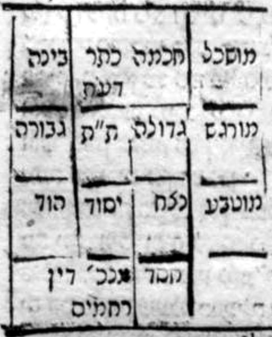

[The diagram as printed: Koretz, 1780, scan p. 125 (Russian State Library, dlib.rsl.ru/01006686897). Sefaria's text has a blank here.]

**8:25:8** Behold, three by three. Keter, Chokhmah, Binah: the intelligible world; Gedulah, Gevurah, Tiferet: the sensible world; Netzach, Hod, Yesod, Malkhut: the natural world. Behold, their aspect divided by breadth. And by length they are: Chokhmah, Gedulah, Netzach — behold, the world of Chesed; Binah, Gevurah, Hod — behold, the world of Din; Da'at, Tiferet, Yesod — they are the world of Rachamim. And above them is Keter, including all three aspects, just as it includes the first three; and although it includes Din — for it includes Binah, which is the root of Din — this matter does not entail Din in it at all, as we explained in chapter 3. And below all of them is Malkhut, including three aspects, for she is the one who includes all the Sefirot, as is known. It turns out according to this that Chokhmah and Binah and Da'at, which is in the place of Keter, are the secret of the actions in potential; and Gedulah and Gevurah and Tiferet, the secret of the actions in actuality; Netzach, Hod, Yesod are the messengers who perform the actions. It turns out according to this that Keter is a soul to Tiferet, in the secret of Da'at; and Chokhmah a soul to Gedulah; and Binah a soul to Gevurah; and Chesed a soul to Netzach; and Gevurah a soul to Hod; and Tiferet a soul to Yesod; and Yesod, which receives from the three of them, a soul to Malkhut, who includes all of them.

> הרי שלשה על שלשה. כתר חכמה בינה עולם מושכל, גדולה גבורה תפארת עולם מורגש, נצח הוד יסוד מלכות עולם מוטבע. הרי בחינתם נחלקת לרוחב. ולאורך הם חכמה גדולה נצח הרי עולם החסד, בינה גבורה הוד הרי עולם הדין, דעת ת"ת יסוד הם עולם הרחמים. ולמעלה מהם כתר כלול כל שלשה בחינות כמו שהוא כולל ג' ראשונות ובהיות כלול מן הדין שהרי הוא כלול מהבינה שהוא שורש הדין ולא יחייב הענין הזה בו הדין כלל כמו שבארנו בפ"ג. ולמטה מכלם מלכות כוללת ג' בחינות שהיא הכוללת כל הספירות כנודע. נמצא לפ"ז כי חכמה ובינה ודעת שהוא במקום הכתר סוד הפעולות בכח, וגדולה וגבורה ת"ת סוד הפעולות בפועל, נצח הוד יסוד הם השלוחים הפועלים הפעולות. נמצא לפ"ז שכתר נשמה לת"ת בסוד דעת, והחכמה נשמה לגדולה, ובינה נשמה לגבורה, וחסד נשמה לנצח, וגבורה נשמה להוד, ות"ת נשמה ליסוד, ויסוד המקבל משלשתן נשמה למלכות הכלולה מכלם:

### Chapter 8:26. Explanation of the essence apprehended in Malkhut, its receiving from all the sefirot, through whom it receives, and its manifestation after the exile (*galut*).

**8:26:1** The principle that emerges from the previous chapter is that Keter and Chokhmah and Binah pour forth into Chesed, Tiferet, Gevurah, and Chesed, Tiferet, Gevurah pour forth into Netzach, Hod, Yesod. However, Yesod receives all of them and pours forth to Malkhut; and apart from Malkhut they have no governance in the world. For all is given into her hand, and they have no permission to pour forth to the lower ones except by her means. And so Rashbi explained in the Tikkunim (Tikkun 4, fol. 19a), and these are his words: "And there is no Sefirah among all the Sefirot that has permission to empty out blessings and to pour forth to the lower ones except through Bat Sheva, because she is the bond of all the Sefirot. For if the Sefirot were emptying out apart from her, there would be separation; and therefore there is no permission to empty out blessings and to pour forth to any place apart from her, toward the lower ones. And therefore it is said of her, 'Let not the wise man glory,' etc., 'but in this,' etc. (Jeremiah 9:22–23)." Thus far his words.

> הכלל העולה מהפרק הקודם הוא כי הכתר והחכמה והבינה משפיעים בחסד ת"ת גבורה, וחסד ת"ת גבורה משפיעים בנה"י. אמנם היסוד מקבל כלם ומשפיע למלכות ובזולת המלכות אין להם הנהגה בעולם. כי הכל ניתן בידה ואין להם רשות להשפיע בתחתונים אם לא על ידה. וכן ביאר הרשב"י בתקונים (תקונא ד' דף י"ט.) וז"ל ולית ספירה מכלהו ספירן דיהא לה רשו לארקא ברכאן ולאשפעא לתתאין אלא בבת שבע בגין דאיהי קשורא דכלהו ספירן. דאי ספירן הוו מריקן לבר מינה הוה פרודא ובג"כ לית רשו לארקא ברכאן ולאשפעא לשום אתר בר מינה לגבי תתאין ובג"ד אתמר בה אל יתהלל חכם כו' כ"א בזאת כו' עכ"ל.

**8:26:2** And it is clear for our matter. And the truth is that the pouring forth of the Sefirot into Malkhut is by means of Yesod, as we explained in the Gate of Channels, chapter 3; and, God forbid, when Yesod withdraws, the effluence and the good withdraw. And if the questioner asks: how is it possible to suppose that the effluence of Yesod withdrew from Malkhut and the world would endure? This is no difficulty, for this question has already been asked in the Zohar, Parashat Terumah (fol. 166b), and these are its words: "This light the Holy One, blessed be He, sowed in the Garden of His delights, and made it rows and rows, by means of this Righteous One; and he is the gardener of the Garden. And he took this light and sowed it, a seed of truth, and made it rows and rows in the Garden of Eden; and it begot and sprouted and made fruits, and from them the world is sustained. This is what is written: 'Light is sown for the righteous,' etc. (Psalms 97:11). And it is written, 'and as a garden causes its seeds to sprout' (Isaiah 61:11). What are its seeds? These are the seeds of the primordial light, which is sown constantly: now it begets and makes fruits, and now it is sown as at first; before the world eats this fruit, it begets this seed and gives fruit, and does not subside. And therefore all the worlds are sustained by the provision of that gardener who is called Righteous One, who does not subside and never ceases — except at the time when Israel are in exile. And if you say: at the time of the exile it is written, 'The waters fail from the sea, and the river is drained dry' (Job 14:11) — how does it make offspring? Rather, it is written 'sown': it is sown constantly. And from the day that river ceased, the gardener did not enter that Garden; and that light, which is sown constantly, makes fruits, and from them, of itself, it is sown as at first, and does not subside, constantly — like a garden that makes offspring, and from that seed that fell in it, in its place, of itself it makes offspring as at first. And if you say that those offspring and fruits are as they were at the time that the gardener was there — it is not so; but this sowing is never withheld. In this manner, 'and the Torah is light' (Proverbs 6:23): the Torah [that was given from the side of that primordial light] is thus sown constantly in the world, and makes offspring and fruits, and never subsides; and from that fruit of it the world is sustained." Thus far its words.

> ומבואר הוא לענייננו. והאמת כי השפעת הספירות במלכות הוא ע"י היסוד כדפי' בשער הצנורות בפ"ג. וח"ו בהסתלק היסוד תסתלק השפע והטוב. ואם ישאל השואל ואיך אפשר לשער שנסתלק שפע היסוד מהמלכות [יז] ויתקיים העולם. הא ל"ק שכבר נשאלה שאלה זו בזהר פ' תרומה (דף קס"ו ע"ב) וז"ל האי אור זרע ליה קב"ה בגנתא דעדנוי ועבד ליה שורין שורין ע"י דהאי צדיק, ואיהו גננא דגנתא, ונטל להאי אור וזרע ליה זרוע דקשוט ועביד ליה שורין שורין בגנתא דעדן ואוליד ואצמח ועביד פירין ומנייהו אתזן עלמא הה"ד אור זרוע לצדיק וגו'. וכתיב וכגנה זרועיה תצמיח. מאן זרועיה, אלין זרועיה דאור קדמאה דאיהו זרוע תדיר השתא אוליד ועביד איבין והשתא זרוע איהו כדקדמיתא עד לא ייכול עלמא איבא דא אוליד זרועא דא, ויהיב איבא ולא שכיך וע"ד כל עלמין אתזנו בספוקא דההיא גננא דאקרי צדיק דלא שכיך ולא פסיק לעלמין בר בזמנא דישראל בגלות'. ואי תימא בזמנ' דגלות' כתיב אזלו מים מני ים ונהר יחרב ויבש היך עביד תולדין. אלא כתיב זרוע, זרוע איהו תדיר. ומיומא דאפסיק ההוא נהר גננא לא עאל בההוא גנתא. וההוא אור דאיהו זרוע תדיר עביד איבין ומניהו מגרמיה אזדרע כדקדמיתא ולא שכיך תדיר. כגנתא דעביד תולדין ומההוא זרועא נפל ביה באתריה, ומגרמיה עביד תולדין כדבקדמיתא. ואי תימא דאינון תולדין ואיבין הוו כמה דהוה בזמנא דגננא תמן, לאו הכי אבל לא אתמנע זרוע דא לעלמין. כגוונא דא ותורה אור אורייתא [דאתיהיבת מסטרא דההוא אור קדמאה] הכי אזדרע תדיר בעלמא ועביד תולדין ואיבין ולא שכיך לעלמין, ומההוא איבא דיליה אתזן עלמא עכ"ל.

**8:26:3** And the intent of this passage is to prove that Yesod is what pours forth into Malkhut; and he is the man who tills this ground, and there is none who breaches the fence and trespasses his border to sow or to till besides him. And this is the point around which the wheel of this passage turns. For above this matter he said that Tiferet is called "light" from the side of its sucking from Chesed, as we shall explain in the Gate of the Glossary of Titles, under the entry "light"; and he said that this light, which is the effluence that is poured forth, is poured forth by means of the Righteous One, the foundation of the world. And he explained that the one who pours forth is Tiferet, the Holy One, blessed be He, who is the master of the seed; and the tenant farmer who tills the ground is Yesod; and the garden in which the seed is sown is Malkhut. And he called her by the name "garden" on account of the wording of the verse, which says, "Light is sown" (Psalms 97:11), and the expression "sowing" applies to a garden; and on account of the verse that is written, "and as a garden causes its seeds to sprout" (Isaiah 61:11), for from there is his proof, as will be explained.

> וכונת המאמר הזה הוא להכריח שהיסוד הוא המשפיע במלכות והוא האיש העובד האדמה הזאת ואין פורץ גדר ומשיג גבולו לזרוע או לעבוד זולתו. וזהו נקודה אשר עליה תסוב גלגל המאמר הזה. כי למעלה מן הענין אמר שהת"ת הנקרא אור מצד יניקתו מן החסד כאשר נבאר בשער ערכי הכנוים בערך אור, ואמר שזה האור שהוא השפע הנשפע הוא נשפע ע"י הצדיק י"ע. ובאר שהמשפיע הוא הת"ת הקב"ה שהוא בעל הזרע. והאריס העובד את האדמה הוא היסוד. והגן אשר בו נזרע הזרע הוא המלכות. וקראה בשם גן משום לישנא דקרא דקאמר (תהלים צז) אור זרוע ולשון זריעה שייך גבי גינה. ומשום קרא דכתיב (ישעיה ס"א) וכגנה זרועיה תצמיח כי משם ראייתו כאשר יתבאר.

**8:26:4** And further, because there are fifty-three [*gan*] portions in the Torah; and this is the secret of the verse "and the Torah is light" (Proverbs 6:23), for it is about this that [the passage] stands there. And when she receives from Tiferet, which is the Torah, then she is called *gan* [garden], to allude to its fifty-three portions. "And made it rows," etc.: the intent is to resolve the verse, which said "its seeds," in the plural; and so that, from the expression "its seeds," which implies many, we not come to say that many sow in her, and she sprouts and grows all the seeds, each after its kind — for this he spoke first, to save us from the error. And it is true that in the seed of the Righteous One there are many kinds of effluence, each one to the storehouse fit for it: storehouses of life and storehouses of wealth, storehouses of wisdom and storehouses of Torah and storehouses of understanding; and this is "and made it rows," which are the storehouses. "And he took this light," etc.: it was difficult for him: if so, it would follow according to this that the seed that goes out from the Righteous One is not as the Righteous One receives it from above, but is changed in the Self of the Righteous One. For otherwise, how would the word "sown for the righteous" be correct? For if the effluence is poured into her as it is poured from above, what benefit is drawn from this to the Righteous One, that the name "sown for the righteous" should be related to him? To this he said, "and he took this light," etc.; and the explanation is: he takes the light and pours it forth, and sows it as light, just as it is poured from above; and it is not in his hand to hold it back or to change it — just as there is no power in the organ of intercourse to change the seed from its nature, which belongs to it by means of the two that empty it out. And this is what it says, "and he sowed it, a seed of truth": meaning, a seed of truth [*emet*], that is, Tiferet; and even after the sowing it is a seed of truth, related to Tiferet. And as to what was difficult for him — what benefit is drawn from this to the Righteous One, or what is his action, that the saying "sown for the righteous" should be correct — to this he answered, "and made it rows and rows": meaning, the light and the effluence come mixed, without being separated each after its kind, and Yesod is the one who divides it to the storehouses, each one according to its nature, decreed from its root — in the way of the tenant farmer, or the man who tills the ground, who "puts the wheat in rows, and the barley in its place, and the spelt at its border" (Isaiah 28:25).

> ועוד מפני שג"ן סדרים יש בתורה. וזהו סוד הפסוק (משלי ו) ותורה אור דעליה קאי התם. ובקבלתה מהת"ת שהוא התורה אז נקראת גן לרמוז אל ג"ן סדריה. ועביד ליה שורין וכו'. הכונה לישב הפסוק שאמר זרועיה לשון רבים. וכדי שמתוך לשון זרועיה דמשמע רבים, לא נבא לומר שרבים זורעים בה והיא צומחת ומגדלת כל הזרעים כל אחד למינהו. לזה הקדים להצילנו מן הטעות. ואמת כי בזרע הצדיק יש כמה מיני שפע כל א' אל האוצר הראוי לו אוצרות חיים ואוצרות עושר אוצרות חכמה ואוצרות תורה ואוצרות בינה וזהו ועביד לי' שורין ששהם האוצרות. ונטיל להאי אור וכו'. הוקשה לו א"כ ימשך לפ"ז שאין הזרע היוצא מן הצדיק הוא כמו שמקבל הצדיק מלמעלה אלא ישתנה בעצמות הצדיק. שאל"כ איך יצדק מלת זרוע לצדיק שאם השפע יושפע בה כמו שנשפע מלמעלה מה תועלת ימשך מזה לצדיק עד שיתייחס אליו שם זרוע לצדיק. לז"א ונטיל להאי אור כו' ופי' הוא לוקח האור ומשפיעו וזרעו אור כמו שהוא נשפע מלמעלה ואין בידו לעכב או לשנות כמו שאין באבר המשגל כח לשנות הזרע מטבעו הקנוי לו ע"י שני המריקים. וז"ש וזרע ליה זרועא דקשוט פי' זרע אמת דהיינו הת"ת, ואפי' אחר הזרע הוא זרע אמת מתייחס אל הת"ת. ואל מה שהוקשה לו מה תועלת נמשך מזה לצדיק או מה פעולתו עד שיצדק אמרו זרוע לצדיק. לזה השיב ועביד ליה שורין שורין פי' כי האור והשפע בא מעורב בלי מתפרד כל אחד למינו והיסוד הוא המחלק אל האוצרות כל אחד לפי טבעו הנגזר משרשו. כדרך האריס או האיש העובד האדמה אשר שם חטה שורה ושעורה נסמן וכוסמת גבולתו.

**8:26:5** And further, besides this, he begets it and makes it sprout; and this is what it says, "and it begot and sprouted," etc. And the reason for this doubling is to allude to two things: the one, for the matter of the effluence that is poured forth for the sustenance of the world and its provision and the other matters of the world; and the second, for the matter of the souls. And this is his intent: "and it begot" souls, "and sprouted" fruits and seeds; for both of them are the sustenance of the world. "This is what is written: 'Light is sown,'" etc.: he settled the matter from two verses. From the first verse, which is "Light is sown for the righteous," he proved that the one who sows this seed is the Righteous One, as it said, "Light is sown for the righteous." And from the second verse he settled and proved that the one who receives the effluence is the chosen garden; and this is "and as a garden," etc., as we explained. "What are its seeds? These are the seeds," etc.: it was difficult for him: if so, it turns out that the garden, after its sowing, will afterward necessarily change the seed from how it was; and in the end the expression "light is sown" would not be precise, for after it is sown it is not light. For this he said, "What are its seeds? These are the seeds of the primordial light": meaning, just as the primordial light was — by which is intended the effluence poured from Chesed into Tiferet, to pour forth to the bride — so, after it is sown in Malkhut, and after its sprouting, the name "light" is still upon it. And this he intended in saying, "the primordial light, which is sown constantly": the intent is that it never changes from how it was in its place. "Now it begets and makes fruits," etc.: it was difficult for him: if so, why did the verse say "its seeds she causes to sprout," a name implying "its seeds," that they are hers, so that it is in her hand to change them? For otherwise it ought to have said "she causes seed to sprout"; what is "its seeds"? For this he answered that what is now renewed in Malkhut is that it makes offspring and fruits, which it did not before. And this is what it says, "now," etc.: meaning, after it is sown, "it begets and makes fruits." "And now it is sown as at first": meaning, even now, at the time that it makes the fruit, it is light, as before its coming to Malkhut, the place of its sowing. And he took the expression "sown" to be precise in the expression "light is sown for the righteous," which proves that even after its sowing it is called light, as we explained, and that it never changes from how it was in its place: light. "Before the world eats this fruit," etc.: it was difficult for him: what necessity is there for the manifestation of this matter, that it be light as before its coming? And why not say that it changes, in the way of all sowings, which change to a manifestation other than their sowing — for they rot and change into the manifestation of sprouting, which is grass, and from it that seed is born? For this he answered that it is not fitting to say so of the manifestation of the effluence poured to Malkhut. For if we said so, it would follow that the effluence is somewhat limited at the time that it sows, and if so, it changes to a manifestation other than the manifestation of its coming, and afterward sprouts; and if so, between this and that the world would be destroyed. Rather, certainly we are compelled to say that as it is in its source, so it is poured to Malkhut; and as it is at the time of its pouring forth, so it is at the time of its growing and making fruits; and there is never any delay, for all this is as an instant. And this is what it says: "before the world eats this fruit, it begets this seed and gives fruit, and does not subside." "And therefore all the worlds are sustained by the provision of that gardener," etc.: the intent is to explain what has already preceded for us, that the Righteous One is called "the river that flows and goes out and never ceases"; for the thing cannot be held back in any way in the world, for the world would be destroyed, as it is after the destruction, as he goes on to explain. "And if you say," etc.: meaning, according to your words, that there is no manifestation for the world except by means of the drawing of the effluence without delay — if so, at the time of the exile, when no effluence is poured forth, as is proven from the verses, how does the world endure, and from where are those fruits from which the world is sustained?

> ועוד בזולת זה שהוא מולידה ומצמיחה, וז"ש ואוליד ואצמח וכו'. וטעם הכפל הזה הוא לרמז אל שני דברים. האחד לענין השפע הנשפע למזון העולם ולפרנסתו ושאר דברי העולם. והשני לענין הנשמות. וזה כונתו ואוליד נשמות, ואצמח פירות וזרעים. כי שניהם הם מזון העולם. הה"ד אור זרוע וכו'. הכריע הענין מב' כתובי מהכתוב הא' שהוא אור זרוע לצדיק הכריח כי הזורע זרע זה הוא הצדיק כמו שאמר אור זרוע לצדיק. ומן הכתוב השני הכריע והכריח כי המקבל השפע הוא הגן הנבחר, וזהו וכגנה וכו' כדפי'. מאן זרועיה אלין זרועי וכו'. הוקשה לו א"כ נמצא שהגן אחר זריעתו יוכרח אח"כ שישתנה הזרע מכמות שהיה וסוף סוף לא ידוקדק לשון אור זרוע כי אחר היותו זרוע אינו אור, לזה אמר מאן זרועיה אלין זרועי אור קדמאה. פי' כמו שהיה אור קדמאה שהנרצה בו השפע הנשפע מחסד בת"ת להשפיע להכלה, כן אחר שנזרע במלכות ואחרי צמיחתו עדיין שם אור עליו. וזה כוון באמרו אור קדמאה דאיהו זרוע תדיר. הכונה שלעולם לא ישתנה מכמות שהיה במקומו. השתא אוליד ועביד איבין וכו'. הוקשה לו א"כ למה אמר הכתוב זרועיה תצמיח שם חיוב זרועיה שהם שלה שבידה לשנותה שאל"כ היה ראוי שיאמר זרע תצמיח מאי זרועיה. לזה השיב כי מה שנתחדש עתה במלכות הוא היותו עושה תולדות ופירות מה שלא היה קודם לכן. וז"ש השתא כו'. פי' אחר שנזרע אוליד ועביד איבין. והשתא זרוע הוא כקדמיתא פי' אפי' עתה בעת עשותו הפרי הוא אור כקודם בואו אל המלכות מקום זריעותו. ונקט לשון זרוע לדקדק לשון אור זרוע לצדיק המוכיח שאפי' אחר זריעתו יקרא אור כדפי', ולעולם לא ישתנה מכמות שהיה במקומו אור. עד לא ייכול עלמא איבא דא וכו'. הוקשה לו כי מה הכרח אל מציאות הענין הזה שיהיה אור כקודם בואו ולא נאמר שישתנה כדרך כל הזריעות שמשתנים אל מציאות זולת זריעתם שמתרקבים ומשתנים אל מציאות הצמיחה שהוא עשב וממנו נולד הזרע ההוא. לזה השיב שאין ראוי לומר כן במציאות השפע הנשפע אל המלכות. מפני שאם נאמר כן נחייב שהשפע נגבל קצת בעת שזורע וא"כ משתנה אל מציאות זולת מציאות בואו ואח"כ צומח, וא"כ בין זה לזה העולם חרב. אלא ודאי חוייבנו לומר כי כמו שהוא במקורו כן נשפע אל המלכות, וכמו שהוא בעת שפעו כן הוא בעת גידולו ועשותו פירות, ולעולם אין עכוב כי כל זה כרגע. וז"ש עד לא ייכול עלמא איבא דא אוליד זרועא דא ויהיב איבא ולא שכיך. וע"ד כל עלמין אתזנו בספוקא דההוא גננא וכו'. הכונה לבאר מה שכבר קדם לנו כי צדיק נקרא נהר דנגיד ונפיק ולא פסיק לעלמין כי אין הדבר יכול להתעכב בשום אופן בעולם, כי היה העולם חרב כמו שהוא אחר החורבן כדמפ' ואזיל. ואי תימא וכו'. פי' לפי דבריך שאין מציאות לעולם אם לא ע"י משך השפע בלי עכוב, א"כ בזמן הגלות שאין שפע נשפע כדמוכח מקראי א"כ איך העולם מתקיים ומהיכן הם אותן הפירות שהעולם נזון מהם.

**8:26:6** And further: since the effluence has withdrawn from Yesod, if so, how does Yesod make offspring and fruits? So his question turns out to be in two respects: first, concerning Malkhut — how is there a manifestation for the world, for it is written, "The waters fail from the sea"? And the second, concerning Yesod — how does it pour forth, for it is written, "and the river is drained dry"? And he answered to this that from the day the Temple was destroyed, effluence has never been poured forth by means of Yesod, that is, the gardener; "and he did not enter the Garden," meaning, he did not unite with Malkhut, because they are not found together, as it is written, "The righteous one is lost" (Isaiah 57:1), as is explained in the Zohar. And to the question, by what is the world provided for — it is by means of the effluence already poured forth, which was sown from the time before the destruction. And the matter is that the way of holiness is to increase and not to diminish, as we shall explain in the Gate of Manifestations, chapter 1. And if so, the effluence itself is never withheld; rather, a manifestation other than it comes to be from it, to sustain and to provide for the world. And this is the parable of the sown garden, [in which afterward, from the seeds that fall,] of themselves, it is sown and grows there out of the seed sown before. "And if you say that those offspring," etc.: it was difficult for him: if so, what advantage is there for a person in all his toil in union, since the effluence grows of itself, and other sustenance comes to be from it, from which the world is sustained? If so, the union with Yesod neither raises up nor brings down, since the garden is sown of itself. To this he answered: and do you think that the seed sown of itself, and the manifestation that comes to be, are equal to the manifestation of the literal watering — so that it would appear that there is no advantage in the gardener's being within the garden, and in the river that waters it? God forbid; the thing is not so. For now manifestation comes to be from manifestation, and manifestation from manifestation, and they are not the light itself; for the light itself always remains there, to bring into being a manifestation other than itself, which is the seed that is sown. But when the Righteous One is within his Garden, and waters it and sows it, since the light is drawn and does not cease, the world is sustained from the Self of the light itself, not from its manifestations; and, on the contrary, the manifestations increase and the blessings increase in the world. And this is what it says, "but this sowing is never withheld," etc.: the intent is that it is true that the sowing is never withheld, but not that it is of the value and equal to the time when the Righteous One is within his Garden, as we explained. "In this manner, 'and the Torah is light'": he returns to explain the verse with which he opened, that is, "For the commandment is a lamp, and the Torah is light" (Proverbs 6:23); and the intent is that the Torah is like the sown light, which always makes fruits and never ceases. Thus far the explanation of the passage. And the principle that emerges for us is that the sustenance and the effluence poured to Malkhut are by means of Yesod, and not by means of another Sefirah besides it. And even at the time of the exile, when the Righteous One is not in his lodging, nevertheless the world is sustained from what he poured forth before. And among the things one must know: since at the time of the exile the world is sustained from effluence that was poured into Malkhut before, if so, what will intention in prayer and union give, and what will it add? And all the more now, in this bitter exile, of which it is said, "The righteous one is lost," and likewise, "The waters fail from the sea" — if so, what do prayer and supplication and union accomplish, since the righteousness of the Righteous One pours forth neither little nor much, as is proven from the previous passage?

> ועוד אחר שהשפע נסתלק מהיסוד א"כ איך היסוד עושה תולדות ופירות. ונמצא שאלתו בב' פנים. ראשונה על המלכות היאך יש מציאות לעולם דהא כתיב אזלו מים מני ים. והשנית על היסוד היאך הוא משפיע שהרי כתיב ונהר יחרב ויבש. ותירץ לזאת שמיום שנחרב בית המקדש מעולם לא נשפע שפע ע"י היסוד דהיינו גננא, ולא נכנס לגנתא פי' לא נתיחד עם המלכות מפני שאינן נמצאין יחד. כדכתיב (ישעיה נז א) הצדיק אבד כדפי' בזהר. ואל השאלה במה העולם מתפרנס, הוא ע"י השפע הנשפע מכבר שהוא זרוע מזמן קודם החרבן. והענין כי מדרך הקדושה להתרבות ולא להתמעט כמו שנבאר בשער המציאיות פ"א. וא"כ השפע העצמי אינו נמנע לעולם אלא מתהוה ממנו מציאות זולתו לזון ולפרנס העולם. וזה משל אל הגינה הנזרעת [שאח"כ מהזרעונים הנופלים] מעצמם נזרע וגדל שם מתוך הזרע הנזרע מקודם. ואי תימא דאינון תולדין כו'. הוקשה לו שא"כ מה יתרון לאדם בכל עמלו ביחוד אחר שמעצמו גדל השפע ומתהווה ממנו מזון אחר שממנו העולם ניזון אם כן היחוד עם היסוד לא מעלה ולא מוריד אחר שהגנה נזרעת מעצמה. לזה השיב וכי התחשוב שיהיה הזרע הנזרע מעצמו והמציאות המתהוה שוה אל מציאות השקה ממש ולכן יראה שאין יתרון בשהגנן בתוך הגנה ואל הנהר המשקה. ח"ו אין הדבר כן שעתה מציאות מתהוה ממציאות ומציאות ממציאות ואינם עצם האור כי עצם האור לעולם נשאר שם להוות מציאות זולתו שהוא הזרע הנזרע. אבל בהיות הצדיק בתוך גנתו ומשקה אותה וזורעה כיון שאור נמשך ואינו פוסק, העולם ניזון מעצמות האור בעצמו לא ממציאותיו. אלא אדרבה המציאות מתרבים והברכות מתרבות בעולם. וז"ש אבל לא אתמנע זרוע דא וכו'. הכוונה שאמת הוא שמעולם לא נמנע הזריעה אבל לא שיהיה בערך ובשווי עם זמן היות הצדיק בתוך גנתו כדפי'. כג"ד ותורה אור. חוזר לבאר הקרא דפתח ביה דהיינו כי נר מצוה ותורה אור והכוונה שהתורה הוא כמו האור הזרוע שלעולם עביד איבין ולא פסיק לעלמין. ע"כ פי' המאמר. והכלל היוצא לנו שהמזון והשפע הנשפע למלכות. הוא ע"י יסוד ולא ע"י ספירה אחרת זולתו. ואפי' בזמן הגלות שאין צדיק בבית מלונו עכ"ז העולם נזון ממה שהשפיע מקודם לכן. וממה שצריך לדעת כי כיון שבזמן הגלות העולם נזון משפע שנשפע במלכות מקודם א"כ מה יתן ומה יוסיף הכוונה בתפלה והיחוד. ומה גם עתה בגלות המר הזה שעליו נאמר הצדיק אבד וכן אזלו מים מני ים, א"כ מה פועלת התפילה והתחינה והיחוד, אחר שצדקת הצדיק לא ישפיע לא מעט ולא הרבה כדמוכח מתוך המאמר הקודם.

**8:26:7** And this matter they explained in the Zohar, Parashat Shemini (fol. 40), and these are its words: "And whoever knows how to unite the holy name — although blessings are not found in the world — he supports and props up Knesset Yisrael in the exile." And behold, explicitly: although the blessings are not found, nevertheless there is in the matter support and prop.

> וענין זה בארו בזוהר פ' שמיני (דף מ') ז"ל ומאן דידע ליחדא שמא קדישא אע"ג דברכאן לא משתכחי בעלמא איהו סמיך וסעיד לכנסת ישראל בגלותא. והרי בפי' כי עם היות שהברכות אינם נמצאות עכ"ז יש בענין סמך וסעד.

**8:26:8** And the matter of support is that Malkhut, who is "the falling booth of David" in the exile, has no rising until He looks down and sees, and that hour arrives in which the verse that is written will be fulfilled: "On that day I will raise up the booth of David that is falling" (Amos 9:11). And he was precise in the word "falling" [*nofelet*], a participle in the pattern of *po'elet*, *nokemet*. And the intent is that she is forever falling; for that effluence — as long as the time of the destruction continues and there is no renewal in it — is like the parable of the seed of the garden that is sown of itself, which, if they do not renew it, will be spoiled, God forbid. And therefore "there is no day whose curse is not greater than that of its fellow," because the power of the female has weakened, God forbid; and this is "falling." And because of this she needs supporters, so that she not fall altogether.

> וענין סמך הוא כי המלכות שהיא סוכת דוד הנופלת בגלות ואין לה קימה עד ישקיף וירא ויגיע ההיא שעתא דתתקיים קרא דכתיב ביום ההוא אקים את סוכת דוד הנופלת (עמוס ט'). ודקדק מלת נופלת לשון בינוני במשקל פועלת נוקמת. והכוונה שלעולם נופלת מפני שהשפע ההוא כל עוד שזמן החורבן נמשך ואין בו החדוש הוא כמשל זרע הגנה הנזרעת מאליה שאם לא יחדשוהו יתקלקל ח"ו. ולכן אין לך יום שאין בו קללה מרובה מחבירו יען כי תשש כח הנקבה ח"ו וזהו הנופלת. ומפני כך צריכה אל סומכים שלא תפול מכל וכל.

**8:26:9** And the matter of the support is by means of some pouring forth [which will be found from above, "from the juice of pomegranates" (Song of Songs 8:2)], as through the cracks of a needle, to renew support in the world. And all those who make the prop and the support, their reward is doubled and redoubled; and of them it is said, "Rejoice for joy with her, all you who mourn over her" (Isaiah 66:10). And the matter is that they be united — even if the union of their aspect is not as it was before the exile — until the Temple is built and the verse that is written is fulfilled: "And YHVH shall be King over all the earth; on that day YHVH shall be One and His name One" (Zechariah 14:9).

> וענין הסמך הוא ע"י ההשפעה קצת [אשר תהיה מתמצא מלמעלה מעסיס רמונים] כמבין סדקי המחט לחדש סמך בעלמא. וכל העושים הסעד והסמך שכרם כפול ומכופל ועליהם נאמר (ישעי' ס"ו) שישו אתה משוש כל המתאבלים עליה. והענין הוא שיתייחדו, ואם לא יהיה יחוד בחינתם כאשר מקודם הגלות. עד שיבנה בית המקדש ויקוים מקרא שכתוב (זכרי' י"ד) והיה ה' למלך על כל הארץ ביום ההוא יהיה ה' אחד ושמו אחד.

**8:26:10** And with this this Gate is concluded; and praise to God, the true Helper. And we journey on to the Gate of Arbiters.

> ובזה נכלל השער הזה ותהלה לאל העוזר האמת. ונסע אל שער המכריעים:

---

## Gate 9: Arbiters

We named it **"Arbiters"** because its inquiry concerns who tips the balance between Netzach and Hod, between Gedulah and Gevurah, and between Chokhmah and Binah — what arbitration is and what it serves. Its chapters number six.

### Chapter 9:1. Explanation of the need for arbitration; and there it is explained that it belongs to the attribute of Chesed to bestow upon the wicked and the good; and a passage from the Zohar, Parashat Terumah, is explained: "and in His goodness" — not "from His goodness."

**9:1:1** **The Ninth Gate: The Gate of Arbiters.**

> **שער התשיעי הוא שער המכריעין:**

**9:1:2** The intent in this Gate is to explain the number of the arbiters between Chesed and Din: how many they are, and how the manifestation of the arbitration is.

> הכוונה בזה השער לבאר מנין המכריעין בין החסד והדין וכמה הם וכיצד מציאות ההכרעה:

**9:1:3** **Chapter One:**

> **פרק ראשון:**

**9:1:4** The intent in this chapter is to make known the matter of arbitration. And the matter is this: when the Holy One, blessed be He, emanated His holy Emanation, He emanated two opposite attributes, which are Chesed and Gevurah, from which reward and punishment are drawn. And since it sometimes happens that the world needs punishment, but not so much, and likewise it sometimes needs reward, but not so much, therefore the Emanator emanated the middle line between the two extremes; and it is what is called the arbiter line. How so? Chesed is an attribute that inclines to reward and to the good, and to pour forth upon the wicked and the good, as its name, which is *chesed* [kindness]. And so it is explained in the Zohar, that Chesed is to pour forth upon the wicked and the good. And these are its words in Parashat Terumah (fol. 168b): "'And in His goodness,' and not 'from His goodness.' 'And in His goodness' — this is the supernal right. And 'from His goodness' — this is another grade, which comes from the side of the right, and it is a grade below it. Because by that good the world was built, and by it it is fed. Why is it called 'good,' and why is it called 'Chesed'? It is 'good' when all is included within it and it has not spread out to descend below; it is 'Chesed' when it descends below and does good to all creatures, to the righteous and to the wicked, and does not care — even though it is one grade. And from where do we know? For it is written, 'Surely goodness and kindness shall follow me' (Psalms 23:6). If goodness, why kindness? And if kindness, why goodness? For one would suffice. Rather, 'good' includes all within it and has not spread out below; 'Chesed' descends and spreads out below and feeds all, the righteous and the wicked alike. And here, since he said 'and in His goodness we live,' he went on to say, 'who feeds the whole world in His goodness, in kindness.'" Thus far its words.

> הכוונה בפרק זה הוא להודיע ענין ההכרעה. והענין כי בהאציל הקב"ה אצילותו הק' האציל שני מדות הפכיים שהם החסד והגבורה שהשכר והעונש נמשך מהם. ויען כי פעמים יקרה היות העולם צריך אל העונש אבל לא כ"כ וכן יצטרך לפעמים אל השכר אבל לא כ"כ לכן האציל המאציל קו האמצע בין שתי הקצוות והוא הנקרא קו המכריע. כיצד החסד הוא מדה הנוטה אל השכר ואל הטוב ולהשפיע לרעים ולטובים כשמו שהוא חסד. וכן פי' בזוהר שהחסד הוא להשפיע לרעים ולטובים. וז"ל בפ' תרומה (דף קס"ח ע"ב) ובטובו ולא מטובו, ובטובו, דא ימינא עלאה. ומטובו דא דרגא אחרא דאתי מסטרא דימינא ואיהו דרגא לתתא מניה. בגין דבההוא טוב אתבניא עלמא וביה אתזן. אמאי אקרי טוב ואמאי אקרי חסד. טוב איהו כד כלול כלא בגויה ולא אתפשט לנחתא לתתא, חסד כד נחתא לתתא ועביד טיבו בכל בריין בצדיקיא וברשיעיא ולא חייש, ואע"ג דדרגא חד הוא. ומנ"ל דכתיב אך טוב וחסד ירדפוני. אי טוב למה חסד ואי חסד למה טוב דהא בחד סגיא. אלא טוב כליל כלא בגוויה ולא אתפשט לתתא. חסד נחית ואתפשט לתתא וזן כלא צדיקי ורשיעי כחדא. והכא כיון דאמר בטובו חיינו הדר ואמר הזן את העולם כולו בטובו בחסד עכ"ל.

**9:1:5** And there are things to be precise about in it. First: his saying, "And 'from His goodness' — this is another grade, which comes from the side of the right, and it is a grade below." Once he has said that it is "another grade, which comes," etc., why did he go on to say "a grade below"? For it is understood of itself: since it is drawn from the right, it is certainly below the right. Second: his saying, "because by that good [the world] was built," etc., which is the reverse of what he explains at the end of his words; and the beginning contradicts the end. At the beginning he said that by the good the world is fed, and at the end he said that "good" is before the drawing-forth, when it does not feed at all; and he contradicts himself. Third: further, his saying, "even though it is one grade" — what is "even though"? Do not all the Sefirot have aspects, each aspect with a title of its own, as is explained in the Gate of the Glossary of Titles? If so, what is "even though"? Fourth: his saying, "and from where do we know," etc. — why that? Let us say that they are two attributes, and that is why he asks of the attribute of good and of the attribute of Chesed; and there is no proof from the verse for what he intends. Fifth: according to the explanation that "good" is "when all is included," etc., which is a holding back of the effluence, so that it is not drawn forth — if so, why should David ask for "goodness," which is before it has spread out, since he has Chesed? Let him say "kindness" and be silent about "goodness." Sixth: as to the Grace after Meals, according to what he explained concerning "who feeds the whole world," etc. — if so, why should we say "goodness," so that we must afterward say "kindness"? Let us say "kindness" from the outset and be silent about "goodness"; better that we say the cure and not come to the wound at all. And to settle this passage we say that the sage who is the author of this passage found it difficult, in the Grace after Meals, that we say "in His goodness," so that we are compelled afterward to say "in grace, in kindness" to set it right; and it would have been better to say "in kindness" from the outset. And to answer this matter he first asked another question: the reason for what is said in Tractate Berakhot (fol. 50): "One who says 'from His goodness we live' is ignorant; 'and in His goodness we live' is wise." And he explained and said, "'And in His goodness' is the supernal right," meaning Chesed; and "from His goodness" is Yesod, which is drawn from Chesed, meaning Yesod, which receives from Chesed. And this is "from His goodness," whose explanation is "part of His goodness": the intent is the thing that is drawn from the good. And "in His goodness" means His goodness literally, that is, His Chesed. And this is what he says: "'from His goodness' — this is another grade, which comes from the side of the right," that is, from the side of Yesod, which is drawn from Chesed. And so that we not say that the explanation of "from His goodness" is "from the effluence of His goodness," that is, the effluence of the good, which is Chesed — for this he said, "and it is a grade below": meaning, it is literally another grade and another attribute, drawn from Chesed and sucking from it, not the effluence of Chesed itself. "Because by that good," etc.: it was difficult for him: since he has explained that "from His goodness" is another grade below, which is Yesod or another, then, since it is an attribute drawn from Chesed, why is one who says "from His goodness" ignorant? For "from His goodness" is an attribute that receives effluence from the supernal good. To this he gave a reason and said, "because by that good" — meaning, by the good of the upper world, which is Chesed, was the building of the world, as is known; and therefore the sustenance of the world and its effluence come from the place of its building. And therefore one who says "from His goodness" is ignorant; rather, the correct thing is "in His goodness," which is Chesed, for it built the world, and it sustains it and provides for it. "Why is it called 'good,' and why is it called 'Chesed'?": since both are in one aspect, according to what I explained, that by means of the good was the building of the world, that is, literally Chesed, as it is written, "The world is built by kindness" (Psalms 89:3) — if so, it turns out that they are equal aspects; and if so, why did their names change, since they are equal aspects according to your view? And to this he said, "It is 'good' when all is included within it and it has not spread out to descend below." The intent is that Chesed includes the whole Structure. And so the Zohar explained (in Parashat Balak, fol. 191), on the verse "And YHVH went before them by day [*yomam*]" (Exodus 13:21), that Chesed is called *yomam*, meaning a day that includes all the days; and we explained it in the Gate of the Glossary of Titles, under the entry *yomam*. And the intent is that Chesed includes all the extremities, in the secret of "For I said, the world [*olam*]" — which is the whole circumference [that is called *olam*] — "is built by kindness": meaning, by Chesed it was built, and became thick, and was revealed. And therefore, while it is in Chesed before its revealing, [as] an aspect being revealed, that aspect is called "good" [*tov*], which is from the expression "when he dresses [*be-heitivo*] the lamps" (Exodus 30:7); the intent is a light by which all of them shone with a great light, and before they were [dressed] they did not shine. And this is their building: their revealing and their tikkun into a manifestation that is revealed. And this is what he said: "when all is included within it and it has not spread out to descend below; it is 'Chesed,'" etc. That is, after the things there became thick and shone so as to be revealed, and spread out, then Chesed pours forth its effluence, and its nature is [to pour] upon the wicked and the good; and this is what is called Chesed, "and does not care." "Even though it is one grade": meaning, although all is one aspect — for the very one that was good is what became Chesed, since from the place where they were built their sustenance is drawn — nevertheless, with respect to these two matters, it is called by these two names. And so is the matter with the effluence: for in the good it shines and is revealed, and afterward it is called Chesed, because from there it is poured forth upon the wicked and the good, as we explained above. And now by this it is settled why we need to say in the Grace after Meals "goodness" and afterward "kindness," and likewise with David. For from the work of Creation we learn that the revealing must first be "good," and afterward be "Chesed"; if so, when we ask for sustenance, we need the good first, so that it become thick and be revealed, and afterward that it be drawn forth, that is, Chesed, which is [given] according to law and not according to law. And he proved the matter from David, peace be upon him, who said, "Surely goodness and kindness shall follow me," etc. And he asked: if David's need was for Chesed, that is, to pour forth according to law and not according to law, why did he ask of the attribute of good? Now, if he had Chesed, did he need goodness? And if he did not want the attribute of Chesed, so that it not be poured forth upon the enemies, but [wanted] the attribute of good — as it occurred to us that "good" is an intermediate attribute that pours forth upon the good — then why did he say "kindness," since Chesed is even for the wicked? Rather, what must you say? That "good" is the place in which the effluence shines, or [in which] the beings [become] a revealed being; and Chesed is their pouring forth after their revealing. And therefore he was compelled to say "goodness and kindness": goodness in order to bring the effluence into being, and kindness in order to pour it forth. If so, we too say so in the Grace after Meals: we need to mention these two matters, first "in His goodness," that is, the place where the effluence comes into being and is made good, and afterward "in kindness," that is, its drawing forth upon the wicked and the good. And so we learn from this passage that the attribute of Chesed is to pour forth upon the wicked and the good, as is proven from the plain sense of the words. And one cannot say that the aspect of good is what pours forth upon the righteous alone, and Chesed upon the wicked and the good, for several reasons. First, he said, "it is 'good' when all is included within it and it has not spread out to descend below"; and if it were true that the attribute of good pours forth upon the good, why did he say that it is called "good" when all is included, etc., "and it has not spread out"? Behold, it spreads out to pour forth upon the good! Further, his saying, "when it descends below and does good," etc., shows that when it does kindness with all, then it spreads out, and the spreading out was needed for the good as it was needed for the wicked. Rather, it must be as we have said: when it is called "good" it does not pour forth at all, for it is a holding back of the effluence, to receive a revealed being; and it is Chesed when it pours forth, for then its nature is to pour it forth upon the wicked and the good. It turns out that the attribute of Chesed, as its name, pours forth its effluence upon the wicked and the good.

> ויש לדקדק בו. א' אמרו ומטובו דא דרגא אחרא דאתי מסטרא דימינא ואיהו דרגא לתתא, אחר שאמר שהוא דרגא אחרא דאתי וכו' למה האריך באמרו דרגא לתתא כי מובן מעצמו הוא כי אחר שהוא נמשך מהימין ודאי שהוא למטה מן הימין. ב' אמרו בגין דבההוא טוב אתבניא וכו', שהוא הפך מה שמפרש בסוף דבריו. וקשיא רישא לסיפא. ברישא אמר שבטוב אתזן עלמא, ובסיפא אמר כי טוב הוא קודם ההמשך שאינו זן כלל. וקשה דידיה אדידיה. ג' עוד אמרו ואע"ג דדרגא חד הוא, מאי ואע"ג, וכי כל הספירות לא יש בהם בחינות וכל בחינה לה כנוי בפני עצמה כמבואר בשער ערכי הכנויים וא"כ מאי ואע"ג. ד' אמרו ומנ"ל כו', מאי אריא, נימא דתרי מדות ניהו והיינו דקא שאיל ממדת טוב וממדת חסד ואין מן הכתוב ראייה אל המכוון אליו. ה' לפי פי' שטוב היינו כד כלול כלא וכו', שהוא עכוב השפע ואינו נמשך, א"כ מה לו לדוד לשאול בטוב שהוא עד לא אתפשט מאחר שיש לו חסד א"כ לימא חסד ולשתוק מטוב. ו' לענין ברכת המזון לפי מה שפי' בענין הזן את העולם כו', א"כ למה לנו לומר טוב כדי שנצטרך אח"כ לומר חסד נימא מעיקרא חסד ולשתוק מטוב, יותר טוב שנאמר הרפואה ולא נבא אל המכה כל עיקר. ולישב המאמר הזה נאמר שהחכם בעל המאמר הזה הוקשה לו בברכת המזון מה שאנו אומרים בטובו עד שאנו מוכרחים לומר אח"כ בחן בחסד לתקן, ויותר טוב היה שמעיקרא נאמר בחסד. ולהשיב על הענין הזה שאל שאלה אחרת בתחלה טעם על מ"ש במס' ברכות (ד"נ) אמר מטובו חיינו הרי זה בור, ובטובו חיינו הרי זה חכם. ופירש ואמר ובטובו ימינא עלאה פי' החסד. ומטובו הוא היסוד הנמשך מהחסד, פי' יסוד המקבל מן החסד. והיינו מטובו שפי' מקצת טובו, הכוונה הדבר הנמשך מהטוב. ובטובו פי' טובו ממש דהיינו חסדו. והיינו דקאמר מטובו דא דרגא אחרא דאתי מסטרא דימינא דהיינו מצד היסוד הנמשך מהחסד. ומפני שלא נאמר שפי' מטובו היינו משפע טובו דהיינו שפע הטוב שהוא החסד, לז"א ואיהו דרגא לתתא פי' היא מדרגה ומדה אחרת ממש נמשך מהחסד ויונק ממנו לא שפע החסד עצמו. בגין דבההוא טוב וכו'. הוקשה לו שכיון שפי' מטובו היינו מדרגה אחרת למטה שהוא היסוד או זולתו א"כ אחר שהוא מדה נמשכת מן החסד א"כ למה האומר מטובו הוא בור שהרי מטובו היא מדה מושפעת מהטוב העליון. לזה נתן טעם ואמר בגין דבההוא טוב פי' בטוב העולם העליון שהוא החסד בו היה בנין העולם כנודע ולכן מזון העולם ושפעו ממקום בניינו ולכן האומר מטובו הוא בור אלא הנכון בטובו שהוא החסד שהוא בנה העולם והוא המקיימו ומפרנסו. אמאי אקרי טוב ואמאי אקרי חסד. מאחר ששניהם בבחינה אחד לפי מה שפירשתי שע"י הטוב היה בנין העולם דהיינו ממש החסד דכתיב (תהלים פט ג) עולם חסד יבנה א"כ נמצא שהם בחינות שוות וא"כ למה נשתנו שמותיהם אחר היותם בחינות שוות לפי דעתך. ולזה אמר טוב איהו כד כליל כלא לגויה ולא אתפשט לנחתא לתתא. הכוונה כי החסד הוא כולל כל הבנין. וכן פי' הזוהר (בפ' בלק דף קצ"א) בפסוק ויי' הולך לפניהם יומם שהחסד נקרא יומם, פי' יום כלול מכל הימים, ובארנוה בשער ערכי הכנויים בערך יומם. והכוונה שהחסד כולל כל הקצוות בסוד כי אמרתי עולם שהוא כל ההיקף [הנקרא עולם] חסד יבנה. פי' בחסד נבנה ונתעבה ונתגלה. ולכן בהיותו בחסד קודם גלויו בחינה מתגלית אותה בחינה נקרא טוב שהוא מן לשון (שמות ל ז) בהיטיבו את הנרות הכונה מאור שבה האירו כלם אור גדול וקודם היותם לא היו מאירים. וזהו בניינם גלוים ותיקונם אל מציאות מתגלה. וזה שאמר כד כלול כלא לגויה ולא אתפשט לנחתא לתתא, חסד איהו וכו'. היינו אחר שנתעבו הדברים שם והאירו להתגלות ונתפשטו ואז משפיע החסד משפעו ומטבעו לרעים ולטובים וזהו הנקרא חסד ולא חייש. ואע"ג דדרגא חד הוא. פי' עם היות שהכל בחינה אחת כי אותה שהיה טוב היא עצמה שנעשה חסד כי במקום שנבנו משם נמשך קיומם, עכ"ז בערך שני העניינים האלה נקראים ב' שמות אלה. וכן הענין אל השפע כי בטוב הוא מאיר ומתגלה, ונקרא אח"כ חסד כי משם נשפע לרעים ולטובים כדפירשנו לעיל. ועתה בזה נתיישב למה אנו צריכים לומר בברכת המזון טוב ואח"כ חסד, וכן בדוד. כי ממעשה בראשית נלמד שצריך אל הגלוי להיות טוב תחלה ואח"כ להיותו חסד, א"כ כשנשאל המזון צריך קודם אל הטוב כדי שיתעבה ויתגלה ואח"כ שימשך דהיינו חסד שהיא כדין ושלא כדין. והכריח הענין מדהמע"ה שאמר אך טוב וחסד ירדפוני וכו'. ושאל אם דוד היה צרכו אל החסד דהיינו להשפיע כדין ושלא כדין, א"כ למה שאל ממדת הטוב, השתא ומה בחסד אית ליה טוב אצטריכא ליה. ואם לא היה רוצה ממדת החסד כדי שלא יושפע על האויבים, אלא במדת טוב כסלקא אדעתין דטוב היינו מדה בינונית משפיע לטובים, א"כ למה אמר חסד. דחסד אפי' לרעים איהו. אלא מאי אית לך למימר דטוב היינו מקום שבו מתנהר השפע או ההויות הויה מתגלית, וחסד הוא השפעתם אחר גלוים. ולכן הוכרח לומר טוב וחסד, טוב כדי להוות השפע וחסד כדי להשפיעו. א"כ אף אנו נאמר כן בברכת המזון שאנו צריכין להזכיר ב' עניינים האלה, ראשונה בטובו דהיינו מקום הויות השפע והטבתו, ואח"כ בחסד דהיינו המשכתו לרעים ולטובים. ונמצינו למדים מתוך המאמר הזה כי מדת החסד היא להשפיע לרעים ולטובים כדמוכח מתוך פשטן של דברים. ואין לומר כי בחינת הטוב הוא המשפיע לצדיקים לבד, וחסד לרעים ולטובים. מכמה טעמים. ראשונה שאמר טוב כד כליל כלא בגויה ולא אתפשט לנחתא לתתא ואם אמת הוא שמדת טוב הוא משפיע לטובים למה אמר שהוא נקרא טוב כד כליל וכו' ולא אתפשט הא אתפשט להשפיע לטובים. עוד אמרו כד נחתא לתתא ועביד טיבו וכו'. נראה שכאשר הוא עושה חסד עם הכל אז מתפשט וההתפשטות הוצרך לטובים כמו שהוצרך לרעים. א"ו כדקאמרן שכאשר נקרא טוב אינו משפיע כלל שהוא עכוב השפע לקבל הויה מתגלית, וחסד הוא בהיותה משפעת שאז מטבעה להשפיעה לרעים ולטובים. נמצא שמדת החסד כשמה כן היא משפעת שפעה לרעים ולטובים:

### Chapter 9:2. On arbitration and its function; and there, the matter of "those who dispute for the sake of Heaven" and the dispute of Korach.

**9:2:1** Just as in the attribute of Chesed there is the virtue of forbearance [*vittur*] — not distinguishing between righteous and wicked, between one who serves God and one who does not serve Him, as regards the effluence and sustenance — so in the attribute of Gevurah there is the virtue of withholding [*kefitzah*]: pouring forth only by the attribute of hard judgment, upon one who stood the test and was tested by it. As in the matter of Isaac, who stretched out his neck upon the altar for the service of his Master when he was in the full strength of his might, thirty-seven years old; and then it is in its hand to reward. And it is exacting with the righteous to a hair's breadth, as our sages, of blessed memory, said (Bava Kamma, fol. 50) on the verse "and round about Him it storms [*nis'arah*] mightily" (Psalms 50:3). And when a man sins, wrath goes out from before it and destroys him in an instant. And since neither of these two extremes is the intent of the creation of the world, and the master of an extreme is not complete, as we shall explain, it was necessary that there be an arbiter between the two extremes; and that is the line of Rachamim. For from the side of Chesed they incline to the right, to the pan of merit, and from the side of Gevurah they turn to the left, to the pan of guilt; and the line of Rachamim tips the balance between them. And since a third view does not arbitrate — rather, the inclination of the arbiter must be near to one of the two extremes — and since the line of Rachamim, being in the middle, includes both, it would tend to the mean, and this arbitration would be no arbitration; therefore it must be drawn from Keter Elyon, so that by the power of the compassion of the supernal whiteness it inclines to the side of Chesed. And this is what is called "inclining toward Chesed." And since Chesed "sits first in the kingdom" (see Esther 1:14), it was necessary to open with merit first. And this is the reason that our sages, of blessed memory, said, "one opens with merit first"; and if the Sanhedrin opened with guilt first, they would not judge him at all. And so our sages, of blessed memory, expounded (Sanhedrin, fol. 2): "'the congregation shall judge … and the congregation shall deliver' (Numbers 35:24–25) — we need a congregation that judges and a congregation that delivers"; for we need an allusion to the two powers of Din and Chesed. And since water and fire do not mix together except by means of an intermediary, because of their great distance, air was needed, which is the middle arbiter line, which includes the two extremes; and therefore it is called *shamayim* [heaven], whose intent is *esh* [fire] and *mayim* [water]. And one may ask: it would have been fitting to say "water-fire," for water is first, as we explained; if so, it ought to have been *mayimesh*. And one may say: since the intent of the arbitration is to incline toward Chesed, as we explained, for this reason he said first *sh*-*mayim*: the fire set toward the water. And this is the intent of the Mishnah (Avot, chapter 5): "Every dispute that is for the sake of Heaven [*shamayim*] will in the end endure" — that is, Chesed and Gevurah, which are in dispute and desire the middle arbitration, which is *shamayim*, as we explained. And therefore in the end it is united and endures, for it is within holiness and the pure Emanation. But a dispute that is not for the sake of Heaven, where they do not desire arbitration but only dispute out of contentiousness, cleaves to the fire of Gehinnom, which is the husk that does not accept arbitration; and they are the side of the left, who always turn to the left, to the pan of guilt, and do not want the arbitration of Chesed. And therefore separation is said of it, as in "And God separated between the light" — which is holiness — "and the darkness" (Genesis 1:4) — which is the darkness of Gehinnom, as in "and the wicked shall be silent in darkness" (1 Samuel 2:9). And it is separated from holiness because it distanced itself from the Din that accepts arbitration. So it was in the matter of Korach and his congregation, whose root was Levites, from the side of Gevurah; and Aaron the priest was the man of Chesed; and Moses our teacher, peace be upon him, was the arbiter line, which is his attribute. And Korach's congregation did not want arbitration; therefore separation is said of them, as in "Separate yourselves from among this evil congregation" (Numbers 16:21). And therefore Moses our teacher, peace be upon him, said, "But if YHVH creates a new thing," etc. (Numbers 16:30): since they had become equal to the evil husk, which is "evil congregation" — there is no congregation of fewer than ten, and it was evil — therefore he brought them into Gehinnom, kind to kind. But a dispute that is for the sake of Heaven is like the dispute of Hillel and Shammai. For Hillel was the Nasi, a man of Chesed, and Shammai the Av Beit Din, a master of Gevurah; and they are recognized by their attributes, for Hillel never grew angry in his days, so as not to blemish his attribute, and Shammai was irascible, for his attribute caused it. And the root of their dispute was for the sake of Heaven, to accept arbitration; and therefore their dispute endured. And in this way will be understood what our sages, of blessed memory, said (Eruvin, fol. 13): "Why did Beit Hillel merit to have the halakhah fixed according to them? Because of their humility." And the intent is that they cleaved to the side of Chesed, in humility and lowliness and in being easygoing; and therefore the halakhah, which is the Shekhinah, is according to them, for her inclination is to the side of Chesed, as in what our sages, of blessed memory, said (Megillah, fol. 13): "Esther was greenish, but a thread of Chesed was drawn over her." And in this way will be understood what our sages, of blessed memory, said (there in Eruvin): "These and these are the words of the living God," etc. Meaning, "the living God" [*Elohim Chayyim*] is Binah, from which the whole Structure is poured forth. And he said that both those who declare impure, unfit and liable — who incline to the side of Gevurah, to stringency, to show that the husks have permission there, and therefore "liable, unfit, impure" — and those who declare pure, fit and innocent — who incline to the side of Chesed, to leniency, to show that the husks have no permission and dominion there, and therefore "innocent, fit and pure" — all is from Binah, from which is the pouring forth of the two extremes. And when the hand and the effluence that increases from one of the two lines prevails, then the halakhah is according to it, to forbid and to permit, etc. And therefore, both the one who declares pure and the one who declares impure, each one's words are correct. And therefore sometimes, too, the halakhah will be according to Beit Shammai, though with difficulty, for the greater inclination is to the side of Chesed. And to alert us to this matter our sages, of blessed memory, said, "Beit Hillel are lenient, Beit Shammai stringent" — this one to Chesed and that one to Gevurah, according to their attributes — except in a certain number of cases, as is known. And the reason for the reversal sometimes is in the way of "Here I am, my son" (Genesis 22:7): that sometimes Chesed is toward the side of Gevurah and Gevurah toward the side of Chesed, for fire is included in water and water included in fire, as we explained in the Gate of Essence and Governance, chapter 16; and this is the reason for the Binding of Isaac, as is explained in the Zohar, in the portion of the Binding. And with this will be understood the reason for their reversal in some of the Trees [*ilanot*], Abraham to the left and Isaac to the right, especially in the Curtain [*Yeri'ah*].

> כמו שבמדת החסד מעלת הויתור שלא להבחין בין צדיק לרשע בין עובד אלקים ללא עבדו, לענין השפע והמזון. כן למדת הגבורה מעלת הקפיצה שלא להשפיע אלא במדת הדין הקשה למי שעמד בנסיון ונתנסה על ידה. כענין יצחק שפשט צוארו על גבי המזבח לעבודת קונו בהיותו בתוקף גבורתו בן ל"ז שנה ואז יש בידה להשכיר. ומדקדק עם הצדיקים כחוט השערה כענין שארז"ל (בב"ק דף נ') ע"פ וסביביו נשערה מאד. וכאשר יחטא איש יצא הקצף מלפניה ויאבדנו כרגע. ולהיות כי אין א' משני קצוות האלה כוונת בריאת העולם ולא בעל הקצוות שלם כאשר נבאר. הוכרח להיות בין ב' הקצוות מכריע והוא קו הרחמים, כי מצד החסד מיימינים לכף זכות, ומצד הגבורה משמאילים לכף חובה, וקו הרחמים מכריע ביניהם. ולהיות שאין דעת שלישי מכריע אלא שצריך להיות נטיית המכריע קרוב אל אחד משני הקצוות, ובהיות קו הרחמים באמצע כלול משניהם יהיה אל האמצעות ואין ההכרעה זו הכרעה. לכן מוכרח אל המשכתו מכ"ע שבכח רחמי הלובן העליון יטה אל צד החסד וזה שנקרא מטה כלפי חסד. ומצד היות החסד היושבת ראשונה במלכות הוכרח להיות פותח בזכות תחלה. וזהו הטעם שאחז"ל פותחין בזכות תחלה ואם הסנהדרין פתחו לחובה תחלה לא היו דנין אותו כל עיקר. וכן דרשו רז"ל (סנהדרין א') ושפטו העדה והצילו העדה בעינן עדה שופטת ועדה מצלת, דבעינן רמז אל שני כוחות הדין והחסד. ולפי שאין המים והאש מתערבים יחד אם לא ע"י אמצעי לרוב רחקם, הוצרך אל האויר שהוא קו האמצעי המכריע שהוא כלול מב' הקצוות, ולכן נק' שמים שהכונה אש ומים. ויש לשאול כי היה ראוי שיאמר מים אש כי המים הם תחלה כדפי' א"כ היה ראוי שיאמר מימש. וי"ל כי כיון שכוונת ההכרעה להיות מטה כלפי חסד כדפי', לזה אמר תחלה שמים אש המושבים אל המים. וזה כונת המשנה (אבות פ"ה) כל מחלוקת שהוא לשם שמים סופה להתקיים דהיינו חסד וגבורה שהם במחלוקת, וחפצים בהכרעה האמצעית דהיינו שמים כדפי'. ולכן סופה להתייחד ולהתקיים שהיא בתוך הקדושה והאצילות הטהור. אבל המחלוקת שאינה לש"ש שאינם חפצים בהכרעה רק מחלוקת לקנטוריא, הוא מתדבק באשו של גיהנם שהיא הקליפה שאין מקבלת הכרעה והם הם סטרא דשמאלא שלעולם משמאילים לכף חובה ואינם רוצים בהכרעת החסד. ולפיכך נאמר בו הבדלה כענין (בראשית א) ויבדל אלקים בין האור שהוא הקדושה ובין החשך שהוא חשך שבגיהנם כענין (ש"א ב ט) ורשעים בחשך ידמו. ונבדלת מן הקדושה מפני שנתרחקה מן הדין המקבלת הכרעה כמו שהיה בענין קרח ועדתו שהיה עקרם לוים מצד הגבורה ואהרן הכהן איש החסד ומשרע"ה היה קו המכריע שהיא מדתו. ולא רצו עדת קרח בהכרעה לפיכך נאמר בהם הבדלה כענין (במדבר טז) הבדלו מתוך העדה הרעה. ולכן אמר משה רבינו ע"ה (שם) ואם בריאה יברא ה' וכו' כיון ששוו אל הקליפה הרעה שהיא עדה הרעה אין עדה פחותה מי' והיתה רעה לפיכך הכניסם בגיהנם מין במינו. אבל במחלוקת שהיא לש"ש כמחלוקת הלל ושמאי שהלל היה נשיא איש החסד ושמאי אב"ד בעל הגבורה וממדותיהם ניכרים שהלל לא כעס מימיו שלא לפגום מדתו ושמאי היה רגזן שמדתו גרמה לו. ועקר מחלקותם היה לשם שמים לקבל הכרעה, ולפיכך נתקיימה מחלקותם. ועד"ז יובן מה שאחז"ל (עירובין דף י"ג) מפני מה זכו בית הלל לקבוע הלכה כמותם מפני ענוותנותם. והכונה שהיו מתדבקים לצד החסד בענוה ובשפלות ובהיותם נוחים ולכן הלכ"ה שהיא השכינה כמותם שנטייתה לצד החסד כענין אמרם ז"ל (מגילה דף י"ג) אסתר ירקרקת היתה אלא שחוט של חסד משוך עליה. ועד"ז יובן אמרם ז"ל (שם בעירובין) אלו ואלו דברי אלקים חיים וכו' פי' אלקים חיים הוא הבינה שמשם נשפע כל הבנין. ואמר שבין המטמאין והפוסלין והמחייבין שהם נוטין לצד הגבורה אל החומרא להראות שיש שם רשות לקליפות ולכן חייב פסול טמא, בין המטהרין המכשירין והמזכין שהם נוטין לצד החסד אל הקולא להראות שאין שם רשות ושליטה לקליפות ולכן זכאי כשר וטהור, הכל הוא מהבינה שמשם השפעת ב' הקצוות וכאשר יגבר יד ושפע המתרבה מאחד משני הקוים אז הלכה כמותו לאסור ולהתיר וכו'. ולכן בין המטהר ובין המטמא כל א' דבריו צודקים. ולכן לפעמים ג"כ יהיה הלכה כבית שמאי בדוחק שרוב הנטייה הוא לצד החסד. ולהעירנו על הענין הזה אז"ל ב"ה לקולא ב"ש לחומרא זה לחסד וזה לגבורה כמדתם חוץ מדבר מספר כנודע. וטעם החלוף לפעמים הוא ע"ד (בראשית כב ז) הנני בני שלפעמים החסד לצד הגבורה והגבורה לצד החסד שהאש כלול במים והמים כלולים באש כדפי' בשער מהות והנהג' פי"ו, וזה טעם עקידות יצחק כמבואר בזוהר פרשת העקדה. ועם זה יובן טעם חילופם בקצת האילנות אברהם אל השמאל ויצחק אל הימין בפרט ביריעה:

### Chapter 9:3. On the number of the arbiters; the arbitration of Tiferet between Gedulah and Gevurah is explained; and there, the Mishnah of Sefer Yetzirah, "three mothers, Aleph-Mem-Shin," and the matter of arbitration in the secret of the four elements — fire, water, air, and earth.

**9:3:1** After we have occupied ourselves in the previous chapters with the matter of arbitration, we shall now come, in these chapters, to the number of the arbiters. And what is agreed in the mouth of all the commentators is that the arbiters are two. The one is Tiferet, which tips the balance between Gedulah and Gevurah; and they are the three Patriarchs: Abraham, the man of Chesed; Isaac, the master of Gevurah; and Jacob, "a perfect [*tam*] man, dwelling in tents" (Genesis 25:27). And the explanation of *tam*: the intent is "complete." For it is not fitting that one be called complete in essence who is compelled to one action and does not change from it — like Gevurah, which is the power of judgment, and likewise Chesed, the power of kindnesses, which are the two extremes; and the extremes are not completeness. And so it is explained in the Zohar, Parashat Terumah (fol. 167), and these are its words: "'And God saw the light, that it was good' (Genesis 1:4): this is the pillar that stands in the middle, and stands and holds on this side and on that side. And when there was the completeness of the three sides, 'that it was good' is written of it, which was not [written] of those others, because there was no completeness until the third light, which completed all the sides. And once this third came, then it separated the dispute of the right and the left." Thus far its words.

> אחר שבפרקים הקודמים נתעסקנו בענין ההכרעה, נבא עתה בפרקים האלה במנין המכריעים. והמוסכם בפי כל המפרשים הוא שהמכריעים הם שנים. האחד הוא התפארת המכריע בין הגדולה והגבורה והם ג' אבות אברהם איש החסד יצחק בעל הגבורה ויעקב (בראשית כה כז) איש תם יושב אוהלים. ופי' תם הכוונה שלם כי אין ראוי שיקרא שלם בעצם מי שהוא מוכרח בפעולה אחת וממנה לא ישתנה כמו הגבורה שהוא כח הדין, וכן החסד כח החסדים, שהם ב' הקצוות והקצוות אינם שלימות. וכן פי' בזהר פ' תרומה (דף קס"ז) וז"ל וירא אלקים את האור כי טוב, דא איהו עמודא דקאים באמצעיתא וקאים ואחיד בסטרא דא ובסטרא דא. וכד הוה שלימו דתלת סטרין כתיב ביה כי טוב מה דלא הוה בהני אחרנין בגין דלא הוה שלימו עד אור תליתאה דאשלים לכל סטרין. וכיון דאתא תליתאה דא כדין אפריש מחלוקת דימינא ושמאלא עכ"ל.

**9:3:2** And above this he explained that "Let there be light" is Chesed, and "and there was light" is Gevurah; and this is *va-yehi*, an expression of sorrow. And now he said that "And God saw the light, that it was good" is Tiferet. And he lengthened his language in saying, "this is the pillar that stands in the middle," etc. The reason is that Tiferet has two manifestations. The first is its simple manifestation, which is the Self of Tiferet, the secret of the third line, the line of Rachamim, without its holding on to either of the extremes at all. And the second manifestation is its composition from three lines, three colors, and its arbitration among them, because it inclines toward one of them and reconciles them. And because deficiency already applies to the first manifestation as well — for it is a third view, being the line of Rachamim, a line by itself, without inclining toward either of the extremes, and this is no arbitration, for a third arbitration does not arbitrate — therefore it too is not called complete. But the second manifestation is called complete, for in it is the power of all three views; and for this he said, "this is the pillar that stands in the middle." And besides its being in the middle, "it stands and holds on this side and on that side," which is its being included of the three lines; and then it is complete. And this is what he said: "and when there was the completeness of the three sides," which is the completion of the three lines, which are Chesed, Gevurah, Tiferet. And he was precise in what is expounded, in saying "the completeness of the three sides": for if the intent were Tiferet as intermediate between the two, he ought to have said "the completeness of the two," which are Gedulah and Gevurah. Rather, certainly it is as we explained: that it itself, in its first manifestation, needed peace in order to be an arbiter. And to stand on the clarification of this matter one must look into the Gate "Ten and Not Nine," chapter 2. And what we say, that the extremes are not in completeness — the intent is not deficiency, for there is no deficiency in the Emanation, God forbid, for there everything is in truth complete; and the intent in this is to put it gently to the ear. And the master of opposites is called complete in truth; and this applies only to Tiferet in its second manifestation, where it is called *tam*, complete. And this is what is said, "a perfect man, dwelling in tents": the intent is two tents, which are Gedulah and Gevurah. And to indicate the matter of this arbitration the author of Sefer Yetzirah said, in chapter 3, and these are his words: "Three mothers, AMSh: their foundation is the pan of merit and the pan of guilt, and the tongue of law tips the balance between them." Thus far his words.

> ופי' למעלה מזה אמר כי יהי אור הוא חסד, ויהי אור גבורה וזהו ויהי לשון צער. ועתה אמר כי וירא אלקים את האור כי טוב הוא התפארת. והאריך בלשונו באמרו דא היא עמודא דקאים באמצעי' וכו'. הטעם כי לת"ת ב' מציאות. הא' מציאותו הפשוט שהוא עצם התפארת סוד קו השלישי קו הרחמים בלי היותו אוחז אל אחד הקצוות כלל. והמציאות הב' הוא הרכבתו מג' קוים ג' גוונים והכרעתו בהם מפני היותו נוטה אל אחד מהם והיותו משלים ביניהם. ומפני שהמציאות הראשון כבר יצדק בו ג"כ החסרון, מפני שהיא דעת שלישי שהוא קו הרחמים קו בפני עצמו מבלי נטותו אל א' הקצוות ואין זו הכרעה שאין הכרעה שלישית מכרעת, ולכן ג"כ לא יקרא שלם. אבל המציאות השני נקרא שלם שבו כח כל השלשה דעות, ולזה אמר דא איהו עמודא דקאים באמצעי'. ובזולת היותו באמצע, קאים ואחיד בסטרא דא ובסטרא דא שהוא היותו כלול מג' הקוים, ואז הוא שלם. וז"ש וכד הוו שלימו דתלת סטרין שהוא השלמת השלשה קוים שהם חסד גבורה תפארת, ודקדק אל הנדרש באמרו שלימו דתלת סטרין, שאם הכונה על התפארת הממוצע בין שניהם שלימו דתרין הוה ליה למימר שהם הגדולה והגבורה, אלא ודאי כדפי' כי הוא עצמו במציאותו הראשון הוצרך אל השלום כדי שיהיה מכריע. ולעמוד על בירור ענין זה צריך לעיין בשער י' ולא ט' בפ"ב. ומה שאנו אומרים שאין הקצוות בשלימות, אין הכונה על החסרון שאין חסרון באצילות חלילה כי שם שלימות הכל באמת. והכונה בזה לשכך את האזן. ויקרא שלם באמת בעל ההפכים וזה לא יוצדק כ"א בת"ת במציאותו השני ששם נקרא תם שלם. וז"ש איש תם יושב אוהלים הכונה על שני אהלים שהם גדולה גבורה. ולהורות על הענין ההכרעה הזאת אמר בעל ספר יצירה פרק ג' וז"ל שלש אמות אמ"ש יסודן כף זכות וכף חובה ולשון חק מכריע בנתים עכ"ל.

**9:3:3** And the intent is that the author of Sefer Yetzirah divided the letters into three parts with respect to creation. And the first part is AMSh; and he called them "mothers" [*immot*] because they are mothers to all that is emanated and created and formed and made. And the meaning of our saying "mothers" is totality: in them everything is included, and from them everything goes out, as we shall explain. And there are those who explained the word AMSh as the initials of *emet* [truth], *mishpat* [justice], *shalom* [peace]. And this is not correct, for these three words are titles of Tiferet, as we shall explain in the Gate of the Glossary of Titles, and that is not the intent here, as we explained. And he said "guilt and merit and arbiter." There are those who explained that they are Gedulah, Gevurah, Tiferet; and this is the more correct and settled. And they are AMSh: *avir* [air], *mayim* [water], *esh* [fire]: air is Tiferet, water Chesed, fire Gevurah. And it is already explained that in this world the element of fire is above and the element of water below, and the element of air is between the two, tipping the balance: equal to fire by its heat and to water by its moisture, for air is hot and moist. And the reason that water is below and fire above — the reverse of the Emanation, where Gedulah, the element of water, is above, and Gevurah, the element of fire, below — the reason is that earth is over against the fourth leg, which is Malkhut; and she is the upper element of earth, and of her it is explained, "Esther was greenish, and a thread of Chesed was drawn over her." And therefore He placed the element of water next to the element of earth, and impressed in it the nature of heaviness, so that it would join to the earth. Another correct reason: the principal upper governance with the created is by means of Chesed, and so our sages, of blessed memory, explained; and the earth is the dwelling of the lowly lower ones; therefore He distanced them from judgment as far as possible, for everything that is nearer to the earth is more compassion than its fellow. And therefore upon the element of earth is the element of water, which is over against Chesed; and upon the element of water the element of air, which is over against Tiferet, which is compassion; and above all, fire, which is judgment, distant from the created by a third degree. And now one must ask: since AMSh means air, water, fire, why is the element of earth not mentioned in the whole of Sefer Yetzirah, being the fourth element of creation, as we explained? And this thing will be understood from what the philosophers explained: that the element of earth, although it is a fourth element, is the totality of the first three elements, which are water, fire, air, and from them the fourth element came into being. And they gave a demonstration of this: if a person boils a vessel of water on the fire in such a way that its boiling never quiets or rests — and if the water lessens he adds more to it — until some time passes over it, there will come to be within the water an earthy matter like stone.

> והכוונה שבעל ס"י חלק האותיות לשלש חלקים לענין הבריאה. והחלק הא' הוא אמ"ש. וקראן אמות לפי שהן אמהות לכל הנאצל ונברא ונוצר ונעשה. והרצון באמרנו אמהות הכונה כללות, שם נכלל הכל וממנו תצא הכל כמו שנבאר. ויש שפי' במלת אמ"ש שר"ת א'מת מ'שפט ש'לום. ואינו נכון כי שלשת תיבות האלה הם כנוי הת"ת כאשר נבאר בשער ערכי הכנויים ואין כן הכונה הנה כדפי'. ואמר חובה וזכות ומכריע. יש שפירשו שהם גדולה גבורה ת"ת. והוא היותר נכון ומתיישבת. והם אמ"ש אויר מים אש. אויר תפארת, מים חסד, אש גבורה. וכבר מבואר כי בעוה"ז יסוד האש למעלה ויסוד המים למטה ויסוד האויר בין שניהם מכריע משתוה אל האש מצד חמימותו ואל המים מצד לחותו שהאויר חם ולח. וטעם שהמים למטה והאש למעלה הפך האצילות שהגדולה יסוד המים הוא למעלה והגבורה יסוד האש למטה. הטעם הוא כי העפר הוא כנגד רגל הד' שהיא המלכות והוא יסוד העפר העליון ופי' בה כי אסתר ירקרקת היתה וחוט של חסד משוך עליה. ולכן נתן יסוד המים אצל יסוד העפר ונטבע בו טבע הכובד כדי שיתחבר אל העפר. עוד טעם נכון כי עיקר ההנהגה העליונה עם הנבראים הוא ע"י החסד, וכן פי' רז"ל. והעפר הוא מושב השפלים התחתונים לפיכך הרחיקם מן הדין בכל האפשר כי כל הקרב אל העפר הוא רחמים יותר מחבירו. ולכן על יסוד העפר יסוד המים שהם כנגד החסד, ועל יסוד המים יסוד האויר שהוא כנגד הת"ת שהוא רחמים, ועל הכל אש שהוא הדין רחוק מהנבראים מדרגה שלישית. ועתה יש לשאול אחר שאמ"ש ר"ל אויר מים אש למה לא נזכר בכל ספר יצירה יסוד העפר שהוא יסוד ד' אל הבריאה כדפי'. והדבר הזה יובן במה שפירשו חכמי המחקר שיסוד העפר עם היותו יסוד רביעי הוא כלל ג' יסודות הראשונים שהם מים אש אויר ומהם נתהוה יסוד הד'. ואמרו מופת לזה שאם ירתיח אדם כלי של מים על האש באופן שלא ישקטו ולא ינוחו רתיחותיו לעולם ואם יחסרו המים יוסיף עליהם עוד עד יעבור עליהם על זה זמן מה יתהוה בתוך המים עפרורית כדמות אבן.

**9:3:4** And behold, when a person considers in his mind the element of fire in its great power — for the compound fire among us is not one part of many of the elemental fire — with the great air blowing in the element of fire, and the water boiling in it, then the creation and coming-to-be of this earth will not be far from him. And since its coming-to-be is like a composition, as we explained, therefore Sefer Yetzirah mentions only the principal elements, which are air, water, fire. And likewise in the matter of the Emanation: it is all included in these three parts, which are air, the line of Rachamim; water, the line of Chesed; fire, the line of Din; and the action of Malkhut is an action composed of the three of them. And this is with respect to action, not with respect to the Emanation; for our intent here is not like the words of R. Yehudah Chayyat, God forbid — may the Merciful One save us from his view. Rather, our intent is to her actions, which are from the side of her receiving from these three lines; and we already went at length on this in the Gate of Essence and Governance, chapter 25, with the help of the Name. And this is what is meant here in our saying "mothers": that they are mothers to all the parts of existence. "Their foundation is the pan of merit," etc.: it is already known that the letters, in their spirituality, are an emanation emanated from the upper roots, and they are vessels and palaces for the honored roots, which are the Sefirot, as we shall explain in the coming Gates. And therefore he said "their foundation": meaning, the foundation and root of these letters, which are AMSh, is the pan of merit, etc. And "the pan of merit and the pan of guilt" are Gedulah and Gevurah, with their upper sources, which are Chokhmah and Binah, as we shall explain. And "the tongue of law" is the middle line, the arbiter. And *kaf* [pan] is derived from "the pan of a balance"; and the intent is that Gedulah, which is the right, is the pan that weighs toward the pan of merit, and Gevurah, which is the left, is the pan that weighs toward the pan of guilt. And "the tongue of law" is the tongue of the balance, whose place of inclination is toward the side of the arbitration. And in saying "the tongue of law" he intended that Tiferet is called "tongue" from the side of Binah, as we explained in the Gate "Ten and Not Nine," chapter 1; and he intended Tiferet and the manifestation of the hidden Da'at in Binah and from Binah upward, as we explained in the Gate of Whether the Ein Sof is the Keter, chapter 8; and they are two arbiters. And "law" [*chok*] is Yesod, the third arbiter, as we shall explain the matter of three arbiters in the coming chapters; and the three of them tip the balance between the pans of merit and the pans of guilt. And we have already proved above, in the Gate "Ten and Not Nine," chapter 2, the matter of this arbiter from the words of Rashbi, peace be upon him. And what is fitting that we know is that the completeness of the arbitration does not belong to Tiferet except by means of Malkhut. And the matter is this: Chesed is the element of water, and Gevurah the element of fire. And water and fire are opposites to one another in two respects: first, that water is cold and fire hot — behold one opposition; further, water is moist and fire dry — behold a second opposition. And therefore we needed two arbiters, for it is impossible with one. For air is hot and moist, and is equal to fire by its heat and to water by its moisture: fire comes and finds on its side the heat of the air; water comes and finds on its side the moisture of the air. It turns out that air reconciles them and tips the balance in these two respects. And still their dispute stands from the side of cold and dryness, until the element of earth, which is over against Malkhut, tips the balance between them. For earth is cold and dry: water comes and finds on its side the coldness; fire comes and finds on its side the dryness. And so earth turns out to be equal to both of them, and tips the balance. For it is impossible for one element to be composed of two literal opposites — of cold and heat, and moist and dry — which are two opposites in one subject. And in two subjects, which are fire and water, they are not equalized; all the more so they will not be equalized in one subject. Therefore they are equalized by there being in one subject two aspects that are not so opposite, like the cold and the dryness in earth and the heat and the moisture in air. And therefore the arbitration between Gedulah and Gevurah, which are fire and water, is only by means of Tiferet and Malkhut, which are air and earth.

> והנה כשיעלה האדם בדעתו יסוד האש בכחו הגדול, אשר אין האש המורכב אצלנו א' מכמה חלקים מן האש היסודיי, ובהיות אויר הגדול מנשב ביסוד האש והמים מרתיחים בו, הנה לא ירחק ממנו בריאת העפר הזה והויותו. ולהיות שהוייתו כדמות הרכבה כדפי' לכן לא נזכר בס"י אלא היסודות העיקרים שהם אויר מים אש. וכן בענין האצילות כלו נכלל בג' חלקים הללו שהם אויר קו הרחמים מים קו החסד אש קו הדין ופעולת המלכות היא פעולה מורכבת משלשתן. וזה בענין הפעול' לא בענין האצילות. שאין כוונתינו הנה כדברי ר' יהודא חייטי ח"ו ורחמנא ליצלן מדעתיה. אמנם כוונתינו אל פעולותיה שהם מצד קבלתה מג' קוים האלה וכבר הארכנו בזה בשער מהות והנהגה בפ' כ"ה בעה"ו. וזהו הנרצה הנה באמרנו אמהות, שהם אמהות לכל חלקי המציאות. יסודן כף זכות וכו'. כבר נודע שהאותיות ברוחניות הם אצילות נאצל מהשרשים העליונים והם כלים והיכלות אל השרשים הנכבדים הם הספירות כמו שנבאר בשערים הבאים. ולכן אמר יסודן, פי' יסוד ושורש האותיות האלה שהם אמ"ש הוא כף זכות וכו'. ואמרו כף זכות וכף חובה הוא גדולה וגבורה עם מקורם העליונים שהם חכמה ובינה כאשר נבאר. ולשון חק הוא קו האמצעי המכריע. וכף הוא נגזר מכף מאזנים, והכונה כי הגדולה שהוא הימין הוא הכף השוקל לכף זכות, והגבורה שהוא השמאל הוא הכף השוקל לכף חובה. ולשון חק הוא לשון מאזנים שמקום נטייתו לצד ההכרעה. וכיון באמרו לשון חק הכונה שהת"ת נקר' לשון מצד הבינה כדפי' בשער י' ולא ט' בפ"א. וכיון אל הת"ת ואל מציאות הדעת הנעלם בבינה ומבינה ולמעלה כדפי' בשער אם הא"ס הוא הכתר בפ"ח. והם שני מכריעין. וחק הוא היסוד המכריע השלישי כאשר נבאר ענין שלש מכריעין בפרקים הבאים ושלשתם מכריעים בין כפי זכות וכפי חובה. וכבר הוכחנו למעלה בשער י' ולא ט' בפ"ב ענין המכריע הזה מדברי הרשב"י ע"ה. ומה שראוי שנדעהו שאין שלימות ההכרעה אל הת"ת אלא ע"י המלכות. והענין, שהחסד יסוד המים, והגבורה יסוד האש. והמים והאש הפכים זה לזה מב' בחינות, הא' שהמים קרים והאש חם הרי הפך א', עוד המים לחים והאש יבש הרי הפך שני. ולכן הוצרכנו אל שני מכריעין כי א"א בא', כי הרוח חם ולא משתוה אל האש מצד חמימותו ואל המים מצד לחותו. בא האש ומצא בצדו חום האויר, באים המים ומוצאים בצדם לחות האויר, נמצא האויר משלים ביניהם ומכריע בשתי בחינות אלה. ועדיין מחלקותם עומדת מצד הקור והיובש עד שיסוד העפר שהוא נגד המלכות מכריע ביניהם. שהעפר קר ויבש באים המים מוצאים מצדם הקרירות בא האש ומצא בצדו צד היובש. ונמצא העפר משתוה אל שניהם ומכריע. שאי אפשר שיהיה יסוד אחד מורכב משני הפכים ממש מקור וחום ולח ויבש שהם ב' הפכים בנושא אחד. ובשתי נושאים שהם האש והמים אינם משתוים, כ"ש שלא ישתוו בנושא אחד. לכן הם משתוים ע"י שבנושא אחד ב' בחינות שאינם הפכיות כל כך כמו הקור והיובש בעפר והחום והלח באויר. ולכן ההכרעה בין הגדולה והגבורה שהם האש והמים אינה אלא ע"י הת"ת והמלכות שהם האויר והעפר.

**9:3:5** And the matter of cold and moist in Chesed, and hot and dry in Gevurah, means that the actions in Chesed over against Gevurah are two, and likewise in Gevurah over against Chesed. The one is the arousal of Chesed to annul and extinguish the power of the fire, that is to say, to annul the judgment; and this is attributed to the word "cold," and the intent is that it cools the foreign heat poured forth from Gevurah, so that a person can live. And the second action of Chesed is to pour forth literal Chesed, so that the world be conducted in kindness. And this is a new manifestation, which is not the previous action, the action of coldness. That one is the matter of indignation, in which it is indignant at the angels of judgment [text: kings of judgment], so that they not act, and quiets the power of judgment and cools the fire of Gehinnom; afterward it must pour forth the effluence of Chesed, which is to conduct the world by its attribute; and this is attributed to the name "moisture," which is the pouring forth of literal water that moistens the thirsty. And likewise Gevurah has two actions opposite to Chesed. The first is a power of arousal to annul and to dry up the power of the moisture, and to be indignant at the angels of Chesed and at Chesed, so that the world not be conducted by it; and this is attributed to the word "dry," and the intent is that it dries up the moisture of the waters poured forth from Chesed. And the second action of Gevurah is to pour forth and arouse literal judgment in the world, so that the world be conducted by the attribute of judgment and by its mighty acts and its powers. And this is a new manifestation, which is not the previous action: for the action of drying is indignation, in which it is indignant at the angels of Chesed so that they not act, and quiets their power and dries up their moisture; afterward it must pour forth the effluence of Gevurah, which is to conduct the world in judgment; and this is attributed to the name "heat," which warms and burns.

> וענין קר ולח בחסד וחם ויבש בגבורה, ירצה כי הפעולות בחסד נגד הגבורה הם שתים, וכן בגבורה נגד החסד. האחד הוא התעוררות החסד לבטל ולכבות כח האש ר"ל כדי לבטל הדין, וזה יוחס במלת קר, והכונה שהוא מקרר חום הנכרי הנשפע מהגבורה כדי שיוכל האדם לחיות. והפעולה השנייה אשר לחסד היא להשפיע ממש החסד שיהיה העולם מתנהג בחסידות. והיינו מציאות מחודש שאינה הפעולה הקודמת שהיא בפעולת הקרירות, והיינו ענין הזעימה שהיא זועמת במלכי דין שלא יפעלו וישקיט כח הדין ויצנן אש של גיהנם. אח"כ צריך להשפיע שפע החסד שהוא להנהיג העולם במדתו, וזה יוחס בשם הלחות שהוא השפעת מים ממש המלחלחים את הצמאים. וכן לגבורה שתי פעולות הפכיות נגד החסד. הא' הוא כח התעוררות לבטל ולייבש כח הלחות ולזעום במלאכי החסד ובחסד שלא יתנהג העולם ע"י, וזה יוחס במלת יבש. והכונה שהוא מיבש ליחות המים הנשפעים מחסד. והפעולה השנית אשר לגבורה היא להשפיע ולעורר הדין ממש בעולם שיהיה העולם מתנהג במדת הדין ובגבורותיה וכוחותיה. וזה מציאות מחודש שאינה הפעולה הקודמת שבפעולת היבש היינו זעימה שהיא זועמת במלאכי חסד שלא יפעלו וישקיט כחם וייבש לחותם. אח"כ צריך להשפיע שפע הגבורה שהוא להנהיג העולם בדין וזה יוחס בשם החום המחמם ושורף.

**9:3:6** And behold, the nature of Tiferet is hot and moist, because these are two aspects that are not so opposite, being the pouring forth of judgment and compassion together. For it is impossible for it to be hot and cold, for the cold is to annul the power of the heat — that is, the pouring forth of Chesed to annul the pouring forth of judgment, as we explained; and likewise it is impossible for it to be dry and moist, for dryness is the power of Gevurah to annul the effluence of Chesed, which is moisture. Therefore the Emanator impressed in it the power of heat and moisture, which is the pouring forth of judgment and compassion. And to say that it would be cold and dry is impossible, for coldness and dryness are to annul the power of heat and moisture, and it is what blends the two governances and pourings forth together. And if Chesed and Gevurah were further to pour forth the power of dryness and coldness, then the blending of Tiferet's pouring forth would not avail, for its actions would be annulled: by the cold poured forth from Chesed the action of the heat in it would be annulled, and by the dryness poured forth from Gevurah the power of the action of the moisture in it would be annulled. Therefore Malkhut came, and the Emanator impressed in her that she blend the cold and the dryness, so that the actions of Tiferet not be annulled. So we learn that the matter of the arbitration of Gedulah and Gevurah is by means of Tiferet and Malkhut. And we shall go on at length further in the matter of this arbitration in the Gate of Particulars of Names, chapter 16. And the inquirer needs understanding and contemplation in these matters, with good insight.

> והנה הת"ת טבעו החם והלח מפני שהם שתי בחינות בלתי הפוכות כ"כ שהם השפעת הדין והרחמים יחד. כי להיותו חם וקר א"א כי הקור הוא לבטל כח החום שהוא השפעת החסד לבטל השפעת הדין כדפי', וכן להיותו יבש ולח א"א שהיובש הוא כח הגבורה לבטל שפע החסד שהוא הלחות. לכן הטביע המאציל בו כח החום והלח שהוא השפעת הדין והרחמים. ולומר שיהיה קר ויבש א"א שהרי הקרירות והיבשות הוא לבטל כח החמימות והלחות והוא שהוא ממזג ב' ההנהגות וההשפעות יחד. ואם עוד ישפיע החסד והגבורה כח היובש והקרירות הנה לא יועיל המזגת השפעת הת"ת כי יתבטל פעולותיו, ע"י הקור הנשפע מהחסד יתבטל פעולת החום שבו וע"י היובש הנשפע מהגבורה יתבטל כח פעולת הלח שבו. לכן באה המלכות והטביע המאציל בה שתהיה מוזגת הקור והיובש [יח] כדי שלא יתבטלו פעולת הת"ת. נמצינו למדים שע"י הת"ת ומלכות הוא ענין ההכרעה של גדולה וגבורה. ונאריך עוד בענין ההכרעה הזאת בשער פרטי השמות בפרק ט"ז. וצריך למעיין ההשכלה והעיון בענינים האלה בטוב ההשקפה:

### Chapter 9:4. Explanation of the arbitration of Yesod between Netzach and Hod; and there, the statement "for each part there was a counterpart (*ben zug*)."

**9:4:1** After we have occupied ourselves in the previous chapter with the one arbiter, which is Tiferet, between Gedulah and Gevurah, we come to explain the matter of the other arbiter, which is Yesod, which tips the balance between Netzach and Hod. And so all the commentators agreed, and called it the second arbiter. And the matter is that Netzach is the branch of Chesed and Hod the branch of Gevurah, and as is the action of the roots, so is the action of the branches. And therefore, just as the matter of arbitration was needed between the two roots, as expounded in the previous chapter, so the matter of arbitration was needed between the branches. And this arbiter between the two branches is also a branch of the upper arbiter root, for Yesod is the branch of Tiferet, as is explained in the previous Gates. And so they called it "the extension of the vav"; and the matter of its arbitration is explained in the Zohar in many places. And these are its words in Parashat Vayikra (fol. 12b): "Rabbi Yehudah said to him: 'Thanksgiving' [*todah*] is known; 'his peace-offerings' [*shelamav*] — what is it? Two. He said to him: Two vavs, VV, that is *shelamav*: the peace of all." Thus far its words.

> אחרי שנתעסקנו בפ' הקודם במכריע האחד שהוא הת"ת בין הגדולה והגבורה. נבא לבאר ענין מכריע האחר והוא היסוד שהוא מכריע בין נצח והוד. וכן הסכימו כל המפרשים וקראו אותו מכריע שני. והענין שהנצח הוא ענף החסד וההוד ענף הגבורה וכפעולת השרשים כן פעולת הענפים. ולכן כמו שהוצרך ענין ההכרעה בין שני השרשים כנדרש בפ' הקודם, כן הוצרך ענין ההכרעה בין הענפים. והמכריע הזה שבין ב' הענפים הוא ג"כ ענף השרש העליון המכריע, כי היסוד ענף הת"ת כמבואר בשערים הקודמים. וכן קראוהו משך הוא"ו, ונתבאר ענין הכרעתו בזהר במקומות רבים. וז"ל בפרשת ויקרא (דף י"ב ע"ב) א"ל ר' יהודא, תודה ידיע, שלמיו מהו תרי. א"ל תרי ווין ו"ו דהיינו שלמיו, שלמא דכלא עכ"ל.

**9:4:2** And the intent is: "thanksgiving" is known to be in Malkhut; but "his peace-offerings" was difficult for me, for he ought to have said "upon the sacrifice of thanksgiving of his peace-offering [*shelamo*]," that is, Tiferet, which is called "peace" [*shalom*], with which the thanksgiving is united. And he explained that *shelamav* are two vavs, for both of them are called "peace": Tiferet, peace between Gedulah and Gevurah, and Yesod, peace between Netzach and Hod, as we explained. And there are many passages in the Zohar on this which indicate this matter. And according to this it turns out that Netzach is the element of water, and Hod the element of fire, and Yesod the element of air, and Malkhut beneath them the element of earth. And so Rashbi explained in Bereshit Rabbah (chapter 11), and these are his words: "Rabbi Shimon bar Yochai taught: The Sabbath said before the Holy One, blessed be He: To each You have given a mate [*ben zug*], and to me You have given no mate. The Holy One, blessed be He, said to it: Knesset Yisrael shall be your mate. And when Israel stood before Mount Sinai, He said to them: Remember that thing that I said to the Sabbath, 'Knesset Yisrael shall be your mate [*bat zug*].'" Thus far his words.

> והכוונה כי תודה ידועה היותה במלכות, אבל שלמיו קשיא לי, דהוה למימר על זבח תודת שלמו, דהיינו ת"ת הנקרא שלום, שהתודה מתיחדת עמו. וביאר כי שלמיו הן ב' ווי"ן כי שניהם נקראים שלום, הת"ת שלום בין גדולה וגבורה, ויסוד שלום בין נצח והוד כדפי'. ויש בזה בזוהר מאמרים רבים המורים על הענין הזה. ונמצא לפ"ז כי הנצח הוא יסוד המים, וההוד יסוד האש, והיסוד יסוד האויר, והמלכות תחתיהם יסוד העפר. וכן באר הרשב"י בב"ר (פרשה י"א) וז"ל תנא רשב"י, אמרה שבת לפני קב"ה, לכל יש בן זוג ולי אין בן זוג. א"ל הקב"ה כנסת ישראל תהא בן זוגך. וכיון שעמדו ישראל לפני הר סיני, אמר להם הוו זכורים לאותו הדבר שאמרתי לשבת כ"י תהא בת זוגך עכ"ל.

**9:4:3** And R. Menachem Recanati explained, and these are his words: "'Remember the Sabbath day, to keep it holy' (Exodus 20:8): the Sabbath alludes to the Foundation of the world, which is the foundation of the souls. And before the diminution of the moon, when the two kings used one crown, the Sabbath had no mate to receive from it, as the other beings have, until the moon was diminished; and then the upper Knesset Yisrael was given to it as a mate. 'They are joined one to another' (Job 41:9); 'like a man joined with his companion' (1 Kings 7:36) — as a man clinging to his companion." Thus far his words.

> ופי' ר' מנחם מריקנטי וז"ל, זכור את יום השבת לקדשו, שבת רמז ליסוד עולם שהוא יסוד הנשמות, וקודם מיעוט לבנה שהיו שני המלכים משתמשים בכתר אחד, לא היה בן זוג לשבת לקבל ממנו כשאר ההוויות, עד שנתמעטה הירח. ואז ניתן לו כ"י של מעלה לבת זוג. איש באחיו ידובקו. כמער איש ולויות, כאיש המעורה בלויה שלו עכ"ל.

**9:4:4** And behold, according to what appears from his wording, he wished to explain that Yesod asked for a Sefirah beneath it into which it would pour forth. And it is difficult: what was Yesod's intent in this? For that Sefirah that would be beneath it would also ask who would be its mate. And the existence of the world is impossible unless there is one Sefirah that receives from all, poured into and not pouring forth. And what was its intent? If the Emanator emanated another Sefirah beneath it, that other would also ask for its mate, and another, another; if so, the thing has no end. And if the intent is to say that it would be ninth and the other tenth, then one must ask what its intent was: "What makes you think that your blood is redder?" Will not the tenth also say, "To each You gave a mate, and from me You withheld a mate"? Further, it asked for a *ben zug*, which appears to be asking for a male, and did not say *bat zug*, which is a female. Further, according to his explanation, the matter of this request was for a female mate, and they answered it "Knesset Yisrael," which is Malkhut — and this was before the accusation. Is He "awesome in His dealings" (Psalms 66:5) with His emanated ones, that before the moon had accused she was given as a mate to Yesod, for when she would accuse? I am astonished! Further, the accusation of Yesod would be greater than the accusation of the moon; and this is forced, for the moon was stricken, and this one was healed. Further, after the thing is set right, when it is so, who will be its mate?

> והנה לפי הנראה מתוך לשונו שרצה לבאר כי היסוד שאל ספירה תחתיו שישפיע בה. וקשה שמה הי' כוונת היסוד בזה שהרי אותה הספי' שיהיה תחתיו, ישאל ג"כ מי יהיה בת זוגו. וא"א למציאות העולם אם לא שיהי' ספירה אחת מקבלת מהכל מושפעת ואינה משפעת. ומה הי' כוונתו אם יאציל המאציל עוד ספי' אחר' תחתיו, אותה האחרת ישאל ג"כ בת זוגו, והאחרת אחרת א"כ אין לדבר סוף. ואם הכוונה לומר שיהיה הוא תשיעי והאחרת תהיה עשירי, א"כ יש לשאול מה כונתו מאי חזית דדמא דידך סומק טפי הלא העשירי ג"כ יאמר לכל נתת בן זוג ולי מנעת בן זוג. ועוד שהוא שאל בן זוג שנראה שהוא שואל זכר ולא אמר בת זוג שהיא נקבה. ועוד לפי פירושו שאמר שענין שאלה זו היתה בת זוג, והשיבו כנסת ישראל היא המלכות והיה קודם הקטרוג. וכי נורא עלילה על נאצליו, שעדיין לא קטרגה הלבנה ונתנה לבת זוג ליסוד לכשתקטרג אתמהה. ועוד גדול קטרוג זה של יסוד מקטרוגה של לבנה, וזה דוחק כי לבנה לקתה וזה נרפא. ועוד אחר תיקון הדבר כשהיה מי יהיה לו לבת זוגו.

**9:4:5** Therefore it seems [right] to explain that Yesod did not ask for a mate to pour forth upon; for such is the way of the Sefirot, to pour forth, and what is it to them whether they pour forth into another Sefirah or into the grade beneath them? Rather, its question was: "To each" — that is, Tiferet — "You have given a mate," so that by means of both of them there would be the arbitration; "and to" Yesod "You have given no mate" for the arbitration, but it alone would tip the balance. And they answered it, "Knesset Yisrael shall be your mate." And there is no doubt that this matter was before the accusation; and nevertheless they answered it, "Knesset Yisrael shall be your mate," because Malkhut serves above and below for the arbitration. For by means of Malkhut and Yesod there is peace between Netzach and Hod: before her descent she would serve above and below, with Tiferet between Gedulah and Gevurah, and with Yesod between Netzach and Hod — and this although she is certainly above them; and all the more so now, after the accusation. And this matter is necessitated by what is explained in the Ra'aya Mehemna (Pinchas, fol. 247), in the matter of "it is impossible for two kings to use one crown": that Netzach and Hod were sucking from Malkhut, as we shall explain in the Gate of the Diminution of the Moon. And therefore the arbitration was by means of Malkhut joining with Tiferet and with Yesod, and the arbitration is completed by her means. It turns out that the arbitration of Tiferet is no arbitration except by means of Malkhut, and the arbitration of Yesod is no arbitration except by means of Malkhut. And therefore we were commanded concerning "Remember the Sabbath day," whose intent is to unite Malkhut with Tiferet and with Yesod, so that their arbitration be complete. And this is what appears to us in the explanation of this passage. And now, after the accusation, too, the arbitration is by her means. For even whenever she rises to the bosom of her husband, nevertheless her manifestation remains below; and so they explained in the Tikkunim (Tikkun 1, fol. 16b). And likewise, whenever she comes below, her manifestation is above, in the secret of "Set me as a seal" (Song of Songs 8:6), as is explained there. And there is a great difference between the arbitration of Tiferet and the arbitration of Yesod: for the arbitration of Tiferet is to the right, inclining toward Chesed, and the arbitration of Yesod is toward the left. And the reason is that Tiferet, since it sucks from the supernal whiteness, inclines toward Chesed. But Yesod, when effluence is poured upon it from Tiferet, it does not suffice to incline it to the side of compassion; rather, its inclination is toward judgment, by the intent of its Emanator — so that the whole inclination not be to the right by means of Tiferet, but that there be some counterweight to it: Yesod, which inclines to the side of judgment. And so Rashbi, peace be upon him, explained in the Tikkunim, and we explained it in the Gate "Ten and Not Nine," chapter 2.

> לכן נראה לבאר כי היסוד לא שאל בת זוג להשפיע עליו כי כן דרך הספירות להשפיע ומה להם אם ישפיעו בספי' אחרת או אם ישפיעו במדרגה אשר תחתיהם. אמנם שאלתו היתה, לכל, דהיינו התפארת נתת לו בן זוג שע"י שניהם [יט] תהיה ההכרעה, וליסוד לא נתת בן זוג אל ההכרעה, אלא הוא לבדו היה מכריע. והשיבוהו, כנסת ישראל יהיה בן זוגך. ואין ספק כי ענין זה היה קודם הקטרוג. ועכ"ז השיבוהו כנסת ישראל תהיה בן זוגך, כי המלכות משמשת למעלה ולמטה אל ההכרעה, כי ע"י המלכות והיסוד הוא שלום בין הנצח וההוד קודם רדתה שתהיה היא משמשת למעלה ולמטה, עם הת"ת בין גדולה וגבורה, ועם היסוד בין נצח והוד. ועם היותה עליהם ודאי. ומה גם עתה אחר הקטרוג. וזה הענין יוכרח ע"י מה שפי' בס' רעיא מהימנא (פנחס דף רמ"ז) בענין א"א לשני מלכים להשתמש בכתר אחד, שהיו נצח והוד יונקים מן המלכות כמו שנבאר בשער מיעוט הירח. ולכן הי' ההכרעה ע"י המלכות מצטרפת עם הת"ת ועם היסוד, וההכרעה משתלמת על ידיה. ונמצא שאין הכרעת הת"ת הכרעה אלא ע"י המלכות, ואין הכרעת יסוד הכרעה אלא ע"י המלכות. ולכן הוזהרנו בענין זכור את יום השבת, שהכוונה בו, לייחד המלכות בת"ת וביסוד, כדי שיהיה הכרעתן שלימה. וזהו הנראה לנו בביאור המאמר הזה. ועתה אחר הקטרוג ג"כ ההכרעה על ידה. כי אפי' מדי עלותה אל חיק בעלה, עכ"ז יהיה מציאותה נשארת למטה. וכן ביארו בתיקונים (תקונא א' דף ט"ז ע"ב). וכן מדי בואה למטה, מציאותה למעלה בסוד שימני כחותם כדפי' שם. ויש חלוק גדול בין הכרעת הת"ת והכרעת היסוד. שהכרעת התפארת הוא אל הימין מטה כלפי חסד, והכרעת היסוד כלפי השמאל. והטעם כי הת"ת להיותו יונק מהלובן העליון יטה כלפי חסד. אבל היסוד כאשר יושפע עליו שפע מהת"ת לא יספיקהו להטותו אל צד הרחמים אבל נטייתו אל הדין בכוונת מאצילו כדי שלא יהיה כל הנטייה אל הימין ע"י הת"ת אלא שיהיה לו מדה נגדית קצת היסוד הנוטה לצד הדין. וכן פי' הרשב"י ע"ה בתקונים ופירשנו בשער יו"ד ולא ט' בפ"ב:

### Chapter 9:5. Explanation of whether there is arbitration between Chokhmah and Binah, and who the arbiter is; and there, the statement of the *Ra'aya Mehemna*, "and I am in the midst of the exile"; and there it is refuted that one should say Binah tips the balance between Chokhmah and Keter, as many have interpreted.

**9:5:1** After we have explained in the previous chapters the matter of arbitration for the two arrays, which are the lower and the middle, it is fitting that we look closely at the third, upper array, which is the first three: whether arbitration applies to them, or who would be the arbiter. And as to whether an arbiter applies to them, we could already say that there is no arbiter between them and they do not need one, because they are simple compassion; and even Binah is not judgment in essence, but by reason of the pouring forth to Gevurah, as we explained in the Gate of Essence and Governance. And nevertheless there is some support from the words of Rashbi, peace be upon him, that they need arbitration, as we shall explain, because they are roots for the revealed actions. And there are those who thought that Chokhmah is complete judgment, and Keter compassion, and Binah not so much, and that she tips the balance between Chokhmah and Keter. And they said that Keter is white points, the utmost whiteness, according to the number of *keter* [620]; and Chokhmah thirty-two red points, the utmost redness; and Binah fifty points inclining to redness and to whiteness.

> אחר אשר בארנו בפרקים הקודמים ענין ההכרעה אל שתי המערכות שהם תחתונה ואמצעית. ראוי שנדקדק במערכת השלישית העליונה שהם ג' ראשונות אם יצדק בהם הכרעה, או מי יהיה המכריע. ובענין אם יצדק בהם מכריע, כבר היינו יכולים לומר שאין ביניהם מכריע ואינם צריכות אליו מפני היותם רחמים פשוטים, ואפי' הבינה אינה בעצם דין אלא בסבת ההשפעה אל הגבורה כדפי' בשער מהות וההנהגה. ועכ"ז יש קצת סמך מתוך דברי הרשב"י ע"ה שהם צריכים הכרעה כמו שנבאר מפני שהם שרשים אל הפעולות המתגלות. ויש שחשבו היות החכמה דין גמור והכתר רחמים והבינה לא כ"כ והיא מכרעת בין חכמה וכתר. ואמרו שהכתר הם נקודות לבנות תכלית הלובן כמנין כתר, והחכמה ל"ב נקודות אדומות תכלית האודם, והבינה נ' נקודות נוטות אל האודם ואל הלובן.

**9:5:2** And behold, they intended explicitly that Binah tips the balance between Chokhmah and Keter. And they wished to find support in her name: that she is called Binah from the expression *bein* [between], as in "the man in between" (1 Samuel 17:4), because she tips the balance between the two attributes, Keter and Chokhmah. And we already wrote this opinion in the Gate of Essence and Governance, chapter 5. And likewise among the holders of this opinion are those who draw Keter on the right and Chokhmah on the left and Binah in the middle, as we wrote in the Gate of the Order of Their Standing, chapter 1 — although R. Shem Tov wished to reverse the matter according to his way, as we explained there. And there is some support for this view in the Ra'aya Mehemna (Pinchas, fol. 247), and these are its words: "'And I am in the midst of the exile' (Ezekiel 1:1): this is the Shekhinah; in her the Holy One, blessed be He, is one, the vav in addition: *va-ani* [and I]. He is the river, the Righteous One, Life of the Worlds. 'And a river goes out from Eden to water the garden' (Genesis 2:10): what is Eden? This is Binah. The river that goes out from her — this is vav, *ben Yah* [the son of YH], the grade of the Faithful Shepherd. And the Faithful Shepherd goes out from the supernal Imma and spreads into six Sefirot as far as the Righteous One, and from him he waters the garden, which is the Shekhinah. What is Kevar [Chebar]? Kaf, Keter; bet, Binah; resh, *reshit* [beginning], Chokhmah: Keter on the right, Chokhmah on the left, Binah in the middle; *rekhev* [chariot] above, to the Cause of Causes. All ten Sefirot are included in the river, which spreads out as far as the Righteous One, who is *kol* [all], including all; and on his account they established it: 'a great and mighty tree,' etc.; and on it all depends." Thus far its words.

> והנה כוונו בפי' היות הבינה מכרעת בין חכמה וכתר. ורצו להסתייע משמה שהיא נקרא בינה מלשון בין כמו (מ"א יז) איש הבינים לפי שהיא מכרעת בין שני המדות כתר וחכמה. וכבר כתבנו זאת הסברא בשער מהות וההנהגה פ"ה. וכן גם כן מבעלי הסברא הזאת הם אותם המציירים כתר אל הימין וחכמה אל השמאל ובינה באמצע כדכתבנו בשער סדר עמידתן פ"א. עם היות שהרב ר' שם טוב רצה להפך הענין ע"פ דרכו כדפי' שם. ויש קצת סמך אל הדעת הזה בס' רעיא מהימנא (פנחס דף רמ"ז.) ז"ל ואני בתוך הגולה, דא שכינתא, בה קב"ה אחד ו' בתוספת ואנ"י, איהו נהר צדיק חי עלמין. ונהר יוצא מעדן להשקות את הגן, מאי עדן דא בינה, נהר דנפיק מינה דא ו' בן י"ה דרגא דרעיא מהימנא. ורעיא מהימנא נפיק מאימא עלאה ואתפשט בשית ספירן עד צדיק ומיניה אשקי לגנתא דאיהו שכינתא. מאי כבר, כ' כתר ב' בינה ר' ראשית חכמה, כתר מימינא חכמה משמאלא בינה באמצעיתא רכ"ב לעילא לעילת העלות. עשר ספירן כולהו אתכלילו בנהר דאיהו אתפשט עד צדיק דאיהו כ"ל כליל כלא ובגיניה אוקמוה אילנא רבא ותקיף וכו' ומיניה תליא כלא עכ"ל.

**9:5:3** And the explanation of this passage according to them is: Keter on the right, in the secret of Chesed and whiteness; Chokhmah on the left, in the secret of judgment and redness; and Binah in the middle, in the secret of compassion, tipping the balance between the right and the left. But it is not fitting to believe that this passage teaches us about the matter of judgment and compassion and arbitration. For we proved in the Gate of Essence and Governance that Keter is simple compassion, and likewise Chokhmah is compassion but not like the compassion of Keter, and Binah compassion but not like the compassion of Chokhmah; and likewise we proved in the Gate of the Order of Their Standing that Chokhmah is on the right, in the secret of the line of Chesed, and Binah on the left, in the secret of the line of Din, because "from her judgments are aroused," etc.; and all this by the power of the passages of the Zohar. And since this is so, how is it possible that we should say that she tips the balance between Keter and Chokhmah, both of which are more compassion than she, when she does not incline toward one of them but is an aspect by itself, less compassion than both — besides other reasons that we have explained? And from this passage there is no proof for this matter at all, as we shall explain. And this is its explanation. "And I am in the midst of the exile — this is the Shekhinah": meaning, Malkhut, which is called "I" [*ani*], as is known and will be explained in the Gate of the Glossary of Titles, with the help of the Name. "In her the Holy One, blessed be He, is one, the vav in addition: *va-ani*": meaning, the vav of *va-ani* alludes to Tiferet, united with Malkhut. And the intent is that both of them were with them in the exile, to guard them; for this matter was needed, as Rashbi, peace be upon him, explained in the Zohar (Lech Lecha, fol. 85, and at the beginning of Parashat Shemot), that this prophecy was a need of the hour. "He is the river, the Righteous One, Life of the Worlds": meaning, the river mentioned in the verse is the Righteous One, Life of the Worlds, which is Yesod. And he intended to title it by the name "Life of the Worlds" because his intent is to say that it waters the garden; and this is its title "Life of the Worlds," whose explanation is that it gives effluence and vitality to all the worlds. And the intent of the verse is that he saw Malkhut united with Tiferet upon Yesod, according to her way before the diminution and at the time of the union. "And a river goes out from Eden: what is Eden," etc.: his intent in all this length is because his intent is to explain "river" as the Righteous One, as we explained. And this is forced, for the principal [sense of the] word "river" is in Tiferet.

> ופי' באור המאמר הזה, כי הכתר אל הימין בסוד החסד והלובן, והחכמה אל השמאל בסוד הדין והאודם, ובינה באמצע בסוד הרחמים המכריעים בין הימין והשמאל. ולהאמין שיהיה המאמר הזה מלמד לנו על ענין הדין והרחמים וההכרעה אין ראוי. שהרי הכרחנו בשער מהות וההנהגה כי הכתר רחמים פשוטים וכן החכמה רחמים ולא כרחמי הכתר וכן הבינה רחמים ולא כרחמי החכמה, וכן הכרחנו בשער סדר עמידתן שהחכמה ימינית בסוד קו החסד והבינה שמאלית בסוד קו הדין משום דמינה דינין מתערין וכו', וכל זה בכח מאמרי הזוהר. ואחר שכן האיך אפשר שנאמר שתהיה מכרעת בין הכתר והחכמה ששתיהן רחמים יותר ממנה והיא אינה נוטה אל אחת משתיהן אלא בחינה בפ"ע רחמים מועטים משתיהן בזולת טעמים אחרים שפי'. ומן המאמר הזה אין ראייה אל הענין הזה כלל כמו שנבאר. וזה פירושו ואני בתוך הגולה דא שכינתא פי' מלכות שהיא נקראת אני כנודע ויתבאר בשער ערכי הכנויים בעה"ו. בה קב"ה אחד ו' בתוספת ואני. פי' שהוא"ו של ואני ירמוז אל הת"ת המיוחד עם המלכות. והכוונה כי שניהם היו עמהם בגלות לשמרם כי צורך הענין הזה היה כדפי' הרשב"י ע"ה בזוהר (לך דף פ"ה ובריש פ' שמות) כי הנבואה הזאת צורך שעה היתה. איהו נהר צדיק חי עלמין. פי' הנהר הנזכר בפסוק הוא צדיק חי עלמין שהוא היסוד. וכוון לכנותו בשם חי עלמין, לפי שכונתו לומר שהוא משקה את הגן והיינו כנוייו חי עלמין שפירושו שהוא נותן שפע וחיות לכל העולמים. וכונת הכתוב שראה המלכות מיוחד עם הת"ת על היסוד כדרכה קודם המיעוט ובעת היחוד. ונהר יוצא מעדן מאי עדן וכו'. כונתו בכל האריכות הזה לפי שכונתו לפרש נהר בצדיק כדפי'. וזהו דוחק, שעיקר לשון נהר הוא בת"ת.

**9:5:4** And further, the expression "goes out from Eden" does not settle. For granted, Tiferet literally goes out from Eden, which is the first three; but Yesod does not literally go out from Eden, for it receives from Eden by means of Tiferet. And perhaps because of this we would be forced to say that Eden is Tiferet and the river that goes out from it is the Righteous One; and then the expression "goes out from Eden" would be correct, for according to this way it literally goes out from Eden, which is Tiferet. For this he said first, "what is Eden? This is Binah": the intent is that the title "Eden" is not correct everywhere, but at the least in Binah or from Binah upward, as we shall explain in the Gate of the Glossary of Titles. And he said "this is Binah," and not another title, to show that the word *Binah* indicates this permutation, which is *ben Yah* [BN YH], as he goes on to explain: that it is the river, Tiferet, that truly goes out from Eden. And he said, "this is vav, the grade of the Faithful Shepherd," to allude to the manifestation of the hidden Da'at, which is the grade of Moses our teacher, peace be upon him, as we explained in the Gate "Ten and Not Nine," chapter 2. And it is the manifestation of vav, which includes all six extremities and spreads out within them and waters them in a hidden and concealed way. And he intended Da'at, so that it would be possible for the river to be in Tiferet and possible also in the Righteous One; for in the secret of Da'at it begins from Tiferet and spreads out and goes as far as the Righteous One, for so it includes six Sefirot, according to the number of vav. And this is what he said, "goes out from the supernal Imma," which is the precision of the expression "goes out from Eden"; "and spreads into six Sefirot as far as the Righteous One" — that is, the Righteous One itself is the river, since it is the extension of the river. "And from him he waters the garden, which is the Shekhinah": meaning, if we say that the whole essence of the river is Tiferet, the expression "to water the garden" will not be precise, because it does not water by itself, but by means of Yesod; and if so, the expression "to water the garden" will not settle. And to say that the Shekhinah is above with Tiferet, in the secret of her place before the diminution, is impossible; for the verse said "to water the garden," and she is called "garden" in the secret of her aspect in the tenth grade. And this is what he was precise about in his wording, saying, "and from him he waters the garden": that is, "from him," by means of the Righteous One, for he is the true waterer. And he was precise in saying "the garden, which is the Shekhinah," for she is called Shekhinah when she dwells and resides among the lower ones; and in that aspect she is called "garden," which is a lower aspect, receiving upon itself all the plantings, in the aspect that is below Yesod. And therefore it was necessary that Yesod be the one who waters the garden; and the matter of the river is as we explained. "What is Kevar," etc.: to understand this matter it is fitting to know that Chokhmah and Binah are YH, as is known. And sometimes they are YH, whose explanation is that the male, which is yod, rules over the female, which is heh; and sometimes they are HY, for sometimes the female rules over the male. And Keter is always over both of them, whether it be this way or that.

> ועוד שאינו מתיישב לשון יוצא מעדן, כי בשלמא הת"ת יוצא ממש מעדן שהן ג' ראשונות אבל יסוד אינו יוצא מעדן ממש כי הוא מקבל מהעדן ע"י הת"ת. ושמא מתוך כך היינו נדחקים לומר שעדן הוא הת"ת והנהר היוצא ממנו הוא הצדיק, ועתה יצדק לשון יוצא מעדן כי הוא יוצא ממש מהעדן שהוא הת"ת לפי הדרך הזה. לזה הקדים ואמר מאי עדן דא בינה הכונה שאין כנוי העדן צודק בכל מקום אלא לכל הפחות בבינה או מבינה ולמעלה כאשר נבאר בשער ערכי הכנויים. ואמר דא בינה ולא כנוי אחר, להורות שמלת בינה מורה על צירוף הזה שהוא ב"ן י"ה כדמפרש ואזיל שהוא הנהר ת"ת היוצא מן העדן באמיתית. ואמר דא ו' דרגא דרעיא מהימנא לרמוז על מציאות הדעת הנעלם שהוא מדרגת מרע"ה כדפי' בשער י' ולא ט' פ"ב. והוא מציאות ו' כולל כל שש קצוות והוא מתפשט בתוכם ומשקה אותם בדרך נעלם ונסתר וכיוון אל הדעת כדי שיתכן היות הנהר בת"ת ויתכן גם בצדיק מטעם שבסוד הדעת הוא מתחיל מהת"ת ומתפשט והולך עד הצדיק שכן כולל שש ספי' כמנין ו', וז"ש נפיק מאימא עלאה דהיינו דקדוק לשון יוצא מעדן. ואתפשט בשית ספירן עד צדיק. דהיינו שצדיק עצמו הוא נהר מאחר שהוא משך הנהר. ומניה אשקי לגנתא דאיהי שכינתא. פי' כי אם נאמר שיהיה כל עצם הנהר הת"ת לא ידוקדק לשון להשקות את הגן מפני שאינו בעצמו משקה אלא ע"י היסוד וא"כ לא יתיישב לשון להשקות את הגן. ולומר שיהיה השכינה למעלה עם הת"ת בסוד מקומה קודם המיעוט א"א, שהרי אמר הכתוב להשקות את הגן וגן נקראת בסוד בחינתה במדרגה העשירית. וזהו שדקדק בלשונו ואמר ומניה אשקי לגנתא, דהיינו ומניה ע"י צדיק כי הוא המשקה האמיתי. ודקדק באמרו לגנתא דאיהי שכינתא, כי היא נקראת שכינה כשהיא שוכנת ודרה בתחתונים ובאותה בחינה נקראת גן שהיא בחינה תחתונה המקבלת עליה כל הנטיעות בבחינה שהיא למטה מיסוד. ולכן הוכרח שיהיה היסוד המשקה את הגן וענין הנהר כדפי'. מאי כבר וכו'. להבין ענין הזה ראוי לדעת כי חכמה ובינה הם י"ה כנודע. ולפעמים הם י"ה, שפי' ששולט הזכר שהוא יו"ד על הנקבה שהיא ה'. ולפעמים הם ה"י, שפעמים ששולטת הנקבה על הזכר. ולעולם כתר על שניהם, בין שיהיה כך או כך.

**9:5:5** And the matter of our saying that heh rules over yod, or yod over heh: the intent is that in Binah there is the aspect of Chokhmah, and in Chokhmah the aspect of Binah, in the secret of "Set me as a seal" (Song of Songs 8:6); for after both of them are united, they are sealed in one another and pictured in one another. And since Chokhmah is the male and the aspect of Binah is subordinate to it, therefore from its side yod prevails over heh, and it is male; and this is why Chokhmah is called YH. And since Binah is female relative to Chokhmah — for so they are called Abba and Imma — the aspect of Chokhmah is subordinate to her; therefore from her side heh prevails over yod, and she is female; and this is the HY of Elohim. It turns out according to this that Keter is always more compassion than both of them and does not change, but Chokhmah and Binah exchange according to their aspect. And Rashbi explained that from the side of Yesod heh prevails over yod; that is to say, in Yesod these two Sefirot appear with Binah above Chokhmah. And perhaps the reason is that since Yesod inclines toward judgment, as we explained in the previous chapter, therefore from its side it shows, in the matter of prophecy, the power of judgment, which is the prevailing of female over male, which is judgment — as Rashbi, peace be upon him, explained: "every YHVH in which heh rules over yod," etc., "is female and judgment." And from the side of Tiferet, whose inclination is toward compassion, it shows, in the matter of prophecy, the power of compassion, which is the prevailing of yod over heh. And so Rashbi taught us in the Ra'aya Mehemna (Vayikra, fol. 17), and these are his words: "The Righteous One includes six grades; and therefore they instituted to interpret a dream by it with three 'peaces' and three 'redemptions,' which are six, the number of vav. And he is the ladder of Jacob's dream, which includes six Sefirot. 'Set up on the earth' (Genesis 28:12): the lower Shekhinah, and this is the lower heh. 'And its top': this is yod; in it he is the seventh, the Righteous One. 'Reaching to heaven': this is the supernal Imma, and this is the upper heh. For from the side of the dream heh rules over yod, which is the top of the ladder: HY of Elohim. And therefore, 'and behold, the angels of Elohim ascending,' etc., and not the angels of YHVH." Thus far his words.

> וענין אמרנו ששולט ה' על י' או י' על ה', הכוונה כי בבינה יש בחינת החכמה ובחכמה בחינת הבינה, בסוד (שה"ש ח ו) שימני כחותם, כי אחר ששניהם מתייחדים נחתמים זה בזה ומצטיירים זה בזה. ולהיות שהחכמה הוא הזכר ובחינת הבינה נטפלת לו, לכן מצדו גובר יו"ד על ה"א והוא זכר והיינו שנקרא החכמה י"ה. ולהיות שהבינה היא נקבה בערך החכמה, שכן נקראים אבא ואימא, בחינת החכמה נטפלת אליה, לכן מצדה גוברת ה"א על יו"ד והיא נקבה והיינו ה"י מן אלקים. נמצא לפ"ז כי הכתר לעולם רחמים יותר משניהם ולא ישתנה, אבל חכמה ובינה מתחלפים לפי בחינתם. וביאר הרשב"י כי מצד היסוד גובר ה' על יו"ד, ר"ל כי ביסוד נראים ב' ספי' אלה בינה על החכמה. ואפשר הטעם כי מפני שהיסוד נטייתו אל הדין כדפי' בפ' הקודם, ולכן מצדו מראה בענין הנבואה כח הדין שהוא הגברת נוקבא על דכורא שהוא דין. כדפי' הרשב"י ע"ה כל הויה דשלטה ה' על יו"ד וכו' נוקבא איהי ודינא. ומצד הת"ת שנטייתו אל הרחמים מראה בענין הנבואה כח הרחמים שהם גוברים דהיינו יו"ד על ה"א, וכן הורה לנו רשב"י בס' רעיא מהימנא (ויקרא דף י"ז) וז"ל צדיק איהו כליל שית דרגין, ובג"ד תקינו למפתר ביה חלמא בתלת שלומות ובתלת פדיונות דאינון שית בחושבן וא"ו. ואיהו סולם דחלמא דיעקב כליל שית ספירן. מוצב ארצה שכינתא תתאה ודא ה' תתאה. וראשו דא יו"ד ביה איהו צדיק שביעי. מגיע השמימה דא אימא עלאה ודא ה' עלאה. דמסטרא דחלמא ה' שלטא על יו"ד דאיהו רישא דסולמא ה"י מן אלקים. ובג"ד והנה מלאכי אלקים עולים וגו', ולא מלאכי ה' עכ"ל.

**9:5:6** And although this passage needs a broad explanation, nevertheless from it we have learned that from the side of the Righteous One, which is the ladder, which is vav, with the yod, which is its top, it becomes zayin. And this is what he says, "in it he is the seventh, the Righteous One": meaning, after it is with the yod, the top of the vav, it becomes zayin, which is the crown on the head of the Righteous One; and it is the Sabbath of rest. And this top of his reaches to heaven, which is Binah. It turns out that the heh of Binah is over the yod. And he said "from the side of the dream," for Jacob's vision was in a dream. And from the side of the Righteous One, Malkhut is called "a vision in a dream," as Rashbi explained (in Tikkun 18, fol. 30), and these are his words: "In the closing of the eyes she is called 'a vision in a dream'; and the secret of the matter is 'I sleep, but my heart wakes' (Song of Songs 5:2). And in the opening of the eyes she is 'a vision in waking,' etc. From the side of the central pillar the Shekhinah is 'a vision in waking,' and Moses on its side, of whom it is written, 'mouth to mouth I speak with him' (Numbers 12:8). From the side of the Righteous One, who is the light stored away for the righteous in the future to come (another version: for the World to Come), she is called 'a vision in a dream.'" Thus far his words.

> ועם היות המאמר הזה צריך אל ביאור רחב, עם כל זאת מתוכו למדנו כי מצד הצדיק שהוא הסולם שהוא ו' עם היו"ד שהוא ראשו נעשה ז'. והיינו דקאמר ביה דאיהו צדיק שביעי, פי' אחר שהוא עם היו"ד ראש הוי"ו נעשה ז' שהוא עטרה בראש צדיק והיא שבת מנוחה. וראשו זה מגיע השמימה שהיא הבינה. נמצא ה"א של בינה על יו"ד. ואמר מסטרא דחלמא שכן מראה של יעקב היה בחלום. ומצד הצדיק נקראת המלכות מראה בחלום כדפי' הרשב"י (בתקונא חי ד"ל) וזה לשונו בסתימו דעיינין אתקריאת מראה בחלום, ורזא דמלה אני ישנה ולבי ער. ובפתיחו דעיינין איהי מראה בהקיץ כו'. מסטרא דעמודא דאמצעיתא איהי שכינתא מראה בהקיץ, ומשה בסטריה דכתיב ביה פה אל פה בו אדבר וגו'. מסטרא דצדיק דאיהו אור הגנוז לצדיקים לעתיד לבא (נ"א לעלמא דאתי) אתקריאת מראה בחלום עכ"ל.

**9:5:7** And behold, from this passage it is explained that, apart from the prophecy of Moses our teacher, peace be upon him, all the prophecy of the other prophets is from the side of "a vision in a dream," that is, from the side of the Righteous One. And so Rashbi, peace be upon him, explained in the Tikkunim (in the Introduction, fol. 6) that the prophecy of Ezekiel, in his ten visions, was a vision in the closing of the eyes. And the principle that emerges from all this is that Malkhut is "a vision in a dream," and the closing of the eyes is from the side of Yesod, from whose side it was necessary that the yod be under the heh. And since the prophecy of Ezekiel was in the closing of the eyes, as we explained, therefore it appeared to him that Binah is above Chokhmah. And by this will be explained the length of the wording of the passage, which said, "all ten Sefirot are included in the river, which spreads out as far as the Righteous One": the intent is that since the totality of the river is in the Righteous One, there is no wonder that the river is called KBR [Kevar], whose explanation is Keter, Binah, Chokhmah, in the reverse of the order of the attributes; and it is not called KRB, whose explanation is Keter, Chokhmah, Binah, in the order of the attributes — for the reason that the essence of the river is drawn to the Righteous One. And this is a proof that the river is the Righteous One and not Tiferet: for if the river were Tiferet, it would have been fitting that the attributes be in their order, that is, KRB. Rather, certainly the river is the Righteous One, which is the principal extension of the river, and from its side the order is KBR, which is heh over yod, as we explained. And with this it turns out that there is no proof at all from this passage for the views that Binah tips the balance between Keter and Chokhmah. (See Pelach ha-Rimmon, Gate 6, chapter 2, and you will understand; it is enough for the understanding. And see Asis Rimmonim.)

> והנה מתוך המאמר הזה מבואר כי זולת נבואת מרע"ה כל נבואת שאר הנביאים נבואתם מצד מראה בחלום דהיינו מצד הצדיק. וכן פירוש הרשב"י ע"ה בתיקונים (בהקדמה ד"ו.) כי נבואת יחזקאל בי' מראות שלו היה מראה בסתימו דעיינין. והכלל העולה מכל זה כי המלכות היא מראה בחלום. וסתימו דעיינין מצד היסוד אשר מצדו הוכרח היות היו"ד תחת הה"א. ולהיות שנבואת יחזקאל הי' בסתימו דעיינין כדפירשנו, לכן נראה לו שהבינה היא למעלה מהחכמה. ובזה יתבאר אריכות לשון המאמר דאמר ע"ס כלהו אתכלילן בנהר דאיהו אתפשט עד צדיק, הכוונה שכיון שכללות הנהר הוא בצדיק, א"כ אין לתמוה שנקרא הנהר כב"ר שפי' כתר בינה חכמה בהיפוך המדות. ולא נקרא כר"ב שפי' כתר חכמה בינה כסדר המדות, מטעם שעצם הנהר נמשך לצדיק. וזה להכרח שהנהר הוא צדיק ולא תפארת. שאם הנהר היה תפארת, היה ראוי שיהיו המדות כסדרן דהיינו כר"ב. אלא ודאי הנהר הוא הצדיק שהוא העקר המשך הנהר ומצדו הסדר כב"ר שהוא ה' על יו"ד כדפירשנו. ובזה נמצא שאין מתוך המאמר הזה ראייה כלל אל המאמרים שהבינה מכרעת בין כתר וחכמה (ע' בפלח הרימון שער ו' פ"ב ותבין ד"ק וע' בעסיס רמונים):

### Chapter 9:6. Refutation that Keter tips the balance between Chokhmah and Binah, and that Chokhmah tips the balance between Keter and Binah; and the agreement reached as to the arbiter.

**9:6:1** After we refuted in the previous chapter that it is fitting to say that Binah tips the balance between Keter and Chokhmah, we say that it might already occur to the mind that the arbiter between Chokhmah and Binah is Keter, which is in truth intermediate between the two of them. And one may find support for this opinion in the words of Rashbi, peace be upon him, in the book of the Tikkunim (Tikkun 70, fol. 119), and these are his words: "All the names among the YHVH-names that begin with yod — their root is Chokhmah; and all the names that begin with aleph — their root is the supernal Imma. And just as the central pillar is included of right and left, so the supernal Keter includes these two names of Abba and Imma, and it is a crown upon their heads." Thus far his words.

> אחר שבטלנו בפרק הקודם שאין ראוי לומר שיהיה הבינה מכריע בין הכתר והחכמה. נאמר שכבר אפשר שיעלה על הדעת שיהיה המכריע בין החכמה והבינה הכתר שהוא באמת בין שניהם אמצעי. ויש להסתייע לסברא זו מדברי הרשב"י ע"ה בספר התיקונים (תקונא ע' דף קי"ט) וז"ל כלהו שמהון דפתחין בהויות ביו"ד עקרא דלהון החכמה, וכלהו שמהן דפתחין באלף עקרא דלהון אימא עלאה. וכמה דעמודא דאמצעיתא איהו כליל מימינא ומשמאלא, הכי כתר עלאה כליל תרין שמהן אלין דאבא ואמא ואיהו כתר על ראשייהו עכ"ל.

**9:6:2** He said explicitly that just as Tiferet is included of the two extremes, so as to tip the balance between them, so is Keter. And we say that it is impossible for Keter to tip the balance between Chokhmah and Binah, because the way of those in dispute is that they hold the extremes, and the arbiter is a thing intermediate between the two of them. And such is the way of Chesed and Pachad: for this one is Din, fire, and that one is Chesed, water — two opposites — and the air, Tiferet, is intermediate between the two of them. But Keter between Chokhmah and Binah is not so; for Keter is simple compassion, more than Chokhmah and Binah, and how will the holder of the one extreme be the intermediate arbiter between the intermediate one and the holder of the second extreme? And according to this, it would seem more correct to the mind that Chokhmah tips the balance between Keter and Binah, being intermediate between the two of them: for Keter is complete compassion, and Binah has some judgment in her, and Chokhmah is intermediate between the two of them — not complete compassion like Keter, and not inclining to judgment like Binah. And one can find support for this view in the words of Rashbi in the Ra'aya Mehemna (in Parashat Tetze, fol. 281b), and these are his words, in brief: "And he is KB of KVKB [*kokhav*, star]; KV [26]: 'For YHVH Elohim is a sun and a shield' (Psalms 84:12), YHVH Tzeva'ot; the Shekhinah, the holy Kingdom: BK [*bekha*], 'by you shall Israel bless' (Genesis 48:20); the twenty-two [KB] letters of the Torah. KB is included of three grades: kaf, Keter; bet, Binah; YHVH, which includes both of them, Chokhmah. And all is included in *kokhav*, the grade of the central pillar. And the Shekhinah is the moon," etc. Thus far his words.

> אמר בפי' כי כמו שת"ת כלול משתי הקצוות להכריע ביניהם, כן הכתר. ונאמר שא"א שיהיה הכתר מכריע בין החכמה והבינה מפני שדרך החולקים להיותם בעלי הקצוות והמכריע ענין ממוצע בין שניהם, והנה כן דרך החסד והפחד כי זה דין אש וזה חסד מים ב' הפכים והרוח הת"ת אמצעי בין שניהם. ולא כן הכתר בין החכמה והבינה כי הכתר הוא רחמים פשוטים יותר מהחכמה והבינה ואיך בעל הקצה האחת יהיה אמצעי מכריע בין הממוצע ובעל הקצה השני. ולפ"ז היותר נכון אל הדעת היה עולה שיהיה החכמה מכריע בין הכתר והבינה שהיא אמצעי בין שניהם כי כתר רחמים גמורים והבינה יש בה קצת דין וחכמה אמצעית בין שניהם, אינה רחמים גמורים ככתר ולא נוטה אל הדין כבינה. ואפשר להסתייע אל הדעת הזה מתוך דברי הרשב"י בס' ר"מ (בפ' תצא דף רפ"א ע"ב) וז"ל בקיצור, ואיהו כ"ב מן כוכ"ב, כ"ו כי שמש ומגן יי' צבאות, שכינתא מלכות הקודש ב"ך יברך ישראל כ"ב אתוון דאורייא, כ"ב כלילא מתלת דרגין, כ' כתר ב' בינ"ה, יהו"ה כליל תרווייהו חכמה. וכולא כליל כוכ"ב, דרגא דעמודא דאמצעיתא. ושכינתא איהי לבנה וכו' עכ"ל.

**9:6:3** Behold, he taught explicitly that Chokhmah is included of Keter and Binah and tips the balance between them, as we explained. And to this we say that it is impossible for Chokhmah to tip the balance between Keter and Binah, for the reason that it is the way of the arbiter to be intermediate between the right and the left; not so Chokhmah, which according to the truth is on the right, as we proved in the Gate of Their Standing; and according to the view of some it is on the left; and in either case it is not in the middle. And a Tanna would not have omitted to tell us, in a single mishnah, that it is in the middle.

> הנה בפ' הורה שחכמה כלולה מכתר ובינה והיא מכרעת בנתים כדפי'. ולזה נאמר שא"א שיהיה חכמה מכריע בין הכתר והבינה מטעם שמדרך המכריע להיות אמצעי בין הימין והשמאל לא כן החכמה שהיא לפי האמת ימינית כמו שהכרחנו בשער עמידתן. ולפי דעת קצת היא שמאלית ועכ"ז אינו אמצעית, ולא לשתמיט תנא בחדא מתניתא לומר לנו שהיא אמצעית.

**9:6:4** And further, and stronger than all of these: for Chokhmah is the root of Chesed, and Binah the root of Din, and Keter the root of Rachamim, as we explained in the Gate of Essence and Governance, chapters 25 and 26. And if so, how is it possible to say that Chokhmah, the root of Chesed, tips the balance, when it itself is the pan of merit? And how is it possible to say that Binah, the root of Din, tips the balance, when it itself is the pan of guilt? And the principal arbiter is the tongue that tips the balance between the pan of merit and the pan of guilt, and merit and guilt need the arbiter. And from the matter of the previous passages there is no proof at all; and they are explained by what we set forth in the previous Gates concerning the matter of three aspects in each and every Sefirah. And nevertheless we shall not withhold our hands from explaining them; and they are these: first, with respect to what it receives; second, with respect to what it pours forth; third, with respect to the aspect of itself. And the intent is that these three aspects necessarily exist in each and every attribute. The example of this: Gedulah includes three aspects. The one aspect is from the aspect of Chokhmah, which is a subtle aspect, in which Chesed is somewhat equal to Chokhmah, so that because of this it receives from Chokhmah; and if it were not subtle, near to the subtlety of Chokhmah, it would not be possible for it to receive from it. And afterward the effluence becomes thick and is revealed into the manifestation of Chesed, the aspect of itself. And when it pours forth to Netzach, it must be revealed further, so as to be equal to Netzach, so that Netzach can receive from it — until Netzach rises to the first aspect to receive from it. And in the way of the three aspects mentioned are the aspects of Keter, Chokhmah, Binah in each one of them. How so? Keter includes Chokhmah and Binah: from the side that it pours forth into both of them, it includes Chokhmah from the side of Chokhmah and Binah from the side of Binah. And likewise Chokhmah includes Keter and Binah: it includes Keter because it receives from it, and includes Binah because it pours forth into her. And likewise Binah includes Keter and Chokhmah, because she receives from both of them: from Chokhmah from the side of Chokhmah, and from Keter from the side of Keter. And these three aspects are alluded to in three words, and they are AShR, RASh, ShAR [*asher*, *rosh*, *she'ar*]. And there is no doubt that the three letters in these three words mean: aleph, Keter; resh, Chokhmah, which is *reshit* [beginning]; shin, Binah, the root [*shoresh*] of the tree — as we shall expand the explanation of this matter in the Gate of Permutation, chapter 3. And with this no doubt remains in the previous passages, or their like if they are found; for the intent is the aspects in each one of these attributes, as we explained. And so Rashbi, peace be upon him, was precise in saying, "and just as the central pillar is included of right and left," etc.: he indicated judgment and compassion, right and left. But of Keter he said "includes two names," for the intent is not arbitration, judgment and compassion, right and left, but that it includes the aspect of Chokhmah and the aspect of Binah, as Tiferet includes the aspect of the extremes. And since we have already removed all the views it is possible to entertain concerning the arbitrations, we say that it is already possible that there is no arbitration between them at all. For of the whole matter of arbitration and its reason, in the previous chapters and especially in the first chapter, he said that it is because the reward is intermediate and the punishment intermediate, etc., as we explained there. And if so, since Keter and Chokhmah and Binah are compassion, as we explained in the Gate of Essence and Governance, our saying that there is an arbiter between them would not be correct at all, for they do not need arbitration, for they are "men of peace." And it is already possible to say that this is what those intended who say that the first three are reckoned as one: for just as an arbiter does not apply in one Sefirah, from part of it to part of it, so it does not apply in the first three. But this opinion is not correct, as will be explained from the words of Rashbi, peace be upon him. And the matter is this: since Chokhmah is the root of Chesed, as is known, and Binah the root of Din — although it is not literal judgment, nevertheless "from her judgments are aroused."

> ועוד עדיפא מכלהו, שהרי החכמה שרש החסד והבינה שרש הדין והכתר שרש הרחמים כדפי' בשער מהות וההנהגה בפרק כ"ה וכ"ו. וא"כ איך אפשר לומר שיהיה החכמה שרש החסד מכרעת שהרי היא עצמה כף זכות. ואיך אפשר לומר שיהיה בינה שורש הדין מכרעת שהרי היא עצמה כף חובה. ועיקר המכריע הוא הלשון המכריע בין כף זכות לכף חובה, והזכות והחובה צריכים אל המכריע. ומענין המאמרים הקודמים אין ראייה כלל והם מבוארים במה שהקדמנו בשערים הקודמים מענין ג' בחינות שבכל ספירה וספירה. ועכ"ז לא נאסוף ידינו מלבארם, והם אלו. א' בערך מה שמקבלת, שניה בערך מה שמשפעת, שלישית בערך בחינת עצמה. והכוונה שהוא מוכרח היות בכל מדה ומדה ג בחינות האלה. המשל בזה גדולה כלולה מג' בחינות. בחינה האחת היא מבחינת החכמה שהיא בחינה דקה שבה משתווה קצת החסד אל החכמה עד שמפני כך היא מקבלת מחכמה, ואם לא הי' דקה קרובה אל דקות החכמה לא הי' באפשר לקבל ממנה. ואח"כ יתעבה השפע ויתגלה אל מציאות החסד בחינת עצמו. וכאשר תשפיע לנצח יוכרח להתגלות יותר כדי להשתווה אל הנצח כדי שיוכל הנצח לקבל ממנה עד שיתעלה הנצח אל בחינה ראשונה לקבל ממנה. ועל דרך ג' בחינות הנזכר הם בחינות כתר חכמה בינה בכל אחד מהם. כיצד הכתר הוא כלול מחכמה ומבינה מצד שהוא משפיע בשתיהם הוא כלול מחכמה מצד החכמה ומבינה מצד הבינה. וכן החכמה כלול מכתר ובינה, כלול מהכתר מפני שמקבלת ממנו וכלול מהבינה מפני שמשפעת בה. וכן הבינה כלולה מכתר וחכמה מפני שמקבלת משתיהם מחכמה מצד החכמה ומכתר מצד הכתר. וג' בחינות אלו רמוזים בג' תיבות והם אש"ר רא"ש שא"ר. ואין ספק כי ג' אותיות שבשלשה תיבות אלו ירצו א' כתר, ר' חכמה שהיא ראשי"ת, שי"ן בינה שרש האילן. כאשר נרחיב ביאור ענין זה בשער הצירוף בפ"ג. ובזה לא נשאר ספק במאמרים הקודמים או דומיהם אם נמצאו. כי הכוונה על הבחינות שבכל אחד מהמדות האלה כדפי'. וכן דקדק הרשב"י ע"ה שאמר וכמה דעמודא דאמצעיתא כליל מימינא ומשמאלא וכו' הורה על הדין והרחמים ימין ושמאל. אבל בכתר אמר כליל מתרין שמהן שאין הכונה על ההכרעה והדין והרחמים ימין ושמאל, אלא על שהוא כולל בחינת החכמה ובחינת הבינה כת"ת הכולל בחינת הקצוות. ואחר שכבר סלקנו ענין כל הדעות האפשריות לעלות על הדעת בענין ההכרעות, נאמר שכבר אפשר שאין ביניהם הכרעה כלל. כי כל ענין ההכרעה וטעמה בפרקים הקודמים, ובפרט בפ"ק, אמר שהיא מפני היות השכר ממוצע והעונש ממוצע וכו' כדפי' שם. וא"כ אחר שהכתר והחכמה והבינה הם רחמים כדפי' בשער מהות וההנהגה. א"כ לא יצדק אמרנו שיהיה ביניהם מכריע כלל ועיקר, כי אינם צריכים אל ההכרעה כי הם אנשי שלום. וכבר אפשר לומר שלזה כוונו האומרים שלש ראשונות חשובות כאחד. כי כמו שבספי' אחת לא יצדק מכריע מקצתה אל קצתה, כן לא יצדק בג' ראשונות. אך הסברה הזאת אינה צודקת כמו שיתבאר מתוך דברי רשב"י ע"ה. והענין הוא כי אחר שהחכמה שרש החסד כנודע והבינה שרש הדין. עם היות שלא יהיה דין ממש, עכ"ז מינה דינין מתערין.

**9:6:5** And behold, for that arousal arbitration is needed to subdue it, since it is the source; for if they do not extinguish the fire in its source, its extinguishing outside its source will not avail.

> והנה אל ההתעוררות ההוא צריך הכרעה להכניעו אחר שהוא המקור ואם לא יכבו האש במקורו לא יועיל כבייתו לחוץ ממקורו.

**9:6:6** And it turns out according to this that judgment needs three arbitrations. First, in its source, which is the place of the upper roots, that is, the first three. Second, it needs arbitration in the place of Din and Chesed themselves, which is in Gedulah and Gevurah themselves. Third, it needs arbitration in the place of the branches, which are the messengers that perform the actions, which are Netzach and Hod, as we went at length in explaining this matter in the Gate of Essence and Governance, chapters 24 and 25. And the reason is that in these three grades are the sources and the actions. And in the sources is the principal thing, for all depends on it; and therefore this arbitration must come first, in the sources, which are the upper roots, so that judgment not prevail from the source and the arbiter tip toward the pan of judgment, God forbid. Further, it is needed in the place of judgment and justice, that is, in Gedulah and Gevurah, where the action of Din and Chesed is; and afterward in the agents of Din and Chesed, which are Netzach and Hod, so that judgment not be roused again there. And since this is so, we say that the arbiter, whether above or below or in the middle, is always the line of Rachamim, which is the arbiter between the pan of merit, which is the line of Chesed, and the pan of guilt, which is the line of Din. And there is no escaping its being the arbiter, for it is intermediate between the two lines, as is known and explained above.

> והנה נמצא לפ"ז צריך אל הדין ג' הכרעות. ראשונה במקורו והוא מקום השרשים העליונים דהיינו ג' ראשונות. שנית צריך הכרעה במקום הדין והחסד עצמו שהוא בגדולה וגבורה עצמם. שלישית צריך הכרעה במקום הענפים והם השלוחים הפועלים הפעולות שהם נצח והוד כמו שהארכנו בביאור ענין זה בשער מהות וההנהגה בפרק כ"ד כ"ה. והטעם כי בג' מדרגות האלה הם המקורות והפעולות. ובמקורות הוא עקר שהכל תלוי בו, ולכן צריך קדימת ההכרעה הזאת במקורות שהם השרשים העליונים כדי שלא יתגבר הדין מן המקור ויכריע המכריע לכף הדין ח"ו. עוד צריך במקום הדין והמשפט והיינו בגדולה וגבורה ששם פעולת הדין והחסד, ואח"כ בפועלי הדין והחסד שהם הנצח וההוד כדי שלא יהיה הדין שם חוזר ונעור. ואחר שכן, א"כ נאמר שהמכריע לעולם בין למעלה בין למטה בין באמצע הוא קו הרחמים שהוא המכריע בין כף זכות הוא קו החסד ובין כף חובה הוא קו הדין. ואין להמלט שלא יהיה הוא המכריע שהוא הממוצע בין שתי הקוים כנודע ומבואר לעיל.

**9:6:7** And behold, the head of the line of Rachamim is Da'at; meaning, it is the manifestation of the subtlety of Tiferet, which mediates between Chokhmah and Binah, and by its means is their union, as we explained in the Gate of Whether the Ein Sof is the Keter, chapter 8, and likewise in the Gate of Essence and Governance, chapter 25. And besides them, Rashbi explains the matter of this arbitration, besides what he explained concerning their union by its means, as we explained in the Gate mentioned, in the chapter mentioned. And these are his words in the Tikkunim (in the Introduction, fol. 3), much abbreviated: "And by its name the central pillar is called Israel: *shir El* [the song of El]. *Shir* — of the Levites, from the left; *El* — from the right, of the priests. The central pillar, Israel, includes both of them. Chokhmah descends with the blessing of the priest, on the right, and by it 'one who wishes to become wise should turn south'; Imma descends with the holiness of the Levites, from the left, and by it 'one who wishes to become rich should turn north.' The central pillar is the bond of the two of them, the union of the two of them." Thus far his words.

> והנה ראש קו הרחמים הוא הדעת, פי' הוא מציאות דקות התפארת המתמצע בין החכמה והבינה ועל ידו יחודם, כאשר בארנו בשער אם הא"ס הוא הכתר בפ"ח וכן בשער מהות וההנהגה בפרק כ"ה. וזולתם יבאר ענין ההכרעה הזאת הרשב"י. בזולת מה שביאר בענין יחודם ע"י, כדפי' בשער הנזכר בפ' הנזכר. וז"ל בתיקונים (בהקדמה דף ג'.) בקיצור מופלג ועל שמיה אתקרי עמודא דאמצעיעותא ישרא"ל. שי"ר אל. שי"ר דלווים משמאלא, א"ל מימינא דכהניא, עמודא דאמצעיתא ישראל כליל תרווייהו. חכמה נחית בברכה דכהנא בימינא וביה הרוצה להחכים ידרים. אימא נחית בקדושה דליואי משמאלא וביה הרוצה להעשיר יצפין. עמודא דאמצעיתא קשורא דתרוייהו יחודא דתרווייהו עכ"ל.

**9:6:8** And behold, he intended to say that Tiferet's being called Israel is with respect to its being in the secret of Da'at, which is called "Israel rose in thought," that is, Chokhmah. And he says that what is intended by the name Israel is *shir El*; and *shir* is from the side of Binah, for such is the service of the Levite toward Binah. And so Rashbi, peace be upon him, explained in the Zohar (Vayetze, fol. 154), and proved the matter from the verse "and the Levite, he [*hu*] shall serve" (Numbers 18:23); for Binah is called *Hu* [He], and the service of the Levite, which is song, was toward this attribute. "*El* from the right, of the priests": as is known, the name El is in Chesed. "Israel includes both of them," etc.: meaning, the word Israel includes *shir El*, which are Binah and Chokhmah, as he concludes. And this is what he said, "Chokhmah descends with the blessing," etc.; for there is no manifestation of judgment and compassion in Chokhmah and Binah with respect to their own aspect, but only with respect to their being the roots of Chesed and Gevurah. And this is what he said, "Chokhmah descends with the blessing," etc., and likewise "Binah descends with the holiness," etc. And therefore the central pillar, which is the middle line, the line of Rachamim, is the union of the two extremes, as we explained — that is, the roots with respect to their aspect below. And such is the view of Rabbi Moses de León in this matter; and these are his words in Sefer ha-Shem, in the Sefirah of Tiferet, under the word Da'at: "Da'at: on account of the effluence that comes to it from the closed brain and descends by way of the spinal cord to the circumcised covenant, as far as the house of Malkhut, to appoint her for itself. And on account of [its being] the third view, and it tips the balance; for the middle line is between every two views. The beginning of its arbitration is Gedulah and Gevurah. When it rises, at the time of favor, as far as Keter, to receive simple compassion, it tips the balance between Chokhmah and Binah, and rises above the rank of its fathers, as it is said, 'The blessings of your father prevailed above the blessings of my progenitors,' etc. (Genesis 49:26). And when it descends and knows the Crown, it tips the balance between Netzach and Hod. And therefore you will find it, in the diagram that the masters of the Kabbalah draw in order to understand a likeness in the Emanation, sometimes above Gedulah and Gevurah, and sometimes intermediate between the two of them, and sometimes beneath them. And understand and know that 'if there is no understanding [*binah*], there is no knowledge [*da'at*].'" Thus far his words.

> והנה כוון לומר שמה שהת"ת נקרא ישראל הוא בבחינת מה שהוא בסוד הדעת הנקרא ישראל עלה במחשב"ה דהיינו חכמה. וקאמר שהמכוון בשם ישראל הוא שי"ר א"ל, ושי"ר הוא מצד הבינה שכך הוא עבודת הלוי אל הבינה. וכן ביאר הרשב"י ע"ה בזהר (ויצא קנד), והכריח הענין מפסוק ועבד הלוי הוא. כי הבינה נקרא הוא, ועבודת הלוי שהוא השיר הי' אל המדה הזו. א"ל מימינא דכהניא, כנודע ששם א"ל הוא בחסד. ישראל כליל תרווייהו וכו'. פי' כי מלת ישראל הוא כולל שי"ר א"ל שהוא הבינה והחכמה כדמסיק. וז"ש חכמה נחית בברכה וכו', כי אין מציאות דין ורחמים בחכמה ובבינה בבחינת עצמם אלא בערך שהם שרשי החסד והגבורה, וז"ש בחכמה נחית בברכה וכו'. וכן בבינה נחית בקדושה וכו'. ולכן עמודא דאמצעיתא שהוא קו האמצעי קו הרחמים הוא יחוד ב' קצוות כדפירשנו דהיינו שרשים בערך בחינתם למטה. וכן דעת רבי משה דיליאון בענין הזה, וז"ל בספר השם בספירת ת"ת במלת דעת. דעת על שם השפע הבא אליו מן המוח הסתום ויורד דרך חוט השדרה לברית המעור עד בית המלכות ליעדה לו. ועל שם כי דעת השלישי והיא מכרעת כי קו האמצעי בין כל שתי הדעות, תחלת הכרעתו הגדולה והגבורה, כשהוא עולה בעת הרצון עד הכתר לקבל רחמים פשוטים הוא מכריע בין החכמה והבינה ועולה למעלה ממעלת אבותיו שנאמר (בראשית מט) ברכת אביך גברו על ברכת הורי וגו'. וכשהוא יורד ויודע העטרה הוא מכריע בין נצח והוד. ולכן תמצאהו בציור שמציירים בעלי הקבלה כדי להבין דמיון באצילות, פעמים למעלה מגדולה וגבורה, ופעמים ממוצע בין שתיהם, ופעמים תחתיהם. ובין ותדע כי אם אין בינה אין דעת עכ"ל.

**9:6:9** And most of his words agree with our intent in the inquiry, apart from other points, which relate to matters other than the inquiry: some of them explained in another matter above, and some to be explained with the help of Heaven. And he taught that Tiferet, in its aspect that is called Da'at, tips the balance between Chokhmah and Binah. And the matter of the arbiters has been given a complete explanation, and this Gate is concluded, with the help of Heaven.

> ורוב דבריו אל הדרוש מסכים עם כונתינו בזולת פרקים אחרים שמתייחסים אל זולת הדרוש, קצתם מבוארים בענין אחר למעלה וקצתם יתבאר בס"ד. והורה היות הת"ת בבחינתו הנקרא דעת מכריע בין החכמה והבינה. ונתבאר ביאור שלם עניין המכריעים, ונכלל השער הזה בסייעתא דשמיא:

---

## Gate 10: Colors

We named it **"Colors"** because in it is explained what is intended by the term "color" in the sefirot, and what colors are attributed to the sefirot according to the Zohar. Its chapters number five.

### Chapter 10:1. Explanation of what is intended by colors in the sefirot; and there, an explanation that through the lower actions the upper sefirot are changed, or the reverse.

**10:1:1** **The Tenth Gate: The Gate of Colors.**

> **שער העשירי הוא שער הגוונים:**

**10:1:2** What is intended in this Gate is to explain the matter of the colors mentioned by the commentators, and in the Zohar in the words of Rashbi. And likewise we shall explain the color of each and every Sefirah, and the reason for it; and this in great brevity.

> הנרצה בשער זה הוא לבאר ענין הגוונים הנזכרים אל המפרשים ובזוהר בדברי הרשב"י. וכן נבאר גוון כל ספירה וספירה והטעם בו וזה בקצור מופלג:

**10:1:3** **Chapter One:**

> **פרק ראשון:**

**10:1:4** Many times the inquirer will find in the books of the kabbalists and in the Zohar known colors attributed to each and every Sefirah. The inquirer must take care, and let it not rise in his heart and his thought that the things are according to their plain sense, God forbid. For color is a corporeal thing, one of the attributes and accidents of body; and what is not body is not fit to be described by the accidents of body, God forbid. And one who thinks that those colors are in the Sefirot according to the plain sense of the passages destroys the world and the boundary that the early ones set, and is found to be a corporealist, God forbid. Therefore the inquirer must take care in this matter. And what is intended by the colors is a parable for the actions drawn from the upper roots. The example of this: Gevurah, which conquers in war, is fit to have red attributed to it, since its way is to spill red blood; and also red indicates cruelty, wrath and overflowing anger; and this matter is clear. Therefore to the place of strong judgment they attributed redness.

> פעמים רבות ימצא המעיין בספרי המקובלים ובזוהר מייחס גוונים ידועים אל כל ספירה וספי', ראוי למעיין ליזהר. ואל יעלה על לבו ומחשבתו שיהיו דברים כפשוטן ח"ו, לפי שהגוון הוא דבר הנגשם והוא אחד מתארי הגשם ומקריו ומה שאינו גשם אין ראוי שיתואר במקרי הגשם ח"ו. והחושב שהגוונים ההם בספי' כפשוטי המאמרים הוא מחריב העולם וגבול אשר גבלו ראשונים, ונמצא מגשים ח"ו. לכן ראוי למעיין ליזהר בענין זה. והנרצה בגוונים הוא משל אל הפעולות הנמשכות מהשרשים העליונים. המשל בזה הגבורה הנוצח במלחמה ראוי שיתייחס אליו האדום להיות שדרכו לשפוך דמים אדומים, וגם כן האדום הוראות האכזריות חמה ושטף אף. וענין זה מבואר. לכן אל מקום הדין החזק ניחסהו באדמימות.

**10:1:5** And further, there is no doubt that the red things are drawn from the power of that root, as we explained in the Gate of Essence and Governance. And likewise white indicates compassion and peace; and it is the way of the white-haired to be compassionate, like the old and the grey-haired, whose way is not to wage war; and therefore, when we wish to attribute peace and Chesed and compassion, we attribute it with whiteness. And there is no doubt that the white things are drawn from the power of that root, as we explained in the Gate mentioned. And this is what is intended by colors for the Sefirot: a parable for the actions drawn according to their nature and their matter. And we have no place and definition by which to liken and define the matter of their division except by the parable and definition of colors, which are divided and rise and multiply according to the prevailing of one color over another. Therefore we liken the matter of the upper actions to the parable of colors — and all to put it gently to the bodily ear, in what it can hear. And there is no doubt that colors have an entry into the actions of the Sefirot and the drawing of their effluence. And for this reason, when the one who draws down needs to draw down an effluence of compassion from Chesed, he pictures before him the name of the Sefirah in the color of the matter he needs, according to the color of the attribute: if complete Chesed, complete whiteness; and if not so much, he pictures a whiteness like the plaster of the Sanctuary, and the like, as we shall explain in the Gate of Intention. And likewise, when he wishes to perform an action and needs the drawing down of judgment, then that person clothes himself in red garments and pictures the form of the name YHVH in redness; and so for all the actions and drawings down; and when he needs Chesed and compassion he wraps himself in white. And we have clear proofs of this from the priests, whose drawing down is from the side of Chesed, and their garments are white garments, to indicate peace. And this is the matter of the High Priest on the Day of Atonement, who would remove the golden [garments] and put on white, because the service of the day was in white garments; and they gave a reason for the matter, "an accuser does not become a defender" — they taught explicitly what is expounded here. And in this way, certainly, regarding amulets: when a person makes an amulet for Chesed, he pictures that name in a shining whiteness, for then the action of that name grows. And likewise for judgment, to picture the name of judgment in redness — and all the more so if he pictures it in the blood of a goat, for then the color and its cause all indicate judgment. And these things are known and explained among the writers of amulets, and we have no part in their toil. And we have already seen one who pictured names in amulets — those indicating judgment in red, those indicating Chesed in white, and those indicating compassion in green — all according to true *maggidim* who instructed him in the making of the amulet: all to show that the matter of colors has an entry into the actions drawn from above. (And close to this matter did the worshippers of the stars and constellations do: for their worship was with an incense known to them, to draw down to them power from that constellation, and they would clothe themselves in garments related to their action, according to their folly.) And the faithful witness to this is the stones of the breastplate: twelve stones related according to the drawing down of the twelve tribes of Israel from a high place. And this matter should not be thought far-fetched. For the naturalists have said that if a person looks with his eyes at the running of many waters, the white [humor] is aroused in him; so that for the sick, who have no rest and whose sleep is not sweet to them, they make streams of water run before them, so that the white humor be aroused and increase the moisture, and he sleep. And so is the matter here: when the inquirer roams with his intellect he will find ten handles to this matter. For from the colors seen by the eyes, or pictured in the intellect in a bodily way, the spiritual is affected; and the vital soul arouses the spirit, and the spirit the soul, and the soul [rises] from manifestation to manifestation, until it rises to the place of its sucking and is aroused according to the manifestation of its picture — because they are "as water, face answers to face" (Proverbs 27:19). For by its means the source sees the face in redness, and redness is poured forth to it; and likewise if whiteness, whiteness — as is explained in the Gate of Channels, chapter 1 — for the arousal and the lower face are by means of human beings, and as is explained in the Gate of Essence and Governance, chapter 18.

> ועוד שאין ספק שהדברים האדומים נמשכים מכח השרש ההוא כאשר בארנו בשער מהות והנהגה. וכן הלבן מורה על הרחמים והשלום ומדרך הלבנים להיותם בעלי רחמים כמו הזקנים ובעלי שיבה אשר אין מדרכם לצבא צבא, ולכן כאשר נרצה לייחס השלום והחסד והרחמים נייחסהו בלבנינות. ואין ספק שהדברים הלבנים הם נמשכים מכח השרש ההוא כאשר בארנו בשער הנז'. וזהו הנרצה בגוונים אל הספי' משל אל הפעולות הנמשכות לפי טבעם ועניינם. ואין לנו מקום וגדר להמשילו ולהגדירו בענין חילוקם אלא במשל וגדר הגוונים אשר יתחלקו ויעלו וירבו לפי תגבורת הגוונים אחד על חבירו. לכן נמשיל ענין הפעולות העליונות במשל הגוונים והכל לשכך האזן הגופני במה שיכול לשמוע. ואין ספק שיש לגוונים מבוא אל פעולות הספירות והמשכת שפעם. ולסבה זו כאשר יצטרך הממשיך להמשיך שפע רחמים מהחסד יצייר נגדו שם הספירה בגוון הענין הנצרך אליו כפי גוון המדה. אם חסד גמור ללובן גמור, ואם לא כ"כ יצייר לובן כסיד ההיכל וכיוצא בזה, כמו שנבאר בשער הכוונה. וכן כאשר ירצה לפעול פעולה ויצטרך אל המשכת הדין אז יתלבש האדם ההוא בבגדים אדומים ויצייר צורת ההווייה באודם, וכן לכל הפעולות והממשכות, וכאשר יצטרך חסד ורחמים יתעטף לבנים. ולנו בזה ראיות ברורות מהכהנים שהמשכתם מצד החסד ובגדיהם בגדי לבן להורות על השלום. וזה ענין כ"ג ביה"כ שהיה מעביר זהבים ולובש לבנים מפני שעבודת היום בבגדי לבן. ונתנו טעם לדבר שאין קטיגור נעשה סניגור, הורו בפי' על הנדרש. ועד"ז ודאי לענין הקמיעין כאשר יעשה אדם קמיעא לחסד יצייר השם ההוא בלובן מזהיר כי אז תגדל פעולת השם ההוא. וכן בדין לצייר שם הדין באודם, ומה גם אם יציירהו בדם שעיר שאז הגוון וסבתו הכל מורים על הדין. והדברים האלה ידועים ומבוארים אצל כותבי הקמיעין ואין לנו חלק בעמלם. וכבר ראינו מי שצייר שמות בקמיעין המורים על הדין באודם והמורים על החסד בלובן והמורים על רחמים בירוק והכל ע"פ מגידי אמת אשר הורוהו במעשה הקמיע הכל להורות שיש מבוא לענין הגוונים אל הפעולות הנמשכים מלמעלה (וקרוב לענין זה היו עושים עובדי הככבים והמזלות שהי' עבודתם בקטרת ידוע אצלם להשפיע להם כח מהמזל ההוא והיו מתלבשים בלבושים מתייחסים אל פעולתם כאולתם). והעד הנאמן בזה אבני החשן י"ב אבנים מתייחסים לפי המשכת י"ב שבטי ישראל ממקום גבוה. ואין להרחיק הענין הזה. שהרי בעלי הטבע אמרו כי אם יביט האדם בעיניו במרוצות המים הרבים יתעורר בו [מרה] הלבנה. עד שהחולים שאין להם ישוב ושנתם אינה ערבה בעיניהם יריצו לפניהם סלוני המים כדי שיתעורר הלבנה ויגביר הליחה וישן. וכן הענין בזה כאשר ישוטט המעיין בשכלו ימצא אל הענין הזה עשר ידות כי מהגוונים הנראים לעינים או המצטיירים בשכל בגופני יתפעל הרוחני והנפש תעורר לרוח והרוח לנשמה והנשמה ממציאות למציאות עד שתתעלה אל מקום יניקתה ויתעורר לפי מציאות ציורה יען שהם כמים הפנים לפנים שעל ידה המקור יראה הפנים באודם ויושפע אליה אודם וכן אם לובן לובן כמבואר בשער הצנורות בפ"א כי ההתעוררות והפנים התחתונים הוא ע"י בני אדם וכמבואר בשער מהות והנהגה פי"ח.

**10:1:6** And behold, according to the arousal and its measure will be the pouring forth. And when the inquirer sees this he will rejoice and exult, after passing over in his mind all the expositions mentioned; for the hand of the tongue is too short to go on at length. And this is the reason for the whitening of the strip of crimson on the Day of Atonement: for when judgment is annulled in the upper root, the lower branches are annulled; and just as the source, on which redness principally depends, would change from judgment to compassion, so the lower branch would change from redness to whiteness. And this is the reason that the early pious ones, in days of drought, would pour out water before them at the time of their prayer: so that their heart would be directed to that matter and their soul be affected and draw down according to its arousal, as we explained. And there is no doubt that this is the reason for the wrapping in black of the mourners of Zion: so that they be affected by the absence of light and the prevailing blackness, as in "I clothe the heavens with blackness" (Isaiah 50:3), "Do not look upon me, that I am swarthy" (Song of Songs 1:6). And likewise the matter of wrapping, as in "for why should I be as one who is veiled" (Song of Songs 1:7). And there are many, many matters that indicate this and testify to the matter and its truth; and brevity is good, for many reasons. And since we have already explained the matter of the colors, their essence, and what is intended by them in the Sefirot, it is fitting to explain the color of each Sefirah according to what the kabbalists, and Rashbi, peace be upon him, in the book of the Zohar, agreed.

> והנה לפי ההתעוררות ושעורו תהיה ההשפעה וכאשר יראה המעיין ישמח ויגיל אחר עבור על דעתו כל הדרושים הנזכרים כי קצרה יד הלשון להאריך. וזה טעם הלבנת לשון של זהורית ביום הכפורים כי בהתבטל הדין בשורש העליון יתבטלו הענפים התחתונים, וכמו שהמקור אשר בו עקר התלות האודם היה משתנה מדין לרחמים כן הענף התחתון היה משתנה מאודם ללובן. וזה טעם החסידים הראשונים בימי העצירה היו משליכים מים לפניהם בעת תפלתם כדי שיתכוון לבם אל הענין ההוא ותתפעל נשמתם וימשוך כפי התעוררותו כדפי'. ואין ספק שזו היא הסבה בעטיפת השחורים לאבלי ציון כדי שיתפעלו מהעדר האור והשחרות הגובר כענין (לבשו) [אלביש] שמים קדרות (ישעיה נ ג), אל תראוני שאני שחרחורת (שה"ש א). וכן ענין העטיפה כענין (שם) שלמה אהיה כעוטיה. ויש כמה וכמה עניינים המורים על זה ומעידים על הענין ואמיתיתו. והקצור יפה (הסבות) [מסבות] רבות. ואחר שכבר בארנו ענין הגוונים ומהותם והנרצה בהם בספירות ראוי לבאר גוון כל ספירה כפי מה שהסכימו המקובלים והרשב"י ע"ה בס' הזהר:

### Chapter 10:2. Explanation of the colors of the first three sefirot, each alone; and there, the matter of darkness in Keter.

**10:2:1** On the colors of the Sefirot, each one by itself. First, Keter. There are those who explained that there is no color in Keter at all, because no action is grasped in it, because of the greatness of its hiddenness; and they called it in general "hidden light," to indicate the hiddenness of its action. And there are those who explained that the color white applies to it: white light, the utmost whiteness. And the commentators have a proof from the verse that said, "and the Ancient of Days sat; His garment was white as snow," etc. (Daniel 7:9). Behold, the Ancient of Days is in Keter, as Rashbi, peace be upon him, explains in places beyond number; and nevertheless the verse titled it with whiteness, it being the utmost whiteness, according to the measure of its compassion. And it would already be possible to deflect this proof and say: "His garment," it says, and not literally Him; "His hair," it says, and not Him. But according to the truth, whiteness is attributed to it. And these two views do not disagree at all, and all is one matter. For in Keter, while the effluence is above, in the root, no color is judged in it, but it is hiddenness; and the effluence is fit for whiteness, so as to be revealed and become white.

> בגווני הספירות כאו"א בפני עצמה. ראשונה הכת"ר. יש שפירשו שאין גוון כלל בכתר מפני שאין פעולה נתפסת בו לרוב העלמותו, וקראוהו בכלל אור מתעלם להורות על העלם פעולתו. ויש שפירש שיצדק בו הגוון הלבן אור לבן תכלית הלובן. ויש למפרשים הכרח מן הכתוב שאמר (דניאל ז ט) ועתיק יומין יתיב לבושו כתלג חיור וכו', הנה שעתיק יומין הוא בכתר כדמפרש הרשב"י ע"ה במקומות רבו מספר, ועכ"ז כנה אליו הכתוב הלובן עם היותו תכלית הלבנונית כפי שיעור רחמיו. וכבר היה באפשר לדחות ראייה זו ולומר לבושו קאמר ולא הוא ממש, שערו קאמר ולא הוא. אמנם לפי האמת יתייחס אליו הלובן, ואין שתי הדעות האלו חולקות כלל והכל ענין אחד. כי בכתר בהיות השפע למעלה בשרש לא ישפוט בו גוון כלל אלא הוא העלם, והשפע ראוי אל הלובן שיתגלה ויתלבן.

**10:2:2** And this matter is likened, in the words of Rashbi, peace be upon him, in the Idra, to dew, which is drops in which no color is judged, as is known; but after its descent it becomes thick by means of the cold, and its color is revealed — the color of "the terrible ice" (Ezekiel 1:22), in the strength of whiteness. And so is the matter in the actions of Keter: according to the truth, not even the action of compassion is judged in it, because of the greatness of its hiddenness; but from the side of the aspect of its revealing and its spreading in the Sefirot its color is revealed: whiteness at the utmost of whiteness, the intent being the utmost of Chesed and compassion. And "His garment" and "His hair," said in the verse, are all a parable for hidden worlds, as is proven in the Idra. And therefore it is called "the laying bare of the white" (Genesis 30:37), whose explanation is the revealing of the white: for after its revealing it is whiteness; and this is from the side of its aspect toward the Sefirot and its spreading, as we explained. And there are those who explained in Keter the color black, to indicate the light that is hidden in the utmost concealed darkness. And this view does not disagree with the two previous views. For Keter is called darkness from the side of the aspect of its hiddenness, high above, until it is darkened for it, and even the Sefirot do not apprehend it; and this is the aspect of its union with its Emanator. And this is not apprehended by any other, since it is an aspect in which the Emanator is equal to the emanated — although there are very many advantages and excellences to the Emanator over the emanated, as we explained in the Gate of Whether the Ein Sof is the Keter, chapter 1. The principle that emerges is that in Keter there are three aspects. The first aspect is its aspect with the Emanator; and this is called darkness, for the reason that we said. The second aspect is the aspect of itself, revealed and not revealed; the name "dew" applies to it, which is a revealed manifestation but has no color at all. The third aspect is the aspect of whiteness at its utmost, which is the dew that becomes thick like the terrible ice and like the appearance of crystal; and it is its aspect toward the Sefirot. And besides this, there are in Keter three kinds of darkness, all of which they attributed to it in the Tikkunim, in various places, and in the Zohar. The first darkness is literally to attribute absence of light. And the intent is that over against the upper light, which is the first existent that brings all the existents into being, it is darkness. And this is what Rashbi said in the Tikkunim (Tikkun 70, fol. 130): "The supernal Keter, although it is clear light, etc., is black before the Cause of Causes." Thus far his words; and we explained it in Gate 3, chapter 2.

> וענין הזה נמשל בדברי הרשב"י ע"ה באדרא אל הטל שהם טיפות שלא ישפוט בהם גוון כנודע, אמנם אחר רדתו יתעבה ע"י הקור ויתגלה גוונו גוון הקרח הנורא בתוקף הלבנינות. וכן הענין בפעולות הכתר, לפי האמת לא ישפוט בו אפי' פעולת הרחמים לרוב העלמו. אבל מצד בחינת גלוייו והתפשטותו בספירות יתגלה גוונו לובן בתכלית הלבנונית. הכוונה תכלית החסד והרחמים. ולבושו ושערו הנאמרים בכתוב הכל משל אל עולמות נעלמות כדמוכח באדרא. ולכן נקרא מחשוף הלבן שפירושו גילוי הלובן שאחר גלוייו הוא לובן וזהו מצד בחינתו אל הספי' והתפשטותו כדפי'. ויש שפי' בכתר הגוון השחור להורות על האור המתעלמת בתכלית החשך המוסתרת. ואין דעה זו חולק עם ב' הדעות הקודמות. כי הכתר נק' חשך מצד בחינת העלמו למעלה למעלה עד אשר יחשיך בעדו ולא ישגוהו אפי' הספירות והיינו בחינת יחודו במאצילו. וזה לא תושג לזולתו יען שהיא בחי' שמשתווה המאציל בנאצל עם היות שיש כמה וכמה יתרונות ומעלות אל המאציל על הנאצל כדפי' בשער אם הא"ס הוא הכתר פ"א. הכלל העולה שבכתר ג' בחינות. בחינה ראשונה היא בחינתו עם המאציל, וזה נק' חשך לסבה שאמרנו. בחינה ב' היא בחינת עצמו מתגלה ולא מתגלה, יצדק בו שם טל שהוא מציאות מתגלה אבל אין בו גוון כלל. בחינ' ג' היא בחינת הלובן בתכלית, שהוא הטל המתעבה כקרח הנורא וכעין הבדלח והיא בחינתו אל הספירות. ובזולת זה יש בכתר ג' מיני חשך שיחסוהו כלם בתיקונים מקומות שונים ובזהר. חשך ראשון הוא ממש ליחס העדר האור. והכונה כי כנגד האור העליון שהוא הנמצא הראשון הממציא כל הנמצאים, הוא חשך נגדו. וז"ש הרשב"י בתקונים (תקונא ע' ד"קל) כתר עלאה אע"ג דאיהי אור צח וכו' אוכמא איהו קדם עלת העלות עכ"ל, וביארנוה בשער ג' פ"ב.

**10:2:3** Behold, he titled it with an expression of blackness, so as to attribute whiteness and light to the One who gives light to every luminary. Second: the upper aspect in it, mentioned above, is called darkness; and it is called darkness and blackness for the opposite reason to the one mentioned: to show the greatness of its hiddenness and its subtle light, which the upper ones do not apprehend. Third: the last aspect in it is called darkness and blackness, the aspect of the females in it, which is "the black female to its white"; and as for this blackness, it is impossible to understand its matter except in the Gate "From Below to Above," chapter 5. And with this what is found concerning the colors of this attribute in the words of the kabbalists is concluded.

> הנה כינה אותו בלשון שחרות ליחס הלובן והאור אל הנותן אור לכל מאיר. ב' נקרא חשך אל הבחינה העליונה שבו הנז"ל והיא נקרא חשך ושחרות לטעם הפך הנזכר להראות גדולת העלמו ואורו הדק שאין השגה לעליונים בו. ג' נקרא חשך ושחרות בחינה אחרונה שבו בחינת הנקבות שבו שהוא אוכמא נוקבא לחוורו, וזהו השחרות א"א לעמוד על עניינו אלא בשער ממטה למעלה בפ"ה. ובזה נכלל הנמצא בגווני המדה זו בדברי המקובלים:

**10:2:4** Second, Chokhmah. There are those who explained that its color is red; and the reason is that it rose in their mind that Chokhmah was judgment. And we have already refuted the words of the holders of this view in Gate 8, chapter 5. And other commentators attributed to it a sapphire color, which is the color that receives all colors; and there are those who added that it is the color blue [*tekhelet*], which is the utmost [*takhlit*] of all colors. And according to the truth, as to the blue that they attributed, it is possible to say that blue is the first opening of blackness toward color; and perhaps for this reason they attributed to it the color blue, since Chokhmah is the opening of Keter and its sparkling. But what they said, that it receives every color and that it is the utmost of all colors, applies only to the Righteous One or to Malkhut, as we shall explain, for so Rashbi explained. But the color attributed to it is a color from which all colors are poured forth, so that that color is their source; for so it appears from the words of Rashbi, peace be upon him. And perhaps this was the intent of the commentators in the color blue and sapphire: that it is the opening of all colors, from no color to color, and from it they are divided into colors according to its revealing and its brightness and its composition; and likewise Chokhmah is the source of all the actions, by means of its pouring forth into Binah. And nevertheless there is another blue, which is a title for judgment, as we shall explain; and this is not of its kind, God forbid. And what he said, that it is the utmost of all colors: the intent is that from it all of them are drawn and to it they return, like a wheel, whose place of beginning is its end. And there is one who explained that there are seven colors in Chokhmah; and these are his words: "The attribute of Chokhmah is called *yesh* [there is]; and therefore they said, 'Is [*ha-yesh*] YHVH among us?' (Exodus 17:7); and this is what he said, 'there is [*yesh*] a reward for your work' (Jeremiah 31:16). And, as it were, this attribute is called 'nut,' and it is called *ayin* [eye], for in it there are seven colors, corresponding to the colors of the eye. And these are the colors that are in the attribute of Chokhmah. The first, which surrounds the eye, which goes around the attribute of Chokhmah, is the color red; and therefore in a person, in the eye, there is a red color that surrounds the eye; and from here goes out a spring, of which the verse said, 'My lover is white and ruddy' (Song of Songs 5:10), and it is written, 'Who is this that comes from Edom, with crimsoned garments,' etc. (Isaiah 63:1). And the second color is white; and the proof that white is adjacent to red, for it is written, 'though your sins be as scarlet, they shall be white as snow' (Isaiah 1:18) — they are compared to one another; and therefore in the eye of a person there is white. And the third color is like green, seen and not seen; and from here is the drawing of the intermediate, and from here the middle line is drawn. And the fourth color is like leek [*karti*]; and over against it, among human beings, are those who transgress [sins of] *karet* [cutting off]. And the fifth color is like the blue of the tzitzit; and it is what gives light to the four colors that I mentioned, and it is literally the pupil of a person's eye. And the sixth color is like water, between green and leek, and stands between these attributes; and from here is the drawing of the son who is a Torah scholar to the masters of commandments. And the seventh color is the Holy of Holies, which gives light to all of them; and it is the color drawn from Keter Elyon; and therefore our sages, of blessed memory, said, 'all the sevenths are holy.' And from here is the sucking of all the wisdoms. And Keter Elyon is what goes around this attribute, and its color is white; and over against it the High Priest would wear white garments on the Day of Atonement." Thus far his words.

> שנייה החכמ"ה. יש מי שפירשו שגוונה אדום. והטעם לפי שעולה על דעתם שהיתה החכמה דין. וכבר בטלנו דברי בעלי הדעת הזה בשער ח' פ"ה. ומפרשים אחרים יחסו לה גוון ספיריי שהוא גוון המקבל כל הגוונים ויש שהוסיפו שהוא גוון התכלת שהוא תכלית כל הצבעים. ולפי האמת כי ענין התכלת שיחסו אפשר לומר כי השחרות תחילת פתיחתו אל הגוון הוא התכלת. ואפשר לסבה זו יחסו אליו גוון התכלת יען היות החכמה פתיחת הכתר והתנוצצותו. אמנם מ"ש שהיא מקבלת כל גוון ושהיא תכלית כל הגוונים לא יצדק כ"א בצדיק או במלכות כמו שנבאר כי כן ביאר הרשב"י, אבל גוון המתייחס בה הוא גוון שממנו יושפעו כל הגוונים ויהי הגוון ההוא מקורם, כי כן נראה מתוך דברי הרשב"י ע"ה. ואפשר שזו היתה כונת המפרשים בגוון התכלת והספיר שהוא פתיחת כל הגוונים מאין גוון לגוון וממנו יתחלקו לגוונים לפי גלוייו ובהירותו והרכבתו, וכן החכמה מקור כל הפעולות ע"י השפעתה בבינה. ועכ"ז יש תכלת אחר שהוא כנוי אל הדין כמו שנבאר ואין זה ממינו ח"ו. ומה שאמר שהוא תכלית כל הגוונים הכוונה שממנו ימשכו כלם ואליו יחזרו כדמיון הגלגל שמקום התחלתו שם סופו. ויש מי שפי' כי הם ז' גוונים בחכמה וז"ל מדת חכמה נקרא יש ולפיכך אמרו (שמות יז ז) היש י"י וגו' וזה שאמר (ירמיה לא טו) יש שכר לפעולתך. וכביכול זו המדה נקרא אגוז, ונקרא עי"ן שיש בה ז' גוונים כנגד גווני העין. ואלו הגוונים שיש במדת חכמה שם האחד המקיף לעין שסובב סביב למדת חכמה גוון אדום ולפיכך יש באדם בעין גוון אדום שסובב לעין ומכאן יוצא מבוע שאמר הכתוב (שה"ש ה י) דודי צד ואדום. וכתיב (ישעיה סג) מי זה בא מאדום חמוץ בגדים וכו'. וגוון השני לבן וראיה שנסמך הלבן לאדום דכתיב (שם א יח) אם יהיו חטאיכם כשנים כשלג ילבינו, הוקשו זה לזה ולפיכך יש בעין האדם לבן. והגוון הג' הוא כעין ירוק נראה ואינו נראה ומכאן המשכת הבינוני ומכאן נמשך קו האמצעי. והגוון הד' הוא כעין כרתי וכנגדו בבנ"א העוברים על כריתות [ב]. והגוון הה' הוא כענין תכלת שבציצית והוא הנותן אור בד' גוונים שזכרתי והוא בבת עינו של אדם ממש. והגוון ו' הוא כעין המים בין ירוק ובין כרתי ועומד בין אלו המדות ומכאן המשכת בן תלמיד חכם לבעלי מצוות. והגוון הז' הוא קדש הקדשים המאיר לכלם והוא הגוון הנמשך מכ"ע. ולפיכך ארז"ל כל השביעיות קדש. ומכאן יניקת כל החכמות. והכ"ע הוא הסובב סביב לזו המדה וגוונו לבן וכנגדו היה לובש כהן גדול בגדי לבן ביום הכפורים עכ"ל.

**10:2:5** And although his words are words of tradition and holy of holies, in the matter of the eye, in his attributing it to Chokhmah, they are not correct, for several reasons. For there is no eye in Chokhmah; but either the open eye, which is above, in Keter — and there it is the white eye, without color — or the eyes with these colors, which are in Gevurah, as is proven from the Idra. Unless we say that the matter of these colors is by means of the thirty-two paths that are drawn below, so that their action changes to judgment and to compassion; [then] perhaps it would be correct.

> ועם היות דבריו דברי קבלה וקדש קדשים, בענין העין במה שייחס אותו בחכמה לא צודק לכמה טעמים, כי אין עין בחכמה אלא או עינא פקיחא שהוא למעלה בכתר ושם הוא עינא חיוורא בזולת גוון, או עינים בעלי הגוונים אלו שהם בגבורה כדמוכח מתוך האידרא. אם לא שנאמר שענין הגוונים האלה הוא על ידי הל"ב נתיבות הנמשכות למטה וישתנו פעולתם לדין ולרחמים אפשר שיצדק:

**10:2:6** The third, Binah. There are those who explained that she is redness inclining to whiteness; and this view we have already refuted above, in the previous Gates. But all of them agreed that she is the color of green light, and they said that she is "the green line that surrounds the world." And such is the view of Rashbi, peace be upon him, as we shall explain in chapter 5. And this green is green like leek and like grasses. And the commentators explained the reason for this color: just as green precedes all the fruits in the world, for their beginning is green, as is known, so this attribute precedes all the work of Creation, as in "And God said" (Genesis 1:3), whose allusion is in Binah. And this does not suffice, for it is not fitting that the corporeal be a reason and proof for the spiritual. And it is possible to say in this that when green like the yolk of an egg or like saffron is mixed into blue, green like grass comes to be from it. And therefore, since Binah is judgment and not literally judgment, she is not red, for she is not literally judgment in essence; but she would be green like saffron, which is red and white mixed. And therefore, when it is mixed with the blue, which is the light of Chokhmah, there comes to be from it the color green, literally like grasses, as the matter of this composition is known to the dyer. Further, it is possible, close to this: that from Binah are drawn the white, which is Chesed, and the red, which is Gevurah, and that composed of both of them, which is the green like saffron, which is the central pillar; and the manifestation of Binah is the gathering of these three that go out from her. And if so, when these colors are gathered in her, green like the yolk comes to be from them; and when the blue, which is the effluence of Chokhmah and its light, is mixed with this green, her color will be green like leek. Therefore the color green like grasses is attributed to Binah, because it is the gathering of Chokhmah and Gedulah and Gevurah and Tiferet, as is known.

> השלישית בינ"ה. יש שפי' שהיא אודם נוטה ללובן. וזה הדעת כבר בטלנו למעלה בשערים הקודמים. אמנם כלם הסכימו שהיא גוון אור ירוק, ואמרו שהיא קו ירוק המקיף העולם. וכן דעת הרשב"י ע"ה כמו שנבאר בפ"ה. והירוק הזה הוא ירוק ככרתי וכעשבים. ופירשו המפרשים הטעם לגוון זה, כי כמו שהירוק הוא הקודם לכל הפירות שבעולם כי תחלתם ירוק כנודע, כן המדה זו קודמת לכל מעשה בראשית כמו (בראשית א) ויאמר אלקים שהרמז בבינה. ואין זה מספיק כי אין ראוי שיהיה הגשמי טעם והכרח לרוחני. ואפשר לומר בזה שכאשר בתכלת יתערב הירוק כחלמון ביצה או כמוריקא יתהוה ממנו הירוק כעשב, ולכן אחר שהבינה דין ולא דין ממש א"כ אינו אודם לפי שאינו ממש הדין בעצם אבל יהיה ירוק כמוריקא שהיא אודם ולובן מעורב, ולכן כאשר יתערב עם התכלת שהוא אור החכמ' יתהוה ממנה גוון הירוק ממש כעשבים כנודע ענין הרכבה זו לבעל הצביעה. עוד אפשר קרוב לזה כי הבינה ממנה נמשכים הלבן שהיא החסד והאדום שהיא הגבורה והמורכב משניהם שהיא הירוק כמוריקא שהוא עמודא דאמצעותא. ומציאות הבינה היא קיבוץ ג' אלה היוצאים ממנה, וא"כ כשיתקבצו בה גוונים אלה יתהוה מהם ירוק כחלמון וכאשר יתערב עם הירוק הזה התכלת שהוא שפע החכמה ואורה יהיה גוונו הירוק ככרתי לכן יתייחס אל הבינה גוון הירוק כעשבים מפני שהוא קבוץ החכמה והגדולה והגבורה והתפארת כנודע:

### Chapter 10:3. Explanation of the colors of the six extremities (*vav ketzavot*); and there, the seven kinds of gold.

**10:3:1** After we occupied ourselves in the previous chapter with the colors of the first three, and wrote about them as far as was possible for us, we come in this chapter to explain the colors of six Sefirot — apart from Malkhut, for which a chapter of its own will be set apart, to speak of her.

> אחר שבפרק הקודם נתעסקנו בגווני ג' ראשונות, וכתבנו בשם ככל האפשר אלינו. נבא בפ' זה לבאר גווני ו' ספי'. בזולת שהמלכות יתיחד לה פרק בפ"ע לדבר בה.

**10:3:2** The fourth, Gedulah. There are those who explained it as simply white. And others said that it is blue made white. And the reason is that Chokhmah is blue, and Chesed is blue made white, that is, the revealing of Chesed, which is hidden in Chokhmah. And they explained thus, and not literally white, to distinguish between the whiteness in it and the whiteness of Keter Elyon; for the whiteness of Keter Elyon is the utmost whiteness, as we explained, but as to Chesed it is not so, but whiteness inclining to blue; and this is their saying "blue made white." And when we look closely at this color we find that it is literally the color of silver, which is attributed to this attribute according to the words of Rashbi. For silver is not literally white unless the craftsmen whiten it, but by its nature it inclines somewhat to blue; and this is "blue made white." And sometimes literal whiteness is attributed to it, in the color of milk and the like; and perhaps the reason is the prevailing over it of the upper Chesed, which is Keter Elyon.

> הרביעית גדול"ה. יש שפי' בה הלובן סתם. ואחרים אמרו שהוא תכלת מלובן. והטעם כי החכמה תכלת והחסד תכלת המתלבן דהיינו גלוי החסד שהוא נעלם בחכמה. ופי' כך ולא לבן ממש, לחלק בין הלובן שבה אל לובן כ"ע כי לובן כ"ע הוא לובן התכליתיי כדפי' ולענין החסד לא כן אלא לובן הנוטה אל התכלת. והיינו אמרם תכלת מלובן. וכאשר נדקדק בגוון הזה נמצאהו שהוא ממש גוון הכסף המיוחס למדה זו כדברי הרשב"י שאין הכסף לבנה ממש בלתי אם ילבנוה בעלי המלאכה אבל מטבעה הוא נוטה קצת אל התכלת והיינו תכלת המלובן. ולפעמים יתייחס אליה הלובן ממש בגוון החלב וכיוצא בו, ואפשר הטעם לפי תגבורת החסד העליון שהוא כ"ע עליו:

**10:3:3** The fifth, Gevurah. All of them agreed with one mouth that its color is red light, in redness, to indicate the strength of judgment; and so Rashbi explained in the Zohar in many places. And in some places he titles this attribute black, and in some the color blue; and so our sages, of blessed memory, said, "whoever sees blue in a dream," etc. — meaning *tekhelet*, which consumes [*mekhaleh*]. And the intent in attributing these three colors to this attribute is that there are three aspects in it. The first aspect is the judgment that draws near to Tiferet, which receives the power of arbitration; and it is near to whiteness and compassion. And this is the aspect of the red that is golden and gladdening, which is the good judgment that arouses love and joy. The second aspect is the aspect of the strong judgment that saddens and kills; and it is black, which blackens the faces of creatures, the fire of Gehinnom. And therefore they said, "black is red, only it was stricken" — that is, the fire of Gehinnom, which held on in the secret of holiness, in the secret of redness, and did not want arbitration; therefore it was stricken, and separation was said of it, and it descended to the fire of Gehinnom, that is, the husk. And likewise it was said of Korach's congregation, "Separate yourselves," etc. (Numbers 16:21), as we explained in the Gate of Arbiters, chapter 1. And therefore separation is said on the second day, between the light and the darkness, which is the side of the left that holds on to Gevurah. The third aspect is the aspect of the judgment that acts; and it is poured forth by way of holiness, and it is just judgment, and it is titled with blue; and it is poured forth to Malkhut, for there is the principal blue, as we shall explain; and it is the attribute of soft judgment. And in it is "a cloth all of blue" (Numbers 4:6), to consume the effluence and to bring sin to an end. A fourth color further is the color of gold, which they titled to Gevurah because it is red, and so in some passages of the Zohar; and there are those who titled it to Binah, and so in some passages of the Zohar. And the compromise in this matter is that gold is the arousal of Binah with Gevurah and the union of both of them, in the secret of the judgment that gladdens. And so they explained in the Zohar, close to this matter, in Parashat Terumah (fol. 148), and these are its words: "Gold: it has been said that there are seven kinds of gold. And if you say that gold is judgment and silver is compassion, and gold has risen above it — not so; for certainly gold has a rising above all. But gold is in a hidden way; and this is the supernal gold, which is the seventh of all those kinds of gold; and this is the gold that shines and sparkles to the eyes; and this is the one that, when it goes out to the world, whoever reaches it hides it within himself; and from there all the kinds of gold go out and are drawn. When is it called gold — what is called gold? When it is in light and has risen in the glory of awe, and it is in supernal joy, to gladden the lower ones. And when it is in judgment — when it changes from that color to the color blue, black and red — then it is in strong judgment. But gold is in joy, and it stands in the rising of the awe of joy, and in the arousal of joy. And silver is below, the secret of the right arm; for the upper head is gold, as it is written, 'its head of fine gold, its breast and its arms of silver' (Daniel 2:32), below. And when silver is completed, then it is included in gold," etc. Thus far its words.

> החמשית גבור"ה. כלם פה אחד הסכימו שגוונה האור האדום באדמימות להורות על תוקף הדין. וכן פי' הרשב"י בזהר מקומות רבים. ובקצת מקומות מכנה אל המדה הזאת השחור ובקצתם גוון התכלת. וכן ארז"ל כל הרואה תכלת בחלום וכו' [כא] פי' תכלת שהוא מכלה. והכוונה ביחס ג' גוונים אלה אל המדה זו. היא מפני היות בה ג' בחינות. בחי' א' היא הדין המתקרב אל התפארת שהוא מקבל כח ההכרעה, והיא קרובה אל הלובן והרחמים. והיינו בחי' האדום שהוא צהוב ומשמח שהוא הדין הטוב המעורר האהבה והשמחה. בחינה ב' היא בחינת הדין החזק המעצב הממית, והוא שחור המשחיר פני הבריות אשו של גיהנם. ולכן אמרו שחור אדום הוא אלא שלקה דהיינו אשו של גיהנם שהיה אוחז בסוד הקדושה בסוד האדמימות ולא רצה בהכרעה לכן לקה ונאמר בו הבדלה וירד לאשו של גהינם דהיינו הקליפ'. וכ"נ בעדת קרח (במדבר טז כא) הבדלו כו' כדפי' בשער המכריעין פ"א. ולכן נאמר הבדלה ביום שני בין האור ובין החושך הוא סטרא דשמאלא דאחידן בגבורה. בחינה ג' היא בחינת הדין הפועל והיא נשפע דרך קדושה והוא דין צדק והוא מכונה בתכלת והוא נשפע אל המלכות כי שם עקר התכלת כמו שנבאר והוא מדת הדין הרפה. ובה בגד כליל תכלת לכלות השפע ולהתם החטאת. עוד גוון ד' והוא גוון הזהב, שכינו אותו אל הגבורה מפני שהוא אדום וכן בקצת מאמרי הזהר. ויש שכינו אותו אל הבינה וכן בקצת מאמרי הזוהר. והפשרה בענין הזה הוא כי הזהב הוא התעוררות הבינה עם הגבורה ויחודם שניהם בסוד הדין המשמח. וכן בארו בזהר קרוב לענין זה בפ' תרומה (דף קמ"ח) וז"ל זהב הא אתמר דשבעה מיני זהב אינון. ואי תימא זהב איהו דינא וכסף איהו רחמי ואסתלק זהב לעילא מיניה. לאו הכי, דודאי זהב סליקו יתירא איהו על כלא. אבל זהב בארח סתים איהו ודא זהב עילאה דאיהו שביעאה מכל אינון זיני זהב ודא איהו זהב דנהיר ונציץ לעיינין ודא איהו דכד נפיק לעלמא מאן דאדבק ליה טמיר ליה בגויה ומתמן נפקין ואתמשכן כל זיני זהב. אימתי אקרי זהב מאן דאיקרי זהב, כד איהו בנהורא ואסתלק ביקר דחילו ואיהו בחדווה עלאה למחדי לתתאי. וכד איהי בדינא, כד אשתני מההוא גוון לגוון תכלת אוכם וסומק כדין איהו בדינא תקיף. אבל זהב בחדווה איהו ובסליקו דדחילו דחדווה קיימא ובאתערותא דחדווה. וכסף לתתא, רזא דדרועא ימינא. דהא רישא עילאה איהו זהב דכתיב ראשה די דהב טב חדוהי ודרועוהי די כסף לתתא. וכד אשתלים כסף כדין אתכליל בזהב וכו' עכ"ל.

**10:3:4** And he said that gold is above silver, which is in Binah, and that the completion of silver is only in its union with gold, which is hidden. And although he said that it is above the aspect of red [*sumak*], and red is judgment and does not gladden — he was not precise about the color red, but it is a habitual turn of phrase; for so Rashbi himself explained, that red and gold are all one matter, the intent being that red is an aspect near to the aspect of gold. And these are his words (there, fol. 149b): "Red and black. And blue: red is its own, from the second day itself, like the color of fire; and this is Elohim, and it inherits the color of gold, for all is one color. Blue goes out from within that red color; and when it descends below, the red color is distanced, and it enters within that place that is the sea, and is dyed the color blue. That red enters within the sea, and its color is weakened, and it turns blue. And this is Elohim, but it is not strong like the first. Black: this color goes out from the dross of the red, when it is melted and weakened below, in the dross of filth," etc. Thus far its words.

> ואמר שהזהב הוא למעלה מהכסף שהיא בבינה ושלימות הכסף אינו אלא ביחודו עם הזהב שהוא נעלם. ועם היות שאמר שהוא למעלה מבחי' סומק וסומק הוא דין ואינו משמח, לא דייק בגוון סומק אלא אשגרת לישנא הוא כי כן ביאר הרשב"י עצמו כי האדום והזהב הכל ענין אחד. הכונה כי האדום הוא בחינה קרובה אל בחינת הזהב. וז"ל (שם דף קמ"ט ע"ב) סומק ואוכם. ותכלת סומק איהו דיליה מיומא תניינא ממש כעין גוון דאשא ודא איהו אלקים וירית גוון דדהבא דכלא גוונא חדא. תכלתא נפיק מגו ההוא גוון סומק וכד נחית לתתא אתרחק גוון סומק ועאל גו ההוא אתר דאיהו ימא ואצטבע גוון תכלא. ההוא סומקא עייל גו ימא ואתחלש גוון דיליה ואתהדר תכלא. ודא איהו אלקים, אבל לאו איהו תקיפא כקדמאה. אוכם גוון דא נפיק מהתוכא דסומקא כד אתהתך ואתחלש לתתא בהתוכא דזוהמא וכו' עכ"ל.

**10:3:5** And behold, from it is explained the matter of red and gold, that they are near to one another, though one rises somewhat above its fellow; for gold is the aspect of Gevurah with Binah, in the secret of the wine that gladdens. And therefore gold is more precious than silver, for silver is below, in Chesed alone.

> והנה מתוכו מתבאר ענין הסומק והזהב שהם קרובים זה לזה עם שיתעלה קצת האחת על חבירו שהזהב הוא בחינת הגבורה ועם הבינה בסוד היין המשמח. ולכן הזהב חשוב מן הכסף כי הכסף למטה בחסד לבד.

**10:3:6** And the matter of black and blue and red we explained above. And concerning the seven kinds of gold, I have seen one who spoke of them at great length; and these are his words: "Seven kinds of gold there are: three kinds of gold above, in the secret of the awesome faces, and four below, in the secret of 'the holy stones lifted up' (Zechariah 9:16). The three are as we said, and these are they. Closed gold (1 Kings 6:20) is the gold hidden and closed on all its sides, which 'no eye has seen, O God, besides You' (Isaiah 64:3). Beaten gold [*shachut*] (1 Kings 10:16) is in the secret of the north, at the time when an evil wind comes from the north; for the cause changes and the point changes. When it is in judgment upon the world, the gold is called beaten gold; and when it is sweetened in the points of the right, it is called gold of Tarshish — this is what comes from *trei shesh* [two sixes]: two points, each one of which includes six extremities. But when it is in judgment it is called beaten gold, as we said. Greenish gold (Psalms 68:14) is Malkhut, in the secret of the attribute of judgment below: 'Esther was greenish.' And the Messiah sucks from these two causes, from beaten gold and from greenish gold; and therefore he slaughters [*shochet*] and turns every face to pallor, according to the causes from which he sucks. And four are below. Gold of Ophir: it is a place of judgment that comes after judgment, and it sucks from the secret of the gold of Sheba; it is a place of judgment, hidden in the secret of the female, and the secret is 'and Sheba fell upon them and took them' (Job 1:15), according to the secret that Rav Yosef translated in this verse. Pure gold: all of it good, because of the secret that we said; and it is above, in the secret of 'beaten silver brought from Tarshish' (Jeremiah 10:9), and in its secret is gold of Tarshish; and it is a building from the sides of the good, and the choice part is below, as in the mixture of the good. And therefore King David, peace be upon him — all these seven kinds of colors of gold were seen in him, in his hair, in seven places: in the hair of the head, in the hair above his eyes, in his eyebrows, and in the beard, and in the throat, and in the chest, and under his arms; and we have already alluded to this in the commentary on Ecclesiastes. But they said that the hair in the throat, under the beard, is what is called gold of Sheba, according to the secret that we said, that the secret of the gold of Sheba is the secret of judgment hidden in the female, as in their saying, 'and Sheba fell and took them,' which Rav Yosef translated, 'and Lilith the guilty went out.' But the secret of her matter is hidden: for she is the croup, which was created on the fourth day in the work of Creation; and not for infants only, but she rouses many of the people of the world. And of this secret it is said of King Messiah, 'and he shall live, and to him shall be given of the gold of Sheba' (Psalms 72:15): He will place life in him first, before he enters into her, because she is the croup; and the Holy One, blessed be He, will give of that judgment that is found in her, that her works be in the great city of Rome, and by it its inhabitants will fall. And this is the secret of 'there Lilith shall repose, and find for herself a place of rest' (Isaiah 34:14), for from root to branch she will destroy. And therefore in King David, in the place of the throat, there the gold of Sheba is stored, to show that in the place of the croup there is life." Thus far his words. And his words are certainly words of tradition, sweeter than honey; and therefore we went at length in them.

> וענין אוכם ותכלת וסומק בארנוהו למעלה. ובענין שבע מיני זהב ראיתי מי שהפליג לדבר בהם. וז"ל ז' מיני זהב הם, ג' מיני זהב למעלה בסוד הפנים הנוראים, וד' הם למטה בסוד אבני קדש המתנוססות. ג' הם כמו שאמרנו. ואלו הם, זהב סגור הוא הזהב הנסתר והסגור מכל עבריו אשר עין לא ראתה אלקים זולתיך. זהב שחוט בסוד צפון בזמן שרוח רעה באה מן הצפון כי מתחלפות הסבה ומתחלפות הנקודה. כשהיא בדין על העולם הזהב נקרא זהב שחוט. וכשהיא מתבסמת בנקודות הימין נקרא זהב תרשי"ש זה הבא מתרי שיש ב' נקודות שכל אחד מהם כלל ו' קצוות. אבל כשהיא בדין נקרא זהב שחוט כאשר אמרנו. זהב ירקרק מלכות בסוד מדת הדין שלמטה, אסתר ירקרקת היתה. ובעל המשיח יונק משתי סבות הללו מזהב שחוט ומזהב ירקרק, וע"כ שוחט והופך כל פנים לירקון כפי הסבות שיונק בהם. וארבעה הם למטה. זהב אופיר והוא מקום דין הבא אחר דין ויונק מסוד זהב שב"א [כב] הוא מקום דין ונסתר בסוד נקבה והסוד (איוב א) ותפול שבא ותקחם כפי הסוד אשר תרגם רב יוסף בפסוק הזה [כג]. זהב טהור כלו טוב מפני הסוד אשר אמרנו והוא למעלה בסוד (ירמיה י ט) כסף מרוקע מתרשיש יובא, ובסודו זהב תרשיש והוא בנין מצידי הטוב והמובחר הוא למטה כמו בתערובות הטוב. וע"כ דהמע"ה כל אלו ז' מיני גווני זהב היו נראים בו בשערו בשבעה מקומות בשער הראש בשער שעל גבי עיניו בגבות עיניו ובזקן ובגרון ובחזה ותחת זרועותיו וכבר רמזנוהו זה בפי' קהלת. אמנם כי אמרו שער שבגרון תחת הזקן היא הנקרא זהב שבא. ולפי הסוד שאמרנו כי סוד זהב שבא סוד דין נסתר בנקבה כענין אמרו ותפול שבא ותקחם ותרגם רב יוסף ונפקת לילית חייבתא. אמנם כי סוד עניינה נסתר כי היא אסכרה שנבראת ביום ד' במעשה בראשית ולא לתינוקות בלבד אלא היא עוררת כמה מבני העולם ועל סוד זה נאמר במלך המשיח (תהלים עב טו) ויחי ויתן לו מזהב שבא, ישית בו חיים תחלה קודם הכנסו בה מפני שהיא אסכרה ויתן הקב"ה מאותו דין הנמצא בה להיות מפעליה בכרך גדול של רומי ובה יפלו שוכניה וזהו סוד (ישעיה לד יד) שם הרגיעה לילית ומצאה לה מנוח, כי משרש ועד ענף תכלה. וע"כ דוד המלך במקום הגרון שם גנוז זהב שבא להורות שבמקום האסכרה שם החיות עכ"ל. ודבריו ודאי דברי קבלה ומתוקים מדבש ולפיכך הארכנו בהם:

**10:3:7** The sixth, Tiferet. There are those who explained in it a sapphire color, and it does not settle. But most of the commentators explained in it the color red and white. And Rashbi, peace be upon him, agreed that it is included of white and red; and the reason is that it is included of the right and of the left, white and red. And it is already possible to say that this inclusion is from the side of the arbitration, in which it includes both of them; and the sapphire color is from the side of its subtle, inner aspect, which is called "firmament," as we explained in Gate 1, chapter 2. And Rashbi in some places explained in it the color green. And the truth is that this green is the green like saffron and like the yolk of an egg, which is literally the inclusion of red and white; and so Rashbi explained, "green, included of white and red," and it is clear. And in many places Rashbi, peace be upon him, explained that in Tiferet its color is *argaman* [purple], ARGMN, whose explanation is: Uriel, Raphael, Gabriel, Michael, Nuriel. And these are four colors in the four letters of the name: yod in Chesed, the line of Chesed, Michael, white; heh in Gevurah, the line of Din, Gabriel, red; vav in Tiferet, green — that is, Uriel from the side of Chesed, Nuriel from the side of Gevurah, and this is "included of white and red"; Raphael from the side of Malkhut, heh, the mixture of all, as we shall explain. And the four colors, which are the totality of the six extremities, are called *argaman*; and the reason is that Tiferet is included of all the colors, and therefore it is called the beauty [*tiferet*] of all the colors.

> הששית תפאר"ת. יש שפי' בו צבע ספיריי, ואינו מתיישב. אמנם רוב המפרשים פירשו בו גוון אדום ולבן. והסכים הרשב"י ע"ה שהוא כלול חיוור וסומק. והטעם כי הוא כלול מהימין ומהשמאל לבן ואדום. וכבר אפשר לומר כי הכללות הזה הוא מצד ההכרעה שהוא כלול משניהם וגוון הספיריי הוא מצד בחינתו הדקה הפנימית הנקרא רקיע שפי' בשער א' פ"ב. והרשב"י בקצת מקומות פירש בו גוון ירוק. והאמת שהירוק הזה הוא הירוק כמוריקא וכחלמון ביצה שהוא ממש כללות אדום ולבן. וכן פי' הרשב"י ירוק כלול חיוור וסומק ומבואר. ובמקומות הרבה פירש הרשב"י ע"ה כי בתפארת גוונו ארגמ"ן שפירושו "אוריאל "רפאל "גבריאל "מיכאל "נוריאל. והיינו ד' גוונים בד' אותיות שבשם, דהיינו יו"ד בחסד קו החסד מיכאל לבן, ה"א בגבורה קו הדין גבריאל אדום, וא"ו בת"ת ירוק דהיינו אוריאל מצד החסד נוריאל מצד הגבורה, והיינו כליל חיוור וסומק. רפאל מצד המלכות. ה"א תערובות הכל כאשר נבאר. וד' גוונים שהוא כלל ו' קצוות נק' ארגמן והטעם מפני שהת"ת כלול מכל הגוונים וע"כ נקרא תפארת כל הגוונים:

**10:3:8** The seventh, Netzach. They explained in it red inclining to white; meaning, that it inclines more to whiteness, which is compassion, than to redness, which is judgment. And the reason is that it sucks compassion from Chesed, and judgment and compassion blended from Tiferet; and because of the prevailing over it of Chesed, which is its root, its inclination must be more toward compassion.

> השביעית נצ"ח. פי' בו אדום הנוטה אל הלובן. פי' שהוא נוטה יותר אל הלובן שהוא רחמים מנטייתו אל האודם שהוא הדין. והטעם כי הוא יונק רחמים מן החסד. ודין ורחמים ממוזגים מהתפארת, ומפני תגבורת החסד עליו שהוא שרשו יתחייב נטייתו יותר אל הרחמים:

**10:3:9** The eighth, Hod: white light inclining to red; meaning, that it inclines more to redness, which is judgment, than to compassion, which is whiteness. And the reason is that it sucks judgment from Gevurah, and judgment and compassion blended from Tiferet; and because of the prevailing over it of the judgment of Gevurah, which is its root, its inclination must be more toward judgment.

> השמינית הו"ד. אור לובן נוטה אל האדום, פי' שהוא נוטה יותר אל האודם שהוא הדין מנטייתו אל הרחמים שהוא הלובן. וטעם שהוא יונק דין מגבורה ודין ורחמים ממוזגים מהת"ת ומפני תגבורת דין הגבורה עליו שהוא שרשו יתחייב נטייתו יותר אל הדין:

**10:3:10** The ninth, Yesod. There are those who explained in it a sapphire color; and it is possible to settle it in the way that we explained concerning Tiferet. And there are those who explained in it a light included of white and red — of the white that inclines to red and of the red that inclines to white — whose matter is its sitting between the two attributes Netzach and Hod; and its greenness must be redder than the green of Tiferet, since it inclines to judgment and Tiferet to compassion, as we explained in the Gate of Arbiters, chapter 4. And there are those who explained in it a color included of every color; and this settles, since it receives from all. And such is the explanation of Rashbi, peace be upon him; and the sign is "And Joseph was of beautiful form and beautiful appearance" (Genesis 39:6); and it is "a tree pleasant to the sight" (Genesis 2:9), for all beautiful colors are seen in it. And nevertheless the principal mixture of the colors is in Malkhut, as we shall explain.

> התשיעית יסו"ד. יש שפי' בו צבע ספיריי. ואפשר ליישבו ע"ד שפי' בת"ת. ויש שפי' בו אור כלול מלובן ואודם מן הלובן הנוטה אל האודם ומן האודם הנוטה אל הלובן, שעניינו היותו יושב בין שתי מדות נצח והוד ויתחייב היות ירקותו יותר מתאדם מהירוק של התפארת יען היותו נוטה אל הדין והת"ת אל הרחמים כדפי' בשער המכריעין בפ"ד. ויש שפי' בו גוון כלול מכל גוון. ומתיישב הוא כיון שמקבל הוא מהכל. וכן פירוש הרשב"י ע"ה, והסימן (בראשית לט ו) ויהי יוסף יפה תואר ויפה מראה. והוא עץ נחמד למראה (בראשית ב ט) דכל גוונין שפירין אתחזיין ביה. ועכ"ז עיקר עירוב הגוונים הוא במלכות כאשר נבאר:

### Chapter 10:4. Explanation of the colors of Malkhut.

**10:4:1** The tenth is Malkhut. And they explained of her that she is included of every color; and it is correct, for she is the one who performs the actions by means of all of them. And in the Zohar, in some places, it attributes blackness to this attribute, for the absence of her light; and this will be in the days of her deficiency, when it is said, "Do not look upon me, that I am swarthy" (Song of Songs 1:6). And sometimes she is clothed in the color blue, to indicate the strength of judgment. And although there is already a revelation of this matter in what we wrote in the previous chapter on Gevurah and its aspects, nevertheless we have seen fit to copy here the words of Rashbi, peace be upon him, from which benefit will be drawn for this inquiry. And these are his words in Parashat Terumah (fol. 139a): "'And blue' (Exodus 25:4): this is the blue of the tzitzit. This blue is the throne, the secret of the tefillin of the hand. This blue is the throne on which capital cases are judged; for there is a throne on which monetary cases are judged, and there is a throne on which capital cases are judged. And therefore all colors are good for a dream except the color blue, so that he know that his soul rises in judgment; and when his soul rises in judgment, the body is judged to be destroyed, and that dream needs much compassion. This blue is the throne of which it is written, 'as the appearance of sapphire stone, the likeness of a throne' (Ezekiel 1:26); and it is written, 'and a fire flashing, and a brightness round about it' (Ezekiel 1:4), because with it they make the windings of the tzitzit. And when 'a brightness to it' [comes], it turns to the color green, like the color of leek; from that hour on the time for the Reading of the Shema is permitted, for the color blue has changed from what it was. And therefore it is forbidden to judge capital cases at night, because that color blue rules at that time, and permission is given to snatch a soul without justice, for justice does not rule at that time. When morning comes and the right above is aroused, that light from above goes out and reaches as far as this blue, and it changes from what it was; and then another, holy throne rules over it and cleaves to it. From that hour on is the time for the Reading of the Shema." Thus far its words.

> העשירית היא מלכות. ופי' בה שהיא כלולה מכל גוון. ונכון הוא כי היא הפועלת הפעולות ע"י כלם. ובזוהר בקצת המקומות מייחס השחרות למדה זו להעדר אורה, וזה יהיה בימי חסרונה שאז נאמר (שה"ש א) אל תראוני שאני שחרחורת. ולפעמים היא מתלבשת בגוון תכלת להורות על תוקף הדין. ועם היות שיש כבר גילוי לענין זה כמה שכתבנו בפרק הקודם בגבורה ובחינותיה, עכ"ז ראינו להעתיק הנה דברי הרשב"י ע"ה שימשך מדבריו אל הדרוש הזה תועלת. וז"ל בפ' תרומה (ד"קלט.) ותכלת דא איהו תכלת דבציצית. תכלת דא איהו כרסייא רזא דתפלה דיד, תכלת דא איהו כרסייא דדיינין ביה ד"נ, בגין דאית כרסייא דדיינין ביה ד"מ ואית כרסייא דדיינין ביה דיני נפשות. וע"ד כל גוונין טבין לחלמא בר גוון תכלא, בגין דינדע דהא נשמתיה סלקא בדינא. וכד נשמתיה סלקא בדינא, גופא אתדן לאשתצאה, ואצטריך ההוא חלמא לרחמים סגיאין. תכלת דא איהו כרסייא, דכתיב ביה כמראה אבן ספיר דמות כסא וכתיב ואש מתלקחת ונוגה לו סביב, בגין דעבדין ביה כריכן לציצית. וכד נגה לו, אתהדר לגוון ירוק כגוון כרתי. מההוא שעתא ואילך אשתרי זמנא לק"ש דהא אשתני גוון תכלת מכמה דהוה. ובג"כ אסור למידן ד"נ בליליא, בגין דשלטא ההוא גוון תכלא בההוא זמנא, ואתיהיב רשו למחטף נפשא בלא משפט, דהא משפט לא שלטא בההוא זמנא. כד אתי צפרא ואתער ימינא דלעילא, נפיק ההוא נהורא דלעילא ומטי עד האי תכלת ואשתני מכמה דהוה, וכדין שלטא עליה ואתדבק ביה כרסייא אחרא קדישא. מההיא שעתא ואילך זמנא לק"ש עכ"ל.

**10:4:2** And the matter of this color, the color blue in Malkhut, is in her lower aspect, which draws near to the side of the outer ones. And so they explained in the Zohar (Shelach, fol. 163b), and these are its words: "For the holy moon is beautiful in whiteness, and all colors sparkle in her and are embroidered; and she is like that beauty and whiteness of the sun, literally. And in that sea of hers, within seventy years, one fish goes out, and the color blue is brought out from it; and she takes this color and arranges it, and is covered outside with this color. Not that this color is her garment, for 'fine linen and purple are her clothing' (Proverbs 31:22); but this color is the outer covering. In this manner was the Tabernacle: all of it embroidered in beauty within, and afterward 'they shall spread over it a cloth all of blue' (Numbers 4:6). What is the reason? Because beneath this sea there are 'the depths of the sea' (Micah 7:19), including male and female, and they have an evil eye to gaze; and when they gaze, the color blue meets their eye, and their eye cannot rule. And she is arranged within in all colors, embroidered, as is fitting." Thus far its words.

> וענין הגוון הזה גוון התכלת במלכות הוא בבחינתה התחתונה המתקרבת אל צד החיצונים. וכן ביארו בזוהר (שלח דף קס"ג ע"ב), וז"ל דסיהרא קדישא שפירא איהי בחוורו, וכל גוונין מנצצין בה ומרקמן, ואיהי כההוא שפירו וחוורו דשמשא ממש. ובההוא ימא דיליה גו ע' שנין נפקא נונא חדא ואפיק מיניה גוון תכלת ואיהי נטלא גוון דא ותקינת ליה ואתחפייא לבר בהאי גוון. לאו דהאי גוון לבושא דילה, דהא שש וארגמן לבושה. אבל חופאה דלבר האי גוון איהו. כגוונא דא הוה משכנא דכוליה בשפירו מרקמא לגו, ולבתר ופרשו עליו בגד כליל תכלת. מ"ט, בגין דתחות ים דא אית מצולת י"ם כלל דכר ונוקבא, ואית לון עינא בישא לאסתכלא. וכד מסתכלין, זמין לעינייהו גוון תכלא, ולא יכלא עינייהו לשלטאה. ואיהי אתתקנת לגו בכל גוונין מרקמן כדקא יאות עכ"ל.

**10:4:3** And when this passage is looked at well, it emerges for us that there are three aspects in Malkhut. The first aspect is the color proper to her in her Self, which is a shining white color, that is, "like the beauty of the sun," which is her husband, from whom she was taken. And she has a second aspect, which is her garment, that is, "fine linen [*shesh*] and purple are her clothing." And he was precise in the word *shesh* [six]: that she is included of six colors, which she receives from the upper Sefirot, which are the six extremities. And *argaman* too is when she receives four colors together, which are four Sefirot: Gedulah, Gevurah, Tiferet and the manifestation of Malkhut. And therefore ARGMN is the initials of Uriel, Tiferet; Raphael, Malkhut; Gabriel, Gevurah; Michael, Chesed; Nuriel, also Tiferet — but all according to its aspect, sometimes receiving from the right, sometimes from the left, as we shall explain in the Gate of the Palaces, chapter 5. And her receiving from above, and her being clothed in all the colors together, is called "fine linen and purple are her clothing"; and then she is clothed in compassion. And she has a third aspect, and it is the lower garment, the aspect that draws near to the husks, which are called "the depths of the sea." And this color is blue, as the Zohar mentioned above explained. And this is what he said, "and blue — this is the blue of the tzitzit," which indicates the strength of judgment, as Rashbi explained in the Commandments, the commandment of tzitzit (in Parashat Shelach, fol. 175); see there. And he needed to say so because there is another kind of blue, which is the color of sapphire, whose color inclines to blue; and that blue is compassion, which alludes to Chokhmah, as we explained above. And the intent in it is not the expression of destruction [*kilayon*], God forbid, but the expression of utmost [*takhlit*], because Chokhmah is the utmost of all the work of Creation, being the end of being from below to above, and from it is the coming-to-be of being. Which is not so with the blue in Malkhut: for the blue in Malkhut is an expression of "destruction decreed" (Isaiah 10:22). And this is what he said, "this blue is the throne": meaning, it is the lower aspect of Malkhut, which is called "throne," in the secret of the tefillin of the hand, which is the gathering of all the camps, as is explained. And this blue means the end and destruction of a person, God forbid, in the strength of judgment. And this is what he said, "this blue is the throne on which they judge," etc. And the reason is that this throne is not like the other thrones: for on the other thrones they judge the matters of a person in his particulars, that is, monetary cases; but on this throne, which is the color blue, they judge capital cases, etc. "And when a brightness to it, it turns to the color green," etc.: the intent is that blue is the color *anil* in the vernacular, and its name is *azul*; and green is green like grasses; and this green is composed of the green like saffron or like the yolk, with the blue. And when the two of them are mixed together, the color blue is turned to the color green. And therefore, when the morning becomes light and the sun rises, the light of the sun — which is Tiferet, whose color is green like the yolk, as we explained above — is mixed with the color blue, which is Malkhut in the aspect of "the depths of the sea," as we explained above. And this color blue rules at night, in the secret of the husks that rule at night from her side; and at the beginning of the light of the sun to rise, then the blue turns to green like leek. And this is the matter of "from when one can distinguish between blue and leek-green": that is, when the day becomes light and the light of the sun prevails in Malkhut, until the color blue is somewhat sweetened and turns to green; and then it is the time for the Reading of the Shema, which is Abraham, Chesed. And with this the intent of the passage has been explained, from its beginning to its end; and the colors of Malkhut have been explained: the fine linen and the purple, and the blue, and the green, and the white, as is explained.

> וכשידוקדק במאמר זה היטב יצא לנו שיש במלכות ג' בחינות. בחינה ראשונה היא הגוון עצמי אשר לה בעצמותה שהוא גוון לבן המאיר דהיינו כשפירו דשמשא שהוא בעלה אשר ממנו נלקחה. ויש לה בחינה ב' והיא לבוש שלה דהיינו שש וארגמן לבושה. ודקדק לשון שש, דהיינו שהיא כלולה מו' גוונין שהיא מקבלת מהספי' העליונות שהם ו' קצוות. וארגמן ג"כ הוא בהיותה מקבלת ד' גוונים יחד שהם ד' ספירות גדול"ה גבור"ה תפאר"ת ומציאות מלכות. ולכן ארגמ"ן ר"ת אוריא"ל ת"ת "רפאל מלכות "גבריאל גבורה "מיכאל חסד "נוריאל ג"כ תפארת אלא הכל לפי בחינתו פעמים מקבל מהימין פעמים מהשמאל כמו שנבאר בשעת היכלות פ"ה. וקבלתה מלמעלה והיותה מתלבשת מכל הגוונים יחד נקרא שש וארגמן לבושה, ואז היא מתלבשת ברחמים. ויש לה בחי' ג' והיא לבוש התחתון הבחינה המתקרבת להקליפות שהם נקראים מצולת ים. והגוון הזה הוא תכלת כמו שפי' בזהר הנ"ל. וז"ש ותכלת דא איהו תכלת שבציצית, שהוא מורה על תוקף הדין כמו שפי' הרשב"י בפקודין פקודא דציצית (בפ' שלח דף קע"ה) יעו"ש. והוצרך לומר כן, לפי שיש מין תכלת אחר והוא גוון הספיר שגוונו נוטה אל התכלת, והתכלת ההוא הוא רחמים שהוא רומז בחכמה כדפירשנו לעיל. ואין הכוונה בו לשון כליון ח"ו אלא לשון תכלית לפי שחכמה תכלית לכל מעשה בראשית שהיא סוף הישות ממטה למעלה, וממנה הוא הוויית הישות. משא"כ תכלת שבמלכות. שתכלת שבמלכות, הוא לשון כליון חרוץ. וז"ש תכלת דא איהו כרסייא, פי' כי היא בחינה תחתונה שבמלכות שהיא נקראת כסא, בסוד תפלה של יד שהוא קיבוץ כל המחנות כמבואר. והתכלת הזה פי' תכלת וכליון האדם ח"ו בתוקף הדין. וז"ש תכלת דא איהו כרסייא דדיינין וכו'. והטעם שאין הכסא הזה כשאר הכסאות, כי בשאר הכסאות דנים בהם ענייני האדם בפרטיו והיינו ד"מ, אבל בכסא הזה שהוא גוון התכלת דנין בו ד"נ וכו'. וכד נוגה לו אתהדר לגוון ירוק וכו'. הכוונה כי התכלת הוא גוון האניי"ד בלע"ז ושמו אזו"ל והירוק הוא ירוק כעשבים והירוק הזה הוא מורכב מהירוק ככרכום או כחלמון עם התכלת. ובהתערב שניהם יחד, יהפך גוון התכלת לגוון הירוק ולכן בהיות הבקר אור והשמש עולה ומתערב אור השמש שהוא התפארת שגוונו ירוק כחלמון כדפי' לעיל עם הגוון התכלת שהיא המלכות בבחינת מצולת ים כדפי' לעיל. וזה גוון התכלת שולט בלילה בסוד הקליפות השולטות בלילה מצדה. ובהתחלת אור השמש לעלות אז התכלת מתהפך אל ירוק ככרתי. וזה הענין משיכיר בין תכלת לכרתי דהיינו כאשר יאור היום ואור השמש גובר במלכות עד שתתמתק קצת גוון התכלת ויהפך לירוק. ואז הוא זמן ק"ש שהוא אברהם חסד. ובזה נתבאר כוונת המאמר מתחלתו ועד סופו, ונתבארו גווני המלכות השש וארגמן ותכלת וירוק ולבן כמבואר:

### Chapter 10:5. Explanation of the colors in general — where they are attributed; and there, the explanation of a statement from the Tikkunim, "...these are the heads of the patriarchs (*rashei avot*)."

**10:5:1** After we have included in the previous chapters all the colors of the Sefirot and their matter, according to what is "inscribed in the writing of truth" (Daniel 10:21), our wish is to point out concerning this matter that the matter of the colors is a fitting parable for the actions and the matters drawn from the Sefirot, as we explained in chapter 1. If so, it turns out that just as the actions of the Sefirot are not revealed except by means of Malkhut, and no action is judged in any one of the Sefirot except by her means, so the matters of the colors are all in Malkhut; for in the Sefirot the colors are not judged. And so Rashbi, peace be upon him, explained in the Tikkunim (in the Introduction, fol. 9), and these are his words: "BRAShYT: BT RAShY [daughter of my heads]: 'These are the heads of their fathers' houses' (Exodus 6:14). *Bat* [daughter]: of her the masters of the Mishnah established, 'a daughter first is a good sign for sons.' And she is the yod of ADNY, a precious pearl included of every color. For the letter yod of YHVH does not hold any color at all; this is what is written, 'I YHVH have not changed' (Malachi 3:6): it does not change in any color at all, but shines from within the colors. For the name YHVH is like the soul in a person's body, or like a lamp in a palace. And the letter yod of ADNY is sapphire: it takes the color blue and black from the side of judgment, and white light shines in it from the side of compassion; and it is the letter yod of ADNY. Ruby from the side of Gevurah, topaz from the side of the right, emerald from the side of the central pillar. She is aleph, dalet, nun, yod, included of twelve colors. And all of them are tripled in the Patriarchs, tripled in priests, Levites and Israelites: 'they triple holiness to You.' Every stone whose color is white takes from Chesed, and its special property is for love; and the secret of the matter is, 'I have loved you with an everlasting love; therefore I have drawn you with kindness' (Jeremiah 31:3). A red stone takes from Pachad, and its special property is that its dread be cast upon the creatures of the world. A stone included of two colors, white and red, is the central pillar. Green, from the side of the supernal Imma, who is repentance: 'the green line that surrounds the whole world.'" Thus far his words.

> אחר שכללנו בפרקים הקודמים כל גווני הספירות ועניינם כפי הרשום בכתב אמת. רצוננו להעיר על ענין זה שענין הגוונים הוא משל נאות אל הפעולות והעניינים הנמשכים מהספירות כדפי' בפ"א. א"כ נמצא שכמו שאין הפעולות של ספירות מתגלות אלא ע"י המלכות, ולא ישפוט פעולה בספירה מהם אם לא על ידה. כן ענייני הגוונים הכל במלכות, כי בספירות לא ישפוטו הגוונים. וכן באר הרשב"י ע"ה בתיקונים (בהקדמה ד"ט) וז"ל בראשי"ת ב"ת ראש"י אלה ראשי בית אבותם, בת, עלה אוקמוה מארי מתניתין בת בתחילה סימן יפה לבנים. ואיהי י' מן אדנ"י מרגליות יקרא כלילא מכל גוון. דאת יו"ד מן יהו"ה לא תפיס ביה גוון כלל. הה"ד אני יהו"ה לא שניתי, לא ישתנה בשום גוון כלל, אלא נהיר מלגאו דגוונין. דשם יהו"ה כנשמתא בגופא דאיניש או כשרגא בהיכלא. ואת יו"ד מן אדנ"י איהו ספיר נטיל גוון תכלת ואוכם מסטרא דדינא, ונהיר ביה נהורא חיוורא מסטרא דרחמי, ואיהי את יו"ד מן אדנ"י. אודם מסטרא דגבורה, פטדה מסטרא דימינא, ברקת מסטרא דעמודא דאמצעיתא. איהי אל"ף דל"ת נו"ן יו"ד כלילן מי"ב גוונין. וכלהו משולשין באבהן, משולשין בכהנים לוים וישראלים, קדושה לך ישלשו. כל אבן דגוון דילה חיור, נטילת מחסד וסגולה דילה לרחימו, ורזא דמלה אהבת עולם אהבתיך על כן משכתיך חסד. אבנא סומקא נטילת מפחד, וסגולה דילה למיהוי אימתו מוטל על בריין דעלמא. אבנא כלילא מתרין גוונין חיור וסומק איהו עמודא דאמצעיתא. ירוק מסטרא דאימא עלאה דאיהי תשובה, קו ירוק דאסחר כל עלמא עכ"ל.

**10:5:2** *Bat rashi*: meaning, "daughter" is Malkhut, and specifically in her manifestation that is called the pupil [*bat ayin*, "daughter of the eye"]. And it is her manifestation alluded to in yod, which is the manifestation that she has from Chokhmah, as we shall explain in the Gate of Manifestations, chapter 3. And "my heads" are the Patriarchs, the three colors that surround the pupil. And they are also the three colors of the rainbow, which surround her and build a building for her around her; and they are the colors of Chesed and Rachamim and Din, as we shall explain. And these three colors are alluded to in the heh in her, as we shall explain in the Gate mentioned. And he proved that the Patriarchs are called "my heads" from the verse, "These are the heads of their fathers' houses," etc., which are the three letters HVH and the three letters ADN, as we shall explain. "*Bat*: of her the masters of the Mishnah established, 'a daughter first'": the intent is first among the letters, when she is above, in the name YHVH, which is yod over HVH: it is "a daughter first, a good sign for sons," who are compassion, and the YHVH-name is male. But when the daughter is last, which is yod below HVH, thus: HVHY, then it is judgment, and the YHVH-name is female, and it is judgment. And these things will be well explained in the Gate "From Below to Above," chapters 1–2, for there is the principal place of this exposition and its reason. "And she is the yod of ADNY," etc.: the intent is that the three letters, which are HVH, are the three Patriarchs, Gedulah, Gevurah, Tiferet. For in Abraham is the heh, in the secret of Avram-Avraham; and the second heh is in Isaac, as is known, which is the inclination of judgment to the left, as we explained in the Gate of Essence and Governance, chapters 2 and 3; and the vav is in Tiferet, the middle line. And so Rashbi explained in the Ra'aya Mehemna (in Parashat Tetze, fol. 279), and these are his words: "What was the King's daughter? Yod over HVH, which are included in the Patriarchs: the first heh in Abraham, the second heh in Isaac, vav in Jacob." Thus far his words.

> ב"ת ראש"י, פי' בת היא מלכות, והיינו דוקא במציאותה הנקרא בת עין. והיא מציאותה הנרמז בי' שהיא המציאות שיש לה מחכמה כמו שנבאר בשער המציאות פ"ג. וראשי, הם האבות ג' גוונים הסובבים לבת עין. והם ג"כ ג' גווני קשת הסובבים אותה ובונים לה בנין סביבה, והם גווני החסד והרחמים והדין כמו שנבאר. וג' גוונים אלה נרמזים בה' שבה, כאשר נבאר בשער הנזכר. והכריח היות האבות נקראים ראש"י מפסוק אלה ראשי בית אבותם וגו' שהם ג' אותיות הו"ה וג' אותיות אד"נ כמו שנבאר. בת, עלה אוקמוה מארי מתניתין בת בתחלה. הכוונה תחלה להאותיות כאשר היא למעלה בשם יהו"ה שהוא יו"ד על הו"ה הוא בת בתחלה סימן יפה לבנים שהם רחמים וההויה היא זכר, אבל כאשר הבת באחרונה שהוא יו"ד מלמטה מן הו"ה כזה הוה"י אז הוא דין וההויה היא נקבה והוא דין. ודברים אלו יתבארו יפה בשער ממטה למעלה פ"א ב' כי שם עקר הדרוש הזה וטעמו. ואיהי י' מן אדנ"י וכו'. הכונה כי ג' אותיות שהם הו"ה הם ג' אבות גדולה גבורה תפארת. כי באברהם היא ה' בסוד אברם אברהם, וה' שנייה ביצחק כנודע שהיא נטיית הדין אל השמאל כמו שבארנו בשער מהות וההנהגה בפ"ב וג', והוא"ו בתפארת קו האמצעי. וכ"פ הרשב"י בר"מ (בפ' תצא דף רע"ט) וז"ל מה דהוה ברתא דמלכא י' על הו"ה דכלילן באבהן, ה"א קדמאה באברהם ה' תניינא ביצחק ו' ביעקב עכ"ל.

**10:5:3** And he was precise in saying "heh in Abraham," as we said; for since there is a heh in him, therefore his name is called by it. It turns out that HVH are the three Patriarchs, in whom the colors are included, as he says, "and all of them are tripled in the Patriarchs," as he concludes. And likewise ADN are three letters in Malkhut, corresponding to the three colors of the Patriarchs, in which are the colors, as he concludes. And now he will say that the colors are all included in the yod of ADNY, which is the last aspect, which shows the actions below; and so all the colors are seen in her; and this is "a daughter last," which is the lower pupil. But the upper pupil, which is the yod of Chokhmah, has no color, but it is the light by means of which the colors are revealed. And it is like a lantern made of many colors: while the light does not shine in it, the colors are hidden and not seen; but when the light shines in it, then the colors are seen.

> ודקדק באמרו ה' באברהם כאמרנו, כי לפי שיש בו ה' לפיכך נקרא שמו עליה. [כד]. נמצא הו"ה ג' אבות שבהם כלולים הגוונים כאמרו וכלהו משולשין באבהן כדמסיק. וכן אד"נ הן ג' אותיות במלכות כנגד ג' גווני האבות שבהם הגוונים כדמסיק. ועתה יאמר כי הגוונים כלהו הם כלולים ביו"ד של אדנ"י שהיא הבחינה האחרונה המראה הפעולות למטה וכן כל הגוונים נראים בה וזהו בת באחרונה שהיא בת עין התחתונה. אבל בת עין העליונה שהיא יו"ד של חכמה אין בה גוון, אבל היא האור שע"י יתגלו הגוונים. והוא משל אל העששית העשויה גוונים גוונים ובעוד שלא יאיר האור בה הגוונים מתעלמות ולא נראים אבל בהאיר האור בה אז יתראו הגוונים.

**10:5:4** And behold, the source of the light that shines in the colors is the yod of Chokhmah. And the intent is that the Sefirot have no action except by means of the effluence poured forth from the upper source, which is the yod of Chokhmah. And when that effluence and vitality is poured forth within the Sefirot, then all the Sefirot perform their action; and HVH shine in ADN, and make the colors shine in the yod of ADNY; for the yod of ADNY, in receiving the colors, is over against the yod of YHVH in making them shine, as we explained. And with this most of the essence of the passage is explained. "And the letter yod of ADNY," etc., "takes the color blue and black," etc.: we already explained above that blue is a title for the judgment poured forth to her from Gevurah. But "black" — the intent is not the blackness that is poured forth to her from Gevurah, for the blackness from Gevurah is in the outer one, as is explained above in chapter 3; rather, the intent in saying "black" is the absence of light. And of blue and black he said *natil*, an expression of taking; and of white light he said *nahir*, shining: to explain that her principal sucking is from the left; and therefore he said *natil*, that she receives it by her nature; but in the secret of Chesed he said *nahir*, for Chesed shines in her not by her nature. "And its special property," etc.: he proved the colors by the power of the special properties. "Green, from the side," etc.: meaning, green like grasses; and he proved that Binah is the color green, being called "the green line that surrounds the whole world"; and he proved it from her being called *teshuvah* [return], in the secret of the return of the colors to her, in the secret of the Jubilee; and then she surrounds all.

> והנה מקור האור המאיר בגוונים היא יו"ד של חכמה. והכוונה הוא כי הספירות אין להם פעולה אם לא ע"י השפע הנשפע מהמקור העליון שהיא יו"ד של חכמה. וכאשר ישפע השפע והחיות ההוא בתוך הספי' אז יפעלו כל הספי' פעולתם. ויאירו הו"ה באד"נ ויאיר הגוונים ביו"ד של אד"נ כי יו"ד של אדנ"י בקבלת הגוונים היא כנגד יו"ד של יהו"ה בהארתם כדפי'. ובזה מבואר רוב עקר המאמר. ואות י' מן אדני כו' נטיל גוון תכלת ואוכם כו'. כבר פי' למעלה כי התכלת כנוי אל הדין הנשפע לה מגבורה. אבל אוכם אין הכונה אל השחרות שיושפע לה מגבורה, כי השחרות מגבורה הוא בחצוני כמבואר לעיל בפ"ג. אלא הכונה באמרו אוכם להעדר האור ואמר בתכלת ואוכם נטיל לשון לקיחה. ובנהורא חיוורא אמר נהירו. לבאר שעיקר יניקתה מן השמאל, ולכן אמר נטיל שהיא מקבלת אותו מטבעה, אבל בסוד החסד אמר נהיר כי החסד מאירה בה שלא בטבעה. וסגולה דילה וכו'. הכריח הגוונים מכח הסגולות. ירוק מסטרא וכו'. פי' ירוק כעשבים, והכריח שהבינה היא גוון הירוק שהיא נקראת קו ירוק הסובב כל העולם. והכריח כן ממה שהיא נקראת תשובה בסוד תשובת הגוונים בה בסוד היובל ואז היא מקפת הכל.

**10:5:5** And behold, the explanation of the remaining details of the passage will be expanded in Sefer Or Yakar, part two.

> והנה שאר פרטי המאמר יתרחב ביאורו בספר אור יקר חלק שני.

**10:5:6** And behold, in a general way it is explained that the principal colors are in Malkhut, in the secret of her receiving the actions from the upper attributes, for the principal governance is by her means, as we explained. And with this the matter of the colors in the Sefirot has been explained. But as for the colors of the channels, some of the commentators explained that the color of each and every channel is according to the measure of the color of the attribute from which the channel is drawn: for example, the channels drawn from Keter are like Keter, and from Chokhmah like Chokhmah, and so for all the other Sefirot. And according to our way, which we took concerning the channels in the Gate of Channels — where we said that the channel is mixed from the two attributes, like the channel that goes out from the eye, as is explained there at length — it follows that the colors of the channels are of a color composed of two colors, from the receiver and the giver. And likewise, according to the aspects of the union by which the two Sefirot are united, so will be the matter of the channel. For example, if the union of Tiferet and Malkhut is by means of the aspect of Chesed, the color in the channel will be white — and not white like the whiteness in Chesed literally, because there is some admixture of redness in it; but it will be a white color mostly inclining to whiteness, or all of it nearly so. For Tiferet pours forth white near to the whiteness of Chesed, and Malkhut near to the redness of Gevurah, because her principal sucking is from Gevurah. And by this we may reason for the other Sefirot in the matter of the channel, each one according to its matter. And with this this chapter is concluded, and this Gate is completed, with the help of God.

> והנה על דרך כלל מתבאר היות עקר הגוונים במלכות בסוד קבלתה הפעולות מהמדות העליונות כי עיקר ההנהגה על ידה כדפי', ובזה נתבאר ענין הגוונים בספי'. ואולם בגווני הצינורות פירשו קצת המפרשים כי גוון כל צנור וצנור הוא לפי שיעור גוון המדה שהצנור נמשך ממנה. המשל, צנורות הנמשכים מכתר ככתר, ומחכמה כחכמה, וכן לכל שאר הספי'. וע"פ דרכנו שדרכנו בענין הצנורות בשער הצנורות, שאמרנו היות הצנור המתערב משתי המדות כעין הצנור היוצא מן העין כמבואר שם בארוכה, יחוייב היות גווני הצנורות מגוון מורכב מב' גוונים מהמקבל והמשפיע. וכן לפי בחינות היחוד שבה מתיחדות שתי הספי', כן יהיה ענין הצנור. המשל אם יהיה יחוד התפארת והמלכות ע"י בחינת החסד יהיה הגוון שבצנור לבן. ולא לבן כגוון הלבנונית שבחסד ממש מפני שיש בו תערובת האדמימות קצת, אמנם יהיה גוון לבן רובו נוטה אל הלובן או כולו בקירוב. כי הת"ת ישפיע לבן קרוב ללובן החסד, והמלכות קרוב לאודם הגבורה, מפני שעקר יניקתה מהגבורה. ובזה נקיש לשאר הספי' בענין הצנור כאו"א לפי עניינו. ובזה נכלל הפ' הזה, ונשלם השער הזה, בילא"ו:

---

## Gate 11: Tzachtzachot

We named it **"Tzachtzachot"** (the Dazzling Lights) because in it is explained the matter of the ten *tzachtzachot* that are upon Keter, well-known in the words of the Kabbalists, and likewise the matter of "clear light" (*or tzach*), "refined light" (*or metzuchtzach*), and "primordial light" (*or kadmon*). Its chapters number seven.

### Chapter 11:1. Citation of a responsum to our teacher Rav Hai Gaon, of blessed memory, on the matter of the three *tzachtzachot*, whose mnemonic is "Kamatz" (קמ"ץ — *kadmon, metzuchtzach, tzach*).

**11:1:1** **The Eleventh Gate: The Gate of Tzachtzachot.**

> **שער האחד עשר הוא שער הצחצחות:**

**11:1:2** What is intended in this Gate is to explain the matter of the Tzachtzachot, which are the Sefirot concealed in the Root of all roots, according to what is received from the mouth of all the Kabbalists and of Rashbi, peace be upon him.

> הכוונה בשער זה לבאר ענין הצחצחות הם הספירות הנעלמות בשרש כל השרשים כפי המקובל בפי כל המקובלים והרשב"י ע"ה:

**11:1:3** **Chapter One:**

> **פרק ראשון:**

**11:1:4** The first among the commentators to reveal the matter of this inquiry is our teacher Hai Gaon, in a responsum. And although his wording is long, goes beyond our subject, and needs a broad explanation, nevertheless we shall not withhold our hands from copying it, since it is of great benefit.

> המגלה הראשון אל ענין הדרוש הזה בין המפרשים הוא רבינו האי גאון בתשובת שאלה. ועם היות לשונו ארוך יוצא מענינינו וצריך ביאור רחב, עכ"ז לא נאסוף ידינו מלהעתיקו יען היותו תועלת רב.

**11:1:5** And these are the words of the Geonim: A question was asked of the great luminary, the master of wisdom, our teacher Hai Gaon, of blessed memory, by Rav Paltoi and his companions: "Let our master teach us. For we find that our Sages, of blessed memory, [speak of] thirteen attributes that Moses our teacher, peace be upon him, received; and for Abraham our father, in a book that our Sages, of blessed memory, attributed to his name, which is Sefer Yetzirah, [the author] counts ten Sefirot. And we need to learn from his holy mouth: if the ten Sefirot are ten attributes, then we find thirteen attributes, [but] thirteen Sefirot we do not find. Or are there thirteen attributes alone, or ten Sefirot alone? We are in need of your teaching, and we await your answer." The answer to this question needs [going] within, and within the within. And many times before us and before you this question has been asked, in the days of the first generations and in the days of our ancient elders; and the explanation is long, not for one day nor for two days, until one is held in the cords of the concealed wisdom, stored up in the chambers of the prophecies and in the tradition of the sages, the masters of inscriptions [*ba'alei reshumot*]. Nevertheless, in view of your wisdom and your standing, we do not see that your question should be left wholly empty; and the paths of this answer are deep, if it reaches your hands in brief. The thirteen attributes spoken of in the Torah are derivative branches issuing from ten degrees called Sefirot, these corresponding to those, together with three hidden ones, heads of heads. And if these are not available to you, they are traditions of the ancients, each from the mouth of the other, up to the mouth of the prophets, of blessed memory. And the derivatives are the very actions, called attributes; and the roots, which are the fathers, are called Sefirot, not because they have a number, or are themselves reckoning and count, but by way of the secret of ten worlds that were made new from them, which have no reckoning and no way to apprehend them except for the One who created them alone; and He is Lord over all, who is not apprehended in any way or by any knowledge at all, blessed be He in His concealment. And Solomon alluded [to this] in the Song of Songs, saying (Song 6:8): "and maidens [*ve-alamot*] without number." And out of honor for your Torah, we have seen fit to hand over to you the names of the Sefirot as we received them from our elders, of blessed memory; and we have no permission to reveal more, out of [regard for] the concealed glory, as is written in the book of Proverbs (Prov. 25:2): "It is the glory of God to conceal a thing." The ten Sefirot were divided in their formation. The first three: the first is wondrous light [*or mufla*], a light that is not apprehended; rather it is unified, and compared to pure thought. And compared to it are the luminaries of knowledge [*mada'*] and intellect [*sekhel*], for thought judges between the two of them. And the last seven are seven luminaries; and three of them are the pan of merit and the pan of guilt, and the tongue of pardon tips the balance between them. And the fourth luminary is the one that renews the world of souls; they called it "the foundation of the world" [*yesod olam*], [and] the masters of inscriptions and the sages of the Talmud called it "the Righteous One of the world."

> וז"ל הגאונים. נשאלה שאלה למאור הגדול אדון החכמה רבינו האי גאון ז"ל מרב פלטוי וחבריו. ילמדנו רבינו כי מצינו לרז"ל י"ג מדות שקבל מרע"ה. ולאברהם אבינו בספר יחסוהו רז"ל על שמו והוא ספר יצירה מונה שם י"ס ואנחנו צריכין ללמוד מפיו הקדוש אם י"ס הם י' מדות. א"כ י"ג מדות מצינו, י"ג ספי' לא מצינו. או י"ג מדות לבד, או י"ס לבד. לתורתך אנו צריכין ולתשובתך אנו מיחלים. תשובת שאלה זו צריך לפנים ולפני פנים וכמה זמנים לפנינו ולפניכם נשאלה שאלה זו בימי הדורות הראשונים ובימי קדמוננו הזקנים והפי' ארוך לא ליום אחד ולא ליומים עד היותו אחוז בחבלי החכמה הנעלמת הגנוזה בחדרי הנבואות ובמסורת החכמים בעלי רשומות. מ"מ אין אנו רואים מצד חכמתכם ומעלתכם להיות שאלתכם ריקנית מכל וכל ודרכי תשובה זו עמוקים אם תגיע לידכם בקצרה. י"ג מדות האמורים בתורה הם ענפי תולדות יוצאות מעשרה מעלות נקראות ספירות. אלו כנגד אלו. עם שלשה גנוזות ראשי ראשים ואם אינם מצויות לכם מסורות הם לקדמונים איש מפי איש עד מפי הנביאים ז"ל. והתולדות הן הן הפעולות נקראות מדות. והשרשים שהן האבות נקראו ספירות. לא מפני שיש להם מספר או הן עצמן חשבון ומנין רק על דרך סוד עשרה עולמות שנתחדשו מהן שאין להם חשבון ודרך להשיגם רק מי שבראם לבדו והוא אדון על הכל שאינו מושג בשום צד ובשום ידיעה כלל יתברך בהתעלמותו. ושלמה רמז בשה"ש (ו ח) באמרו ועלמות אין מספר. ומפני כבוד תורתכם ראינו למסור לכם שמות הספי' כמו שקבלנו אותם מזקנינו ז"ל ואין לנו רשות לגלות יותר מכבוד נעלם כמו שכתוב בספר משלי (כה ב) כבוד אלקים הסתר דבר. עשר ספירות נחלקו ביצירתן. ג' ראשונות הא' אור מופל"א אור שאינו מושג רק הוא מיוחד ונערך למחשבה הטהורה. ונערכים אליה מאורות המד"ע והשכ"ל כי המחשבה תדין בשניהם. וז' אחרונות הם ז' מאורות והג' מהם כף זכות וכף חובה ולשון הסליחה מכריע ביניהם. והמאור הד' הוא המחדש עולם הנשמות קראוהו יסוד עולם. בעלי רשומות וחכמי התלמוד קראוהו צדיקו של עולם.

**11:1:6** And there is further an outer light, called "consuming fire," and its arms are north and right; and it is the end of all the luminaries and the beginning of all the deeds. And now I shall allude for you to the three supernal luminaries above the ten Sefirot. They have no beginning, for they are Name, Self, and Root [ש"ם ועצ"ם ושר"ש] of all roots; and thought cannot apprehend them, for the apprehension and knowledge of every created entity falls short of apprehending [them]. In the name of our holy elders we have received their names: inner primordial light, which spreads forth in the concealed root and sparkles from the power of its spreading, in the likeness of two great lights, refined light and clear light; all of it one light and one root, concealed without end [*le-ein sof*]. And the sages of the Talmud warned against expounding the wisdom and the thought concerning what is not apprehended by any created entity, and said: "What is too wondrous for you [*ba-mufla mimkha*], do not investigate"; "you have no business with hidden things." And as for what the masters of inscriptions said, that the Sefirot are like luminaries: [this is] not in the likeness of the luminary of the sun, the moon, and the stars, but [they are] spiritual luminaries, subtle and pure, inward, a radiance that makes the souls radiant. And we searched on every side of investigation, among our teachers the Kabbalists, [who received] from the mouth of the ancient elders, to know whether the three supernal ones have names distinct in themselves, as do those below them. And we found them all agreeing in one agreed view: that they have no known name, because of the greatness of their concealment, other than the names attributed to them under the name "luminaries"; and likewise the root, which has no beginning, has no known name. And the four-letter name, and all the more so all the other titles, are all particular to a created glory. And indeed, the name Yod He Vav He, which is the foundation of the degrees: the form of the first letter, in the likeness of a very fine point, was formed in its writing, a writing known to the masters of inscriptions, to indicate a wondrous secret: that there took shape and were formed a spiritual matter [*golem*] and form from the power of the three degrees, which are Name, Self, and Root. And from the concealed root there rose and spread an exalted and simple light of thought, and they spread in the very root and within it (another version: "and from the spreading in the very root they came, not," etc.), not outside it; and from them there took shape and were formed the power of knowledge and the power of intellect, and they are the beginning of a concealed spiritual formation. And this point received a strong and wondrous power of form, so that ten degrees were formed in it, subtle to the utmost subtlety; therefore their number rose to the number ten. And from the power of this point ten degrees took shape in the form of the letter He that is founded after it, and in the point of its writing, in the order that we have received from our teachers and our ancient elders; and all the powers were stored up within it, in the likeness of a spiritual treasury. And from the power of this second form there took shape and were formed the six extremities of the world of shaping [*ha-gelimah*]: a spiritual matter and form, simple and revealed, [issuing] from the first, which were stored up in the second letter; and they are the beginning of the revealing of the concealed worlds. And therefore the sages of the Sefirot called this Sefirah "the mirror of the hidden world." And the final He is the *tikkun* of the agents, and it brings all the stored-up powers out into complete action, and it is the completion of all the powers. Thus far the orders of the degrees; but it is not in our hands to write and explain this honored and awesome secret with an explanation broad and long beyond measure. And may the Lord, Former of all, give us and you a heart to know, etc. Thus far the words of the responsum of Rav Hai Gaon, of blessed memory. And because of the great concealment of his words, on which most of the bodies of the wisdom depend, we have seen fit to explain it here in a chapter of its own, for the scroll is too short for some of his pleasant words.

> ועוד יש אור חיצון נקרא אש אוכלת וזרועותיו צפון וימין והוא סוף כל המאורות והתחלת כל המעשים. ועתה ארמוז לכם הג' מאורות העליונות על ע"ס אין להם התחלה כי הם ש"ם ועצ"ם ושר"ש כל השרשים ואין המחשבה יכולה להשיג בהם כי ההשגה ודעת כל נברא קצרה מהשיג. בשם זקנינו הקדושים קבלנו שמותיהם. אור פנימי קדמון והוא מתפשט בשרש הנעלם ומתנוצץ מכח התפשטותו כדמיון ב' אורים גדולים אור מצוחצח ואור צח כלו אור אחד ושרש אחד נעלם לאין סוף. וחכמי התלמוד הזהירו מלפרש החכמה והמחשבה ממה שאינו מושג לשום נברא, ואמרו במופלא ממך כו' אל תחקור אין לך עסק בנסתרות. ומה שאמרו בעלי רשומות שהספי' כדמות מאורות, לא כדמיון מאור השמש והירח והכוכבים רק מאורות רוחניות דקות וזכות פנימיות זהר מזהיר הנפשות. וחפשנו בכל צדדי החקירה מרבותינו המקובלים מפי זקנים הקדמונים לדעת אם יש לשלש העליונות שמות נבדלים בעצמן כאשר לשלמטה מהם. ומצאנום כלם מסכימים בדעת מוסכמת שאין להם שם ידוע מרוב העלמתן זולת השמות המיוחסים להם בשם מאורות, וכן השרש שאין לו התחלה אין לו שם ידוע. ושם בן ד' אותיות כ"ש שאר הכנויים כלם מיוחדים על כבוד נברא. ואמנם שם יו"ד ה"א וא"ו ה"א שהוא יסוד המעלות דמות האות הראשון כדמות נקודה דקה מאד נצטיירה בכתיבתה כתיבה ידוע לבעלי רשומות להורות סוד מופלא כי נתגלמו ונצטיירו גולם וצורה רוחניות מכח הג' מעלות שהם שם עצם ושרש. ומן השרש הנעלם עלתה ונתפשטה עלוי ופשוט אור מחשבי ומתפשטות בעצם השורש ובו (נ"א ומהתפשטות בעצם השורש באו לא כו') לא חוץ ממנו ונתגלמו ונצטיירו מהם כח המדע וכח השכל והן התחלת יצירה רוחניות נעלמת. וזאת הנקודה קבלה כח הציור חזק ומופלא להצטייר בה עשר מעלות דק בתכלית הדקות על כן עלה מספרם למספר עשרה. ומכח נקודה זו נתגלמו עשרה מעלות בצורת אות ה"א המיוסדת אחריה ובנקודת כתיבתה על הסדר אשר קבלנו מרבותינו ומזקנינו הקדמונים וכל הכוחות היו גנוזות בתוכה כדמות אוצר רוחני ומכח צורה זו השנית נתגלמו ונצטיירו שש קצוות עולם הגלימה גולם וציור רוחני פשוט וגלוי מן הראשון שהיו גנוזות באות השנית והן התחלת גלוי העולמים הנעלמים. וע"כ חכמי הספירות קראו ספירה זו מראה העולם הנסתר. והה"א האחרונה הוא תקון הפועלים ומוציאה כל הכוחות הגנוזות לפעולה שלימה והיא שלמות כל הכוחות. עד הנה סדרי המעלות רק אין בידינו לכתוב ולפרש זה הסוד הנכבד והנורא בפי' רחב וארוך יותר מדאי. והאדון יוצר הכל יתן לנו ולכם לב לדעת וכו'. עכ"ל תשובת ר' האי גאון ז"ל. ומפני רוב העלם דבריו שרוב גופי החכמה תלוים בה ראינו לבאר אותה הנה בפרק בפ"ע כי קצרה המגלה לקצת דבריו הנעימים:

### Chapter 11:2. Explanation of his words, due to their great obscurity.

**11:2:1** We have already explained in Gate One, chapter 7, that the Gaon's intent in this responsum is not to say that they are thirteen Sefirot, God forbid, as appears from the plain sense of his words; and we proved this there conclusively.

> כבר פירשנו בשער א' פ"ז שאין הנרצה להגאון בתשובה זו לומר שהם י"ג ספירות ח"ו כפי הנראה מפשטי דבריו כמו שהכרחנו שם הכרח גמור.

**11:2:2** And the matter of the three concealed ones will be explained. And so he was precise in his wording, saying: "The thirteen attributes spoken of in the Torah are derivative branches issuing from ten degrees called Sefirot, these corresponding to those, together with three hidden ones, heads of heads," etc.

> וענין שלש נעלמות יתבאר. וכן דקדק בלשונו שאמר י"ג מדות האמורות בתורה הם ענפי תולדות יוצאות מי' מעלות נקראים ספירות אלו כנגד אלו עם ג' גנוזות ראשי ראשים וכו'.

**11:2:3** See: he did not want to bring "thirteen Sefirot" into his mouth, God forbid; rather he said "from ten degrees called Sefirot": that the ten are Sefirot, and above the ten there is no Sefirah at all; and with regard to the attributes, they rose to thirteen with the three mentioned, which are the concealed ones, as their matter will be explained. He further said: "And the derivatives are the very actions, called attributes; and the roots, which are the fathers, are called Sefirot." He means to explain the matter of Self and vessels. For the attributes [*middot*] are the vessels that measure out [*moddedot*] to a man according to his ways and according to the fruit of his deeds, whether little or much, whether good or bad, for they are subject to change. And not so the Self, which is what he titles with the language of "roots" and "fathers," because they are roots spreading forth from the light of the simple Self; and they are His Self, and they have no actions of change intrinsically, as we explained in the Gate of Self and Vessels. And he called them "fathers" since they are fathers and causes to derivatives, which are the attributes, the vessels that measure out, as we explained. And the Self is called "Sefirot" from the word sapphire [*sappir*], for it is a sapphire light; language wearies of telling its subtlety except by the parable of sapphire. "Not because they have a number, or are themselves reckoning and count, but by way of the secret of ten worlds that were made new from them." The meaning: as for the definition of the number ten meant in our language, the intent is not that the roots are divided into ten literally, God forbid, for the simple One is not divided into parts. Rather, number [applies] to them because the root spreads forth into ten worlds that were made new from the supernal roots, which are the Self, as we explained. And number can properly be said of them from the side of the aspect of ten worlds, just as judgment and compassion are said of them from the side of the aspect of the vessels, as we explained in the Gate of Self and Vessels, chapter 4. "Which have no reckoning and no way to apprehend them except for the One who created them alone": explanation: even the vessels, although they are what necessitate reckoning in the roots, we do not on that account necessitate that they are a number, God forbid, and that they are revealed worlds; rather they are concealed, and they have no reckoning, God forbid. For their reckoning is from the side of their being divided by way of cause and effect, as we explained in the preceding gates. "And He is Lord over all," etc.: explanation: He is Lord over the roots and the attributes, all of them together. "And Solomon alluded in the Song of Songs: and maidens [*ve-alamot*] without number": the meaning is the ten worlds [*olamot*] made new from the ten concealed roots, which necessitate the number ten in the roots; nevertheless they have no number, [for] the number ten in the sense of limit cannot properly be said of them, since they have no number and division, and their number is by way of cause and effect, as we explained. "And we have no permission," etc.: to excuse himself for the reason that he did not reveal the matter of Self and vessels except by hint and extreme brevity. "And the ten Sefirot were divided in their formation": explanation: in their emanation. For "formation" [*yetzirah*] with regard to the Sefirot is emanation, just as we have seen "In the beginning He created [*bara*]," and the meaning is "He emanated," and many like them. And the meaning: when we say that they are divided into ten, the meaning is not that they are divided from the side of the Emanator; for in their aspect relative to the Emanator they are equal, unified with the utmost union. And their division, and their descent one from another from cause to effect, is from their own side, from the side of their emanation: for the cause is above the effect, and the effect below the cause.

> הנה שלא רצה להעלות בפיו י"ג ספירות ח"ו. אבל אמר מי' מעלות נקראו' ספירות, שהעשרה הם ספי' ואין למעלה מי' שום ספי', ועלו לענין המדות לי"ג עם ג' הנזכרות שהם הנעלמות כמו שיתבאר עניינם. עוד אמר והתולדות הן הן הפעולות נקראות מדות, והשרשים שהן האבות נקראים ספירות. ירצה לבאר ענין עצמות וכלים. כי המדות הם הכלים המודדות לאיש כדרכיו וכפרי מעלליו אם מעט ואם הרבה אם טוב ואם רע כי הם בעלי השינוי. ולא כן העצמות שהם אשר מכנה בלשון שרשים ואבות מפני שהם שרשים מתפשטים מאור העצם הפשוט. והם עצמותו ואין להם פעולות השנוי בעצם כמו שבארנו בשער עצמות וכלים. וקראם אבות יען היותם אבות וסבות אל תולדות שהם המדות הכלים המודדות כדפי'. והעצם נקרא ספירות מלשון ספיר כי הוא אור ספיריי ילאה הלשון להגיד דקותו אלא במשל הספיריי. לא מפני שיש להם מספר או הן עצמן חשבון ומנין, רק על דרך סוד עשרה עולמות שנתחדשו מהם. הכונה כי גדר המספר עשר הנרצה בלשונינו, אין הכוונה שיהיו השרשים נחלקין לעשר ממש ח"ו. שאין האחד הפשוט נחלק לחלקים. אמנם המספר בהם מפני היות שרש מתפשט אל תוך עשר עולמות שנתחדשו מן השרשים העליונים שהם העצמות כדפי'. ויצדק בהם המספר מצד בחינת עשר עולמות. כמו שנאמר בהם דין ורחמים מפאת בחינת הכלים כדפי' בשער עצמות וכלים פ"ד. שאין להם חשבון ודרך להשיגם רק מי שבראם לבדו. פי' אפי' הכלים עם היות שהם המחייבים חשבון בשרשים לא מפני כן נחייב שהם מספר ח"ו ושהן עולמות מתגלים, אלא הם נעלמות ואין להם חשבון ח"ו כי חשבונם הוא מצד שהם מתחלקות בדרך עילה ועלול כדפי' בשערים הקודמים. והוא אדון על הכל וכו'. פי' שהוא אדון על השרשים והמדות כלם בכלל. ושלמה בשה"ש רמז ועלמות אין מספר. הכונה העולמות העשרה המתחדשות מן העשרה השרשים הנעלמים שהם מחייבים מספר העשר בהשרשים, עכ"ז אין להם מספר שלא יצדק בהם מספר העשר הגבוליי שאין להם מספר וחילוק, ומספרם הוא על דרך עילה ועלול כדפי'. ואין לנו רשות וכו'. להנצל מטעם שלא גילה ענין העצמות והכלים אלא ברמז וקצור מופלג. ועשר ספירות נחלקו ביצירתן. פי' באצילתן. כי היצירה בספיר' הוא אצילות, כמו שראינו בראשית ברא, והכונה האציל, וכיוצא בהם הרבה. והכונה כי מה שאנו אומרים שהם נחלקות לעשר, אין הכונה שהם נחלקות מצד המאציל. שבבחינתם אל המאציל הם שוים מיוחדים תכלית היחוד. וחלוקם ורדתם זו מזו מעילה לעלול, הוא מצד עצמם מצד אצילותם. שהעילה למעלה מעלול, והעלול למטה מהעילה.

**11:2:4** And behold, he intended to divide the Sefirot, the first three by themselves and the last seven by themselves, because of the superiority of the three over the seven, as explained in the Gate of Essence and Governance. And he said that this division is from the side of their emanation: these are near to the Emanator, and these descend further from before Him. "The first is wondrous light, a light that is not apprehended; rather it is attributed and compared to pure thought." Explanation: the Supernal Keter is called "light," for we have nothing in the corporeal world as subtle as the subtlety of light, by which to represent spiritual things. And because of the subtlety and concealment of Keter beyond the other Sefirot, they called it "wondrous" [*mufla*]; explanation: concealed, from the language "seeing it is wondrous [*peli*]" (Judg. 13:18). And this is what he further explained, saying "a light that is not apprehended." For although we say that it is wondrous light, our intent is not to say that we apprehend its wondrousness, so that we might say of it that it is wondrous light; rather, that it is a light not apprehended by any apprehension in the world at all. So that when we come to relate the Sefirot to the limbs of the body, we relate it and compare it to thought, subtle to the utmost subtlety, which is not a limb among the limbs of the body nor a substance among its substances, but is an action that prevails over the body; and it is the subtlest and most spiritual action among all the actions of the body. And he called it "pure thought": that is to say, not when that thought is in a man about corporeal things, for that is certainly a coarse thought; rather the meaning is pure thought, that is, when he thinks about pure, subtle, and spiritual things, for then that thought is without doubt exalted above intellect and knowledge, for it is thought about things subtler than the human intellect. "And compared to it are the luminaries of knowledge and intellect": these are two spiritual powers in the body of man, and Chokhmah and Binah are likened to them. And thought is subtler and more spiritual than knowledge and intellect. For knowledge and intellect are two powers in the body that are more revealed; but thought is more spiritual, superior, without being discernible. For such is the law of Keter, which is subtler than Chokhmah and Binah. And he used the expression "and compared to it," etc., to hint that the three of them are reckoned as one: and just as knowledge and intellect are one with thought, which rides upon them, so it is with the Sefirot, and Chokhmah and Binah are attached to Keter and included in it. And he says "luminaries," that is to say, the spirituality that spreads from Keter into Chokhmah and Binah. And they said that thought judges between the two of them: that is, insofar as the arbitration between Chokhmah and Binah is drawn from Keter, in the secret of Da'at, as we explained in the Gate of Arbiters, chapter 6. "Three of them are the pan of merit," etc.: that is, Gedulah is the pan of merit, Gevurah the pan of guilt. "And the tongue," etc.: this is Tiferet, called "the tongue of pardon," because it is called "tongue" in its aspect with Binah, as we explained in the Gate "Ten and Not Nine," chapter 2; and therefore it is then the tongue of pardon, for Binah is the Day of Atonement, as is known, and it is the tongue of pardon from her side. "And the fourth luminary is the one that renews," etc.: this is Yesod; and he put it before Netzach and Hod for the reason we gave in the Gate of the Order of the Emanation, chapter 4. And Malkhut is called "the world of souls," for through her Yesod begets the souls, as is known. "And the sages of the Talmud," etc.: like what our Sages, of blessed memory, said (Chagigah 12b): "On what does the world stand? On one pillar, and Righteous is its name, as it is said (Prov. 10:25): and the righteous is the foundation of the world." And by this they taught that the standing and subsistence of Malkhut is through Yesod and through its renewal; and this is what was expounded above.

> והנה כיון לחלק הספי', ג' ראשונות לבד וז' אחרונות לבד, מפני מעלת השלש על הז', כמבואר בשע' מהות וההנהגה. ואמר שענין החלוק הזה הוא מצד אצילותן, אלו קרובות למאציל ואלו יורדות יותר מאת פניו. האחד אור מופלא אור שאינו מושג רק הוא מיוחס ונערך למחשבה הטהורה. פי' כ"ע נקרא אור, כי אין לנו דקות יותר בעולם הגשמי כדקות האור להמשיל בו הרוחניות. ומפני דקות והעלם הכתר על שאר הספירות קראוה מופלא, פירוש נעלם מלשון (שופטים יג יח) והוא פלאי. וזהו שבאר עוד ואמר אור שאינו מושג. כי עם היות שנאמר שהוא אור מופלא. אין כונתינו לומר שאנו משיגים הפלאתו עד שנאמר בו שהוא אור מופלא. אלא שהוא אור שאינו מושג בשום השגה בעולם כלל. עד שכאשר נבא ליחס הספי' אל אברי הגוף נייחסהו ונעריכהו אל המחשבה הדקה תכלית הדקות שאינה אבר מאברי הגוף ולא עצם מעצמיו אלא היא פעולה גוברת על הגוף והיא הפעולה היותה דקה ורוחניות שבכל פעולת הגוף. וקראה מחשבה טהורה, כלומר לא כאשר תהיה המחשבה ההיא באדם בדברים הגשמיים שהיא מחשבה עבה ודאי, אלא הכונה מחשבה טהורה דהיינו בחשבו בדברים הטהורים ודקים ורוחניים שאז תתעלה המחשבה ההיא על השכל והמדע בלי ספק כי היא מחשבה בדברים דקים יותר משכל האנושי. ונערכים אליה מאורות המדע והשכל. הם ב' כחות רוחניות בגוף האדם, ובהם נמשלות חכמה ובינה. והמחשבה היא יותר דקה ורוחניות מהמדע והשכל. כי המדע והשכל הם ב' כחות בגוף יותר מתגלות, אמנם המחשבה היא יותר רוחניות מעולה בלי ניכרת. כי כן משפט הכתר שהוא יותר דק מחכמה ומבינה. ונקיט לשון ונערכים אליה וכו', לרמוז ששלשתם חשובות כאחד. וכמו שהמדע והשכל הם א' עם המחשבה שרוכבת עליהם, כן הדבר בספירות. והחכמה והבינה נטפלים אל הכתר ונכללים בו. ואומר מאורות, כלומר רוחניות המתפשט מן הכתר בחכמה ובינה. ואמרו שהמחשבה תדין בשתיהם, היינו בערך שמן הכתר נמשך ההכרעה לבין החכמה והבינה בסוד הדעת כדפי' בשער המכריעין פ"ו. הג' מהם כף זכות וכו'. היינו גדולה כף זכות, גבורה כף חובה. ולשון וכו' הוא התפארת נקרא לשון הסליחה, מפני שהוא נק' לשון בבחינתו עם הבינה כדפי' בשער עשר ולא תשע בפ"ב, ולכן אז הוא לשון הסליחה, כי הבינה היא יום הכיפורים כנודע, והוא לשון הסליחה מצדה. והמאור הד' הוא המחדש כו'. הוא היסוד והקדימו לנצח והוד מן הטעם שאמרנו בשער סדר האצילות פ"ד. ומלכות נק' עולם הנשמות כי על ידה היסוד מוליד הנשמות כנודע. וחכמי התלמוד וכו'. כענין אז"ל (חגיגה י"ב) על מה העולם עומד על עמוד א' וצדיק שמו שנא' וצדיק יסוד עולם. והורו בזה עמידתה וקיומה של המלכות הוא ע"י היסוד וע"י חדושה והוא הנדרש לעיל.

**11:2:5** "And there is further an outer light," etc. And he related [text: *ve-yichad*, read *ve-yichas*] Malkhut to Yesod, so that it would be in the order Tiferet, Yesod, and Malkhut. And nevertheless he explained "an outer light," etc., that is, the revealed one among them all. And the witness to this is (Exod. 24:17): "And the appearance of the glory of the Lord was like consuming fire on the top of the mountain, in the eyes of the children of Israel"; and therefore he titles her with the name "consuming fire." And the reason she is called so is to indicate judgment. "And its arms are north and right": explanation: the arms of Malkhut are Netzach and Hod. "And it is the end of the luminaries and the beginning of all the deeds": explanation: Malkhut is the end of the luminaries, which are the Sefirot, and she is the beginning of all the deeds, as in the matter of (Ps. 104:24) "In wisdom You have made them all," for she is the architect through whom all the work of creation was made. [This is] to indicate that she is the end of all the Emanation. And he dwelt at length on this to indicate that although he put Malkhut before Netzach and Hod, it is not on that account necessitated that she be eighth in the Emanation; rather she is always tenth, and the reason for putting her first is as we explained. "And now I shall allude," etc., "they have no beginning." Explanation: the apprehension and knowledge of the Sefirot is [given] to the prophets from effect to cause. The illustration of this: when the prophet apprehends the effect, he rises up to the cause; and from this cause he rises from there to its cause. The illustration of this: when he apprehends Malkhut, which is the effect of Yesod, he rises in his understanding and his apprehension and apprehends that the end of Malkhut, from below upward, is the beginning of her cause, which is Yesod. And likewise from Yesod he understands and knows that its end is the beginning of its cause, which is Hod. And in this way he rises in the seeing of his prophecy up to Keter. But in Keter itself, and from Keter upward, there is no apprehension for any prophet or seer. And this matter is likewise explained in Ezekiel: he said the word "appearance" up to ten [times], and at the tenth he said (Ezek. 1:28) "and I saw, and I fell on my face," for he no longer retained the strength to apprehend, for it is impossible. And so Rashbi explained in the Book of the Tikkunim (in the Introduction, folio 6, and these are its words): "And when he reached the likeness of Keter, which is the tenth grade, see what is written of it: 'and I saw, and I fell on my face,' for he could not bear it." Thus far its words.

> ועוד יש אור חיצון וכו'. ויחד [ויחס] המלכות אל היסוד כדי שיהיה כסדר תפארת יסוד ומלכות. ועכ"ז פי' אור חיצון וכו', דהיינו הנגלה שבכלם. והעד על זה (שמות כד יז) ומראה כבוד ה' כאש אוכלת בראש ההר לעיני ב"י, ולכן מכנה אותה בשם אש אוכלת. והטעם שנק' כך להורות על הדין. וזרועותיו צפון וימין פי' זרועותיה של המלכות הם נצח והוד. והיא סוף המאורות והתחלת כל המעשים פי' המלכות היא סוף אל המאורות שהם הספירות והיא התחלת כל המעשים כענין (תהלים קד) כלם בחכמה עשית שהיא האדריכ"ל שעל ידה נעשה כל מעשה בראשית. להורות שהיא סוף לכל האצילות. והאריך בזה להורות שעם היות שהקדים המלכות אל נצח והוד לא מפני זה הוכרח שתהיה היא שמינית לאצילות אלא לעולם היא עשירית וטעם הקדימה כדפי'. ועתה ארמוז וכו' אין להם התחלה. פי' כי השגת וידיעת הספירות הוא אל הנביאים מעילה לעלול. המשל בזה כי כאשר ישיג הנביא העלול, יעלה עד העילה. ומן העלה הזאת יעלה משם אל עילתה. המשל בזה כאשר ישיג המלכות שהיא עלולה מן היסוד, יעלה בהשכלתו ובהשגתו וישיג כי סוף המלכות ממטה למעלה היא התחלת עילתה שהיא היסוד. וכן מן היסוד ישכיל וידע כי סופו הוא תחלת עלתו שהוא ההוד. וכן עד"ז יעלה בראיית נבואתו עד הכתר. אמנם בכתר עצמו ומכתר ומעלה אין השגה לשום נביא וחוזה. וכן נתבאר ענין זה ביחזקאל אמרו לשון מראה עד עשר, ובעשירית אמר ואראה ואפול ע"פ, כי לא עצר עוד כח להשיג, כי הוא מן הנמנע. וכן פי' הרשב"י בס' התיקונים (בהקדמה ד"ו וז"ל) וכד מטא לדמות כתר דאיהו דרגא עשיראה חזי מה כתיב ביה ואראה ואפול על פני דלא יכיל למסבל עכ"ל.

**11:2:6** And to this the Gaon intended in saying "they have no beginning": for even in Keter "you shall see the utmost part of it, but you shall not see all of it" (Num. 23:13); so how should one apprehend even the beginning of what is above Keter? "For they are Name, Self, and Root," etc. It was difficult for him: if so, if there are already three worlds above Keter, so that they are concealed for a known cause, in the end they are thirteen Sefirot. If so, there is a difficulty with what the author of Sefer Yetzirah said, that they are "ten and not nine, [ten] and not eleven," and "a single Lord," etc.; for are they not thirteen according to his way? To this he said that they are not in the count of the Sefirot, God forbid; rather they are Name, Self [ש"ם ועצמו"ת ושר"ש], and Root of all roots. And he said "Name, Self, and Root," which are three things and all one, and all is Ein Sof. For the Name is the Self, and the Self is the Root, and He and His Name are one, unified. And therefore He has no name at all. For just as the manifestation of His Self is not bounded, so His Name is not bounded, and He has no name at all; rather, He is necessarily existent, and the Name is known to His Self and not to another. And since the three concealed ones are in Him, therefore they are not Sefirot, but the very Self of the Ein Sof. "And thought cannot apprehend," etc.: as we explained, that no thought grasps the Ein Sof, for the reason mentioned. "Primordial light, refined light, clear light": these three names, in the name of light, primordiality, and clearness, all indicate concealment: just as the clear and bright light, which the eye cannot master, so the three concealed ones admit no apprehension by the sight of the intellect, of the prophet, or of others. And the first is called "primordial" to indicate its primordiality over all in the Root. And as for the matter of clear [and] refined, we shall explain further on, with God's help, which of them comes first. And the Gaon explained that these three names are found for these luminaries; and the reason for their division into these three is because of their spreading within their Self, not because of their being revealed outward to another; rather their spreading and their revealing is within their Self. And this is what he said: "and it spreads forth in the concealed root," etc. And to indicate that although with our mouths we call them and title them in the likeness of three lights, in their Self they are one, he said "all of it one light, and one Self, and one root." And because thought and investigation concerning them are a cause of danger, he said "and the sages of the Talmud," etc. And he said that they have no known name, just as the Ein Sof has no known name, because of the greatness of its concealment, as we explained.

> ואל זה כיון הגאון באמרו אין להם התחלה, כי אפי' בכתר אפס קצהו יראה וכלו לא יראה, ואיך ישיג אפי' התחלה ממה שלמעלה מהכתר. כי הם שם ועצם ושרש וכו'. הוקשה לו א"כ שכבר יש למעלה מהכתר ג' עולמות עד שיהיו נעלמות לסבה ידועה, סוף סוף הם י"ג ספירות, א"כ קשה למה שאמר בעל ס"י שהם י' ולא ט' ולא י"א ואדון יחיד וכו' והלא י"ג הם ע"פ דרכו. לזה אמר כי אינם במנין הספי' ח"ו אלא הם ש"ם ועצמו"ת ושר"ש כל השרשים. ואמר שם ועצם ושרש, שהם ג' דברים והכל אחד והכל א"ס. כי השם הוא העצם והעצם הוא השרש והוא ושמו אחד מיוחד. ולכן אין לו שם כלל. כי כמו שמציאות עצמותו אינו נגבל, כן אין שמו נגבל, ואין לו שם כלל, אלא מחויב המציאות, והשם נודע אל עצמותו ולא לזולתו. ולהיות שהג' נעלמות הם בו, לכן אינם ספי' אלא עצם הא"ס. ואין המחשבה יכולה להשיג וכו'. כדפי' שאין מחשבה נתפסת בא"ס מן הטעם הנזכר. אור קדמון אור מצוחצח אור צח. ג' שמות אלה בשם אור וקדמות וצחות הכל מורה על העלם, כמו האור הצח והבהיר שאין העין יכול לשלוט בו, כן הג' נעלמות אין השגה בהם אל ראות השכל והנביא וזולתם. והראשון נקרא קדמון להורות אל קדמותו על הכל בשרש. ובענין צח מצוחצח נבאר לפני' בע"ה איזו מהם קודמת. ופי' הגאון כי ג' שמות אלו נמצאו לאלה המאורות. וטעם חלוקם לשלשה אלה מפני התפשטותן בעצמותן לא מפני גלויין לחוץ אל זולתן אלא התפשטותן וגילויין הוא בעצמותן. וז"ש והוא מתפשט בשרש הנעלם וכו'. ולהורות שעם היות שבפינו נקראם ונכנם בדמות ג' אורות בעצמותן הן אחד, אמר כולו אור אחד ועצם אחד ושרש אחד. ומפני שהמחשבה והחקירה בהם סבת הסכנה, אמר וחכמי התלמוד וכו'. ואמר שאין להם שם ידוע כמו שאין לא"ס שם ידוע לרוב העלמו כדפי'.

**11:2:7** And the matter of the names and the titles, and even the four-letter name: all of it is a hint to the Sefirot, as he goes on to explain.

> וענין השמות והכנויים ואפי' שם בן ד' הכל רמז אל הספירות כדמפרש ואזיל.

**11:2:8** And the matter of the four arrays mentioned in his wording, in the letters of the Name, will be clear to the inquirer when he remembers what we wrote in the Gate of the Order of the Emanation, chapter 5; and this matter will be explained further in the Gate of the Four-Letter Name, chapter 4.

> וענין ד' המערכות הנז' בלשונו באותיות השם יתבאר אל המעיין כאשר יזכור מה שכתבנו בשער סדר האצילות פ"ה, וכן יתבאר עוד ענין זה בשער שם בן ד' בפ"ד:

### Chapter 11:3. Emendation of the matter of the three *tzachot* upon Keter, with additional explanation.

**11:3:1** We have seen fit in this chapter to explain the matter of these three concealed ones in a fine light, so that it may settle in the intellect of the one who understands. And the matter is that "His thoughts are not our thoughts, nor His ways our ways" (cf. Isa. 55:8). For when a man imagines in his intellect bringing some manifestation into being, whatever it may be, his thought does not act. And even if he imagines and depicts in his intellect the form of the manifestation that he wills to bring into being, nevertheless it is as though it had not been, until he acts and it goes out into actuality. And so actuality turns out to be more complete than potentiality: for potentiality lacks manifestation and has no manifestation or completeness at all, and actuality is the principal thing and the manifestation, and apart from it there is nothing. And not so are the actions and the beings of the King of kings of kings, the Holy One, blessed be He. For when it arose in His will to bring into being and to emanate the pure and holy Emanation, then it was emanated and formed wholly in His Self, without change in Him, God forbid; rather [it was] a manifestation unified with Him, so that there is no difference at all between the Emanator and that manifestation; rather He and they are all one, one Self and one root. And even if we relate that Emanation to the three aspects, as we shall explain, which are primordial, clear, and refined light, the aspect of their division is not relative to their Self, but relative to the aspect of their branches, which spread forth and are emanated. And the matter in this: we have already explained in the Gate of the Order of the Emanation that the Emanation is included in Keter, Chokhmah, and Binah, because they are the root of Chesed, the root of Din, and the root of Rachamim. And likewise in the order of their emanation, Netzach was in Chesed and Chesed in Chokhmah, included in one another, and all is one; and likewise Hod in Gevurah and Gevurah in Binah, included in one another; and likewise Malkhut in Yesod and Yesod in Tiferet; and all in Keter. And therefore, when the will arose to emanate the Emanation, there were formed in the very root three points, which are Keter, Chokhmah, Binah, and in them all the Emanation is included. And as for the reason for their being divided into three although they are unified with the utmost union: the manifestation of this division is impossible except in a borrowed sense. For just as the very root is one, so the three points are one, and likewise the point and the root are all one thing; but we relate them to three because they are root and source to three branches, which are Keter, Chokhmah, and Binah. And [these are] not Keter, Chokhmah, Binah literally, but Keter, Chokhmah, Binah as formed in Keter, from the side of the manifestation of the beginning of their spreading from the very root into Keter.

> ראינו בפרק זה לבאר בענין ג' נעלמות אלה באור יפה יתיישב בשכל המשכיל. והענין כי לא מחשבותיו מחשבותינו ולא דרכיו דרכינו כי כאשר ידמה האדם בשכלו להוות איזו מציאות שיהיה, הנה מחשבתו לא תפעיל. ואף אם ידמה ויצייר בשכלו צורת המציאות אשר ברצונו להוות, עכ"ז והיה כלא היה עד יפעל ויצא לפועל. ונמצא הפועל שלם מהכח. כי הכח חסר המציאות ואין לו מציאות ושלימות כלל, והפועל הוא העיקר והמציאות וזולתו אין דבר. ואין כן פעולותיו והוייתיו של ממ"ה הקב"ה. כי כאשר עלה ברצונו להוות ולהאציל אצילות הטהור והקדוש הנה אז נאצל ונצטייר כלו בעצמותו בלי שנוי בו ח"ו אלא מציאות מתייחד עמו עד שאין בין המאציל והמציאות ההוא הבדל כלל אלא הוא והם הכל אחד ועצם אחד ושרש אחד. ואף אם נייחס האצילות ההוא אל הג' בחינות כאשר נבאר שהם אור קדמון וצח ומצוחצח. אין בחינת חלוקם בערך עצמותם אלא בערך בחי' ענפיהם המתפשטות ומתאצלות. והענין בזה, כי כבר בארנו בשער סדר האצילות כי האצילות נכלל בכתר וחכמה ובינה מפני היותן שרש החסד ושרש הדין ושרש הרחמים, וכן בסדר אצילותן היו נצח בחסד חסד בחכמה נכללין זה בזה והכל א', וכן הוד בגבורה וגבורה בבינה נכללים זב"ז, וכן המלכות ביסוד ויסוד בת"ת, והכל בכתר. ולכן בעלות הרצון להאציל האצילות נצטיירו בעצם השרש ג' נקודות שהם כתר חכמה בינה ובהם נכלל כל האצילות. וטעם היותם מתחלקים אל ג' עם היות שהם מיוחדים תכלית היחוד, מציאות החילוק הזה א"א אם לא ע"ד השאלה. כי כמו שהעצם השרש אחד כן הג' נקודות אחד וכן הנקודה והשרש הכל דבר אחד, אמנם נייחסם אל השלשה מפני שהם שורש ומקור אל ג' ענפים שהם כתר חכמה ובינה. ולא כתר חכמה בינה ממש אלא כתר חכמה בינה המצטיירים בכתר מצד מציאות התחלת התפשטותם מעצם השרש אל הכתר.

**11:3:2** And so it turns out that Keter, Chokhmah, Binah draw effluence from their sources, unified in the Keter, Chokhmah, Binah that are in Keter; and the Keter, Chokhmah, Binah that are in Keter draw from the concealed source in the very root, which is primordial, clear, and refined light, unified with the utmost union. And when it comes to our mind how mighty is the union of Keter, Chokhmah, Binah as revealed in the Sefirot (that is to say, the Sefirot themselves, as we were compelled [to hold] concerning their union in particular: a union exalted above the union of the other Sefirot, as we explained in the Gate of Essence and Governance), and we exalt above their union an exaltation and intensification of union, all the more so [must we exalt] the union of the Keter, Chokhmah, and Binah that are in Keter, until we say that in Keter there is only one source, one Self, and one root. And if we relate it to three, it is because of the nourishment of the three Sefirot from there, which are Keter, Chokhmah, Binah. And when afterwards we go further still and exalt, above the union of the three roots that are in Keter, the union of the three concealed [points], then their union, with great intensification, will not be far from us; and they are related to three lights only insofar as three roots, which are one, draw from them; and they are related to three because they pour out effluence and blessing to the three Sefirot, unified with the utmost union. And from here the inquirer may go further in the union of the Sefirot in the very root, that they are all unified with a mighty union: Netzach within Chesed and Chesed within Chokhmah, thus:  

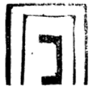

  
 in the way we explained in the Gate of Their Standing, with God's help.

> והנה נמצא שכתר חכמה בינה הם שואבים שפע ממקוריה' המיוחד בכתר חכמה בינה שבכתר. וכח"ב שבכתר שואבים ממקור הנעלם בעצם השרש שהוא אור קדמון וצח ומצוחצח המיוחדים תכלית היחוד. וכאשר יעלה בדעתנו עוצם ייחוד כתר חכמה בינה המתגלים בספירות, ר"ל הספירות בעצמם כפי אשר חוייבנו בייחודם בפרט יחוד מתעלה על יחוד שאר הספירות כדפי' בשער מהות והנהגה. ונעלה על יחודם עלוי והפלגת היחוד. עאכ"ו יחוד הכתר וחכמ' ובינה שבכתר, עד שנאמר שאין בכתר אלא מקור אחד ועצם אחד ושרש אחד. ואם נייחסהו לג', הוא מפני יניקת הג' ספירות משם שהם כתר חכמה בינה. ואח"כ עוד נפליג ונעלה על יחוד הג' שרשי' שבכתר יחוד הג' [נקודות] הנעלמות, הנה לא ירחק ממנו יחודם בהפלגה מרובה, ואינם מתייחסים בג' אורות אלא בערך שמהם שואבים שלשה שרשים שהם אחד ומתייחסים בשלשה מפני שהם מריקים שפע וברכה לג' הספי' מיוחדות תכלית היחוד. ומכאן יפליג המעיין בייחוד הספירות בעצם השרש שהם כולם מתייחדים יחוד אמיץ. נצח בתוך חסד וחסד בתוך חכמה כזה:  
>
>  על הדרך שפירשנו בשער עמידתן בע"ה.

**11:3:3** And likewise Hod within Gevurah and Gevurah within Binah, thus:  

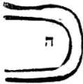

> וכן הוד בתוך גבורה וגבורה בתוך בינה כזה:

**11:3:4** And likewise Malkhut within the Righteous One, and the Righteous One within Tiferet, and Tiferet within Keter, thus:  

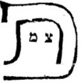

  
 And all this while they are within Keter. And how much more are they unified while they are within the unified root, which is not divided into parts at all! And if we relate the number three to it, it is because they are sources to the three sources of three branches, as we explained. But relative to themselves, in their spreading, they are unified with the utmost union.

> וכן המלכות בתוך הצדיק והצדיק בתוך התפארת ותפארת בתוך כתר כזה:  
>
>  וכל זה בהיותן בתוך הכתר. ומה יתייחדו עוד בהיותן בתוך השרש המיוחד בלתי מתחלק לחלקים כלל. ואם ניחסהו מספר השלשה הוא מפני שהם מקורות לג' מקורות של ג' ענפים כדפי'. אבל בערך עצמם בהתפשטותם הם מיוחדים תכלית היחוד.

**11:3:5** And behold, this manifestation, union, and source was revealed in its simple manifestation from the side of the aspect of His will toward the Emanation. And when we said "was revealed," the meaning is the manifestation of the being [*havayah*], which was not pouring forth [text: *mashpa'at*; read *mushpa'at*, "receiving effluence"] because of the concealment of the Emanation within His Self; and now, from the side of its spreading into the Emanation, it pours forth effluence into those sources. And this is [what we mean by] revealing: not that they are revealed to the emanated ones, all the more so not to the created ones, all the more so not to the formed ones, all the more so not to the made ones. For their manifestation is not revealed to any other than Him, as we explained. Rather, relative to the drawing forth of His providence into the Emanation, this matter is attributed to Him as spreading and revealing, not that it is revealed to any other than His Self, as we shall explain in the coming chapters. And the divine Rav Chamai Gaon revealed this matter further, and we shall copy it in a chapter of its own, as we found it copied by Rabbi David in the book Magen David (although he did not intend this inquiry at all), with the explanation of Rabbi Aharon upon his words; for he is a true teacher in this delightful inquiry, with the help of Heaven.

> והנה המציאות והיחוד והמקור הזה נתגלה במציאותו הפשוט מצד בחינת רצונו אל האצילות. ואמרנו נתגלה הכונה מציאות ההווייה שלא הי' משפעת [מושפעת] להעלם האצילות בעצמותו ועתה מצד התפשטותו באצילות משפיע במקורות ההם. והיינו גלויים, ולא שהם גלוי אל הנאצלי"ם כ"ש אל הנבראי"ם כ"ש אל הנוצרי"ם כ"ש אל הנעשי"ם. כי אין מציאותם מתגלה אל זולתו כדפי'. אלא בערך המשכת השגחתו באצילות יתייחס ענין זה אליו אל התפשטות וגלוי ולא שיהיה נגלה אל זולת עצמותו, וכמו שנבאר בפרקים הבאים. וגילה הענין הזה יותר האלקי רב חמאי גאון ונעתיק אותו בפרק בפ"ע כפי אשר מצאנוהו שהעתיקו רבי דוד בס' מגן דוד עם היות שלא כוון אל הדרוש הזה כלל עם פי' רבי אהרן על דבריו כי הוא מורה צדק בדרוש הנחמד הזה בס"ד:

### Chapter 11:4. Citation of the wording of Rav Chamai Gaon on the *tzachtzachot*, with the interpretation of our teacher R. Aharon upon it.

**11:4:1** Rav Chamai Gaon wrote in the Book of Union [*Sefer ha-Yichud*] [concerning] the three first beings, which he placed above Keter, as we explained in the first chapter, in the responsum of our teacher Hai: "For these three names are all one matter and one Self, cleaving with a mighty cleaving, without separation and without joining, in the Root of all roots; like a corporeal parable: the heart, the lungs, and the spleen, one root for all of them and for the other limbs in the whole cavity. And from primordial light pure thought was drawn, like the drawing forth of the thoughts of the heart; and from the refined and the clear light, as from two springs, knowledge and intellect were drawn. And by means of intellect and knowledge all the spiritual flames took substance, this in this and this with this, like the matter of the flames that hold fast to the strength of the coals; and what would be (another version: "what was") gathered and hidden, this within this and this within this, until the time of the will of the Primordial Agent arrived, and the spiritual things went out from potentiality into action, and the Emanation of the upper world was emanated, down to the foundation of the tenth stone, called in the language of the sages of the secrets "thick light" [או"ר ע"ב]. And because of the great density they also called it "mixed darkness," for all the powers of the flames are mixed in it and change within it; and it is the foundation of all the worlds, spiritual and corporeal. And how many kinds of colors take substance in them and are formed in its power, some of them spiritual forms and some of them corporeal forms; for it is the last seal of all the seals." Thus far the words of the master, our teacher Chamai Gaon, in the Book of Union. And this is the explanation of our teacher Aharon, peace be upon him:

> כתב רב חמאי גאון בספר היחוד ג' ההוויות ראשונות שהניח למעלה מן הכתר, כמו שבארנו בפ' ראשון בתשובת רבינו האיי. כי אלו השלשה שמות כלם ענין אחד הם ועצם אחד דביקים דבוק אמיץ מבלי פרוד ובלי חבור בשרש כל השרשים. כדמיון משל גשמי הלב והריאה והטחול שרש אחד לכלם, ולשאר האברים שבכל החלל. ואור קדמון נמשכה ממנו המחשבה הטהורה כהמשך מחשבות הלב, ומן האור המצוחצח והצח כשתי מעיינות נמשכה מהן המדע והשכל. ובאמצעית השכל והמדע נתעצמו כל השלהביות הרוחניות זה בזה וזה עם זה כענין הלהבות הנאחזות בתוקף הגחלים ומה שיהיה (נ"א שהיה) כנוס ונסתר זה בתוך זה וזה בתוך זה עד שהגיע זמן רצון הפועל הקדמון ויצאו מן הכח אל הפעולה הרוחניות ונאצל אצילות העולם העליון עד יסוד אבן העשירית הנקרא בלשון חכמי הרזים או"ר ע"ב. ומרוב העובי קראוהו גם כן חשך מעורב, כי כל כחות השלהביות מתערבות בה ומשתנות בתוכה והוא יסוד כל העולמות רוחניים וגשמיים. וכמה מיני גוונים מתעצמים בהן ומצטיירים בכחה מהם צורות רוחניות ומהם צורות גשמיות. כי היא חותם האחרון לכל החותמות. עכ"ל הרב רבינו חמאי גאון בספר היחוד. וזה פרישת רבינו אהרן ע"ה.

**11:4:2** "Behold, the master's intent is to explain that these three names are one matter and one Self, cleaving with a mighty cleaving, without separation. And I think he said this not to distinguish them from the angels and the composite things, but to distinguish them somewhat from the ten Sefirot, which are one. That is to say: the ten Sefirot, although joining and separation are not to be pictured in them, [are so] with regard to the drawing forth of the effluence; but these three are all one Self and one matter in the Root of all roots, and they are His very Self; and understand. For he did not say 'from the Root of all roots' but 'in the Root of all roots,' to indicate the greatness of the union: that they are in His Self, blessed be He, and His Self is in them. And because the thing is hard to picture, that there should be three and all one matter, he brought a corporeal parable, and said that this is 'like a corporeal parable.' He said: the heart, the lungs, and the spleen are one root for all of them. And we see that they are separate limbs; and we are compelled to say that before they were formed in actuality in these forms, they were stored up and mixed in that unformed mass [*golem*] from which they would come to be at the beginning of their coming-to-be from the seminal drop, while the action of coming-to-be had not yet spread forth to distinguish each and every thing by itself. Rather, those powers of the limbs were stored up and mixed in that mass, not separate from one another, so that you would decree of the three of them, and of the other powers of the limbs stored up there, that they were then one matter and one Self, although we say that there were stored up there the power of the heart, the power of the lungs, and the power of the spleen. And so one may illustrate with some resemblance, although it is not a true parable. And we say: we know from tradition that the most spiritual, subtlest, and most concealed spreading of all the Emanation was the three upper, spiritual Sefirot, which are Keter, Chokhmah, and Binah. And if so, it is necessary that these three Sefirot, although they are unified in a wondrous oneness and a concealed subtlety, were far more wondrous and concealed when they were already formed in the Root of roots, which is the Ein Sof, in a oneness, subtlety, and concealment more wondrous than they are after their spreading. For whatever comes nearer to the root is more unified, like the branches of a tree; for if it were not so, the matter would go on to infinity. And we do not say that the parable resembles the thing illustrated on all its sides. And this is it: the limbs, after they went out into actuality, nothing remained of them of that manifestation which they had before their going out; but not so here: for because the Ein Sof does not receive change, [Keter, Chokhmah, Binah] remained stored up there after Keter, Chokhmah, Binah were emanated, just as they were before the spreading of their emanation. For the Emanation is only like one who kindles a lamp from a lamp, with regard to the absence of change in the Emanator. And because the stored-up ones are more concealed, they are distinguished. And so we can say of all the other Sefirot: that Binah is the six extremities, and likewise the six extremities are Binah itself, since the six extremities remained there concealed, and there is no difference between them except from the side of concealment and revealing. And this is what he said, that there is no separation at all between the Sefirot, so as to say that they are substances separate in themselves; rather they are all one, for each one is included of them all. And he said: 'from primordial light pure thought was drawn,' that is, Keter, drawn from it like the drawing forth of the thought of the heart; 'and from the refined and the clear light,' which are like two springs, 'knowledge was drawn,' which is Chokhmah, 'and intellect,' which is Binah. 'And by means of intellect and knowledge all the spiritual flames took substance, this in this and this with this': so that you do not find the one without the other, nor the other without it; so that if you picture yourself pointing with your finger to one of them, you are pointing to all of them, for they are all in it.

> הנה כוונת הרב לבאר שג' שמות אלה ענין א' ועצם א' דבקים דבוק אמיץ בלי פרוד. ואחשוב שאמר זה לא להבדילם מהמלאכים והמורכבים אבל להבדילם הבדל מה מהי' ספירות שהם א'. ר"ל הי"ס עם שלא יצוייר בהם חבור ופרוד לענין המשכת השפע אבל אלה השלשה הכל עצם אחד וענין א' בשרש כל השרשים והן הן עצמותו, והבן. כי לא אמר משרש כל השרשים אלא בשרש כל השרשים, להורות על רוב היחוד שהם בעצמותו ית' ועצמותו בהם. ולמה שהדבר קשה להצטייר שתהיינה ג' והכל ענין א', הביא משל גשמי ואמר שזה כדמיון משל גשמי. אמר הלב והריאה והטחול שורש א' לכלם, וראינו שהם אברים נפרדים, ונתחייב לומר שקודם שיצטיירו בפועל באלו הצורות היו גנוזות ומעורבות באותו הגולם שיתהוו ממנו בתחלת הווייתן מהטיפה זרעיית עם היות שעדיין לא נתפשט פעל ההויה להבדיל כל דבר ודבר לעצמו. אבל היו אותן כחות האברים גנוזות ומעורבות בגולם ההוא בלתי נפרד זה מזה וזה מזה עד שתגזור על שלשתן ועל שאר כחות האברים הגנוזות שם שהם היו אז ענין א' ועצם א', עם היותנו אומרים ששם גנוזות כח הלב וכח הריאה וכח הטחול. וכן יש להמשיל בקצת דמיון אע"פ שאינו משל אמת. ונאמר אנחנו ידענו מפי השמועה שהתפשטות היותר רוחני והיותר דק ונעלם מכל האצילות היו הג' ספי' העליונות הרוחניות הם כתר חכמה ובינה. וא"כ נתחייב שאלה הג' ספירות עם היותן מתייחדות באחדות נפלא ודקות נעלם יותר נפלאות ונעלמות עד מאד שכבר יצטיירו בשרש השרשים והוא הא"ס באחדות ודקות והעלם יותר נפלא ממה שהם אחר התפשטותן כי כל מה שהדבר מתקרב אצל השרש הוא יותר מתאחד כדמיון ענפי האילן. שאל"כ ילך הדבר אל בלתי תכלית. ולא נאמר שהמשל דומה לנמשל מכל צדדיו. וזהו כי האברים אחר שיצאו אל הפועל לא נשאר מהם שום מציאות מאותו המציאות שהי' להם קודם צאתם, משא"כ בכאן כי בעבור שהאין סוף לא יקבל שינוי נשארו שם גנוזות אחר שנאצלו כח"ב כמו שהיו קודם התפשט אצילותן. כי האצילות אינו אלא כמדליק נר מנר לענין העדר השינוי במאציל. ובעבור היות הגנוזות יותר נעלמות יובדלו. וכן נוכל לומר בכל שאר הספי' שהבינה היא הו' קצוות וכן הו' קצוות הם הם הבינה אחר שנשארו שם השש קצוות נעלמות ואין הבדל ביניהם כ"א מצד העלם וההתגלות. וז"ש שאין בין הספירות שום פירוד לומר שהם עצמים נבדלים בעצמם. אבל הם הכל אחד כי כל א' כלולה מכלם. ואמר אור קדמון נמשכת ממנו המחשבה הטהורה, שהוא הכתר נמשך ממנו כהמשך מחשבת הלב. ומן האור המצוחצח וצח שהם כשתי מעיינות נמשכות מהם המדע, שהיא החכמה. והשכל, שהיא הבינה. ובאמצעות השכל והמדע נתעצמו כל השלהביות הרוחניות זה בזה וזה עם זה, עד שלא תמצא האחת בלתי האחרת ולא האחרת בלתה. עד שאם תצייר שאתה רומז באצבעך לאחת מהם אתה רומז לכלם כי כלם בה.

**11:4:3** "And the matter of the spreading from intellect and knowledge is like the matters of the flames that hold fast to the strength of the coals. And what was stored up and hidden, this within this and this within this, was forever in that mode of being stored up, until the time of the will of the Primordial Agent arrived, and the spiritual things went out from potentiality into action, and the Emanation of the upper world was emanated, down to the foundation of the tenth stone, which is Malkhut, which is called in the language of the sages 'thick light.' And because of her great density in comparison to what is above her, they also called her 'mixed darkness,' for all the flames are mixed in her; and she is the foundation of all the spiritual worlds, which are all the Sefirot, for through her they act, and without her they would not act. And she is the foundation of the corporeal worlds, for she pours forth to them their manifestation. And how many kinds of colors take substance in her and are formed within her, according to the power of each one of the Sefirot that pour effluence into her, some of them spiritual forms and some of them corporeal forms, according to what is needed to act; for she is the last seal of all the forms." Thus far his words.

> וענין התפשטות מן השכל והמדע כענייני הלהבות הנאחזות בתוקף הגחלים. ומה שהיו גנוזים ונסתרים זה בתוך זה וזבת"ז, היו לעולם באותו אופן מן הגנוזה. עד הגיע זמן רצון הפועל הקדמון ויצא מן הכח אל הפעולה הרוחניות ונאצל אצילות עולם העליון עד יסוד אבן העשירית היא המלכות היא הנקרא בלשון חכמים אור עב. ומרוב עביו בהקש אל מה שלמעלה ממנה קראוהו ג"כ חשך מעורב, כי כל השלהביות מעורבות בה והיא יסוד כל העולמות הרוחניים שהם כל הספי'. כי על ידה פועלות, ובלעדה לא יפעלו. והיא יסוד העולמות הגשמים, כי היא משפעת להם מציאותם. וכמה מיני גוונים מתעצמים בה ומצטיירים בתוכה, כפי כח כל אחת מהספי' המשפיעות בה מהן צורות רוחניות ומהם צורות גשמיות, כפי הצריך לפעול, כי היא חותם אחרון לכל הצורות עכ"ל.

**11:4:4** Behold, in the explanation of a holy mouth, filled with the praise of the Lord, blessed be He, he speaks of the matter of the three concealed ones: how they are a manifestation of the first three that remained there in the very root, a manifestation subtle and concealed, fairer and more complete by far than their revealed manifestation; and they are unified with the utmost union, and the count of three is not to be pictured in them except relative to their manifestation revealed after the spreading.

> הנה בפי' פה קדוש ימלא תהלת ה' ברוך הוא מדבר בענין הג' נעלמות איך הם מציאות ג' ראשונות שנשארו שם בעצם השרש מציאות דק ונעלם יפה ושלם יותר ויותר ממציאותם המתגלה והם מיוחדים תכלית יחוד ולא יצויר בהם מנין השלש אלא בערך מציאותם המתגלה אחר ההתפשטות.

**11:4:5** And behold, through the Gaon Rav Chamai and the explanation of Rabbi Aharon upon him, we lack nothing at all of all that we sought; and they serve us as support for all that was expounded on this matter in the preceding chapter, without our remarking on their words and their explanation at all, for love of brevity.

> והנה ע"י הגאון רב חמאי ופרישת רבי אהרן עליו לא חסרנו מכל מבוקשנו כלל. והם לנו מעיר לעזור אל כל הנדרש בענין הזה בפ' הקודם בלי שנעורר בדבריהם וביאורם כלל לאהבת הקצור.

**11:4:6** And behold, now it is not difficult for us that they are thirteen attributes, since they are a manifestation of the first three, concealed in their source; just as we have no difficulty from the manifestation of the six extremities concealed in Binah, as the master explained. And they are the very ten Tzachtzachot, because each one of the first three includes, in its middle and in its manifestation, unified in its Self, all the lines: the line of Chesed in Chokhmah, the line of Din in Binah, the line of Rachamim in Keter, as we dwelt on at length above. And by this is explained what the master, our teacher Hai Gaon, explained in his responsum, when he said that the first array, which is in the form of the Yod, which has three points, a tip above, a tip below, and a point in the middle, indicates Keter, Chokhmah, and Binah, which spread from Name, Self, and Root [מש"ם ועצ"ם ושר"ש], that is, the three concealed ones. And they said "took shape and were formed": the meaning is the matter [*golem*], which is the vessels, and the form, which is the Self, that is, the form and soul of the Emanation, as explained in the Gate of Self and Vessels, chapter 4. And he said that they are "from the power of the three concealed ones," for through them they were emanated. And the meaning: at the time when the will arose before Him to emanate the Yod, which [Sefirot] are included in three points, that is, three Yods, the three points that are in the Yod, as we explained above, then the three acquired manifestation in the very root, as we explained in the preceding chapter. And from the power of that manifestation, which spread in the root itself, the first three were emanated, with the three included in three. For in Chokhmah two are included and concealed, not seen, which are Chesed [and] Netzach; and in Binah two are concealed, which are Gevurah [and] Hod; and in Keter three are concealed, which are Tiferet, Yesod, and Malkhut, as we explained. And the rest of the responsum is clear.

> והנה עתה לא יקשה לנו שהם י"ג מדות אחר שהם מציאות ג' ראשונות הנעלם במקורם, כמו שלא יקשה עלינו ממציאות ו' קצוות הנעלמות בבינה כדפי' הרב. והם הם י' צחצחות, מפני שכל אחד משלשה ראשונות כולל באמצעיתו ובמציאותו מיוחד בעצמותו כל הקוים קו החסד בחכמה קו הדין בבינה קו הרחמים בכתר כפי אשר הארכנו לעיל. ובזה יתבאר מה שפירש הרב רבינו האי גאון בתשובתו, שאמר שהמערכת הראשונה שהיא בציור היוד שיש לה שלשה נקודות עוקץ למעלה ועוקץ למטה ונקודה באמצע להורות על הכתר והחכמה והבינה שהם מתפשטות מש"ם ועצ"ם ושר"ש דהיינו השלשה הנעלמות. ואמרו נתגלמו ונצטיירו. הכונה הגולם שהם הכלים. והצורה שהוא העצמות. דהיינו צורת ונשמת האצילות כמבואר בשער עצמות וכלים בפ"ד. ואמר כי הם בכח השלשה נעלמות כי על ידם נאצלו. והכונה כי בעת עלות רצון לפניו להאציל היו"ד שהם נכללות בשלשה נקודות דהיינו שלשה יודי"ן שלשה נקודות אשר ביו"ד כדפי' לעיל, הנה אז קנו מציאות השלשה בעצם השרש כדפי' בפרק הקודם. ומכח המציאות ההוא שנתפשט בשרש עצמו, נאצלו שלשה ראשונות עם השלשה נכללות בשלשה. כי בחכמה נכללים שתים ונעלמים בלתי נראים שהם חסד נצח, ובבינה נעלמים שנים שהם גבורה הוד, ובכתר נעלמים שלשה שהם תפארת יסוד ומלכות כדפי'. ושאר התשובה מבוארת.

**11:4:7** Behold, the matter of the Tzachtzachot concealed in the Ein Sof has been explained from the words of the Geonim.

> הנה נתבאר מתוך דברי הגאונים ענין הצחצחות הנעלמות בהאין סוף:

### Chapter 11:5. Explanation of a passage from the Zohar, Parashat Pekudei, "Ein Sof does not stand," from within which the *tzachtzachot* and their concealment are explained.

**11:5:1** And so Rashbi, peace be upon him, explained in the Zohar, Parashat Pekudei (folio 239a), and these are his words: "Ein Sof does not stand to be made known, nor to make an end, nor to make a matter [*davar*], as the First Nothing brought forth beginning and end. Who is the beginning? This is the supernal point, which is the hidden head of all, which stands within thought; and it makes an end, which is called 'the end of the matter' [*sof davar*]. But there, Ein Sof: not for wills, nor for lights; not lamps in that Ein Sof. All these lights and lamps depend [on it] to subsist by them, and they do not stand to cleave. The one who knows and does not know is none other than the supernal will, hidden of all hidden, Nothing. And when the supernal point and the World to Come ascend (another version: 'ascended'), they know only the scent, like one who smells scents and is settled." Thus far its words.

> וכן ביאר הרשב"י ע"ה בזהר פ' פקודי (דף רל"ט.) וז"ל אין סוף לא קיימא לאודעא ולא למעבד סוף ולא למעבד דבר כמה דאי"ן קדמאה אפיק ראש וסוף מאן ראש דא נקודה עלאה דאיהו רישא דכלא סתימאה דקיימא גו מחשבה ועביד סוף דאקרי סוף דבר. אבל להתם אין סוף, לא לרעותין ולא לנהורין, לאו בוצינין בההוא אין סוף. כל אלין נהורין ובוצינין תליין לאתקיימא בהו, ולא קיימי לאתדבקא, מאן דידעי ולא ידעי, לאו איהו אלא רעו עלאה סתימאה דכל סתימין אי"ן. וכד נקודה עלאה ועלמא דאתי אסתלק (נ"א אסתלקו) לא ידעין בר ריחא כמאן דארח בריחין ואתבסס עכ"ל.

**11:5:2** And the explanation of his words: the Root of roots, called Ein Sof, does not stand to be revealed, because of the greatness of its concealment, for there is no knowledge of it at all. And this is what he said: "does not stand to be made known." And he said that besides its being impossible to know it and to apprehend it relative to its aspect, according to the manifestation of its concealment, it also does not stand to be revealed and to spread forth so that one might recognize it and apprehend it. For its Self is not apprehended in any way, except for the apprehension of its actions, that is, its Sefirot. And it is known that revealing and spreading forth come through a thing's coming to be with a beginning and an end, for this is the definition of coming-to-be, that it has a beginning and an end. To this he said that the Ein Sof does not stand to make beginning and end, which is "end" and "matter." And the meaning: "end" is its one extreme, and "matter" is its second extreme; and this is "end" [סו"ף] and "matter" [דב"ר], for from above downward the beginning of a matter is [its] end. And he said that the Ein Sof does not stand to reveal its manifestation in "end" and "matter" so as to be apprehended, like Keter, which is called Nothing [*Ayin*]. And he said "the First Nothing," to indicate that even in its concealed aspect, called "First," that is, its aspect relative to the Emanator, it does not resemble Ein Sof at all, because of the greatness of its concealment. [This is] because "the First Nothing brought forth beginning and end": explanation: Keter is revealed, and its revealing is through the beginning and the end, that is, Chokhmah and Malkhut, as he goes on to explain. And through it is the revealing of Keter, because in Keter is the aspect of Chokhmah, which is the beginning, and the aspect of Binah, which is the aspect of the end; and its revealing is through Chokhmah and Malkhut, which are the beginning and the end, with the middle certainly included. "Who is the beginning? This is the point," etc.: explanation: the intent is Chokhmah, for it is the beginning and first of the Emanation, in the way we explained in Gate Three, chapters 3 and 7. And he said that although it is the beginning of revealing, it is not that it is revealed with an intrinsic revealing; rather [it is] the beginning of a slight revealing. And therefore he went further and said "hidden, which stands," etc., and it is apprehended only in thought alone. And insofar as the beginning of thought is there, therefore it is the first of the revealing of Keter. "And it makes an end," etc.: explanation: for the beginning of thought is the end of action; for there is Chokhmah at the beginning and Chokhmah at the end, and this is Yod at the beginning and Yod at the end. And the emanation of Malkhut is from there, as in the matter Rashbi, peace be upon him, explained in the Tikkunim (Tikkun 69, folio 103): "I am asleep [*yeshenah*]: I am second [*sheniyah*] to Chokhmah," and as we shall explain in the Gate of Manifestations. And therefore Chokhmah "makes an end," which is Malkhut, the end of the Emanation. "But there," etc.: explanation: the whole matter of the beginning and the end is in the Emanation and in the Sefirot; "but there," in the Ein Sof mentioned, [it is not so]. "Ein Sof: not for wills," etc.: the meaning is that will in the Creator, that is to say, in the Ein Sof, is impossible; because if we said that He wills, He would turn out to change from will to will, and this is impossible in the law of the Ein Sof, necessarily existent, who is not subject to changes. Rather, the matter of will is the first emanation, which descends from Him in a chain, and through that will He performs His will, in the likeness of the Self and the vessels: for the vessels are subject to change, and the Self performs the change through them. And therefore the beginning of the spreading of the Emanation is the will to emanate. But this will is concealed, for it is not literally a revealed emanation; rather it is a will through which He is willing to emanate.

> ופי' דבריו, כי שרש השרשים הנקרא אין סוף אינו עומד להתגלות מפני רוב העלמו שאין בו ידיעה כלל. וז"ש לא קיימא לאודעא. ואמר כי בזולת שא"א לדעתו ולהשיגו בערך בחינתו כפי מציאות העלמו. ג"כ אינו עומד להתגלות ולהתפשט כדי שיכירהו וישיגהו. כי אינו מושג עצמותו בשום אופן אם לא השגת פעולותיו דהיינו ספירותיו. ונודע כי הגילוי וההתפשטות הוא ע"י התהוות הדבר בתחלה וסוף שזהו גדר ההויה שיש לה ראש וסוף. לזה אמר שאין הא"ס עומד למעבד תחלה וסוף שזהו סוף ודבר. והכוונה סוף היינו קצהו האחד ודבר היינו קצהו השני, וזהו סו"ף ודב"ר, כי ממעלה למטה תחלת דבר הוא סוף. ואמר שאין הא"ס עומד לגלות מציאותו בסוף ודבר כדי שיושג כמו הכתר הנק' אי"ן. ואמר אי"ן קדמאה. להורות כי אפי' בבחינתו הנעלמת הנקרא קדמאה דהיינו בחינתו בערך המאציל אינו דומה לא"ס כלל מפני רוב העלמו. מפני שאי"ן קדמאה אפיק ראש וסוף. פי' הכתר הוא מתגלה, וגלויו הוא ע"י הראש והסוף דהיינו חכמה ומלכות כדמפרש ואזיל. ועל ידו הוא גלוי הכתר מפני שבכתר בחי' החכמה שהוא הראש ובחינת הבינה שהיא בחינת הסוף, וגלויו הוא ע"י חכמה ומלכות שהם הראש והסוף עם כלל האמצעי ודאי. מאן ראש דא נקודה וכו'. פי' הכוונה על החכמה כי הוא ראש וראשית לאצילות ע"ד שפי' בשער ג' בפ"ג וז'. ואמר שעם היות שהוא תחלת הגלוי לא שיתגלה גילוי עצמי אלא תחלת הגלוי קצת. ולכן הפליג ואמר סתימאה דקיימא כו' ואינה מושגת אלא במחשבה לבד. ובערך ששם תחלת המחשבה לכן הוא ראשית לגילוי הכתר. ועביד סוף וכו' פי' כי תחלת המחשבה הוא סוף המעשה כי חכמה בראש וחכמה בסוף וזהו יו"ד בראש וי' בסוף. ואצילות המלכות משם כענין שפי' הרשב"י ע"ה בתקונים (תקונא ס"ט דף ק"ג) אני ישנה אני שניה לחכמה, וכמו שנבאר בשער המציאות. ולכן החכמה עביד סוף שהיא המלכות סוף האצילות. אבל להתם וכו'. פי' כל ענין הראש והסוף הוא באצילות ובספירות, אבל להתם בא"ס הנז'. א"ס לא לרעותין וכו'. הכוונה כי הרצון בבורא ר"ל בהא"ס א"א מפני שאם נאמר שהוא רוצה נמצא משתנה מרצון לרצון וזה נמנע בחק הא"ס מחוייב המציאות שאינו בעל שנויים. אמנם ענין הרצון הוא האצילות ראשון המשתלשל ממנו, וע"י הרצון ההוא הוא פועל רצונו כדמיון העצמות והכלים. שהכלים בעלי השינוי, והעצמות פועל השינוי על ידם. ולכן תחלת התפשטות האצילות הוא הרצון להאציל. אמנם הרצון הזה נעלם שאינו אצי' מתגלה ממש אמנם הוא רצון שע"י מתרצה להאציל.

**11:5:3** And behold, this will is not the One who wills; rather the Self of the Ein Sof is the One who wills, and He is called "willing" through the will, in the way we explained concerning the matter of judgment and limit in the Gate of Self and Vessels, chapter 4. And in this way it turns out that the will is so near to the Emanator that it is not emanation; rather it is Self, and not literally Self. Rather it is the manifestation of the arising of His will to emanate the emanated ones; and therefore the will is the emanated ones themselves, which came to be and were found in the manifestation of His Self from the side of the arising of His will to emanate the emanated ones, as we explained in chapter 3.

> והנה הרצון הזה אינו הרוצה, אמנם עצמות הא"ס הוא הרוצה והוא נקרא רוצה ע"י הרצון כדרך שפי' בענין הדין והגבול בשער עצמות וכלים בפ"ד. ועד"ז נמצא היות הרצון הקרוב אל המאציל עד שאינו אצילות אמנם הוא עצמות ולא עצמות ממש. אמנם הוא מציאות עלות רצונו להאציל הנאצלים ולכן הרצון הוא הנאצלים עצמם שנתהוו ונמצאו במציאות עצמותו מצד עלות רצונו להאציל הנאצלים כדפי' בפ"ג.

**11:5:4** And behold, according to this there will already be a will to bring a will into existence; for a will arises to bring a will into existence, until there is a point level with the Emanator. And these wills, in the secret of their intrinsic union in the very Emanator, are called "wills" [*re'utin*]. And because of the concealment of the Ein Sof, in which the wills are, he said "Ein Sof: not for wills nor for lights," for they are likewise titled with the name "lights," as in the matter of primordial light, clear light, refined light. But the will through which He works change in this world is Keter, which is what is called "will"; and through it the Ein Sof wills, just as through Chokhmah He is called wise. "Not lamps in that Ein Sof": explanation: even when the Sefirot shine and are titled with the name "luminaries," they do not resemble the Ein Sof. And not only the Ein Sof, but even the concealed luminaries unified in His Self, as we explained. "All these lights," etc.: explanation: all the Sefirot depend on those concealed roots, because they are sources to the Sefirot; for through the concealed luminaries the Sefirot draw effluence from the Ein Sof, like the tree, which draws moisture from its roots, and the main watering is to the roots. So the Sefirot turn out to depend on the roots and to subsist through them. "And they do not stand to cleave": explanation: although the concealed sources and roots, which are the Tzachtzachot unified in the very root, are the life and subsistence of the Sefirot, nevertheless the roots are not revealed to the Sefirot, and the Sefirot do not apprehend them, because of the greatness of their concealment. And this is what he said, "and they do not stand to cleave": explanation: they do not stand in a state to be apprehended at all. "The one who knows and does not know," etc.: explanation: those of whom it can properly be said that they know and that they do not know are only Keter, Chokhmah, and Binah. For the other Sefirot never know, and never did know, and the roots were never revealed to them, such that we might say that there is a time when they do not know. But the matter of "knows and does not know" can properly be said of Keter, Chokhmah, Binah, as he concludes. And nevertheless these three are not equal in their apprehension. For Keter, in its concealed aspect, which is called "the supernal will" [*re'u ila'ah*], which is a title in the language of will, like "wills" [*re'utin*] mentioned with the Ein Sof; and it is "hidden of all hidden," called Nothing, for "Something" does not apply to it at all: this aspect is always unified in the concealed roots, which are its cause, and the cause of the roots concealed in it, as we explained above. But Chokhmah and Binah: their apprehension is at times, that is, only at the time of their ascent to the concealed aspect in Keter, which is the source, in which there are likewise three roots, as we explained in chapter 3. And this is what he said: "And when the supernal point," which is Chokhmah, "and the World to Come," which is Binah, "ascends," that is, at the time of the union of the two of them with the utmost union, so that "ascended," in the plural, cannot properly be said of them, but "ascends," in the singular. And then, at the time of their ascent in union in the supernal root, Keter, nevertheless they do not apprehend the roots, except like the scent of one who smells a good scent without touching the spice; rather he smells it, and through it he is settled and sweetened. So these Sefirot, after their ascent, [apprehend] the roots and draw sustenance from them through their root that is exalted in Keter; not that they themselves draw sustenance and draw and apprehend the very concealed root. And therefore their nourishment is called [nourishment] from Ein Sof, and likewise their ascent [is called ascent] to Ein Sof.

> והנה לפ"ז כבר יהיה רצון להמציא רצון כי יעלה רצון להמציא רצון עד שיהיה נקודה משתווה אל המאציל. והרצונות האלה בסוד יחודם העצמי בעצם המאציל נקרא רעותין. ומפני התעלמות הא"ס שבו הרעותין אמר א"ס לא לרעותין ולא לנהורין שכן מכונים בשם נהורין. כענין אור קדמון אור צח אור מצוחצח. ואמנם הרצון שעל ידו יפעל שינוי בעוה"ז הוא הכתר שהוא הנקרא רצון. וע"י הא"ס רוצה כמו שע"י החכמה נקרא חכם. לאו בוסינין בההוא אין סוף. פי' אפי' בעת היות הספירות מאירות מכונים בשם מאורות אינם דומות לאין סוף. ולאו דווקא לאין סוף אלא אפי' למאורות הנעלמות המיוחדות בעצמותו כדפי'. כל אלין נהורין וכו'. פי' כל הספירות הם תלוים בשרשים הנעלמים ההם מפני שהם מקורות אל הספי' שע"י המאורות הנעלמות ישאבו הספי' שפע מהאין סוף. כמו האילן שהוא שואב הלחות משרשיו ועקר ההשקאה אל השרשים. נמצאו הספי' תלויים בשרשים ומתקיימים על ידם. ולא קיימי לאתדבקא. פי' עם היות שהמקורות והשרשים הנעלמים שהם הצחצחות המיוחדות בעצם השרש הם חיותם וקיומם של הספי', עכ"ז אין השרשים מתגלות לספירות ואין הספי' משיגים אותם מפני רוב העלמם. וז"ש ולא קיימי לאתדבקא, פי' אינם עומדות בענין שיושגו כלל. מאן דידעי ולא ידעי וכו'. פי' אותם שיצדק בהם שיודעים ושאינם יודעים אינם אלא כתר חכמה ובינה. כי שאר הספי' לעולם אינם יודעים ומעולם לא ידעו ולא נתגלו להם השרשים עד שנאמר שיש עת שאינם יודעים. אמנם יצדק ענין ידעי ולא ידעי, בכתר חכמה בינה כדמסיק. ועכ"ז ג' אלה אינם שוים בהשגתם. כי הכתר בבחינתו הנעלמת שהוא הנקרא רעו עלאה שהוא כנוי לשון רצון כמו רעותין הנז' בא"ס. והוא סתימאה דכל סתימין, הנקרא אי"ן. שלא יצדק עליו הישות כלל ועיקר. הבחינה הזאת לעולם מתייחדת בשרשים הנעלמים שהם סבתו וסבת השרשים הנעלמים בו כדפי' לעיל. אבל חכמה ובינה השגתם הוא לעתים. דהיינו דווקא בעת עלותם אל בחינת הנעלמת בכתר שהוא המקור. שבו ג"כ ג' שרשים כדפי' בפ"ג. וז"ש וכד נקודה עלאה שהוא החכמה ועלמא דאתי שהוא הבינה, אסתלק, שהוא בעת התייחדות שתיהם תכלית היחוד עד שלא יצדק עליהם אסתלקו לשון רבים אלא אסתלק לשון יחיד, ואז בעת עלייתם ביחוד בשרש העליון כתר. עכ"ז אינם משיגות בשרשים, אלא כריח המריח בריח הטוב בלתי פגעו בבושם, אלא מריח בו, וע"י מתבסס ומתמתק. כך הספי' האלה אחר עלייתם הם [משיגות] בשרשים ויונקים מהם ע"י שרשם הנעלה בכתר. ולא שינקו וישאבו הם עצמם וישיגו בעצם השרש הנעלם. ולזה יקרא יניקתם מא"ס וכן עלייתם לא"ס.

**11:5:5** Behold, from this passage, as explained, it appears that with regard to the apprehension of the roots the whole Emanation is divided into three divisions. The first is the seven days of the Structure, which do not apprehend the concealed ones at all; rather their ascent is up to Binah, in the secret of the Jubilee, and from there upward they do not apprehend, but from there they draw sustenance from Keter and from Chokhmah; except for Tiferet and Malkhut, for in the secret of their union they ascend up to Keter, where their source, the Self, is, as the matter and its reason were explained in Gate Five, chapter 6. And the second is Chokhmah and Binah, which apprehend the concealed roots only at intervals, at the time of their ascent; and that apprehension is not in the very Emanator, but "like one who smells," etc., as we explained above. And there is no doubt that even so the apprehension of Chokhmah will not be equal to the apprehension of Binah, but certainly with the exaltation of one over the other, although they ascend together, because they are male and female, and the one does not suffice without the other. The third is Keter, whose apprehension, in its concealed aspect, is always equal; it is never separated from its root, and it and the root are all one thing, unified in its upper aspect, as we explained.

> הנה מתוך המאמר הזה בפי' נראה שבענין השגת השרשים נחלק כל האצילות לשלש מחלוקת. הא' הם ז' ימי הבנין, שאינם משיגות בנעלמות כלל אלא עלייתם עד הבינה בסוד היובל ומשם ולמעלה אינם משיגות אלא משם ינקו מהכתר ומהחכמה, בזולת הת"ת והמלכות כי בסוד יחודם יעלו עד הכתר ששם מקורם העצמות כמו שנתבאר הענין וטעמו בשער ה' בפ"ו. והב' הם חכמה ובינה, שלא ישיגו בשרשים הנעלמות אם לא לפרקים בעת עלותם. וההשגה ההיא אינה בעצם המאציל, אמנם כמאן דארח וכו' כדפי' לעיל. ואין ספק שעכ"ז לא יהיה שוה השגת החכמה עם השגת הבינה אלא בעלוי זו על זו ודאי. עם היותם עולות יחד מפני שהם זכר ונקבה והא בלא הא לא סגייא. הג' הוא הכתר, שזה בבחינתו הנעלמת השגתו שוה לעולם לא יפרד משרשו והוא והשרש הכל דבר א' מתאחד בבחינתו העליונה כדפי'.

**11:5:6** And Rashbi further dwelt at length on the explanation of these Tzachtzachot and the roots that are in the Ein Sof:

> ועוד האריך הרשב"י בביאור הצחצחות האלה והשרשים שהם באין סוף:

### Chapter 11:6. Explanation of the *tzachtzachot* in the passage of Parashat Noach, "Rabbi Shimon said: I raised my hands in prayer," etc.; and the inquiry is further explained at length.

**11:6:1** In the book of the Zohar, Parashat Noach (folio 65a), in some versions in the books, and these are its words: "Rabbi Shimon said: I raised my hand in prayers above. When the supernal will, above and above, stands upon that will which is not known and not grasped at all, forever, [it is] the head that is hidden more, above. And that head brought forth what it brought forth, which is not known, and illumined what it illumined, all in hiddenness. The will of supernal thought is to pursue after it and to be illumined from it. One hanging is spread, and from within that hanging, in the pursuit of that supernal thought, it reaches and does not reach, etc. Then this light of thought that is not known strikes the light of the hanging that stands, which shines from what is not known, etc. And then this light of thought that is not known strikes the light of the hanging, and they shine as one, and nine palaces are made, palaces for palaces, which are not lights and are not spirits and are not souls, and there is none who stands in them. The will of all nine lights that all stand in thought, which is one of them in the count, all of them [is] to pursue after them at the time that they stand in thought; and they do not cleave and are not known. And these stand neither in will nor in supernal thought; they grasp them and do not grasp. In these stand all the secrets of faith; and all those lights from the secret of supernal thought that are below are all called Ein Sof. Up to here the lights reach and do not reach, and are not known. Here there is no will and no thought. When thought shines and does not know from what it shines, then it is clothed and hidden within Binah, and it shines what it shines, and it enters this into this until they are all included as one. And in the secret of the sacrifice, when it ascends, all is bound this with this and shines this in this. Then they all stand in ascent, and thought is wrapped in Ein Sof. That light which shines from it, [from which] supernal thought [shines], which does not know it at all, is called Ein Sof; for from it it is found and stands and shines to whom it shines. And on this all stands. Happy is the portion of the righteous in this world and in the world to come." Thus far its words.

> בספר הזהר פ' נח (דס"ה.) בקצת נסחאות בספרי'. וז"ל אר"ש ארימת ידא בצלותין לעילא, כד רעותא עלאה לעילא ועילא, קיימא על ההוא רעותא דלא אתידע ולא אתפס כלל לעלמין. רישא דסתים יתיר לעילא. וההוא רישא אפיק מה דאפיק דלא ידיע, ונהיר מה דנהיר כלא בסתימו. רעו דמחשבה עלאה למרדף אבתריה ולאתנהרא מיניה. חד פריסו אתפריס ומגו ההוא פריסא ברדיפו דההוא מחשבה עלאה מטי ולא מטי כו'. כדין בטש האי נהירו דמחשבה דלא אתידע בנהירו דפרסא דקיימא דנהיר ממה דלא ידיע כו'. וכדין דא נהירו דמחשבה דלא אתידע בטש בנהירו דפריסא ונהרין כחדא ואתעבידו ט' היכלין, להיכלין דלאו אינון נהורין ולאו אינון רוחין ולאו אינון נשמתין ולאו אית מאן דקיימא בהו רעותא. דכל תשע נהורין דקיימי כלהו במחשבה דאיהו חד מנייהו בחושבנא כלהו למרדף אבתרייהו בשעתא דקיימי במחשבה ולא מתדבקן ולא אתיידיעו. ואלין לא קיימי לא ברעותא ולא במחשבה עלאה, תפסין בהו ולא תפסין. באילין קיימין כל רזי דמהימנותא וכל אינון נהורין מרזא דמחשבה עלאה דלתתא כלהו אקרון א"ס. עד הכא מטון נהורין ולא מטון ולא אתידעו. לאו הכא רעותא ולאו מחשבה. כד נהיר מחשבה ולא ידע ממה נהיר. כדין אתלבש ואסתים גו בינה ונהיר מאן דנהיר ואעיל דא בדא עד דאתכלילו כלהו כחדא. וברזא דקרבנא כד סליק, כלא אתקשר דא בדא ונהיר דא בדא. כדין קיימי כלהו בסליקו, ומחשבה אתעטף בא"ס. ההוא נהירו דנהיר מיניה מחשבה עלאה דלא ידע איהי בה כלל אקרי א"ס, דמניה אשתכח וקיימא ונהיר למאן דנהיר. ועל דא כולא קאים. זכאה חולקהון דצדיקייא בעלמא דין ובעלמא דאתי עכ"ל.

**11:6:2** And its way is concealed and lofty; and nevertheless we shall not withhold our hands from discussing it in every way possible, because the commentators copied it into their books, in particular Rabbi Yehudah Chayat, and did not explain it at all. Therefore we shall explain it with a strong hand. "Rabbi Shimon said: I raised my hand," etc.: the reason for the raising of the hands in prayer is explained in the Zohar, Parashat Yitro (folio 67a), and its place is not here. And because Rashbi's intent in this passage is to reveal hidden matters in the Ein Sof, therefore he sanctified himself, "and his hands were steadfast" (Exod. 17:12) until he finished speaking. And thus he said: "When the supernal will, above and above." Explanation: Chokhmah is called "will" [*re'uta*], as explained in many places; and the reason is that it is the subtlest of the subtle, and therefore the language of will is attributed to it, as we explained, for will indicates subtlety and primordiality. And likewise the Supernal Keter is called "will," for it is the true will among the Sefirot. And the will that is supernal over them all is the Ein Sof, in the way we explained in the preceding chapter.

> ודרכו נעלם ונשגב, ועכ"ז לא נאסוף ידינו מלשאת ולתת בו בכל האפשר. מפני שהעתיקוהו המפרשים בספריהם, בפרט רבי יהודה חייט, ולא פי' בו כל עקר. לכן נבאר בו בחזקת היד. אר"ש ארימת ידא כו' טעם הנשיאות ידים אל התפלה נתבאר בזהר פ' יתרו (דף ס"ז.) ואין מקומו הנה. ומפני היות כונת הרשב"י במאמר הזה לגלות ענינים נסתרים בא"ס לכן התקדש עצמו ויהיו ידיו אמונה עד תומו לדבר. וכה אמר כד רעותא עלאה לעילא ועילא. פי' החכמה נק' רעותא כמבואר במקומות רבים, והטעם שהיא דקה מן הדקה ולכן נתייחס אליה לשון רצון כדפי' כי הרצון מורה על הדקות והקדמות. וכן כ"ע נק' רעותא כי הוא הרצון האמיתי בספי'. והרצון העליון על כלם הוא הא"ס על הדרך שפי' בפרק הקודם.

**11:6:3** And behold, he said "the supernal will," and not [the will] of Chokhmah, but "above," which is above the will of Chokhmah; and not Keter, which is the will that is above Chokhmah, but "and above," which is the will that is above the will, which is the Ein Sof, which is above Keter, which is the will that stands over Chokhmah, which is called "will," as we explained above. And he did not suffice with saying "the supernal will," because Chokhmah too is called "the supernal will," as is evident in the Zohar many times. "Stands": explanation: rests and abides "upon that will," explanation: upon Keter. "Which is not known": explanation: relative to its concealed aspect, which is not apprehended. "And not grasped at all, forever": explanation: not only its concealed aspect, which is concealed except at rare times, as at the time when Chokhmah and Binah ascend to it, as we explained in chapter 5; but that concealed aspect, at the utmost of concealment, which was never revealed and never apprehended by any other than it among the emanated ones, and will not be apprehended. And in that aspect it is a throne for the Emanator, an aspect that draws near to Him. "The head that is hidden more, above": explanation: the Ein Sof, which is the head that stands, is joined, and rests upon this aspect, and is more concealed than this aspect, although that is concealed at the utmost of concealment, as explained. "And that head": explanation: the concealed aspect of Keter, which is head to the other aspects of Keter, and all the more so to the rest of the Emanation. "Brought forth what it brought forth": explanation: emanated what it emanated; and this is the concealed Sefirot, which are vessels to the concealed Self. And although they are like a garment to the Self, nevertheless it is not known; and this is what he said: "which is not known." "And illumined what it illumined": this is the Self that spreads within the garment; and therefore it is titled with the language of light, which is the light of the lantern. And because the concealment of the Self is exceedingly greater than the concealment of the garment, he said "all in hiddenness," which goes further in concealment than his saying "which is not known." For "not known" indicates that it is revealed but not known; but "all in hiddenness" indicates its being hidden of itself in every respect. And with this it will be understood why it was necessary to emanate through "head" and "head," which are the Ein Sof and the first emanated one: because through the Ein Sof the Self that spreads was emanated, and through Keter, which bears the Self and is filled from it, the vessels were emanated, and all by the will of the Emanator. And would that the inquirer would go deep into this, for it is not our way to exaggerate the secrets. And the matter: since the roots that are unified in the very root are, according to the truth, roots of the vessels and not the root of the Self (for the Self is all one, and needs neither root nor source), then just as in the vessels, the outer Sefirot, that is to say, the Sefirot of the Emanation, the Self spreads in them, so in their root the Self spreads in them; although it is revealed in them more and more, until they are literally His Self and they are the very root. And this matter is among the matters in which contemplation beyond measure is forbidden, and it is in "running and returning." "The will of supernal thought": explanation: Chokhmah. And he called it "supernal" in its upper aspect, the most concealed, which is unified with Keter. And although its subtlety and its concealment are so great, nevertheless its longing and its desire is to cleave to these concealed roots and to be illumined from them; and therefore it pursues after them. And this is what he said: "to pursue after it and to be illumined from it": explanation: to be receiving and shining from this unified concealed root, emanated from the two heads mentioned above; and it has no apprehension at all, nor even reception from them. "One hanging is spread": this is Keter itself, emanated and revealed, which is a screen between the emanated ones and the sources that are unified in the very root. "And from within that hanging, in the pursuit of that supernal thought": explanation: from within Keter, which is called "hanging," as we explained concerning the reason for the darkness; and the arousal, that is, the pursuit mentioned, by which Chokhmah, called supernal thought in its upper aspect, as we explained, arouses.

> והנה אמר רעותא עלאה. ולא מחכמה אלא לעילא שהוא למעלה מרצון החכמה. ולא הכתר שהוא הרצון שהוא למעלה מחכמה. אלא ועילא שהוא הרצון שהוא למעלה מהרצון שהוא האין סוף. שהוא למעלה מהכתר שהוא הרצון שעומד על החכמה שנקרא רצון כדפי' לעיל. ולא הספיק באמרו רעותא עלאה, מפני שהחכמה ג"כ נקרא רעותא עלאה כדמוכח בזהר פעמי' הרבה. קיימא. פי' שורה וחונה על ההוא רעותא, פי' על הכתר. דלא אתידע. פי' בערך בחינתו הנעלמת שאינה מושגת. ולא אתפס כלל לעלמין. פי' לא בלבד בחינתו הנעלמת שהיא מתעלמת עד לעתים רחוקות כמו בעת עלות אליו החכמה והבינה כדפי' בפ"ה. אלא אותה הבחינה הנעלמת תכלית ההעלם שמעולם לא נתגלה ולא הושגה לזולתו מן הנאצלים ולא יושג. ובאותו בחינה הוא כסא אל המאציל בחינה מתקרבת אליו. רישא דסתים יתיר לעילא. פי' א"ס שהוא הראש העומד ומתאבק ושורה בבחינה הזו והיא נעלם יותר מהבחינה הזו עם היותה נעלמת תכלית ההעלם כמבואר. וההוא רישא. פי' בחינת הכתר הנעלמת שהוא ראש אל שאר בחינות הכתר, וכ"ש אל שאר האצילות. אפיק מה דאפיק. פי' האציל מה שהאציל. והיינו הספירות הנעלמות שהם כלים אל העצמות הנעלם. ועם היות שהם כלבוש אל העצמות עכ"ז לא ידיע. וז"ש דלא ידיע. ונהיר מה דנהיר. היינו העצמות המתפשט בתוך הלבוש, ולכן הוא מכונה בלשון אור שהוא אור העששית. ומפני שהעלם העצמות מופלג על העלם הלבוש, אמר כלא בסתימו. שהוא הפלגת ההעלם יותר מאמרו דלא ידיע. כי לא ידיע מורה שהוא נגלה אבל לא ידיע, אבל כלא בסתימו מורה על היותו סתים מעצמו מכל וכל. ועם זה יובן למה הוצרך להאציל ע"י רישא. ורישא, שהוא הא"ס והנאצל הראשון. מפני שע"י הא"ס נאצל העצמות המתפשט, וע"י הכתר הסובל העצמות ומתמלא ממנו והכל ברצון המאציל נאצלו הכלים. ומי יתן ויעמיק המעיין בזה שאין מדרכנו להגזים הסודות. והענין, כי אחר שהשרשים המתאחדים בעצם השרש, לפי האמת הם שרשי הכלים, לא שרש העצמות. כי העצמות הכל אחד, ואין צריך לא לשרש ולא למקור. א"כ כמו שבכלים הספי' החצונית ר"ל ספירות האצילות העצם מתפשט בהם, כן בשרשם העצם מתפשט בהם עם היות שיתגלה בהם יותר ויותר עד שהם עצמותו ממש והם עצם השרש. והענין הזה הוא מהענינים שהעיון בו ביותר אסור והוא ברצוא ושוב. רעו דמחשבה עלאה. פי' חכמה. וקראה עלאה בבחינתה העליונה היותר נעלמת המתאחדת עם הכתר. ועם היות דקותה והעלמה כ"כ, עכ"ז חשקה ותאוותה להדבק בשרשים הנעלמים האלה והיותה מתנהרת מהם ולכן היא רודפת אחריהם. וז"ש למרדף אבתריה ולאתנהרא מיניה. פי' להיות מקבלת ומאירה מן השרש המיוחד הנעלם הזה המתאצל משני הראשים הנז' לעיל ואין לה השגה כלל ואפי' קבלה מהם. חד פריסו אתפריס. היינו הכתר בעצמו הנאצל ומתגלה שהוא מסך בין הנאצלים והמקורות המתאחדים בעצם השרש. ומגו ההוא פריסו ברדיפו דההוא מחשבה עלאה. פי' מתוך הכתר הנקרא פריסא כדפי' בסבת החשך. וההתעוררות, דהיינו הרדיפה הנז'. שמעוררות החכמה הנקרא מחשבה עלאה בבחינתה העליונה כדפי'.

**11:6:4** And the matter of the pursuit and the arousal is the revealing of her face and her light toward the light of the screen that separates between her and the root and the Self. "It reaches and does not reach" up to that hanging: explanation: the concealed roots mentioned above reach and do not reach Keter, which is the hanging.

> וענין הרדיפה וההתעוררות, היינו גלוי פניה ואורה כלפי האור המסך המבדיל בינה ובין השרש והעצם. מטי ולא מטי עד ההוא פריסא. פי' השרשים הנעלמים הנז' לעיל מטי ולא מטי לכת"ר שהוא הפריסא.

**11:6:5** And the matter of "reaches and does not reach": explanation: revealing and not revealing relative to Chokhmah, and all the more so to the other emanated ones; but it "reaches" relative to the hanging.

> וענין מטי ולא מטי, פי' גילוי ולא גלוי בערך החכמה וכ"ש שאר הנאצלים, אלא הוא מטי בערך הפריסא.

**11:6:6** And the matter of "reaches and does not reach" is an action related to the garment, which is what was titled above with the language "brought forth." And afterwards he said "illumined what it illumined," which is a title for the Self unified in the root, which is what was titled above with the language of light, as we explained. And he said "illumined what it illumined" to indicate the concealment, and that it is not properly apprehended, [as befits] the concealed root. "And then it is supernal thought": explanation: then, when the concealed light shone to the hanging, which is Keter, thought, which is Chokhmah, is illumined from it. So it turns out that the light descends in a chain of three aspects: the aspect of the Ein Sof, that is, in the concealed root; and the aspect of its shining in the hanging, which is Keter; and the aspect of the shining of what is in the hanging into thought, which is Chokhmah. And nevertheless the light and the root revealed in Chokhmah is concealed and not revealed at all, although it has already been revealed to a third grade, as we explained. And the matter is that this thought is not literally the very Self of the revealed Chokhmah; rather it is the aspect of Keter toward Chokhmah, that is, Chokhmah in its aspect in Keter. Therefore all is concealed, for all is in the wondrous and concealed Amon, which is Keter, as we explained. And this is what he said: "And then it is supernal thought, shining with a hidden light that is not known, and that thought is not known. Then it strikes," etc., "from what is not known, and was not made known, and was not revealed." Explanation: for even now, after the light has been revealed in its chain-descent to thought, which is the aspect of Chokhmah, nevertheless that thought did not on that account apprehend at all, by means of the concealed shining light, what was concealed at first; rather, as its concealment was then, so is its concealment now. And it added no apprehension in the concealed, except the light that shines in it and is apprehended by it, which is the third aspect of the light alone. And he said "which is not known, and was not made known, and was not revealed," for these are three aspects, that is to say, three matters. The first matter is "not known," that is, that it is not known to Chokhmah in the aspect of thought mentioned above. The second matter: not only to thought is it not known, but even above it, that is, the hanging, "was not made known"; explanation: it did not add to its apprehension at all because of this revealing; and this is a solitary verb [*po'al boded*] in the light. And "was not made known": explanation: to any other than it, neither to Chokhmah nor to other than Chokhmah. The third matter, "and was not revealed": that not only was it not known, but the light itself was not on that account revealed and spread forth from itself to itself more than it was, because of this revealing. And he went so far in this in order to remove change from the very Emanator; rather [it is] like one who kindles a lamp from a lamp, and the Emanator is not diminished, nor known, nor changed, God forbid, as Rabbi Aharon explained, as we wrote in chapter 4. "And then this light of thought that is not known," etc.: explanation: the revealing of the light that shone in thought by means of the light that shone in the hanging, which is a concealed light "that is not known." And therefore it has power to strike the light of the hanging, which is the second light, shining in Keter from the power of the first light, which is unified in the very root. "And they shine as one": explanation: when the light of thought strikes the light of the hanging, then the two lights shine together. "And nine palaces are made, palaces for palaces": explanation: from their shining together there are made nine palaces, nine concealed Sefirot; and they are palaces, vessels, and garments for those concealed palaces, which are the supernal lights emanated from the Ein Sof in the first aspect, as explained above. "Which are not lights and are not spirits and are not souls": explanation: they are palaces for those palaces that are neither in the grade of luminaries, nor in the grade of spirits, nor in the grade of souls.

> וענין מטי ולא מטי, שהיא פעולה מתיחסת אל הלבוש שהוא המכונה לעיל בלשון אפיק. ואח"כ אמר נהיר מה דנהיר, שהוא כנוי אל העצם המתאחד בשרש שהוא המכונה לעיל בלשון אור כדפי'. ואמר נהיר מה דנהיר, פי' להורות על ההעלם ושאינו מושג כראוי אל שרש הנעלם. וכדין איהו מחשבה עלאה. פי' אז כאשר האיר האור הנעלם אל הפרסא שהוא הכתר, אז מתנהר ממנו המחשבה שהיא החכמה. נמצא האור משתלשל ג' בחינות. בחינת הא"ס דהיינו בשרש הנעלם, ובחינת הארתו בפרסא שהוא הכתר, ובחינת הארת מה שבפרסא במחשבה שהיא חכמה. ועכ"ז האור והשרש המתגלה בחכמה הוא נעלם ואינו מתגלה כלל עם היות שכבר נתגלה מדרגה שלישית כדפי'. והענין שאין המחשבה הזאת ממש עצם החכמה המתגלית. אמנם היא בחינת הכתר אל החכמה דהיינו החכמה בבחינתה בכתר. לכן הכל נעלם שהכל הוא באמון המופלא ומכוסה שהוא הכתר כדפי'. וז"ש וכדין איהו מחשבה עלאה נהיר בנהירו סתים דלא ידיע וההיא מחשבה לא ידיע. כדין בטש כו' ממה דלא ידיע ולא אתידע ולא אתגליא. פי' כי אפי' עתה אחר שנתגלה האור בהשתלשלות אל המחשבה שהיא בחינת החכמה, עכ"ז לא השיגה המחשבה ההיא מפני כך באמצעות האור המאיר הנעלם כלל מה שהיה נעלם מתחלה. אלא כהעלמו אז כן העלמו עתה. ולא הוסיפה השגה בנעלם אלא האור שמאיר בה ומושג אליה שהיא בחינה שלישית אל האור לבד. ואמר דלא ידיע ולא אתידע ולא אתגליא. כי הם ג' בחינות, ר"ל ג' עניינים. שהענין הראשון הוא לא ידיע, דהיינו שאינו נודע אל החכמה בבחינת המחשבה הנז' לעיל. הענין הב' שלא אל המחשבה לבד לא נודע, אלא אפי' למעלה ממנה דהיינו הפריסא לא אתידע. פי' לא הוסיף להשיג מפני הגלוי הזה כלל והיינו פועל בודד באור. ולא אתיידע, פי' לזולתו, לא לחכמה ולא לזולת החכמה. הענין הג' ולא אתגליא, שלא לבד לא נודע, אלא האור בעצמו לא מפני כך נתגלה ונתפשט מעצמו אל עצמו יותר ממה שהיה מפני הגילוי הזה. והפליג בזה להרחיק השנוי בעצם המאציל, אלא כמדליק נר מנר ואין המאציל חסר ולא נודע ולא נשתנה ח"ו כפי' רבי אהרן שכתבנו בפ"ד. וכדין דא נהירו דמחשבה דלא אתידע כו'. פי' גלוי האור שהאיר במחשבה באמצעית אור שהאיר בפריסא שהוא אור נעלם דלא אתידע. ולפיכך יש לו כח לבטשא בנהירו דפרסא שהוא האור השני המאיר בכתר מכח האור הראשון המתייחד בעצם השרש. ונהירן כחדא. פי' כאשר מכה אור המחשבה באור הפרסא אז מאירים שני האורות יחד. ואתעבידו ט' היכלין להיכלין. פי' מתוך הארתם יחד נעשים מהארתם ט' היכלות ט' ספי' נעלמות והם היכלות וכלים ולבושים לאותם היכלות הנעלמות שהם האורות העליונות הנאצלות מא"ס בבחינה ראשונה כמבואר לעיל. דלאו אינון נהורין ולאו אינון רוחין ולאו אינון נשמתין. פי' הם היכלות לאותם ההיכלות שאינם לא במדרגת מאורות ולא במדרגת רוחות ולא במדרגת נשמות.

**11:6:7** And behold, he mentioned in this three things: lights, spirits, souls. And there is no doubt that "lights" is like "vital souls" [*nafshin*], and the witness to this is "spirits" and "souls." And the meaning: Rabbi Shimon explained elsewhere that Keter, which is the secret of the cantillation marks, is the soul [*neshamah*]; and Chokhmah, which is the secret of the vowel-points, is the spirit [*rucha*]; and Binah, which is the secret of the letters, is the vital soul [*nefesh*]. And he said that these luminaries are neither Binah nor Chokhmah nor Keter, even in the secret of their upper roots that are in Keter; rather they are a Self with which the root is unified, and He and they are all one thing. Or he means "which are not lights": that they are not the sources of the Sefirot, but on the contrary they are clothed in the sources of the Sefirot, which are the lights in truth; "and are not spirits": that they are not the Sefirot themselves, which are like the spirit to the soul, which is the Self that spreads. And he said that they are also not the Self that spreads within the Sefirot, which are the souls of the Sefirot; rather they are luminaries and roots unified in the very root, and He and they are all one thing. "And there is none who stands in them": explanation: even now, when they are clothed in the lights emanated from the light of the hanging and the light of thought, nevertheless they are not apprehended, "and there is none who stands in them," because of the greatness of their concealment and the greatness of their attachment to their cause, which is the very root, as we explained. "The will of all nine lights that all stand in thought, which is one of them in the count, all of them [is] to pursue after them at the time that they stand in thought; and they do not cleave and are not known": explanation: the longing of the concealed Sefirot in the manifestation of Chokhmah itself is only to apprehend and to know these concealed lights and sources. "Which is one of them": explanation: in saying "lights that all stand in thought," the intent is not the lights that come to be from within the light of the hanging. For of those luminaries we have already said that they are unified in the light of Keter, which is the hanging, and become palaces for the concealed luminaries; and behold, they are palaces to them, so how could they not know them? Rather these are certainly other luminaries, which are of the Self of thought, which are the Sefirot emanated from the aspect of Chokhmah in the aspect of Keter, downward to ten. And of those he said that although these luminaries were clothed and revealed, nevertheless the longing of the other luminaries, which are of the Self of thought, is to apprehend them and to know them after their spreading in thought; and nevertheless they apprehend nothing of Keter. And this is what he said [: "which is one of them"]; for Chokhmah itself, in the secret of its aspect with Keter, is the Keter among them, and it is one of them, of those nine Sefirot in the count; which is not so for the supernal luminaries, of which thought is not [one]: rather [they come from] the light that shines in thought from the body of the hanging, which is a concealed and praised light, and from within it and from within the light of the hanging those lights come to be. Rather certainly these are by themselves and those are by themselves. "All of them to pursue after them": after those supernal luminaries that are clothed, and after those that come to be, added to thought, even at the time of their shining in thought and their being clothed in that light; and this is what he said, "at the time that they stand in thought." And nevertheless "they do not cleave": explanation: they do not apprehend them with any apprehension at all. And needless to say they do not cleave, which is an apprehension that apprehends them; but they do not have even a manifestation of knowledge at all. And this is what he said, "and are not known": explanation: the luminaries of thought itself have no knowledge of them at all, as we explained. "And these stand neither in will nor in thought": explanation: the reason these lights are not apprehended at all, even by the luminaries of thought, is because their standing is neither in Keter itself, which is "will," nor in the manifestation of thought, which is Chokhmah itself; rather their standing is that they are clothed and spread in the light that shines from them in Keter and in Chokhmah, that is to say, the two aspects, as we explained above. So it turns out that Keter and Chokhmah are a polished substance which the light strikes, and from them come to be sparks of light that are not literally Chokhmah and Keter but subtler than Keter and than Chokhmah; and in them the concealed luminaries are clothed, and therefore it is impossible to apprehend them. "The supernal ones grasp them and do not grasp": explanation: even those supernal lights in which they are clothed, which are those that come to be from the light of Supernal Keter and Chokhmah, apprehend them and do not apprehend; although they are palaces to them, as explained above, nevertheless their apprehension is slight, because of the greatness of their concealment and subtlety, for they are unified in the very root. "In these stand all the secrets of faith": explanation: on these concealed, subtle lights depend all the Sefirot and the whole Emanation, in general and in particular, for the reason that they are the concealed Tzachtzachot, which cleave to their cause, high above, and they and the root are all one thing and one Self, as we went so far concerning their union above and in the preceding chapters. "And all those lights from the secret of supernal thought and below are all called Ein Sof": so is the reading in some books; and there are those who read "that are below." And according to the books that read "and below," he means that the supernal roots mentioned above are all manifestations of the Sefirot that were formed in the very root, from the side of the arising of the will to emanate the Emanation, as we explained above and in chapter 3. And therefore it turns out that all those luminaries that are the secret and the concealment of [what is] from thought downward, that is, the ten Sefirot of the Emanation (for thought is Chokhmah in the aspect of Keter, so that from it downward are the ten Sefirot): he said that all these luminaries that are above are called Ein Sof. And the meaning: although he said that they are ten clothed in ten, etc., as explained above, this number does not necessitate limit and reckoning for them, nor does it indicate any apprehension; rather, nevertheless they are called Ein Sof. And indeed, the reason for the number ten and three is because they spread and are emanated outward, and after their emanation they are counted in the number ten, as we explained in the preceding gates. And according to the books that read "that are below," he means that even those luminaries that shine from the power of thought (as we explained, that thought shines from the power of the hanging), he said that even those luminaries that shine from the power of supernal thought [are called Ein Sof]. And he said "that are below" because thought is below those luminaries that shine from it; and therefore it is grasped in thought, and the luminaries are not known, as we explained above. And this is because the luminaries shine from it upward, like a mirror sunk in the ground which, from the power of the sun, shines sparks upward. And he said that all those luminaries are called Ein Sof because of the greatness of their concealment, although they are emanated from the power of thought; since the matter is that the light of the hanging, which is from the light of the concealed luminaries, strikes the light of thought, and it shines upward; and therefore they are titled with [the name] Ein Sof, since they and the root are all one thing. "Up to here the lights reach and do not reach, and are not known": explanation: up to here are the concealed luminaries that are not known and not apprehended, as we explained. And he said "reach and do not reach," as if to say: up to here the luminaries reached; and not literally that they reached, for they have neither limit nor place, for He is found in every place, above the Sefirot, and between the Sefirot, and below the Sefirot, as befits the holiness of the Ein Sof. "Here there is no will and no thought": explanation: the luminaries he has mentioned until now are neither the Sefirah of Keter, called will, nor the Sefirah of Chokhmah, called thought; rather they are luminaries unified in the very root, necessarily existent, and He and they are all one thing. And although he said that they are from the light of the hanging and from the light of thought, that is only from its light that spreads upward. And as for the reason for the matter of these two kinds of luminaries in the Ein Sof, which are the concealed lights,

> והנה הזכיר בזה ג' דברים נהורין רוחין נשמתין. ואין ספק כי נהורין כמו נפשין, והעד על זה רוחין ונשמתין. והכונה כי ר"ש פירש במ"א כי כתר שהוא סוד הטעמים הוא נשמה, וחכמה שהוא סוד הנקודות הוא רוחא, ובינה שהוא סוד האותיות הוא נפש. ואמר שאלו המאורות אינם לא בינה ולא חכמה ולא כתר, אפי' בסוד שרשיהם העליונים שבכתר. אלא הם עצם שהשרש מתאחד עמהם והוא והם הכל דבר אחד. או ירצה דלאו אינון נהורין, שאינם מקורות הספירות אלא אדרבה הם מתלבשות במקורי הספי' שהם הנהורין באמיתות. ולאו אינון רוחין, שאינם הספירות בעצמם שהם כעין הרוח אל הנשמה שהוא העצמות המתפשט. ואמר שג"כ אינם עצם המתפשט בתוך הספירות שהם נשמות הספירות, אמנם הם מאורות ושרשים מתאחדים בעצם השורש שהוא והם הכל דבר אחד. ולאו אית מאן דקיימא בהו. פי' אפי' עתה בהתלבשם באורות המתאצלים מאור הפריסה ואור המחשבה עכ"ז אינם מושגים ולא אית מאן דקיימא בהו לרוב העלמם ולרוב אדיקתם בסבתם שהם עצם השרש כדפי'. רעותא דכל ט' נהורין דקיימי כלהו במחשבה דאיהי חד מינייהו בחושבנא כלהו למרדף אבתרייהו בשעתא דקיימי במחשבה ולא אתדבקן ולא אתידעו. פי' חשק הספירות הנעלמות במציאות החכמה בעצמה אינו כ"א להשיג ולידע האורות והמקורות הנעלמות האלה. דאיהי חד מנייהו, פי' אין הכונה באמרו נהורין דקיימי כלהו במחשבה באורות המתהוים מתוך נהירו דפריסא כי על אותם המאורות כבר אמרנו שהם מתיחדים באור הכתר שהוא הפרסא ונעשים היכלות למאורות הנעלמות והרי הם היכלות אליהם והיאך אינם יודעים אותם. אלא ודאי אלו הם מאורות זולתם שהם מעצמות המחשבה שהם הספי' שמתאצלות מבחינת החכמה בבחינת הכתר למטה עד עשר. ועל אותם אמר שעם היות שנתלבשו המאורות האלה ונתגלו עכ"ז חשק המאורות האחרים שהם מעצם המחשבה להשיגם וליודעם אחר התפשטם במחשבה ועכ"ז אינם משיגים דבר מהכתר, וז"ש כי החכמה בעצמה בסוד בחינתה עם הכתר הוא הכתר שבהם והוא אחד מהם מאותם ט' ספירות במנין משא"כ המאורות העליונים שאין המחשבה מהן אלא האור המאיר במחשבה מגוף הפריסה שהוא אור נעלם ומשובח ומתוכו ומתוך אור הפריסה מתהוים האורות ההם, אלא ודאי הני לחוד והני לחוד. כלהו למרדף אבתרייהו, אחר אותם המאורות העליונים המתלבשים ואחר אותם המתהוים הנוספים על המחשבה אפי' בעת הארתם במחשבה והתלבשם באור ההוא, וז"ש בשעתא דקיימי במחשבה. ועכ"ז לא מתדבקן, פי' אינם משיגין אותם השגה כלל. ואצ"ל שאינם מתדבקן שהוא השגה להשיג אותם אלא אפי' מציאות ידיעה כלל אין להם. וז"ש ולא אתידעו, פי' אין למאורות המחשבה עצמה ידיעה בהם כלל כדפי'. ואילין לא קיימי לא ברעותא ולא במחשבה. פי' הטעם שאין אורות הללו מושגים כלל אפי' למאורות המחשבה מפני שאין עמידתן לא בכתר עצמו שהוא רעותא ולא במציאות המחשבה שהיא החכמה בעצמה אלא עמידתם הוא שהם מתלבשים ומתפשטים באור המאיר מעצמם בכתר ובחכמה ר"ל שתי הבחינות כדפי' לעיל. נמצא שהכתר והחכמה הוא עצם לטוש שמכה בהם האור ומתהוה מהם נצוצות אור שאינם ממש החכמה והכתר אלא דק מכתר ומחכמה ובהם מתלבשים המאורות הנעלמים ולכן א"א להשיגם. עלאי תפסי בהו ולא תפסי. פי' אפי' אותם האורות העליונים שהם מתלבשים בהם שהם המתהוים מאור כתר עליון וחכמה הם משיגים אותם ואינם משיגים עם היות שהם היכלות להם כמבואר לעיל, ועכ"ז השגתם מועטת לרוב העלמם ודקותם שהם מתאחדים בעצם השורש. באלין קיימי כל רזי דמהימנותא. פי' באלו אורות הנעלמים הדקים תלוים כל הספירות וכל האצילות כלו בכלל ופרט מטעם שהם הצחצחות הנעלמות שהם דבקים בסבתם למעלה למעלה והם והשרש הכל דבר אחד ועצם אחד כמו שהפלגנו ביחודם לעיל ובפרקים הקודמים. וכל אינון נהורין מרזא דמחשבה עלאה ולתתא כולהו אקרון א"ס. כ"ה הגירסא בקצת הספרים. ואית דגרסי דלתתא. ולהספרים דגרסי ולתתא ירצה כי השרשים העליונים הנז' לעיל כלם הם מציאיות הספי' אשר נצטיירו בעצם השרש מצד עלות הרצון להאציל האצילות כדפי' לעיל ובפ"ג. ולכן נמצא כי כל אותם המאורות שהם סוד והעלם מהמחשבה ולמטה דהיינו ע"ס האצילות כי מחשבה היא חכמה בבחינת הכתר הרי שממנה ולמטה הם ע"ס. ואמר שכל אלו המאורות שהם למעלה נקראים אין סוף והכונה שעם היות שאמר שהם עשר מתלבשות בעשר וכו' כמבואר לעיל לא יחייב המספר הזה להם גבול וחשבון ויורה על השגת מה אלא עכ"ז נקראו א"ס ואמנם טעם המספר בעשר ובשלש היינו מפני שהם מתפשטים ומתאצלים לחוץ ואחר אצילותם יתכנו במספר העשר כדפי' בשערים הקודמים. ולהספרים דגרסי דלתתא ירצה כי אפי' אותם המאורות שהם מאירים מכח המחשבה כדפי' שהמחשבה מאירה מכח הפרסא, ואמר שאפי' אותם המאורות המאירות מכח המחשבה העליונה, ואמר דלתתא מפני שהמחשבה היא למטה מאותם המאורות המאירות ממנה, ולכן היא נתפסת במחשבה. והמאורות לא ידיען כדפי' לעיל. וזה כי המאורות מאירות ממנה כלפי מעלה כעין המראה השקוע בקרקע ומכח השמש מאיר נצוצות כלפי מעלה. ואמר שכל אותם המאורות הם נק' אין סוף לרוב העלמם עם היות שהם מתאצלות מכח המחשבה. אחר שהענין הוא שאור הפרסא שהוא מאור המאורות הנעלמות מכה באור המחשבה והיא מאירה כלפי מעלה ולכן הם מכונים בא"ס יען שהם והשרש הכל דבר אחד. עד הכא מטון נהורין ולא מטון ולא אתידעו. פי' עד כאן הם המאורות הנעלמים שאינם ידועים ולא מושגים כדפי', ואמר מטון ולא מטון, כאמרו עד כאן הגיעו המאורות, ולא ממש שהגיעו שהרי אין להם גבול ולא מקום כי בכל מקום הוא נמצא למעלה מהספי' ובין הספי' ולמטה מהספי' כראוי אל קדושת הא"ס. לאו הכא רעותא ולא מחשבה. פי' המאורות שזכר עד עתה אינם לא ספירת הכתר הנקרא רצון ולא ספירת החכמה הנקרא מחשבה. אלא הם מאורות מתאחדים בעצם השרש המחויב במציאותו והוא והם הכל דבר אחד. ועם היות שאמר שהם מאור הפרסא ומאור המחשבה, היינו דוקא מאורה המתפשט למעלה. וטעם אל ענין ב' מיני המאורות האלה בא"ס שהם האורות הנעלמים.

**11:6:8** and further, palaces to them from the power of the light that shines from the hanging and thought, which are Keter and Chokhmah, as explained above: the matter is that the Being that precedes all beings, the King of kings of kings, knows all beings, and not from the side of the knowledge of the beings, for this is impossible in the law of His completeness. For just as His divinity is not divided into parts, so His knowledge is not divided into parts, because He and His knowledge are one, unified. Rather, He knows the matters and understands them from the side of His understanding of Himself; for in apprehending His Self He apprehends every being other than Him, and He and they are all one, unified thing. And therefore it is necessary that the manifestation of the Sefirot be concealed in His Self, because the Sefirot are a mold and cause to all of manifestation. And through the roots concealed in His Self He understands and knows all that descends from them in a chain, whether much or little, whether small or great; not one of them is missing. And the depiction of forms in the knowledge of the one who depicts is of two kinds: the one, when a man depicts the form before it comes to be, and then it is the subtlest of the subtle, for it has not yet come to be in revealed manifestation; the second, when a man depicts the form after it has come to be, for then it is subtle in his intellect, but not like the first, because it has already come to be and gone out into the manifestation of body. And complete knowledge is when the knowledge is of matters before they are in manifestation, in the privation that precedes coming-to-be, and likewise in knowing them after their coming-to-be; and if one of them is lacking, the knowledge is not complete. If so, it is necessary that there be in the manifestation of the concealed Being two kinds of knowledge: the first in the privation that precedes coming-to-be, which is the manifestation of the concealed roots, the first, preceding luminaries, as we explained above; and the second after their coming-to-be, and this is the manifestation of the light that returns upward from Chokhmah and Keter, as explained, for this is the return of things to the root after their revealing. And therefore they are not in the subtlety of the first ones, but on the contrary they are a garment to the preceding ones, like coming-to-be that clothes privation, in the way they said (in Sefer ha-Bahir): "What is *bohu* [void]? A thing that clothes the *tohu* [formlessness]." And therefore [he called] them "palaces for palaces," as explained above. And would that the inquirer would contemplate this, and put his hand to his mouth, and let his contemplation in this inquiry be in "running and returning"; and from God we ask pardon. "When thought shines and does not know from what it shines": after the inquiry concerning the Necessarily Existent and the roots unified in Him was completed and concluded, he began to engage in the matters of the emanated ones. And even if [this] was not mentioned in the very Keter, it was already hinted at above. And he said that when thought shines, in which Keter is included in its aspect toward Keter, that is, Keter toward revealing, which is one of the three brains (for the three aspects of Chokhmah are the first three in their order, Keter, Chokhmah, Binah, as we explained in Gate Three, chapter 7), "and does not know from what it shines," as we explained above, that it has no apprehension of the concealed sources. "Then it is clothed within Binah": it has already been explained in the Gate of Essence and Governance that the relation of Binah to Chokhmah is like the relation of Malkhut to Tiferet. And just as Malkhut is a palace to Tiferet, as in the matter that is said (Hab. 2:20), "But the Lord is in His holy palace; hush [הס] before Him," etc., [*has*] being the number of Adonai and the number of *heikhal* [palace], so Binah is a palace and a storing-place for Chokhmah. And therefore when it shines, then it is stored up in Binah; and likewise in the secret of their union as male and female; and therefore blessing is added to them, as he says, "and it shines what it shines," that is, an increase of light to the union. "It enters this into this, until they are all included as one": explanation: the whole Emanation, that is to say, the Sefirot, are included together. "And in the secret of the sacrifice," etc.: explanation: and this is the secret of the sacrifice [*korban*], as is written (Lev. 1:2), "a sacrifice to the Lord"; and it is explained in the Zohar (Vayikra, folio 5) that he did not say "drawing near" [*keruv*] or "nearness" [*kerivut*], which would seem to mean one thing that is brought near to the Lord, but said *korban*, which is a solitary verb, a verbal noun standing as a name in itself. And this is that the four-letter name itself draws near, Self to Self, and joins and draws near: Yod with He, Vav with He. And this is what he said: "when it ascends, all": explanation: the whole Emanation; "and is bound this with this": explanation: He is unified with Vav, He with Yod, from below upward; "and shines this in this": in the secret of the returning light. "Then they all stand in ascent": for after they are unified and bound together, then thought, which is head to them all, is wrapped in its cause above. And this is what he said: "and thought is wrapped": explanation: is included within the Ein Sof, in the way of one who wraps himself in a tallit, who is stored away and included within it. "That light which shines," etc.: explanation: and not in the Ein Sof literally, but only in that light from which it shines, which flows upon it. And incidentally we have learned that the matter of this wrapping is that it shines from its power. "For from it it is found and stands and shines to whom it shines": he intended three things. First, "is found": the manifestation of emanation. Second, "and stands": that is, the effluence of its subsistence, which is its nourishment. Third, the effluence that it pours forth to others; and this is "and shines to whom it shines." And since these three aspects are from that light alone, which is not apprehended, not from the concealed Self, then even when they are unified, it ascends only up to that light alone, and not to apprehend, but to draw sustenance from it; and this is its wrapping in it. Thus far the explanation of this passage. And from within it many awesome matters concerning the Tzachtzachot have been explained to us; and likewise it is necessitated that the principal roots, which are the Tzachtzachot, are concealed in the Ein Sof.

> ועוד היכלות אליהם מכח האור המאיר מפרסא ומחשבה שהם כתר וחכמה כמבואר לעיל. הענין הוא כי הנמצא הקודם לכל הנמצאים מלך מלכי המלכים הוא יודע כל הנמצאות ולא מצד ידיעות הנמצאות וזה נמנע בחק שלימותו. כי כמו שאלקותו לא יתחלק לחלקים כן ידיעתו לא תתחלק לחלקים מפני שהוא וידיעתו אחד מיוחד. אמנם ידע הענינים וישכיל בהם מצד השכלת עצמו כי בהשגת עצמותו ישיג כל נמצא זולתו והוא והם הכל דבר אחד מיוחד. ולכן חוייב שמציאות הספי' הם נעלמים בעצמותו מפני שהספי' הם דפוס וסבה אל כל המציאות. וע"י השרשים הנעלמים בעצמותו ישכיל וידע כל המשתלשל מהם הן רב הן מעט הן קטן הן גדול איש מהם לא נעדר. ומפני שציור הצורות בדעת המצייר הם בשני מינים האחת כשיצייר האדם הצורה קודם היותה ואז היא דקה מן הדקה, כי עדיין לא נהיתה במציאות המתגלה. השנית כשיצייר האדם הצורה אחר היותה שאז היא דקה בשכלו אבל לא כראשונה מטעם שכבר היתה ויוצאה אל מציאות הגוף. ומפני שהידיעה השלימה הוא בהיות הידיעה בעניינים קודם היותם במציאות ההעדר הקודם אל ההויה וכן בידיעתם אחר הויותם ואם תחסר אחד מהם לא תהיה הידיעה שלימה, א"כ הוכרח היות במציאות הנמצא הנעלם שתי מיני ידיעות. הא' בהעדר הקודם אל ההויה שהיא מציאות השרשים הנעלמים המאורות הראשונים הקודמים כדפי' לעיל. והשנית אחר הוייתם והיינו מציאות האור החוזר כלפי מעלה מן החכמה והכתר כמבואר שזהו חזרת הדברים אל השרש אחר גלויים. ולכן אינם בדקות הראשונים אבל אדרבה הם לבוש אל הקודמים כמו ההויה המלבשת ההעדר. כדרך שאמרו (בס' הבהיר) מאי בהו דבר המלבש את התהו. ולכן [קרא] אותן היכלין להיכלין כמבואר לעיל. ומי יתן ויתבונן המעיין בזה וישים ידו לפיו ויהיה העיון בדרוש הזה אליו ברצוא ושוב ומהאל נשאל המחילה. כד נהיר מחשבה ולא ידע ממה נהיר. אחר שנשלם ונכלל הדרוש במחוייב המציאות והשרשים המתאחדים בו, התחיל לעסוק בעניני הנאצלים. וגם אם לא הוזכר בעצם הכתר כבר נרמז לעיל. ואמר כי כאשר מאיר המחשבה שבה נכלל הכתר בבחינתה אל הכתר דהיינו הכתר אל הגלוי שהוא אחד משלשה מוחין כי ג' בחינות החכמה הם ג' ראשונות כסדרן כתר חכמה בינה כדפי' בשער ג' פ"ז. ולא ידע ממה נהיר, כדפי' לעיל שאין השגה לה אל המקורות הנעלמים. כדין אתלבש גו בינה כבר נתבאר בשער מהות וההנהגה כי יחס הבינה אל החכמה כיחס המלכות אל התפארת. וכמו שהמלכות היכל אל הת"ת כענין שנאמר (חבקוק ב) ויי' בהיכל קדשו ה"ס כו', שהוא כמנין אדנ"י וכמנין היכ"ל. כן הבינה היכל וגניזה אל החכמה. ולכן בהיותה מאירה אז היא נגנזת בבינה וכן בסוד יחודם זכר ונקבה ולכן נתוסף עליהם ברכה, כאמרו ונהיר מאן דנהיר. דהיינו תוספות אורה אל היחוד. עאיל דא בדא עד דאתכלילו כלהו כחדא. פי' כל האצילות ר"ל הספירות נכללים יחד. וברזא דקרבנא כו', פי' וזהו סוד הקרבן דכתיב קרבן לי"י ופי' בזוהר (ויקרא ד"ה) לא אמר קירוב או קריבות שהיה נראה ענין אחד הנקרב ליי' אלא אמר קרבן שהוא פועל בודד מקור עומד בשם עצמו. והיינו שהשם בן ד' עצמו מתקרב עצם אל עצמו ומתחבר ומתקרב יו"ד בה"א וא"ו בה"א. וז"ש כד סליק כלא, פי' כל האצילות. ואתקשר דא בדא, פי' מתאחד ה' בו' ה' ביו"ד ממטה למעלה. ונהיר דא בדא בסוד האור החוזר. כדין קיימי כלהו בסליקו, כי אחר שהם מתאחדים ונקשרים יחד, אז המחשבה שהיא ראש לכלם היא מתעטפת בסיבתה למעלה. וז"ש ומחשבה אתעטף פי' נכלל בתוך הא"ס כדרך המתעטף בטלית שהוא נגנז ונכלל בתוכו. ההוא נהירו דנהיר וכו'. פי' ולא באין סוף ממש אלא דוקא באותו האור שהיא מאירה ממנו שהוא שופע עליה. ואגב אורחין למדנו שענין העטיפה הזאת הוא שתהי' היא מאירה מכחו. דמיניה אשתכח וקיימא ונהיר למאן דנהיר. כוון אל ג' דברים. א' אשתכח מציאות אצילות. ב' וקיימא, דהיינו שפע קיומה שהוא מזונה. ג' שפע שהיא משפעת לאחרות, וזהו ונהיר למאן דנהיר. ומאחר שג' בחינות האלה הם מאותו האור שאינו מושג לבד לא מעצם הנעלם א"כ גם כי יתיחדו לא תעלה אלא עד אותו האור לבד ולא להשיג אלא לינק ממנו והיינו עטיפתה בו. ע"כ ביאור המאמר הזה, ומתוכו נתבאר אלינו כמה וכמה עניינים נוראים בצחצחות, וכן מוכרח כי עיקר השרשים שהם הצחצחות הן נעלמות באין סוף:

### Chapter 11:7. On the order of the three concealed ones — *kadmon, tzach, metzuchtzach* — and that they are within Keter just as they are above Keter, and likewise in Tiferet.

**11:7:1** After the matter of the Tzachtzachot in the Ein Sof has been explained in the preceding chapters according to the words of Rashbi and the Geonim, there is a point to examine: for the opposite of this is found in Rashbi, peace be upon him, in the Tikkunim (Tikkun 70, folio 135b), for there he explained that these three concealed ones are in Keter. And these are his words: "The Supernal Keter, although it is primordial light, and clear light, and refined light, is black before the Cause of causes." It appears clearly that the three concealed ones are in Keter.

> אחר שבפרקים הקודמים נתבאר ענין הצחצחות בהא"ס כפי דברי הרשב"י והגאונים. יש לדקדק כי נמצא הפך זה להרשב"י ע"ה בתיקונים (תקונא ע' דף קל"ה:) כי שם ביאר שג' אלה הנעלמות הם בכתר וז"ל כתר עלאה אע"ג דאיהו אור קדמון ואור צח ואור מצוחצח איהו אוכם קדם עלת העלות. נראה בברור שג' הנעלמות הם בכתר.

**11:7:2** And we further examine his wording, that he did not state them in the Gaon's way; for the Gaon ordered them primordial light, and afterwards refined light, and afterwards clear light. And reason inclines, at first glance, to this matter: for "refined" [*metzuchtzach*] indicates clearness and great whiteness, so that its letters were doubled to indicate the strength of the action; and therefore it is fitting that it be exalted in its clearness above "clear" [*tzach*], which is only a single clearness. And it is possible to say that the matter is as we already set out in the preceding chapters: just as the manifestation of the first three, in the totality of the ten, remained concealed in the Ein Sof, so at the time of their emanation they were formed in Keter, and their manifestation remained there; except that they are not in the order in which they are in the Ein Sof. For in the Ein Sof they are primordial light, and afterwards refined light, and afterwards clear, and their mnemonic is קמ"ץ [*Kamatz*]; but in Keter clear precedes refined. And the reason is like the likeness of the seal that is reversed; not literally like a seal, but because the emanation of Chokhmah preceded the emanation of Binah, therefore its revealing came first, and [Binah] is last, near to the revealing and the emanation; and therefore they are primordial light, and afterwards clear light, and afterwards refined light. And by this the words of Rashbi are explained in all their modes. However, we found in the book *Ma'ayan ha-Chokhmah*, attributed to Moses our teacher, peace be upon him, the master of the prophets, a matter concerning these Tzachtzachot that disagrees with the view of the Geonim and the words of Rashbi. And these are its words: "And these were springing forth from the darkness; and they are: light from light, and radiance from radiance, splendor from splendor, and radiance from light, light from radiance, splendor from light, and light from splendor, and splendor from radiance, and radiance from splendor, and burning from burning. Behold, ten. The first is wondrous light, and this is light from light; and the second is hidden light, and this is radiance from radiance; the third is sparkling light, and this is splendor from splendor; the fourth is clear light, and this is radiance from light; the fifth is refined light, and this is light from radiance; the sixth is resplendent light, and this is splendor from light; the seventh is purified light, and this is light from splendor; the eighth is clear and refined light, and this is splendor from radiance; the ninth is bright light, and this is radiance from splendor; the tenth is glowing light [*or nogah*], and this is burning from burning." Thus far its words.

> ועוד נדקדק בלשונו שלא אמרם כדרך הגאון כי הגאון סדרם אור קדמון ואח"כ אור מצוחצח ואח"כ אור צח. והשכל נוטה לכאורה לענין זה כי מצוחצח מורה צחות ולובן גדול עד שנכפלו בו האותיות להורות על חוזק הפעולה ולכן ראוי להיות מתעלה בצחותו על צח שאינו אלא צחות אחד. ואפשר לומר כי הענין הוא כמה שכבר הקדמנו בפרקים הקודמים, כמו שנשארו נעלם מציאות ג' ראשונות בכללות העשר בהא"ס, כן בעת אצילתם נצטיירו בכתר ונשאר שם מציאותם. אלא שאינם כסדר שהם בהא"ס. כי בהא"ס הם אור קדמון ואח"כ אור מצוחצח ואח"כ צח וסימנם קמ"ץ, אבל בכתר קדם הצח אל המצוחצח, והטעם כדמות החותם המתהפך ולא כחותם ממש אלא מפני שאצילות החכמה קדמה אל אצילות הבינה לכן קדם גלויה והיא אחרונה קרובה אל הגלוי והאצילות ולכן הם אור קדמון ואה"כ אור צח ואח"כ אור מצוחצח. ובזה נתבאר דברי הרשב"י בכל אופניו. אמנם מצאנו בס' מעיין החכמה המכונה למרע"ה רבן של הנביאים ענין באלו הצחצחות שחולק על דעת הגאונים ודברי הרשב"י. וז"ל ואלו היו נובעים מהחשך. והם אור מאור, וזוהר מזוהר, זיו מזיו, וזהר מאור, אור מזוהר, זיו מאור, ואור מזיו, וזיו מזוהר, וזוהר מזיו, ויקוד מיקוד. הרי י'. הראשון אור מופלא וזהו אור מאור, והב' אור נסתר וזהו זוהר מזוהר, הג' אור מתנוצץ וזהו זיו מזיו, הרביעי אור צח וזהו זוהר מאור, הה' אור מצוחצח וזהו אור מזוהר, הו' והוא אור מזהיר וזהו זיו מאור, הז' אור מזוקק וזהו אור מזיו, הח' אור צח ומצוחצח וזהו זיו מזוהר, הט' אור בהיר וזהו זוהר מזיו, הי' אור נוגה וזהו יקוד מיקוד עכ"ל.

**11:7:3** And although the words are closed and concealed, not making known from within whether they treat the Tzachtzachot or the Sefirot, nevertheless there is a difficulty for every interpretation. If the Sefirot, behold, he attributed the name of the concealed ones to the Sefirot. And if the concealed ones, there is likewise a difficulty: first, that he counted ten and the Geonim three. And although this is not a difficulty, for he already said above that ten and three are all one matter to them, as we explained in the preceding chapters, yet it is difficult that he related clear light to Chesed and refined light to Gevurah. And this is difficult, for both according to Rashbi, peace be upon him, and according to the Geonim, all agreed that they are Chokhmah and Binah. And this we can resolve with strain, and say that since Chokhmah is the line of Chesed and Binah the line of Din, and the lines were included in clear and refined, then clear may already be related to Chesed and refined to Gevurah, after their roots. But it is very difficult: for the Geonim said that refined light is superior to clear, and here it implies that clear is superior, as he said that the fourth, which is Chesed, is clear, and the fifth, which is Gevurah, is refined. And so too the words of Rashbi in the Tikkunim imply, although we settled it with strain above. Therefore it seems right to say that the correct order is thus: primordial light, clear light, refined light. And the matter is: the first is called "primordial," which indicates its primordiality, its wondrousness, and its concealment; even after its emanation it is related by this name, for Keter is called "primordial air," and likewise it is called "wondrous Amon," and all is one matter. And therefore the book *Ma'ayan ha-Chokhmah* related the first by the name "wondrous light." The second is clear. And it is called "clear" to show the whiteness and the clearness, as befits Chesed, and also Chokhmah, which is the line of Chesed, of whiteness and clearness. The third is refined; and therefore the book *Ma'ayan ha-Chokhmah* related this name to Gevurah, because Gevurah is the line of Din in actuality. And the explanation of "refined" [*metzuchtzach*]: he means a light made spot upon spot [*baheret baheret*], like stains, from the language "drops of milk" [*tzichtzuchei chalav*] which comes in the language of our Sages, of blessed memory (in tractate Avodah Zarah, folio 35), and the meaning is points like stains. And because the light of Gevurah has in it the power of judgment, therefore it is called refined light, for they are the stains of darkness and judgment that mix with the light. Or we may mean that Chokhmah is concealed and is revealed only in Binah, which is its palace, as explained in the preceding chapter; and therefore in Chokhmah there is "clear," one alone, but in Binah there are two clearnesses, which is *metzuchtzach*: the clearness of Binah itself, and the clearness of Chokhmah, which appears in Binah. And close to this matter Rashbi explained in the Zohar, Parashat Vayechi (folio 224), on the verse (Isa. 58:11) "and He will satisfy your soul in dry places [*be-tzachtzachot*]," with the doubling of *tzachtzachot* with respect to the soul, as explained there. And in this way we shall say that it is the view of Rashbi, peace be upon him, in the Tikkunim, that clear precedes refined; and the Geonim were not precise about their order.

> ואם היות דברים סתומים ונעלמים בלתי מודיע מתוכו אם בצחצחות אם בספי' עסקו. עכ"ז לכלהו פירושים קשיא אם בספי' הרי שיחס שם הנעלמות אל הספי'. ואם בנעלמות ג"כ קשיא ראשונה שהוא מנה עשרה והגאונים שלש. ועם היות שזו איננה קושיא שכבר אמר למעלה שעשר ושלש הכל ענין אחד להם כדפי' בפרקים הקודמים. אבל קשה כי הוא ייחס אור צח בחסד ואור מצוחצח בגבורה. וקשה שהרי בין להרשב"י ע"ה בין לגאונים כלם הסכימו שהם חכמה ובינה. וזה נוכל לתרץ בדוחק ונאמר שאחר שהחכמה קו החסד והבינה קו הדין והקוים היו נכללים בצח ומצוחצח, א"כ כבר יתייחס הצח אל החסד והמצוחצח אל הגבורה על שם שרשיהם. אבל קשה טובא שהרי הגאונים אמרו שאור מצוחצח עדיף מצח, והכא משמע שצח עדיף כמה שאמר שהרביעי שהוא חסד הוא צח והה' שהיא גבורה הוא מצוחצח. וכן משמע נמי דברי הרשב"י בתקונים עם היות שישבנו אותו בדוחק לעיל. לכן נראה לומר שהסדר הנכון הוא כן אור קדמון אור צח אור מצוחצח. והענין הוא, כי הא' נקרא קדמון המורה על קדמותו והפלאתו והעלמו אפי' אחר אצילותו יתייחס בשם זה שהכתר נקרא אויר קדמון, וכן נקרא אמון מופלא והכל ענין אחד. ולכן יחס בספר מעיין החכמה הראשון בשם אור מופלא. הב' הוא צח. ויקרא צח להראות על הלובן והצחות כראוי אל החסד ואף גם אל החכמה שהיא קו החסד והלובן והצחות. הג' מצוחצח ולכן יחס בספר מעיין החכמה השם הזה אל הגבורה מפני שהגבורה הוא קו הדין בפועל, ופי' מצוחצח ירצה אור העשוי בהרת בהרת ככתמים מל' צחצוחי חלב הבא בלשון רז"ל (במס' ע"ז דל"ה) והכוונה נקודות ככתמים. ולפי שאור הגבורה יש בו כח הדין לכך נקרא אור מצוחצח שהם כתמי החשך והדין המערבבים האור. או נרצה כי החכמה היא נעלמת ואינה מתגלית אלא בבינה שהיא היכלה כמבואר בפרק הקודם ולכן בחכמה הוא צח אחת לבד אבל בבינה הם שני צחות שהוא מצוחצח צחות הבינה בעצמה וצחוח החכמה המתראה בבינה. וקרוב לענין זה ביאר הרשב"י בזהר פ' ויחי (דף רכ"ד) בפסוק והשביע בצחצחות נפשך בכפל צחצחות לגבי הנשמה כמבואר שם. וכן עד"ז נאמר שהוא דעת הרשב"י ע"ה בתקונים שקדם הצח אל המצוחצח, והגאונים לא דקדקו בסדרן.

**11:7:4** And behold, concerning the manifestation of these Tzachtzachot that are in Keter, Rashbi, peace be upon him, explained in the Tikkunim the name יו"ד ה"י וא"ו ה"י [Yod, He-Yod, Vav-Alef-Vav, He-Yod]; and they are three Yods, a *segolta*, three points: these are the concealed ones in Keter. And not that this name is in Keter in its own aspect literally, for no name grasps it, as we shall explain in the Gate of the Four-Letter Name, chapter 2; rather the intent is Primeval Chokhmah, the name of the Supernal Keter, as explained in the Tikkunim (in Tikkunei Zohar Chadash, folio 117a), and as explained in the book Or Yakar. And the secret of the middle Alef in וא"ו is "the skull that covers over the brain"; that is, [the text seems defective here] and the whole amounts to the number of א"ל [El, 31]. But it is sometimes filled with four Yods, thus: יו"ד ה"י וי"ו ה"י. And this means: the three [last] Yods hint at the three concealed points that are in Keter, and the first Yod hints at the three heads of heads that are in the very root. And this is the first Yod, which is likewise three Yods, thus: a tip above, a tip below, and a body in the middle, to indicate the superiority of the three concealed ones in the Ein Sof over the three in Keter: for these are depicted in three letters, and those three in the form of one Yod alone, to indicate one Self and one manifestation. And all these names are only in Chokhmah; and the number testifies to this, for this name amounts to 72 [ע"ב], and with the name [itself] it is 73 [ע"ג], and Chokhmah is 73, to indicate their union. And likewise the name of 63 [ס"ג] with its ten letters is 73; and so Rashbi, peace be upon him, explained. And concerning the Tzachtzachot concealed in Keter, the commentators attributed names to them, and these are their words: יהוה יהוה יהוה יהוה יהוה יהוה יהוה יהוה יהוה יהוה יהוה [the vowel-points that distinguish these names are not in our text]. Concerning these names they wrote, and these are their words: "Ten Tzachtzachot are above the Supernal Keter, and they are the ten supernal Sefirot, and they are called branches to the Supernal Keter; and this is what it says in Shi'ur Komah, and it is called the whiteness of the head. And the Tzachtzachot are branches above the Supernal Keter, and they are the [text: *ha-meyuchas*] that stand by the Cause of causes." Thus far their words, letter for letter. And although the Gaon, our teacher Hai Gaon, wrote that they have no name among the holy names, nevertheless it is already possible to say that these, which are in Keter, should have names. Or it is possible that we say that while they are above they have no names at all, but after their spreading these holy names are attributed to them, divided according to their vowel-points in the division of the names of the Sefirot, as we shall explain in the Gate of the Four-Letter Name. And just as they attributed ten Tzachtzachot to Keter, so they attributed them to Tiferet. And these are their words in the Commentary on the Sefirot, on the Sefirah of Tiferet: "The sixth Sefirah is Tiferet. It is a Sefirah that gives power and beauty [*pe'er*] to all the Sefirot, and all of them glory [*mitpa'arim*] in it; and it is an ornament to them all, and all of them are made equal in it, and it is the equalizing of all. And in it is the completion of ten utterances. The first is called clear light, because it gives clearness to make all the Sefirot clear in power. The second is called refined light, because it gives clearness to itself, and from itself to the ten others. The third is called clear and refined light, because it gives an effluence of clearness, an effluence in the inwardness of the Sefirot, from within and from without. The fourth is called bright light, because this light stands in one place and has no movement at all, as it is said (Job 37:21): 'And now they do not see the bright light; it is in the skies.'

> והנה אל מציאות צחצחות האלה שבכתר פי' הרשב"י ע"ה בתקונים שם יו"ד ה"י וא"ו ה"י והם ג' יודין סגולתא ג' נקודות אלו הנעלמות בכתר. ולא שיהיה שם זה בכתר בבחי' עצמו ממש שאין שם נתפס בו כאשר נבאר בשער שם בן ד' פ"ב. אמנם הכונה על החכמה קדומה שמא דכתרא עלאה כדפי' בתקונים (בתז"ח דף קי"ז.) וכמו שפי' בספר אור יקר. וסוד א' אמצעית שבוא"ו קרקפתא דחפי על מוחא דהיינו ועולה הכל כמנין א"ל אמנם יתמלא לפעמים בד' יודין כזה יו"ד ה"י וי"ו ה"י וזה ירצה ג' יודין [האחרונות רומז על] ג' נקודות הנעלמות שבכתר וי' ראשונה תהיה רומז לג' ראשי ראשים שהם בעצם השרש. והיינו י' ראשונה שהיא ג"כ ג' יודין כזה עוקץ לעילא ועוקץ לתתא וגוף באמצעיתא להורות עלוי ג' הנעלמות שבא"ס על הג' שבכתר שהם מצויירים בג' אותיות ואלו הג' בצורת י' אחת לבד להורות על עצם אחד ומציאות א'. וכל שמות אלו אינם אלא בחכמה, והמספר יעיד על זה כי השם הזה עולה ע"ב ועם השם הוא ע"ג והחכמה ע"ג להורות על יחודם. וכן שם ס"ג וי' אותיותיו הם ע"ג וכ"פ הרשב"י ע"ה. ובענין הצתצחות הנעלמות בכתר יחסו המפורשים להם שמות וז"ל. יהוה יהוה יהוה יהוה יהוה יהוה יהוה יהוה יהוה יהוה יהוה. באלו השמות כתבו וז"ל עשר צחצחות הם למעלה מכתר עליון והם הם ע"ס עליונות ונקראים ענפים לכ"ע וז"ש בשיעור קומה והוא נקרא לובן של הראש. והצחצחות הם ענפים למעלה מכתר עליון והם המיחס שעומדים ע"י עלת העלות, עכ"ל אות באות. ועם היות שהגאון רבינו האי גאון כתב שאין להם שם משמות הקדש עכ"ז כבר אפשר לומר שאלו שהם בכתר שיהיו להם שמות. או אפשר שנאמר שבהיותם למעלה אין להם שמות כלל אמנם אחר התפשטם יתיחס אליהם השמות הקדושים האלה מתחלקים לפי נקודתם בחילוק שמות הספי' כמו שנבאר בשער שם בן ד'. וכמו שיחסו עשר צחצחות בכתר כן יחסום בת"ת. וז"ל בפי' הספי' בספירת תפארת, הספירה השישית היא תפארת היא ספירה נותנת כח ופאר לכל הספי' וכלם מתפארים בה והוא תכשיט לכלם וכלם משתוים בה והיא השואת הכל. ויש בה השלמת עשרה מאמרות. האחד נקרא אור צח, לפי שנותן צחצוח לצחצח כל הספי' בכח. הב' נקרא אור מצוחצח, לפי שנותן צחצוח לעצמו ומעצמו לעשר האחרות. הג' נקרא אור צח ומצוחצח, לפי שנותן שפע צחצוח שפע בפנימית הספי' מבית ומחוץ. הד' נקרא אור בהיר, לפי שאור הזה עומד במקום אחד ואין לו נענוע כלל שנאמר (איוב לז כא) ועתה לא ראו אור בהיר הוא בשחקים.

**11:7:5** "And further, because it is like a white spot engraved in its whiteness in the place of the supernal holiness. The fifth is called resplendent light; the correct reason for it is because the radiance rolls within it and becomes one matter, cleaving, standing in its place, and it does not split to any side at all; and its radiance is revealed and increases by means of a complete middle; through this it is called resplendent light. The sixth is called the light of burning, because it attains for them, from the burning of the power, a side that increases and is exalted on all its sides. The seventh is called sparkling light, because many powers and many matters sparkle from it, and all of them bound to one another, like the branches of the tree that are rooted in the trunk of the tree and increase and are exalted from it, and from the branches branches, without end. The eighth is called strengthening light, because it strengthens from increase to increase, and from increase to exaltation, and from the completion of the subsistence of the power to its end. The ninth is called intelligible light [*or muskal*], because from it intellect is emanated in the upper ones and in the lower ones without end; and this power has no motion at all except from its own side. The tenth is called the light of the work [*or mif'al*], because it is the primordial work, and no man can know the root of this work at all; and this work is from the Supernal Keter, which are called by this attribute." Thus far its words.

> ועוד שהוא כמו בהרת מתחקקות בליבונה במקום הקדושה העליונה הה' נקרא אור מזהיר, הטעם הנכון שבו הוא מפני שמתגלגלת הזהר בתוכו ונעשה ענין אחד דבוק עומד במקומו ואינו מתפצל לשום צד כלל וזוהרו מתגלה ומתרבה באמצעיות שלם עי"ז נקרא אור מזהיר. הו' נקרא אור היקוד, מפני שמשיג להם מיקוד הכח צד מתרבה ומתעלה בכל צדדיו. הז' נקרא אור מתנוצץ, מפני שמתנוצצים ממנו כמה כחות וכמה עניינים וכלם קשורים זו בזו כענפי האילן הנשרשים בעצם האילן ומתרבים ומתעלים ממנו ומהענפים ענפים עד א"ס. הח' נקרא אור מתחזק, מפני שהוא מתחזק מרבוי לרבוי ומרבוי לעילוי ומהשלמת קיום הכח עד תכליתו. הט' נקרא אור מושכל, מפני שממנו מתאצל השכל בעליונים ובתחתונים עד א"ס, והכח הזה אין לו תנועה כלל אלא מצד עצמו. הי' נקרא אור מפעל, מפני שהוא המפעל הקדמון ואין אדם יכול לידע עקר זה המפעל כלל וזה המפעל מכ"ע שהם נקראים בזו המדה עכ"ל.

**11:7:6** And behold, he changed these names a great deal; for we said that clear and refined are among the first ones; and there are further changes, and we have not the strength to reconcile them. And nevertheless from it we have learned that there are ten Tzachtzachot in Tiferet as well. And perhaps the reason for this is that its head reaches the supernal whiteness, in the secret of the concealed Da'at, as explained in the preceding gates. Or otherwise, perhaps it is because Tiferet includes the first three, as explained in Gate 23, in the entry *Ish*. And since this is so, it is fitting that every relation of the first three be attributed to it.

> והנה שינה הרבה בשמות אלו כי אמרנו שצח ומצוחצח בראשונות ועוד שנוים ואין בנו כח לישבם. ועכ"ז מתוכו למדנו היות עשר צחצחות ג"כ בת"ת. ואפשר הטעם לזה מפני שראשו מגיע ללובן העליון בסוד הדעת הנעלם כמבואר בשערים הקודמים. א"נ אפשר מפני שהת"ת כולל ג' ראשונות כמו שנתבאר בשער כ"ג בער' איש. וכיון שכן ראוי שיתייחס אליו כל יחס הג"ר.

**11:7:7** And behold, this Gate is concluded, with the help of Heaven.

> והנה נכלל השער הזה בס"ד:

---

## Gate 12: Paths

We named it **"Paths"** because in it is explained the matter of the thirty-two paths of Chokhmah, in their generality and particularity, and the names assigned to them. Its chapters number six.

### Chapter 12:1. On the number of the paths; the first Mishnah of Sefer Yetzirah, "with thirty-two paths," etc., is explained; and a passage from the Zohar, Parashat Terumah, on the verse "the heavens declare," from which the matter of *sefar, sefer, sippur* (number, book, telling) is explained.

**12:1:1** **The Twelfth Gate: The Gate of Paths.**

> **שער יב הוא שער הנתיבות:**

**12:1:2** What is intended in this Gate is to explain the matter of the thirty-two paths, as the sages of the Kabbalah, early and late, agreed. And in this Gate their matter, their source, and their action are explained one by one, as far as it is found by us. And before we enter into their explanation, we let the inquirer know beforehand that he should not be astonished at what he finds explained of them in Sefer ha-Kanah, for it is copied from the long book of Rabbi Yosef, the author of the commentary on Sefer Yetzirah, as we shall write some of his words.

> הנרצה בשער זה לבאר ענין ל"ב נתיבות כפי אשר הסכימו חכמי הקבלה קדמונים ואחרונים. ובשער זה נתבאר ענינם ומוצאם ופעולתם אחד לאחד כפי אשר ימצא אלינו. וקודם שנכנס בביאורם נקדים להמעיין שאל ישתומם במה שימצא בהם מבואר בס' הקנה כי הוא מועתק מספר רבי יוסף הארוך בעל ביאור ספר יצירה כמו שנכתוב קצת דבריו:

**12:1:3** **Chapter One:**

> ** פרק ראשון:**

**12:1:4** All the Kabbalists, early and late, agreed on the thirty-two paths that are in Chokhmah. And the first to reveal this inquiry is Sefer Yetzirah. And these are its words, in the first Mishnah of chapter 1: "With thirty-two wondrous paths of wisdom, Yah, the Lord of hosts, engraved His world, with three books [*sefarim*]: with *sefer*, *sefar*, and *sippur*." Thus far its words.

> כל המקובלים הקדמונים ואחרונים הסכימו על ל"ב נתיבות שבחכמה. והמגלה הראשון אל הדרוש הזה הוא בס"י. וז"ל במשנה ראשונה בפ"א. בשלשים ושתים נתיבות פליאות חכמה חקק י"ה ה' צבאות את עולמו בג' ספרים בספר ספר ספור עכ"ל.

**12:1:5** And there are those who read: "Yah, YHVH of hosts, the God of Israel, living Elohim, El Shaddai, high and exalted, dwelling forever, and holy is His name, engraved His world," etc. Thus far its words.

> ואית דגרסי חקק י"ה יהו"ה צבאות אלהי ישראל אלהים חיים אל שדי רם ונשא שוכן עד וקדוש שמו את עולמו כו' עכ"ל.

**12:1:6** And they are ten, between the titles and the names; and they explained that this is a hint to the ten Sefirot. And this is not sufficient, for these names have no relation and order with the count of the Sefirot, as is well known to everyone who understands. And likewise there are those who read "with three things [*devarim*]" in place of "with three books." And the more correct is "books," for "things" are literally books; and "books" relates to *sefer* and *sippur*, which is a play on words, as we shall explain. And in the name "Yah, YHVH of hosts" the ten Sefirot are likewise included, as we shall explain. Therefore the reading most correct and settled with us in this Mishnah is as we copied above. And now we come to its explanation. "With thirty-two paths," etc.: the matter of these paths is in Chokhmah. And indeed, the manifestation of their division is certainly by way of cause and effect: as if we said, the first path is cause to the second, and the second to the third, and the third to the fourth. And this is their count and their division, in the way we explained in Gate Eight, chapter 3, concerning the 620 pillars of light that are in Keter. And there is no doubt that these paths are ways and channels for the effluence, and they are sources coming from Chokhmah to Binah; for there is "the cascade of the paths" [*eshed ha-netivot*], as explained in the Tikkunim in many places. And therefore she is called *kavod* [glory], which amounts to the number of the paths that flow [32], and likewise she is called *lev* [heart, 32] after them. And by way of these paths all the work of creation was performed, as is evident from the count of [the mentions of] Elohim, which are thirty-two, as we shall explain. And the matter is that the mold of all the created entities is in Chokhmah, as is written (Ps. 104:24): "In wisdom You have made them all"; and from there they are drawn in subtlety down to Malkhut, from thirty-two to thirty-two, down to Malkhut, which is the lower Chokhmah, and they are the lower thirty-two. And through her the deeds go out into creation; and she is the architect mentioned in the work of creation, as our Sages, of blessed memory, explained (in Bereshit Rabbah, section 27). And therefore it was necessary that the mold of all the created entities be in the thirty-two paths; and the thirty-two paths are "the clay ground in which the King cast them" (1 Kings 7:46). And therefore some call Chokhmah *golem*, because it is the matter that bears all the forms in the world. And likewise חכמ"ה [*chokhmah*] amounts to 73, [as does] גל"ם [*gelem*]; explanation: hyle, which bears all the forms in the world. And this is the intent of the Mishnah in saying "with thirty-two paths of wisdom He engraved," etc., "His world."

> והם יו"ד בין הכנויים והשמות, ופירשו שהוא רמז לי"ס. ואין זה מספיק. שאין לשמות האלה יחס וסדר עם ספר הספי' כמפורסם לכל משכיל. וכן יש גורסים בג' דברים במקום בג' ספרים. והיותר נכונה היא ספרים כי דברים הם ממש ספרים. וספרים הוא מתיחס אל ספר וספור שהוא לשון נופל על הלשון כאשר נבאר. ובשם י"ה יהו"ה צבאות ג"כ נכללים י"ס כמו שנבאר. לכן הגרסא היותר נכונה ומתישבת אצלנו במשנה זו כמו שהעתקנו למעלה. ועתה נבא בביאורה. בל"ב נתיבות כו'. ענין הנתיבות האלה הם בחכמה. ואמנם מציאות חילוקם ודאי על דרך עלה ועלול. כאלו נאמר הנתיב הא' עילה אל הב' והב' אל הג' והג' אל הד'. וזהו מניינם וחלוקם ע"ד שבארנו בשער ח' פ"ג בענין תר"ך עמודי אור שבכתר. ואין ספק שהנתיבות האלה הם דרכים וצנורות אל השפע והם מקורות הבאים מחכמה אל הבינה. כי שם אשד הנתיבות. כמבואר בתקונים במקומות רבים. ולכן היא נקרא כבוד שעולה כמנין הנתיבות השופעים, וכן נקרא ל"ב על שמם. ועל דרך הנתיבות האלה נפעלו כל מעשה בראשית כדמוכח במנין אלקים שהם ל"ב כאשר נבאר. והענין כי דפוס כל הנבראים הם בחכמה כדכתיב (תהלים קד) כלם בחכמה עשית, ומשם נמשכים בדקות עד המלכות מל"ב אל ל"ב עד המלכות שהיא חכמה תתאה והם ל"ב תתאין. וע"י יוצאים המעשים אל הבריאה והוא האדריכל הנז' במעשה בראשית כדפי' רז"ל (בב"ר פ' כ"ז). ולכן הוכרח היות דפוס כל הנבראים בל"ב נתיבות והל"ב נתיבות הם מעבה האדמה אשר בם יצקם המלך. ולכן יש קוראים לחכמה גול"ם לפי שהוא חומר נושא כל הצורות שבעולם. וכן עולה ע"ג חכמ"ה גל"ם. פי' היולי נושא כל הצורות שבעולם. וזהו כונת המשנה באמרה בל"ב נתיבות חכמה חקק וכו' את עולמו.

**12:1:7** Behold, the engraving of the world was in the thirty-two; and so the thirty-two paths are to the world as parchment to writing. Or he means that the thirty-two paths literally acted [to make] the world, and they were what imprinted the world. And all comes to one place, for the one does not suffice without the other: for if their form had not preceded them from above, from the depths of Chokhmah, they would not act at all. If so, first the world was formed in them, and afterwards they formed the world. "Paths": paths without qualification are certainly concealed, and are not like ways, which are revealed, as it says (Jer. 6:16): "Stand by the ways and see, and ask for the paths of old." Behold, of the ways he said "see," but of the paths he said "and ask." And nevertheless the lanes [*shevilim*] are more concealed from understanding than the paths. And so it is explained in the book *Ma'ayan Chokhmah* of Moses our teacher, peace be upon him; and these are its words: "The lanes are narrow and short, and the paths are more ample, and the ways are wide. And the lanes are like children, and the paths like mothers." Thus far its words.

> הנה כי חקק העולם היה בל"ב. ונמצא הל"ב נתיבות אל העולם כקלף אל הכתיבה. או ירצה כי הל"ב נתיבות ממש היו פועלות העולם והם היו המדפיסים את העולם והכל עולה אל מקום אחד כי הא בלא הא לא סגיא שאם לא קדם אליהם צורתם מלמעלה מעמקי החכמה לא היו פועלים כלל. א"כ קודם נתצייר העולם בהם, ואח"כ ציירו הם העולם. נתיבות. סתם נתיבות ודאי הם נעלמות ואינם כדברים שהם נגלים כאמרו (ירמיה ו') עמדו על דרכים וראו ושאלו לנתיבות עולם. הנה שבדרכים אמר ראו. אבל בנתיבות אמר ושאלו. ואעפ"כ, השבילים נעלמים מהשכלה יותר מהנתיבות. וכן פירש בספר מעיין חכמה למרע"ה. וז"ל השבילים צרים וקצרים, והנתיבות יתרות, והדרכים רחבות. והשבילים הם כבנים, והנתיבות כאמות עכ"ל.

**12:1:8** And it is possible that the lanes are the paths included in each and every path. For it is certain that the paths are included each one of its fellow, and each and every path is included of thirty-two short and narrow paths, which are what are called lanes. And therefore the paths are mothers to the lanes. And the ways are a further revealing of the paths, as we shall explain in the Gate of the Glossary of Titles, under the entry *derakhim*. And because the paths are concealed, therefore he said "wondrous" [*peli'ot*], which is explained from the language (Deut. 17:8) "if a matter is too wondrous [*ki yippale*]," which Targum Onkelos renders "if it is concealed"; and likewise from the language of "wonder." And they said "His world": that is, Binah, which is called "world." And he said "with *sefer*, *sefar*, and *sippur*": on these three words the explanations among the commentators are many. "And I know neither *chilak* nor *bilak*; I know [only] the Mishnah." And these are the words of Rashbi, peace be upon him, in the Zohar, Parashat Terumah (folio 137b), on the verse (Ps. 19:2) "The heavens tell [*mesapperim*] the glory of God [*El*]": "The heavens take from the source of life first, and they illumine and set right the supernal Glory, from the secret of the supernal *sefer*, Abba of all, and from the secret of *sefar*, the supernal Imma; and it is from the secret of *sippur*. And therefore *mesapperim*, as we said, in the secret of these three names that rule on the Sabbath day over all the other days." Thus far its words.

> ואפשר היות השבילים הם הנתיבות הנכללות בכל נתיב ונתיב. שודאי הוא שהנתיבות כלולים כל אחד מחבירו וכל נתיב ונתיב כלול מל"ב נתיבות קצרים וצרים שהם הנקראים שבילים. ולכן הנתיבות הם אמות אל השבילים. והדרכים הם גלוי הנתיבות יותר. כמו שנבאר בשער ערכי הכנויים בערך דרכים. ומפני היות הנתיבות נעלמות לכן אמר פליאות. שפירושו מלשון (דברים יז ח) כי יפלא, ותרגום אונקלוס ארי יתכסי. וכן מלשון פלא. ואמרו את עולמו. היינו הבינה שהיא נקראת עולם. ואמר בספר ספר וספור. בג' מצות אלו רבו הפירושים בין המפרשים. ואנא לא חילק ידענא ולא בילק ידענא, אלא מתניתא ידענא. וז"ל הרשב"י ע"ה בזהר בפ' תרומה (דקל"ז ע"ב) בפסוק השמים מספרים כבוד אל. שמים נטלי ממקורא דחיי בקדמיתא, ואינון מנהרי ומתקני לכבוד עלאה מרזא דספר עלאה אבא דכלא, ומרזא דספר אימא עלאה, ואיהו מרזא דספור. ובג"כ מספרים כדקאמרן ברזא דתלת שמהן אילין דשלטין ביומא דשבתא על כל שאר יומין עכ"ל.

**12:1:9** And the explanation: from what the verse said, "the heavens," this is Tiferet, which is called heavens; and these heavens pour forth effluence and give light to Malkhut, which is called "the glory of God." And he wished to be precise about the word *mesapperim*, which is derived from the word *sefarim*, which are the books mentioned in this Mishnah, which are *sefer*, *sefar*, *sippur*. And because the books have been explained as three letters, which are Yod He Vav, which are Chokhmah, Binah, and Da'at, by which the world was created, if so, how is it possible to say that "the heavens tell [*mesapperim*]" is the language of *sefarim*, which are *sefer*, *sefar*, and *sippur*, which are Yod He Vav, that is, Chokhmah, Binah, and Da'at? For behold, they are not the heavens. To this he said: "The heavens take from the source of life first": explanation: the heavens, which are Tiferet, receive the light and the sparkling from the place of life, which is Chokhmah and Binah. For life is in Chokhmah, as is written (Eccl. 7:12): "wisdom gives life to those who have it"; and the source of life is Binah, for through her life flows. And Tiferet receives the life and the effluence from Chokhmah and Binah before all the Emanation, and afterwards they pour forth effluence to the supernal Glory, which is Malkhut. So according to this it turns out that "all the words of his mouth are in righteousness" (Prov. 8:8) in saying "the heavens," which is Tiferet: for although the sparkling is from a high place, since it flows through it, therefore it is attributed to it. And he called Malkhut "supernal Glory" to be precise about the language of the verse, which said "the glory of El"; and the explanation is like (Ps. 36:7) "the mountains of El," and it is derived from (Ezek. 17:13) "and he took the mighty [*elei*] of the land." And this is not forced; for is not El in "the glory of El" holy? For the whole essence of this name has this explanation, as we explained in the Gate of Names. And he called Malkhut "the glory of El" for the reason that all the other days of the Structure, from Tiferet downward, are attached to her, as is evident there at the beginning of his words. "From the secret of the supernal *sefer*, Abba of all": explanation: there is *sefer* and there is *sefar*, and so Rashbi explained, and we shall explain it in its entry. And therefore he said that the *sefer* meant here is the supernal *sefer*, which is Chokhmah. And he said "Abba of all" because Chokhmah is called *sefer* for the reason that in it all the subtle sources for the particulars of things, emanated, created, formed, and made, are all included in subtlety in Chokhmah, in the secret of the thirty-two paths, by which all things, great and small, that are from it downward were created and engraved. And therefore it is called *sefer* [book], for there all things are written and ordered as in a book. And to indicate this reason he said "the supernal *sefer*, Abba of all": explanation: that it is called *sefer* because it is father to all that is from it downward, in the secret of the thirty-two paths, as we explained and as will be explained at length. "And from the secret of *sefar*, the supernal Imma": explanation: *sefar* from the language of counting things, and its fellow (2 Chron. 2:16) "after the census [*sefar*] with which David had counted them." And so through Binah the things standing in the *sefer* are particularized. For all the things that are in Chokhmah in subtlety go out into revealed actuality through Binah. For Chokhmah is to Binah as the male to the female, in the likeness of the relation of Malkhut to Tiferet. And just as the female brings into actuality what is in the potentiality of the male, so Binah brings into actuality, and into particulars, what is within Chokhmah. For number indicates that the things are particularized in particulars, one by one. And therefore he called her "the supernal Imma," for she is the mother of all the things that go out from Chokhmah, which is the father, as we explained. "And it is from the secret of *sippur*": explanation: Tiferet, which is the heavens mentioned above, is in the secret of *sippur* [telling]. For it is the very self of the things counted, for through it the six extremities went out from Binah, and it is what includes them. And they are the six days of creation, and they are the sum of the things counted from the *sefer* and the *sefar*. And therefore it is called *sippur*, for it is the telling itself, that is, the thing acted upon through the *sefer* and the *sefar*. And they are called *sefer*, *sefar*, *sippur* also from the language of Sefirot. And since the effluence comes from Tiferet to Malkhut from the totality of the three books, therefore he said *mesapperim*, the language of *sippur*. And this is what he meant: "And therefore *mesapperim*," etc.: explanation: he used the word *mesapperim* so that it would be derived from the word *sefer*, the word *sefar*, and the word *sippur*, in the secret of three names, which are Chokhmah, Binah, and Tiferet, which are Yod He Vav. And this is the explanation of *sefer*, *sefar*, *sippur* expounded in our Mishnah. And the sense of the language of the Mishnah is that the ten Sefirot, which are the seal of all beings, were included in the *sefer*, the *sefar*, and the *sippur*. And the reason that four books were not mentioned, which are the four (letters) of YHVH, but three, which are Yod He Vav, is because the rib had not yet been taken from the man, and the whole Emanation was included in Chokhmah, Tevunah, and Da'at; and the rib, which is the [final] He, had not yet been emanated.

> ופי' כי משאה"כ השמים הוא התפארת הנקרא שמים ואלו השמים משפיעין ומנהרין למלכות שהיא נקרא כבוד אל. ורצה לדקדק לשון מספרים שהוא מגזרת לשון ספרים שהם הספרים הנזכרים במשנה זו שהם ספר ספר ספור. ומפני שפי' הספרים הם שלש אותיות שהם יה"ו שהם חכמה ובינה ודעת שבהם נברא העולם. וא"כ איך אפשר שנאמר שהשמים מספרים הוא לשון ספרים שהם ספר ספר וספור שהם יה"ו דהיינו חכמה ובינה ודעת, שהרי אינם שמים. לזה אמר שמים נטלי ממקורא דחיי בקדמיתא. פי' השמים שהוא התפארת הם מקבלים האור וההתנוצצות ממקום החיים שהם חכמה ובינה. כי החיים הם בחכמה כדכתיב החכמה תחיה בעליה (קהלת ז') ומקור של החיים היא הבינה שעל ידה נשפעים החיים. והתפארת מקבל מחכמה ובינה החיים וההשפעה קודם לכל האצילות והם אחר כך משפיעים לכבוד עלאה שהוא המלכות. ונמצא לפ"ז שבצדק כל אמרי פיו באמרו השמים שהוא התפארת. ואעפ"י שההתנוצצות הוא ממקום גבוה. כיון שעל ידו נשפע, לכן נתייחס אליו. וקרא למלכות כבוד עלאה. לדקדק לשון המקרא שאמר כבוד אל. ופי' כמו (תהלים לו ז) הררי אל. והוא מגזרת (יחזקאל יז יג) ואת אילי הארץ לקח. ואין דוחק. כי הלא אל שבכבוד אל הוא קדש, כי כל עצמו של שם זה פירושו כן כדפי' בשער השמות. וקראה למלכות כבוד אל מטעם שעמה נטפלים כל שאר ימי הבניין מתפארת ולמטה כדמוכח התם בריש דבריו. מרזא דספר עלאה אבא דכלא. פי' יש ספר ויש ספר וכ"פ הרשב"י ונבארהו בערכו. ולכן אמר כי הספר הנרצה הכא הוא ספר עלאה שהוא חכמה. ואמר אבא דכלא, מפני שהחכמה נקרא ספר. מטעם שבו כל המקורות הדקים אשר לפרטי הדברים נאצלים ונבראים ונוצרים ונעשים כלם נכללים בדקות בחכמה בסוד ל"ב נתיבות שבהם נבראו ונחקקו כל הדברים גדולים וקטנים שממנה ולמטה. ולכן נקרא ספר ששם כל הדברים כתובים ומסודרים כספר. ולהורות אל הטעם הזה אמר ספר עלאה אבא דכלא, פי' שנקרא ספר מפני שהוא אב לכל אשר ממנו ולמטה בסוד הל"ב נתיבות כדפי' ויתבאר בארוכה. ומרזא דספר אימא עלאה פירוש ספר מלשון ספירות דברים. וחבירו (דה"ב ב טז) אחרי הספר אשר ספרם דוד. וכן ע"י הבינה נפרטים הדברים העומדים בספר. כי כל הדברים שהם בחכמה בדקות יוצאים לפועל מתגלה על ידי הבינה. כי החכמה אל הבינה כערך הזכר אל הנקבה כדמיון ערך המלכות אל הת"ת. וכמה שהנקבה מוציאה לפועל מה שבכח הזכר, כן הבינה מוציאה לפועל ובפרטי' מה שבתוך החכמה. כי המספר מורה על היות הדברים נפרטים בפרטים אחד לאחד. ולכן קראה אימא עלאה, כי היא אם כל הדברים היוצאים מחכמה שהוא אב כדפי'. ואיהו מרזא דספור. פי' התפארת שהוא השמים הנזכר למעלה הוא בסוד ספור. כי הוא עצמות הדברים הנספרים כי על ידו יצאו השש קצוות מהבינה והוא הכולל אותם. והם ששת ימי בראשית והם כלל הדברים הנספרים מהספר והספר. ולכן נקרא ספור כי הוא הספור עצמו דהיינו הדבר הפעול ע"י הספר ונקראים ספר ספר ספור ג"כ מלשון ספירות. ולהיות שהשפע בא מהתפארת אל המלכות מכלל הג' ספרים לכן אמר מספרים לשון ספור. וזה רצה ובג"כ מספרים וכו'. פי' נקט לשון מספרים כדי שיהיה נגזר מלשון ספר ולשון ספר ולשון ספור בסוד ג' שמות, שהם חכמה ובינה ותפארת שהם יה"ו. וזהו פי' ספר סספור הנדרש במשנתינו. ושיעור לשון המשנה כי הספר והספר והספור היו נכללים בהם הי' ספי' שהם חותם כל הנמצאים. והטעם שלא נזכרו ד' ספרים שהם ד' (אותיות) יהו"ה אלא ג' שהם יה"ו. מפני שהצלע עדיין לא לוקח מן האדם. והאצילות כלו נכלל בחכמה בתבונה ובדעת. והצלע שהיא הה"א, עדיין לא היתה אצילותה.

**12:1:10** And behold, the will incised all beings in the *golem* of the thirty-two before their going out into the manifestation of intrinsic Something, and emanated them from the supernal Nothing to the subtle Something that is in Chokhmah, in the matter of the thirty-two, and from there to the Sefirotic manifestation, the manifestation of revealed Something, the revealing of the six extremities; and this is the thirty-two [mentions of] Elohim mentioned in the work of creation, as we shall explain, with the help of the Rock and His salvation.

> והנה החריט הרצון הנמצאות כלם בגולם הל"ב קודם צאתם למציאות היש העצמי והאציל אותם מהאין העליון אל היש הדק שהוא בחכמה בחומר הל"ב ומשם אל מציאות הספיריי מציאות היש המתגלה גלוי השש קצוות והיינו ל"ב אלהים הנזכר במעשה בראשית כאשר נבאר בעזרת הצור וישועתו:

### Chapter 12:2. On the paths in the verses of the account of Creation, their names, and the explanation of the Geonim's words on each one.

**12:2:1** The general rule that emerges from the preceding chapter is that the thirty-two paths are the sum of all beings, above and below; and for this reason the name Elohim is mentioned thirty-two times in the creation of the world, to indicate that each one of the thirty-two paths was revealing what had been formed in it of the matter of creation. And [the name] came thirty-two times as Elohim, and not thirty-two times as Yah, as would befit Chokhmah, because the revealing of the beings from Chokhmah is through Binah, where "the cascade of the paths" is, as we explained; and therefore they came in the name Elohim, whose hint is to Binah. And as for the reason it is written as the name Elohim in its own letters, and not as the four-letter name with the vowels of Elohim, which is the name hinted in Binah (although the name Elohim also hints at her, as we shall explain in the Gate of Names, chapters 4, 7, 8, and 9, and as we also explained in Gate Eight, chapters 7 and 8): it is written as the name Elohim in the letters of Elohim to hint at the strength of the judgment of Gevurah, for it is the world of nature. And likewise the name Elohim amounts to the number of *ha-teva* [nature, 86], which is in it. And the reason is that the *shemitah* was in Gevurah, as is agreed among most of the commentators; and the *shemitah* imprinted its world according to its nature and its will, for nature is a divine will. And therefore the creation of the world was in complete judgment, until He saw that it could not stand, and joined the attribute of compassion with it, as our Sages, of blessed memory, explained.

> הכלל העולה מהפרק הקודם הוא היות הל"ב נתיבות כלל כל הנמצאות מעלה ומטה ומטעם זה בבריאת עולם נזכר ל"ב פעמים שם אלקים להורות כי כל אחד מל"ב נתיבות היה מגלה מה שהיה מצויר בו מענין הבריאה. ובאו ל"ב פעמים אלקים ולא ל"ב פעמים י"ה כפי הראוי אל החכמה. מפני שגילוי הדברים הנמצאות מחכמה הוא ע"י הבינה ששם אשד הנתיבות כדפי', ולכן באו בשם אלקים, שהרמז אל הבינה. והטעם שנכתב בשם אלקים באותיותיו ולא בשם בן ד' בנקוד אלקים, כי הוא השם הנרמז בבינה. עם היות ששם אלקים ג"כ הרמז אלי', כאשר נבאר בשער השמות פ"ד ז' ח' ט', וכאשר ביארנו ג"כ בשער ח' פ"ז ח'. אבל נכתב בשם אלקים באותיות אלקים לרמוז אל תוקף דין הגבורה כי היא עולם הטבע. וכן עולה שם אלקים במנין הטב"ע שהוא בו. והטעם כי השמיטה היתה בגבורה כפי המוסכם בין רוב המפרשים. והשמיטה הטביעה בעולמה כפי טבעה ורצונה כי הטבע רצון אלקי הוא. ולכן בריאת העולם היה בדין גמור עד שראה שלא יכול לעמוד ושתף עמה מדת הרחמים כדפי' רז"ל:

**12:2:2** And because this *shemitah* is the attribute of Gevurah, the beginning and the end of the Torah are lamed-bet [32]: the Bet of *Bereshit*, the Lamed of *Yisrael*. And at its beginning comes the name of forty-two that issues from *Bereshit*, and likewise at its end, "and in all the mighty hand," etc., as we shall explain in the Gate of Particulars of Names. And all this is to indicate that the thirty-two, in which the letters of the Torah are, are sealed with the name of Gevurah and judgment, which is the name of forty-two. And likewise the name of forty-two is thirty-two paths and ten utterances, and by it was the creation of the world, as the verse of *Bereshit* proves. And after we have set out this matter, we come to explain the thirty-two paths by their names and their action, as the ancients explained. And before all else we copy here the thirty-two [mentions of] Elohim in the work of creation, by whose explanation light will be seen:

> ולפי היות השמיטה הזאת מדת הגבורה בראש התורה וסופה ל"ב ב' בראשית ל' של ישראל. ובאה בראשיתה שם מ"ב היוצא מבראשית וכן בסופה ולכל היד החזקה וכו' כמו שנבאר בשער פרטי השמות. וכ"ז להורות שהל"ב ששם אותיות התורה חתומים בשם הגבורה והדין שהוא שם מ"ב. וכן שם בן מ"ב הם ל"ב נתיבות וי' מאמרות ובו היה בריאת העולם כמו שהוכיח פסוק של בראשית. ואחר שהקדמנו הענין הזה נבא לבאר הל"ב נתיבות בשמם ופעולתם כפי אשר בארו הקדמונים. וקודם כל דבר נעתיק הנה ל"ב אלקים שבמעשה בראשית אשר באורם נראה אור:

**12:2:3** 1. In the beginning God created the.

> א. בראשית ברא אלקים את:

**12:2:4** 2. And the spirit of God hovered.

> ב. ורוח אלקים מרחפת:

**12:2:5** 3. And God said, Let there be light.

> ג. ויאמר אלקי' יהי אור:

**12:2:6** 4. And God saw the light.

> ד. וירא אלקים את האור:

**12:2:7** 5. And God divided between the light.

> ה. ויבדל אלקים בין האור:

**12:2:8** 6. And God called the light Day.

> ו. ויקרא אלקים לאור יום:

**12:2:9** 7. And God said, Let there be a firmament.

> ז. ויאמר אלקים יהי רקיע:

**12:2:10** 8. And God made the firmament.

> ח. ויעש אלקים את הרקיע:

**12:2:11** 9. And God called the firmament Heaven.

> ט. ויקרא אלקים לרקיע שמים:

**12:2:12** 10. And God said, Let the waters be gathered.

> י. ויאמר אלקים יקוו המים:

**12:2:13** 11. And God called the dry land Earth.

> יא. ויקרא אלקים ליבשה ארץ:

**12:2:14** 12. And God saw that it was good.

> יב. וירא אלקים כי טוב:

**12:2:15** 13. And God said, Let the earth bring forth grass.

> יג. ויאמר אלקים תדשא הארץ:

**12:2:16** 14. And God saw that it was good.

> יד. וירא אלקים כי טוב:

**12:2:17** 15. And God said, Let there be luminaries.

> טו. ויאמר אלקים יהי מאורות:

**12:2:18** 16. And God made the two luminaries. 17. And God set them in the firmament of the heaven.

> טז. ויעש אלקים את שני המאורות יז. ויתן אותם אלקים ברקיע השמים:

**12:2:19** 18. And God saw that it was good.

> יח. וירא אלקים כי טוב:

**12:2:20** 19. And God said, Let the waters swarm.

> יט. ויאמר אלקים ישרצו המים:

**12:2:21** 20. And God created the great sea-creatures.

> כ. ויברא אלקים את התנינים:

**12:2:22** 21. And God saw that it was good.

> כא. וירא אלקים כי טוב:

**12:2:23** 22. And God blessed them.

> כב. ויברך אותם אלקים:

**12:2:24** 23. And God said, Let the earth bring forth.

> כג. ויאמר אלקים תוצא הארץ:

**12:2:25** 24. And God made the beast of the earth.

> כד. ויעש אלקים את חית הארץ:

**12:2:26** 25. And God saw that it was good.

> כה. וירא אלקים כי טוב:

**12:2:27** 26. And God said, Let us make man.

> כו. ויאמר אלקים נעשה אדם:

**12:2:28** 27. And God created man.

> כז. ויברא אלקים את האדם:

**12:2:29** 28. In the image of God He created him.

> כח. בצלם אלקים ברא אותו:

**12:2:30** 29. And God blessed them.

> כט. ויברך אותם אלקים:

**12:2:31** 30. And God said to them, Be fruitful and multiply.

> ל. ויאמר להם אלקים פרו ורבו:

**12:2:32** 31. And God said, Behold, I have given.

> לא. ויאמר אלקים הנה נתתי:

**12:2:33** 32. And God saw all that He had made.

> לב. וירא אלקים את כל אשר עשה:

**12:2:34** Behold, these are the thirty-two paths in Parashat Bereshit; and so Rashbi counted them in the Tikkunim (Tikkunei Zohar Chadash, folio 130a). Then the Geonim gave them names according to what they had received of their action. And Rabbi Yosef copied them in the long book of the commentary on Sefer Yetzirah that he composed. And likewise the author of Sefer ha-Kanah copied them, although he was clever enough to write them in the name of *maggidim*; and they are clearly found [to belong] to the Geonim. And these are their names, "each by his own standard, with the signs" (Num. 2:2):

> הנה אלו הם ל"ב נתיבות שבפ' בראשית וכן מנה אותם הרשב"י בתיקונים (תקוני ז"ח דף ק"ל.). שוב הגאונים, שמו להם שמות כפי אשר קבלו בפעולתם. והעתיקם רבי יוסף הארוך בספר פי' ס"י שחבר. וכן העתיקם בעל ספר הקנה עם שנתחכם לכותבם בשם מגידים והם נמצאים לגאונים בבירור. ואלה שמותם איש על דגלו באותות:

**12:2:35** Path 1 is called the wondrous intellect [*sekhel mufla*]. And it is the primordial intelligible light, and it is the first glory, whose manifestation no creature can attain.

> נתיב א נקרא שכל מופלא. והוא אור מושכל קדמון, והוא כבוד ראשון אשר אין כל בריה יכולה לעמוד על מציאותו:

**12:2:36** Path 2 is called the resplendent intellect [*sekhel mazhir*]. And it is the crown of creation and the radiance of the equal unity, exalted as head over all; and it is called in the mouths of the masters of the Kabbalah the second glory.

> נתיב ב נקרא שכל מזהיר. והוא כתר הבריאה וזוהר האחדות השוה המתנשא לכל לראש, והוא נקרא בפי בעלי הקבלה כבוד שני:

**12:2:37** Path 3 is called the sanctified intellect [*sekhel mekuddash*]. And it is the foundation of primeval wisdom, which is called *emunah omen* [faith, fosterer], and its roots are *amen*; and it is the father of faith, from whose power faith is emanated.

> נתיב ג נקרא שכל מקודש. והוא יסוד החכמה הקדומה הנקרא אמונה אומן ושרשיה אמן, והוא אב האמונה שמכחו האמונה נאצלת:

**12:2:38** Path 4 is called the fixed intellect [*sekhel kavu'a*]. And it is called so because from it all the spiritual powers are emanated in the subtlety of the emanation, which are emanated, these and these, by the power of the Primordial Emanator.

> נתיב ד נקרא שכל קבוע. ונקרא כן שממנו מתאצלים כל הכוחות הרוחניות בדקות האצילות שמתאצלות אלו ואלו בכח המאציל הקדמון:

**12:2:39** Path 5 is called the rooted intellect [*sekhel nishrash*]. And it is called so because it is the substance of the equal unity, and it is unified in the substance of Binah, from the bounds of holy Chokhmah.

> נתיב ה נקרא שכל נשרש ונקרא כן מפני שהוא עצם האחדות השוה והוא המיוחד בעצם הבינה מגדר החכמה הקדושה:

**12:2:40** Path 6 is called the separate intellect [*sekhel nivdal*]. And it is called so because in it the effluence of the emanation increases, and it pours that effluence upon all the pools [*berekhot*; text: *beri'ot*, "creations"] that are unified in its substance.

> נתיב ו נקרא שכל נבדל. ונקרא כן לפי שבו מתרבה שפע האצילות, והוא משפיע השפע ההוא על כל (הבריאות) [הבריכות] המתאחדות בעצמו:

**12:2:41** Path 7 is called the hidden intellect [*sekhel nistar*]. And it is called so because it is a resplendent radiance to all the intellective powers that are seen by the eye of the intellect and in the contemplation of faith.

> נתיב ז נקרא שכל נסתר. ונקרא כן מפני שהוא זוהר מזהיר לכל הכחות השכליים הנראים בעין השכל וברעיון האמונות:

**12:2:42** Path 8 is called the complete intellect [*sekhel shalem*]. And it is called so because it is the disposition of primordiality, which has no root in which to settle except in the chambers of Gedulah, which are emanated from the substance of its subsistence.

> נתיב ח נקרא שכל שלם. ונקרא כן מפני שהוא תכונת הקדמות אשר אין לו שרש להתיישב בו כי אם בחדרי גדולה הנאצלים מעצם קיומו:

**12:2:43** Path 9 is called the pure intellect [*sekhel tahor*]. And it is called so because it purifies the Sefirot, and tests and makes shine the decree of their design and the measure of their unity, for they are unified without cutting and separation.

> נתיב ט נקרא שכל טהור. ונקרא כן מפני שהוא מטהר את הספירות ומבחין ומבהיק גזרת תכניתם ותוכן אחדותם שהם מיוחדות מבלי קצוץ ופרוד:

**12:2:44** Path 10 is called the sparkling intellect [*sekhel mitnotzetz*]. And it is called so because it is exalted and sits upon the throne of Binah, and shines with the radiance of all the luminaries, and pours forth the effluence of increase to the Prince of the Countenance.

> נתיב י נקרא שכל מתנוצץ. ונקרא כן מפני שהוא מתעלה ויושב על כסא הבינה ומאיר בזהר המאורות כלם ומשפיע שפע הרבוי לשר הפנים:

**12:2:45** Path 11 is called the refined intellect [*sekhel metzuchtzach*]. And it is called so because it is the substance of the curtain [*pargod*] that is arranged in the order of the array, and it is a relation of the paths [text: *ha-netinat*; corrected *ha-netivot*] to stand before the Cause of causes.

> נתיב יא נקרא שכל מצוחצח. ונקרא כן מפני שהוא עצם הפרגוד המסודר בסדר המערכה, והוא ייחס (הנתנת) [הנתיבות] לעמוד בפני עלת העלות:

**12:2:46** Path 12 is called the bright intellect [*sekhel bahir*]. And it is called so because it is the substance of the great wheel [*ofan*], called Chazchazit; explanation: the place from which the vision of those who see in the appearance issues.

> נתיב יב נקרא שכל בהיר. ונקרא כן מפני שהוא עצם האופן הגדולה הנקרא חזחזית פי' מקום מוצא החזיון החוזים במראה:

**12:2:47** Path 13 is called the intellect that guides the unity [*sekhel manhig ha-achdut*]. And it is called so because it is the substance of the Throne of Glory, and it is the completion of the truth of the unified spiritual ones.

> נתיב יג נקרא שכל מנהיג האחדות. ונקרא כן מפני שהוא עצם כסא הכבוד, והוא תשלום אמיתת הרוחנים האחדים:

**12:2:48** Path 14 is called the illuminating intellect [*sekhel me'ir*]. And it is called so because it is the substance of the Chashmal, and the teacher of the mysteries of the holy secrets and their disposition.

> נתיב יד נקרא שכל מאיר. ונקרא כן מפני שהוא עצם החשמל והמורה על רזי הסודות הקדש ותכונתם:

**12:2:49** Path 15 is called the establishing intellect [*sekhel ma'amid*]. And it is called so because it establishes the substance of creation in clouds of purity. And the masters of contemplation said that it is the thick cloud [*arafel*], and this is (Job 38:9) "and thick cloud its swaddling band."

> נתיב טו נקרא שכל מעמיד. ונקרא כן מפני שהוא מעמיד עצם הבריאה בערפלי טוהר. ובעלי העיון אמרו כי הוא הערפל, וזהו (איוב לח ט) וערפל חתולתו:

**12:2:50** Path 16 is called the eternal intellect [*sekhel nitzchi*]. And it is called so because it is the delight of the glory, for there is no glory below it as it is; and it is called the Garden of Eden prepared for the righteous and the upright.

> נתיב טז נקרא שכל נצחי. ונקרא כן מפני שהוא עידון הכבוד שאין כבוד למטה הימנו כמו שהוא, והוא נקרא גן עדן המוכן לצדיקים ולישרים:

**12:2:51** Path 17 is called the intellect of sensation [*sekhel ha-hergesh*]. And it is prepared for the pious of faith, to clothe themselves in it with the holy spirit; and it is called the foundation of Tiferet in the station of the upper ones.

> נתיב יז נקרא שכל ההרגש. והוא מוכן לחסידי האמונה להתלבש בו ברוח הקדושה, והוא נקרא יסוד הת"ת במעמד העליונים:

**12:2:52** Path 18 is called the intellect of the house of effluence [*sekhel beit ha-shefa*]. And from within its investigation they draw a secret and a riddle, those who dwell in its shadow and cleave to the investigation of its Self [text: *mamashuto*, "its substantiality"; corrected *atzmuto*], from the Cause of causes.

> נתיב יח נקרא שכל בית השפע. ומתוך חקירתו מושכים רז וחידה המתלוננים בצלו והדבקים בחקירת (ממשותו) [עצמותו] מעלת העלות:

**12:2:53** Path 19 is called the intellect of the secret of all the spiritual actions [*sekhel sod ha-pe'ulot ha-ruchaniyot*]. And it is called so because of the effluence that spreads in it from the place of the upper pool and the exalted glory.

> נתיב יט נקרא שכל סוד הפעולות הרוחניות כלם. ונקרא כן מפני השפע המתפשט בו ממקום הבריכה העליונה והכבוד המעולה:

**12:2:54** Path 20 is called the intellect of the will [*sekhel ha-ratzon*]. And it is called so because in it is the disposition of all the formed beings, and by this intellect the whole manifestation of primeval wisdom is known.

> נתיב כ נקרא שכל הרצון. ונק' כן מפני שבו תכונת כל היצורים כלם ובזה השכל יודע כל מציאות החכמה הקדומה:

**12:2:55** Path 21 is called the intellect of the sought desire [*sekhel ha-chefetz ha-mevukash*]. And it is called so because it receives the effluence of divinity so as to pour forth from its blessing to all beings.

> נתיב כא נקרא שכל החפץ המבוקש. ונק' כן מפני שהוא מקבל שפע האלקות כדי להשפיע מברכתו לכל הנמצאים כלם:

**12:2:56** Path 22 is called the faithful intellect [*sekhel ne'eman*]. And it is called so because in it spiritual powers increase, so that they may be near to all who dwell in their shadow.

> נתיב כב נק' שכל נאמן. ונקרא כן מפני שבו מתרבים כחות רוחניים כדי להיותם קרובים לכל המתלוננים בצילם:

**12:2:57** Path 23 is called the enduring intellect [*sekhel kayyam*]. And it is called so because it is the power of subsistence of all the Sefirot. (Another version: "subsistence for all who hold fast to it, to clothe them with His holy spirit.")

> נתיב כג נקרא שכל קיים. ונקרא כן מפני שהוא כח קיום כל הספירות. (נ"א קיום לכל המחזיקים בו להלבישם מרוח קדשו):

**12:2:58** Path 24 is called the imaginative intellect [*sekhel dimyoni*]. And it is called so because it gives likeness to all the likenesses that were created in their likeness, fitting to their aspect.

> נתיב כד נקרא שכל דמיוני. ונקרא כן מפני שהוא נותן דמות לכל הדמיונים אשר נבראו בדמיונם הראוי לצביונם:

**12:2:59** Path 25 is called the intellect of trial [*sekhel nisyoni*]. And it is called so because it is the primordial trial with which God tries all the pious.

> נתיב כה נקרא שכל נסיוני. ונקרא כן מפני שהוא הנסיון הקדמון שבו מנסה השם לכל החסידים:

**12:2:60** Path 26 is called the renewed intellect [*sekhel ha-mechudash*]. And it is called so because in it the Holy One, blessed be He, renews all the new things [text: *ha-chasidim*, "the pious"; corrected *ha-chadashim*] that are renewed from the creation of the world.

> נתיב כו נקרא שכל המחודש. ונקרא כן מפני שבו מחדש הקב"ה לכל (החסידים) [החדשים] שהם מתחדשים מבריאת העולם:

**12:2:61** Path 27 is called the sensible intellect [*sekhel murgash*]. And it is called so because from it was created the intellect of every created entity beneath the upper sphere, and their sensations.

> נתיב כז נקרא שכל מורגש. ונקרא כן מפני שממנו נברא שכל כל נברא מתחת גלגל העליון והרגשותם:

**12:2:62** Path 28 is called the natural intellect [*sekhel mutba*]. And it is called so because in it the nature of every being beneath the sphere of the sun is completed, in the completeness of the spheres.

> נתיב כח נקרא שכל מוטבע. ונקרא כן מפני שבו נשלם טבע כל נמצא תחת גלגל החמה בשלימות הגלגלים:

**12:2:63** Path 29 is called the corporeal intellect [*sekhel mugsham*]. And it is called so because it depicts every body that becomes corporeal beneath the disposition of the spheres, in their growth [text: *bi-gevulam*, "in their bounds"; corrected *be-gidulam*].

> נתיב כט נקרא שכל מוגשם. ונקרא כן מפני שהוא מתאר כל גשם אשר יתגשם תחת תכונת הגלגלים (בגבולם) [בגידולם]:

**12:2:64** Path 30 is called the general intellect [*sekhel kelali*]. And it is called so because in it are included the astrologers, in the judgments of the stars and the constellations, their contemplation and the completion of their knowledge in the modes of their revolution.

> נתיב ל נקרא שכל כללי. ונקרא כן מפני שבו כלולים הוברי שמים במשפטי הכוכבים והמזלות עיונם ותשלום ידיעתם באופני גלגולם:

**12:2:65** Path 31 is called the perpetual intellect [*sekhel temidi*]. And it is called so because in it the course of the sun and the moon continues according to their disposition, each one as befits it.

> נתיב לא נקרא שכל תמידי. ונקרא כן מפני שבו מתמיד מהלך השמש והלבנה דרך תכונתם כל א' וא' הראוי לו:

**12:2:66** Path 32 is called the served intellect [*sekhel ne'evad*], because it is arranged for all who make use of the worship of the seven planets in their bounds.

> נתיב לב נקרא שכל נעבד. מפני שהוא מתוקן לכל המשתמשים בעבודת ז' כוכבי לכת לגבולם:

**12:2:67** Up to here reaches what is found in the explanation of the paths in the words of the Geonim; and their words are concealed and hidden and need explanation, and we shall explain [them] in the coming chapters. And we have seen fit to divide them into four parts, eight in each chapter, in order to give space between section and section.

> עד הנה הגיע מה שנמצא בביאור הנתיבות בדברי הגאונים ודבריהם נעלמים ונסתרים וצריכים ביאור. ונבאר בפרקים הבאים. וראינו לחלקם לד' חלקים ח' ח' בכל פרק ופרק כדי ליתן ריוח בין פרשה לפרשה:

### Chapter 12:3. In which eight of the paths are explained.

**12:3:1** All these paths are called intellective. And the intent is that intellection [*haskalah*] is in Chokhmah. And this is what we say in the prayer, "knowledge, understanding, and intellection" [*de'ah, binah, ve-haskel*], which are Da'at, Tevunah, and Chokhmah, from below upward. And because these paths are drawn from Chokhmah, therefore they are called "intellective" after their source, for all intellection is in Chokhmah, as we shall explain in the Gate of the Glossary of Titles, under the entry *maskil*.

> כל הנתיבות האלה נקראים שכליים. והכונה כי ההשכלה הוא בחכמה. וזהו שאנו אומרים בתפלה דעה בינה והשכל שהם דעת ותבונה וחכמה ממטה למעלה. ולפי שאלו הנתיבות נמשכים מחכמה לכן נקראים על שם מקורם שכליים כי כל השכלה היא בחכמה כמו שנבאר בשער ערכי הכנוים בערך משכיל:

**12:3:2** Path 1 is called the wondrous intellect. Rabbi Yosef explained it from the language (Deut. 17:8 [text: 16:8]) "if [a matter] is too wondrous [*ki yippale*]," as its Targum [renders it], "if it is hidden"; and he explained: a concealed and hidden intellect, not apprehended by any other than it, like the Cause of causes. And he said that all the paths are included in it in a general way; and this is the reason of פל"א / אל"ף [*pele*, "wonder" / *alef*]: just as the form of the Alef includes all the letters, so this path includes all the paths. And it is called primordial, for it precedes all beings. And Rashbi, peace be upon him, in the Tikkunim (Tikkun 30, folio 73b), and these are his words: "The first path: of it is said (Job 28:7), 'a path that no bird of prey knows, nor has the eye of the falcon [*ayyah*] seen it.' What is 'the eye of *ayyah*'? It is from those angels of whom we say, 'Where [*ayyeh*] is the place of His glory, to adore Him?' When she is in this path, they have no knowledge of her, for she is hidden from the living creatures of the Chariot." Thus far its words.

> **נתיב הא'** נקרא שכל מופלא. פי' רבי יוסף מלשון (דברים טז ח) כי יפלא כתרגומו ארי יתכסי. ופי' שכל נעלם ונסתר ואינו מושג לזולתו כמו עלות העלות. ואמר שכל הנתיבות כלם כלולים בו בדרך כלל, וזה טעם פל"א אל"ף כמו שצורת הא' כולל כל האותיות כן הנתיב הזה כולל כל הנתיבות כלם, ונקרא קדמון כי הוא קודם לכל הנמצאות. והרשב"י ע"ה בתיקונים (תקונא ל' דע"ג ע"ב) וז"ל נתיב קדמאה עליה אתמר נתיב לא ידעו עיט ולא שזפתו עין איה. מאי עין איה, אלא מאינון מלאכים דאמרינן איה מקום כבודו להעריצו. כד איהי בהאי נתיב לית לון ידיעא בה דאיהי סתימא מחיוון דמרכבתא עכ"ל.

**12:3:3** And the intent: when the Head Stone ascends to her father's house, in the secret of Chokhmah, to this path, then there is the withdrawal of their effluence and the concealment of the Shekhinah from them completely, until they ask, "Where is the place of His glory, to adore Him?" For she is the Shekhinah, called כבו"ד [*kavod*, glory] after the thirty-two. And for this reason this path is called wondrous, because of its great concealment, as expounded. It is further called "wondrous": explanation: crowned with the Keter, which is called "wondrous and concealed." And in this concealed path is the aspect of the union of Chokhmah in Keter, and therefore it is called wondrous. And there is no doubt that this path is the very self of Chokhmah itself, that is to say, the Self of Chokhmah; which is not so with the other paths, which are branches spreading from Chokhmah. And therefore this path includes all the paths, and it is a point from which all of them draw, because it is cause to all the paths; and therefore it is the cause of their subsistence. And through this path is the union of Chokhmah with Binah; and not [only] union, but literal coupling. And so they explained in the Zohar, Parashat Acharei (folio 61b), and these are its words: "Come and see: it is written (Gen. 2:10), 'And a river goes out from Eden to water the garden.' This river spreads to its sides at the time that this Eden couples with it in complete coupling, in that path which is not known above and below, as it is written, 'a path that no bird of prey knows,'" etc. Thus far its words.

> והכונה כי כאשר תעלה האבן הראשה אל בית אביה בסוד החכמ' אל הנתיב הזה, אז היא הסתלקות שפעם והעלם שכינתא מהם מכל וכל עד ששואלים איה מקום כבודו להעריצו. שהיא השכינה הנקרא כבו"ד על שם הל"ב. ומטעם הזה נקרא נתיב הזה מופלא לרוב העלמו כנדרש. עוד נקרא מופלא, פי' מוכתר בכתר הנקרא מופלא ומכוסה. ובזה הנתיב הנעלם הוא בחינת יחוד החכמה בכתר ולפיכך נק' מופלא. ואין ספק שהנתיב הזה הוא עצם החכמה בעצמה. ר"ל עצמותה של חכמה משא"כ בשאר הנתיבות שהם ענפים המתפשטים מחכמה. ולכן הנתיב הזה הוא כולל כל הנתיבות והוא נקודה שכלם שואבים ממנה מפני שהוא עילה לכל הנתיבות. ולכן הוא סבת קיומם. וע"י הנתיב הזה הוא יחוד החכמה עם הבינה ולא יחוד אלא זווג ממש. וכן בארו בזהר פ' אחרי (דס"א ע"ב) וז"ל ת"ח כתיב ונהר יוצא מעדן להשקות את הגן. האי נהרא אתפשט בסטרוי בשעתא דאזדווג עמיה בזווגא שלים האי עדן זווגא בההוא נתיב דלא אתידע לעילא ותתא. כמה דכתיב נתיב לא ידעו עיט וכו' עכ"ל.

**12:3:4** And we copied it at length in Gate Eight, chapter 17. And for our matter it is explained from within it that the union of Eden, which is Chokhmah, with the river, which is Binah, is through the concealed path. And there is no difficulty from what was explained in the gate mentioned, that the union of Chokhmah and Binah is through Da'at; because Da'at and this path are all one matter. For the principal drawing-forth of Da'at is from the aspect of Chokhmah with Keter, which is the path mentioned, as we explained in Gate Three, chapter 8, where he spoke of the matter of the third brain, drawn from above to the head of Zeir Anpin; see there. And likewise it is possible to say that when Da'at ascends to this aspect, which is this path, it unites them. And through this path was the emanation of the whole Emanation, which is included in the four-letter name YHVH, which are Chokhmah, Binah, Tiferet, Malkhut. And so it is hinted in the verse: "In the beginning" [*bereshit*], whose hint is Chokhmah, from Keter, in Keter; "Elohim created": this is Binah; "the heavens": this is Tiferet; "and the earth": this is Malkhut. He further said: "And it is the primordial intelligible light": explanation: a light composed of two aspects of two Sefirot, which are Keter and Chokhmah; and therefore it is called "intelligible" from the side of Chokhmah, as we explained above, and "primordial" from the side of Keter, which is what is called primordial. "And it is the first glory": explanation: everything called *kavod* is so from the side of the totality of the thirty-two, as we explained; therefore this path, because it includes all the paths, is called *kavod*. But it is the first, and the cause of all that comes under the name *kavod*, for from it is the source of the thirty-two, as we explained. And there is a distinction between *kavod* and *lev*, as will be explained in the Gate of the Glossary of Titles, under the entries *kavod* and *lev*.

> והעתקנוהו בארוכה בשער ח' פי"ז. ולעניננו מתבאר מתוכו היות יחוד העדן שהוא חכמה עם הנהר שהוא בינה ע"י הנתיב הנעלם. ואין להקשות ממה שפי' בשער הנז' שייחוד החכמה והבינה ע"י הדעת. מפני שהדעת והנתיב הזה הכל ענין אחד, כי הדעת עיקר המשכתו היא מבחינת החכמה עם הכתר שהוא הנתיב הנזכר כדפי' בשער ג' פ"ח שאמר שם בענין המוח השלישי הנמשך מלמעלה לרישא דזעיר אנפין יעו"ש. וכן אפשר לומר כי בעלות הדעת אל הבחינה הזו שהוא הנתיב הזה הוא מייחד אותם. וע"י הנתיב הזה היה אצילת כל האצילות שהוא נכלל בשם בן ד' יהו"ה שהם חכמ"ה בינ"ה ת"ת מלכו"ת. וכן נרמז בפסוק בראשית אשר הרמז בו חכמה מכתר בכתר ברא אלקים זו בינה, את השמים זו היא תפארת, ואת הארץ זו היא מלכות. עוד אמר והוא אור מושכל קדמון. פי' אור מורכב מב' בחינות של ב' ספירות שהם כתר וחכמה, ולכן נקרא מושכל מצד החכמה כדפי' לעיל וקדמון מצד הכתר שהוא הנקרא קדמון. והוא כבוד ראשון פי' כל הנקרא כבוד הוא מצד כללות הל"ב כדפי' לכן הנתיב הזה מפני שהוא כולל כל הנתיבות נקרא כבוד. אמנם הוא הראשון והסבה לכל הבא בשם כבוד כי ממנו מקור הל"ב כדפי'. ויש חילוק בין כבוד ול"ב כאשר יתבאר בשער ערכי הכנויים בערך כבוד ובערך לב:

**12:3:5** Path 2: Rashbi explained this path (in the Zohar) [in the Tikkunim mentioned], and these are his words: "The second path: 'And the spirit of God hovered over the face of the waters.' What is 'and the spirit'? At the time that the Shekhinah is in exile, this spirit blows upon those who engage in the Torah, because of the Shekhinah that is found among them. And this spirit becomes a voice," etc. Thus far its words.

> **נתיב הב'** (בזהר) [בתקונים הנ"ל] פי' הרשב"י בנתיב זה וז"ל נתיב תניינא ורוח אלקים מרחפת על פני המים. מאי ורוח, אלא בזמנא דשכינתא בגלותא, האי רוח נשיב על אלין דמתעסקין באורייתא בגין שכינתא דאשתכחת בינייהו. והאי רוח אתעביד קלא וכו' עכ"ל.

**12:3:6** His intent is to say that this spirit is what pours effluence upon the Shekhinah, and illumines her, and moistens her from the waters of Chesed; and through this the masters of Torah, among whom the Shekhinah dwells, receive effluence. And therefore they called this path "the resplendent intellect," whose explanation is: it makes the Shekhinah resplendent with the radiance of Chokhmah. And Rabbi Yosef said that because the first path is called Nothing, and coming-to-be and creation have no revealing in it, but [only] from the second path, which is Something, therefore this path is called "the crown of creation." And it seems that it is called so for the reason that in the first path is the matter of the Emanation, as we explained above, and this path is to illumine Malkhut, as we explained and as will be explained; therefore it is called "the crown of creation," for Malkhut is a crown to creation, and she is head to all the created entities. For the whole substance of creation was created only from her, as will be explained in the Gate of ABYA. "And the radiance of the equal unity": as we explained, it is radiance to Malkhut, which is called "the equal unity," because she makes the attributes equal, unifies them, and binds them. And some say "the equal unity" is the Supernal Keter, for it is one, equal on all its sides, and it is the One above which there is not even the count of one, as we explained in the preceding gates. And this second path is the radiance drawn from it, "exalted as head over all." If in Keter, its explanation is that Keter is the true, equal light, and this radiance is drawn from it, and it is head over all, as explained. If in Malkhut, it will likewise be explained, for of her it is said (1 Chron. 29:11): "Yours, O Lord, is the kingdom, and You are exalted as head over all." And the explanation: through this path she is exalted as head over all, because this path is Something from Nothing. And through this path is the abolishing of the husks and their subjugation, and the removal of idols from the earth. And the verse explained this in saying (Gen. 1:2), "And the earth was formlessness and void, and darkness": these are three hard husks, which correspond to the three colors of the rainbow, as we shall explain in the Gate of Substitutes, chapter 6. And he said that the earth, which is Malkhut, was clothed in these husks; but the second path, which is the spirit of God, hovers over the face of the waters, the waters of Chesed, so that a thread of Chesed is drawn over Esther, to remove the greenness of judgment from her face; and through her the husks are burned away. These are a summary of the words of Rashbi, peace be upon him, in the Tikkunim mentioned. And Rashbi, peace be upon him, called this path the holy spirit, because Malkhut, from the side of Chokhmah, is called the holy spirit, as will be explained in the Gate of the Glossary of Titles; and this is through this path, which is drawn from Chokhmah upon her. And likewise he said there that this path is the spirit of the Lord that is drawn upon the Messiah: "the spirit of wisdom and understanding, the spirit of counsel and might, the spirit of knowledge and of the fear of the Lord" (Isa. 11:2).

> כוונתו לומר כי הרוח הזה הוא המשפיע על השכינה והמאיר אותה ומלחלח אותה ממימי החסד וע"י כך מושפעים בעלי תורה שהשכינה שרויה ביניהם. וע"כ קראו לנתיב הזה שכל מזהיר שפירושו מזהיר השכינה מזוהר החכמה. ורבי יוסף אמר כי מטעם שהנתיב הא' נקרא אי"ן ואין להויה ולבריאה התגלות בו אלא מנתיב השני שהוא י"ש, לכן נקרא הנתיב הזה כתר הבריאה. ונראה שנקרא כן, מטעם שבנתיב הראשון ענין האצילות כדפי' למעלה, והנתיב הזה להאיר המלכות כדפי' ויתבאר, לכן נקרא כתר הבריאה כי המלכות היא כתר לבריאה והיא ראש לכל הנבראים. כי כל עצם הבריאה לא נבראת אלא ממנה, כמו שיתבאר בשער אבי"ע. וזהר אחדות השוה. כמו שפי' שהוא זוהר אל המלכות הנקרא אחדות השוה, מפני שהיא משוה המדות ומייחדם וקושר אותם. ויש אומרים אחדות השוה כ"ע, כי הוא אחד שוה מכל צדדיו והוא האחד שאין במה שלמעלה ממנו אפי' מנין האחד כדפי' בשערים הקודמים. והנתיב הזה השני הוא זוהר הנמשך ממנו והמתנשא לכל לראש. אם בכתר פירושו שהכתר שהוא אור האמיתי השוה והזהר הזה נמשך ממנו והוא לכל לראש כמבואר. אם במלכות ג"כ יתבאר שעליה נאמר לך ה' הממלכה והמתנשא לכל לראש. ופי' כי ע"י נתיב הזה מתנשא על כל לראש. מפני שהנתיב הזה הוא יש מאין. ועל ידי הנתיב הזה הוא השבתת הקליפות והכנעתם והעברת גילולים מן הארץ. וזה ביאר הכתוב באמרו והארץ היתה תוהו ובוהו וחושך. הם ג' קליפות קשות שהם כנגד ג' גווני הקשת, כאשר נבאר בשער התמורות פ"ו. ואמר שהארץ שהיא המלכות היתה מתלבשת בקליפות האלה. אלא שהנתיב השני שהוא רוח אלקים הוא מרחף על פני המים מימי החסד להיות חוט של חסד משוך על אסתר להעביר ירקרוקת הדין מעל פניה ועל ידה מתבערים הקליפות. אלו הן קצור דברי הרשב"י ע"ה בתיקונים הנ"ל. וקרא הרשב"י ע"ה הנתיב הזה רוח הקודש מפני שהמלכות מצד החכמה נקרא רוח הקדש כאשר יתבאר בשער ערכי הכנויים. והוא ע"י הנתיב הזה הנמשך מחכמה עליה. וכן אמר שם כי הנתיב הזה הוא רוח ה' הנמשך על משיח רוח חו"ב רוח עצה וגבורה רוח דעת ויראת ה':

**12:3:7** Path 3 is called the sanctified intellect. We have already explained concerning the two preceding paths that one of them, the wondrous intellect, resembles the Emanator, and the second, the resplendent intellect, resembles Keter, as explained in the two preceding paths. And this third resembles Chokhmah; and therefore it is called the sanctified intellect, for all holiness is in Chokhmah. For the order of the paths is: the first ten correspond to the ten Sefirot, and twenty-two correspond to the twenty-two letters, as we shall explain. And because each one of the Sefirot that is below is a mirror to what is above it, therefore the first path makes known the greatness of the Emanator, and therefore the matter of the Emanation is in it, as explained; and the second path makes known the power of Keter; and the third makes known the power of Chokhmah; and so in this order until their completion. He further said, "And it is the foundation of primeval wisdom," to indicate what was expounded. For the first path is the aspect [of Chokhmah] that is unified with Keter, which is in Keter; and the second path, the aspect of its Self, makes known and shows the greatness of Keter; and the third, its aspect that pours forth effluence toward Binah, makes known the Self, the inwardness, and the foundation of Chokhmah. He further said: "which is called *emunah omen*": explanation: Binah is called *emunah*, for she is fostered [*emunah*] and raised by Chokhmah; and Chokhmah is *omen*, her fosterer and the one who raises her. Or it is possible that *emunah* is related to Malkhut, for she too is fostered and raised by Chokhmah, as we shall explain in the Gate of Manifestations. And in the words of Rashbi (there): "'And God said, Let there be light [*or*]': let there be air [*avir*]: light [*or*] [with] Yod. And when this point is wrapped in this light and becomes air, from here all the beings are drawn." Thus far its words.

> **נתיב הג'** נקרא שכל מקודש. כבר בארנו בשני הנתיבות הקודמים כי האחד מהם הוא שכל מופלא נדמה למאציל, והב' שכל מזהיר דומה אל הכתר, כמבואר בשני הנתיבות הקודמים. וזה הג' דומה אל החכמה ולכן נקרא שכל מקודש כי כל קדש הוא בחכמה. כי סדר הנתיבות י' ראשונים כנגד י"ס. וכ"ב כנגד כ"ב אותיות כאשר נבאר. ומפני שכל אחד מהספירה שלמטה היא מראה למה שלמעלה הימנה, לכן הנתיב הראשון מודיע גדולת המאציל ולכן בו ענין האצילות כמבואר, והנתיב השני מודיע כח הכתר, והג' מודיע כח החכמה. וכן על זה הסדר עד תומם. עוד אמר והוא יסוד החכמה הקדומה להורות על הנדרש. כי הנתיב הראשון היא הבחינה המתייחדת עם הכתר שהוא בכתר. והנתיב השני בחינת עצמותה מודיע ומראה גדולת הכתר. והג' בחינתה המשפיע כנגד בינה, מודיע עצמות ופנימיות ויסוד החכמה. עוד אמר הנקרא אמונה אומן. פירוש אמונה נקרא הבינה והיא אמונה ומגודלת מהחכמה. והחכמה אומן ומגדל שלה. או אפשר שיתיחס אמונה במלכות שגם היא אמונה ומגודלת מהחכמה, כאשר נבאר בשער המציאות. ובדברי הרשב"י (שם) ויאמר אלקים יהי אור. יהי אויר, אור י'. וכד האי נקודה אתעטפת בהאי אור ואתעבידת אויר, מהכא אתמשכו כל ההויות עכ"ל.

**12:3:8** And the explanation: the creation of the world was through Chokhmah, and it is an explicit verse (Ps. 104:24): "In wisdom You have made them all." But all was through Binah, as explained in the preceding chapter. And the matter is that Chokhmah was clothed in Binah, and through Binah the beings were drawn. And they are the five [mentions of] "light" in this passage, the hint to Binah, which is the first He of the Name; and so Rashbi explained in this inquiry there. And the clothing and wrapping of Chokhmah in Binah is hinted by *avir*, which is Yod, that is, Chokhmah, wrapped in *or*, which is Binah. And because Keter is unified with them and shines in them at the time of their union, and it includes the two of them together, therefore *avir* hints at it. And it is likewise called "the tower that flies in the air," for it flies and swims over the two of them; although this name is also related to Binah, because Tiferet too is called *avir*, as we shall explain in the Gate of the Glossary of Titles. And the intent is that through this path the beings are drawn at the time of the union of Binah and Chokhmah.

> ופי' כי בריאת העולם היה ע"י החכמה ומקרא מלא הוא (תהלים קד) כלם בחכמה עשית. אמנם הכל היה ע"י הבינה כמבואר בפרק הקודם. והענין שהיתה החכמה מתלבשת בבינה. ועל ידי הבינה היו ההויות נמשכות והם ה' אורות בפסוק זה הרמז אל הבינה שהיא ה' ראשונה של שם. וכן ביאר הרשב"י בדרוש הזה שם. ולבישת ועטיפת החכמה בבינה, ירמוז אויר שהוא י' שהיא חכמה מתעטפת באור שהוא הבינה. ומטעם שהכתר מתייחד עמהם ומאיר בהם בשעת יחודם והוא כולל את שתיהם יחד לכן ירמוז בו אויר. ונקרא ג"כ מגדל הפורח באויר שהוא פורח ושוחה על שתיהם. עם היות שג"כ יתיחס שם זה אל הבינה, מפני שהתפארת ג"כ נקרא אויר כאשר נבאר בשער ערכי הכנויים. והכונה כי ע"י הנתיב הזה ימשכו ההויות בעת יחוד הבינה והחכמה:

**12:3:9** Path 4 is called the fixed intellect, etc. And Rabbi Yosef, of blessed memory, explained: all the powers in it were emanated from it in the subtlety of the emanation. Just as the form of the building, in the subtlety of its depiction, is in the thought of the builder, and that subtle form is the cause of the building, so it is with this path: the subtlety of the emanation that is in it is the cause of the drawing forth of the revealed Emanation, "by the power of the Primordial Emanator": explanation: for this path is by the power of the first path, which is called primordial. And it has already been explained that this path reveals what is within Binah. And behold, in Binah are the Sefirot in subtlety, that is to say, the six extremities. And in the verse: "And God saw the light."

> **נתיב הד'** נקרא שכל קבוע וכו'. ופי' ר' יוסף ז"ל כל הכחות בו הם נתאצלו ממנו בדקות האצילות. כדרך שצורת הבנין בדקות ציורו במחשבת הבנאי והצורה הדקה ההיא הוא סבת הבנין, כן הדבר בנתיב זה דקות האצילות אשר בו הוא סבת המשכת האצילות המתגלה בכח המאציל הקדמון. פי' כי הנתיב הזה בכח הנתיב הראשון הנקרא קדמון. וכבר נתבאר שהנתיב הזה הוא מגלה מה שבתוך הבינה. והנה בבינה הם הספי' בדקות ר"ל ו' קצוות. ובכתוב וירא אלקים את האור.

**12:3:10** Behold, this light is Tiferet; for the two preceding luminaries are Gedulah and Gevurah. And he said that this path showed and set right the reason of this light, which is what includes the six extremities, as is known. And by this path the light was stored away for the righteous in the time to come; and it is known that the light of the righteous one is Tiferet, and it was stored away for the time to come, which is Binah. All this is a complete indication of our intent.

> הנה האור הזה הוא תפארת. כי שני המאורות הקודמים, הם גדולה וגבורה. ואמר שהנתיב הזה הראה ותקן טעם האור הזה שהוא הכולל ו' קצוות כנודע. ועם זה הנתיב היה נגנז האור לצדיקים לעתיד לבא, ונודע כי אור הצדיק הוא התפארת ונגנז לעתיד לבא שהוא הבינה. כל זה הוראה גמורה על כונתינו:

**12:3:11** Path 5 is called the rooted intellect. The intent is that the roots of Malkhut are fixed in this path, because the principal of Malkhut is from Chokhmah, for there is her house, and there her roots, and from there her manifestation, hinted in the Yod, as will be explained in the Gate of Manifestations. And therefore the beginning of her being taken from the man, in the manifestation of the rib, is from this path.

> **נתיב הה'** נקרא שכל נשרש. הכונה שהנתיב הזה שרשי המלכות קבועים בו מפני שעקר המלכות הוא מהחכמה כי שם ביתה ושם שרשיה ומשם מציאותה הנרמז ביו"ד כאשר יתבאר בשער המציאות. ולפיכך תחלת לקיחתה מן האדם במציאות הצלע הוא מן הנתיב הזה.

**12:3:12** And behold, according to the way of the paths, this path reveals what is in Chesed. And it is known that the matter of the taking of the rib was through Chesed, as Rashbi, peace be upon him, explained, and we shall explain it in the Gate of the Diminishment of the Moon, chapter 4. And it is called "rooted" because the roots of Malkhut, [that is,] her taking, were from it, as explained. And Malkhut is called "the equal unity," as we explained above in path 2. And it is called *nishrash*, in the passive form, because it is acted upon by the roots of Malkhut; "and it is unified in the substance of Binah." And it has already been explained that the preceding path reveals the power of Binah, and this path reveals the power of Chesed.

> והנה לפי דרך הנתיבות הנתיב הזה מגלה מה שבחסד. ונודע כי ע"י החסד היתה ענין לקיחת הצלע כמו שפי' הרשב"י ע"ה ונבאר אותה בשער המיעוט פ"ד. ונקרא נשרש מפני ששרשי המלכות לקיחתה היתה ממנו כמבואר. והמלכות היא נקרא אחדות השוה כדפי' לעיל בנתיב ב'. ונקרא נשרש לשון נפעל מפני שהוא פעול משרשי המלכות והוא המיוחד בעצם הבינה. וכבר נתבאר כי הנתיב הקודם הוא מגלה כח הבינה, והנתיב הזה מגלה כח החסד.

**12:3:13** So it turns out [to be] "unified in the substance of Binah" in the union of Chesed with Binah. And besides this, this path hints at Malkhut, and the preceding path hints at Tiferet; if so, the two of them turn out to be unified in the union of Tiferet and Malkhut. And in the verse: "And God divided between the light and between the darkness": for the light is Tiferet and the darkness is Malkhut, and through it was their division, as we explained. And Rashbi has another way in it: this path divides between the light, [which is] Chesed, and the darkness that is in Gevurah. For from the side of the darkness [that is in Gevurah] there is no arbitration at all; rather it is divided from holiness, as we explained in the Gate of Colors, chapter 3. And it is what divides between impurity and purity everywhere; and it is an explicit verse, "And God divided between," etc.: between the light of the right and the darkness of the wicked. And there is no doubt that this matter is by the power of Tiferet and Malkhut; for Rashbi explicitly explained in the Tikkunim (in Tikkunei Zohar Chadash, folio 116b) that just as the central pillar unites in the extremities of holiness, so it divides between the outer ones. And behold, the union in the right and in holiness is through Tiferet and Malkhut, as we explained in Gate Nine, chapter 3; if so, the two of them turn out to divide between the light, that is, holiness, and the outer left. And by this our words are true together with the words of Rashbi, peace be upon him; and there are seventy faces to the Torah.

> הנה נמצא מיוחד בעצם הבינה ביחוד החסד עם הבינה. ובזולת זה הנתיב הזה רמז במלכות והנתיב הקודם רומז בתפארת. א"כ נמצאו מיוחדים שניהם ביחוד תפארת ומלכות. ובכתוב ויבדל אלקים בין האור ובין החשך, כי האור הוא תפארת והחשך היא מלכות, ובו היתה הבדלתם כדפי'. ולהרשב"י בו דרך אחרת. הנתיב הזה מבדיל בין האור החסד, והחשך אשר בגבורה. כי מצד החשך [שבגבורה] אין הכרעה כלל אלא נבדל מן הקדושה כדפי' בשער הגוונים פ"ג. והוא המבדיל בין טומאה לטהרה בכל מקום ומקרא מלא הוא ויבדל אלקים בין וכו', בין האור דימינא לחשך דרשיעייא. ואין ספק שענין זה הוא בכח התפארת והמלכות, כי בפירוש פי' הרשב"י בתיקונים (בתז"ח דף קט"ז ע"ב) כי כמו דעמודא דאמצעיתא מייחד בקצוות הקדושה כן מבדיל בין החיצונים. והנה היחוד בימין והקדושה הוא ע"י תפארת והמלכות כדפי' בשער ט' פ"ג, א"כ נמצא שניהם מבדילים בין האור דהיינו הקדושה ובין השמאלי החצוני ובזה יצדק דברינו עם דברי הרשב"י ע"ה וע' פנים לתורה:

**12:3:14** Path 6: the separate intellect. And there are those who read "separate effluence" [*shefa nivdal*]; and the explanation is that it pours forth to all the grades the increase of this effluence that increases in it. And in the verse: "And God called the light Day, and the darkness He called Night," etc. And this darkness is not like the darkness mentioned above; for there is impure darkness and pure darkness, and this matter is explained in the Gate of Colors. And so Rashbi, peace be upon him, explained in the Tikkunim (Tikkun 30), and these are his words: "And there is darkness from the side of purity, etc.; this is what is written (Ps. 139:12): 'Even darkness is not dark for You,' etc. And darkness is the female, who receives from the light, which is male light, like the moon, which receives from the sun. And the two of them are the speculum that shines and the speculum that does not shine. And there is darkness of the Other Side, in which there is division and not joining." Thus far its words.

> **הנתיב הו'** שכל נבדל. ואית דגרסי שפע נבדל, ופי' שהוא המשפיע לכל המדרגות רבוי זה השפע המתרבה בו. ובפסוק ויקרא אלקים לאור יום ולחשך קרא לילה וכו'. ואין החשך הזה כחשך הנזכר לעיל כי יש חשך טמא וחשך טהור. ופי' הענין הזה בשער הגוונים. וכן פי' הרשב"י ע"ה בתיקו' (תקונא ל') וז"ל ואית חשך מסטרא דדכיו כו' הה"ד גם חשך לא יחשיך ממך כו', וחשך איהו נוקבא דמקבל מנהורא דאיהו אור דכר כגוונא דסיהרא דמקבלא משמשא. ותרווייהו אינון אספקלריא דנהרא ואספקלריא דלא נהרא. ואית חשך דסט"א דאית בה הבדלה ולאו חבורא עכ"ל.

**12:3:15** He taught explicitly that they are two kinds of darkness, one impure and one pure: the impure one is that of which division is said. And he doubled [his words] in saying "in which there is division and not joining," because there is already division in holiness itself, in the matter of the diminishment; but it is a division after which there is joining and union. But impurity and the husk have no joining ever. And the darkness of purity is called night, and it is Malkhut, which is called the attribute of night, and she receives from the day. And all the more so since she is called לילה [*laylah*], whose explanation is ליל ה' [the night of He], for she is adorned for the union, as we explained in the Gate of the Order of the Emanation, chapter 2. And the sense of the verse: "And God called the light Day": this is Tiferet, which is light; and He called it and set it right as day, that is, its aspect to pour effluence into the night. "And the darkness He called Night": that is to say, Malkhut, who is darkened, He set right and adorned in her aspect called night, so that the attribute of day may be able to unite with the attribute of night, and the attribute of night with the attribute of day.

> הורה בפירוש שהם שני מיני חשך אחד טמא ואחד טהור אחד טמא הוא אשר נאמר בו הבדלה. וכפל באמרו דאית בה הבדלה ולאו חבורא מפני שכבר נמצא בקדושה עצמה הבדלה בענין המיעוט אבל הוא הבדלה שיש אחריה חיבור ויחוד. אבל הטומאה והקליפה אין בה חיבור לעולם. וחשך הטהרה נקרא לילה והוא המלכות שנקרא מדת הלילה והיא מקבלת מהיום. ומה גם שנקרא לילה שפי' ליל ה' שהיא מקושטת אל היחוד כמו שפי' בשער סדר האצילות פ"ב. ושיעור הכ' ויקרא אלקים לאור יום הוא הת"ת שהוא אור, וקראו ותקנו יום דהיינו בחינתו להשפיע בלילה. ולחשך קרא לילה כלומר למלכות שהיא חשוכה תיקנה וקישטה בבחינתה הנקרא לילה כדי שתוכל להתיחד מדת יום במדת לילה ומדת לילה במדת יום.

**12:3:16** And behold, the day and the night are twenty-four hours, twelve and twelve: this [ז"ה, 12] receives from this [ז"ה], twelve from twelve. And that is, that at times the night grows longer and at times the day grows longer, for sometimes the male prevails and sometimes the female prevails. And this is (Isa. 6:3): "And this called to this," which the Targum renders "and they receive from one another." So it turns out that the *tikkun* of these attributes and their adornment is through this path. And therefore it is called "separate," since its effluence is to set right Tiferet and Malkhut, which are separate from one another. And it is known that in the union of Tiferet and Malkhut and their receiving, all the Sefirot receive; and therefore this path "pours that effluence upon all the pools that are unified in its substance": explanation: that are unified through them, that is, the Sefirot, which are unified through Tiferet and Malkhut.

> והנה היום והלילה הם ארבע ועשרים שעות י"ב י"ב ז"ה מקבל מז"ה י"ב מי"ב. והיינו שלעתים מתגדלת הלילה ולעתים מתגדל היום כי לפעמים גובר הזכר ולפעמים גוברת הנקבה וזהו (ישעיה ו) וקרא ז"ה אל ז"ה, ות"י ומקבלין דין מדין. ונמצא שתיקון המדות האלה וקישוטם הוא ע"י נתיב הזה. ולכן נקרא נבדל להיות שפעו לתקן התפארת והמלכות הנבדלים זה מזה. ונודע כי ביחוד התפארת והמלכות וקבולם מקבלים כל הספירות, ולכן הנתיב הזה הוא המשפיע השפע ההוא על כל הבריכות המתאחדות בעצמו פי' המתיחדות על ידם דהיינו הספירות שהם מתייחדות ע"י התפארת והמלכות:

**12:3:17** Path 7 is called the hidden intellect. The name "hidden" [*nistar*] is attributed only to a thing that was revealed and afterwards hidden. That is to say: a thing that is sometimes revealed and sometimes hidden is called hidden; and a thing that is not revealed at all is not called hidden, but concealed [*ne'lam*] or wondrous [*nifla*] and the like; and this is clear. And this path is called hidden because at times it is revealed, to pour effluence to the intellective ones and the powers that are unified in their roots, which are in Malkhut; and she is what is called *emunah*, as explained above in path 3, and as will be explained in the Gate of the Glossary of Titles. And in the verse: "And God said, Let there be a firmament in the midst of the waters, and let it divide between waters and waters."

> **נתיב הז'** נקרא שכל נסתר. לא יתייחס שם נסתר אלא לענין היה גלוי ואח"כ נסתר. ר"ל הדבר שפעמים יתגלה ופעמים יסתר נקרא נסתר, והדבר שלא יתגלה כלל לא יקרא נסתר אלא נעלם או נפלא וכיוצא בו, וברור הוא. והנתיב הזה יקרא נסתר שלפעמים יתגלה להשפיע אל השכליים והכחות המתאחדות בשרשיהם אשר במלכות והיא הנקראת אמונה כמבואר לעיל בנתיב ג' ויתבאר בשער ערכי הכינויים. ובפסוק ויאמר אלקים יהי רקיע בתוך המים ויהי מבדיל בין מים למים.

**12:3:18** And behold, this firmament is Metatron, who is the messenger of Tiferet, and through him is the union of Tiferet and Malkhut on the six weekdays, as will be explained in the Gate of ABYA, chapters 6, 7, and 8. And he divides between pure waters and strange waters, because "her feet [that is, Metatron's] go down to death" (Prov. 5:5), as is known, and as will be explained in the Gate of Substitutes, chapter 6. And therefore the division is through this path, for it fences him in before the violent beasts.

> והנה הרקיע הזה הוא מט"ט שהוא שליח הת"ת ועל ידו יחוד התפארת והמלכות בו' ימי החול כאשר יתבאר בשער אבי"ע פ"ו ז' ח'. והוא מבדיל בין מים טהורים ובין מים זרים מפני שרגליה [שהוא מט"ט] יורדות מות (משלי ה ה) כנודע, ויתבאר בשער התמורות פ"ו. ולכך ההבדל הוא ע"י הנתיב הזה כי הוא המגדירו לפני פריצי חיות:

**12:3:19** Path 8 is called the complete intellect. In order to understand the matter of this path, one must first set out that Tiferet and Yesod receive effluence from Binah, and the ascent of both of them is there. The illustration: like the organ of generation, which draws its power by way of the spinal cord, and by a concealed way its ascent is up to the brain. And all this is to indicate that it will be whole at its head, [joined] to the one ring, which is Binah. And the witness to this is the two bones of the arm, which are one above the other: when a man folds his arm he will find the two bones unified at the one ring, which is the upper joint, to indicate that the two Vavs have their head toward Binah. And so Rashbi, peace be upon him, explained all this in the Tikkunim there. And likewise the Zohar explained (in Parashat Balak, folio 204; see there) that the emanation of Tiferet, Yesod, and Malkhut is from Binah. So according to this it turns out that a man cannot attain the substance of the emanation of Yesod except in Binah, which is "the chambers of Gedulah"; for there are no chambers except in Binah, and she is over Gedulah, and its chambers are there. And when he ascends to the chambers of Gedulah, there, in substance, they will understand the root of Yesod, and there he will see that this path pours effluence upon it and sustains it. And this is "And God made the firmament": which is the Righteous One, which is a firmament dividing between male waters and female waters, for these are above it and these below it. And this is the beginning of the diminishment, on the second day, on which the luminaries were created, although they were not hung until the fourth day. And by this matter that we have explained, the words of Rashbi, peace be upon him, and the words of the commentators are brought to a compromise together. And it is called "complete" [*shalem*] because it completes and prepares Yesod, called *shalom* [peace]; and Yesod is "the disposition of primordiality," which a man cannot attain in its manifestation except "in the chambers of Gedulah," which are in Binah; for those chambers "are emanated from the substance of the subsistence" of Yesod, [through] this path, which emanates it and sustains it. Up to here the explanation of eight paths in one chapter.

> **נתיב הח'** נקרא שכל שלם. כדי להבין ענין הנתיב הזה צריך להקדים כי הת"ת והיסוד הם מושפעים מהבינה ושניהם עלייתם שמה. המשל כמו אבר ההולדה שהוא יונק הכח מדרך חוט השדרה. ובדרך נעלם תהיה עלייתו עד המוח. וכל זה להורות כי יהיה תמים על ראשו אל הטבעת האחת שהיא הבינה. והעד על זה שני קני הזרוע שהם זה למעלה מזה וכאשר יכפול אדם זרועו ימצא ב' הקנים מתייחדים אל הטבעת האחת שהוא הפרק העליון להורות ששני הווי"ם ראשם אל הבינה. וכן ביאר הרשב"י ע"ה כל זה בתיקונים שם. וכן ביאר הזוהר (בפ' בלק דף ר"ד ע"ש) שת"ת ויסוד ומלכות אצילותם מהבינה. ונמצא לפ"ז שאין האדם יכול לעמוד על עצם אצילות היסוד כי אם בבינה שהיא חדרי הגדולה שאין חדרים אלא בבינה והיא על הגדולה וחדריה הם שם ובעלותו אל חדרי הגדולה שם בעצם יבינו בשרש היסוד ושם יראה שהנתיב הזה משפיע עליו ומקיימו. וזהו ויעש אלקים את הרקיע, שהוא הצדיק שהוא רקיע מבדיל בין מים זכרים ובין מים נקבות כי אלו עליו ואלו תחתיו. וזהו תחלת המיעוט ביום ב' שבו נבראו המאורות ועכ"ז לא נתלו עד יום ד'. ובענין הזה שביארנו יתפשרו דברי הרשב"י ע"ה ודברי המפרשים יחד. ונקרא שלם שהוא משלים ומכין היסוד הנקרא שלום והיסוד הוא תכונת הקדמות שאין אדם יכול לעמוד עליו במציאותו כי אם בחדרי הגדולה שהם בבינה שאותם החדרים הם נאצלים מעצמות קיום היסוד שהוא הנתיב הזה שהוא המאצילו והמקיימו. עד הנה פי' ח' נתיבות בפ"א:

### Chapter 12:4. In which a further eight paths are explained.

**12:4:1** (In this chapter eight further paths are explained.)

> (בפרק זה יתבארו ח' נתיבות אחרים):

**12:4:2** Path 9 is called the pure intellect. Because through this path Tiferet has the power to give life to the six extremities, to include them in itself, and to unify them, as in the matter that is written (1 Chron. 29:11), "Yours, O Lord, is the greatness," etc.; and that name hints at Tiferet, to confirm the explanation. And there is no question how it can be counted twice, for it has two aspects: an aspect that includes all six extremities, and this is that it is called "heavens," which includes the whole Emanation [the extremities]; and the aspect of itself, and it is called "firmament." And this is "And God called the firmament Heaven," as we explained in Gate One, chapter 2, in the name of Rashbi; see there. And Rashbi, peace be upon him, explained all the matters of these firmaments explicitly in the Tikkunim. And it is called "purifying" because it purifies them from the rust of transgressions. And of this it is said, "and may Your compassion roll over Your attributes," for it is what receives the most compassion from the Supernal Keter.

> **נתיב הט'** נקרא שכל טהור. מפני שע"י הנתיב הזה יש כח הת"ת להחיות השש קצוות ולכוללם בעצמו וליחדם כענין שכתוב לך ה' הגדולה וכו' והשם ההוא רמז בתפארת לאמן הפי'. ואין שאלה איך ימנה שני פעמים, כי כן לו ב' בחינות, בחינה כוללת כל הו' קצוות והיינו שנקרא שמים שהוא כולל כל האצילות [הקצוות], ובחינת עצמו והוא נקרא רקיע וזהו ויקרא אלקים לרקיע שמים, כמו שבארנו בשער א' פ"ב בשם רשב"י יעו"ש. וכל ענייני הרקיעים האלה בפי' פירשם הרשב"י ע"ה בתיקונים. ונקרא מטהר כי הוא מטהרם מחלודת העברות. ועז"נ ויגולו רחמיך על מדותיך כי הוא המקבל רוב רחמים מכ"ע:

**12:4:3** Path 10 is called the refined intellect. Through this path all the effluence is gathered to Tiferet, and it rises (to receive it) up to Binah, and from there it is included with all the Sefirot, and it does not pour effluence to Malkhut, as we explained in the Gate of the Glossary of Titles, under the entry *hoy*. And so the verse is explained, in the way of Rashbi, peace be upon him: "And God said, Let the waters be gathered": that is to say, let the waters, which are the effluence, be gathered "from under the heavens": explanation: Malkhut, which is under Tiferet, called heavens. And the matter of "be gathered": explanation: let the effluence rise and be gathered from her "to one place" [מקו"ם, *makom*], which is Tiferet. And so the four-letter name amounts to *makom*. How? Yod times Yod is a hundred; He times He is twenty-five; Vav times Vav is thirty-six; He times He is twenty-five: all together it comes to 186, the number of *makom*. And it is called "one" [אחד] in the union of ten Sefirot. How? Alef: Keter; Chet: eight Sefirot; Dalet: Malkhut; and they are all included in it together. And the matter of the withdrawal of the effluence from Malkhut, in the strength of judgment, is this path, called refined, whose explanation is judgment, as we explained in the Gate of Tzachtzachot. Or he means that "refined" includes all the attributes and the Tzachtzachot with regard to withdrawal, as we explained there. And behold, this path becomes a curtain and a partition to hold back the effluence because of the strength of its judgment; and the effluence rises, and the dry land appears, and above there becomes a gathering of waters, so that the effluence does not descend, God forbid; and so the strength of judgment is found, and the world is lost, and the sword avenges the vengeance of the covenant of the Torah, God forbid, until the Lord looks down and sees from heaven (Lam. 3:50).

> **נתיב הי'** נקרא שכל מצוחצח. ע"י הנתיב הזה יתקבץ כל השפע אל הת"ת והוא מתעלה (לקבלו) עד הבינה ומשם הוא נכלל עם הספי' כלם ואינו משפיע אל המלכות כדפי' בשער ערכי הכנויים בערך הוי. וכן פי' הפסוק ע"ד הרשב"י ע"ה ויאמר אלקים יקוו המים, ר"ל יקוו המים שהוא השפע, מתחת השמים פי' המלכות שהיא תחת הת"ת הנקרא שמים, וענין יקוו פי' יתעלה ויתקבץ השפע ממנה, אל מקו"ם שהוא התפארת. וכן עולה שם בן ד' מקום. כיצד י"פ י' הם מאה, ה' פעמים ה' הם כ"ה, ו"פ ו' הם ל"ו, ה"פ ה' הם כ"ה, עולה הכל קפ"ו כמנין מקום. ונקרא אחד ביחוד עשר ספי'. כיצד, כתר א', ח' שמונה ספירות, ד' מלכות. וכלם נכללות בו ביחד. וענין ההסתלקות השפע מהמלכות בתוקף הדין הנתיב הזה הנקרא מצוחצח שפירושו דין כמו שפי' בשער הצחצחות. או ירצה מצוחצח כולל כל המדות והצחצחות בערך הסתלקות כדפי' שם. והנה הנתיב הזה נעשה פרגוד ומחיצה לעכב השפע בסבת תוקף דינו והשפע מתעלה והיבשה נראית ונעשית למעלה מקוה מים לבלתי ירד השפע ח"ו ונמצא תוקף הדין והעולם אבד והחרב נוקמת נקם ברית התורה ח"ו עד ישקיף וירא ה' משמים:

**12:4:4** Path 11 is called the sparkling intellect. And it is the sparkling of Tiferet to Malkhut, through its drawing sustenance from the milk of the mother. And what was dry land, in the secret of the heat and dryness of fire and judgment, becomes אר"ץ [*eretz*, earth], from the language of *ratzon* [will]. And this is the explanation of the verse: "And God called the dry land Earth, and the gathering of the waters He called Seas": explanation: Tiferet, which is the gathering of the waters, He called, unified, and made to pour effluence to the lower seas that are in Malkhut. And all this *tikkun* and appeasement is through repentance, that is, through path 12, as we shall explain. And the Prince of the Countenance is Malkhut, for she is the prince of the face of the Sefirot, for they all shine in her; and all this goodness and compassion is through the effluence that this path pours from its holy dwelling. And it opens the channels and raises Tiferet to receive simple compassion, and it spreads in all the Sefirot. And behold, these two paths we have reversed, the eleventh to the tenth and the tenth to the eleventh, in order to settle them with the order of the verses and the words of Rashbi, peace be upon him, on the paths, as we explained.

> **נתיב הי"א** נקרא שכל מתנוצץ. והוא התנוצצות הת"ת אל המלכות ע"י יניקתו חלב האם. ומה שהיתה יבשה בסוד חמימות ויובש האש והדין נעשה אר"ץ לשון רצון. וזהו פי' הפסוק ויקרא אלקים ליבשה ארץ וגו' ולמקוה המים קרא ימים, פי' לת"ת שהוא מקוה המים קרא ויחדו והשפיעו אל הימים התחתונים שבמלכות. וכל התיקון והרצוי הזה הוא ע"י התשובה והיינו ע"י הנתיב הי"ב כאשר נבאר. ושר הפנים היא המלכות כי היא שר פני הספי' כי כלם מאירות בה וכל הטוב והרחמים האלו הם ע"י השפע ששופע הנתיב הזה ממעון קדשו. והוא פותח הצנורות ומעלה התפארת לקבל רחמים פשוטים ויתפשטו בכל הספי' והנה שני הנתיבות האלה הפכנום הי"א לי' והי' לי"א כדי לישבם עם סדר הפסוקים ודברי הרשב"י ע"ה בנתיבות כדפי':

**12:4:5** Path 12 is called the bright intellect, etc. And it is called so because from its great brightness it pours brightness into Malkhut; and the prophets gaze into her to apprehend the upper grades that are seen in her. And from there they understand and discern "for what the land was lost" (Jer. 9:11), and they turn the people back from their evil way. And through this path they are received in repentance, as in the matter (Ezek. 1:8) "and the hands of a man under their wings"; and likewise His right hand is stretched out to receive those who return. And this is "And God saw that it was good": this "good" is to complete the lack of goodness that was on the second day because of the strength of its Gevurah, and to moisten the dryness of the earth. And close to this matter it is explained in the Tikkunim, Tikkun 43 (folio 82a), and these are its words: "'And God said, Let the earth bring forth grass,' etc. Rabbi Elazar said: Father, but behold, He called it dry land; whence 'let the earth bring forth'? He said to him: My son, here He teaches repentance to the children of the world. For if a person returns in repentance, the flow that had withdrawn comes down to it, and what was dry land He called earth; and the river that was waste and dry He called the gathering of the waters, and seas. This is what is written: 'And God called the dry land Earth, and the gathering of the waters He called Seas.' At that time when it is called earth, what is written of it? 'And God said, Let the earth bring forth grass.'" Thus far its words, for our matter. Behold, from this passage there is a proof of the order of the paths, tenth, eleventh, and twelfth, and there is no doubt in them. And Malkhut is called Chazchazit, for there is "the valley of vision" (Isa. 22:1).

> **נתיב הי"ב** נקרא שכל בהיר וכו'. ונקרא כן, כי מרוב בהירותו ישפיע בהירות במלכות. ויסתכלו בה הנביאים להשיג המדרגות העליונות הנראים בה. ומשם ישכילו ויבינו על מה אבדה הארץ וישיבו העם מדרכם הרעה. וע"י הנתיב הזה מתקבלים בתשובה כענין (יחזקאל א ח) וידי אדם מתחת כנפיהם. וכן ימינו פשוטה לקבל שבים. וזהו וירא אלקים כי טוב. שם טוב הזה, הוא להשלים חסרון הטובה שביום שני מפני תוקף גבורותו, וילחלח יובש הארץ. וקרוב לענין זה נתבאר בתיקונים תקון מ"ג (דפ"ב.) וז"ל. ויאמר אלקים תדשא הארץ כו'. אמר רבי אלעזר אבא והא קרא ליה יבשה מאן תדשא הארץ. א"ל ברי הכא אוליף תיובתא לבני עלמא. דאם בר נש יחזור בתיובתא נחית לה נביעו דאסתלק, ומה דהוה יבשה קרא לה ארץ. ונהר דהוה חרב ויבש, קרא ליה מקוה המים וימים, הה"ד ויקרא אלקים ליבשה ארץ ולמקוה המים קרא ימים. בההוא זמנא דאתקרי ארץ, מה כתיב ביה, ויאמר אלקים תדשא הארץ עכ"ל לענייננו. הנה מהמאמר זה הוא הכרח אל סדר הנתיבות, עשירי וי"א וי"ב, ואין בהם פקפוק. והמלכות נקרא חזחזית כי שם גי החזיון:

**12:4:6** Path 13 is called the intellect that guides the unity, etc. After the compassion is poured forth through the path called the sparkling intellect, which is the eleventh, and the female conceives, there is still need of power from this path, called "the one that guides the unity," which is Malkhut, for she is what unifies all the Sefirot, as we explained. And through this path she brings out into actuality the subtle and spiritual things and the souls that are in her. And by its power Malkhut completes all things, for it is what makes grass sprout from the earth. And this is what is written: "And God said, Let the earth," which is Malkhut, "bring forth grass," which is the beings of the powers that are in her; "herb," etc.: Tiferet is called so, as we shall explain in the Gate of the Glossary of Titles; "fruit tree": Yesod. And through this path is "and the earth brought forth," etc.

> **נתיב הי"ג** נקרא שכל מנהיג האחדות וכו'. אחרי שע"י הנתיב הנק' שכל מתנוצץ הוא הי"א יושפעו הרחמים ותתעבר הנקבה. ועוד צריך כח מהנתיב הזה הנקרא מנהיג האחדות שהיא המלכות כי היא המייחדת כל הספירות כדפי'. וע"י הנתיב הזה תוציא הדברים הדקים והרוחניים והנשמות אשר בה אל הפועל. ובכחו משלמת המלכות כל הדברים שהוא המצמיח דשא מארץ. והיינו דכתיב ויאמר אלקים תדשא הארץ שהיא המלכות. דשא שהוא הויות הכחות אשר בה. עשב וגו' הת"ת נקרא כן, כאשר נבאר בשער ערכי הכנויים. עץ פרי יסוד. וע"י הנתיב הזה, הוא ותוצא הארץ כו':

**12:4:7** Path 14 is called the illuminating intellect. And it is the path through which the Chashmal came to be, which is the matter that bears (the forms that are said) [the forms and the visions]. And in it all the forms were imprinted, from the power of Malkhut, into a more revealed manifestation; and they are the living creatures of the Chariot. And so our Sages, of blessed memory, said (Chagigah 13b): "What is Chashmal? Living creatures of fire that speak"; and they are under the Throne, and in them the secrets are explained and the visions revealed. And this is "And God saw that it was good"; and the explanation is the teaching of things and their illumination, from the language (Exod. 30:7) "when he tends [*be-heitivo*] the lamps."

> **נתיב הי"ד** נקרא שכל מאיר. והוא הנתיב אשר על ידה נתהוה החשמל שהוא חומר הנושא צורות (הנאמרות) [והמראות]. ובו נטבעו הצורות כלם מכח המלכות אל מציאות יותר מתגלה והם חיות המרכבה. וכן אחז"ל (חגיגה דף י"ג) מאי חשמל חיות אש ממללות, והם תחת הכסא ובם יתבארו הסודות ויתגלו המראות. וזהו וירא אלקים כי טוב ופי' הוראת הדברים והארתם מלשון (שמות ל ז) בהטיבו את הנרות:

**12:4:8** Path 15 is called the establishing intellect, etc. The intent is that the Shekhinah is called *arafel* [thick cloud] from the side of her drawing sustenance from the left, which is the strength of judgment; and so Rashbi, peace be upon him, explained, and as we shall explain in the Gate of the Glossary of Titles. And she is called "the substance of creation," for she is the cause of creation, and in her very self the created entities were created. And through this path she enters into her drawing of sustenance from judgment; and the created entities are gathered in by the strength of judgment. And for this reason it comes in the verse "And God said, Let there be luminaries [מארת]," defective, without Vav, to indicate the curse [*me'erah*], and the tumult, the rebuke, and the croup among the children, as our Sages, of blessed memory, said; and the division of the day and the night, for she lacks light. And she is bitter, like a poor woman separated from her husband. And this is the cause of the festivals: for at a time when joy is present, it will be through her; and when the light is lacking, there will be weekday, and night, and the lack of the moon, until the Lord has compassion and restores the crown to its former state.

> **הנתיב הט"ו** נקרא שכל מעמיד וכו'. הכונה שהשכינה נקראת ערפל מצד יניקתה מן השמאל שהוא תוקף הדין. וכן פי' הרשב"י ע"ה וכאשר נבאר בשער ערכי הכנויים. והוא נקרא עצם הבריאה כי היא סבת הבריאה ובעצמותה נבראו הנבראים. ועל ידי הנתיב הזה תכנס היא אל יניקתה מן הדין. והנבראים בתוקף הדין הם נאספים. ומטעם זה בא בפסוק ויאמר אלקים יהי מארות חסר ו', להורות על המארה והמהומה והמגערת והאסכרה בתינוקות כאמרם ז"ל. והבדל היום והלילה כי היא חסרת האור. והיא מרה כענייה נבדלת מבעלה. וזה סבת המועדים, כי בזמן שהשמחה הווה יהיה על ידה. וכאשר תחסר האור, יהיה חול ולילה וחסרון לבנה עד שירחם ה' ויחזור עטרה ליושנה:

**12:4:9** Path 16 is called the eternal intellect, etc. The matter is that just as the lack of the moon is on the fourth day, so its fullness and its *tikkun* are on that very day. And so Rashbi, peace be upon him, explained in [his commentary on] the Song of Songs (in Zohar Chadash, folio 82): that a virgin is married on the fourth day, to show that the rising of the Virgin of Israel is on the fourth day. And a heavenly voice proclaims in the household above (Mic. 7:8): "Rejoice not against me, O my enemy; though I have fallen, I have risen": rising on the day of falling. And likewise in this verse [text: "path"], "the two luminaries": it is falling, from the small luminary; it is rising, from the great luminary. And in the place where she fell, there she will rise, through the path itself. And this is what he said: "the delight of the glory, for there is no glory below it": explanation: this path is the cause of the delight, for the delight depends on the filling of the moon, and the lack is the cause of Gehinnom. And "the delight of the glory, for there is no," etc., is Malkhut, and her delight will be because of the path itself. And it is called "eternal" [*nitzchi*] from the language of victory [*netzichah*], for the side of compassion will be victorious, so that she rises to her height, for there is her house, and she will not descend again. And it is what is called the Garden of Eden: explanation: for Malkhut is called the Garden of Eden for the pious, etc.; and the true Eden is only in the filling of the moon. Up to here the explanation of eight paths.

> **נתיב הט"ז** נקרא שכל נצחי וכו'. הענין כי כמו שחסרון הלבנה הוא ביום ד' כן מלואה ותקונה בו ביום. וכן פי' הרשב"י ע"ה בשה"ש (בז"ח דף פ"ב) כי בתולה נשאת ליום ד', להראות שבתולת ישראל קימתה ביום הרביעי. ובת קול מכרזת בפמליא של מעלה, (מיכה ז ח) אל תשמחי אויבתי לי כי נפלתי קמתי, קימה ביום נפילה. וכן בנתיב [בכתוב] הזה שני המאורות, הוא נפילה מאור קטן, הוא קימה מאור גדול. ובמקום שנפל, בו יקום ע"י הנתיב עצמו. וזהו אמרו עידון הכבוד שאין כבוד למטה ממנו. פי' כי הנתיב הזה סבת העדון כי העידון תלוי במילוי הלבנה. והחסרון סבת הגהינם. ועדון הכבוד שאין וכו' הוא המלכות ועידונה יהיה בסבת הנתיב עצמו. ונקרא נצחי מלשון נציחה כי ינצח צד הרחמים לשתעלה הרמתה כי שם ביתה ולא תרד עוד. והוא הנקרא ג"ע פי' כי המלכות נקרא ג"ע לחסידים וכו', והעדן האמיתי אינו אלא במלוי הלבנה. עד הנה פי' ח' נתיבות:

### Chapter 12:5. In which a further eight of the paths are explained.

**12:5:1** In this chapter too eight further paths are explained.

> גם בפרק זה יתבאר ח' נתיבות אחרות:

**12:5:2** And there are those who wanted to say that sixteen paths are for the governance of the upper ones and the remaining sixteen are for the governance of the lower ones. And the matter does not settle at all, neither in the Sefirot nor in the paths; for all of them are in the upper ones and all of them in the lower ones, as is evident in the work of creation, which is explained wholly in Atzilut, and likewise wholly in Yetzirah, and likewise wholly in Asiyah; and there is no room to divide.

> ויש שרצו לומר שי"ו נתיבות הם להנהגת העליונים וי"ו הנשארים הם להנהגת התחתונים. ואין הדבר מתישב כלל לא בספי' ולא בנתיבות כי כלם בעליונים וכלם בתחתונים כדמוכח במעשה בראשית שמתבאר כלו באצילות וכן כלו ביצירה וכן כלו בעשיה ואין מקום לחלק:

**12:5:3** Path 17 is called the intellect of sensation. And this is the matter: in the Garden of Eden the souls of the righteous are clothed in a garment like the likeness of the body that they had in this world. And there is [a soul] that is clothed at its ascent, and there is [one] that is delayed some time until it is clothed, all according to the merit of the soul and its deeds. And that garment comes to be from the light of the Garden, which is Malkhut. And so it is said (Esth. 8:15 [text: 5:1]), "And Mordecai went out from before the king in royal [*malkhut*] apparel"; and likewise (Esth. 5:1), "And Esther clothed herself in royalty [*malkhut*]." The intent is to hint that they merited to be clothed in the pure garment in which the righteous are clothed in the Garden of Eden, and they saw their world in their lifetime. And to this God, blessed be He, hinted to Moses (Exod. 3:5): "Remove your shoes," which is the stripping off of the body.

> **נתיב י"ז** נקרא שכל ההרגש. וכן הענין כי בג"ע מתלבשות נשמות הצדיקים לבוש כדמות הגוף שהיו בעולם הזה. ויש מתלבשת בעלייתה, ויש מתעכב זמן מה עד התלבשה. הכל לפי זכות הנשמה ומעשיה. והלבוש ההוא, מתהוה מאור הגן שהיא המלכות. וכן נאמר (שם ה א) ומרדכי יצא מלפני המלך בלבוש מלכות. וכן (שם ה א) ותלבש אסתר מלכות. הכונה לרמוז שזכו להתלבש בלבוש זך אשר הצדיקים מתלבשים בג"ע וראו עולמם בחייהם. ואל זה רמז הש"י למשה (שמות ג ה) של נעלך שהוא הפשט הגוף.

**12:5:4** And behold, the air from which the righteous are clothed in the Garden of Eden is through this path. And it is called "sensation" because it is what clothes the righteous with something sensed, the likeness of the body. And it is called "the foundation of Tiferet": for the foundation of Tiferet is (Binah) [Yesod], and the Garden is Malkhut, and the World to Come is Binah. And the matter is that the scent of Binah flows to Malkhut, and from her the souls are clothed; and the principal flow is through Yesod, and there is the station of the souls. And this is what it says: "And God set them in the firmament of the heaven." And our Sages, of blessed memory, explained that this verse is said of the righteous; and so Rashbi, peace be upon him, explained in the Tikkunim that the righteous are in Yesod, which is the firmament of the heaven. "To give light upon the earth": the intent is to pour effluence to Malkhut. For the souls of the righteous are channels for the effluence, as we shall explain in the Gate of the Soul, chapter 5. "And to rule over the day," etc.: the righteous rule over the sun, which is the day, and the moon, which is the night, like Joshua (Josh. 10:12): "Sun, stand still at Gibeon," etc. And so our Sages, of blessed memory, explained (in Bereshit Rabbah, section 6). And all is by the power of this path, which makes them rule over the created entities by its power.

> והנה האויר שהצדיקים מתלבשים ממנו בג"ע, הוא ע"י הנתיב הזה. ונקרא הרגש על שם שהוא המלביש לצדיקים דבר מורגש דמות הגוף. והוא נקרא יסוד התפארת. כי יסוד הת"ת הוא (הבינה) [היסוד], והגן הוא המלכות, והעולם הבא הוא הבינה. והענין שריח הבינה מושפע למלכות, וממנה מתלבשות הנשמות, ועיקר ההשפעה היא ע"י היסוד, ושם מעמד הנשמות. וז"ש ויתן אותם אלקים ברקיע השמים. ופי' רז"ל כי פסוק זה נאמר על הצדיקים, וכן פי' הרשב"י ע"ה בתיקונים שהצדיקים הם ביסוד שהוא רקיע השמים. להאיר על הארץ, הכונה להשפיע למלכות. כי נשמת הצדיקים הם צנורות אל השפע כאשר נבאר בשער הנשמה פ"ה. ולמשול ביום וכו', הצדיקים הם מושלים בשמש שהוא היום והירח שהוא הלילה. כדמיון יהושע (י יב) שמש בגבעון דום וכו'. וכן פי' רז"ל (בב"ר פ"ו). והכל בכח נתיב זה, שהוא הממשילם על הנבראים מכחו:

**12:5:5** Path 18 is called the intellect of the house of effluence. Explanation: when all the effects look to their cause, much effluence and blessing is drawn to them from this path. And if so, it must be that all who cleave to it and investigate its Self receive much good. And this is what it says: "And God saw that it was good," like (Exod. 30:7) "when he tends [*be-heitivo*] the lamps"; for it is what does good to and illumines all who dwell in its shadow. And therefore it is called the house of effluence, for it is the principal effluence, as we explained.

> **נתיב י"ח** נקרא שכל בית השפע. פי' כי בהבטת העלולים כלם אל עילתם ימשך להם רוב שפע וברכה מן הנתיב הזה. וא"כ יוכרח כי כל הדבקים אליו והחוקרים אל עצמותו יקבלו רב טוב. וז"ש וירא אלקים כי טוב, כמו (שמות ל ז) בהטיבו את הנרות, כי הוא המטיב והמאיר לכל המתלוננים בצלו. ולכן נקרא בית השפע, כי הוא עיקר השפע כדפירשנו:

**12:5:6** Path 19 is called the intellect of the secret of the spiritual actions, etc. Explanation: through this path the effluence that flows from the path we mentioned above is transformed into the nature of the one that receives it. And the illustration of this: like the liver, which cooks all the food into the nature of the body, and from there, by way of the veins, that blood is transformed for each one according to its nature. So through the preceding path a general effluence flows to all that need it; but through this second path it is transformed into the nature of each recipient, each according to its power. And this is hinted in the verse: "And God said, Let the waters swarm with swarms of living creatures."

> **נתיב י"ט** נקרא שכל סוד הפעולות רוחניות וכו'. פי' שעל ידי הנתיב הזה יתהפך השפע הנשפע מן הנתיב שאמרנו למעלה אל טבע הנשפע. והמשל בזה כמו הכבד המבשל כל המאכל אל טבע הגוף ומשם ע"י העורקים יתהפך הדם ההוא לכל אחד כפי טבעו. כן ע"י הנתיב הקודם יושפע שפע כולל אל כל המצטרך אליו. אמנם ע"י הנתיב הזה השני יתהפך אל טבע הנשפע כאו"א כפי כחו. וזה נרמז בפסוק ויאמר אלקים ישרצו המים שרץ נפש חיה.

**12:5:7** And behold, the waters made each and every one swarm after its kind, even the bird, which is from the marsh. So this path made each and every thing swarm according to its nature. And at times also the effluence of the souls: and through this path souls and kinds of emanated ones swarm in the upper sea, each one according to its nature and its root; as in the matter of the souls, according to their separation in the Sefirot, each to its root: there is the wise in Chokhmah, and the understanding in Binah, and the pious in Chesed, and likewise for the other attributes. And likewise the angels, such as Chasdiel and Michael from Chesed, Gabriel and Daniel from Gevurah, Uriel and Rachmiel from Tiferet, and in this way for each and every Sefirah. And so Rashbi, peace be upon him, explained in the Tikkunim (Tikkun 45, folio 82b) (and in the Introduction to the Zohar, folio 12) on this verse.

> והנה המים השריצו כל א' וא' למינו ואפילו העוף שהוא מן הרקק. כן הנתיב הזה השריץ כל דבר ודבר לפי טבעו. ולפעמים ג"כ שפע הנשמות. וע"י הנתיב הזה ישרוץ בים העליון נשמות ומיני נאצלים כל אחד ואחד לפי טבעו ושרשו כמו בענין הנשמות לפי הפרדם בספירות כל אחד לשרשה, יש חכם בחכמה ונבון בבינה וחסיד בחסד וכן לשאר המדות. וכן המלאכים כגון חסדיא"ל מיכא"ל מחסד, גבריאל דניאל מגבורה, אוריא"ל רחמיא"ל מתפארת, וע"ד זו לכל ספירה וספירה. וכ"פ הרשב"י ע"ה בתיקונים (תקונא מ"ה דף פ"ב ע"ב) (ובהקדמת הזהר ד"יב) בפסוק זה:

**12:5:8** Path 20 is called the intellect of the will, etc. The matter is that when some being comes to be in this world, as we said of the upper souls, it is necessary that the source of its blessing be in the upper world, for from there "all flesh is fed."

> **נתיב כ'** נקרא שכל הרצון וכו'. הענין הוא כי בהתהווה בעוה"ז איזו הווייה כמו שאמרנו בנשמות העליונות הוכרח היות מקור ברכתו בעולם העליון כי משם יתזן כל בשרא.

**12:5:9** And behold, as for the dependence of all things, that is to say, the beings and the souls that are emanated: the dependence of their concealment must be on this path. And in this path they are found as a likeness, subtle to the utmost subtlety, like the illustration of the builder that we explained at the fourth path. And there is a distinction between this path and the fourth path: for the fourth path is the root of the powers emanated at the beginning of the six days of creation, and this is the dependence of the effects on the will of their Emanator, from these waters mentioned above, which are things in themselves. And this is "And God created," etc.: the things that the waters made swarm.

> והנה תליית כל הדברים ר"ל ההוויות והנשמות המתאצלות יוכרח תליית העלמתם בנתיב הזה. ובנתיב הזה הם נמצאים דמיון דק תכלית הדקות כמשל הבנאי שפי' בנתיב רביעי. ויש חלוק בין נתיב זה לנתיב ד'. כי נתיב ד' הוא שרש הכחות הנאצלות בתחלת ו' ימי בראשית, וזה הוא תליית הדברים העלולים ברצון מאצילם מן המים האלה הנאמרים למעלה שהם דברים בפ"ע וזהו ויברא אלקים כו' הדברים אשר שרצו המים:

**12:5:10** Path 21 is called the intellect of the sought desire. Explanation: through it all the things created in the intellect of the will that we mentioned receive effluence; and through it [their growth] flows below, in their place, in the way of "there is not a single blade of grass below," etc., which our Sages, of blessed memory, expounded (in Bereshit Rabbah, section 20) on the verse (Job 38:33) "Can you establish its rule on the earth?"

> **נתיב כ"א** נקרא שכל החפץ המבוקש. פי' שעל ידו יושפעו כל הדברים הנבראים בשכל הרצון אשר אמרנו ועל ידו יושפע [גדילתם] למטה במקומם ע"ד אין לך כל עשב ועשב מלמטה וכו' שדרשו רז"ל (בב"ר פ"כ) בפסוק אם תשים משטרו בארץ.

**12:5:11** And behold, this path receives from their source, which is in the Godhead, and pours forth to all those created entities that are below. And this is "And God saw that it was good," in the way we explained.

> והנה הנתיב הזה יקבל ממקורם שהם באלקות וישפיע לכל אותם הנבראים שהם למטה וזהו וירא אלקים כי טוב ע"ד שפי':

**12:5:12** Path 22 is called the faithful intellect. Explanation: through this path the upper things increase, to keep their faith with the lower ones, for all that they beget after them; as it has been explained that the things of holiness increase from time to time, without measure or end. And this is what the verse says: "And God blessed them, and God said to them, Be fruitful and multiply."

> **נתיב כ"ב** נקרא שכל נאמן. פי' שע"י הנתיב הזה יתרבו הדברים העליונים לשמור אמונתם לתחתונים לכל אשר יולידו אחריהם. כמו שנתבאר שדברי הקדושה הם מתרבים מעת לעת לבלי שעור ותכלית וזשאה"כ ויברך אותם אלקים ויאמר להם פרו ורבו:

**12:5:13** Path 23 is called the enduring intellect, etc. Know that all the things created in the world are a mold and shadow of the upper world, even of the kind of the cattle and the beast and everything. And this is the reason for the forbidden and the permitted: for the image of the forbidden is on the side of impurity, and the image of the permitted is on the side of purity; and in this way also the fit and the unfit, the pure and the impure. And just as there are upper Sefirot, so there are lower Sefirot, in world, year, soul [עול"ם שנ"ה נפ"ש], and their mnemonic is עש"ן [*ashan*].

> **נתיב כ"ג** נקרא שכל קיים וכו'. דע כי כל הדברים הנבראים בעולם הוא דפוס וצל העולם העליון ואפי' ממין הבהמה והחיה וכל דבר. וזה טעם האסור והמותר, כי האסור צלם בצד הטומאה, והמותר צלם בצד הטהרה ועד"ז ג"כ הכשר והפסול והטהור והטמא. וכמו שיש ספי' עליונות כן יש ספירות תחתונות בעול"ם שנ"ה נפ"ש, וסימנ' עש"ן.

**12:5:14** And behold, before the creation of the lower ones, the coming-to-be of the sustaining power was necessary. And their power is through this path, and it is "the power of subsistence" of the lower Sefirot, as we shall explain their matter in the Gate of ABYA. And in the verse: "And God said, Let the earth bring forth": the earth is Malkhut, and the matter of the bringing forth is the bringing forth of the power of the things; for the things themselves are through the other path.

> והנה קודם בריאת התחתונים הוכרח להיות הוויות הכח המקיים. וכחם הוא ע"י הנתיב הזה והוא כח קיום הספי' התחתונות כאשר נבאר עניינם בשער אבי"ע. ובפסוק ויאמר אלקים תוצא הארץ הארץ, הוא המלכות. וענין ההוצאה הוא הוצאת כח הדברים. כי הדברים עצמם הם ע"י הנתיב האחר:

**12:5:15** Path 24 is called the imaginative intellect, etc. Explanation: it makes the things according to what befits their power, which was emanated from the upper earth mentioned above in path 23. And this is because at this path it says "And God made," for making is the becoming-corporeal of the things; and their power is like a soul to the spirit that is made. Up to here the explanation of eight paths.

> **נתיב כ"ד** נקרא שכל דמיוני וכו'. פי' שהוא עושה הדברים אשר ראוי אל כחם אשר נאצל מן הארץ העליונה הנאמר למעלה בנתיב כ"ג. וזה כי בנתיב הזה אמר ויעש אלקים, כי העשייה הוא התגשמות הדברים. וכחם הם כמו נשמה לרוח הנעשה. עד כאן פי' ח' נתיבות:

### Chapter 12:6. In which a further eight of the paths are explained — being four times eight, which are thirty-two; and because of the length of their explanation we divided them into four chapters.

**12:6:1** In this chapter eight further paths are explained.

> בפרק זה יתבאר ח' נתיבות אחרות:

**12:6:2** Path 25 is called the intellect of trial, etc. The matter is that this path necessitates the trial of the righteous and the pious, like Abraham our father, peace be upon him. And all kinds of created entities, such as the angels and the seraphim, are at times punished, as our Sages, of blessed memory, said (Chagigah 15a) in the matter of Elisha Acher, that they struck Metatron sixty lashes of fire; and likewise concerning Rabbi Chiyya, that they struck Elijah (Bava Metzia 85b); and likewise it is found in the Baraita of Rabbi Ishmael, peace be upon him, that the angels were punished when they did not make their melody right in the Kedushah. And their trial flows from this path. And this is what it says: "And God saw that it was good": the intent is, He tried them and saw them good and strong, quick and good in their service, and standing in their trial.

> **נתיב כ"ה** נקרא שכל נסיוני וכו'. הענין כי הנתיב הזה מחייב נסיון הצדיקים והחסידים כאאע"ה. וכל מיני הנבראים, כמו המלאכים והשרפים לפעמים נענשים כמשאחז"ל (חגיגה ט"ו) בענין אלישע אחר דמחיוהו למטטרו"ן שתין פולסי דנורא, וכן גבי ר' חייא דמחיוהו לאליהו (ב"מ פ"ה), וכן נמצא בברייתא דרבי ישמעאל ע"ה שהמלאכים נענשו כאשר אינם מיישרים נעימתן בקדושה. ונסיונם נשפע מהנתיב הזה. וז"ש וירא אלקים כי טוב. הכונה ניסה אותם וראה אותם טובים וחזקים זריזים וטובים בעבודתם ועומדים בנסיונם:

**12:6:3** Path 26 is called the sensible intellect, etc. The matter is that the intellect of man was created from the source of Chokhmah. And so it is explained in Midrash Ruth (from Zohar Chadash, folio 92), and these are its words: "He opened and said (Ps. 104:24): 'How many are Your works, O Lord; in wisdom You have made them all,' etc. The whole world came only through wisdom, and the human being is filled with everything. The other creatures are in the form (another version: in the addition) of the wisdom that remained in the human being. And although all the creatures are so, there was no creature light enough to pursue after the deeds of human beings, like the bird," etc.; see there. Thus far its words.

> **נתיב כ"ו** נקרא שכל מורגש וכו'. הענין הוא כי שכל האדם נברא ממקור החכמה. וכן פי' במדרש רות (מהזוהר חדש דף צ"ב) וז"ל פתח ואמר מה רבו מעשיך ה' כולם בחכמה עשית וגו'. כל עלמא לא איתון אלא בחכמה וב"נ אתמלי בכלא. שאר בריין בטופסא (נ"א בתוספתא) דחכמה דאשתאר בבר נש. ואע"ג דכלהו בריין הכי לא הוה בריה קליל למרדף בתר עובדי דבני נשא כעופא וכו', ע"ש עכ"ל.

**12:6:4** Behold, explicitly: the intellect of man flows from Chokhmah, and from the surplus of man it flows to the other creatures. And this is intended in this verse: "And God said, Let us make man in our image," etc.: the intent is to knowledge [*da'at*]. And so it is said when he sinned (Gen. 3:22): "Behold, the man has become like one of us, to know [לדע"ת]." And the intent is that the image and likeness of man flows from Chokhmah, from this path, which is the intellect; and for this reason it is called "sensible" [*murgash*]: explanation: it was sensed in this world.

> הנה בפירוש ששכל האדם מושפע מחכמה וממותר האדם נשפע על שאר הבריות, וזה כוון בכתוב זה ויאמר אלקים נעשה אדם בצלמנו וכו' הכונה אל הדעת. וכן נאמר כאשר חטא (בראשית ג כב) הן האדם היה כאחד ממנו לדע"ת. והכונה כי הצלם והדמות של אדם נשפע מחכמה מן הנתיב הזה שהוא השכל ומטעם זה נקרא מורגש פי' הורגש בעולם הזה:

**12:6:5** Path 27 is called the corporeal intellect, etc. It is known that the body of man is in measure and weight, and all its limbs in a supernal disposition, so that it is a shadow of the upper ones, "each man at his service and at his burden" (Num. 4:19), to be a shadow over his head, the likeness of the upper world, as we shall explain in the Gate of the Soul, chapter 8. And behold, its shape is outlined with a compass by the fingers of the hand of its Creator, through this path. And behold, through it the limbs keep their measure and their disposition, so that it does not lengthen or shorten from the proportion that the Maker outlined for them. And this is "And God created man in His image." And there is no doubt that through this path is the form of the embryo in its mother's womb.

> **נתיב כ"ז** נקרא שכל מוגשם כו'. נודע היות גוף האדם במדה ובמשקל וכל אבריו בתכונה עליונה להיותו צל העליונים איש איש על עבודתו ועל משאו להיות צל על ראשו דמות עולם העליון כמו שנבאר בשער הנשמה פ"ח. והנה תארו מתואר במחוגה באצבעות יד בוראו ע"י הנתיב הזה. והנה על ידו האברים שומרים מתכונתם ותכונתם לבל יתארך ויתקצר מהיחס אשר תאר להם הקונה. וזהו ויברא אלקים את האדם בצלמו. ואין ספק שע"י נתיב זה הוא צורת העובר במעי אמו:

**12:6:6** Path 28 is called the natural intellect, etc. The completion of nature is through the female; for so our Sages, of blessed memory, explained (Yevamot 63a) on what the verse said (Gen. 5:2), "Male and female He created them, and He called their name Adam": both of them together are a complete Adam.

> **נתיב כ"ח** נקרא שכל מוטבע וכו'. השלמת הטבע הוא ע"י הנקבה כי כן בארו רז"ל (יבמות ס"ג) במשאה"כ זכר ונקבה בראם ויקרא את שמם אדם, שניהם יחד הם אדם שלם.

**12:6:7** And behold, the woman is for the subsistence of nature in the human species, as is known. And likewise all the upper things are male and female, like the sun and the moon. And this is what the verse says: "In the image of God He created him; male and female He created them." And there is no doubt that through this path are the couplings of man, whether first or second.

> והנה האשה היא לקיום הטבע במין האנושי כנודע, וכן כל הדברים העליונים הם זכר ונקבה כדמיון השמש והירח וז"ש הכתוב בצלם אלקים ברא אותו זכר ונקבה ברא אותם. ואין ספק כי על ידי הנתיב הזה הם הזווגים של אדם בין ראשונים בין שניים:

**12:6:8** Path 29 is called the general intellect, etc. The intent is that the Holy One, blessed be He, in His compassion, poured forth to man intellect in concealed knowledge concerning the motion of the heavens and the spheres and their powers that move them; and likewise the angels of the seasons, the months, the days, and the constellations, for each one of them has a power and an angel that moves it. And of this it is said (Deut. 4:6), "For this is your wisdom and your understanding," and our Sages, of blessed memory, explained (Shabbat 75a): "these are the seasons," etc. And not concerning the false astronomy that Euclid invented in his foolishness, but the true astronomy, which was known to the Sages, of blessed memory, as in the matter that is expounded somewhat in Pirkei de-Rabbi Eliezer and in Pirkei Ma'aseh Bereshit; for this was certainly "wisdom in the eyes of the nations." And through it man knows the governance of the world in the future. And this is "And God blessed them": explanation: He poured forth to them knowledge of the seasons, and other matters, and concealed knowledge.

> **נתיב כ"ט** נקרא שכל כללי וכו'. הכונה כי הקב"ה ברחמיו השפיע אל האדם שכל בידיעות הנעלמות בענין תנועת השמים וגלגלים וכוחותם המניעים אותם. וכן מלאכי התקופות והחדשים והימים והמזלות כי לכל אחד מהם כח ומלאך המניעו. ועל זה נאמר (דברים ד ו) כי היא חכמתכם ובינתכם ופי' רז"ל (שבת דף ע"ה) אלו תקופות וכו'. ולא על התכונה הכוזבת שהמציא אקלידס בפתיותו. אלא התכונה האמיתית שהיתה נודעת לחכמים ז"ל כענין שנדרש קצת בפרקי רבי אלעזר ובפרקי מעשה בראשית כי זאת היתה חכמה לעיני גוים ודאי ועל ידו ידע האדם הנהגת העולם לעתיד. וזהו ויברך אותם אלקים. פי' השפיע להם ידיעות התקופות ושאר הדברים והידיעות הנעלמות:

**12:6:9** Path 30 is called the perpetual intellect, etc. The intent is that the motion of the spheres and their course is through this path, for it is what gives power and strength to the one that moves them. And He stipulated with them that they be subject to those who fear the Lord and think of His name. And this is "And God said to them," etc., "and have dominion over the fish of the sea," etc.: the intent is that He gave him dominion even over the angels emanated from the upper earth, for they are what move the spheres.

> **נתיב ל' **נקרא שכל תמידי וכו'. הכונה כי תנועת הגלגלים ומרוצתם הוא ע"י הנתיב הזה כי הוא הנותן כח וחיל להמניע אותם. והוא התנה עמהם להיותם משעובדים ליראי ה' ולחושבי שמו. וזהו ויאמר להם אלקים וגו' ורדו בדגת הים וכו', הכונה השליט אותו אפי' במלאכים הנאצלים מן הארץ העליונה כי הם המניעים הגלגלים:

**12:6:10** Path 31 is called the served intellect, etc. The intent is that the knowledge of concealed things is through the things revealed in this world. And the illustration of this: when we wish to know the nature of the moon, we examine the lower actions that are drawn from it; and when we see that cold things grow by its power, we know that it is cold in its nature; and likewise the test for the sun, and likewise even for the emanated things. And this is what the verse meant in saying, "And God said, Behold, I have given you all," etc., "for food [לאכל"ה]": the intent in "eating" is the knowledge of the hidden things from the revealed ones. And all is through this path.

> **נתיב ל"א** נקרא שכל נעבד וכו'. הכונה מפני שידיעת הדברים הנעלמים הוא ע"י הדברים הנגלים בעה"ז. והמשל בזה כי כאשר נרצה לדעת תכונת הירח נבחין הפעולות התחתונות הנמשכות ממנה וכאשר נראה שהדברים הקרים גדלים בכחה נדע שהיא קרה בטבעה וכן הנסיון אל השמש וכן אפילו לדברים הנאצלים. וזה רצה הכתוב באמרו ויאמר אלקים הנה נתתי לכם את כל וכו' לאכל"ה. הכונה באכיל"ה, ידיעת הדברים הנסתרים בנגלים מהם. והכל על ידי הנתיב הזה:

**12:6:11** Path 32 is called the renewed intellect, etc. The intent is that through it the Holy One, blessed be He, sends effluence to all the emanated ones, so that they are renewed as at the beginning of their creation; as our Sages, of blessed memory, said (Berakhot 59b) concerning the sun, that from twenty-eight years to twenty-eight years it returns in its cycle as at the beginning of the work of creation, and a blessing is said over it. And likewise the things among the emanated, created, formed, and made ones: all of them are renewed from time to time; and all is through this path. And this is what the verse says: "And God saw all that He had made, and behold, it was very good." And he said "very" to indicate the renewal by which they are renewed, which is the goodness beyond the goodness of creation. And in the Zohar, Parashat Yitro (folio 68b), Rabbi Elazar explained on the verse "And God saw all that He had made": "that He looked," etc., "at all in one totality, above and below," etc. Thus far its words. This teaches all that we have explained.

> **נתיב ל"ב** נקרא שכל מחודש וכו'. הכונה שעל ידו הקב"ה שולח שפע לכל הנאצלים כדי שיתחדשו כאשר בתחלת בריאתם. כמו שאמרו רז"ל (ברכות דף נ"ט ע"ב) בענין השמש כי מכ"ח שנה לכ"ח שנה חוזר בתקופתו כבתחלת מעשה בראשית ומברכין עליו. וכן הדברים בנאצלים ונבראים ונוצרים ונעשים, כלם מתחדשים מזמן לזמן. והכל על ידי הנתיב הזה. וזשאה"כ וירא אלקים את כל אשר עשה והנה טוב מאוד. ואמר מאד, להורות על החדוש שהם מתחדשים והוא הטובה היתירה על טובת הבריאה. ובזהר פ' יתרו (דף ס"ח ע"ב) פי' רבי אלעזר בפסוק וירא אלקים את כל אשר עשה, דאסתכל כו' כלא בכללא חדא עילא ותתא כו' עכ"ל. הורה על כל מה שפירשנו.

**12:6:12** Up to here reaches the explanation of all the paths. And with this this Gate is completed and concluded; and praise to the true God.

> עד הנה הגיע פרישת הנתיבות כלם. ובזה נשלם ונכלל השער הזה והשבח לאל האמיתי:

---

## Gate 13: Gates

We named it **"Gates"** because in it is explained the matter of the fifty gates of Binah and their cause there. Its chapters number seven.

### Chapter 13:1. In revealing the words of Rashbi on the fifty gates, which correspond to the fifty times the Exodus from Egypt is mentioned in the Torah; the counting of the verses, and the resolution of their apparent redundancy according to the commentators.

**13:1:1** **The Thirteenth Gate: The Gate Called Gates.**

> **שער יג הוא הנקרא שערים:**

**13:1:2** What is intended in this Gate is to explain the matter of the fifty gates attributed to Binah, as all the Kabbalists, early and late, explained them; and the reason for their number and their matter.

> הנרצה בשער זה לבאר ענין חמשים שערים המתיחסים אל הבינה, כדפירשו כל המקובלים הקדמונים והאחרונים. וטעם אל מספרם ועניינם:

**13:1:3** **Chapter One:**

> **פרק ראשון:**

**13:1:4** Rashbi explained in many places that the Exodus from Egypt is mentioned fifty times in the Torah, corresponding to the fifty gates of Binah. And these are his words (in Tikkun 39, folio 77): "'I am the Lord your God,' etc. Rabbi Elazar said: Father, if someone is under the bondage of his master, and his master promised him to bring him out to freedom, and brought him out, is he to praise himself for having brought him out of bondage? And behold, the Holy One, blessed be He, said to Abraham (Gen. 15:13), 'Know surely that your seed shall be a stranger,' etc.; and behold, He promised to bring his children out of exile, as it is written (Gen. 15:14), 'and afterwards they shall come out with great substance'; and He praises Himself many times, 'who brought you out of the land of Egypt.' He said to him: My son, you have spoken well; but this is not to praise Himself. Rather, each and every Sefirah is called head to its fellow. And in order to make known to them from what place He brought them out of bondage, He opened with *Anokhi* ['I'] and mentioned in it 'who brought you out of the land of Egypt,' etc., fifty times, corresponding to the fifty gates of Binah." Thus far its words.

> פי' הרשב"י במקומות רבים כי כנגד חמשים שערי בינה נזכר בתורה חמשים פעמים יציאת מצרים וז"ל (בתקונא ל"ט דף ע"ז) אנכי ה' אלקיך כו', אמר ר' אלעזר, אבא, וכי מאן דאיהו תחות שעבודא דרבוניה ורבוניה אבטח ליה לאפקא ליה לחירו ואפיק ליה, אית לשבחא גרמיה דאפיק ליה מגו שעבודא. והא קב"ה אמר לאברהם כי גר יהיה זרעך וכו' והא הוא אבטח לאפקא לבנוי מן גלותא הה"ד ואחרי כן יצאו ברכוש גדול ואיהו משבח גרמיה כמה זמנין אשר הוצאתיך מארץ מצרים. א"ל, ברי, שפיר קאמרת, אבל לאו איהו דא לשבחא גרמיה. אלא כל ספירה וספירה אתקריאת ראש לחברתה. ובגין לאשתמודעא לון מאן אתר אפיק לון מגו שעבודא, פתח באנכי ואדכר ביה אשר הוצאתיך מארץ מצרים וגו'. חמשין זימנין לקבל חמשים תרעין דבינה עכ"ל.

**13:1:5** And behold, clearly the many mentions of the Exodus from Egypt in the Torah were a difficulty for Rabbi Elazar. And Rabbi Shimon his father answered him that the intent is not to praise Himself, God forbid, but the intent is to make known to them from what place their redemption was. And therefore the Exodus from Egypt was written fifty times in the Torah, corresponding to the fifty gates that are in Binah. And the intent is that each and every verse in the Torah teaches us one gate, what its fellow did not reveal; and therefore it had to be written in the Torah fifty times, in order to show us the power of the fifty gates of Binah and their spirituality. And there is room to object: since the intent of the fifty times was only to show us that He brought them out by the power of Binah, it would be fitting that He mention the matter in one of the words that hints at Binah, and so teach us that their going out was by the power of Binah. And one cannot say that in each and every verse in which it is mentioned He revealed to us one gate that its fellow did not reveal, and therefore it had to be mentioned fifty times; because this does not suffice for Rabbi Elazar's question: for in the end it would have been fitting that He indicate by one word or one title that the Exodus from Egypt was by the power of Binah, and reveal the gates in another way, and not in a manner that would make it difficult for us that He praises Himself. Rather, certainly the intent in Rabbi Shimon's answer is that it was necessary to pour effluence from all the gates in order to bring them out of Egypt; and if He had not poured effluence from all of them, it would not have been possible for them to go out in any way in the world. And therefore the Exodus from Egypt had to be mentioned fifty times, to show the effluence of the fifty gates of Binah to the redemption; and what one gate poured forth, its fellow did not pour forth. And so we can infer somewhat from within the words of Rashbi, peace be upon him, who said: "And in order to make known to them from what place He brought them out of bondage, He opened with *Anokhi*": explanation: to make known to them that their redemption was from Binah, He said *Anokhi*, whose hint is to Binah. "But He mentioned in it 'who brought you out of the land of Egypt' fifty times, corresponding," etc.: explanation: He further needed to mention it fifty times, corresponding to the fifty gates, to make known to them that their redemption was from all fifty gates (and so it is in the Zohar, Va-etchanan, folio 62a, in the passage beginning "The second house"). And the reason is that Israel, while they were in Egypt, entered within the husk and abandoned themselves, until the husk ruled over them from fifty gates of husks; and in order to break these husks, effluence had to flow from each and every gate, so as to break all the gates of impurity. For just as there are forty-nine faces pure, so there are forty-nine faces impure; and all of them were enslaving Israel; and therefore they all had to be abolished, one by one, by the power of the fifty gates of Binah. And this is what he said: "Rather, each and every Sefirah is called head to its fellow," and rules over it; and what is in the power of this one is not in the power of that one. And therefore, since the gates of impurity are against the gates of purity, it was not in the power of the lower Sefirah to nullify what is against the upper one; and therefore it had to be from Binah and from its fifty gates. And when we came to count the verses of the Torah concerning the Exodus from Egypt, we found them to be more than fifty, by eleven. And these are the fifty gates and the eleven extra ones:

> והנה בבירור שהוקשה לר"א על רוב הזכרת יציאת מצרים בתורה. והשיבו ר"ש אביו שאין הכונה להשתבח ח"ו, אבל הכונה להודיעם מאיזה מקום היתה גאולתם. ולכן נכתבו חמשים פעמים י"מ בתורה כנגד חמשים שערים שבבינה. והכונה כי כל פסוק ופסוק שבתורה מורה לנו שער אחד מה שלא גילה חברו. ולכן הוכרח להיות נכתב בתורה נ' פעמים כדי להראות לנו כח החמשים שערי בינה ורוחניותם. ויש להקשות כיון שלא היתה כוונת הנ' פעמים אלא להראות לנו שמכח הבינה הוציאם, ראוי שיזכור הענין בתיבה מן התיבות הרומזת בבינה ויורה לנו שיציאתם היתה מכח הבינה. ואין לומר שגילה לנו בכל פסוק ופסוק שנזכר בו שער א' שלא גילה חברו, ולכן הוכרח שיהיה נזכר חמשים פעמים. מפני שלא יספיק זה לשאלת רבי אלעזר, שסוף סוף היה ראוי שיורה בתיבה או בכנוי אחד שיציאת מצרים היתה מכח הבינה, ולענין השערים יגלה אותם בענין אחר ולא באופן שיקשה עלינו שמשבח עצמו. אלא ודאי הכונה בתשובת רבי שמעון הוא שהוצרך להשפיע מכל השערים כדי להוציאם ממצרים ואם לא היה משפיע מכלם לא היה באפשר להם לצאת בשום אופן בעולם. ולכן הוכרח להיות נזכר י"מ נ' פעמים להראות השפעת נ' שערי בינה אל הגאולה, ומה שהשפיע שער א' לא השפיע חברו. וכן נוכל לדקדק קצת מתוך דברי רשב"י ע"ה שאמר ובגין לאשתמודעא לון מאן אתר אפיק לון מגו שעבודא, פתח באנכי. פי' להודיעם שגאולתם היתה מבינה אמר אנכי שהרמז בו אל הבינה. ואולם אדכר ביה אשר הוצאתיך מארץ מצרים. חמשים זמנין לקבל וכו'. פי' עוד הוצרך להזכיר חמשים פעמים כנגד נ' שערים להודיעם כי מכל החמשים שערים היתה גאולתם (וכ"ה בזהר ואתחנן דף ס"ב. בד"ה ביתא תניינא). והטעם כי ישראל בהיותן במצרים נכנסו בתוך הקליפה והפקירו עצמן עד ששלטה הקליפה בהם מחמשים שערי קליפות, וכדי לשבר הקליפות האלה הוצרך להיות נשפע שפע מכל שער ושער כדי לשבר כל שערי הטומאה. כי כמו שיש מ"ט פנים טהור כן יש מ"ט פנים טמא. וכלם נשתעבדו בישראל ולכן הוכרח השבתת כלם אחת לאחת בכח נ' שערי בינה. וז"ש אלא כל ספי' וספי' אתקריאת ראש לחברתה, ושולט עליה. ומה שבכח זה אין בכח זה. ולכן כיון ששערי הטומאה הם נגד שערי הטהרה לא היתה בכח הספירה התחתונה לבטל מה שנגד העליונה ולכן הוכרח להיות מהבינה ומחמשים שעריה. וכאשר באנו למנות פסוקי התורה בענין יציאת מצרים מצאנום יותר על נ' חשבון אחד עשר. ואלו הן החמשים שערים ואחד עשר היתרים:

**13:1:6** 1. "And you shall know that the Lord brought you out of the land of Egypt": in Parashat Beshalach.

> א. וידעתם כי ה' הוציא אתכם מארץ מצרים, דפ' בשלח:

**13:1:7** 2. "That they may see the bread with which I fed you in the wilderness, when I brought you out of the land of Egypt": there.

> ב. למען יראו את הלחם אשר האכלתי אתכם במדבר בהוציאי אתכם מארץ מצרים, שם:

**13:1:8** 3. "That the Lord had brought Israel out of Egypt": in the passage "And Jethro heard."

> ג. כי הוציא ה' את ישראל ממצרים, בפסוק וישמע יתרו:

**13:1:9** 4. "I am the Lord your God, who brought you out of the land of Egypt": there.

> ד. אנכי ה' אלקיך אשר הוצאתיך מארץ מצרים, שם:

**13:1:10** 5. "The feast of unleavened bread you shall keep," etc., "for in it you came out of Egypt": Mishpatim.

> ה. את חג המצות תשמור וגו' כי בו יצאת ממצרים, משפטים:

**13:1:11** 6. "And they shall know that I am the Lord their God, who brought them out of the land of Egypt," etc.: Tetzaveh.

> ו. וידעו כי אני ה' אלהיהם אשר הוצאתי אותם מארץ מצרים וגו', תצוה:

**13:1:12** 7. "Go, get down, for your people, whom you brought up out of the land of Egypt, have corrupted themselves": Ki Tissa.

> ז. לך רד כי שחת עמך אשר העלית מארץ מצרים, תשא:

**13:1:13** 8. "Lord, why does Your anger burn against Your people, whom You brought out of the land of Egypt," etc.: there.

> ח. למה ה' יחרה אפך בעמך אשר הוצאת מארץ מצרים וגו', שם:

**13:1:14** 9. "Depart, go up from here, you and the people whom you brought up out of the land of Egypt": there.

> ט. לך עלה מזה אתה והעם אשר העלית מארץ מצרים, שם:

**13:1:15** 10. "The feast of unleavened bread you shall keep," etc., "for in the month of Aviv you came out of Egypt": there.

> י. את חג המצות תשמור וגו' כי בחודש האביב יצאת ממצרים, שם:

**13:1:16** 11. "For I am the Lord who brings you up out of the land of Egypt": Shemini.

> יא. כי אני ה' המעלה אתכם מארץ מצרים, שמיני:

**13:1:17** 12. "Just balances," etc., "I am the Lord your God, who brought you out of the land of Egypt": Kedoshim.

> יב. מאזני צדק וגו' אני ה' אלהיכם אשר הוצאתי אתכם מא"מ, קדושים:

**13:1:18** 13. "Who brought you out of the land of Egypt, to be your God," etc.: Emor.

> יג. המוציא אתכם מארץ מצרים להיות לכם לאלהים כו', אמור:

**13:1:19** 14. "That your generations may know," etc., "when I brought them out of the land of Egypt": there.

> יד. למען ידעו דורותיכם וגו' בהוציאי אותם מארץ מצרים, שם:

**13:1:20** 15. "You shall not give him your money," etc., "I am the Lord your God, who brought you out of the land of Egypt": Behar.

> טו. את כספך לא תתן כו' אני ה' אלקיכם אשר הוצאתי אתכם מאר"מ, בהר:

**13:1:21** 16. "For they are My servants, whom I brought out of the land of Egypt; they shall not be sold as bondmen are sold": there.

> טז. כי עבדי הם אשר הוצאתי אותם מארץ מצרים לא ימכרו ממכרת עבד, שם:

**13:1:22** 17. "For to Me the children of Israel are servants; they are My servants, whom I brought out of the land of Egypt," etc.: there.

> יז. כי לי בני ישראל עבדים עבדי הם אשר הוצאתי אותם מא"מ כו', שם:

**13:1:23** 18. "I am the Lord your God, who brought you out of the land of Egypt, that you should not be their bondmen": Bechukotai.

> יח. אני ה' אלקיכם אשר הוצאתי אתכם מא"מ מהיות להם עבדים, בחקותי:

**13:1:24** 19. "And you wept before Him, saying, Why did we come out of Egypt?": Beha'alotekha.

> יט. ותבכו לפניו לאמר למה זה יצאנו ממצרים, בהעלותך:

**13:1:25** 20. "And the Egyptians shall hear, for You brought up this people in Your might from among them": Shelach.

> כ. ושמעו מצרים כי העלית בכחך את העם הזה מקרבו, שלח:

**13:1:26** 21. "I am the Lord your God, who brought you out of the land of Egypt," etc.: there.

> כא. אני ה' אלקיכם אשר הוצאתי אתכם מארץ מצרים כו', שם:

**13:1:27** 22. "And He sent an angel and brought us out of Egypt": Chukkat.

> כב. וישלח מלאך ויוציאנו ממצרים, חקת:

**13:1:28** 23. "And why have you brought us up out of Egypt?": there.

> כג. ולמה העלתינו ממצרים, שם:

**13:1:29** 24. "God who brings them out of Egypt," etc.: Balak, [Num.] 23.

> כד. אל מוציאם ממצרים כו', בלק כג:

**13:1:30** 25. "God who brings him out of Egypt," etc.: Balak, [Num.] 24.

> כה. אל מוציאו ממצרים כו', בלק כד:

**13:1:31** 26. "These are the journeys of the children of Israel, who went out of the land of Egypt": there.

> כו. אלה מסעי בני ישראל אשר יצאו מארץ מצרים, שם:

**13:1:32** 28. "But the Lord has taken you, and brought you out of the iron furnace, out of Egypt": Va-etchanan.

> כח. ואתכם לקח ה' ויוציא אתכם מכור הברזל ממצרים, ואתחנן:

**13:1:33** 29. "And He brought you out with His presence, with His great power, out of Egypt": there.

> כט. ויוציאך בפניו בכחו הגדול ממצרים, שם:

**13:1:34** 30. "I am the Lord your God, who brought you out of the land of Egypt": there.

> ל. אנכי ה' אלקיך אשר הוצאתיך מארץ מצרים, שם:

**13:1:35** 31. "Beware lest you forget the Lord, who brought you out of the land of Egypt," etc.: there.

> לא. השמר לך פן תשכח את ה' אשר הוציאך מארץ מצרים כו', שם:

**13:1:36** 32. "Then you shall say to your son: We were Pharaoh's slaves in Egypt, and the Lord brought us out of Egypt," etc.: there.

> לב. ואמרת לבנך עבדים היינו לפרעה במצרים ויוציאנו ה' ממצרים כו', שם:

**13:1:37** 33. "And the Lord gave signs and wonders," etc., "and He brought us out from there": there.

> לג. ויתן ה' אותות ומופתים וגו' ואתנו הוציא משם, שם:

**13:1:38** 34. "But because the Lord loved [you]," etc., "the Lord brought you out with a mighty hand, and redeemed you from the house of bondage, from the hand of Pharaoh king of Egypt": there.

> לד. כי מאהבת ה' וגו' הוציא ה' אתכם ביד חזקה ויפדך מבית עבדים מיד פרעה מלך מצרים, שם:

**13:1:39** 35. "You shall surely remember," etc., "the great trials," etc., "by which the Lord your God brought you out": Ekev.

> לה. זכור תזכור וגו' המסות הגדולות וגו' אשר הוציאך ה' אלקיך, עקב:

**13:1:40** 36. "Then your heart be lifted up, and you forget the Lord your God, who brought you out of the land of Egypt," etc.: there.

> לו. ורם לבבך ושכחת את ה' אלקיך המוציאך מארץ מצרים כו', שם:

**13:1:41** 37. "And the Lord said to me: Arise, get down quickly from here, for your people whom you brought out of Egypt have corrupted themselves": there.

> לז. ויאמר ה' אלי קום רד מהר מזה כי שחת עמך אשר הוצאת ממצרים, שם:

**13:1:42** 38. "Do not destroy Your people and Your inheritance, whom You redeemed through Your greatness, whom You brought out of Egypt," etc.: there.

> לח. אל תשחת עמך ונחלתך אשר פדית בגדלך אשר הוצאת ממצרים כו', שם:

**13:1:43** 39. "Lest the land from which You brought us out say: Because the Lord was not able," etc.: there.

> לט. פן יאמרו הארץ אשר הוצאתנו משם מבלי יכולת ה' כו', שם:

**13:1:44** 41. "And that prophet," etc., "who brought you out of the land of Egypt and redeemed you," etc.: Re'eh.

> מא. והנביא ההוא וגו' המוציא אתכם מארץ מצרים והפודך כו', ראה:

**13:1:45** 42. "And you shall stone him with stones, that he die," etc., "who brought you out of the land of Egypt," etc.: there.

> מב. וסקלתו באבנים ומת וגו' המוציאך מארץ מצרים כו', שם:

**13:1:46** 43. "And you shall remember that you were a slave in the land of Egypt, and the Lord your God redeemed you," etc.: there.

> מג. וזכרת כי עבד היית בארץ מצרים ויפדך ה' אלקיך וגו', שם:

**13:1:47** 44. "For in the month of Aviv the Lord your God brought you out of Egypt by night": there.

> מד. כי בחדש האביב הוציאך ה' אלקיך ממצרים לילה, שם:

**13:1:48** 45. "You shall eat no leavened bread with it," etc., "for in haste you came out of the land of Egypt": there.

> מה. לא תאכל עליו חמץ וגו' כי בחפזון יצאת מארץ מצרים, שם:

**13:1:49** 46. "That you may remember the day when you came out of the land of Egypt": there.

> מו. למען תזכור את יום צאתך מארץ מצרים, שם:

**13:1:50** 47. "At the going down of the sun, at the season that you came out of Egypt": there.

> מז. כבוא השמש מועד צאתך ממצרים, שם:

**13:1:51** 48. "And you shall remember that you were a slave in Egypt": there.

> מח. וזכרת כי עבד היית במצרים, שם:

**13:1:52** 49. "And the Lord brought us out of Egypt with a mighty hand": Ki Tavo.

> מט. ויוצאנו ה' ממצרים ביד חזקה, תבא:

**13:1:53** 50. "But I will remember for them the covenant of the ancestors, whom I brought out of the land of Egypt": in Parashat Bechukotai.

> נ. וזכרתי להם ברית ראשונים אשר הוצאתי אותם מארץ מצרים, דפרשת בחקותי:

**13:1:54** These are the fifty gates of Binah hinted in the Torah in the fifty times [it mentions] the Exodus from Egypt (editor's note: the twenty-seventh and the fortieth gates are missing). But we found more than fifty, and they are these that we shall now mention; and they are the eleven extra ones:

> אלו הם חמישים שערי בינה הנרמזים בתורה בנ' פעמים יציאת מצרים (א"ה: חסר השער הכ"ז והמ') אבל מצאנום יותר מחמשים והם אלו אשר נזכיר עתה והם אחד עשר היתרים:

**13:1:55** 1. "In the third month after the children of Israel went out of the land of Egypt": Yitro.

> א. בחדש השלישי לצאת בני ישראל מארץ מצרים, יתרו:

**13:1:56** 2. "In the second year after they went out of the land of Egypt": Bamidbar.

> ב. בשנה השנית לצאתם מארץ מצרים, במדבר:

**13:1:57** 3. "In the wilderness of Sinai, in the second year after they went out of the land of Egypt," etc.: Beha'alotekha.

> ג. במדבר סיני בשנה השנית לצאתם מארץ מצרים וגו', בהעלותך:

**13:1:58** 4. "Behold, a people has come out of Egypt; behold, it covers the face of the earth": Balak.

> ד. הנה עם יצא ממצרים הנה כסה את עין הארץ, בלק:

**13:1:59** 5. "Behold, the people that came out of Egypt": there.

> ה. הנה העם היוצא ממצרים, שם:

**13:1:60** 6. "And Aaron the priest went up," etc., "in the fortieth year after the children of Israel went out," etc.: Masei.

> ו. ויעל אהרן הכהן וגו' בשנת הארבעים לצאת בני ישראל וגו', מסעי:

**13:1:61** 7. "These are the testimonies," etc., "which Moses spoke to the children of Israel when they went out of Egypt": Va-etchanan.

> ז. אלה העדות וגו' אשר דבר משה אל בני ישראל בצאתם ממצרים, ואתחנן:

**13:1:62** 8. "Beyond the Jordan," etc., "and the children of Israel, when they went out of Egypt": there.

> ח. בעבר הירדן וגו' ובני ישראל בצאתם ממצרים, שם:

**13:1:63** 9. "From the day that you went out of the land of Egypt until you came to this place": Ekev.

> ט. למן היום אשר יצאת מארץ מצרים עד בואכם עד המקום הזה, עקב:

**13:1:64** 10. "Remember what Amalek did to you on the way, when you went out of Egypt": Ki Tetze.

> י. זכור את אשר עשה לך עמלק בדרך בצאתכם ממצרים, תצא:

**13:1:65** 11. "And they shall say: Because they forsook the covenant of the Lord, the God of their fathers, which He made with them when He brought them out of the land of Egypt": Nitzavim.

> יא. ואמרו על אשר עזבו את ברית ה' אלקי אבותם אשר כרת עמם בהוציאו אותם מארץ מצרים, נצבים:

**13:1:66** And we saw a commentator who copied these verses and divided them as we have copied them above, and resolved [the difficulty of] the eleven extra ones; and these are his words: "It seems that the fifty times are the principal, for the foundation established to remember the Exodus from Egypt because of the great miracle. But in the remaining ones the principal intent is not that, but to remember the event that happened at that time, on such-and-such a day of the Exodus from Egypt, or in such-and-such a year from the going out of Egypt, or to remember the people that went out of Egypt; for the intent in them is not to remember the miracle. But in the fifty, the intent in them and their principal is to remember the miracle; and this is 'and you shall know,' etc., 'that your generations may know,' etc., 'you shall surely remember,' and so all of them."

> וראינו מפרש אחד שהעתיק הפסוקים האלה וחלקם כמו שהעתקנום למעלה, ותרץ אל י"א היתרים וז"ל נראה כי הנו"ן פעמים הן העיקר אל היסוד מוסד לזכור יציאת מצרים בעבור הנס הגדול, אבל הנשארים אין עיקר הכונה בהם אלא לזכור המאורע שאירע באותו הזמן ביום פלוני מי"מ או בשנה פלונית מציאת מצרים או לזכור העם שיצא ממצרים שאין הכונה בהם לזכור את הנס. אבל בהחמשים הכונה בהם ועקרם לזכור הנס וזהו וידעתם וגו', למען ידעו דורותיכם וגומר, זכור תזכור, וכן כלם:

### Chapter 13:2. Citation of a passage of Rashbi from the Zohar, Parashat Yitro, "that Jubilee" (*ha-hu yovla*), and what we noted on it, from within which the redundancy of the verses is explained.

**13:2:1** Although in the commentator's division that we wrote in the preceding chapter there is room to reject some of the fifty mentioned and to put others in their place, nevertheless the sage agreed well in his resolution. And we found support for this resolution in the book of the Zohar, Parashat Yitro (folio 83b), and these are its words: "Rabbi Yehudah said: From the day that Israel went out of the land of Egypt until the day that the Torah was given were fifty days. What is the reason? Rabbi Yehudah said: Because of those years of the Jubilee, as it is written (Lev. 25:10), 'And you shall hallow the fiftieth year.' We have learned: Rabbi Shimon said: That Jubilee brought Israel out of Egypt. And if you say: the Jubilee itself? Rather, from the side of the Jubilee. And from the side of the Jubilee judgment was aroused against the Egyptians. And therefore these fifty days were of the Jubilee. We have learned: corresponding to this, the customs of Egypt are said and mentioned fifty times in the Torah, and all of them praises: 'who brought you out of the land of Egypt,' 'and the Lord your God brought you out from there with a mighty hand,' 'for with a mighty hand He brought you out.' And all of them are fifty times, and no more; because all is crowned in the Jubilee, and from the side of the Jubilee all came. And therefore the Torah, which comes from Gevurah, was crowned in the right, as it is written (Deut. 33:2), 'from His right hand a fiery law for them.' And it is taught: there were five voices, and all were seen in them, and included in them, and crowned in this." Thus far its words.

> עם היות שבחילוק המפרש שכתבנו בפרק הקודם יש לדחות קצת מהחמשים הנ"ל ולהניח אחרים תחתיהם [כה] ועכ"ז הסכים החכם יפה בתרוצו. ומצאנו לתירוץ זה סמך בס' הזהר פ' יתרו (דף פ"ג ע"ב) וז"ל א"ר יהודא מיומא דנפקו ישראל מארץ מצרים עד יומא דאתיהיבת אורייתא חמשין יומין הוו. מ"ט אר"י משום אינון שני דיובלא דכתיב וקדשתם את שנת החמשים שנה. תאנא א"ר שמעון ההוא יובלא אפיק להו לישראל ממצרים. ואי תימא דיובלא ממש. אלא מסטרא דיובלא. ומסטרא דיובלא אתער דינא על מצראי. ובג"כ חמשין יומין אלין דיובלא הוו. תאנא לקבל דא חמשין זמנין אתמר ואדכר באורייתא נמוסין דמצרים, וכלהו שבחי, אשר הוצאתיך מארץ מצרים, ויוציאך ה' אלקיך משם ביד חזקה, כי ביד חזקה הוציאך. וכלהו זמנין חמשין אינון ולא יתיר. משום דכולא ביובלא אתעטר ומסטרא דיובלא אתא כלא. ובג"כ אורייתא דאתי מגבורה אתעטרת בימינא דכתיב מימינו אש דת למו. ותניא חמשא קלין הוו וכלהו אתחזיאו בהו ואתכלילו בהו ואתעטרו בדא עכ"ל.

**13:2:2** And there is room for doubt in this passage. First: they said that the fifty days between the Exodus from Egypt and the receiving of the Torah correspond to the years of the Jubilee; if so, it would be fitting that there be days in the Jubilee, or years between the giving of the Torah and the Exodus from Egypt. And since the matter is not so, let us say that they do not correspond to the years of the Jubilee, and seek another, more fitting reason for them. Second: that he brought a proof from the verse "And you shall hallow the fiftieth year"; for the fiftieth year is one year alone, the Jubilee, since the last year, which completes the count of fifty, is the Jubilee. If so, what proof does he bring that they are the years of the Jubilee? Third: there is a refutation of the very basis of the matter. Even if we say that the years of the Jubilee are fifty, which are Binah, what is the matter of forty-nine days to the receiving of the Torah, that they did not receive it immediately when they went out? And all the more according to the words of Rabbi Shimon, that all fifty had already been aroused over them, as he goes on to explain; if so, what need was there for this delay? And still the difficulty stands in its place. Fourth: "We have learned: Rabbi Shimon said": what is it doing here? For if it is because he engages with the Jubilee, then let him bring all the words of Rabbi Shimon who engages in it, and they are many. Fifth: they said "that Jubilee": what is "that"? Let him say "the Jubilee brought out," etc., for this is the usual way. Sixth: they said "that Jubilee": he should only have said "the side of the Jubilee brought out," for this is what he concludes, that it is not the Jubilee but the side of the Jubilee; and why say "Jubilee," so that he then needs "and if you say"? Seventh: they said "and from the side of the Jubilee was aroused," etc.: what is it doing here? Eighth: they said "was aroused," which shows that it was aroused, but not that it was literally [the Jubilee], only the arousal. And if it was aroused from the side of the Jubilee, in what was it? Ninth: they said "and therefore fifty days," etc.: what is "and therefore"? Granted, if it were literally the Jubilee, that is "and therefore," for the Jubilee is fifty years; but since it is the side of the Jubilee, why fifty? And if we say that it refers back to the beginning, where he said "Jubilee," then he should have put "and therefore" before "and if you say"; and moreover it is forced. Tenth: they said "these fifty days were of the Jubilee"; but in the Jubilee they are years, not days. Granted, according to Rabbi Yehudah, who said "corresponding" and not literally, it is not very difficult; but according to Rabbi Shimon, who said "these fifty days were of the Jubilee," which implies that they literally were, it is difficult. Eleventh: they said "and all of them praises": what does he mean? Twelfth: they said "and all of them are fifty times, and no more": what is "and no more," which seems superfluous wording? Thirteenth: they said "and no more," yet there are eleven extra, as above in chapter 1. And if you say that they are not extra, as that young scholar resolved above, he should have explained and resolved it as we resolved above, for it is no small thing. Fourteenth: they said "because all is crowned in the Jubilee": what is it doing here? For it is a clear thing, the very thing he is dealing with; what need is there to say it? Fifteenth: they said "crowned," and above he said "aroused": what is the difference between them? Sixteenth: they said "all is crowned in the Jubilee": who is the "all" that is crowned in the Jubilee? Who are they, and in what are they? Seventeenth: they said "and from the side of the Jubilee," etc.; for he contradicts himself: above he said that the Jubilee [and the side of the Jubilee] are not one thing, and now he makes them equal, saying "all is crowned in the Jubilee, and from the side of the Jubilee came," etc. Eighteenth: "And therefore," etc.: what has this to do with that, that he says "and therefore the Torah, which comes from Gevurah, was crowned in the right"? For at first glance they have no relation at all. Nineteenth: they said "and it is taught," etc., which seems to come as a proof, and at first glance there is no proof from there at all. Twentieth: they said "and all were seen, and were included, and were crowned": it seems a needless doubling. Twenty-first: they said "and were crowned in this": in what? If you say in the voices, he should have said "in them," for so he says, "were seen in them and included in them." Thus far what we saw fit to remark on this passage. And before we enter into its explanation, we need to set out some preliminaries, and we shall devote a chapter of its own to them.

> ויש לספק במאמר הזה. א' אמרו שנ' יומין שהם בין יצ"מ לקבלת התורה הם כנגד שני יובל. א"כ היה ראוי שיהיו ימים ביובל, או שנים בין נתינת התורה ליציאת מצרים. וכיון שאין הענין כן, נימא דלאו לקבל שני יובלא אינון ונחפש להם טעם אחר יותר צודק. ב' מה שהביא ראייה מפסוק וקדשתם את שנת החמשים. כי שנת החמשים, שנה אחת לבד היא יובל. כי השנה האחרונה שהיא תשלום חשבון החמשים היא יובל. א"כ מה קמייתי ראייה דאינון שני דיובלא. ג' אעיקרא דדינא פרכא. גם כי נאמר ששני היובל הם נ' שהם בינה מה ענין מ"ט יום לקבלת התורה שלא קבלוהו כשיצאו תיכף. ומה גם לדברי ר"ש שכבר נתעוררו עליהם כל הנ' כדמפרש ואזיל, א"כ מה צורך אל העכוב הזה. ועדיין הקושיא במקומה עומדת. ד' תאנא אמר ר"ש מאי בעי הכא, דאי משום דעסיק ביובלא אי הכי ליתי כל מילי דר"ש דעסיק ביה ויתירן אינון. ה' אמרו ההוא יובלא, מאי ההוא. לימא יובלא אפיק וכו' דהכי אורחא. ו' אמרו ההוא יובלא, לא היה לו לומר אלא סטרא דיובלא אפיק, דהכי מסיק דלאו יובלא אלא סטרא דיובלא, ומה לי לומר יובלא כדי שיצטרך ואי תימא. ז' אמרו ומסטרא דיובלא אתער וכו', מאי בעי הכי. ח' אמרו אתער, דמחזי דאתער אבל לא דהוא ממש אלא ההתעוררות. ואם בסטרא דיובלא אתער במאי הוה. ט' אמרו ובג"כ חמשין יומין וגו', מאי ובגין כן. בשלמא אי הוה יובלא ממש היינו ובג"כ דיובלא ן' שנין אינון. אלא דאיהו סטרא דיובלא א"כ מאי חמשין. ואי נימא דארישא קאי דקאמר יובלא א"כ היה ראוי שיקדים ובג"כ אל ואי תימא, ועוד שהוא דוחק. י' אמרו חמשין יומין אילין דיובלא הוו, והא ביובלא שנין אינון לא יומין. ובשלמא לר"י דקאמר לקבל ולא ממש ל"ק טובא. אבל לר"ש דקאמר חמשים יומין אילין דיובלא הוו, דמשמע דהוו ממש, קשה. י"א אמרו וכלהו שבחי, מאי קאמר. י"ב אמרו וכלהו זמני חמשין אינון ולא יתיר, מאי ולא יתיר דמחזי לישנא יתירה. י"ג אמרו ולא יתיר, ויש י"א יתירן כדלעיל בפ"א. ואי תימא דלא יתירן כדתירץ האי צורבא מרבנן דלעיל, הו"ל לפרושי ולתרץ כדתריצנא לעיל דלאו מלה זעירא איהו. י"ד אמרו משום דכלא ביובלא אתעטר, מאי בעי הכא. דהא מלה ברירא איהו, דבה קא עסיק, ומאי צריכא למימר. ט"ו אמרו אתעטר, ולעילא אמר אתער, מאי בינייהו. י"ו אמרו כלא ביובלא אתעטר, מאן כלא ביובלא אתעטר. מאן אינון ובמאן אינון. י"ז אמרו ומסטרא דיובלא וכו', דאיהו פליג דידיה אדידיה, דאיהו קאמר לעיל דיובלא [וסטרא דיובלא] לא חדא מלתא איהו, והשתא משוה לון שוין דקאמר כלא ביובלא אתעטר ומסטרא דיובלא אתא וכו'. י"ח ובגין כן וכו', מה ענין זה אצל זה דקאמר ובג"כ אורייתא דאתי מגבורה אתעטרת בימינא. דלכאורה אין להם יחס כלל. י"ט אמרו ותניא כו', דמחזי דאתי לראייה, ולכאורה אין משם ראייה כלל. כ' אמרו וכלהו אתחזיאו ואתכלילו ואתעטרו, נראה כפל ללא צריך. כ"א אמרו ואתעטרו בדא, במאן, אי תימא בקלין, בהו הול"ל דה"ק אתחזיאו בהו ואתכלילו בהו. ע"כ מה שראינו להתעורר במאמר הזה. וקודם שנכנס בביאורו צריכים אנו להקדים קצת הקדמות וניחד להם פרק בפ"ע:

### Chapter 13:3. Explanation of five preliminaries for understanding the passage: (i) the matter of days and years; (ii) the meaning of *shemittin, yovlin*, years, months, sabbaths, days, hours; (iii) the matter of the exile in Egypt and its rest; (iv) the purification of Israel from the husks (*kelipot*) when they left Egypt; (v) the distinction between "Jubilee" (*yovla*) and "from the side of the Jubilee" (*mi-sitra de-yovla*).

**13:3:1** In order to understand this passage in its proper form, we need to set out five preliminaries, and these are they. First: the distinction between days and years. And the matter is that "year" without qualification is in Binah, and "days" without qualification is in Malkhut; as is known that Malkhut is "commandment," which is one day. And the matter is clear: for in the year there are 365 days, and they are called the 365 days of the sun. And it is known that the courses of the sun and its matters are by the power of Binah, and of it is said (Eccl. 1:5), "And the sun rises." And they explained in the Zohar, Parashat Vayetze (folio 146), that its rising is from Be'er Sheva, which is Binah, and from there it draws its power and its effluence; so that the title "sun" is related to Binah in most places in the Zohar. And the reason that the days of Binah are 365 is because she is female and her inclination is to the left, and in her are the 365 negative commandments; and so Rashbi, peace be upon him, explained in the Ra'aya Meheimna (Pinchas, folio 248). And even if "year" is sometimes found in Tiferet, all is through Binah, as we shall explain in the Gate of the Glossary of Titles, with the help of Heaven. And in her the twelve months are hinted, as we explained in Gate Four, chapter 7. And the matter is that there is the manifestation of the six concealed extremities, because through her the whole Emanation was emanated, as explained there.

> כדי להבין המאמר הזה על מתכונתו צריכים אנו להקדים ה' הקדמות ואלו הן. א' החלוק שיש בין ימים לשנים. והענין כי סתם שנה היא בבינה וסתם ימים היא במלכות. כנודע כי המלכות היא מצוה שהיא יום אחד. והענין מבואר כי בשנה שס"ה ימים והם נקראים שס"ה ימי החמה. ונודע כי תהלוכות החמה וענייניו הם בכח הבינה ועליו נאמר (קהלת א ה) וזרח השמש. ובארו בזהר פ' ויצא (דף קמ"ו) היות זריחתה מבאר שבע שהיא הבינה ומשם שואב כוחו ושפעו עד שמתיחס כינוי החמה אל הבינה ברוב המקומות בזוהר. וטעם היות ימיה של בינה שס"ה מפני שהיא נקבה ונטייתה אל השמאל ובה הם שס"ה מצות לא תעשה. וכן פי' הרשב"י ע"ה בר"מ (פנחס דף רמ"ח). ואף אם נמצא שנה בת"ת לפעמים. הכל ע"י הבינה כמו שנבאר בשער ערכי הכנויים בס"ד. ובה הם רומזים י"ב חדשים כמו שבארנו בשער ד' בפ"ז. והענין כי שם מציאות שש קצוות הנעלמות מפני שעל ידה נאצל כל האצילות כמבואר שם.

**13:3:2** And behold, the six extremities sometimes incline to judgment, sometimes to compassion; therefore they are twelve, and in her is the beginning of the twelve boundaries, as we shall explain in the Gate of Particulars of Names, chapter 6. And therefore "year" is always in Binah. And therefore the days in the count of the year are from Yom Kippur to Rosh Hashanah; and Yom Kippur is the gathering of all the days, and it is the day marked out in the year, which corresponds to the whole year; [and on it] all the days of the year rest: just as after six days, the Sabbath; after thirty days, the New Moon; after a year, one day, which is Yom Kippur, the Sabbath of the World to Come. And every year has in it 365 days; and the ten that are extra over the year are the ten days of repentance, which are the seal of the year, the seal of the resting; for they are days of *teshuvah*, literally *teshuvah* [return], which is Binah, to which all the days return. And therefore they are the days in which a man can set right the days in which he made [things] crooked, before he comes to see the face of the Master, the Lord; and therefore they are days of repentance, as we explained. And although one may find a year that has in it only 353 days, and likewise 354, and likewise 355, according to the years of the cycle, this is nothing; for this is that the year borrows from its fellow and repays, and the days of the sun are always 365, and their hint is to Binah, as we explained. And after [it has been explained] that the days and the years are, these in Binah and these in Malkhut, which is one day, we come to explain the second preliminary, which is the preliminary of the division of the times in their hinting:

> והנה שש קצוות לפעמים נוטים אל הדין לפעמים אל הרחמים לכן הם י"ב ובה התחלת י"ב גבולים כאשר נבאר בשער פרטי השמות פ"ו. ולכן לעולם שנה היא בבינה. ולכן ימים במנין שנה הם מיה"כ עד ר"ה. ויהכ"פ הוא קבוץ כל הימים והוא יום המסויים בשנה שהוא כנגד כל השנה (וכן) [ובו] שובתים כל ימי השנה כמו אחר ו' ימים שבת, אחר ל' יום ר"ח, אחר שנה יום א' שהוא יה"כ שבת עולם הבא. וכל שנה יש בה שס"ה ימים וי' היתרים על השנה הם י' ימי תשובה שהוא חותם השנה חותם השביתה שהם ימי תשובה תשובה ממש שהיא בינה ששם ישובו כל הימים. ולכן הם הימים שיוכל האדם לתקן הימים שעיוות בהם קודם שיבא לראות את פני האדון ה' ולכן הם ימי תשובה כדפי'. ועם היות שימצא שנה שאין בה ימים כי אם שנ"ג ימים וכן שנ"ד וכן שנ"ה לפי שנות המחזור, אין זה דבר כי זהו שהשנה לווה מחברתה ופורעת ולעולם ימי החמה שס"ה והרמז בהם לבינה כדפי'. ואחר שענין הימים והשנים היותם אלו בבינה ואלו במלכות שהיא יום א'. נבא לבאר הקדמה שנייה והיא הקדמת חלק הזמנים ברמיזתא:

**13:3:3** The second is the division of the times in their hinting. And we say that time is divided into seven parts, and they are: first, Jubilees; second, *shemitot* [sabbatical cycles]; third, years; fourth, months; fifth, sabbaths [weeks]; sixth, days; seventh, hours. And we shall explain their matter. The Jubilee is the gathering of seven *shemitot*; a *shemitah* is the gathering of seven years; the year is the gathering of twelve months; the month is the gathering of four sabbaths; the sabbath is the gathering of seven days; the day the gathering of twenty-four hours. And the matter is that "hour" without qualification is in Malkhut, and she performs the action and change of time by the power of the order of time that flows upon her. And the order of time is the seven Sefirot from Chesed downward; and the order of time acts by the power of Binah, which flows upon them as a mother upon the children. So the principal of the tree turns out to be Binah, and she is the root of the tree, whose roots spread without end. And so they titled her in the Tikkunim with the language "root of the tree," as we shall explain his wording in Gate 15, chapter 2. And she is the Jubilee, and she has seven branches; and her seven branches are seven *shemitot*, which are seven Sefirot. And of these seven branches, each one has seven branches, and they are seven years. And we do not deny that, although the name *shemitah* is attributed to all the Sefirot, and even to Malkhut, nevertheless they do not rise to the matter of *shemitot* except by the power of Binah, which flows upon them. And so they explained explicitly in the Tikkunim: for from the side of Chokhmah the Sefirot are included of ten, and from the side of Binah included of seven.

> הב' היא חלוק הזמנים ברמיזתם. ונאמר שהזמן יתחלק לז' חלקים, והם. א' יובלים, ב' שמיטות, ג' שנים, ד' חדשים, ה' שבתות, ו' ימים, ז' שעות. ונבאר עניינם. היובל הוא קבוץ ז' שמטות, שמיטה הוא קבוץ ז' שנים, השנה הוא קבוץ י"ב חדשים, החדש הוא קבוץ ד' שבתות, השבת הוא קבוץ ז' ימים, היום קבוץ כ"ד שעות. והענין הוא כי סתם שעה היא במלכות והיא פועלת פעולת ושנוי הזמן בכח סדר הזמן השופע עליה. וסדר הזמן הם ז' ספירות מחסד ולמטה וסדר הזמן פועל בכח הבינה השופעת עליהם כאם על הבנים. ונמצא עיקר האילן הוא בינה והיא שרש האילן ששרשיה מתפשטים לאין תכלית. וכן כינוה בתיקונים בלשון שורש האילן וכמו שנבאר לשונו בשער ט"ו פ"ב. והיא יובל ולה ז' ענפים. וז' ענפיה הם ז' שמיטות שהם ז' ספירות. ולז' ענפים אלו לכל אחד מהם ז' ענפים והם ז' שנים. ולא נכחיש כי עם שיתייחס שם שמיטה בכל הספי' ואף כי במלכות (על) [עם] כל זה לא יעלו הם לעניין השמיטין אם לא בכח הבינה השופעת עליהם. וכן בארו בפי' בתיקונים. כי מצד החכמה הספי' כלולות מי' ומצד הבינה כלולות מז'.

**13:3:4** And behold, it turns out that they do not have the totality of seven, so as to be *shemitot*, except by the power of Binah, which shines into the concealed roots, from which the whole tree draws sustenance. And to each and every branch of the seven branches there are a further twelve branches, and they are the twelve months in each and every year; and they are the twelve *havayot*, which are the twelve boundaries, which are the twelve leaves of the rose, six red and six white, because their inclination is at times to judgment and at times to compassion. And concerning the matter of the months and the *havayot* there are many, many matters; if we were to enter into their explanation we would go out from what is intended, and we have only to be brief and to go up.

> והנה נמצא שאין להם כללות השבע להיותם שמיטות אם לא בכח הבינה המאירה בשרשים הנעלמים ומשם יונק כל האילן. ולכל ענף וענף מז' ענפים עוד י"ב ענפים והם י"ב חדשים שבכל שנה ושנה, והם י"ב הוויות, שהם י"ב גבולין, שהם י"ב עלין שבשושנה ששה אדומים וששה לבנים, לפי שנטייתם לעתים לדין ולעתים לרחמים. ויש בענין החדשים וההויות כמה וכמה עניינים שאם היינו נכנסים בביאורם היינו יוצאים מהמכוון ואין לנו אלא לקצר ולעלות.

**13:3:5** And behold, the twelve *havayot* are permutations that are permuted from the four-letter name, thus: יהו"ה יהה"ו יוה"ה, behold three with Yod. And likewise three others with the letter He: ההי"ו ההו"י היו"ה, behold three with He. And likewise three others with the letter Vav: והי"ה והה"י ויה"ה, behold three with Vav. And likewise three others with the letter He: הוי"ה היה"ו הוה"י, behold three with He. And their initial letters are the four-letter name. And likewise in each and every month there are thirty days; and when we divide them, three come to each and every week, and they amount to twenty-four days. For the Sabbath day has none at all, for it is the gathering of the *havayot*; that is to say, all the *havayot* are on the Sabbath day, which are three *havayot*. And so they said that from there all the days of the week are fed; therefore all three *havayot* of the week rest on the Sabbath day. Afterwards two letters are divided for each day: one in the day and one in the night, this male and this female. For in the *havayah* there are two letters, Yod [and] Vav, males, [and] He [and] He, females; and at times both are male and both female, and sometimes the night is male and the day female, all in the secret of the reversing light. And likewise there are days that have more judgment in them than their fellows, as we explained this matter in the book Or Yakar, on the portion "This month shall be for you," which we began to compose (see in Asis Rimmonim). And however it may be, the days turn out to be branches to the sabbath [week], and the sabbath a branch to the month.

> והנה הי"ב הויות הם צירופים שמצטרפים משם בן ד' כזה יהו"ה יהה"ו יוה"ה, הרי שלשה ביו"ד. וכן ג' אחרים באות ה' ההי"ו ההו"י היו"ה, הרי ג' בה'. וכן ג' אחרים באות ו' והי"ה והה"י ויה"ה, הרי ג' בו'. וכן ג' אחרים באות ה' הוי"ה היה"ו הוה"י, הרי ג' בה'. ובראשי תיבותם שם בן ד'. וכן בכל חדש וחדש שלשים ימים וכאשר נחלקם יבואו ג' לכל שבוע ושבוע ויעלו כ"ד ימים. כי יום שבת אין לו כלל כי הוא קבוץ ההויות ר"ל כל ההויות הוא ביום שבת שהם שלשה הוויות. וכן אמרו שמשם נזונים כל ימי השבוע לכן הם שובתות כל שלשה ההויות שבשבוע ביום שבת. אח"כ מתחלקות שני אותיות בכל יום. אחד ביום וא' בלילה זו זכר וזו נקבה. שכן בהוי"ה שתי אותיות שהם י"ו זכרים ה"ה נקבות ולעתים שניהם זכרים ושניהם נקבות ולפעמים הלילה זכר והיום נקבה הכל בסוד האור המתהפך. וכן יש ימים שיש בהם דין יותר מחברתה כמו שביארנו ענין זה בס' אור יקר בפרשת החדש הזה לכם שהתחלנו בחבורו (ע' בעסיס רמונים). ואיך שיהיה נמצאו הימים ענפים אל השבת, והשבת ענף אל החדש.

**13:3:6** And behold, in the week there are seven days, corresponding to the seven Sefirot; further, in each day twenty-four hours: twelve of day, male, compassion, and twelve of night, female, judgment; all according to the division of the *havayot*, as we shall dwell at length in explaining this matter in the book mentioned, and likewise further on in this book. And now it is not difficult for us whether the *mazal* of the day is determinative or the *mazal* of the hour is determinative, which is mentioned in Shabbat (folio 156a); or whether the *mazal* of the year, or the *mazal* of the month, or of the *shemitah*, or of the Jubilee. And open your eyes. And now it will not be withheld from us that the hours are channels of light flowing from the days, and the days are channels of light flowing from the weeks, and the weeks channels of light flowing from the months, and the months channels of light flowing from the years, and the years channels of light flowing from the *shemitot*, and the *shemitot* channels of light flowing from the Jubilees.

> והנה בשבת ז' ימים נגד ז"ס, עוד בכל יום כ"ד שעות י"ב יום זכר רחמים וי"ב לילה נקבה דין. הכל לפי התחלקות הוייות כמו שנאריך בביאור ענין זה בס' הנזכר וכן לפנים בספר הזה. ועתה לא יקשה עלינו אם מזל יום גורם ואם מזל שעה גורם הנזכר בשבת (דף קנ"ו). או אם מזל שנה או מזל חדש או שמטה או יובל. ופתח עיניך. ועתה לא יבצר ממנו כי השעות הם צנורות של אור נשפעים מהימים, והימים צנורות של אור נשפעים מהשבועות, והשבועות צנורות של אור נשפעים מהחדשים, והחדשים צנורות של אור נשפעים מהשנים, והשנים צנורות של אור נשפעים מהשמטות, והשמטות צנורות של אור נשפעים מהיובלות.

**13:3:7** And behold, there is no doubt according to this that the branches always return to their source. For the hours return to the days; and therefore they said in the book of the Zohar that a man should confess his sins before he lies down, to set right what they made crooked; and likewise the soul ascends and confesses its sins. And likewise the days return to their source, which is the week; and therefore there are those who wrote that the Sabbath atones; and it is correct, for it is the rest of the days. And let the soul of the inquirer not be astonished and hasten to reply: do not the coming days feed from the Sabbath? And this is no difficulty at all; for the priests in their watches will prove it, for on the Sabbath day they served in two watches, the outgoing and the incoming; and this certainly indicates the bond and the union. And likewise the weeks return to the month, and atonement is said of it, as we pray: "New Moons You gave to Your people, a time of atonement for all," etc. And likewise the months to the year; and from there to *teshuvah*, which is Yom Kippur, on which they used to pray nine blessings: all to indicate the source. And now, with this preliminary, it is not forced that the day should at times reveal the power of the year, when the source wishes to strengthen the light and the effluence in it; and nevertheless it will not be literally equal to the year. And after this principle has been explained, the matter of time is known: that what is this day is not its morrow, and what is its morrow is not the day that has passed; and likewise in years, and likewise in *shemitot*, and likewise in Jubilees: what is this Jubilee is not that one; for the roots spread upward without end, in what is not fitting to contemplate. And after we have set out what suffices for the matter of the division of the times and their hinting, we come to explain the exile of Egypt in a preliminary, in brief:

> והנה אין ספק לפ"ז כי לעולם יחזרו הענפים אל מקורם, כי השעות יחזרו אל הימים. וע"כ אמרו בס' הזהר שיתודה האדם על עונותיו קודם שוכבו לתקן את אשר עותו. וכן הנשמה עולה ומודה על עונותיה. וכן הימים יחזרו אל מקורם שהוא השבוע. ולכן יש שכתבו כי השבת מכפרת, ונכון הוא שהוא שביתת הימים. ואל ישתומם נפש המעיין ויתבהל להשיב, הלא מהשבת נזונים הימים הבאים. וא"ז קושיא כלל [כו]. שהרי כהנים במשמרותם יוכיחו שהיו עובדים ביום השבת שתי משמרות העוברת והבאה. וזה ודאי יורה על הקשר והיחוד. וכן השבועות יחזרו אל החדש ונאמר בו כפרה, כמו שאנו מתפללין ראשי חדשים לעמך נתת זמן כפרה לכל וכו'. וכן החדשים אל השנה. ומשם אל התשובה שהוא יוה"כ שהיו מתפללין ט' ברכות [כז] הכל להורות על המקור. ועתה בהקדמה זו לא ידחק שיהיה היום מגלה לעתים כח השנה כאשר ירצה המקור להגביר בו האור והשפע. ועכ"ז לא ישתוה אל השנה ממש. ואחר שנתבאר העקר הזה נודע ענין הזמן שמה שהוא היום הזה אינו מחרתו ומה שהוא מחרתו אינו היום שעבר. וכן בשנים וכן בשמיטות וכן ביובלות מה שהוא יובל זה אינו זה כי השרשים מתפשטים למעלה עד לאין תכלית במה שאין ראוי לעיין בו. ואחר שהקדמנו מה שהספיק לענין חלוק הזמנים ורמיזתם נבא לבאר גלות מצרים בהקדמה בקצרה:

**13:3:8** The third is the matter of the exile of Egypt. For until the light of Abraham shone forth, the Holy One, blessed be He, was pouring the effluence of His souls into the choicest among men, for so it was fitting. For if Adam the first man had not sinned, he would have had garments of light [אור], with Alef, which hints at the oneness of the Name and its union. But when he sinned and mixed holy with profane and profane with holy, and the serpent came upon Eve and cast filth into her, the holy was mixed, and she bore Cain, a nest of impurity; and the world went on being spoiled, and the bread growing moldy. And therefore he was clothed in garments of skin [עור], which is seventy nations [as the number seventy, which is in עור]. And the Holy One, blessed be He, did not divide them, for the honor of Heaven, since the light of Abraham had not yet shone, until the generation of the Dispersion; and the Holy One, blessed be He, divided them, each one according to the place fitting for it. And He took Abraham, who is light, as His portion; and the garments of light with Alef were set right; and not a complete *tikkun*, for there was still dross mixed in the silver and silver in the dross: for among the nations there were holy souls, and among holiness there was still filth.

> הג' ענין גלות מצרים להיות שעד שזרח אור אברהם היה הקב"ה משפיע שפע נשמותיו בהמובחרים שבין האנשים כי כן היה ראוי. כ"א לא חטא אדה"ר היה לו כתנות אור באלף שהוא רומז לאחדות השם ויחודו. אבל כשחטא וערבב קדש בחול וחול בקדש ובא נחש על חוה והטיל בה זוהמא, נתערב הקדש והוליד לקין קינא דמסאבותא והיה העולם הולך ומתקלקל והפת מתעפש ולכן נתלבש בכתנות עו"ר שהוא שבעים אומות [כמניין ע' שבעור]. ולא חלקם הקב"ה לכבוד שמים שעדיין לא זרח אור אברהם עד דור הפלגה וחלקם הקב"ה כאו"א לפי מקומו הראוי לו. ונטיל לחלקו אברהם שהוא אור ונתקן כתנות אור באלף ולא תיקון גמור כי עדין היו סיגים מעורבים בכסף וכסף בסיגים, שבין האומות היו נשמות קדושות ובין הקדושה היתה עדיין זוהמא.

**13:3:9** And behold, at first the Creator acted wisely to purify the holy ones; and from Abraham came out Ishmael, and from Isaac Esau; and Jacob, his bed was whole, pure, and clean. Afterwards He wished to purify and to gather the banished sparks, for His will is "that none who is banished be banished from Him" (2 Sam. 14:14). And He put the clean silver within the iron furnace, the servitude of Egypt, in the strength of the husk. And there all the sparks were gathered to the mass of clean silver; and therefore there all the generations transmigrated: the generation of the Flood, of whom it is said (Exod. 1:22), "Every son that is born you shall cast into the river"; and the generation of the Dispersion, of whom it is said (Gen. 11:3), "Let us make bricks," and likewise in Egypt it is said (Exod. 5:18), "yet you shall deliver the quota of bricks"; until the silver came out refined, clean, purged of all dross: six hundred thousand. And it would have been fitting not to accept converts any more. And of this it is said (Hab. 3:6), "He beheld and released the nations," and our Sages, of blessed memory, explained (Bava Kamma 38a): "When Israel stood," etc., "He released to them the seven commandments," for there were no longer sparks; just as there will not be in the days of the Messiah, as in the matter our Sages, of blessed memory, said (Yevamot 24b): "Converts are not accepted in the days of the Messiah"; and as it is said (Deut. 32:12), "The Lord alone shall lead him," etc. But we spoiled [it] with the Calf: [the release] became for them as a permission, and they had to transmigrate into what was permitted, and to serve it, and to come into the furnace of the other exiles. And let us return to the matter: that at the Exodus from Egypt Israel were clean, six hundred thousand; but in Egypt the husk and the dross prevailed over them. Although it was refined silver, "the tribes of Yah, a testimony to Israel" (Ps. 122:4), nevertheless they entered within the husk and went down wondrously, and the dross and the lead ruled over them, until they entered the gate of the forty-nine faces impure. And had the forty-nine faces pure, the fifty gates of Binah, not been aroused, "we and our children and our children's children would still be enslaved," etc. And therefore this trembling was necessary: to harden Pharaoh's heart [and to strike him with the plague of the firstborn], and "to break the jaws of the wicked, and pluck the prey from his teeth" (Job 29:17). "And Pharaoh rose up at night" and proclaimed, "You are free men," so as to uproot the husk and break it completely. And behold, when Israel went out of Egypt they were not yet completely clean, as we shall explain in the fourth preliminary:

> והנה בראשונה נתחכם הבורא לטהר הקדושים ויצא מאברהם ישמעאל ומיצחק עשו. ויעקב מטתו שלימה טהורה ונקיה. אח"כ רצה לטהר ולקבץ ניצוצות הנדחות כי רצונו לבלתי ידח ממנו נדח. והכניס הכסף הנקי בתוך הכור הברזל עבדות מצרים בתוקף הקליפה. ושם נתקבצו כל הניצוצות אל רוב הכסף הנקי ולכן שם נתגלגלו כל הדורות דור המבול שעליהם נאמר (שמות א כב) כל הבן הילוד היאורה תשליכוהו. ודור הפלגה שעליהם נאמר (בראשית יא ג) נלבנה לבנים, וכן במצרים נאמר (שמות ה יח) תוכן לבנים תתנו. עד שיצא הכסף צרוף נקי מנוקה מכל סיג שש מאות אלף. ומן הראוי היה שלא לקבל עוד גרים. ועל זה נאמר ראה ויתר גוים. ופי' רז"ל (ב"ק דף ל"ח) כשעמדו ישראל וכו' התיר להם ז' מצות, כי כבר לא היו ניצוצות כמו שלא יהיו בזמן המשיח כענין שאחז"ל (יבמות כ"ד) אין מקבלים גרים לימות המשיח. וכד"א (דברים לב) ה' בדד ינחנו וכו'. אבל קלקלנו בעגל נעשה להם כהתר והוכרחו להתגלגל [כח] במותר ולעבדה ולבא בתוך כור שאר הגליות. ונחזור להענין שהיו ישראל ביציאת מצרים נקיים שש מאות אלף אבל במצרים גברה עליהם הקליפה והסיגים עם היותו כסף צרוף שבטי יה עדות לישראל עכ"ז נכנסו בתוך הקליפה וירדו פלאים והסיגים והעופרת שלט עליהם עד שנכנסו בשער מ"ט פנים טמא. ואלו לא נתעורר מ"ט פנים טהור ן' שערי בינה עדיין אנו ובנינו ובני בנינו משועבדים היינו כו', ולכן הוכרח להיות החרדה הזאת לחזק לב פרעה [ולהכותו מכת בכורות] ולשבר מתלעות עול ומשיניו ישליך טרף. וקם פרעה לילה והכריז בני חורין אתם לעקור את הקליפה ולשבר אותה מכל וכל. והנה בצאת ישראל ממצרים עדיין לא היו נקיים לגמרי כאשר נבאר בהקדמה הרביעית:

**13:3:10** The fourth is that it is not fitting to think that when Israel went out of Egypt all fifty gates of Binah had already been aroused over them and they had been purified from the husk completely; for this is an error, since if so they would have received the Torah immediately upon their going out. Rather they needed to count days of whitening: at their going out the impure blood ceased, and afterwards they counted seven weeks, as in the matter (Lev. 15:28) "and she shall count for herself seven days." And so they explained in the Zohar, Parashat Emor (folio 97a), and these are its words: "Rabbi Abba and Rabbi Chiyya were going on the way. Rabbi Chiyya said: It is written (Lev. 23:15), 'And you shall count for yourselves from the morrow of the Sabbath,' etc. What is it speaking of? He said to him: The Companions have established it. But come and see: Israel, when they were in Egypt, were in another domain, and were held in impurity, like this woman when she sits in the days of impurity. After they were circumcised they entered the holy portion, which is called covenant. Once they held fast to it, the impurity ceased from them, like this woman when the blood of impurity ceases from her. After it has ceased from her, what is written? 'And she shall count for herself seven days.' So too here: since they entered the holy portion, the impurity ceased from them, and the Holy One, blessed be He, said: From here on, a count for purity. 'And you shall count for yourselves': 'for yourselves' precisely, as it is said, 'and she shall count for herself seven days,' for herself, for her own self; so too here, 'for yourselves,' for your own selves. And why? In order to be purified in upper, holy waters, and afterwards to come to be joined with the King and to receive the Torah. There, 'and she shall count for herself seven days'; here, seven weeks. Why seven weeks? In order to merit to be purified in the waters of that river that flows and goes out and is called living waters; and from that river seven weeks go out. And therefore certainly seven weeks, in order to merit through it. Just as a woman's purification is at night, for marital relations with her husband, so it is written (Num. 11:9), 'And when the dew fell upon the camp at night.' 'Upon the camp' is written, and it is not written 'and when the dew fell at night.' And when did this dew descend? When Israel drew near to Mount Sinai; then that dew descended from that river upon those days, which were called a camp in completeness; and they were purified, and their filth ceased from them, and they were joined with the holy King and received the Torah; and the Assembly of Israel was joined with the holy King; and this they have established. And at that time certainly 'all the rivers go to the sea' (Eccl. 1:7), to be purified and to be washed, and all were bound and joined with the holy King. Come and see: any person who does not count this count of those seven complete weeks, so as to merit this purity, is not called pure, and is not in the category of the pure, and is not worthy to have a portion in the Torah. And whoever arrives pure at this day, and the count was not lost from him, when he reaches this night he needs," etc. Thus far its words.

> הד' הוא שאין ראוי לחשוב שבצאת ישראל ממצרים כבר נתעוררו עליהם ן' שערי בינה ונטהרו מהקליפה מכל וכל, כי זה טעות שא"כ היו מקבלים התורה תכף ליציאתם. אלא שהוצרכו למנות ימי הלבון וביציאתם פסקו הדמים הטמאים. ואח"כ מנו ז' שבועות כענין (ויקרא טו כח) וספרה לה שבעת ימים. וכן בארו בזוהר פ' אמור (דף צ"ז.) ז"ל רבי אבא ורבי חייא הוו אזלי באורחא. אמר רבי חייא כתיב וספרתם לכם ממחרת השבת וגו' מאי קא מיירי. א"ל הא אוקמוה חברייא. אבל ת"ח ישראל כד הוו במצרים הוו ברשותא אחרא והוו אחידן במסאבותא כאתתא דא כד איהי יתבא ביומי דמסאבותא. בתר דאתגזרו עאלו בחולקא קדישא דאקרי ברית כיון דאחידו ביה פסק מסאבו מנייהו כאתתא דא כד פסקו דמי מסאבו מינה בתר דאתפסקו מינה מאי כתיב וספרה לה שבעת ימים. אוף הכא כיון דעאלו בחולקא קדישא פסק מסאבו מנייהו ואמר קב"ה מכאן ולהלאה חושבנא לדכיותא. וספרתם לכם. לכם דייקא, כד"א וספרה לה שבעת ימים לה לעצמה אוף הכא לכם לעצמיכם ולמה בגין לאתדכאה במיין עלאין קדישין ולבתר למיתי לאתחברא ביה במלכא ולקבלא אורייתא. התם וספרה לה שבעת ימים הכא שבע שבתות. אמאי שבע שבתות, בגין למזכי ולאתדכאה במיין דההוא נהר דנגיד ונפיק ואקרי מים חיים וההוא נהר ז' שבתות נפקו מיניה. ועל דא ז' שבתות ודאי בגין למזכי ביה. כמה דאתתא דכיא דילה בלילא לאשתמשא בבעלה כך כתיב וברדת הטל על המחנה לילה. על המחנה כתיב ולא כתיב וברדת הטל לילה. ואימתי נחת האי טלא, כד קריבו ישראל על טורא דסיני כדין נחת ההוא טלא מההוא נהרא על אינון יומין דאתקרי מחנה בשלימו ואדכו ופסק זוהמתן מנייהו ואתחברו ביה במלכא קדישא וקבילו אורייתא וכנסת ישראל אתחברת במלכא קדישא והא אוקמוה [כט]. ובההוא זמנא ודאי כל הנחלים הולכים אל הים לאתדכאה ולאסתחאה וכלא אתקשרו ואתחברו ביה במלכא קדישא. ת"ח כל בר נש דלא מני חושבנא דא מאינון שבע שבתות תמימות ולמזכי לדכיותא דא לא אקרי טהור ולא בכללא דטהור הוא ולאו הוא כדאי למהוי ליה חולקא באורייתא. ומאן דמטי טהור להאי יומא וחושבנא לא אתאביד מניה כד מטי להאי ליליא ליבעי לי' וכו' עכ"ל.

**13:3:11** And although our intent is clear from within it, nevertheless we shall explain it, since it is of our matter. And the explanation: the verse that said "And you shall count for yourselves from the morrow of the Sabbath" was difficult for him: why did it make the counting depend on the morrow of the Sabbath? For it would have been fitting that it say "and you shall count for yourselves from the sixteenth day of the month"; why should it care about the morrow of the Sabbath? And to this he answered that while Israel were in Egypt "they were in another domain, and were held in impurity." And the intent is that they were within the husks, into which the Holy One, blessed be He, had put them, in the furnace, to refine them like silver, as we explained in the third preliminary. And had there been only this, it would not have been so [grave]. But "they were held in impurity": for they abandoned themselves to impurity and held the deeds of Egypt in their hands. And this is "and they were held," as it is written (Exod. 12:21), "Draw out and take for yourselves lambs," and our Sages, of blessed memory, explained: draw your hands away from idolatry. "Like this woman," etc.: they are likened to the woman who flows in the days of her issue. And the cessation of their issue was on the first day of Passover. For so our Sages, of blessed memory, explained in Midrash Rabbah (Bo, section 19), and these are its words: "And many of them would not accept upon themselves to be circumcised. The Holy One, blessed be He, told Moses to make the Passover offering. And when Moses made the Passover offering, the Holy One, blessed be He, decreed to the four winds of the world, and they blew in the Garden of Eden; and from the winds that are in the Garden of Eden they went and cleaved to that Passover offering, as it is said (Song 4:16), 'Awake, O north wind, and come, O south.' And its scent went a distance of forty days. All Israel gathered and said to him: Please, feed us from your Passover offering; for they were faint from the scent. The Holy One, blessed be He, said: If you are not circumcised, you do not eat, as it is said (Exod. 12:43), 'And the Lord said to Moses,' etc., 'This is the statute of the Passover,' etc. Immediately they gave themselves and were circumcised, and the blood of the Passover was mixed with the blood of circumcision." And although there is room to scrutinize this passage, nevertheless it emerges for us from the whole of it that their circumcision was at night, near the time of their eating, since they were asking Moses, "Feed us from your Passover offering." And therefore it is written "from the morrow of the Sabbath [*ha-shabbat*]": explanation: from the morrow of the day of ceasing [*shevitah*] and stopping of the impure blood. And this is what he intended in saying "once they held fast to it, the impurity ceased," etc., up to "so too here, 'for yourselves,' for your own selves."

> ועם היות שכוונתנו מבוארת מתוכו עכ"ז נבארהו כיון שהוא מענייננו. ופי' שהוקשה לו הכתוב שאמר וספרתם לכם ממחרת השבת. למה תלה הספירה במחרת השבת שהיה ראוי שיאמר וספרתם לכם מיום י"ו בחדש, מחרת השבת מאי אכפת ליה. ולזה תירץ כי בהיות ישראל במצרים הוו ברשותא אחרא והוו אחידן במסאבותא. והכונה שהיו בתוך הקליפות שהכניסן הקב"ה בכור לצרפם ככסף כדפירשנו בהקדמה הג'. ואם לא היה כ"א זה לא היה כ"כ. אבל הוו אחידן במסאבותא שהפקירו עצמן לטומאה ואחזו מעשה מצרים בידיהם. וזהו והוו אחידן. כדכתיב (שמות יב כא) משכו וקחו לכם צאן. ופירשו רז"ל משכו ידיכם מן עבודה זרה. כאתתא דא וכו'. הם נמשלים אל האשה שהיא שופעת בימי זובה. ופסק זיבתן היתה ביום ראשון של פסח. שכן פי' רז"ל במ"ר (בא פ"יט) וז"ל והרבה מהם לא היו מקבלין עליהם למול. אמר הקב"ה למשה שיעשה הפסח. וכיון שעשה משה את הפסח גזר הקדוש ברוך הוא לארבע רוחות העולם ונושבות בג"ע. ומן הרוחות שבגן עדן הלכו ונדבקו באותו הפסח שנאמר עורי צפון ובואי תימן. והיה ריחו הולך מהלך ארבעים יום. נתכנסו כל ישראל אמרו לו בבקשה ממך האכילנו מפסחך ומפני שהיו עייפים מן הריח. היה אומר הקב"ה אם אין אתם נמולים אין אתם אוכלים שנאמר ויאמר ה' אל משה כו' זאת חקת הפסח וגומר. מיד נתנו עצמן ומלו, ונתערב דם הפסח בדם המילה. ועם היות שיש לדקדק במאמר זה עכ"ז יצא לנו מכללו שמילתן היתה בלילה סמוך לשעת אכילתן כיון שהיו שואלין למשה האכילנו מפסחך. ולכן כתיב ממחרת השב"ת פי' ממחרת יום השבתה וההפסקה מדם טמא. וזהו שכוון באמרו כיון דאחידו ביה פסק מסאבו וכו' עד אוף הכא לכם לעצמכם.

**13:3:12** And their filth, that is, their going out from under the servitude of the husks and the hand of Egypt, had not yet ceased until after midnight, when He said to them (Ps. 113:1), "Hallelujah, praise, O servants of the Lord"; and our Sages, of blessed memory, explained (Megillah 14a): until now servants of Pharaoh, from here on servants of the Lord. And likewise the husks were not subdued and broken except at midnight, in the plague of the firstborn, as it is written (Exod. 12:29), "from the firstborn of Pharaoh," etc.; and they are the four husks. "And why? In order to be purified in upper, holy waters": it was difficult for him: since they had already entered the grades of holiness by circumcising themselves, what is the matter of the counting afterwards? They are already pure and holy, cleaving to holiness. And if it is true that they still need purification, then it would have been fitting that they count the days of the counting before the circumcision. And to resolve this, what we said, that it would be fitting that they count the counting before their entering holiness, before the circumcision, he said: "[And why?] In order to be purified in upper, holy waters." Explanation: know why the circumcision came first: because if they had not entered holiness at all, and had counted before their entering, they would turn out never to be purified. For the purification is in the waters of holiness, upper, inner waters, which are not in the first grade of holiness, but are "upper, holy." And if they had not entered somewhat into the grades of holiness by the commandment of circumcision, they could never have immersed in the upper waters, which are very inward, as explained, because they would still be outside. Therefore they needed to enter somewhat into holiness, so that after their counting they would merit the upper waters, to be purified. And with this the reason will be understood that the circumcision of the convert precedes the immersion, and if he immersed and afterwards was circumcised, his immersion does not count for him. And as to what we asked, that since they had already been purified, why do they need further counting and immersion, he answered: "to be joined with the King": explanation: to be unified with Tiferet, that is, the receiving of the Torah, as is known. And the matter is that by circumcision Israel rose out of the husk and merited that the Shekhinah be with them; but into the grades of the male, which are from Yesod upward, they did not enter until after the counting of the forty-nine days, the days of whitening; and then the male was unified with the female. And now it is well [explained] why Israel performed *milah* and not *periah*: that is, they cut off the husk, and did not uncover, which is the revealing of the Yod, which is Yesod; for the reason that it was forbidden for them to defile the sign of the covenant, God forbid, in the days of whitening, as we explained. "There, 'and she shall count for herself seven days'; here," etc., "why," etc.: it was difficult for him: just as the purification of the woman is in seven days, so too seven days should suffice for the purification of Israel; why were there seven weeks? And he answered: "in order to merit to be purified," etc. Explanation: so that they would be fit to receive the effluence of Binah, which is called "the river that flows," etc., and it is what is called living waters; and the immersion must be in living waters, not in drawn water. And therefore, even if they drew from them with a vessel, which is Malkhut, they were not purified until they merited to reveal fifty days, as we shall explain. "And from that river seven weeks go out": it was difficult for him: in the end they are the six days of creation, the days that are between Binah and Malkhut; and if so, the difficulty returns to its place: seven days should suffice, as for a woman with an issue. And he answered that at the time of the emanation of the upper days they are seven weeks, each one included of seven from the side of Binah, as we explained in the first preliminary; and therefore they had to count seven weeks, which are seven times seven. And this is what he said: "and therefore certainly seven weeks," etc. "Just as a woman," etc.: it was difficult for him: if so, what need is there of the fiftieth day? On the forty-ninth day they should have received the Torah. To this he said that just as the purification of a woman is on the night of the eighth of her counting, so Israel need the night of the fiftieth day for their purification. "'And when the dew fell upon the camp at night,' and it is not written 'and when the dew fell,'" etc.: explanation: if he had meant to say that it was the dew that descended with the manna, according to the plain sense of the words, it should have said "and when the dew fell at night"; why "upon the camp"? For it was descending around the camp. Rather, since it says "upon the camp," it implies literally upon the camp; and that is the dew that descends to purify Israel. "And when did this dew descend," etc.: explanation: according to this explanation we must say that the matter of the descent of the dew was only on the night of the fiftieth day, "when Israel drew near to Mount Sinai." And the matter is: ט"ל [*tal*, dew] amounts in number to Yod He Vav [spelled out, 39]; and the intent is that Chokhmah pours effluence to Binah, and Binah into Tiferet, and Tiferet descends and gives the mother's milk to the children to drink; and the husks are burned away from all the plantings that do not draw sustenance from holiness. "Then that dew descended," etc.: the matter is that the souls of Israel are channels pouring effluence from Binah to Malkhut, and likewise from there downward, as we shall explain in the Gate of the Soul and in the Gate of Intention.

> ועוד לא פסקה זוהמתן דהיינו יציאתן מתחת שעבוד הקליפות ויד מצרים עד אחר חצות לילה שאמר להם הללויה הללו עבדי ה' ופי' רז"ל (מגילה דף י"ד) עד השתא עבדי פרעה, מכאן ולהלאה עבדי ה'. וכן לא נכנעו ונשברו הקליפות אלא בחצות הלילה במכת בכורות כדכתיב (שמות יב כט) מבכור פרעה וגו' והם הד' קליפות [ל]. ולמה בגין לאתדכאה במיין עלאין קדישין. הוקשה לו כי כיון שכבר נכנסו במדרגות הקדושה במה שמלו עצמן, מה ענין הספירה אח"כ, כבר הם טהורים וקדושים דבקים בקדושה. ואם אמת הוא שעדיין צריכים טהרה, א"כ היה ראוי שימנו ימי הספירה קודם המילה. ולתרץ זה שאמרנו שראוי שימנו הספירה קודם כניסתן לקדושה קודם המילה. אמר [ולמה] בגין לאתדכאה במיין עלאין קדישין. פי' תדע למה קדמה המילה, לפי שאם לא היו נכנסים כלל בקדושה וקודם כניסתם היו סופרים, נמצא שלעולם לא היו נטהרים. מפני שהטהרה היא במימי הקדושה מים עליונים פנימים שאינם במדרגת הקדושה הראשונה אלא הם עלאין קדישין. ואם לא היו נכנסין במצות המילה קצת במדרגות הקדושה, לעולם לא היו יכולין לטבול במים עליונים שהם פנימיים הרבה כדמפורש מפני שהן עדין מבחוץ. לכן הוצרכו קצת ליכנס בקדושה כדי שאחר ספירתם יזכו למים העליונים ליטהר. ועם זה יובן טעם שמילת הגר קודמת אל הטבילה ואם טבל ואח"כ מל לא עלתה לו טבילה. ולמה ששאלנו כי כיון שכבר נטהרו למה להם עוד ספירה וטבילה, תירץ לאתחברא ביה במלכא פי' להתיחד עם התפארת דהיינו קבלת התורה כנודע. והענין כי ישראל במילה עלו מתוך הקליפ' וזכו להיות השכינה עמהם. אמנם במדרגות הזכר שהם מיסוד ולמעלה לא נכנסו עד אחר ספירת המ"ט ימים ימי ליבון, ואז נתיחד הזכר עם הנקבה. והשתא ניחא למה מלו ישראל ולא פרעו דהיינו מלו הקליפ' ולא פרעו דהיינו גלוי היו"ד שהוא יסוד [לא] מטעם כי אסור להם לטמא אות ברית ח"ו בימי ליבון כדפי'. התם וספרה לה שבעת ימים הכא וכו' אמאי וכו'. הוקשה לו כמו שטהרת האשה היא בז' ימים גם טהרתן של ישראל לסגי להו בשבעת ימים ולמה היה ז' שבועות. ותירץ בגין למזכי לאתדכאה וכו'. פי' כדי שיהיו ראוים לקבל שפע הבינה הנקרא נהר דנגיד וכו' והוא הנקרא מים חיים והטבילה צריך להיות במים חיים לא במים שאובין. ולכן גם אם ישאבו מהם בכלי שהיא המלכות לא נטהרו עד שיזכו לגלות ן' יום כמו שנבאר. וההוא נהר שבע שבתות נפקו מיניה. הוקשה לו סוף סוף הם ששת ימי בראשית הימים שבין הבינה למלכות, וא"כ הדרא קשיא לדוכתא לסגי בשבעת ימים כזבה. ותירץ כי בעת אצילות הימים העליונים הם ז' שבתות כל אחד כלול משבעה מצד הבינה כדפי' בהקדמה א', ולכן הוכרחו למנות שבעה שבועות שהם ז"פ שבעה. וזה שאמר ועל דא שבע שבתות ודאי וכו'. כמה דאיתתא וכו'. הוקשה לו א"כ מה צורך אל יום החמישים, ביום מ"ט היה להם לקבל התורה. לזה אמר שכמו שטהרת אשה בליל שמיני לספירתה כן ישראל ליל יום חמשים צריכין אל טהרתן. וברדת הטל על המחנה לילה ולא כתיב וברדת הטל וכו'. פי' אי הוה בעי למימר שהיה הטל היורד עם המן כפשטן של דברים היה ראוי שיאמר וברדת הטל לילה מאי על המחנה שהרי סביב למחנה היה יורד, אלא מדקאמר על המחנה משמע על המחנה ממש והיינו הטל היורד לטהר את ישראל. ואימתי נחת האי טלא וכו'. פי' לפי פירוש זה צריכים אנו לומר כי ענין ירידת הטל לא היה אלא דוקא בליל יום חמשים כד קריבו ישראל לטורא דסיני. והענין הוא ט"ל עולה במספר יו"ד ה"א וא"ו, והכונה כי החכמ"ה משפיע אל הבינ"ה והבינ"ה בת"ת והתפארת יורד ומשקה חלב האם אל הבנים. והקליפות מתבערות מכל הנטיעות שאינם יונקים מהקדושה. כדין נחת ההוא טלא וכו'. הענין הוא כי נשמתין של ישראל הם צנורות משפיעים מבינה עד המלכות וכן משם ולמטה כאשר נבאר בשער הנשמה ובשער הכונה.

**13:3:13** And behold, when a man blemishes his soul, that blemish necessitates some blemish above, in the way that we shall explain there. And therefore, while Israel were not pure, the effluence was not descending upon the upper camp, which is the gathering of the Sefirot; and when Israel were purified, then immediately "that dew descended from that river," which is Binah, "upon those days," which are the seven upper weeks, whose gathering is called a camp. And then, through the union of Tiferet and Malkhut, all the upper days receive effluence. And the rest of the words of the passage are clear.

> והנה כאשר האדם פוגם נשמתו יחייב הפגם ההוא קצת פגם למעלה על הדרך אשר נבאר שם. ולכן בעוד שישראל לא היו טהורים לא היה יורד השפע על המחנה העליונה שהוא קבוץ הספירות וכאשר נטהרו ישראל אז מיד נחת ההוא טלא מההוא נהרא שהוא הבינה על אינון יומין שהם ז' שבועות עליונים שקבוצם נקרא מחנה. ואז ע"י יחוד התפארת והמלכות נשפעים כל הימים העליונים. ושאר דברי המאמר מבוארים.

**13:3:14** And behold, we bless over the counting of the Omer [*sefirat ha-omer*]. The Shekhinah is called *omer*, and *sefirah* is from the language of sapphire. And the intent is that we adorn Malkhut in the days. And because there are gates in her as the number of the upper gates, it is necessary to illumine the lower ones, so that the upper ones pour effluence into them. And on each and every day we set right and adorn [and count] one gate; and therefore we must say "today is such-and-such a day," which is the gate that is revealed, and join it with the preceding days, so that their illumination may be all together; and count weeks, which are so many gates for each and every Sefirah, so as to unite the branch in its root. And after we have explained all that is needed in this fourth preliminary, we come to explain the fifth preliminary:

> והנה אנו מברכין על ספירת העומר. עומר נקראת השכינה, וספירת מלשון ספיר. והכוונה שאנו מקשטים המלכות בימים [לב]. ולהיות שיש בה שערים כמנין שערים העליונים צריכים להאיר התחתונים שישפיעו בהם העליונים. ובכל יום ויום אנו מתקנים ומקשטים [ומספרים] שער אחד. ולכן צריכין אנו לומר היום יום פלוני שהוא השער המתגלה ולצרף אותו בימים הקודמים כדי שיהיה הארתם כלם יחד. ולמנות שבועות שהם כך שערים לכל ספירה וספירה כדי ליחד הענף בשרשו. ואחר שביארנו כל הצורך בהקדמה זו הרביעית נבא לבאר ההקדמה החמישית:

**13:3:15** The fifth is that there is a great distinction between "Jubilee" and "the side of the Jubilee." And this preliminary is useful for the words of the language of the Zohar; and so we received it from our teacher. For when he says "Jubilee," it is literally the Jubilee, explanation: the very self of Binah; but when he says "from the side," he means what is drawn from her, not she. And so it is explained in the Zohar explicitly, in Parashat Lekh (folio 90b), and these are its words: "'Thus' [*koh*]: that side which comes from the side of Gevurah; for from the side of Gevurah Isaac came. And that side of Gevurah is called *koh*, for from there come fruits and produce to the world." Thus far its words. He taught that Malkhut is called *koh* from the side of Gevurah, and the reason is that she is drawn from Gevurah. And this is [the difference] between "Jubilee" and "the side of the Jubilee"; and wherever it is mentioned in the Zohar, such is its rule. And after we have concluded these preliminaries, we come to the explanation of the passage of the Zohar from Parashat Yitro, in a chapter of its own, with the help of Heaven.

> הה' היא שיש חלוק גדול בין יובלא ובין סטרא דיובלא. והקדמה זו היא מועילה לדברי לשון הזוהר וכן קבלנוהו ממורינו. כי כשאומר יובלא הוא יובלא ממש פי' עצם הבינה, אבל כשאומר מסטרא ירצה הנמשך ממנה לא היא. וכן פי' בזוהר בפי' בפ' לך (ד"צ ע"ב) וז"ל כה ההוא סטרא דאתיא מסטרא דגבורה. דהא מסטרא דגבורה קא אתא יצחק. וההוא סטרא דגבורה כה אתקרי, דמתמן אתיין איבין ופירין לעלמא עכ"ל. הורה שהמלכות נק' כ"ה מסטרא דגבורה, והטעם שהיא נמשכת מגבורה. וזהו שבין יובלא לסטרא דיובלא. ובכל מקום שנזכר בזהר כן משפטו. ואחר שכללנו ההקדמות האלה נבא בביאור מאמר הזהר מפ' יתרו בפרק בפני עצמו בעה"ו:

### Chapter 13:4. Explanation of the passage itself and the resolution of its wording.

**13:4:1** "Rabbi Yehudah said: From the day that they went out," etc. It was difficult for him why Israel delayed fifty days before receiving the Torah, and did not receive it immediately upon their going out of Egypt. And to this he answered: "because of those years of the Jubilee." He was precise not to say "corresponding to the years of the Jubilee," because they are fifty days; and since they are days, they are in Malkhut, as we explained in the first preliminary; and moreover they were days of whitening, and they are in Malkhut, as we explained in the fourth preliminary. Therefore he said "because of those years of the Jubilee": explanation: on account of the years of the Jubilee, which are fifty, the days had to be fifty, in order to count Malkhut and to illumine her from the Nun [fifty]. And in order to crown her and adorn her with them, it is necessary to illumine fifty faces in them, so that the light flows "as water, face to face" (Prov. 27:19), in the way we explained in the Gate of Channels, chapter 1. And because it was difficult for him that the years of the Jubilee are at first glance only one year, to this he proved that the Jubilee is literally all fifty years, as we explained in the preliminaries. For otherwise it should say "And you shall hallow the fiftieth year," which would imply the year that is after forty-nine years, whose number is fifty, and be silent. But since it says "the year of the fifty years," learn from it that it speaks of a year that is in itself fifty years, as we explained in the second preliminary. And difficulties 1, 2, and 3 are settled. And he brought a proof for his words from the words of Rashbi, who said "that Jubilee," etc. And the intent is not Binah, for if so let him say "Jubilee" without qualification; what is "that"? Rather, as if to say, "that Jubilee": explanation: the lower Jubilee, which is the Jubilee revealed in Malkhut, as we explained in the second preliminary, which is a Jubilee of days, not years. And it is called "that": explanation: the Jubilee in which they were standing, which is the one they entered when they were circumcised, and not the great Jubilee. And he objected, "And if you say," etc.: for who tells us that it was the lower Jubilee? Let us say it was the upper Jubilee. And moreover it is necessary that the freedom is from there. And moreover Israel were within forty-nine husks, and if these had not been subdued it would not have been possible for them to be redeemed. If so, let us say it was literally the Jubilee, which is the upper Jubilee, the Jubilee of years. To this he answered: "rather, from the side of the Jubilee." For "rather" always uproots the original supposition; and now he says that it was the lower Jubilee, as we explained. And what is difficult for you, concerning the matter of freedom and likewise the breaking of the husks, will be settled: for this lower Jubilee receives effluence from the upper Jubilee. And this is the lower days shining in the secret of the upper years, and the years clothed in the days, as we explained in the second preliminary; and therefore they had freedom. For one cannot say that it was in the upper Jubilee; for if so, it would have been a freedom after which there is no servitude, as we hope that our redemption will be with the great shofar, and no further distress will answer us. And since we see that they returned and were enslaved, it implies that it was not in the very Jubilee but from the side of the Jubilee, which is what is drawn and flows from it, as we explained in the fifth preliminary. And the intent is that from the fifty gates of Binah [something] was drawn and spread from it and clothed in Malkhut in her fifty days, as we explained. And he proved the matter: "And from the side of the Jubilee judgment was aroused," etc. Explanation: granted, if we say that it was from the side of the Jubilee, that is why judgment was aroused from there; for so we say, that from the side of the Jubilee judgments are aroused upon Gevurah, as we explained in Gate Eight, chapters 6 and 7. But if we say that it was literally from the Jubilee, from where were they aroused? For judgments are not in the Jubilee. And this is "and from the side of the Jubilee judgment was aroused against the Egyptians." "And therefore these fifty days," etc.: it was difficult for him: if so, since it is impossible to say that it was literally the Jubilee, because after their freedom there was servitude and after their exile exile, then let us say that it was neither the Jubilee nor from the side of the Jubilee, but Malkhut herself, and therefore there was no complete redemption at all. To this he said: "and therefore," etc. Explanation: this proves the matter from all its sides: since we see that they were days, it implies that it was not the upper Jubilee; and since we see that they were fifty, it implies that it was from the side of the Jubilee. And because his intent is only to prove that the Exodus from Egypt was only from the side of Binah, he brought proof only from the count of the days, which are fifty. And with this difficulties 4, 5, 6, 7, 8, 9, and 10 are resolved. "We have learned: corresponding to (this," etc.): this is to prove that the Exodus from Egypt was by the power of the Jubilee, from the fact that the going out from Egypt is mentioned in the Torah fifty times. And because the mentions of the Exodus from Egypt are more than fifty, he intended to prove that not all of them are in the count of the Exodus, in saying "the customs of Egypt, and all of them praises," etc. Explanation: places where the Holy One, blessed be He, praises Himself, or where the Exodus from Egypt was mentioned as praise. For there are places in which the Exodus from Egypt is mentioned and they are not as praise, and it is not fitting that they be in the count, as that young scholar whom we wrote of in chapter 1 resolved. And to show the way he mentioned some of them; for those like them are the ones fitting to be counted; but those that come to indicate a date, like "in the second year after the children of Israel went out of the land of Egypt" and the like, it is not fitting to count them. "And all of them are fifty times, and no more": it was difficult for him: what proof is there in His having mentioned the Exodus from Egypt in the performance of the commandments? For let us say that the Holy One, blessed be He, says thus in each and every commandment: although I trouble you with the performance of the commandments, nevertheless you are obligated to fulfil them, because you are obligated to My honor, for I brought you out of the slavery of Egypt; and if so there is no proof from here. To this he said: "and all of them are fifty times, and no more." Explanation: if the intent were to show us the obligation in the performance of the commandments, it would have been fitting that the mentions be as the number of the commandments; but since we see that they are fifty and no more, it certainly implies that with deliberate intent they were as the number of the gates, to make known to us that through the effluence of all of them was our going out of Egypt. Or he means that what Rabbi Elazar asked Rabbi Shimon (in the Tikkunim), as we explained in the first chapter, was difficult for him; and he answered that they are fifty and no more, to show the strength and might of the redemption, that all fifty gates had to pour forth, as we explained there. And difficulties 11, 12, and 13 are resolved. "Because all is crowned in the Jubilee": explanation: it was difficult for him: since it is not literally the Jubilee but the side of the Jubilee, as he said above, why were there fifty, which indicates that it was literally in the Jubilee? To this he said that there were fifty because all of them were crowned in the secret of the great Jubilee, as we explained, that the years were clothed in the days and the days were crowned with them. "And from the side of the Jubilee all came": explanation: but as to acting, there was no action drawn literally from the years; rather [from the side of the Jubilee] all came. Explanation: from their side it flowed to the days, and the days acted according to their power. And he was precise: of judgment he said "was aroused" [*it'ar*], that is, judgment is aroused from there; but of the fifty gates he said "was crowned" [*it'atar*], for they are crowned in the upper ones, as we explained. And with this questions 14, 15, 16, and 17 are resolved. "And therefore the Torah," etc.: he proved that all the matters of the redemption were by the power of the Jubilee from what we see: that the giving of the Torah was when Gedulah was included in Gevurah and Gevurah in Gedulah; and this is impossible except by the power of Binah, which unifies them and couples them, for from her power the right and the left came out.

> אמר ר"י מיומא דנפקו וכו'. הוקשה לו למה נתעכבו ישראל נ' יום לקבלת התורה ולא קבלוהו תיכף ליציאתם ממצרים. ולזה תירץ משום אינון שני דיובלא. דקדק שלא אמר לקביל שני דיובלא מפני שהם נ' ימים ואחר שהם ימים הם במלכות כדפי' בהקדמה הא'. ועוד שהיו ימי לבון והם במלכות כדפי' בהקדמה ד'. לכן אמר משום אנון שני דיובלא, פירוש בעבור שני היובל שהם חמשים הוצרכו להיות הימים נ' כדי לספר המלכות ולהאירה מנו"ן. וכדי לעטר אותה ולקשטה בהם צריך להאיר בהם נ' פנים כדי שיהיה האור נשפע כמים הפנים לפנים כדרך שפי' בשער הצנורות פ"א. ומפני שהוקשה לו כי שני היובל אינו לכאורה אלא שנה אחת, לזה הכריח שהיובל הם ממש כל החמשים שנה כדפירשנו בההקדמות, דאל"כ יאמר וקדשתם את שנת החמשים, ומשמע שנה שהיא אחר מ"ט שנים שמספרם חמשים ולשתוק. ומדקאמר שנה החמשים שנה, ש"מ שנה שהיא בעצמה נ' שנה קאמר כדפי' בהקדמ' ב'. ונתישבו קושיות אב"ג. והביא ראיה אל דבריו מדברי הרשב"י שאמר ההוא יובלא וכו', ואין הכונה על הבינה שא"כ לימא יובלא סתם מאי ההוא. אלא כלומר ההוא יובלא, פי' היובל התחתון שהוא היובל המתגלה במלכות כדפי' בהקדמה השנית שהוא יובל ימים לא שנים. ונקרא ההו"א, פי' היובל שהיו עומדים בו שהוא אשר נכנסו בו כשמלו ולא היובל הגדול. והקשה ואי תימא כו', דמאן לימא לן שהיובל תחתון היה נימא יובל עליון היה. ועוד שהוא מוכרח שהחירות הוא משם. ועוד שהיו ישראל בתוך מ"ט קליפות ואם לא היו נכנעים לא היה אפשר להם להיות נגאלים. א"כ נאמר יובלא ממש שהוא יובל העליון יובל השנים. לזה השיב אלא מסטרא דיובלא. כי לעולם אלא קא עקר הס"ד דמעיקרא, והשתא קאמר דיובל תחתון היה כדפי', ומאי דקשיא לך מענין החירות וכן שבירת הקליפות יתיישב כי היובל הזה התחתון היא נשפע מן היובל העליון. וזהו הימים התחתונים מאירים בסוד השנים העליונים והשניה מתלבשים בימי' כדפי' בהקדמ' ב'. ולכן היה להם חירות. שאין לומר שהיה ביובל העליון, שא"כ היה חירות שאין אחריו שעבוד כאשר אנו מקוים שתהיה גאולתינו בשופר גדול ולא יעננו עוד. וכיון שאנו רואים שחזרו ונשתעבדו משמע שלא היה בעצם היובל אלא מסטרא דיובלא שהוא הנמשך ונשפע ממנו כדפי' בהקדמה ה'. והכונה כי מן הנ' שערי בינה נמשך ונתפשט ממנו ונתלבש במלכות בנ' ימים שלה כדפי'. והכריח הענין ומסטרא דיובלא אתער דינא וכו'. פי' בשלמא אם נאמר שהיה מסטרא דיובלא, היינו דאתער דינא מתמן דהכי אמרי' דמסטרא דיובלא מתערין דינין על הגבורה כדפי' בשער ח' בפ"ו ז'. אבל אם נאמר דמיובלא ממש מהיכא אתערו, דדינין ביובלא לאו אינון. וזהו ומסטרא דיובלא אתער דינא על מצראי. ובג"כ חמשין יומין אילין וכו'. הוקשה לו א"כ שא"א לומר דיובלא ממש הוה משום שהיה אחר חירותם שעבוד ואחר גלותם גלות, א"כ נימא דלאו יובלא הוה ולא מסטרא דיובלא הוה אלא מלכות בעצמה הוה ולכן לא הי' גאולה שלימה כלל. לז"א ובגין כך כו', פי' זה מכריח הענין מכל פאותיו, מדחזינן דהוו יומין משמע דלאו יובלא עלאה הוה ומדחזינן דהוה חמשין משמע דמסטרא דיובלא הוה. ומפני שאין הכונה עליו אלא להכריח שאין יציאת מצרים אלא מצד הבינה, לכן לא הביא ראיה אלא ממנין הימים שהם חמשים. ובזה ניתרצו קושיא ד' ה' ו' ז' ח' ט' י'. תאנא לקבל (דא כו') זהו להכריח היות יציאת מצרים מכח היובל ממה שנזכר בתורה נ' פעמים היציאה ממצרים. ומפני שזכירת יציאת מצרים הם יותר מנ' כוון להכריח שאין כלם במנין יצ"מ באמרו נימוסין דמצרים וכלהו שבחי כו'. פי' מקומות שמשתבח הקב"ה או שנזכרו יציאת מצרים לשבח. שכבר יש מקומות שנזכר בהם יציאת מצרים ואינם לשבח ואין ראוי שיהיו במנין, כדתריץ ההוא צורבא מרבנן שכתבנו בפ"א. ולהוראת הדרך הזכיר מהם קצתם כי כדומה להם הם אותם שראוי למנות, אבל אותם שבאו להורות על המנין כמו בשנה השנית לצאת בני ישראל מארץ מצרים וכיוצא בהם אין ראוי למנותם. וכלהו זמנין חמשין אינון ולא יתיר. הוקשה לו דמאי ראיה משום שהזכיר במעשה המצות יציאת מצרים. דנימא דהקב"ה הכי קאמר בכל מצוה ומצוה עם היות שאני מטריח אתכם במעשה המצות עכ"ז אתם חייבים לקיימם לפי שאתם חייבים בכבודי שהוצאתי אתכם מעבדות מצרים, וא"כ אין מכאן ראיה. לזה אמר וכלהו זמנין חמשין אינון ולא יתיר. פי' אם הי' הכונה להראות לנו החיוב במעשה המצות היה ראוי שיהיו ההזכרות כמנין המצות, אבל מדחזינן דאינון חמשין ולא יתיר ודאי משמע שבכונה מכוונת היו כמנין השערים, ולהודיענו כי ע"י השפעת כלם היתה יציאתנו ממצרים. או ירצה שהיה קשה לו מה שהקשה ר"א לר"ש (בתקונים) כדפי' בפ"ק. ותירץ דאינון נ' ולא יתיר, להראות תוקף וחוזק הגאולה שהוצרכו להשפיע כל החמשים שערים כדפי' התם. וניתרצו הקושיא י"א י"ב י"ג. משום דכלא ביובלא אתעטר. פי' הוקשה לו שכיון שלא היא יובל ממש אלא סטרא דיובלא כדקאמר לעיל א"כ למה היו חמשים שמורה שהיה ביובל ממש. לזה אמר שהיו חמשים מפני שכלם היו מתעטרים בסוד היובל הגדול כדפי' שהיו השנים מתלבשים בימים והימים מתעטרים עמהם. ומסטרא דיובלא אתא כלא. פי' אבל לפעול לא היתה פעולה נמשכת מהשנים ממש אלא [מסטרא דיובלא] אתא כלא. פי' מצדם היה נשפע לימים והימים היו פועלים כפי כחם. ודקדק שבדין אמר אתער היינו שמתעורר משם הדין אבל בחמשים שערים אמר אתעטר שהם מתעטרים בעליונים כדפירשנו. ובזה ניתרצו שאלה י"ד ט"ו י"ו י"ז. ובג"כ אורייתא וכו'. הכריח היות כל ענייני הגאולה בכח היובל, ממה שראינו שנתינת התורה היתה בהיות הגדולה נכללת בגבור"ה והיות הגבור"ה בגדול"ה. וזה א"א אם לא בכח הבינה המיחדם והמזווגם שמכחה יצאו הימין והשמאל.

**13:4:2** And further he brought proof from that baraita which says that at the giving of the Torah there were five voices, and each one of them was included of all ten; behold, there were fifty gates, as will be said further on in the reason for the fifty. And this is what it said: there were five voices at the giving of the Torah, as it is said (Exod. 19:16), "And there were voices and lightnings," etc. "And all were seen in them": explanation: all the Sefirot were seen in each one of the five voices; and not that they were seen in them like a face seen in a mirror, for if so they would always be only five; rather they were literally all included in them. And therefore five times ten, which are fifty; and they are Gedulah, Gevurah, Tiferet, Netzach, Hod, and each one included of ten, behold fifty, as we shall explain. And this is what he said, "and all were seen in them," that is, that all ten were seen in each one of the five voices. And because the language "were seen" implies that they were seen in them but not that they were literally included of them, therefore he went back and said "and were included in them." And if he had said only "were included," it would imply inclusion there, but not as a visible inclusion, rather a concealed one, like the inclusion of the other attributes in general; therefore he said "were seen," that is, visible and literally included. "And were crowned in this": explanation: since it was not literally they that acted, but the lower ones were crowned with the upper ones. And they said "in this": explanation: in Malkhut, for she was the voice that includes all the voices. Thus far the explanation of the passage, and all the remaining difficulties are resolved. And from within it is explained the resolution as to the Exodus from Egypt being mentioned fifty times in the Torah, as we explained. And we dwelt at length on this matter because it relates to the matters of the gates, how the upper ones are revealed in the lower ones, as has been explained from within the preceding chapters. And now we come to the explanation of the gates, and the reason for their matter and their number:

> ועוד הביא ראיה מההיא ברייתא דקאמר דבנתינת התורה הוה חמשא קלין וכל אחד מהן היה כלול מכל העשר הרי שהיו חמשים שערים כמו שנאמר בטעם החמשים בפנים. וז"ש חמשה קלין הוו בנתינת התורה, שנא' (שמות יט) ויהי קולות וברקים וגו'. וכלהו אתחזיאו בהו. פי' כל הספירות היו נראים בכל אחד מחמשה קולות ולא שהיו נראות בהם כפרצוף הנראה במראה שא"כ לעולם לא היו אלא חמשה, אלא שהיו נכללות ממש כלם בהם. ולכן חמשה פעמים עשרה שהם חמשים והם גדול"ה גבור"ה תפאר"ת נצ"ח הו"ד. וכל אחד כלולה מי' הן חמשים כאשר נבאר. וזה שאמר וכלהו אתחזיאו בהו, דהיינו היות כל העשר נראים בכל אחד מהחמשה קולות. ומשום דלישנא דאתחזיאו משמע דנראין בהם אבל לא שהיו כלולות מהם ממש, לכן חזר ואמר ואתכלילו בהו. ואי הוה אמר אתכלילו לבד הוה משמע כללות שם אבל לא בכללות מתראה אלא מתעלם ככללות שאר המדות סתם. לכן אמר אתחזיאו, דהיינו נראות וכלולות ממש. ואתעטרו בדא. פי' כיון שלא היו ממש הן הפועלות אלא שהיו מעוטרות התחתונים בעליונים. ואמרו בדא, פי' במלכות שהיא היתה הקול הכולל כל הקולות. ע"כ פי' המאמר, ונתתרצו כל הקושיות הנשארות. ומתוכו מתבאר התרוץ אל היותם חמשים פעמים יצ"מ הנזכר בתורה כדפי'. והארכנו בענין הזה מפני היותו מתייחס אל ענייני השערים איך מתגלים העליונים בתחתונים כמו שנתבאר מתוך הפרקים הקודמים. ועתה נבא בביאור השערים וטעם אל עניינם ומניינם:

### Chapter 13:5. Explanation of the count of the gates: seven times seven, amounting to forty-nine.

**13:5:1** After we engaged above, in the preceding chapters, with the manifestation of the gates and their dependence on Scripture, we come in this chapter to give a reason for their number. And in this there is one who explained that they correspond to seven Sefirot, which are Gedulah, Gevurah, Tiferet, Netzach, Hod, Yesod, Malkhut, and each one is included of the seven: they are seven times seven, they are forty-nine; and Binah itself is the fiftieth gate: behold fifty. And these are his words: "Binah is called the Great Sabbath. The reason is that the seventh includes all the days, and it is the Sabbath. And do not think that God created the first day, and afterwards the second day, and so on to the sixth, God forbid. Rather, God, blessed and blessed be He, is single in His world; and just as He is single, so He created a single action, and it is the Sabbath; for it is an honored work, and with it the six extremities come to be, which are six Sefirot. And it is the inner middle point; and by the way of every point, it has six extremities, and the point is the subsistence of the extremities, and they are the hollow [*chalal*] of the point, and they are pairs; if so, the Sabbath has no pair; if so, it is single. Therefore whoever makes extremities of the point, which is hollow, destroys all the extremities. Therefore it says (Exod. 31:14), 'Those who profane it [*mechalleleha*] shall surely be put to death': for he makes of the point, which is single, and it is holy, and it is the subsistence of the extremities, which are called hollow; whoever makes it hollow like the rest of the hollow shall surely be put to death. Therefore the Sabbath, which is a point with the extremities (for it is impossible for a point to be without extremities), they are emanated from Binah; if so, the Sabbath stands in the power of Binah, for it was not manifest as long as it had not gone out into actuality. That is to say: the point with the extremities is called a complete Sabbath; but while it is in potentiality it is called the Great Sabbath; and all things were standing in potentiality in the midst of Binah, and they are called the fifty gates of Binah. And the reason is that this point that we mentioned, against the extremities, was against the Structure: the point cannot be without the extremities, nor the extremities without the point; if so, each one of the Sefirot has the power of all of them; if so, it shines seven times seven, and they are forty-nine; and all of them are emanated from Binah, as we said; and with her, who is the great gate, there will be fifty gates. For the King is single, and it is not the way to relate [Him] with the things emanated from Him; just as the seventh is a place for the extremities, so Binah is a place for all of them. And just as it is not fitting to relate [Him] with the branches, so it is not the way to relate the point, which is the seventh, with the extremities. Therefore the countings of the Omer are forty-nine, and they are seven weeks, which correspond to the seven Sefirot; and it would have been fitting that they be fifty days, but we count only forty-nine days, for the reason we said, that it is not fitting for us to relate Binah with the forty-nine gates, because she is concealed from them; and likewise one does not relate the seventh, which is concealed, with the extremities. And therefore it is a commandment to count days and a commandment to count weeks. If so, they are the fifty gates of Binah. Therefore it is said of Moses (Ps. 8:6), 'And You made him a little lower than Elohim': for Binah is called Elohim; one gate was lacking to him, which is Binah, and he attained only forty-nine, which is the Structure." Thus far his words. And behold, the intent is clear: that the fifty gates are seven included of seven, which are forty-nine.

> אחר שלמעלה בפרקים הקודמים נתעסקנו במציאות השערים ותלייתם במקרא, נבא בפרק זה לתת טעם במניינם. ובזה יש שפירש שהם נגד שבעה ספירות שהם ג"ג תנהי"מ וכל אחת כלולה מהשבעה הם זפ"ז הם ארבעים ותשעה, והבינה היא עצמה היא שער החמשים הרי חמשים. וז"ל בינה נקרא שבת הגדול, הטעם כי השביעי הוא כולל כל הימים והוא השבת. ואל תחשוב כי השם ברא יום ראשון ואח"כ יום שני וכן עד הששי חלילה. אמנם האל יתברך ויתברך יחיד בעולמו וכמו שהוא יחיד כך ברא פעולה יחידה והיא השבת כי היא מלאכה נכבדת ועמה יתהווה שש קצוות שהם ו' ספירות והיא נקודה האמצעית הפנימית ומדרך כל נקודה יש לה שש קצוות והנקודה קיום הקצוות והם חלל הנקודה והם זוגות א"כ לשבת אין זוג א"כ הוא יחיד. לכן כל העושה מן הנקודה קצוות שהוא חלל הוא הורס כל הקצוות לכן אמר (שמות לא יד) מחלליה מות יומת כי הוא עושה מן הנקודה שהיא יחידה והיא קודש והיא קיום הקצוות הנקראים חלל והעושה חלל ממנה כשאר החלל מות יומת. לכן השבת שהוא נקודה עם הקצוות כי אי אפשר לנקודה בלי קצוות הם נאצלות מן הבינ"ה, א"כ השבת הוא עומד בכח הבינה כי לא היה מפורסם כל זמן שלא יצא לפועל. ר"ל הנקודה עם הקצוות נקרא שבת שלם. אבל בהיותו בכח נקרא שבת הגדול, וכל הדברים היו עומדים בכח באמצע הבינה ונק' חמשים שערי בינה. והטעם כי זאת הנקודה שאמרנו נגד הקצוות היה כנגד הבנין אינם יכולות להיות הנקודה בלתי הקצוות ולא הקצוות בלתי הנקודה א"כ כל אחד מהספירות יש לה כח כלם א"כ יאיר שבעה פעמים שבעה והם ארבעים ותשעה וכלם נאצלים מהבינה כמו שאמרנו ועמה שהוא השער הגדול יהיו נ' שערים כי המלך הוא יחיד ואין דרך להתיחס עם הדברים הנאצלים ממנו כמו השביעי שהוא מקום לקצוות, כן הבינה מקום לכלם. וכמו שאין ראוי להתיחס עם הענפים, כן אין דרך להתייחס הנקודה שהוא שביעי עם הקצוות. לכן ספירות העומר תשעה וארבעים והם שבעה שבועות שהם כנגד שבעה ספירות והיה ראוי להיות נ' יום אמנם אין אנו מונים אלא מתשעה וארבעים יום בעבור הטעם שאמרנו שאין ראוי לנו ליחס הבינ"ה עם תשעה וארבעים שערים בעבור שהיא נעלמת מהן. וכן אין לייחס השביעי שהוא נעלם עם הקצוות. וע"כ מצוה לממני יומי ומצוה לממני שבועי א"כ הם חמשים שערי בינה לכן נאמר גבי משה (תהלים ח ו) ותחסרהו מעט מאלקים, כי הבינ"ה נקרא אלקים חסר לו שער אחד שהיא הבינה ולא השיג אלא ארבעים ותשעה שהוא הבנין עכ"ל. והנה הכונה מבוארת כי חמשים שערים הם שבעה כלולות משבעה שהם ארבעים ותשעה.

**13:5:2** And behold, the forty-nine are in the seven days of the Structure, and the fiftieth gate is Binah herself, from whom all seven were emanated and from whom they draw sustenance; and therefore they are gates showing her power and her actions, and her very self is concealed, even from Moses our teacher, peace be upon him. And likewise this is the view of Rashbi, peace be upon him, as we proved above concerning the matter of the forty-nine days between Passover and Shavuot. And in the Tikkunim (Tikkunei Zohar Chadash, folio 112) [there is something] close to this, and at first glance departing somewhat from this view; and these are its words: "And seven sabbaths, for each seven days: they amount to forty-nine. And this is (Lev. 25:8) 'And you shall count for yourself seven sabbaths of years': they are forty-nine years. And forty-nine days, seven sabbaths, correspond to these seven names, which are אבגית"ץ, etc. Those seven names, each one six letters, correspond to the six days of the week for each and every sabbath. And these are what is said (Isa. 6:2), 'Seraphim stood above Him; six wings, six wings to each one.' And all of them forty-nine [seven sabbaths and forty-two weekdays]. And the seven sabbaths are seven Sefirot, and for each one six grades, and they amount to the forty-nine faces of purity of the Torah. The supernal Imma is the fifty days of the counting of the Omer, the upper He of מט"ה [forty-nine and He]." Thus far its words, for our matter. And at first glance it implies that his view in this passage is that seven Sefirot are included of six extremities, which are forty-two; and the seven sabbaths themselves, which are the manifestation of the Sefirot that includes the totality, are forty-nine; and Binah herself is the fiftieth gate. And when we wish to scrutinize his words with good contemplation, we find him agreeing with the commentators. And it is that in each and every sabbath there are six extremities, which are Gedulah, Gevurah, Tiferet, Netzach, Hod, Yesod; and the point of the hollow is the Sabbath, which is Malkhut, who is "fourth to every three," as explained in the Tikkunim (in the Introduction, folio 3b), thus: Gedulah, Gevurah, and Tiferet above her, and she below the three of them, for so she is the fourth leg of the Chariot, and likewise her place beside her husband before the diminishment; and below her Netzach, Hod, Yesod, and she is fourth to the last three. Her place turns out to be the middle point of six extremities; and she is likewise the Sabbath of each and every week, which are six days, and the Sabbath the gathering of all the days, as we explained in chapter 3, in the second preliminary. And so according to this, the seven sabbaths in truth are seven manifestations of Malkhut: the first, her manifestation from Chesed; the second, her manifestation from Gevurah; the third, her manifestation from Tiferet; the fourth, her manifestation from Netzach; the fifth [text: "the eighth"], her manifestation from Hod; the sixth, her manifestation from Yesod; the seventh, her manifestation from herself, and she is the point surrounded by six extremities, and she is the Sabbath, the gathering of the six extremities, which are the days of the week. You turn out to say that he is always speaking of seven Sefirot included of seven. And as for his speaking to them thus, it is to let us hear that they are forty-nine, in the Sefirot and in the gates.

> והנה הארבעים ותשעה הם בשבעת ימי הבנין ושער החמשים היא בינה בעצמה שממנה נאצלו כל השבעה וממנה יונקות ולכן הם שערים מראים כחה ופעולותיה. ועצמותה נעלמת אפי' ממרע"ה. וכן זו היא דעת הרשב"י ע"ה כמו שהוכחנו לעיל בענין תשעה וארבעים ימים שבין פסח לעצרת. ובתקונים (תז"ח דף קי"ב) קרוב לזה ויוצא לכאורה קצת מהדעת הזה וז"ל ושבע שבתות לכל שבע יומין סלקין תשעה וארבעים והאי איהו וספרת לך שבע שבתות שנים אינון תשעה וארבעים שנים. ותשעה וארבעים ימים שבע שבתות לקבל שבע שמהן אלין דאינון אבגית"ץ כו'. אינון שבע שמהן לכל חד שיתא אתוון לקבל שית יומי שבוע לכל שבת ושבת ואלין אינון דאתמר שרפים עומדים ממעל לו שש כנפים שש כנפים לאחד וכלהו מ"ט [שבע שבתות וארבעין ותרין יומין דחול] ושבע שבתות שבע ספירין ולכל חד שית דרגין וסלקין תשעה וארבעים פנים טהור דאורייתא. אמא עלאה נ' יום דספירות העומר ה' עלאה מן מט"ה עכ"ל לענייננו. ולכאורה משמע שדעתו במאמר הזה כי שבעה ספירות כלולות משש קצוות שהם ארבעים ושנים. ושבע שבתות עצמם שהם מציאות הספירות הכולל הכללות הם תשעה וארבעים והבינה עצמה היא שער הן'. וכאשר נרצה לדקדק דבריו בטוב העיון נמצאהו מסכים עם המפרשים. והוא שבכל שבת ושבת יש שש קצוות שהם גדולה גבורה תפארת נצח הוד יסוד ונקודת החלל הוא השבת שהוא המלכות שהיא רביעאה לכל תלת כמבואר בתיקונים (בהקדמה ד"ג ע"ב) כזה גדולה גבורה ות"ת למעלה ממנה והיא למטה משלשתן שכן היא רגל רביעית למרכבה וכן מקומה אצל בעלה קודם המיעוט. ולמטה ממנה נצ"ח הו"ד יסו"ד והיא רביעית לשלשה אחרונות נמצאת מקומה הנקודה האמצעית משש קצוות והיא ג"כ השבת של כל שבוע ושבוע שהם ששה ימים ושבת קבוץ כל הימים כדפי' בפרק ג' בהקדמה שניה. ונמצא לפ"ז שבע שבתות באמיתות הם שבעה מציאות של המלכות. הא' מציאותה מחס"ד, והב' מציאותה מגבורה, והג' מציאותה מת"ת, והד' מציאותה מן נצח, והח' מציאותה מהוד, והו' מציאותה מיסוד, והז' מציאותה מעצמה והיא נקודה המוקפת משש קצוות והיא שבת קבוץ שש קצוות שהם ימי השבוע. נמצאת אומר כי לעולם שבעה ספירות כלולות משבעה קאמר. ומאי דקאמר לון הכי, לאשמועינן שהם ארבעים ותשעה בספי' ובשערים.

**13:5:3** And the matter of the seraphim, which are in Binah and have only six wings: the reason is that the seraphim themselves are in the count. And likewise the Sefirot are included of six extremities, and seven sabbaths are in the count; and the seven sabbaths are the very self of Malkhut, which includes the Sefirot, as we explained, for she is the middle point between her boundaries, and she is a point in her hollow. And moreover she is not one of the extremities, for the extremities are only her ornaments; and she is not any one of the extremities, as we explained, but she is a middle point. And with this the words of Rashbi and the words of the commentators are brought to a compromise, besides what is explained on this in the book Or Yakar, with God's blessing.

> וענין השרפים שהם בבינה ואין להם כ"א שש כנפים, הטעם מפני שהשרפים עצמן הם במנין. וכן הספי' כלולות משש קצוות ושבע שבתות במנין ושבע שבתות הם עצם המלכות הכוללת הספי' כדפי' שהיא הנקודת האמצעית בין תחומיה והיא נקודה בחלל דילה. וגם אינה מהא' מהקצוות שהקצוות הם עדיה לבד. ואינה שום אחד מהקצוות כדפי' אלא היא נקודה אמצעית. ובזה נתפשרו דברי הרשב"י ודברי המפרשים בזולת מה שנתבאר בזה בס' אור יקר ב"ה:

### Chapter 13:6. Explanation of the count of the gates: five times ten, amounting to a full fifty.

**13:6:1** Besides this view, we further found in Rashbi, in the Tikkunim (in the Introduction, folio 6b), [something] opposed to this; and these are its words: "'From the appearance of his loins upward, and from the appearance of his loins downward' (Ezek. 1:27): these are the two thighs, two prophets of truth; and they are fourth and fifth to Chesed, for from there is the building of the world; this is what is written (Ps. 89:3), 'The world is built by Chesed.' The upper He, Binah, spreads to Hod: fifty gates. And therefore it is hinted of her: 'I saw as it were the appearance of fire, a house for it round about' (Ezek. 1:27), and in it are six appearances." Thus far its words.

> בזולת הדעת הזה עוד מצאנו להרשב"י בתיקונים (בהקדמה ד"ו ע"ב) מנגד לזה וז"ל ממראה מתניו ולמעלה וממראה מתניו ולמטה אינון תרין שוקין תרין נביאי קשוט ואינון רביעאה וחמישאה לחסד דמתמן בניינא דעלמא הה"ד עולם חסד יבנה ה"א עלאה בינה אתפשטת עד הוד נו"ן תרעין. ובג"ד קא רמיז עלה ראיתי כמראה אש בית לה ובה שית מראות עכ"ל.

**13:6:2** And the explanation: Rashbi, peace be upon him, explained there all the appearances of Ezekiel, and they are ten appearances. And after he explained three appearances, he said that the fourth and the fifth, which are "from the appearance of his loins upward and from the appearance of his loins downward," are Netzach and Hod; and he called them thighs because, since they are thighs, the title "loins" is related to them. And afterwards he said "two prophets of truth," to hint that since the verse unified these two appearances as one, there is no place for them to be related except to Netzach and Hod, which are the two halves of the body, which are the two thighs that are always unified. And likewise they are two prophets of truth, who are always brothers and are not separated; for they are the place of the visions of the prophets, for the two of them together amount to ten Sefirot. For Adonai is in Hod and YHVH in Netzach, and the two of them unified amount to יאהדונה"י, which is eight letters; and the substance of the two names is ten appearances, ten Sefirot seen by the prophets. If so, the two of them turn out to be one manifestation and one substance, which is not so with the other Sefirot; and therefore these two appearances are related only to Netzach and Hod. And likewise Rashbi explained this matter concerning them in the Tikkunim (in the Introduction, folio 2a), and these are its words: "'Seers, prophets': from the side of Netzach and Hod, in which two names are included, which are יאהדונה"י, in which are eight letters, corresponding to eight books of the Prophets; and 'prophets' (two: behold ten), corresponding to ten Sefirot; corresponding to it Ezekiel saw ten appearances." Thus far its words.

> ופי' שהרשב"י ע"ה ביאר שם כל מראות יחזקאל והם עשר מראות ואחר שפירש שלשה מראות אמר כי הרביעי והחמישי שהם ממראה מתניו ולמעלה וממראה מתניו ולמטה הם נצח והוד וקראם שוקים מפני שכיון שהם שוקים יתייחס בהם כנוי מתנים. ואח"כ אמר תרין נביאי קשוט לרמוז כי מאחר ששתי מראות אלו יחדם הכתוב כאחד אין מקום שיתיחסו אם לא בנצח והוד שהם תרי פלגי דגופא שהם תרין שוקין שלעולם מיוחדים. וכן הם תרי נביאי קשוט שהם לעולם אחים ולא יתפרדו שהם מקום מראות הנביאים כי שניהם יחד עולים עשר ספירות. כי אדנ"י בהו"ד ויהו"ה בנצ"ח ושניהם מיוחדים עולים יאהדונה"י שהוא שמנה אותיות ועצם שני השמות הם עשר מראות עשר ספירות הנראות לנביאים. א"כ נמצאו שניהם מציאות א' ועצם א' משא"כ שאר הספי' ולכן לא יתייחסו שני מראות אלה אלא לנצח והוד. וכן ביאר הרשב"י זה הענין בהם בתקונים (בהקדמה ד"ב.) וז"ל חוזים נביאים מסטרא דנצח והוד דבהון כלילן תרין שמהן דאינון י"אהד"ונה"י דבהון תמניא אתוון לקבל תמניא ספרי נביאים ונביאים (תרין הא עשר) לקבל עשר ספירן לקבליה חזא יחזקאל עשר מראות עכ"ל.

**13:6:3** And it is clear for our matter; and more will be explained in the book Or Yakar, part two. And likewise he called them "prophets of truth" [*keshot*], whose explanation is "truth" [*emet*], which is Tiferet; and from the side of Tiferet, which is the body, "loins" and "thighs" are related to them. And to prove that these appearances are in them, he said "and they are fourth and fifth to Chesed, for from there," etc. The intent is that the beginning of the appearances of Ezekiel was from Chesed, and likewise the beginning of the creation of the world was from Chesed, as he concludes; and these are fourth and fifth to Chesed; and if so, it is fitting that the fourth and fifth appearance be related to them and not to others. And all the proofs were needed because of the confusion of the Sefirot in the appearances, as explained there. "The upper He, Binah," etc.: he wishes to explain that the third appearance, which is "as the appearance of fire, a house for it round about," is Binah. And because this is not the relation of the order (for what has Hod and Netzach to do with Binah?), he said first that she has a relation, and the relation is that "Binah spreads to Hod: fifty gates." And the matter is that Binah and her fifty gates are up to Hod. How? Gedulah, Gevurah, Tiferet, Netzach, Hod, which are five Sefirot: ten times five, for each one is included of ten; and they are fifty. And therefore, since her gates spread up to Hod, it is fitting to count Binah next to Netzach and Hod. And this is what he said: "and therefore it is hinted," etc.: explanation: because of this this appearance hinted at her next to the appearance of Hod. And because of this he called Binah "the upper He," etc., for she is called He [five] to hint at these five Sefirot that spread from her, as we explained.

> ומבואר הוא לעניננו. ואל היותר יתבאר בס' אור יקר חלק שני. וכן קראם נביאי קשוט שפי' אמת שהוא הת"ת ומצד התפארת שהוא הגוף יתיחס בהם מתנים ושוקים. ולהכריח שהמראות הללו בהם, אמר ואינון רביעאה וחמישא' לחסד דמתמן וכו'. הכוונה כי תחלת מראות יחזקאל הי' מחסד וכן תחילת בריאת העולם מחסד כדמסיק ואלו הם רביעי וחמישי לחסד וא"כ מראה ד' וה' ראוי שיתייחס אליהם ולא לזולתם. וכל ההכרחיות הוצרכו לבלבול הספי' במראות כדפי' התם. ה' עילאה בינ"ה וכו'. הוא רוצה לבאר שמראה שלישית שהוא כמראה אש בית לה סביב היא הבינה. ומפני שאין זה יחס הסדר כי מה ענין הוד ונצח עם הבינה, הקדים ואמר שיש לה יחס והיחס הוא דבינה אתפשטת עד הוד חמשין תרעין. והענין כי הבינה וחמשים שעריה הם עד הוד. כיצד גדול"ה גבור"ה תפאר"ת נצ"ח הו"ד שהם חמשה ספי' עשרה פעמים חמש כי כל אחת כלולה מעשר והם חמשים. ולכן להיות ששעריה מתפשטים עד הוד ראוי למנות הבינה סמוכה לנצח והוד. וזה שאמר בג"ד קא רמיז כו' פי' מפני כן רמז עליה המראה הזאת סמוכה למראה ההוד. ומפני כן קראו בינה ה' עילאה וכו', כי היא נקראת ה' לרמוז אל חמשה ספירות אלה המתפשטות ממנה כדפי'.

**13:6:4** Behold, he taught explicitly that the gates of Binah spread from her only up to Hod, which are five Sefirot, each one included of ten. And so he explained explicitly further (there, folio 6b), in the explanation of the aggadah of Rabbah bar bar Chanah, who saw that bird of the sea [whose water] reached up to its ankles; and he explained there that the sea is Binah, and its ankles are Netzach and Hod: "For the supernal Imma is a sea that spreads to fifty gates, up to the ankles of that bird. Therefore Yod is ten, He is five; ten times five, behold they are fifty gates: ten in each Sefirah of these five, from Chesed to Hod. Yesod takes them all and is called *kol* [all], included of these fifty." Thus far its words.

> הנה הורה בפי' היות שערי בינה המתפשטים ממנה עד הוד לבד שהם חמשה ספירות וכל אחת כלולה מעשר. וכן ביאר בפי' עוד (שם ע"ב) גבי ביאור הגדה דרבב"ח דחזא האי צפרא דימא מטא עד קרסולוי, ופירש שם כי הים הוא בינה וקרסולוי אלין נצח והוד. דאימא עילאה איהי ימא דאתפשטת לחמשין תרעין עד קרסולי דההוא עופא. כג"ד י' איהי עשר ה' חמש. עשר זמנין חמש הא אינון נ' תרעין עשר בכל ספירה מאילין חמש מחסד עד הוד. יסוד נטיל לון כולהו ואיקרי כ"ל, כליל מאילין חמשין עכ"ל.

**13:6:5** Behold, a proof that he explained explicitly that the fifty gates are from Chesed to Hod. And incidentally we have heard that Yesod is called כ"ל [*kol*], which amounts to fifty, because it receives fifty gates from Binah and pours them to Malkhut, who is called כלה [*kallah*, bride], explanation: כל ה' [*kol*-He], *kol* amounting to fifty. And likewise in the verse (1 Chron. 29:11), "Yours, O Lord, is the greatness and the might," etc.: ל"ך [*lekha*] amounts to fifty, and it is Binah, after the fifty gates that spread in Gedulah, in Gevurah, in Tiferet, in Netzach, and in Hod; and afterwards Yesod is called *kol*, for it receives the fifty; and it is like the likeness of the reversed seal: כ"ל, ל"ך. And now it is fitting to investigate "whether this shall prosper, or that, or whether both alike shall be good" (Eccl. 11:6). And since it is fitting to believe that the words of Rashbi do not contradict one another, God forbid, therefore we come to explain them in a chapter of its own, with the help of Heaven.

> הנה ראייה שבפי' ביאר שהחמשים שערים הם מהחסד עד הוד. ואגב אורחין שמענא כי היסוד נקרא כ"ל שעולה חמשים לפי שמקבל חמשים שערים מהבינה ומשפיעם למלכות הנקרא כלה פי' כל ה' כ"ל העולה נ'. וכן בפסוק לך ה' הגדולה והגבורה כו' ל"ך עולה חמשים והוא הבינה על שם חמשים שערים המתפשטים בגדולה ובגבורה ובתפארת והנצח וההוד, ואח"כ היסוד נקרא כ"ל שהוא מקבל החמשים, והוא כדמות החותם המתהפך כ"ל ל"ך. ועתה ראוי לחקור הזה יכשר או זה, אם שניהם כאחד טובים. וממה שראוי להאמין שאין דברי הרשב"י סותרים אלו לאלו ח"ו, ולכן נבא בפרק בפ"ע בביאורם בס"ד:

### Chapter 13:7. A reconciliation of the two divisions of the two preceding chapters.

**13:7:1** In order to enter into the compromise of the words of Rashbi, one must know the matter of these gates to Binah, what their matter is. And we say that the relation of Binah to the whole Emanation, that is to say, the last seven Sefirot, is like the relation of the mother to the children. And likewise for the reason of this matter she is called "the mother of the children," and the lower Sefirot are children to her, as this matter is explained in the Tikkunim and will be explained in the Gate of the Glossary of Titles. But this relation is not only because she hovers over them as a mother; rather it also hints that, just as the mother conceives from that drop, and bears it, and makes it grow, and brings it into existence from the beginning of its being Something up to the natural limit, to go out into the air of the world, so Binah received the Sefirot, and bore them, and made them grow, and brought them into revealed manifestation, to emanate them to their place. But the parable differs somewhat from the thing illustrated: for in the parable, the natural mother, after she has borne the being that came to be in her womb, remains empty of that manifestation; which is not so with the spiritual emanating mother, for after she has borne the children, their subtle manifestation remains there as before she bore. And this matter is necessary of itself, and it is a superiority in the divine Emanation, as will be explained in the next gate.

> כדי להכנס בפשר דברי הרשב"י צריך לדעת ענין השערים האלה אל הבינה מה ענינם. ונאמר כי יחס הבינה אל האצילות כלו ר"ל ז' ספירות אחרונות, כיחס האם עם הבנים. וכן בסבת הענין הזה היא נקראת אם הבנים והספי' התחתונות בנים אליה כמבואר הענין הזה בתיקונים ויתבאר בשער ערכי הכנויים. אמנם היחס הזה אינה לבד על היותה חופפת עליהם באשר היא האם אלא גם ירמוז שכמו שהאם מתעברת מהטיפה ההיא והולידה והצמיחה והמציאה מתחלת הישות עד גבול הטבעי לצאת לאויר העולם, כן הבינה קבלה הספי' והולידם והצמיחם והמציאם מציאות מתגלה להאצילם אל מקומם. אמנם תשתנה המשל מהנמשל בקצת. כי בהמשל האם הטבעית אחר לידתה ההויה המתהוית בבטנה תשאר היא ריקנית מן המציאיות ההוא, משא"כ באם המאצלת הרוחניות שאחר לידתה את הבנים ישארו שם מציאותם הדק כקודם לידתה. והענין הזה מוכרח מעצמו והוא מעלה באצילות האלקיית כאשר יתבאר בשער הבא.

**13:7:2** And behold, there emerges for us from this preliminary that the roots of the whole Emanation are in Binah in a subtle manifestation. It is further explained in the words of Rashbi that the manifestation of the Emanation concealed in her is not like its manifestation that is now revealed, but in another form. For the manifestation here reaches down to Malkhut, which is the seventh to the extremities; but in the mother's womb they are included in five alone, and they are Gedulah, Gevurah, Tiferet, Netzach, Hod alone; for Yesod and Malkhut are unified with Tiferet in one Sefirah. And so Rashbi explained in the Zohar in many places.

> והנה יצא לנו מהקדמה הזאת היות שרשי האצילות כלו בבינה במציאות דק. עוד נתבאר בדברי הרשב"י שאין מציאות האצילות הנעלם בה כמציאותו עתה המתגלה אלא בפנים אחרות. כי המציאות כאן הגיע עד המלכות שהיא השביעית לקצוות. אמנם בבטן האם הם נכללות בה' לבד והם גדולה גבורה תפארת נצח הוד לבד, כי היסוד והמלכות הם מיוחדות בת"ת בספירה אחת. וכן באר הרשב"י בזהר מקומות רבים.

**13:7:3** And behold, it turns out that above, in Binah, there are only five Sefirot; and Malkhut and Yesod are the spreading of Tiferet, which spread after its emanation. And therefore the final letters, which are final Kaf, Mem, Nun, Pe, Tzadi, are concealed in Binah. And there is no doubt that they are a hint to the five Sefirot concealed there; for they are outside the count of the twenty-two bent [letters], for the beginning of the letters is from Chesed, for so it is explained in the Zohar, Parashat Terumah (folio 159a). And these five letters are of the bent ones, except that they are straight, because they hint, in a high place, at the concealed manifestation. And the relation of this inquiry is not here.

> והנה נמצא כי אין למעלה בבינה כי אם חמשה ספירות. ומלכות ויסוד הוא התפשטות הת"ת שנתפשט אחר אצילותו. ולכן האותיות הפשוטות שהם ך' ם' ן' ף' ץ' הם נעלמות בבינה. ואין ספק שהם רמז אל הספירות החמשה הנעלמות שם, כי הם חוץ למנין הכ"ב כפופות. שתחלת האותיות הם מחסד כי כן נתבאר בזהר פ' תרומה (דף קנ"ט.) וחמשה אותיות אלה הם מהכפופות אלא שהם פשוטות בעבור היותם רומזות במקום גבוה אל מציאות הנעלם. ואין יחס הדרוש הזה הנה.

**13:7:4** And behold, it turns out that the gates of Binah, which are sources to the revealed Sefirot, have two aspects. The first aspect is in the aspect of their being unified with a complete union, and then they are included in five; that is, Malkhut is unified with Tiferet through Yesod. And then certainly the sources are opened in complete compassion, and they pour forth their effluence in the secret of their receiving from all the first three, from within the depths of the Nothing. And when there is no union, but they are seven, then they pour forth, and not a concealed effluence, but from the power of the effluence that is in them. And for this the gates of Binah are found in two aspects. The first aspect is when the extremities are included, and then her gates are included, so that each one is included of ten; since the Sefirot's being included of seven is from Binah alone, and their being included of ten is from the side of Chokhmah and upward. And when they are in the secret of union, Keter and Chokhmah are revealed over them to pour forth, and they are included of ten, and they are fifty, five times ten. Tiferet, Malkhut, and Yesod are a unified oneness, and they are all included in ten alone; and this is their superiority in their union into one substance. And when there is no union, then the roots do not pour forth their effluence except from their own side, that is, the effluence of Binah; if so, they are included only in seven, and they are seven times seven, they are forty-nine. And with this a great light comes out for us concerning what it is fitting to ask: why, when they are seven, are they forty-nine and the fiftieth gate concealed, and when they are five, they are a full fifty and the fiftieth gate is not concealed? And the matter is that Rashbi explained in the Tikkunim that the fiftieth gate is Binah, as we wrote in chapter 5, for the He of מט"ה is the upper He, the fiftieth gate. And elsewhere in the Tikkunim (Tikkun 22, folio 67) he explained that the Supernal Keter is the fiftieth gate; and these are its words: "The Supernal Keter: this is the completion of the fifty gates of Binah; and this is what was not given to Moses, of which it is said, 'a path that no bird of prey knows.'" Thus far its words. He taught explicitly that the fiftieth gate is Keter. And they do not disagree, for the first three are unified; and in particular since he said that it is "a path that no bird of prey knows," and it was explained in the Gate of Paths that this path is the place in which Chokhmah is unified with Keter, and in it is the union of Chokhmah with Binah, as we proved there in chapter 3, at path 1, from the words of Rashbi, peace be upon him. And if so, it turns out that this indicates precisely their being unified. And when the Sefirot below are unified, the source pours forth from the effluence of the depths of the Nothing; for when Yesod [text: "the union"] and Malkhut are in Tiferet, there is the union of Chokhmah and Binah, as explained in the Gate of Essence and Governance. Therefore they pour forth from the secret of their union, and the concealed gate is revealed, and then there are a full fifty gates revealed in the Sefirot. But when there is no union below, then there is no union above, and the fiftieth gate is not revealed, and they are included only in seven, from the side of Binah alone, because she is not unified above with Chokhmah and Keter. And with this the words of Rashbi are brought to a compromise, and they agree in one matter. And incidentally the matter of the fiftieth gate, and its concealment and its revealing, has been explained. And now we wish to reveal an astonishing matter found in the Tikkunim; these are its words: "Forty-nine letters of the union, which are the twenty-five letters of the six words, which are 'Hear, O Israel,' etc., which is the central pillar; and the twenty-four letters of the Righteous One, which is the small Vav, including the six words of 'Blessed be the name of the glory,' etc., in which are twenty-four letters," etc. Thus far its words.

> והנה נמצא כי לשערי הבינה שהם מקורות אל הספי' המתגלות הם שתי בחינות. בחינה ראשונה הוא בבחינת היותן מיוחדות יחוד גמור ואז נכללות בחמש והיינו שנתייחד המלכות עם הת"ת ע"י היסוד. ואז ודאי המקורות נפתחים ברחמים גמורים ומשפיעים שפעם בסוד קבלתם מכל שלש ראשונות מתוך עמקי האי"ן. וכאשר אין יחוד אלא הם שבעה אז ישפיעו ולא השפעה נעלמת אלא מכח השפע שבהם. ולזה נמצאו שערי הבינה בשני בחינות. בחינה ראשונה הוא בהיות הקצוות נכללים ואז שעריה הם נכללים שכל אחד כלול מעשר. יען שהיות הספי' כלולות משבע היא מהבינה לבדה. והיותן כלולות מעשר הוא מצד החכמה ולמעלה. וכאשר הם בסוד היחוד מתגלה הכתר והחכמה עליהם להשפיע והם נכללות מעשר והם נ' חמשה פעמים עשר. תפארת ומלכות ויסוד הם אחדות מיוחד והם נכללו כלם בעשר לבד וזהו מעלתן ביחודן לעצם אחד. וכאשר אין יחוד אז לא ישפיעו השרשים שפעם אלא מפאת עצמם דהיינו שפע הבינה א"כ אינם נכללות אלא בשבעה והם ז' פעמים ז' הם תשעה וארבעים. ובזה יצא לנו אור גדול במה שראוי לשאול למה כשהם שבעה הם תשעה וארבעים ונעלם שער החמשים וכשהם חמש הם חמשים שלמים ולא נעלם שער הנ'. והענין שפי' הרשב"י בתקונים ששער החמשים היא הבינה כדכתבנו בפ"ה כי ה' מן מט"ה הוא ה' עילאה שער החמשים. ובמ"א בתיקונים (תקונא כ"ב דף ס"ז) פי' שכ"ע הוא שער החמשים. וז"ל כ"ע דא איהו שלימא דחמשין שערי בינה, ודא איהו דלא אתייהב למשה דעליה אתמר נתיב לא ידעו עיט עכ"ל. הורה בפי' כי שער החמשים הוא כתר. ולא פליגי כי שלשה ראשונות הם מיוחדות ובפרט שאמר שהוא נתיב לא ידעו עיט, ופירש בשער הנתיבות היות הנתיב הזה מקום שיתיחד בו החכמה עם הכתר ובו יחוד החכמה עם הבינה כאשר הוכחנו שם פ"ג בנתיב א' מדברי הרשב"י ע"ה. וא"כ נמצא שזה מורה דוקא על היותן מיוחדות. וכאשר הספי' למטה הם מיוחדות ישפיע המקור משפע עמקי האי"ן. שבהיות היחוד ומלכות בתפארת הוא יחוד החכמ"ה והבינ"ה כמבואר בשער מהות והנהגה. לכן ישפיעו מסוד יחודם ויתגלה שער הנעלם, ואז הוא חמשים שערים שלמים מתגלים בספי'. אמנם כאשר אין יחוד למטה אז אין יחוד למעלה ולא יתגלה שער החמשים ואינם נכללים אלא בשבעה מפאת הבינה לבדה מפני שאינה מתיחדת למעלה בחכמה ובכתר. ובזה נתפשרו דברי הרשב"י והם מסכימות אל ענין אחד. ואגב אורחין נתבאר ענין שער החמשים והעלמו וגילויו. ועתה רצוננו לגלות ענין מתמיה נמצא בתיקונים [לג] ז"ל תשעה וארבעים אתוון דיחודא דאינון כ"ה אתוון דשית תיבין דאינון שמע ישראל וגו'. דאיהו עמודא דאמצעיתא. וכ"ד אתוון דצדיק דאיהו וא"ו זעירא כליל שית תיבין דברוך שם כבוד וכו' דבהון כ"ד אתוון וכו' עכ"ל.

**13:7:5** And behold, it is very difficult: why should the Righteous One lack one letter, which is one gate? And one cannot say that the one gate that is lacking is the fiftieth gate, which is revealed only at times, as we explained; because the matter here is the verses of the union, and if so it would have been fitting that there be a full fifty gates, as we explained.

> והנה קשה הרבה למה יגרע הצדיק אות אחת שהוא שער אחד. ואין לומר שמה שחסר שער אחד הוא שער החמשים שאינו מתגלה אלא לעיתים כדפי'. מפני שהענין לעיל הזה הוא פסוקי היחוד וא"כ היה ראוי שיהיו חמשים שערים שלמים כדפי'.

**13:7:6** And moreover, since what is lacking is the fiftieth gate, it would have been fitting that it be lacking in Tiferet, which is above Yesod, for the fiftieth gate is superior to all the gates. Therefore we say that the matter is that the fifty gates are in five Sefirot, which are Gedulah, Gevurah, Tiferet, Netzach, Hod; and the fiftieth gate is revealed because of the union, for we are dealing with the verses of the union. But Tiferet receives ten from Gedulah, and ten from Gevurah, and five from the Keter, Chokhmah, Binah, Gedulah, Gevurah that are in Tiferet: behold twenty-five in Tiferet. And Tiferet receives them to pour them to Yesod, which is *kol*, so that it pours them to the bride, which is Malkhut, in the secret of the union. And Yesod receives ten from Netzach, and ten from Hod, and four from Tiferet. How? Netzach, Hod, Yesod, Malkhut [of Tiferet]; for the Tiferet that is in Tiferet receives the upper twenty-five, and it is not in the count of the upper ones, for it is what receives them; and it is not in the count of the lower ones, for Yesod receives it only in the union of the Holy One, blessed be He, to pour to the bride, as we explained. Therefore they are twenty-five in Tiferet and twenty-four in Yesod; and the fiftieth gate is always revealed, and nothing is lacking from the fifty, as we explained.

> ועוד שאחר שמה שחסר הוא שער החמשים היה ראוי שיחסר בתפארת שהוא העליון על היסוד ששער חמשים מעולה מכל השערים הוא. לכן נאמר שהענין הוא שהחמשים שערים הם בה' ספי' שהם גדולה גבורה תפארת נצח הוד ושער החמשים מתגלה מפני היחוד כי בפסוקי היחוד עסקינן. אבל הת"ת מקבל י' מהגדולה וי' מהגבורה וה' מכתר חכמה בינה גדולה גבורה שבתפארת הרי כ"ה בתפארת ומקבל אותם התפארת להשפיעם ליסוד שהוא כ"ל שישפיעם להכלה שהיא המלכות בסוד היחוד. ויסוד מקבל י' מנצח וי' מהו"ד וד' מהת"ת. כיצד נצח הוד יסוד מלכות כי תפארת שבת"ת מקבל כ"ה עליונים. ואינו במנין העליונים כי הוא המקבל אותם ואינו במנין התחתונים כי אין יסוד מקבל אותו אלא ביחוד הקב"ה להשפיע לכלה כדפי'. לכן הם כ"ה בתפארת וכ"ד ביסוד ולעולם שער החמשים מתגלה ואין חסר דבר מהחמשים כדפי'.

**13:7:7** And behold, with this this chapter is completed, and this Gate is completed.

> והנה בזה נשלם הפרק הזה ונשלם השער הזה.

**13:7:8** And the commentators further added an explanation of the fifty gates in the Response of Elijah [*Ma'aneh Eliyahu*]; and because it does not settle with us, we did not want to copy it; and this is enough for us, until a true teacher comes. Blessed be the Merciful One who has helped us.

> ועוד הוסיפו המפרשים לבאר החמשים שערים במענה אליהו. ומפני שאין מתישב אצלינו לא רצינו להעתיקו ודי לנו בזה עד יבא מורה צדק. בריך רחמנא דסייען:

---

## Gate 14: The Gate of Manifestations

We named it **"The Gate of Manifestations"** because in it is explained the multiplicity of manifestations in the sefirot, despite their being, in themselves, ten alone; and likewise certain known manifestations of the sefirot. Its chapters number four.

### Chapter 14:1. On the manifestations themselves, their cause, their necessity, and their recognition from the words of Rashbi.

**14:1:1** **The Fourteenth Gate: The Gate of Manifestations.**

> **שער ארבעה עשר הוא שער המציאות:**

**14:1:2** What is intended in this Gate is to explain the matter of the manifestations of the Sefirot: for although they are only ten, they have manifestations within manifestations. And further, to explain known manifestations of the Sefirot, as explained in the Zohar and in the Tikkunim, with God's help.

> הנרצה בשער הזה הוא לבאר ענין מציאיות הספירות כי עם היותן עשר לבד להם מציאיות לפנים ממציאיות. ועוד לבאר מציאיות ידועים לספירות כאשר נתבאר בזהר ובתיקונים בעזרת ה':

**14:1:3** **Chapter One:**

> **פרק ראשון:**

**14:1:4** The matter of the manifestations in this wisdom is a key that is used in many of the gates of this wisdom. And the matter is that the things of holiness, of the Emanation, and of subtle spirituality are not like the matters of this low, corporeal world. For the matters of the body, being corporeal and of lesser worth: when a man wishes to perform an action on some corporeal thing other than himself, it is impossible for him to perform the action he desires unless all the manifestations of body that preceded in those corporeal things are first nullified, so that they are turned into the thing he desires in it. The illustration of this: when a man wishes to bring into existence for himself a garment to wear, behold, he shears the wool or the hair from that animal. And behold, in truth, the wool acquires a condition different from what it was, and the animal remains stripped, naked, and in want of all.

> ענין המציאיות בחכמה הזאת הוא מפתח שמשתמשים בו בכמה משערי החכמה הזאת. והענין שאין דברי הקדושה והאצילות והרוחניות הדק כענייני העולם השפל הזה הגשמי כי ענייני הגוף להיותם מוגשמים פחותי הערך כאשר ירצה האדם לפעול פעולה באיזה דבר מזולתו מהגשמיים א"א לאדם לפעול הפעולה ההיא הנרצת אליו אם לא שיתבטלו קודם כל המציאות הגוף הקודמים אל הגשמיים ההם כדי שיתהפכו אל הדבר הנרצה בו. המשל בזה ברצות האדם להמציא אליו בגד ללבוש הנה יגזוז הצמר או השער מהבעל חי ההוא. והנה לפי האמת הצמר נקנה לו פעולה משונה מכשהיתה והבעל חי נשאר משולל וערום ובחוסר כל.

**14:1:5** Behold, the first manifestation was nullified when it came to be acted upon into another manifestation. Afterwards that wool is further whitened; and after its whitening the first manifestation that it had while it was in the fleece does not remain, for the first body has passed and gone, and it has acquired a manifestation fairer and choicer than the first, which is the manifestation of pure, whitened wool. And when that wool is spun, its first manifestation does not remain in it, for it has already been turned into something more praiseworthy, which is the yarn. And when the garment is woven, the manifestation of the yarn does not remain, for through the work it has stripped off its first form and put on a more perfected form. And in this way, as the works multiply, the forms are stripped off, and nullified, and pass away, and are as though they had not been, and its first forms will not be remembered.

> הנה שנתבטלה מציאות ראשון כאשר בא להתפעל אל מציאות זולתו. אח"כ עוד ילבן הצמר ההוא והנה אחר ליבונה לא ישאר מציאות הראשון אשר היה לה בהיותה בגיזה כי הגשם הראשון חלף הלך לו ונקנה אליה מציאות יפה ונבחר מהראשון והוא מציאות הצמר הזך המלובן. וכאשר יטוו הצמר ההוא לא ישאר בה מציאותה הראשון כי כבר נהפך אל דבר יותר משובח והוא המטווה. וכאשר יארוגו הבגד הנה לא ישאר מציאות המטווה כי ע"י המלאכה פשט צורתו הראשונה ולבש צורה יותר מתוקנת. ועל הדרך הזה כפי שיתרבו המלאכות יתפשטו הצורות ויתבטלו ויעברו והיו כלא היו וצורותיו הראשונות לא תזכרנה.

**14:1:6** And behold, this matter is in the accidents of bodies. But the things of holiness, of spirituality, and of the Emanation are the opposite of this matter, for these do not have its accidents. And although the kinds of the emanated and spiritual things spread forth and put on a form more revealed than they were before their spreading, their first manifestations are not on that account nullified, God forbid; but on the contrary, the things multiply without end, rising without limit. And even if the subtle spiritual thing is changed into a more revealed manifestation, nevertheless its first manifestation does not move from its place, and its seat is not vacant. Spirituality further differs from the corporeal in this matter: for the corporeal and all its newly arising manifestations are superior to the preceding ones, in particular in the actions intended by human beings; for the more it is acted upon, the nearer it comes to what is desired, and this is its praise. And not so the spiritual; but on the contrary, the more it is revealed, the preceding manifestation is the principal and the root of its manifestations that arise and are emanated. And the root draws from its root, and its root from its root, according to the multitude of manifestations, until this depends on this and this depends on this, up to what precedes them all. And the higher they rise, the more praiseworthy they are, near to the source and the true root, which is the Root of all roots and the Source of all manifestations, the King of kings of kings. And a proof for the matter of manifestation is from the vessels of the Sanctuary and the articles of holiness: for if they replace them with new ones, the first ones are stored away, for their holiness still stands in them; for there remains in them a subtle holiness and spirituality, and its manifestation stands in its place; and the holiness remaining in them is the subtlest of the subtle, so that the eye cannot judge them at all. And even if the proof does not resemble the thing illustrated in every respect, because there the preceding is principal to what is emanated, as we explained, and this is not so in the illustration (for certainly the articles of holiness that stand to serve are more praiseworthy than those that have already been set aside), nevertheless the law is a true law, even if they do not resemble in everything. And the reason is that the articles of holiness are corporeal, and for the spiritual we have no apprehension by which to illustrate it. And for this reason our Sages, of blessed memory, expounded (Megillah 28a) "and I will make your sanctuaries desolate" (Lev. 26:31): even when they are desolate, they stand in their holiness. Because the Shekhinah dwelt there, something of holiness remained in them, which the eye cannot apprehend except with the eye of the intellect, according to our holy Torah. And according to these words was the matter in the Sefirot: for when the will arose before Him to emanate them, there were formed the manifestations of the subtle, concealed Tzachtzachot, as we explained at length in the Gate of Tzachtzachot. And from that subtle manifestation the grades descended in a chain down to the revealing in thought, and there too second manifestations were formed. And we said "second" because one is not to investigate what is between Ein Sof and Keter at all, except that they are in subtlety in the Ein Sof, and they are emanated in Keter, which is what we called the manifestation of the revealing in thought. And the subtlety that is in the Ein Sof draws effluence to the subtle roots that are in Keter. And so manifestations were emanated from grade to grade. And the nearer they come to the Emanator they are called "face," and the farther they go they are called "back." And therefore [there are] "how many faces within the awesome faces, and how many backs behind backs that are not seen"; for the Sefirah is not one substance of which one judges only one matter. Rather, in each and every Sefirah [there are] how many manifestations, how many worlds, how many matters, which the intellect cannot apprehend. Their matter is revealed in the Torah, and the intellect of man cannot encompass them; for how is it possible that an effect of an effect, the smallest of the small, could encompass the cause of its cause, and not the cause of its cause alone, but descending from cause to effect without end? Except that the Holy One, blessed be He, wished to give merit to Israel, and accustomed them to His Torah, etc. And nevertheless there is none who goes down to the depth of one of its secrets, because of its great concealment, except [by] this little light that comes out between the chinks and cracks of the gate, as thick as a needle; and these are the words of the divine, holy Rashbi, peace be upon him. And he taught us this matter in the Tikkunim (Tikkunei Zohar Chadash, folio 119b), and these are its words: "And how many inner Sefirot, and how many back Sefirot, and they are one upon the other; this is what is written (Eccl. 5:7), 'For one higher than the high watches, and there are higher ones over them.' And concerning them it is said, 'How many faces within the awesome faces, and how many backs behind backs that are not seen.' And these inner ones are יו"ד ה"י וי"ו ה"י, יו"ד ה"י וא"ו ה"י, יו"ד ה"א וא"ו ה"א. The back ones are י' י"ה יה"ו יהו"ה, א' א"ה אה"י אהי"ה," etc. Thus far its words.

> והנה הענין הזה במקרה הגופים. אבל דברי הקדושה והרוחניות והאצילות הפך לענין הזה שאין אלו מקריו ואע"פ שיתפשטו מיני הנאצלים והרוחניים וילבשו צורה יותר מתגלות מכמו שהיו קודם התפשטותם, לא מפני זה יתבטלו מציאותם הראשונים ח"ו אלא אדרבה יתרבו הדברים עד לאין תכלית מתעלות עד לאין קץ. ואף אם יתחלף הדק הרוחני אל מציאות יותר מתגלה עכ"ז מציאותו הראשון לא יזוז ממקומו ולא יפקד מושבו. עוד נשתנתה הרוחניות בענין זה מן הגופני כי הגופני וכל מציאותיו המתחדשים הם בעלוי אל הקודמות בפרט בפעולות המתכוננות בבני אדם, כי כל עוד שיתפעל יתקרב אל הנרצה וזהו שבחו. ואין כן הרוחני אלא אדרבא כל עוד שיתגלה, המציאות הקודם הוא עיקר ושרש אל מציאיותיו המתחדש והמתאצל. והשרש שואב משרשו ושרשו משרשו לפי רבוי המציאיות עד שזה תלוי בזה וזה תלוי בזה עד הקודם אל כלם. וכל עוד שיעלו הם משובחים קרובים אל המקור והשורש האמיתי שהיא שרש כל השרשים ומקור כל המציאיות מלך מלכי המלכים. וראייה אל ענין המציאות הוא מכלי המקדש ותשמישי קדושה כי אם יחליפום בחדשים הראשונים נגנזים כי עדיין קדושתם בהם עומדים כי נשאר בהם קדושה דקה ורוחניות ומציאותו במקומו עומד וענין הקדושה הנשארת בהם דקה מן הדקה עד שאין העין יכולה לשפוט בהם כלל. ואף אם לא יהיה הראיה דומה אל הנמשל מכל וכל מפני ששם הקודם עקר אל המתאצל כדפריש' ואין זה במשל, כי ודאי יותר משובחים הם תשמישי קדושה העומדים לשרת מאותם שכבר נתבטלו. (על) [עם] כל זה הדין דין אמת ואף אם לא ידמו בכל והטעם שתשמישי קדושה הם גופניים וברוחני אין לנו השגה להמשילו. ומן הטעם הזה דרשו רז"ל (מגילה דף כ"ח) והשימותי את מקדשיכם, אע"פ שהם שוממים בקדושתם הם עומדים. לפי ששרתה שכינה שם נשאר בהם דבר קדושה שאין העין יכולה להשיגו אלא בעין השכל על פי תורתינו הקדושה. וע"פ הדברים האלה היה הענין בספירות כי כאשר עלה הרצון לפניו להאצילם הנה נצטיירו מציאיות הצחצחות הדקות הנעלמות כפי שביארנו בארוכה בשער הצחצחות. וממציאות הדק ההוא נשתלשלו המדרגות עד הגילוי מחשביי ושם ג"כ נצטיירו מציאיות שני. ואמרנו שני, מפני שאין לחקור מה שבין אין סוף לכתר כלל אלא שהם בדקות באין סוף והם מתאצלות בכתר הוא שקראנו מציאות גלוי מחשביי. והדקות שבאין סוף ממשיך שפע אל השרשים הדקים שבכתר. וכן נתאצלו מציאיות ממדרגה למדרגה. וכל עוד שיתקרבו אל המאציל הם נקראים פנים וכל עוד שיתרחקו נקראים אחוריים ולכן כמה פנים לפנים הנוראים וכמה אחוריים לאחוריים [דלאו] נראים כי אין הספירה עצם אחד שלא ישפוט בו כי אם ענין אחד. אמנם בכל ספירה וספירה כמה מציאיות כמה עולמות כמה עניינים שאין השכל יכול להשיגם. נתגלה עניינם בתורה ואין שכל אדם יכול להקיפם כי איך אפשר שעלול מעלול קטן שבקטנים יוכל להקיף סבת סבתו ולא סבת סבתו לבד אלא יורד מסבה למסובב עד לאין תכלית. אלא שרצה הקב"ה לזכות את ישראל והרגילם בתורתו כו'. ועכ"ז אין מי שיורד לעומק א' מסודותיה לרוב העלמ' אם לא מעט האור הזה היוצא מבין בדקי וסדקי השער כעובי המחט והם דברי האלדיי הקדוש רשב"י ע"ה, והוא הורה לנו הענין הזה בתיקונים (תז"ח דף קי"ט ע"ב) וז"ל וכמה אינון ספירן פנימיים וכמה ספירן אחוריים ואינון דא על גב דא הה"ד כי גבוה מעל גבוה שומר וגבוהים עליהם ובגינייהו אתמר כמה פנים לפנים הנוראים וכמה אחוריים לאחוריים דלאו נראין. ואינון פנימים אלין יו"ד ה"י וי"ו ה"י יו"ד ה"י וא"ו ה"י יו"ד ה"א וא"ו ה"א. אחוריים אינון י' י"ה יה"ו יהו"ה, א' א"ה אה"י אהי"ה וכו' עכ"ל.

**14:1:7** Although this passage has been explained in its place at length in the book Or Yakar, part two, nevertheless from within it a great light comes out for us toward what is intended: that the Sefirot have many aspects, matters, and manifestations, which knowledge cannot comprise, for the reason mentioned. And besides this, there are further aspects in the Sefirot, according to the aspect by which we wish to consider them: [one] is called thus, and this aspect is called thus; and this is the manifestations of the names related to each and every Sefirah, for they are many, as we shall explain in the Gate of the Glossary of Titles. And Rashbi explained it in many places; and these are his words in the Tikkunim (Tikkun 56, folio 87): "He [and] He: they are woman and her daughter, bride and her mother-in-law; according to the branches [of the tree], so are they called." Thus far its words.

> עם היות שנתבאר המאמר הזה במקומו ביאור אורך בס' אור יקר חלק ב', עכ"ז מתוכו יצא לנו אור גדול אל המכוון היות לספירות כמה בחינות ועניינים ומציאיות אשר אין הדעת יכול לכוללם לסבה הנזכר. ובזולת זה יש עוד בחינות בספירות לפי הבחי' אשר נרצה להבחינן והיא נקראת כך ובחינה זו תקרא כך והיינו מציאיות השמות המתיחסים לכל ספי' וספי' כי רבים הם כאשר נבאר בשער ערכי הכנויים. וביאר אותה רשב"י במקומות רבים. וז"ל בתיקונים (תקונא נו דף פ"ז) ה"ה אינון אשה ובתה כלה וחמותה כפום ענפין [דאילנא הכי אתקריאו] עכ"ל.

**14:1:8** And the intent is that Binah, which is the first He of the Name, and Malkhut, which is the final He of the Name, are sometimes called woman and her daughter, and sometimes bride and her mother-in-law. And it was difficult for him why their names change, so that they are called sometimes thus and sometimes thus. And he answered that this is not forced, for according to their branches so their names change; and the intent is, according to the change of their aspect, as will be explained in the gate mentioned. And this is a great opening and entrance in this wisdom. And there are many other distinctions; they will be explained in chapters of their own.

> והכונה שהבינה שהיא ה' ראשונה של שם והמלכות שהיא ה' אחרונה של שם לפעמים יקראו אשה ובתה ולפעמים כלה וחמותה. והוקשה לו למה ישתנו שמותם להיותם נקראים לפעמים כך ולפעמים כך. ותירץ שאין זה מן הדוחק כי לפי ענפיהם כן ישתנו שמותם. והכונה לפי שנוי בחינתם כמו שיתבאר בשער הנז'. וזהו פתח ומבוא גדול בחכמה הזאת. ויש כמה חילוקים אחרים יתבארו בפרקים בפ"ע:

### Chapter 14:2. With additional explanation of the sefirot in their manifestations and aspects; the second Mishnah of Sefer Yetzirah, "ten sefirot," etc., "twenty-two letters," etc., is explained; and a passage from the Zohar, Parashat Pekudei, on the verse "and the one thousand seven hundred [and seventy-five]."

**14:2:1** Besides the manifestation and the aspects mentioned above, there are yet other aspects. And it is that when we wish to consider the Emanation in the secret of its composition of judgment and compassion, that will be one aspect. And when we wish to consider it from the side that all of it is compassion, it will be another aspect. And likewise when we consider it from the side of each Sefirah, from the side of its action by itself, without its fellows joined to it, it will be another matter. And when we wish to join one of them, according to which one is joined, their action and their aspect will change, and the aspects will rise to ten. And likewise when we wish [to join] two, it will change according to the change of the two. The illustration: when we join Malkhut to Yesod and Hod, it is one aspect in Malkhut; and if she is joined to Yesod and Netzach, it is another aspect; and if she is joined to Hod and Netzach, it is another aspect. So the aspects rise without end and without number, in the way we explained in the Gate of Channels, chapter 5. And besides this, when we consider the whole Emanation, for example as seven Sefirot alone, or as ten together, or as the first three alone, certainly they are aspects that are not equal, and all is not one matter. And by this a Mishnah in Sefer Yetzirah will be understood, and these are its words: "Ten Sefirot *belimah*, and twenty-two letters of foundation: three mothers, and seven doubles, and twelve simples." Thus far its words. And it is the second Mishnah; and the one preceding it we explained in the Gate of Paths, and there, in that Mishnah, he said that they are thirty-two paths. And now in this Mishnah he comes to explain their division and their number: since the Sefirot are only ten, how are the paths thirty-two? And he said that they are ten Sefirot and twenty-two letters, etc. And the matter is that the relation of all of them together is not equal to [what it is] when they are seven alone, for the shining of these is not like the shining of those; and this is examined in several ways, whether by way of likeness or by way of reckoning. And the illustration of this: the Sefirot are ten, and each one is included of ten, as is known; behold, they rise to a hundred. And their reckoning will rise without end in the reckoning of tens and hundreds, for each part is also included of ten, without end; for there is no part of which we say, this is Keter alone and this is Chokhmah alone, as we explained in the Gate of Essence and Governance, chapter 2. And this is not [so] when we consider them relative to the seven, for [then] we say seven times seven, or seven times ten; and their reckoning will rise in another way, which is by way of sevens, although it too rises without end.

> בזולת המציאות והבחינות הנזכרות למעלה, עוד יש ויש בחינות אחרות. והיא כי כאשר נרצה להבחין האצילות בסוד הרכבתה מדין ורחמים, זו יהיה בחינה אחת. וכאשר נראה להבחינו מפאת שכולם רחמים, יהיה בחינה אחרת. וכן כאשר נבחינה מפאת כל ספירה מצד פעולתה בפ"ע בזולת שיצטרף אליה חברותיה, יהיה ענין אחר. וכאשר נרצה לצרף אחד מהם לפי אות שנצטרפה, תשתנה פעולתם ובחינתם ויעלו הבחינות אל עשר. וכן כשנרצה אל שתים, תתחלף לפי חלוף שתיהם. המשל כשנצטרף מלכות אל יסוד והוד היא בחינה אחת במלכות, ואם נצטרפה אל יסוד ונצח היא בחינה אחרת, ואם נצטרפה אל הוד ונצח היא בחינה אחרת. כך יעלו הבחינות לאין תכלית ולאין מספר על דרך שפי' בשער הצינורות בפ"ה. ובזולת זה כאשר נבחין כל האצילות המשל לז' ספירות לבדן או על י' ביחד או ג' ראשונות לבדן, ודאי הם בחינות שלא ישתוו ואין הכל ענין א'. ובזה יובן משנה אחת בס"י וז"ל י"ס בלימה וכ"ב אותיות יסוד ג' אמות וז' כפולות וי"ב פשוטות עכ"ל. והיא משנה שניה והקודמת אליה בארנוה בשער הנתיבות, ושם במשנה ההיא אמר שהם ל"ב נתיבות. ועתה במשנה זו בא לבאר חילוקם ומספרם אחר שהספירות אינם כ"א עשר איך הנתיבות הם ל"ב, ואמר שהם י"ס וכ"ב אותיות וכו'. והענין כי אין יחס כלם ביחד שוה אל כאשר יהיו ז' לבד כי אין הארתם של אלו כהארתם של אלו, וזה יובחן על כמה דרכים אם בדרך הדמיון אם בדרך החשבון. והמשל בזה הספי' הם י' וכל א' כלולה מי' כנודע. הנה יעלו לק'. וזה יעלה חשבונם לאין תכלית בחשבון העשריות והמאות כי כל חלק ג"כ כלול מי' עד אין תכלית. כי אין חלק שנאמר זה כתר לבדו וזה חכמה לבדה כדפי' בשער מהות וההנהגה פ"ב. ואין זה כשנבחינם בערך השבעה כי נאמר ז' פעמים ז' או ז' פעמים י', וזה יעלה חשבונם על דרך אחרת שהוא על דרך השביעיות עם היות שג"כ יעלה לאין תכלית.

**14:2:2** And behold, the reckoning of ten will not resemble the reckoning of seven. Further, by way of likeness: when we wish to liken the ten colors that are in the Sefirot, behold, they will combine, and the colors will rise in a manner fairer and more praiseworthy in the multitude of its colors than what would rise if they were only seven; for the combination of the colors would not yield as praiseworthy a color as when they are ten. Further, we can give this parable in a manner more fitting to the thing illustrated: if the great theriac is made, which has many kinds of drugs in it, its virtue will be greater than what there will be in the theriac of four kinds; for this one helps against the deadly, venomous poison, and the small one helps, but not so much; and this is clear. And in this way we compare it to the Sefirot, after we know their division into judgment and compassion, as came before us in the Gate of Essence and Governance.

> והנה לא ידמה חשבון הי' עם חשבון הז'. עוד על פי הדמיון כאשר נרצה לדמות הי' גוונים שבספירות הנה יצטרפו ויעלו הגוונים באופן יותר נאה ומשובח ברבוי גווניו ממה שיעלה אם לא היו כ"א ז', שלא יעלה הצטרפות הגוונים גוון משובח כמו בהיותן עשר. עוד נוכל להמשיל המשל הזה באופן יותר מכוון אל הנמשל אם יעשה התריאק"ה הגדולה אשר יש בה כמה מיני סמים יהיה מעלתה יותר גדולה מה שלא יהיה בהתריאק"ה של ארבעה מינים, כי זו תועיל לסם המות הארסי הממית והקטנה תועיל אבל לא כ"כ וזה מבואר. ועד"ז נקיש בספירות אחרי שידענו חלוקם בדין ורחמים כמו שקדם לנו בשער מהות והנהגה.

**14:2:3** And behold, when the compassion of the first three is with the seven, the blending will incline more to compassion; and the reason is that the compassion is simple in the blending. And when the first three are alone, the compassion will spread more and more, and the whole blending will incline to compassion, which will not be so when they are joined to the last seven Sefirot. And when the seven are alone, then the blending inclines more to judgment than [in] the two preceding arrays. And with this preliminary this Mishnah will be understood. For there are four arrays in the thirty-two paths, and all in the very substance of the Sefirot. The first array is the blending of all ten together, and that is the ten Sefirot mentioned in our Mishnah. Further, the second array, and they are the three mothers, which are Alef Mem Shin, which are Keter, Chokhmah, Binah, which are mothers to Chesed, Din, and Rachamim, as explained in the Gate of Arbiters, chapter 3. Further, the third array, and they are the blending of the seven Sefirot alone, which are hinted at by the double letters, which are Bet Gimel Dalet Kaf Pe Resh Tav. And they are called doubles because they receive *dagesh* and *rafeh* and serve for two; and *dagesh* and *rafeh* are a hint to judgment and compassion, and a hint to the seven Sefirot of the Structure, which sometimes act in judgment and sometimes in compassion. And the twelve simples are the fourth array, which are the twelve boundaries, which are the twelve *havayot*, and they are the six extremities acting judgment and compassion, as will be explained at length in the Gate of Particulars of Names, on the name of seventy-two, in chapters 7, 8, 9, and 10.

> והנה בהיות רחמי ג' ראשונות עם הז' יהיה המזג נוטה יותר אל רחמים, והטעם מפני היות הרחמים פשוטים במזג. וכאשר יהיו ג' ראשונות לבדם יתפשטו הרחמים יותר ויותר ויהיה המזג כלו נוטה אל הרחמים מה שלא יהיה כן בהתחברם אל ז' ספירות אחרונות. וכאשר יהיו הז' לבדם אז המזג נוטה יותר אל הדין מב' המערכות הקודמות. ובהקדמה זו תובן המשנה הזו. כי הם ד' מערכות בל"ב נתיבות והכל בעצם הספי'. מערכה ראשונה מזג כלם העשרה ביחד, והיינו י"ס הנזכרות במשנתינו. עוד מערכ' ב' והם ג' אמות שהן אמ"ש שהם כתר חכמה בינה שהם אמות אל החסד והדין והרחמים כמבואר בשער המכריעין פ"ג. עוד מערכת ג' והם מזג הז' ספירות לבדם אשר הרמז אליהם אותיות כפולות שהם בג"ד כפר"ת. ונקרא כפולות שהם מקבלות דגש ורפה וישמשו לשתים. ודגש ורפה הוא רמז אל הדין והרחמים, ורמז אל ז' ספירות הבנין שהם לפעמים פועלים בדין ולפעמים ברחמים. וי"ב פשוטות הם מערכה ד' שהם הי"ב גבולים שהם י"ב הוויות והם ו' קצוות פועלים דין ורחמים כאשר יתבאר בארוכה בשער פרטי השמות בשם בן ע"ב בפ"ז ח' ט' י'.

**14:2:4** And behold, they are not the seven Sefirot, but they are the six extremities, which in known places are particular branches, as will be explained in the gate mentioned. And again we found a passage in the Zohar close to this Mishnah, in this preliminary; and it is in Parashat Pekudei (folio 227b), and these are its words, on the verse (Exod. 38:28) "And of the thousand and seven hundred and seventy-five he made hooks [*vavim*]," etc.: "All those Vavs Betzalel made, to give them to rest upon the female ones [*nukvei*, the sockets]. And they come out from the secret of the thousand, which is a complete reckoning; and seven hundred, which is a complete secret; and five likewise; and seventy, all one secret. And therefore from this secret and this reckoning he made hooks; and all was made in the secret of Vav and the image of Vav, and all in the supernal secret." Thus far its words.

> והנה אינם הז' ספירות אלא הם ו' קצוות שבמקומות ידועים ענפים פרטיים כאשר יתבאר בשער הנז'. ושוב מצאנו מאמר בזהר קרוב למשנה זו בהקדמה זו והוא בפ' פקודי (דף רכ"ז ע"ב) וז"ל בפסוק ואת האלף ושבע המאות וחמשה ושבעים עשה ווים וגו'. כל אינון ווי"ן עבד בצלאל למיהב לון לאשראה על נוקבי. ונפקי מרזא דאלף דאיהו חושבן שלים, ושבע המאות דאיהו רזא שלים, וחמשה הכי נמי, ושבעים כלא רזא חדא. וע"ד מרזא דא וחושבן דא עשה ווים. וכלא ברזא דוא"ו ודיוקנא דוא"ו אתעבידו וכלא ברזא עילאה עכ"ל.

**14:2:5** And the explanation: he comes to explain the matter of the Vavs in their number: that it is not fitting to believe that their weight came so by way of accident and chance, but the matter was with deliberate intent. And this is what he meant in saying "all those Vavs that Betzalel made": explanation: since Betzalel made them. And our Sages, of blessed memory, have already expounded that Betzalel knew how to permute the letters by which heaven and earth were created; and likewise the verse testified of him (Exod. 31:3), "And I have filled him with the spirit of God," etc.; and they explained that just as the creation of heaven and earth was with wisdom, understanding, and knowledge, so was the work of the Tabernacle. And the place of the dwelling of wisdom, understanding, and knowledge was upon Betzalel; and for this reason it was necessary that he knew how to permute the letters by which the world was created, since the spirituality of the letters, which are included in Chokhmah, Tevunah, and Da'at, was included in him. "To give them to rest upon the female ones," etc.: the intent is that those Vavs hinted at the male, which is Tiferet, called Vav. And although they were upon the pillars, and the pillars themselves are male, as is well known, nevertheless the principal was the Vavs, which were from the side of Tiferet, which is the principal of the Vav; and from them the effluence of the lower earth, hinted in Malkhut, was drawn; and the pillar was between them, to indicate the pillar that unites heaven and earth, as is known: "The Holy One, blessed be He, has one pillar, and Righteous is its name," etc. "And they come out from the secret of the thousand, which is a complete reckoning": explanation: it is known that all the Sefirot are included of ten; and behold, according to this they are ten times ten, rising to a hundred; and each one of the hundred is included of ten: they will rise to a thousand. And because this number includes all ten Sefirot with the inclusion of their inclusion, he called it "a complete reckoning," meaning a complete number; which is not so with other numbers, which do not include all the branches as the number thousand does. And one is not to explain that "complete number" means that the thousand is a complete number because it includes units, tens, hundreds, thousands; for the sages in the science of number have already written that the completeness of number is ten, for the reason that from ten upward is the doubling of the units and the tens, and by the joining of these parts the number rises and is multiplied without end; and if so, the complete number is ten, and this is a clear thing.

> ופי' בא לבאר ענין הווי"ן במנינם שאין ראוי להאמין שבא משקלם כך על צד המקרה וההזדמן. אבל היה הענין בכונה מכוונת. וזה רצה באמרו כל אינון ווי"ן דעבד בצלאל, פי' מאחר שבצלאל עשה אותם, וכבר דרז"ל יודע היה בצלאל לצרף אותיות שבהם נבראו שמים וארץ, וכן העיד עליו הכתוב (שמות לא ג) ואמלא אותו רוח אלדים כו', וביארו כי כמו שבריאת שמים וארץ הי' בחכמה ובתבונה ובדעת כך היה מעשה המשכן. ומקום שכינת החכמה והתבונה והדעת היה על בצלאל ומטעם זה הוכרח שהיה יודע לצרף אותיות שבהם נברא העולם מאחר שרוחניות האותיות שהם נכללות בחכמה ובתבונה ובדעת היו נכללים בו. למיהב לון לאשראה על נוקבי וכו' הכונה כי אותם הווי"ם היו רומזים בזכר שהוא הת"ת הנקרא וא"ו. ואע"פ שהיו על העמודים והעמודים עצמם זכרים כמפורסם עכ"ז העיקר היו הווי"ם שהיו מצד הת"ת שהוא עיקר הוא"ו ומהם היה נמשכת השפעת הארץ התחתונה הנרמזת במלכות והעמוד היה ביניהם להורות על העמוד המייחד שמים וארץ כנודע עמוד א' יש לו להקב"ה וצדיק שמו וכו'. ונפיק מרזא דאל"ף דאיהו חושבן שלים. פי' נודע כי כל הספירות כלולות מעשר, והנה לפי זה הם י' פעמים י' עולים למאה וכל אחד מהמאה כלולה מי' יעלו לאלף. ומפני היות המנין הזה כולל כל הי"ס עם כללות כללותם קראו חושבן שלים, עניינו מספר שלם. משא"כ שאר מספרי' שאינם כוללים כל הענפים כמספר אלף. ואין לפרש שפי' מספר שלם יהיה, כי האלף מספר שלם מפני שכולל אחדי"ם עשרו"ת מאו"ת אלפי"ם, שכבר כתבו החכמים בחכמת המספר כי שלימות המספר הוא עשרה מטעם כי מי' ולמעלה הוא כפל האחדים והעשרות, ובחבור החלקים האלה יעלה ויכפל המספר לאין תכלית, וא"כ המספר השלם הוא העשר וזה דבר ברור.

**14:2:6** And further, we can explain it in this way: in the alphabet the number is found up to nine hundred, and from there it turns the thousands back to units. So according to this the thousand is the complete number, which embeds the end of the number in its beginning. And we shall depict here a fine figure by which our intent will be explained in brief, thus:  

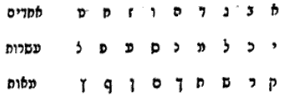

  
 And behold, when the hundreds are completed, the number of the thousands is equal to the units; and the Alef is what embeds its end in its beginning; for אל"ף [*alef*] is אלף [*elef*, thousand], is פלא [*pele*, wonder]; and it is the Supernal Keter, which embeds its end in its beginning and its beginning in its end, in the secret of אי"ן / אנ"י [*ayin*, Nothing / *ani*, I], which we explained in Gate Three, and likewise we shall explain it in the Gate "From Below to Above." And for this reason the Alef is called a complete number; and it is the drawing forth of Tiferet from Keter, for the inclusion of the Sefirot of ten is through Chokhmah, and all the more in its ascent from ten to ten, as we explained. "And seven hundred, which is a complete secret": he was precise not to say "complete number," as he said above, because it is not complete for all of them; but he said "a complete secret," because the seven Sefirot are full and complete in the whole inclusion of ten (a word is missing) of ten, in the way of the preceding ten; except that the foundation of the preceding ones is ten, and therefore they rose to a thousand, and the foundation of these is seven, and therefore they rose only to seven hundred. And therefore he did not say "complete number," because the number ten was not completed. And it is called complete for the reason of the completeness of each one of its Sefirot in a hundred gates; and for this he said "a complete secret." "And five likewise": explanation: for five too are in the secret of the Vav, as the number of the Sefirot, in the secret of the inclusion of the seven in five, as we explained in the gates. And likewise when we remove from the count of the seven the pillar and the socket, five remain. "And seventy, all one secret": explanation: for the seventy too is in the secret of seven hundred, except that these are included in a great inclusion, and those are included in one inclusion only, that is, each one of the seven is included of ten: the seven turn out to rise to seventy. "And therefore from this secret and this reckoning he made hooks": explanation: to hint at this great secret, that Tiferet be included of all these aspects. "And all in the secret of Vav," etc.: it was difficult for him: for the Alef is a hint in all ten, and the seven hundred and seventy are in the seven, and the five likewise; and if so, what relates this number to Tiferet? And to this he answered, "and all in the secret of Vav"; and a proof for this is their form, for they were made like a Vav; except that it is Tiferet when it is included of all these manifestations. And so these [hooks] turn out to be in the secret of the upper ones in their form, their hinting, their place, and their reckoning: in their form, that they were in the form of Vav; in their hinting, for so they were hinting at Tiferet; in their place, that they stood upon the pillars, in the secret of the Vav upon the continuation of the Vav, which is Tiferet upon the Righteous One; and in their reckoning, in the secret of the thousand, and the seven hundred, and the five, and the seventy. And now there is no escaping saying that the seven hundred are not part of the thousand; rather it is a manifestation by itself, for the manifestation of the thousand is choicer than the manifestation of the seven hundred; and likewise for the seventy, and likewise for the five: each one is a manifestation by itself. And it was necessary for the matter of the Tabernacle that the Vav be included of all the manifestations, for the reason that Malkhut too should be included of all the manifestation. And the illustration of this: when we take a stone from the stones, or a piece of wood from the woods, and divide it in two, behold, of necessity those parts will be found, from the side of their unity, equal in their fibers and their figure, and this figure will not differ from that figure, for both were one piece, and one manifestation is necessary for them. And so is the matter in the emanation of Tiferet and Malkhut, since they were double-faced, as we shall explain in the Gate of the Diminishment of the Moon.

> ועוד נוכל לפרשו על דרך זה כי האלפא ביתא ימצא בה המספר עד ט' מאות, ומשם יחזיר האלפים לאחדים. נמצא לפי זה האלף הוא מספר השלם הנועץ סוף המספר בתחלתו ונצייר הנה צורה יפה שבה יתבאר כונתינו בקוצר כזו:
>
>  והנה בהשלים המאות ישוה מספר האלפים אל האחדים והאל"ף הוא הנועץ סופו בתחלתו כי אל"ף הוא אלף הוא פלא והוא כ"ע הנועץ סופו בתחלתו ותחלתו בסופו בסוד אי"ן אנ"י שפי' בשער ג' וכן נבארו בשער ממטה למעלה. ולסבה זו נקרא האל"ף מספר שלם והוא המשכת הת"ת מהכתר כי כללות הספירות מי' הוא ע"י חכמה ומה גם בעלותה מי' לי' כדפי'. ושבע המאות דאיהו רזא שלים דקדק שלא אמר מספר שלם כדקאמר לעיל, מפני שאינו שלם לכלהו, פי' אבל אמר רזא שלים כי הז' ספירות הם מלאות ושלימות בכל כללות העשר (חסרה מלה) מעשר ע"ד העשר הקודמות אלא שהקודמות יסודן עשר ולכן עלו לאל"ף ואלו יסודן שבע ולכן לא עלו כ"א לשבע מאות. ולכן לא אמר מספר שלם מפני שלא נשלם מספר העשר. ונקרא שלם מטעם שלימות כל אחד מספירותיה במאה שערים ולזה אמר רזא שלים. וחמשה הכי נמי. פי' כי ה' ג"כ הם בסוד הוא"ו כמנין הספירות בסוד כללות השבעה בה' כדפי' בשערי'. וכן כשנסיר ממנין השבעה העמו"ד והאד"ן נשארו ה'. וע' כלא רזא חדא. פי' כי הע' ג"כ בסוד שבע מאות אלא שאלו כלולים בכללות גדול ואלו נכללים בכללות א' לבד דהיינו כל אחד מז' כלולה מעשר נמצאו הז' עולים ע'. ועל דא מרזא דא וחושבן דא עשה ווים. פי' לרמוז הסוד הגדול הזה שיהיה הת"ת כלול מכל הבחי' הללו. וכלא ברזא דוא"ו כו'. הוקשה לו כי האל"ף הוא רמז בכל העשר וז' מאות ושבעים הם בשבעה וה' ג"כ, וא"כ מה ייחס מספר זה לת"ת. ועל זה השיב וכלא ברזא דוא"ו, וראיה על זה צורתם שהיו עשוין כמין וא"ו אלא שהוא הת"ת בהיותו כלול מכל המציאיות האלה. ונמצאו הוויית האלה בצורת"ם ורמיזת"ם ומקומ"ם וחשבונ"ם בסוד העליונים. בצורת"ם שהיו בצורת ו', ברמיזת"ם שכן היו רומזים לת"ת, במקומ"ם שהיו עומדים על העמודים בסוד הוא"ו על משך הוא"ו שהוא ת"ת על צדיק. וחשבונ"ם בסוד האל"ף ושבע המא"ות וחמש"ה ושבעי"ם. ועתה אין להמלט שלא נאמר שאין הז' מאות מכלל האל"ף. אבל הוא מציאות בפ"ע שמציאות האל"ף נבחר ממציאות הז' מאות וכן לע' וכן לחמשה כל א' היא מציאות בפ"ע. והוכרח לענין המשכן להיות הוא"ו כלול מכל המציאיות מטעם שתהיה ג"כ המלכות כלולה מכל המציאות. והמשל בזה כשנקח אבן מהאבנים או עץ מהעצים ונחלקנו לשנים הנה בהכרח ימצאו אותם החלקים מפאת יחודם שוים בחוטיהם וציורהם ולא ישתנו ציור זה מציור זה כי חתיכה אחת היו שניהם ויוכרח להם מציאות א'. וכן הדבר באצילות הת"ת והמלכות אחר שהיו ד"ו פרצופין כאשר נבאר בשער המעוט.

**14:2:7** And behold, although the Holy One, blessed be He, sawed them apart, nevertheless they are equal, like the parable we gave. And therefore, when the male is unified with the female in all his limbs with a complete and whole union, it is necessary that they be equal with a complete equality, the female receiving to the male and the male to the female, for they are like receiver and giver. And all the more since we have seen the matter of the channels, which we explained in chapter 1 of the gate we devoted to them. And therefore in the Tabernacle, to hint at all the divisions of their division, so that the union be complete, it was necessary that they be according to that number, so that the Vav be included of all the parts and aspects by which it can be considered, so that the female too may be considered in all those aspects, to receive from him. And from this reason the necessity will be understood why all that happened to Jacob happened to Joseph (Bereshit Rabbah 84:6): because Yesod unites Tiferet and Malkhut in all the parts and aspects of the two of them; and if so, it is necessary according to this that there be in it an aspect equal to the aspect of Malkhut and Tiferet, so that "the loops may be opposite" (Exod. 26:5), "and together they shall be whole at its head" (Exod. 26:24).

> והנה עם היות שנסרם הקב"ה עכ"ז הם שוים כדמיון המשל שהמשלנו, ולכן בהיות הזכר מתיחד עם הנקבה בכל אבריו יחוד גמור ושלם יוכרח היותן משתווים שווי גמור מקבל הנקבה לזכר והזכר לנקבה שהם כדמות מקבל ומשפיע. ומה גם ראותינו ענין הצנורות שפי' בפ"א מהשער שיחדנו להם. ולכן במשכן לרמוז אל כל חלוקי חלוקם להיות היחוד שלם הוכרח להיותם על צד המספר ההוא כדי שתהיה הוא"ו כלולה מכל החלקים והבחינות שאפשר שתבחן כדי שהנקבה ג"כ תבחן בכל הבחינות ההם לקבל ממנו. ומזה הטעם יובן הכרח למה כל מה שאירע ליעקב אירע ליוסף (ב"ר פד ו), מפני שיסוד הוא מיחד הת"ת והמלכות בכל החלקים והבחינות של שניהם וא"כ יוכרח לפי זה היות בו בחינה שוה אל בחינת המלכות והת"ת כדי שיהיו מקבילות הלולאות ויחדיו יהיו תמים על ראשו:

### Chapter 14:3. Explanation of known manifestations explained in the Zohar — a manifestation of Binah, of Tiferet, and of Malkhut; and a passage from the Zohar, "and it shall be on that day, living waters shall go out," concerning the child (*yenuka*), etc.

**14:3:1** Our intent in this chapter is to explain manifestations that are explained in some of the passages of the Zohar, which are very much needed for contemplation in this wisdom. And it is the manifestation of Binah, the manifestation of Tiferet, and the manifestation of Malkhut. As for the manifestation of Binah, there are two manifestations in her. The first, a manifestation that has no relation with the Emanation at all; and it is hinted in the manifestations of Yod, the subtle point that is in Binah. And the second, a manifestation that is related to the Emanation, from the side of the manifestation that she has. And one cannot say that the manifestation of the Yod is only in Chokhmah, and that the letter of Binah is He; for the letter of Binah is also Yod. And so it is explained in the words of Rashbi, that three Yods are the first three; and that is the aspect of Binah with the two upper ones, and she is hinted in Yod, like each one of the other upper ones. But when she emanates the Emanation in their place, then she has the aspect of the He.

> כונתינו בפרק זה לבאר מציאיות מתבארים בקצת ממאמרי הזהר והם צריכין אל העיון בחכמה הזאת ביותר. והוא במציאות הבינה ובמציאות הת"ת ובמציאות המלכות. במציאות הבינה, בה שני מציאות. ראשונה מציאות שאין לו יחס עם האצילות כלל, ונרמזת במציאיות יו"ד נקודה דקה שבבינה. והשניה מציאות המתייחס עם האצי' מצד המציאות אשר לה. ואין לומר שאין מציאות היו"ד אלא בחכמה, ושאות הבינה היא ה"א. שגם אות הבינה היא יו"ד. וכן מבואר בדברי הרשב"י שג' יודין הם ג' ראשונות והיינו בחינת הבינה עם ב' העליונות והיא נרמזת ביו"ד ככל אחת משאר העליונות. אבל כאשר תאציל האצילות במקומם, אז יש לה בחינת הה"א.

**14:3:2** And behold, the aspect of the Yod is called *Mi* [who], which is a question without an answer, because of her great concealment. And the aspect of He is hinted in *Eleh* [these], which are the three fathers, that is, the three Vavs that are in the form of the He, thus: ה; and the right Vav is Chesed, and its roof is Gevurah, and the hanging leg is Tiferet; and they are called *Eleh*. And to understand this matter well, one must contemplate what we shall write in the Gate of Names, chapters 8 and 9, and in the Gate "From Below to Above," chapter 5, on the name אלדי"ם [Elohim], which is the permutation of מ"י אל"ה [*Mi Eleh*]: He upon Yod, as explained in the Tikkunim many times. He means the He, which is a garment to the Yod, thus:  

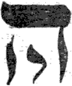

  
 And therefore she is female, for the aspect of revealing caused her to be female. But before, she is Yod alone, in the secret of a point equal to the two points. But by reason of her emanation, to emanate the Emanation, the manifestation of three lines was formed in her. For when she oversees in Chesed, to pour them forth, it is necessary that there be in her the aspect of Chesed; and when she oversees in compassion, it is necessary that there be in her the aspect of compassion; and when she oversees in judgment, it is necessary that there be in her the aspect of judgment. And these three aspects that were formed in her are certainly the manifestation of the source of the three lines, which remained there in subtlety, which are root and source to the revealed ones. And there is no question to say that the fathers are not Vavs, but only Tiferet; for so they explained in the Tikkunim, apart from this inquiry, and said that the three verses ו*ayyissa*, ו*ayyavo*, ו*ayyet* (Exod. 14:19–21) are three Vavs in three fathers. And after we have explained these two manifestations in Binah, we say that both of them are also in Malkhut. And they are hinted in these two letters literally, in He and Yod: for her principal is Yod, and her manifestation that is emanated to her receives the three lines [which are Netzach, Hod, Yesod] and becomes He. And close to this matter it is explained in the Zohar (Shelach, folio 171a), and these are its words: "That child [*yenuka*] opened and said (Zech. 14:8): 'And it shall be on that day' [*ba-yom ha-hu*]: it is not known who it is. But everywhere 'on that day' is the last day. Why is it called 'that day'? But this is the secret: it is the day that holds the end to the beginning. The beginning is called *hu* ['he,' 'that'], as it is written (Num. 18:23), 'And the Levite, he [*hu*], shall do the service': the service of the Levite is to the grade called *hu*, hidden and stored away. And it is called *hahu* ['that'] to show the end of all the grades, which is the beginning, and all is one; and because it is the end, He was added to it. Jerusalem is destined to bring forth waters and to make springs flow. Here there is [room] to say: the end of all the grades is not Jerusalem. But certainly Jerusalem and that day are all one. What is [the difference] between this and that? But Jerusalem: all her holy grades, when they go around, are called Jerusalem, and so they are bounded. There are grades that go around and are called courts, these inner and these outer; and there are grades that, when they go around, are called chambers; and there are grades that, when they go around, are called Heikhal and Devir. Within all those grades there is one point: 'All glorious is the king's daughter within' (Ps. 45:14). This point is called 'that day'; and your sign: 'that too is reckoned a land of Rephaim' (Deut. 2:20). And when this day rises from within the (vaults) (lattices) of the court, the flow of waters will rise; and this flow [goes] to the former sea [*ha-yam ha-kadmoni*], to be like a mother whose son is between her arms, and the milk increases, and the suckling's mouth is filled, and it grows by it, and it pours the milk out into its mother's mouth. So 'half of them to the former sea'" (Zech. 14:8), etc. Thus far its words.

> והנה בחינת היו"ד נקרא מ"י שהוא שאלה בלא תשובה מרוב העלמה. ובחינת ה"א הוא נרמזת באלה שהם ג' אבות דהיינו ג' ווי"ן שבצורת הה"א כזה ה', והוא"ו הימיני הוא חסד, והגג שלה הוא גבורה, והרגל התלוי הוא ת"ת. והם נקראים אלה. ולעמוד על ענין זה היטיב, צריך לעיין במה שנכתוב בשער השמות פ"ח ט' ובשער ממטה למעלה פ"ה בשם אלדי"ם שהוא צרוף מ"י אל"ה, ה' על י' כמבואר בתקונים פעמים הרבה. ירצה ה' שהוא לבוש אל היו"ד כזה
>
>  ולכן היא נקבה כי בחינת הגילוי גרמה לה היותה נקבה. אבל קודם היא י' לבד בסוד נקודה שוה אל שתי הנקודות. אבל בסבת אצילותה להאציל האצילות נצטייר בה מציאות ג' קווים. כי בהיותה משגחת בחסד להשפיעם יוכרח היות בה בחינת החסד, ובהיותה משגחת ברחמים יוכרח היות בה בחינת הרחמים, ובהיותה משגחת בדין יוכרח היות בה בחינת הדין. וג' בחינות האלה שנצטייר בה זה ודאי מציאות מקור ג' קווין שנשארו שם בדקות שהם שרש ומקור אל המתגלים. ואין שאלה לומר שהאבות אינם ווין אלא הת"ת לבד. כי כן פי' בתיקונים בזולת הדרוש ואמרו שג' פסוקים ו"יסע ו"יבא ו"יט הם ג' ווי"ם בג' אבות. ואחר שבארנו שני המציאות האלה בבינה נאמר כי גם שתיהם במלכות. והם נרמזים בשתי אותיות אלה ממש בה' וי' כי עיקרה היא יו"ד ומציאותה המתאצל אליה מקבלת הג' קווים [שהם נה"י] ונעשית ה'. וקרוב לענין זה נתבאר בזהר (שלח דף קע"א.) וז"ל פתח ההוא ינוקא ואמר, והיה ביום ההוא, לא ידיע מאן הוא. אלא בכל אתר ביום ההוא יומא בתראה איהו. אמאי איקרי יום ההוא. אלא רזא דא הוא יומא דאחיד סופא בשירותא. שירותא אקרי הוא כמה דכתיב ועבד הלוי הוא. פולחנא דלוי לדרגא דאקרי הוא טמיר וגניז ואקרי ההוא לאחזאה סופא דכל דרגין דאיהו שירותא וכלא חד ובגין דאיהו סופא איתוסף ביה ה'. זמינא ירושלם לאפקא מיין ולנבעא נביעי. הכא אית למימר סופא דכל דרגין לאו איהו ירושלם אלא ודאי ירושלם ויומא ההוא כלא חד. מה בין האי להאי, אלא ירושלם כל דרגין קדישין דילה כד אסתחרן אקרון ירושלים והכי אתתחמן אית דרגין דסחרן ואקרון עזרות אילין פנימאן ואילין לבר ואית דרגין דאקרון כד אסתחרן לשכות ואית דרגין דאיקרון כד אסתתחרן היכל ודביר. לגו מכל אינון דרגין, אית נקודה חדא כבודה בת מלך פנימה. נקודה דא אקרי יום ההוא וסימנך ההוא יקרא ארץ רפאים. וכד יקום יומא דא מגו (כיפין) (שבכין) דעזרה יקום נביעו דמיין והאי נביעו מן הים הקדמוני ליהוו כגוונא דאמא דברה בין דרועהא ומסגיאו חלבא דיניק אתמלי פומיה ואתרבי ביה אריק חלבא לפומא דאימיה. כך חציים אל הים הקדמוני וכו' עכ"ל.

**14:3:3** And behold, this passage is long in its place, and we have abridged it and copied from it what we need. And the matter in brief: this *yenuka* was a child who departed from the world for a reason known to Him, blessed be He; and when his soul ascended to the entrance of the gates of the Garden of Eden, the cherubim, the guardians of the Garden, held him, so as not to let him enter, for a reason stated there. And meanwhile the head of the academy of the righteous was expounding on this verse, "And it shall be on that day"; and the child, from outside, objected, and these are his words: "Waters that are below: how do they rise from it to a place higher than it by many grades? And what need have those [above] of those waters? And a place from which all the springs and streams go out, and there is no ceasing to its springs and streams, is watered from a dry place? Who has seen the digging of a well give water to the spring that flows? And does Jerusalem give water to the former sea, the place from which all the waters of the world go out?" Thus far its words.

> והנה המאמר הזה רב במקומו ואנו קצרנוהו והעתקנוהו ממנו הצורך אלינו. והענין בקצרה, זה הינוקא היה תנוק א' שנסתלק מן העולם לסבה ידועה אליו יתברך וכאשר עלתה נשמתו אל פתח שערי ג"ע אחזו בו הכרובים שומרי הגן לבלתי תתו להכנס לסבה שנאמרה שם ובין כך ובין כך היה ראש ישיבת הצדיקים דורש בפסוק זה והיה ביום ההוא והתינוק מבחוץ הקשה וז"ל מיין דאינון מלרע היך סלקין לעילא מיניה לאתר עילאה יתיר מיניה בכמה דרגין ומה איצטרך לון לאינון מיין. ומה אתר דכל מבועין ונחלין נפקין מיניה ולית פסיקו למבועי ונחלוי אשתקייא מאתר נגוב מאן חמא חפירא דבירא יהיב מייא למבועא דנביע. וכי ירושלם יהיב מים אל הים הקדמוני אתר דכל מימין דעלמא נפקי מתמן עכ"ל.

**14:3:4** And it is a strong difficulty: for Jerusalem is Malkhut, and the former sea is Binah, and therefore it is called "former"; and how is it possible that Binah should be watered from Malkhut? And to answer this difficulty, after they brought him into the academy, he opened and said: "And it shall be on that day: it is not known," etc. For the word *hu* indicates the hidden [third person], and it is a title for concealment, as we shall explain in the Gate of the Glossary of Titles; and the He of knowledge [the definite article] indicates the revealed, as is well known. And behold, they are two opposites in one word. And this is what he intended in saying "*hahu*: it is not known who [*hu*] it is": explanation: *hu* indicates concealment, and *hahu* indicates revealing, and they are two opposites. And he answered: "But everywhere 'on that day'" is Malkhut, which is the last day. And although she is the attribute of night, she is also day, for there are seven days, and the name "day" is already related to her. And since she is Malkhut, it is fitting that it come with the He of knowledge, because she is revealed and known; but the word *hu* cannot properly be said, for it indicates concealment, as we explained. And he answered: "But this is the secret: it is the day," etc. Explanation: to indicate the manifestation of the Yod, which is a concealed manifestation that is in her. For Malkhut is beginning and ending, which is beginning and end, as we say, "the beginning of thought is the end of action": for she is above in Chokhmah, in the manifestation of Yod, and she is the end of action in Malkhut, in the manifestation of He. And he said that the concealed manifestation, which is the beginning, is called *hu*, which indicates beginning. And a proof is from what is written, "And the Levite, he [*hu*], shall do the service"; and the service of the Levite is to Binah, as we explained in the Gate of Essence and Governance, chapter 10.

> והיא קושיא חזקה, כי ירושלם היא המלכות והים הקדמוני היא בינה ולפיכך נקרא קדמוני וכיצד אפשר שישוקה הבינה מהמלכות. ולהשיב על הקושיא הזאת אחר שהכניסוהו לישיבה פתח ואמר והיה ביום ההוא לא ידיע וכו' כי מלת הוא מורה על הנסתר והיא כנוי אל ההעלם כאשר נבאר בשער ערכי הכנויים וה"א הידיעה מורה על הנגלה כמפורסם. והנה הם ב' הפכים במלה אחת. וזה כיוון באמרו ההוא לא ידיע מאן הוא. פי' הוא מורה העלם, וההוא מורה התגלות, והם ב' הפכים. והשיב אלא בכל אתר ביום ההוא, הוא המלכות, שהוא יום האחרון. ואע"פ שהיא מדת לילה ג"כ הוא יום, שהרי ז' ימים הם, וכבר יתייחס אליה שם יום. ומאחר שהיא המלכות ראוי לבא בה' הידיעה מפני שהיא גלויה וידועה. אבל תיבת הוא לא יצדק שהוא מורה על ההעלם כדפי'. והשיב אלא רזא דא הוא יומא כו'. פי' להורות על מציאות היו"ד שהוא מציאות נעלם שיש בה. כי המלכות היא שירותא וסיומא שהוא תחלה וסוף כדאמרי' תחלת המחשבה סוף המעשה שהיא למעלה בחכמה במציאות יו"ד והיא סוף המעשה במלכות במציאות ה'. ואמר שהמציאות הנעלם שהוא התחלה נקרא הוא, שמורה על התחלה. וראייה ממאי דכתיב ועבד הלוי הוא, ועבודת הלוי היא אל הבינה כדפי' בשער מהות והנהגה בפ"י.

**14:3:5** And behold, *hu* indicates the beginning, which is first and earliest; for Binah is called "the beginning that stands to be asked about," as we explained there in chapter 15. And the aspect of the revealed manifestation, which is the end of all the grades, is called *hahu*, with the He of knowledge. So the word *hahu* turns out to indicate the two manifestations together. And behold, the *yenuka* explained her two manifestations, in the He that surrounds the Yod, in the matter of *hahu*.

> והנה הוא, מורה על שירותא שהוא תחלה וראשון כי הבינה נקרא שירותא דקיימא לשאלתא כדפי' שם בפט"ו. ובחי' המציאות המתגלה שהוא סוף כל דרגין נקרא ההוא בה' הידיעה. נמצא תיבת ההוא מורה על שני המציאיות יחד. והנה ביאר הינוקא ב' המציאיות שלה בה' שסביב לי' בענין ההוא.

**14:3:6** And behold, the middle point is called "All glorious is the king's daughter within." And likewise it is called "the apple of the eye" [*bat ayin*], for it is like the pupil of the eye, a tiny, fine point, and around it three colors, which are the colors of the rainbow; they are the three fathers.

> והנה הנקודה האמצעית נקרא כבודה בת מלך פנימה. וכן נקרא בת עין שהוא כבבת עין נקודה זעירא דקיקא וסביבה ג' גוונים שהם גווני הקשת הם ג' אבות.

**14:3:7** And behold, this point ascends to its place, its height, to her father's house, Chokhmah, by means of the effluence of Binah, which is the mother who nurses her with the milk; and through her she is exalted, until she ascends and pours effluence even into Binah herself, as he said, "like a mother whose son," etc. And likewise she pours effluence into her literal lower manifestation (which is the He, to feed the lower ones by it); and this is "and half of them to the latter sea." And the sum of the matters: Binah has He, and her manifestation is the three fathers; and Malkhut has He, and her manifestation is Netzach, Hod, and Yesod. And these two preliminaries are explained in the Ra'aya Meheimna (Terumah, folio 158), and these are its words: "The vessel of the Holy One, blessed be He, is the Shekhinah, which is a vessel to serve her husband. She is His candelabrum, of which it is said (Ps. 119:164), 'Seven times a day I praise You,' which are Gedulah, Gevurah, Tiferet, Netzach, Hod, Yesod, and Malkhut, seven included. Of these seven grades, three branches of the candelabrum from its one side: the body and the two arms of the King; she is a lamp of commandment to illumine by them. And three branches of the candelabrum from its second side: they are the two thighs and the covenant; and she is the western lamp to illumine by them. She is called the King's candelabrum, and she is a lamp to illumine by it, the lamp of commandment, of which it is said (Ps. 19:9), 'The commandment of the Lord is pure, enlightening the eyes.' And who is the head of the candelabrum? Binah, the upper He, which has three branches, in this image, ה: three Vavs, which are the three fathers. The second He: three second branches, in this image, ה: three Vavs, which are Netzach, Hod, Yesod. Vav: the middle candelabrum, son [*ben*] of Yah; after his name Binah [*bin-Yah*] is called; he includes six branches below, in the reckoning of Vav, in his six branches. Yod: 'a woman of valor is the crown of her husband' (Prov. 12:4), the crown of the Torah scroll, in the form of Zayin. From the side of the World to Come she is not a vessel for Him, and does not serve Him, but a crown on His head. But in this world she is like this, הוה"י: she is a vessel beneath Him, His service," etc. Thus far its words. And in it, explicitly, that each of the two Hes is three Vavs. And also the manifestation of Malkhut, that she is sometimes Yod, when she ascends above; and then she is called "a woman of valor, the crown of her husband," for she is Yod, a crown upon Vav, and becomes Zayin; and she is the crown of Tiferet. And this is when she ascends to Binah to be unified with Chokhmah, from which is her manifestation, as we explained above. And now we come in a further chapter to explain further the matter of the manifestations of the Yod to Malkhut in the He, although it will be explained in the Gate of the Diminishment of the Moon.

> והנה בעלות הנקודה הזאת אל מקומה הרמתה אל בית אביה חכמה באמצעות שפע הבינה שהיא האם המניק לה החלב וע"י תתעלה עד שהיא עולה והיא משפעת אפי' בבינה עצמה כדקאמר כגוונא דאימא דברה וכו', וכן תשפיע אל מציאותה התחתון שבה ממש (שהיא הה' לזון בו התחתונים) וזהו וחצים אל הים האחרון. וכלל הדברים, כי הבינה לה ה' ומציאותה ג' אבות. ולמלכות ה' ומציאותה נצח והוד ויסוד. ושתי הקדמות אלו נתבארו ברעיא מהימנא (תרומה דקנ"ח) וז"ל מאנא דקב"ה איהי שכינתא דאיהו מאנא לשמשא לבעלה איהי מנרתא דיליה דאתמר בה שבע ביום הללתיך דאינון הגדולה והגבורה והת"ת והנצח וההוד יסוד ומלכות. ז' כלילן. מז' דרגין אלין ג' קני מנורה מצדה האחד, גופא ותרין דרועי דמלכא איהו נר מצוה לאנהרא בהון. וג' קני מנורה מצדה השני, אינון תרין שוקין וברית ואיהו נר מערבית לאנהרא בהון. מנרתא דמלכא אתקריאת ואיהי נר לאנהרא ביה נר מצוה דאתמר ביה מצות ה' ברה מאירת עינים ומאן רישא דמנרתא בינה ה' עילאה דאית לה תלת קנים בדיוקנא דא ה' תלת ווי"ן דאינון תלת אבהן. ה' תניינא ג' קנים תניינין בדיוקנא דא ה' תלת ווי"ן דאינון נצח הוד יסוד. ו' מנרתא דאמצעיתא ב"ן י"ה על שמיה אתקרי בינה איהו כליל שית קנים לתתא בחשבון ו' בו' קנים דיליה. י אשת חיל עטרת בעלה תגא דס"ת בצורת זיין. מסטרא דעלמא דאתי לאו איהי מאנא לגביה ולאו משמשא לגביה אלא עטרה על רישיה אבל בעלמא דין איהי כגוונא דא הוה"י איהי מאנא תחותיה שמושא דיליה וכו' עכ"ל. ובו בפירוש כי ב' ההי"ן הם ג' ווי"ן כל אחד מהם. וגם מציאות המלכות שהיא לפעמים יו"ד בעלותה למעלה ואז היא נקראת אשת חיל עטרת בעלה שהיא י' עטרה על ו' ונעשית ז' ואיהי עטרת תפארת וזו כאשר היא עולה לבינה להתייחד עם החכמה שמשם מציאותה כדפי' לעיל. ועתה נבא בפ' זה לבאר עוד ענין מציאיות היו"ד אל המלכות בה"א עם היות שיתבאר בשער המיעוט:

### Chapter 14:4. On the necessity of the manifestations of Malkhut; and a passage from Sefer ha-Bahir, "the earth was created before the heavens."

**14:4:1** Since above we said incidentally that the manifestation of Malkhut is from Chokhmah, we come in this chapter to decide concerning some passages of the Tikkunim, and these are their words (in Tikkun 69, folio 103): "And further, 'I am asleep [*yeshenah*]': second [*sheniyah*], certainly, to Chokhmah, which is Yod, when my beloved, who is Vav, is far from me. And the secret of the matter: He: 'The Lord founded the earth by wisdom; He established the heavens by understanding [*tevunah*]' (Prov. 3:19). Chokhmah, which is Abba, Yod, founded the daughter, who is earth, small He: 'the earth,' certainly. 'He established the heavens': this is Vav. 'By understanding': this is the supernal Imma. For she is called Binah above, when she is with her husband; she is called Tevunah below, when she is with Vav below; and it is ב"ן ו' [*ben*, Vav], and Tav, which is Tiferet; she remains He with him. And at that time, when the letter Vav is with Imma and he is far from her, it is said of her, 'I am asleep' in exile, and she is second to him." And the intent is that when Malkhut is above she is second to Chokhmah, and she is literally Yod, like it, as he explained in many places. And this is what he was precise about in saying "second, certainly, to Chokhmah, which is Yod": in the secret of the manifestation of the Yod, in which the two of them are equal: this is the Yod of the four-letter name, and this is the Yod of Adonai. (And in the Sifra di-Tzeni'uta, Parashat Terumah, folio 176) among the *havayot* he brings a *havayah* like this, יהו"י, and it indicates the secret of the matter mentioned; and these are its words: "יהו"י: the last Yod is the Shekhinah (below), just as the He is found [to be] the Shekhinah; and they are weighed on one scale." Thus far its words.

> אחר שלמעלה אמרנו אגב גררא היות מציאות המלכות מהחכמה, נבא בפרק זה להכריע בקצת מאמרי התקונים וז"ל (בתקונא ס"ט דף ק"ג) ועוד אני ישנה שניה ודאי לחכמה דאיהו י' כד אתרחק מיני רחימאי דאיהו ו', ורזא דמלה ה' בחכמה יסד ארץ כונן שמים בתבונה, חכמה דאיהו אבא י', יסד ברתא דאיהי ארץ ה' זעירא הארץ ודאי. כונן שמים דא וא"ו. בתבונה דא אימא עלאה. דבינה אתקריאת לעילא כד איהי עם בעלה. תבונה אתקריאת לתתא כד איהי עם ו' לתתא ואיהו ב"ן ו', ות' דאיהו ת"ת אשתארת איהי ה' עמיה. ובההוא זמנא דאת ו' איהו עם אימא ואיהו מרחק מינה, אתמר בה אני ישנה בגלותא, ואיהי שניה ליה. והכוונה כי בהיות המלכות למעלה היא שניה לחכמה ואיהי יו"ד ממש כמותה כמו שביאר במקומות רבים. וזה דקדק באמרו שניה ודאי לחכמה דאיהו יו"ד. בסוד מציאות היו"ד אשר בה משתוים שניהם. זו י' של שם בן ד', וזו י' של אדני. (ובספרא דצניעותא פ' תרומה דף קע"ו) בכלל ההויות מביא הוי"ה כזו יהו"י והוא המורה על סוד הענין הנזכר. וז"ל יהו"י. י' בתראה שכינתא (לתתא) כמה דה"א שכינתא אשתכח. ובחד מתקלא אתקלו עכ"ל.

**14:4:2** And they said "when my beloved is far from me," etc.: explanation: Malkhut says that she is second to Chokhmah at the time that she has been distanced from her husband. And the matter is that in the four-letter name, whose letters are ידו"ד in their order, they are sometimes permuted to ידד"ו; and he means that Malkhut has ascended to Chokhmah, to her father's house, and Tiferet is unified with Binah. And this is what he explained: "And the secret of the matter: He: 'The Lord founded the earth by wisdom,'" etc. Explanation: by Chokhmah, which is Yod, was the foundation of the earth; for the earth is Malkhut in the manifestation of He, and the foundation of the He is Yod, which is the manifestation of the rib that was taken from the man. And Rashbi, peace be upon him, explained in the Tikkunim (Tikkun 12, folio 27a), and these are his words: "And it is said there concerning Adam (Gen. 2:22): 'And the Lord God built the rib that He had taken from the man': this is Chokhmah. 'And He brought her to the man': this is the central pillar," etc. He taught that the manifestation of the Yod is the manifestation of the rib, and she was taken from Chokhmah, which is the upper Adam, and was built in the building of the He, as we shall explain; and then He unified her with Tiferet.

> ואמרו כד אתרחק מני רחימאי וכו' פי' המלכות אומרת שהיא שנייה לחכמה בעת שנתרחקה מבעלה. והענין כי בשם בן ד' אותיות והם ידו"ד כסדרן לפעמים יצטרפו אל ידד"ו, וירצה שהמלכות עלתה אל החכמה לבית אביה והת"ת מתיחד עם הבינה. וזה שביאר ורזא דמלה ה' בחכמה יסד ארץ וכו'. פי' בחכמה שהוא יו"ד היה יסוד הארץ כי הארץ היא המלכות במציאות ה' ויסוד הה"א הוא יו"ד שהוא מציאות הצלע אשר נלקח מן האדם. ופי' הרשב"י ע"ה בתקונים (תקונא י"ב דף כ"ז.) וז"ל ואתמר התם לגבי אדם ויבן ה' אלדים את הצלע אשר לקח מן האדם, דא חכמה. ויביאה אל האדם, דא עמודא דאמצעיתא כו'. הורה כי מציאות היו"ד הוא מציאות הצלע ונלקחה מהחכמה שהוא אדם העליון, ונבנתה בבנין הה"א כאשר נבאר ואז ייחדה עם התפארת.

**14:4:3** And behold, the foundation of the building, which is He, is thus:  

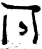

  
 And this is what he said: "Chokhmah, which is Abba, Yod, founded the daughter, who is earth, small He: 'the earth,' certainly." Explanation: the manifestation called "earth," that is, her lower aspect, the matter of the earth, which is below all: the foundation of this earth was in Chokhmah, as we explained. "He established the heavens by understanding": and likewise the establishing and building of the heavens was by Tevunah. For their principal is from Chokhmah, as we explained in the Gate "Ten and Not Nine," chapter 2; for the manifestation of the firmament is from Chokhmah; but its establishment, that is, its building, and the aspect that surrounds and clothes the firmament, that is, the aspect called "heavens," was by Tevunah, which is Binah when she is unified with Tiferet, as he concludes. This matter is further explained in the Tikkunim (Tikkun 29, folio 73a), and these are its words: "And the lower Shekhinah, commandment, is included of four letters: she is called Yod from the side of Chokhmah, He from the side of the supernal Imma," etc. Thus far its words.

> והנה יסוד הבנין שהוא ה"א הוא כזה
>
>  וז"ש חכמה דאיהו אבא י', יסד ברתא דאיהי ארץ ה' זעירא הארץ ודאי. פי' כי מציאות הנקרא ארץ דהיינו בחינתה התחתונה ענין הארץ שהיא למטה מן הכל ויסוד הארץ הזאת היתה בחכמה כדפי'. כונן שמים בתבונה, וכן התכוננות ובנין השמים היה בתבונה. כי עקרם הם מחכמה כמו שפי' בשער י' ולא ט' בפ"ב. כי מציאות רקיע הוא מחכמה אמנם כוננותו דהיינו בניינו ובחי' הסובבת ומלבשת הרקיע דהיינו בחינה הנקרא שמים זה היה בתבונה שהוא הבינה בהיותה מתייחדת עם הת"ת כדמסיק. עוד נתבאר הענין הזה בתיקונים (תקונא כ"ט דף ע"ג.) ז"ל ושכינתא תתאה מצוה כלילא מארבע אתוון איהי אתקריאת י' מסטרא דחכמה ה' מסטרא דאימא עילאה וכו' עכ"ל.

**14:4:4** Behold, explicitly, that the manifestation of Yod is from the side of Chokhmah, and then she is called after Chokhmah; and so it is explained elsewhere (in the Introduction, folio 10): "When she is taken from Chokhmah, she is called *Reshit* [beginning] after it." Thus far. And likewise she is He from the side of Binah, that is, the building, as is written (Gen. 2:22), "And the Lord God built the rib"; and these two names indicate Binah. And so Rashbi explained in the commentary on the Song of Songs (in Zohar Chadash, folio 83), on the verse "like the curtains of Solomon" (Song 1:5); and there he explained that sometimes her building will be from Binah in the manifestation of Tet, which covers over the Yod. For Binah is Lamed; and when a building is built around the Yod of Malkhut, it is formed in the form of Tet, that is, a Lamed in a circle, thus:  

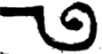

  
 And likewise the matter of this manifestation is explained in the episode of the *yenuka*; and for love of brevity we shall not dwell on bringing their wording here. And likewise they explained the matter in the Zohar (Parashat Vayechi, folio 246), and these are its words: "The holy Kingship does not receive complete kingship until it is joined with the fathers; and when it is joined with them it is built into a complete building from the upper world." Thus far its words. (And so it is in the Zohar, Va'era, folio 31.)

> הרי בפי' כי מציאות יו"ד מצד החכמה וכן אז נקראת ע"ש החכמה וכן פי' במ"א (בהקדמה ד"י) כד אתנטילת מחכמה אתקריאת ראשית על שמה ע"כ. וכן היא ה' מצד הבינה דהיינו הבנין דכתיב (בראשית ב) ויבן ה' אלדים את הצלע. ושני שמות האלו מורים על הבינה. וכן ביאר הרשב"י בפי' שה"ש (בז"ח דף פ"ג) בפסוק כיריעות שלמה, ושם פירש כי לפעמים יהיה בניינה מן הבינה במציאות ט' דחפי על י'. כי הבינה למ"ד וכאשר יבנה בנין סביב הי' של מלכות יצטייר בצורת ט' דהיינו למ"ד בעגול כזה
>
>  וכן נתבאר ענין המציאות הזה בעובדא דינוקא. ולאהבה הקצור לא נאריך בהבאת לשונם הנה. וכן ביארו הענין בזהר (פ' ויחי דף רמ"ו) וז"ל מלכותא קדישא לא קביל מלכותא שלימתא עד דאתחבר באבהן, וכד אתחבר בהו אתבני בניינא שלים מעלמא עילאה עכ"ל. (וכ"ה בזהר וארא דף ל"א).

**14:4:5** Behold, explicitly, that the principal of her building, that is, He, is through the three fathers, which are three Vavs, as explained in the preceding chapter. And likewise by their power she is built in three Vavs, that is, He; and the principal of the building is from the upper world, that is, the secret of Binah, as we explained. And likewise this inquiry is also explained in Sefer ha-Bahir; these are its words: "Rabbi Yannai said: The earth was created before the heavens, as it is said (Gen. 2:4), 'earth and heavens.' They said to him: But behold, it is written (Gen. 1:1), 'the heavens and the earth.' He said to them: A parable: to what is the matter like? To a king who acquired a fine object; it was not complete, and he did not call a name upon it, and said: I will complete it, and set right its base and its joining, and then I will call it a name. This is what is written (Ps. 102:26): 'Of old You founded the earth, and the heavens are the work of Your hands.' And it says (Ps. 104:2–5): 'Who wraps Himself in light as a garment, who stretches out the heavens like a curtain, who lays the beams of His upper chambers in the waters'; and it says, 'who makes His angels winds, His ministers a flaming fire'; and afterwards, 'He founded the earth upon its bases, that it should not be moved, forever and ever [*olam va-ed*].' When He set right a place for her, then she was strengthened in it, as it is said, 'that it should not be moved.' And what is her name? *Va-ed*. And her base is *olam*; and this is *olam va-ed*." Thus far its words.

> הנה בפי' כי עיקר בנין שלה דהיינו ה' היא ע"י הג' אבות שהם ג' ווי"ן כמבואר בפרק הקודם. וכן מכחם נבנית היא בג' ווי"ן דהיינו ה' ועקר הבנין מעלמא עילאה דהיינו סוד הבינה כדפי'. וכן נתבאר הדרוש הזה ג"כ בספר הבהיר ז"ל א"ר ינאי הארץ נבראת קודם השמים שנאמר ארץ ושמים. א"ל והא כתיב את השמים ואת הארץ. א"ל משל לה"ד למלך שקנה חפץ נאה לא היה שלם ולא קרא עליו שם ואמר אשלימנו ואתקן לו כנו וחבורו ואז אקרא לו שם. הה"ד לפנים הארץ יסדת ומעשה ידיך שמים, ואומר עוטה אור כשלמה נוטה שמים כיריעה המקרה במים עליותיו, ואומר עושה מלאכיו רוחות משרתיו אש לוהט ואח"כ יסד ארץ על מכוניה בל תמוט עולם ועד. כשתיקן לה מקום אז תאמץ בה שנאמר בל תמוט, ומה שמה, ועד, ומכונה עולם והיינו עולם ועד עכ"ל.

**14:4:6** And the explanation: "the earth was created": the intent is that Malkhut preceded Tiferet in the manifestation of the revealing of her emanation, as will be explained in the Gate of the Diminishment of the Moon, chapter 3. And he brought a proof for this from the verse (Gen. 2:4) "on the day that the Lord God made earth and heavens," which shows that the earth preceded the heavens. And they objected to him from the verse "the heavens and the earth," for the heavens were created first, as is evident from the plain sense of the verse. And he answered them by way of a fine parable: to a king who acquired a fine object, which is Malkhut; and the matter of this acquisition is the beginning of her emanation in Chokhmah, and it too is called king; and because it was not complete, for she was in the manifestation of a rib, lacking the building. And they said "and he did not call a name upon it": the intent is, he did not emanate it and did not reveal it so as to be bounded and titled with a name, but kept it standing until its preparation and until the preparation of its place, which is the Chariot upon which the glory of Malkhut stands: it is her base. And the completion is the building, the building of the rib, which is the manifestation of the He that is in her, as we explained. And he brought a proof for this from the verse "Of old You founded the earth": explanation: before the heavens, You founded the earth, which is Malkhut.

> ופי' הארץ נבראת, הכוונה כי המלכות קדמה לת"ת במציאות גילוי אצילותה כאשר יתבאר בשער המיעוט בפ"ג. והביא ראיה לזה מפסוק ביום עשות ה' אלקים ארץ ושמים, כנראה שהארץ קדמה לשמים. והקשו לו מפסוק את השמים ואת הארץ כי שמים נבראו תחלה כדמוכח מפשט הפסוק. והשיב להם בדרך משל נאה למלך שקנה חפץ נאה שהיא המלכות וענין הקנין הזה הוא תחילת אצילותה בחכמה והוא ג"כ נקרא מלך ומפני שלא היה שלם כי היתה במציאות צלע חסרת הבנין. ואמרו ולא קרא עליו שם. הכוונה לא האצילוהו ולא גילהו להיות נגבל ומכונה בשם אלא העמידו עד הכנותו ועד הכנת מקומו שהוא המרכבה שעליה עומדת כבוד המלכות הוא המכון שלה. וההשלמה הוא הבנין בנין הצלע שהוא מציאות הה"א שבה כדפי'. והביא ראיה לזה מפסוק לפנים הארץ יסדת פי' קודם השמים הארץ שהיא המלכות יסדת.

**14:4:7** And the matter of "You founded" is the foundation founded in Chokhmah, as he said, "Abba founded the daughter," as we explained. And from this verse is a proof for the matter of the foundation of the earth, that it precedes the work of the heavens, that is, the establishing of the heavens; for its work is through Binah, as will be explained in the Gate of the Glossary of Titles. And this is "and he said, I will complete it," which intended the building mentioned above. And for the matter of the base he proved from the verse "Who wraps Himself in light as a garment." And to understand the matter of this proof we must copy here what the Elder explained on it (in Parashat Mishpatim, folio 98), and these are its words: "'Who wraps Himself in light as a garment': this is the beginning of the first day. 'Who stretches out the heavens': here the left is included; and he did not say 'very'; the left is included in the right, to shine in the totality of heavens. 'Who lays the beams of His upper chambers in the waters': here there goes out in joy that tree of life, the river that goes out of Eden; and in its waters were rooted those two willows of the brook, which grow in its waters; this is what is written, 'who lays the beams of His upper chambers in the waters.' What are 'His upper chambers'? These are the willows of the brook. And this is what is written (Jer. 17:8), 'and spreads out its roots by the stream.' And this is the secret of what is written (Ps. 46:5), 'There is a river whose streams make glad the city of God.' What are 'its streams'? They are these, its roots. And so they are called: its upper chambers, its roots, its streams; all of them were rooted in those waters of that river. 'Who makes the clouds His chariot' (Ps. 104:3): this is Michael and Gabriel; these are clouds. 'Who walks upon the wings of the wind': to give healing to the world, and this is Raphael. From here on, 'who makes His angels winds,'" etc. Thus far its words.

> וענין יסדת הוא היסוד המוסד בחכמה כאמרו אבא יסד ברתא כדפי'. ומזה הכתוב ראייה על ענין יסוד הארץ שהוא קודם למעשה שמים דהיינו כוננות השמים. כי מעשהו הוא על ידי הבינה כמו שיתבאר בשער ערכי הכנויים. וזהו ואמר אשלימנו שכוון אל הבנין הנזכר לעיל. ולענין המכון הכריח מפסוק עוטה אור כשלמה. ולהבין ענין ראייה זו צריך שנעתיק הנה מה שביאר בזה הסבא (בפ' משפטים דף צ"ח) וז"ל עוטה אור כשלמה, דא שירותא דיומא קדמאה. נוטה שמים, הכא אתכליל שמאלא ולא אמר מאד אתכליל שמאלא בימינא למהוי נהיר בכללא דשמים. המקרה במים עליותיו, הכא נפיק בחדווה ההוא אילנא דחיי נהר דנפיק מעדן ואשתרשו ביה במימוי אינון תרין בדי ערבות דאינון גדלין במימוי הה"ד המקרה במים עליותיו. מאן עליותיו, אלין בדי ערבות. ודא איהו דכתיב ועל יובל ישלח שרשיו. ודא הוא רזא דכתיב נהר פלגיו ישמחו עיר אלקים. מאן פלגיו, אינון אלין שרשיו, והכי אקרון עליותיו, שרשיו, פלגיו. כלהו אשתרשו באינון מים דההוא נהר. השם עבים רכובו, דא מיכאל וגבריאל אלין הם עבים. המהלך על כנפי רוח, למיהב אסוותא לעלמא, ודא איהו רפאל. מכאן ולהלאה עושה מלאכיו רוחות וכו' עכ"ל.

**14:4:8** And although this passage needs explanation, nevertheless for our intent we learned that the order of the Emanation is mentioned in this verse: Gedulah, Gevurah included in Tiferet, and the two Netzachs, which are Netzach and Hod, and likewise the continuation of the river. But Malkhut was not yet mentioned. And therefore he mentioned the lower Chariot, which is Michael, Gabriel, and Raphael; and there is no doubt that Uriel is mentioned there, for this is the intent of "wings of the wind," in the plural; and likewise the other angels are mentioned. Behold, explicitly, that the chariots are mentioned, which are her base; and then he said "He founded the earth upon its bases." And this is what he meant in saying "When He set right a place for her, then she was strengthened in it": explanation: after He created the chariots, then she is strengthened and firm, and then "she shall not be moved." And he was precise in saying "And what is her name? *Va-ed*": explanation: the name of Malkhut, which is (her) foundation, the manifestation of the Yod, called *va-ed*. And perhaps the reason is that the Emanation reached up to her [*adeha*]; and we shall explain it in the Glossary of Titles (in the entry *ad*). "And her base is *olam*": for the base is from the side of Binah, for the building is built in Binah; and it is the manifestation of the He, which are from the side of Chesed, Gevurah, and Tiferet; and from there are Michael, Gabriel, Raphael, or Uriel, as we shall explain in the Gate of Palaces, chapter 7. And for the reason that the principal of the base is after Binah, he said "and her base is *olam*," after Binah, which is called *olam* [world]. And this is "that it should not be moved, forever and ever [*olam va-ed*]." And the matter of "that it should not be moved": through her pouring effluence and receiving, she will endure, in the way of the Shekhinah in the lower ones, which we explained in the Gate of Essence and Governance.

> ועם היות שהמאמר הזה צריך ביאור עכ"ז אל כוונתינו למדנו שנזכר בפסוק זה סדר האצילות גדולה גבורה כלולה בת"ת ושתי הנצחים שהם נצח והוד וכן משך הנהר. אמנם המלכות לא נזכרה עדיין. ולכן הזכיר המרכבה התחתונה שהוא מיכא"ל וגבריא"ל ורפא"ל. ואין ספק ששם נזכר אוריא"ל שזהו כוונת כנפי רוח לשון רבים וכן נזכרו שאר המלאכים הרי בפי' שנזכרו המרכבות שהם המכון שלה ואז אמר יסד ארץ על מכוניה. וזה רצה באמרו כשתיקן לה מקום אז תאמץ בה פי' אחר שברא המרכבות אז היא מאומצת וחזקה ואז בל תמוט. ודקדק באמרו ומה שמה ועד. פי' שם המלכות שהוא היסוד (שלה) מציאות הי' הנקרא ועד. ואפשר הטעם מפני שעדיה הגיע האצילות, ונבאר בערכי הכנויים (בע' עד). ומכונה עולם כי המכון הוא מצד הבינה כי הבנין נבנה בבינה והוא מציאות הה"א שהם מצד החסד והגבורה והת"ת ומשם מיכאל גבריאל רפאל או אוריאל כמו שנבאר בשער ההיכלות פ"ז. ומטעם שעיקר המכון על שם הבינה אמר ומכונה עולם, ע"ש הבינה הנקרא עולם. וזהו בל תמוט עולם ועד. וענין בל תמוט, ע"י שתשפיע ותקבל תתקיים ע"ד שכינה בתחתונים שבארנו בשער מהות וההנהגה.

**14:4:9** And behold, the explanation of the passage is completed; and from within it the principal of the preliminary that we are explaining has been explained. And with the matter of the preliminaries of the manifestations mentioned in this Gate, a very difficult matter will be explained, concerning the intention in the Shema, in the first paragraph of the Shema, at the word *echad* [one]: for we raise the Sefirot to Binah and from there upward. For is this not the matter of the Jubilee, that the branches return to their root, and all returns to Binah, and the world is laid waste and lost? And if so, what is the *tikkun* that we bring about with this intention? And with this preliminary the matter will be understood: when we raise (when you raise) an attribute or attributes above, nevertheless their manifestation remains in its place. And this is not the matter of the Jubilee; for in the Jubilee the manifestations and the branches too return to their source. And so Rashbi explained concerning the commandment of the Kedushah (in the Zohar, Emor, folio 93), and these are his words: "And since Israel sanctify, the supernal Glory rises from below to above, until Vav, the secret of the upper heavens, ascends above. Since those heavens have ascended above, that holy [*kodesh*] shines in them, and then it is called above 'holy' [*kadosh*]. And afterwards that supernal light shines upon the Throne, which is heavens; and those heavens return to their place and are settled in that light, and then it is called 'holy.' Afterwards that light descends until the supernal Righteous One, the precious supernal grade, takes all as one, to sanctify all below. Since he takes all, then it is called 'holy,'" etc. Thus far its words.

> והנה נשלם ביאור המאמר. ומתוכו נתבאר עקר ההקדמה שאנו בביאורם. ועם ענין הקדמות המציאיות הנזכר בשער הזה יתבאר ענין קשה מאד בענין הכוונה בק"ש בפרק א' של ק"ש במלת אחד. שאנו מעלים הספי' אל הבינה ומשם ולמעלה. כי הלא זהו ענין היובל שישובו הענפים אל שרשם ויחזור הכל אל הבינה והעולם חרב ואבד, וא"כ מהו התיקון שאנו מתקנין בכוונה זו. ועם ההקדמה הזאת יובן הענין כשנעלה (כשתעלה) מדה או מדות למעלה עכ"ז מציאותם נשאר במקומן. ואין זה ענין היובל כי ביובל יחזרו גם המציאיות והענפים אל מקורם. וכן ביאר הרשב"י בפקודא דקדושה (בזהר אמור דף צ"ג) וז"ל וכיון דישראל קא מקדשי סלקא מתתא לעילא יקרא עילאה עד דאסתלק וא"ו רזא דשמים עלאין לעילא. כיון דאינון שמים אסתלקו לעילא נהיר ההוא קדש בהו וכדין אקרי לעילא קדוש. ולבתר נהיר ההוא נהירו עילאה על כורסייא דאיהו שמים. ואינון שמים תייבין לדוכתייהו ומתיישבן ביה בההוא נהירו וכדין אקרי קדוש. לבתר נחית ההוא נהירו עד דנטיל כלא חד צדיק עלאה דרגא יקירא עלאה לקדשא כלא לתתא. כיון דאיהו נטיל כלא כדין אקרי קדוש וכו' עכ"ל.

**14:4:10** And we shall explain it in brief. Above this, Rashbi explained that [there are] three "holy": one in Keter, one in Tiferet, one in Yesod; and all these three grades receive holiness from the supernal holy [*kodesh*], which is Keter. And it was difficult for Rashbi that in Keter there is no *kadosh* with Vav, but *kodesh*. And he answered this: that the heavens, which are Tiferet, called Vav, ascend above; and when the Vav ascends to Keter, called *kodesh*, what was *kodesh* becomes *kadosh*. And he went back and said, "afterwards that supernal light shines upon the Throne, which is heavens": explanation: the manifestation of Tiferet that remains in its place, which is a throne to the subtle manifestation, which is the secret of the firmament, as explained in the Gate "Ten and Not Nine," chapter 2. And the revealed manifestation is called a throne to the manifestation that ascends; and as in this case of Tiferet, so from his words we learn concerning the manifestation of the other Sefirot, that their manifestation remains in their place. And from there the second "holy" spreads, and the third, in Yesod, which is the continuation of the Vav. And incidentally we have learned the matter of the three Vavs: one in Keter, through the subtle Da'at that ascends there, as explained; and the second literally in Tiferet; and the third in Yesod. Thus far.

> ונבאר אותו בקיצור. למעלה מזה פי' הרשב"י כי ג' קדוש אחד בכתר אחד בת"ת אחד ביסוד, וכל ג' מדרגות האלה מקבלים קדושה מהקדש העליון שהוא הכתר. והוקשה להרשב"י כי בכתר אין קדוש בוא"ו אלא קדש. ותירץ לזה דשמים שהוא ת"ת הנקרא וא"ו מסתלק לעילא ובעלות הוא"ו אל הכתר הנקרא קדש מה שהיה קדש נעשה קדוש. וחזר ואמר לבתר נהיר ההיא נהירו עילאה על כורסיי"א דאיהו שמים פי' מציאות הת"ת הנשאר במקומו שהוא כסא אל מציאות הדק שהוא סוד הרקיע כמבואר בשער י' ולא ט' פ"ב. ומציאות המתגלה נקרא כסא אל מציאות העולה וכמקרה הזה אל הת"ת, כן מדבריו נלמד אל מציאות שאר הספי' שמציאותם נשאר במקומם. ומשם מתפשט קדוש שני וג' ביסוד שהוא משך וא"ו. ואגב אורחין למדנו ענין הג' ווי"ן. א' הכתר ע"י הדעת הדק העולה שם כמבואר, ושני בת"ת ממש, ושלישי ביסוד. ע"כ.

**14:4:11** And behold, this chapter is completed, and this Gate is concluded.

> והנה נשלם הפ' הזה ונכלל השער הזה:

---

## Gate 15: From Below to Above

We named it **"From Below to Above"** because in it is explained the matter, well-known in Rashbi's words in the Tikkunim, that the sefirot are ten from above to below and ten from below to above. Its chapters number five.

### Chapter 15:1. Explanation of the manifestations of "ten from above to below" and "ten from below to above," and the matter of "their end is fixed in their beginning" (*na'utz sofan be-techillatan*) — a fine explanation.

**15:1:1** **The Fifteenth Gate: The Gate From Below to Above.**

> **שער ט"ו הוא שער ממטה למעלה:**

**15:1:2** What is intended in this Gate is to explain the matter mentioned concerning the Sefirot in the Tikkunim and in the Zohar, "from below to above" and "from above to below." For at first glance the matter is difficult: for what is from below to above is the same as what is from above to below, and he counts them twice, as will be explained.

> הנרצה בשער זה לבאר ענין הנזכר בספירות בתיקונים ובזוהר ממטה למעלה וממעלה למטה, כי לכאורה הדבר קשה כי מה שהם ממטה למעלה היינו ממעלה למטה והוא מונה אותם ב"פ כאשר יתבאר:

**15:1:3** **Chapter One:**

> **פרק ראשון:**

**15:1:4** The matter is that the Sefirot, just as they are from above to below in their order, Keter, Chokhmah, Binah, Gedulah, Gevurah, Tiferet, Netzach, Hod, Yesod, and Malkhut, so they are from below to above, Keter, Chokhmah, etc. How? Keter in Malkhut, and Chokhmah in Yesod, and Binah in Hod, and Gedulah in Netzach, and Gevurah in Tiferet, and Tiferet in Gevurah, and Netzach in Gedulah, and Hod in Binah, and Yesod in Chokhmah, and Malkhut in Keter. And so that this matter may not be difficult in the eyes of the discerning, we shall give him a fine parable: it is like the ray of the sun that spreads from its source and strikes the polished mirror; then its light reverses and returns to its source; and this is what is called among the investigators "the reversing light." And likewise we, when we wished to hint at this secret in these our gates, called it by the name "the reversing light" or "the returning light," for all is one matter. And let us return to the intent: that literally like the light mentioned, so is the likeness of the Emanation. For the Sefirot, which are the Emanation, spread from above to below in the direct order of the Sefirot; this is what we have sometimes called in these gates "direct light," and it is that they spread in this order. And so the light does: its station is in Malkhut, and it returns to its source, up to Keter, and there is its station. And this is "their end is embedded in their beginning and their beginning in their end": for Keter abides in Malkhut and Malkhut in Keter. And not this alone, but even the Malkhut that is in Keter returns and descends below; and its conduct is in the way of the first light, until it becomes light for light and light for light without end; and all is embedded, end in head and head in end. And this is the secret of the *havayah* in directness and the secret of the *havayah* in reversal: this in the secret of the direct light, and this in the secret of the reversing light, thus:  

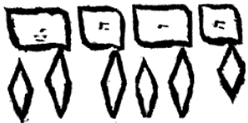

> הענין כי הספירות כמו שהם ממעלה למטה כסדרן כתר חכמה בינה גדולה גבורה תפארת נצח הוד יסוד ומלכות כך הם ממטה למעלה כתר חכמה וכו' כיצד כתר במלכות וחכמה ביסוד ובינה בהוד וגדולה בנצח וגבורה בת"ת ות"ת בגבורה ונצח בגדולה והוד בבינה ויסוד בחכמה ומלכות בכתר. וכדי שלא יקשה ענין זה בעיני המשכיל נמשיל לו משל נאה והוא כדמיון נצוץ השמש המתפשט ממקורו ומכה במראה הלטושה אז אורו מתהפך וחוזר אל מקורו וזהו הנקרא בין החוקרים אור המתהפך. וכן אנחנו כאשר רצינו לרמוז בשערינו אלה אל הסוד הזה קראנוהו בשם אור המתהפך או אור החוזר שהכל ענין אחד. ונחזור אל הכוונה שממש כדמיון האור הנז' כן דמיון האצילות כי הספי' שהם האצילות ומתפשטות ממעלה למטה כסדר הישר בספי' זהו שקראנוהו לפעמים בשערים אלה אור הישר והוא שהם מתפשטות כסדר הזה. וכן האור עושה, מצבו במלכות וחוזר אל מקורו עד הכתר ושם מצבו. וזהו נעוץ סופן בתחלתן ותחלתן בסופן כי כתר שורה במלכות ומלכות בכתר ולא זה בלבד אלא אף המלכות שבכתר חוזר ויורד למטה. ומנהגה כדרך האור הראשון עד שנעשה אור לאור ואור לאור עד אין תכלית והכל נעוץ סוף בראש וראש בסוף וזהו סוד ההויה ביושר וסוד ההויה בהפוך זה בסוד האור הישר וזה בסוד האור המתהפך כזה:

**15:1:5** The matter is hinted in the secret of Alef, which is Yod at the head and Yod at the end, thus:  

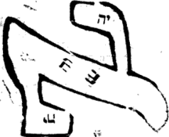

  
 And the secret is Yod at the head and Yod at the end, for the source of the light is always Yod. And from there the light flows: sometimes the Yod is above, and it is direct light, and source, and head; and sometimes the Yod is below, and it is reversing light, and the source of the returning light. And so their end turns out to be embedded in their beginning and their beginning in their end. And so Rashbi explained in the explanation of this Mishnah of Sefer Yetzirah, and these are his words in the Tikkunim (Tikkun 21, folio 60a): "And this stone is Yod at the head of Alef, and it is Yod at its end; of it is said (Isa. 46:10), 'declaring the end from the beginning'; and it is יו"ד ה"י וא"ו ה"י, including ten Sefirot, for their end is embedded in their beginning and their beginning in their end." Thus far its words.

> הענין נרמז בסוד א' שהוא יו"ד בראש ויוד בסוף כזה:
>
>  והסוד הוא יוד בראש ויו"ד בסוף כי מקור האור לעולם הוא יו"ד. ומשם האור נשפע פעמים היו"ד למעלה והוא אור ישר ומקור וראש. ופעמים היו"ד למטה והוא אור מתהפך ומקור אל האור החוזר. ונמצא נעוץ סופן בתחלתן ותתלתן בסופן. וכן פירש הרשב"י בפי' משנת ס"י זו וז"ל בתיקונים (תקונא כ"א ד"ס.) והאי אבנא איהו י' בריש א' ואיהו י' בסופה, עלה אתמר מגיד מראשית אחרית, ואיהי יו"ד ה"י וא"ו ה"י כליל עשר ספירן דאיהו נעוץ סופן בתחלתן ותחלתן בסופן עכ"ל.

**15:1:6** He intended in the name mentioned that the letters of the name are direct, יהו"ה, and the name reversed, הוה"י, and all is included in the ten letters that are in the filling of the name; and this is the matter of Alef, which is Yod at the head and Yod at the end. And it is "declaring from the beginning," which is Yod, in the secret of Chokhmah, and its tip, which is Keter; "the end," which is likewise Yod; and it is Chokhmah at the head and Chokhmah at the end. And after the matter has been explained in general and in brief, we come to decide the words of Rashbi, peace be upon him, in the Tikkunim [in the Introduction, folio 6a]: "'There is none holy like the Lord' (1 Sam. 2:2): the Cause over all, hidden and stored away in Keter; and from it the light spreads upon יהו"ה, which is: Yod, Chokhmah; He, Binah; Vav, including six Sefirot; He, Malkhut. And this is the spreading from above to below. And likewise its light spreads upon [the Yod of Adonai], from below to above, up to Ein Sof, which is hinted in אדנ"י: אי"ן, אנ"י. And therefore the two Yods of יאהדונה"י: ten, ten; the Kaf [of 'like the Lord']: this is the Kaf of Keter." Thus far its words. He taught explicitly our intent: that the direct light goes out and spreads from the source, which is Yod, to the end, which is He; and returns from the Yod of Adonai, which is Malkhut (for Adonai is a garment to YHVH, thus: יאהדונה"י, as we shall explain in the Gate of Names, chapter 13); and the name Adonai is the secret of the reversing light; for the name Adonai and the name הוה"י are all one matter and one hint. And this is the secret of אנ"י / אי"ן [*ani*, I / *ayin*, Nothing]: that is, *ani* is Adonai, in Malkhut, and *ayin* is in Keter; and all hints at "its end embedded in its beginning and its beginning in its end." And just as in the secret of Keter the Yod is over the He, so in *ayin* the Yod is over the Nun; for all is one hint and one matter. And just as in Malkhut the Yod is under the He, so in *ani* the Nun is over the Yod. And all is one: this in Chokhmah, which is Yod; Nun in Binah, which is He. And because two lights are unified in Keter, two measures in the Sefirah, ten from above to below and ten from below to above, therefore it is called Kaf [twenty], Keter. And this is "There is none holy like [*ka-*] the Lord," whose explanation is: Kaf, Keter, which is the spreading of the light from above to below and from below to above, as we explained.

> כיון בשם הנזכר היות האותיות השם ביושר יהו"ה והשם בהפוך הוה"י והכל נכלל בעשר אותיות שבמלוי השם והיינו ענין א' שהוא יו"ד בראש ויו"ד בסוף. והוא מגיד מראשית, שהוא יו"ד בסוד החכמה וקוצה שהוא הכתר. אחרית, שהיא יו"ד ג"כ. והוא חכמה בראש וחכמה בסוף. ואחר שנתבאר הענין בכלל ובקיצור נבא להכריע בדברי הרשב"י ע"ה בתיקונים [בהקדמה ד"ו.] אין קדוש כה' עלת על כלא טמיר וגניז בכתר ומניה אתפשט נהורא על יהו"ה דאיהו י' חכמה ה' בינה ו' כליל שית ספירן ה' מלכות. והאי איהו אתפשטותא מעילא לתתא ואוף הכי אתפשט נהוריה על [י' מן אדני] מתתא לעילא עד אין סוף דאתרמז באדנ"י אי"ן אנ"י. ובג"ד י"י מן יאהדונה"י עשרה עשרה הכ"ף דא כ' מן כתר עכ"ל. הורה בפי' על כוונתינו כי האור הישר יוצא ומתפשט מן המקור שהוא יו"ד עד הסוף שהוא ה'. וחוזר מי' של אדנ"י שהיא המלכות כי אדנ"י לבוש אל יהו"ה כזה יאהדונה"י כמו שנבאר בשער השמות בפ' י"ג ושם אדנ"י הוא סוד אור המתהפך כי שם אדנ"י ושם הוה"י הכל ענין אחד ורמז א'. וזהו סוד אנ"י אי"ן שהוא אני אדנ"י במלכות ואי"ן בכתר והכל רומז נעוץ סופו בתחלתו ותחלתו בסופו. וכמו שבסוד הכתר הי' על ה', כן באי"ן הי' על הן' כי הכל רמז אחד וענין א'. וכמו שבמלכות י' תחת ה', כן באנ"י נ' על היו"ד. והכל אחד זו בחכמה שהיא י' נ' בבינה שהיא ה'. ולהיות ששתי אורות מתייחדים בכתר ב' מדות שבספיר' י' מלמעלה למטה וי' ממטה למעלה לכן נקרא כ' כתר והיינו אין קדוש כה' שפירושו כ"ף כת"ר שהוא התפשטות האור ממעלה למטה וממטה למעלה כדפי'.

**15:1:7** And behold, in this much is included in little: that the Sefirot are ten from above to below, in the secret of the direct light, and likewise ten from below to above, in the secret of the reversing light, the returning light. And now we come in [the next] chapter to explain this matter even in some of the Sefirot.

> והנה בזה נכלל המרובה במיעוט, שהספי' הם עשר ממעלה למטה בסוד האור הישר וכן עשר ממטה למעלה בסוד האור המתהפך אור החוזר. ועתה נבא בפרק זה לבאר ענין זה אפי' בקצת הספי':

### Chapter 15:2. Explanation that "from above to below" befalls not only the ten sefirot in their totality, but also some of them relative to others.

**15:2:1** The intent in this chapter is to explain that the matter of this order is not only for all ten Sefirot in their totality, but also for some of them. How? If we wish to say nine from Keter to Yesod and nine from Yesod to Keter; and likewise eight from Hod to Keter and eight from Keter to Hod; and likewise seven from Chesed to Malkhut and seven from Malkhut to Chesed. And not this alone, but even in one Sefirah, as we shall explain. And all these aspects are explained in the Tikkunim, as we shall explain. And the reason for them is that just as there is the shining of the return of the light from Malkhut, so there is the return of the light from Yesod, and likewise from Hod, and likewise for all of them. And just as there is direct light from Keter, so from Chokhmah, so from Binah, so from Chesed; for each Sefirah is a source for all that is beneath it, and each Sefirah is a mirror in which the light of the upper one strikes and the light returns; until in this way the luminaries rise, direct and returning, without number, as the inquirer will understand with his intellect when he sets his heart to what is hinted. And now we come to explain this matter from within the words of Rashbi in the Tikkunim (Tikkun 18, folio 31b), and these are his words: "These go out, and Sagron closes the gate after them. Behold, the masters of the signs knock at the entrance and say (Ps. 51:17), 'Adonai, open my lips.' 'Open': this is Petachon. And these are the masters of the eighteen [*chai*] blessings of prayer, from the side of the Life [*Chai*] of the worlds, who unite the Holy One, blessed be He, and His Shekhinah there; for the Righteous One is ninth from above to below and from below to above: nine vowel-points, nine cantillation marks. And of them is said, 'And God set them in the firmament of the heaven' (Gen. 1:17): and this is the Righteous One, in which are all the vowel-points; 'to give light upon the earth': this is the Shekhinah, which is included of all the letters." Thus far its words.

> הכונה בפרק זה לבאר כי לא יהיה ענין סדר זה אל הספירות כל העשר בכללם לבד אלא גם אל קצתם. כיצד אם נרצה לומר תשע מכתר עד היסוד ותשע מיסוד עד הכתר וכן ח' מהוד עד כתר וח' מכתר עד הוד וכן ז' מחסד עד מלכות וז' ממלכות עד חסד ולא זו בלבד אלא אפי' בספירה אחת כאשר נבאר. וכל הבחינות האלה נתבארו בתקונים כאשר נבאר. והטעם אליהם הוא כי כמו שיש הארת חזרת האור מהמלכות, כן חזרת האור מהיסוד וכן מההוד וכן לכלם. וכמו שיש אור ישר מכתר כן מחכמה כן מבינה כן מחסד כי כל ספירה מקור לכל אשר תחתיה וכל ספירה היא מראה שבה מכה אור העליונה והאור חוזר עד שבדרך זה יעלו המאורות ישרים וחוזרים עד אין מספר כאשר יבין המעיין בשכלו כאשר יתן אל לבו אל הנרמז. ועתה נבא לבאר הענין הזה מתוך דברי הרשב"י בתיקו' (תקונא י"ח דף ל"א ע"ב) וז"ל אילין נפקין. וסגרו"ן סגר תרעא אבתרייהו הא מארי דאותות קא דפקין לפתחא ואמרין אדנ"י שפתי תפתח תפתח דא פתחו"ן ואלין אינון מארי דח"י ברכאן דצלותא מסטרא דח"י עלמין דמייחדין לקב"ה ושכינתיה תמן דצדיק תשיעאה איהו מעילא לתתא ומתתא לעילא ט' נקודין ט' טעמי. ועלייהו אתמר ויתן אותם אלקים ברקיע השמים ודא צדיק דביה כל נקודין, להאיר על הארץ דא שכינתא דאיהי כלילא מכל אתוון עכ"ל.

**15:2:2** And the explanation: there are righteous ones who depend [above], each one according to his deeds, according to the emanation of his soul from the Sefirot. How? Those whose Torah is their craft are called masters of Torah, and they are in Tiferet; and he who guards his covenant is called righteous; and those who stand in prayer in the Amidah are called masters of the legs. And they depend above, each one according to his place and the order of his service in this world, as he said above in the matter, that the righteous enter above in their prayer according to their deeds. And he said that at their going out the angel appointed over the closing and locking of the gates of the palace closes the doors, until the masters of the signs come to pray. This name is in the Righteous One, called "sign." And he called them masters of the signs because the Righteous One is called "sign," and now the intent is to explain the matter of Yesod; therefore he called them masters of the signs. And the angel appointed over the opening, called Petachon, opens the palace of the King for them. And he said that they are the masters of the eighteen blessings, which are in the Righteous One, called "the Life of the worlds," after the eighteen [lives] that depend on it. And he said that in the Amidah they unite the Holy One, blessed be He, and His Shekhinah through the Righteous One, which unites them and binds them, as is known. "For the Righteous One is ninth": explanation: how are there eighteen in the Righteous One? And he says that they are nine from below to above and nine from above to below. And one cannot say that the matter is that when we reckon and count the Sefirah from above to below it will be nine, and when we count from below to above it will be nine; for if so they would never amount to more than nine; and how does he count eighteen? Rather, certainly Yesod is in the secret of the direct light and the returning light. And like the matter of Malkhut for the count of ten, so Yesod for the count of nine, and likewise Hod for the count of eight. And these do not resemble those; for each and every number is a secret by itself and an aspect by itself, just as the direct light and the returning light are not one matter. And the reason is that the direct light is the secret of the principal light, a foundation established in the Emanation; but the secret of the reversing light does not shine in the secret of the direct light. Like the ray of the sun: what returns from its power does not resemble its own self; for the returning one is one of its offshoots, by reason of one of the receivers, and the direct ray is the very self of the ray itself; and in this way we compare it in the Emanation. And just as the light in its return from within lanterns and the mirror that does not shine does not resemble its return from within a bright mirror, "whose form is sapphire" (Lam. 4:7), so is the matter in the secret of the return of the light from Malkhut or from Yesod and the like. And likewise the change of the light according to the change of the colors in the mirror that receives the ray and returns its light to its original source. And these are distinctions in the aspects of the lights, besides another distinction that there is between the direct and the returning, as we shall explain.

> ופי' כי יש צדיקים תלויים כל א' וא' לפי מעשיו לפי אצילת נשמתו מהספירות. כיצד, מי שתורתן אומנתן קרוין מארי תורה והם בת"ת, והשומר בריתו קרוי צדיק, והעומדים בתפלה בעמידה קרוין מארי דרגלין. והם תלויין למעלה כל א' לפי מקומו וסדר עבודתו בעוה"ז כאמרו למעלה מן הענין כי הצדיקים נכנסים למעלה בתפילתם לפי מעשיהם. ואמר שביציאתן המלאך הממונה על סגירת ונעילת שערי היכל סוגר הדלתות עד אשר באים להתפלל מארי דאותות השם הזה הוא בצדיק הנקרא אות. וקראם מארי דאותות כי הצדיק נקרא אות ועתה הכונה לבאר בענין היסוד לכן קראם מארי דאותות. ומלאך הממונה על הפתיחה הנקרא פתחו"ן פותח להם היכל מלך. ואמר שהם בעלי ח"י ברכות שהם בצדיק הנקרא ח"י העולמים ע"ש ח"י [החיים] התלוים בו. ואמר כי בעמידה מייחדים קב"ה ושכינתיה ע"י הצדיק המיחד אותן וקושר אותם כנודע. דצדיק ט' איהו. פי' כיצד בצדיק הם ח"י, ואומר כי הם ט' ממטה למעלה וט' ממעלה למטה. ואין לומר שהענין הוא כשנחשוב ונמנה הספירה ממעלה למטה יהיו ט' וכשנמנה ממטה למעלה יהיו ט' שא"כ לעולם אינם עולים יותר מתשע וכיצד מונה י"ח. אלא ודאי היסוד הוא בסוד אור היש"ר ואור החוזר. וכענין המלכות למנין עשר כן היסוד למנין ט', וכן ההוד למנין ח'. ואינם דומים אלה לאלה כי כל מספר ומספר הוא סוד בפני עצמו ובחינה בפ"ע. כמו שאין האור הישר ואור החוזר ענין א'. והטעם כי האור הישר הוא סוד האור העיקר יסוד מוסד באצילות אמנם סוד אור המתהפך אינו מאיר בסוד אור הישר. כדמיון נצוץ השמש שלא ידמה החוזר מכחו אל עצמותו, כי החוזר תולדה אחת מתולדותיו בסבת אחד מהמקבלים, וניצוץ הישר הוא עצם הנצוץ בעצמו, ועד"ז נקיש באצילות. וכמו שלא ידמה האור בחזרתו מתוך העששיות והמראה שאינה מאירה אל חזרתו מתוך מראה בהירה ספיר גזרתה, כן הענין בסוד חזרת האור מהמלכות או מהיסוד וכיוצא בו. וכן שנוי האור לפי שנוי הגוונים במראה המקבלת הניצוץ וחוזרת אורה אל מקורה הקדמון. ואלה הם חלוקים בבחינות האורות בזולת חילוק אחר שיש בין הישר והחוזר כאשר נבאר.

**15:2:3** And a further proof for the matter in the Tikkunim (Tikkun 18, folio 34), and these are its words: "And six constellations are from above to below, from Chesed to Yesod, and six from below to above, from Yesod to Chesed. From the side of Malkhut they are called the seven planets," etc. Thus far its words.

> ועוד ראיה אל הענין בתקונים (תקונא י"ח דף ל"ד) וז"ל, ושית מזלות אינון מעילא לתתא מחסד עד יסוד, ושית מתתא לעילא מיסוד ועד חסד. מסטרא דמלכות אתקריאו ז' כוכבי לכת וכו' עכ"ל.

**15:2:4** And behold, in this passage Rashbi counted six from Chesed to Yesod and six from Yesod to Chesed. And if it is not as we said, how are they twelve? They are only six. Rather, certainly as we explained; and that is in the secret of the direct light and the returning light, whose matter is not one, as we explained. And in this way also he further counted seven from Chesed to Malkhut; and if not in the way we explained, that "from the side of Malkhut" is the light returning from Malkhut up to Chesed, then the seven planets would turn out to be the six constellations, and all one. Rather, certainly as we explained. And because the light returning from Malkhut is not of the rank of the light returning from Yesod, therefore they are seven planets, which receive from the twelve constellations, as is known; and likewise Yesod pours effluence into Malkhut, and Malkhut receives from it. And with this preliminary what is explained in the Tikkunim (Tikkun 18, folio 33) concerning the union will be understood, and these are its words: "Come and see: יהו"ה אדנ"י: they are the Holy One, blessed be He, and His Shekhinah, in the two thighs: YHVH to the right, Adonai to the left; and they are the speculum that shines and the speculum that does not shine. In the Righteous One the two of them are one, יאהדונה"י. [And so in the two arms: YHVH to the right, Adonai to the left; in the central pillar יאהדונה"י.] The two of them in one union, in the secret of אמ"ן [Amen]; and therefore greater is the one who answers Amen than the one who blesses. Behold, this is from below to above. From above to below: יהו"ה אהי"ה, the two of them as one in the Supernal Keter, in this way: יאההויה"ה; in Chokhmah and Binah, YHVH, Ehyeh; in the two arms, YHVH, Ehyeh; in the central pillar the two of them as one; in Netzach and Hod, YHVH, Ehyeh, this to the right and this to the left; in the Righteous One the two of them in union as one; and likewise in Malkhut," etc. Thus far its words. And he dwelt at length there on things like this a great deal. And the intent is as we explained in the Gate of Essence and Governance, chapter 23: that the matter of coupling, as it is in Tiferet and Malkhut, so it is in Chokhmah and Binah, as explained there. And from the side of the coupling of Chokhmah and Binah the effluence flows to Tiferet and Malkhut, and the ray rises up above. And therefore, from above to below, to the right is the four-letter name, which is Chokhmah, and the name Ehyeh, which is Binah, to the left; and by way of the middle line they are unified; for Binah pours effluence by way of the left and Chokhmah by way of the right, and the middle is what makes the two extremes equal, as explained. But in the ascent, by way of the returning line, a ray rises from Tiferet and Malkhut by way of the grades: Tiferet to the right and Malkhut to the left, for this is the way of their ascent; and in the middle they are all unified in union. And we have already dwelt there on the explanation of this passage, in brief. And with the preliminary of the returning light that we have explained, further words of Rashbi in the Tikkunim will be understood, which at first glance contradict one another. In one place (in Tikkun 49, folio 83) he said that Shin is in Binah, the root of the tree; and elsewhere (in Tikkun 69, folio 107) he said that Shin below is the root of the tree in Malkhut, and likewise the lower He. And now it is difficult: if Shin, the root of the tree, is above in Binah, it is not below in Malkhut; and if it is below in Malkhut, it is not above in Binah. Rather, certainly, although the whole Emanation is one, unified, nevertheless in the aspect of the two lights mentioned they are two. There is a tree whose roots are above, in the upper source, and that is direct light, whose six branches spread out below; and there is a tree whose root is below, in the secret of the reversing, returning light, and whose six branches spread out above.

> והנה במאמר הזה מנה רשב"י שש מחסד עד יסוד ושש מיסוד עד חסד. ואם אינו כמו שאמרנו, כיצד הם י"ב אינם אלא שית. א"ו כדפרישית, והיינו בסוד אור הישר ואור החוזר שאין עניינם אחד כדפי'. ועד"ז ג"כ מנה עוד ז' מחסד עד מלכות ואם לא על דרך שפי' דמסטרא דמלכות היינו אור החוזר ממלכות עד החסד א"כ נמצאו כי ז' כוכבי לכת הם שש מזלות והכל אחד א"ו כדפי'. ולהיות כי האור החוזר ממלכות אינו כמעלת האור החוזר מהיסוד לכן הם ז' ככבי לכת שהם מקבלים מי"ב מזלות כנודע. וכן היסוד משפיע במלכות והמלכות מקבלת ממנו. ובהקדמה זו יובן מה שנתבאר בתיקונים (תקונא י"ח דף ל"ג) בענין היחוד וז"ל ת"ח יהו"ה אדנ"י אינון קב"ה ושכינתיה בתרין שוקין יהו"ה לימינא אדנ"י לשמאלא ואינון אספקלריא המאירה ואספקלריא שאינה מאי' בצדיק תרווייהו חד יאהדונה"י [והכי בתרין דרועין. הוי"ה לימינא אד' לשמאלא בעמודא דאמצעיתא יאהדונה"י] תרווייהו ביחודא חדא בסוד אמ"ן, ובג"ד גדול העונה אמ"ן יותר מן המברך. הא איהו מתתא לעילא. מעילא לתתא, יהו"ה אהי"ה תרווייהו כחדא בכ"ע כגוונא דא יאההויה"ה בחכמה ובינה יהו"ה אהי"ה. בתרין דרועין יהו"ה אהי"ה בעמודא דאמצעיתא תרווייהו כחדא. בנצח והוד יהו'ה אהי"ה דא לימינא ודא לשמאלא. בצדיק תרוייהו ביחודא כחדא וכן במלכות וכו' עכ"ל. וכיוצא בזה האריך שם הרבה. והכונה כמו שבארנו בשער מהות והנהגה פכ"ג כי ענין הזווג כמו שהוא בת"ת ומלכות כן הוא בחכמה ובינה כמבואר שם. ומצד זווג החכמה ובינה שופע השפע אל תפארת ומלכות. והניצוץ עולה עד למעלה ולפיכך ממעלה למטה אל הימין שם בן ד' שהוא חכמה ושם אהיה שהוא בינה אל השמאל ודרך קו האמצעי מתיחדים כי הבינה משפעת דרך השמאל והחכמה דרך הימין והאמצע היא המשוה שני קצוות כמבואר. אמנם בעליה דרך הקו החוזר יעלה מת"ת ומלכות ניצוץ דרך המדרגות, הת"ת אל הימין והמלכות אל השמאל כי זה דרך עלייתם. ואל האמצעי מתיחדים כלם ביחוד. וכבר הארכנו שם בביאור המאמר הזה בקצרה. ועם הקדמת האור החוזר שביארנו יובנו עוד דברי הרשב"י בתקונים שהם לכאורה סותרים אלו לאלו, במקום אחד (בתקונא מ"ט דף פ"ג) אמר כי ש' הוא בבינה שרש האילן, ובמ"א אמר (בתקונא ס"ט דף ק"ז) כי ש' לתתא שורש האילן במלכות וכן ה' תתאה. ועתה קשה אם ש' שרש האילן למעלה בבינה אינו למטה במלכות ואם הוא למטה במלכות אינו למעלה בבינה. א"ו עם היות שכל האצילות אחד מיוחד עכ"ז בבחינת שתי האורות הנזכר הם שנים. יש אילן ששרשיו למעלה במקור העליון והיינו אור ישר שענפיו שית מתפרדין למטה, ויש אילן ששרשו למטה בסוד אור המתהפך החוזר וענפיו שית מתפרדין לעילא.

**15:2:5** And the matter of his saying "Shin, the root of the tree": for Shin has in it three branches, in the secret of three lines, the line of Din, the line of Rachamim, the line of Chesed; and this is literally He, which is three Vavs, as we explained in the preceding gate. And after we have included much in little in this chapter, we come to explain the matter of the returning light itself and the need for it:

> וענין אמרו ש' שרש האילן, שכן ש' בה ג' ענפים בסוד ג' קווים קו הדין קו הרחמים קו החסד, והיינו ממש ה' שהיא ג' ווים כדפי' בשער הקודם. ואחר שכללנו המרובה במעט בפ"ז, נבא לבאר ענין אור החוזר בעצמו והצורך אליו:

### Chapter 15:3. Explanation of the essence apprehended in "returning light" (*or chozer*) or "the reversing light" (*mit'hapekh*), and its cause; and there, the Mishnah of Sefer Yetzirah, "male in Aleph-Mem-Shin, female in Aleph-Shin-Mem."

**15:3:1** Now this is our intent: to explain the secret of the returning light from the side of its essence and its cause. And the matter is that the male, upper, always pours forth compassion, and the female, lower, receives judgment. And these four things are held to one another, that is to say: first, male or female; second, judgment or compassion; third, upper or lower; fourth, giving effluence or receiving effluence. And this thing will be understood in the secret that we explained in the Gate of Channels, chapter 1: that the light that rises, etc., is like the light that goes out from the eye, as explained there at length. And therefore, when Malkhut receives from the ten, behold, her face is turned to receive from all of them in the secret of their direct light; and she turns her face upward, and the name becomes ההו"י. And the upper male pours forth in order and in directness: it is the name יהו"ה. And this is the reason that the name in directness is compassion: because it is male, giving effluence in the order of the grades as they should be, this giving effluence to this. And Malkhut is the name in reversal of letters, thus: הוה"י, female, receiving. And therefore Rashbi, peace be upon him, said (in the Introduction, folio 3a): "Every *havayah* in which He rules over Vav, He over Yod, is female and is judgment": because the males are below the females; for the two Hes are females, Vav and Yod are males.

> עתה זה כונתנו לבאר סוד האור החוזר מצד מהותו וסבתו. והענין הוא כי לעולם הזכר עליון משפיע רחמים והנקבה תחתון מושפעת דין. וד' דברים אלה הם אחוזים זה בזה. ר"ל א' זכר או נקבה, ב' דין או רחמים, ג' עליון או תחתון, ד' משפיע או מושפע. והדבר הזה יובן בסוד שפי' בשער הצינורות פ"א היות אור העולה וכו' כדמיון האור היוצא מן העין כמבואר שם בארוכה. ולכן בהיות המלכות מקבלת מהעשר הנה פניה מועדות לקבל מכלם בסוד אורם הישר והיא הופכת פניה כלפי מעלה ונעשה שם ההו"י. והזכר העליון משפיע בסדר וביושר הוא שם יהו"ה. וזה טעם שהשם ביושר רחמים מפני שהוא זכר משפיע בסדר המדרגות כהלכתן זו משפעת לזו. והמלכות השם בהפוך האותיות כזה הוה"י נקבה מקבלת. ולכן אמר הרשב"י ע"ה (בהקדמה דף ג'.) כל הוי"ה דשלטא ה' על ו' ה' על י' נוקבא איהי ודינא איהי. מפני שהזכרים למטה מהנקיבות כי ה"ה הם נקבות ו"י הם זכרים.

**15:3:2** And behold, when the female turns her face to receive, she certainly does not pour forth; and when the male pours forth, he does not receive. And so they said in the book of the Zohar and in Sefer ha-Bahir that a man is forbidden to remain with his hands raised in prayer more than three hours. And the reason is that the raising of the hands indicates pouring forth, as in the matter (Lev. 9:22) "And Aaron lifted up his hands toward the people and blessed them," as explained in the Zohar, Parashat Yitro (folio 67). And because Malkhut is called "hour," and she receives from three lines [in three hours], behold, her pouring forth is three hours only; and if a man raises his hands longer, he is endangered. Because while the ten Sefirot pour forth they do not receive; and if so, one must wait until they receive, so that they may pour forth. And this is the reason for (Exod. 17:11) "and when he let down his hand, Amalek prevailed."

> והנה בהיות הנקבה חוזרת פניה לקבל אינה משפעת ודאי ובהיות הזכר משפיע אינו מקבל. וכן אמרו בספר הזהר ובספר הבהיר שאסור אדם להתעכב בנשיאות ידיו בתפלה יותר מג' שעות. והטעם כי נשיאות הידים מורה על ההשפעה כענין וישא אהרן את ידיו אל העם ויברכם כמבואר בזוהר פ' יתרו (ד"סז). ומפני שהמלכות נקרא שעה והיא מקבלת מג' קוים [בג' שעות] הנה השפעתה ג' שעות בלבד ואם ירים אדם ידיו יותר יסתכן. מפני שבעוד שעשר ספי' משפיעות אינם מקבלות וא"כ צריך להתעכב עד שיקבלו כדי שישפיעו וזהו סבה (שמות יז יא) וכאשר יניח ידו וגבר עמלק [לד].

**15:3:3** Behold, a clear proof that while the Sefirot pour forth they do not receive, and while the Sefirot receive they do not pour forth. And even if somewhat to the contrary of this is found in the Zohar, in its saying "the Shekhinah in the lower ones," and all the details of this inquiry found in the Zohar, it is possible to say that this is specifically near its pouring forth, not while it is pouring forth. However it may be: because the secret of the *havayah* in reversal is the secret of the turning of the face from below to above, to receive, and it does not pour forth, this is the reason that it is judgment and it is female; and likewise the male who pours forth is compassion. And indeed, concerning the four-letter name in reversal, something close to this is found in one of the writers of secrets, of blessed memory: "Know that just as there are ten inner Sefirot, from which the good comes to Israel, so there are ten outer Sefirot that stand against them; and when Israel commit transgressions, they act according to the evil that Israel do, God forbid. And you, son of man, see also with the eye of your intellect: you already know that the Unique Name stands in four Sefirot: for the Yod stands in the Sefirah of Chokhmah, and He in Binah, Vav in Tiferet, He in Malkhut. And when Israel do the will of the Omnipresent and His commandments, then the attribute of compassion is clothed over the attribute of judgment: for the Yod that is in Chokhmah indicates compassion, and it is clothed over the He that is in Binah, which indicates the attribute of judgment; and likewise the Vav that is in Tiferet, indicating the attribute of compassion, is clothed over the He that is in Malkhut; and then the whole world is in peace, and He has compassion on His children as a father has compassion on his children. And if, God forbid, Israel do the opposite, then the attribute of compassion turns into the attribute of judgment: for the He that is in Malkhut is clothed over the Vav of Tiferet, and likewise the He that is in Binah is clothed over the Yod that is in Chokhmah, which indicates the attribute of judgment. And know that when the Yod begins the name, and afterwards He, He, then it indicates the attribute of compassion; and likewise the Vav, when it begins and afterwards He, He, it indicates compassion; and when one of the two Hes begins, then they indicate judgment." Thus far his words.

> הנה ראיה מבוררת כי בעוד שהספירות משפיעות אינם מקבלות ובעוד שהספירות מקבלות אינם משפיעות. ואף אם ימצא מנגד לזה קצת בזהר באמרו שכינה בתחתונים וכל פרטי הדרוש הזה הנמצא בזהר, אפשר לומר כי זה דוקא סמוך להשפעתו לא בעוד שהיא משפעת. איך שיהיה מפני שסוד ההויה בהפוך הוא סוד חזרת הפנים ממטה למעלה לקבל ואינה משפעת זו היא סבה שהיא דין והיא נקבה וכן הזכר המשפיע הוא רחמים. ואולם בשם בן ד' בהפוך נמצא קרוב לזה לאחד מכותבי סודות ז"ל דע כי כמו שיש ע"ס פנימיות אשר הטוב בא מהם לישראל ג"כ יש י"ס חיצונות שעומדין כנגדם וכשישראל עושין עברות הם פועלות כפי הרע שישראל עושין ח"ו. ואתה בן אדם ראה גם בעין שכלך כבר ידעת כי בד' ספירות עומד השם המיוחד כי הי' עומדת בספי' חכמה וה' בבינה ו' בת"ת ה' במלכות. וכשישראל עושין רצונו של מקום ומצותיו אז מתלבשת מדת רחמים על מדת הדין כי היו"ד שבחכמה מורה על הרחמים ומתלבש על הה' שבבינה שמורה על מדת הדין וכן ו' שבת"ת מורה על מדת הרחמים מתלבש על ה' שבמלכות ואז העולם כלו בשלום ומרחם על בניו כרחם אב על בנים. ואם ח"ו ישראל עושין להיפך אז מתהפך מדת רחמים למדת הדין כי ה' שבמלכות מתלבשת על הו' של הת"ת וכן ה' שבבינה מתלבש על היוד שבחכמה שמורה על מדת הדין. ודע לך כי כשהיו"ד מתחלת השם ואח"כ ה"ה אז מורה מדת רחמים וכן הו' כשמתחלת ואחר כך ה"ה הוא מורה על רחמים, וכשמתחלת אחת מן הב' ההין אז מורות על הדין עכ"ל.

**15:3:4** And there is no doubt that in what he said at the beginning of his words, "just as there are inner Sefirot," etc., "so there are outer Sefirot," his intent is not the husks, since he concludes with the name in reversal of letters. Rather, certainly, the intent is the returning light, which raises the compassion in the secret of receiving; and this is the secret of the reversal in the letters. And needless to say [it holds] in the letters of the whole name, that this matter is so, as explained above; but even in two letters, such as Yod-He or He-Yod, and likewise Vav-He or He-Vav, as that young scholar explained. And so it is explained in the Tikkunim, as we shall explain in chapter 5. And likewise this principle is explained in Sefer Yetzirah, the last Mishnah of chapter 3, and these are its words: "He made Alef king over air [*ruach*], and bound a crown to it, and combined them one with another, and formed with them the air [*avir*] in the world, moisture in the year, and the body in the soul: male in Alef-Mem-Shin and female in Alef-Shin-Mem. He made Mem king over water, and bound a crown to it, and combined them one with another, and formed with them earth in the world, cold in the year, and the belly in the soul, male and female: male in Mem-Alef-Shin, female in Mem-Shin-Alef. He made Shin king over fire, and bound a crown to it, and combined them one with another, and formed and sealed with them heaven in the world, heat in the year, and the head in the soul, male and female: male in Shin-Mem-Alef and female in Shin-Alef-Mem." Thus far its words.

> ואין ספק שמה שאמר בתחלת דבריו באמרו כמו שיש ספי' פנימיות וכו' כן יש ספירות חיצוניות, שאין כונתו בקליפות משום דמסיק בהשם בהפוך אתוון. אלא ודאי הכונה על האור החוזר המעלים הרחמים בסוד הקבלה וזהו הסוד ההפוך באותיות. ואין צריך לומר באותיות השם כלו שיהיה הענין הזה כמבואר לעיל, אלא אפי' בב' אותיות כגון י"ה או ה"י וכן ו"ה או ה"ו כמו שפי' האי צורבא מרבנן. וכן מבואר בתקונים כמו שנבאר בפ"ה. וכן נתבאר העיקר הזה בס"י משנה אחרונה שבפ"ג וז"ל המליך א' ברוח וקשר לו כתר וצרפן זה בזה וצר מהן אויר בעולם רויה בשנה וגוייה בנפש זכר באמש ונקבה באש"ם. המליך מ' במים וקשר לו כתר וצרפן זה בזה וצר בהן ארץ בעולם קור בשנה ובטן בנפש זכר ונקבה זכר במא"ש נקבה במש"א. המליך ש' באש וקשר לו כתר וצרפן זה עם זה וצר וחתם בהם שמים בעולם חום בשנה וראש בנפש זכר ונקבה זכר בשמ"א ונקבה בשא"ם עכ"ל.

**15:3:5** And behold, in this Mishnah all our intent is explained, and this is its explanation. And before all else it is fitting for the inquirer to understand what we shall write in the Gate of Particulars of Names concerning the matter of the formation of man by means of the rolling of the letters and their permutation; and there we shall explain at length the matter of "He made such-and-such a letter king and bound a crown to it." And nevertheless we shall not withhold our hands from explaining here what suffices for the understanding of the Mishnah. And the matter is that the letters are branches branching out from the names, that is to say, powers emanated from the very self of the Sefirot, like those who dwell "in the clefts of the rock, the height of their dwelling" (Obad. 1:3), as we shall dwell at length in the Gate of Letters. And because the powers do not perform their action except through their combination with their sources, and in their return and binding to their source much effluence flows upon them to perform their action with strength, as we shall dwell at length in explaining them in the Gate of Particulars of Names, therefore it was necessary for the formation that it be through the branches unified with their sources, that is, the Sefirot. And the letters, which are branches branching out from them: when they are unified with the root and the powers return to their source, then their action is complete and good. And because the sources of the letters include ten Sefirot, as we shall dwell at length in the Gate of Letters, therefore, to strengthen their power for creation, each and every branch was unified with its source. And this is what he meant in saying "He made the letter Alef king," or Mem, or Shin; and likewise for the seven doubles, Bet Gimel Dalet Kaf Pe Resh Tav; and likewise for the twelve simples, He Vav Zayin Chet Tet Yod Lamed Nun Samekh Ayin Tzadi Kof. And the explanation of "He made king": He unified that letter and that spiritual branch with Malkhut; and afterwards "He bound a crown to it." And "bound" [קש"ר]: explanation: *teki'ah*, *shevarim*, *teru'ah*, which are the three fathers, Chesed, Gevurah, Tiferet, with their branches, Netzach, Hod, Yesod, and with their fathers, which are Chokhmah, Binah, Keter. And this is the "crown" explicitly mentioned in the Mishnah; for the first three are included in the name Keter, as they are included in the name Nothing; and likewise the three of them are a crown to the three lines, Chesed, Din, and Rachamim. And according to all the explanations, the intent is to unify the letter in its root, which is the Sefirot. And he said Alef with air, and Shin with fire, and Mem with water: the intent is that Alef-Mem-Shin hints at Yod-He-Vav. For the Yod is Chokhmah, for Chokhmah is the root of the waters of Chesed; and likewise He is in Binah, and likewise Shin is in Binah, the root of fire, which is the root of judgment, in the way we explained in the Gate of Essence and Governance, chapter 25; and the Vav is in Keter, in the secret of Da'at, as we explained in the Gate of Manifestations, chapter 6; and likewise the Alef, for Keter is the root of the air that arbitrates between the extremes, as we explained in the Gate of Arbiters. And therefore, when we wish to unify the branch, we unify it in its root, unified in its ten Sefirot. And this is what he meant in saying "He made Alef king over air, Mem over water, and Shin over fire": for the union and the binding is to unify the branch in the root particular to it, whether Chesed, whether Din, whether Rachamim, and in its ten Sefirot that are found for it according to its nature. And after the union in the branches, it needs further to receive from the other sources themselves, so as to be included of Chesed, Din, and Rachamim; and for this he said "and combined them one with another," which refers back to the letters Alef-Mem-Shin mentioned from the beginning of the chapter until here. And through the combination the powers are unified with a true and complete union, and the lower rolls and rises, and the upper descends, until the thing becomes an inclusive *havayah*. And for this, after the union of the branch in its root with its ten Sefirot, it had to be unified in three powers, which are Alef-Mem-Shin, which include the whole Emanation; and this is "and combined them one with another"; and then that manifestation was formed and emanated and brought into being in three places, which are world, year, soul [עש"ן], as we shall explain them at length in the Gate of Particulars of Names, on the name of seventy-two. And through their spiritual formation they were formed in the corporeality of these worlds. And because the Alef is head to the *havayah* and the principal of the form that is formed (for the principal of the manifestation is from the air, and the fire and the water are mere assistance, like the likeness of a composition, but the prevailing is from the air), therefore, both in the male and in the female, the Alef comes at the head of the combination, and the water and the fire are lower. And for the reason that the male is from above to below, the Mem, which is the water, comes over the Shin, which is the fire, as is their way, for the right is always over the left; and this is אמ"ש, which is וי"ה: Vav [and] Yod over He. And when the female comes, she comes from below to above, which is אש"ם: the Shin, which is the fire, over the Mem, which is the water; and this is אש"ם, fire over water, the left over the right, as is the way of the female, which is וה"י, which is He above Yod. The female is always the opposite of the male, for the male pours forth and the female receives; and therefore the female is judgment. And when He made the letter Mem king, which is the principal of the water, therefore both in the male and in the female the Mem comes first, and it is what prevails in the composition; for the attribute of (the day) [the water] is always determinative, and therefore the principal of the attribute prevails; and of the two attributes, which are the air and the fire, either this prevails or that. The male in מא"ש: the Alef, which is the air, over the Shin, which is the fire; and he made compassion prevail over judgment, as is the way of the male, to incline it to the right in compassion: Alef over Shin, which is Vav over He, male over female. And the female comes from below to above: the female in מש"א made the fire prevail over the air, the judgment over the compassion, He over Vav, making judgment prevail over compassion and turning upward; for the male pours forth and the female receives. And when He made the letter Shin king, which is the fire in the strength of judgment, the male came in שמ"א; for the principal always prevails, according to what is the principal element, both in the male and in the female. And therefore the Shin prevails both in the male and in the female; but the other letters of the composition were divided in disagreement: for the male made the element of water, which is the Mem, prevail over the element of air, which is the Alef, that is, הי"ו; for the He prevails, because it is the element of fire, as explained; but it is Yod over Vav. And the reason is that although the Vav, which is the air, which is the Alef, is compassion, nevertheless it is mediated compassion, and the compassion of Chesed is complete compassion; and therefore he chose the right for himself and made it prevail over the mediation, as is the way of the Yod, which is always over Vav. But the female comes in שא"ם: she made the element of air prevail over the water, and inclined it toward the fire; and so the letters are found in her from below to above, as is her way, the opposite of the male; for the female makes the air prevail over the water and turns upward, and the male pours forth and turns downward; and therefore the female comes in שא"ם, which is הו"י: the letters reversed, turning upward to receive. Thus far reaches the explanation of the Mishnah; and from within it is explained the matter of the reversal even in two letters, as explained above.

> והנה במשנה זו מבוארת כל כונתינו. וזה פירושו. וקודם כל דבר ראוי אל המעיין להשכיל במה שנכתוב בשער פרטי השמות מענין יצירת האדם על ידי גלגול האותיות וצירופם ושם נבאר בארוכה ענין המליך אות פלונית וקשר לו כתר. ועכ"ז לא נשיב ידינו מלבאר הנה מה שיספיק אל הבנת המשנה. והענין כי אותיות הם ענפים מסתעפים מהשמות ר"ל כחות אצולים מעצמות הספירות כשוכנים בחגוי סלע מרום שבתם כמו שנאריך בשער האותיות. ולהיות כי הכחות אינם פועלים פעולתם אלא ע"י צירופם אל מקוריהם ובחזרתם והתקשרם אל מקורם יושפע עליהם רב שפע לפעול פעולתם בחוזק כאשר נאריך ביאורם בשער פרטי השמות. לפיכך הוצרך אל היצירה שיהיה על ידי הענפים המתיחדים אל מקוריהם דהיינו הספירות. והאותיות שהם ענפים המסתעפים מהם בהתיחדם עם השרש וחזרת הכחות אל מקורם אז פעולתם שלימה וטובה. ולהיות מקורי האותיות כוללים י"ס כאשר נאריך בשער האותיות, לזה לחזק כחם אל הבריאה נתיחד כל ענף וענף אל מקורו. וזה רצה באמרו המליך אות א' או מ' או ש', וכן לז' כפולים בג"ד כפר"ת, וכן לי"ב פשוטות הו"ז חט"י לנ"ס עצ"ק. ופי' המליך, ייחד אותה האות ואותה הענף הרוחני אל המלכות ואח"כ וקשר לו כתר. וקשר פי' תקיעה שברים תרועה שהם ג' אבות חג"ת עם ענפיהם נצח הוד יסוד ועם אבותיהם שהם חכמה בינה כתר. והיינו כתר הנזכר בפי' במשנה כי ג"ר כלולות בשם כתר כענין שכלולות בשם אי"ן וכן שלשתם כתר לג' קוין חסד דין ורחמים. ולכולהו פי' הכונה ליחד האות בשרשו שהם הספי'. ואמר א' ברוח וש' באש ומ' במים, הכונה כי אמ"ש רמיזת' יה"ו כי היוד הוא חכמה כי החכמה שורש למימי חסד. וכן ה' היא בבינה וכן ש' הוא בבינה שרש האש שהוא שורש הדין ע"ד שפי' בשער מהות והנהגה פכ"ה. והוא"ו הוא בכתר בסוד הדעת כדפי' בשער המציאות פ"ו. וכן האל"ף, כי הכתר שרש לאויר המכריע בין הקצוות כמו שפי' בשער המכריעין. ולכן כאשר נרצה ליחד הענף נייחד אותו בשרשו המיוחד בעשר ספירותיו. וזה רצה באמרו המליך א' ברוח מ' במים וש' באש, כי היחוד והקשר הוא לייחד הענף בשרשו המיוחד לו אם חסד אם דין אם רחמים ובעשר ספירותיו הנמצאים לו לפי טבעו. ואחר היחוד בענפים צריך עוד לקבל משאר המקורות עצמן להיותו כלול מחסד דין ורחמים ולזה אמר וצרפן זה בזה שהוא חוזר אל האותיות אמ"ש הנז' מראש הפרק עד כאן. וע"י הצירוף יתייחדו הכחות יחוד אמיתי ושלם ויתגלגל ויעלה התחתון וירד העליון עד ישוב הדבר הוייה כוללת. ולזה אחר היחוד של הענף בשרשו עם עשר ספירותיו הוצרך להיות מתיחד בג' כחות שהם אמ"ש הכוללים כל האצילות וזהו צרפן זה בזה, ואז היה נוצר ומתאצל ומתהווה המציאות ההוא בג' מקומות שהם עש"ן כאשר נבארם בארוכה בשער פרטי השמות בשם ע"ב. וע"י ציורם ברוחניות היו מצטיירים בגשמות העולמים הזה. ומפני שהא' הוא ראש להויה ועיקר לצורה המצטיירית, כי עיקר המציאות הוא מהרוח, והאש והמים סיוע בעלמא כדמות הרכבה, אבל התגבורת הוא מהרוח, לכן בין בזכר בין בנקבה בא הא' בראש הצרוף והמים והאש תחתונים. ומטעם היות הזכר ממעלה למטה באה המ' שהם המים על הש' שהוא האש כדרכם כי הימין לעולם על השמאל וזהו אמ"ש שהוא וי"ה ו"י על ה'. וכשבאה הנקבה באה ממטה למעלה שהוא אש"ם, הש' שהיא האש על המ"ם שהוא המים וזהו אש"ם אש על המים השמאל על הימין כדרך הנקבה שהוא וה"י שהוא ה' למעלה מי'. לעולם הנקבה הפך הזכר כי הזכר משפיע והנקבה מקבלת ולכן הנקבה דין. וכאשר המליך אות מ' שהוא עיקר המים לכן בין בזכר בין בנקבה המ' קודמת והיא הגוברת בהרכבה כי לעולם מדת (היום) [המים] גורמת ולכן גוברת עיקר המדה ושתי המדות שהם האויר והאש או זה יגבר או זה הזכר במא"ש שהיא הא' שהוא האויר על הש' שהוא האש והגביר הרחמים על הדין כדרך הזכר לנטותו אל הימין ברחמים א' על ש' שהוא ו' על ה"א זכר על נקבה. והנקבה באה ממטה למעלה הנקבה במש"א הגבירה האש על האויר. הדין על הרחמים ה"א על וא"ו מגברת הדין על הרחמים ופונה למעלה כי הזכר משפיע והנקבה מקבלת. וכאשר המליך אות ש' שהוא האש בתוקף הדין בא הזכר בשמ"א שלעולם גוברת העיקר כפי מה שהוא עקר היסוד בין בזכר בין בנקבה. ולכן הש' גובר בין בזכר בין בנקבה אבל שאר אותיות ההרכבה נחלקו למחלוקת כי הזכר הגביר יסוד המים שהיא המ' על יסוד האויר שהוא הא' דהיינו הי"ו כי הה' גוברת מפני שהוא יסוד האש כמבואר אבל הוא י' על ו'. והטעם שעם היות שהוא"ו שהוא האויר שהוא האל"ף הוא רחמים, עכ"ז הם רחמים ממוצעים ורחמי החסד הן רחמים גמורים, ולכן בחר לו הימין והגבירו על המיצוע כדרך היו"ד שהיא לעולם על ו'. אבל הנקבה באה בשא"ם שהגבירה יסוד האויר על המים. והטה אותו כלפי האש ונמצאו בה האותיות ממטה למעלה כדרכה הפך הזכר כי הנקבה מגברת האויר על המים ופונה למעלה והזכר משפיע ופונה למטה ולכן באה הנקבה בשא"ם שהוא הו"י האותיות מהופכות פונות למעלה לקבל. ע"כ הגיע ביאור המשנה, ומתוכה נתבאר ענין ההפוך אפי' בשתי אותיות כמבואר לעיל:

### Chapter 15:4. Explanation of the reversing light from a passage of Sefer ha-Bahir, "from above to below we know," etc.; and there it is explained that this matter is found not only in some sefirot but even within a single sefirah.

**15:4:1** This inquiry is further explained in a fine light in Sefer ha-Bahir; these are its words: "His disciples said to him: Our master, from above to below we know; from below to above we do not know. And he answered: But are not from below to above and from above to below one? [They said:] Our master, the one who ascends is not like the one who descends; for the one who descends descends at a run, and the one who ascends is not so. And not only that, but the one who ascends can ascend by another way, by which he did not descend. He said to them: Go out and see. He sat and expounded to them: The Shekhinah is below just as the Shekhinah is above. And what is Shekhinah? This is the light emanated from the first light, which is Chokhmah; it too surrounds all, as it is said (Isa. 6:3), 'The whole earth is full of His glory.' What is its work here? A parable: to what is the matter like? To a king who had seven sons, and he set each one in his place, and said to them: Sit one upon another. And the lowest said: I am below; I will not be far from you. He said to them: Behold, I surround and see you. That is, 'The whole earth is full of His glory.' And why is He among them? In order to establish them and sustain them. And what are the sons? I have already told you: the Holy One, blessed be He, has seven holy forms," etc. Thus far its words.

> עוד נתבאר הדרוש הזה באור יפה בספר הבהיר. ז"ל אמרו לו תלמידיו רבינו מלמעלה למטה ידעינן מלמטה למעלה לא ידעינן והשיב ולאו חד הוי ממטה למעלה ומלמעלה למטה. רבינו אינו דומה העולה ליורד. שהיורד יורד במרוצה והעולה אינו כן. ולא עוד אלא העולה אפשר לו לעלות דרך אחרת שלא ירד. אמר להם צאו וראו. ישב ודרש להם שכינה למטה כשם ששכינה למעלה ומאי שכינה זה האור הנאצל מן האור הראשון שהוא חכמה גם כן הוא מסבב את הכל שנא' מלא כל הארץ כבודו מאי עבידתיה הכא. מלה"ד למלך שהיו לו ז' בנים ושם לכל אחד מקומו ואמר להם שבו זה על גב זה. ואמר התחתון אני למטה לא אתרחק ממך. אמר להם הריני מסבב ורואה אתכם היינו מלא כל הארץ כבודו. ולמה הוא ביניהם כדי להעמידם ולקיימם. ומה הם הבנים כבר אמרתי לכם ז' צורות קדושות יש לו להקב"ה וכו' עכ"ל.

**15:4:2** And the explanation: above in the matter, the master explained to his disciples the ten utterances one by one, to find a reckoning from above to below. And when he completed explaining them, his pleasant disciples asked: "Our master, from above to below we know," as you have explained to us; "from below to above we do not know." And the reason is that the disciples had already heard "from below to above" from the mouth of the master many times; and because of their great humility they did not see fit to press the hour, and did not ask their master, until they saw that the time was a time of favor, for the master had explained to them "from above to below" with a broad explanation; and for this they asked that he likewise explain to them "from below to above." And the master, in order to sharpen them and to see whether they had stood in the counsel of the Lord and gone down to the end of his knowledge, asked them: "But are not from above to below and from below to above one?" For all is one, and there is no distinction between them; and since he had explained to them "from above to below," they already know "from below to above," for all is one. And they, being "taught of the Lord" (Isa. 54:13), answered: "Our master, the one who ascends is not like the one who descends; for the one who descends descends at a run, and the one who ascends is not so." Explanation: from above to below, which is the giver of effluence, pours forth in the strength of compassion, and the effluence is not delayed but comes at a run. But the one who ascends is not so, for it is judgment, which is the side of the female, and it is not compassion, in the way of the male, as we explained. And they further stated another distinction: that the one who ascends can ascend by a way by which he did not descend. For the descent is by way of the right, for the right prevails over the left, because the right comes first, and afterwards it comes to the left; for first the effluence descends to Chesed and afterwards comes to Gevurah, and so in this way. But the one who ascends ascends from the left to the right, for the left comes first, and from the left he ascends to the right.

> והפי', למעלה מן הענין ביאר הרב לתלמידיו הי' מאמרות א' לא' למצוא חשבון ממעלה למטה. ובהשלימו לבארם שאלו תלמידיו הנעימים רבינו ממעלה למטה ידעינן כמו שביארת לנו, ממטה למעלה לא ידעינן. והטעם לפי שכבר פעמים רבות שמעו התלמידים מפי הרב ממטה למעלה ומפני רוב ענותנותן לא ראו לדחוק השעה ולא שאלו את פי רבם עד אשר ראו כי העת עת רצון שהרב ביאר להם ממעלה למטה ביאור רחב ולזה שאלו שג"כ יבאר להם ממטה למעלה. והרב כדי לחדדם ולראות אם עמדו בסוד ה' וירדו לסוף דעתו שאל להם ולאו חד הוי ממעלה למטה וממטה למעלה כי הכל אחד ואין חילוק ביניהם וכיון שביאר להם ממעלה למטה כבר הם יודעים ממטה למעלה כי הכל אחד. והם להיותם בנים לימודי ה' השיבו רבינו אינו דומה העולה להיורד שהיורד יורד במרוצה והעולה אינו כן. פי' ממעלה למטה שהוא המשפיע הוא משפיע בתוקף הרחמים ואין השפע מתעכב אלא בא במרוצה. אבל העולה אינו כן, שהוא דין שהוא צד הנקבה ואינו רחמים כדרך הזכר כמו שפי'. ואמרו עוד חלוק אחר. כי העולה אפשר לו לעלות על דרך שלא ירד כי הירידה הוא דרך הימין כי יגבר הימין על השמאל מפני שיקדים הימין לבא ואח"כ יבא אל השמאל כי קודם יורד השפע אל החסד ואח"כ בא אל הגבורה וכן על זה הדרך, אבל העולה עולה מהשמאל אל הימין כי תחלה מקדים השמאל ומן השמאל יעלה אל הימין.

**15:4:3** And behold, the ascent is by another way, which is not so with the descent. And they said "can," for it is already possible that the ascent be wholly by way of the right; for it is possible that it ascend by way of Yesod to Netzach, to Chesed, to Chokhmah; and behold, in this way the whole ascent will be wholly by way of the right. But [it is possible] that the ascent be by way of the grades: from Yesod to Hod, and from Hod to Netzach, and from Netzach to Tiferet, and from Tiferet to Gevurah, and from Gevurah to Chesed, and from Chesed to Binah, and from Binah to Chokhmah; and behold, the left always comes before the right, for it makes judgment prevail over compassion. And when the great master saw the answer of his disciples by a short way, and that they had gone down to the depth of the thought and knew the distinction between "from below to above" and "from above to below," and they had no doubt except about the way of the powers and the manner of the secret, he answered them with a good answer: "Go out and see. He sat and expounded: The Shekhinah is below just as the Shekhinah is above. And what is Shekhinah? This is the light emanated": from the direct light and the returning light; and the two lights are the two Yods, as explained above. And this is "the light emanated from the first light, which is Chokhmah," emanated from Keter, from which its light spreads from above to below, in the secret that it is the Yod of the Name. And there is no wonder at the expression "Shekhinah," for it is a borrowed expression, for the concealment of the figure of speech. And moreover, the whole Emanation and every revealing of the King of the world is called Shekhinah.

> והנה העלייה על דרך אחרת שאין כן הירידה. ואמרו אפשריות, כי כבר אפשר שיהיה העליה דרך ימין כלו כי אפשר שיעלה דרך היסוד אל הנצח אל החסד אל החכמה, והנה על דרך זה יהיה כל העלייה דרך ימין כלו. אמנם [אפשר] שיהיה העלייה דרך המדרגות מן היסוד אל ההוד ומן ההוד אל הנצח ומן הנצח אל התפארת ומן הת"ת אל הגבורה ומן הגבורה אל החסד ומן החסד אל הבינה ומן הבינה אל החכמה, והנה לעולם יקדים השמאל אל הימין כי מגביר הדין על הרחמים. ובראות הרב הגדול מענה תלמידיו דרך קצרה וירדו לעומק המחשבה וידעו החילוק שבין ממטה למעלה ובין מלמעלה למטה ולא נסתפק להם אלא דרך הכחות ואופן הסוד. השיב להם בטוב מענה צאו וראו ישב ודרש שכינה למטה כשם ששכינה למעלה ומאי שכינה זה האור הנאצל מהאור הישר ואור החוזר ושני האורות הם שני היודי"ן כמבואר לעיל. וזהו האור הנאצל מהאור ראשון שהוא חכמה הנאצלת מהכתר שממנה אורה מתפשטת ממעלה למטה בסוד שהיא יו"ד של שם. ואין תימה על לשון שכינה, כי הוא לשון מושאל להעלם המליצה. ועוד כי כל האצילות וכל גילוי מלכו של עולם נק' שכינה.

**15:4:4** And moreover, the principal revealing and spreading of Chokhmah is through Binah, who is called Shekhinah; and likewise the name יאהדונה"י has in it eight letters, which is from Binah downward. And there is support for this in the words of Rashbi in the Tikkunim on the verse "You shall surely send away" (Deut. 22:7), and there it is said that this name is eight Sefirot, that is, from Binah downward. And the matter is that the Yod is a point in her palaces. "It too surrounds all, as it is said, 'The whole earth is full of His glory.'" Explanation: for the principal "from below to above" and "from above to below" is from the head of the Emanation, the Supernal Keter, downward, until it rises to the number ten, and ten from below to above, which are twenty, which are "ten, ten," the Kaf of Keter, as explained in the first chapter. And nevertheless, in the way that it is in Keter, it is in all the Sefirot, for in each and every Sefirah there is direct and returning light, as we explained in chapter 3. And therefore here, so as not to ascend into Keter and touch speech upon it, he said "the light emanated from the first light": Keter is by way of the cause; and he said of Chokhmah, "it too surrounds all." That is to say: as is the way of Keter, whose light spreads and returns to it above, its face toward its source, so is the way of Chokhmah. So according to his words the matter of Keter is explained in a concealed way, and Chokhmah in revealing. And they said "surrounds all": this is the light that descends below by way of the grades, and returns and ascends. And so according to this, "the whole earth is full of His glory," the whole Emanation equally; for Keter is in Malkhut and Malkhut in Keter, אי"ן / אנ"י; and Chokhmah is below in Yesod and Yesod in Chokhmah; and all the grades are held to one another. And this is what he meant in saying "the whole earth is full of His glory": for according to this, some revealing that is revealed below is equal to the way of what is revealed above. And to explain the matter well he said, "a parable: to a king who had seven sons," etc.; and he was precise that the lower ones who were below complained, until because of this he had to make them equal, in the secret of the returning light, by way of the grades from below to above and from above to below; and so their end is embedded in their beginning and their beginning in their end, and their middle embedded in each of the two extremes; and the whole matter is clear. Thus far reaches our intent in the explanation of the passage. And not this matter alone, but even in one Sefirah it will be found that its light is from below to above and from above to below. The illustration of this: Yesod, which is between Tiferet and Malkhut, so that there are two: one Yesod that goes out from Tiferet to Malkhut, and one Yesod that goes out from Malkhut to Tiferet. And they explained this matter in the Zohar, Parashat Vayetze (folio 155a), and these are its words: "Rabbi Chizkiyah said: If so, behold, it has been said that all that the lower world begets is in separation, for it is written (Gen. 2:10), 'and from there it was parted.' What will you say of Joseph and Benjamin? If you say that the world is one in these, it is not so, for they did not come out from the upper world; and the lower world, what it begot it begot below and not above; and if so, it is separation. Rabbi Abba came and kissed him. He said to him: This word is closed; for the upper world was set right in twelve, which are its own. But come and see the secret of the matter: we see that at all times the Righteous One goes out from the lower world and enters it; enters it and goes out from it. And therefore he was built in this place; and his root is above and his root is below; and in the lower world he is always, forever. It is written (Gen. 35:18), 'And it came to pass, as her soul was departing, for she died' (another version: Come and see: in this lower world the Righteous One enters it and goes out from it. When he enters, he is in the secret of Joseph the righteous; when he goes out, in the secret of Benjamin; this is what is written, 'And it came to pass, as her soul was departing, for she died'). Who is 'her soul'? This is the Righteous One who goes out from her, and this is Benjamin. 'And she called his name Ben-Oni,' for she thought that she had begotten below, in the world of separation, and remained twelve (another version: eleven) in those above. What is written? 'But his father called him Benjamin': Ben-Yamin [son of the right], for he ascended above, into the upper world. For when Joseph was lost, Benjamin completed his place. And therefore the Righteous One enters and goes out in the lower world. And therefore Joseph and Benjamin, and all twelve, are like those above, in one union." Thus far its words.

> ועוד כי עיקר גלוי והתפשטות החכמה ע"י הבינה שנקראת שכינה, וכן שם יאהדונה"י בו שמונה אותיות שהיא מבינה ולמטה. ויש לזה סמך בדברי הרשב"י בתקונים בפסוק שלח תשלח, והתם נאמר כי שם זה הוא תמניא ספי' דהיינו מבינה ולמטה. והענין כי היו"ד היא נקודה בהיכליה. ג"כ הוא מסבב את הכל שנאמר מלא כל הארץ כבודו. פי' כי העיקר ממטה למעלה וממעלה למטה הוא מראש אצילות כ"ע ולמטה עד שיעלה למספר עשר ועשר ממטה למעלה שהם עשרים שהם עשרה עשרה הכ"ף מן כתר כמבואר בפ"ק. ועכ"ז עפ"י הדרך שהוא בכתר הוא בכל הספירות כי בכל ספירה וספירה יש אור ישר וחוזר כדפי' בפ"ג, ולכן כאן לבלתי עלות בכתר ונגוע הדיבור בו אמר אור הנאצל מאור ראשון. הכתר הוא בדרך העל' ואמר בחכמה ג"כ הוא מסבב הכל. ר"ל כי כדרך הכתר שמתפשט אורו וחוזר אליו למעלה פניו דרך מקורו, כן דרך החכמה. נמצא עפ"י דבריו מבואר ענין הכתר בדרך נעלם והחכמה בגלוי. ואמרו מסבב את הכל, הוא האור היורד למטה דרך המדרגות וחוזר ומתעלה. ונמצא לפ"ז מלא כל הארץ כבודו כל האצילות בשוה כי הכתר במלכות ומלכות בכתר אי"ן אנ"י והחכמה למטה ביסוד והיסוד בחכמה וכל המדרגות אחוזות זו בזו. וזה רצה באמרו מלא כל הארץ כבודו כי שוה לפ"ז קצת גילוי המתגלה למטה כדרך המתגלה למעלה. ולבאר הענין הטיב אמר משל למלך שהיו לו ז' בנים וכו' ודקדק כי נתרעמו התחתונים שהיו למטה עד שהוצרך מפני זה להשוותם בסוד האור החוזר על דרך המדרגות ממטה למעלה וממעלה למטה ונמצא נעוץ סופן בתחלתן ותחלתן בסופן ואמצעותן נעוץ בכל אחד משני קצוות, וכל הענין מבואר. ע"כ הגיע כוונתנו בביאור המאמר. ולא כל זה הענין בלבד אלא אפי' בספירה אחת ימצא בה שיהיה אורה ממטה למעלה וממעלה למטה. המשל בזה היסוד שבין הת"ת והמלכות שיהיו שנים א' יסוד היוצא מהת"ת אל המ' וא' יסוד היוצא מהמלכות אל הת"ת. והענין הזה בארו בזהר פ' ויצא (דף קנ"ה.) וז"ל ר' חזקיה אמר אי הכי הא אתמר כל מה דאוליד עלמא תתאה איהו בפרודא דהא כתיב ומשם יפרד. מה תימא ביוסף ובנימין, אי תימא דעלמא חד בהני, לאו איהו דהא לא נפקו מעלמא עלאה, ועלמא תתאה מה דאולידת אולידת לתתא ולא לעילא, ואי הכי פרודא איהו. אתא ר' אבא ונשקיה. א"ל מלה דא סתים איהו, דהא עלמא עילאה אתתקן בתריסר דאינון מדיליה. אבל ת"ח רזא דמלה, חזינא בכל זמנא צדיק מעלמא תתאה נפיק ועייל ביה עייל ומיניה נפיק. ובג"כ אתבני באתר דא ועקרא הוא לעילא ועקרא הוא לתתא ובעלמא תתאה איהו תדיר לעלם. כתיב ויהי בצאת נפשה כי מתה (נ"א ת"ח, בהאי עלמא תתאה צדיק ביה עייל ומניה נפיק. כד עייל איהו ברזא דיוסף הצדיק כד נפיק ברזא דבנימין, הה"ד ויהי בצאת נפשה כי מתה). מאן נפשה, דא צדיק דנפיק מנה, ודא בנימין. ותקרא שמו בן אוני דחשיבת דאולידת לתתא בעלמא דפרודא ואשתארת תריסר (נ"א חד סרי) באינון לעילא. מה כתיב ואביו קרא לו בנימין, בן ימין, דהא אסתלק לעילא בעלמא עלאה. דכד אתאביד יוסף בנימין אשלים אתריה. ועל דא צדיק בעלמא תתאה עייל ונפיק. ובג"כ יוסף ובנימין וכלהו תריסר כגוונא דלעילא ביחודא חד עכ"ל.

**15:4:5** And the explanation: above this passage, Rabbi Abba explained the matter of the sons of Leah, as is well known that Leah is a hint to Binah and Rachel to Malkhut. And the sum of his words: he said concerning the matter "and she ceased bearing" (Gen. 29:35), "because here the four supports were included." The intent is that until now there were four sons, a hint to the four legs of the Chariot: they are Reuben, Chesed; Simeon, Din; Levi, Tiferet; Judah, Malkhut. He further said afterwards, "and she ceased, for until here [they were] in one union; from here downward it is the world of separation." He taught that all that is from Malkhut, that is, Judah, downward is the world of separation, for "from there it was parted." And it was difficult for him in this: for if so, those born after Judah turn out to be from the world of separation, God forbid. And he answered: No, "for these two sons whom she bore afterwards were joined with these": explanation: they were unified with the four, in the secret of the two thighs unified with the four legs of the Chariot. And afterwards it was difficult for him concerning the sons of the handmaids; and he answered that they are four bonds, etc., as explained there. And now, in the passage before us, Rabbi Chizkiyah objected to him: "If so, behold, it has been said," etc. Explanation: since you have set right all the tribes, and about Joseph and Benjamin you did not speak, it appears that nothing is difficult for you about them; and it is very difficult. In particular in what you explained, that from Malkhut downward is the world of separation: if so, since Joseph and Benjamin are the sons of Rachel, who is Malkhut, her sons turn out to be below her, in the world of separation; and according to this it is difficult that Joseph and Benjamin should be from the world of separation, below the sons of the handmaids. For to say that they are in the upper world is impossible, since their mother is below, in the secret of Malkhut, and their birth is in the world of separation, as we explained. And he answered him: "This word is closed, for the upper world," etc. Explanation: one cannot say that they are all *tikkunim* of Binah, who is Leah, and she needs twelve sons, each one included in his fellow, etc., as is well known; because if so it would have been fitting that they all go out from Binah; and this is what he said, "in twelve, which are its own"; if so, this is no answer. But the principal answer is: "at all times the Righteous One goes out from the lower world and enters; enters it," etc. Explanation: Yesod has two aspects. The first aspect, and it is what precedes the union, is that Malkhut pours forth lower waters by way of it, in the secret of returning light, by way of arousal, as explained in the Gate of Essence and Governance, chapters 17, 18, and 19.

> ופי' כי למעלה מן המאמר הזה פי' רבי אבא ענין בני לאה כמו שמפורסם היות לאה רמז אל הבינה, ורחל אל המלכות. וכלל דבריו אמר בענין ותעמוד מלדת, בגין דהכא אתכלילו ארבעה סמכין. הכונה כי עד עתה היו ד' בנים רמז לד' רגלי המרכבה הם ראובן חס"ד שמעו"ן דין לוי ת"ת יהודה מלכות. עוד אמר אח"כ ותעמוד דעד הכא ביחודא חד, מכאן ולתתא עלמא דפירודא איהו. הורה כי כל מה שממלכות דהיינו יהודה ולמטה הוא עולם הפירוד כי משם יפרד. והוקשה לו לזה כי א"כ נמצא שהנולדים אחר יהודה מעולם הפירוד ח"ו. ותירץ לא, דהא אינון תרין בנין דאולידת לבתר באילין אתחברו פי' נתייחדו עם הד' בסוד ב' שוקים מיוחדים עם ד' רגלי המרכבה. והוקשה לו אח"כ בבני השפחות, ותירץ שהם ד' קשרים וכו' כמבואר שם. ועתה במאמר שלפנינו הקשה לו ר' חזקיה אי הכי הא אתמר וכו' פי' מאחר שתקנת כל השבטים וביוסף ובנימין לא דברת, כנראה דלא קשה לך מידי בהו, וקשיא טובא. בפרט במה שפירשת כי ממלכות ולמטה היא עולם הפירוד, א"כ מאחר דיוסף ובנימין הם בני רחל שהיא המלכות נמצאו בני' למטה ממנה בעולם הפירוד, וקשה לפ"ז היות יוסף ובנימין מעולם הפירוד למטה מבני השפחות. כי שנאמר שיהיו בעולם העליון א"א שהרי אמם היא למטה בסוד המלכות ולידתם בעולם הפירוד כדפי'. והשיבו מלה דא סתים איהו דהא עלמא וכו' פי' אין לומר שיהיו כלם תקוני הבינה שהיא לאה והיא צריכה י"ב בנין דכל חד כליל בחבריה וכו' כמפורסם, מפני שא"כ היה ראוי שיהיו כלם יוצאים מהבינה. וזה שאמר בתריסר דאינון מדילה, א"כ אין זו תשובה. אבל עיקר התשובה הוא בכל זמנא צדיק מעלמא תתאה נפיק ועייל. ביה כו'. פי' כל אל היסוד ב' בחינות. הבחינה הא' והיא הקודמת אל היחוד, הוא שהמלכות שופעת מיין תתאין דרך בו בסוד אור החוזר דרך התעוררות, כמבואר בשער מהות והנהגה פי"ז י"ח י"ט.

**15:4:6** And behold, according to this, "from her goes out": from within Malkhut this light goes out. "And enters": explanation: and afterwards enters it, in the secret of the direct light, for by way of it the effluence of the coupling flows to Malkhut. And this is why he put "goes out" before "enters": because such is the way of the aspects for the coupling, as we explained. And because such is not the order of the way of the aspects for the Emanation (for first is the aspect of the direct light, and by its power the returning light is emanated), he went back and said "enters it," that is, direct light, "and goes out from it," that is, the reversing light. And so in truth these two aspects turn out to be from the side of Malkhut: the one from the side of the arousal; and by the power of the arousal is the power of the effluence, and if there is no arousal there is no effluence. So Malkhut turns out to be the cause of both aspects; if so, it is fitting that Yesod be related to Malkhut alone, not to any other. And this is what he said: "And therefore he was built in this place": explanation: because of these two aspects mentioned, he was built in Malkhut, that is, Joseph and Benjamin, who were born from Rachel and not from Leah, because it befits her for the reasons mentioned. And he said "and his root is above, and his root is below": explanation: Yesod has a root above, that is, its aspect in the secret of the direct light; and it has a root below, that is, its aspect in the secret of the returning light. And Joseph was the secret of direct light, and Benjamin the secret of returning light, and both of them are in Yesod. And this is what he said: "and in the lower world he is [always, forever]": for Yesod is always related to Malkhut, for it is always unified with her. "It is written, 'And it came to pass, as her soul was departing'": in the way of (Ps. 25:1) "To You, O Lord, I lift up my soul." "'And she called his name Ben-Oni,' for she thought," etc.: explanation: because he was in the secret of the light that is renewed and emanated from her, she thought him to be in the world of separation; which she did not think concerning Joseph, but on the contrary she hoped for another son. And the reason is that it was "as her soul was departing," and he was from her power (therefore she thought as mentioned above); which was not so with Joseph, but he came from the power of Jacob, as is written (Gen. 37:2), "These are the generations of Jacob: Joseph." "'But his father called him Benjamin,' Ben-Yamin, for he ascended," etc.: it was difficult for him why Jacob called him "son of the right," for he is not so, but son of the left, for the secret of the returning light is in the secret of the left; and if so, why Benjamin? And he answered, "for he ascended": explanation: for Benjamin too served in the secret of direct light, that is, his ascending to the upper root, and returning and spreading from there downward. And this was "when Joseph was lost": it was necessary that he be in the secret of Yesod in the direct light, serving in the place of Joseph in the secret of Yesod. "And therefore the Righteous One enters and goes out in the lower world," in the secret of direct light and reversing light. "And all twelve," etc.: that all of them are above, as we explained.

> והנה לפ"ז מינה נפיק מתוך המלכות יוצא האור הזה. ועייל פי' ואח"כ נכנס בו בסוד האור הישר שדרך בו נשפע שפע הזווג אל המלכות. והיינו שהקדים נפיק לעייל, מפני שכן דרך הבחינות אל הזווג כדפי'. ומפני שאינו כן סדר דרך הבחינות אל האצילות שתחלה הוא בחינת האור הישר ומכחו מתאצל האור החוזר, חזר ואמר ביה עייל דהיינו אור הישר. ומניה נפיק דהיינו אור המתהפך. ונמצא לפי האמת שתי הבחינות האלה מצד המלכות. הא' מצד ההתעוררות ובכח ההתעוררות הוא כח השפעה, ואם אין ההתעוררות אין השפעה. נמצאת המלכות סבה אל שתי הבחינות א"כ ראוי שיתיחס היסוד אל המלכות לבדה לא אל זולתה. וז"ש ובג"כ אתבני באתר דא. פי' מצד ב' בחינות האלה הנזכרות מפני כך נבנה במלכות דהיינו יוסף ובנימין שנולדו מרחל ולא מלאה, מפני שלה נאות לסבות הנזכר. ואמר ועקרא הוא לעילא, ועקרא הוא לתתא. פי' היסוד יש לו שרש למעלה דהיינו בחינתו בסוד אור הישר, ויש לו שרש למטה דהיינו בחינתו בסוד אור החוזר. ויוסף היה סוד אור ישר, ובנימין סוד אור החוזר, ושניהם ביסוד. וז"ש ובעלמא תתאה איהו [תדיר לעלם] כי לעולם היסוד מתייחס אל המלכות שכן הוא לעולם מתייחד עמה. כתיב ויהי בצאת נפשה. על דרך (תהלים כה א) אליך ה' נפשי אשא. ותקרא שמו בן אוני דחשיבת וכו'. פי' מפני היותו בסוד אור המתחדש ומתאצל ממנה חשבה היותו בעולם הפירוד, מה שלא חשבה כן ביוסף אלא אדרבה קותה לבן אחר. והטעם מפני שהיה בצאת נפשה והיה מכחה (לכן חשבה כנ"ל), מה שלא היה כן יוסף אלא מכח יעקב בא, כדכתיב (בראשית לז ב) אלה תולדות יעקב יוסף. ואביו קרא לו בנימין בן ימין דהא אסתלק וכו'. הוקשה לו למה קראו יעקב בן ימין שאינו כן אלא בן שמאל כי סוד אור החוזר הוא בסוד השמאל וא"כ מאי בנימין. ותירץ דהא אסתלק פי' כי ג"כ שמש בנימין בסוד אור ישר דהיינו היותו מסתלק בשרש העליון וחוזר ומתפשט משם ולמטה. וזה היה כד אתאביד יוסף, הוכרח שהיה בסוד היסוד באור הישר ששמש במקום יוסף בסוד היסוד. ועל דא צדיק בעלמא תתאה עייל ונפיק בסוד אור ישר ואור מתהפך. וכלהו תריסר וגו' שכולם למעלה כדפי'.

**15:4:7** And behold, it has been explained that the matter of the reversing light is even in one attribute, like this that is mentioned; and the explanation of the passage will be broadened in the book Or Yakar on this portion.

> והנה נתבאר היות ענין אור המתהפך אפי' במדה אחת כעין זה הנזכר, ויתרחב ביאור המאמר בס' אור יקר בפ' זו:

### Chapter 15:5. Explanation of the name filled with yods (*milui yudin*) in Keter and the filling with alephs (*milui alefin*); and that even within a single sefirah the secret of returning light is found, even from one part of it to another.

**15:5:1** After we have explained in the preceding chapters the matter of "from below to above" at length, as Heaven taught us, until we came to say that even in one of the attributes it can properly be said that there is in it the aspect of "from below to above" and "from above to below," we come in this chapter to explain still more than this: that even in one attribute in itself it can properly be said that part of it is from above to below and part of it from below to above, from it and in it, without its being considered relative to another. And the matter is that there is room to object to the words of Rashbi in the Tikkunim, for his own words contradict one another: in one place he said that the four-letter name in the filling of Yods, thus, יו"ד ה"י וא"ו ה"י, is female, judgment; and these are his words in the Tikkunim (Tikkun 56, folio 89b): "'In the beginning Elohim created': Elohim: they have established that there is fear there, from the side of the letter He-Yod, which is to the left; for although the letter Yod is compassion, in a place where He rules over it, it is called female, like this: He-Yod. And this secret is revealed in יו"ד ה"י וא"ו ה"י: for there is no creature without male and female; for they are two partners, son and daughter, father and mother: one gives the male drop and one gives the female; and when the male rules over the female, it is male, and when the female rules over the male, it is female; and they have established it in the secret of (Lev. 12:2) 'If a woman conceives and bears a male.'" Thus far its words.

> אחר שבפרקים הקודמים ביארנו ענין ממטה למעלה בארוכה כפי אשר הורונו משמים, עד שבאנו לומר כי אפי' במדה אחת מן המדות יצדק היות בה בחינת ממטה למעלה וממעלה למטה. נבא בפ' זה לבאר יותר ויותר מזה כי גם במדה א' בעצמה יצדק היות קצתה ממעלה למטה וקצתה ממטה למעלה מינה ובה בלתי שתבחן אל זולתה. והענין שיש להקשות לדברי הרשב"י בתיקונים דקשה מדידיה אדידיה, כי במקום א' אמר ששם בן ד' במילוי יודין כזה יו"ד ה"י וא"ו ה"י שהוא נקבה דין. וז"ל בתיקונים (תקונא נ"ו דף פ"ט ע"ב) בראשית ברא אלקים. אלקים הא אוקמוה דתמן דחילו מסטרא דאת ה"י דאיהי לשמאלא דאע"ג דאת י' איהי רחמי באתר דשלטא ה' עלה נוקבא אתקריאת כגוונא דא ה"י והאי רזא מתגליא ביו"ד ה"י וא"ו ה"י דלית בריה בלא דכר ונוקבא דתרין שותפין אינון ברא וברתא אבא ואימא חד יהיב טפה דכורא וחד יהיב נוקבא וכד שליט דכורא על נוקבא איהו דכר וכד שליט נוק' על דכורא איהי נוקבא והא אוקמוה ברזא דאשה כי תזריע וילדה זכר עכ"ל.

**15:5:2** And how shall we keep silent and restrain ourselves, seeing that he said that the name in the filling of Yods is female and judgment, and not cry out "violence"? Alas, for there is no escape: for Rashbi, peace be upon him, explained the opposite in the Ra'aya Meheimna (Pinchas, folio 246), when he was praising Moses our teacher, peace be upon him. He said to him: "[Just as Lamed is exalted over all the letters,] so you are destined to be exalted over all creatures, because you have ascended to the name יו"ד ה"י וא"ו ה"י, in which are three Yods, whose reckoning is thirty. For at first you were in the name יו"ד ה"א וא"ו ה"א, which is יאא"א, thirteen attributes of compassion, which are אח"ד [*echad*, one]; now you shall ascend in the name א"ל [El], which is ייא"י; for two names testify," etc.: "Have we not all one [*echad*] father? Has not one God [*El*] created us?" (Mal. 2:10).

> ואיך נחריש ונתאפק בראותנו כי אמר שהשם במלוי יודין שיהיה נקבה ודין ולא נזעק חמס אהה כי אין מנוסה כי הרשב"י ע"ה פי' להפך בס' ר"מ (פינחס דף רמ"ו) בהיותו משבח למרע"ה א"ל [מה ל' אסתלק על כל אתוון הכי] אתה עתיד לאסתלקא על כל בריין בגין דאסתלק לשמא דיו"ד ה"י וא"ו ה"י דביה ייי דחושבניה ל'. דבקדמיתא הוית בשם יו"ד הא וא"ו ה"א דאיהו יאא"א י"ג מכילאן דרחמי דאינון אח"ד, כען תסתלק בשם אל דאיהו ייא"י דתרין שמהן סהדין כו' הלא אב אח"ד לכלנו הלא א"ל אחד בראנו.

**15:5:3** And behold, the intent of the passage is clear: that the filling of Yods is above the filling of Alefs.

> והנה כונת המאמר מבוארת, כי מילוי יודין הוא למעלה ממילוי אלפין.

**15:5:4** And behold, the filling of Alefs is known and famous in the words of Rashbi in countless places: that the filling of Alefs is in Chokhmah, and it is כ"ח מ"ה [*ko'ach mah*, 45], which is the reckoning of the filling of Alefs. And behold, in this way the filling of Yods will be found to be at least in the Supernal Keter; and how shall we restrain ourselves from saying that it is female? And moreover, the name in the filling of Yods is the brain, and in the filling of Alefs it is the air, and the Yods are clothed and concealed within the airs: all this Rashbi explained in the Tikkunim (Tikkun 70, folio 118). And it is difficult: for since the name in the filling of Alefs is in Chokhmah, which is Abba, male, certainly compassion, how shall we say that the name in the filling of Yods, which is above, is female? This is certainly difficult. And the matter is that, since we have said that the matter of the aspects in the secret of direct light and reversing light is the secret of giver and receiver of effluence, if so it is necessary that each Sefirah pour forth by itself, from the Keter that is in it to the Malkhut that is in it, and the light returns in its own self and reverses from the Malkhut that is in it to the Keter that is in it.

> והנה נודע ומפורסם מלוי אלפין בדברי הרשב"י במקומות אין מספר כי מלוי אלפין הוא בחכמה והוא כ"ח מ"ה שהוא חשבון מלוי אלפין. והנה ע"ד זה ימצא היות מלוי יודין לכל הפחות בכ"ע ואיך נתאפק לומר שיהיה נוקבא. ועוד כי השם במלוי יודין הוא מוחא ובמלוי אלפין הוא אוירא והיודין מתלבשין ומתעלמים בתוך האוירין, כל זה ביאר הרשב"י בתיקונים (תקונא ע' דף קי"ח). וקשה כי אחר שהשם במלוי האלפין היא בחכמה שהוא אבא דכורא רחמי ודאי, איך נאמר שהשם במלוי יודין שהוא למעלה שיהיה נוקבא הא ודאי קשיא. והענין הוא שאחר שאמרנו כי הענין הבחינות בסוד אור ישר ואור מתהפך הוא סוד משפיע ומושפע א"כ יוכרח היות שכל ספירה משפעת בפני עצמה מכתר שבה למלכות שבה והאור חוזר בעצמותה ומתהפך ממלכות שבה אל הכתר שבה.

**15:5:5** And behold, in this way there will be in the Supernal Keter one aspect, which is that aspect that draws near to the upper root, and it pours forth and does not receive effluence; that is to say, the effluence is never lacking in it, but it is always flowing and coming. And this aspect does not rise in a name at all, because of its nearness to its source; just as in its source neither name nor point is attributed, as we explained in the Gate of Whether the Ein Sof is the Keter, so in it no name is attributed, because of the concealment of its cause in it, as he, peace be upon him, said (in the Introduction to the Tikkunei Zohar, folio 6a): "The Cause of causes, hidden and stored away in Keter," etc. And therefore neither name nor point is attributed to it. But there is in it another aspect, which receives from this aspect, which is receiving, and it is the recipient of effluence, the female aspect. And so Rashbi explained explicitly (in Tikkun 56, folio 90b), and these are his words: "The black color of the eye, and its black hairs, and all the beautiful black colors were given to it from the side of Imma. The white of the eye and the whiteness of the face," etc., "were given to it from the side of Abba," etc. "And whiteness and blackness are both found from the Supernal Keter: blackness outside and whiteness inside. And of it is said (Job 37:21), 'And now they do not see the bright light; it is in the skies,' etc.; (Ps. 18:12) 'He made darkness His hiding place.' And the Companions have established: blackness is female to whiteness." Behold, Rashbi explicitly intended that in the Supernal Keter itself there is giver and receiver of effluence, as we have said.

> והנה על הדרך זה יהי' בכ"ע בחי' אחת שהיא אותה הבחי' המתקרבת אל השרש העליון והיא משפעת ולא מושפעת ר"ל מעולם לא תחסר בה השפע אלא לעולם נשפע ובא. והבחי' הזאת אינה עולה בשם כלל ביען קורבתה אל מקורה, כמו שבמקורה לא יתייחס שם ונקודה כדפירשנו בשער אם הא"ס הוא הכתר, כן בו לא יתייחס שם מפני העלם סבתו בו כאומרו ע"ה (בהקדמת ת"ז דף ו'.) עלת העלות טמיר וגניז בכתר כו'. ולכן לא יתייחס בו לא שם ולא נקודה אמנם בו בחינה אחרת המקבלת מבחינה זו שהיא מקבלת והיא מושפעת בחי' נוקבא. וכן באר הרשב"י בפי' (בתיקונא נ"ו דף צ ע"ב) וז"ל גוון אוכמא דעינא ושערוי אוכמין וכל גוונין אוכמין שפירין אתייהיבן ביה מסטרא דאימא. חוורי דעינא וחוורו דאנפין וכו' אתייהיבת בי' מסטרא דאבא וכו'. וחוורו ואוכמו תרווייהו אשתכחו מכתרא עילאה. אוכמא מלבר וחוורו מלגאו. ועליה אתמר ועתה לא ראו אור בהיר הוא בשחקים כו', ישת חשך סתרו. והא אוקמוה חברייא, אוכמא נוקבא לחוורא. הנה בפי' כוון הרשב"י שבכ"ע עצמו משפיע ומושפע כאשר נאמר.

**15:5:6** And behold, since the aspect that receives effluence is female, it was necessary that she turn her face to receive from the giver; and therefore it is He over Yod, to indicate the secret of the returning light, whose root is below and whose branches spread out upward, which is He, as we explained. And now with this the language of Rashbi that we set out above will be explained with a fine explanation. And this is its explanation: "for there is fear there, from the side," etc. Explanation: in the name אלהים, which is He over Yod; for it was not written אליה"ם, which indicates male, compassion, and love, but אלהים, which is He over Yod, which indicates female, judgment, and fear. "For although the letter Yod," etc.: explanation: it was difficult for him: on the contrary, because there is Yod in the name Elohim, it should indicate that there is some compassion in it, for the Yod is a letter of compassion. To this he answered that although there is Yod in it, since the He rules over the Yod, it must be judgment; and he said that this secret is revealed in the name in the filling of Yods, in which the Hes rule over the Yods. "For there is no creature," etc.: it was difficult for him: since the name in the filling of Yods is in Keter, how then can it properly be said that it is female and receiving? To this he answered: "for there is no creature without male," etc. Explanation: since the beginning of the Emanation is Keter, and Chokhmah and Binah are emanated from it, and they are father and mother to all that is beneath them: granted for them, for since they are male and female they can emanate all that is beneath them; but Keter, which is one alone, how is it possible for it to emanate Chokhmah and Binah? Is it not that "there is no creature without male and female"? And the reason for this we explained in the Gate of Essence and Governance, chapter 17, with a long explanation and a fine reason. Rather, certainly it must be that in Keter itself there are the power of male and the power of female, explanation: giver and receiver of effluence, as we explained. And the matter of the passage has been explained, and the Gate is concluded, with the help of Heaven. Blessed be the Lord forever, Amen and Amen.

> והנה בהיות הבחי' המושפעת נקבה הוכרח להיות חזרת פניה לקבל מהמשפיע ולכן הוא ה' על יו"ד להורות סוד האור החוזר ושרשה למטה וענפיה מתפרדין כלפי מעלה שהוא ה' כדפי'. ועתה בזה יתבאר לשון הרשב"י שהקדמנו ביאור יפה. וזה פי', דתמן דחילו מסטרא וכו' פי' בשם אלהים שהוא ה' על יוד. שלא נכתב אליה"ם שמורה זכר ורחמים ואהבה אלא אלהים שהוא ה' על י' שמורה נקבה ודין ויראה. דאע"ג דאת י' וכו'. פי' הוקשה לו אדרבה מפני שיש י' בשם אלהים יורה היות בו קצת רחמים כי היו"ד אות של רחמים היא. לזה השיב כי עם היות שיש בו י' כיון שהה' שולטת על הי' יחוייב היותו דין, ואמר שסוד זה יגלה בשם מלוי יודי"ן שההי"ן שולטין על יודי"ן. דלית בריה וכו'. הוקשה לו כיון שהשם במילוי יודין הוא בכתר א"כ איך יצדק אמרנו שהוא נוקב' ומושפע. לזה השיב דלית בריה בלא דכר וכו' פי' כיון שתחלת האצילות הוא הכתר, וחכמה בינה נאצלים ממנה והם אב ואם לכל אשר תחתם. תינח הם, כי מאחר שהם זכר ונקבה יכולים להאציל כל אשר תחתם. אלא הכתר שהוא אחד לבדו האיך אפשר לו להאציל חו"ב הלא לית בריה בלא דכר ונוקבא. והטעם לזה פי' בשער מהות והנהג' פ' י"ז ביאור ארוך וטעם יפה. אלא ודאי הוכרח שבכתר עצמו הם כח דכר וכח נוק', פי' משפיע ומושפע כדפי'. ונתבאר ענין המאמר ונכלל השער בע"ה. ברוך ה' לעולם אמן ואמן:

---

## Gate 16: ABYA

We named it **"ABYA"** because it is an acronym for *Atzilut* (Nearness), *Beriah* (Creation), *Yetzirah* (Formation), *Asiyah* (Action/Making); and in it is explained the matter well-known in the Tikkunim — ten sefirot of Atzilut, ten of Beriah, ten of Yetzirah, ten of Asiyah. Its chapters number nine.

### Chapter 16:1. Explanation of the terms Atzilut, Beriah, Yetzirah, Asiyah and their relation to one another, in both the plain and the inner sense.

**16:1:1** **The Sixteenth Gate: The Gate of ABYA.**

> **שער ט"ז הוא שער אבי"ע:**

**16:1:2** What is intended in this Gate is to explain a delightful inquiry found many times in the words of Rashbi, peace be upon him, who said: ten Sefirot of Atzilut, and ten Sefirot of Beriah, and ten Sefirot of Yetzirah, and ten Sefirot of Asiyah, and their mnemonic is ABYA. And at first glance the matter astonishes the hearts, since it has come before us "ten and not nine, ten and not eleven"; all the more so [is it astonishing] that we should say that they are forty. And this matter will be explained in these chapters, with God's help.

> הנרצה בשער זה הוא לבאר דרוש נחמד נמצא בדברי הרשב"י ע"ה פעמים רבות אמרו י"ס דאצילות וי"ס דבריאה וי"ס דיצירה וי"ס דעשיה וסימנם אבי"ע. ולכאורה הדבר הדבר מבהיל הלבבות בהיות שקדם לנו י' ולא ט' י' ולא י"א, כ"ש שנאמר שיהיו ארבעים וענין זה יתבאר בפרקים אלו בע"ה:

**16:1:3** **Chapter One:**

> **פרק ראשון:**

**16:1:4** What is intended in this chapter is to explain the meaning of the words Atzilut, Beriah, Yetzirah, Asiyah.

> הנרצה בפרק זה לבאר הכונה במלות אצילות בריאה יצירה עשייה.

**16:1:5** Atzilut is derived from the language (Num. 11:17) "and I will draw [*ve-atzalti*] from the spirit," etc. And the explanation of the matter is that the power of the Emanator is in the emanated, and the Emanator lacks nothing; rather, like one who kindles a lamp from a lamp, and the first lacks nothing in the kindling of its fellow, so in the Ein Sof there is no lack after the Emanation, and there is no surplus in it before the Emanation or after the Emanation; but its power spreads within it, as explained in the preceding gates. And the word *atzilut* is derived from the language "beside [*etzel*] the altar," whose explanation is the matter of nearness. And the intent is to indicate the great attachment of the roots to their cause.

> **אצילות** הוא נגזר מלשון (במדבר יא יז) ואצלתי מן הרוח וגו'. ופי' הענין הוא כי כח המאציל בנאצל ואין המאציל חסר דבר אלא כמדליק נר מנר ואין הראשונה חסרה דבר בהדלקת חברתה כן בהא"ס אין חסרון בו אחר אצילות ואין יתרון בו קודם האצילות ולא אחר האצילות. אמנם כחו מתפשט בתוכו כמבואר בשערים הקודמים. ולשון אצילות נגזר מלשון אצל המזבח שפירושו ענין קורבה. והכונה להורות על רוב אדיקות השרשים בסבתם.

**16:1:6** And behold, the Sefirot, because of their great attachment to their source and their cause, are called the ten Sefirot of Atzilut. And therefore all the very subtle things that multiply from the subtlety of their cause, in their nearness to their cause, are called by the name *atzilut*. And therefore the prophecy of the seventy elders is expressed in the language of *atzilut*, since all of them were drawing the holy spirit from Moses our teacher, peace be upon him, and were attached to him like the attachment of the light of the moon to the ray of the sun, so that all is one, as is known. And therefore it is written, "and I will draw from the spirit."

> והנה הספי' לרוב אדיקתם במקורם וסיבתם יקראו י"ס דאצילות. ולכן כל הדברים הדקים הרבה המתרבים מדקות סבתם בקרבתם עם סבתם יקראו בשם אצילות. ולכן נתייחס נבואת ע' זקנים בלשון אצילות להיות כי כלם היו שואבים רוח הקדש ממרע"ה והיו אדוקים בו כאדיקות אור הלבנה עם נצוץ השמש עד שהכל אחד כנודע. ולכן כתיב ואצלתי מן הרוח:

**16:1:7** Beriah: behold, *beriah* is derived from the language (Num. 16:30) "But if the Lord creates a creation [*beri'ah yivra*]," etc., whose intent is the coming-to-be of the thing in a coming-to-be more revealed than the Emanation. And because the density of things is impossible except through their distancing and separation from subtlety and spirituality, therefore, when the matter of coming-to-be spreads, to be created, it is necessary that the beings be separated and distanced from the Cause of causes, concealed at the utmost of concealment and far from density. And although those beings will not be dense with a corporeal density, God forbid, nevertheless they are far from the bounds of divinity, for they are subject to separation, and joining, and change, and limit. Therefore their distancing and separation from the root is necessary. And they are called by the name *beriah* from the word *bar*, with the vowel *patach*, whose meaning is "outside"; or from the language of cutting [as in (Josh. 17:18) "for it is a forest, and you shall cut it down" (*u-veretato*)]; and the intent is to indicate the separation of the thing from the source, although there is no separation, God forbid.

> **בריאה:** הנה בריאה נגזר מלשון (במדבר טז ל) אם בריאה יברא ה' וגו', אשר הכונה בו הויית הדבר בהוייה נגלית יותר מן האצילות. ולהיות כי הועביות הדברים א"א כ"א ע"י הרחקם והבדלם מן הדקות והרוחניות. לכן כאשר יתפשט ענין ההוייה להבראות, יוכרח שיבדלו ויתרחקו ההויות מעילת העלות הנעלם תכלית ההעלם ומרוחק מהעביות. ואע"פ שההויות ההם לא יהיו עבות כעביות גשמי ח"ו, עכ"ז הם רחוקות מגדרי האלהות, שהם בעלי הפרוד והחבור והשנוי והגבול. לכן יוכרח הרחקם והבדלם מן השרש. ויקראו בשם בריאה מלשון ברא בנקודת פתח כי כונתו חוץ. או מלשון כריתה [כמו כי יער הוא ובראתו] (יהושע יז) והכונה להורות על הבדל הדבר מהמקור ואע"פ שלא יהיה הבדל ח"ו:

**16:1:8** Yetzirah is from the language (Isa. 26:3) "the steadfast mind [*yetzer samukh*] You keep," which is denser and more revealed than Beriah. And like (Gen. 2:7) "And the Lord God formed [*va-yitzer*] man of dust from the ground": behold, with dust he used the language of *yetzirah*. And likewise (Isa. 43:21), "This people I formed [*yatzarti*] for Myself"; for the intent is the greater density of things.

> **יצירה** היא מלשון יצר סמוך תצור (ישעי' כו), שהוא יותר עב ומתגלה מבריאה. וכמו (בראשית ב ז) וייצר ה' אלקים את האדם עפר מן האדמה, הנה בעפר לקח לשון יצירה. וכן (ישעיה מג כא) עם זו יצרתי לי, כי הכונה על הועביות הדברים יותר:

**16:1:9** Asiyah is a thing more revealed than the three preceding. And the name testifies to it, for the language of *asiyah* is the greatest density of things. And a proof for the order of the three of them is in one verse (Isa. 43:7): "Everyone that is called by My name, and for My glory I created him, I formed him, yea, I made him."

> **עשיה** הוא דבר יותר מתגלה מן הג' הקודמים. והשם מעיד עליו, כי לשון עשיה הוא עביות הדברים ביותר. וראייה אל סדר שלשתן בפסוק א' (שם שם ז) כל הנקרא בשמי ולכבודי בראתיו יצרתיו אף עשיתיו:

**16:1:10** And after we have explained the meaning of the words in this preliminary, we come further to the explanation of the matter in its upper manifestation. And the matter is that the Sefirot in their own self are the first ones, which draw near to the Cause of all causes, with which we have engaged from the beginning of the book until here. And it is the subtle Emanation that was concealed in its source, and after the will arose before Him it was revealed. And they are unified in their root with the utmost union, and they are related by the name Atzilut. And after the pure and holy Emanation, He, blessed be He, wished to create a being second to the Emanation, and it is Beriah; and it is called the Throne of Glory, titled among the sages of the Zohar *kursaya*; and it has ten Sefirot. And the reason is that all the matters that are beneath the Sefirot, their grades are ten, ten, like the Sefirot themselves. For the ten that are in Beriah are a throne and a garment to the ten of Atzilut that are clothed in Beriah; and those branches that are emanated from the ten Sefirot and shine in this Throne are called the ten Sefirot of Beriah. And let no hearer suspect us that our intent is to say that Beriah, that is, the Throne, is the ten Sefirot of Beriah. For this is not our intent; rather, the ten branches of the Sefirot that spread in it shine in it, and they are the ten Sefirot of Beriah. And according to the truth they are the very ten of Atzilut; but their spreading as far as Beriah, which is the Throne, caused them to be the ten of Beriah. And after this Throne He formed ten classes of angels; and they are related by the name Metatron, since Metatron, the angel, the Prince of the Countenance, is appointed over them, to give each one his allotted bread, his effluence, and his life; and all of them draw from him. And he is over the angels like the likeness of the heart in the body, which is the dwelling of life, and from there all the limbs draw life; therefore we relate all the angels by the name Metatron. And it is what is called the world of Yetzirah; and the branches that spread from the ten grades of Beriah mentioned above shine in it and are clothed in it, and the ten grades that are in it are a garment to them; and they are what are called the ten Sefirot of Yetzirah. And after this Yetzirah He further made Asiyah; and they are all the things made from the beginning of the point of Asiyah, that is, all that is mentioned in the particulars of the work of creation, down to the point of the abyss. And the husks are included in it, and all is called by the name Asiyah. When the concealed light that spreads from the world of Yetzirah, the world of the angels, spreads to the world of Asiyah, they are those related to the ten husks, and not in them literally, but through holy powers, as we shall explain. And the reason for the spreading of holiness in them is to subdue them and to humble them, as we shall explain; and this is called the ten Sefirot of Asiyah. And our intent is not to say that Asiyah is the ten Sefirot of Asiyah, nor Yetzirah the ten Sefirot of Yetzirah, nor Beriah the ten Sefirot of Beriah, nor [Atzilut] of Atzilut; for if so, forty Sefirot would be a difficulty for us, and explicitly it is said in Sefer Yetzirah, "ten and not nine, ten and not eleven," as we explained in the first Gate. Rather, the intent is that the manifestation of Beriah is the Throne, and Yetzirah is the angels, and Asiyah is all that is beneath it, the firmaments, and the constellations, and the husks. And the light that spreads from the very self of the Sefirot to oversee the upper ones and the lower ones spreads from the height of the worlds to the last point; and behold, the spark of their light that spreads in Beriah is called the ten Sefirot of Beriah, and the spark of their light that spreads in Yetzirah is called the ten Sefirot of Yetzirah, and the spark of their light that spreads in Asiyah is called the ten Sefirot of Asiyah. And always the branches are from the upper light that spreads, and they are the Sefirot themselves. And there is no doubt that in Beriah is the power of the ten, and in Yetzirah the power of the ten, and in Asiyah the power of the ten. And there is no doubt that the ten Sefirot of Atzilut are not clothed in the ten of Yetzirah except through the intermediate ten of Beriah; and likewise the ten of Beriah are not clothed in the ten of Asiyah except through the ten of Yetzirah. Behold, we have learned that there is no ten of Asiyah except through the three upper grades, Atzilut, Beriah, Yetzirah; and there is no ten of Yetzirah except through the two upper grades, which are Atzilut and Beriah; and there is no ten of Beriah except through the grade of Atzilut. And now we say that what is in Beriah is not so in Atzilut, and what is in Yetzirah is not in Beriah, and what is in Asiyah is not in Yetzirah. For it is already possible for the world to be revealed and conducted in Yetzirah without Asiyah; so that concerning Asiyah Rashbi explained the reason: "to subdue those husks," to fulfil what is said (Ps. 103:19), "and His kingship rules over all." He taught that there is no desire for it for the governance of this world, except "to subdue," etc., as will be explained. And the ten of Yetzirah is the governance of the world through the Prince of the World, who is called the Prince Metatron.

> ואחר שבארנו ביאור המלות בהקדמה זו, נבא עוד בביאור הענין במציאותו העליון. והענין הוא כי הספירות הם בעצמותם הם הראשונים המתקרבים אל סיבת כל הסיבות אשר נתעסקנו בהם מריש ספרא עד כאן. והוא האצילות הדק שהיה נעלם במקורו ואחר עלות הרצון לפניו נתגלה. והם מתייחדים בשרשם תכלית היחוד ויתייחסו בשם אצילות. ואחר האצילות הטהור והקדוש רצה ית' לברוא הויה שנית לאצילות והיא הבריאה והיא נקראת כסא הכבוד מכונה אצל חכמי הזוהר כורסייא והיא בת י"ס. והטעם כי כל העניינים אשר תחת הספירות מדרגתם עשר עשר כספירות עצמן. כי עשר שבבריאה הם כסא ולבוש לי' דאצילות המתלבשות בבריאה ואותם הענפים המתאצלים מי"ס ומאירים בכסא הזאת יקרא י"ס דבריאה. ואל יחשדנו שומע שכונתינו לומר שהבריאה דהיינו הכסא הם י"ס דבריאה. שאין זה כונתינו, אלא י' ענפי הספי' המתפשטות בה הם מאירים בה והם י"ס דבריאה. ולפי האמת הם הם י' דאצילות אלא התפשטותם עד הבריאה שהיא הכסא גרמה להם שהם י' דבריאה. ואחר הכסא הזאת יצר עשר כתות מלאכים והם מתייחסים בשם מטטרו"ן יען היות מטטרון מלאך שר הפנים ממונה עליהם לתת לאיש לחם חקו ושפעו וחיותו וכלם שואבים ממנו. והוא על המלאכים כדמות הלב בגוף שהוא משכן החיות ומשם שואבים חיות כל האיברים לכן נייחס כל המלאכים בשם מטטרו"ן. והוא הנקרא עולם היצירה והענפים המתפשטים מי' מדרגות דבריאה הנזכר לעיל מאירים בו ומתלבשים בו וי' מדרגות שבו לבוש אליהם והם הנקראים י"ס דיצירה. ואחר היצירה הזאת עשה עוד עשייה והם כל הדברים הנעשים מתחלת נקודת העשייה דהיינו כל הנזכר בפרטי מעשה בראשית עד נקודת התהום. ובו נכללים הקליפות, והכל נקרא בשם עשייה כאשר נתפשט האור הנעלם המתפשט מעולם היצירה עולם המלאכים אל עולם העשייה הם המתיחסים בעשר קליפות ולא בהם ממש אלא ע"י כחות הקדושים כאשר נבאר. וטעם התפשטות הקדושה בהם הוא להכניעם ולהשפילם כאשר נבאר וזה יקרא י"ס דעשייה. ואין כונתינו לומר שתהיה העשיה י"ס דעשיה ולא היצירה י"ס דיצירה ולא הבריאה י"ס דבריאה ולא דאצילות, שא"כ יקשה עלינו מ' ספי' ובפי' נאמר בספר יצירה י' ולא ט' י' ולא י"א כדפי' בשער הראשון. אלא הכונה כי מציאות הבריאה הוא הכסא והיצירה הוא המלאכים והעשייה הוא כל אשר תחתיה הרקיעים והמזלות והקליפות והאור המתפשט מעצם הספירות להשגיח בעליונים ובתחתונים מתפשט מרום העולמות עד הנקודה האחרונה, והנה ניצוץ אורם המתפשט בבריאה נקרא י"ס דבריאה וניצוץ אורם המתפשט ביצירה נקראו י"ס דיצירה וניצוץ אורם המתפשט בעשייה נקרא י"ס דעשייה. ולעולם הענפים הם מאור העליון המתפשט והם הם עצמם הספי'. ואין ספק כי בבריאה כח היוד וביצירה כח הי' ובעשייה כח הי', ואין ספק שלא תתלבש הי"ס דאצילות בי' דיצירה אם לא ע"י י' דבריאה האמצעיים, וכן לא יתלבשו י' דבריאה בי' דעשייה אם לא ע"י י' דיצירה. הא למדנו שאין עשר דעשייה אם לא על ידי ג' מדרגות העליונות אצילות בריאה יצירה, ואין י' דיצירה אם לא על ידי ב' מדרגות העליונות שהם אצילות בריאה, ואין י' דבריאה אם לא על ידי מדרגת האצילות. ועתה נאמר שאין כן באצילות כמו שיש בבריאה ואין בבריאה כמו שהוא ביצירה ואין ביצירה כמו שהוא בעשייה. כי כבר אפשר להתגלות ולהתנהג העולם ביצירה זולת העשייה. עד שאל העשייה פירש הרשב"י הטעם לאכפייא לאינון קליפין לקיים מה שנאמר ומלכותו בכל משלה. הורה שאין חפץ בה להנהגת העולם הזה כ"א לאכפייא וכו' כאשר יתבאר. וי' דיצירה הוא הנהגת העולם על ידי שר העולם שהוא הנקרא שר מטטרו"ן.

**16:1:11** And behold, the governance of the world through him was not necessitated except on weekdays or in the days of exile, as will be explained. But in Beriah it was necessary, so that Rashbi, peace be upon him, said of it: "garments of Sabbaths and festivals." And the matter is that on Sabbaths or festivals the upper light is revealed without a garment, without an intermediary, but itself, by itself, through Beriah; and then it is said of this matter that the Holy One, blessed be He, wears royal garments, garments of Sabbaths and festivals. But when the light of Beriah further needs to be clothed in the light of Yetzirah, then it is said that the King wears weekday garments. And [this is] not to deny that He wears Sabbath garments inside; but as long as the illumination is not through the inner garments but through the outer garments, it is said that He wears weekday garments. The illustration of this: a king who wears garments of freedom and embroidery, and over his robes has put on his linen robe: behold, then it will be said of the king that he wears weekday garments, for his appearance before his servants is in a linen garment, like one of the exiles. But when the light of Atzilut is pure, without the mediation of Yetzirah, but [only] through Beriah, which is necessary for the very self of the light and the weakness of the souls in the lower world, then it is said that the King wears garments of Sabbath and festival, garments of freedom and liberty. And when Beriah is clothed in Yetzirah, which is Metatron and the ten classes of angels, then it is said that He has put on garments of exile and servitude, since the light drawn to us is through the exile and the servant. And this is the summary of the passages that we shall explain further. And now we say that the relation of Beriah to Atzilut is like the relation of Atzilut to the Self that spreads, which we engaged in explaining in the Gate of Self and Vessels; and the relation of Yetzirah to Beriah is like the relation of Beriah to Atzilut; and the relation of Asiyah to Yetzirah is like the relation of Yetzirah to Beriah. And the matter is that changes, punishments, and corporeality are far from the Self, as explained there. But changes are effected through the vessels, which are the Sefirot of Atzilut; and nevertheless, because of their nearness to their source, they are far from changes, so that they needed vessels to be clothed in, and they are Beriah. And Beriah is still far from corporeality and changes, so that they needed vessels to be clothed in, and they are Yetzirah. And Yetzirah is still far from changes, so that they needed Asiyah, which are the harmful ones, who actually do evil. And for the lowly of soul (see Asis Rimmonim, chapter 7, and Pelach ha-Rimmon, chapter 3) they are sometimes their angels for good. And this is outside the Land; for in the Land of Israel Asiyah does not rule at all, for there are no husks, and even the angel of death is not there; and all the changes are effected through the ten of Yetzirah: for example, death is through an angel [of the branches of Yetzirah] clothed in judgment and in the cruelty of wrath, not through the impure angel of death, God forbid. And when Israel are in exile, or on the weekdays, then, for our sins, they are smitten because of the judgment stretched out, and the world is conducted in Yetzirah, which is more subject to changes. And on the days of Sabbath and festival, when there is no judgment, but the righteous sit with their crowns on their heads, in the addition of their soul, then the world is conducted in Beriah, which is called the Throne. And less than this is impossible, because they would not be reckoned so much; for they have no capacity in this world to enjoy anything but the light of Beriah, which is the Throne, until the soul is stripped from the body; for then it will enjoy Atzilut, which is the Sefirot. And after we have explained this matter in the generality of ABYA, we come now in the coming chapters to explain each and every part of these, each one by itself:

> והנה ההנהגה בעולם על ידו לא חוייבה אם לא ביומין דחול או בימי הגלות כאשר יתבאר. אמנם בבריאה הוכרח עד שהרשב"י ע"ה אמר עליה לבושין דשבתות וי"ט. והענין כי בשבתות או בי"ט יתגלה האור העליון בלי לבוש בלי אמצעי אלא הוא הוא בעצמו ע"י הבריאה, ואז נאמר על זה הענין שהקב"ה לבוש בגדי מלכות בגדי שבתות וי"ט. אבל כאשר עוד יצטרך האור של בריאה להתלבש באור של יצירה אז נאמר שהמלך לבוש לבושי חול. ולא לשלול ממנו שאינו לבוש לבושים דשבת מבפנים אלא כל עוד שאין ההארה ע"י לבושים הפנימים אלא ע"י לבושים החצוניים יקרא שהוא לבוש בגדי חול. המשל בזה למלך שלבוש בגדי חופש ורקמה וממעל למדיו לבש מדו בד, הנה אז יאמר על המלך שהוא לבוש בגדי חול שהתראותו לפני עבדיו הוא בלבוש בד כא' הגולים. אבל כאשר האצילות אורו זך בלי אמצעיות היצירה אלא ע"י הבריאה שהוא הכרח לעצמות האור וחולשת הנשמות בעולם השפל, אז נאמר שהמלך לבוש לבושי שבת וי"ט ובגדי חופש וחירות. וכאשר תתלבש הבריאה ביצירה שהוא מטטרו"ן וי' כתות המלאכים אז נאמר שלבש בגדי גלות ועבדות אחר שהאור הנמשך אלינו הוא ע"י הגלות והעבד. וזהו הקיצור להמאמרים שנבאר עוד. ועתה נאמר כי יחס הבריאה אל האצילות כיחס האצילות אל העצמות המתפשט אשר נתעסקנו בביאורו בשער עצמות וכלים, ויחס היצירה אל הבריאה כיחס הבריאה אל האצילות, ויחס העשייה אל היצירה כיחס היצירה אל הבריאה. והענין כי השנויים והעונשים והגשמות הוא רחוקה מהעצמות כמבואר שם. אמנם יפעלו השינוים ע"י הכלים שהם ספי' האצילות, ועכ"ז לקרבתם אל מקורם הם רחוקים מהשנוים עד שנצטרכו אל כלים להתלבש בהם והם הבריאה, והבריאה עדין רחוקה מהגשמות והשנויים עד שנצטרכו אל כלים להתלבש והם היצירה, והיצירה עדיין רחוקה מהשנוים עד שנצטרכו אל העשייה שהם המזיקים הפועלים רע בפועל. ולפחותי הנפש (ע' בעסיס רמונים פ"ז ובפלח פ"ג)לפעמים הם מלאכיהם לטוב. וזה בחוצה לארץ. כי בארץ ישראל אין עשייה שולטת כלל כי אין קליפות ואפי' מלאך המות אין שם, וכל השנויים הם נפעלים ע"י י' דיצירה, כגון המיתה הוא ע"י מלאך [מענפי היצירה] המתלבש בדין ובאכזריות חמה לא ע"י מלאך המות הטמא ח"ו. וכאשר ישראל הם בגלות או בימות החול אז הם מוכים בעונותינו מפני דין המתוח והעולם מתנהג ביצירה בעלי השנויים יותר. ובימות השבת וי"ט שאין דין אלא צדיקים יושבים ועטרותיהם בראשיהם בתוספות נשמתם אז העולם מתנהג בבריאה הנקרא כסא. ולפחות מזה א"א מפני שלא יחשבו כ"כ. כי אין סיפוק בידם בעולם הזה להנות אלא מאור הבריאה שהוא הכסא. עד שתתפשט הנשמה מהגוף כי אז תהנה מהאצילות שהם הספירות. ואחר שבארנו זה הענין בכללות אבי"ע, נבא עתה בפרקים הבאים לבאר כל חלק וחלק מאלו כל א' לעצמו:

### Chapter 16:2. In which the portion of Atzilut is explained, and that the names which may not be erased pertain only to the light of Atzilut.

**16:2:1** On the portion of Atzilut:

> **בחלק האצילות:**

**16:2:2** Behold, Atzilut is the very substance of the Sefirot, emanated from the Ein Sof. And their union with the Ein Sof is through the Self that spreads in them; and their union with the Self is explained in Gate Four, chapter 15.

> הנה האצילות הוא עצם הספי' אצילות מהאין סוף. ויחודם בהא"ס הוא ע"י העצמות המתפשט בהם. ויחודם בעצמות פי' בשער ד' פט"ו.

**16:2:3** Behold, there are found in the very substance of Atzilut three aspects: first, the aspect of the Ein Sof; second, the aspect of the Self; third, the aspect of the Sefirot themselves. And this is unified with this, and this with this, as we explained in the gate mentioned. And behold, Rashbi intended a hint to these three aspects in the Tikkunim [in the Introduction, folio 3b], and these are his words: "For in the ten Sefirot of Atzilut, the King: He and His Self are one in them; He and His life are one in them; which is not so in the ten Sefirot of Beriah, for they and their life are not one, they and their self are not one." Thus far its words. Behold, he was explicitly precise in his wording in saying of Atzilut "He and His Self are one in them," to indicate the three aspects mentioned. "The King, He": that is, the Ein Sof in its primordial aspect. "And His Self" [*garmeh*]: that is, in the aspect of the spreading of the Self in the Sefirot; and he called it *garmeh*, as if to say "His Self." "One in them": explanation: in the Sefirot, which are the third aspect. And because the union of the Ein Sof in the Sefirot is through the Self that spreads, he said "He and His Self are one in them." And the word of oneness [stands] between "His Self" and "in them," to indicate that the union of the Ein Sof in the Sefirot, although they are not His Self, is through the Self that spreads, and the Self that spreads is unified with the Sefirot, as we explained in the gate mentioned. And there is no wonder that he called the Ein Sof "King," for He is the true King, the King of kings of kings. "He and His life are one in them": explanation: "He," who is the Ein Sof; "and His life," that is, the Self, which is His life-force that He sends to the Sefirot. And the word "and His life": explanation: life that spreads from Him, and they are the life of the Sefirot. And this is necessary because He is not a living being, such that we would say "His life," a life by which He lives in them, God forbid; rather, He is His life and He is His Self. "Which is not so": explanation: in Beriah, and all the more in Yetzirah, it is not so; because the light that spreads and Beriah are not one: for their life, which is the light that spreads, and Beriah itself are not one; for their true union is only above, in the Sefirot of Atzilut. And this is the power of the Emanator in the emanated, which is the substance that spreads to the vessels, never separated, even for one moment; but in Beriah, Yetzirah, and Asiyah their union is at intervals, as explained in the preceding chapter. And indeed, to the King who is unified in His emanated ones are our worship, our prayer, our blessing, our praise, the fulfilment of our commandments, our engagement in Torah, our unifications, and our songs: to Him certainly, and not to His attributes, except in conjunction with His Self. And this is so that our prayers may be accepted, and so that we can bound Him in names, words, and things. For the Ein Sof in its own aspect is not bounded by a name, and is not titled either by a title or by a name; and through His emanated attributes we can title Him with names, according to the relation of each and every name to each and every Sefirah. And all the holy names and all their titles, and the four-letter name and its fillings, all of them are titles for His Self through His emanated Sefirot. But in Beriah, Yetzirah, and Asiyah there is no name among the names of the four-letter name and its fillings, nor a name among the names that are not erased, nor a title among His titles, blessed be He; and they are not related to them, for in these there is neither ability nor might. But when the light spreads within Beriah, then they are titled with the names that are not erased: with the name Adonai, and with the name explained in tractate Berakhot (folio 7a): "Rabbi Ishmael said: Once I entered the Holy of Holies, and I saw Akatriel Yah, YHVH of hosts," etc. And there is no doubt that Akatriel is the name of the prince of Beriah; and nevertheless three names are related to him, Yah, YHVH, of hosts, because of the power of the light of the Sefirot that spreads within them. And therefore he said to him, "Ishmael my son, bless me," because it was a time of favor; and therefore he said, "May it be the will," etc., "and may Your compassion roll over Your attributes," that is, the spreading of compassion over the attributes while it is within Beriah, which is Akatriel.

> הנה נמצא בעצם האצילות ג' בחי'. א' בחי' אין סוף, ב' בחינת העצמות, ג' בחינת הספי' עצמם. וזה מיוחד בזה וזה בזה כמו שפי' בשער הנזכר. והנה אל רמז ג' בחינות אלה כיון הרשב"י בתיקונים [בהקדמה ד"ג:] וז"ל די"ס דאצילות מלכא איהו וגרמיה חד בהון, איהו וחייוי חד בהון, מה דלאו הכי בי"ס דבריאה דלאו אינון וחייהון חד, לאו אינון וגרמיהון חד עכ"ל. הרי בפי' דקדק בלשונו באמרו באצילות איהו וגרמיה חד בהון להורות אל ג' בחינות הנזכר. מלכא איהו, היינו הא"ס בבחינתו הקדומה. וגרמיה, היינו בבחינת התפשטות העצמות בספי', וקראו גרמיה כאמרו עצמותו. חד בהון, פי' בהספי' שהם הבחינה השלישית. ומפני שיחוד הא"ס בספי' הוא ע"י עצמות המתפשט אמר איהו וגרמיה חד בהון. ומלת אחדות בין גרמיה אל בהון, להורות שיחוד הא"ס בספי' עם היות שאינם עצמותו הוא ע"י עצמות המתפשט והעצמות המתפשט מתייחד עם הספירות כדפי' בשער הנזכר. ואין תימא במה שקרא לא"ס מלך, שהוא המלך האמיתי מלך מלכי המלכים. איהו וחייו חד בהון. פי' איהו שהוא א"ס, וחייוי היינו העצמות שהוא החיות שלו שהוא שולח אל הספי'. ומלת וחייוי פי' חיים המתפשט ממנו והם חיי הספירות. וזה מוכרח לפי שאינו בעל חיים עד שנאמר חייוי חיים שהוא חי בהם ח"ו. אלא הוא חייו והוא עצמותו. מה דלאו הכי. פי' בבריאה וכ"ש ביצירה אינו כן, לפי שאין האור המתפשט והבריאה חד שאין חייהם שהוא האור המתפשט והבריאה עצמה אחד. שאין יחודם האמיתי אלא למעלה בספי' האצילות. וזה כח המאציל בנאצל שהוא העצם המתפשט להכלים בלתי מתפרד לעולם אפי' רגע אחד, אבל בבריאה יצירה ועשייה יחודם לפרקים כמבואר בפרק הקודם. ואמנם אל המלך המתייחד בנאצליו עבודתנו ותפילתינו וברכתינו ושבחנו וקיום מצוותינו ועסק תורתנו ויחודנו וזמירותינו אליו. אליו ודאי ולא למדותיו אלא בהצטרפות עצמותו. וזהו שיקובלו תפלתינו ושנוכל להגבילו בשמות ומלות ודברים. כי הא"ס בבחינת עצמו לא יוגבל בשם ולא יתכנה לא בכנוי ולא בשם, וע"י מדותיו הנאצלות נוכל לכנותו בשמות כפי יחס כל שם ושם אל כל ספירה וספירה. וכל שמות הקדש וכל כנוייהם ושם בן ד' ומלואיו כלם כנויים לעצמותו ע"י ספירותיו הנאצלות. אבל בבריאה יצירה ועשיה אין שם משמות בן ד' ומלואיו ולא שם משמות שאינם נמחקים ולא כינוי מכינויו יתב' ולא יתייחסו אליהם שאין באלו לא יכולת ולא גבורה אך בהתפשט האור בתוך הבריאה אז יתכנו בשמות שאינו נמחקים בשם אדנ"י ובשם הנתבאר במס' ברכות (ד"ז) א"ר ישמעאל פעם אחת נכנסתי לבית קדשי קדשים וראיתי את אכתריא"ל י"ה יהו"ה צבאות כו'. ואין ספק שאכתריא"ל הוא שם שר הבריאה ועכ"ז נתייחס אליו ג' שמות י"ה ידו"ד צבאות על כח אור הספי' המתפשט בתוכן, ולכן א"ל ישמעאל בני ברכני לפי שהיתה שעת רצון, ולכך אמר יהי רצון כו' ויגולו רחמיך על מדותיך דהיינו פשיטות הרחמים על המדות בהיותו תוך הבריאה שהוא אכתריא"ל.

**16:2:4** And behold, he called him "Yah, YHVH of hosts": for in Yah the first three are included, and in YHVH the three fathers are included, as we explained in the name of Rashbi in the Gate of Names, chapter 1: for Yod-He is in Chesed, Vav-He in Gevurah, and in the middle Tiferet, YHVH, uniting the right and the left. And in "of hosts" [*Tzeva'ot*] Netzach and Hod are included, which are called *Tzeva'ot*, and likewise Yesod, which is a sign [*ot*] in its host [*tzava*]; and it itself is included in Malkhut, which is the name Adonai, at times, as will be explained. And for this reason at times a name among the holy names is related to Beriah. And this is the reason that a hint is found in the words of Rashbi that some of the matters of the Sefirot are related to Beriah. And after we have spoken sufficiently on the matter of Atzilut, we come in [the next] chapter to explain the matter of Beriah:

> והנה קראו י"ה יהו"ה צבאות כי בי"ה נכלל ג' ראשונות וביהו"ה נכלל ג' אבות, כדפי' בשם הרשב"י בשער השמות פ"א. כי י"ה בחסד ו"ה בגבורה ובאמצע ת"ת יהו"ה מיחד הימין והשמאל. ובצבאות נכלל נצח והוד שהם נקראים צבאות וכן היסוד שהוא אות בצבא שלו, והיא עצמה נכללת במלכות שהיא שם אדנ"י לפעמים כאשר יתבאר. ולסבה זו לעתים יתייחס שם משמות הקודש אל הבריאה. וזהו סבה כי ימצא רמז בדברי הרשב"י היות קצת מדברי הספי' מתייחס אל הבריאה. ואחר שדברנו בענין האצילות דבר מספיק, נבא בפרק זה לבאר ענין הבריאה:

### Chapter 16:3. On the portion of Beriah; and there, the matter of the Throne — called by the Kabbalists "the Throne of Glory" (*kisei ha-kavod*) and in the Zohar *kursaya*.

### Chapter 16:4. On the portion of Yetzirah; and there, the matter of Metatron and "Mitatron," and the statement "and this was formerly in Israel."

### Chapter 16:5. Explanation of a statement from Parashat Noach, "the gate of the inner court," etc.; and there, the union through Yesod on the Sabbath, or through Metatron on weekdays; and there it is explained that there is no withdrawal of providence in the world being sustained through the Prince of the World (*sar ha-olam*).

### Chapter 16:6. Explanation of the benefit of the Shekhinah coming through the righteous one (*tzaddik*) in this world and its union with him; and there, the matter of Yetzirah — a further completion of the interpretation of the statement.

### Chapter 16:7. Explanation of the portion of Asiyah; and there, the subjugation of the husks as they draw near to holiness.

### Chapter 16:8. Citation of statements from which the four portions together, or three together, are explained; and there, the matter of "sun, stand still in Gibeon."

### Chapter 16:9. Emendation of the statements that contradict one another in this inquiry; and there, the matter of inscription (*reshimah*), engraving (*chakikah*), hewing (*chatzivah*), and making (*asiyah*).
