# The Pomegranate Orchard (פרדס רמונים)

*Pardes Rimmonim*, by Rabbi Moshe Cordovero (the Ramak), Safed, 16th century. English translation with the Hebrew text, paragraph by paragraph.

- Online reader: <https://avicraimer.github.io/Pardes_Rimmonim_Reader/>
- Source data and history: <https://github.com/AviCraimer/Pardes_Rimmonim_Reader>
- Hebrew source text from Sefaria (public domain). Translation released under the MIT License.
- The English translation was produced by AI with human input on terminology and other translation decisions from <a href="https://www.firecrystalscribe.com" target="_blank" rel="noopener">Avi Craimer</a>. It may contain inaccuracies.
- References are Gate:Chapter:Paragraph. Each English paragraph is followed by the Hebrew it translates, as a quotation.

## Contents

### Gate 1: Ten and Not Nine (*Eser ve-lo Tesha*)

We named it **"Ten and Not Nine"** because in it is explained how there came to be a consensus in the received tradition of our sages, elders, and prophets that the sefirot are ten — not nine, and not eleven. Its chapters number ten.

1. Explanation of the *mishnah* of Sefer Yetzirah, "Ten sefirot of *beli mah* (without essence), the number ten," etc.
2. The same *mishnah* explained in another way, with further passages from the Tikkunim and the Zohar.
3. Explanation of the aforementioned *mishnah*, and the passage "I have eaten my honeycomb with my honey" (Song of Songs) from the Ra'aya Mehemna.
4. Explanation that Tiferet tips the balance between Gevurah and Netzach, and between Chesed and Hod, on the basis of reasoning (*sevara*).
5. Explanation of the second *mishnah* of Sefer Yetzirah: "ten and not nine, ten and not eleven."
6. Explanation of the passage of the Ra'aya Mehemna on the commandment to give the half-shekel.
7. To save the student from the error of thinking the sefirot are eleven or more on the basis of supposed expertise and the like.
8. On the necessity of the sefirot from rational inquiry and from Scripture.
9. An inquiry whether one who denies the sefirot is called a heretic or not.
10. On the attestation of the ten names within the ten sefirot from the scriptural verses.

### Gate 2: The Reason for the Emanation (*Ta'am ha-Atzilut*)

We named it **"The Reason for the Emanation"** because in it is explained the reason why the sefirot were ten — no fewer and no more — and the reason for the existence of emanation itself. Its chapters number seven.

1. Explanation of one reason given by R. Azriel, R. Yehudah Chayyat's objection to it, and the resolution of his objections.
2. Explanation of another reason given by R. Yehudah Chayyat, and the reason of R. Menachem Recanati, and our objection to both — and likewise to R. Azriel.
3. Explanation of the recognition that our tradition holds them to be ten, from several places in the Talmud and from other compelling proofs; and there, the matter that "the world was created with ten utterances (*ma'amarot*)."
4. Explanation likewise of the ten utterances corresponding to the ten sefirot.
5. Explanation of the passage "these ten Kingships (*Malkhuyot*) correspond to whom?" in tractate Rosh Hashanah.
6. Explanation of the reason for emanation and the number ten.
7. An inquiry whether another emanation like this is possible or not; and there the secret of the reason for emanation and the order of the worlds is revealed.

### Gate 3: Whether the Ein Sof is the Keter (*Im ha-Ein Sof Hu ha-Keter*)

We named it **"Whether the Ein Sof is the Keter"** because in it is explained whether the Ein Sof is Keter, as many have thought, and whether Keter is counted among the sefirot or not, as R. Shem Tov ibn Shem Tov supposed. Its chapters are eight.

1. Explanation of the view of those who say the Ein Sof is Keter, and the refutation of their view from reasoning.
2. The refutation of their view, and its necessity from many places in the words of the Zohar.
3. Explanation of R. Shem Tov ibn Shem Tov's view that Keter is not counted among the sefirot, and its refutation from reasoning and from proofs in the words of Rashbi in the Zohar.
4. Explanation and *tikkun* of the *mishnah* of Sefer Yetzirah that seemingly teaches in accordance with R. Shem Tov's view; we offered another interpretation of it.
5. Explanation of the aforementioned *mishnah* in the manner that Rashbi, peace be upon him, explained it.
6. The *tikkun* of the passage of the Idra, "after the beginning was found" (*achar de-sharuta ishtekach*), which seemingly accords with R. Shem Tov; we cited another commentator's interpretation and our objection to him.
7. A lengthy explanation of the aforementioned passage.
8. Explanation of the matter of Da'at and its secret, with an interpretation of a fine passage of Rashbi from the Tikkunim: "In the beginning — two, Chokhmah and Binah; the third, the fear of the Lord; the beginning of Da'at."

### Gate 4: Self and Vessels (*Atzmut ve-Kelim*)

We named it **"Self and Vessels"** because in it we inquire whether the ten sefirot are the very Self (*atzmut*) of the Godhead, as many have thought, or whether they are His vessels — like a craftsman's tools for working — and not His Self. Its chapters number ten.

1. Citation of the words of R. Menachem Recanati, whose view is that they are vessels.
2. Citation of the words of R. David, whose view is that they are Self.
3. Our objection to both — to those who say "Self" and to those who say "vessels."
4. Explanation of our own view: that the sefirot are both Self and vessels.
5. Explanation of the necessity of our view from the Zohar, with an explanation of part of the passage "Elijah [opened and said]: Master of the worlds, You are One and not in [the sense of] number," etc., in the Tikkunim.
6. Explanation of the rest of that passage, which, because of its length, we divided into two chapters.
7. A further proof from a passage of Rashbi, peace be upon him, in the Zohar: "a point that does not stand in light," etc., concerning the measuring line (*kav ha-midah*).
8. A further proof from a passage of Rashbi in the Zohar, Ra'aya Mehemna: "and to whom will you liken Me."
9. Explanation of the unification of the Ein Sof within the ten sefirot, and whether the act of emanating the sefirot constitutes any novelty or change in the Emanator or not.
10. Citation of a passage of Rashbi that clarifies all the facets of the inquiry pursued in the previous chapters.

### Gate 5: The Order of the Emanation (*Seder ha-Atzilut*)

We named it **"The Order of the Emanation"** because in it is explained, regarding emanation, who was emanated by whom and who preceded whom, since the opinions on this are many. Its chapters number six.

1. Explanation of the view of the Geonim who say the sefirot were emanated in their order, and the necessity for their intention from Scripture and from reasoning.
2. Explanation of the passage "open for me" (*pitchi li*) of Rashbi from the Tikkunim; and there the reason is explained why Yesod sometimes precedes Netzach and Hod.
3. Explanation of the commentators' view on the order of emanation, and the raising of objections against them.
4. Explanation that the beings cannot be revealed through Keter, nor through Chokhmah; and there the passage in the Idra de-Nazir is explained — "it is taught: the Ancient of Ancients, the Concealed of the Concealed," the opening of the Idra — and likewise the passage "before the creation of the world, He and His name alone existed."
5. Explanation of the emanation of the first three sefirot and several aspects of emanation — how many times each sefirah emanated to another in kinds of revelation — and the four configurations of the sefirot in Chokhmah, Binah, Tiferet, and Malkhut; and one passage of the Zohar, "You made them all with wisdom."
6. Explanation of the order of emanation of the remaining sefirot, and the reconciliation of all the views.

### Gate 6: The Order of Their Standing (*Seder Amidatan*)

We named it **"The Order of Their Standing"** because in it is explained the order of standing of the emanated sefirot according to their place — not spatial place, God forbid, for they are not spatial, but the place of rank and precedence — since opinions are many. Its chapters number eight.

1. Explanation of the order of their standing according to all the commentators' views — that is, the form of the Tree — and the principal proof among them from the words of Rashbi.
2. Explanation of the author of Me'irat Einayim, who reverses the views for us, and our objection to him.
3. Explanation of the order of the worlds from the first point to the last; and there the matter of the seven earths from the Zohar is explained.
4. Explanation of the order of the sefirot from cause to effect (*me-illah le-alul*) truly and without doubt, and the order by which the sefirot are ten.
5. Explanation of how the sefirot are distinguished so as to be ten, given that they are spiritual — for the spiritual is not divisible into parts — and the connection of the sefirot among themselves and with the Emanator.
6. Explanation that the sefirot in their standing are one above the other up to ten, and that their standing is three to the right, three to the left, and four in the center — and all is one.
7. To explain the matter of the Ein Sof, which has no end, and its expansion through all the grades down to the last point; and the matter of the sefirot, that each is included in its fellow.
8. To save the student from error in the matter of *ha-edut* [the term is uncertain in this printing — perhaps "the sefirot" or "the grades"] and their Emanator.

### Gate 7: Channels (*Tzinorot*)

We named it **"Channels"** because in it is explained the matter of the channels that extend from one sefirah to another — how many they are, what they are, and what they serve. Its chapters number five.

1. What the matter of the channels is, what is meant by saying "the channels were broken," how many they are, and their form.
2. Explanation of the channels belonging to Keter and Chokhmah down to Hod.
3. Refutation of two channels the commentators posited — from Netzach to Malkhut and from Hod to Malkhut; and there the passage from the beginning of Parashat Noach is explained.
4. Explanation of the two channels in Yesod, one impure and one pure.
5. Explanation of the matter of the channels according to their varying aspects.

### Gate 8: Essence and Governance (*Mahut ve-Hanhagah*)

We named it **"Essence and Governance"** because in it is explained the essence (*mahut*) apprehended in the sefirot — not actual essence, God forbid — together with matters of judgment (*din*) and compassion (*rachamim*), and the governance of the King of the king of kings through them. Its chapters number twenty-six.

1. On the sefirot and their union in a single, equal action, despite being divided in their essence — this one judgment, that one compassion; and there the reason for the existence of the ten is explained.
2. Explanation of the term "sefirot" as applied to the emanated entities, and their agreement upon a single action; and there, the whole existence of the totality of the sefirot as apprehended — their being composed of ten, of seven, of five, of four, and of three.
3. Explanation of the essence apprehended in Keter, and its being composed of ten; and an explanation of the 620 (*tar"kh*) pillars of light; and there, part of the prayer of R. Nechunya ben ha-Kanah.
4. Explanation of the 620 pillars of light in explaining R. Nechunya ben ha-Kanah's words; and there, part of the matters of permutation (*tziruf*), in its secret.
5. Explanation of whether Chokhmah is judgment or compassion; and there we cite the words of all the commentators on this and raise objections against them.
6. Explanation of whether Binah is judgment or compassion, according to the Zohar; and there a passage from the Zohar on Song of Songs is explained, "by the mouth of Elijah it was decreed," etc., and a passage from Parashat Mishpatim, "when Gevurah expands."
7. On the necessity of determining whether Binah is judgment or compassion; and a passage from Parashat Acharei Mot, "have we not learned, Elokim is in every place," etc. — with its wording cited and notes upon it alone.
8. The *tikkun* of the passage and its explanation up to its midpoint, from within which great matters in the aforementioned inquiry are explained.
9. The completion of the *tikkun* of that passage, with the bulk of its benefit for the aforementioned inquiry.
10. On the existence of judgment (*din*) — whence its coming-to-be first arises, and what its root and source are; and there we cite the words of [Sefer ha-]Orah and raise objections against it.
11. On the connection of the sefirot and their union with one another, despite some being judgment and others compassion.
12. Explanation of "sorrow in the inner chambers" (*atzivu be-vatei gavai*); and there we cite the words of Sefer Otzar ha-Kavod and Sefer Sha'arei Tzedek and raise objections against them.
13. On the first three sefirot being reckoned as one; the *tikkun* of what is found in the Tikkunim concerning the exile of the upper and lower Shekhinah; and there, three aspects of the union of the sefirot, and a passage from the Tikkunim concerning "an offering to the Lord."
14. The *tikkun* of the passage "eat, friends" (*ichlu re'im*) in Parashat Vayikra; and the explanation and *tikkun* of the passage "when [Yod and] Heh join" (*kad mitchabberan*) in Parashat Lech Lecha.
15. Explanation of what the Zohar interprets — that one should not engage with the first three sefirot — and the reason for our engaging with them, with the explanation of several passages on this matter.
16. Explanation of the essence apprehended by us in Chesed from its actions, and the reason for the 72 bridges within it; and an explanation of what is apprehended of Gevurah.
17. Explanation of the essence apprehended by us from Tiferet; and there, an explanation of the union of Chokhmah with Binah and their coupling (*zivug*) together, the reason for the matter and what it intends — a lengthy explanation.
18. Explanation of the union of Tiferet with Malkhut; and there it is explained that their supernal union occurs only through an arousal from below (*hit'orerut tachton*); and an explanation of a passage from the Zohar, Parashat Bereshit.
19. Explanation of what the arousal is and whence it derives; and an explanation of a passage from the Zohar, Parashat Noach, "at the time that the Holy One, blessed be He, is crowned."
20. Explanation of the reason for the need for arousal, what the arousal toward Chokhmah and Binah is, and the matter of the Shekhinah among the lower ones being "a need on high" (*tzorekh gavoha*).
21. Explanation of the embrace — "His left hand beneath my head," etc. — in the coupling of Tiferet and Malkhut, and likewise the matter of the kiss (*neshikah*).
22. Explanation of the union proper — its enjoyment, its nature, and what derives from it; and there, the matter of the coming-to-be of souls.
23. Explanation of the aspects of Malkhut in relation to the limbs of the male, their union in three places, and the union of Chokhmah and Binah in three places.
24. Explanation of the essence apprehended in the three attributes Netzach, Hod, and Yesod; and of "pleasantness" (*no'am*) in relation to Netzach and Hod — that within the erasable name they have but one name, as explained in the Zohar.
25. Explanation that emanation establishes itself upon three lines — the line of Chesed, the line of Din, the line of Rachamim; an explanation of the passage of Parashat Vayechi, "and it was, as the musician played"; and there it is explained that Keter is the secret of Chesed and Rachamim with no admixture of Din at all, in the verse "with wisdom, with understanding, and with knowledge."
26. Explanation of the essence apprehended in Malkhut, its receiving from all the sefirot, through whom it receives, and its manifestation after the exile (*galut*).

### Gate 9: Arbiters (*Ha-Makhri'im*)

We named it **"Arbiters"** because its inquiry concerns who tips the balance between Netzach and Hod, between Gedulah and Gevurah, and between Chokhmah and Binah — what arbitration is and what it serves. Its chapters number six.

1. Explanation of the need for arbitration; and there it is explained that it belongs to the attribute of Chesed to bestow upon the wicked and the good; and a passage from the Zohar, Parashat Terumah, is explained: "and in His goodness" — not "from His goodness."
2. On arbitration and its function; and there, the matter of "those who dispute for the sake of Heaven" and the dispute of Korach.
3. On the number of the arbiters; the arbitration of Tiferet between Gedulah and Gevurah is explained; and there, the *mishnah* of Sefer Yetzirah, "three mothers, Aleph-Mem-Shin," and the matter of arbitration in the secret of the four elements — fire, water, air, and earth.
4. Explanation of the arbitration of Yesod between Netzach and Hod; and there, the passage "for each part there was a counterpart (*ben zug*)."
5. Explanation of whether there is arbitration between Chokhmah and Binah, and who the arbiter is; and there, the passage of the Ra'aya Mehemna, "and I am in the midst of the exile"; and there it is refuted that one should say Binah tips the balance between Chokhmah and Keter, as many have interpreted.
6. Refutation that Keter tips the balance between Chokhmah and Binah, and that Chokhmah tips the balance between Keter and Binah; and the agreement reached as to the arbiter.

### Gate 10: Colors (*Ha-Gevanim*)

We named it **"Colors"** because in it is explained what is intended by the term "color" in the sefirot, and what colors are attributed to the sefirot according to the Zohar. Its chapters number five.

1. Explanation of what is intended by colors in the sefirot; and there, an explanation that through the lower actions the upper sefirot are changed, or the reverse.
2. Explanation of the colors of the first three sefirot, each alone; and there, the matter of darkness in Keter.
3. Explanation of the colors of the six extremities (*vav ketzavot*); and there, the seven kinds of gold.
4. Explanation of the colors of Malkhut.
5. Explanation of the colors in general — where they are attributed; and there, the explanation of a passage from the Tikkunim, "...these are the heads of the patriarchs (*rashei avot*)."

### Gate 11: Tzachtzachot (*Tzachtzachot*)

We named it **"Tzachtzachot"** (the Dazzling Lights) because in it is explained the matter of the ten *tzachtzachot* that are upon Keter, well-known in the words of the Kabbalists, and likewise the matter of "clear light" (*or tzach*), "refined light" (*or metzuchtzach*), and "primordial light" (*or kadmon*). Its chapters number seven.

1. Citation of a responsum to our teacher Rav Hai Gaon, of blessed memory, on the matter of the three *tzachtzachot*, whose mnemonic is "Kamatz" (קמ"ץ — *kadmon, metzuchtzach, tzach*).
2. Explanation of his words, due to their great obscurity.
3. Emendation of the matter of the three *tzachot* upon Keter, with additional explanation.
4. Citation of the wording of Rav Chamai Gaon on the *tzachtzachot*, with the interpretation of our teacher R. Aharon upon it.
5. Explanation of a passage from the Zohar, Parashat Pekudei, "Ein Sof does not stand," from within which the *tzachtzachot* and their concealment are explained.
6. Explanation of the *tzachtzachot* in the passage of Parashat Noach, "Rabbi Shimon said: I raised my hands in prayer," etc.; and the inquiry is further explained at length.
7. On the order of the three concealed ones — *kadmon, tzach, metzuchtzach* — and that they are within Keter just as they are above Keter, and likewise in Tiferet.

### Gate 12: Paths (*Netivot*)

We named it **"Paths"** because in it is explained the matter of the thirty-two paths of Chokhmah, in their generality and particularity, and the names assigned to them. Its chapters number six.

1. On the number of the paths; the first *mishnah* of Sefer Yetzirah, "with thirty-two paths," etc., is explained; and a passage from the Zohar, Parashat Terumah, on the verse "the heavens declare," from which the matter of *sefar, sefer, sippur* (number, book, telling) is explained.
2. On the paths in the verses of the account of Creation, their names, and the explanation of the Geonim's words on each one.
3. In which eight of the paths are explained.
4. In which a further eight paths are explained.
5. In which a further eight of the paths are explained.
6. In which a further eight of the paths are explained — being four times eight, which are thirty-two; and because of the length of their explanation we divided them into four chapters.

### Gate 13: Gates (*She'arim*)

We named it **"Gates"** because in it is explained the matter of the fifty gates of Binah and their cause there. Its chapters number seven.

1. In revealing the words of Rashbi on the fifty gates, which correspond to the fifty times the Exodus from Egypt is mentioned in the Torah; the counting of the verses, and the resolution of their apparent redundancy according to the commentators.
2. Citation of a passage of Rashbi from the Zohar, Parashat Yitro, "that Jubilee" (*ha-hu yovla*), and what we noted on it, from within which the redundancy of the verses is explained.
3. Explanation of five preliminaries for understanding the passage: (i) the matter of days and years; (ii) the meaning of *shemittin, yovlin*, years, months, sabbaths, days, hours; (iii) the matter of the exile in Egypt and its rest; (iv) the purification of Israel from the husks (*kelipot*) when they left Egypt; (v) the distinction between "Jubilee" (*yovla*) and "from the side of the Jubilee" (*mi-sitra de-yovla*).
4. Explanation of the passage itself and the resolution of its wording.
5. Explanation of the count of the gates: seven times seven, amounting to forty-nine.
6. Explanation of the count of the gates: five times ten, amounting to a full fifty.
7. A reconciliation of the two divisions of the two preceding chapters.

### Gate 14: The Gate of Manifestations (*Sha'ar ha-Metzi'uyot*)

We named it **"The Gate of Manifestations"** because in it is explained the multiplicity of manifestations in the sefirot, despite their being, in themselves, ten alone; and likewise certain known manifestations of the sefirot. Its chapters number four.

1. On the manifestations themselves, their cause, their necessity, and their recognition from the words of Rashbi.
2. With additional explanation of the sefirot in their manifestations and aspects; the second *mishnah* of Sefer Yetzirah, "ten sefirot," etc., "twenty-two letters," etc., is explained; and a passage from the Zohar, Parashat Pekudei, on the verse "and the one thousand seven hundred [and seventy-five]."
3. Explanation of known manifestations explained in the Zohar — a manifestation of Binah, of Tiferet, and of Malkhut; and a passage from the Zohar, "and it shall be on that day, living waters shall go out," concerning the child (*yenuka*), etc.
4. On the necessity of the manifestations of Malkhut; and a passage from Sefer ha-Bahir, "the earth was created before the heavens."

### Gate 15: From Below to Above (*Mi-Mattah le-Ma'alah*)

We named it **"From Below to Above"** because in it is explained the matter, well-known in Rashbi's words in the Tikkunim, that the sefirot are ten from above to below and ten from below to above. Its chapters number five.

1. Explanation of the manifestations of "ten from above to below" and "ten from below to above," and the matter of "their end is fixed in their beginning" (*na'utz sofan be-techillatan*) — a fine explanation.
2. Explanation that "from above to below" befalls not only the ten sefirot in their totality, but also some of them relative to others.
3. Explanation of the essence apprehended in "returning light" (*or chozer*) or "the reversing light" (*mit'hapekh*), and its cause; and there, the *mishnah* of Sefer Yetzirah, "male in Aleph-Mem-Shin, female in Aleph-Shin-Mem."
4. Explanation of the reversing light from a passage of Sefer ha-Bahir, "from above to below we know," etc.; and there it is explained that this matter is found not only in some sefirot but even within a single sefirah.
5. Explanation of the name filled with yods (*milui yudin*) in Keter and the filling with alephs (*milui alefin*); and that even within a single sefirah the secret of returning light is found, even from one part of it to another.

### Gate 16: ABYA (*Atzilut, Beriah, Yetzirah, Asiyah*)

We named it **"ABYA"** because it is an acronym for Atzilut (Nearness), Beriah (Creation), Yetzirah (Formation), Asiyah (Action/Making); and in it is explained the matter well-known in the Tikkunim — ten sefirot of Atzilut, ten of Beriah, ten of Yetzirah, ten of Asiyah. Its chapters number nine.

1. Explanation of the terms Atzilut, Beriah, Yetzirah, Asiyah and their relation to one another, in both the plain and the inner sense.
2. In which the portion of Atzilut is explained, and that the names which may not be erased pertain only to the light of Atzilut.
3. On the portion of Beriah; and there, the matter of the Throne — called by the Kabbalists "the Throne of Glory" (*kisei ha-kavod*) and in the Zohar *kursaya*.
4. On the portion of Yetzirah; and there, the matter of Metatron and "Mitatron," and the passage "and this was formerly in Israel."
5. Explanation of a passage from Parashat Noach, "the gate of the inner court," etc.; and there, the union through Yesod on the Sabbath, or through Metatron on weekdays; and there it is explained that there is no withdrawal of providence in the world being sustained through the Prince of the World (*sar ha-olam*).
6. Explanation of the benefit of the Shekhinah coming through the righteous one (*tzaddik*) in this world and its union with him; and there, the matter of Yetzirah — a further completion of the interpretation of the passage.
7. Explanation of the portion of Asiyah; and there, the subjugation of the husks as they draw near to holiness.
8. Citation of passages from which the four portions together, or three together, are explained; and there, the matter of "sun, stand still in Gibeon."
9. Emendation of the passages that contradict one another in this inquiry; and there, the matter of inscription (*reshimah*), engraving (*chakikah*), hewing (*chatzivah*), and making (*asiyah*).

### Gate 17: The Thigh of Jacob (*Yerekh Ya'akov*)

We named it **"The Thigh of Jacob"** because in it is explained the matter mentioned in the Zohar concerning the sefirah Netzach, which was blemished through the episode of Jacob — "and a man wrestled with him... the sun rose for him and he was limping," etc. Its chapters number four.

1. Citation of the words of Rashbi on the aforementioned inquiry, with a note on his words in order to understand its secret.
2. Preliminaries for interpreting the passage: (i) that the husks do not enter within Atzilut, God forbid; (ii) explanation of Netzach toward the left and Hod toward the right.
3. In parsing the wording of the passage word by word, with an explanation of the blemish of that attribute and its *tikkun*.
4. To reconcile the passages that seemingly contradict one another in this; and there, the passage of Parashat [Teru]*mah*, "an expansion expands, of good," etc.

### Gate 18: The Diminishment of the Moon (*Mi'ut ha-Yare'ach*)

We named it **"The Diminishment of the Moon"** because in it is explained the diminishing of the supernal Moon, and the existence of the emanation of Tiferet and Malkhut. Its chapters number six.

1. Citation of the passage from Tractate Chullin, "Rabbi Shimon said," with all the commentators' views on the matter cited there.
2. Citation of two passages that dispute one another, both together disputing the passage of the previous chapter: the passage of Song of Songs, "and God created the two luminaries," etc., and the passage of the Ra'aya Meheimna, "and on your new moons" — without notes on the passage itself.
3. Explanation of the emanation of Malkhut from Tiferet at the beginning of its emanation; and there, a passage from Sefer ha-Bahir, "the light preceded the world."
4. Explanation that the "sawing apart" (*nesirah*) of Adam and Eve is not the diminishment, as many have thought; and there, a passage from Parashat Acharei Mot, "she conceived... in love."
5. Explanation of the diminishment of the Moon, from within which the preceding passages are explained; and there, the first passage of the first chapter.
6. Explanation and *tikkun* of the two passages of the second chapter; and there, further, the diminishment, the reason for it, the matter of the accusation (*kitrug*) within Atzilut, the matter of Malkhut's union — through whom — and who will be with it after its ascent on high.

### Gate 19: The Four-Letter Name (*Ben Daled*)

We named it **"The Four-Letter Name"** because in it is explained the four-letter name, which the Kabbalists hold to be the proper name (*shem ha-etzem*), whose sanctity is distinct from that of the other names. Its chapters number four.

1. Explanation of the superiority of the four-letter name over the other names, for three reasons; and there, the matter of pronouncing the name as written, in the Temple.
2. Explanation that the four-letter name comprises all of Atzilut; and there, the name in its progressive ascent — Yod; Yod-Heh; Yod-Heh-Vav; Yod-Heh-Vav-Heh — comprising Atzilut; the name filled with yods, with alephs, with hehs, and in the very forms of the letters; and there, the matter of the four configurations of the four letters.
3. On the filling (*milui*) of the letters of the four-letter name with yods, alephs, and hehs, and in the very forms of the letters; and there, the matter of the four configurations of the four letters.
4. Explanation of the four-letter name in each and every sefirah, and their distinction according to their vocalization; and there, a fine passage from the Tikkunim, "Come and see: nine times."

### Gate 20: The Gate of Names (*Sha'ar ha-Shemot*)

We named it **"The Gate of Names"** because in it is explained the remainder of the names that may not be erased. Its chapters number thirteen.

1. The difference between the four-letter name in Tiferet and the four-letter name that is the proper name; and there, four-letter names for each sefirah, one name for them all, and the names that may not be erased; the name Ehyeh in Keter and the four-letter name in Tiferet, with Keter ascending over Tiferet; and there we cite the words of Sha'arei Orah, explain them, and object to them.
2. Explanation of the name Ehyeh in Keter; and there, a passage from the Zohar, Parashat Acharei Mot, "Said... if it pleases my Father."
3. Explanation of the name Yah in Chokhmah; and there, the matter of the Shin-Dalet of "Shaddai" and the Tzadi-Bet of "Tzeva'ot," which may be erased, etc.
4. Explanation of the four-letter name with the vocalization of "Elohim"; and there, the two sheaths of the name — one Heh for judgment, one Heh for compassion — and why the judgment-sheath is in Binah and the compassion-sheath in Malkhut.
5. Explanation of the name El in Chesed; and there, the matter of "the great, the mighty God."
6. Explanation of the name itself; and there, a passage from Song of Songs, "the second chamber, El," etc.
7. Explanation of the name Elohim in Gevurah; and there, a passage of Song of Songs, "the third chamber, Elohim," etc.
8. Explanation of the name Elohim in Binah as well; and there, a passage of Bereshit, "at the time that the Enclosure," etc.
9. Explanation of the name Elohim in Malkhut as well; and there, a passage from Parashat Bereshit close to the preceding, "Rabbi Shimon said: 'By the word of the Lord the heavens were made and all their host'."
10. Explanation of the four-letter name in Tiferet; and there, a passage from the Tikkunim, "the head of the sword is Yod."
11. On the forms of the letters of the four-letter name; and there, a passage from Parashat Mishpatim, "Come and see, I saw it in a dream."
12. Explanation of the name Tzeva'ot in Netzach and Hod; and there, the necessity that there is no single name "Elohim Tzeva'ot" or "YHVH Tzeva'ot," contrary to the reason the commentators wrote.
13. Explanation of the name El Chai in Yesod, the name Shaddai in Yesod, in Malkhut, and in Metatron, and likewise the name Adonai in Malkhut.

### Gate 21: Particulars of Names (*Pratei ha-Shemot*)

We named it **"Particulars of Names"** because in it is explained the names assigned to the sefirot — the 72-name, the 42-name, the 22-name, the 12-name, the four-letter name, and the twelve *havayot*. Its chapters number sixteen.

1. Introducing the matter of the names and their spirituality; and there we cite the words of Sefer Or ha-Sekhel on the cycling (*gilgul*) of the four-letter name with the alphabet; and there, an explanation of the four-letter name.
2. Citation of the words of the author of Ma'arakhot Elohim Chayyim on the cycling of the name with the alphabet, and what we noted upon them.
3. Explanation of Araritha (אררית"א) and the name  A H V Y  (אה"וי); and there, the matter of "one, unique, unified" (*echad, yachid, meyuchad*); and there, the Baraita of Rabbi Yishmael.
4. Explanation of the four-letter name in the first three sefirot; and there, the matter of "the strong hand," "the great hand," "the lifted hand," "the faint hand" (*yad chazakah, yad gedolah, yad ramah, yad kehah*).
5. Explanation of the 72-name — its citation, vocalization, and derivation from the verses; and there, the 72-name in Chesed and the 216 ( R Y V ) letters in Gevurah.
6. Citation of a passage from Sefer ha-Bahir on the twelve boundaries (*gevulin*) included within the 72-name, with some explanation of it.
7. Explanation of the twelve diagonal boundaries (*gevulei alakhson*) in the body and in the world, and why they are called diagonal boundaries.
8. Explanation of *Teli, Galgal*, and *Lev* expounded in Sefer Yetzirah — its matter in the plain and the hidden sense; and there, the twelve boundaries in Binah, twelve in Tiferet, and twelve in Malkhut.
9. With additional explanation of the aforementioned twelve boundaries; and there, the 12-name and its vocalization, issuing from "may He bless you, may He shine, may He lift up" (*yevarekhekha, ya'er, yisa*); and there, a proper diagram for understanding the boundaries, and the sources of the 22-name, the twenty-four four-letter names, and the names of the twelve boundaries.
10. The completion of the explanation of the passage of Sefer ha-Bahir cited in chapter six.
11. Explanation of the 216 *havayot* that are sources for the 72 names according to the author of [Sefer] ha-Orah; the four [forms of] Ehyeh; and the 72 *havayot* issuing from the four-letter name filled with yods, according to Rashbi in the Tikkunim — the source of the 72-name.
12. The 42-name and its vocalization; the 42-name issuing from "Bereshit" and from the verse "for all the strong hand"; and the names formed from the initials of [the prayer of] 42.
13. The order of combining the 42-name from the verse "Bereshit," some particulars of the interpretation found in Rashbi's words, and the explanation of its sources.
14. Explanation of the combination of the 22-name from the verse of the Priestly Blessing, and the interpretation of the name of Hod, the name of Netzach, and the name of Yesod.
15. Explanation of the twelve *havayot* permuted from the four-letter name.
16. Explanation of their matter and function in the twelve months, the twelve constellations, their cycling and connection; and there, the name of Malkhut.

### Gate 22: The Gate of Titles (*Sha'ar ha-Kinnuyim*)

We named it **"The Gate of Titles"** because in it is explained the matter of the titles (*kinnuyim*), the reason for their multiplicity, what they are and their essence; and further, the matter of the human being as a chariot (*merkavah*) for the sefirot. Its chapters number four.

1. Explanation of the matter in saying "eye," "hand," "foot," "ear" with respect to the Godhead — from which aspect each is attributed and in what manner.
2. Citation of the words of Sefer ha-Orah on revealing the reason for the multiplicity of titles according to the multitude of aspects.
3. The matter of the chariot; and there, an explanation of the chariot of David, the chariot of Joseph, the chariot of Abraham, Isaac, and Jacob, and the chariot of Moses our teacher, and their differences from one another.
4. Explanation of a passage from Sefer ha-Bahir indicating that the patriarchs pushed Malkhut away and did not wish to be a chariot for it.

### Gate 23: Glossary of Titles (*Erkhei ha-Kinnuyim*)

We named it **"Glossary of Titles"** — a sufficient treatment for explaining most of what is found in the Book of the Zohar, for these are the principal ones. Its chapters number twenty-three. *[The printing lists twenty-two chapters, one per letter Alef through Tav; the stated count of twenty-three appears to be a discrepancy in this edition. Each chapter contains a dictionary-like listing of the Zohar's titles starting with that letter.]*

1. Entries for Alef
2. Entries for Bet
3. Entries for Gimel
4. Entries for Dalet
5. Entries for Heh
6. Entries for Vav
7. Entries for Zayin
8. Entries for Chet
9. Entries for Tet
10. Entries for Yod
11. Entries for Kaf
12. Entries for Lamed
13. Entries for Mem
14. Entries for Nun
15. Entries for Samekh
16. Entries for Ayin
17. Entries for Peh
18. Entries for Tzadi
19. Entries for Kof
20. Entries for Resh
21. Entries for Shin
22. Entries for Tav

### Gate 24: Palaces (*Heikhalot*)

We named it **"Palaces"** because in it is explained the matter of the seven holy palaces as found in the Zohar; and there too we explain part of the matter of the angels. Its chapters number fifteen.

1. Explanation of the first palace.
2. Explanation of the second palace.
3. Explanation of the third palace.
4. Explanation of the fourth palace.
5. Explanation of the fifth palace.
6. Explanation of the sixth palace.
7. Explanation of the seventh palace.
8. Explanation of the seven dwellings (*medorin*), which are seemingly the seven palaces, as explained in Rashbi's words in Parashat Terumah.
9. Explanation of whether the palaces belong to Atzilut, Beriah, or Yetzirah, and the necessity of the agreement reached from Rashbi's words.
10. On the distinction between souls, angels, and beasts, their superiority one over another, and their nature.
11. With additional explanation on the creation of the angels, their benefit, the reason for the need that arises concerning them, and the matter of "and God happened upon Balaam."
12. In noting that, since the rank of the righteous is above that of the angels, what then is the rank of Elijah and Enoch, who were righteous men yet became angels; and there, their matter from many passages; and there, the matter of Enoch.
13. Explanation of the matter of Elijah — what his rank was and by what merit he ascended to be a ministering angel; and there, why Moses our teacher and the patriarchs did not merit that rank, despite being among the choicest of created entities.
14. On Elijah and his status before he ascended to that grade, and whether he was an angel beforehand or not.
15. Explanation of the embodiment of the angels to be seen by human beings; it is explained that the angels have no knowledge in this world, and that the angels' principal sustenance is from Chesed.

### Gate 25: The Gate of Substitutes (*Sha'ar ha-Temurot*)

We named it **"The Gate of Substitutes"** because in it is explained the matter of the husks, which are evil substituted [*temurat*] for good, and their existence, whence they come. Its chapters number seven.

1. Explanation of the coming-to-be of the husks — whence it was — through fitting analogies, and the words of Rashbi from the Zohar.
2. Explanation of the path of the ascent of souls and the descent of angels without passing through the husks, so as not to be embodied in the impure air (*avir tamei*).
3. Explanation of the benefit of the husk for the concealed things; and there we explain the benefit of the evil inclination in the human being and its necessity, whence it derives.
4. Explanation of the ten husks, their names, and their functions, one by one, to establish their reckoning.
5. Explanation of the matter of Lilith, Machalat the daughter of Ishmael, the "skin-serpent" (*tanin or*), and the twelve impure boundaries of the husk.
6. That the husks do not enter into Atzilut; if so, what is the matter of their blemish that is referred to in connection with the sefirot.
7. Explanation that some of Rashbi's passages suggest the husks are ten, some suggest they are three, and some places suggest they are four.

### Gate 26: The Gate of the Substitute Palaces (*Heikhalei ha-Temurot*)

We named it **"The Gate of the Substitute Palaces"** because, just as holiness has palaces, so the husks have palaces, and they are seven. Its chapters number eight.

1. Explanation of the first palace.
2. Explanation of the second palace.
3. Explanation of the third palace.
4. Explanation of the fourth palace.
5. Explanation of the fifth palace.
6. Explanation of the sixth palace.
7. Explanation of the seventh palace.
8. Explanation of the three divisions of the air with respect to the powers of the husks.

### Gate 27: The Gate of Letters (*Sha'ar ha-Otiyot*)

We named it **"The Gate of Letters"** because in it is explained the matter of the twenty-two letters in general and in particular. Its chapters number twenty-seven. *[The printed index omits the entry for the letter Dalet and passes from "chapter 7" (Heh) to "chapter 9" (Vav), although it states the count as twenty-seven. In the body, chapter 7 treats Dalet and chapter 8 treats Heh; the Dalet entry is supplied here in brackets and Heh is numbered 8, so that the list matches the chapters.]*

1. Explanation of the sanctity of the Torah and the four divisions among those who study it — all of them holy — and within them, the Divine Name.
2. Explanation of the spirituality of the letters and their recognition.
3. Explanation of the spirituality of the letters in the sefirah in general, and their divisions corresponding to the lamps of the menorah.
4. Explanation of the letter Alef.
5. Explanation of the letter Bet.
6. Explanation of the letter Gimel.
7. [Explanation of the letter Dalet.]
8. Explanation of the letter Heh.
9. Explanation of the letter Vav.
10. Explanation of the letter Zayin.
11. Explanation of the letter Chet.
12. Explanation of the letter Tet.
13. Explanation of the letter Yod.
14. Explanation of the letter Kaf.
15. Explanation of the letter Lamed.
16. Explanation of the letter Mem.
17. Explanation of the letter Nun.
18. Explanation of the letter Samekh.
19. Explanation of the letter Ayin.
20. Explanation of the letter Peh.
21. Explanation of the letter Tzadi.
22. Explanation of the letter Kuf.
23. Explanation of the letter Resh.
24. Explanation of the letter Shin.
25. Explanation of the letter Tav.
26. Explanation of the final letters MaNTzPaKh (מנצפ"ך).
27. Explanation of the existence of the source from which the twenty-two letters were emanated, and the matter of their existence in the secret of Atzilut, Beriah, Yetzirah, and Asiyah.

### Gate 28: The Gate of Vowel-Points (*Sha'ar ha-Nekudot*)

We named it **"The Gate of Vowel-Points"** because in it is explained the matter of the vowel-points (*nekudot*) and their secret. Its chapters number six.

1. On the existence of the vowel-points, their spirituality, and their division, despite their being equal.
2. Explanation of *cholam*, *shuruk*, and *chirik* with a Yod.
3. Explanation of the "servants" of the preceding three — namely *kibbutz* (pursing of the lips), *chataf-kamatz*, and *chirik* without a Yod.
4. Explanation of *tzere* and *segol*.
5. Explanation of *kamatz* and *patach*, *chataf-segol*, and *kamatz*, *patach*, and *sheva* alone.
6. Explanation of the source from which the vowel-points were emanated, and the matter of their illumination within the letters.

### Gate 29: The Gate of Cantillation Marks (*Sha'ar ha-Te'amim*)

We named it **"The Gate of Cantillation Marks"** because in it is explained the matter of the cantillation marks (*te'amim*) and their secret. Its chapters number five.

1. Explanation of *zarka*, *makaf*, shofar *holekh*, *segolta*.
2. Explanation of *pazer gadol*, *yerach ben yomo*, *karnei farah*, *ga'aya*, *telisha*, *tirtza*.
3. Explanation of *azla*, *geresh*, *pesek*, *revia*, *kadma*, *zakef katan*, *zakef gadol*.
4. Explanation of all the remaining cantillation marks.
5. Explanation of the source from which the cantillation marks in general were emanated, the matter of their illumination within the vowel-points, and the secret of their movement in pronunciation (*havarah*).

### Gate 30: The Gate of Permutation (*Sha'ar ha-Tziruf*)

We named it **"The Gate of Permutation"** because in it is explained the matter of *tziruf* (permutation), which has three parts — permutation (*tziruf*), substitution (*temurah*), and *gematria* — whose secret is explained in this gate. Its chapters number eight.

1. Explanation of the operation of permutation with simple letters.
2. Explanation of the operation of permutation with the doubled letters (*otiyot kefulot*).
3. Explanation of the secret of permutation in its concealment.
4. Explanation of the operation of permuting the vowel-points.
5. Explanation of substitution (*temurah*) in the twenty-two alphabets (*alfa-betot*) and the 231 ( R L A ) gates, front and back.
6. On arranging the four circles to generate the 231 gates and the twenty-two alphabets; and there, their secret and their concealment.
7. On the surpassing excellence of the alphabet that ascends and descends, and likewise the [computation underlying the names] 72 and 42; and the passage of Parashat Terumah, "there, of forty-two letters."
8. On *gematria* and the kinds of number, and the secret of initial letters (*rashei tevot*), final letters (*sofei tevot*), and middle letters (*tokhei tevot*), with further hints at it.

### Gate 31: The Gate of the Soul (*Sha'ar ha-Neshamah*)

We named it **"The Gate of the Soul"** because in it is explained the matter of the soul in all its particulars and generalities. Its chapters number eleven.

1. Explanation of the place of emanation of the three parts — *nefesh, ruach, neshamah* — from the supernal roots, and their being included of twenty-four.
2. Why the *ruach* and the *nefesh* do not return to their foundation, which is the supernal roots, but remain — the *ruach* in the lower Garden of Eden and the *nefesh* in this world — as explained from Rashbi's words.
3. Explanation that there are people who have a *nefesh* but no *ruach*, and all the more so no *neshamah*; some who also have a *ruach*; and some who also have a *neshamah*; and there, the matter of the two angels that accompany a person, and from which place they were emanated; and likewise the matter of the evil inclination and the good inclination.
4. Explanation of the matter of the "image" (*tzelem*) and its coming-to-be from the roots, what the *tzelem* and its accidents are upon its ascent, and all its matters.
5. Explanation of the benefit of the soul in its coming into this world.
6. Further explanation on the matter of the garments (*levushim*); and the matter of Israel — after their pollution (*zuhama*) ceased, why they did not enter the Garden of Eden; and the matter of the first Adam; and the matter of those who did not die, what their rank is.
7. On the matter of the covering of the regretful sinner (*ha-choteh ha-toheh*), explained in the Zohar: the interpretation of "we have learned: good deeds," etc.
8. Explanation of the portions (*netachim*) of the human being and his limbs in the way of secret.
9. The existence of the bond and union of the soul with the body, and the secret of its coming to this world.
10. On the blemishing of the *nefesh* itself, and the rank of the masters of repentance (*ba'alei teshuvah*).
11. On its blemishing within the supernal roots.

### Gate 32: The Gate of Intention (*Sha'ar ha-Kavanah*)

We named it **"The Gate of Intention"** because in it is explained the benefit of intention (*kavanah*) and the secret of intention within the supernal roots, without sin and without transgression. Its chapters number three.

1. Explanation of the benefit of intention, and the secret of how the one who directs intention causes the effluence (*shefa*) to flow through his channel.
2. Explanation of the harm caused by one who does not know and direct intention, and the proper order for the one who directs intention according to the known and rectified order.
3. Explanation of the matter of intention in the divine *havayot*, names, and titles.

**Colophon.** Up to here we have brought the matter of the chapters and the gates; their number altogether is **two hundred and eighty-seven (287)**, with their mnemonics.

## Transliteration Conventions

**Words.** The names of the sefirot and other technical terms are transliterated (Keter, Chokhmah, Binah, Chesed, Gevurah, Tiferet, Netzach, Hod, Yesod, Malkhut; *heikhalot*). Transliterated Hebrew and Aramaic words are set in italics (*tikkun*, *havayah*, *nefesh*); names are not: the sefirot and their titles, persons, places, angels, books and divine names (Keter, Rashbi, Metatron, Sefer Yetzirah, Elohim), the letters (Alef, Heh), strings of letters (YHVH), and words at home in English (Torah, Kabbalah, Sabbath, shofar). Hebrew words are transliterated for reading, without diacritics: *ch* = ח; *kh* = כ without a *dagesh*; *tz* = צ; *k* = כ and ק; *sh* = ש; *s* = ס and שׂ; *v* = ו, and ב without a *dagesh*; *f* = פ without a *dagesh*. An apostrophe marks א or ע where it is sounded between vowels (*ma'amar*, *Yeri'ah*).

**Letters.** When a Hebrew letter is spoken of as a letter, its name is spelled out and capitalised: Alef, Bet, Gimel, Dalet, Heh, Vav, Zayin, Chet, Tet, Yod, Kaf, Lamed, Mem, Nun, Samekh, Ayin, Peh, Tzadi, Kof, Resh, Shin, Tav. A group of letters taken as a unit is hyphenated (the three mothers, Alef-Mem-Shin); a list takes commas. Where Ayin, “Nothing” (אין), could be taken for the letter Ayin (ע), it is glossed once.

**Letter strings.** Divine names, permutations of the Name and ciphers quoted as strings of letters are given one capital per letter, the letters spaced: A = א; B = ב; G = ג; D = ד; H = ה; V = ו; Z = ז; Ch = ח; Ṭ = ט; Y = י; K = כ; L = ל; M = מ; N = נ; S = ס; Ā = ע; P = פ; Tz = צ; Q = ק; R = ר; Sh = ש; T = ת. Ṭ, Ā and Q keep ט, ע and ק apart from ת, א and כ; in words they are written *t*, an apostrophe and *k*. Thus מצפץ is M Tz P Tz and אדני is A D N Y. The Tetragrammaton is written YHVH, and spaced (Y H V H) where it is set beside its permutations. Acronyms that are read as words keep their vowels: KaChaB (Keter, Chokhmah, Binah), ABYA (the four worlds).

**Vowel points.** The vowel points (Gate 28) are called by their Hebrew names, transliterated. The marks, shown on the letter Bet (ב), with their names:

<table><tbody><tr><td>בָ</td><td><em>kamatz</em></td><td>קָמַץ</td></tr><tr><td>בַ</td><td><em>patach</em></td><td>פַּתָּח</td></tr><tr><td>בֵ</td><td><em>tzeirei</em></td><td>צֵירֵי</td></tr><tr><td>בֶ</td><td><em>segol</em></td><td>סֶגּוֹל</td></tr><tr><td>בְ</td><td><em>sheva</em></td><td>שְׁוָא</td></tr><tr><td>בֹ</td><td><em>cholam</em></td><td>חוֹלָם</td></tr><tr><td>וֹ</td><td><em>cholam</em> (on Vav)</td><td>חוֹלָם</td></tr><tr><td>בִ</td><td><em>chirik</em></td><td>חִירִיק</td></tr><tr><td>בֻ</td><td><em>kibbutz</em></td><td>קִבּוּץ</td></tr><tr><td>וּ</td><td><em>shuruk</em></td><td>שׁוּרֻק</td></tr><tr><td>בֲ</td><td><em>chataf patach</em></td><td>חֲטַף פַּתָּח</td></tr><tr><td>בֱ</td><td><em>chataf segol</em></td><td>חֲטַף סֶגּוֹל</td></tr><tr><td>בֳ</td><td><em>chataf kamatz</em></td><td>חֲטַף קָמַץ</td></tr><tr><td>בּ</td><td><em>dagesh</em></td><td>דָּגֵשׁ</td></tr><tr><td>הּ</td><td><em>mappik</em></td><td>מַפִּיק</td></tr></tbody></table>

The *kibbutz* is also called *kibbutz sefatayim*, the "three-point *shuruk*". The *mappik* is a *dagesh* in a final Heh.

**Cantillation marks.** The cantillation marks (Gate 29) are likewise called by their names, transliterated, in Cordovero's order and spelling. Shown on the letter Bet:

<table><tbody><tr><td>ב֮</td><td><em>zarka</em></td><td>זרקא</td></tr><tr><td>ב־</td><td><em>makaf</em></td><td>מקף</td></tr><tr><td>ב֣</td><td><em>shofar holekh</em>*</td><td>שופר הולך</td></tr><tr><td>ב֒</td><td><em>segolta</em></td><td>סגולתא</td></tr><tr><td>ב֡</td><td><em>pazer gadol</em>?</td><td>פזר גדול</td></tr><tr><td>ב֪</td><td><em>yerach ben yomo</em></td><td>ירח בן יומו</td></tr><tr><td>ב֟</td><td><em>karnei farah</em></td><td>קרני פרה</td></tr><tr><td>בֽ</td><td><em>ga'ya</em></td><td>געיא</td></tr><tr><td>ב֠</td><td><em>telisha</em>?</td><td>תלשא</td></tr><tr><td>ב֨</td><td><em>azla</em></td><td>אזלא</td></tr><tr><td>ב֜</td><td><em>geresh</em></td><td>גרש</td></tr><tr><td>ב׀</td><td><em>pasek</em></td><td>פסיק</td></tr><tr><td>ב֗</td><td><em>revia</em></td><td>רביע</td></tr><tr><td>ב֤</td><td><em>shofar mehupakh</em>*</td><td>שופר מהופך</td></tr><tr><td>ב֨</td><td><em>kadma</em></td><td>קדמא</td></tr><tr><td>ב֔</td><td><em>zakef katan</em></td><td>זקף קטן</td></tr><tr><td>ב֕</td><td><em>zakef gadol</em></td><td>זקף גדול</td></tr><tr><td>ב֓</td><td><em>shalshelet</em></td><td>שלשלת</td></tr><tr><td>ב֞</td><td><em>shnei gerishin</em></td><td>שני גרישין</td></tr><tr><td>ב֦</td><td><em>trei ta'amei</em>?</td><td>תרי טעמי</td></tr><tr><td>ב֧</td><td><em>darga</em></td><td>דרגא</td></tr><tr><td>ב֛</td><td><em>tevir</em></td><td>תביר</td></tr><tr><td>ב֥</td><td><em>ma'arikh</em>*</td><td>מאריך</td></tr><tr><td>ב֖</td><td><em>tircha</em>*</td><td>טרחא</td></tr><tr><td>ב֑</td><td><em>etnach</em></td><td>אתנח</td></tr><tr><td>בֿ</td><td><em>rafeh</em></td><td>רפה</td></tr><tr><td>בּ</td><td><em>dagesh</em></td><td>דגש</td></tr><tr><td>ב֚</td><td><em>yetiv</em></td><td>יתיב</td></tr><tr><td>ב֩</td><td><em>tirtza</em>?</td><td>תרצא</td></tr><tr><td>שׁ</td><td><em>shibbolet</em></td><td>שבולת</td></tr><tr><td>שׂ</td><td><em>sibbolet</em></td><td>סבולת</td></tr><tr><td>הּ</td><td><em>mappik in Heh</em></td><td>מפיק בהא</td></tr><tr><td>בְֽ</td><td><em>sheva ga'ya</em></td><td>שבא געיא</td></tr><tr><td>בְֽ</td><td><em>ga'ya sheva</em></td><td>געיא שבא</td></tr><tr><td>ב׃</td><td><em>sof pasuk</em></td><td>סוף פסוק</td></tr></tbody></table>

Cordovero uses the names of the Zohar and the Tikkunim, which do not always match today's. Marked \*: the modern name differs (*shofar holekh* = *munach*, *shofar mehupakh* = *mahpakh*, *ma'arikh* = *merkha*, *tircha* = *tipcha*). Marked ?: the identification is uncertain (*pazer gadol* shown as *pazer*; *telisha* and *tirtza* shown as the large and small *telisha*; *trei ta'amei* shown as *merkha kefulah*). *Azla* and *kadma* have the same form; *sheva ga'ya* and *ga'ya sheva* differ in order, not in form.

## Author's Introduction

**Introduction:1** Thus says the young one, Moses, son of my lord and father, the honored Rabbi Jacob Cordovero. When I saw that the days of my youth had passed and gone by in pursuit of every craving, and were spent without hope, it came to pass, when my Maker brought me to my twentieth year and yellow hair had sprouted, that my Maker roused me as a man is roused from his sleep. And I said to my soul: How long will you turn this way and that, O wayward daughter? How long will you be drunk? Put away your wine from you. How long will your wicked thoughts lodge within you, while you forget YHVH your Maker, who formed you from the womb? Now arise, call upon your God, keep watch at His doors day by day, and repair the altar of YHVH that was thrown down.

> נאם הצעיר משה בן לא"א ב"ר יעקב קורדואירו בראותי ימי הילדות חלפו עברו למו ברדפי כל תאוה ויכלו באפס תקוה. ויהי בהגיעני קוני אל שנת העשרים ושער צהוב צמח ויעירני קוני כאיש אשר יעיר משכתו ואומרה אל נפשי עד מתי תתחמקין הבת השובבה עד מתי תשתכרין הסירי את יינך מעליך עד מתי ילין בקרבך מחשבות אונך ותשכח ה' עושך ויוצרך מבטן ועתה קומי קראי אל אלהיך ותשקוד על דלתותיו יום יום ורפא את מזבח ה' ההרוס.

**Introduction:2** And when she heard the sound of the call, she was stirred, and said: Let me rise now and go about the city, in the markets and in the streets, to seek for myself a rest that will be good for me. And I heard the voice of one speaking: a watcher and a holy one came down from heaven, my teacher and master, the divine kabbalist, the sage, our honored Rabbi Solomon Alkabetz ha-Levi, may the Compassionate One guard and redeem him. He brought me into the halls of his palaces and taught me, and said to me: My son, let your heart hold fast to my words; incline your ear and hear the words of the wise. And he set me at the doors of wisdom and understanding, sweeter than honey and the honeycomb, which murmur and chirp in the depths of the hidden things of the Torah; and it was in my mouth as honey for sweetness. I kept watch at the doors of his house of study and heard his discourse, and he roused me to learn the ways of the Zohar and the keys for opening its gates. And he pressed me, and I was occupied with it for days, and I was astonished, and said: How good and how pleasant it is that this should be my occupation! For how many days will I be a son to this wisdom! In her love I will be ravished always; her breasts will satisfy me at every time and every moment, until she is not forgotten from my mouth.

> ויהי כשמעה את קול הקריאה הומה ותאמר אקומה נא ואסובבה בעיר בשווקים וברחובות לבקש לי מנוח אשר ייטיב לי ואשמע קול מדבר עיר וקדיש מן שמיא נחית מורי ורבי המקובל האלהי החכם ה"ר שלמה אלקבץ הלוי נר"ו ויביאני אל היכלי טירותיו ויורני ויאמר לי בני יתמוך דברי לבך הט אזנך ושמע דברי חכמים ויציבני על דלתי החכמה והתבונה מתוק מדבש ונופת צופים המהגים והמצפצפים בעמקי סתרי התורה ויהי בפי כדבש למתוק ואשקוד על דלתי מדרשו ואשמע נאמו ויועירני ללמוד דרכי הזהר ומפתחות לפתוח שעריו ויתחזק כי ואהי עוסק ימים ואשתומם ואומר מה טוב ומה נעים להיות עסקי זה כמה ימים אהיה לבן לחכמה הזאת באהבתה אשגה תמיד דדיה ירווני בכל עת ובכל רגע עד אשר לא תשכח מפי

**Introduction:3** And when I came to fulfil my vows, I set before me all the books of the divine Rashbi, peace be upon him, and contemplated them. And my heart was like one who goes in the heart of the sea, like one who lies on the top of a mast, bewildered and confused in the depths of the many inquiries. And I said: I will take the scribe's inkhorn that is at my waist and set out all the inquiries, each flock by itself, until I put a space for my intellect between flock and flock; and when my heart grows firm in one inquiry, I will turn to another. And I saw, and behold, my counsel was right, and made straight by YHVH from heaven. And I spread out a scroll of a book before me, that it might be a remembrance for me and might teach its matters and their order. I called it **Pardes Rimmonim** [The Orchard of Pomegranates], for known reasons.

> וכאשר באתי לשלם נדרי ערכתי לפני כל ספרי האלהי הרשב"י ע"ה ואתבונן בהם ויהי לבבי כהולך בלב ים וכשוכב בראש חבל נבוך ומתבלבל בעמקי הדרושים הרבים ואומרה אקח קסת הסופר אשר במתני ואערוך כל הדרושים עדר עדר לבדו עד אשים ריוח לשכלי בין עדר ובין עדר וכאשר יתחזק לבבי בדרוש הזה אפנה אל זולתו ואראה והנה עצתי נכונה ומיושרת מאת ה' מן השמים ואמתח מגלת ספר לפני לבעבור תהיה לי למזכרת ולהורות על ענייניה וסדריה קראתי' **פרדס רמונים** לסבות ידועות.

**Introduction:4** First, because this wisdom, the wisdom of Kabbalah, is referred to by the term PaRDeS [Orchard], as is known. Second, because this scroll will be for me a restorer of the soul, in which to find bliss in this world and in the world to come, and with which to sustain all my years; and it is an orchard that I planted, to revel in it. And it is of pomegranates, because its gates are its plantings and its chapters are its pomegranates; and in them new insights are arranged, this one beside that one and that one beside this one, not one and not two, but full as a pomegranate. Therefore we named it Pardes Rimmonim.

> ראשונה להיות שהחכמה הזאת חכמת הקבלה מכנים אותם בלשון פרד"ס כנודע שנית להיות שהמגלה הזאת תהיה לי למשיב נפש להתעדן בה בעולם זה ולעולם הבא ולכלכל בה כל שנותי והוא פרדס שנטעתי להשתעשע בו. והיא של רימונים להיות ששעריו הם נטיעותיו. ורימוניו פרקיו. ובם מסודרים חדושים זה בצד זה וזה בצד זה לא אחד ולא שנים אלא מלאים כרימון לכן יחסנוהו בשם פרדס רימונים.

**Introduction:5** And we saw fit to divide the scroll into thirty-two parts, and we named them gates, because they are gates for entering into the inwardness of the Torah and its secrets. And we further divided the gates into chapters, some short and some long, according to the measure of the inquiry in each chapter. And we entreat the inquirer not to enter these gates of ours unless the keys and the ways of the gates have been handed down to him, for, God forbid, harm would reach him and not benefit. But one into whose hand keys have been handed, in a measure that lets him open our gates, we are assured that in these gates of ours many, many keys to this wisdom will be opened for him. And let the inquirer not expect from us the explanation of matters twice, for that would lengthen our labor. Therefore let him not move on from a chapter until he knows it; for what he needs from it for his understanding we will not repeat, but will rely on what we have already written in the previous chapter. Likewise let him not lift his feet from one gate to another until he understands it properly; and then he will go his way securely and will not fear. Even so, we will not withhold our hand from explaining, as in "as we have written in such-and-such a place" or "as we will explain in such-and-such a place." And these are the names of the gates, each by its standard, in letters:

> וראינו לחלק המגלה לשלשים ושתים חלקים ויחסנום בשם שערים להיות שהם שערים ליכנס אל פנימיות התורה וסודותיה. ועוד חלקנו השערים לפרקים מהם קצרים מהם ארוכים לפי מדת הדרוש שבכל פרק ופרק. ואנו מחלים פני המעיין לבל יכנס בשערינו אלה אם לא נמסרו לו המפתחות ודרכי השערים כי ח"ו ישיגהו היזק ולא תועלת ומי שנמסרו בידו מפתחות שיעור שיוכל לפתוח שערינו אנו מובטחים שיפתחו לו בשערינו אלה כמה וכמה מפתחות בחכמה הזאת ואל יקוה ממנו המעיין בביאור העניינים שתי פעמים כי יאריך לנו המלאכה לכן לא יסע מהפרק עד שידענו כי מה שיצטרך ממנו להשכלתו לא נחזור אלא נסמך על מה שכבר כתבנו בפרק הקודם וכן לא יעקור רגליו משער זה אל זולתו עד שישכלהו כראוי ואז ילך לבטח דרכו ולא יפחד ועכ"ז לא נאסוף ידינו מלבאר כמו שכתבנו במקום פלוני או כמו שנבאר במקום פלוני ואלה שמות השערים איש על דגלו באותיות:

---

## Gate 1: Ten and Not Nine

We named it **"Ten and Not Nine"** because in it is explained how there came to be a consensus in the received tradition of our sages, elders, and prophets that the sefirot are ten — not nine, and not eleven. Its chapters number ten.

### Chapter 1:1. Explanation of the *mishnah* of Sefer Yetzirah, "Ten sefirot of *beli mah* (without essence), the number ten," etc.

**1:1:1** **The First Gate, called "Ten and Not Nine":**

> **השער הראשון הנקרא עשר ולא תשע:**

**1:1:2** It is known and well established, with respect to the number of the sefirot, that all who engage in this concealed wisdom have agreed unanimously that they are ten, and on this matter there is no dispute whatsoever.

> ידוע ומפורסם כי בדבר מנין הספירות כל העוסקים בחכמה הזאת הנעלמת הסכימו פה אחד היותם עשר ואין בדבר זה מחלוקת כלל.

**1:1:3** Now this is one of the matters concerning which a covenant was sealed in the wisdom of the sefirot. And we possess the Sefer Yetzirah, which is attributed to Abraham our father, peace be upon him; some attribute it to Rabbi Akiva, but this is not agreed upon.

> והנה זהו אחד מן הדברים אשר בהם נכרת ברית בחכמת הספירות והנה אתנו ספר יצירה המכונה לאברהם אבינו ע"ה. ויש מכנים אותו לר"ע ואינה מוסכמת.

**1:1:4** The words of this book are deep and lofty, and they are hidden from the discerning eye of those who contemplate it. Even though many varied commentaries have been written upon it, in all its parts we still require instruction. Yet we shall expound its words as far as is possible for our poor and limited intellect. These are its words: "Ten sefirot of *belimah*: the number of ten digits, five opposite five, and the unique covenant [*brit yachid*] set balanced in the middle, in the word [*milat*] of the tongue and in the circumcision [*milat*] of the member [*ma'or*]." Thus far its words.

> והנה דברי הספר הזה עמקו שגבו ויסתרו מעיני שכל מבט המעיינים ואף אם רבו בו פירושים שונים עכ"ז עדיין בכל חלקיו צריכים אנו למודעי. ועכ"ז נפרש דבריו בכל האפשר לקוצר שכלנו הדל. וז"ל עשר ספירות בלי מה מספר עשר אצבעות חמש כנגד חמש וברית יחיד מכוונת באמצע במלת לשון ובמלת מעור עכ"ל.

**1:1:5** We considered not explaining this *mishnah* since its depths and secrets are concealed from us, being certainly above our intellect, and no one can descend to the depth of its language except for Rashbi, peace be upon him, and Rabbi Akiva, peace be upon him, for they dwell not with flesh [Daniel 2:11]. Nevertheless, because of the obligation incumbent upon us, we shall expound upon it forcefully. What there is to scrutinize is as follows: First, regarding his statement "ten sefirot of *belimah*, a number," in truth "a number" [*mispar*] is superfluous, since it would have been fitting to say "ten sefirot of *belimah* corresponding to digits". Why then "a number"? Second, his statement "five," what does he need it for? Third, according to his words they amount to eleven, for they are five opposite five, and the covenant which is in the middle makes eleven. Fourth, his saying "by the word of the tongue and by the circumcision of the member" makes it appear that there are two arbiters [*makhri'in*], and why are there two? Fifth, what is his intent in explaining to us that they correspond to the digits, for seemingly this is not relevant to the topic he is treating? Sixth, now that he has set out to explain [the sefirot] by way of the bodily limbs, it would have been fitting for him to explain all the limbs in which the sefirot are hinted at, as we shall explain in the Gate of the Soul, chapter 4, God willing. We shall say that the author of this book intended in this chapter to hide the whole wisdom of the sefirot and yet to establish it compellingly. He said that they are ten sefirot, and because he said "ten," from which some notion of limit and corporeality might follow, since they are divided by number, he said that they are "*belimah*," meaning two words: "without what" [*beli mah*]. The intent is "without essence" [*beli mahut*]. For although we did not guard the utterance of our mouth in saying "ten," the true belief is that they are "without what," [that is] without essence. The intent is that they have no essence graspable by human beings, since they are unbounded and not apprehensible, being devoid of limit and corporeality; and that which is incorporeal can be apprehended only in the heart of the enlightened among the people of Israel, by way of vision, as in prophecy. The reason for the number ten, given that they are "without what," will be explained in the coming Gates, God willing. He said "a number of ten," etc., lest, out of the great difficulty posed by the limitation of our knowledge, we come to say that there exists nothing but the simple One; therefore he said that they are truly a number. And the term "sefirot" is an expression of number [*mispar*], for number applies to them, even though they are "without what." The proof of this is their very name, that they are "sefirot," an expression of number, as we have explained. And to establish that they are a number, and that their number is ten, he said "a number of ten digits [*etzba'ot*]." And the verse says (Psalms 8:4): "When I behold Your heavens, the work of Your fingers [*etzbe'otekha*]."

> עם שעלה בדעתנו שלא לבאר המשנה הזאת מפני שנכחד ממנו עמקיה וסודותיה שהם ודאי למעלה משכלנו ואין איש יוכל לרדת לעומק לשונה זולת הרשב"י ע"ה ור' עקיבא ע"ה די מדרהון עם בשרא לא איתוהי. אבל מפני החוב המוטל עלינו נפרש בה בחזקת היד. ומה שיש לדקדק בה. ראשונה הוא אמרו עשר ספירות בלי מה מספר. כי לפי האמת הוא מיותר כי מן הראוי שיאמר עשר ספירות בלי מה נגד אצבעות, מספר למה. שנית אמרו חמש למאי מבעי ליה. ג' לפי דבריו הם י"א כי הם חמש כנגד חמש וברית שהוא באמצע הם י"א. ד' אמרו במלת לשון ובמלת מעור נראה שהם שני מכריעין ושניהם למה. ה' כי מה כוונתו לבאר לנו אם הם כנגד האצבעות. כי לפי הנראה אין זה המתיחס אל הדרוש אשר הוא בו. ו' השתא דנחית לבאר באברים היה ראוי שיבאר כל האברים שרמוזים הספירות בהם כמו שנבאר בשער הנשמה בפרק ד' בע"ה בס"ד. ונאמר כי בעל הספר הזה כוון להסתיר בפרק זה כל חכמת הספירות ולהכריח אותה. ואמר כי הם י' ספירות ומפני שאמר שהם עשר שמזה ימשך קצת ענין הגבול והגשמות אחר שנחלקים במספר, אמר שהם בלימה פי' ב' מלות בלי מה והכוונה בלי מהות. כי אע"פ שלא נשמר מאמר פינו באמרנו עשר, עכ"ז האמונה האמיתית שהם בלי מה בלי מהות. הכוונה שאין להם מהות מושג אל בני אדם לפי שאינם מוגבלות ולא מושגות מפני שהם נשללות מהגבול ומהגשמות, ומה שאינו גשם לא יושג כי אם בלב משכילי עם בני ישראל דרך ראות כמו בנבואה. וטעם מספר הי' אחר שהם בלי מה יתבאר בשערים הבאים בע"ה. ואמר מספר י' וכו' מפני שלא נבא לומר מרוב הדוחק מפני קוצר ידיעתינו שאין במציאות כי אם האחד הפשוט לזה אמר כי הם ממש מספר. ולשון הספירות הוא לשון מספר שישפוט בהם המספר ואף אם הם בלי מה. והעד על זה שמם שהם ספירות לשון מספר כדפירשנו. ולהכריח שהם מספר ושמספרם י' אמר מספר י' אצבעות. והכתוב אמר (תהלים ח' ד') כי אראה שמיך מעשה אצבעותיך.

**1:1:6** Now from the verse it is established that the creation of the heavens and their hosts is by means of "the digits", which is a title [*kinnui*] for the sefirot of the King of kings of kings.

> והנה מן הכתוב יוכרח כי בריאת שמים וחיליהם הם ע"י האצבעות שהם כינוי אל ספירותיו של ממ"ה.

**1:1:7** Behold, the digits are ten; thus it emerges that the sefirot by which the world was created are ten — five against five. He found difficulty in that the verse says (Isaiah 48:13): "My hand also founded the earth, and My right hand spanned the heavens." Here it emerges that the heavens are the work of God's hand, which is five digits, and these are only five sefirot and not ten. To this he said, "five against five": since the heavens are the work of God's hand and the earth is the work of God's hand, it appears that certainly the two together are ten. This is "five against five," five on the right and five on the left; the right for the making of the heavens and the left for the making of the earth. "...and the unique covenant [*brit yachid*] set balanced in the middle." [In saying this,] he was addressing a difficulty: [the argument so far] is not compelling, for one might say that they are five, or that they are twenty. The reason [for the latter] is that the digits are twenty — ten on the hands and ten on the feet, totaling twenty. Should you reply that the ten of the feet are a shadow and likeness of the ten of the hands, so that there are never more than ten sefirot — the hint being that the ten sefirot of Beriah are a shadow and garment to the ten sefirot of Atzilut, as we shall explain in the Gate of ABYA, God willing — then by the same logic we might say that there are never more than five, the five on the left being a shadow to the five on the right, so that there are never more than five sefirot. Otherwise, the argument swings back and we might say they are twenty. [In reply] to this he establishes both at once by saying "and the unique covenant [*brit yachid*]..." The sum of the matter is that, since between the five and the five we find a union [*yichud*] and a covenant [*brit*] that unites them, the five on the right and the five on the left are [parts of] one and the same thing, whose total is ten sefirot. This is not what we find between the ten on the hands and the ten on the feet, which appear to be two [distinct] configurations, each of ten, one a shadow and garment to the other. And the arbiter between the five and the five is the tongue, which tips the balance between the digits of the hands, and [similarly] the covenant of the member tips the balance between the ten of the feet. And regarding the sefirot in this matter — that they are five against five — the commentators gave two explanations. The first is that they configured the sefirot into two configurations [where] the first configuration is Keter, Chokhmah, Binah, Gedulah, Gevurah. These [together] are five, and they [the commentators] said these are to govern the upper. Tiferet, Netzach, Hod, Yesod, and Malkhut are the second configuration, to govern the lower. And although their statement "to govern the upper" and "to govern the lower" is not agreed upon by us, in the matter of the division of the sefirot they hit the mark. For such is the view of Rashbi, peace be upon him, in several places, and especially regarding the tefillin: that the four passages of the head are Chokhmah and Binah, Gedulah, Gevurah; and in the arm they are Tiferet, Netzach, Hod, Yesod — thus the Zohar explains in Parashat Va'etchanan (fol. 264a). And although these matters require vigorous study — for he wrote elsewhere that the four passages are the four letters [of the name] — nevertheless we derive from the totality of his words that the sefirot are divided into two configurations, as the commentators said. Likewise, regarding the chariots within the sefirot, in the Tikkunim, it is explained (in the Introduction, fol. 3, and in Tikkunei Zohar Chadash, fol. 111) that the "face of a man" upon the Throne is Chokhmah, [that is] "the power of what" [*koach mah*], which is equal in numerical value to "Adam". The eagle is Binah, the lion is Chesed, and the ox is Gevurah; [together] this is the upper chariot. Beneath it a second chariot: the "face of a man" is Tiferet; Netzach, Hod, Yesod are lion, ox, eagle — this is the second chariot. The supernal Keter includes all [of the upper chariot] from above, and Malkhut includes all [of the second chariot] from below. Thus he divided the sefirot into two configurations, as mentioned. Besides these there are many further proofs, but we shall not elaborate, so as not to stray from our purpose.

> והנה האצבעות הם י' א"כ נמצאו שהספירות שבהן היה בריאת העולם הן י'. חמש נגד חמש. הוקשה לו שהכתוב אמר (ישעיה מ"ח י"ג) אף ידי יסדה ארץ וימיני טפחה שמים, הנה נמצא שהשמים הם מעשה יד אלקים שהם ה' אצבעות והן ה' ספירות לבד ולא י'. לזה אמר ה' כנגד ה' כי כיון שהשמים הם מעשה יד אלקים והארץ מעשה יד אלקים נראה כי ודאי שניהם יחד הם י' וזהו ה' כנגד ה' ה' מימין וה' משמאל ימין למעשה שמים ושמאל למעשה הארץ. וברית יחיד מכוונת באמצע. הוקשה לו כי אין מענין זה הכרח כי נאמר שהם ה' או שהם כ'. והטעם כי האצבעות הם כ' י' בידים וי' ברגלים כללם כ' [וכן נאמר בספירות ג"כ]. מה תאמר שהי' שברגלים הם צל ודמיון לי' שבידים ולעולם אינם אלא י' ספירות אלא שהרמז כי י' ספירות דבריאה צל ולבוש אל י"ס שבאצילות כמו שנבאר בשער אבי"ע בע"ה. א"כ נאמר שלעולם אינם אלא ה' וה' השמאליים הם צל אל הה' הימניים, ולעולם הספירות אינם אלא ה'. או חזר הדין ונימא שהם כ'. לזה הכריח שתיהן בבת אחת באמרו וברית יחיד כו'. וכלל הדברים כי מאחר שבין ה' לה' מצינו יחוד וברית המייחדם נמצא שהחמש הימיניים וה' השמאליים הם דבר א' וענין א' שכללם י' ספירות. מה שלא מצינו כן בין י' שבידים לי' שברגלים שנראה היותם שתי מערכות כל אחת מי' זו צל ולבוש לזו. והמכריעים בין ה' לה' הוא לשון מכריע בין האצבעות של ידים, וברית מעור בין י' שברגלים. ובספירות בענין הזה שהם חמש כנגד חמש, בדבר הזה פי' המפרשים שני פרושים. הא' הוא שערכו הספירות לשתי מערכות. המערכת הא' הוא כתר חכמה בינה גדולה גבורה הם ה', ואמרו שהם לנהל העליונים. ות"ת נצח והוד יסוד ומלכות, היא מערכת שניה לנהל התחתונים. ואף שאין ענין אמרם לנהל העליונים ולא לנהל התחתונים מוסכם אצלנו. עכ"ז בענין חלוק הספירות כיוונו יפה. כי כן סברת הרשב"י ע"ה בקצת מקומות ובפרט בענין התפילין כי ד' פרשיות של ראש הן חכמה ובינה גדולה גבורה, וביד הם ת"ת נצח הוד יסוד, כן בארו בזוהר פ' ואתחנן (דף רס"ד.). ועם היות שהדברים האלה צריכין עיון נמרץ כי הוא כתב במקום אחר כי ד' פרשיות הן ד' אותיות, עכ"ז יצא לנו מכללות דבריו כי הספירות נחלקות לב' מערכות כדברי המפרשים. וכן בענין מרכבות בספירות פירשו בתיקונים (בהקדמה ד"ג ובתז"ח דף קי"א) שפני אדם על הכסא הוא חכמה כ"ח מ"ה כמנין אד"ם, ונשר בינה, ואריה חסד, ושור גבורה, הרי מרכבה עליונה. ותחתיה מרכבה שניה, והם פני אדם ת"ת, נצח הוד יסוד, אריה שור נשר, הרי מרכבה שניה. וכתר עליון כולל הכל למעלה ומלכות כולל הכל למטה. הרי שחלק הספירות לשתי מערכות כנזכר. ובזולת אלה יש הכרחיות רבים ולא נאריך שלא לצאת מן המכוון.

**1:1:8** Now according to this explanation we shall expound this *mishnah*, namely that Tiferet is the "singular covenant" that ascends higher and higher in the secret of Da'at, binding the upper to the lower by its ascent into the first three sefirot, its arbitration among the "arms" (Chesed and Gevurah), and its emanating into the Netzachs [Netzach and Hod], Yesod, and Malkhut. Thus "the singular covenant, by the word of the tongue and by the word of the member, is set in the middle" — meaning, in the middle of the upper ten digits, the arbiter is Tiferet, which is called "the word of the tongue," as I shall explain. He said "the singular covenant," for a covenant (*brit*) involves cutting and severing, and through the cutting of that thing the bond of the covenant is made — this is the meaning of "*brit*." Some read "union" (*yichud*) and some read "singular" (*yachid*), and both amount to the same place. The preferable reading is "union" (*yichud*), for through the covenant comes the union, which is the bond of the matter, its strengthening, and its unification. Some wish to interpret "the word of the tongue" as referring to Binah, but according to our approach it is to be interpreted as Tiferet. Even though "the tongue" is a title for Binah and not for Tiferet, he did not say "the tongue" but "the word of the tongue" — which is the voice and speech that issues from the tongue, that is, by means of the tongue.

> והנה ע"ד הפי' הזה נבאר המשנה הזאת והוא כי הת"ת הוא ברית יחיד העולה מעלה מעלה בסוד הדעת וקושר עליונים בתחתונים ע"י עלייתו בשלש ספירות הראשונות והכרעתו בזרועות ומשפיע בנצחים וביסוד ובמלכות. הרי כי ברית יחיד במלת לשון ובמלת מעור מכוונת באמצע. פי' באמצע עשר אצבעות עליונים, המכריע הוא הת"ת שהוא הנקרא מלת לשון כמו שאבאר. ואמר ברית יחיד כי ענין הברית הוא ענין כריתה וחתיכה וע"י כריתת הדבר ההוא נעשה קשר הברית וזהו ענין ברית. ויש גורסים יחוד, ויש גורסים יחיד. והכל עולה אל מקום א'. והיותר מובחרת הוא יחוד שע"י הברית הוא היחוד שהוא קשר הדבר וחזקו ויחודו. ויש רוצים לבאר מלת לשון על הבינה, אבל לפי דרכנו יתבאר על הת"ת. אע"פ שהלשון כנוי לבינה ולא לת"ת. עכ"ז לא אמר לשון אלא מלת לשון, שהוא הקול והדבור היוצא מהלשון ר"ל ע"י הלשון.

**1:1:9** Now the voice includes water, fire, and air, as is well known, and these are the three aspects of Tiferet — for it is the air [spirit] that is the arbiter between the water and the fire of Chesed and Gevurah.

> והנה הקול הוא כלול ממים ואש ורוח, כמפורסם, והם שלשה בחינות של הת"ת כי הוא רוח המכריע בין המים והאש של החסד והגבורה.

**1:1:10** Now he did not intend the bodily limb, the tongue, for from that it would be difficult, since then they would be eleven, counting the arbiter. Rather, the arbiter is the voice, which is Tiferet, in the secret of its ascent to Binah, which is the tongue — which is the shofar from which the voice issues, including water, fire, and air. And this is the aspect of Tiferet that ascends among the first three sefirot, and tips the balance between Gedulah and Gevurah — which indicates the binding of the five upper to the five lower, as we shall explain in the Glossary of Titles, God willing. And "the word of the member" is the covenant of circumcision (*brit milah*); and the meaning of "member" [*ma'or*] is like "*ke-ma'ar ish ve-loyot*" (1 Kings 7:36), as the Sages explained (Yoma 54a): "*ke-ma'ar*," like the joining of a man with his consort (*loyah*), who is the female. And the intent is to the union which is between the ten digits of the feet, by means of the member that unites them. This explanation is compelling: that "the word of the tongue" unites the ten digits of the hands, and "the word of the member" unites the ten digits of the feet — from what they explained in chapter six [of Sefer Yetzirah], whose words are: "He sealed for him a covenant between the ten digits of his feet, which is the covenant of circumcision, and between the ten digits of his hands, which is the covenant of the tongue." Thus far its words.

> והנה לא כיון אל האבר שהוא הלשון, שמזה יקשה שהם י"א עם המכריע. אלא המכריע הוא הקול שהוא הת"ת בסוד עלייתו אל הבינה שהוא הלשון שהוא השופר שמשם יוצא הקול כלול ממים ואש ורוח. והוא בחינת הת"ת העולה לבין ג' ראשונות. ומכריע בין גדולה וגבורה המורה על קשר ה' עליונות בה' תחתונות, וכמו שנבאר בשער ערכי הכנויים בע"ה. ומלת מעור הוא הברית מילה, ופי' מעור כמו כמער איש ולויות (מ"א ז לו), כדפי' רז"ל (יומא דף נ"ד) כמער, כחבור איש עם הלויה שלו שהיא הנקבה. והכוונה על יחוד אשר בין עשר אצבעות רגלים ע"י המעור המייחדם. ופי' זה מוכרח כי מלת לשון הוא מייחד עשר אצבעות ידים ומלת המעור מייחד עשר אצבעות הרגלים ממה שפירשו בפרק ששי וז"ל כרת לו ברית בין עשר אצבעות רגליו והוא ברית מילה, ובין עשר אצבעות ידיו והוא ברית לשון עכ"ל.

**1:1:11** Now this *mishnah* has been explained according to the interpretation that the commentators gave concerning "five against five."

> והנה נתבארה המשנה הזאת על דרך הפי' שפירשו המפרשים בענין חמש כנגד חמש:

### Chapter 1:2. The same *mishnah* explained in another way, with further passages from the Tikkunim and the Zohar.

**1:2:1** We shall further explain this *mishnah* according to another interpretation that the commentators gave of "five against five," which is more fitting and acceptable, and is also agreed upon in the words of Rashbi, peace be upon him, in many places. The matter is: five on the right and five on the left. The five on the right are five sefirot whose inclination is mostly toward the side of Chesed, which is the right — namely Keter, Chokhmah, Gedulah, Netzach, Tiferet; and the five on the left are five sefirot whose inclination is mostly toward the side of Din [judgment], which is the left — namely Binah, Gevurah, Hod, Yesod, Malkhut. And although Tiferet is principally the middle line, its root is Chesed, as is known that it inclines toward Chesed, and its leaning is to the right. And Binah is related to Din in its aspect, for it is called "the worker of mighty deeds (*gevurot*)," since from it judgments are aroused, as we shall explain in the Gate of Essence and Governance, chapter 6. Likewise Hod, of which it is said (Daniel 10:8): "and my splendor (*hodi*) was turned within me to destruction [*mashchit*]"; "all the day [I am] faint (*davah*)" (Lamentations 1:13) — the same letters as "Hod." Yesod, too, has its principal inclination toward the side of Gevurah. So too Rashbi, peace be upon him, explained in the Tikkunim (Tikkun 13, folio 29b) concerning "the ninth, with joy," etc., whose words are: "And the Tzaddik [Yesod] takes from the left, and the central pillar [Tiferet] takes from the right."

> עוד נבאר המשנה הזאת ע"ד פירוש אחר שפירשו המפרשים בחמש כנגד ה' והוא יותר נאות ומתקבל. והוא מוסכם ג"כ בדברי הרשב"י ע"ה במקומות רבים. והענין ה' מימין וה' משמאל, ה' מימין ה' ספירות שרוב נטייתם אל צד החסד שהוא הימין והם כתר חכמ"ה גדול"ה נצ"ח ת"ת, וה' שבשמאל הם ה' ספירות שרוב נטייתם אל צד הדין שהיא השמאל והם בינה גבורה הוד יסוד מלכות. ועם היות שהת"ת עקרו קו האמצעי, עכ"ז עקרו חסד כנודע שהוא מטה כלפי חסד, ונטייתו אל הימין. ובינה מתייחסת לדין בבחינתה. כי היא נקראת פועל גבורות כי ממנה מתערין דינין, כמו שנבאר בשער מהות וההנהגה בפ"ו. וכן הוד, עליו נאמר (דניאל י ח) והודי נהפך עלי למשחית. כל היום דו"ה (איכה א יג) אותיות הו"ד. ויסוד ג"כ עיקר נטייתו אל צד הגבורה. וכן ביאר הרשב"י ע"ה בתקונים (תקונא י"ג דף כ"ט ע"ב) גבי תשיעאה ברנה וכו' וז"ל וצדיק נטיל משמאלא ועמודא דאמצעיתא נטיל מימינא.

**1:2:2** And he further explained there (in Tikkunei Zohar Chadash, folio 125, belonging to the aforementioned passage) regarding this very matter, whose words are: "The Tzaddik [Yesod] takes to the left, which is Isaac — '*ketz chai*,' 'Chai Olamim' (Life of Worlds) — bound to the left," etc. And although the passage in its place requires broad explanation and fine study, from the totality of his words it emerges for us that Yesod's principal inclination is toward the left, the opposite of Tiferet. And it is possible that this is the reason for the two arbiters, besides other reasons there are for the matter, as we shall explain in the Gate of Arbiters, chapter 4, God willing. Malkhut, too, is principally Din, for it is well known by name among all the Kabbalists that it is called "the lenient attribute of judgment" (*middat ha-din ha-rafah*). And although in some places [sources] seemingly dispute this, these matters are well-founded foundations, like firmly planted nails, and the ruling is a true ruling.

> ועוד ביאר שם (בתקוני ז"ח דף קכ"ה השייך למאמר הנ"ל) בענין זה עצמו וז"ל צדיק איהו נטיל לשמאלא דאיהו יצחק ק"ץ ח"י חי עלמין קטיר בשמאלא וכו'. ועם היות שהלשון במקומו צריך ביאור רחב ועיון יפה, מ"מ מכללות דבריו יוצא לנו שהיסוד עיקר נטייתו אל השמאל הפך הת"ת. ואפשר היות זה הענין טעם אל שני המכריעין בזולת טעמים אחרים שיש לדבר, כמו שנבאר בשער המכריעין בפ"ד בע"ה. ומלכות ג"כ עיקרה דין, שכן מפורסם שמה בפי כל המקובלים שהיא נקראת מדת הדין הרפה. ואע"פ שנמצא בקצת מקומות לכאורה חולקין על הענין הזה, מ"מ הדברים האלה יסודות מיוסדות וכמסמרות נטועים, והדין דין אמת.

**1:2:3** Now these sefirot, in their order, are two hands: the right hand is Keter, Chokhmah, Gedulah, Netzach, Tiferet; and the five on the left are the left hand: Binah, Gevurah, Hod, Yesod, Malkhut.

> והנה הספירות האלה כסדרן הן ב' ידות יד ימין הם כתר חכמה גדולה נצח ת"ת. וחמש משמאלא הם יד שמאל בינה גבורה הוד יסוד מלכות.

**1:2:4** Now Tiferet is the "covenant of the tongue," which is the arbiter between Din and the Chasadim, as is known, and it is itself among the count of the ten. Likewise the "covenant of the member" — although its root is in Yesod — according to this also hints at Tiferet, for "body and covenant we reckon as one," as is explained in the words of Rashbi, peace be upon him, in the Tikkunim many times.

> והנה הת"ת הוא ברית לשון שהוא המכריע בין הדין והחסדים כנודע והוא הוא ממנין הי' עצמם. וכן ברית מעור עם היות שעקרו ביסוד הנה לפי זה ירמוז ג"כ אל הת"ת, כי גוף וברית חשבינן חד, כמבואר בדברי הרשב"י ע"ה בתקונים פעמים הרבה.

**1:2:5** Now it emerges, according to this, that between [the] ten and [the] ten there is no arbitration, as there is arbitration between five and five, as explained above in chapter 1.

> והנה נמצא לפי זה שבין עשר לעשר אין הכרע כמו שיש הכרע בין חמש לחמש כדפי' לעיל בפרק א'.

**1:2:6** Now this *mishnah* has been explained — a second interpretation — according to what the commentators explained regarding "five against five."

> והנה נתבארה המשנה הזאת פירוש שני ע"ד מה שפי' המפרשים בה' כנגד ה':

**1:2:7** We shall further explain this *mishnah* — a third interpretation, by another approach to "five against five" — according to what seems right to us; and let him who chooses, choose for himself. Namely, his saying "five against five" does not refer to the aforementioned digits; for he moved from the matter of the ten to explain to us the arbitration between Din and Chesed, the order of the arbitration, and the matter of those that require arbitration. Therefore he said that they are "five against five": that Tiferet tips the balance between Chokhmah and Binah in the secret of Da'at, when it ascends to Keter, as we shall elaborate in the Gate of Arbiters, God willing. Thus [we have] two, one against one: Chokhmah against Binah, for this [Chokhmah] is the root of Chesed and this [Binah] is the root of Gevurah. Furthermore, Tiferet tips the balance between Gedulah and Gevurah, as is known; and Rashbi, peace be upon him, explained in the Tikkunim (Tikkun 30, folio 75) on the verse "And there was evening and there was morning" as follows: "'And God called the firmament Heaven' — 'And God (Elohim) called' is the supernal Mother (Ima); 'the firmament Heaven' is the central pillar, which is between right and left and includes both; this is the meaning of 'and there was evening and there was morning' — and these are the 'evening' of Isaac and the 'morning' of Abraham." Thus far his words.

> עוד נבאר המשנה הזאת פירוש שלישי ע"ד אחר בחמש כנגד חמש לפי הנראה אצלינו והבורר יברור לעצמו. והוא כי אמרו ה' כנגד ה' אין הכונה על האצבעות הנזכרים כי נסע מענין העשר לבאר לנו ההכרעה שבין הדין והחסד וסדר ההכרעה וענין הצריכין הכרעה, ולזה אמר שהם חמש כנגד חמש שת"ת מכריע בין החכמה והבינה בסוד הדעת בהיותו עולה אל הכתר כאשר נאריך ביאורו בשער המכריעין בע"ה. הרי שנים א' כנגד אחד. חכמה כנגד בינה כי זו שורש החסד וזו שורש הגבורה. עוד ת"ת מכריע בין גדולה וגבורה כנודע, ובארו הרשב"י ע"ה בתקונים (תקונא ל' דף ע"ה) בפסוק ויהי ערב ויהי בקר וז"ל ויקרא אלהים לרקיע שמים. ויקרא אלדים דא אימא עילאה, לרקיע שמים דא עמודא דאמצעיתא דאיהו בין ימינא ושמאלא וכליל תרווייהו, הה"ד ויהי ערב ויהי בקר ואינון ערב דיצחק ובקר דאברהם עכ"ל.

**1:2:8** And although from the plain sense of the words of this passage there is a proof for our intent, nevertheless, since it has come to hand, let us say a small matter concerning it, and let it not depart without lodging [due attention]. There are points to scrutinize in it: First, his saying "And God called — this is the Mother": have we not heard before now that every [occurrence of] "Elohim" in the account of Creation hints at Binah? Second, what is his intent in saying "Mother (Ima)" and not "Binah," which is its more well-known name? Third, his saying "the central pillar, which is between right and left" — since he said "the central pillar," did we not know that the intent is that it is in the middle of the right and the left, which are Gedulah and Gevurah, that he needed to elaborate, "which is," etc.? Fourth, now that he set out to explain "which is between right and left," let him say "Tiferet, which is," etc., and be silent about "the central pillar," which appears redundant. Fifth, his saying "which is between right and left and includes both" is redundant, for "includes both" is the same as "between right and left." Sixth, his saying "this is the meaning of 'and there was evening and there was morning'" — for seemingly there is no proof at all for his intent from the verse. We shall say that Rashbi, peace be upon him, found difficulty in the verse "And God called the firmament Heaven": for the firmament (*raki'a*) is Tiferet, and Heaven (*shamayim*) is also Tiferet — so what is the verse's intent in saying "And God called the firmament Heaven," which makes it appear that "firmament" and "Heaven" are not one thing? To this he answered, "Elohim — this is the supernal Mother." The explanation, as if to say: you already know that every "Elohim" in [the account of] Creation is in Binah, and this "Elohim" is in Binah by the aspect of its relation to the lower [beings] — that it is the one which emanates, that is, which brings forth the emanated [beings] — and from there it is called "Mother"; and this is what he said, "this is the supernal Mother." "The firmament Heaven — this is the [central] pillar," etc. The explanation: Tiferet has two manifestations. The one is from the side of Chokhmah, and it is a more refined manifestation, in that it is the secret of the line of Rachamim [compassion], which is emanated from Keter and spread to Chokhmah, as we shall explain in the Gate of the Order of the Emanation, God willing. And this is the manifestation to which Moses our teacher, peace be upon him, is a chariot, as explained in the Tikkunim (Tikkun 13, folio 29a), whose words are: "And Jacob is certainly the form of the central pillar from the outer side. But was not Moses there too? Rather, [Moses] was from the inner side, and this [Jacob] from the outer side — this one from the body, and this one from the soul." Thus far his words.

> ועם היות שמתוך פשטן של דברי המאמר יש ראיה אל כונתנו, עכ"ז הואיל ואתא לידן נימא ביה מלתא זעירא ואל יפטר בלא לינה. ויש לדקדק בו. א' אמרו ויקרא אלקים דא אימא, וכי עד עתה לא שמענו זו שכל אלקים שבפ' מעשה בראשית שהרמז הוא לבינה. ב' מה כוונתו באמרו אימא ולא אמר בינה שזהו שמה המפורסם יותר. ג' אמרו עמודא דאמצעיתא דאיהו בין ימינא ושמאלא, וכי מאחר שאמר עמודא דאמצעיתא לא ידענו שהכוונה שהוא באמצע הימין והשמאל שהן גדולה וגבורה עד שהוצרך לבארו ולהאריך דאיהו וכו'. ד' דהשתא דנחית לפרושי דאיהו בין ימינא ושמאלא לימא ת"ת דאיהו וכו' ולשתוק מעמודא דאמצעיתא שנראה כפל. ה' אמרו דאיהו בין ימינא ושמאלא וכליל תרווייהו. שהוא כפל דהיינו דאיהו בין ימינא ושמאלא. ו' אמרו הה"ד ויהי ערב ויהי בקר, דלכאורה אין ראיה כלל אל כוונתו מן הפסוק. ונאמר כי הרשב"י עליו השלום הוקשה לו בכתוב ויקרא אלהים לרקיע שמים כי רקיע הוא ת"ת ושמים גם כן הוא ת"ת א"כ מה כוונת הכתוב באומרו ויקרא אלהים לרקיע שמים שנראה שרקיע ושמים אינם דבר אחד. ולזה השיב ואמר אלקים דא אימא עילאה. פירוש כאומר כבר ידעת שכל אלקים שבבראשית הוא בבינה ואלקים זה הוא בבינה מצד בחינתה עם התחתונים שהיא המשפעת ר"ל המאצלת הנאצלים ומשם נקראת אם וז"ש דא אימא עילאה. לרקיע שמים דא עמודא וכו'. פי' הת"ת יש לו שני מציאות. האחד מצד החכמה והוא מציאות מובחר בערך מה שהוא סוד קו הרחמים שהוא הנאצל מן הכתר ונתפשט אל החכמה כמו שנבאר בשער סדר האצילות בע"ה. והוא המציאות שמשה רבינו ע"ה מרכבה אליו כמבואר בתקונים (תקונא י"ג דף כ"ט.) וז"ל ויעקב ודאי הוא דיוקנא דעמודא דאמצעיתא מסטרא דלבר. והא משה תמן הוה. אלא מסטרא דלגו הוה ודא מסטרא (דלבר. דא מגופא ודא מנשמתא) עכ"ל.

**1:2:9** Now this manifestation — which is its aspect with respect to Rachamim, without the compounding of Chesed and Din with it — is called "soul" (*nishmata*) relative to the manifestation that is newly produced from the blending and compounding; and this "soul" is called "firmament" (*raki'a*). And we may say, by way of permutation, "*raka yod*" (the Yod was spread out), for it is the manifestation that was spread out and extended from Keter by means of the Yod, which is Chokhmah. And this manifestation he indicated by his expression "the central pillar" — meaning the central pillar and line, which has no admixture of Chesed and Din at all, but is between the two; and this is what he said, "which is between right and left." And by means of Binah this firmament was rectified, and it was clothed in the totality of fire and water, which is called "Heaven" (*shamayim*) — and this is "He established the heavens through understanding (*tevunah*)" (Proverbs 3:19). And the aspect that includes this manifestation is Binah, called "Mother" (Ima), which is the existence of the letter Heh — which is three Vavs, which are the three lines, Chesed, Din, and Rachamim — as we shall explain in the Gate of Manifestations, God willing. Therefore he said "and includes both" — meaning, from the side of the Mother it includes the right and the left, which is the garment that is clothed upon, and crowns, the more refined manifestation. And there is a proof for this from the Zohar, Parashat Yitro (folio 84a), whose words are, on the verse "Go forth and gaze, O daughters of Zion, etc., upon the diadem [*atarah*] with which his mother crowned [*ittrah*] him" [Song of Songs 3:11]: "What is 'with the diadem'? Rabbi Yitzchak said: as it is written, 'And Saul and his men were encircling (*otrim*) David' [1 Samuel 23:26] — because he is crowned with white, with red, with green, with all colors, all of which are included in it and encircle it. Rabbi Yehudah said: 'with the diadem with which his mother crowned him' — what is the diadem? As it is written, 'Israel, in whom I will be glorified (*etpa'er*)' [Isaiah 49:3], and it is written, 'and the house of My glory (*tiferet*) I will glorify (*afa'er*)' [Isaiah 60:7]." Thus far his words.

> והנה המציאות הזה שהיא בחינתו בערך הרחמים בלי הרכבת החסד והדין עמו, יקרא נשמתא אל המציאות המתחדש מתוך ההמזגה וההרכבה. והנשמה הזאת נקרא רקיע. ונוכל לומר על דרך הצירוף רקע י' שהיא המציאות שנרקע ונתפשט מהכתר על ידי היו"ד שהיא חכמה. וזה המציאות באר בלשונו באמרו עמודא דאמצעיתא ר"ל העמוד והקו האמצעי אשר אין לו מהחסד והדין שום כללות אלא היותו בין שניהם וז"ש דאיהו בין ימינא ושמאלא. וע"י הבינה נתקן הרקיע הזה והלבישו כללות האש והמים שהוא הנקרא שמים וזהו כונן שמים בתבונה (משלי ג יט). והבחינה הכוללת המציאות הזה הוא הבינה הנקרא אימא שהיא מציאות הה"א שהיא שלשה ווי"ן שהן ג' קוים חסד דין ורחמים כמו שנבאר בשער המציאות בע"ה. ולכן אמר וכליל תרווייהו, פירוש מצד האם כולל הימין והשמאל שהוא הלבוש המתלבש ומתעטר על המציאות המובחר. ויש לענין הזה ראיה מספר הזוהר פרשת יתרו (דף פ"ד.) וז"ל בפסוק צאינה וראינה בנות ציון וגו' בעטרה שעטרה לו אמו. מהו בעטרה. אמר רבי יצחק כמה דכתיב ושאול ואנשיו עוטרים את דוד. משום דמתעטר בחיוורא בסומקא בירוקא בכל גוונים דכלהו כלילין ביה ואסתחרן ביה. אמר רבי יהודא, בעטרה שעטרה לו אמו. מאן עטרה. דכתיב ישראל אשר בך אתפאר וכתיב ובית תפארתי אפאר עכ"ל.

**1:2:10** And he explained "King Solomon" [as] the King to whom the peace (*shalom*) belongs — that is, Tiferet — and Yesod, "peace is his." And the diadem is the manifestation called "Heaven" (*shamayim*), which surrounds his simple manifestation called "firmament" (*raki'a*), emanated from Chokhmah. And this is "with the diadem with which his mother crowned him," which is the "Elohim" mentioned in the matter before us. Therefore he said above, "this is the Mother," which is Binah, the mother of the children. And "*atarah*" (diadem) is an expression of encircling and enveloping, as in "And Saul and his men were encircling David," that is, surrounding. And he explained that this crowning is in three colors: white, from the side of Chesed; red, from the side of Gevurah; and green, compounded of the two, which is the blend blended by the "man in between" (the mediator), Tiferet. And lest we err to say that the white and the red are not in the manifestation of Tiferet, but only the green, he said "all of them are included in it and encircle it." The explanation: "King Solomon," which is the spiritual aspect from the side of Chokhmah — also called "King Solomon," as I shall explain in the Glossary of Titles, God willing — is surrounded by the three colors, and they truly encircle it. And it is white with respect to its aspect toward Chesed, red with respect to its aspect toward Gevurah, and green with respect to the aspect of both in the equilibrium of the blend; and all of them surround it and crown it. And Rabbi Yehudah explained "with the diadem" in another way, adding to Rabbi Yitzchak and saying that it is not only this, but the diadem is the totality of all six extremities (*ketzavot*) — for with respect to this aspect the title "Tiferet" is apt, since it is from the term "*pe'orot*" (boughs), and like "*pa'arei ha-migba'ot*" (the adornments of the caps) (Ezekiel 39:28), meaning branches — that is, that it branches out into six extremities, and the six extremities are its branches. And this is what is said: "Israel, in whom I will be glorified (*etpa'er*)." And the explanation: Binah says of Tiferet, which is called "Israel," that in it she glories and branches out into boughs.

> ופירש מלך שלמה שהשלום שלו שהוא התפארת ויסוד שלום שלו. והעטרה שהיא המציאות הנקרא שמים הסובב את מציאותו הפשוט הנקרא רקיע הנאצל מחכמה. והיינו בעטרה שעטרה לו אמו שהוא אלקים הנזכר בנדון שלפנינו. ולכן אמר לעיל דא אימא שהיא הבינה אם הבנים. ועטרה לשון סבוב ועטוף כענין ושאול ואנשיו עוטרים את דוד, דהיינו סובבים. ופירש כי העיטור הזה הוא בשלשה גוונים, שהם חיוור מצד החסד ואדום מצד הגבורה והירוק מורכב משניהם שהוא המזג הנמזג ע"י איש הבינים ת"ת. ומפני שלא נטעה לומר שהלובן והאודם אינם במציאות הת"ת אלא הירוק לבד, אמר דכלהו כלילן ביה ואסתחרן ביה. פי' המלך שלמה שהוא הבחינה הרוחניות מצד החכמה הנקרא ג"כ המלך שלמה כמו שאבאר בערכי הכינויים בע"ה, הוא מסובב מהגוונים הג' ומסתחרן ביה ממש. והוא לבן בערך בחינתו אל החסד, ואדום בערך בחינתו אל הגבורה, וירוק בערך בחינת שניהם בשווי המזג. וכלם סובבים אותו ועוטרים אותו. ור' יהודא פי' בעטרה פי' אחר, שהוסיף על ר' יצחק ואמר שלא זה בלבד אלא העטרה הוא כללות כל השש קצוות, שבערך בחינה זו צודק כנוי התפארת שהיא מלשון פארות וכמו פארי המגבעות (יחזקאל לט כח) ופי' ענפים, ר"ל שהוא מסתעף בששה קצוות והו' קצוות הם ענפיו. וזה שאמר ישראל אשר בך אתפאר. ופי' הבינה אומרת על הת"ת הנקרא ישראל שבו היא מתפארת ומסתעפת בענפים.

**1:2:11** And he further brought a proof from the verse "and the house of My glory I will glorify (*afa'er*)," for she branches out and glories in her boughs. And he means: the "house" of Tiferet above is Binah, for there too is its dwelling (Shekhinah), since it "reaches from end to end" [Exodus 26:28] — from the [one] end of the heavens, which is Binah, to the [other] end of the heavens, which is Malkhut. And just as Malkhut is a "house" for Tiferet, so too is Binah; and this is "the house of My glory I will glorify." The explanation: she branches out together with the boughs of Tiferet, which belong to its measure. Or he means that Malkhut is the "house" for Tiferet. And Binah says "the house of My glory," which is the glory (*tiferet*) from my side — for from the side of Binah, it [Tiferet] also includes the boughs for its house, which is Malkhut — "I will glorify and branch out," in the secret that she includes six boughs from its side, that it is clothed six within six; and this is "with the diadem," which is this crowning and clothing. Thus far [the Zohar]. And this is what is intended in the verse "And God called," [referring to] the Mother who crowns [*me'ateret*] the firmament with the diadem [*atarah*] called "Heaven." And he brought a proof for this from the verse "And there was evening and there was morning, one day," explaining "evening" as Isaac and "morning" as Abraham. In their totality together, Tiferet comes into being and is clothed — which is called "one day," and this is "Heaven." And the totality of "Heaven" (*shamayim*) is "day," which is fire and water (*esh u-mayim*), evening and morning. And therefore he said "one day" (*yom echad*) — unified, for it unifies the two aspects. And we may say that from there [come] the twelve hours, in that it is seen [as] Vav in its full spelling, which equals "*echad*" (one). And the explanation: two faces unify [it]. A Vav from the right side is one face, a Vav from the left side is one face, and an Alef in the middle unifies the two faces together. And this is "*echad*" (one); and the two Vavs are the twelve hours: six [hours] of the rising of the morning until midday, which is Chesed; six from noon until night, which is the evening, Gevurah — this is "one day." There is no need to elaborate here. And it would have been possible to multiply proofs concerning the matter of Tiferet's arbitration between Gedulah and Gevurah; but since it is a simple and agreed-upon matter, we needed this only in order to understand this passage properly. And we have derived that Tiferet tips the balance between Gedulah and Gevurah, and they are two, one against one.

> ועוד הביא ראיה מפסוק ובית תפארתי אפאר, כי היא מסתעפת ומתפארת בענפיה. וירצה בית הת"ת למעלה הוא הבינה כי שם ג"כ שכינתו כי הוא מבריח מן הקצה אל הקצה מקצה השמים שהוא הבינה ועד קצה השמים שהוא המלכות. וכמו שהמלכות בית לת"ת כן הבינה וזהו בית תפארתי אפאר. פי' הוא מסתעפת עם ענפי הת"ת אשר לו מידה. או ירצה כי המלכות הוא בית לתפארת. ואמרה הבינה בית תפארתי שהוא תפארת מצדי כי מצד הבינה הוא כולל הפארות ג"כ לביתו שהוא המלכות, אפאר ואסתעף בסוד שהיא כוללת שש ענפים מצדו שהוא מתלבש שש בשש והיינו בעטרה שהוא העטור והלבוש הזה, ע"כ. וזהו הנרצה בפסוק ויקרא אלקים שהיא האם המעטרת לרקיע העטרה הנקרא שמים. והביא ראיה לזה מפסוק ויהי ערב ויהי בקר יום אחד. ופי' ערב ליצחק ובקר לאברהם. בכללותם יחד מתהווה ומתלבש הת"ת שהוא הנקרא יום אחד והיינו שמים. וכללות השמים היינו יום שהוא אש ומים, ערב ובקר. ולז"א יום א' מיוחד שמייחד שתי הבחינות. ונוכל לומר שמשם י"ב שעות. במה שהוא נראה וא"ו במלוי שעולה אח"ד. ופי' שתי פנים מייחדים. ו' מצד ימין פן אחד, ו' מצד שמאל פן אחד. וא' באמצע מייחד שתי הפנים יחד. והיינו אחד ושתי הווי"ן היינו י"ב שעות ו' מעלות הבקר עד חצי היום שהוא חסד. ו' מהצהרים עד הלילה והוא ערב גבורה זהו יום אחד. ואין להאריך הנה. וכבר היה באפשר להרבות על ענין הכרעת הת"ת בין גדולה וגבורה בראיות. אלא מפני שהוא דבר פשוט ומוסכם. ולא הוצרכנו אל זה אלא להבין המאמר הזה על מתכונתו. ויצא לנו כי הת"ת מכריע בין גדולה וגבורה והם שנים א' כנגד א':

### Chapter 1:3. Explanation of the aforementioned *mishnah*, and the passage "I have eaten my honeycomb with my honey" (Song of Songs) from the Ra'aya Mehemna.

**1:3:1** Tiferet further tips the balance between Gedulah and Hod, and between Gevurah and Netzach. The reason is that Gedulah and Netzach are the right side, Chesed; and Gevurah and Hod are Din, the left; and they require arbitration. And there is some proof for this from the words of Rashbi, peace be upon him, in the Ra'aya Mehemna (Parashat Pinchas, folio 244a), whose words are: "And in the first composition: 'I have gathered my myrrh with my spice' [Song of Songs 5:1] — the right arm with the left thigh; 'my honeycomb with my honey' — Jacob with Rachel; 'my wine with my milk' — the left arm with the right thigh. Chesed with Hod — these are the right arm with the left thigh; Jacob with Rachel — the central pillar with Malkhut; Gevurah with Netzach — these are the left arm with the right thigh. And why are His attributes thus [crossed]? Rather, it is a secret that says thus. David said here, 'Let Your priests be clothed in righteousness, and let Your devoted ones sing for joy' [Psalms 132:9], and it is said there [that] 'and let Your Levites sing for joy' he ought to have said. The Holy One, blessed be He, said: it is not the way of the world to change My attributes; rather, after you have invited Me, it is for Me to do your desire [*re'uta*]. From here we learn that a householder who invites even a king — the king must do the host's desire; and therefore we have established: 'Whatever the master of the house tells you, do,' etc. And with all this, this secret is fitting," etc. Thus far his words.

> עוד מכריע הת"ת בין גדולה להוד ובין גבורה לנצח. והטעם כי גדולה ונצח הם צד הימין חסד, וגבורה והוד הם דין שמאל וצריכים אל ההכרעה. ויש לזה קצת ראיה מדברי הרשב"י ע"ה בספר ר"מ (פנחס דף רמ"ד.) ז"ל ובחבורא קדמאה אריתי מורי עם בשמי, דרועא ימינא בירכא שמאלא. יערי עם דבשי, יעקב ברחל. ייני עם חלבי, דרועא שמאלא בירכא ימינא. חסד עם הוד, אינון דרועא ימינא עם ירכא שמאלא. יעקב ברחל, עמודא דאמצעיתא במלכות. גבורה עם נצח, אינון דרועא שמאלא עם ירכא ימינא. ואמאי שני מדות דיליה הכי. אלא רזא הוא דיימא הכי. דוד אמר הכא כהניך ילבשו צדק וחסידיך ירננו. ואיתמר התם, ולוייך ירננו מבעי ליה למימר. אמר הקב"ה לאו אורח ארעא לשנות מדותי, אלא בתר דזמינת לי אית לי למעבד רעותך. מהכא אוליפנא דבעל הבית דמזמן אפי' למלכא אית ליה למלכא למעבד רעותיה, ובג"ד אוקימנא כל מה שיאמר לך בעל הבית עשה וכו'. ועם כל דא דרזא דא שפיר איהו וכו' עכ"ל.

**1:3:2** What there is to be roused about in this passage is the prolixity of its language and the repetition of the matter, albeit not in different words. In his saying "the right arm with the left thigh, Chesed with Hod," etc. — have we not heard before now that the two arms are Gedulah (the right arm) and Gevurah (the left arm), and the two legs which are Netzach (the right leg) and Hod (the left leg)? And what need is there for this prolixity in explaining matters that are simple? Second, from the outset he should have used brief and clear language: "my myrrh with my spice" — Chesed with Hod; "my honeycomb with my honey" — the central pillar with Malkhut; "my wine with my milk" — Gevurah with Netzach; and been silent about "thighs and arms," so that he would not then need to explain them afterward. Third, the principal version of this passage is in Parashat Pinchas (folio 241a), for he said "and in the first composition" — the explanation in the Zohar being that it was the book prior to this one; and there in Parashat Pinchas he did not elaborate, neither in full nor in part, but only the beginning of the passage. And these are its words: "'I have gathered my myrrh with my spice' — the right arm with the left thigh; 'my honeycomb with my honey' — Jacob with Rachel; 'my wine with my milk' — the left arm with the right thigh." Thus far its words. And although he elaborated there on the matter of the arbitration, [with] the title "my myrrh" which is Chesed, and "my spice" Netzach, as expounded — nevertheless regarding the explanation of the words he did not elaborate further. And one must consider why he did not adopt this correspondence here. Fourth, in his saying "Jacob with Rachel," he did not say "the body (gufa) with the female (*nukva*)," in the manner and correspondence of the limbs that he attributed to the other sefirot. Fifth, after he set out to explain his words by saying "and these are," etc., it would have been fitting for him to say "the right arm with the left thigh — Chesed with Hod," for this is the correct order, and not to put the interpretation before the [scriptural] phrase by saying "Chesed with Hod — the right arm with the left thigh," etc., and so for all of them. Sixth, that which he found difficult — "and why are the attributes thus [crossed]?" — what is the difficulty? For sometimes Netzach draws sustenance from Gevurah, and likewise Hod from Chesed, even though most of their nourishment is Netzach from Chesed and Hod from Gevurah. For sometimes it happens, according to the blendings and the emanations, that Netzach draws from Gevurah and Hod from Chesed; and therefore each one includes all of them, so that they all agree to one action and one effluence. And therefore it is possible for two opposites to be equalized, even Gevurah with Chesed. And we shall explain that Rashbi, peace be upon him, found difficulty in the verse: for it would have been fitting to say "I have gathered my myrrh and my spice, I have eaten my honeycomb and my honey, I have drunk my wine and my milk" — why "with...with" (*im*, *im*)? For it is superfluous. To this he answered that there, above the passage before us (printed in Parashat Vayikra, folio 4b — see there), he said: "my myrrh with my spice" — Chesed with Netzach; "my honeycomb with my honey" — Gevurah with Hod; "my wine with my milk" — body and covenant (*guf u-brit*).

> ומה שיש להתעורר במאמר הזה הוא אריכות לשונו וכפל הענין שלא במלות שונות. באמרו דרועא ימינא בירכא שמאלא, חסד עם הוד וכו', וכי עד עתה לא שמענו כי שני זרועות הם גדולה זרוע ימין גבורה זרוע שמאל, וב' שוקים שהם נצח שוק ימין הוד שוק שמאל, ומה צורך אל האריכות הזה בביאור הדברים הפשוטים. ב' כי מעקרא היה לו לתפוס לשון קצר ומבואר באמרו מורי עם בשמי, חסד עם הוד. יערי עם דבשי, עמודא דאמצעיתא עם מלכות. ייני עם חלבי, גבורה עם נצח. וישתוק מירכין ודרועין כדי שלא יצטרך אל ביאורם אח"כ. ג' דעיקר המאמר הזה הוא בפ' פינחס (דרמ"א.), שכן אמר ובחבורא קדמאה, פי' בזוהר כי הוא היה הספר הקודם אל זה. ושם בפרשת פנחס לא האריך לא מינה ולא מקצתה, אלא ראש המאמר לבד. וזה לשונו אריתי מורי עם בשמי, דרועא ימינא בירכא שמאלא. יערי עם דבשי, יעקב ברחל. ייני עם חלבי, דרועא שמאלא בירכא ימינא עד כאן לשונו. ועם היות שהאריך שם בענין ההכרעה כנוי מורי שהוא החסד, ובשמי הנצח כנדרש. עכ"ז בענין ביאור המלות לא האריך יותר. ויש לראות למה לא תפס כאן היחס הזה. ד' באמרו יעקב ברחל. ולא אמר גופא בנוקבא, כדרך וכיחס האברים שיחד בשאר הספירות. ה' בתר דנחית לפרושי דבריו במה שאמר ואינון וכו' היה מן הראוי שיאמר דרועא ימינא עם ירכא שמאלא, חסד עם הוד. כי זהו הסדר הנכון, ולא להקדים הפירוש אל הלשון באמרו חסד עם הוד דרועא ימינא עם ירכא שמאלא וכו', וכן לכולם. ו' מאי דקשייא ליה ואמאי שני מדות הכי. ומאי קשיא והרי לפעמים יונק הנצח מהגבורה וכן ההוד מהחסד עם היות שרוב יניקתם הם נצח מהחסד והוד מגבורה. כי לפעמים יקרה לפי ההמזגות וההשפעות שיהיו יונקות נצח מגבורה והוד מחסד. ולכן כל א' כלולה מכולם כדי שיהיו כולם מסכימות אל פעולה אחת ולשפע אחת. ולכן אפשר להשתוות שני ההפכים אפי' גבורה עם חסד. ונפרש כי רשב"י ע"ה הוקשה לו בכתוב כי היה מן הראוי שיאמר אריתי מורי ובשמי אכלתי יערי ודבשי שתיתי ייני וחלבי. עם עם למה, כי הוא מיותר. ולזה השיב ששם למעלה מן המאמר אשר לפנינו (הנדפס בפ' ויקרא דף ד' ע"ב ע"ש) אמר מורי עם בשמי, חסד עם נצח. יערי עם דבשי, גבורה עם הוד. ייני עם חלבי, גוף וברית.

**1:3:3** Now by this our question is partly resolved: that he said "with...with" in order to unite these attributes in the aforementioned manner. But because this answer is not sufficient — since the verse's intent is only to unite Chesed with Netzach, Gevurah with Hod, and Tiferet with Yesod — and nevertheless he could have been silent about "with...with," and it would be understood on its own that he means they are united, since this is their way, for three are united with three — therefore he said "and in the first composition" — explained in the Zohar in Parashat Pinchas — where another, more expansive interpretation is set forth, namely: "the right arm with the left thigh," the intent being that Chesed, despite its being the line of Chesed, is united with Hod, despite its being the line of Din. And likewise Gevurah, despite its being the line of Din, is united with Netzach, despite its being the line of Chesed. And now there is no difficulty as to why he said "with...with," for it was necessary because this is not their usual way. And since it is the reverse of their custom and nature, he therefore needed to say "with...with" in order to inform us of the reversal of this order. And the reason the Zohar spoke in the language of the titles of the limbs — "thighs and arms" — and not the attributes by their names, is that he found difficulty: since he interpreted the sefirot as reversed, contrary to their order, that is an impossible thing. For the manner of Netzach's nourishment is from the right, and likewise it is beneath Chesed, the line of Chesed; and the manner of Hod's nourishment is from the left, and likewise it is beneath Gevurah, the line of Din. And how is it possible that they should change their function? For this is impossible. And in order to explain this matter to us with a forceful figure of speech, he employed the language "thighs and arms," to tell you: that just as the thighs and the arms are joined together and connected with the body, and by means of the body it unites the right arm with the left thigh, and likewise the left arm with the right thigh — the central body being what unites and couples them together — so too is the matter above, by means of Tiferet, which branches out into the six extremities, and the extremities are its limbs; just as the limbs are branches to the body, so the extremities are limbs and branches to Tiferet. And therefore, by means of it, it is possible for these sefirot to be blended in this blending, and it is within possibility and not among the impossible. And nevertheless we have not yet been saved from the question "why are His attributes thus [crossed]?," as we shall explain.

> והנה בזה ניתרצה קצת שאלתנו כי אמר עם עם לייחד המדות האלה בדרך הנז'. ומפני כי אין התשובה הזאת מספקת כיון שאין הכונה בפסוק אלא לייחד חסד בנצח, גבורה בהוד ות"ת ביסוד. עכ"ז לשתוק מעם עם וממילא משתמע דמיוחדים קאמר דארחייהו בהכי כי ג' מתייחדים בג'. לזה אמר ובחבורא קדמאה פי' בזוהר בפ' פנחס נתבאר בזה פי' אחר יותר מרווח והוא זה דרועא ימינא בירכא שמאלא. שהכוונה חסד עם היותו קו החסד, מיוחד בהוד עם היותו קו הדין. וכן גבורה עם היותו קו הדין, מיוחד בנצח עם היותו קו החסד. ועתה לא יקשה למה אמר עם עם, דאיצטריך משום דלאו אורחייהו בהכי. ולפי שהוא הפך מנהגם וטבעם, לכך הוצרך לומר עם עם להשמיענו הפך הסדר הזה. והטעם שאמר בזוהר בלשון כינוי האברים ירכין ודרועין ולא המדות בשמם. מפני שהוקשה לו כי מאחר שהוא פי' הספירות מהופכות שלא כסדר הוא דבר בלתי אפשר. כי דרך יניקת הנצח הוא מן הימין, וכן הוא תחת החסד קו החסד. ודרך יניקת ההוד מן השמאל, וכן היא תחת הגבורה קו הדין. והיאך אפשר שישנו את תפקידם, כי דבר זה בלתי אפשר. ולפרש לנו ענין זה במליצה נמרצת נקט בלשונו ירכין ודרועין. לומר לך. כי כמו שהירכים והזרועות מדובקים יחד ומחוברים עם הגוף וע"י הגוף הוא מייחד הזרוע ימין עם הירך השמאלי, וכן הזרוע השמאלי עם הירך הימיני, והגוף האמצעי הוא המייחדם והמזווגם יחד. כך העניין למעלה ע"י הת"ת שהוא המסתעף בו' קצוות והקצוות אבריו. כדרך שהאברים ענפים לגוף, כן הקצוות אברים וענפים לת"ת. ולכן על ידו אפשר לספירות האלה להיותן נמזגות במזיגה הזאת והיא באפשרית ואינו מן הנמנע. ועכ"ז לא ניצלנו עדיין משאלת אמאי שני המדות דיליה הכי כמו שנבאר.

**1:3:4** Now the reason has been explained why he was compelled to say "thighs and arms" and not the attributes themselves by their names. But Rashbi, peace be upon him, in the Ra'aya Mehemna intended to bring the language of the first composition by quoting its very wording, which is: "I have gathered my myrrh with my spice — the right arm with the left thigh; my honeycomb with my honey — Jacob with Rachel; my wine with my milk — the left arm with the right thigh." Thus far the [first] composition. And he elaborated in explaining the rest of the passage. The intent is to explain to us the fine precision of his language in saying "the right arm with the left thigh," etc. — that the matter is not by way of happenstance, but, with precise intent, that Chesed unites with Hod and not [that] Hod unites with Chesed. That is to say: that the dwelling of Chesed shall be in Hod, and the principal one shall be Chesed; and likewise Gevurah, that its dwelling and seat shall be in Netzach, and the principal one shall be Gevurah (a variant reads "Netzach"), and not the reverse. And likewise Tiferet within Malkhut below. For if we were to say that the principal one is above — the lower [sefirot subsumed] within the upper — the reason for "why are the attributes thus [crossed]?" would not be settled. For then it would emerge that the bride and her attendants ascend to the house of the groom and his attendants. And then it would not be fitting for the bride to change the customs of the groom at all, since she is lodging in his house. Rather, this is correct: Chesed within Hod, Gevurah within Netzach, Tiferet within Malkhut; and these are three upper [sefirot] within three lower. Thus the groom lodges with his attendants in the house of the bride with her attendants; and since he is in the bride's house, it is fitting that he conduct himself according to the bride's will, and it is in her power to change the custom according to her will, as is better in her eyes. And with this there is an answer to the question "why are the attributes thus [crossed]?," etc., as we shall explain, God willing. And this is what Rashbi, peace be upon him, intended in explaining to us the precision of his language, by placing the interpretation of the passage before the passage itself, saying "Chesed with Hod — the right arm with the left thigh," and not the reverse — to alert us to the precision of his language: that with deliberate intent he employed the idiom of "thighs and arms" and not the idiom of the attributes "Chesed and Hod," etc., to teach that this blending is by means of the body. And this he intended by placing the term "Chesed and Hod" before "arm and thigh," as if saying "scrutinize!" — for it would have been possible to be brief and say "Chesed and Hod," the idiom of the attributes, and not the idiom of the limbs; but rather to grant you understanding, that the secret of this blending — which seemingly appears reversed — is set aright by means of the body, which is the central Tiferet, as he explained. And on the contrary, "arm and thigh" is an explanation of "Chesed and Hod," and not [that] "Chesed and Hod" is an explanation of "arm and thigh." And by this we resolve [the fourth point]: that with Jacob and Rachel he did not need to change their names to the names of the bodily limbs, for their matter and their union involves no reversal but is as is customary in the world — Tiferet upon Malkhut — and therefore he did not change them.

> והנה התבאר הטעם שהוכרח לומר ירכין ודרועין ולא המדות ממש בשמם. אבל הרשב"י ע"ה בס' ר"מ כיון להביא לשון החבור הראשון בהעתקות לשונו ממש שהוא אריתי מורי עם בשמי, דרועא ימינא בירכא שמאלא. יערי עם דבשי, יעקב ברחל. ייני עם חלבי, דרועא שמאלא בירכא ימינא עכ"ל החבור. והאריך בבאור שאר המאמר. הכוונה לבאר לנו דקדוק לשונו היפה באמרו דרועא ימינא בירכא שמאלא וכו' שאין הענין על צד המקרה לא בכונה ממש שהחסד מתייחד עם ההוד, ולא ההוד מתיחד עם החסד. ר"ל שיהי' משכן החסד בהוד ויהיה העיקר החסד. וכן הגבורה שיהיה משכנה ומושבה בנצח ויהיה העיקר (הנצח) [נ"א הגבורה] ולא להפך. וכן הת"ת במלכות למטה. שאם נאמר שיהיה העיקר למעלה התחתונות בעליונות לא יתיישב טעם אמאי שני מדות הכי. שא"כ נמצאת הכלה ושושביניה עולה לבית החתן ושושביניו. וא"כ אין ראוי לכלה לשנות מנהגי החתן כלל, מאחר שהיא מתאכסנת בביתו. אלא הכי הנכון הוא. חסד בהוד, גבורה בנצח, ת"ת במלכות. והם ג' עליונות בג' תחתונות. נמצא החתן מתאכסן עם שושביניו בבית הכלה עם שושביניה. ואחר שהוא בבית הכלה ראוי שיתנהג ברצון הכלה. ויש בידה לשנות המנהג כרצונה כאשר יהיה יותר טוב בעיניה. ועם הענין הזה יש תשובה לשאלת אמאי שני מדות הכי וכו', כמו שנבאר בע"ה. וזהו שכיון הרשב"י ע"ה לבאר לנו דקדוק לשונו בהקדים פי' המאמר אל המאמר עצמו באמרו חסד עם הוד דרועא ימינא בירכא שמאלא ולא להפך. להעירנו על דקדוק לשונו כי בכוונה מכוונת נקט לישנא דירכין ודרועין ולא לישנא דמדות חסד והוד וכו'. להורות שע"י הגוף היא המזיגה הזאת. וזה כיון בהקדימו לשון חסד והוד אל דרועא וירכא כאמרו דוק כי כבר היה באפשר לקצר בלשון לומר חסד והוד לישנא דמדות ולא לישנא דאברים. אלא להשכילך בינה. כי סוד המזיגה הזאת דלכאורה נראה מהופכת, היא מיושרת ע"י הגוף שהוא הת"ת האמצעי כמו שפי'. ואדרבא דרועא וירכא פי' אל חסד והוד, ולא חסד והוד פי' אל דרועא וירכא. ולזה נתרץ כי ביעקב ורחל לא הוצרך לשנות שמהן אל שם אברי הגוף. כי ענינם ויחודם אין בו שינוי אלא כנוהג שבעולם, ת"ת על המלכות, ולכן לא שנה אותם.

**1:3:5** And he further granted us understanding: that in the language of the first composition he said "the right arm with the left thigh," and likewise "the left arm with the right thigh," and did not say "with...with" but stated it concisely; whereas in this passage, in his explanation, he interpreted "Chesed with Hod," etc., and said "with...with." "And why are His attributes thus [crossed]?" — the explanation: granted, if we were to interpret that there is no reversal of the attributes except with regard to emanation and nourishment alone — that is, what had occurred to our mind in explaining "the right arm with the left thigh," that its intent is only regarding the effluence, that Chesed emanates into Hod and likewise that Gevurah emanates into Netzach — then it would not be difficult for us at all, for this is the way of the attributes, that these draw from those. But according to what he explained in this passage, "the right arm with the left thigh" means "with" in the full sense — that is, that Chesed unites below within Hod, and Gevurah below within Netzach — then it is difficult: why are the attributes thus [crossed]? For by way of literal union, this is not the way of the union of the sefirot, since Netzach binds with Chesed and Hod with Gevurah, as we shall explain in the Gate of the Thigh of Jacob, God willing, in chapters 3 [and] 4. And the matter is: with regard to emanation, even though Chesed emanates into Hod, nevertheless Hod performs its action, which is the action of Din — even if it does not act with the same force as at the time of its drawing from Gevurah — and there is no concern in this, since there is no reversal in the attributes. But in literal union there is concern, because the action of Din is nullified entirely. For when [Gevurah] wishes to act with the judgment of Gevurah, Netzach will subdue that judgment and not allow it to act, in the secret of the union. And therefore it is difficult: why are the attributes thus [crossed]? For this is a reversal of the attributes and a blocking of judgment, and this is not fitting. And this is the "it is not the way of the world" said to David. And He answered, "for the sake of David Your servant," etc.: He changed [the order] and drew down the power of Rachamim. For even the "song of joy" (*rinah*), which is from the side of Din, as is known, He wished to be from the side of Chesed; and this will be explained further in the Gate of Essence and Governance, God willing, in chapter 6. And likewise the matter with Tiferet: since it comes to the house of Malkhut, as it says, "I have come into My garden, My sister, [My] bride" [Song of Songs 5:1], it is therefore fitting for it to conduct itself according to her will, even to reversing the attributes, in order to draw down the power of Rachamim all the more. And this is what is said: Chesed within Hod, Gevurah within Netzach, and Jacob within Rachel — for they are three upper [sefirot] within three lower, by means of Jacob the groom who comes to the house of his bride Rachel, as we explained. But if the bride were ascending to the house of the groom, it would not be fitting to change [the order], for it is not the way of the world to change.

> ועוד השכילנו כי בלשון חבורא קדמאה אמר דרועא ימינא בירכא שמאלא וכן דרועא שמאלא בירכא ימינא, ולא אמר עם עם אלא בקצור. ובמאמר הזה בביאורו פירש חסד עם הוד וכו' ואמר עם עם. ואמאי שני מדות דליה הכי, פי' בשלמא אם היינו מפרשים כי לא היה שינוי המדות אלא לענין ההשפעה והיניקה לבד דהיינו מאי דהוה סליק אדעתן בפי' דרועא ימינא בירכא שמאלא שכוונתו על השפע לבד שישפיע חסד בהוד וכן שישפיע גבורה בנצח לא קשיא לן כלל דהכי אורחייהו דמדות דינקי הני מהני. אלא לפי מה שפירש במאמר הזה דרועא ימינא בירכא שמאלא פי' עם ממש דהיינו שתתייחד חסד למטה בתוך ההוד, והגבורה למטה בתוך הנצח. א"כ קשיא אמאי שני המדות הכי. כי בדרך הייחוד ממש אין זה דרך ייחוד הספירות כי נצח מתקשר בחסד והוד בגבורה כמו שנבאר בשער ירך יעקב בעה"ו בפ"ג ד'. והענין כי בהשפעה עם היות שישפיע החסד בהוד עכ"ז ההוד יפעול פעולתו שהיא פעולת הדין אע"פ שלא יפעול בחוזק כמו בשעת יניקתו מן הגבורה ואין בזה חשש מאחר שאין שינוי במדות. אמנם ביחוד ממש יש מיחוש מפני שמתבטל פעולת הדין מכל וכל. כי כאשר ירצה לפעול בדין הגבורה, הנצח יכבוש הדין ההוא ולא יניחהו לפעול בסוד היחוד. ולכן קשה אמאי שני מדות הכי. כי הוא שינוי המדות וחסימת הדין וזה אין ראוי. וזהו לאו אורח ארעא הנאמר אל דוד. והשיב בעבור דוד עבדך כו' שנה והמשיך כח הרחמים. כי אפי' הרנה שהיא מצד הדין כנודע רצה שיהיה מצד החסד, וזה יתבאר יותר בשער מהות וההנהגה בע"ה בפ"ו. וכן הענין בת"ת מאחר שהוא בא אל בית המלכות כאמרו באתי לגני אחותי כלה א"כ ראוי להתנהג כרצונה אפי' בשינוי המדות להמשיך כח הרחמים ביותר. וזהו הנאמר חסד בהוד גבורה בנצח ויעקב ברחל, כי הם שלשה עליונות בשלש תחתונות ע"י יעקב החתן הבא לבית כלתו רחל כדפירשנו. אבל אם היתה הכלה עולה לבית החתן לא היה ראוי לשנות דלאו אורח ארעא לשנות.

**1:3:6** Now the explanation of the passage is complete, and we have derived good reason and knowledge that Tiferet also tips the balance between Gedulah and Hod, and between Gevurah and Netzach.

> והנה נשלם פי' המאמר, ויצא לנו טוב טעם ודעת כי תפארת ג"כ מכריע בין גדולה והוד ובין גבורה ונצח:

### Chapter 1:4. Explanation that Tiferet tips the balance between Gevurah and Netzach, and between Chesed and Hod, on the basis of reasoning (*sevara*).

**1:4:1** Since in the previous chapter we established, from the aforementioned passage, that Tiferet tips the balance between Gedulah and Hod and between Gevurah and Netzach — and the matter is somewhat strange to the listening ear — we have resolved to establish this topic further and to make the matters intelligible, to show that they are not far from reason nor strange, for the matter is very close to us. The matter is in what is well known: that Tiferet receives from Gedulah and Gevurah and emanates into Netzach and Hod. And there is no doubt that what Tiferet emanates into Hod must contain, within that effluence, a portion of effluence from Gedulah, which Tiferet received from it, as we explained; and likewise what Tiferet emanates into Netzach must contain, within that effluence, a portion from Gevurah. And there is no doubt that the effluence emanated from Tiferet to Netzach and Hod will not be, in its blend, exactly as [Tiferet] received it from Gedulah and Gevurah. Rather, it is blended by means of Tiferet into an intermediate blend, equalized to Gedulah and to Hod, and likewise equalized to Netzach and Gevurah; and thus it emerges that this arbitration is, in part, a constant thing. And sometimes it happens that Tiferet is compelled to have the principal part of its reception be from the judgment of Gevurah, in order to emanate into Netzach for the world's need of judgment — for retribution and the like. Or, because it received much from Gevurah, it emanates it into Netzach in order to sweeten the judgment. And likewise sometimes Tiferet receives much from the side of Chesed and emanates into Hod in order to sweeten Hod. And this blending, and the like, will be explained in the Gate of Channels (Tzinorot), chapter 2, God willing; and the matters are plain to the understanding and straight to those who find knowledge. We shall add further instruction in this matter and establish it from that on which all the Geonim agreed concerning the colors of the sefirot: that the color of Netzach is red inclining toward white, and the color of Hod is white inclining toward red.

> להיות שבפ' הקודם הכרחנו מתוך המאמר הנז' בו כי תפארת הוא מכריע בין גדולה והוד ובין גבורה ונצח, והענין זר קצת לאזן שומעת. אמרנו להכריח עוד הדרוש הזה ולהסביר הדברים להורות שאינם רחוקים מן השכל ולא זרים כי קרוב לנו הדבר מאד. והענין במה שמפורסם שהתפארת מקבל מגדולה וגבורה ומשפיע בנצח והוד. ואין ספק כי מה שישפיע הת"ת אל ההוד יוכרח היות בו בשפע ההוא חלק שפע מהגדולה שקבל התפארת ממנו כדפירשנו וכן מה שישפיע התפארת בנצח הוכרח היות בו בשפע ההוא חלק מהגבורה. ואין ספק שלא יהיה ממש השפע המושפע מהתפארת אל הנצח וההוד במזגו כקבלתו מהגדולה והגבורה. אמנם יתמזג על ידי התפארת המזגה בינונית משתוה אל הגדולה ואל ההוד וכן משתוה אל הנצח והגבורה, ואם כן נמצא היות ההכרעה הזאת קצתה דבר תמידי. ולפעמים יקרה היות התפארת מוכרח להיות עיקר קבלתו מדין הגבורה להשפיע אל הנצח לצורך העולם אל הדין לנקמה וכיוצא בעניינים אלו. או לפי שקבל רוב מהגבורה ישפיעהו אל הנצח למתק הדין. וכן לפעמים יקבל התפארת רוב מצד החסד וישפיע אל ההוד למתק ההוד. וההתמזגות הזה וכיוצא בו יתבאר בשער הצנורות בפ"ב בה"ו והדברים נכוחים למבין וישרים למוצאי דעת. עוד נוסיף לקח בדבר הזה ונכריח הענין במה שהסכימו כל הגאונים בגווני הספירות שגוון נצח אודם נוטה אל הלבן, וגוון הוד לובן נוטה אל האודם עכ"ל.

**1:4:2** Now regarding Netzach they explained that it is red inclining toward white: the explanation of the red is from its reception of the harsh judgment of Gevurah, by means of Tiferet, the arbiter, as explained; and because of this judgment it is red. But from the side of its abundant nourishment from Chesed — for there is its home — its inclination is toward white, to whiten the redness, to return it to white; and this is "inclining," for its intent is that most of it be white. And likewise the matter, in reverse, with Hod: for by its nourishment from Chesed, through Tiferet which equalizes and mediates between them, it is white. But because its principal nourishment is from the side of Gevurah — for there is its principal inclination and place — it must be inclining toward red, and it tips the Rachamim toward the side of Din.

> והנה נצח פירשו בו שהוא אודם נוטה אל הלובן, פירוש אודם מצד קבלתו מצד הדין הקשה של הגבורה ע"י התפארת המכריע כדפי', ומפני הדין הזה יהיה אדום. אבל מצד רוב יניקתו מצד החסד כי שם ביתו יהיה נטייתו אל הלובן להלבין האדמימות להחזירו אל הלובן, וזהו נוטה כי כוונתו להיות רובו לובן. וכן הענין בהפך אל ההוד כי ע"י יניקתו מהחסד ע"י התפארת המשתווה ומתמצע ביניהם הוא לובן. אבל מפני שעיקר יניקתו מצד הגבורה כי שם עיקר נטייתו ומקומו יוכרח היותו נוטה אל האודם ומכריע הרחמים אל צד הדין.

**1:4:3** Now it emerges, according to this, that Tiferet mediates by its color — which is of white and red — between Gedulah and Hod, and between Gevurah and Netzach.

> והנה נמצא לפ"ז התפארת מתמצע בגוונו שהוא מלובן ואודם בין הגדולה וההוד ובין הגבורה והנצח.

**1:4:4** And the matter of these colors will be explained in the Gate of Colors, God willing. And praise and thanksgiving to the One who bestows good upon the guilty, who has dealt bountifully with us. "The Lord is God, and He has given us light" [Psalms 118:27], to establish this matter with three faithful witnesses: by the words of Rashbi, peace be upon him, by the reasoning of the Kabbalah, and by the words of the Geonim. The sum of the matter: the places requiring arbitration are five against five. Chokhmah against Binah, Gedulah against Gevurah — that is two against two; Gedulah against Hod, Gevurah against Netzach — that is two against two; together they are four against four. Further, Yesod tips the balance between Netzach and Hod, as will be explained in the Gate of Arbiters, chapter 4; thus they are five against five. However, the arbiters between the five and the five are only two: Yesod and Tiferet. How so? Yesod [tips the balance] between Netzach and Hod; and Tiferet [tips the balance] between Gedulah and Gevurah, between Gedulah and Hod, between Gevurah and Netzach, and between Chokhmah and Binah — in a concealed manifestation, in the secret of Da'at, as will be explained in the aforementioned Gate. And with this premise the *mishnah* that we are explaining will be understood — that it said "five against five" — for in truth they are five against five, and "the covenant of union is set in the middle," for the arbiters are in the middle and are set between the extremities. And "the word of the tongue" is Tiferet, and it is called "the word of the tongue" because, by means of Binah — which is the tongue — it ascends above to tip the balance between Chokhmah and Binah, in the secret of Da'at, as will be explained in the aforementioned Gate. And likewise by means of it [Binah] it mediates between Gedulah and Gevurah, as we explained in chapter 2; and "the word of the member" is Yesod, the second arbiter.

> וענין הגוונים הללו יתבארו בשער הגוונים בה"ו. ושבח והודאה לגומל לחייבים טובות אשר גמלנו כ"ט. אל ה' ויאר לנו להכריח הדבר הזה בשלשה עדים נאמנים בדברי הרשב"י ע"ה ובסברת הקבלה ובדברי הגאונים. כלל הדברים המקומות הצריכים הכרעה הם ה' נגד ה'. חכמה נגד בינה גדולה נגד גבורה הרי ב' נגד שנים, גדולה נגד הוד גבורה נגד נצח הרי ב' נגד ב'. הם ארבע נגד ארבע. עוד יסוד מכריע בין נצח והוד כאשר יתבאר בשער המכריעים בפ' ד'. הרי שהם ה' כנגד ה'. אמנם המכריעים בין ה' לה' אינם אלא שנים שהן יסוד ותפארת. כיצד יסוד בין נצח והוד ות"ת בין הגדולה והגבורה ובין הגדולה וההוד ובין הגבורה והנצח ובין החכמה והבינה במציאות נעלם בסוד הדעת כמו שיתבאר בשער הנזכר. ועם ההקדמה הזאת יובן המשנה שאנו בביאורה שאמר ה' נגד ה', כי האמת שהם ה' כנגד ה' וברית יחוד מכוונת באמצע כי המכריעין מתמצעים ומתכוונים בין הקצוות. ומלת לשון הוא הת"ת ונקרא מלת לשון מפני כי ע"י הבינה שהיא לשון הוא עולה למעלה להכריע בין החכמה והבינה בסוד הדעת כמו שיתבאר בשער הנז'. וכן על ידה הוא מתמצע בין הגדולה והגבורה כמו שבארנו בפ"ב בס"ד. ומלת מעור הוא היסוד המכריע השני.

**1:4:5** Now by this the matter is further settled, and what we asked is in substance resolved — that they are "five against five" and [with] the arbiter they are eleven — for we are now not [dealing] with the count of the sefirot but with the count of the arbitration, as explained; and there is no need to elaborate.

> והנה בדבר זה נתיישב הענין יותר ונתתרץ בעצם מה ששאלנו שהם ה' כנגד ה' והמכריע הם אחד עשר. כי אין אנו עתה במנין הספירות אלא במנין ההכרעה כדפי' וא"צ להאריך.

**1:4:6** Now we have explained this *mishnah* according to the most well-known version in the books and among the commentators. Although it appears that Nachmanides (the Ramban), peace be upon him, had a different reading, nevertheless we shall be concerned only with the consensus of most of the books. And when the student looks at the variant readings, he will find this reading to be more precise; and furthermore, it has not yet been verified that that interpretation is the Ramban's, as appears from an examination of it.

> והנה בארנו המשנה הזאת בנוסחא היותר מפורסמת בספרים ובמפרשים. עם היות שהרמב"ן ע"ה נראה שהיה לו גרסא אחרת עכ"ז לא נחוש אלא להסכמת רוב הספרים. וכאשר יביט המעיין בגרסאות ימצא היות גרסא זו יותר מדוקדקת, ועוד שעדיין לא נתאמת היות הפי' ההוא להרמב"ן כפי הנראה מתוכו:

### Chapter 1:5. Explanation of the second *mishnah* of Sefer Yetzirah: "ten and not nine, ten and not eleven."

**1:5:1** After we have journeyed from the mountain of the Lord — the high and steep mountain that is the previous *mishnah*, in which we established the consensus of the Kabbalists that the sefirot are ten and no more — let us go to the "mountain of myrrh," the second *mishnah* relative to it, though it is the fourth from the head of the chapter. And these are its words: "Ten sefirot of *belimah*: ten and not nine; ten and not eleven. Understand with wisdom (*havein be-chokhmah*), and be wise with understanding (*chakam be-vinah*). Test them and probe from them, and know and reckon from them; and set the matter in its clarity, and restore the Former (Yotzer) to His place." Thus far its words.

> אחרי אשר נסענו מהר ה' הר גבוה ותלול המשנה הקודמת ובה הכרחנו הסכמת המקובלים היות הספירות י' ולא יותר. נלך אל הר המור המשנה השניה אליה ואם היא רביעית לראש הפרק. וז"ל עשר ספירות בלי מה. עשר ולא תשע. עשר ולא אחד עשר. הבן בחכמה, וחכם בבינה. בחון בהם וחקור מהם ודע וחשוב מהם והעמד דבר על בוריו והשב יוצר על מכונו עכ"ל.

**1:5:2** We have resolved not to raise any difficulties on this *mishnah* at all, since its words are of themselves not [readily] ordered, and the text "demands to be expounded," and its surface meaning admits of no explanation, so that one must engage it in give-and-take. And we shall write what God places in our mouth concerning "ten and not nine" and its explanation. Namely, that his intent is to warn us against the error of saying that Keter is not among the sefirot — for we might think it is the Ein Sof — which is not so. For "one high above another watches" [Ecclesiastes 5:7]. And [it is] not as many have thought, that the Ein Sof is among the count of the sefirot and that it is Keter. And this opinion we shall refute in the Gate of Whether the Ein Sof is the Keter, God willing — and may the Compassionate One save us from this opinion. Rather, certainly they are ten apart from the Emanator; for otherwise the emanated sefirot would be nine, and this is not fitting. Rather, the emanated [sefirot] themselves are ten and not nine. He further explained that [the *mishnah*] comes to warn us not to err by separating Malkhut from the count — as there is one who supposed in his reasoning something close to this — and may the Compassionate One also save us from this opinion. Rather, it is with them in Atzilut; and even though it is not in their unity, because it was driven out, as we shall explain in the Gate of the Diminishment of the Moon, God willing. And close to this explanation, Rashbi, peace be upon him, explained in the Ra'aya Mehemna (Parashat Teitzei, folio 277b), whose words are: "And there are others, masters of Scripture, masters of [the] attributes, who inherit souls from the side of the holy Malkhut, which includes ten sefirot — for whoever inherits it and merits it, merits the ten sefirot without separation. 'Ten and not nine,' for if they were to inherit Malkhut as a single one [in isolation], they would be nine, separated from it; and because there is no separation there, the author of the Sefer Yetzirah said 'ten and not nine.' And should you say that it ascends above [beyond] ten — the explicit name is spelled 'Yod-Heh, Vav-Heh,' behold, ten; the Yod that unites with it does not ascend above ten; and therefore 'ten and not eleven.'" Thus far his words.

> הסכמנו שלא לעורר על המשנה הזאת כלל להיות דבריה מעצמם בלתי מסודרים והמקרא אומר דורשני ואין שטחיותה סובל פי' כלל עד שבו נשא ונתן. ונכתוב את אשר ישים אלקים בפינו בענין י' ולא ט' ופירושו. והוא כי כוונתו להזהירנו מן השגיאה שלא נאמר שאין הכתר מכלל הספירות לחשבנו שהוא האין סוף, שאינו כן. כי גבוה מעל גבוה שומר. ולא כמו שחשבו רבים כי א"ס הוא ממנין הספירות ושהוא הכתר. והדעת הזאת נבטל אותה בשער אם הא"ס הוא הכתר בה"ו ורחמנא ליצלן מהאי דעתא. אלא בודאי הם י' בזולת המאציל. שאם לא כן נמצאו הספירות הנאצלות ט'. וזה אינו ראוי, אלא הנאצלים ממש הם עשר ולא תשע. עוד פי' כי בא להזהירנו שלא נטעה להפריד המלכות מן המנין כאשר יש מי שדמה בסברתו קרוב לזה. ורחמנא ליצלן נמי מהאי דעתא. אלא היא עמהם באצילות. ואע"פ שאינה באחדות שלהם מפני שנטרדה כאשר נבאר בשער מיעוט הירח בס"ד. וקרוב לפי' זה פירש הרשב"י ע"ה בס' ר"מ (תצא דף רע"ז ע"ב) וז"ל ואית אחרנין מארי ס"ת מארי מדות דאינון ירתין נשמתין מסטרא דמלכותא קדישא דאיהי כלילא מי' ספירן. דכל מאן דירית לה וזכי לה זכי לעשר ספירן בלא פרודא. עשר ולא תשע, דאי הוה ירתין למלכותא יחידאה הוו תשע בפרודא מנה. ובגין דלית תמן פרודא אמר בעל ספר יצירה עשר ולא תשע. ואי תימא דסליקת לעילא מי'. שמא מפרש יו"ד ה"א וא"ו ה"א הא עשר, יו"ד דמתייחד בה לא סליק לעילא מעשר, ובג"ד עשר ולא אחד עשר עכ"ל.

**1:5:3** The intent of this passage, which said "and there are others": for above, in [the context of] this matter, he said that among the men of [pious] deeds there is one who has a soul (*neshamah*) which is a "handmaid" (*amah*) from the side of Beriah — and this matter will be explained in the Gate of the Soul, God willing. And now he said that there are others, "masters of Scripture" (*marei sifra de-orayta*), who are those engaged in the divine Torah and its secrets. And because it might have been said that "masters of Scripture" refers to those engaged in the depths of the laws, homilies, *aggadot*, statutes, judgments, and ordinances according to the plain sense alone — to this he said that, although the reward of these is doubled and redoubled, and it is the choice portion, nevertheless they do not merit the level of this [particular] soul until they reach the secrets of the sefirot, which are the secret of the Godhead. And these are called "masters of [the] attributes" (*marei middot*); they are so called because all the engagement of the sages of Kabbalah is in the attributes and their matters. And he said that these inherit a soul from the side of Malkhut itself, not from the side of Metatron the servant, nor from the side of the "handmaid" (*amah*) mentioned there. And he said that one merits a soul that includes ten. And because he found difficulty — perhaps the other souls too include ten, or perhaps this soul does not include ten; and whence have we the power to distinguish between one soul and another, even though this one is more esteemed than that — to this he establishes that, with [regard to] Malkhut, he means: the soul that is from the side of Malkhut necessarily includes ten, for the reason that the sefirot do not separate but are bound and unified; and when we say "Malkhut," it is necessary that the other sefirot be attached to it. Which is not so with a soul from the side of Metatron or the handmaid, for they are of the world of separation, since they descend from [below] Atzilut. And this necessity applies only in Atzilut and not to them; and therefore [such a soul] would not include ten — only a soul from the side of Malkhut. And what we say — that the soul from the side of Metatron or the handmaid does not include ten — the intent is not that ten are not included in it, in the literal sense. For this is impossible: that there be an action drawn down from above that does not include all ten, for then separation would appear. And this is the reason for those with blemishes — such as those lacking hands and the like — who are deficient and indicate, by the defect of their action, that they damaged in a holy place and caused separation; and therefore their soul does not spread through the body in those limbs, and it is blemished and deficient; and all according to the place of their damage, so is their blemish. And a blemish [present] from the beginning of one's creation indicates its deficiency on account of [a previous] transmigration (*gilgul*), as we shall explain the matter of the limbs in the Gate of the Soul, chapter 7, God willing. And it is never possible in the world [for there to be] a soul or an action in which all ten sefirot are not included. And although it is declared "a soul from the side of Metatron, or from the side of the handmaid," the intent is not that they are not from above, God forbid — for all souls are drawn down from above. And the matter is as we shall explain in the aforementioned Gate, chapter 2, God willing; and it always includes ten, and they do not separate, as explained. And [the difference] between souls from Malkhut and the other souls is this: that the other souls include ten — not that ten literally appear in them, but rather that they are included in it [Malkhut], and it of itself includes ten. But the soul from the side of Malkhut is emanated from the ten sefirot that are in Malkhut, in that Malkhut has all ten sefirot appearing within it and unites with them.

> כוונת המאמר הזה שאמר ואית אחרנין. כי למעלה מן הענין אמר יש באנשי מעשה מי שיש לו נשמה שהיא אמה מצד הבריאה, והענין הזה יתבאר בשער הנשמה בה"ו. ועתה אמר שיש אחרים מארי ס"ת שהם העוסקים בתורה האלהיית וסתריה. ומפני שהיה באפשר לומר כי מארי ס"ת יקראו אותן שהם עוסקים בסתרי הלכות דרשות ואגדות והחוקים והדינים והמשפטים כפי פשוטן של דברים לבד. לזה אמר כי אם היות אלו שכרם כפול ומכופל והוא המדה הנבחרת. עם כל זאת אינם זוכים למעלת הנשמה הזאת עד הגיעם לסתרי הספירות שהם סוד האלקות. והם נקראים מארי מדות. ונקראים כן מטעם כי כל העסק של החכמים בקבלה הוא במדות ועניינם. ואמר שאלו יורשים נשמה מצד המלכות בעצמה לא מצד מטטרון עבד. ולא מצד אמה כנז' שם. ואמר שהוא זוכה לנשמה כלולה מעשר. ומפני שהוקשה לו שמא ג"כ שאר הנשמות יהיו כלולות מי' או שמא הנשמה זאת לא תהיה כלולה מעשרה. ומהיכן לנו כח לחלק בין נשמה לנשמה, ואע"פ שתהיה זו חשובה מזו. לזה יכריח כי במלכות רצה לומר הנשמה שהיא מסטרא דמלכות היא כלולה מעשר בהכרח. מטעם שהספירות לא יפרדו והם מקושרות ומיוחדות ובאמרנו מלכות יוכרח היות שאר הספירות נטפלות אליה. מה שאין כן בנשמה מסטרא דמטטרון או אמה כי הם מעולם הפרוד. אחר שהם יורדים מן האצילות. ולא חוייב בחיוב הזה כי אם באצילות ולא בהם. ולפיכך לא תהיה כלולה מעשר, אלא נשמה מסטרא דמלכות. ומה שאנו אומרים שהנשמה מסטרא דמטטרון או אמה שאינה כלולה מי', אין הכונה שאין נכללות בה י' כמשמעו. כי זה א"א להיות פעולה נמשכות מלמעלה שלא תהיה הפעולה ההיא כלולה מכל הי', שא"כ יראה פרוד. וזהו טעם בעלי מומים כגון נטולי ידים וכדומה שהם חסרים ומראים על רוע פעולתם שפגמו במקום קדוש והפרידו ולכן נשמתם אינה מתפשטת בגוף באברים ההם והיא פגומה וחסרה והכל לפי מקום פגימתם כן מומם. והמום שמתחילת הבריאה מורה על חסרונה בסבת הגלגול כמו שנבאר ענין האברים בשער הנשמה בפ"ז בה"ו. ולעולם א"א בעולם נשמה או פעולה שלא יהיו בה נכללות כל העשר ספירות. ועם היות שנגזר אומר נשמה מסטרא דמטטרון, או מסטרא דאמה, אין הכונה שאינם מלמעלה ח"ו. כי כל הנשמות נמשכות מלמעלה. והענין כמו שנבאר בשער הנזכר בפ"ב בה"ו. ולעולם היא נכללות מעשר ולא יפרדו כדפי'. ומה שבין נשמות מהמלכות לשאר הנשמות. הוא כי שאר הנשמות הם כלולות מעשר לא שיתראה בהם י' ממש אלא הכונה שהם נכללות בה והיא מעצמה כלולה מעשר. אבל הנשמה מסטרא דמלכות היא נאצלת מעשר ספירות שבמלכות בהיות המלכות מתראות בה כל העשר ספירות ומתייחדת עמהם.

**1:5:4** And this matter will be further explained in the coming Gates, God willing. And this matter [applies] to the sefirot themselves: for there is a great difference between our saying "Malkhut includes ten" and our saying that it is in union with the other sefirot themselves, for they are not all one [and the same] thing. For the excellence of a sefirah when it [merely] includes [ten] is not like its excellence when it is united with the sefirot themselves — which is when ten sefirot literally appear within it — and this is clear. And this is what he intended in saying "includes ten sefirot." And he clarified that the intent in saying "includes" is not that it merely includes [ten], as is the usual nature of the sefirot, but rather that "whoever inherits it," etc., "merits ten sefirot without separation" — meaning that one truly merits the ten sefirot in their [actual] existence, in that ten sefirot literally appear within it, as explained.

> ועוד יתבאר הענין הזה בשערים הבאים בה"ו. והענין הזה בספירות עצמם כי יש חילוק גדול בין אמרנו מלכות כלולה מעשר או אם נאמר שהיא ביחוד עם עצמי שאר הספירות כי אין הכל דבר (דבר) אחד. כי לא יהיה שבח הספירה בהיותה כלולה כמו שהיא משובחת בהיותה מתייחדת עם עצמי הספירות שזהו שיתראו בה י' ספירות ממש וזה מבואר. וזה כוון באמרו כלילא מעשר ספירן. וביאר כי אין הכונה באמרו כלילא שכלולה לבד כדרך טבע הספירות אלא דמאן דירית לה וכו' זכי לי"ס בלא פרודא, פי' זוכה ממש אל ע"ס במציאותן ע"י שמתראין ממש בה י' ספירות כדפי'.

**1:5:5** And the matter of his saying "who inherits it and merits it": the explanation is that two things are needed in order to merit this esteemed soul. First, from the side of his preparation — from the side of his father at the time of begetting, at the time of [marital] union — as the Sages said, "one who sanctifies himself at the time of intercourse," etc.; and after his father is sanctified thereby, when that good intention of his ascends, he will merit a holy soul from a high place; and according to the measure of his sanctity, so will his drawing-down be elevated. And this is well known in the Zohar and the Talmud in many places, too numerous to count. And their saying "he merits worthy children" — the intent is that he draws down for his children a soul from a high place, such that they will be worthy; and this is called "inheritance from his father," and to this he referred in saying "who inherits it." Second, one needs in himself worthy deeds, pleasing before his Maker, so that that soul will not depart from him; and this will be explained further in the Gate of the Soul, chapter 3, God willing. And concerning this second [thing] he said "and merits it" — meaning that he is the one who, by his deeds, merits that holy soul. "He merits ten sefirot without separation" — meaning, as we explained, that when the soul is from Malkhut itself, then necessarily that soul will "include ten sefirot," meaning the ten sefirot themselves that are within it, because it unites with the ten sefirot and is not separated from them at all. And this is what he said, "he merits ten sefirot without separation" — that is, [they are] unified within Malkhut, not separated from it. And he established this from the words of the Sefer Yetzirah, which said "ten and not nine." And if it were possible to say that the soul could be separated — the soul which is necessarily a part of Malkhut, as it says, "and He breathed into his nostrils" (Genesis 2:7); whoever breathes, breathes from his own self — then [what happens] by way of the part would happen to the whole: for just as the soul drawn from it [Malkhut] would be separated from the other parts of the sefirot, so Malkhut would be separated, God forbid, from the other sefirot. And this is impossible, for then the sefirot would remain nine; therefore he said "ten and not nine," that they never diminish from ten. And therefore the soul must, besides including ten, have the sefirot themselves included within it, exactly as Malkhut [does], for whatever is in the part is in the whole. "And should you say that it ascends above," etc. — the explanation: he found difficulty in that one might say they [the sefirot] are ten apart from Malkhut, and according to this it would be possible to say that Malkhut is separated from the rest and yet they are ten. To this he answered, "the explicit name (*shem mefarash*)," etc. The explanation: the explicit name is the four-letter name, YHVH, as we shall explain in the Gate of the Four-Letter Name; and this name is in the attribute of Tiferet, and it is the male that unites with Malkhut, which is the female, and it unites with her. And this name indicates, in its full spelling, that it is a "private domain" (*reshut ha-yachid*), its height ten and its breadth four — which is YHVH, and this is its breadth; and its height is ten: Yod-Heh, Vav-Heh, behold ten, for it never ascends above ten. And if it were that they were ten apart from Malkhut, then when the Name unites with Malkhut they would be eleven — ten above and one that unites with the female; therefore the Sefer Yetzirah said "ten and not eleven."

> וענין אמרו דירית לה וזכי לה. פי' כי צריך שני דברים לזכות אל הנשמה החשובה הזאת. ראשונה מצד הכנתו מצד אביו בשעת ההולדה בשעת הזווג כאז"ל המקדש עצמו בשעת תשמיש כו' ואחר שיתקדש אביו בכך כאשר תעלה כונתו הטובה ההיא יזכה לנשמה קדושה ממקום גבוה ולפי שעור קדושתו כן תתרומם המשכתו וזה מפורסם בזוהר ובתלמוד במקומות רבים רבו מספר. ואמרם זוכה לבנים הגונים, הכונה שימשיך לבניו נשמה ממקום גבוה בענין שיהיו הגונים וזהו נקרא ירושה מאביו ועל זאת כיוון באמרו וירית לה. עוד שנית צריך בעצמו אל מעשים הגונים ורצוים לפני קונו כדי שלא תסתלק ממנו הנשמה ההיא וזה יתבאר יותר בשער הנשמה פ"ג בה"ו. ועל השנית הזאת אמר וזכי לה פי' הוא הזוכה במעשיו אל הנשמה הקדושה ההיא. זכי לעשר ספירות בלא פרודא. פי' כמו שבארנו כי כאשר הנשמה מעצם המלכות הנה בהכרח תהיה הנשמה ההיא כלילא מעשר ספירן פי' מעצם עשר ספירות שבה מפני שהיא מתייחדת בי"ס ואינה נפרדת מהם כלל. וזה שאמר זכי לעשר ספירות בלא פרודא ר"ל מיוחדות במלכות בלתי נפרדות ממנה. והכריח זה מדברי ס"י שאמר עשר ולא תשע. ואם היה באפשר לומר שתהיה נפרדת הנשמה, אשר היא חלק ממלכות בהכרח כאומרו ויפח באפיו (בראשית ב ז) כל הנופח מעצמותו הוא נופח וא"כ דרך החלק יקרה אל הכל כי כמו שהנשמה הנמשכת ממנה היא נפרדת משאר חלקי הספירות כן המלכות נפרדת ח"ו משאר הספירות. וזה א"א, שא"כ יהיו נשארות הספירות תשע, לז"א עשר ולא תשע שלא ימעטו מעשר לעולם, ולכן צריך שתהיה הנשמה בזולת היותה כלולה מעשר שיהיו נכללות בה עצם הספירות כדרך המלכות ממש כי כל מה שיש בחלק יש בהכל. ואי תימא דסליקת לעילא וכו', פי' הוקשה לו שנאמר שהם עשר בזולת המלכות ולפ"ז כבר אפשר לומר שהמלכות נפרדת מהשאר ועם כל זאת הם עשרה לזה תירץ שמא מפרש וכו'. פי' שם המפורש הוא שם בן ד' ידו"ד כמו שנבאר בשער שם בן ד', והשם הזה הוא במדת התפארת והוא זכר המתייחד עם המלכות שהיא הנקבה והוא מתייחד עמה. והשם הזה מורה במלואו שהוא רשות היחיד גבהו עשר ורחבו ד' שהוא ידו"ד וזהו רחבו. וגבהו עשרה יו"ד ה"א וא"ו ה"א הרי י', כי לעולם אינו עולה מעשר. ואם היה שהיו עשר בזולת המלכות הנה בהתיחד השם עם המלכות יהיו י"א עשר למעלה ואחד המתייחד עם הנקבה. לז"א בספר יצירה עשר ולא י"א.

**1:5:6** Now the explanation of the passage is complete, and we have written, in passing, the explanation of the *mishnah*, "ten and not nine and not eleven." We may also explain "ten and not eleven" [as follows]: he intended to warn us not to bring into the count of the emanated [entities] the Throne, which designates Beriah, as we shall explain in the Gate of ABYA, God willing. And likewise he intended to warn us not to bring into the count of the emanated [entities] the angel, the Prince of the Countenance, Metatron — for although his name is like the name of his Master, he is only of [the world of] Yetzirah and not Atzilut, as we shall explain in the aforementioned Gate, God willing. And all these interpretations [arise] in explaining the *mishnah*, since it spoke in the language of affirmation and negation: "ten" is affirmation, and "not nine" is negation; likewise "ten and not eleven." And his intent is to affirm this number, which is ten, and to negate every kind of error that adds to the ten or diminishes from them.

> והנה נשלם פי' המאמר, וכתבנו אגב אורחין פי' המשנה עשר ולא תשע ולא אחד עשר. עוד נוכל לפרש עשר ולא אחד עשר כיון להזהירנו שלא נביא בחשבון הנאצלים הכסא המכונה אל הבריאה כמו שנבאר בשער אבי"ע בעה"ו. וכן כוון להזהירנו שלא נביא בחשבון הנאצלים המלאך שר הפנים מטטרון, כי עם היות ששמו כשם רבו אינו אלא יצירה ולא אצילות כמו שנבאר בשער הנז' בה"ו. וכל הפירושים האלה בפי' המשנה מאחר שדברה בלשון חיוב ושלילה. עשר הרי חיוב, ולא תשע הרי שלילה. וכן עשר ולא אחד עשר. וכוונתו לחייב זה המנין שהוא עשר ולשלול כל איזה צד טעות המרבה על העשר או הממעיט בהם:

### Chapter 1:6. Explanation of the passage of the Ra'aya Mehemna on the commandment to give the half-shekel.

**1:6:1** They further explained for us another interpretation of this *mishnah* in the Ra'aya Mehemna (Parashat Tisa, folio 187b), whose words are: "A commandment to give the half-*shekel* in the sacred *shekel*. Said the Faithful Shepherd: What is the half-*shekel*? It is like the half of the hin; and this is the Vav, mediating between the two Hehs. 'A stone with which to weigh' — this is Yod; 'twenty gerah is the *shekel*' — this is the [spelled-out] Yod. 'The rich shall not give more' — this is the central pillar; it shall not exceed ten. For so it is said in the Sefer Yetzirah: 'Ten sefirot of *belimah*; ten and not eleven.' 'And the poor shall not give less' — this is the Tzaddik; it shall not be less than ten, as it says, 'ten and not nine'; and the half-*shekel* — it is ten." Thus far his words.

> עוד בארו לנו פי' אחר במשנה הזאת בספר ר"מ (תשא דקפ"ז ע"ב) וז"ל פקודא ליתן מחצית השקל בשקל הקודש. אמר ר"מ מאן מחצית השקל. איהו כגון חצי ההין. ודא ו' ממוצע בין שני ההי"ן. אבנא למשקל בה דא י', עשרים גרה השקל דא יו"ד. העשיר לא ירבה דא עמודא דאמצעיתא, לא ירבה על י'. דהכי אתמר בס' יצירה עשר ספירות בלי מה, עשר ולא אחד עשר. והדל לא ימעיט דא צדיק, לא ימעיט מעשר, כד"א עשר ולא תשע, ומחצית השקל עשר איהו עכ"ל.

**1:6:2** There are points to scrutinize in this passage. First, his saying "What is the half-*shekel*? It is like the half," etc. — the explanation being that "half the hin" is Tiferet, which mediates between the two Hehs. However, with regard to "the half-*shekel*," it is not apt to interpret thus — "mediating between" — for we do not know between what [it would mediate]. Second, his saying "a stone with which to weigh — this is Yod," etc.: here, according to the implication, the [spelled-out] Yod is twenty. And how did he say that one must not subtract from nor add to the ten — behold, the [spelled-out] Yod, whose half is ten, and behold it has added ten to ten, which is twenty? And according to his explanation, one must not add to the ten in any sefirah — for [it is] not specifically Tiferet or the Tzaddik, but he took these [as examples] because they are "rich" and "poor," and all the more so the others. Third, his saying "a stone with which to weigh — this is Yod" — how does one weigh with this stone, given that it is twenty gerah, while the weight needs to be in ten, which is only the half-*shekel*? And if we say that his intent is to speak of the manner of weighing with this stone — which is the whole stone — then it is prolix, and it would have been fitting for him to say "a stone with which to weigh — this is the [spelled-out] Yod, and it is twenty gerah." Why did he say "a stone with which to weigh — this is Yod; twenty gerah is the *shekel* — this is the [spelled-out] Yod," which is repetitive and prolix? Fourth, his saying "and the half-*shekel* — it is ten," which appears to have no connection.

> ויש לדקדק במאמר הזה. א' אמרו מאן מחצית השקל איהו כגון חצי וכו', פירוש חצי ההין הוא התפארת שהוא ממוצע בין שני ההי"ן. אמנם במחצית השקל לא שייך לפרש הכי ממוצע בין דלא ידעינן בין מה. שני אמרו אבנא למשקל בה דא י' וכו', הנה לפי המשמעות כי יו"ד הוא עשרים. ואיך אמר שאין לפחות ואין להוסיף על העשר הרי יו"ד שמחציתה עשר והנה הוסיפה עשר על עשר שהוא עשרים. ולפי פירושו אין להוסיף על העשר בשום ספירה. דלאו דוקא תפארת או צדיק אלא נקט הני דאינהו עשיר ודל וכ"ש שאר אחרים. ג' אמרו אבנא למשקל בה דא י', והאיך שוקלין באבן זו אחר שהיא עשרים גרה והמשקל צריך שיהיה בעשר שהיא מחצית השקל לבד. ואם נאמר שכוונתו לומר דרך לשקול באבן זו והוא האבן השלם, אם כן הוא אריכות לשון והיה ראוי שיאמר אבנא למשקל בה דא יו"ד והיא עשרים גרה למה אמר אבנא למשקל בה דא י' עשרים גרה השקל דא יו"ד שהוא כפל ואריכות. ד' אמרו ומחצית השקל עשר איהו, שנראה שאין לו קשר.

**1:6:3** And further, that it is the opposite of what he explained: for above he said that the explanation of "half-*shekel*" is "mediating," and now he says "the half-*shekel* — it is ten," which implies that "half" is [literally] half of a *shekel*, in its [plain] sense.

> ועוד שהוא הפך למה שפי', כי למעלה אמר פירוש מחצית השקל היינו ממוצע והשתא קאמר מחצית השקל י' איהו דמשמע דמחצית הוא חציו של שקל כמשמעה.

**1:6:4** Now to understand this passage we must first premise that the matter of the sefirot is [that they are] ten from above to below and ten from below to above — like the image of a ray of the sun that comes and strikes a polished mirror, and the light returns and reverses back toward its source; so it is with the sefirot, for they come from above to below until Malkhut, and there is the "station" of the light, and it returns to its source by way of the journeys, such that just as they are ten from above to below, so they are ten from below to above. And this topic we shall elaborate upon in the appropriate Gate, God willing.

> והנה להבין המאמר הזה צריכין אנו להקדים כי ענין הספירות הם עשרה מלמעלה למטה ועשרה מלמטה למעלה, כדמיון נצוץ השמש הבא ומכה במראה הלטושה וחוזר האור ומתהפך נגד מקורו כן העניין בספירות כי הם באים מלמעלה למטה עד המלכות ושם מצב האור וחוזר אל מקורו דרך המסעות עד שכמו שהם עשרה מלמעלה למטה כן הם עשרה מלמטה למעלה, והדרוש הזה נאריך בו בשער בפ"ע בה"ו.

**1:6:5** Now this secret is made clear from the form of the [letter] Alef, which is a Yod above and a Yod below, to indicate the source of the light from above to below and from below to above; and these are the "upper waters" and the "lower waters," as we shall explain in the Glossary of Titles, under the entry "water," God willing.

> והנה הסוד הזה הוא מתבאר מתוך צורת הא' שהוא י' למעלה י' למטה להראות אל מקור האור מלמעלה למטה ומלמטה למעלה, והם מים עליונים ומים תחתונים כמו שנבאר בשער ערכי הכנויים בערך מים בה"ו.

**1:6:6** Now the Vav that is in the middle of the two Yods is Tiferet, which unites the upper waters and the lower waters; and this is the half-*shekel*, which mediates within the *shekel* — which is the complete measure, the measure of Atzilut: ten from above to below and ten from below to above — and it is mediating and central between the two Yods, which are "twenty gerah is the *shekel*." And now the meaning of "half the hin" and the meaning of "half the *shekel*" are all one [and the same] thing. And the first difficulty is resolved. "A stone with which to weigh — this is Yod": the explanation is that a "stone" is always the form of Yod, which is called "stone," and every "stone" is hinted at in the existence of Yod, as we shall explain in the Glossary of Titles, under the entry "stone," God willing.

> והנה הוא"ו אשר באמצע שני היודי"ן הוא התפארת המייחד מים העליונים ומים תחתונים, וזהו מחצית השקל שהוא ממוצע בין השקל שהוא המדה השלימה מדת האצילות עשר מלמעלה למטה ועשר ממטה למעלה והוא ממוצע ואמצעי בין שני יודין שהם עשרים גרה השקל, ועתה משמעות חצי ההין ומשמעות חצי השקל הכל דבר אחד. ומתורץ קושיא א'. אבנא למשקל ביה דא י'. פירוש לעולם אבן היא צורת י' שהיא נקראת אבן וכל אבן רמוזה במציאות י' כמו שנבאר בשער ערכי הכנויים בערך אבן בה"ו.

**1:6:7** Now it is a "stone" with which to weigh the half-*shekel*, for the half-*shekel* is ten, as we shall explain; and therefore the "stone" with which one weighs is the form of Yod, and this is ten. "Twenty gerah is the *shekel* — this is the [spelled-out] Yod": the explanation of what he said, "twenty gerah is the *shekel* — this is Yod" [in its full spelling], is that it indicates twenty, which is the two Yods — ten from above to below [and] ten from below to above.

> והנה היא אבן לשקול בה מחצית השקל כי מחצית השקל הוא עשר כמו שנבאר. ולכן האבן שבו שוקלים הוא צורת י' והיינו עשר. עשרים גרה השקל דא יו"ד. פירוש מה שאמר עשרים גרה השקל דא יו"ד במלואה שהוא מורה על עשרים שהיא שני היודי"ן י' מלמעלה למטה י' מלמטה למעלה.

**1:6:8** Now its half, which is the simple [unspelled] Yod, is the "stone" for weighing; and when it is full [spelled out] it is a whole *shekel*, which is twenty gerah — ten from above to below and ten from below to above, as we explained. "The rich shall not give more — this is the central pillar; it shall not exceed ten," etc. The explanation: needless to say [regarding] the other sefirot, but even the "rich" one — which is rich in effluence and in inclusion more than the other sefirot — nevertheless may not add inclusion beyond ten sefirot, because they are ten and not eleven. And so it may not add inclusion beyond ten on account of its richness; rather, its richness will be in an abundance of effluence and light, or in its including many tenfold inclusions, but it will never add to the inclusion of ten. "And the poor shall not give less — this is the Tzaddik; it shall not be less than ten," etc. The explanation: Yesod — although it is called "poor" on account of its poverty [in the time of exile], as it says (Isaiah 57:1), "the righteous one perishes," etc., and it is poor and destitute — he said that, although it is poor, its poverty is not [such as] to fall below ten sefirot at all, for one must not fall short of them, in the sense of "ten and not nine"; rather, its poverty is in the diminution of its effluence or the diminution of [its] inclusion of the ten, but not that it falls short of them — only that it does not add many inclusions [each] of tenfold ten. But from the aforementioned ten one must not subtract, so that there not be less than ten; for it is impossible to say that there be a place devoid [of the ten] in any one of them — rather, they are always ten. "And the half-*shekel* — it is ten." The explanation: now, according to what we explained — that the "rich" one is the central pillar, which is truly the half-*shekel*, mediating between the two Yods which are a *shekel* of twenty gerah — then the half-*shekel* is ten, and ten is the half-*shekel*. And so, since the verse comes to teach us that the "rich" one, which is Tiferet, must not add beyond ten — then how did he say "the rich shall not give more than the half-*shekel*," when it [Tiferet] is itself the half-*shekel*? And how did he give a measure to the "rich" one, which is Tiferet, by [reference to] the half-*shekel*, which is Tiferet itself? To this he said, "and the half-*shekel* — it is ten." The explanation: although we explained above that Tiferet is the one called "half-*shekel*" because it is intermediate — with all this, "a verse does not depart from its plain sense": it is called thus by its aspect of being within the *shekel* and dividing it in two, and half the *shekel* is ten. And now he said: the "rich" one shall never add, in its existence which is [that of] the half-*shekel* — that is, that it divides the *shekel* into two and makes each of them ten by ten. Thus far the explanation of the passage. And we find ourselves learning from it the explanation of the *mishnah*, that "ten and not nine, ten and not eleven" comes to teach us concerning the matter of the inclusion of [things] included — that one must not add to ten, as explained.

> והנה מחציתה שהוא י' פשוטה היא האבן לשקול. ובהיותה מלאה היא שקל שלם שהוא עשרים גרה י' מלמעלה למטה וי' מלמטה למעלה כדפירשנו. העשיר לא ירבה דא עמודא דאמצעיתא, לא ירבה על עשר וכו'. פי' אצ"ל שאר הספירות אלא אפילו העשיר שהוא עשיר בשפע ובכללות יותר משאר הספירות עכ"ז אין לו להרבות כללות על יותר מעשר ספירות מפני שהן י' ולא י"א. וא"כ אין לו להרבות כללות על יותר מעשר מפני עשרו אלא עשירותו יהיה בריבוי שפע ואור או היותו כלול מעשר כליליות הרבה ולעולם לא יוסיף על כללות העשר. והדל לא ימעיט דא צדיק לא ימעיט מעשר וכו'. פי' יסוד עם היות שנקרא עני מפני עניותו [בזמן הגלות] כאמרו (ישעיה נז א) הצדיק אבד וכו'. והוא עני ודל. ואמר שעם היות שהוא עני אין עניותו לפחות מעשר ספירות כלל שאין לפחות מהן כענין עשר ולא תשע, אלא עניותו הוא במעוט שפעו או מעוט כליליות מהעשר אבל לא שיפחות מהן אלא שלא יוסיף כלילות הרבה מעשר עשר. אמנם מהעשר הנזכר אין לפחות כדי שלא יהיה פחות מעשר. שא"א לומר שיהיה מקום משולל [מהעשר] משום אחד מהם אלא לעולם הן עשר. ומחצית השקל עשר איהו. פירוש עתה לפי מה שפירשנו כי העשיר היינו עמודא דאמצעיתא שהוא ממש מחצית השקל באמצעי בין שני יודין שהם שקל עשרים גרה א"כ מחצית השקל הוא עשר ועשר הוא מחצית השקל. וא"כ כיון שהכתוב בא ללמדנו שהעשיר שהוא הת"ת אין ראוי להוסיף על עשר א"כ היך אמר העשיר לא ירבה ממחצית השקל והוא עצמו מחצית השקל ואיך נתן שיעור אל העשיר שהוא התפארת במחצית השקל שהוא התפארת עצמו, לזה אמר ומחצית השקל עשר איהו. פירוש עם היות שפירשנו למעלה כי התפארת הוא הנקרא מחצית השקל מפני שהוא אמצעי (על) [עם] כל זה אין מקרא יוצא מידי פשוטו שהוא נקרא כן בבחינתו בין השקל וחוצה אותו לשנים וחצי השקל הוא עשר. ועתה אמר העשיר לא ירבה לעולם במציאתו שהוא מחצית השקל דהיינו שהוא חוצה השקל לשנים ועושה אותו כל אחד מעשר עשר. ע"כ פירוש המאמר. ונמצינו למדין מתוכו פירוש המשנה שעשר ולא תשע עשר ולא אחד עשר בא ללמדנו על ענין כללות הנכללים שאין להוסיף מעשר כדפי':

**1:6:9** And now let us return to explaining the rest of the language of the *mishnah*, which said "Understand with wisdom and be wise with understanding," etc. The commentators explained that the intent is to unite Chokhmah with Binah and Binah with Chokhmah. They further explained that the intent is to convey that the root of Chokhmah is in Binah and the root of Binah is in Chokhmah. They further explained: when you draw effluence to Chokhmah, let it be on condition that it come to Binah; and when you draw [effluence] to Binah, give it the power of Chokhmah. And according to these matters and the like the commentators explained, but their explanation is not settled. For why would [the *mishnah*] now warn us about these matters with Binah and Chokhmah and not with the other sefirot? For surely, just as we are obligated to unite the first three, so we are obligated to unite the seven that are below them.

> ועתה נשוב לבאר שאר לשון המשנה שאמר הבן בחכמה וחכם בבינה וכו' ופירשו המפרשים כי הכוונה ליחד החכמה עם הבינה והבינה עם החכמה. עוד פירשו כי הכוונה לפרש ששורש החכמה בבינה ושורש הבינה בחכמה. עוד פירשו כשתמשיך שפע לחכמה תהיה ע"מ שיבא אל הבינה וכשתמשיך אל הבינה תן לו כח החכמה. ועפ"י הדברים האלה וכיוצא בהם פירשו המפרשים, ואין פירושם מתישבים. כי למה יזהירנו עתה בעניינים אלה בבינה ובחכמה ולא בשאר ספירות, כי ודאי כמו שאנו חייבים לייחד שלש ראשונות כן חיוב אלינו יחוד השבע אשר למטה מהם.

**1:6:10** And further: why does Keter not enter into this matter of union, according to some of the interpretations? Further, [the *mishnah*] said "test them," etc., and the commentators explained that when you test [them] well you will know that the aforementioned Chokhmah and Binah are the root of Gedulah and Gevurah; and "probe from them" means: when you probe, you will find that Gedulah and Gevurah are the root of Netzach and Hod, which extend from them. And he said "and set the matter (*davar*) in its clarity (*boryo*)": "*davar*" [is] Malkhut; "*boryo*" is like "its support," and so Onkelos translated (Exodus 21:19), and it is Yesod. "And restore the Former (Yotzer) to His place (*mekhono*)": "restore" (*hashev*) corresponds to *teshuvah* [Binah], to give its power to Tiferet, which is designated by the name "Former" (Yotzer); and the "place" of Tiferet is Netzach and Hod. Thus far the words of the commentators, after we have selected the choicest and finest of their interpretations. And since this matter is not settled for us — because this is not the nature of an author's language; and furthermore, what is the point of informing us now of these matters and these novel teachings? For this is the way of those who pray, not of authors, and we derive from this no instruction or novelty — therefore it seems to me to explain that "*chokhmah*" is the received tradition and learning that a person learns from his teacher, in the sense of "they transmit to him the headings of the chapters [outlines]." "Binah" is the analysis and the addition that a person studies out and adds of himself, from the general principles and chapter-headings transmitted to him. And now to this they referred in saying "Understand with wisdom" (*havein be-chokhmah*) — that is, study well what you learned from your teacher in the wisdom of the attributes, in which only chapter-headings are transmitted; and a person needs to understand from it one matter [derived] from another, in the sense of what the Sages said (Chagigah 13a): "one does not say this matter except to a sage who understands of his own knowledge."

> ועוד כי למה הכתר לא נכנס בעניין היחוד הזה לקצת מן הפירושים. עוד אמרו בחון בהם וכו' ופירשו המפרשים כי כשתבחון היטב תדע כי החכמה והבינה הנז' הם שורש הגדולה והגבורה, וחקור מהם פי' כשתחקור תמצא שהגדולה והגבורה הם שורש נצח והוד שהם המתפשטים מהם. ואמר והעמד דבר על בוריו דבר מלכות. בוריו כמו משענתו וכן תרגם אונקלוס (שמות כא יט) והוא יסוד. והשב יוצר על מכונו והשב נגד תשוב"ה לתת כחה בת"ת שהוא המכונה בשם יוצר ומכונו של ת"ת הם נצח והוד. עכ"ד המפרשים אחר שבחרנו המובחר והסלת שבפירושיהם. ולהיות שאין הענין הזה מתיישב אלינו מפני שאין זה טבע לשון מחבר ועוד כי מה טיבו בהשמיענו עתה העניינים האלה וחדושים האלה כי זהו דרך המתפללים לא המחברים ואין לנו מזה שום למוד וחדוש. לכן נ"ל לבאר כי חכמה היא הקבלה והלמוד שאדם למד מרבו. כענין מוסרין לו ראשי פרקים. הבינה הוא העיון והתוס' שאדם מעיין ומוסיף מעצמו מתוך כללים וראשי פרקים הנמסרים אליו. ועתה אל זה כוונו באמרו הבן בחכמה ר"ל עיין היטב במה שלמדת מרבך בחכמת המדות שאין מוסרין בה אלא ראשי פרקים. וצריך האדם שיבין בה דבר מתוך דבר, כענין אמרם ז"ל (חגיגה י"ג) אין אומרים דבר זה אלא לחכם ומבין מדעתו.

**1:6:11** Behold, [this means] that a person needs to liken one matter to another and to derive one matter from another, so that he will have a "generative intellect" (*sechel molid*) and not a "barren intellect" (*sechel akar*). And he said "be wise with understanding" (*chakkem be-vinah*) — the explanation: when you generate and liken in your intellect and understand, you must "make it wise" and ground it in the received tradition of the masters and in the brevity of their words, so that the matter is included in what is transmitted to you, whether much or little; "and do not lean upon your own understanding" [Proverbs 3:5]. "Test them" (*bechon bahem*) — that is, with regard to the sefirot themselves, that is, "in them," in their essence, the examination shall be only by way of "running and returning" (*ratzo va-shov*) and by way of humility, being mindful of the honor of your Maker, who makes the simple wise; and this is "in them." But with regard to the actions that proceed from them, the matter shall be [pursued] with intense investigation, with good knowledge, with give-and-take, and with great study. And since investigation is into the actions that proceed to us from the existence of the sefirot, he said "probe from them" (*chakor me-hem*) — meaning, into what proceeds from them, and not into their very selves, which is "in them," as he said above. "And set the matter in its clarity" — the explanation: establish the matter firmly and descend to the depth of the topic, so that it will be clear to you without doubt. "And restore the Former to His place" — the explanation: in any case, let your entire intent be that the King of kings, the Ein Sof, blessed be He, oversee from His "place," which are His thrones, which are the ten sefirot; and the intent is that all be [directed] toward the matter of the union of the emanated [sefirot], which unite in the Emanator, and the Emanator in the emanated. Or he means "set the matter in its clarity" in the manner that the commentators explained — that is, the union of Malkhut with Yesod, and not to separate them by believing [there to be] nine, God forbid, but rather ten together with Malkhut. "And restore the Former to His place" — for the sefirot are a "place" and a throne for Him, and He is the Lord, the Emanator, like a king upon the throne, and He is not among the count of the "throne." Thus far the explanation of the *mishnah*.

> הנה שצריך האדם לדמות דבר אל דבר ולהוציא דבר מתוך דבר כדי שיהיה לו שכל מוליד ולא שכל עקר. ואמר חכם בבינה פירוש כשאתה מוליד ומדמה בשכלך ותבין צריך שתחכמהו ותסברהו בקבלת הרבנים ובקוצר דבריהם שיהיה נכלל הענין במוסף אליך הן רב הן מעט ואל בינתך אל תשען. ובחון בהם ר"ל בעצם הספירות דהיינו בהם במהותם תהיה הבחינה בדרך רצוא ושוב בלבד ובדרך ענוה ולחוש על כבוד קונך המחכים הפתאים וזהו בהם. אמנם בפעולות הנמשכות מהם יהיה הענין בחקירה עצומה ובידיעה טובה במשא ומתן ובעיון גדול. ולהיות כי החקירה היא בפעולות הנמשכות לנו ממציאות הספירות אמר וחקור מהם רצה לומר בהנמשך מהם ולא בעצמותם דהיינו בהם כמו שאמר למעלה. והעמד דבר על בוריו, פי' העמד הענין על תקפו ורד לעומק הדרוש כדי שיהיה ברור לך בלי ספק. והשב יוצר על מכונו, פי' כל כוונתך עכ"פ יהיה להיות ממ"ה הא"ס ב"ה משגיח במכונו שהם כסאותיו שהם י' ספירות, והכוונה הכל יהיה לענין יחוד הנאצלים המתייחדים במאציל והמאציל בנאצלים. או ירצה העמד דבר על בוריו כדרך שפירשו המפרשים דהיינו יחוד המלכות ביסוד ושלא להפרידם בהאמין ט' ח"ו אלא עשר עם המלכות. והשב יוצר על המכון שהספירות מכון וכסא אליו והוא אדון מאציל כמלך על הכסא ואינו במנין הכס"א, ע"כ פי' המשנה.

**1:6:12** Now it has been explained from these chapters that the sefirot are ten, neither less nor more, and there is no doubt in this matter, God forbid; rather it is a belief [held] in the heart of all the Kabbalists.

> והנה נתבאר מתוך הפרקים האלה היות הספירות עשר לא פחות ולא יותר ואין בדבר הזה פקפוק ח"ו אלא היא אמונה בלב כל המקובלים:

### Chapter 1:7. To save the student from the error of thinking the sefirot are eleven or more on the basis of supposed expertise and the like.

**1:7:1** After we have engaged, in the previous chapters, in the strengthening of our beliefs — agreed upon by all the Kabbalists — that the sefirot are ten, neither less nor more, we have seen fit in this chapter to save the student from a place of confusion and error; and it is a question that was asked of Rav Hai Gaon. And these are the words of the questioners: "Let our master teach us — for we find that the Sages [speak of] thirteen attributes [of compassion] that Moses our teacher, peace be upon him, received; and for Abraham our father, peace be upon him, in a book that the Sages attributed to his name — which is the Sefer Yetzirah — there [the author] counts ten sefirot. And we need to learn from his holy mouth whether the ten sefirot are the thirteen attributes. If so, we find thirteen attributes [but] we do not find thirteen sefirot; or [are there] thirteen attributes alone and ten sefirot alone? We are in need of your instruction, and we await your answer." Thus far the words of the question.

> אחר שנתעסקנו בפרקים הקודמים בחזקת אמונתינו המוסכמות בפי כל המקובלים כי הספירות הם עשר לא פחות ולא יותר, ראינו בפרק זה להציל המעיין ממקום השבוש והטעות, והיא שאלה נשאלה לרב האי גאון. וז"ל השואלים ילמדנו רבינו כי מצינו לרז"ל י"ג מדות שקבל מרע"ה. ולאברהם אבינו ע"ה בספר ייחסוהו רז"ל על שמו והוא ספר יצירה מונה שם עשר ספירות. ואנחנו צריכים ללמוד מפיו קדוש אם י"ס הם י"ג מדות. א"כ י"ג מדות מצינו י"ג ספירות לא מצינו. או י"ג מדות לבד וי' ספירות לבד. לתורתך אנו צריכים ותשובתך אנו מיחלים עכ"ל השאלה.

**1:7:2** Now the master [Rav Hai] explained to them that the thirteen attributes are derivative branches issuing from the ten levels called sefirot, these corresponding to those, together with three that are stored away, "heads of heads." "And if they are not [evident] to you as [distinct] entities, there is a tradition concerning them [handed down] by our predecessors, each from the mouth of the other, up to the mouth of the prophets, of blessed memory"; and the derivatives — which are the actions — are called "attributes" (*middot*), and the roots, which are "fathers," are called "sefirot," not because there is [merely a] number, etc. And we shall not copy the entire text of his answer, because we are destined to copy it and explain it at length in the Gate of Tzachtzachot (the Dazzling Lights), chapter 1, God willing. And now it is fitting that we say that the master's intent, in saying "together with three heads of heads," etc., is not that his answer to them is that there are thirteen sefirot. For if this were his intent, he would have had to resolve for them the main point of their question — namely, that [the statement] in the Sefer Yetzirah, "ten and not eleven," is not the [accepted] law. And since we see that the Gaon was not concerned to reconcile the wording nor to reject it, it appears that he indicates that the three concealed ones are not sefirot, such that we should say they are thirteen. For they are only concealed powers — manifestations subtler than the manifestation of the sefirot — as we shall expand upon there, God willing. And just as we have no difficulty from finding that there are ten of Atzilut, ten of Beriah, ten of Yetzirah, and ten of Asiyah, so the existence of the concealed ones poses no difficulty to us, because the sefirot are never anything but ten. And if we find concealed entities, they are sources for the revealed ones; and if there are revealed ones, they are a shadow to the upper ones; and they never ascend above ten nor descend below ten; and the three are sources, as we shall explain there in the exposition of the Gaon's words, God willing. There is further room for error in the Baraita of Rabbi Shimon HaTzaddik, which Rav Chamai Gaon copied in the Book of Contemplation (Sefer ha-Iyyun) that he composed, whose words are: "And these are thirteen powers, each of which has a known name, and the name of their rank, one above the other: (1) Primordial Air (*avir kadmon*); (2) Primeval Wisdom (*chokhmah kedumah*); (3) Wondrous Light (*or mufla*); (4) Chashmal; (5) Arafel [dense cloud]; (6) the Throne of Radiance (*kisei ha-nogah*); (7) the Wheel (*ofan*) of Greatness, called Chazchazit, the place from which the vision of the seers issues; (8) Cherub (*keruv*); (9) the Wheels (*galgalei*) of the Chariot; (10) the Encompassing Air (*avir ha-sovev*); (11) the heavenly curtain [*pargod*] — this is the Throne of Glory; (12) the place of the souls, called the Chambers of Greatness; (13) the secret of the supernal configuration (*ma'arakhah*), called the supernal Sanctuary of Holiness. And these thirteen powers are revealed as one, from the concealed supernal Keter, called Omman (Artisan)," etc. Thus far his words, as relevant to our matter. And in truth, seemingly it implies that he is enumerating the order of the sefirot, and so it is — that the sefirot are ten. The first, "Primordial Air," is Keter, for so its name is well known, as will be explained in the Glossary of Titles; (2) "Primeval Wisdom" is, literally, Chokhmah; (3) "Wondrous Light" is Binah; (4) "Chashmal" is Chesed; (5) "Arafel" is Gevurah; (6) "the Throne of Radiance" is Tiferet; (7) "Chazchazit" is Netzach, and it is one of the [sources of] true prophecy; (8) "Cherub" is Hod; (9) "the Wheel of the Chariot" is Yesod; (10) "the Encompassing Air" is Malkhut. From here onward [the list] is not among the sefirot but [consists of] levels that are below the sefirot. And some have explained that they are three kinds of "emanation" within Malkhut, and not literal Atzilut. But it seems to us that his intent is that they are three concealed sources within Malkhut — for the hint came in it [Malkhut]: just as three concealed upper ones are hinted at in Keter, so they came in it [Malkhut] revealed; and this is not the place for this matter, but rather the Gate of Tzachtzachot and the Gate of ABYA, God willing. And as for the three extra [items] in the words of Rabbi Shimon HaTzaddik, peace be upon him — which are (11) the heavenly curtain, (12) the place of the souls called the Chambers of Greatness, (13) the secret of the supernal configuration called the supernal Sanctuary of Holiness — it appears to us, from his language, when examined with good study, that he is not speaking of the matter of the sefirot but [of] the powers of the sefirot; and in particular, that he called the eleventh "the heavenly curtain," the meaning of which is "a place of division," and it is a veil and a screen between Atzilut and the other things below Atzilut; and he called it "the Throne of Glory," which is a throne that includes many thrones, and which is, for us, the matter designated by the term "Beriah," as will be explained in the Gate of ABYA, God willing.

> והנה הרב באר להם שי"ג מדות הם ענפי תולדות יוצאות מעשר מעלות נקראו ספירות אלו כנגד אלו עם שלשה גנוזות ראשי ראשים. ואם אינם מציאות לכם מסורת להם לקדמונינו איש מפי איש עד מפי הנביאים ז"ל והתולדות הן הן הפעולות נקראו מדות, והשרשים שהן אבות נקראו ספירות לא מפני שיש מספר וכו' ולא נעתיק כל טופס תשובתו מפני שאנו עתידין להעתיקו ולבאר ביאור רחב בשער הצחצחות פ"א בע"ה. ועתה ראוי שנאמר שאין כוונת הרב באמרו עם שלשה ראשי ראשים וכו' שיהיה תשובתו אליהם שהם שלש עשרה ספירות. שאם זו כוונתו של הרב היה לו לתרץ להם עקר שאלתם שהוא שבספר יצירה שאמרו עשר ולא אחד עשר אינה הלכה. וכיון שראינו שהגאון לא חש ליישב הלשון ולא לדחותו כנראה שהוא מורה שאין הג' הנעלמות ספירות עד שנאמר שהם י"ג. שאינם אלא כחות נעלמות מציאות דקות ממציאות הספירות כמו שנרחיב הביאור שם בה"ו. וכמו שאין לנו דוחק ממה שמצינו שהם עשר דאצילות ועשר דבריאה ועשר דיצירה ועשר דעשיה, כן לא יקשה לנו מציאות הנעלמות מפני כי הספירות לעולם אינם אלא עשר. ואם מצינו מציאות נעלמות הם מקורות לנגלות ואם יש נגלות הם צל אל העליונות ולעולם אינם עולים מעשר ולא ירדו מעשר והשלשה הם מקורות כמו שנבאר שם בבאור דברי הגאון בע"ה. עוד יש מקום לטעות בברייתא של ר' שמעון הצדיק והעתיקה רב חמאי גאון בספר העיון שחיבר וז"ל ואלו שלש עשרה כחות יש לכל אחד שם ידוע. ושם מעלתם זו למעלה מזו. א' אוי"ר קדמון, ב' חכמה קדומה, ג' או"ר מופלא, ד' חשמל, ה' ערפל, ו' כסא הנוגה, ז' אופן הגדולה הנקרא חזחזית מקום מוצא חזיון החוזים, ח' כרו"ב, ט' גלג"לי המרכבה, י' אוי"ר הסובב, י"א פרגוד זהו כסא הכבוד, י"ב מקום הנשמות הנקרא חדרי גדולה, י"ג סוד המערכה העליונה הנקרא היכל הקדש העליון. ואלו הי"ג כחות הם מתגלים כאחד מכתר עליון הנעלם הנקרא אומן וכו' עכ"ל לענייננו. והאמת שלכאורה משמע שהוא מונה סדר הספירות וכן הוא שהספירות הם עשר. האחד אויר קדמון והוא הכתר שכך מפורסם שמו ויתבאר בשער ערכי הכינויים, ב' חכמה קדומה והוא ממש חכמה, ג' אור מופלא הוא הבינה, ד' חשמל הוא חסד, ה' ערפל גבורה, ו' כסא הנוגה הוא הת"ת, ז' חזחזית הוא הנצח והוא א' מנביאי קשוט, ח' כרוב הוא הוד, ט' גלגל המרכבה הוא יסוד, י' אויר הסובב הוא מלכות. מכאן ואילך אינו בספירות אלא מדריגות שהן למטה מהספירות. ויש שפי' שהם ג' מיני אצילות שהם במלכות ולא אצילות ממש. אלא הנראה לנו כי כוונתו שהם ג' מקורות נעלמות במלכות כי באו בה הרמז כמו שנרמזו שלשה עליונות נעלמות בכתר כן באו בה בגלוי ואין כאן מקום הענין הזה אלא בשער הצחצחות ובשער אבי"ע בעה"ו. ולענין הג' יתרים הנה בדברי רבי שמעון הצדיק ע"ה שהם י"א פרגוד, י"ב מקום הנשמות הנקרא חדרי גדולה, י"ג סוד המערכה העליונה הנקרא היכל הקדש העליון. נראה לנו מתוך לשונו כאשר יעויין בטוב העיון שאינו מדבר בענין הספירות אלא כחות הספירות, ובפרט שקרא לי"א פרגוד שפירוש מקום הפסק והוא פרכת ומסך בין האצילות לשאר הדברים שתחת האצילות וקראה כסא הכבוד שהוא כסא הכולל כסאות הרבה והוא אצלנו ענין המכונה בלשון בריאה כאשר יתבאר בשער אבי"ע בע"ה.

**1:7:3** Now it is known that the souls are hewn from beneath the Throne of Glory; and although in truth they are emanated from above the Throne, nevertheless they are hewn from beneath the Throne — for "hewing" is a title for Yetzirah, as we shall explain in the aforementioned Gate.

> והנה ידוע שהנשמות חצובות מתחת כסא הכבוד, ועם היות שלפי האמת הם אצולות ממעל לכסא עכ"ז הם חצובות מתחת לכסא שהחציבה כנוי אל היצירה כמו שנבאר בשער הנז'.

**1:7:4** Now Yetzirah is beneath Beriah; thus the souls — the place of their hewing is beneath the Throne of Glory, that is, beneath Beriah; and therefore the level beneath the Throne of Glory is called "the place of the souls," and likewise "the Chambers of Greatness," which are, literally, the chambers of the Garden of Eden. And beneath this Yetzirah is Asiyah, which is designated by his language "the secret of the supernal configuration" — and they are the configuration of the ministering [angels] in the secret of Asiyah, who are beneath Yetzirah. This is what appears to us regarding the matter of the Baraita of Rabbi Shimon HaTzaddik.

> והנה היצירה תחת הבריאה נמצאו הנשמות מקום חציבתן תחת כסא הכבוד דהיינו תחת הבריאה, ולכן המדרגה שתחת כסא הכבוד נקרא מקום הנשמות וכן חדרי גדולה שהם ממש חדרי גן עדן. ותחת היצירה הזאת עשייה והוא המכונה בלשונו סוד המערכה העליונה והם מערכת המשרתים בסוד העשייה שהם תחת היצירה. זהו הנראה לנו בענין הברייתא של ר"ש הצדיק.

**1:7:5** Now the matter of the thirteen attributes is settled, and according to both this one and that one, the sefirot are never anything but ten. However, regarding the question they asked the Gaon — whether the thirteen attributes are sefirot or not — we have a proof that they are not a hint at the sefirot, in line with the Gaon's reasoning. And the proof is that they are called "thirteen attributes of compassion (*rachamim*)," yet among the sefirot there are attributes of Din, such as Gevurah and Hod. Therefore, what is clear to us in this is that the thirteen attributes are the twelve boundaries (*gevulin*), which are the twelve *havayot* [permutations of the four-letter name], and they are twelve; and the place that bears them, which is the Name that includes them, [together they] are thirteen. And they are in each of three places, which are Teli, Galgal (sphere), and Lev (heart), and the mnemonic is "TaGeL" [T G L]. Besides which there are yet another thirteen [attributes] that are concealed, and they are in Keter. And what is fitting to elaborate in explaining this topic will be explained in the Gate of Particulars of Names, God willing, for there is its place, in the exposition of the seventy-two-[letter] name.

> והנה נתיישב ענין הי"ג מדות, ובין למר ובין למר לעולם הספירות אינם אלא י'. ואולם בענין השאלה ששאלוהו לגאון אם הי"ג מדות הם ספירות אם לאו יש לנו ראיה שאינם רמז לספירות כדרך סברת הגאון. והראיה שהם נקראות י"ג מדות של רחמים, והרי יש בספירות מדות של דין כגון גבורה והוד. לכן הברור לנו בזה שהי"ג מדות הם י"ב גבולין שהם י"ב הויות והם י"ב. ומקום הסובלן שהוא השם הכולל אותם הם י"ג. והם בכל אחד משלשה מקומות שהם תל"י וגלגל ול"ב והסימן תג"ל. בזולת שיש עוד י"ג נעלמות והם בכתר. ימה שראוי להאריך בביאור ענין הדרוש הזה יתבאר בשער פרטי השמות בע"ה כי שם מקומו בביאור שם בן ע"ב.

**1:7:6** Now Rabbi Nechunya ben HaKanah, peace be upon him, is [counted] among [those holding] this view, for he counted thirteen attributes in Keter, as I shall copy his words in the Gate of Essence and Governance, chapter 3, God willing. And likewise Rashbi, peace be upon him, in the Idra wrote of thirteen attributes of compassion in Ze'eir Anpin and thirteen attributes in Arikh Anpin. It certainly appears that their view is the opposite of the Gaon's view, of blessed memory. And the exposition of the thirteen attributes does not belong here, for it will be explained in a book of its own, if God decrees [for me] life. And our purpose in this is to uphold the belief of the Kabbalists: that one must not believe in any addition to the ten sefirot nor in any [number] less than them — for it is "a tent that shall not be moved, whose stakes shall not be pulled up" [Isaiah 33:20] — ten and not eleven; and one who adds or diminishes sins and brings evil upon himself. And of God we ask that He save us from errors.

> והנה רבי נחוניא בן הקנה ע"ה מכלל הסברא הזאת שמנה י"ג מדות בכתר כמו שאעתיק לשונו בשער מהות והנהגה בפ"ג בע"ה. וכן ג"כ הרשב"י ע"ה באדרא כתב י"ג מדות של רחמים בזעיר אנפין וי"ג מדות באריך אנפין. נראה ודאי שסברתם הפך סברת הגאון ז"ל. ובאור י"ג מדות אין מקומו הנה כי יתבאר בספר בפני עצמו אם יגזור השם בחיים. והמכוון אצלינו בזה להחזיק אמונת המקובלים כי אין להאמין בתוספות הי"ס ולא בפחות מהם כי הוא אהל בל יצען בל יסע י' ולא י"א והמוסיף או הגורע חוטא וגורם רעה לעצמו. ומהאל נשאל יצילנו משגיאות:

### Chapter 1:8. On the necessity of the sefirot from rational inquiry and from Scripture.

**1:8:1** After we have verified the matter of the number of the sefirot, it is fitting that we investigate whether they are necessary from the standpoint of inquiry or not. To this we say that they are necessary for several reasons. The first: because we who believe in providence — and even in particular providence — are compelled to say that He exercises providence by way of the sefirot. For the simple One, the Cause of all causes and the Cause of Causes, is removed from change and from attributes — that is, "wise," "righteous," "one who hears," and the rest of the predicates that the philosophers have removed from Him. So too the dimensions of body and corporeality, such as "And YHVH came down," and "And the appearance of the glory of YHVH was like a consuming fire," etc., and "And I saw YHVH sitting upon a throne," etc., and "And the glory of YHVH filled the Tabernacle," and "And they saw the God of Israel, and under His feet," etc., and what is said in Daniel (7:9), "And the Ancient of Days sat; His garment was white as snow," and likewise "written with the finger of God," "the ears of YHVH," "the hand of YHVH," "the eyes of YHVH" — matters of this kind that occur in Scripture indicating limit and corporeality, and likewise indicating predicates. Now of the simple One, in respect of its aspect relative to its very Self [*atzmut*] and its simplicity, it is impossible to say this — unless we consider it relative to its attributes, as we shall explain in the Gate of Self and Vessels and in the Gate of Titles, with the help of God.

> אחרי שנתאמתנו בענין מספר הספירות, ראוי שנחקור אם הם מוכרחות מצד החקירה אם לאו. ולזה נאמר כי הם מוכרחות מכמה סבות. הראשונה מפני שאנו המאמינים בהשגחה ואפי' בהשגחה פרטית מוכרחים אנו לומר שהוא משגיח מצד הספירות מפני כי האחד הפשוט סבת כל הסבות ועלת כל העלות מסולק מן השנוי ומן המדות. ר"ל חכם צדיק שומע ושאר התוארים אשר סלקו ממנו החוקרים. וכן גדרי הגוף והגשמות כגון וירד ה' וכן ומראה כבוד ה' כאש אוכלת וכו' וכן ואראה את ה' יושב על כסא וכו' וכן וכבוד ה' מלא את המשכן וכן ויראו את אלקי ישראל ותחת רגליו וכו' וכן הנאמר בדניאל (ז ט) ועתיק יומין יתיב לבושיה כתלג חיור וכן כתובים באצבע אלקים, אזני ה' יד ה' עיני ה' כעניינים אלו אשר באו בכתוב המורים על הגבול ועל הגשמות וכן המורים על התוארים. וזה באחד הפשוט בערך בחינתו אל עצמותו ופשיטותו א"א לומר עליו כן. אם לא נערוך בחינתו אל מדותיו כאשר נבאר בשער עצמות וכלים ובשער הכנויים בעזרת האל.

**1:8:2** And so it is by way of the attributes that the changes occur, and judgment and compassion — not in His [own] aspect — as will be explained in the aforementioned Gate.

> והנה על ידי המדות יהיו השינויים והדין והרחמים לא בבחינתו כאשר יתבאר בשער הנזכר.

**1:8:3** Now from the standpoint of this aspect — so that we not deny the principles of our faith in the simple One, in its very simplicity, that it is removed from the predicates that entail body and corporeal forms — and since we are compelled to believe in His providence, which too is among the principles of the religion, we therefore need to believe in the sefirot, so that the principles of our faith not contradict one another, as explained. This, then, is a reason — or reasons — compelling belief in the sefirot; and these are somewhat compelling proofs from the side of the Torah, by way of inquiry. However, by way of inquiry alone, without support and prop from the Torah, the commentators have written many further proofs; and because our way in this composition is not by way of inquiry, we have not copied them at all. Furthermore, these ten attributes — their secret and their import — have been expounded in Scripture. The first three are expounded from the words of Job to his companions, where he said (28:12), "But wisdom — whence shall it be found, and where is the place of understanding?" In this verse he set out for us the order of the first three, which are called Ayin (Nothing), Chokhmah, and Binah. First he said: Chokhmah is emanated from the first sefirah, called Ayin, and this is "But wisdom — from Ayin (*me-ayin*) shall it be found." And  A Y  — which is Alef = Ayin, Yod = Chokhmah — ZeH (this) is the place of Binah, [the place] by which Binah is emanated. But of the emanation of the Ayin he did not speak at all, for even the emanated is called Ayin (Nothing), all the more so the Emanator.

> והנה מפאת בחינה זו כדי שלא נכחיש עקרי אמונתנו באחד הפשוט במציאות פשיטותו שהוא מסולק מן התוארים המחייבים הגוף והנשמות. ואנו מוכרחים להאמין השגחתו שגם הוא מעיקרי הדת ולכן אנו צריכין להאמין בספירות כדי שלא יהיו עיקרי אמונתנו סותרים אלו לאלו כדפי'. וזו הוא סבה או סבות המכריחות אמונת הספירת והם ראיות מוכרחות קצת מפאת התורה על דרך החקירה. אמנם על דרך החקירה בזולת סעד וסמך מהתורה כתבו המפרשים עוד ראיות רבות ומפני שאין דרכנו בחבור זה על דרך החקירה לא העתקנו אותם כלל. עוד נתבארו המדות האלה עשרה, סודם ועניינם בכתוב. ג' ראשונות נתבארו מתוך דברי איוב לחביריו שאמר (כח יב) והחכמה מאין תמצא ואיזה מקום בינה. בפסוק זה באר לנו סדר ג' ראשונות שהם נקראים אין חכמה בינה. ראשונה אמר החכמה היא נאצלת מהספירה הראשונה הנקרא אי"ן וזהו והחכמה מאי"ן תמצא. וא"י שהוא א' אין י' חכמה, ז"ה הוא מקום בינה שע"י נאצלת הבינה. ואמנם מאצילות האי"ן לא דבר בו כלל כי אפילו הנאצל נקרא אין כ"ש המאציל.

**1:8:4** Now the seven [sefirot] that proceed from them are expounded in the words of David, king of Israel, peace be upon him, in the verse (1 Chronicles 29:11): "Yours, O YHVH, is the greatness, and the power, and the beauty, and the victory, and the majesty; for all that is in heaven and on earth [is Yours]; Yours, O YHVH, is the kingdom." The words "Yours, O YHVH" (*lekha*) are a title for the first three; and Binah is called *lekha*, which equals 50, like the count of the fifty gates of Binah. And the letters of  L K  (*lekha*) are the same as the letters of  K L  (*kol*). And Yesod, when it receives from Binah the aforementioned fifty (Nun) gates, is called KoL — like the image of the reversing seal, from  L K  to  K L. And the reason that the fifty gates are hinted at in the word *lekha* and in the word *kol* is that the gates are 50, in the secret of Binah, which spreads down to Hod — these being five sefirot, each including ten, making fifty; and they are three over two: Gedulah-Gevurah-Tiferet (G G T) are a *segol* or *segolta*, which is 30; Netzach and Hod are a *tzere* or *sheva*, making 20 — thus  L K  (30+20) in their order. And KoL is in the secret of the reversing seal: what was above returned below. And the remaining matters of the gates will be explained in the Gate of Gates, with God's help. "The greatness" (*ha-gedulah*) is Chesed; "the power" (*ha-gevurah*) is Fear (Pachad); and then Tiferet, and Netzach, and Hod. "For all (*kol*) that is in heaven and on earth" — this is Yesod, the bond that binds heaven and earth. That is: it unifies Tiferet, called "heaven," and "earth," called Malkhut; and it is Yesod. And Malkhut was not clearly expounded in the verse; rather he said "Yours, O YHVH, is the kingdom" — because Malkhut's place is above Netzach, Hod, and Yesod, and on account of [its] diminishment it descended below. Therefore he did not wish to mention it except by way of the unification, to indicate that its place is in heaven, save that it was cast from heaven to earth; and afterward he said "Yours, O YHVH, is the kingdom," to set forth its hosts and its adornments in their own right; and even so he returned and unified it up to the supernal root, saying "Yours, O YHVH, is the kingdom" — "Yours" [referring to] Binah, as explained. "YHVH" is Tiferet. "The kingdom" (*mamlakhah*) is Malkhut, in its plain sense. And this is its manifestation together with its spouse — two kings nourished from a single Keter.

> והנה הז' הנמשכות מהם נתבארו בדברי דהמע"ה בכתוב שנאמר (ד"ה א' כ"ט) לך ה' הגדולה והגבורה והתפארת והנצח וההוד כי כל בשמים ובארץ לך ה' הממלכה. מלות לך ה' הם כנוי אל ג' ראשונות והבינה נקרא לך שעולה נ' כמנין חמשים שערי בינה. ול"ך וכ"ל האותיות זה כאותיות זה. והיסוד כאשר הוא מקבל מבינה מנו"ן השערים הנזכר נקרא כ"ל והוא כדמות החותם המתהפך מן ל"ך אל כ"ל, והטעם שנרמזו חמשים שערים במלת לך ובמלת כל מפני שהשערים הם נ' בסוד הבינה המתפשטת עד הוד שהם ה' ספירות וכל אחת כלולה מעשר הרי חמשים והם שלשה על שנים גג"ת הם סגול או סגולתא הם ל'. נצח והוד הם צי"רי או שב"א. הרי ך' הרי ל"ך כסדרן. וכ"ל בסוד חותם המתהפך, מה שהיה למעלה חזר למטה. ושאר ענייני השערים יתבארו בשער השערים בע"ה. הגדולה היינו חסד, הגבורה היינו פחד, והת"ת והנצח וההוד. כ"י כ"ל בשמים ובארץ, דא יסוד כת"א דאחיד בשמיא ובארעא. פי' המייחד הת"ת הנקרא שמים, וארץ הנקרא מלכות, והוא היסוד. ומלכות לא נתבארה בכתוב היטב אלא אמר לך ה' הממלכה, מפני כי המלכות מקומה למעלה מהנצח וההוד והיסוד ומפני המיעוט ירדה למטה לכן לא רצה להזכירה אלא ע"י היחוד להורות שמקומה בשמים אלא שהשליך משמים ארץ ואח"כ אמר לך ה' הממלכה לבאר חייליה וקשוטיה בפני עצמה ועכ"ז חזר ויחד אותה עד השרש העליון באמרו לך ה' הממלכה לך בינה כדפי'. ידו"ד ת"ת. ממלכה מלכות כמשמעה. והיינו מציאותה עם בעלה שני מלכים יונקים מכתר א':

### Chapter 1:9. An inquiry whether one who denies the sefirot is called a heretic or not.

**1:9:1** After we have occupied ourselves in the preceding chapters with the necessity of the existence of the sefirot and their number, it is fitting that we know whether one who denies the matter of the existence of the sefirot is called a heretic [*kofer*] or not. And we say that a person's error in this matter will be in one of two ways. The first way: one who did not know of them at all — not in the sense that, were the hidden things of wisdom revealed to him, he would deny them, God forbid, but [only] in the sense that he was not habituated to them and the gates of light were not revealed to him. This man certainly ought not to be called a heretic [*kofer*] or a denier. And a proof of this: for even regarding the removal of corporeality from the truly simple One, blessed be He, Rambam said, in Sefer ha-Mada, in the Laws of Repentance ch.3, that one who believes the simple One is a body and possessed of form is a sectarian [*min*], and he included him in the category of the sectarians (minim). And Ra'avad, peace be upon him, objected to him, and these are his words: "I say: and why did he call this one a sectarian? — when several great and good men greater than he went with this thought, according to what they saw in the Scriptures, and even more than what they saw in the words of the *aggadot*, which confuse the views." So Ra'avad, peace be upon him, took issue with him for saying that one who says that God is a body is a sectarian. And it is not fitting to think that Ra'avad's view, peace be upon him, is that he is not a sectarian — for surely one who corporealizes God is a sectarian. Rather, their dispute hangs on this: that Rambam, according to the apparent sense of his language, holds that one who says that God is corporeal is a sectarian, even though this error stems from his not being habituated in divine matters, and from his having chased after the plain senses of the Scriptures and the *midrashim*, not descending into their depth to understand their matters as they truly are. And to this Ra'avad objected, of blessed memory, and contradicted him, and said that such a man — who in all his affairs serves God and walks in the ways of the Torah in innocence, and who, through the shortness of his knowledge, believed in corporeality — is not called a sectarian, though he certainly errs, since his intent is not to do evil, God forbid. But one who recognizes his Creator, to whom the gates of the premises in the removal of corporeality have been revealed, and who does not acknowledge the truth, but is brazen and says that God is a body — this one is surely called a sectarian, even according to the view of Ra'avad, of blessed memory. And likewise we say regarding the matter of the sefirot: that surely one who did not know of them and believed in the simple One without knowledge of the sefirot ought not to be called a heretic [*kofer*], God forbid, nor "one who cuts among the saplings" [*mekatzetz ba-neti'ot*], God forbid. For if so, it would have been fitting that, when a person is able to understand the training in the commandments, they should train him in the matter of belief in the sefirot and the knowledge of them — which we do not find to be so. But on the contrary, they said that it is fitting to hide them, and that these matters are transmitted only to the modest, etc. This is not so with the matter of the existence of God, and the unity, and the matter of Torah from Heaven, and the prophecy of Moses, and most of the principles of the religion: for when the lad knows how to call "my father" and "my mother," they train him in them and reveal to him the plain sense of the matters, as our Sages of blessed memory said in Tractate Sukkah (42a): once he knows how to speak, his father teaches him Torah and the Shema. And they asked in the Gemara, "What is 'Torah'?" and they said, "'Moses commanded us the Torah,' etc."; and "the Shema" is "Hear, O Israel," etc.

> אחרי אשר נתעסקנו בפרקים הקודמים בהכרח מציאות הספירות ומספרם, ראוי שנדע אם המכחיש ענין מציאות הספירות יקרא כופר אם לאו. ונאמר כי טעות האדם בענין זה יהיה בא' משני פנים. הפן הא' מי שלא ידע בהם כלל לא מצד שאם יתגלו לו תעלומות חכמה יכחישם ח"ו אלא מצד שלא הורגל בהם ולא נתגלו לו שערי אורה. האיש הזה ודאי ראוי שלא יקרא כופר ולא מכחיש. וראיה לזה שהרי אפי' בענין סלוק הגשמיות מהפשוט אמיתי ית' אמר הרמב"ם בס' המדע בהל' תשובה פ"ג כי המאמין שהא' הפשוט הוא גוף ובעל תמונה הוא מין, וכלל אותו בכלל המינין. והשיג עליו הראב"ד ע"ה וז"ל א"א ולמה קרא לזה מין, וכמה גדולים וטובים ממנו הלכו בזו המחשבה, לפי מה שראו במקראות ויותר ממה שראו בדברי אגדות המשבשות את הדעות ע"כ. הרי שהראב"ד ע"ה תפס עליו על שאמר כי האומר שהאלוה גוף הוא מין. ואין ראוי לחשוב שיהיה סברת הראב"ד ע"ה שלא יהיה מין, כי ודאי המגשים את האלוה הוא מין. אמנם מחלוקתם תלויה בזה שהרמב"ם לפי הנראה מלשונו ס"ל שהאומר שאלוה הוא בעל גשם הוא מין ואע"פ שיהיה הטעות הזה מטעם כי לא הורגל באלהיית ורדף אחר פשוטי המקראות והמדרשים ולא ירד לעמקם להבין עניינם כצורתם. ולזה השיגו הראב"ד ז"ל והכחישו ואמר שאיש כזה שבכל ענייניו עובד את האל והולך בדרכי התורה בתמימות ומפני קוצר ידיעתו האמין בגשמות לא יקרא מין, עם שהוא בודאי טועה. מאחר שאין כוונתו להרע ח"ו. אבל המכיר את בוראו שנגלו לו שערי ההקדמות בסילוק הגשמות ואינו מודה באמת ומעיז פניו ואומר שהאלוה הוא גשם, זה ודאי יקרא מין ואפילו לסברת הראב"ד ז"ל. וכן נאמר בענין הספירות כי ודאי מי שלא ידע בהם והאמין בא' הפשוט בלתי ידיעת הספירות אין ראוי שיקרא כופר ח"ו ולא מקצץ בנטיעות ח"ו שא"כ היה מן הראוי שבהיות האדם יודע להבין בחנוך המצות יחנכוהו בענין האמונה בספירות וידיעתן מה שלא מצינו כן. אבל אדרבא אמרו כי מן הראוי הוא להסתירם ואין מוסרים דברים אלו אלא לצנועים וכו'. מה שאין כן בענין מציאת האל והאחדות וענין תורה מן השמים ונבואת משה ורוב עקרי הדת כי בהיות הנער יודע קרוא אבי ואמי יחנכוהו בהם ויגלו לו פשטם של דברים כאמרם ז"ל במס' סוכ' (דף מ"ב) יודע לדבר אביו מלמדו תורה וק"ש ושאלו בגמרא תורה מאי היא ואמרו תורה צוה לנו משה כו' וק"ש שמע ישראל כו'.

**1:9:2** Now, they chose these two verses because in them are included most of the corners of the cardinal principles of the Torah. In the verse "Hear, O Israel" is included the existence of God — namely, "YHVH." Further, that He exercises providence, and even particular providence — and this is the meaning of "Eloheinu (our God)." For although His existence is necessary in respect of the whole world entire — and He was, is, and will be, and brings into being all the beings (which is the meaning of the four-letter name in its writing); and although He is Master of all worlds, upper and lower (which is the meaning of its reading in lordship [Adonut]) — and from this His providence is necessitated as including the whole world: even so, "Eloheinu" means that He watches over us in particular. "YHVH is One (*echad*)" necessitates the unity. And they have already explained in the Gemara (Berakhot 13b) that a person must intend, in the word *echad*, that He is King above and below and in the four directions. And by this it is necessitated that He is not a body, for the corporeal cannot be found in differing places at one time. Further, the meaning of *echad*: [it means] not like one of an enumeration, etc., as we shall explain in the Gate of Self and Vessels, in Gate 4, ch.5, with the help of God. And in the verse "Moses commanded us the Torah" is included the cardinal principle of Torah from Heaven, and prophecy, and the prophecy of Moses — and this is "Moses commanded us the Torah," as is well known. Reward and punishment — in his saying "an inheritance of the congregation of Jacob," for YHVH delighted, for the sake of His righteousness, to make Israel meritorious and to bequeath them His Torah. And this is what they intended in saying these two verses: for the reason that, when the lad grows, he begins to roam in his thought among these words, and asks his father and his elder their reason and their matter; and they tell it to him and bring him into the matters of the corners of the Torah little by little, according to his understanding, as he is able to bear. This is what is found regarding the existence of the cardinal principles. Not so with the supernal sefirot — on the contrary, they conceal their secret from every eye, and reveal them only to the modest, the unique ones in the generation. And here, then, is proof that one who does not discern the matter of the sefirot is not, on this account, called a heretic [*kofer*], nor "one who cuts among the saplings," God forbid. Rather, what we may rightly say of him is that he did not merit to behold the luminaries in his days, nor tasted the sweetness of the Torah and the nectar of its pleasant sayings; and behold, he died without wisdom and saw no good. The second way: these are those to whom the matter of the sefirot and their existence were revealed, and who deny them because of the evil of their disposition — for they were habituated in external sciences, and "with the children of strangers they content themselves." And these, even if they not be called heretics (*koferim*) or sectarians (minim), inasmuch as they believe in all the matters of divinity — even so they are called heretics (*koferim*), because they deny an interpretation of the Oral Torah. And one of the three [kinds of] heretics is one who denies an interpretation among the interpretations of the Oral Torah, as Rambam wrote in the aforementioned chapter; and he also denies the words of our Sages of blessed memory. And besides what is already his, he adds to his sin a transgression: for from the denial of the sefirot, heresy will follow — for we will compel him by the premises and corners of the Torah: since the simple One is not subject to change, how does He watch over passing matters? And likewise, since He is one, how does He watch over the kinds of species — for that would necessitate multiplicity, as is known? And therefore he is compelled to believe in the sefirot; and if not, he falls into heresy, God forbid — as many have erred in [the matter of] the removal of particular providence, and in these matters, which it is not fitting to raise up in writing.

> והנה שבחרו בב' הפסוקים האלה להיות כי בהם כלולים רוב פנות עיקרי התורה. בפסוק שמע ישראל כלול מציאות האל והיינו ה'. עוד בהיותו משגיח ואפי' השגחה פרטית וזהו פי' אלקינו. כי עם היות מציאותו מחויב מצד כל העולם כלו והוא היה הוה ויהיה ומהוה כל הויות שזהו פי' שם בן ד' בכתיבתו. ועם היותו רבון כל העולמים עליונים ותחתונים שזהו פי' קריאתו באדנות. ומזה יוכרח היות השגחתו כוללת בכל העולם. עכ"ז אלקינו פי' משגיח בפרטיות בנו. ה' אחד מכריח האחדות. וכבר בארו בגמרא (ברכות י"ג) שצריך האדם לכוין במלת אחד שהוא מלך מעלה ומטה ובד' רוחות. ובזה הוכרח שאינו גשם שהגשמי לא ימצא במקומות מתחלפים בזמן אחד. עוד פי' אחד פי' לא כאחד המנוי וכו' כאשר נבאר בשער עצמות וכלים בשער ד' בפ"ה בעה"ו. ובפסוק תורה צוה לנו משה כלול עיקר תורה מן השמים ונבואה ונבואת משה וזהו תורה צוה לנו משה כמפורסם. שכר ועונש באמרו מורשה קהלת יעקב כי ה' חפץ למען צדקו את ישראל והנחילם תורתו. וזה כוונו באמרם שני פסוקים האלה מטעם כי כאשר יגדל הנער יתחיל לשוטט במחשבתו במלות האלו וישאל לאביו וזקנו טעמם ועניינם. והם יגידוהו ויכניסוהו בענייני פנות התורה מעט מעט לפי שכלו כאשר יוכל שאת. זהו הנמצא במציאות העקרים. משא"כ בספירות העליונות אדרבא יעלימו סודם מעין כל ולא יגלום אלא לצנועים יחידים בדור, והרי מכאן ראיה שמי שלא יבחין בענין הספירות לא יקרא מפני זה כופר ולא מקצץ בנטיעות ח"ו. אמנם יצדק אמרנו עליו שלא זכה לראות מאורות מימיו ולא טעם במתק התורה וצוף אמריה הנעימים והנה מת באין חכמה ולא ראה טובה. הפן השני הם אותם אשר נגלו אליהם ענין הספירות ומציאותם, ויכחישום מפני רוע תכונתם כי הורגלו בחכמות חצוניות ובילדי נכרים יספיקו. ואלו אם לא יקראו כופרים או מינים מפאת כי הם מאמינים בכל ענייני האלהות, עכ"ז יקראו כופרים מפני שהם מכחישים פי' תורה שבע"פ. והאחד מג' כופרים הוא המכחיש פי' מפירושי תורה שבע"פ כמו שכתב הרמב"ם בפ' הנזכר, והוא ג"כ מכחיש דברי רז"ל. ומלבד אשר אלה לו עוד יוסיף על חטאתו פשע כי מהכחשת הספירות ימשך על הכפירה כי נכריחנו בהקדמות ופנות התורות כי מאחר שהאחד הפשוט לא ישיגהו שנוי איך ישגיח בעניינים חולפים. וכן אחר שהוא אחד איך ישגיח על סוגי המינים כי יחייב הרבוי כנודע. ולזה יוכרח להאמין בספירות ואם לאו יכפור ח"ו. כאשר טעו רבים בסלוק ההשגחה הפרטית ובעניינים האלה שאין ראוי להעלותם בכתב.

**1:9:3** And so, perforce we compel him to belief in the sefirot, or he is called a heretic. And by this way it is necessitated that one who says he has no dealing with Kabbalah, and does not wish to direct his prayer except to the Master of the lights — as many have thought — surely is called one who errs. For if a person comes to speak of the simple One in respect of its aspect toward its [own] existence, apart from its existence and its aspect in respect of the sefirot, he is found to remove its actions altogether. For the Ein Sof, in respect of the aspect of its Self, is simple and is not a possessor of changes — that it should change from judgment to compassion, and be moved by will, and change from will to will through prayer — except in respect of its aspect toward its sefirot, which are its [acts of] providence, and through which the change of judgment and compassion occurs. And let the inquirer not press to enter, by means of these our words, within the partition, to understand the matter of the changes and the providence — for harm will reach him, and not benefit; rather, we shall explain the matter at length in the Gate of Self and Vessels, with God's help. In sum: a person is compelled to believe in the sefirot in order to be correct in the cardinal principles of the faith and in its corners, which cannot be upheld except through them — that is, by means of them — for through them the Emanator effects the changes, and from this no change whatsoever reaches Him, God forbid, as is explained at length in that lovely Gate. And of God we ask pardon.

> והנה על כרחו נכריחהו בהאמנת הספירות או יקרא כופר. ועל זה הדרך יוכרח שהאומר שאין לו עסק בקבלה ואינו רוצה לכוין בתפלתו אלא לבעל האורות כאשר חשבו רבים ודאי שיקרא טועה שאם יבא אדם לדבר באחד הפשוט בערך בחינתו אל מציאותו בזולת מציאותו ובחינתו בערך הספירות נמצא מסלק פעולותיו מכל וכל. כי הא"ס בערך בחינת עצמותו הוא פשוט ואינו בעל שנויים שישתנה מדין אל רחמים ושיתפעל ברצון וישתנה מרצון אל רצון על ידי התפלה אם לא בערך בחינתו אל ספירותיו שהם הם השגחותיו ועל ידם יהיה שנוי הדין והרחמים. ואל ידחוק המעיין ליכנס מתוך דברינו אלה לפנים מהמחיצה להבין ענין השינויים וההשגחה כי ישיגהו היזק ולא תועלת אמנם נבאר הענין בארוכה בשער עצמות וכלים בע"ה. סוף דבר האדם מוכרח להאמין בספירות כדי שיצדק בעקרי האמונה ובפנותיה שא"א להעמיד פנות התורה אלא בהם ר"ל על ידם שעל ידם יפעול המאציל השנויים ולא ישיגהו מזה שנוי כלל ח"ו כמבואר בארוכה בשער הנחמד ההוא. ומהאל נשאל המחילה:

### Chapter 1:10. On the attestation of the ten names within the ten sefirot from the scriptural verses.

**1:10:1** After we have occupied ourselves with the matter of the sefirot, and the necessity of their existence, and the matter transmitted concerning them among the sages, we need to know their essence and their names — the comprehensive [naming] agreed upon among the commentators, and in particular in the words of Rashbi, peace be upon him. And this is it: the first, Keter; the second, Chokhmah; the third, Binah; the fourth, Gedulah or Chesed; the fifth, Pachad or Gevurah; the sixth, Tiferet; the seventh, Netzach; the eighth, Hod; the ninth, Yesod; the tenth, Malkhut. And these sefirot are ten names that may not be erased; and the names and the sefirot are all one thing, for the spirituality of the names is the very sefirot. Keter is Ehyeh, and it is not found in Scripture except three times in one verse (Exodus 3:14): "And God said to Moses, Ehyeh asher Ehyeh (I will be what I will be); and He said, Thus shall you say to the children of Israel, Ehyeh has sent me to you." But the reason it does not appear [more] in the Torah, and other doubts in this inquiry, will be explained in the Gate of Names, with the help of God. And the name of Chokhmah is Yah, and there are many of these written: in the Torah, repeated in the Prophets, tripled in the Writings. Written in the Torah: "My strength and song is Yah," and "For a hand is upon the throne of Yah." Repeated in the Prophets: "I shall not see Yah, Yah, in the land of the living," which is in the writing of Hezekiah. Tripled in the Writings: "From the straits I called Yah; Yah answered me with expansiveness," and many like them. And the name of Binah is the four-letter name with the vocalization of Elohim, written in the Torah, repeated in the Prophets, tripled in the Writings. Written in the Torah: "Adonai YHVH, whereby shall I know that I shall inherit it," and many like it. Repeated in the Prophets: "YHVH Adonai is my strength, and He makes my feet [like hinds']," etc., and many like it. Tripled in the Writings: "I will come in the mighty acts of Adonai YHVH; I will make mention of Your righteousness, Yours alone," and many like it. And the name of Chesed is the name El, and there are many of these in the Torah, in the Prophets, and in the Writings. In the Torah: "And he called it El, God of Israel," and many like it. In the Prophets: "El, Elohim, YHVH — He knows," etc., and many like it. In the Writings: "El, whose way is perfect," and many like it. And the name of Gevurah is Elohim, written in the Torah, repeated in the Prophets, tripled in the Writings. Written in the Torah: "And Elohim tested Abraham," and many like it. Repeated in the Prophets: "And there was a terror of Elohim," and many like it. Tripled in the Writings: "Arise, O Elohim, judge the earth," and many like it. And the name of Tiferet is YHVH — written in the Torah, repeated in the Prophets, tripled in the Writings. Written in the Torah: "And YHVH said," "And YHVH spoke," and many others. Repeated in the Prophets: "Thus said YHVH," and many others. Tripled in the Writings: "YHVH said to me, You are My son," and many like it. And the name of Netzach you will not find alone, but only joined with the name of Hod — for the reason that the two of them have one name, which is Tzeva'ot. And this is not found in the Torah at all; but in the Prophets, many: "Thus said YHVH Tzeva'ot," and many others. And as for the name of Yesod, all the later commentators explained that its proper name is El Chai. But this is difficult, for El Chai is not among the names that may not be erased — for the word Chai is not holy, as it appears in Tractate Shevuot (35a), where they counted there only [the name] El. And the name El, which is the holy one, is borrowed for it from Chesed as a title, and they counted it. And among those holding this view is Rabbi Abba in the book of the Zohar, Parashat Vayikra (11a), and these are his words: "The sixth and the seventh are called Tzeva'ot. The eighth is El Chai, as it is said, 'For there YHVH commanded the blessing — life,' etc.; and this is the Tzaddik, from whom all life issues."

> אחר שנתעסקנו בענין הספירות והכרח מציאותם וענין המסור להם בין החכמים, צריכין אנו לדעת מהותם ושמותם הכולל המוסכם בין המפרשים ובפרט בדברי הרשב"י ע"ה. והוא זה. הא' כתר, והב' חכמה, והג' בינה, והד' גדולה או חסד, והה' פחד או גבורה, והו' תפארת, והז' נצח, והח' הוד, והט' יסוד, והי' מלכות. והספירות אלו הם י' שמות שאינם נמחקים והשמות והספירות הכל דבר אחד כי רוחניות השמות הם ממש הספירות. הכתר הוא אהי"ה, ולא נמצא בכתוב כ"א ג"פ בפסוק אחד (שמות ג יד) ויאמר אלהים אל משה אהי"ה אשר אהיה ויאמר כה תאמר לבני ישראל אהי"ה שלחני אליכם, ואולם הטעם למה לא בא בתורה ועוד ספקות אחרות שבדרוש הזה יתבאר בשער השמות בעה"ו. ושם חכמה הוא י"ה, ויש מהם הרבה כתוב בתורה שנוי בנביאים משולש בכתובים. כתוב בתורה עזי וזמרת יה וכן כי יד על כס יה. שנוי בנביאים אראה יה יה בארץ החיים שבמכתב לחזקיהו. משולש בכתובים מן המצר קראתי יה ענני במרחב יה וכמוהם רבים. ושם הבינה הוא שם בן ד' בנקודת אלקים, כתוב בתורה שנוי בנביאים משולש בכתובים. כתיב בתורה אדנ"י ידו"ד במה אדע כי אירשנה וכמוהו רבים. שנוי בנביאים ידו"ד אדני חילי וישם רגלי וגו' וכמוהו רבים. משולש בכתובים אבא בגבורות אדני ידו"ד אזכיר צדקתך לבדך וכמוהו רבים. ושם החסד הוא שם א"ל, ויש מהם הרבה בתורה בנביאים ובכתובים. בתורה ויקרא לו אל אלקי ישראל וכמוהו רבים. בנביאים אל אלקים ידו"ד הוא יודע וכו' וכמוהו רבים. בכתובים האל תמים דרכו וכמוהו רבים. ושם הגבורה אלקים כתוב בתורה שנוי בנביאים משולש בכתובים. כתוב בתורה והאלקים נסה את אברהם וכמוהו רבים. שנוי בנביאים ותהי חרדת אלקים וכמוהו רבים. משולש בכתובים קומה אלקים שפטה ארץ וכמוהו רבים. ושם הת"ת ידו"ד כ"ב ש"ב מ"ב. כתוב בתורה ויאמר ידו"ד, וידבר ידו"ד וזולתם רבים. שנוי בנביאים כה אמר ידוד וזולתם רבים. משולש בכתובים ה' אמר אלי בני אתה וכמוהו רבים. ושם הנצח לא תמצא לבדו כי אם משותף בשם ההוד מטעם כי לשניהם שם אחד והוא צבאות. וזה לא נמצא בתורה כלל. ובנביאים הרבה כה אמר ה' צבאות וזולתם רבים. ובשם היסוד פירשו בו כל המפרשים האחרונים שמו המיוחד אל חי. וקשה שאין אל חי משמות שאינם נמחקים כי מלת חי אינו קדוש לפי הנראה במסכת שבועות (דף לה.) שלא מנו שם אלא אל. ושם אל שהוא הקדוש הוא מושאל אליו מהחסד בדרך הכנויים ומנאם. ומכלל הסברא הזאת רבי אבא בספר הזוהר פ' ויקרא (דף י"א.) וז"ל שתיתאה ושביעאה צבאות אקרון. תמינאה אל חי כד"א כי שם צוה ה' את הברכה חיים וגו', ודא צדיק דכל חיים נפקין מניה עכ"ל.

**1:10:2** And as for his having counted Netzach and Hod as sixth and seventh — although they are seventh and eighth, as is known — it is because Rabbi Abba began to count the names from the name Yah, from Chokhmah, as is explained there. And he explained that the Tzaddik is called El Chai for the reason that the issuing-place of life is from him; and he said "from whom all life issues," because the root of life is above, in Chokhmah and Binah, as it is written (Ecclesiastes 7:12), "wisdom gives life to its possessors," and as we shall explain in the Glossary of Titles, with the help of God. For this [reason] he said that the reason Yesod is called by the name El Chai — although the root of life is above — is because he is their source in respect of their issuing forth; and on that account he adopted the expression "issue" (*nafkin*), that is, in respect of issuing.

> ומה שמנה נצח והוד ששי ושביעי עם היות שהם שביעי ושמיני כנודע, מפני שרבי אבא התחיל למנות השמות משם י"ה מחכמה כמבואר שם. ופירש כי צדיק נקרא אל חי מטעם כי מוצא החיים הוא ממנו ואמר דכל חיים נפקין מיניה, מפני שעקר החיים הם למעלה בחכמה ובינה כדכתיב (קהלת ז יב) החכמה תחיה בעליה וכמו שנבאר בשער ערכי הכנויים בעה"ו, לז"א כי הטעם שהיסוד נקרא בשם אל חי עם היות שעיקר החיים הם למעלה מפני כי הוא מקורם בערך יציאתם לחוץ, ומפני כן נקט לישנא דנפקין דהיינו בערך יציאה.

**1:10:3** Behold, then, that Rabbi Abba explained that the name of Yesod is El Chai. And Rabbi Elazar (there, 11b) disputed him and said that its name is Shaddai, and these are his words: "The ninth is Shaddai, for He said to the world, 'Enough (*dai*)' — for '*dai*' is sufficiency; and sufficiency comes to the world only from the Tzaddik, who is the foundation of the world (*yesod olam*), who said to the world, 'Enough.'"

> הנה שרבי אבא פי' ששם היסוד אל חי. ור' אלעזר (שם ע"ב) חלק עליו ואמר כי שמו הוא שדי וז"ל תשיעאה שד"י, דאמר לעלמא די, דהא די ספוקא הוא וספוקא לא אתי לעלמא אלא מן צדיק דאיהו יסוד עולם דאמר לעולם די עכ"ל.

**1:10:4** And because it was difficult for Rabbi Elazar that the name Shaddai means "He said to the world, Enough" — that is, that He set it a limit, in that its boundaries were stretching ever onward until He said to it, "Enough" — and this cannot rightly apply to Yesod, since the creation of the world was by way of the Architect, which is Malkhut, and so it is surely she who said to the world, "Enough" — therefore he said that Shaddai means sufficiency and sustenance, and the sustenance is from the side of Yesod, and it is he who supplies sustenance to the world; and this is "and sufficiency comes to the world only from the Tzaddik, who is the foundation of the world." And he intended to say [the acrostic] Tzaddik-Yesod-Olam, for he is the foundation that establishes the world; and this is why he doubled his expression and said, "the Tzaddik, who is the foundation of the world, who said to the world, 'Enough.'" Even so, we do not deny that the name El Chai is in Yesod, as Rabbi Abba explained — but not that it is a holy name in the manner of the other names that may not be erased, but rather a title like the other titles; and it comes in Scripture (Psalms 84:3): "my heart and my flesh sing out to El, the living God (El Chai)." And the name Shaddai is written in the Torah: "And El Shaddai will bless you and make you fruitful and multiply you"; repeated in the Prophets: "like the voice of Shaddai when they went"; tripled in the Writings: "and Shaddai will be your defense." And the name of Malkhut is Adonai, written in the Torah, repeated in the Prophets, tripled in the Writings. Written in the Torah: "And now, let the power of Adonai be magnified," and many like it; repeated in the Prophets: "A word has the Adonai sent against Jacob," and many like it; tripled in the Writings: "Adonai, open my lips," and many like it. And it has come in the Masorah that there are 134 of them in Scripture; and the reason for this you will find in Chizkuni's commentary on the Torah, at its beginning, where he said that this number corresponds to the letters of the initial and final letters of the words *mizrach* (east), *ma'arav* (west), *darom* (south) — to say that these three directions are shut up in the name of the Holy One, blessed be He; and likewise [the number] 134 (k-l-d) is a term of shutting, like *aklidei* (keys); but north is not included, for it is open, to exact [punishment] from the wicked, and in the time to come the Holy One, blessed be He, will shut it up as well, etc. — see there, and you will find reasons that follow from this inquiry. And these ten aforementioned names are palaces (*heikhalot*) for the spirituality of the sefirot; and that spirituality is a garment for their inner spirituality, hinted at in the four-letter name within each and every sefirah. And this matter, and others besides it, in the explanation of these names and the matters of the sefirot, will be explained in the coming Gates, with the help of God, each and every one in its fitting place.

> ומפני שהוקשה לו לרבי אלעזר שהשם שדי פי' שאמר לעולם די, דהיינו שהגבילו שהיו מצריו נמתחים והולכים עד שאמר לו די. וזה לא יוצדק ביסוד כי בריאת העולם היתה על ידי האדריכל שהיא המלכות וא"כ היא ודאי שאמרה לעולם די. לז"א שד"י פי' ספוק ומזון והמזון הוא מצד היסוד והוא המספיק מזון לעולם והיינו וספוקא לא אתי לעלמא אלא מן צדיק דאיהו יסוד עולם. וכוון לומר מן צי"ע כי הוא יסוד ומעמיד העולם וזהו שכפל לשונו ואמר צדיק דאיהו יסוד עולם דאמר לעולם די. ועכ"ז לא נכחיש היות שם אל חי ביסוד כמו שבאר רבי אבא, אבל לא שיהיה שם קדוש כדרך שאר שמות שאינם נמחקים אלא כנוי כשאר הכינויים ובא בכתוב (תהלים פד ג) לבי ובשרי ירננו אל אל חי. ושם שדי כתוב בתורה ואל שדי יברך אותך ויפרך וירבך, ש"ב כקול שדי בלכתם, מ"ב והיה שדי בצריך. ושם המלכות אדני כתוב בתורה שנוי בנביאים משולש בכתובים. כתוב בתורה ועתה יגדל נא כח אדני וכמוהו רבים, שנוי בנביאים דבר שלח אדני ביעקב וכמהו רבים, משולש בכתובים אדני שפתי תפתח וכמהו רבים. ובא במסורה כי יש מהם במקרא קל"ד, והטעם תמצאהו בפי' התורה להחזקוני בתחלתו אמר כי מספר זה הוא כנגד אותיות של ראשי וסופי תיבות של מזרח מערב דרום לומר שג' רוחות אלו סגורים בשמו של הקדוש ברוך הוא וכן קלד לשון סגירה כמו אקלידי אבל צפון אינו בכלל שהוא פתוח ליפרע מן הרשעים ולעתיד לבא יסגירנו הקב"ה ג"כ וכו' ע"ש ותמצא טעמים נמשכים לזה הדרוש. ועשר שמות אלו הנזכר הם היכלות לרוחניות הספירות והרוחניות ההוא לבוש אל רוחניותם הפנימי הנרמז בשם בן ד' שבכל ספירה וספירה. והענין הזה וזולתו בבאור השמות האלה וענייני הספירות יתבאר בשערים הבאים בעה"ו וכל אחד ואחד במקומו הראוי לו.

**1:10:5** And so this Gate is concluded; and thanks be to God, who has helped us — may He help us — forever, Selah, and ever. Amen.

> והנה נכלל השער הזה והודאה לאל אשר עזרנו הוא יעזרנו נס"ו אמן:

---

## Gate 2: The Reason for the Emanation

We named it **"The Reason for the Emanation"** because in it is explained the reason why the sefirot were ten — no fewer and no more — and the reason for the existence of emanation itself. Its chapters number seven.

### Chapter 2:1. Explanation of one reason given by R. Azriel, R. Yehudah Chayyat's objection to it, and the resolution of his objections.

**2:1:1** **The Second Gate is the Gate of the Reason for the Emanation:**

> **השער השני הוא שער טעם האצילות:**

**2:1:2** On the reason why ten and not more. After we occupied ourselves in the preceding Gate with the necessity of the Emanation, and with its being agreed among the Kabbalists that they are ten, no fewer and no more, and set out their matter and their names, we have seen fit in this Gate to give a reason for their being ten, and for the matter of the Emanation as a whole, in general, with the help of God.

> בטעם למה עשר ולא יותר. ואחר שנתעסקנו בשער הקודם בהכרח ענין האצילות ושהוא מוסכם בין המקובלים שהם עשר לא פחות ולא יותר וסדרנו עניינם ושמותם, ראינו בשער זה לתת טעם היותם עשר ואל ענין האצילות כלו בכלל בעה"ו:

**2:1:3** **Chapter One:**

> **פרק ראשון:**

**2:1:4** As we were reveling in the garden of delights that is the books of the sages of this wisdom, we found that the sage Rabbi Yehudah Chayyat, in his book Minchat Yehudah (fol. 9b), wrote, on the reason for the ten, one reason in the name of Rabbi Azriel, with its rebuttal beside it. And these are his words: "Know that every point comes with three diameters [*kotarim*] — length, breadth and depth — and when you multiply them by one another, in the manner of a square number, the three make nine; and with the place that bears them they are ten." Thus far the words of Rabbi Azriel, of blessed memory. And Rabbi Yehudah objected to him, and these are his words: "This reason does not seem good to me, on two grounds. The first: the premise is not true, because the diameters mentioned have quantity, and the point has no quantity, for it is the end of the line. And further: would it be good in the eyes of YHVH that the diameters mentioned, by which body is defined, be attributed to the Emanation? For in divinity, body [*geshem*, which also means 'rain'] 'is over and gone.'" Thus far [his] words.

> בהיותנו משתעשעים בגן עדני ספרי החכמים בחכמה הזאת מצאנו החכם רבי יהודא חייטי בספרו מנחת יהודא ד"ט ע"ב כתב בטעם העשר טעם א' משמו של רבי עזריאל ותשובתו בצדו. וז"ל דע כי כל נקודה באה בג' קוטרים אורך ורוחב ועומק וכשתכם זה בזה בדרך מספר מרובע הג' עושים ט' ועם המקום הסובלם הם עשר עכ"ל הר"ר עזריאל ז"ל. והשיג עליו רבי יהודא וז"ל ולא ייטב בעיני הטעם הזה משתי סבות. הא' כי ההקדמה אינה אמיתיית מפני שהקוטרים הנזכר הם בעלי הכמות והנקודה אין לה כמות כי היא סוף הקו.ועוד הייטב בעיני ה' שהקוטרים הנזכר אשר בהם יגדר הגשם יוחסו אל האצילות, והלא באלקות הגשם חלף הלך לו עכ"ל.

**2:1:5** And because his words are somewhat obscure — particularly in the first difficulty, where he says "the point has no quantity," etc. — we have seen fit to explain his intent. The matter is this: every corporeal thing has length, breadth and depth, and there is no corporeal thing in the world that lacks these three, for they are the dimensions of body [*gidrei ha-guf*, 'what defines a body']. Were one to conceive of two of the dimensions of body alone, namely length and breadth without depth, it would be called a plane [*shetach*], meaning something like color spread [*shatuach*] over the face of paper, of which length and breadth can properly be said, but not depth; and therefore it is called a plane. And when we conceive of one dimension of body alone, namely length without breadth, it is called a line [*kav*], meaning a line of length, stripped of breadth and all the more of depth. And when we conceive of the negation of all three dimensions of body, that thing is called a point [*nekudah*]: that is, it has neither length nor breadth nor depth. And this is not because it could actually exist so; rather, it is called a notional point [*nekudah tzurit*] — that is, the notion [*tziyur*] of the negation of the dimensions of body, and not that it actually exists. With this premise the intent of Rabbi Yehudah will be understood, in objecting to Rabbi Azriel that his words contradict themselves: for he said "a point comes with three diameters," and this is impossible, since a point has neither length nor breadth nor depth, but is "the end of the line" — meaning, as we have explained, that it is the end of the line, which is likewise the negation of length; so the point turns out to have no diameters at all. And his statement that it is the end of the line is not agreed among the masters of astronomy [*ba'alei ha-tekhunah*]. For some say that two points or more, gathered together, make a line; and some say that even if all the points in the world were gathered, they would not make a line: since the point has no length at all, it is impossible that length should come to be through it. But this is not our principal concern.

> ומפני שדבריו סתומים בקצת בפרט בקושיא הראשונה באמרו הנקודה אין לה כמות וכו' ראינו לבאר כונתו. והענין הוא כי כל גשמי יש לו אורך ורוחב ועומק ואין לך דבר גשמי בעולם שלא יהיו לו ג' אלו כי הם גדרי הגוף. ואילו יצוייר ב' גדרי הגוף לבדם שהם האורך והרוחב בלא עומק יקרא שטח שפי' כמו גוון השטוח על פני הנייר אשר יוצדק בו האורך והרוחב ולא יצדק בו העומק ולכן נקרא שטח. וכאשר נצייר גדר הגוף א' לבד שהוא האורך ולא הרוחב יקרא קו פי' קו האורך משולל מהרוחב וכ"ש מהעומק. וכאשר נצייר שלילת שלשת גדרי הגוף תקרא הענין ההוא נקודה. והענין שאין לה לא אורך לא רוחב ולא עומק. ולא מפני שיכולה להיות במציאות אלא נקרא נקודה צוריית ר"ל ציור שלילת גדרי הגוף ולא שתהיה במציאות. ועם ההקדמה הזאת תובן כוונת ר' יהודא שהשיג על ר' עזריאל שדבריו סותרים שאמר נקודה באה בג' קטרים, וזה א"א שלנקודה אין לה אורך ולא רוחב ולא עומק אלא שהיא סוף הקו פי' כמו שבארנו כי היא סוף הקו שהוא ג"כ שלילת האורך ונמצא כי הנקודה בלא קטרים כלל. ואומרו שהוא סוף הקו אינו מוסכם בין בעלי התכונה. כי י"א ששתי נקודות או יותר קבוצם יעשה קו. וי"א כי אפי' יקובצו כל הנקודות שבעולם לא יעשה הקו אחר שהנקודה אין לה אורך כלל א"א שיתהוה על ידה האורך. ואין זה מעקר העסק שלנו.

**2:1:6** Now Rabbi Yehudah resolved his two objections to the view of Rabbi Azriel by way of number, in Rabbi Azriel's defense; but since the thing is neither seemly nor acceptable, we shall not copy it here. It seems right to us to argue in Rabbi Azriel's favor, and to say: it is true that the Emanation is neither body nor corporeality. Nevertheless, body and corporeality proceed from it. And just as the masters of the Kabbalah held that the four elements — water, fire, air and earth — are hinted at in the sefirot (Gedulah being the element of water, Gevurah the element of fire, Tiferet the element of air, and Malkhut the element of earth), not because these are literally elements, God forbid, but because they are the root of the elements, and the elements are created from their root: so it is with the dimensions of body. The point is not that there is literally body above, nor that the dimensions of body can properly be said of the sefirot; rather, since body is created from them and they are its root, the dimensions of body are found in the roots as titles. Therefore we may properly speak, above, of "length, breadth and depth," meaning the power by which length is made, the power by which breadth is made, and the power by which depth is made. And likewise each of these three powers performs three further actions, so that they turn out to be nine; and that which brings the existence of body into being, before it comes into its dimensions, is a tenth power. Thus ten powers are necessary above, and these are the ten sefirot. And it is not that Rabbi Azriel's view is that the dimensions of body exist above, Heaven forbid. Further, it seems that the difficulty was none at all to begin with, for Rabbi Azriel did well in likening the Emanation to the dimensions of body, since permission for this has already been given.

> והנה ר"י לשתי השגותיו על דעת ר"ע תירץ בדרך מספר לזכות ר' עזריאל ולפי שאין הדבר נאה ומתקבל לא נעתיק אותו הנה. ונראה לנו להפך בזכות ר' עזריאל ונאמר כי אמת שהאצילות אינו גוף ולא גשמות. עכ"ז ממנו נמשך הגוף והגשמות וכמו שבעלי הקבלה האמינו היות ד' יסודות שהם מים אש אויר עפר רמוזים בספירות. שהם גדולה יסוד המים, וגבורה יסוד האש, והת"ת יסוד האויר, והמלכות יסוד העפר. ולא מפני שהם ממש יסודות ח"ו. אבל הם שורש היסודות, והיסודות נבראים משרשם. כן הענין בגדרי הגוף כי אין הענין שיהיה ממש גוף למעלה ולא שיצדק בספירות גדרי הגוף אלא אחר שהגוף נברא מהם והם שרש אליו נמצאו בשרשים על דרך הכינוי מציאות גדרי הגוף. ולכן יוצדק למעלה אמרנו אורך ורוחב ועומק. והכונה הכח שבו נעשה האורך, והכח שבו נעשה הרוחב, והכח שבו נעשה העומק. וכן כל אחד מג' כחות הללו עושים ג' פעולות אחרות נמצא מציאותם ט'. והממציא מציאות הגוף קודם בואו אל גדריו הוא כח עשירי. הרי שמוכרחים למעלה עשר כחות שהם עשר ספירות. ולא שתהיה סברת הרב רבי עזריאל שיהיו למעלה גדרי הגוף חלילה. עוד נראה כי מתחלה הקושיא אינה כלל כי היטיב רבי עזריאל עם אשר המשיל האצילות לגדרי הגוף שכבר נתן רשות לדבר זה.

**2:1:7** And indeed Sefer Yetzirah took this very way in saying "depth of height and depth of below, and height and below, and east and west, and south and north" — these are the dimensions of body; and yet Sefer Yetzirah did not refrain from applying the likeness to divinity, since they are a parable and a likeness for the subject under discussion. And as for the second difficulty, that the point has no quantity: this is no objection. For there is certainly no point that does not have dimensions; and if we said above that the point has no quantity, that is only the notional point, which does not actually exist, whereas a point that actually exists has diameters. If so, this is no objection.

> והנה בס"י דרך דרך זו באומרו עומק רום ועומק תחת ורום ותחת ומזרח ומערב ודרום וצפון הם גדרי הגוף, ועכ"ז לא מנע עצמו בס"י לדמותו באלקות להיות שהם משל ודמיון בדרוש. ואל קושיא הב' שהנקודה אין לה כמות, זו אינה השגה. שהרי אין נקודה שלא תהיה בעלת הגדרים ודאי ואם אמרנו לעיל שהנקודה אין לה כמות היא דוקא נקודה צוריית שאינה במציאות והנקודה שהוא במציאות היא בעלת קטרים וא"כ אינה השגה.

**2:1:8** And further: because the Emanation is not body or corporeality, he referred to it by the term "point," which is not a body — since the Emanation is the root of body and of its dimensions.

> ועוד כי להיות שאין האצילות גוף וגשמות כנה אותו בלשון נקודה שאינה גוף להיות שהאצילות שרש הגוף וגדריו.

**2:1:9** And further, he referred to the Emanation by the term "point" to say that, just as the point is unified in its parts and admits of no parts at all, so the Emanation admits of no parts; and even if we speak of parts in it, it is all parable and likeness. Thus far what has seemed right to us to argue in favor of Rabbi Azriel. And now we shall write what Rabbi Yehudah wrote on the reason for the Emanation, and these are his words: "Since the Emanation comes in a point, we must perforce acknowledge that this point has a beginning, a middle and an end [*rosh*, *tokh*, *sof*]. We must acknowledge an end, since we see that, had [things] been created from the side of the power that has no end, they would go on without end and would exist forever; and that was not the intention. And since it has an end, it therefore has a beginning, for there is no end without a beginning and no beginning without an end. But beware of thinking, when I say 'beginning, middle and end,' that a beginning, middle and end in quantity are meant, Heaven forbid; rather, [they are meant] in respect of power, for there is a difference between the cause and the effect. And since each of the three extremities mentioned in the point includes the three — for in the beginning there are end and middle, and so in the middle, and so in the end — they come to nine, when we multiply three by three in the manner of a square number; and the place that bears [them], etc." Thus far [his] words.

> ועוד כנה האצילות בלשון נקודה לומר כי כמו שהנקודה מתייחדת בחלקיה ואינה מקבלת חלקים כלל כן האצילות אינו מקבל החלקים ואף אם נאמר בה חלקים הכל משל ודמיון. ע"כ הגיע מה שנראה לנו להפך בזכות הרב רבי עזריאל. ועתה נכתוב מה שכתב ר' יהודא בטעם האצילות וז"ל מאחר שהאצילות בא בנקודה יש להודות על כרחינו שיש בנקודה הזאת ראש תוך סוף. יש לנו להודות בסוף מאחר שאנו רואים כי אם היו נבראים מצד הכח שאין לו סוף היו הולכים לבלתי סוף והיו לעולם קיימים ולא היתה זאת הכונה, ומאחר שיש לה סוף אם כן יש לה ראש כי אין סוף בלי ראש ואין ראש בלי סוף. והשמר לך מלחשוב באמרי ראש תוך סוף היות הכונה ראש תוך סוף כמות חלילה, אלא בענין הכח כי יש הבדל בין העלה והעלול. ומפני שכל הג' קצוות הנזכרים בנקודה כלול מן הג' כי בראש יש סוף תוך וכן בתוך וכן בסוף נמצא שעולים תשע כשנכה ג' על ג' בדרך מספר המרובע והמקום הסובל וכו' עכ"ל.

**2:1:10** These are some of his words, in brief; and he brought many passages from the Zohar as proof. But since the passages are no proof at all for his words, we have not seen fit to copy them. And the difficulty that should be raised, whether against his words or against the words of Rabbi Azriel, peace be upon him, is this: since the reason for the ten is the point, which has three, each including three — then we too may say that each part of the three in each of the three parts itself includes the three, and so they mount up without end, from three to three. And if we do not wish to include them [in one another] in this way, then the first inclusion, by which we make three into nine — whence do we have it? This is certainly very strained: so much so that, on account of it, there are those who wished to combine the two views, and said that every point has depth, length and breadth, and each of these three has an end, a middle and a beginning [*sof*, *tokh*, *rosh*], making nine, and the place that bears them makes ten. And I am able to object to the holders of these three views, for I see no place for these things: since it turns out that bodies and limit are what necessitate the existence of the Emanation. And it is not acceptable to say that, because these are necessary dimensions, the sefirot were compelled to be of this measure; for it is the sefirot that acted and begot the world and all created entities. Indeed, if the sefirot were sixteen, the dimensions could exist as sixteen things, four by four. Who ever saw fit to make the bringing-about of the form of the father necessary on account of the existence of the form of the son? Would you say that Reuben had to have hands so that his son should have hands — or, again, that Reuben must have three hands so that his son should have three hands? How can we make the form of the cause necessary on account of the form of the effect? For in truth the cause is the principal thing and the effect is secondary to it; and how can the effect be what necessitates the form of its cause's existence? I wonder at this.

> הן אלה קצת דבריו בקצור והביא מאמרים הרבה מהזהר לראיה. ולפי שאין המאמרים ראיה כלל אל דבריו לא ראינו להעתיקם. ומה שראוי להקשות אם לדבריו אם לדברי ר' עזריאל ע"ה הוא כיון שטעם העשר הוא הנקודה אשר הוא בעלת שלש וכל אחד כלול מג' א"כ אף אנו נאמר כי כל חלק מהג' אשר בכל א' מהשלשה חלקים שיהיה כלול מהג' ויעלו לאין תכלית משלש אל שלש. ואם אינו נרצה לכללם בענין הזה א"כ הכללות הראשון שאנו עושין מג' ט' מהיכא תיתי לן. וזה ודאי דוחק גדול. עד שמתוך זה יש שרצו להרכיב ב' סברות יחד ואמר שכל נקודה יש לה עמק וארך ורחב וכל א' מג' אלה יש להם סת"ר הרי ט' והמקום הסובל הרי י'. ובידי להשיג על בעלי שלש סברות אלה כי איני רואה מקום לדברים אלה, שנמצאו היות הגופים והגבול הכרח למציאות האצילות. וזה דבר בלתי מתקבל שנאמר כי מפני שאלו הם גדרים מוכרחים הוכרחו הספירות היות מדתן כך שהרי הספירות פעלו והולידו העולם והנבראים כלם. והרי אם היו הספירות י"ו אפשר שיהיה במציאות הגדרים י"ו דברים ד' על ד'. ומי ראה להכריח המצאת צורת האב מפני מציאות צורת הבן, וכי התאמר הוכרח שראובן יהיו לו ידים כדי שיהיו לבנו ידים או ג"כ לראובן ג' ידים כדי שיהיו לבנו ג' ידים ואיך נכריח צורת הסבה מפני צורת המסובב. כי לפי האמת הסבה הוא העקר והמסובב טפל אליה, והיאך יהיה המסובב הכרח אל צורת מציאות סבתו אתמהה.

**2:1:11** And further, as to the words of Rabbi Yehudah, who said that the point has an end, a middle and a beginning, and that each of the three has an end, a middle and a beginning: this too does not come out well. For a middle cannot have an end and a beginning: if it had an end and a beginning it would not be a middle; and of that which is a middle, "end" and "beginning" cannot properly be said, since its beginning is the first beginning and its end is the last end. For "end" and "beginning" here are not a quantitative end and beginning, but the cessation of the power, or its beginning. And how can one say that there is a power that has a cessation of its power, or a beginning of it, other than its final cessation or its first beginning — that is, its very own beginning and end?

> ועוד לדברי רבי יהודא שאמר שהנקודה יש בה סת"ר וכל אחד משלשתן שיהיה בהן סת"ר. ג"ז אינו עולה יפה שהרי תוך אי אפשר שיהיה בו סוף וראש שאם יהיה בו סוף וראש לא יהיה תוך ומה שהוא תוך לא יוצדק בו סוף וראש כי ראשו הוא הראש הראשון וסופו הוא הסוף האחרון כי סוף וראש אינו סוף וראש כמותי אלא אפיסת הכח או תחלתו. ואיך אפשר לומר שיש כח שיהיה אפיסת כחו או תחלתו אם לא אפיסתו האחרונה או תחלתו הראשונה דהיינו ראשו וסופו בעצמו.

**2:1:12** And further: since "beginning" and "end" mean nothing but the cessation of the power or its beginning, as has been explained, then, since the end is the cessation of the power, how can we speak, in that cessation, of a beginning and a middle? For it is nothing but cessation — the power has ceased — and in cessation there is no beginning and no middle. (Though some of this can be resolved, with strain.) And as with the difficulty he himself raised against Rabbi Azriel — how can the diameters of the corporeal be attributed to the Emanation, "for in divinity," etc. — is it any easier on his own view? How can cessation of power and beginning of power occur in the Emanation? For of divinity no lack of power can properly be said, God forbid, for it is perfect with the utmost perfection. Perforce we must answer this in one of two ways. The first: it is necessary because there is a difference between the Ein Sof and the emanated, like the difference between cause and effect; and so some cessation of power can properly be said of it, since it is necessarily not exactly like the Emanator, having descended from Him and being emanated from Him. And this is no deficiency in the Emanator, God forbid, nor in the emanated; rather, because it is emanated and an effect, it must descend a grade from its cause. This is due to the superiority of the Emanator over the emanated, and for this reason cessation of power can properly be said of it, in a certain respect. Or we may say that there had to be a limit in their action, in order to fulfil the intent of the Emanator, which was that created entities should be finite and subject to cessation. If so, then according to the words of Rabbi Azriel too we may say that limit was necessary in the Emanation, for these reasons. First: because the First Cause is the utmost negation of cessation, both in notion and in quantity, altogether; whereas those emanated from Him are necessarily limited somewhat, in the measure of their descent from before Him, by a notional limit and not a literal limit. Yet relative to the Emanator, who is their cause, from whom we are obliged to negate limit and cessation and all such things, the emanated must have a difference from Him, like the difference of the effect from the cause.

> ועוד אחר שאין הכונה בראש וסוף אלא בענין אפיסת הכח או תחלתו כמו שנתבאר א"כ אחר שהסוף הוא אפיסת הכח איך באפיסה ההיא נוכל לומר ראש ותוך שהרי אינו אלא אפס כי אפס הכח ואין באפס התחלה ותוך, עם שאפשר לישב קצת מזה בדוחק. וע"ד מה שהקשה הוא לר' עזריאל כי קטרי הגשמי איך יוחסו אל האצילות כי באלקות וכו'. ולדידיה נמי מי ניחא איך אפיסת כח ותחלת כח יפול באצילות כי האלקות לא יוצדק בו חסרון כח ח"ו כי הוא שלם תכלית השלמות. ועל כרחנו נשיב לזה אחד משני דברים. הא' כי הוכרח מטעם כי יש הבדל בין האין סוף והנאצלים כהבדל שבין עלה לעלול ולכן יוצדק בו קצת אפיסת הכח לפי שבהכרח אינו כדמיון המאציל ממש מטעם שירד מאתו והוא נאצל ממנו, ואין הענין הזה חסרון במאציל ח"ו ולא בנאצל אלא מפני שהוא נאצל ועלול הוכרח לרדת מדריגה מן העילה וזה מפני מעלת המאציל על הנאצל ומטעם זה יוצדק בו אפיסת כח מצד מה. או שנאמר כי הוכרח להיות גבול בפעולתם למלאת כוונת המאציל שהיתה שהנבראים יהיו בעלי תכלית ובעלי האפיסה. א"כ גם לדברי הרב ר"ע נאמר כי הוכרח הגבול באצילות מטעמים האלה. ראשונה כי העילה הראשונה הוא תכלית שלילת האפיסה מן הציור ומן הכמות מכל וכל אמנם הנאצלים ממנו הוכרח כי כפי רדתם מאת פניו יוגבלו קצת בגבול ציורי ולא גבול ממש, אמנם בערך המאציל שהוא עלתם אשר אנו חייבים לשלול ממנו הגבול והאפיסה ושאר העניינים הדומים לאלו הוכרח שיהיה לנאצלים הבדל ממנו כהבדל העלול מן העילה.

**2:1:13** And further, second: so that the created entities that proceed from the emanated should be limited. And this is His power, blessed be He: for just as the world was created Something from Nothing [*yesh me-ayin*], so the Ein Sof, King of kings of kings, emanated the emanated, from whom there would proceed finite actions, so that created entities would be limited. And the inquirer into this must bring his mind to understand, and establish it and support it and direct it toward the truth. Let him not think that our intent in this is to set a limit either to the Emanator or to the emanated, Heaven forbid and forfend. Rather, the intent is this: after we have negated body and limit and quantity and cessation of power and finitude and end from the pure and holy Emanation, with the utmost negation and distancing, we are obliged by absolute necessity to rise yet higher, to a more exalted and more choice grade, in the case of the Ein Sof, the Emanator, King of kings of kings. And that is why they called Him Ein Sof ['without end'], for the reason mentioned. And few words on this matter are good and seemly; of this and the like it is said (Proverbs 27:26), "Lambs [*kevasim*] are for your clothing" [which the Sages read: things that are the hidden matters (*kivshono*) of the world should be kept under your clothing]. Nevertheless, we have seen fit to prove the matter conclusively from the words of Rashbi, peace be upon him, in the Tikkunim (Tikkun 70, fol. 130a), and these are his words: "The supernal Keter, although it is a primordial light, a clear light, a refined light, is dark before the Cause of Causes." Thus far [his] words.

> ועוד שנית לשיהיו הנבראים הנמשכים מהנאצלים בעלי גבול, וזהו כחו יתברך כי כמו שנברא העולם יש מאין כך האין סוף ממ"ה האציל נאצלים שמהם ימשכו פעולות בעלי תכלית כדי שיהיו הנבראים בעלי גבול. וצריך המעיין בזה להבין דעתו ולכוננו ולסעדו ולישרו אל האמת. ואל יחשוב היות כוונתנו בזה להגביל לא במאציל ולא בנאצלים חלילה וחס. אבל הכונה בזה הוא שאחר שנשלול הגשם והגבול והכמות ואפיסת הכח והתכלית והסוף מהאצילות הטהור והקדוש תכלית השלילה וההרחק, חוייבנו בהכרח גמור להעלות עוד במדריגה יותר עליונה ויותר נבחרת באין סוף המאציל ממ"ה. ולכן קראוהו אין סוף מהטעם הנזכר. ומעוט הדבור בענין הזה יפה ונאות ועל כזה ועל כיוצא בו נאמר (משלי כז כו) כבשים ללבושיך. ועכ"ז ראינו להכריח הענין בדברי הרשב"י ע"ה בתקונים (תקונא ע' דף ק"ל.) וז"ל כתר עלאה אע"ג דאיהו אור קדמון אור צח אור מצוחצח, אוכמא איהו קדם עלת העלות עכ"ל.

**2:1:14** The meaning is: although it is a clear light, etc. — the utmost of purity, and without limit, and we are obliged to negate density and limit from it — nevertheless we are obliged to believe that it has density and limit, and a cessation of light and of power, relative to the Emanator who is its cause. And that is why he here referred to the Ein Sof by the expression "Cause of Causes": the intent is to establish the matter by absolute necessity, for He is the cause of all the causes, and therefore He must necessarily have a rank above them all. For if we were to strip the Emanation of every deficiency whatever and raise it to the most perfect grade possible, a denial of the existence of a First Cause would follow: since Keter would be at a rank than which there is no higher, what then would be the rank by which the Emanator rises above it? Therefore we are obliged to leave room in which to raise the Emanator above all the emanated, even while we raise the emanated as far as is possible. And this is a thing a person must contemplate; let him not be hasty to reply.

> הכוונה אע"ג שהוא אור צח וכו' תכלית הטוהר והוא באין גבול ואנו חייבים לשלול ממנו העביות והגבול, עכ"ז חוייבנו להאמין כי יש לו עביות וגבול ואפיסת האור והכח בערך המאציל שהוא עילתו. ולזה כנה בלשון זה אל האין סוף בלשון עלת העלות והכונה לחייב הענין בהכרח גמור כי הוא עלת העלות כולם ולכן הוא מוכרח היות לו מעלה על כלם. ואם נשלל האצילות מכל חסרון שבעולם ונעלהו במדרגה היותר שלמה שאפשר בעולם, ימשך מזה הכחשת מציאות סבה ראשונה כיון שהכתר במעלה שאין מעלה למעלה ממנה א"כ מה המעלה שיתעלה עליו המאציל. לכן חוייבנו לתת מקום שבו נעלה המאציל על כל הנאצלים עם שנעלה הנאצלים בכל האפשר. והדבר הזה צריך האדם להתבונן ואל יתבהל להשיב מהר:

### Chapter 2:2. Explanation of another reason given by R. Yehudah Chayyat, and the reason of R. Menachem Recanati, and our objection to both — and likewise to R. Azriel.

**2:2:1** Rabbi Yehudah wrote yet another reason, and wrote that it is more satisfactory than the reason of Rabbi Azriel that we copied in the preceding chapter; and these are his words: "The all-inclusive number is ten, and there is none besides it. For everything above ten returns to the units — whether on the side of the units, like eleven, twelve, thirteen, or on the side of the tens, like twenty, thirty, forty, which are multiples in the series of the tens. And since the Emanation enters into number, it is fitting that it should take the most inclusive number there is." Thus far [his] words.

> עוד כתב רבי יהודא טעם אחר וכתב שהוא יותר מספיק מטעם ר' עזריאל שהעתקנו בפרק הקודם וז"ל המספר הכולל הוא עשר אין עוד מלבדו. וזהו כי כל מה שלמעלה מהעשר חוזר אל האחדים בין מצד האחדים כמו י"א י"ב י"ג בין מצד העשירות כמו כ' ל' מ' הם הכפל ממערכת העשיריות. ואחר שהאצילות נכנס במספר, ראוי שיתפוס במספר היותר כולל שבמספרים. עכ"ל.

**2:2:2** As for his saying "since the Emanation enters into number": the meaning is that they had to have number so that created entities should have number and limit, as we explained above. But the difficulty that can be raised is this: what causes the all-inclusive number to be ten and not twenty, or a hundred, so that the return of the ranks does not begin [only] from twenty upward? We would answer that the cause of this is that the sefirot are ten; for if the sefirot were twenty, the number too would run to twenty. And this is certainly true; and it is a more satisfactory and more acceptable account that the sefirot be the principal thing and number secondary — and not the reverse, that number should be ten for no reason, and that this should be the cause of the Emanation's being of that number.

> ומ"ש שאחר שהאצילות נכנס במספר. פי' הוכרח היותם בעלי מספר לשיהיו הנבראים בעלי מספר וגבול כמו שפירשנו למעלה. ומה שיש להקשות הוא כי מי גורם שיהיה המספר הכולל עשרה ולא עשרים ולא מאה, ולא מכ' ולמעלה חזרת המעלות. נשיב כי היה סבה לזה הספירות היותם עשר שאם היו הספירות עשרים יעלה המספר ג"כ כ'. וזה ודאי אמת, וזה טעם יותר מספיק ויותר מתקבל שיהיו הספירות עקר והמספר טפל ולא להפך שיהיה המספר עשר בלי טעם וזה יהיה סבת האצילות במספרו.

**2:2:3** And further: the sefirot are a cause prior to all created entities, and they are the causes of all that is from them and below. How, then, can number, which is posterior, be the cause of the sefirot, which are prior? This is certainly very strained. Yet although we reject these answers as the reason for the Emanation, we do not deny that it is true that number and the Emanation have a relation and a great affinity. For number is ten, and it rises from ten to ten without end, and never rises beyond ten; and so it is with the sefirot.

> ועוד שהספירות הם סבה קודמת לכל הנבראים והם עילות אל כל אשר מהם ולמטה וא"כ איך יהיה מספר המאוחר סבה אל הספירות הקודמות, וזה ודאי דוחק גדול. ועם היות שאנו דוחים תשובות אלה אל טעם האצילות לא נכחיש היות אמת, כי המספר והאצילות יש להם יחס וענין גדול כי ענין המספר הוא עשר ויעלה מעשר לעשר לאין תכלית ולעולם לא יעלה מעשר כן הענין בספירות.

**2:2:4** And further: numbers are ten, and from ten they rise to a hundred, and from a hundred they rise to a thousand — and that is *elef* ['thousand'], which is one [Alef], in the secret of the return of the matter to complete unity. So it is with the sefirot, in all of which [all are included]: for ten times ten is a hundred, and when we include them once again they are a thousand, that is, Alef, in the secret of *pele* ['wonder'], which is the return of things to their source, in the secret of the unity. And there are several other great principles that depend on number, which are principles of the Torah, as we shall write in the Gate of Permutation, with the help of God. And we cannot think of anything in the world that resembles the Emanation more than number does. Likewise we do not deny that it is true that the Emanation is three [sets] of three each, and an all-inclusive power: that is, three, which are Chesed [lovingkindness], Din [judgment] and Rachamim [compassion], with three in each of them. In Chesed there are an end, a middle and a beginning [*sof*, *tokh*, *rosh*]: namely Chokhmah the beginning, Chesed the middle and Netzach the end. Likewise in Din: the beginning is Binah, the middle Gevurah and the end Hod. And likewise in Rachamim: Tiferet the beginning, Yesod the middle and Malkhut the end. And the supernal Keter includes them all, as we shall explain at greater length in the Gate of Essence and Governance, chapter twenty-five, with God's help. And this matter is deep, as we shall set out at length there. But for all that, we shall hold truthfully to what is true: that these things do not suffice at all as a reason for the Emanation, as explained above. Rabbi Menachem Recanati, of blessed memory, wrote yet another reason, for the seven sefirot of the Structure [*binyan*], one by one, in his book Ta'amei ha-Mitzvot [the Reasons for the Commandments], in the discussion of the Self and the vessels; and Rabbi Yehudah Chayyat, of blessed memory, copied his words: "And now we shall explain how the world needs these seven extremities, which are Chesed, Gevurah, Tiferet, Netzach, Hod, Yesod and Malkhut. The beginning of the Structure is Chesed, for there can be no structure without it: that is, by this attribute the Holy One, blessed be He, whitens the iniquities of Israel. And in Sefer Yetzirah this attribute is called 'she who whitens the iniquities of Israel'; and she pardons them for what is done from the side of Gevurah, for the evil inclination flows from there. And this sefirah is emanated from Binah, which is above it. But the first three are intellective and are not called attributes, and we are not at present engaged in explaining them. And this is a great lovingkindness [*chesed*] that the Holy One, blessed be He, does with His creatures: that He passes over [their iniquities] one by one, the first each time, and is reconciled to them, even though strict justice does not warrant it. Therefore the world cannot endure without this pillar. And in Sefer ha-Bahir I found this: The attribute of Chesed said, 'All the days that Abraham was in the world I did not need to do my work, for Abraham stood there in my place and kept my charge. For this is my work: I acquit the world, even when they have been found liable.

> ועוד כי המספר הם עשר ומעשר יעלו למאה וממאה יעלו לאלף והיינו אלף שהוא אחד בסוד חזרת הענין אל היחוד הגמור כענין הספירות שבכולם כי עשר פעמים עשר הם מאה. עוד נכללם פעם אחרת הם אלף דהיינו אל"ף בסוד פל"א שהוא חזרת הדברים אל מקורם בסוד היחוד. וכן עוד כמה עקרים גדולים התלוים במספר שהם עקרי תורה כמ"ש בשער הצירוף בע"ה. ולא נחשוב היות דבר בעולם דומה יותר לאצילות כענין המספר. וכן ג"כ לא נכחיש היות אמת שהאצילות הוא שלש של שלש שלש וכח הכולל, דהיינו ג' שהם חסד ודין ורחמים בכל אחד מהם ג'. שהם בחסד סת"ר דהיינו חכמה ראש וחסד תוך ונצח סוף, וכן בדין ראש בינה תוך גבורה וסוף הוד, וכן ברחמים ת"ת ראש ויסוד תוך ומלכות סוף. וכתר עליון כולל הכל כמו שנרחיב באור זה בשער מהות והנהגה בפכ"ה בס"ד. והענין הזה עמוק כמו שנאריך שם. אבל עכ"ז נאמין באמת במה שהוא אמת כי אין הענינים האלה מספיקים בטעם האצילות כלל כדפי' לעיל. עוד כתב הרב רבי מנחם מרקנטי ז"ל טעם אל שבע ספירות הבנין אחד לאחד בספר מטעמי המצות אשר לו בענין דרוש העצמות והכלים והעתיק לשונו רבי יהודה חייט ז"ל ועתה נבאר כיצד צריך העולם לז' קצוות האלה שהם חסד גבורה ת"ת נצח הוד יסוד מלכות. תחלת הבנין היא חסד שא"א לבנין בלא זה ר"ל שבזאת המדה הקב"ה מלבין עונות של ישראל ובס"י קראה למדה הזאת מלבנת עונות ישראל וסולחת אותם על הנעשה מצד הגבורה שיצר הרע נשפע משם וזאת הספירה נאצלת מן הבינה אשר היא למעלה ממנה. אך השלש ראשונות הם שכליות ולא נקראו מדות ועתה אין אנו בפירושם. וזהו חסד גדול שעושה הקב"ה עם בריותיו שהוא מעביר ראשון ראשון ומתרצה להם אעפ"י שאין הדין נותן כך וע"כ א"א לעולם להתקיים בלתי זה העמוד. ובספר הבהיר מצאתי כך אמרה מדת החסד כל ימי היות אברהם בעולם לא הוצרכתי אני לעשות מלאכתי שהרי אברהם עומד שם במקומי וישמור משמרתי. שאני זאת היא מלאכתי שאני מזכה את העולם ואפילו נתחייבו.

**2:2:5** "'And further, I turn them back and put it into their hearts to do the will of their Father in heaven. All this Abraham did.' Further, the world needs the second pillar, which is Din [judgment], the opposite of the first attribute we mentioned. Were it not for this pillar, punishment would not reach the wicked, and every man would rob and kill his fellow with none to exact payment from him. Therefore the world needs to be governed by this pillar, so that payment may be exacted from the wicked. And this sefirah was emanated from the Chesed we mentioned, and it is called 'fire from water,' meaning fire that came out of water; and as water is the opposite of fire, so the actions of this attribute are the opposite of the action of the other attribute. And these two are called 'the arms of the world,' as it is said (Deuteronomy 33:27), 'and beneath are the arms of the world.' Further, the world needs a third pillar, which is Tiferet. It is the intermediate attribute; it receives from both of them and stands between the two. And the world's need for this attribute is because the first two attributes are not enough for the world. For if one who has become liable were judged by the second attribute, which is the attribute of judgment, it would judge him without pity, being the attribute of harsh judgment, and it would likewise [punish] the meritorious and the good, above, altogether. And if he were judged by the attribute of Chesed, even his few iniquities would not be remembered against him, even in this world. Therefore the world needs the intermediate attribute, like a person who joins two things together and unites them in a single subject, in order 'to give to each man according to his ways and according to the fruit of his deeds': so that if the righteous have sinned, payment is exacted from them in this world, and if the wicked have performed commandments, their good reward is paid to them in this world. And this attribute is called 'east,' for from there light went out to the world; and the sphere of the sun corresponds to it, for the attribute of day flows from it. Further, the world needs a fourth pillar and a fifth pillar, which are Netzach and Hod. They flow and are emanated from the Gedulah and the Gevurah that we mentioned above, as it is said (Psalms 16:11), 'pleasantness at Your right hand, Netzach' — meaning that Netzach is on the right, set directly beneath Chesed, and Hod on the left, set directly beneath Gevurah.

> ועוד אני משיבן ומביא בלבם לעשות רצון אביהם שבשמים כל זה עשה אברהם. עוד צריך העולם לעמוד השני והוא דין והוא הפך המדה ראשונה שזכרנו ולולי העמוד הזה לא היה מגיע עונש לרשעים והיה כל אדם גוזל והורג את חבירו ואין נפרע ממנו ע"כ צריך העולם להתנהג בעמוד זה כדי ליפרע מן הרשעים. וזאת הספירה נאצלה מן החסד שהזכרנו ונק' אש ממים ר"ל אש שיצא ממים וכמו שהמים הם הפך האש כן פעולות המדה הזאת הם הפך פעולת המדה האחרת. ונקרא שנים אלו זרועות עולם שנאמר (דברים לג כז) ומתחת זרועות עולם. עוד צריך העולם לעמוד שלישי והוא ת"ת והיא המדה ממוצעת ומקבלת משניהם והיא עומדת בין שניהם. והצורך שהוא לעולם במדה זו מפני שבשתי המדות הראשונות אין די לעולם בהם כי מי שנתחייב אם יהיה נדון במדה השניה שהוא מדת הדין ידון אותו בלי חמלה כאשר היא מדת הדין הקשה והיה ג"כ [מעניש] את הזכאי והטוב למעלה לגמרי. ואם יהיה נדון במדת החסד לא היו נזכרים לו המעוט עונותיו אפי' בעה"ז. ע"כ צריך העולם למדה הממוצעת כאדם שמחבר שני דברים כאחד ומחברם בנושא אחד כדי לתת לאיש כדרכו וכפרי מעלליו שאם הצדיקים חטאו נפרעים מהם בעה"ז ואם רשעים עשו מצות משלמים להם שכרם הטוב בעה"ז. וזאת המדה נקרא מזרח שמשם אורה יצאה לעולם וגלגל חמה הוא כנגדה כי מדת היום נשפעת ממנה. עוד צריך העולם לעמוד רביעי ולעמוד חמישי שהם נצח והוד שהם נשפעים ונאצלים מן הגדולה ומן הגבורה שזכרנו למעלה שנאמר (תהלים טז יא) נעימות בימינך נצח ר"ל שהנצח הוא בימין מכוון תחת החסד וההוד בשמאל מכוון תחת הגבורה.

**2:2:6** "And Netzach has the sense of victory [*nitzuach*]: that is, by this attribute lovingkindness and merit are victorious over the accusers. And for this one must give thanks to YHVH, and this is Hod, in the sense of thanksgiving [*hoda'ah*] to the Name, who founded this pillar; for without the help of YHVH a person could not stand before the Satan. Further, the world needs a sixth pillar and a seventh pillar, which are Yesod and Malkhut; they are the likeness of male and female, and all flows into Malkhut, which is called Shekhinah and the Assembly of Israel [Knesset Yisrael], for all the sefirot dwell [*shokhenot*] in her; and we have already explained this above. And therefore our Sages, of blessed memory, called her 'bride' [*kallah*], and in the Song of Songs too she is called 'bride,' because she includes [*kelulah*] all. And she is in the west [*ma'arav*], as our Sages, of blessed memory, said, 'the Shekhinah is in the west,' because there all is mingled [*mit'arev*]." Thus far [his] words on the reason for the Emanation. And although it is true that most of what he says is right, nevertheless these things do not suffice as a reason for the Emanation. For once judgment and punishment, lovingkindness and reward, are found in the two attributes Chesed and Gevurah, and the intermediate attribute is Tiferet, what further need is there for the other sefirot? Why should the victory over the accuser and the evil inclination not lie in Gevurah — as in truth it does? For so Rashbi, peace be upon him, explained: that a person's prevailing [gover] over his inclination is from the side of Gevurah; and we shall treat this at length in the Gate of Essence and Governance, chapter three. Likewise thanksgiving, on his account, is not an attribute that acts, but only that a person should give thanks to the Name; and was it necessary to emanate a sefirah just for the thanks that a person owes to YHVH? I wonder at this. Further, why Yesod and Malkhut? Since Chesed and Din come together in the intermediate [attribute] and are united, what need is there of male and female at all, for the sake of mingling? For the powers have already been mingled in the intermediate [attribute].

> וענין נצח הוא מענין נצוח ר"ל שבמדה ההיא החסד והזכות מנצחים המקטרגים. וע"כ צריך להודות לה' וזהו הוד מלשון הודאה לשם שיסד זה העמוד שאלמלא סיוע ה' לאדם לא יוכל לעמוד לפני השטן. עוד צריך העולם לעמוד ששי ולעמוד שביעי שהם יסוד ומלכות והם דוגמת זכר ונקבה והכל נשפע אל המלכות הנקר' שכינה וכנסת ישראל שכל הספירות שוכנות בה וכבר בארנו זה למעלה. וע"כ רז"ל קראו אותה כלה וגם בשיר השירים נקראת כלה מפני שהיא כלולה מן הכל והיא במערב כמו שארז"ל שכינה במערב מפני ששם מתערב הכל עכ"ל לטעם האצילות. ועם היות אמת כי רוב דבריו צודקים עכ"ז אין הדברים האלה מספיקים לטעם האצילות מפני כי אחר שהדין והעונש והחסד והשכר בשתי מדות חסד וגבורה והמדה הממוצעת הוא התפארת מה צורך עוד אל שאר הספירות כי למה לא יהיה נצוח המקטרג ויצה"ר בגבורה כמו שהיא לפי האמת וכן פי' הרשב"י ע"ה שהיות שהאדם גובר על יצרו הוא מצד הגבורה ונאריך בשער מהות והנהגה בפ"ג. וכן ההודאה אינה מדת פועלת לפי דבריו אלא שיודה האדם לשם וכי להודות לה' שצריך האדם הוצרך להאציל ספירה אחת אתמהא. עוד היסוד ומלכות למה כי כיון שהחסד והדין באים במצועי מתיחדים מה צורך אל זכר ונקבה כלל אל ערוב כי כבר נתערבו הכחות במצועי.

**2:2:7** And further: in this manner we cannot give a reason for the first three at all, as he said explicitly.

> ועוד שלא נוכל לתת טעם על דרך זה אל ג' ראשונות כלל כמו שאמר בפי'.

**2:2:8** And further — God forbid — is the hand of the Emanator too short to emanate one emanation only, that is, a single sefirah in which there would be the power of punishment, of reward and of the intermediate? And there is no rebuttal from the wording of the *mishnah* (Avot 5:1), "By ten utterances the world was created. And could it not have been created by one utterance?" etc. For, on the contrary, the *mishnah* means the opposite of what he said: that although the world was created through differing things that indicate judgment, compassion and the intermediate, it could nevertheless have been created by the power of a single utterance, that is, a single sefirah. This shows that it is not beyond His power for the power of all ten to be in the power of a single sefirah. That is the meaning of "And could it not have been created by one utterance," etc.: it is certainly speaking of the creation of the world as it now is. And as for its saying "but rather to exact payment": the meaning is not as Rabbi Menachem supposed. Rather, it concerns finitude — or [what proceeds] from that which is not finite — or something else, as we shall explain at length in the coming chapters, with the help of God. Therefore this reason does not at all satisfy our will or quench our thirst.

> ועוד ח"ו הקצור קצרה יד המאציל להאציל אצילות אחד לבד ר"ל ספירה אחת שיהיה בה כח העונש והשכר והמצוע. ואין תשובה מלשון המשנה (אבות פ"ה מ"א) בעשרה מאמרות נברא העולם והלא במאמר אחד יכול להבראות וכו'. כי אדרבה כוונת המשנה הפך מה שאמר שעם היות בריאת העולם בעניינים מתחלפים המורים על הדין והרחמים והמצוע עכ"ז היה אפשר להיות בריאתו בכח המאמר אחד דהיינו ספירה אחת כנראה שלא נמנע בכחו היות כח העשר כלם בכח ספירה אחת. והיינו כוונת והלא במאמר אחד וכו' ודאי שבריאת העולם כמו שהוא עתה קאמר. ואמרו אלא ליפרע אין הכונה כמו שדמה הר"ר מנחם אלא הכונה על התכלית או מבלתי בעל תכלית או זולתו כמו שנרחיב באור בפרקים הבאים בעה"ו. ולכן אין הטעם הזה ממלא רצוננו ומרוה צמאוננו כלל:

### Chapter 2:3. Explanation of the recognition that our tradition holds them to be ten, from several places in the Talmud and from other compelling proofs; and there, the matter that "the world was created with ten utterances (*ma'amarot*)."

**2:3:1** After we have written, in the preceding chapters, all the reasons that the commentators wrote, whether many or few, and have raised our points against them as Heaven has shown us, we have resolved to speak on this matter as it falls to our lot. And before anything else we say: "I see the men, but the objection I do not see." For this question must take one of two ways. Either the question of the reason for the ten is put to us — that is, whence do we have proof, from the Torah or from investigation, for our tradition; or the question is put to the Emanator, the Ein Sof, King of kings of kings, the Holy One, blessed be He: why did He emanate ten and not some other number? And we shall speak to each of these. If the question is put to us — that is, whence do we have support for the tradition that they are ten, so that we should not say they are twenty, or five, or one — it is no question to begin with. For we have proof upon proof in the Torah of Moses, which reveals these treasured secrets to us and enlightens our eyes in them: in the creation of the world by ten utterances; in the giving of the Torah by ten Commandments; and King David, peace be upon him, in the ten kinds of praise in the psalm "Praise El in His sanctuary," with which he sealed his book. And this matter has already been explained in tractate Rosh Hashanah (fol. 32), for we read there: "These ten Kingships [Malkhuyot] — to what do they correspond? Rabbi said: to the ten praises that David spoke in the book of Psalms. — But there are many praises! — Those of which it is written, 'Praise Him with the blast of the shofar.' Rav Yosef said: to the Ten Commandments that were spoken to Moses at Sinai. Rabbi Yochanan said: to the ten utterances by which the world was created. — Which are they? The 'And He said' of Genesis. — But those are nine! — 'In the beginning' is also an utterance, as it is written, 'By the word of YHVH the heavens were made.'" Thus far [its] words.

> אחר שבפרקים הקודמים כתבנו כל הטעמים שכתבו המפרשים הן רב הן מעט והתעוררנו עליהם כפי אשר הורונו מן השמים, אמרנו לדבר בענין זה כפי אשר יעלה בגורלנו. וקודם כל דבר נאמר דגברי חזינא תיובתא לא חזינא כי לא יבצר שאלה זו מאחד משני דרכים. אם שיהיה שאלת טעם העשר אלינו כלומר מהיכן לנו ראייה בתורה או מהחקירה אל קבלתנו. או תהיה השאלה הזו אל המאציל א"ס ממ"ה הב"ה למה האציל עשר ולא מספר אחר. ולכל אחד מאלו נאמר. אם השאלה אלינו ר"ל מהיכן לנו סעד אל הקבלה שהם עשר שנאמר שהם עשרים או חמשה או אחד, מעיקרא אינה שאלה כי כמה וכמה ראיות יש לנו בתורת משה המגלה לנו ומאירה עינינו בסודות הצפונות האלה. אם בבריאת העולם בעשרה מאמרות, אם בנתינת התורה בעשרה דברות, ודהע"ה בעשרה מיני הלולים שבמזמור הללו אל בקדשו בו חתם ספרו. וכבר נתבאר הענין הזה במסכת ר"ה (דף ל"ב) דגרסינן התם הני עשרה מלכיות כנגד מי. אמר רבי כנגד עשרה הילולים שאמר דוד בספר תהילים. הילולים טובא הוו. הנך דכתיב בהו הללוהו בתקע שופר רב יוסף אמר כנגד עשרת הדברות שנאמרו לו למשה בסיני. רבי יוחנן אמר כנגד עשרה מאמרות שבהם נברא העולם. הי ניהו ויאמר ויאמר דבראשית. תשעה הוו. בראשית נמי מאמר הוא, דכתיב בדבר ה' שמים נעשו עכ"ל.

**2:3:2** In truth this passage is, on the face of it, difficult as regards Rabbi Yochanan, who answered, "'In the beginning' is also an utterance."

> האמת כי המאמר הזה לכאורה קשה בענין רבי יוחנן שתרץ בראשית נמי מאמר הוא.

**2:3:3** For "In the beginning" hints at Chokhmah, which is called "beginning" [*reshit*], and the large Bet hints at it. If so, even though "In the beginning" is also an utterance, there are still [only] nine; and this is the difficulty. For then what was troubling the questioner? If his difficulty was that Chokhmah is not in the count, there would be eight, and that is the objection he should have raised. And if his difficulty was that Keter is not in the count, then why was he satisfied when he was answered "'In the beginning' [is also an utterance]," etc.? He should have objected: even though "In the beginning" is also an utterance, still, with "In the beginning" there are nine, for "In the beginning" is Chokhmah. This is a general question about the utterances mentioned in this passage. And likewise, from this difficulty one could prove the view of Rabbi Shem Tov ben Shem Tov, author of Sefer ha-Emunot, whose words we shall copy in the Gate of Whether the Ein Sof is the Keter, chapter three. This is the Da'at view: he holds that Keter is not in the count of the sefirot, but that the ten sefirot run from Chokhmah downward; and since the count pressed him, he said that a further sefirah was newly added to it, called Da'at, which is below Chokhmah and Binah and above Chesed and Gevurah. We shall treat the matter at length there. Now on his account it turns out that the utterances begin only from Chokhmah, and even so there are nine without "In the beginning," which is Chokhmah, and ten with "In the beginning," which is Chokhmah. And because of the ruin that would follow from this passage, before we raise further points about it or explain anything in it at all, it is fitting that we look to setting this matter right. And we say that this [view] is impossible. For since Rabbi Shem Tov admitted with his own mouth that Da'at is what is mentioned in the verse (Proverbs 3:20), "By His knowledge [*da'at*] the depths were split," and likewise in what our Sages, of blessed memory, said (Chagigah fol. 12; and there it reads "by ten things the world was created," three of them being wisdom, etc.), "by three things the world was created: by wisdom [*chokhmah*], by understanding [*tevunah*] and by knowledge [*da'at*]" — it is compelled by the words of Rashbi, peace be upon him, that [this] Da'at is the manifestation of Tiferet that is concealed between Abba and Imma [Father and Mother]; and this is what is called BeN-YaH ['son of Yah'], through which Chokhmah and Binah are united, as we shall explain these matters at length in that Gate.

> והנה הוא רומז בחכמה שנקרא ראשית והבי"ת גדולה רומזת אליה, אם כן אף על גב דבראשית נמי מאמר הוא אכתי תשעה הוו וקשה א"כ מאי קשיא ליה למקשה אם הקשה שחכמה אינה במנין א"כ שמונה הוו ה"ל לאקושי. ואם הקשה שכתר אינו במנין אם כן למה ניתרצה כשהשיב בראשית וכו', דהוה ליה לאקשויי אע"ג דבראשית נמי מאמר הוא עכ"ז אכתי עם בראשית תשעה הוו דבראשית חכמה איהו. זו היא שאלה כללית בענין המאמרות הנז' במאמר הזה. וכן מתוך קושיא זו נכריח סברת הר"ר שם טוב בן שם טוב בעל ספר האמונות שנעתיק לשונו בשער אם הא"ס הוא הכתר פ"ג, והוא סברת הדעת דס"ל דכתר אינו במנין הספירות אלא העשר ספירות הם מחכמה ולמטה, ומפני שדחקו המנין אמר שנתחדשה לו ספירה אחרת והיא נקראת דעת והיא למטה מחכמה ובינה ולמעלה מחסד וגבורה. ונאריך שם בענין. ועתה לפי דבריו ימצא שהמאמרות אינם מתחילים אלא מחכמה ועכ"ז תשעה הוו בלא בראשית דהוא חכמה ועשרה הוו עם בראשית שהיא חכמה. ומפני הריסה הנמשכת מתוך המאמר הזה. קודם שנעורר עליו עוד הערות ונבאר בו כלל, ראוי שנסתכל בתקון הענין הזה ונאמר כי הענין הזה בלתי אפשר. כי אחר שהרב ר' ש"ט הודה בפיו שהדעת הוא הנזכר בפסוק (משלי ג כ) בדעתו תהומות נבקעו וכן משארז"ל (חגיגה דף י"ב ושם אי' בי' דברים נברא העולם והג' מהם חכמה כו') בג' דברים נברא העולם בחכמה ובתבונה ובדעת הוא מוכרח מתוך דברי רשב"י ע"ה כי הדעת הוא מציאות הת"ת הנעלם בין אבא ואמא וזהו הנק' ב"ן י"ה שעל ידו יחוד חכמה ובינה כמו שנאריך בעניינים אלה בשער ההוא.

**2:3:4** Accordingly, we should ask: what distinguishes this Da'at — which is the concealed manifestation of Tiferet, emanated between Abba and Imma — that it should effect an utterance of its own, from the other manifestations of the sefirot, which did not effect utterances, although their coming-to-be preceded the coming-to-be of this Da'at? Take the manifestation of Binah concealed within Chokhmah: just as Chokhmah itself acted, the concealed Binah ought also to act. Likewise the manifestation of Gevurah concealed within Binah, and the manifestation of Chesed concealed within Chokhmah: each of them ought to have effected one utterance, besides the utterance that belongs to it in its revealed manifestation, as with Da'at and Tiferet. Nor can it be said that the reason Da'at effected an utterance of its own is that Da'at is the manifestation of Tiferet with its mate at its side — they being the manifestation of "the two great luminaries" — and that because they were united the two together effected one utterance, like the other sefirot, whereas after the moon made her accusation and was diminished and driven out, the luminaries were divided in two, and Tiferet went back and effected an utterance of its own, and Malkhut an utterance of her own. For if so, why did Tiferet not effect an utterance of its own from the outset, and Malkhut one of her own, even while they were united in the utmost union? For it cannot be denied that they were two sefirot. Otherwise — if they are counted as only one sefirah — it turns out that before the diminishment the sefirot were nine and not ten, since Malkhut and Tiferet are one sefirah; and likewise, when she returns to her first place, they will be nine. And this is impossible by the law of this wisdom, as explained in the preceding Gate.

> הנה לפ"ז ראוי שנשאל מה נשתנה הדעת הזה שהוא מציאות הת"ת הנעלם המתאצל בין אבא ואימא להיותו פועל מאמר בפני עצמו משאר מציאיות הספירות שלא פעלו מאמרים עם שכבר הוייתם קדמו להוייות הדעת הזה כמו מציאות הבינה הנעלם בחכמה כי כמו שפעלה החכמה בעצמה ראוי ג"כ שתפעל הבינה הנעלמת וכן מציאות גבורה הנעלם בבינה ומציאות חסד הנעלם בחכמה היה מן הראוי שיפעלו כל אחד מהם מאמר א' בזולת המאמר אשר לו במציאות המתגלה כדרך הדעת והת"ת. ואין לומר שהטעם שהדעת פעל מאמר בפני עצמו היה מפני שהדעת הוא מציאות התפארת בהיות בת זוגו בצדו והם מציאות שני המאורות הגדולים ומפני שהיו מיוחדים פעלו שניהם יחד מאמר אחד כדמיון שאר הספירות אמנם אחר שקטרגה הירח ונתמעטה ונטרדה נחלקו המאורות לשנים וחזר הת"ת ופעל מאמר בפני עצמו והמלכות מאמר בפני עצמו, דא"כ למה מעיקרא לא פעל הת"ת מאמר לעצמו והמלכות לעצמה עם היותם מיוחדים תכלית יחוד. שא"א להכחיש שהיו שתי ספירות, שאל"כ אלא שאינם נחשבים אלא ספירה אחת א"כ נמצאו הספירות קודם המעוט ט' ספירות ולא עשר, שהרי מלכות ות"ת הם ספירה אחת, וכן כשתחזור אל מקומה הראשון יהיו ט', וזה נמנע בחק החכמה הזאת כדפי' בשער הקודם.

**2:3:5** And further: the ten Commandments and the ten utterances are one matter, as is evident from the passage we copied above. And so it is evident in the Zohar, Parashat Yitro (fol. 93b), and these are its words: "These ten sayings of the Torah are the sum of all the commandments of the Torah, the sum of above and below, the sum of all the ten sayings of 'In the beginning.'" Thus far [its] words.

> ועוד הרי עשר דברות ועשר מאמרות ענינם אחד כדמוכח מתוך המאמר שהעתקנו למעלה, וכן מוכח בזוהר פ' יתרו (דף צ"ג ע"ב) וז"ל הני עשר אמירן דאורייתא אינון כללא דכל פיקודי אורייתא, כללא דעילא ותתא, כללא דכל עשר אמירן דבראשית עכ"ל.

**2:3:6** It said "the sum of all the commandments of the Torah" because Rashbi, peace be upon him, holds that the six hundred and thirteen commandments are included in the ten Commandments, as is explained in Parashat Yitro, and likewise included in the ten utterances, as is evident in Parashat Bereshit and in the Tikkunim. That is why it said that the ten Commandments are the sum of the commandments. And it likewise said that they are the sum of the ten utterances: meaning that whatever is made clear from the ten utterances of the account of Creation is made clear from the ten Commandments of the giving of the Torah, to the eyes of the discerning. Now we say: since the ten Commandments and the ten utterances are all one, how can it be said, in the case of the Commandments, that [Tiferet and Malkhut] were united and that the Shekhinah was driven out? For certainly, once she was united in the coupling she was not diminished, so long as she was in her husband's bosom. And if she was below, why are they ten? For Da'at was by then concealed, and it was not fitting for it to speak a Commandment [*dibbur*], since it had already been concealed and the matter had not returned to its *tikkun*.

> ואמרו כללא דכל פקודין דאורייתא, משום דהכי ס"ל לרשב"י ע"ה דתרי"ג פקודין כלולים בעשר דברות כמבואר בפרשת יתרו וכן כלולים בעשר מאמרות כדמוכח בפרשת בראשית ובתקונים. ולכן אמרו שהי' דברות הן כלל פקודין. וכן אמר שהן כלל עשר מאמרות, פי' כל מה שמתבאר מתוך עשרה מאמרות דמעשה בראשית הוא מתבאר מתוך י' דברות שבמתן תורה לעיני המשכילים. ועתה נאמר אחר שי' דברות וי' מאמרות הכל אחד א"כ איך אפשר לומר בדברות שהיו מיוחדים ונטרדה שכינה שודאי אחר שנתייחדה אל הזווג לא נתמעטה בעוד היותה בחיק בעלה ואם היתה למטה למה הן י' שהרי הדעת כבר היה נעלם ולא היה ראוי שיאמר דבור מאחר שכבר נתעלם ולא חזר הדבר לתקונו.

**2:3:7** And further: can we say that, had there been no diminishment, the utterances would have been only nine? I wonder at this; for the world would then have lacked, from its perfection, everything that belongs to that one utterance.

> ועוד הנוכל לומר שאם לא היה המעוט לא היו המאמרות אלא תשעה אתמהא, כי היה העולם חסר משלמותו כל ענייני המאמר האחד.

**2:3:8** And further: since Da'at includes Malkhut and Tiferet, then, as to the utterance that it spoke, by which that creation was created — why did it not create everything that was possible by the power of Malkhut and everything that was possible by the power of Tiferet, seeing that it is the manifestation of their union, which is their being two great luminaries? And why was there still a creation left over for Malkhut and Tiferet afterward? Was the power of Da'at lacking, when it is more perfect than both of them?

> ועוד מאחר שהדעת הוא כולל המלכות והת"ת הנה המאמר שאמר שנברא הבריאה ההיא וכי למה לא ברא כל מה שהיה אפשר בכח המלכות ומה שהיה אפשר בכח הת"ת אחר שהוא מציאות יחודם שהוא היותם שני מאורות גדולים ולמה נשארה עוד בריאה אל המלכות ות"ת אח"כ וכי חסר כח הדעת שהוא שלם יותר משניהם.

**2:3:9** And further: we have several clear proofs that "In the beginning" is the utterance of the supernal Keter. First, in Sefer ha-Bahir, and these are its words: "What are the utterances? The first is the supernal Keter, blessed is it and blessed," etc.; "Chokhmah is the second, as it is written," etc. Thus it counted the supernal Keter among the utterances, and it is the first of them all.

> ועוד שיש לנו כמה ראיות ברורות שבראשית הוא מאמר כתר עליון. ראשונה בספר הבהיר ז"ל מאי ניהו מאמרות ראשון כ"ע ברוך הוא ומבורך וכו', חכמה שניה דכתיב וכו', הרי שמנה מכלל המאמרות כ"ע והוא ראשון לכלם.

**2:3:10** And further: the difficulty is no difficulty to begin with, and proves nothing. For although the word "In the beginning" [*bereshit*] is in Chokhmah, the utterance is nevertheless in Keter. And because of the subtlety of Keter and its nearness to its source — so that, of the four-letter name, nothing was attributed to it but the thorn of the Yod; and it is likewise called Alef, from the word *pele* ['wonder'], and it is called "a wondrous and covered Amon" [*amon*: 'nursling' or 'master craftsman'] — although the Bet of *bereshit* is the hint at Chokhmah, its thorn nevertheless points to Keter. And so Rabbi Akiva explained, and these are his words: "They say to the Bet, 'Who created you?' and it points with its thorn to the Alef." The meaning is that the Bet itself — which is Chokhmah to the beings [*havayot*], and which is not the start of the Emanation but a second emanation — has a thorn behind it pointing to the Alef, as though indicating to those who ask it "Who created you?" (that is, whether it was emanated by something emanated or by a first Emanator); and it shows with its thorn that it is a second emanation, and that the Alef, which is Keter, preceded it. And so it can now properly be said that the utterance "In the beginning" is in Keter, although the word *bereshit* hints at Chokhmah, since Keter too is somewhat hinted at in it, as we explained. And the point is that the whole Emanation is included in the verse "In the beginning," to indicate of it [Keter] that it is the Emanator — that is, by the power of the Ein Sof — and yet Keter itself is the Emanator and the agent that speaks the utterance. And so we find that most of the utterances include all ten; and that is why a hint at Chokhmah came in the word *bereshit*, although the principal part of the utterance is in Keter. Nor is this surprising: for the blessing of the Patriarchs is in Chesed, and yet Chesed is not mentioned in it until "God of Abraham" — and even "God of Abraham" is in Chokhmah — and it is not mentioned in itself except in the words "the great God," apart from the closing formula. So it is with the utterance "In the beginning": granted that the word *bereshit* is in Chokhmah, the principal part of the utterance is nevertheless in Keter, which is concealed, as is its way; and yet it came as a hint in the thorn of the Bet, as we explained — and what is meant is the Chokhmah-within-Keter.

> ועוד כי הקושיא מעיקרא אינה קשיא ואינה הכרח מפני שעם היות שמלת בראשית הוא בחכמה עכ"ז המאמר הוא בכתר ומפני דקות הכתר וקרבתו אל מקורו עד שלא יחסו בו משם בן ד' אלא קוצו של יו"ד וכן ג"כ נקרא אלף מלשון פלא והוא נקרא אמון מופלא ומכוסה ועם היות שבי"ת של בראשית הרמז בחכמה עם כל זאת עוקצה מורה על הכתר. וכן פי' רבי עקיבא וז"ל אומרים לבי"ת מי בוראך ומראה בעוקצה אל האלף. והכונה שהבית עצמה שהיא החכמה להויות שאינה תחלה לאצילות אלא שהיא אצילות שני יש לה עוקץ מאחריה להראות אל האלף כמורה אל השואלים אליה מי בראך ר"ל אם נאצלה ע"י נאצל או ע"י מאציל ראשון, והיא מראה בעוקצה שהיא אצילות שני ושקדמה לה האלף שהוא הכתר ועתה כבר יצדק היות מאמר בראשית בכתר עם היות שמלת בראשית תרמוז בחכמה אחר שכבר נרמז בו הכתר בקצת כדפי'. והענין שבפסוק בראשית נכלל כל האצילות להורות עליו שהוא המאציל ר"ל בכח הא"ס ועכ"ז הכתר עצמו הוא המאציל והפועל האומר המאמר. וכן נמצא כי רוב המאמרות כלולים מכל העשר ולכן בא במלת בראשית רמז אל החכמה עם היות עקר המאמר בכתר. ואין זה מן התימא שהרי ברכת אבות היא בחסד ולא נזכרה החסד בה עד אלהי אברהם ואפי' אלהי אברהם הוא בחכמה ולא נזכרה בעצם אלא במלת האל הגדול בזולת החתימה, וכן הענין במאמר בראשית דתינח דמלת בראשית היא בחכמה עכ"ז עקר המאמר בכתר ונתעלם כמנהגו. ועכ"ז בא ברמז בעוקצה של בית כדפי' והכונה חכמה שבכתר.

**2:3:11** And further, apart from this, it may be said that the Bet itself hints at Keter. The support for this is that the Bet of *bereshit* is the Alef of Avgitatz, which is the forty-two-letter name, as we shall explain in the Gate of Particulars of Names, with the help of God; and Rashbi, peace be upon him, explained that the Alef of Avgitatz is the hint at Keter, and these are his words (in Tikkun 70, fol. 116): "The Alef of Avgitatz is Keter, wondrous, an Amon, and covered."

> ועוד זולת זה אפ"ל שהבי"ת ממש תרמוז בכתר, והסמך לזה כי הבי"ת של בראשית הוא אל"ף של אבגית"ץ שהוא שם מ"ב כמו שנבאר בשער פרטי השמות בעה"ו ופי' הרשב"י ע"ה שאל"ף של אביגת"ץ הרמז אל הכתר וז"ל (בתקונא ע' דף קט"ז) א' מן אבגיתץ איהו כתר מופלא אמון ומכוסה.

**2:3:12** Thus he testified explicitly that the Bet of *bereshit* is in Keter. And close to this is the view of the Ramban, of blessed memory, in Parashat Bereshit, and these are his words: "And the word *bereshit* hints at Chokhmah, which is the beginning of beginnings, as I have mentioned; and therefore the Jerusalem Targum rendered it 'with wisdom' [*be-chokhmeta*]. And the word is crowned with the crown of the Bet." Thus far [his] words.

> הנה בבאור העיד שבית של בראשית בכתר. וקרוב לזה סברת הרמב"ן ז"ל בפ' בראשית וז"ל ומלת בראשית תרמוז בחכמה שהיא ראשית הראשים כאשר הזכרתי, ולכך תרגמו בתרגום ירושלמי בחכמתא. והמלה מוכתרת בכתר בי"ת עכ"ל.

**2:3:13** And the meaning of his words is that the Bet hints at Keter, because it is a house [*bayit*] for all the sefirot. And this is evident from his wording, for he says "and the word *bereshit* hints at Chokhmah": he means the word *bereshit* — not the Bet, but the word itself — as he concludes, "which is the beginning [*reshit*]," etc.; he did not say that it is called *bereshit*, but *reshit* alone. And when he brings proof from the Targum, which rendered "with wisdom" [*be-chokhmeta*], it is not that [the Bet] is literally Chokhmah; rather, the Bet of *bereshit* is a prefix. For the word *reshit* is Chokhmah and the Bet of *bereshit* is Keter; and that is why he said, "and the word is crowned with the crown of the Bet."

> ופי' דבריו כי בי"ת תרמוז אל הכתר מטעם כי הוא בית לכל הספירות. וכן מוכח מתוך לשונו דקאמר ומלת בראשית תרמוז בחכמה, הכונה מלת בראשית לא הבי"ת אלא התיבה בעצמה וכדמסים שהיא ראשית וכו' ולא אמר שהיא נקרא בראשית אלא ראשית לבד וכדמייתי ראיה מהתרגום שתרגם בחכמתא אינה חכמה ממש אלא בית של בראשית שימושית כי תיבת ראשית הוא חכמה ובית של בראשית הוא כתר ולפיכך אמר והמלה מוכתרת בכתר בי"ת.

**2:3:14** From all this it appears that this passage gives no compelling proof for the view of Rabbi Shem Tov, of blessed memory. But it still remains our duty to explain what is found to conflict with this passage in the Zohar, Parashat Vayikra. For in this passage it said that "In the beginning" is the tenth utterance, whereas in Parashat Vayikra (fol. 11b) Rashbi explained that there are ten utterances apart from "In the beginning." And these are his words: "Rabbi Shimon said: It is written, 'Ten, ten the spoon, by the *shekel* of the sanctuary.' Why 'ten, ten'? Ten for the account of Creation and ten for the giving of the Torah: ten utterances in the account of Creation and ten utterances in the giving of the Torah. What does this tell us? That the world was created only for the sake of the Torah; for as long as Israel occupy themselves with the Torah the world endures, and whenever Israel neglect the Torah, what is written? 'If not for My covenant by day and by night, I would not have set the laws of heaven and earth.' Come and see: ten utterances for the account of Creation, as we have learned, 'By ten utterances the world was created'; ten utterances for the giving of the Torah, these being the Ten Commandments. It is written, 'I am YHVH your God,' and in the account of Creation it is written, 'Let there be light, and there was light.' This (is) the faith of the Holy One, blessed be He, [who] is called 'light,' as it is written, 'YHVH is my light and my salvation,' etc. It is written, 'You shall have no other gods before Me,' and in the account of Creation it is written, 'Let there be a firmament in the midst of the waters,' etc. 'Let there be a firmament': this is Israel, who are the portion of the Holy One, blessed be He, and who hold fast to that place called 'heaven.' And this is the secret: once Rabbi Yeisa the Elder asked Rabbi Ila'i, saying: All the other nations the Holy One, blessed be He, gave over to great appointed rulers; where are Israel? He sent back to him: 'And God set them in the firmament of heaven.' And he sent him a good answer. 'In the midst of the waters': amid the words of the Torah. 'And let it divide between waters and waters': between the Holy One, blessed be He, who is called 'a well of living waters,' and idolatry, which is called 'broken cisterns that can hold no water,' which are the bitter waters, etc., foul and stagnant. Therefore holy Israel divide between waters and waters. It is written in the giving of the Torah, 'You shall not take the name of YHVH your God in vain,' and in the account of Creation it is written, 'Let the waters under the heaven be gathered to one place.' Come and see: whoever swears falsely by the holy name, it is as though he separated the Mother [Imma] from her place above, and the holy crowns are not settled in their places, as it is said, 'and a whisperer separates the Chief [*aluf*],' and the 'Chief' is none other than the Holy One, blessed be He. And it is written, 'Let the waters under the heaven be gathered to one place': do not make a separation through a false oath. 'To one place': as is fitting, in the place of truth, and not in another place, for falsehood. And what is falsehood? When the waters go to another place that is not theirs. It is written in the giving of the Torah, 'Remember the Sabbath day to keep it holy,' and in the account of Creation it is written, 'Let the earth sprout grass, herb.' When did the holy earth grow great and become crowned [*it'atrat*] with her diadems [*itraha*]? You must say, on the Sabbath day; for then the bride is joined to the King, to bring forth grasses and blessings for the world. It is written in the giving of the Torah, 'Honor your father and your mother,' and in the account of Creation it is written, 'Let there be luminaries in the firmament of heaven.' What does this tell us? That these luminaries are 'your father and your mother': 'your father' is the sun, 'your mother' is the moon. And the sun is none other than the Holy One, blessed be He, as it is written, 'For YHVH Elohim is a sun and a shield'; and the moon is none other than the Assembly of Israel, as it is written, 'and your moon shall not withdraw.' Therefore all is one. It is written in the giving of the Torah, 'You shall not murder,' and in the account of Creation it is written, 'Let the waters swarm with living souls.' And you: do not kill a human being, who is called by that name, as it is written, 'and the man became a living soul.' Do not be like those fish, of whom the great swallow the small. It is written in the giving of the Torah, 'You shall not commit adultery,' and in the account of Creation it is written, 'Let the earth bring forth living souls after their kind.' From here we learn that a man must not be false with another woman who is not his mate; and therefore it is written, 'Let the earth bring forth living souls after their kind': that a woman should bear only from her own kind. And who is her kind? Her mate. It is written in the giving of the Torah, 'You shall not steal,' and in the account of Creation it is written, 'And God said: Behold, I have given you every herb yielding seed.' What I have given you and entrusted to you shall be yours; and you shall not steal what belongs to another. It is written in the giving of the Torah, 'You shall not bear false witness against your neighbor,' and in the account of Creation it is written, 'And God said: Let us make man in our image.' Against one who is in the image of the King, do not bear false witness; and whoever bears false witness against his fellow, it is as though he bore [false] witness above. It is written in the giving of the Torah, 'You shall not covet your neighbor's wife,' and in the account of Creation it is written, 'It is not good that the man should be alone.' See, your mate is there before you; therefore 'you shall not covet your neighbor's wife.' And these are the ten utterances for the account of Creation and the ten utterances for the giving of the Torah; and this is what is written, 'Ten, ten the spoon, by the *shekel* of the sanctuary': they were weighed as one, in a single balance. And for this reason the world stands and peace is found in it." Thus far [his] words.

> הנה מכל זה נראה שאין הכרח מן המאמר הזה אל סברת ה"ר ש"ט ז"ל. אמנם נשאר עלינו לחובה עדין לבאר מה שנמצא חולק על המאמר הזה בזוהר פ' ויקרא. כי במאמר הזה אמר כי בראשית הוא מאמר עשירי, ובפ' ויקרא (דף י"א ע"ב) פי' הרשב"י שהם י' מאמרות בזולת בראשית. וז"ל ר"ש אמר כתיב עשרה עשרה הכף בשקל הקדש, עשרה עשרה למאי קאתי. אלא עשרה למעשה בראשית ועשרה למתן תורה, עשרה מאמרות במעשה בראשית ועשרה מאמרות במתן תורה. במאי קא מיירי. אלא בגין דעלמא לא אתברי אלא בגין אורייתא, דכל זמן דישראל מתעסקי באורייתא עלמא מתקיימא וכ"ז דישראל מתבטלי מאורייתא מה כתיב אם לא בריתי יומם ולילה חקות שמים וארץ לא שמתי. ת"ח עשרה מאמרות למעשה בראשית כדתנן בעשרה מאמרות נברא העולם. עשרה מאמרות למתן תורה אלו עשרת הדברות. כתיב אנכי ה' אלקיך ובמעשה בראשית כתיב יהי אור ויהי אור. דא (הוא) מהימנותא דקב"ה אור אקרי דכתיב ה' אורי וישעי וגו'. כתיב לא יהי' לך אלקים אחרים על פני, וכתיב במ"ב יהי רקיע בתוך המים וגו'. יהי רקיע אינון ישראל דאינון חולקא דקודשא בריך הוא דאחידן בההוא אתרא דאיקרי שמים. והיינו רזא, דזמנא חדא שאל רבי ייסא סבא לרבי אלעאי אמר הא כל שאר עמין יהיב לון קודשא בריך הוא לרברבין ממנן שליטין, ישראל באן. שלח ליה ויתן אותם אלקים ברקיע השמים, ושפיר שלח ליה. בתוך המים בין מילולי אורייתא. ויהי מבדיל בין מים למים בין קב"ה דאקרי באר מים חיים ובין עבודה זרה דאקרי בורות נשברים אשר לא יכילו המים דאינון מים המרים כו' סרוחין מכונסין. ועל דא ישראל קדישין מבדילין בין מים למים. כתיב במתן תורה לא תשא את שם ה' אלקיך לשוא, וכתיב במ"ב יקוו המים מתחת השמים אל מקום א'. ת"ח כל מאן דאומי בשמא קדישא לשקרא כאלו פריש אימא מאתרה לעילא וכתרין קדישין לא מתיישבי בדוכתייהו, כד"א ונרגן מפריד אלוף ואין אלוף אלא קב"ה. וכתיב יקוו המים מתחת השמים אל מקום אחד לא תשוו פרודא בגין אומאה דשקרא. אל מקום א' כדקחזי באתר דקשוט ולא באתר אחרא לשקרא. ומאי שקרא הוא דאזלין מיא לאתר אחרא דלאו איהו דיליה. כתיב במ"ת זכור את יום השבת לקדשו, וכתיב במע"ב תדשא הארץ דשא עשב. אימתי אתרביאת ארעא קדישא ואתעטרת בעטרהא, הוי אומר ביום השבת, דהא כדין אתחברת כלה במלכא לאפקא דשאין וברכאן לעלמא. כתיב במ"ת כבד את אביך ואת אמך, וכתיב במ"ב יהי מאורות ברקיע השמים. מאי קא מיירי. אלא אלין מאורות דא הוא אביך ואמיך. אביך דא שמשא, אמך דא סיהרא. ואין שמשא אלא קב"ה כדכתיב כי שמש ומגן ה"א. ולית סיהרא אלא כנסת ישראל דכתיב וירחך לא יאסף. ועל דא כלא חד. כתיב במ"ת לא תרצח, וכתיב במע"ב ישרצו המים נפש חיה. ואנת לא תקטול בר נש דאיקרי הכי דכתיב ויהי האדם לנפש חיה, לא תהוו כדגים הללו דרברבי בלעי לזוטראי. כתיב במ"ת לא תנאף, וכתיב במע"ב ריצא הארץ נפש חיה למינה. מכאן אוליפנא דלא ישקר בר נש באינתו אחרא דלאו היא בת זוגו, ועל דא כתיב תוצא הארץ נפש חיה למינה דלא תוליד אתתא אלא ממינה. ומאן הוא מיניה, דא בן זוגה. כתיב במ"ת לא תגנוב, וכתיב במע"ב ויאמר אלקים הנה נתתי לכם את כל עשב זורע זרע. מאי דיהבת לכו ואפקידת לכו יהא לכו, ולא תגנובו מה דהוא מאחרא. כתיב במ"ת לא תענה ברעך עד שקר, וכתיב במ"ב ויאמר אלהים נעשה אדם בצלמנו. מאן דהוא בדיוקנא דמלכא לא תסהיד ביה שקר. ומאן דאסהיד שקר בחבריה כאלו אסהיד לעילא. כתיב במ"ת לא תחמוד אשת רעך וכתיב במ"ב לא טוב היות האדם לבדו. הא בת זוגך לקבלך ועל דא לא תחמוד אשת רעך, והיינו עשרה מאמרות למעשה בראשית ועשרה מאמרות למתן תורה, והיינו דכתיב עשרה עשרה הכף בשקל הקודש, אתתקלו כחדא בשקולא חדא. ובגין כך קאים עלמא ואשתכח ביה שלמא עכ"ל.

**2:3:15** And from it, it appears explicitly that among the ten utterances of the account of Creation, "In the beginning" is not an utterance at all; and this is certainly strained. And in order to understand this matter we shall first set down another passage, from the Tikkunim, and through it this perplexity will be cleared up, with the help of God.

> וממנו נראה בפירוש העשרה מאמרות שבמעשה בראשית אין בראשית מאמר כלל, ודוחק הוא ודאי. וכדי להבין הענין הזה נקדים עוד מאמר מהתקונים וע"י יתבאר המבוכה הזו בעה"ו:

### Chapter 2:4. Explanation likewise of the ten utterances corresponding to the ten sefirot.

**2:4:1** In the Tikkunim it is implied that the work of the utterances was not done by any of the first three; for the first utterance, which is Keter, is "Let there be light"; the second utterance, Chokhmah, is "Let there be a firmament"; and the third utterance, Binah, is "Let the waters be gathered." And these are its words (in Tikkun 42, fol. 79): "Bereshit: there [in that word] is *ish* ['man'], of whom it is said, 'and Jacob was a whole man [*ish tam*]'; and this is the third day, for there were three craftsmen up to this point: the first day, the second day and the third day, each of which brought forth its craft. To the first day spoke that wondrous and covered Amon, that grade which is called Ayin ['Nothing'] and includes three sefirot — Alef, Keter; Yod, Chokhmah; Nun, Binah — etc. It told each of the three days to bring forth its craft. It said to the first day, 'Let there be light'; at once it brought forth its craft and made it, as it is written, 'and there was light.' And they have established that there is no 'being' [*havayah*] except through making [*asiyah*]. The Alef of Ayin, which was flying in the air [*avir*], brought forth light [*or*]; the Yod brought forth the firmament; the Nun of Ayin brought forth the dry land, as it is written, 'And God said: Let the waters be gathered,' etc." Thus far [its] words.

> בתקונים משמע שלא היתה פעולת המאמרים ע"י שום אחד מג' ראשונות שהמאמר הראשון הוא כתר, יהי אור. ומאמר שני חכמה, יהי רקיע. ומאמר שלישי בינה, יקוו המים. וז"ל (בתקונא מ"ב דף ע"ט) בראשית תמן איש דאתמר ביה ויעקב איש תם ודא יומא תליתאה דהא תלת אומנין הוו עד הכא. יומא קדמאה יומא תניינא ויומא תליתאה כל חד אפיק אומנותיה. יומא קדמאה א"ל ההוא אמון מופלא ומכוסה ההוא דרגא דאקרי אי"ן כליל תלת ספירין א' כתר י' חכמה ן' בינה כו' אמר לכל אחד מתלת יומין דיפיק אומנותיה אמר ליומא קדמאה יהי אור מיד אפיק אומנותיה ועביד ליה הה"ד ויהי אור. והא אוקמוה דלית הויה אלא ע"י עשיה. א' מן אי"ן דהוה פרח באויר אפיק אור, י' אפיק רקיע, ן' מן אי"ן אפיק יבשה הה"ד ויאמר אלקים יקוו המים כו' עכ"ל.

**2:4:2** From it, it appears explicitly that those who acted were the craftsmen, which are the six days, and that they acted at the utterance of the first three, which are Ayin. And among the things that should also be understood about these utterances is that they are ten; and although they are ten, we know that there is no creation and no action except through the six days alone, which are: Gedulah, the first day; Gevurah, the second day; Tiferet, the third day; Netzach, the fourth day; Hod, the fifth day; Yesod, the sixth day. And so Rashbi, peace be upon him, explained: that the whole work of Creation was included in and done through these days, in Malkhut, and Malkhut brings the things out into the light in completeness. And these are his words in Parashat Terumah (fol. 127): "'Of the trees of Lebanon': these are the planted trees that the Holy One, blessed be He, uprooted and transplanted in another place; and these are called 'cedars of Lebanon,' as it is said, 'the cedars of Lebanon that He planted.' And this palanquin was built and completed only through them. Again, 'of the trees of Lebanon': these are the six days of Creation. Each and every day arranges in this palanquin the arrangement that is proper to it. The first arrangement: there flowed from the right side the primordial light that was stored away, and it was taken from the right side; and there entered into this palanquin a certain image, in the likeness of this light, by means of a certain Foundation [Yesod], and it performed its service in it. Afterward this palanquin brought forth a certain image in the likeness of this light. And this is the secret of what is written, 'Let there be light, and there was light.' Since it said 'Let there be light,' why is it written 'and there was light'? Scripture needed only to write 'and it was so.' What is 'and there was light'? It is that this light brought forth another light that was proper to it. And this is the first day of those trees of Lebanon. The second arrangement: there flowed from the left side the separation of the waters, in a flow of mighty fire; it was taken from the left side and entered into that palanquin and performed its service in it, and it separated the waters on the right side from the waters on the left side. Afterward that palanquin brought forth a certain image in its likeness. And this is the secret of what is written, 'between the waters that are under the firmament and the waters that are above the firmament; and it was so.' And this is the second day of those trees of Lebanon. The third arrangement: there flowed from the left side and from the right side a certain third day, which makes peace in the world; and from there fruits were drawn. And this one performed its service in this palanquin and brought forth kind after its kind: a kind for many works, the kind that was proper to it, and all the grasses and herbs and trees, in their many powers. And its image remained there, and that palanquin brought forth a kind in that very likeness. And this is the third day, which includes two sides, of those trees of Lebanon. The fourth arrangement: the light of the sun flowed and shone, to give light to this palanquin within its darkness; and it entered into it to give light, but performed no service in it until the fifth day, when this palanquin brought forth that service of the light that had entered it on the fourth day; and that palanquin brought forth in the very likeness of that light. And this is the fourth day, one of those trees of Lebanon. The fifth arrangement: there flowed a certain current of the swarming of the waters, and it performed its service, to bring forth the light of the arrangement of the fourth day; it performed its service in this palanquin and brought forth kinds after their kind, those that appear in that very likeness. And this day performed that service more than all the other days. And all remained in suspense until the sixth day, when this palanquin brought forth all that was stored away in it, as it is written, 'Let the earth bring forth living souls after their kind.' And this is the fifth day, one of those trees of Lebanon. The sixth arrangement: this is the day on which this whole palanquin was arrayed; it has no *tikkun* and no strength except from this day. When this [day] came, it arrayed this palanquin with many spirits, with many souls, with many maidens fair to behold, such as are fit to dwell in the palace of the King. It too was arrayed in the beauty [of] all the other days that had gone before, and it arrayed them in one craving, in desire [*ra'ava*], in joy: a *tikkun* of above and below. Then this palanquin was sanctified with supernal sanctities and crowned [*it'atar*] with its diadems [*itrohi*], until it rose in the ascent of the diadem of rest and was called by a supernal name, a holy name, which is Sabbath: the rest of all, the craving of all, the cleaving of all, above and below as one. And then it is written, 'King Solomon made himself a palanquin of the trees of Lebanon.'" Thus far [his] words.

> נראה ממנו בפירוש כי הפועלים היו האומנים שהם הימים הששה ופעלו במאמר שלשה ראשונות שהם אין. וממה שראוי להבינו ג"כ בענין המאמרות האלה הוא היותם עשר ואע"ג שהם עשר ידענו שאין בריאה ופעולה אם לא ע"י ששת ימים לבד שהם גדולה יום אחד גבורה יום שני תפארת יום שלישי נצח יום רביעי הוד יום חמישי יסוד יום ו' וכן ביאר הרשב"י ע"ה כי כל מעשה בראשית נכלל ונעשה ע"י הימים האלה במלכות המלכות מוציאה הדברים לאור בשלימות. וז"ל בפ' תרומה (דף קכ"ז) מעצי הלבנון אינון אילנין נטיעין דעקר לון קב"ה ושתיל לון באתר אוחרא. ואילין איקרון ארזי לבנון כד"א ארזי לבנון אשר נטע. ולא אתבני האי אפריון ולא אשתכלל אלא בהו. תו מעצי הלבנון אלין שיתא יומי בראשית, כל יומא ויומא מסדר בהאי אפריון סדרא דאתחזי ליה. סדרא קדמאה אתנגיד מסטרא דימינא אור קדמאה דאתגניז ואתנטיל מסטרא דימינא, ועאל בהאי אפריון חד דיוקנא כגוונא דהאי אור על ידא דיסודא חד ועביד ביה שמושא. לבתר אפיק האי אפריון חד דיוקנא כגוונא דהאי אור. ודא הוא רזא דכתיב יהי אור ויהי אור, כיון דאמר יהי אור אמאי כתיב ויהי אור לא אצטריך קרא למכתב אלא ויהי כן מהו ויהי אור, אלא דההוא אור אפיק אור אחרא דאתחזי ליה. ודא איהו יומא קדמאה מאינון עצי לבנון. סדורא תניינא אתנגיד מסטרא דשמאלא פרישו דמיא בנגידו דאשא תקיפא ואתנטיל מסטרא דשמאלא ועאל בההוא אפריון ועביד ביה שמושא ואפריש בין מיין דבסטר ימינא ובין אינון מיין דבסטר שמאלא. לבתר אפיק ההוא אפריון חד דיוקנא כגוונא דיליה. ודא הוא רזא דכתיב בין המים אשר מתחת לרקיע ובין המים אשר מעל לרקיע ויהי כן. ודא איהו יומא תניינא מאנון עצי לבנון. סדורא תליתאה אתנגיד מסטרא דשמאלא ומסטרא דימינא חד יומא תליתאה דעביד שלמא בעלמא. ומתמן אתמשכו איבין. ודא עביד שמושא בהאי אפריון ואפיק זינא לזיניה, זינא לעובדין סגיאין זינא דאתחזי ליה. וכל דשאין ועשבין ואלנין בכמה חילין. ואשתאר דיוקניה תמן ואפיק זינא ההוא אפריון בההוא גוונא ממש. ודא איהו יומא תליתאה דאתכליל מתרין סטרין מאינון עצי לבנון. סדורא רביעאה אתנגיד ואתנהיר נהירו דשמשא לאנהרא להאי אפריון גו חשוך דיליה ועאל בה לאנהרא ולא עביד ביה שמושא עד יומא חמשאה דאפיק האי אפריון ההוא שמושא דנהירו דעאל ביה ביומא רביעאה ואפיק ההוא אפריון בההוא גוונא ממש דההוא נהירו. ודא הוא יומא רביעאה חד מאינון עצי לבנון. סדורא חמשאה אתנגיד חד משיכו דרחישו דמייא ועביד שמושא לאפקא ההוא נהירו דסדורא דיומא רביעאה ועביד בהאי אפריון שמושא ואפיק זינין לזיניה אינון דאתחזי בההוא גוונא ממש. והאי יומא שמש ההוא שמושא יתיר מכל שאר יומין. ותליא כלא עד יומא שתיתאה דאפיק האי אפריון כל מה דאיהו גנוז ביה דכתיב תוצא הארץ נפש חיה למינה. ודא איהו יומא ה' חד מאינון עצי לבנון. סדורא שתיתאה דא איהו יומא דאתתקן כל האי אפריון. ולית ליה תקונא ולית ליה תוקפא בר מהאי יומא. כד אתי האי אתקן האי אפריון בכמה רוחין בכמה נשמתין בכמה עולמתין שפירין בחיזו אינון דאתחזון למיתב בהיכלא דמלכא. אוף איהו אתתקן בשפירו כל שאר יומין דהוו בקדמיתא ואתקין לון בתיאובתא חדא ברעוא בחדוא תקונא דלעילא ותתא. כדין אתקדש האי אפריון בקדושין עלאין ואתעטר בעטרוי עד דסליק בסליקו דעטרא דנייחא ואיקרי שמא עילאה שמא קדישא דאיהו שבת נייחא דכלא תיאובתא דכלא דבקותא דכלא דעילא ותתא כחדא וכדין כתיב אפריון עשה לו המלך שלמה מעצי הלבנון עכ"ל.

**2:4:3** And although the passage needs a long explanation, as will be given in Sefer Or Yakar, with God's help, it is nevertheless explicitly implied in it that all the utterances and the creations were through the six days: "Let there be light, and there was light" is in Chesed, etc. It turns out that, even if we say that "In the beginning" is an utterance, nothing at all is left for the first three. Therefore we must clear the stumbling-stones of the difficulties from these passages and set this discussion on its proper footing. And before anything else we say that it cannot be denied that the creations of the account of Creation were in six days, as in "and there was evening and there was morning, one day," "a second day," etc.; which shows that, although there were ten utterances, they were all nevertheless included in the six days. Now let us consider: if it is true that "In the beginning" is an utterance, whether in Chokhmah or in Keter, how can what is said there be right — "and the earth was formlessness and void [*tohu va-vohu*], and darkness," etc.? Would it be good in the eyes of YHVH for us to say that, when Malkhut was in Chokhmah or in Keter, the husks [*kelipot*] surrounded her there, namely formlessness, void and darkness? This is certainly very strained; for who put a husk up above? So the matter must certainly be this: that the Torah made known to us, before anything else, the existence of the Emanation, in the order of its emanation, in general. And this is the meaning of the verse "In the beginning": the concealed Keter, with the "beginning" [*reshit*], which is Chokhmah, "created" — that is, emanated — "Elohim," which is Binah; "*et* the heavens": these are Chesed and Tiferet. And so Rashbi, peace be upon him, explained: that the word *et* comes to include Chesed, and "the heavens" is Tiferet; "and *et* the earth" is Gevurah, by the inclusion of *et*, and "the earth" is Malkhut. And Netzach, Hod and Yesod are included in Gedulah, Gevurah and Tiferet. And then it said "and the earth was formlessness and void," etc., which is to tell us of the existence of Malkhut and her chariots, good and evil. And after that it told us of the actions of these sefirot in Malkhut. And because the first three are concealed and have no revealed action, their action and their utterance were drawn forth through the three Patriarchs, who are the three craftsmen: Chesed, Gevurah and Tiferet. Therefore "Let there be light" is the first utterance, and it is drawn from Keter, through Gedulah, to the palanquin. [And the second utterance, "Let there be a firmament," is drawn from Chokhmah, through Gevurah, to the palanquin; and therefore, etc. See Asis Rimonim and the Pelach.] And that is why the matter of the firmament that divides between waters and waters is found at times hinted at in Chokhmah, in the secret of the upper waters and the lower waters with the firmament in the middle, as we shall explain in the Glossary of Titles, with God's help. And the third utterance, "Let the waters be gathered," is from Binah, through Tiferet. And this is the general sense of the passage of the Tikkunim. And now we say that the fourth utterance, which is on the third day, namely the utterance "Let the earth sprout," is drawn from Chesed through Tiferet, the third day. And the utterance "Let there be luminaries" is drawn from Gevurah — as is known, "luminaries" is written defectively [*me'orot* without the letter Vav], which is from the side of Gevurah — and it was done through Netzach, the fourth day. And the utterance "Let the waters swarm" is drawn from Tiferet through Netzach, in Hod. And this is hinted at in the passage from Terumah that we copied above, which said, "the fourth arrangement: the light of the sun flowed," which is the manifestation of Tiferet. And the reason is this: because Tiferet includes right and left, it received three utterances — from Chesed, from Gevurah, and one of its own. And because it inclines toward Chesed, it effected one utterance, that of Chesed: this is the utterance "Let the earth sprout," which is the second of the third day and the fourth of the utterances, and belongs to Chesed. And it handed over to Netzach the two [other] utterances, namely the fifth, which is Gevurah's, and the sixth, its own. Netzach effected the fifth, Gevurah's, and handed over to Hod the sixth, Tiferet's. And because judgment is complete only together with compassion, the light of the sun did not shine through Netzach, and the action of Netzach was not complete, until the fifth day came, which is Hod, on which the sixth utterance was done, which is the utterance of Tiferet. And this is what it said in the passage from Terumah, "the fifth arrangement … and it performed its service, to bring forth the light of the arrangement of the fourth day," etc. And Yesod, which is the sixth day, because it includes Netzach and Hod, brought forth three utterances, corresponding to Netzach, Hod and Yesod: the utterance "Let the earth bring forth" corresponding to Netzach, the utterance "Let us make man" corresponding to Hod, and the utterance "Behold, I have given" corresponding to Yesod. For the saying "Be fruitful and multiply" is not an utterance but only a blessing. For if you do not say so, there would be a full ten utterances, and how could he say "those are nine"? Rather, on this view, certainly nothing is called an utterance except an utterance of creation, and this one is an utterance of blessing. And because fruitfulness and increase belong to Yesod, this blessing was given on the sixth [day], which is Yesod. And with this the Sabbath day, which is Malkhut, was sanctified, and she was completed and "the city was built on its mound." And once she was complete she spoke her own utterance, which is "It is not good that the man should be alone; I will make him," etc.; for through the coupling the blessing would flow, as is evident in many places in the Zohar. So it now turns out that, for the utterances themselves — which are what acts — to hint at the ten sefirot, the utterances are only nine. For the utterance "It is not good" is not literally [the utterance of] Malkhut, but the actions of Malkhut; and the utterance of Malkhut is the one that was decreed from the mouth of Yesod, for Yesod emanated Malkhut. And because, in the passage of the Talmud in Rosh Hashanah with which we were dealing, the intent was that the ten Kingships are literally the ten utterances, he raised the difficulty and said "those are nine." For the utterance "Let there be light" is Chokhmah, as is explained in many places in the Zohar, and it comes out by the power of Keter. And what is meant is not Chokhmah proper; rather, of the utterances drawn to Malkhut, that which was drawn from Keter was the manifestation of Chokhmah, and that which was drawn from Chokhmah was the manifestation of Binah. That is why he objected "those are nine": for the utterance drawn from Malkhut, which is "It is not good that the man should be alone," is not Malkhut but what is drawn from Malkhut; and so the hint of the utterances to the sefirot themselves is only nine. And to this he answered, "'In the beginning' is also an utterance": for although it is the existence of the Emanation, the matter was together with Keter, and it is impossible that Keter not be included there, as we explained. And now what is found in the Zohar, Parashat Bereshit, and in the Tikkunim will be seen to be right: that this utterance hints at times at Keter, at times to Chokhmah, at times to Binah, at times to Malkhut (which is also called "beginning" [*reshit*]), and at times to Da'at; for it is an utterance that includes the existence of the whole Emanation in general, as we explained. And with this we have discharged our obligation in this matter for the present, so that the words of Rashbi, peace be upon him, should not conflict with one another, and should not conflict, God forbid, with what is explained in the Gemara in these passages, so as not to give an opening to those who speak falsehood. And each one shall come to his place in peace, and rest upon his couch.

> ועם שהמאמר צריך ביאור ארוך כאשר יתבאר בס' אור יקר בס"ד עכ"ז מתוכו משמע בפי' שכל המאמרות והבריאות היו ע"י ששת ימים. יהי אור ויהי אור הוא בחסד כו', נמצא שאפי' שנאמר שבראשית מאמר לא נשאר ענין אל השלשה ראשונות כלל. ולכן צריך לסקל אבני נגף הקושיות מהמאמרים האלה ולהציב הדרוש הזה על מתכונתו. וקודם כל דבר נאמר שא"א להכחיש היות בריאות מעשה בראשית בששת ימים כענין ויהי ערב ויהי בקר יום אחד, יום שני וכו', מורה שעם היות שהיו עשר מאמרות עם כל זאת היו נכללים בששת ימים. ועתה נדע אם אמת שבראשית הוא מאמר יהיה בחכמה או בכתר. איך יצדק שם אמרו והארץ היתה תהו ובהו וחשך וגו'. הייטב בעיני' ה' שנאמר שבהיות המלכות בחכמה או בכתר היו סובבים אותה שם הקליפות דהיינו תהו ובהו וחשך. זהו ודאי דוחק גדול כי מי נתן קליפה למעלה. ועתה ודאי הענין הזה הוא כי התורה הודיעתנו קודם כל דבר מציאות האצילות בסדר אצילותו בכלל. וזהו פי' הפסוק בראשית שפירושו הכתר הנעלם עם הראשית שהוא החכמה ברא והאציל אלקים שהיא הבינה את השמים הם חסד והת"ת. וכן פי' הרשב"י ע"ה שמלת את באה לרבות החסד. והשמים ת"ת. ואת הארץ היינו גבורה ברבוי את. והארץ הוא מלכות. ונצח והוד ויסוד הם נכללים בגדולה גבורה תפארת. ואח"כ אמר והארץ היתה תהו ובהו וגו' שהוא להשמיענו מציאות המלכות ומרכבותיה טובים ורעים. ואח"כ השמיענו פעולות הספירות האלה במלכות. ולהיות שג' ראשונות הן נעלמות ואין להם פעולה מתגלית, הנה פעולתם ומאמרם היתה נמשכת על ידי ג' אבות שהן ג' אומנים חסד גבורה תפארת. ולכן יהי אור הוא מאמר ראשון והוא נמשך מהכתר ע"י הגדולה אל האפריון. [ומאמר ב' יהי רקיע נמשך מחכמה ע"י גבורה אל האפריון ולכן כו' ע' בעסיס רמונים ובפלח] ולכן נמצא ענין רקיע המבדיל בין מים למים לעתים נרמז בחכמה בסוד מים עליונים ומים תחתונים ורקיע באמצע כמו שנבאר בשער ערכי הכינוים בס"ד. ומאמר ג' יקוו המים מן הבינה על ידי התפארת וזהו כללות מאמר התקונים. ועתה נאמר שמאמר רביעי שהוא ביום ג' והוא מאמר תדשא הארץ נמשך מהחסד ע"י התפארת יום ג'. ומאמר יהי מאורות נמשך מהגבורה כנודע היות מארת חסר מצד הגבורה ונעשה על ידי הנצח יום רביעי. ומאמר ישרצו המים הוא נמשך מהתפארת על ידי הנצח בהוד. וזהו נרמז במאמר דתרומה שהעתקנו למעלה שאמר בסדורא רביעאה אתנגיד נהירו דשמשא דהיינו מציאות התפארת. והטעם כי להיות התפארת כלול מימין ומשמאל קבל שלשה מאמרות מחסד וגבורה ואחד שלו, ומטעם היותו נוטה אל החסד פעל מאמר אחד בחסד והוא מאמר תדשא שהוא שני ליום שלישי ורביעי למאמרות שהוא בחסד ומסר לנצח שני המאמרות שהם הה' של גבורה וששי שלו. הנצח פעל חמישי של גבורה ומסר להוד ששי של תפארת. ומפני כי אין שלמות הדין אלא עם הרחמים לכן לא היה אור השמש מאיר ע"י הנצח ולא היתה פעולת הנצח שלימה עד בא יום חמישי שהוא הוד שבו נעשה מאמר ששי שהוא מאמר התפארת. וזה שאמר במאמר דתרומה בסדורא חמשאה ועביד שמושא לאפקא ההוא נהירו בסדורא דיומא רביעאה וכו'. ויסוד שהוא יום ששי מפני היותו כולל נצח והוד הוציא שלשה מאמרים שהוא נגד נה"י והם מאמר תוצא הארץ נגד נצח ומאמר נעשה אדם נגד הוד ומאמר הנה נתתי נגד יסוד, כי מאמר פרו ורבו אינו מאמר ואינו אלא ברכה דאלת"ה עשרה מאמרות ממש הויין והיכי קאמר תשעה הוו, אלא ודאי לסברא זו אינו נקרא מאמר אלא מאמר דבריאה, וזהו מאמר דברכה. ומפני שענין פריה ורביה ביסוד לכן נתנה ברכה זו בששי שהוא יסוד. ובזה נתקדש יום השבת שהיא המלכות ונכללת ונבנית עיר על תלה. ואחר שנשלמה אמרה מאמר שלה שהוא, לא טוב היות האדם לבדו אעשה לו כו' שעל ידי הזווג תהיה נשפעת הברכה כדמוכח בזוהר במקומות הרבה. ועתה נמצאו כי לרמז המאמרות בעצמם שהם הפועלים בעשר הספירות אין המאמרים אלא תשעה כי מאמר לא טוב אינה [מאמר] המלכות ממש אלא פעולות המלכות ומאמר המלכות הוא אותו שנגזר מפי היסוד כי היסוד האציל מלכות. ומפני כי במאמר התלמוד דר"ה אשר עסקנו בו הי' הכוונה שעשרה מלכיות הם עשרה מאמרות ממש לכך הקשה ואמר הנך תשעה הוו כי מאמר יהי אור היא החכמה כמבואר בזוהר במקומות רבים והיא יוצאת מכח הכתר ואין כוונתו חכמה ממש אלא המאמרות הנמשכים אל המלכות מה שהיה נמשך מהכתר היתה מציאות חכמה ומה שהיה נמשך מהחכמה היתה מציאות הבינה ולכך הקשה הנך תשעה הוו כי המאמר הנמשך מהמלכות שהוא לא טוב היות האדם לבדו אינה המלכות אלא הנמשך מהמלכות לכן רמז המאמרות בספירות ממש אינו אלא תשעה. ולזה השיב בראשית נמי מאמר הוא, כי עם היות שהוא מציאות האצילות הענין היה עם הכתר ואי אפשר שלא יהיה נכלל הכתר שם כדפירשנו. ועתה יצדק מה שנמצא בזוהר פ' בראשית ובתקונים פעמים המאמר הזה רומז בכתר פעמים בחכמה, פעמים בבינה, פעמים במלכות שהיא גם כן נקרא ראשית, פעמים בדעת. להיותו מאמר הכולל מציאות האצילות כלו בכללו כדפירשנו. ובזה יצאנו ידי חובותינו לעת כזאת אל הענין הזה כדי שלא יהיו דברי הרשב"י ע"ה חולקים קצתם על קצתם ושלא יהיה חולק ח"ו עם מה שנתבאר בגמרא במאמרים האלה שלא לתת פתחון פה לדוברי שקר. ואיש על מקומו יבא בשלום וינוח על משכבו:

### Chapter 2:5. Explanation of the passage "these ten Kingships (*Malkhuyot*) correspond to whom?" in tractate Rosh Hashanah.

**2:5:1** And now, having cleared the stumbling-stones from the vineyard of this passage in the preceding chapters, we shall examine it closely a little, and afterward explain its meaning briefly, with the help of God. What should be examined is this. First, the order of the sages: it put Rav Yosef before Rabbi Yochanan, although Rabbi Yochanan preceded him by a long time. Second: since the Commandments, the utterances and the praises all hint at the ten sefirot, what are they disagreeing about? Third: its saying "the ten praises that David spoke in the book of Psalms" is needless length, for certainly David spoke praises nowhere but in the book of Psalms; so much so that this very length almost made room for the error by which he was challenged, "But there are many praises!" — for the questioner understood, from the words "in the book of Psalms," that the whole book was meant. Fourth: its saying "the Ten Commandments that were spoken to Moses at Sinai": why did it go on at such length? Are there any others? And what further needs examining in its wording will become clear as we proceed, with the help of God. Now this passage is to be understood with what we already have from the Tikkunim, where Rashbi, peace be upon him, explained that the Kingships are in Malkhut, the Remembrances in Tiferet and the Shofarot in Binah. And even if the later commentators have other explanations of this, they all agree that the Kingships are in Malkhut. And the one who asked already took it as given that the ten Kingships are certainly in the ten sefirot. But he was in doubt whether they are the ten sefirot included in Malkhut itself, in the way that each one includes ten, as we shall explain in the Gate of Essence and Governance, chapter two, with the help of God; or whether they are the ten sefirot proper, but in their manifestation as they pour their effluence into Malkhut; or whether we should say that they are the sefirot literally in their own place. And should you say that they are called "Kingships" and so must be in Malkhut, since their name testifies to them: we would answer that they would be ten Kingships in the sense of the Malkhut within each and every sefirah, in its own place. And along these lines we shall explain the Remembrances and the Shofarot, as explained. And this is what it means by "These ten Kingships — to what do they correspond?": since they are ten, I know that their number testifies that they correspond to the ten sefirot; but the question is, in which aspect of them, of the three aspects we have mentioned? And on this the three sages were divided, one saying this and another that. Rabbi answered that they correspond to the ten praises that David spoke in the book of Psalms. And by the length of his wording, "that David spoke," he had in mind what our Sages, of blessed memory, have already explained: that all that David said in the book of Psalms he said only in correspondence to Malkhut, which was his attribute.

> ועתה אחרי אשר סקלנו אבני נגף מכרם המאמר הזה בפרקים הקודמים, נדקדק בו קצת ואחר כך נבאר כוונתו בקיצור בעה"ו ומה שיש לדקדק הוא. א' על סדר החכמים שהקדים רב יוסף לרבי יוחנן ור' יוחנן קדם אליו זמן רב. ב' אחר שהדברות והמאמרות וההלולים כלם רמז אל עשר ספירות א"כ במאי פליגי. ג' אמרו י' הלולים שאמר דוד בס' תהילים שהוא אריכות ללא תועלת כי ודאי הוא שלא אמר דוד הלולים אלא בס' תהלים עד שכמעט מתוך האריכות הזה נתן מקום לטעות שהקשה לו הלולים טובא הוו שהבין המקשה מתוך מ"ש בס' תהילים שהכוונה בכל הספר. ד' אמרו עשרת הדברות שנאמרו לו למשה בסיני, למה האריך כ"כ וכי איכא אחריני. ומה שיש לדקדק עוד בלשונו יתבאר ע"פ דרכינו בע"ה. והמאמר הזה יובן עם מה שקדם אלינו בתיקונים שפירש שם הרשב"י ע"ה כי המלכיות הם במלכות, וזכרונות בת"ת, ושופרות בבינה. ואף אם יש בזה פירושים אחרים במפרשים האחרונים עכ"ז כלם הסכימו כי מלכיות הם במלכות והשואל כבר קדם אליו שודאי עשר מלכיות הם בעשר ספירות. אבל נסתפק אם יהיו י"ס הכלולות במלכות ממש כדרך שכל אחת כלולה מעשר כמו שנבאר בשער מהות והנהגה בפ"ב בע"ה, או אם יהיו העשרה ספירות ממש אבל יהיה מציאותם בהשפעתם אל המלכות, או נאמר שיהיו הספירות במקומם ממש. וא"ת שנקראים מלכיות ומוכרח שיהיו במלכות כי שמם מוכיח עליהם. נשיב כי יהיו י' מלכיות שהן מלכות שבכל ספירה וספירה במקומה. ועל פי הדרכים האלה נבאר בזכרונות ושופרות כמבואר. וז"ש הני עשרה מלכיות כנגד מי. מאחר שהם עשרה ידעתי שמניינם מוכיח עליהם שהם נגד י"ס, אבל השאלה היא באיזו בחינה מהם משלשה בחינות אלו שאמרנו. ובזה נחלקו שלשת החכמים האלו שזה אומר בזו וזה אומר בזו. ורבי השיב שהם כנגד עשר הילולים שאמר דוד בס' תהילים. וכוון באריכת לשונו שאמר דוד אל מה שכבר פירשו רז"ל כי כל מה שאמר דוד בספר תהלים לא אמרו אלא כנגד המלכות שהיתה מדתו.

**2:5:2** Thus he had in mind the first aspect, which is the ten sefirot included in Malkhut, as we explained. But the questioner did not grasp the fine point of the phrasing in his saying "in the book of Psalms," and took it as meant to indicate a place; and so he objected, "But there are many!" And he was answered that only those in which the shofar is mentioned were meant; and these are at the end of the book. "Praise El in His sanctuary" is Keter. "Praise Him in the firmament of His strength" is Chokhmah. "Praise Him for His mighty acts" is Binah. "Praise Him according to the abundance of His greatness" is Gedulah. "Praise Him with the blast of the shofar" is Gevurah. "Praise Him with harp and lyre" is Tiferet. "Praise Him with timbrel and dance" is Netzach. "Praise Him with strings and pipe" is Hod. "Praise Him with sounding cymbals" is Yesod. "Praise Him with clashing cymbals" is Malkhut. And all of these are in Malkhut, as is evident from their being in the book of Psalms, which corresponds to Malkhut. And Rav Yosef had in mind the second aspect, namely that what is meant by the ten Kingships is that all the sefirot pour their effluence into Malkhut; and this is what he meant in saying "to the Ten Commandments," etc. For it has been explained that at the giving of the Torah each and every attribute poured one of the Commandments into the sefirah of Malkhut, and Malkhut revealed that Commandment and showed it to Israel. And this is the meaning of (Exodus 20:15) "And all the people saw the voices": they saw the voices coming to Malkhut, so that Malkhut might speak the Commandment by the power of each and every sefirah. And this is what Rashbi, peace be upon him, meant in the book of the Tikkunim (in the Introduction, fol. 10), and these are his words: "And on the seventh day the Torah was given: this is the Righteous One, the foundation of the world; and at his grade Malkhut spoke with them. And they have established it: [as] with ten kings, lest they be unable to speak with one mouth, He touched the house [*bayit*] and included in her all ten." Thus far [his] words.

> והנה כוון אל הבחינה הא' שהיא עשר ספירות הכלולות במלכות כאשר בארנו. והמקשה לא הבין מתיקון המליצה באמרו בספר תהלים ודמהו לכוונת הוראת מקום, ולזה הקשה טובא הוו. והשיבו כי לא כוון כי אם על אותם שנזכר בהם שופר. והם בסוף הספר. הללו אל בקדשו הוא כתר. הללוהו ברקיע עזו הוא חכמה. הללוהו בגבורתיו הוא בינה. הללוהו כרוב גדלו הוא גדולה. הללוהו בתקע שופר הוא גבורה. הללוהו בנבל וכנור הוא תפארת. הללוהו בתוף ומחול הוא נצח. הללוהו במינים ועגב הוא הוד. הללוהו בצלצלי שמע הוא יסוד. הללוהו בצלצלי תרועה הוא מלכות. ואלו כלם במלכות כדמוכח מהיותם בספר תהלים שהוא כנגד מלכות. ורב יוסף כוון אל הבחינה השנית והוא שהכוונה בעשר מלכיות שיהיו הספירות כלם משפיעות אל המלכות וזה כוון באמרו כנגד עשרת הדברות וכו'. ונתבאר כי בנתינת התורה כל מדה מהמדות היתה משפעת דבור אחד מהדברות בספירות המלכות והמלכות היתה מגלה אותו הדבור ומראה אותו לישראל. וזהו אמרו (שמות כ טו) וכל העם רואים את הקולות היו רואים את הקולות באות אל המלכות כדי שתאמר המלכות הדבור בכח כל ספירה וספירה. וזהו כוון רשב"י ע"ה בס' התקונים (בהקדמה דף י') וז"ל וביום שבעה נתנה התורה דא צדיק יסוד עולם ובדרגא דיליה מלכות מליל עמהון והא אוקמוה לי' מלכין שמא לא יוכלו לדבר על פה אחד נגע [א] בבית וכלל בה כל העשר עכ"ל.

**2:5:3** The meaning is clear without our examining his wording closely now, so as not to go on at length. And further, [it is clear] that He spoke from the side of Malkhut, for she was the one speaking, by the power of each and every sefirah that pours its effluence upon her. And this is what Rav Yosef meant in saying "the Ten Commandments that were spoken to Moses at Sinai": he meant that they were spoken to him by means of "Sinai," which is Malkhut, as explained. Nor is it surprising that they are ten apart from Malkhut; for Malkhut has an aspect [in which she is counted] with the ten, and an aspect in which she receives from the ten, in that she receives from herself — in the secret of the manifestations Yod and Heh within her, as will be explained in the Gate of Manifestations. And with this the wording of Rashbi, peace be upon him, becomes exact, when he said "He touched the house [*bayit*]": for the manifestation Bet in Malkhut is the manifestation Heh, and these are lower grades in her relative to the aspect of the Yod, as will be explained in the Gate mentioned. And that is why he said "and included in her all ten": for even Malkhut must be included with her.

> והנה הכוונה מבוארת בלי שנדקדק עתה בלשונו שלא להאריך ועוד כי מצד המלכות דבר כי היא היתה המדברת מצד כח כל ספירה וספירה המשפעת עלה. וזה כוון רב יוסף באמרו עשרת הדברות שנאמרו לו למשה בסיני והכוונה שנאמרו לו על ידי הסיני שהיא המלכות כמבואר. ואין תימא איך הם עשר זולת המלכות. שהרי יש למלכות בחינה עם העשר ובחינה מקבלת מעשר במה שהיא מקבלת מעצמה בסוד המציאות י' וה' שבה כמו שיתבאר בשער המציאות. ובזה ידוקדק לשון הרשב"י ע"ה שאמר נגע בבית שמציאות בי"ת במלכות הוא מציאות ה' והם מדרגות תחתונות בה בערך בחינת היו"ד כאשר יתבאר בשער הנז'. ולכן אמר וכלל בה כל העשר כי אפילו המלכות צריך לכללה עמה.

**2:5:4** So Rav Yosef had in mind the second aspect, which is the ten sefirot pouring their effluence into Malkhut. And Rabbi Yochanan had in mind the third aspect, which is the aspect of the sefirot proper, in their own place. And this is what he meant in saying "by ten utterances the world was created": these are the sefirot themselves, in their own place. And what is intended with regard to Malkhut is that, when we are at the Kingships, we should direct our intention to the ten sefirot in their own place, or to the Malkhut within each and every sefirah, as we explained above.

> והנה רב יוסף כוון אל הבחינה השנייה שהיא עשר ספירות משפיעות אל המלכות. ורבי יוחנן כוון אל הבחינה השלישית והיא בחינת הספירות ממש במקומן. וזה כוון באמרו בעשרה מאמרות נברא העולם שהן עצמות הספירות במקומן. והמכוון במלכות הוא כי בהיותנו במלכיות נכוון אל עשר ספירות במקומן או במלכות שבכל ספירה וספירה כדפירשנו לעיל.

**2:5:5** The matter of "those are nine" has been explained above. And he answered, "'In the beginning' is also an utterance": for although it speaks of the existence of the Emanation, it nevertheless has the existence of an utterance. And the proof of this is "By the word of YHVH the heavens were made": meaning that the existence of the emanation of "the heavens," which are Tiferet — their emanation is from Keter, as we shall explain in the Gate of the Order of the Emanation, with the help of God.

> וענין תשעה הוו נתבאר לעיל. והשיב בראשית נמי מאמר הוא, כי אע"פ שהוא מדבר במציאות האצילות עכ"ז הוא מציאות מאמר, וההכרח לזה בדבר ה' שמים נעשו פירוש כי מציאות האצילות השמים שהם תפארת אצילותם מן הכתר כאשר נבאר בשער סדר האצילות בעה"ו.

**2:5:6** And it said "by the word" [*bi-devar*], the language of utterance, to teach that the existence of the Emanation is referred to as utterance.

> והנה אמר בדבר לשון מאמר תורה על זה כי מציאות האצילות יתיחס במאמר.

**2:5:7** Thus from this passage it appears explicitly that the ten Commandments, the ten utterances and the ten praises, by their existence, are faithful witnesses in our holy Torah to the existence of ten sefirot, without any hesitation whatsoever — apart from what we wrote in the preceding Gate, in chapter one, with God's help. And no question at all remains on this for our tradition, to say that perhaps they are twenty or five.

> הנה מתוך המאמר הזה נראה בפי' כי מציאות י' דברות וי' מאמרות וי' הלולים הם עדים נאמנים בתורתנו הקדושה על מציאות עשר ספירות בלי פקפוק כלל ועיקר. בזולת מה שכתבנו בשער הקודם בפרק א' בס"ד ולא נשארה שאלה בזה אל קבלתינו לאמר שמא הם עשרים או חמש כלל:

### Chapter 2:6. Explanation of the reason for emanation and the number ten.

**2:6:1** Having shown in the preceding chapter that there is no room to demand a proof for our tradition, since we have a decisive proof, as explained, we now say that there is likewise no room to ask the Emanator for a reason why He emanated ten, and not twenty or five or the like. (Nor, indeed, does the question arise, for there is a refutation of its very premise.) What we ought to investigate is this whole Emanation: why was it emanated? And with our answer to this, everything will be settled. And it is this. The intent of the Emanator, King of kings of kings, the Holy One, blessed be He, was to bring within limit things that are not within limit. That is: the Emanator is not finite, and the Emanator's intent in creating this lowly world was that the world should be finite, perishing and passing away. And for this reason the Emanation was necessary: so that, through the emanated being emanated and the grades chaining down, grade after grade — emanated from Emanator, created from emanated, formed from created, made from formed — the grades would at length reach the passing-away and destruction in which they stand. For there is a created thing that "came to be in a night and perished in a night," and there is one that, "if it stand a day or two," will not endure. And now, how shall the clay say to its Maker, "Why thus and not thus?" He saw in His wisdom that finitude — the coming-to-be and passing-away of created entities — could not be reached unless the number of the emanated were ten. For if they were fewer than ten, created entities would not descend to that grade of descent, because of their nearness to the source. But now that all that was possible in the Emanation has been emanated, it follows of necessity that the grades that chain down from them descend to finitude, because they are as far removed from the root as is needed to arrive at finitude. And we do not mean to say that the Emanation is limited or finite, God forbid. We mean that the actions that proceed from them effect a finite work, like the work of this world, which comes to be and passes away and has limit and measure, being wrought by the agents through the entities created from the emanated. And the need for finitude and limit in the lower ones was explained by our Sages, of blessed memory, in the Mishnah, when they said, "By ten utterances the world was created. And what does this teach? Could it not have been created by one utterance?" That is: it was not impossible, God forbid, for this world to be created by a single utterance that would include all the things and grades and creations and beings that have now come to be. For although some actions are through Chesed and some through Gevurah, and so with all of them, the power to create by a single utterance alone would not be lacking on that account; for the power of all of them is in each one of them, as is known — each including ten, as we shall explain in the Gate of Essence and Governance, chapter two, with God's help. And the reason ten utterances were needed is "to exact payment": meaning that through ten utterances created entities descended to finitude. For had they not been finite, a person would live forever and would not receive punishment for his iniquities, and the side of impurity and the husk would spread through the world, and the damage would not be rectified. So too the righteous would be sunk in this world and would not see the good. Therefore the world had to be finite and limited, in order to exact payment from the wicked and to give a good reward to the righteous. And the meaning of "who destroy the world that was created," etc., is that they destroy the world, and have the power to bring it to an end, because it is finite and was created by ten utterances. And so too the righteous sustain it; for were it not finite, the righteous would not sustain it nor the wicked destroy it. For this reason it had to be created by ten utterances — that is, the emanation of ten grades — so that it should be finite: the wicked man perishes and passes away and returns to his dust and is rectified, and the righteous man departs in honor to greet the face of his Father in heaven and to eat the fruit of his deeds. Yet there is a difficulty with this reason. If the cause of the Emanation was to bring the lower ones to passing-away and destruction, so as to reward those who do righteousness at all times and to punish the wicked, as explained, then after the resurrection — which is not a time of reward and punishment, nor a time of deeds, as is known — what reason is there for the Emanation? For wickedness will already have ceased from the earth, and it is the time of permanence. Shall we say that the purpose of the Emanation lasts only until the time of the resurrection? God forbid: certainly not. For the principal state of the world and its perfection are then, as is known; and then, certainly, will be the perfection of the Emanation and its shining. And the same difficulty arises with the holy palaces, in which a person is judged according to his deeds, to be rewarded or punished, as will be explained in the Gate of the Holy Palaces, with God's help. If so, in the time of the resurrection, when there is no rewarding or punishing or judging or bringing of charges against human beings, what will become of the palaces? Shall we say that they will be for nothing, and that each and every one will cease from the work that they were doing? Yet this is no question; for it is possible that they will be united, each with the next, one within another, "each one cleaving to his brother"; and in the time of their oneness and union there is no judgment in them, and the sparks are swallowed up in their sources, and they take their pleasure in abundant peace, as is explained in the Zohar, Parashat Pekudei, on the palaces. And for this reason too it cannot be said that the purpose of the Emanation is to reward and to punish, to judge and to bring charges against the guilty and the innocent. For then we would ask: after the resurrection, when human beings are no longer judged according to their deeds but enjoy what they toiled for on the eve of the Sabbath [that is, in this world], it would turn out, God forbid, that they [the emanated] exist for nothing. Therefore we say that this was not the principal purpose of their emanation, even though reward and punishment do proceed from them under the supernal providence, as we shall explain in the Gate of Essence and Governance and in the Gate of Self and Vessels. Rather, the principal intent was to make His divinity known to what is other than Himself, as we shall explain in the second reason in this chapter, and we shall add further explanation in chapter seven, with the help of God. And so it turns out, on the contrary, that as long as the world is in ruin from the filth of the serpent and the husk, the emanated are not united as they should be, and His divinity is not revealed, and knowledge among the people of the children of Israel has come to an end and is finished — until He has compassion from heaven and the world emerges from the filth of the serpent and is rectified as it should be. Then the world will return to its *tikkun*, and His divinity will be revealed among those below, rightly and properly, and human beings will grow stronger in knowledge of Him. And then it is said (Jeremiah 31), "And they shall no longer teach, each man his neighbor," etc., "for they shall all know Me, from the least of them to the greatest of them." And then the light of the Torah, its treasured things and its secrets, will be revealed, rightly and properly, and the emanated will be united in complete union; for the verse will be fulfilled that is written (Zechariah 14), "And YHVH shall be King over all the earth; on that day YHVH shall be one and His name one." And from the *mishnah* of the ten utterances nothing can be inferred [against this], for it may be explained thus: "By ten utterances the world was created" means that all ten sefirot acted in the creation of the world, although it could have been created by the power of one, namely Keter, which is called "one utterance," as explained in the Zohar; "but rather in order to," etc. — that is, so that they could effect actions in different aspects, whether of judgment or of compassion; for Keter has no judgment in it, only simple compassion, as is known. And this *mishnah* does not mean that the emanation of the emanated was for the sake of the world, God forbid; it is a reason for their action below, in the lower world, although the first sefirah has the power to effect everything. There is also another reason, close to the preceding one. The Emanator, King of kings of kings, the Holy One, blessed be He — it is His attribute to pour effluence upon what is other than Himself, and that His good effluence should do good to created entities and pour upon them from His attributes: lovingkindness, for example, through the attribute of Chesed, and so with all the sefirot. And He saw fit to emanate this Emanation and to reveal His greatness to the eyes of the created entities, so that He might be recognized by His created entities and apprehended a little, through His holy and pure Emanation. And it belongs to the attributes of His goodness that His will is to reveal His exaltedness to the lowly. And because, when His exaltedness is revealed to created entities in Keter, created entities still have no power to apprehend Him, so exalted is that emanated one, He had to emanate Chokhmah, and so from Chokhmah to Binah, down to Malkhut, for there the exaltedness of the King is apprehended. And the parable for this is a ray of the sun entering a house through an aperture, to light the inner side of the house. Because it is so bright, no one in the house can bear it, and their eyes grow dim from looking at the sun, for it is great and dazzles exceedingly; so that they have had to make there a very large lantern, for the light to shine through to its far side, so that those standing in the house receive the benefit of the light and not its harm. And because the light of the sun is so bright in its strength and might, even though the light has been sweetened a little and hidden and concealed a little, those standing in the house, their sight being weak, still need a second screen, and after the second a third, up to ten. And now, when a man comes into the house to enjoy the light that shines through the lantern, and asks why the number of these lanterns is thus and so and not otherwise, we shall blunt his teeth and tell him that it is out of great foolishness that he asks about this. For since the purpose of the screens is to set the light right, so that it is sweetened to the eyes of those who see, then if the screens were fewer, the eyes of those who see would be darkened by the abundance of its light, and it would do harm; and if they were more, the light would be darkened further, and the sweetness of its light would not reach those who see, and "those who look through the apertures would be darkened." And that is not what is intended. What is intended is to set the light right, so that they may enjoy it as bright as it can be, but not in such a way that it is harmful by excess of brightness: rather a bright light, a sweet light, a fragrant light. And a compelling proof for this reason is found in a passage of the Zohar that we shall copy in the Gate of Self and Vessels, with the help of God: it is the passage "To whom then will you liken Me, that I should be equal?" etc. And there we showed, from the explicit words of Rashbi, peace be upon him, that the principal purpose of the Emanation is "so that they might know Him," etc.: for through the sefirot His greatness is revealed to us. And it is not as we have seen with the investigators, men of darkness and confusion: for because they remove the predicates, the providence of the divinity is hidden from their eyes, and they thought that they had apprehended Him while their heart was far from Him. For they err about the truth of the Ein Sof, blessed be He [holding that because of His great greatness and exaltedness He does not watch over those below], and so they deny His providence and most of His dealings and actions in this world. "Not like these is the portion of Jacob, for He is the former of all." And the matter of His predicates — His sitting and His rising and His walking and His speaking and everything of the kind — is understood by those who know this wisdom, and will be explained at length in the coming Gates, with the help of God.

> אחר שבפרק הקודם הכרחנו שאין מקום לשאול הכרח אל קבלתינו שיש לנו הכרח גמור כדפי'. נאמר שג"כ אין לשאול טעם אל המאציל למה האציל עשר ולא עשרים ולא חמש וכדומה (גם לא יפול השאלה משום דאעיקרא דדינא פרכא). וראוי שנחקור על כל האצילות הזה למה נאצל ועם תשובתנו בזה יתישב הכל. והיא זאת. כי כוונת המאציל מלך מלכי המלכים הקב"ה להביא בגבול הדברים שאינם בגבול ר"ל כי המאציל היא בלתי בעל תכלית וכוונת המאציל בבריאת העולם השפל הזה לשיהיה העולם בעל תכלית כלה ואבד ולסבה זו הוכרח האצילות כדי שעל ידי שיתאצלו הנאצלים וישתלשלו המדרגות ממדרגה אחר מדרגה נאצל ממאציל ונברא מנאצל ונוצר מנברא ונעשה מנוצר עד אשר יגיעו המדרגות אל ההפסד והכליון אשר הם בו. כי יש הוית בריאה שבן לילה היה ובן לילה אבד ויש אשר אם יום או יומים יעמוד לא יקום. ועתה איך יאמר חומר ליוצרו למה כך ולא כך והוא ראה בחכמתו כי א"א להגיע אל תכלית הויות והפסד הנבראים אם לא שיהיה מספר הנאצלים י'. כי אם יפחתו מהעשר לא ירדו הנבראים אל מדרגת הירידה ההיא מפני קרבתם אל המקור. ועתה אחר שנאצלו כל האפשר באצילות יחויב שירדו המדרגות המשתלשלות מהם אל התכלית מפני שהם מתרחקים מן השורש כל הצורך לבא אל תכלית. ואין כוונתינו לומר שהאצילות בעלי גבול ותכלית ח"ו אלא כוונתינו שהפעולות הנמשכות מהן הן פועלים פעולה תכליתית כמו פעולת העה"ז שהוא הוה ונפסד ובעל גבול וקצבה נפעל מהפעלים ע"י הנבראים מהנאצלים. והצורך אל התכלית והגבול בהויות התחתונות. ביארום רז"ל במתני' באמרם בעשרה מאמרות נברא העולם ומה ת"ל והלא במאמר אחד יכול להבראות. ר"ל כי לא היה בנמנע ח"ו להיות בריאת העה"ז במאמר א' שיהיה כולל כל הדברים והמדרגות והבריאות וההויות אשר נתהוו עתה. כי עם היות קצת הפעולות ע"י חסד וקצתם ע"י גבורה וכן מכלם לא מפני זה יהיה נעדר כח הבריאה ע"י מאמר אחד לבד שהרי כח כלם בכל אחד מהם כנודע היות כל אחד כלולה מעשר כאשר נבאר בשער מהות וההנהגה בפ"ב בס"ד. והטעם שהוצרך אל עשרה מאמרות הוא כדי ליפרע פי' כי ע"י עשרה מאמרות ירדו הנבראים אל תכלית שאם היו בלתי בעלי תכלית א"כ היה אדם חי לעולם ולא יקבל עונש על עונותיו והיתה צד הטומאה והקליפה מתפשטת בעולם והקלקול אינו נתקן. וכן הצדיקים היו נשקעים בעה"ז ואינם רואים בטוב. לכן הוצרך להיות העולם בעל תכלית וגבול כדי ליפרע מן הרשעים ולתת שכר טוב לצדיקים. ופי' שמאבדים את העולם שנברא כו'. פי' שמאבדין העולם ויש להם כח לכלותו מפני היותו בעל תכלית ונברא בעשרה מאמרות. וכן הצדיקים מקיימין אותו שאם היה בלתי בעל תכלית לא היו הצדיקים מקיימין אותו ולא הרשעים מאבדין אותו. לזה הוכרח להיותו נברא בעשרה מאמרות והיינו אצילות עשר מדרגות כדי שיהיה בעל תכלית, והרשע כלה ואבד וחוזר על עפרו ונתקן, והצדיק נפטר בכבוד להקביל פני אביו שבשמים ולאכול פרי מעלליו. אמנם קשה לטעם זה שא"כ שסבת האצילות הי' להגיע הוויות התחתונות אל ההפסד והכליון להשכיר עושי צדקה בכל עת ולהעניש הרשעים כדפי', א"כ אחר התחיה שהוא אינו זמן השכר והעונש ואינו זמן המעשה כנודע א"כ מה טעם אל האצילות כי כבר אפס רשעה מן הארץ והוא זמן הקיום וכי נאמר שלא היתה כוונת האצילות אלא עד זמן התחיה ח"ו זה ודאי לא. כי עיקר העולם ושלמותו הוא אז כנודע, ואז ודאי יהי' שלמות האצילות והארתו. וכקושיא זו ג"כ קשה בענין ההיכלות הקדושים שבהם דנין את האדם לפי מעשיו להשכירו ולהענישו כאשר יתבאר בשער ההיכלות הקדושה בס"ד, וא"כ בזמן התחיה שאין להשכיר ולהעניש ולדון ולערער על בני האדם מה יהיה ענין ההיכלות, הנאמר שיהיו לבטלה ויתבטלו איש איש ממלאכתו אשר המה עושים. ועכ"ז זו אינה שאלה כי אפשר שיתייחדו כל אחד אל חברו זה בתוך זה וזה בתוך זה איש באחיהו ידובקו ובזמן אחדותם ויחודם אין בהם דין והניצוצות נבלעים במקוריהם והם נהנים על רוב שלום כמבואר בפ' פקודי בענין ההיכלות בזהר. ומטעם זה ג"כ אין לומר שיהיה כוונת האצילות להשכיר ולהעניש לדון ולערער על החייבים והזכאים. שא"כ נשאל כי אחר התחייה שאין לדון בני האדם כפי מעשיהם אלא הם נהנים ממה שטרחו בע"ש א"כ נמצא ח"ו שיהיה עניינם לבטלה. לכן נאמר כי לא היה עקר אצילותם לעניין זה, ואף אם נמשך מהם שכר ועונש בהשגחה העליונה כאשר נבאר בשער מהות וההנהגה ובשער עצמות וכלים. אמנם היה עקר הכוונה להודיע אלקותו אל זולתו כאשר נבאר בטעם שני בפרק זה ונוסיף ביאור בפ"ז בע"ה. ובזה נמצא שאדרבא כל עוד שהעולם בקלקול מזוהמת הנחש והקליפה אין הנאצלים מתיחדים כראוי ואין אלקותו מתגלה והידיעה בעם בני ישראל ספה תמה עד ירחם משמים ויצא העולם מזוהמת נחש ויתוקן כראוי ואז יחזור העולם אל תקונו ויתגלה אלקותו בתחתונים כהוגן וכשורה ובני אדם יוסיפו אומץ בידיעתו. ואז נאמר (ירמיה ל"א) ולא ילמדו עוד איש את רעהו וגו' כי כלם ידעו אותי למקטנם ועד גדולם. ואז יתגלה אור התורה ומצפוניה וסודותיה כראוי וכשורה והנאצלים יתאחדו ייחוד גמור כי יתקיים מקרא שכתוב (זכרי' י"ד) והיה ה' למלך על כל הארץ ביום ההוא יהיה ה' אחד ושמו אחד. וממתני' דעשרה מאמרות ליכא למשמע מינה, דאפשר דהכי פירושו בעשרה מאמרות נברא העולם פי' כל העשר ספירות פעלו בבריאות העולם עם היות שהיה באפשר בכח א' ליבראות דהיינו הכתר הנקרא מאמר אחד כדפי' בזהר. אלא כדי וכו' דהיינו משום שיוכלו לפעול פעולות בבחינות שונות בין לדין בין לרחמים והכתר אין בו דין אלא רחמים פשוטים כנודע. ואין הכוונה במשנה זו שיהיו אצילות הנאצלים לסבת העולם ח"ו אלא הוא טעם אל פעולתם למטה בעולם התחתון עם היות כח בספירה ראשונה לפעול הכל. עוד טעם אחר קרוב אל הקודם כי המאציל ממ"ה הקב"ה מדתו להשפיע אל זולתו ולהיות שפעו הטוב להטיב אל הנבראים ולהשפיע אליהם ממדותיו כמו חסד במדת חסד וכן לכל הספירות. וראה להאציל האצילות הזה ולגלות לעיני הנבראים גדולתו כדי שיהא ניכר לנבראיו ומושג קצת ע"י אצילותו הקדוש והטהור וזהו ממדות טובו היות רצונו לגלות רוממותו אל השפלים. ולהיות כי בהתגלות רוממותו בכתר אל הנבראים מרוב רוממות הנאצל עדיין אין כח בהנבראים להשיגו, הוצרך להאציל החכמה וכן מהחכמה אל הבינה עד המלכות כי שם השגת רוממותו המלך. והמשל בזה בהיות ניצוץ השמש נכנס דרך ארובה אל הבית להאיר אל עבר פנימי ביתה ומרוב בהירתו אין איש בבית יוכל שאתו ועיניהם כהו מהביט אל השמש כי רב ומבהיק ביותר עד שהוצרכו לעשות שם עששית גדולה ביותר לשיהיה האור מאיר אל עבר פניה ויושג אל העומדים בבית תועלת האור ולא היזק. ומרוב בהירות אור השמש בתקפו וגבורתו עם היות כי נמתק האור קצת ונסתר ונתעלם קצת, עכ"ז לחולשת ראות העומדים בבית צריכין אל המסך שני ומשני אל הג' עד עשר. ועתה בבא איש אל הבית ליהנות מאור המאיר דרך העששית וישאל למה היה מנין העששיות האלה כך וכך ולא כך נקהה את שיניו ונאמר לו כי מרוב פתיותו שאל על הענין הזה, כי אחר שענין המסכים כוונתו לתקן ענין האור כדי שיהיה נמתק לעיני הרואים א"כ אם יתמעטו המסכים יחשיך עין הרואים מרוב אורו ויזיק ואם ירבו עליהם עוד יחשך האור ולא יושג מתק אורו אל הרואים וחשכו הרואות בארובות. ואין המכוון כך אלא לתקן האור כדי שיתהנו ממנו ביותר בהיר שאפשר ולא יהיה דבמציאות שיהיה מזיק מרוב הבהירות אלא אור בהיר אור מתוק אור מבושם. ונמצא לטעם זה ראיה מוכרחת במאמר מהזהר שנעתיקהו בשער עצמות וכלים בע"ה והוא מאמר אל מי תדמיוני ואשוה וגומר. ושם בארנו בפירוש הרשב"י ע"ה כי עקר האצילות בגין דישתמודעון ליה וכו' כי ע"י הספירות יתגלה גדולתו אלינו. ולא כאשר ראינו החוקרים בעלי חשך והבהלה כי מפני הרחקת התארים נעלם מעיניהם השגחת אלקות וחשבו כי השיגוהו ולבם רחוק ממנו מפני שטעותם באמיתית הא"ס ב"ה [שלרוב גדולתו ורוממותו לא ישגיח בתחתונים] ועי"ז מכחישים השגחתו ורוב עניניו ופעולותיו בעה"ז. ולא כאלה חלק יעקב כי יוצר הכל הוא. ועניני תואריו ושבתו וקימתו והליכתו ודבורו וכל הדומה לאלו מובן ליודעי החכמה ויתבאר בארוכה בשערים הבאים בה"ו:

### Chapter 2:7. An inquiry whether another emanation like this is possible or not; and there the secret of the reason for emanation and the order of the worlds is revealed.

**2:7:1** Now that God has granted us, in the preceding chapters, to set out a seemly and acceptable account of the reason for the Emanation and to ground it in the words of our Sages, of blessed memory, we wish in this chapter to treat the matter at greater length and breadth, with the help of God, in such a way that the eyes of the inquirer are enlightened on this matter. And before we come to explain it we shall ask one question, over which some of the investigators of this wisdom have been perplexed: namely, whether the Ein Sof, King of kings of kings, the Holy One, blessed be He, has the ability to emanate ten sefirot other than these, or not, God forbid.

> אחר שזיכנו האל בפרקים הקודמים ופירשנו בטעם האצילות דבר נאה ומתקבל והעמדנו אותו בדברי רז"ל. רצוננו בפ' זה להאריך הענין ולהרחיבו בזה בע"ה באופן יאורו עיני המעיין בענין הזה. וקודם שנבא בביאור ענין זה נשאל שאלה אחת אשר בה נבוכו קצת מחוקרי החכמה. והוא אם יש יכולת בא"ס ממ"ה הקב"ה להאציל י"ס זולת אלה אם לאו ח"ו.

**2:7:2** Now it is fitting that we investigate: if He is able — since it is the attribute of His goodness to pour effluence upon what is other than Himself — why did He not emanate even a thousand thousand thousands, since this lies within the possibility of His ability, and emanate ten sefirot many times over, and many worlds, in the way that He brought this world into existence? At first sight this question would startle the eyes of the discerning and leave him astounded. But the truth is that this question is a question of great foolishness, and it is out of great folly that the questioner asked it. And the reason is this: we say to the one who asks this question that his question cannot escape three alternatives. Either he is asking that the second sefirot be equal to the true, emanated sefirot: that is, a Keter equal to Keter, a Chokhmah equal to Chokhmah, a Binah equal to Binah, and so with all of them. Or that they be greater than these, that is, subtler than these. Or that they be lesser than these and [more] revealed. Now none of these three aspects is possible. For the sefirot are subtle with the utmost subtlety — that is, spiritual with the utmost spirituality — free of body and of the corporeal and its accidents, as we have explained and as we shall explain in the Gate of Gates. And since it is true that they are not bodies, they cannot be distinct from the Emanator, and come under the count of ten, except by way of cause and effect: that is, the Emanator is cause to the emanated, and there you have a difference between Him and those He emanated — besides other differences which we have no business explaining now.

> והנה ראוי שנחקור אם יכול מאחר שמדת טובו להשפיע אל זולתו למה לא האציל אפי' אלף אלפי אלפים כיון שהוא באפשריות ביכולתו ויאציל כמה פעמים י"ס וכמה עולמות כדרך שהמציא העה"ז. ולכאורה השאלה הזאת תבהיל עיני המשכיל וישתומם עליה. והאמת כי השאלה הזאת היא שאלה פתיות גדול ומרוב סכלות שאל השואל השאלה הזאת. והטעם שנאמר אל השואל שאלה הזאת כי לא נמנע שאלתו מג' דברים. או שישאל שיהיו הספירות השניות שוה אל הספירות האמיתיות האצולות, ר"ל כתר שוה אל הכתר חכמה שוה אל חכמה בינה שוה אל הבינה וכן כלם. או שיהיו גדולים מהם ר"ל דקים מהם. או שיהיו קטנים מהם ומתגלים. ועתה ג' בחי' אלה א"א להיות. מפני שהספי' דקות תכלית הדקות ר"ל רוחניות תכלית הרוחניות פשוטות מגוף וגשמי ומשיגיו כמו שבארנו וכמו שנבאר בשער השערים. ואחר שאמת הענין הזה שאינם גופים א"כ א"א להיות נבדלים מהמאציל ולהיותם נכנסים במנין העשר אם לא בדרך עלה ועלול ר"ל המאציל עילה אל הנאצלים הרי הבדל בינו ובין נאצליו. וזולת הבדלים אחרים שאין לנו עתה עסק בביאורם.

**2:7:3** Now Keter is distinct from Chokhmah in that Chokhmah is the effect of Keter and Keter is the cause of Chokhmah; and this is how they are distinct from one another down to the lowest grade. For apart from this they have no distinction by which to come under the number ten, since what is not a body is not divided into parts, as we shall explain at length in the Gate of the Order of Their Standing, with God's help. So when the questioner says that there should be ten other sefirot equal to these, we answer him that it is impossible. For if a Keter is equal to Keter, there cannot be two Keters: by what would they be distinct, so as to be two? Hence from the one, unique Emanator only one emanated being can be emanated. Two is impossible, because there is nothing to distinguish them: both are effects of the First Cause. Otherwise they are not spiritual; and if they are spiritual, they cannot be two. It is therefore necessary that only one emanated being be emanated from the Emanator. And in the same way we answer about a Chokhmah beside Chokhmah, and so for all the sefirot, until we prove conclusively that there can be no ten sefirot but these. And let it not be asked: "If so, God forbid, the Emanator has no power to emanate two equal Keters as His effects, which would be distinct from one another although equal." This is foolishness. For this is not due to any lack or weakness of ability, God forbid, either in the Emanator or in the emanated. On the contrary, it is to their praise. For in order to be distinct they would have to descend to the lowliness of body, which is divided into parts, and that is not fitting. For the greatness of the master is known from the greatness of the servant, and it belongs to his perfection to make what is other than himself perfect. Nor should it be asked: "On the contrary, we would [then] know and recognize His superiority — that He, who is without body, should make it corporeal, and that from being simple and incorporeal, as is known, He should bring body and corporeality into existence. So let Him emanate two Keters, and let them be corporeal." To this we answer you that He has indeed created many of this kind, namely the angels, which in truth are corporeal, although their corporeality is subtle, like the corporeality of fire and subtler still, as is explained in the Gate of the Palaces. Nor should it be asked that He impress into the spiritual [a nature] that, although it is subtle and spiritual, it should be divided into parts. For that would be a lessening of the spiritual, whose principal perfection lies in its oneness and its being undivided. And the parable for this: a questioner would not ask, "Does a king have the power to be a servant? And since he does not have the servant's ability, the servant turns out to be more praiseworthy than he." On the contrary: he certainly does; but if he did so, it would be a debasement and a lessening of the crown of kingship, and the honor of a king is to keep himself far from every kind of servants' service. So it is with the Emanator and the emanated: it is to the Emanator's praise to impress into the emanated the power of His seal, that they be simple, not composite, and far from corporeality and from all its accidents.

> והנה הכתר נבדל מהחכמה במה שהחכמה עלולה מהכתר והכתר עילה אל החכמה וכן הוא הבדלם זו מזו עד המדריגה התחתונה כי זולת עניין זה אין להם הבדל ליכנס במספר עשר כי מה שאינו גוף לא יחלק לחלקים כמו שנאריך בענין הזה בשער סדר עמידתן בס"ד. ועתה כאשר יאמר השואל שיהיו עשר ספירות האחרות שוות לאלו נשיבהו שא"א. כי אחר ששוה הכתר אל הכתר א"א להיות שני כתרים, שאם כן במה יבדלו להיותם שנים. א"כ א"א להיות נאצל מהמאציל האחד המיוחד אלא נאצל אחד. כי שנים א"א מפני שאין ביניהם להבדל כי שניהם עלולים מהעילה הראשונה דאל"כ אינם רוחניים ואם הם רוחניים א"א להיותם שנים. א"כ הוכרח שלא יהיה נאצל מן המאציל אלא נאצל אחד. ועל דרך זה נשיב אל החכמה עם החכמה וכן לכל ספירות עד שנכריח שא"א להיות זולת י"ס אלה. ולא יפול השאלה הזאת שא"כ ח"ו אין כח במאציל להאציל שני כתרים עלולים ממנו שוים ושיהיו נבדלים זה מזה עם היותם שוים. כי זה פתיות. כי אין הענין זה מפני חסרון ותשות היכולת ח"ו לא במאציל ולא בנאצלים. אלא אדרבא הוא שבחם. כי כדי שיהיו נבדלים צריכים הם לרדת אל פחיתות הגוף הנחלק לחלקים ואין זה ראוי. כי מגדולת העבד גדולת האדון נודעת ומשלמותו הוא להשלים אל זולתו. ואין לשאול כי אדרבה נדע ונכיר מעלתו כי מבלי גוף יגשימהו ומהיותו פשוט ובלתי בעל גשם כנודע ימציא הגוף והגשמות ויאציל שני כתרים ויהיו גשמיים. כי לזה נשיבך שהרי ברא הרבה מסוג זה והם המלאכים שהם גשמיים לפי האמת עם היות שגשמותם דק כגשמות האש ויותר דק ממנו כמו שנתבאר בשער היכלות. וגם אין לשאול כי יטביע ברוחניות שעם היותו דק ורוחני יחלק לחלקים. כי ענין זה יהיה הגרעון ברוחניות כי עיקר שלמותו באחדותו והיותו בלתי מתחלק. והמשל בזה כי לא ישאל השואל אם יש כח במלך להיות עבד ואחר שאין בו יכולת העבד נמצא העבד משובח ממנו. שאדרבה יש ויש אבל אם יעשה זה יהיה פחיתות וגירעון בכתר המלכות, וכבוד המלך הוא להרחיק עצמו מכל מיני עבודת העבדים. וכן הדבר במאציל ובנאצלים. כי זה משבח המאציל להטביע בנאצלים כח חותמו להיותם פשוטים בלתי מורכבים ורחוקים מהגשמות ומכל מקריו.

**2:7:4** Thus we have proved that it is impossible for them to be equal. And now we say that to ask that they be greater than these is likewise no right question, and there is no truth in his words. For there is no difference between the Emanator and the emanated except the difference between cause and effect; and as near to the Emanator as it is possible for an emanated being to be, so near has Keter been brought — to the point that there is no room left to say that there could be an emanated being between Keter and the Emanator: there is only the fact that the one is cause and the other effect. And this is what necessitates its descent from the rank of the Emanator — a descent that is nonetheless great without end, for it is dark before its Emanator, as Rashbi, peace be upon him, explained in the Tikkunim. And there is no room to ask why the Ein Sof did not emanate Keter exactly equal to Himself, since power is not lacking. For the truth is that the emanated cannot be equal to the Emanator; and this is not because of any lack in the Emanator, but because of the nature of the emanated. For once it is emanated, it is the effect of its cause, and its cause is above it, with a certain priority in several respects, since no effect can attain to its cause. It therefore follows of necessity, from its being emanated and an effect, that it descends from before its Master by the difference that lies between cause and effect. And what causes it this lack is that it is emanated and an effect, and the First Cause is prior to it. With this the question whether that [other] Keter could be greater than this Keter is also removed, since this Keter is the greatest that is possible under the law of the emanated. And to say that it should be less than this is likewise impossible; for there already is something less than it, which is Chokhmah, and whatever would rise above Chokhmah is Keter. That is: since Chokhmah is the effect of Keter, and descends from Keter only by what lies between cause and effect, one cannot ask for another emanated being between Chokhmah and Keter. For this emanated being cannot be equal to Keter, nor equal to Chokhmah, for the reason we have explained; and between Keter and Chokhmah it is impossible, because Keter and Chokhmah are cause and effect, and there is no gap between them that could admit an effect prior to Chokhmah and posterior to Keter — unless Chokhmah were to descend to the place of Binah, that is, the third effect; and then these would simply be Chokhmah and Binah. And with this all the questions are removed altogether.

> והנה כי הכרחנו כי להיות שוים א"א. ועתה נאמר כי ג"כ לשאול שיהיו גדולים מאלו לא צדקה שאלתו ולא אמת בדבריו. שהרי אין הבדל בין המאציל והנאצל אלא הבדל מה שבין עילה ועלול וכל מה שאפשר להיות הנאצל קרוב אל המאציל נתקרב הכתר עד שלא נשאר מקום לומר שיהיה נאצל בין הכתר והמאציל אלא שזו עלה וזו עלול וזה חיוב ירידתו ממעלת המאציל עם היות שהוא רבה עד לאין תכלית כי הוא חשוך לפני מאצילו, כדפי' הרשב"י ע"ה בתיקונים. ואין מקום לשאול למה לא האציל הא"ס את הכתר שוה לו ממש כיון שאין חסר כח. לפי שהאמת שא"א להיות הנאצל שוה למאציל. וזה אינו מפני חסרון המאציל אלא מפני תכונת הנאצל. לפי שאחר שהוא נאצל הוא עלול מעילתו ועילתו למעלה ממנו קדימת מה בכמה עניינים שא"א לעלול א' להשיג את עילתו וא"כ יוכרח ממנו היותו נאצל ועלול לרדת מאת פני אדוניו כהבדל שבין עילה לעלול וזה גרם לו חסרונו שהוא נאצל ועלול ועילה ראשונה קודמת אליו. ואם כן נשללה בזה ג"כ השאלה לומר שיהיה גדול אותו הכתר מהכתר הזה אחר שהכתר הזה הוא יותר גדול שאפשר בחק הנאצלים. וג"כ לומר שיהיה פחות מזה א"א שהרי כבר יש פחות ממנו שהוא החכמה ומה שתעלה על החכמה הוא הכתר ר"ל מאחר שהחכמה עלולה מהכתר ואינה יורדת מהכתר אלא מה שבין עלה לעלול הרי א"א לשאול שיהיה נאצל אחר בין החכמה והכתר. שהרי הנאצל הזה שוה אל הכתר א"א לו להיות ולא שוה אל החכמה מן הטעם שבארנו. בין הכתר והחכמה א"א מפני שהכתר והחכמה הם עילה ועלול ואין ביניהם הבדל שתוכל לסבול עלול קודם אל החכמה ומאוחר אל הכתר אם לא שתרד החכמה אל מקום הבינה דהיינו עלול השלישי וא"כ היינו חכמה ובינה. ובזה נסתלקו כל השאלות מכל וכל.

**2:7:5** And now, by what we have raised here, we shall explain the matter of the three aspects in each sefirah, on which we shall speak at length in the coming Gates, with the help of God. They are these: each and every sefirah has three aspects — first, its aspect relative to what is emanated from it; second, relative to itself; third, relative to its emanator. And the point is that in Keter itself, since it is emanated from the Emanator, who emanates and is not emanated — of whom it is certainly forbidden to speak at length, and may God forgive us for having spoken of Him at such length until now — [we say no more]. And so, in Chokhmah, which is emanated from Keter, there must be an aspect that is level [*mishtaveh*, with its emanator] — that is, a nearness that is united with its emanator, which is Keter, such that there is no distinction between them at all. After that it descends within itself and becomes distinct, from itself to itself, until it comes to be the cause of Binah, which is its effect.

> והנה עתה נבאר במה שהתעוררנו על ענין שלש בחינות שבכל ספירה שנאריך בהם בשערים הבאים בעה"ו והם אלו. כי לכל ספירה וספירה הם ג' בחינות. א' בחינתה בערך הנאצל ממנה, ב' בערך עצמה, ג' בערך מאצילה. והענין הוא כי בכתר עצמו בהיות שהוא נאצל מאת המאציל אשר הוא מאציל ולא נאצל אשר אריכות הדבור בו ודאי אסור והאל יכפר במה שהארכנו בו עד עתה. וא"כ בחכמה הנאצלת מהכתר הוכרח היות בה בחינה המשתוה ר"ל קורבה המתייחדת במאצילה שהוא הכתר אשר לא יבדל ביניהם כלל ואחר זה תרד היא בעצמה ויבדל מעצמה אל עצמה עד הגיעה להיותה עילת הבינה העלולה ממנה.

**2:7:6** And within it itself there must be the aspect of cause to effect, so that it rises from aspect to aspect, ever higher. And to illustrate this: the aspect that is level with Keter is the cause of the aspect of its own self, and the aspect of its own self is the cause of the one that is level with Binah [and likewise in each and every aspect there will be these same three aspects — from Asis Rimonim]. And between every two aspects three further aspects are necessary: namely, the aspect that makes the first aspect level with Keter, the aspect itself, and the aspect that makes it level with its own self. And let us draw a bodily figure from which the intellect may rise to the spiritual: as though we were to draw a *rosh tor* [a wedge], that is, this elongated triangle.  

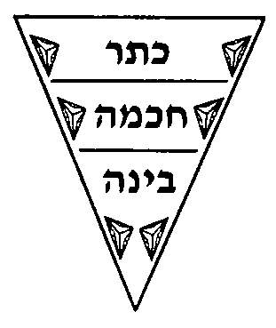

> והנה בה בעצמה יוכרח היות בה בחינת מעילה לעלול שתעלה מבחי' לבחי' עד מעלה מעלה. והמשל בזה הבחי' המשתוה אל הכתר היא העילה אל בחינת עצמותה ובחינת עצמותה היא עילה אל המשתוה אל הבינה [וכן בכל בחי' ובחי' תהיינה ג' בחי' אלו עצמם מעס"ר] ובין כל שתי בחינות יוכרחו עוד ג' בחי' והם בחי' המשתוה הבחי' הראשונה אל הכתר והבחינה עצמה והבחי' המשתוה אותה אל עצמותה. ונצייר צורה גופניות שמתוכה יעלה השכל אל הרוחני כאלו נצייר ראש תור והוא המשולש המשוך הזה.

**2:7:7** Now this triangle slopes downward, and it widens toward its top. It is a parable for the emanated: the nearer they come to their source, the more exalted and the wider they are — not a width of limit and body, but a width of subtlety and spirituality.

> והנה המשולש הזה הוא משפע ויורד ומצד עליונו מתרחב הוא משל אל הנאצלים שכל עוד שיתקרבו אל מקורם הם מתעלים ומתרחבים. לא רוחב גבוליי גשמיי אלא רוחב בדקות ורוחניות.

**2:7:8** And when the inquirer looks well, he will find that the top of Keter is wide, and that it slopes and goes on narrowing until its width comes to be level with the width of Chokhmah. And even at the place where Keter and Chokhmah are level there is a great difference; for this is necessitated by that which pours forth [*mashpi'a*], sloping [*meshuppa*] downward, whose descent has no resting-place. For the farther it moves from the upper face, the more the emanated is revealed and is caused by its cause, which is above it. And this is "cause and effect," for one who has the eyes of intellect and whom YHVH has graced with knowledge. And this is the secret of "each one includes ten," and the secret of the descent of the grades within the very self of the sefirah. For the Keter-within-Keter is the side that draws near to the Emanator, and the Malkhut-within-Keter is the side that draws near to Chokhmah, and the Keter-within-Chokhmah is the effect of the Malkhut-within-Keter. And all this can be seen from the figure we have drawn. For the narrow part of Keter is the cause of the wide part of Chokhmah; and so the Keter-within-Chokhmah is the side that draws near to Keter, and the Malkhut-within-Chokhmah is the side that draws near to Binah, and the Keter-within-Binah is the effect of the Malkhut-within-Chokhmah. And on this model it must likewise be said that each and every part itself includes ten sefirot, because the light has no resting-place but keeps moving away and descending; and each and every point, each and every part, is the cause of the point below it and the effect of the point above it. And He saw in His wisdom that unless Keter itself descended ten degrees, Chokhmah could not be emanated from it at all. Likewise, had Chokhmah not descended ten degrees, it would not have been possible for Binah to be emanated from it. And so with all the sefirot, and so with all the parts and the points. And the same rule and the same reason hold for ABYA [Atzilut, Beriah, Yetzirah, Asiyah]: for in Atzilut there is ABYA, and in Beriah there is ABYA, and in Yetzirah ABYA, and in Asiyah ABYA. For ABYA is the sum of all that is distinct from the First Necessary One, the Ein Sof, King of kings of kings, the Holy One, blessed be He, from Keter down to the central point at the navel of the earth; and they are the kinds of their descent, in four grades. And each one of them, in turn, when we come to divide them, we divide into four grades, and each and every grade into four grades; except that the four of Atzilut are so subtle that the Asiyah-within-Atzilut is the cause and origin of the Atzilut-within-Beriah, and likewise the Asiyah-within-Beriah is the cause and origin of the Atzilut-within-Yetzirah, and so in this order with all the grades and all the parts — so that existence turns out to be like a jointed lampstand, [its parts] united and embracing one another, as explained. And having raised this, I wish by means of it to address the question of the number ten that we asked in the preceding chapters. It is known that every effect is encompassed by its cause, and the cause encompasses the effect, as we shall explain at length in the Gate of the Order of Their Standing, with God's help. And now let us draw a bodily figure, namely a circle within a circle, like this:  

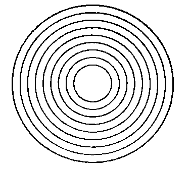

> והנה כאשר יסתכל המעיין היטיב ימצא כי עליון שבכתר הוא רחב ומשפע ומצר והולך עד שיגיע רחבו להשתוות אל רוחב החכמה. ואפילו במקום שווי הכתר והחכמה יש הבדל רב שכן הוכרח מצד המשפיע המשפע ויורד שאין מצב לירידתו כי כל שיתרחק מהפנים העליונים יתגלה הנאצל ויסתבב ממסובבו העליון ממנו והיינו עילה ועלול למי שעיני שכל לו וחננו ה' דעה. וזהו סוד כל אחד כלול מעשר וסוד ירידת המדריגות בעצמות הספי' בעצמה. כי כתר שבכתר הוא הצד המתקרב אל המאציל ומלכות שבכתר הוא הצד המתקרב אל החכמה וכתר שבחכמה הוא עלול ממלכות שבכתר. וכל זה ניכר מתוך הצורה שציירנו. כי הצר שבכתר הוא עילה אל הרחב שבחכמה וכן הכתר שבחכמה הוא הצד המתקרב אל הכתר. ומלכות שבחכמה הוא הצד המתקרב אל הבינה וכתר שבבינה הוא עלול ממלכות שבחכמה. ובדמיון זה ג"כ צ"ל כי כל חלק וחלק כלול מעשר ספירות ג"כ מפני שאין מצב אל האור אלא מתרחק ויורד וכל נקודה ונקודה וכל חלק וחלק עילה לנקודה שלמטה ממנו ועלול מהנקודה שלמעלה ממנו. והוא ראה בחכמתו שאם לא ירד הכתר בעצמו עשר מעלות א"א להיות החכמה נאצלת ממנו כלל ועיקר. וכן אם לא היתה החכמה יורדת עשר מעלות לא היה באפשרות הבינה להתאצל ממנה. וכן לכל הספירות וכן לכל החלקים והנקודות. וזה הדין וזה הטעם לאבי"ע כי באצילות יש אבי"ע ובבריאה יש אבי"ע וביצירה אבי"ע ובעשיה אבי"ע כי ענין אבי"ע הם כללות כל הנבדלים מן המחויב הראשון א"ס ממ"ה הקב"ה מן הכתר עד הנקודה האמצעית שבטבור הארץ והם מיני ירידתם בד' מדרגות. וכן כ"א מהם כאשר נבא לחלקם נחלקם לד' מדרגות וכן כל מדרגה ומדרגה לארבע מדרגות אלא שהד' של אצי' הם דקות כ"כ עד שעשייה שבאצילות סיבה ועילה אל אצילות שבבריאה וכן עשיה שבבריאה היא סיבה ועילה אל אצילות שביצירה וכן על הסדר הזה כל המדרגות וכל החלקים עד שנמצא המציאות כמנורה של פרקים מתיחדים ומתחבקים איש באחיו כמבואר. ואחר שהתעוררנו בזה רצוני בדבר זה להתעורר על שאלת מנין העשר ששאלנו בפרקים הקודמים ידוע כי כל עלול מוקף מעילתו והעילה מקיף העלול כאשר נאריך בשער סדר עמידתן בס"ד. ועתה נצייר צורה גופנית והיא עגול בתוך עגול כזה

**2:7:9** — so that no gap comes between these spheres. And now, if the questioner should ask why this draftsman did not draw yet more circles inside these circles, surely we shall blunt his teeth and tell him that he "has gathered the wind in his fists." For there can be no further addition to the number of circles, since they descend one from another by [no more than] a point, and there cannot possibly exist another circle within the great circle that encompasses them all within it.

> עד שהריוח לא יעבור בין הגלגלים האלה ועתה הישאל השואל למה המצייר הזה לא צייר בתוך העגולים האלה יותר עגולים אחרים. הלא ודאי נקהה את שניו ונאמר לו כי רוח אסף בחפניו כי א"א להיות עוד תוספות על חשבון עגולים אחר שהם יורדים איש מאת אחיו כנקודה וא"א במציאות להיות עוד עגול בתוך העגולה הגדולה המקפת את כולם בתוכה.

**2:7:10** Now from the bodily figure let us raise our intellect to the spiritual matter that we are explaining. It is known that the sefirot descend one from another by the difference that lies between cause and effect; and therefore they are one within another, the effect encompassed by the cause, like these circles, where the larger encompasses the one smaller than it, which is the effect. Thus Keter encompasses Chokhmah and is its cause, and Chokhmah descends from Keter by the measure of what lies between cause and effect; and Chokhmah is the cause of Binah, so that Binah descends one grade from Chokhmah and two grades from Keter, being the effect of that [Chokhmah] which is the effect of it [Keter]. And in this way the grades descend down to Malkhut.

> והנה מן הצורה הגופניות נעלה שכלנו אל הרוחניות אשר אנו בביאורה. ידוע כי הספירות הם יורדים איש מאת אחיו כהבדל שבין עלה ועלול ולכן הם זו בתוך זו עלול מוקף מעילה כדמיון העגולים האלה שהגדול מקיף הקטן ממנו שהוא העלול ולכן הכתר הוא מקיף אל החכמה והוא עילתו וחכמה יורדת מהכתר כערך מה שבין עילה ועלול והחכמה עילה אל הבינה והרי בינה יורדת מהחכמה מדרגה א' ויורדת מאת הכתר ב' מדרגות שהיא עלולה מזאת העלולה ממנה וע"ד זה ירידת המדרגות עד המלכות.

**2:7:11** And Malkhut is the end of Atzilut and the beginning of Beriah, and it is to Beriah as the Ein Sof is to Atzilut; and the last grade in Beriah is to Yetzirah as Malkhut is to Beriah. And this is their order, until they come to the spheres by way of degrees that are concealed and hidden from us, and revealed to those versed in the account of Creation and the account of the Chariot.

> והנה המלכות הוא סוף לאצילות וראש לבריאה והיא לבריאה כערך הא"ס לאצילות והמדרגה האחרונה שבבריאה אל היצירה כערך המלכות אל הבריאה וזהו סדרם עד בואם אל הגלגלים דרך מעלות הנעלמות ונסתרות לנו ונגלות אל הבקיאים במעשה בראשית ובמעשה מרכבה.

**2:7:12** And there is no difference between Malkhut and Beriah except the difference between cause and effect. And with the descent from the last grade of Atzilut there had necessarily to be the beginning of Beriah, which is the grade that is united with Atzilut as the effect is united with its cause; and so from Beriah to Yetzirah, and so from Yetzirah to Asiyah, down to the spheres.

> והנה אין הבדל בין המלכות והבריאה אלא כהבדל שבין עלה ועלול וברדת מן המדרגה האחרונה שבאצילות הוכרח היות תחלת הבריאה שהיא המדרגה המתייחדת באצילות כיחוד העלול אל העילתו וכן מבריאה אל יצירה וכן מיצירה אל עשייה עד הגלגלים.

**2:7:13** As for the order of the spheres, the astronomers, dim of sight, imagined that each sphere is adjacent to the next, so that no gap comes between them. But this is not the view of the masters of the Torah, who see by the everlasting light; rather, between one firmament and the next is a journey of five hundred years. And although there is this air between them, the matter nevertheless shows the evenness of the creation and its necessity, and that there could not be less than this between sphere and sphere — until the matter comes down to the element of fire; and the element of fire is united with the element of air, and the element of air is united with the element of water, and the element of water is united with the element of earth, one above the other, with no gap between them. And now, who gives a man a mouth to ask, "Let there be so many grades more, or so many fewer," or "Why did He not create the world larger than this, or smaller?" For all this is great foolishness to those who know the order of the grades. And the constitution of the world is in the most excellent way possible, in the order of the grades from the highest that can exist to the lowest that can exist, whether in limit, in finitude or in corporeality. And indeed, were the order of the sefirot not between Him and the world, the world, on account of its lowliness, could not be governed by the Ein Sof — unless the world were to rise to the spiritual grades, which are the sefirot; and for that He has already emanated the sefirot. And the intent is nothing other than to reveal the Emanation and the divinity, and not to conceal it. And it is revealed through the descent of the grades to the lowest aspect, where they now are. For even this thick, coarse earth, down to its navel, has grade after grade, to seven earths, as we shall explain something of this in [the Gate of] the Order of Their Standing, with the help of God. This is the reverse of the view of the foolish astronomers, who imagined they could give the measure of the earth and said that a line of twenty-two thousand mil would encircle it round about, and that, were the earth bored through, [the bore] would pass through to its underside through a thickness of seven thousand three hundred and thirty-three and a third mil. And they walk on in darkness.

> והנה סדר הגלגלים התוכנים חשוכי עינים דמו שהגלגל סמוך לחברו עד שריוח לא יעבור ביניהם. ואין זאת סברת בעלי התורה הרואים באור עולם, אלא שבין רקיע לרקיע מהלך ת"ק שנה ועם היות האויר זה ביניהם עכ"ז הענין מורה על שווי הבריאה וההכרח' ושא"א להיות בין גלגל לגלגל פחות מזה עד רדת הענין אל יסוד האש ויסוד האש מתאחד ביסוד הרוח ויסוד הרוח מתאחד ביסוד המים ויסוד המים מתאחד ביסוד העפר זה למעלה מזה ואין ריוח ביניהם. ועתה מי ישום פה לאדם לשאול יהיה עוד כך וכך מדרגות או יפחות מהם כך וכך או למה לא ברא העולם יותר גדול מזה או קטן ממנו, כי כל זה הוא פתיות גדול ליודעי סדר המדרגות. ותכונת העולם הוא על מציאות היותר משובח שאפשר בסדר המדרגות מהעליונה שאפשר במציאות עד התחתונה שאפשר במציאות אם בגבול אם בתכלית אם בגשמות והנה אם לא היה בינו ובין העולם סדר הספירות א"א לעולם מפני פחיתותו להיותו מתנהג ע"י הא"ס אם לא שיעלה העולם במדרגות הרוחניות שהם הספירות ולענין זה כבר האציל הספירות. ואין זו הכוונה אלא לגלות האצילות והאלקות ולא להעלימו. וגלוייו הוא ע"י ירידות המדרגות להבחינה התחתונה שהם עתה. שהרי אפי' הארץ הלזו העבה והגסה עד טיבורה יש לה מדרגה אחר מדרגה עד ז' ארצות כמו שנבאר קצת בזה בסדר עמידתן בע"ה. הפך סברת הפתאים התוכניים כי דמו לתת מדת הארץ ואמרו שקו בן כ"ב אלף מיל יסוב אותו סביב ואלו תוקדר הארץ יהיה עובר אל עבר פניה התחתונים בעובי ז' אלף מיל ושל"ג ושליש מיל והמה בחשך יתהלכו למו.

**2:7:14** On this matter we have a received teaching and a weighty precedent, as we shall write in the name of the Zohar in the Gate mentioned. And to return to our subject: had the world been created without intermediaries — apart from the fact that this is impossible, for the reason we have explained —

> הנה לנו בענין הזה תורה מקובלת ומעשה רב כאשר נכתוב בשם הזוהר בשער הנזכר. ונחזור לענייננו שאם היה העולם נברא בלי אמצעיות. בזולת שא"א מן הטעם שפירשנו.

**2:7:15** — this would be a concealment of the divinity. For when we came to know His greatness from His governance, would we not believe that, in truth, He is exalted above His world [only] by what lies between a cause and its cause [that is, by one step of cause and effect]? Therefore, so as not to conceal His divinity, He emanated the grades in the way I have explained. For now, when we look upon Keter, may it be blessed and exalted, and then raise above it its cause, the Ein Sof, King of kings of kings — how greatly is His name magnified in the eyes of all His created entities!

> הנה זה יהיה העלם האלקות כשנבא לדעת גדולתו מתוך הנהגתו הלא נאמין שהוא יתעלה מעולמו מה שבין העילה לעילתו לפי האמת. ולכן שלא להעלים אלוהותו האציל המדרגות אל הדרך שפירשתי, כי כאשר נראה עתה בכתר יתברך ויתעלה ונעלה עליו עילתו האין סוף ממ"ה כמה יתגדל שמו בעיני כל ברואיו.

**2:7:16** And so this glorious chapter is complete, and this Gate is concluded. And since YHVH has blessed us thus far, and helped us in all the way that we have gone, we are journeying to the place that we know: namely, to investigate whether the Ein Sof is the Keter, with the help of Heaven.

> והנה נשלם פרק המפואר ונכלל השער הזה. ואחרי אשר עד כה ברכנו ה' ועזרנו בכל הדרך אשר דרכנו, נוסעים אנחנו אל המקום אשר ידענו והוא לחקור אם הא"ס הוא הכתר בסייעתא דשמיא:

---

## Gate 3: Whether the Ein Sof is the Keter

We named it **"Whether the Ein Sof is the Keter"** because in it is explained whether the Ein Sof is Keter, as many have thought, and whether Keter is counted among the sefirot or not, as R. Shem Tov ibn Shem Tov supposed. Its chapters are eight.

### Chapter 3:1. Explanation of the view of those who say the Ein Sof is Keter, and the refutation of their view from reasoning.

**3:1:1** **The Third Gate: To Know Whether the Ein Sof is the Keter:**

> **השער השלישי לדעת אם אין סוף הוא הכתר:**

**3:1:2** What is intended in this Gate is to discuss the matter of the perplexity that has fallen among the Kabbalists, [in coming] to know whether the Ein Sof is the Keter itself or other than it. And this is its name, by which they call it: "Whether the Ein Sof is the Keter."

> הנרצה בשער הזה הוא לשאת ולתת בענין המבוכה נפלה בין המקובלים לדעת אם א"ס הוא הכתר עצמו או זולתו. וזה שמו אשר יקראו לו אם הא"ס הוא הכתר:

**3:1:3** **Chapter One:**

> **פרק ראשון:**

**3:1:4** Many of the Kabbalists among the people of our nation have been perplexed with a great perplexity, and have fallen into the pit of error, and thought that the supernal Keter is the Ein Sof, and that it is in the number of the ten. And [there are] some of them who said that, since we have ten grades, what need is there for a further emanation? — but rather that the matter of the Emanator with the emanated [beings] is [the] ten. And they [thought to] support themselves from the *mishnah* of Sefer Yetzirah, which said "ten and not nine, ten and not eleven"; and they said that [its] saying "and not eleven" [means] to say that we should not add further upon ten — but [rather] that the ten are precisely [the count], [including] the Emanator, who is the Ein Sof, the supernal Keter. This is their way — and may their Master forgive them, for this is a matter of cutting [the shoots] and separation; and one who looks at what I explained concerning that *mishnah*, in the First Gate, ch.6, will see that, on the contrary, from there [comes] a proof to the opposite.

> רבים מהמתקבלים בבני עמנו נבוכו במבוכה רבה ונפלו בשוחת הטעות וחשבו כי הכתר עליון הוא הא"ס והוא במנין העשר. ויש מהם אמרו כי מאחר שיש לנו עשר מדרגות מה צורך אל אצילות יותר אלא שענין המאציל עם הנאצלים הם עשר. ודמו להסתייע ממשנת ספר יצירה שאמר עשר ולא תשע עשר ולא אחד עשר ואמרו שאמרו ולא אחד עשר לומר שלא נוסיף עוד על עשר אלא שעשר הם ממש עם המאציל שהוא הא"ס כתר עליון. זה דרכם. ושרי להו מרייהו כי זהו ענין קצוץ ופרוד והרואה במה שפירשתי במשנה ההיא בשער הראשון בפ' ששי יראה כי אדרבה משם ראיה להפך.

**3:1:5** Now this view is rejected for several reasons. If you wish, [argue] from Scripture; if you wish, [argue] from reason. The [argument from] reason is: that since the Emanator is distinguished from His emanated [beings] in several matters — first, that the emanated [beings] fall under time, and He does not fall under time. And I do not wish to say "time" according to what appears from the plain sense of our words, but the intent is that there was already a time when they were not emanated, as [for instance] before the Emanation. And this is one of the things impossible in the Ein Sof — that there was [ever] an existence in which He did not exist; rather, He is necessarily existent, and He brought time into existence, and not that He is possessed of time, God forbid. And in this matter is understood [the saying] "first, yet there is no beginning to its beginning" — for although we say "first," and every expression "first" indicates that it has a beginning (for it is true that He is first to all that come after Him) — yet the expression "first" indicates the beginning of time. And therefore it said that He is first, and even so there is no beginning to His beginning; and the expression "first" is only to negate that no other preceded Him. And this is what is said in the Tikkunim, "I am first and I am last." And Rashbi, peace be upon him, explained that *Ani* (I) is Ayin (Nothing), which is the supernal Keter. And "I" (*ani*) is Malkhut, which is the end of the Emanation — "its end embedded in its beginning and its beginning in its end" — for Ayin [Nothing] is Alef = supernal Keter, Yod = Chokhmah, final Nun = Binah, with the extension of the Vav, which is [the] Nun, [i.e.] Yod upon Vav; and the final Nun itself is Malkhut, in truth. It is found [that] Ayin includes the whole Emanation. And this [is] "I am first" — the secret of the extension and spreading of the Emanation from above to below; and "I am last" is the existence of the returning light, reversing from below to above. And by this is understood the matter of "first and last": for Keter is truly called "first," because it is first to all that come "in the beginning," which is [the emanated and below]; but above it, in the Ein Sof, the expression "first" does not apply. And this is "and before One, what can you count?" — the meaning [being]: Keter is called "one," which is the beginning of the count, which is the number of the ten, in which the whole count is included, and the count's foundation is above, as we explained in the preceding Gate. And it said that "before One" — which is that [which is] prior to it, namely the Ein Sof — "what can you count?", for there applies there neither number, nor speech, nor any necessity at all. And of Him it is said (Job 37:20), "shall it be counted to Him when I speak?" — for number does not apply there. And with this premise is understood the verse (Isaiah 43) in which all the literalists were perplexed: "You are My witnesses, says YHVH, and My servant whom I have chosen, that you may know and believe Me and understand that I am He: before Me no God was formed, and after Me there shall be none." And the explanation: "that I am He" — namely Keter, for it is Keter that is truly called "He" (*Hu*); and to indicate its concealment, the word "*Hu*" [is] a pronoun for the hidden [third person]. And therefore it said that it is also called "I" (*Ani*), to indicate that it is the beginning of the Emanation and the end of the Emanation, in the secret of "I am first and I am last," as explained. And it said "before Me no God was formed" — and the word "formed" (*notzar*) [is] according to its plain sense, whose meaning is "was not emanated"; for the expression "formation" (*yetzirah*) too serves [to denote] the Emanation, just as the expression "creation" (*beri'ah*) serves, namely "In the beginning [God] created." And it said: "before Me none was emanated" — for it [Keter] is the head [first] of those that come within the category of the emanated; and it is the end of the whole Emanation, and this is what is said "and after Me there shall be none." And this indicates the strength of the greatness of the Ein Sof, King of kings of kings, the Holy One, blessed be He, which indicates His endurance — that He does not fall under time, but, on the contrary, He brought time into existence, and the existence of His non-being cannot be depicted in any manner in the world. And this is one of His many superiorities over His emanated [beings]: that all of them fall under [contingent] existence, [in] that there was already a time when the Ein Sof was without them, as before the Emanation. And many have thought to say that Keter was prior to all — that is, that, although there was no Emanation, it was in existence, and it is a garment to the Emanator forever. And the holders of this view are masters of the shields [formidable scholars]; and the principal necessity that compelled them to this matter is their saying, of blessed memory, in Pirkei de-Rabbi Eliezer, "before the world was created, He and His name alone existed" — the meaning [being] that "He and His name" are the Ein Sof and Keter; and they necessitated from this that Keter is prior, and that it is unified with the Emanator and a garment to Him. But this matter is not fitting to be believed. Rather, that the whole Emanation was emanated at one time, and Keter too is among the emanated [beings], as is necessitated from several passages, some of which we shall copy in the Gates, with God's help — and in particular in the Gate of Self and Vessels, and in the Gate of the Order of the Emanation, and the Gate of Tzachtzachot, with God's help. It is found that the Emanator is exalted above His emanated [beings] — for His emanated [beings], their non-being preceded them; which is not so [with] the Emanator, King of kings of kings, the Holy One, blessed be He. And behold, [this is] a first distinction. Further, the Emanator is distinguished from the emanated [beings] in that their life depends on another — namely, on the Emanator who gives them life; and He is the source and the light and the effluence to all His emanated [beings] — they are found, all of them, to need Him; whereas the Ein Sof, blessed be He, needs nothing other than Himself, but is the source of life, and life is found from Him, until He is the life of [all] life. And therefore, in some places, Rashbi, peace be upon him, in the Tikkunim, called Him by the expression "a light that does not subsist in [another] light," etc. — since He does not depend on life and effluence from the side of another, but is the source of light to all the other luminaries. And this matter Rashbi, peace be upon him, explained in the Tikkunim (Tikkunei Zohar Chadash, folio 132b) and in the Zohar [on] Bereshit (22): "Rabbi Shimon opened further and said: 'See now that I, I am He, and there is no god with Me.' He said: Companions, hear ancient words that I wish to reveal... What is [the meaning of] what it said, 'See now that I, I am He, and there is no god with Me'? Rather, this is the Cause above all the upper ones, that [One] called the Cause of Causes, the Cause [from] among these causes, [such] that none of these causes does any deed until it takes permission from the one above it, as we established above regarding 'let us make man' — 'let us make,' surely, was said of two, [in] that this one said to the one above it... And the one above it does nothing until it takes counsel from its fellow. But the one called the Cause over all the causes, above which there is none and below which there is none equal to it — this is what is written, 'And to whom will you liken Me, that I should be equal? says the Holy One.' He said: 'See now that I, I am He, and there is no god with Me,' that takes counsel from Him, in the manner of the one that said, 'And God said, let us make man.'" Thus far [the Zohar's] words.

> והנה הסברא הזאת דחויה מכמה טעמים אב"א קרא אב"א סברא. הסברא היא כי מאחר שהמאציל נבדל מנאצליו בכמה עניינים. ראשונה שהנאצלים הם נופלים תחת הזמן והוא אינו נופל תחת הזמן. ואין רצוני לומר זמן כפי הנראה מפשוטן של דברינו, אלא הכוונה שכבר היה זמן שלא היו נאצלות כמו קודם האצי'. וזה אחד מהדברים הנמנעים בא"ס שלא הי' מציאות שלא ימצא, אלא הוא מחויב המציאות והוא המציא הזמן ולא שהוא בעל זמן ח"ו. ובענין זה יובן אמרו ראשון ואין ראשית לראשיתו כי עם שנאמר ראשון וכל לשון ראשון מורה על שיש לו ראשית כי אמת שהוא ראשון לכל הבאים אחריו אבל לשון ראשון מורה על התחלת זמן. וע"כ אמר שהוא ראשון ועכ"ז אין ראשית לראשיתו, ולשון ראשון אינו אלא לשלול שלא קדם אליו זולתו. וז"ש בתקונים אני ראשון ואני אחרון. ופי' הרשב"י ע"ה כי אנ"י הוא אי"ן שהוא הכתר עליון. ואני הוא מלכות שהיא תכלית האצילות נעוץ סופו בתחלתו ותחלתו בסופו כי אי"ן הוא א' כתר עליון י' חכמה ן' בינה עם משך הוא"ו שהוא ן' י' על ו' ומציאות הן' בעצמה היא המלכות לפי האמת נמצא אי"ן כולל כל האצילות. וזה אני ראשון סוד משך והתפשטות אצילות ממעלה למטה. ואני אחרון הוא מציאות אור החוזר המתהפך ממטה למעלה. ובזה יובן ענין ראשון ואחרון כי הכתר יקרא באמת ראשון מפני שהוא ראשון לכל הבאים בראשית שהוא מהנאצלים ולמטה אבל למעלה ממנו בא"ס לא שייך לשון ראשון וזהו ולפני אחד מה אתה סופר. פי' הכתר נקרא אחד שהוא תחלת החשבון שהוא מספר העשרה שבו כלול כל החשבון והחשבון יסודו למעלה כמו שפירשנו בשער הקודם. ואמר כי לפני אחד שהוא הקודם לו דהיינו הא"ס מה אתה סופר דלא שייך תמן לא מנין ולא דבור ולא חיוב כלל. ועליו נאמר (איוב לז כ) היסופר לו כי אדבר ולא שייך תמן מנין. ועם ההקדמה הזאת יובן הפסוק (בישעיה מ"ג) אשר נבוכו בו כל הפשטנים אתם עדי נאם ה' ועבדי אשר בחרתי למען תדעו ותאמינו לי ותבינו כי אני הוא לפני לא נוצר אל ואחרי לא יהיה. ופי' כי אני הוא היינו הכתר כי הוא הכתר הנקרא הו"א באמת. ולהורות על העלמו מלת הוא כנוי אל הנסתר. ולכן אמר שהוא נקרא אני ג"כ להורות שהוא תחלת האצילות וסוף האצי' בסוד אני ראשון ואני אחרון כמו שפי'. ואמר כי לפני לא נוצר אל ומלת נוצר כמשמעו שפי' לא נאצל כי לשון יצירה ג"כ משמש אל האצילות כמו שמשמש לשון בריאה דהיינו בראשית ברא. ואמר כי לפני לא נאצל זולתי, כי הוא ראש הבא בגדר הנאצל. והוא סוף לכל האצילות, וז"ש ואחרי לא יהיה. וזה מורה על תוקף גדולות הא"ס ממ"ה הב"ה שמורה על קיומו שאינו נופל תחת הזמן אלא אדרבה הוא המציא הזמן ולא יצוייר מציאות העדרו בשום אופן בעולם. וזו אחת ממעלותיו הרבות על נאצליו שכלם נופלים תחת המציאות שכבר היה זמן שהיה הא"ס זולתם כמו קודם האצילות. ויש רבים חשבו לומר שהכתר היה קודם לכל ר"ל כי עם היות שלא היה אצילות היה הוא במציאות והוא לבוש אל המאציל לעולם. ובעלי הסברא זאת הם בעלי תריסין ועיקר ההכרח שהכריחם לדבר זה הוא אמרם ז"ל בפדר"א קודם שנברא העולם היה הוא ושמו לבד פי' כי הוא ושמו היינו הא"ס וכתר. והכריחו מזה שכתר קודם ושהוא מתאחד במאציל ולבוש אליו. והענין הזה אין ראוי להאמינו. אלא שכל האצילות נאצל בעת אחת וגם הכתר מכלל הנאצלים כאשר הוא מוכרח מתוך כמה מאמרים וקצתם נעתיק בשערים בע"ה. ובפרט בשער עצמות וכלים ובשער סדר האצי' ושער הצחצחות בס"ד. נמצא שנתעלה המאציל על נאצליו. כי נאצליו קדם אליהם העדרם. משא"כ המאציל ממ"ה הקב"ה. והרי הבדל ראשון. עוד נבדל המאציל מן הנאצלים כי חיותם תלוי בזולתם היינו במאציל המחייה אותם והוא מקור והאור והשפע לכל נאצליו נמצאו כלם צריכין אליו. והא"ס ב"ה אין צריך אל זולתו אלא הוא מקור החיים והחיים נמצאים ממנו עד שהוא חיות החיים. ולכן בקצת מקומות כנהו הרשב"י ע"ה בתקונים בלשון נהורא דלא קיימא בנהורא וכו' אחר שאינו תלוי בחיות ושפע מצד זולתו אלא הוא מקור האור אל כל שאר המאורות. ודבר זה ביאר הרשב"י ע"ה בתקונים (תקוני ז"ח דף קל"ב ע"ב) ובזהר בראשית (דף כ"ב) פתח עוד ר"ש ואמר ראו עתה כי אני אני הוא ואין אלקים עמדי. אמר חבריא שמעו מלין עתיקין דאנא בעינא לגלאה כו' מאי ניהו דאמר ראו עתה כי אני אני הוא ואין אלקים עמדי. אלא דא איהו עילת על כל עלאין ההוא דאתקרי עלות העלות עלת מאלין עלות דלא יעביד חד מאלין עלות שום עובדא עד דנטיל רשותא מההוא דעליה כמה דאוקימנא לעיל בנעשה אדם נעשה ודאי על תרין אתמר דאמר דא לההוא דלעילא מיניה כו' וההוא דלעילא מיניה לאו עביד מדעם עד דנטיל עצה מחבריה. אבל ההוא דאתקרי עלת על כל העלות דלית לעילא מיניה ולית לתתא שוה ליה הה"ד ואל מי תדמיוני ואשוה יאמר קדוש. אמר ראו עתה כי אני אני הוא ואין אלקים עמדי דנטיל עצה מיניה כגוונא דההוא דאמר ויאמר אלקים נעשה אדם עכ"ל.

**3:1:6** Now [Rashbi], peace be upon him, intended, in this holy passage, to exalt this superiority — that the Ein Sof is exalted above His emanated [beings], [in] that they need to take counsel, the lower from the upper, for it [the lower] needs effluence from its cause that emanates upon it; and therefore it says "let us make man" — as if to say, "you emanate, and I will act, and man is found made by the two of us"; and the upper one still needs to be emanated [upon] from its cause, for it too does not have the ability [on its own]. But the Ein Sof, blessed be He, does not need to say to another "let us make," but [says] "I, I am He, and there is no god with Me" — that is, "in assistance with Me" — neither a lower one, for it has none below it equal to it, nor an upper one, for there is no upper one other than it, for it is above all the existents. And it said "the Cause over all the upper ones, the Cause [from] among these causes" — [Rashbi] intended to explain to us that the reason it is called the Cause of Causes is for two reasons. The first: from the expression "ascent" (*aliyah*), and the intent is that it is above all the upper ones — and the intent is not an ascent of place, God forbid, for nothing enters into [the category of] place in the Emanation, all the more so in the Emanator, but the meaning [is] the existence of an ascent of degree, and spirituality, and ability. And the second meaning is from the expression "cause" (*illah*) and "reason" (*sibbah*) — that it is a cause and a reason to all the causes that are in existence.

> הנה כיון במאמר הזה הקדוש ע"ה להפליג במעלה הזאת שמתעלה הא"ס על נאצליו שהם צריכין ליטול עצה התחתון מן העליון כי הוא צריך שפע מעילתו המשפיע עליו ולכן הוא אומר נעשה אדם כלומר תשפיע אתה ואני אפעול ונמצא אדם עשוי ע"י שנינו והעליון עדיין צריך להיות נשפע מעילתו כי אין בידו ג"כ היכולת. אבל א"ס ב"ה אינו צריך לאמר לזולתו נעשה אלא אני אני הוא ואין אלקים עמדי ר"ל בסיוע עמי לא תחתון שאין לו למטה שוה אליו ולא עליון שאין עליון זולתו כי הוא למעלה מכל הנמצאים. ואמר עילת על כל עלאין, עלת מאלין עלות. כיוון לבאר לנו שהטעם שהוא נקרא עלת העלות הוא משני פנים. הא' פי' מלשון עלייה והכוונה שהוא למעלה מכל העליונים. ואין הכוונה בעליית מקום ח"ו שאין שום דבר נכנס במקום באצילות כ"ש במאציל, אלא פי' מציאות עליית מעלה והרוחניות והיכולת. והפי' השני הוא מלשון עילה וסיבה שהוא סבה ועילה לכל העלות שבמציאות.

**3:1:7** Now a second distinction has been explained, by which the Ein Sof, the Emanator, blessed be He, is distinguished from the emanated [beings]. Further, a third distinction, and it is: that all the emanated [beings] have a name among the holy names, which delimits them, by which that sefirah and that emanated [being] is called — like Ehyeh in Keter, and Yah in Chokhmah, and so for all the rest of the sefirot, as we explained in the First Gate explicitly. And likewise the four-letter name includes the whole Emanation, as is explained in the Zohar, and we shall explain in the Gate of the Four-Letter Name. This is not so [with] the Ein Sof, the Emanator, blessed be He, who has no name and [vowel-]point by which we can designate Him, nor attribute that would delimit Him; and we have not found for Him a name to designate Him except "the Necessarily Existent." And the explanation: that He is necessary in His existence, because the world is impossible, ever, without a conductor who gives effluence and life to all the existents; and for this reason His existence is necessary. And because there is no name that would delimit Him, therefore we designate Him "the Necessarily Existent," and this name the philosophers attributed to Him. Further, they attributed to Him the name Ein Sof (Without End), and the reason [is] because He has no end and terminus. For the thing delimited by a name has an end; and the divinity, because it has no end, has no name that would delimit it, and therefore we designate it by [the name] Ein Sof.

> והנה נתבאר הבדל שני שנבדל הא"ס המאציל ב"ה מן הנאצלים. עוד הבדל שלישי והוא כי לכל הנאצלים יש להם שם משמות הקדש שהוא מגבילם אשר בו יקרא הספירה והנאצל ההוא כענין אהי"ה בכתר וי"ה בחכמה וכן לכל שאר הספירות כמו שבארנו בשער הראשון בפי'. וכן שם בן ד' כולל כל האצי' כלו כמבואר בזהר ונבאר בשער שם בן ד'. מה שאין כן בא"ס המאציל ב"ה שאין שם ונקודה שנוכל לכנותו בה ולא מדה שתגבלהו ולא מצאנו לו שם לכנותו אלא מחויב המציאות. ופי' כי הוא מחויב במציאותו מפני שא"א לעולם בלא מנהיג הנותן שפע ומחיה לכל הנמצאים ומטעם זה מחוייב מציאותו. ומפני שאין שם שיגבילהו לכן נתארהו מחויב המציאות, ושם זה יחסו אליו החוקרים. עוד ייחסו אליו שם א"ס והטעם מפני שאין לו סוף ותכלית. כי הדבר הנגבל בשם יש לו סוף, והאלקות מפני שאין לו סוף אין לו שם שיגבלהו ולכן אנו מתארים אותו בא"ס.

**3:1:8** And further [there is] another explanation: because the inquiry into Him has no end — for it is not in the manner of the other inquiries, which have an end and a settling upon a single conclusion; but the inquiry into the divinity is without end, and therefore there is none who knows in Him any essence at all, except by means of the sefirot, which reveal somewhat of His greatness — [and] only from His sefirot and upward; [but] from there [upward] there is no apprehension, on account of the depth of what is apprehended; and therefore they designated Him Ein Sof. Further, they attributed to Him "Cause of Causes," and the intent is that the causes — from which other [things] are caused — are [themselves] caused [by] Him; and therefore He is called "the Cause of [the] causes," since He is a first cause to all the causes in the world: for although they are causes to other caused [things], even so they are all caused [by] Him. And there are [those] who said that the supernal Keter too is called "the Cause of Causes," since it is a cause to all the other causes, which are caused [by] it; which is not so from it [Keter] and below — [in] that Chokhmah is not a cause to all the caused causes, for Keter is the [one] that causes and is not caused [by] Chokhmah, but on the contrary Chokhmah is caused [by] it. And likewise, for this reason, they said that Keter is called "the Cause of Causes," [in] that it is the cause of the causes that are effects of it. However, the Ein Sof is called "the Cause of all causes" and "the Cause over the causes," with the addition of "all," to indicate, concerning the Ein Sof, that it is the cause of all causes — even Keter; which is not so [with] Keter, of which the expression "all causes" does not [rightly] apply (and likewise it lacks the "all"), since there is already a cause and reason of which it is the caused [one] — [in] that Keter is caused [by] the Ein Sof, and the Ein Sof is its cause; and likewise [the expression with "all"] would not be attributed thus to Keter. And these three names — namely, Ein Sof, and "the Cause of all causes," and "the Cause over all causes" — Rashbi attributed to the Emanator, blessed be He, in his books many times; and he likewise attributed to Him other names, such as "the Concealed of the Concealed," and likewise "the Ancient of Ancients," and many like these similar to them; and when the inquirer examines them closely, he will find that they all indicate the concealment, as we explained — that He has no name, nor *havayah*, nor title that would delimit Him. And behold, [this is] a third distinction, by which the Emanator is distinguished from the emanated [beings] — apart from several other distinctions, such as the removal of measure, and limit, and the predicates, and the changes, for all is in His sefirot; and we shall not prolong [discussion] of them. And let us say that, since the Emanator is exalted and distinguished from His emanated [beings] [to] the utmost of distinction, and is distanced [to] the utmost of distance, then reason gives that it is not fitting for the Emanator to enter into the number of the emanated [beings], God forbid, as those thought who said that He is the Keter. And now let us come to prove [it] from the proofs.

> ועוד פי' אחר מפני שהחקירה בו אין לו סוף. שאינה כדרך שאר החקירות שיש לה סוף והסכמה אל מסקנא אחת. אמנם החקירה באלקות היא בא"ס ולכן אין מי שידע בו מהות כלל אם לא ע"י ספירות המגלות קצת מגדולתו אמנם מספירותיו ולמעלה אין השגה מצד עומק המושג ולכן תארוהו בא"ס. עוד ייחסו אליו עלת העלות, והכוונה כי העלות אשר מהם עלולים אחרים הם עלולות ממנו ולכן נקרא סבת הסבות לפי שהוא סבה ראשונה לכל סבות שבעולם ואע"פ שהן סבות למסובבים אחרים עכ"ז כלם מסובבים ממנו. ויש שאמרו כי כתר עליון ג"כ נקרא סבת הסבות לפי שהוא סבה לכל שאר הסבות שהן מסובבות ממנו. משא"כ ממנו ולמטה שאין החכמה סבה לכל הסבות המסובבות שהרי הכתר הוא הסובב ואינו מסובב מהחכמה אלא אדרבא החכמה מסובבת ממנו. וכן מן הטעם הזה אמרו שנקרא הכתר עלת העלות שהוא עלת העלות העלולות ממנו. אמנם אין סוף נקרא סבת כל הסבות ועלת על העלות בתוספת כל להראות על הא"ס שהוא סבת כל הסבות ואפי' הכתר. מה שאין כן הכתר שלא יצדק בו לשון כל הסבות וכן כל העלות שכבר יש עילה וסבה שהוא מסובב ממנו שהכתר מסובב מהא"ס וא"ס סבתו. וכן לכל העלות, שלא יתייחס כן בכתר. ושלשה שמות הללו היינו א"ס וסבת כל הסבות ועלת כל העלות יחס הרשב"י אל המאציל ב"ה בספריו פעמים רבות וג"כ יחס אליו שמות אחרים כמו טמירא דטמירין וכן עתיקא דעתיקין וכאלה רבות כיוצא בהם וכאשר ידקדק המעיין בהם ימצא כלם מורים על ההעלם כמו שבארנו שאין לו שם ולא הויה ולא כנוי שיגבילהו. והרי הבדל שלישי שנבדל המאציל מן הנאצלים. בזולת כמה הבדלים אחרים כמו הרחקת השיעור והמדה והתארים והשנויים כי הכל בספירותיו ולא נאריך בהן. ונאמר כי אחר שיתעלה ונבדל המאציל מנאצליו תכלית ההבדל ונתרחק תכלית הרוחק אם כן הסברא נותנת שאין ראוי שיכנס המאציל במנין הנאצלים ח"ו כמו שחשבו האומרים שהוא הכתר. ועתה נבא להוכיח מן הראיות:

### Chapter 3:2. The refutation of their view, and its necessity from many places in the words of the Zohar.

**3:2:1** After we have, in the preceding chapter, established from reason that Keter is not the Ein Sof, now we shall come, in this chapter, to nullify this view from the words of Rashbi, peace be upon him, who enlightens the eyes of Israel in this wisdom; and we have from his words several proofs. First, he said in the book of the Tikkunim (in the Introduction, folio 6), and these are his words: "But the name YHVH is a chariot to its Master, to the supernal Keter. And therefore, 'there is none holy like YHVH' — the Cause over all, concealed and stored away in Keter; and from it His light spread upon YHVH, which is Yod = Chokhmah, Heh = Binah, Vav including six sefirot, Heh = Malkhut" — thus far [his words], for our matter. And this is its explanation: YHVH, which is a hint at nine sefirot, as he expounds and goes on, is a chariot to its Master, [namely] Keter; and the reason he said "its Master" is because it [Keter] is a father to the whole Emanation, and the whole Emanation is a throne to it. And it said "there is none holy like [*koh*]" — [this] will be understood with what Rashbi, peace be upon him, explained in another place, where he said that "there is none holy like *koh*" [refers] to Keter. And he said that this is the Kaf of "*koh*," which is the Kaf of Keter; and the reason for the Kaf is that it is two Yods, in the secret of "ten, ten the spoon" (*asarah asarah ha-kaf*); and this is what he said, "and therefore there is none holy [like *koh*]" — the meaning [being]: because YHVH is a chariot to Keter — [in] that the four-letter name [has a] Yod at the head [beginning], and Adonai [has a] Yod at the end — they are two Yods, in the secret of direct light and returning light, which is the Kaf of Keter — as this matter will be explained at length in the Gate of the Reversal of the Light, with God's help. And because these two lights are a chariot to Keter, which is the cause of the lights [coming] from the side of the Cause of Causes, the Ein Sof, blessed be He, stored away within it — and from it the light spread by means of Keter, in order that there be direct light and returning light — therefore it is called the Kaf of Keter, which is two Yods. And let the inquirer not hope from us the explanation of this matter, for its principal place is in the aforementioned Gate. Thus far the explanation of the passage, in brief.

> אחר שבפרק הקודם הכרחנו מן הסברא שאין הכתר הא"ס, עתה נבוא בפ' זה לבטל סברא זו בדברי הרשב"י ע"ה מאיר עיני ישראל בחכמה הזאת ולנו מדבריו כמה ראיות. ראשונה אמר בס' התיקונים (בהקדמה ד"ו) וז"ל אבל שם ידו"ד איהו מרכבה למריה לכתר עלאה. ובגין דא אין קדוש כידו"ד עלת על כלא טמיר וגניז בכתר ומניה אתפשט נהוריה על ידו"ד דאיהו י' חכמה ה' בינה ו' כליל שית ספירן ה' מלכות עכ"ל לעניננו. וזה פירושו ידו"ד שהוא רמז לט' ספירות כדמפרש ואזיל הוא מרכבה למריה כתר, וטעם אמרו מריה מפני שהוא אב לאצילות כלו וכל האצילות כסא אליו. ואמר אין קדוש כה', יובן עם מה שבאר הרשב"י ע"ה במקום אחר שאמר שאין קדוש כה' הכוונה על הכתר. ואמר כי זה הוא הכ"ף דכה' שהוא כ"ף כתר וטעם הכ"ף כי הוא שני יודין בסוד עשרה עשרה הכ"ף וזהו שאמר ובג"ד אי"ן קדוש, פי' מפני שידו"ד היא מרכבה אל הכתר שהשם בן ד' יו"ד בראש ואדני יו"ד בסוף הם שני יודי"ן בסוד אור ישר ואור חוזר שהיא כ"ף כתר. כאשר יתבאר הענין הזה בארוכה בשער התהפכות האור בס"ד. ומפני ששתי האורות האלה הם מרכבה לכתר שהוא סבת האורות מצד עלת העלות אין סוף ב"ה הגנוז בו וממנו התפשט האור ע"י הכתר כדי שיהיה האור ישר והאור חוזר לכך נקרא כ"ף כתר שהוא שני יודי"ן. ואל יקוה ממנו המעיין ביאור ענין זה כי עקרו בשער הנזכר. ע"כ פי' המאמר בקיצור.

**3:2:2** Now he said explicitly, "the Cause over all, concealed and stored away in Keter" — indicating that the Ein Sof is not the Keter. Further, he wrote in the Tikkunim (Tikkun 70, folio 124), and these are his words: "It is called YHVH from the side of the supernal Keter, which is closed like a clenched fist (*kometz*) — [such] that none knows what soul there is within. And the one that is within is enclosed in thought; the Cause of Causes we call it." Thus far [his words].

> והנה אמר בפי' עלת על כלא טמיר וגניז בבתר, מורה על שאין הא"ס הוא הכתר. עוד כתב בתיקונים (תקונא ע' דקכ"ד) וז"ל אתקריאת יהוה מסטרא דכתרא עילאה דאיהו סתים כקומץ דאיהו סתים דלא ידע בר נשמה דאית לגו. ומאן דאיהו לגו איהו סתום במחשבה עלת העלות קרינן ליה עכ"ל.

**3:2:3** And the explanation: that he said at the beginning of his words, above, that in Malkhut is the four-letter name without [vowel-]point; and according to her nourishment, so is her vocalization. And now he said "from the side of Keter" — the meaning [being]: when she [Malkhut] is nourished from it [Keter], she is called by the name YHVH, which is [the four-letter name] with the vocalization of *kametz* (*kometz*); and the reason [is] "like a *kometz* that is closed" — the meaning [being]: like [the One that] is enclosed in thought, the meaning [being] that even thought is forbidden in [respect of] Him; and He is called by us "the Cause of Causes" — but not that this name delimits Him, for there is no name that would delimit Him, as we explained in the preceding chapter. And the main part of this passage, with all that follows it, is explained at length in the Gate of the Four-Letter Name.

> ופי' שאמר בתחלת דבריו למעלה שבמלכות הוא השם בן ד' בלא נקודה ולפי יניקתה כך נקודתה ועתה אמר דמסטרא דכתר פי' כאשר היא יונקת ממנו תקרא על שם יהוה שהיא הויה בנקודת קמץ והטעם כקומץ דאיהו סתים פי' כמו הוא סתום במחשבה פי' כי אפי' המחשבה אסורה בו, ונקרא אצלינו עלת העלות אבל לא שיהיה שם זה מגבילו כי אין שם שיגבילהו כדפי' בפרק הקודם. ועיקר המאמר הזה עם כל הנמשך אחריו נתבאר בארוכה בשער שם בן ד'.

**3:2:4** Behold, he explained to us explicitly that the Cause of Causes is stored away and concealed in Keter, and that the Ein Sof is not the Keter itself.

> הנה באר לנו בפי' כי עלת העלות גנוז ונעלם בכתר ושאין הא"ס הכתר עצמו.

**3:2:5** And further, explicitly, in the Tikkunim in another place (Tikkun 70, folio 130), these are his words: "The supernal Keter, although it is primordial light, clear light, refined light, is dark before the Cause of Causes." And the main part of the passage will be explained in the Gate of Tzachtzachot, blessed be God.

> ועוד בפי' בתיקונים במקום אחר (תקונא ע' דף ק"ל) ז"ל כתר עלאה אע"ג דאיהו אור קדמון אור צח אור מצוחצח, אוכמא איהו קדם עלת העלות. ועיקר המאמר יתבאר בשער הצחצחות ב"ה.

**3:2:6** Behold, he indicated explicitly that Keter is not the Ein Sof, in his saying that Keter is dark — that is, that its light does not shine at all [by comparison], that it has no power before the Cause of Causes, which is its Emanator. Further, in the Tikkunim (Tikkun 18, folio 112), these are his words: "A unique Lord, ruling over them all, wondrous and covered in Keter." Thus far [his words].

> הנה הורה בפירוש שאין הכתר הא"ס. באמרו שהכתר הוא חשוך. ר"ל שאין אורו מבהיק לכלום. שאין לו כח לפני עלת העלות שהוא מאצילו. עוד בתיקונים (בתיקון י"ח דף קי"ב.) וז"ל אדון יחיד שליט על כלהו מופלא ומכוסה בכתר עכ"ל.

**3:2:7** And the explanation: that above this passage he spoke of the matter of the spiritual life-forces and chariot in the sefirot, and afterward he said that the Ein Sof — who is called "a unique Lord," as is explained in Sefer Yetzirah — is wondrous and covered in Keter. And the intent is that His divinity is revealed only by means of the sheath of His light and His garment, which is Keter, and by means of it He rides in the rest of the sefirot.

> ופי' כי למעלה מן המאמר הזה אמר ענין החיות והמרכבה הרוחניות בספי' ואח"כ אמר שהא"ס שנקרא אדון יחיד כמבואר בס"י הוא מופלא ומכוסה בכתר. והכוונה שאין אלהותו מתגלה אלא על ידי תיק אורו ולבושו שהוא הכתר ועל ידה רוכב בשאר הספירות.

**3:2:8** Behold, he indicated explicitly that Keter is not the Ein Sof. Further, in the Ra'aya Mehemna (Pinchas, folio 243), these are his words: "Because the Cause of Causes is wondrous and covered in this Keter and spread out in the name YHVH. On Sabbaths and festivals there is no dominion to Samael and the Serpent, nor to all his appointed [forces]; and there is no dominion to Gehinnom — the evil female of Samael and the Serpent — nor to his hosts: all of them are concealed before the hosts of the King, in the manner that the nations of the world will be concealed when the Messiah is revealed; this is what is written, 'and they shall come into the caves of the rocks and into the clefts of the crags.'" And its explanation is clear; and from it, it appears with clarity that one cannot say that Keter is the Ein Sof — [the Ra'aya Mehemna] indicates this in saying "the Cause of Causes is wondrous and covered in this Keter." It appears from his words that Keter is a palace for the Cause of Causes.

> הנה הורה בפירוש שאין הכתר האין סוף. עוד בר"מ (פינחס דף רמ"ג) וז"ל בגין דעלת העלות מופלא ומכוסה בהאי כתר ואתפשט בשם יהו"ה. בשבתות וימים טובים לית שלטנותא דסמא"ל ונחש ולכל ממנן דיליה ולית שלטנותא לגיהנם נוקבא בישא דסמאל ונחש ולא למשריין דיליה, כלהון מיטמרן קדם משריין דמלכא כגוונא דאתטמרון אומין דעלמא כד אתגליא משיח הה"ד ובאו במערות צורים ובנקיקי הסלעים. ופירושו מבואר וממנו נראה בביאור שאין לומר שהכתר הוא הא"ס מורה על זה באמרו עלת העלות מופלא ומכוסה בהאי כתר. נראה מדבריו שכתר היכל לעלת העלות.

**3:2:9** Now we have several clear proofs and faithful witnesses that Keter is not the Ein Sof, apart from several other proofs besides — and we have not copied them, because we need to copy them in the coming Gates, such as the passage of Elijah, "You are One," etc., which we shall copy in the Gate of Self and Vessels, ch.5; and some of them we have not seen [fit] to copy at all, on account of the length. Even so, by these proofs the view of those who say that Keter is the Ein Sof is nullified.

> והנה לנו כמה ראיות ברורות ועדים נאמנים שאין הכתר הוא הא"ס, בזולת עוד כמה ראיות אחרות, ולא העתקנום מפני שאנו צריכים להעתיקם בשערים הבאים כמו מאמר אליהו דאנת הוא חד כו' שנעתיקה בשער עצמות וכלים פ"ה וקצתם לא ראינו להעתיקם כלל מפני האריכות. עכ"ז בראיות האלה בטלה דעת האומרים שהכתר הוא האין סוף:

### Chapter 3:3. Explanation of R. Shem Tov ibn Shem Tov's view that Keter is not counted among the sefirot, and its refutation from reasoning and from proofs in the words of Rashbi in the Zohar.

**3:3:1** After we have, in the preceding chapter, striven to establish, of necessity, that the Ein Sof is not the Keter, but [that] each of them is a matter in its own right — that is, this [one is] Emanator and this [one] emanated — we have seen [fit], in this chapter, to nullify another view, close to the view of the earlier Kabbalists, namely the view of Rabbi Shem Tov in Sefer ha-Emunot, Gate 4, ch.1, who first counted the sefirot and said that Keter is the first sefirah, [and] afterward said that Keter is not in the category of the sefirot. And this is the form of his language, in utmost brevity: "All the Kabbalists agreed to count these ten sefirot — the first, supernal Keter; the second, Chokhmah, etc.; however, the most wondrous and the deepest in the wisdom agreed that, in truth, the supernal Keter is not to be counted in the category of the ten, for it is like the Ein Sof; and just as the Cause of all causes is not to be counted at all, so it is not fitting to count the supernal Keter, for there is no beginning and no terminus and end in it, and it is the All. And Rashbi warned about this in several places, and to this he directed [his words] in Sefer Yetzirah, 'ten and not eleven.' And you already know that it is agreed among the sages of the Mishnah that Elijah the prophet is revealed to all the worthy; and there is a tradition, to some of the later [authorities] of blessed memory, that he was revealed to the great Rabbi Abraham, the pious Av Beit Din, of blessed memory, and from him the great Rabbi Ra'avad, his son-in-law, received [it], and the pious Rabbi Isaac, whose tradition is choice flour, [penetrating] very deep into the wisdom of Kabbalah. And he too explained 'ten and not eleven' — that Keter is not to be brought into the count; and the one that completes the count is the supernal Da'at, which the verse hinted at (Proverbs 3:20), 'by His knowledge the depths were cleaved.' And of it [Sefer] ha-Bahir said that it is the holy palace. And the principal [reference] of the unique name written in the books of the Prophets, they directed [it] in the letters of the Name, by means of Tiferet, to this [Da'at], for it is a palace to the supernal root." Thus far [his words].

> אחר שבפרק הקודם השתדלנו להעמיד בהכרח שאין הא"ס הוא הכתר אלא כל אחד מהם ענין בפ"ע ר"ל זה מאציל וזה נאצל. ראינו בפרק זה לבטל סברא אחרת קרובה לדעת המקובלים הקודמים והיא סברת הר' שם טוב בספר האמונות שער ד' פ"א שתחלה מנה הספירות ואמר שכתר היא ספירה ראשונה, אח"כ אמר שאין הכתר בכלל הספירות. וזה טופס לשונו בקצור נמרץ. כל המקובלים הסכימו למנות עשר ספירות אלו א' כתר עליון ב' חכמה וכו', אולם המופלאים והעמוקים שבחכמה הסכימו שאין למנות כ"ע ע"ד האמת בכלל העשר כי הוא כא"ס, וכמו שסבת כל הסבות אין למנותו כלל כן אין ראוי למנות לכ"ע כי אין שום התחלה ושום קץ וסוף בו והוא הכל. ורשב"י הזהיר על זה בכמה מקומות ועל זה כוון בס' יצירה עשר ולא אחד עשר. וכבר ידעת היות מוסכם אצל חכמי המשנה שאליהו הנביא מתגלה אל כל הראוים. ויש קבלה למקצתן מן האחרונים ז"ל שהיה מתגלה להרב הגדול ר' אברהם אב"ד החסיד ז"ל וממנו קבל הרב הגדול הראב"ד חתנו והרב החסיד רבי יצחק שקבלתו סלת נקייה לעמוק מאד בחכמת הקבלה. והוא ג"כ פירש י' ולא י"א שאין להכניס במנין הכתר. והמשלים המנין הוא הדעת העליון שרמז הכתוב (משלי ג כ) בדעתו תהומות נבקעו. ועליו אמר בספר הבהיר שהוא היכל הקודש. ועיקר שם המיוחד הכתוב בספרי הנביאים כוונו באותיות השם באמצעות הת"ת לזה כי הוא היכל לשרש העליון עכ"ל.

**3:3:2** And he prolonged much further according to this view. And in another place he wrote that, for this reason, Sefer Yetzirah called Chokhmah "the depth of beginning," for it is the beginning, etc. This is the view of Rabbi Shem Tov, who wished to say that Keter is not in the count of the sefirot — though he admitted, regarding the matter, that the Ein Sof is not the Keter, as is proved from his language in which he said, "and just as the Cause of all causes is not to be counted at all, so it is not fitting to count the supernal Keter" — [thereby] indicating that the Cause of all causes is not the Keter, but [rather] Keter is emanated from it. And before we enter into the demolition of this view, it is fitting that we know who brought them into this error; and we say that they were driven to this view on account of three things. First, the passage "By ten utterances the world was created" (Avot 5:1), which we copied in the preceding Gate, in ch.3; and there we strove with the matter and established that from that passage there is no proof for his words at all. And the second: that they saw [that] in Sefer Yetzirah [the author] began to count from the *mishnah* of the depths from Chokhmah, in his saying "the depth of beginning and the depth of end," which are Chokhmah and Binah — so that it appears that it [Chokhmah] is first to the Emanation, and Keter is not in the count of the sefirot; and likewise in his saying "one: the spirit of the living God," etc., "two: spirit from spirit" — they said that "one: the spirit of the living God" is Chokhmah, and "spirit from spirit" is Binah, etc. — [so that] it appears that the count of the ten sefirot begins from Chokhmah. And the third: that they found a great tree on which to hang, namely the divine Rashbi, peace be upon him, in the Idra, [where] these are his words: "The place where the beginning is found is from the Holy Ancient One, which is illumined from the *mazal*," etc., as we shall copy, with God's help.

> ועוד האריך הרבה ע"פ הסברא הזאת. ובמקום אחר כתב כי מטעם זה קרא בס"י לחכמה עומק ראשית כי הוא תחלה וכו'. זאת היא סברת רש"ט שרצה לומר שהכתר אינו במנין הספירות עם שהודה בענין שהא"ס אינו הכתר כדמוכח מתוך לשונו שאמר וכמו שסבת כל הסבות אין למנותו כלל כן אין ראוי למנות לכ"ע, הורה שסבת כל הסבות אינו הכתר, אמנם הכתר נאצל ממנו. וקודם שנכנס בהריסת סברא זו ראוי שנדע מי הביאם בטעות זה ונאמר כי הוזקקו לסברא זו מפני ג' דברים ראשונה מאמר בעשרה מאמרות נברא העולם (אבות פ"ה מ"א) שהעתקנהו בשער הקודם בפ"ג. ושם השתדלנו בענין והכרחנו שאין מאותו המאמר ראייה לדבריו כלל. והשני שראו בס"י התחיל למנות משנת העמקים מחכמה באומרו עומק ראשית ועומק אחרית שהן חכמה ובינה שנראה שהיא ראשונה לאצילות ואין הכתר בחשבון הספירות וכן באמרו אחת רוח אלקים חיים וכו' שנייה רוח מרוח אמרו כי אחת רוח אלקים חכמה ורוח מרוח בינה וכו' נראה שמחכמה מתחיל מנין הע"ס. והשלישית כי מצאו אילן גדול לתלות בו והוא האלהיי רשב"י ע"ה באדרא וז"ל אתר דשירותא אשתכח מעתיקא קדישא דאתנהיר ממזלא וכו' כמו שנעתיקהו בע"ה.

**3:3:3** Now, since the beginning of the Emanation is from Chokhmah, which is illumined from Keter, it appears explicitly that Keter is not in the category of the count of the ten sefirot; therefore they pressed themselves to seek the completion of the count of the ten, and sought Da'at. But in truth they did not seek what is right. For the matter of this view is rejected — if you wish, [argue] from Scripture; and if you wish, [argue] from reason. A proof from reason: because [Keter] cannot escape [being one] of two things — either it is emanated, or it is not emanated. If it is emanated, then, since it is an effect of the First Cause, why should it not enter into the count of the sefirot? For who diminished the honor of the Emanation [so much] that Keter, because it is like the Ein Sof and is great and praiseworthy, should not enter into the count of the sefirot? — for the sefirot (namely Chokhmah and Binah) are also like the Ein Sof in their power and their excellence, and even so we did not restrain ourselves from counting them among the ten. And behold, since Keter is a cause to Chokhmah, and Chokhmah a cause to Binah, and the three of them are surely emanated — then as Chokhmah [stands] to Binah, so Keter [stands] to Chokhmah; and just as Chokhmah is counted in the count of the sefirot together with Binah, so Keter should be counted together with Chokhmah. If so, what is the reason that we should elevate Keter above all the rest of the emanated [beings]? And further, that which he said — that it is like the Ein Sof — is no excellence at all, since it is impossible for it to be exactly equal to the Emanator, for, being an effect of Him, it necessarily descended from the degree of its cause; and after we have exalted the Cause of all causes as much as is possible in [what is] without end, it is not fitting to exalt Keter so much, for it is not at the degree of its Emanator, since it is emanated and an effect of a First Cause, as explained. And as Rashbi, peace be upon him, explained in saying "it is dark before the Cause of Causes" — he indicated that it is not at the degree of the Ein Sof, God forbid; and if so, why is it "like the Ein Sof"? For the definition of the Ein Sof is a predicate by which nothing is [truly] predicated at all, except [of] the Emanator. And since it [Keter] is in the category of the emanated [beings] and is not like the Ein Sof, then why should it not come into the count of the sefirot? — for it is only of the count of the emanated [beings]; and why should we count some of them and leave out some? This is not fitting. And if you say that it is not emanated — this is impossible to believe, unless we say that it is the Cause of all causes and there is none besides it; for if not so, it is a duality, God forbid, [for us] to say that there is one thing besides the Cause of all causes that was not emanated from it. And if we say that it is emanated as well, but [that] it is not like the rest of the emanated [beings] because it preceded them by a long time — this is impossible, for there cannot be priority over Chokhmah except the priority of cause and effect; for it is impossible to separate and distinguish between every emanated [being] and emanated [being] except like the distinction of cause and effect; and so too the distinction between Chokhmah and Binah. And just as we bring into the count of the emanated [beings] Chokhmah together with Binah, so we also bring in Keter together with Chokhmah. And since, from reason, it is necessitated that Keter is in the count of the ten, it is likewise necessitated from the proof from the words of Rashbi, peace be upon him, in the Tikkunim (Tikkun 70, folio 118), [where] these are his words: "And these limbs are all in the sefirot: the head [is] Keter; the brain, Chokhmah; Binah [is] the heart, and in it 'the heart understands'; the two arms, Chesed and Gevurah; the body, the central pillar; the two thighs, Netzach and Hod; Yesod [is] the member (*amah*); the Shekhinah [is] its sign (*ot*)." Thus far [his words].

> והנה אחר כי תחלת האצילות הוא מחכמה המתנהרת מהכתר נראה בפי' שאין הכתר מכלל מנין ע"ס לכן דחקו עצמם לבקש תשלום מנין העשר ובקשו דעת. והאמת לא בקשו צדק. כי ענין הסברא הזאת היא דחויה אב"אי קרא ואב"אי סברא. ראייה מן הסברא מפני שלא ימלט מב' דברים בכתר אם הוא נאצל או אינו נאצל. אם הוא נאצל א"כ מאחר שהוא עלול מהסבה הראשונה למה לא יכנס במנין הספירות כי מי המעיט בכבוד האצילות עד שהכתר מפני שהוא כא"ס והוא גדול ומשובח לא יכנס במנין הספירות כי הספירות (הם חכמה ובינה) הם ג"כ כאין סוף בכחם ומעלתם ועכ"ז לא מנענו עצמנו מלמנותם בעשר. והרי אחר שהכתר עילה לחכמה וחכמה עילה לבינה ושלשתם ודאי נאצלים א"כ כערך חכמה אל הבינה כן ערך הכתר אל החכמה וכמו שהחכמה נמנית במנין הספי' עם הבינה כן הכתר ימנה עם החכמה א"כ מה הטעם שנעלה הכתר על כל שאר הנאצלים ועוד כי מה שאמר שהוא כא"ס אינו מעלה כלל לפי שהרי א"א שיהיה שוה אל המאציל ממש מאחר שהוא עלול ממנו בהכרח ירד ממעלת עילתו ואחר שנפליג בעלת כל העלות כל מה שאפשר במה שהוא א"ס אין ראוי להפליג כ"כ בכתר כי אינו במעלת מאצילו אחר שהוא נאצל ועלול מעילה ראשונה כדפי'. וכמו שפי' הרשב"י ע"ה באמרו אוכמא איהו קדם עלת העלות הורה שאין הוא במעלת הא"ס ח"ו וא"כ למה הוא כא"ס כי גדר הא"ס הוא תואר שלא יתואר בו כלל באמיתית כ"א במאציל. ומאחר שישנו בכלל הנאצלים ואינו כא"ס א"כ למה לא יבא במנין הספירות כי אינו רק ממנין הנאצלים ולמה נמנה קצתם ונניח קצתם זה בלתי ראוי. וא"ת שאינו נאצל, זה א"א להאמינו אם לא שנא' שהוא סבת הסבות ואין זולתו שאל"כ הוא שניות ח"ו שנאמר שיהיה דבר אחד זולת סבת הסבות ולא היה נאצל ממנו. ואם נאמר שהוא נאצל ג"כ אלא שאינו כדמיון שאר הנאצלים מפני שקדם להם זמן רב. זה א"א כי א"א קדימה על החכמה אלא קדימת עילה ועלול כי א"א להפרד ולהבדיל בין כל נאצל ונאצל אלא כהבדל עילה ועלול וכן ההבדל ג"כ בין החכמה ובין הבינה וכמו שנכניס במנין הנאצלים החכמה עם הבינה כן נכניס ג"כ הכתר עם החכמה. ואחר שמתוך הסברא הוא מוכרח שהכתר הוא במנין עשר ג"כ מוכרח מתוך הראיה מדברי הרשב"י ע"ה בתקונים (תקונא ע' דף קי"ח) וז"ל ואברין אלין כלהו בספירן. רישא כ"ע, מוחא חכמה, בינה לבא ובה לב מבין, תרין דרועין חסד וגבורה, גופא עמודא דאמצעיתא, תרין שוקין נצח והוד, יסוד אמה. שכינתא אות דיליה עכ"ל.

**3:3:4** And although there is somewhat in it to rouse [discussion], even so it is not of [what is] relevant to us.

> ועם היות שיש בו להתעורר קצת עכ"ז אינו מהמתיחס אלינו.

**3:3:5** Now he counted ten sefirot against the limbs, and counted the supernal Keter [as] the head, and did not count Da'at at all — thus the supernal Keter is in the category of the sefirot. Further, in the Tikkunim (in the Introduction, folio 3): "And I heard the sound of their wings, in ten kinds of praise. In a simple song, which is Yod — Keter; a doubled song, which is  Y H  — Chokhmah and Binah; a tripled [song] in  Y H V  — which is ChaGaT [Chesed-Gevurah-Tiferet]; a quadrupled [song] in  Y H V H  — which is  N H Y M  [Netzach-Hod-Yesod-Malkhut]." Thus far [his words].

> והנה מנה י"ס נגד האברים ומנה כ"ע רישא ולא מנה דעת כלל, הרי שכ"ע בכלל ספירות. עוד בתקונים (בהקדמה דף ג') ואשמע את קול כנפיהם בעשר מיני תהלים. בשיר פשוט דאיהו י' כתר, שיר כפול דאיהו י"ה, חכמה ובינה משולש ביה"ו דאיהו חג"ת, מרובע בידוד דאיהו נהי"ם עכ"ל.

**3:3:6** Behold, he counted ten sefirot in ten letters, and did not count Da'at at all, but [rather] Keter. And there is no reason to say that this Keter that he counted is Da'at — for if so, he should have begun from Chokhmah, which is the beginning of the Emanation according to their view; and further, [because] all agree that this one's name is Keter and this one's name is Da'at, and they differ only [as to] which of them comes into the count of the ten.

> הנה מנה עשר ספירות בעשר אותיות ולא מנה הדעת כלל אלא הכתר. ואין סברא לומר כי זה הכתר שמנה הוא הדעת, א"כ היה לו להתחיל מחכמה שהוא ראשית האצילות לפי דעתם ועוד דכולי עלמא סברי שזה כתר שמו וזה דעת שמו ולא פליגי אלא איזה מהם יבא במנין עשר.

**3:3:7** And further, a proof from the Zohar, Parashat Bereshit (folio 31), [where] these are his words: "And therefore 'Bereshit' — Bet [+] *reshit* — is Chokhmah, as Yonatan rendered 'Bereshit' [as] 'with wisdom' (*be-chokhmeta*), because it is second to the count. And it is called '*reshit*' (beginning); [yet] this supernal Keter, [being] concealed, is first; and because it does not enter into the count, the second is [called] '*reshit*' — therefore, Bet [+] *reshit*." Thus far [his words].

> ועוד ראייה מהזהר פ' בראשית (דף ל"א) וז"ל וע"ד בראשית ב' ראשית היא חכמה כמה דתרגם יונתן בראשית בחכמתא, בגין דאיהו תניינא לחשבנא. ואקרי ראשית, דהאי כתרא עלאה טמירא היא קדמאה. ועל דלא עייל בחושבנא, תניינא הוי ראשית, בג"ד ב' ראשית עכ"ל.

**3:3:8** And the explanation: that he found a difficulty in the word "Bereshit," for the Bet is large, and it hints at Chokhmah, as is known, and the word "*reshit*" too hints at Chokhmah — it is found, then, that Chokhmah is hinted at in this word twice, improperly; and this he intended in saying "Bereshit — Bet [+] *reshit* — is Chokhmah," the meaning [being] that both hint at Chokhmah: the Bet, as is well known that it is Bet, and "*reshit*" in his saying "*reshit*," which is Chokhmah. And because, from this difficulty, I might have said that "Bereshit" in its entirety hints at Chokhmah — that is, that there is no hint at Chokhmah for the word "*reshit*" unless it comes with a Bet, namely "Bereshit" — [therefore] he established that the word "*reshit*" alone is the hint at Chokhmah; and a proof of this [is] from the Targum of Yonatan, who rendered "*be-chokhmeta*" and did not say "*chokhmeta*" — as it appears that the Bet always hints at Chokhmah, apart from the word "*reshit*," which is also a hint at Chokhmah, as Yonatan rendered "*be-chokhmeta*," the Bet [being] a servile [prefix].

> ופי' כי הוקשה לו במלת בראשית כי הבי"ת היא גדולה והיא רומזת לחכמה כנודע ומלת ראשית ג"כ הוא רומז בחכמה נמצא א"כ החכמה נרמזת בתיבה זו שני פעמים שלא כראוי וזה כוון באמרו בראשית ב' ראשית היא חכמה. פי' שניהם רומזים בחכמה הבי"ת כמפורסם שהוא בי"ת וראשית באמרו ראשית שהיא חכמה ומטעם כי מתוך קושיא זו הייתי אומר בראשית בכללה רומז בחכמה, ר"ל כי אין הרמז בחכמה למלת ראשית אם לא שיבא בבית דהיינו בראשית, לזה הכריח כי מלת ראשית לבד הרמז בחכמה וראייה לזה מת"י שפירש בחכמתא ולא אמר חכמתא כנראה כי הבית לעולם היא רומזת בחכמה מלבד מלת ראשית שהוא ג"כ רמז בחכמה כמו שפירש יונתן בחכמתא הבי"ת שימושית.

**3:3:9** Now from the Targum of Yonatan it is necessitated that it is always a doubling, for "*reshit*" is "*chokhmeta*" and the Bet too hints at Chokhmah. And he answered to the matter of the doubling: because the word "*reshit*" indicates "beginning," and it would appear that Chokhmah is the beginning of the Emanation and its first [point] — and this is not so, for Keter is the beginning of the Emanation; therefore [the word] came with the letter Bet at its beginning, as if to say: although it is called "*reshit*," even so it is second, by the count of the sefirot, and Keter is the first. And this is what is said, "because it is second to the count" — the meaning [being]: Chokhmah is second to the count of the sefirot. "And it is called *reshit*" — the meaning [being]: and why is it called "*reshit*," which is, in truth, the place of error, [given] that Keter is the first and the prior? (And therefore he needed to say "Bet," as he concludes at the end of his words.) To this he said, "this supernal Keter, [being] concealed, is first" — the meaning [being]: because he found a difficulty [in] that, since in truth it [Chokhmah] is second and not first, then why is it called "*reshit*," [when] it is not first, since Keter precedes it? And to this he said that Keter is wholly concealed, and it is not fitting that it be called "*reshit*"; for the meaning of "*reshit*" is the beginning of revelation, and the beginning of revelation is in Chokhmah, not in Keter, as will be explained, with God's help. Therefore Chokhmah is called "*reshit*," and not Keter. And although it is not fitting for Keter to be called "*reshit*," even so it is first to the Emanation and enters into the count of the Emanation — and this is what is said, "it is first." "And because it does not enter into the count" [the meaning being: into the category of the revealed], as explained, "the second is [called] *reshit*" — the meaning [being]: it [Chokhmah] is the second, although it is called "*reshit*," for the reason we explained. "Therefore, Bet [+] *reshit*" — the meaning [being]: and therefore the word "*reshit*" came doubled, to tell you [that] Chokhmah is called "*reshit*," and [that] although it is "*reshit*" it is second — and this is the Bet at the head of the word. Thus far the explanation of the passage.

> והנה מת"י מוכרח שלעולם הוא כפל כי ראשית היא חכמתא והבי"ת ג"כ רומז אל החכמה. והשיב אל הענין הכפל מפני שמלת ראשית מורה על תחלת, והיה נראה שהחכמה תחלת האצילות וראשיתו. וזה אינו כי הכתר תחלת האצילות, לכן באה באות בית בתחלתה כאומר אע"פ שנקרא ראשית עכ"ז היא שנית לי' למנין הספירות וכתר הוא הראשון. וז"ש בגין דאיהו תניינא לחושבנא פי' חכמה שנית למנין הספירות. ואיקרי ראשית, פי' ולמה נקרא ראשית והוא מקום הטעות לפי האמת מפני שהכתר הוא הראשון והקדום, (ולכן הוצרך לומר בי"ת כדמסיק בסוף דבריו). לז"א דהאי כתרא עלאה טמירא היא קדמאה. פי' מפני שהוקשה לו כי כיון שלפי האמת היא שנית ולא ראשונה א"כ למה נקרא ראשית שאינה ראשונה מאחר שהכתר קודם אליה. ולזה אמר שהכתר טמיר ונעלם ואין ראוי שיקרא ראשית, כי פירוש ראשית ר"ל תחלת הגלוי ותחלת הגלוי הוא בחכמה לא בכתר כמו שיתבאר בע"ה. לכן נקרא החכמה ראשית ולא הכתר. ועם היות שאין ראוי לכתר להיות נק' ראשית עכ"ז הוא ראשון לאצי' ונכנס בחשבון האצי' וז"ש היא קדמאה. ועל דלא עייל בחושבנא [ר"ל בכלל הגלוי] כדפי', תניינא הוו ראשית, פי' הוי הוא שנית עם שהיא נקרא ראשית מן הטעם שבארנו. בג"ד ב' ראשית, פי' ולפיכך באה מלת ראשית כפולה לומר לך חכמה נקרא ראשית ועם היותה ראשית היא שניה והיינו בית שבראש התיבה. ע"כ פי' המאמר.

**3:3:10** Now he has indicated to us explicitly that Keter is in the count of the ten sefirot, and that there is no doubt in it, even though Chokhmah is called "*reshit*." And we have yet very many good proofs, the like of these and these; and we shall not trouble ourselves with copying them here, since we are obliged to copy them in the coming Gates, with God's help.

> והנה הורה לנו בפי' כי הכתר הוא במנין ע"ס, ושאין בו פקפוק עם שהחכמה נקרא ראשית ויש לנו עוד ראיות טובות הרבה מאד כהנה וכהנה ולא נטריח עצמינו בהעתקתם הנה להיות שאנו מוכרחים להעתיקן בשערים הבאים בע"ה.

**3:3:11** Now we have established explicitly that Keter is of the count of the sefirot. (See in [the commentary] Pelach ha-Rimmon.)

> והנה הכרחנו בפי' שהכתר ממנין הספירות (ע' בפלח הרמון):

### Chapter 3:4. Explanation and *tikkun* of the *mishnah* of Sefer Yetzirah that seemingly teaches in accordance with R. Shem Tov's view; we offered another interpretation of it.

**3:4:1** Since, in the preceding chapter, we established that Keter is in the count of the sefirot, it remains for us to explain the matter of the passages that, on their face, oppose this view — namely, those from which the commentators drew a necessity for their view. First, from Sefer Yetzirah, which said in the *mishnah* of the depths, [where] these are its words: "Ten sefirot of *belimah*; their measure is ten, which have no end: the depth of beginning and the depth of end, the depth of good and the depth of evil, the depth of above and the depth of below, the depth of east and the depth of west, the depth of north and the depth of south. And a unique Lord, God, faithful King, ruling over them all from His holy abode for ever and ever." Thus far [its words].

> להיות שבפרק הקודם הכרחנו שהכתר במנין הספירות, נשאר לנו לבאר ענין המאמרים המנגדים לכאורה סברא זו והם אותם שהכריחו המפרשים לדעתם מהם. ראשונה מספר יצירה שאמר במשנת העמקים וז"ל ע"ס בלימה מדתן עשר שאין להם סוף. עומק ראשית ועומק אחרית, עומק טוב ועומק רע, עומק רום ועומק תחת, עומק מזרח ועומק מערב, עומק צפון ועומק דרום. ואדון יחיד אל מלך נאמן מושל בכולן ממעון קדשו ועד עדי עד עכ"ל.

**3:4:2** And they said that, since the depth of beginning is Chokhmah and the depth of end is Binah, as they explained, then it is necessitated that the count of the sefirot is specifically from Chokhmah and below, and that Keter is not in the count of the sefirot, and [that] the "depth of above" mentioned in the *mishnah* is Da'at.

> ואמרו כי מאחר שעומק ראשית היא החכמה ועומק אחרית היא הבינה כמו שביארו, א"כ הוא מוכרח כי מנין הספי' הם דוקא מהחכמה ולמטה ושאין הכתר במנין הספי' ועומק רום הנזכר במשנה הוא הדעת.

**3:4:3** And further, they added to bring a proof from another *mishnah* like this one in Sefer Yetzirah, [where] these are its words: "Ten sefirot of *belimah*. One: the spirit of the living God, blessed and praised be the name of the Life of the worlds — voice, and spirit, and speech; and this is the holy spirit. Two: spirit from spirit; He hewed and engraved in it twenty-two letters — three mothers, and seven doubles, and twelve simples — and a [single] spirit [is] in each one of them. Three: water from spirit; He engraved and hewed in them formlessness and void, mire and clay; He engraved them like a kind of garden-bed, and set them up like a kind of wall, and covered them like a kind of ceiling. Four: fire from water; He engraved and hewed in it the throne of glory, and the *ophanim*, and the seraphim, and the holy living-creatures, and the ministering angels; and from the three of them He founded His abode, as it is said (Psalms 104:4), 'who makes His angels [of] winds, His ministers a flaming fire.' Five: He sealed [the] height; He chose three letters from the simples and fixed them in His great name,  Y H V, and sealed with them six extremities; He turned upward and sealed it with  Y H V. Six: He sealed [the] depth-below; He turned downward and sealed it with  Y V H. Seven: He sealed [the] east; He turned before Him and sealed it with  H Y V. Eight: He sealed [the] west; He turned behind Him and sealed it with  H V Y. Nine: He sealed [the] south; He turned to His right and sealed it with  V Y H. Ten: He sealed [the] north; He turned to His left and sealed it with  V H Y. These [are] ten sefirot of *belimah*: the spirit of the living God; and spirit; and water; and fire; and height-above, and below, east, west, north, south." Thus far [its words].

> ועוד הוסיפו להביא ראיה ממשנה אחרת כזו שבס"י וז"ל ע"ס בלימה. אחת רוח אלקים חיים ברוך ומבורך שמו של חי העולמים קול ורוח ודבור וזהו רוח הקודש. שתים רוח מרוח חצב וחקק בו עשרים ושתים אותיות שלש אמות ושבע כפולות ושתים עשרה פשוטות ורוח לכל אחת מהן. שלש מים מרוח חקק וחצב בהן תהו ובהו רפש וטיט חקקן כמין ערוגה והציבן כמין חומה וסככן כמין מעזיבה. ארבע אש ממים חקק וחצב בה כסא הכבוד ואופנים ושרפים וחיות הקודש ומלאכי (השרש) [השרת], ומשלשתן יסד מעונו שנאמר (תהלים קד ד) עושה מלאכיו רוחות משרתיו אש לוהט. חמש חתם רום ג' אותיות מן הפשוטות קבען בשמו הגדול יה"ו וחתם בהם שש קצוות פנה למעלה וחתמו ביה"ו. שש חתם תחת ופנה למטה וחתמו ביו"ה. שבע חתם מזרח פנה לפניו וחתמו בהי"ו. שמנה חתם מערב ופנה לאחריו וחתמו בהו"י. תשע חתם דרום ופנה לימינו וחתמו בוי"ה. עשר חתם צפון ופנה לשמאלו וחתמו בוה"י. אלו עשר ספירות בלימה רוח אלהי' חיים, ורוח, ומים, ואש, ורום מעלה, ותחת, מזרח, מערב, צפון, דרום עכ"ל.

**3:4:4** Behold, it appears explicitly that [the author] took the way of the other *mishnah*, and said: "one: the spirit of the living God," which is Chokhmah; and "two: spirit," which is Binah; "three: water from spirit," which is Chesed; "four: fire," which is Gevurah; and "height" is necessarily Da'at — thus necessarily the count of the sefirot is only from Chokhmah. This is the view of Rabbi Shem Tov, and his [argument from] necessity. And now we are surely obliged to explain these *mishnayot*, so that all may be rectified, blessed be God. First our occupation will be with the *mishnah* of the depths, and from there the matter of the preceding *mishnah* will be explained. And on this *mishnah* Ramban, of blessed memory, wrote, "I do not understand this clause." Thus far [his words].

> הנה בפי' נראה שדרך דרך המשנה האחרת ואמר א' רוח אלקים חיים שהוא חכמה, וב' רוח שהיא הבינה, ג' מים מרוח שהיא החסד, ד' אש שהיא הגבורה. ורום בהכרח הוא הדעת, הרי בהכרח שאין מנין הספי' אלא מחכמה. זהו דעת רש"ט וההכרח שלו. ועתה ודאי חייבים אנו לבאר המשניות האלה כדי שיתוקן הכל בה"ו. תחלה יהיה עסקנו במשנת העמקים ומשם יתבאר ענין משנה הקודמת. ובמשנה זאת כתב הרמב"ן ז"ל איני מבין בבא זו עכ"ל.

**3:4:5** And in truth, the difficulty of this *mishnah* is not so [great] — unless we say that the order was difficult for him. And even so, the humility of the pious one [Ramban], peace be upon him, appears from this: that he chose to say "I do not understand" rather than to demolish the reasoning of his received tradition on account of the difficulty of a single *mishnah* — because he wished to suspect his [own] view, and not to demolish the boundary of the early [authorities]. And even so, we see no difficulty in this *mishnah* at all. And this is its explanation: "Ten sefirot of *belimah*" — the meaning: this word is divided into two, that is, "*beli mah*," and the meaning of "*mah*" [what] is "essence" (*mahut*); and the intent is that the ten sefirot are without essence, since their essence is not apprehended by us. And even if we say "this is judgment and this is compassion" and the like, all is apprehended by us [only] from their action, but from their very selves they are *belimah*. Further, it is from the expression "muzzling," as it is written (Psalms 32:9), "with bit (*beli*) to muzzle" — that it is fitting for a person to muzzle his mouth and not multiply his words about their essence and their matter, on account of the shortness of the apprehender and the depth of what is apprehended. Or it is from the expression of hiding and concealment, like "with [adornment] to muzzle," namely the covering of the adornment and its hiding.

> והאמת אין קושי המשנה הזאת כ"כ אם לא שנאמר שהוקשה לו הסדר. ועכ"ז נראה מזה ענותנותו של החסיד ע"ה, שבחר לומר אינו מבין מלסתור טעם קבלתו מפני דוחק משנה אחת. מפני שרצה לחשוד דעתו ולא לסתור גבול ראשונים. ועכ"ז אין אנו רואים במשנה זו דוחק כלל. וזה פירושה עשר ספירות בלי מה פי' המלה הזאת נחלקת לשתים שר"ל בלי מה ופי' מה היינו מהות. והכונה שע"ס הם בלי מהות לפי שאין מהותם מושג אלינו. ואף אם נאמר זו דין וזו רחמים וכיוצא בזה, הכל מושג אלינו מתוך פעולתם אבל מתוך עצמותם הם בלימה. עוד הוא מלשון בלום כדכתיב (תהלים לב ט) עדיו לבלום שראוי לאדם לבלום פיו ואל ירבה דבריו במהותם ובענינם מפני קוצר המשיג ועומק המושג. או יהיה מלשון הסתר והעלם כמו עדיו לבלום והיינו כסוי העדי והסתרו.

**3:4:6** Now the sefirot are called *belimah* — that is, the sefirot of concealment, [in] that they are concealed. And these three explanations rise to one place: that the intent is to indicate their concealment and the shortness of [their] apprehension, and that it is not fitting to prolong speech about them on account of their concealment. And it said "their measure is ten"; and because from this it would follow that they have a limit, God forbid, [therefore] it said "which have no end." And although this is a thing and its opposite — that we set a limit in it and afterward say that they have no limit — it has already been explained in the preceding chapters that, in respect of the aspect that they have toward the Emanator, they have no limit, but in respect of their aspect and their action that proceed toward us, they have a limit to their action, according to our reception, [in] that we are possessors of limit. And this is the great power of our Fashioner: without limit, He limits and contracts (*tzimtzum*) it for the benefit of the lower [beings], who are possessors of limit and end. And at this matter let not the eye of the enlightened be alarmed, for it is not far[-fetched]: for the heavens and the heavens of heavens cannot contain Him, [how much more] blessed be He — and even so, for the love of Israel, He would contract His Shekhinah between the two staves of the Ark, as our Sages of blessed memory explained. "The depth of beginning and the depth of end" are Chokhmah and Binah — for Chokhmah is called "beginning," as is explained in the preceding chapter, and Binah is called "end," for there [is] the end and the conclusion of the things, in the secret of the Jubilee; and this [is] the beginning of the concealment and this [is] its end, in the secret of the transmigration and the Jubilee, as we shall explain in the Gate of the Order of the Emanation. And the reason it said "depth" for each one [is] to indicate that, although "beginning" and "end" and "east" and the rest of the boundaries indicate the limit, even so they are deep — "deep, deep, who can find it?" — and the apprehension of them is precluded, because they are without limit, as explained. And "good" and "evil" are Gedulah and Gevurah, and are called "good" and "evil" because Chesed performs the action of good and reward, and Gevurah performs the action of judgment and punishment; and even so, the expression "evil" is not precise. And after he explained these four depths, he returned to explain six depths, which are the six extremities — namely, the depth of above and the depth of below, east, west, north, south. And this is the reason for the delaying of Keter until here, to [associate it with] the [account of the] extremities — although it is not [properly] associated in [respect of] the matter of the order of the sefirot; for close to this matter the commentators need to explain, according to their view, that "above" (*rom*) is Da'at — because Da'at is above Gedulah and Gevurah and below Chokhmah and Binah, as is proved by the verses (Exodus 31:3), "and I filled him with the spirit of God, in wisdom, and in understanding, and in knowledge, and in all manner of work," etc.; and further it is written (Proverbs 24:3-4), "by wisdom a house is built, and by understanding it is established, and by knowledge the chambers are filled" — thus Da'at precedes Chesed and Gevurah. And if so, why did they delay it until after "the depth of evil" and "the depth of good"? Rather, what have they to say [but] that the reason is on account of the order of the extremities? — if so, for us too the delaying of Keter is on account of the order of the extremities.

> והנה הספי' נקראו בלימה ר"ל ספירות ההעלם שהן נעלמות. וג' פירושים אלה עולים אל מקום אחד שהכוונה להורות על העלמם וקוצר השגה ושאין ראוי להאריך בהן הדבור מפני העלמן. ואמר מידתן עשר ומפני שמזה יומשך היות להן גבול ח"ו לז"א שאין להם סוף. ועם היות שהוא דבר והפכו שאנו נותנים בו גבול ואח"כ נאמר שאין להם גבול, כבר פי' בפרקים הקודמים כי בערך שיש להן בחינתם אל המאציל אין להם גבול, אבל בערך בחינתם ופעולתם הנמשכות אלינו יש להם גבול אל פעולתם כפי קבלתנו שאנו בעלי גבול וזה כח גדולתו של יוצרינו מבלי גבול יגבילהו ויצמצמהו לתועלת התחתונים בעלי גבול ותכלית. ולדבר זה אל יבהל עיני המשכיל. שאינו רחוק, כי השמים ושמי השמים לא יכלכלהו אף כי ב"ה, ועכ"ז לאהבת ישראל היה מצמצם שכינתו בין שני בדי הארון כמו שפי' רז"ל. עומק ראשית ועומק אחרית הם חכמה ובינה, כי חכמה נקרא ראשית כמבואר בפרק הקודם ובינה נקראת אחרית כי שם אחרית וסוף הדברים בסוד היובל וזו תחלת ההעלם וזו סופו בסוד הגלגול והיובל וכמו שנבאר בשער סדר האצילות. וטעם אמרו עומק בכאו"א, להורות כי עם היות שראשית ואחרית ומזרח ושאר הגבולים מורים על הגבול, עכ"ז הם עמוקות עמוק עמוק מי ימצאנו וההשגה בהם נמנעת מפני שהם בלי גבול כדפי'. וטוב ורע הם גדולה והגבורה ונקראים טוב ורע, מפני שהחסד פועל פעולת הטוב והשכר, והגבורה פועל פעולת הדין והעונש. ועכ"ז לישנא דרע לאו דוקא. ואחר שבאר הד' העמקים האלה חזר לבאר ששה עמקים שהם ו' קצוות שהם עומק רום ועומק תחת מזרח מערב צפון דרום. וזה הטעם איחור הכתר עד הנה ליחס הקצוות. עם היות שאינו מתייחס בענין סדר הספי', כי קרוב לדבר זה צריכין המפרשים לבאר לפי דעתם שרום הוא הדעת. מפני שהרי דעת למעלה מגדולה וגבורה ולמטה מחכמה ובינה, כדמוכח קראי (שמות לא ג) ואמלא אותו רוח אלהים בחכמה ובתבונה ובדעת ובכל מלאכה וכו', ועוד כתיב (משלי כ"ד) בחכמה יבנה בית ובתבונה יתכונן ובדעת חדרים ימלאו. וכן פי' רז"ל בג' דברים מהי' שבהם נברא העולם, בחכמה ובתבונה ובדעת. הרי שהדעת קודם אל החסד והגבורה. וא"כ למה אחרו עד לאחר עומק רע ועומק טוב, אלא מאי אית להו למימר כי הטעם מפני סדר הקצוות. א"כ לדידן נמי איחור הכתר מפני סדר הקצוות.

**3:4:7** And further he said "the depth of above and the depth of below": namely, the supernal Keter, which is exalted above all the Emanation; and the depth of below, namely Malkhut, which is beneath all the Emanation. And the depth of east [is] Tiferet. And the depth of west is Yesod, in which all the powers are mingled — the power of judgment, and the power of Chesed, and the power of compassion — and therefore it is called "west" (*ma'arav*). Or he means [by] the depth of below, Yesod, which is beneath all the Emanation, [since] Malkhut's place is above, were it not for the accusation, as will be explained in the Gate of the Diminishment of the Moon, with God's help; and the depth of west [would then be] Malkhut, in which all the powers are mingled.

> ועוד אמר עומק רום ועומק תחת היינו כ"ע שהוא המרומם על כל האצילות ועומק תחת היינו המלכות שהיא תחת כל האצילות. ועומק מזרח ת"ת. ועומק מערב הוא יסוד, שבו מתערבים כל הכחות כח הדין וכח החסד וכח הרחמים ולכן נקרא מערב. או ירצה עומק תחת, יסוד. שהוא תחת כל האצילות שהמלכות מקומה למעלה אם לא מפני הקטרוג, כאשר יתבאר בשער מיעוט הירח בע"ה. ועומק מערב היא המלכות שבה מתערבים כל הכחות.

**3:4:8** And further, [Yesod] is always opposite the east. And east and west [are] Tiferet and Malkhut. And the depth of north and the depth of south are Netzach and Hod — for Netzach's inclination is toward Chesed, namely south, and Hod's inclination is toward Gevurah, namely north; and therefore north and south rightly [apply] to them. And "a unique Lord" is the Ein Sof, who is not in the count of the sefirot, God forbid — the opposite of that view which we nullified in chapter 1 and chapter 2 of this Gate. And as for the reason he said "[God] (El), [faithful] King (*melekh ne'eman*)" — we may say that [their] initials [are] AMeN [Alef-Mem-Nun]; and AMeN equals 91, like the count of [the combined name]  Y A H D V N H Y  [the interweaving of YHVH and Adonai]. And so Rashbi, peace be upon him, explained many times. And some of the masters of the wisdom attributed this name [Amen] to the Ein Sof — not because the Ein Sof receives a name, God forbid, but because this name indicates the union and the joining to the sefirot that [occurs] by means of Tiferet and Malkhut, from below to above and from above to below. For the four-letter name includes all the sefirot from above to below, and Adonai includes the ten sefirot from below to above. And this is [the] Yod at the head [beginning], and this is [the] Yod at the end, as we shall expand the explanation in the Gate of the Reversal of the Light, with God's help. Therefore they attributed this name to it, to indicate that this union, hinted at in the [combined] name  Y A H D V N H Y, is by means of it. And this is [why] he designated it here "[God] (El), [faithful] King (*melekh ne'eman*)."

> ועוד שהוא נגד מזרח לעולם. ומזרח ומערב, ת"ת ומלכות. ועומק צפון ועומק דרום, הם נצח והוד. כי נצח נטייתו לחסד דהיינו דרום, והוד נטייתה אל הגבורה דהיינו צפון. ולכן יצדק בהן צפון ודרום. ואדון יחיד הוא הא"ס. שאינו במנין הספירות ח"ו. הפך אותה הדעת שבטלנו בפרק א' ובפרק ב' מזה השער. וטעם אמרו "אל "מלך "נאמן. נוכל לומר כי ר"ת אמ"ן. ואמ"ן עולה צ"א, כמנין יאהדונה"י. וכן פי' הרשב"י ע"ה פעמים הרבה. וקצת מבעלי החכמה יחסו שם זה לא"ס לא מפני שא"ס מקבל שם ח"ו אלא מפני ששם זה מורה על היחוד והחיבור לספירות שיש על ידי הת"ת והמלכות ממטה למעלה ומלמעלה למטה. כי שם בן ארבע כולל כל הספי' מלמעלה למטה, ואדני הוא כולל עשר ספי' ממטה למעלה. וזהו י' בראש וזהו י' בסוף כמו שנרחיב הביאור בשער התהפכות האור בס"ד. לכן יחסו השם הזה אליו להורות כי היחוד הזה הנרמז בשם יאהדונה"י הוא על ידו. וזהו שכנה אותו כאן "אל "מלך "נאמן.

**3:4:9** And further: the word "El" (God) indicates the necessity of His existence; and "*melekh*" (King) indicates the existence of His providence and His kingship in the lowly world and in all the worlds; and "*ne'eman*" (faithful) indicates His eternity and His endurance — that He is faithful [in] that He shall not be moved, God forbid. And this whole matter necessitates the Ein Sof, as we explained somewhat in chapter 1. And it said "ruling over them all" — the meaning: from above to below and from below to above.

> ועוד כי מלת אל מורה על חיוב מציאותו, ומלך מורה על מציאות השגחתו ומלכותו בעולם השפל ובכל העולמות, ונאמן מורה על נצחיותו וקיומו שהוא נאמן שלא ימוט ח"ו. וכל זה הענין מחייב הא"ס כדפי' קצת בפ"א. ואמר מושל בכולן פי' ממעלה למטה וממטה למעלה.

**3:4:10** And the matter of "ruling over them all" [is] to indicate the Self that spreads within the vessels, as we shall expand the explanation in the Gate of Self and Vessels, with God's help. "From His holy abode" — this is Keter, where its [the Ein Sof's] concealment is, as was explained in chapter 2 from [the words of] Rashbi, peace be upon him. "For ever and ever" (*ad adei ad*) — the meaning: three attributes called "*ad*," [namely] Binah, Yesod, Malkhut, which include the whole Emanation in general. For Binah includes the first three; and Tiferet and Yesod are all one, for "body and covenant we reckon as one"; and this is the Vav, which includes the six extremities; and Malkhut is itself. Thus, in the matter of "ve-AD ADei AD," the whole Emanation is included. Or it is possible to say "*ve-ad adei ad*" [means]: although the beings have spread for ever and ever, even so He rules over them all, whether they grow distant or whether they draw near. Thus far the explanation of the *mishnah*. And we have answered the matter of its beginning with Chokhmah — for its intent is not, God forbid, that Keter does not enter into the count of the sefirot, but [that] the "depth of above" is Keter; and if it did not count it in its order, first to all the sefirot, it is on account of the order of the extremities. And in this manner is the way, and this is the reason, for the *mishnah* of the seals that we wrote at the beginning of [this] chapter. And it is found that these *mishnayot* are no necessity at all to overturn the premises that are our received tradition.

> וענין מושל בכלן להורות על עצמות המתפשט בתוך הכלים, כאשר נרחיב הביאור בשער עצמות וכלים בס"ד. ממעון קדשו. הוא הכתר ששם העלמו כמו שנתבאר בפ"ב מתוך הרשב"י ע"ה. ועד עדי עד. פי' ג' מדות הנקראות עד, בינה יסוד מלכות. שהם כוללים כל האצילות בכלל. כי בינה כוללת ג"ר. ות"ת ויסוד הכל אחד כי גוף וברית חשבינן חד. והיינו וא"ו, שהיא כוללת שש קצוות. ומלכות היא עצמה. הרי בענין וע"ד עד"י ע"ד כלול כל האצילות. או אפשר לומר ועד עדי עד. פי' אע"פ שנתפשטו ההויות לעדי עד עכ"ז הוא מושל בכלם אם ירחקו ואם יקרבו. ע"כ פי' המשנה. ותרצנו ענין התחלתו בחכמה כי אין כוונתו ח"ו שלא יכנס הכתר במנין הספי' אלא עומק רום הוא הכתר. ואם לא מנה אותו כסדרו תחלה לכל הספי', הוא מפני סדר הקצוות. ובענין זה הוא הדרך והיא הטעם למשנת החותמות שכתבנו בריש פרקין. ונמצא שאין המשניות אלו הכרח כלל להפוך ההקדמות המקובלות לנו:

### Chapter 3:5. Explanation of the aforementioned *mishnah* in the manner that Rashbi, peace be upon him, explained it.

**3:5:1** After we have, in the preceding chapter, explained the aforementioned *mishnah* in the way that the commentators explained it — "to show the peoples and the princes its beauty," and [to show] that there is no necessity from it for the words of the commentators at all, even according to their way — now we have seen [fit] to write [in] it what is [further] expounded. And it is written in the Tikkunim (in the Introduction, folio 14), [where] these are his words: "Ehyeh is  Y H V, and it is the sum of six sides, with which He sealed six sides; and they are  Y H V,  H V Y,  V H Y,  V Y H,  H Y V,  Y V H.  Y H V  — He took it [to] the right, which is Chesed, and sealed Chokhmah with it; and with it, 'one who wishes to become wise, let him turn south.'  H V Y  — He took [to] the left, which is Gevurah, and sealed wealth with it; and with it, 'one who wishes to become rich, let him turn north.'  V H Y  — He turned to the east and took the central pillar and sealed 'children' (*banai*).  V Y H  — He took it [to] the right thigh and looked with it upward and sealed 'life' (*chayei*) with it.  H Y V  — He took it [to] the left thigh and looked downward and sealed 'sustenance' (*mezonei*) with it; He looked upward toward Chokhmah and bound [it] to the right thigh and sealed 'life' with it, because of Chokhmah it is said, 'wisdom gives life to its possessors'; He looked upward toward the supernal Imma and bound [it] to the left thigh and sealed 'sustenance' with it.  Y V H  — He turned to the west, to the Tzaddik, which is the mixing (*eruv*), where all the powers are mingled; and it was included in eighteen (ch"y) letters, which are  Y H V,  H V Y,  V H Y,  V Y H,  H Y V,  Y V H  — these are the eighteen (ch"y) letters by which He is called 'Living (ch"y) of worlds,' and the Tzaddik by them is called 'Life (ch"y) of worlds.'" Thus far [his words].

> אחר שבפרק הקודם פי' המשנה הנז' ע"ד שפירשו המפרשים להראות העמים והשרים את יופיה ושאין ממנה הכרח לדברי המפרשים כלל אפי' לפי דרכם. עתה ראינו לכתוב בה המתבאר. וכתוב בתיקונים (בהקדמה דף י"ד) וז"ל אהי"ה איהו יה"ו ואיהו כללא דשית סטרין דבהון חתים שית סטרין ואינון יה"ו הו"י וה"י וי"ה הי"ו יו"ה. יה"ו נטל ליה ימינא דאיהו חסד וחתים ביה לחכמתא וביה הרוצה להחכים ידרים. הו"י נטיל לשמאלא דאיהו גבורה וחתים ביה לעותרא וביה הרוצה להעשיר יצפין. וה"י פנה למזרח ונטיל לעמודא דאמצעיתא וחתים בני. וי"ה נטיל ליה ירכא ימינא ואסתכל בה לעילא וחתים ביה חיי. הי"ו נטיל ליה ירכא שמאלא ואסתכל לתתא וחתים ביה מזוני, אסתכל לעילא לגבי חכמה ואתקשר בירכא ימינא וחתים ביה חיים בגין דחכמה עליה אתמר החכמה תחיה בעליה, אסתכל לעילא לגבי אימא עלאה ואתקשר בירכא שמאלא וחתים ביה מזוני. יו"ה פנה למערב לצדיק דאיהו ערוב דתמן מתערבין כל חיילין ואתכליל בח"י אתוון דאינון יה"ו הו"י וה"י וי"ה הי"ו יו"ה אלין אינון ח"י אתוון דבהון ח"י עלמין אתקרי וצדיק בהון איקרי ח"י עלמין עכ"ל.

**3:5:2** And in truth, at this explanation the enlightened one will be astonished — for the six extremities mentioned are literally six extremities, as is its custom throughout the Zohar; for the six extremities are always the six days of construction, and there are no "extremities" except in the place of construction. And this matter — how good and how pleasant! But the matter of "one," and "two," and "three," and "four" is difficult for them, for there is, on its face, no way to explain them. Further, we have seen, regarding the matter of the *mishnah* of the depths, that Rashbi, peace be upon him, explained in this manner — these are his words in the Tikkunim (Tikkun 70, folio 120b), in this matter, [in] the book "These are the generations of Adam" and in the matter of "and you shall envision" — [where] these are his words: "These four letters are clothed in these four colors: Yod in a white color, Heh in a red color, Vav in a green color, Heh in a black color. This name is the one that embroiders colors in every place, and it is the one that depicts the lines of the forehead, in this manner: YHVH; and these [are] the four traced [lines] of the lines, which are the depth of above, and the depth of below, and the depth of east, and the depth of west." Thus far [his words].

> ועל האמת על הפי' הזה ישתומם המשכיל כי השש קצוות הנז' הן ו' קצוות ממש כמנהגו בכל הזוהר כי לעולם שש קצוות הן ששת ימי הבנין ואין קצוות אלא במקום הבנין והענין הזה מה טוב ומה נעים. אבל קשה להם ענין אחת ושתים ושלש וארבע, שאין דרך לכאורה לפרשם. עוד ראינו בענין משנת העמקים פי' הרשב"י ע"ה בדרך הזה וז"ל בתיקו' (תקונא ע' דף ק"כ ע"ב) בענין זה ספר תולדות אדם ובענין ואתה תחזה וז"ל. ארבע אתוון אלין מתלבשין בד' גוונין אלין. י' בגוון חוור, ה' בגוון סומק, ו' בגוון ירוק, ה' בגוון אוכם. האי שמא איהו דרקים גוונין בכל אתר ואיהו דצייר שרטוטין דמצחא כגוונא דא ידוד. ואינון ד' רשימין דשרטוטין דאינון עומק רום ועומק תחת ועומק מזרח ועומק מערב עכ"ל.

**3:5:3** Now he indicated that the four depths of the *mishnah* — which are above, below, east, and west — are four colors, which are white, red, green, black. And in truth, according to what is customary, white and red [are] Chesed and Gevurah. But he did not explain so in the *mishnah* of the seals, as is proved above; rather, [there] above and below are Netzach and Hod — and so Rashbi, peace be upon him, explained in other places, regarding the verse (Ezekiel 1:27), "from the appearance of His loins and upward" and "from the appearance of His loins and downward," that they are Netzach and Hod. And therefore we may [be] press[ed] to explain that the "depth of above" and "depth of below" mentioned are also Netzach and Hod, and that they too are red and white — although these are not their intrinsic colors, even so they are included in these colors, for this one's inclination is toward the right and this one's toward the left; and with this, the matter of Yod and Heh — which are the letters clothed in these two colors — is also related to them, as he explained. And he said, "these four letters are clothed in these four colors: Yod in a white color, Heh in a red color" — in the manner that we said in the preceding passage, in the explanation of the *mishnah* of the seals, where he said, "He looked upward toward Chokhmah and bound [it] to the right thigh," and likewise Hod, with which Binah is bound — and it is found that the Yod is in Netzach and the Heh is in Hod, [pointing] to this matter. And now the words of Rashbi, peace be upon him, in the two places, in the two *mishnayot*, are found according to his way; and from within it there came forth for us a great light regarding the matter under discussion before us. First, he said "one: the spirit of the living God" — it is Keter; and so it is necessitated from what he said, "blessed and praised be His name." And these are his words also in Sefer ha-Bahir, in the sefirah of Keter, where he said: "And what are the utterances? The first — the supernal Keter, blessed and praised be His name." As it appears that he attributed "blessed and praised be His name" [as] relating to this sefirah. And the matter is that, although the word "blessed" (*barukh*) is found hinted at in various places, its principal hint is in Keter. And so he explained in the Tikkunim (Tikkun 70, folio 116b), [where] these are his words: "For 'in Yah, YHVH, is the rock of worlds'; and it is the Bet of '*barukh*' (blessed). And the sign: '*barukh*' in the initials of [its] letters — Resh [=] head (*rosh*), Vav [=] source (*makor*), Kaf [=] all (*kol*): the blessings (*berakhot*), [in] that this is the head and the source of all the blessings. And therefore Bet — it is Chokhmah and indicates Keter, which is the head and the wellspring of all blessings; and therefore Bet is two, by the count." Thus far [his words].

> והנה הורה כי ד' עמקי המשנה שהם רום תחת מזרח ומערב, הם ד' גוונים שהן לבן אדום ירוק שחור. ועל האמת לפי המורגל כי אדום ולבן חסד וגבורה. אבל לא פי' כן במשנת החותמות כדמוכח לעיל. אלא שמעלה ומטה הם נצח והוד, וכן פירש הרשב"י ע"ה במקומות אחרים בפסוק (יחזקאל א כז) ממראה מתניו ולמעלה וממראה מתניו ולמטה שהם נצח והוד. ולכן נוכל לדחוק ולפרש כי עומק רום ועומק תחת הנזכרים ג"כ הם נצח והוד ושהם ג"כ אדום ולבן, עם היות שאין כן גוונים העצמיים עכ"ז הם נכללים בגוונים האלו כי זה נטייתו אל הימין וזה נטיתו אל השמאל, ועם זה יתייחס ג"כ אליהם ענין י' וה' שהם אותיות המתלבשות בשני גוונים אלו כדפריש'. ואמר ד' אתוון אלין מתלבשין בד' גוונים אלין י' בגוון חוור ה' בגוון סומק. כענין שאמרנו במאמר הקודם בפי' משנת החותמות שאמר אסתכל לעילא לגבי חכמה ואתקשר בירכא ימינא. וכן הוד שנתקשר עמו בינה ונמצא שיו"ד בנצח וה' בהוד אל הענין הזה. ועתה נמצאו דברי הרשב"י ע"ה בשני המקומות בשני המשניות לפי דרכו. ומתוכו יצא לנו אור גדול לענין הנדון שלפנינו. ראשונה אמר אחת רוח אלהים חיים, הוא הכתר. וכן מוכרח מתוך מה שאמר ברוך ומבורך שמו. וז"ל ג"כ בספר הבהיר בספירת הכתר שאמר ומאי נינהו מאמרות ראשון כ"ע ברוך ומבורך שמו. כנראה שיחס ברוך ומבורך שמו הוא מתייחס אל הספי' הזאת. והענין כי עם היות שימצאו מלת ברוך רומזת במקומות שונים, עקר רמיזתו בכתר. וכן פי' בתיקו' (תקונא ע' דף קט"ז ע"ב) וז"ל כי בי"ה ה' צו"ר עולמים. ואיהו ב' ברוך. וסימן ברוך בראשי אתוון, ר' ראש, ו' מקור, ך' כ"ל, ב' ברכות דדא הוא ראש ומקור לכל הברכות. ובג"ד ב' איהי חכמה ומורה על הכתר דאיהו רישא ומבועא דכל ברכאן. ובג"ד ב' תרין איהי לחושבנא עכ"ל.

**3:5:4** And its principal place [is] there, in the matter of the Bet of Avgitatz; and he said that it is a head, that it is the name  B Y H R Y R V N  (Bihariron). The meaning: "for in Yah, YHVH, is the rock of worlds." And he said that the letter Bet of "ba-Yah" (in-Yah) means "*barukh*." And the matter is that "*barukh*" [signifies] the head and source of all blessings, namely Keter, which is the source of all the blessings. And therefore the word "ba-Yah" came [with] a Bet at its head, to indicate that it [Chokhmah] is second (namely Chokhmah), emanated from the source of the blessings, which is Keter, the first sefirah. And now let us say that the meaning of "blessed and praised be His name" [is]: it is Keter; it is "blessed" (*barukh*), whose meaning is the head and source of all the blessings, and it blesses and emanates to Chokhmah, which is the name of Keter. For the definition of "name" means a garment and covering, as will be explained in the Glossary of Titles, with God's help; and the garment and covering of Keter is Chokhmah. And the meaning of "one: the spirit of the living God": the meaning [of] "one" [is] that it is a soul and a vital spirit to Chokhmah, which is "the living God" (Elohim Chayim); and it is called so, because from Chokhmah the source of life flows. And Keter is called "one," for so he hinted: "one," "one and one" — they are the first three, as is explained in the words of Rashbi, peace be upon him, in many places. "Blessed and praised be the name of the Life of the worlds" — I have already explained that this is expounded of Keter; and it is called "the Life of the worlds" because Keter is the life of all the existents, since it is the source of all the blessings entirely. "Voice, and spirit, and speech," etc. — the meaning, in the matter that it is called "the Life of the worlds": the meaning [of] "the worlds" [is] the worlds standing concealed in Chokhmah, where its [Keter's] effluence is; for the worlds revealed from Chokhmah and below, although they are nourished by means of Keter, [it is] by means of intermediaries; but when these worlds are in Chokhmah, then in truth they are nourished from it — from Keter specifically. And this is "voice, and spirit, and speech" — the meaning [of] the worlds of which Keter is called their life. And this is what he said, "voice," namely Tiferet, which includes the six extremities; "and spirit" is "a voice that is not heard," which is the still small voice, namely Binah, which is a spirit that has no sound, but [is] "a voice that is not heard," as explained, namely Binah; "and speech" is Malkhut. And this is "the holy spirit" — the meaning [being] that the sum of these three is [the place] where they are nourished from Keter; and then it is called "blessed" and the source of blessings and "the Life of the worlds," namely these three letters, which are Heh-Vav-Heh concealed in the Yod. "Two: spirit from spirit; He hewed and engraved in it" — the meaning [of] "in it" [is]: with it, namely, by the power of Chokhmah He engraved and emanated effluence, so that the letters would be depicted in Binah, namely the twenty-two letters. Or we may say "in it" literally, in its plain sense; and the reason [is] that the matter in which the supernal forms were depicted is the thirty-two paths, and they were the matter and the thickening of the earth in which the twenty-two letters were cast — namely the three mothers, which are Alef-Mem-Shin, which are KaChaB [Keter-Chokhmah-Binah], or we may say Ch[okhmah]-B[inah]-and-Da'at. And according to all the explanations, Alef-Mem-Shin — its matter is the letters Yod-Heh-Vav, as we shall explain in the Gate of the Reversal of the Light. And it is known that the manifestation of the Vav in Keter is the secret of Da'at, as this will be explained, with God's help. And now "in it" — in Chokhmah, literally — is the existence of the depiction of Ch[okhmah]-B[inah]-and-Da'at; and therefore the creation of the world was in ChaBaD, namely the thirty-two paths of Chokhmah; and all is one, unified. "Seven doubles" are the seven sefirot of construction, which are double, composite of judgment and compassion, the hint at which is in BeGeD KeFeReT, which receive *dagesh* — namely judgment — and rafe — namely compassion. "And twelve simples" are the twelve diagonal boundaries, which will be explained at length in the Gate of Particulars of Names, with God's help.

> ועקרו שם בענין ב' של אבגית"ץ ואמר שהוא רישא שהוא שם ביהרירו"ן. פי' כי בי"ה ה' צור עולמים. ואמר שאות בי"ת של בי"ה ר"ל ברוך. והענין כי ברוך פי' ראש ומקור כל ברכות דהיינו הכתר שהוא מקור לכל הברכות. ולכן בא מלת בי"ה ב' בראשה להורות שהיא שנייה (היינו החכמה), מושפעת ממקור הברכות שהוא הכתר ספירה ראשונה. ועתה נאמר כי פי' ברוך ומבורך שמו פי' הוא הכתר הוא ברוך שפירושו ראש ומקור כל הברכות והוא מברך ומשפיע לחכמה שהיא שם הכתר. כי גדר השם ירצה לבוש וכסוי כאשר יתבאר בשער ערכי הכנויים בעה"ו. ולבוש וכסוי כתר הוא החכמה. ופי' אחת רוח אלהים חיים. פי' אחת שהיא נשמה ורוח חיונית לחכמה שהוא אלהים חיים. ונקרא כן, מפני שמן החכמה מקור החיים נובע. והכתר נקרא אחת. שכן רמז, אחת, אחת ואחת. הם ג"ר. כמבואר בדברי הרשב"י ע"ה במקומות רבים. ברוך ומבורך שמו של חי העולמים. כבר פירשתי כי זה נדרש אל הכתר. ונקרא חי העולמים, מפני שהכתר חיות הנמצאות כלם מאחר שהוא מקור כל הברכות כלם. קול ורוח ודבור וכו' פי' בענין שהוא נקרא חי העולמים. פי' העולמים העומדים נעלמים בחכמה ששם השפעתו כי העולמים המתגלים מחכמה ולמטה עם היות שהם נזונים ע"י הכתר אבל הוא ע"י אמצעיים, אבל כאשר העולמים האלה הם בחכמה אז באמת הם נזונים ממנו מהכתר דוקא. וזהו קול ורוח ודבור פירוש העולמות אשר הכתר נקרא חייהם. וזהו שאמר קול והיינו ת"ת הכולל ו' קצוות. ורוח הוא קלא דלא אשתמע שהיא קול דממה דקה דהיינו בינה שהיא רוח שאין לו הברה אלא קלא דלא אשתמע כדפי' והיינו הבינה. ודבור היא המלכות. וזהו רוח הקדש, פי' כי כללות ג' אלה הם ששם הם יונקים מהכתר ואז נקרא ברוך ומקור הברכות וחי העולמים דהיינו ג' אותיות אלה שהם הו"ה הנעלמות ביו"ד. שתים רוח מרוח חצב וחקק בה. פי' עמה, דהיינו בכח החכמה חקק והאציל שפע שיצטיירו האותיות בבינה דהיינו כ"ב אותיות. או נאמר בה בה ממש כמשמעו, והטעם כי החומר שבו נצטיירו הצורות העליונות הם ל"ב נתיבות והם היו החומר ומעבה האדמה שבו היה יוצק כ"ב אותיות דהיינו ג' אמות שהם אמ"ש שהם כח"ב או נאמר ח"ב ודעת. ולכל הפירושים אמ"ש עניינו אותיות יה"ו כמו שנבאר בשער התהפכות האור. ונודע כי מציאות ו' בכתר הוא סוד הדעת כמו שיתבאר זה בס"ד. ועתה בה בחכמה ממש היא מציאות ציור ח"ב ודעת ולכן בריאות העולם היתה בחב"ד והיינו ל"ב נתיבות חכמה והכל אחד מיוחד. ז' כפולות הן ז' ספירות הבנין שהן כפולות מורכבות מדין והרחמים שהרמז אליהן בג"ד כפר"ת שמקבלות דגש דהיינו דין. ורפה דהיינו רחמים. ושתים עשרה פשוטות הן י"ב גבולי אלכסון שיתבאר בארוכה בשער פרטי השמות בע"ה.

**3:5:5** And the matter of three and seven and twelve will be explained yet further in the Gate of Manifestations, with God's help. "And a spirit [is] in each one" — the meaning: when He emanated the letters, there was emanated from the very self of Chokhmah a spirit and a soul to each one of them, namely the vocalization, which is a soul to the letters — the letters [being] in Binah and the vocalization from Chokhmah. And in the sefirot, "a spirit in each one of them" [is] the Self that spreads within the vessels, for such was the existence of their emanation, as will be explained from the passage of the Zohar in the Gate of Self and Vessels, in ch.7. "Three: water from spirit" is Binah, which is third. [The meaning [of] "water" (literally) — as is written in the Gate of the Reason for the Emanation, ch.4 — [is] in the matter of the third utterance, which is "let the waters be gathered," [and] is in Binah. And the reason it is called "water" is because they are thicker than the spirit, and they receive the depiction more; and likewise it [Binah] receives more the depiction of the existents, and there they are revealed more than in Chokhmah.] "He engraved in them formlessness and void, and mire and clay," which are the existence of the four letters that are in Binah: formlessness (*tohu*) [is] Yod, void (*bohu*) [is] Heh, Vav [is] mire (*refesh*), Heh [is] clay (*tit*). And in [Genesis] Rabbah it explained: what is "*bohu*"? — a thing that clothes the *tohu*. And it said [that] *tohu* is "a green line that encircles the world," which is Binah — and not Binah itself, but the Yod that is in Binah, which has a hylic manifestation that is not revealed in itself — that is, that the intellect judges in it all judgments, in the manner of the hyle (prime matter), and it bears them, on account of its great distance from [human] knowledge [to apprehend]; but "*bohu*," which is the Heh, clothes the Yod, namely Heh, a house and a palace to the Yod, like this:  

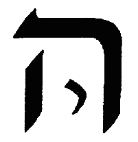

> וענין ג' וז' וי"ב יתבאר יותר עוד בשער המציאות בס"ד. ורוח לכל אחת פי' כאשר האציל האותיות נאצל מעצמות החכמה רוח ונשמה לכל א' מהן, דהיינו הנקוד שהוא נשמה לאותיות, האותיות בבינה והנקוד מחכמה. ובספירות רוח לכל אחת מהן היינו העצמות המתפשט לתוך הכלים שכך הי' מציאות אצילותם כאשר יתבאר מתוך מאמר הזהר בשער עצמות וכלים בפ"ז. שלש מים מרוח היא הבינה שהיא שלישית, [פי' מים (ממש) (כש"כ בשער טעם האצילות פ"ד) בענין מאמר ג' שהוא יקוו המים הוא בבינה. והטעם שנקראת מים מפני שהם עבים מהרוח והם מקבלות הציור יותר וכן היא מקבלת יותר ציור הנמצאות ושם מתגלות יותר מבחכמה. חקק בהם תהו ובהו ורפש וטיט שהם מציאות ד' אותיות שבבינה. תהו י', בהו ה', ו' רפש, ה' טיט. ובב"ר פי' מאי בהו, דבר המלביש את התהו. ואמר תהו הוא קו ירוק דאסחר עלמא שהיא הבינה. ולא הבינה ממש, אלא הי' שבבינה שיש לה מציאות היולי שאינו מתגלה בעצם. ר"ל כי השכל שופט בה כל השפטות כענין ההיולי והוא סובלן לרוב הרחקו מהדעת [של האדם להשיג], אבל בהו שהוא הה"א מלביש הי' דהיינו ה' בית והיכל אל י' כזה.

**3:5:6** And it is "*bohu*" that gives depiction to the *tohu* and reveals the matters concealed in it. "Mire" (*refesh*) is a greater thickness, indicating greater revelation; and this is "mire," which is the Vav, which is Tiferet, which is the revelation of Binah, although it is still concealed in it. And "clay" (*tit*) is [a still] greater thickness and revelation, namely Malkhut, which is the final Heh.

> והוא בהו שנותן ציור אל התהו ומגלה העניינים הנעלמים בה. רפש הוא עביות יותר מורה על גלוי יותר והיינו רפש שהוא הו' שהוא התפארת שהוא גלוי הבינה עם היות שהוא עדיין נעלם בה. וטיט הוא עביות וגלוי יותר היינו המלכות שהיא ה"א האחרונה.

**3:5:7** Now the existence of their emanation in Binah is from the power of Chokhmah. "He engraved them like a kind of garden-bed," etc. — here he included the existence of the six extremities: namely, "like a kind of garden-bed" is the below; "and set them up like a kind of wall" is the girding of the four walls of the wall — west, east, north, south; "covered them like a kind of ceiling" is the above — to indicate that, in the existence of the Vav stated in the word "mire" (*refesh*), as I explained there, the six extremities mentioned are included, and they are in the power of Binah. "Four: fire from water," etc. — it is Malkhut; and by means of it the rest of the worlds were created, for by means of the first three all the Emanation was made and emanated, and in particular by means of Binah. And he placed Malkhut first [with the word "clay"], before the existence of the [other] extremities, because they were already hinted at in their existence within Binah. And because he mentioned their emanation from Binah, he mentioned the rest of the existence of the worlds, namely the throne of glory and the seraphim, etc. And Malkhut is called "fire" because it is the lower Gevurah; and he said "from water," [in] that it is Malkhut from Binah, and so [is] their inclination: Binah, the upper Heh, its inclination is toward the right, and Malkhut, the lower Heh, its inclination is toward the left, and they are the right hand and the left hand, as is proved in the Tikkunim, and as will be explained in the Glossary of Titles, with God's help. And the secret of the throne of glory is Beriah, as we shall explain in the Gate of ABYA. "And from the three of them He founded His abode" — the meaning: from these three aspects, which are spirit, water, fire, are the foundation and the abode of the Shekhinah, as is proved by the verses. "Five: He sealed [the] height," etc. — namely Netzach, namely above. And he placed it first for [several] reasons: either because its principal sealing was by means of Chokhmah, as Rashbi, peace be upon him, explained, as we set down earlier; and likewise the sealing of the below, which is Hod, was by means of Binah, and therefore he placed it first; or for the sake of the order of the extremities. And Rashbi, peace be upon him, was compelled, in the passage of the Tikkunim, to explain that the sealing of above and below was by means of Chokhmah and Binah, because with them were sealed "life" (*chayei*) and "sustenance" (*mezonei*); and we hold that "children, life, and sustenance" depend not on merit (*zekhut*) — namely Chesed — but on *mazal* — namely Keter; and not Keter specifically, but the first three. And so it is proved in the Zohar in Parashat Vayera, on the verse "behold, I [will] add to your days" — that it did not say "I am adding" (*mosif*), speaking in the present[, addressed] to [the listener's] presence, but "I will add" (*yosif*), speaking of the hidden [third person], which is Binah. Therefore, surely, the *mazal* — although it is principally Keter — is in partnership with the first [three]; and therefore, in order to seal "life" and "sustenance" in Netzach and Hod, it was necessitated [that it be] by means of Chokhmah and Binah. And by this is understood the doubled language of Rashbi, peace be upon him, in the passage [mentioned above]. "Seven: He sealed [the] east," etc.; "Eight: He sealed [the] west," etc. — namely Tiferet and Yesod, as explained in the preceding chapter, and so Rashbi, peace be upon him, explained. And north and south [are] according to their plain sense, which are GaG [Gedulah-Gevurah]. And after we have included the explanation of the *mishnah* of the seals, let us explain the *mishnah* of the depths; and this is its explanation, in this manner, and not exactly like it: "the depth of beginning and the depth of end" are Keter and Malkhut, in the secret of "I am first and I am last," which we explained in chapter 1. "The depth of good and the depth of evil" are Chokhmah and Binah, for this is the source of compassion and Chesed, as is known, and this is the source of judgment and punishment; and according to all the explanations, "evil" is not precise. And "the depth of above and the depth of below," etc., are the six extremities, as I explained above. And we have gained, by the way, that these six extremities are literally the six sides mentioned, and [are] hinted at in the words of Rashbi, peace be upon him, in several places; and there is nothing twisted or crooked in them, and "each man comes to his place in peace." And their proof from these *mishnayot* is nullified, [in] that "the pendants that were leaning [on it] are washed away." And in the way that he explained in the Tikkunim, he likewise explained in the Ra'aya Mehemna, in the completion of the ten *tikkunim* of the table; and we have not seen [fit] to copy it here, so as not to be lengthy.

> והנה מציאות אצילתן בבינה הם מכח החכמה. חקקן כמין ערוגה וכו' כאן כלל מציאות ו' קצוות. דהיינו כמין ערוגה הוא התחת. והציבן כמין חומה היינו חגורת ארבע דפנות החומה מערב מזרח צפון דרום. סככן כמין מעזיבה היינו מעלה. להורות כי במציאות הוא"ו האמורה במלת ורפש כדפרישת שם כלולים הו"ק הנזכר והם בכח הבינה. ארבע אש ממים כו' הוא המלכות ועל ידה נבראו שאר העולמות כי ע"י ג' הראשונות נעשה ונאצל כל האצילות ובפרט ע"י הבינה. והקדים המלכות [במלת וטיט] אל מציאות הקצוות מפני שכבר נרמזו במציאותן בתוך הבינה. ולפי שהזכיר אצילתן מהבינה הזכיר שאר מציאות העולמות דהיינו כסא הכבוד ושרפים כו'. והמלכות נקרא אש מפני שהיא גבורה תתאה, ואמר ממים שהיא מלכות מבינה וכן נטייתם. הבינה ה' עילאה נטייתה אל הימין ומלכות ה' תתאה נטייתה אל השמאל והם יד ימין ויד שמאל כדמוכח בתיקונים וכמו שיתבאר בשער ערכי הכנויים בס"ד. וסוד כסא הכבוד היינו הבריאה כמו שנבאר בשער אבי"ע. ומשלשתן יסד מעונו פירוש מג' בחינות אלה שהם רוח מים אש הן יסוד ומעון השכינה כדמוכח מקראי. חמש חתם רום כו' היינו נצח דהיינו מעלה. והקדימו לסיבות. אם מפני שעיקר חתימתו הי' על ידי החכמה כמו שפירש הרשב"י ע"ה כמו שהקדמנו. וכן חתימת התחת שהיא ההו"ד הי' ע"י הבינה ולכן הקדימו. או לסבת סדר הקצוות. והוכרח הרשב"י ע"ה במאמר התיקונים לבאר שחתימת מעלה ומטה הי' ע"י החכמה והבינה מפני שבהם נחתמו חיי ומזוני וקי"ל דבני חיי ומזוני לאו בזכותא תליא מלתא דהיינו חסד אלא במזלא דהיינו כתר ולאו דוקא כתר אלא ג' ראשונות וכן מוכח בזוהר בפ' וירא [ב] בפסוק הנני יוסיף על ימיך שלא אמר מוסיף כמדבר לנוכח אלא יוסיף כמדבר לנסתר שהיא הבינה. לכן ודאי מזלא עם היות שעקרו כתר הוא בשתוף הראשונות ולכן כדי לחתום חיי ומזוני בנצח והוד הוכרח להיות ע"י חכמה ובינה. ובזה יובן כפל לשון הרשב"י ע"ה במאמר [התקונים הנ"ל]. ז' חתם מזרח כו' ח' חתם מערב כו' היינו ת"ת ויסוד כדפי' בפרק הקודם וכן בארו הרשב"י ע"ה. וצפון ודרום כמשמען שהם ג"ג. ואחר שכללנו באור משנת החותמות נבאר משנת העמקים וזהו פירושו עד"ז ולא ממש כמוהו. עומק ראשית ועומק אחרית הם כתר ומלכות בסוד אני ראשון ואני אחרון שבארנו בפ"א. עומק טוב ועומק רע הם חכמה ובינה, כי זה מקור הרחמים והחסד כנודע, וזה מקור הדין והעונש. ולכל הפירושים רע לאו דוקא (ו' או) (ואומרו עומק רום ועומק תחת כו' הם) ו"ק כדפי' לעיל. והרוחנו אגב אורחין שהני שש קצוות הם ממש שית סטרין הנזכר ורמוזים בדברי הרשב"י ע"ה בכמה מקומות. ואין בהם נפתל ועקש ואיש על מקומו יבא בשלום. ובטלה ראייתם מתוך משניות אלו דבתלי דהוו סמוכי איתסחו. ובדרך זה שביאר בתיקונים ביאר ג"כ בר"מ בתשלום י' תיקוני השלחן. ולא ראינו להעתיקו הנה שלא להאריך:

### Chapter 3:6. The *tikkun* of the passage of the Idra, "after the beginning was found" (*achar de-sharuta ishtekach*), which seemingly accords with R. Shem Tov; we cited another commentator's interpretation and our objection to him.

**3:6:1** After we have, in the preceding chapter, striven in the explanation of the *mishnah* of Sefer Yetzirah and to nullify the proofs of Rabbi Shem Tov and the rest of the commentators who say that Keter does not enter into the count of the sefirot, we shall now come, in this chapter as well, to nullify his proof from the words of Rashbi, peace be upon him (in the Idra of Ha'azinu, folio 289b), [where] these are his words: "The place where the beginning is found is from the Holy Ancient One, which is illumined from the *mazal* — it is the illumination of Chokhmah, which spreads to thirty-two directions; and they came forth from that enclosed brain, from the illumination that is in it. And what the Holy Ancient One illumines first (a variant: in Chokhmah) — this it is; and the beginning was from what was revealed; and it was made into three heads, and one head includes them. And these three spread out in Zeir Anpin, and from these all is illumined. This Chokhmah was engraved, and it brought forth one river that flows and issues to water the garden; and it entered the head of Zeir Anpin, and was made into one brain; and from there it is drawn and flows into the whole body, and waters all those plantings; this is what is written, 'and a river issues from Eden [to water the garden,' etc. Again,] this Chokhmah was engraved and was drawn, and entered the head of Zeir Anpin, and was made into another brain. That illumination which was drawn from it — these two drawings were engraved and joined as one by means of [one] drawing of the depth of the well, of which it is written, 'by His knowledge the depths were cleaved'; and it entered the head of Zeir Anpin and was made into another brain; and from there it is drawn and enters within the body, and fills all those chambers and halls of the body; this is what is written, 'and by knowledge the chambers are filled.' And these are illumined from the illumination of that supernal, enclosed brain that is illumined by the *mazal* of the Holy Ancient One; and all are suspended this from that, and bound this to that and that to that — until it is recognized that all is one, and all is the Ancient One, and nothing is separated from it. These three lights illumine three others, which are called the fathers; and these fathers illumine the sons; and all is illumined from one place." Thus far [his words].

> אחר שבפרק הקודם השתדלנו בביאור משנת ס"י ולבטל ראיות הרש"ט ושאר המפרשים האומרים שכתר אינו נכנס במנין הספירות, נבא עתה בפ' זה ג"כ לבטל ראיותו מדברי הרשב"י ע"ה (באידרת האזינו דף רפ"ט ע"ב) וז"ל אתר דשרותא אשתכח, מעתיקא קדישא דאתנהיר ממזלא, הוא נהירו דחכמתא דאתפשט לל"ב עיבר, ונפקו מההוא מוחא סתימאה מנהירו דביה. ומה דעתיקא קדישא נהיר בקדמיתא (נ"א בחכמתא), דא היא, ושרותא ממה דאתגליא הוה, ואתעביד לתלת רישין. ורישא חדא כליל לון. ואלין תלת מתפשטין בזעיר אנפין. ומאלין נהרין כלא. אתגליף האי חכמתא, ואפיק חד נהרא דנגיד ונפיק לאשקאה גינתא. ואעיל ברישא דזעיר אנפין, ואתעביד חד מוחא. ומתמן אתמשך ונגיד בכל גופא, ואשקי כל אינון נטיען. הה"ד ונהר יוצא מעדן [להשקות את הגן וגו'. תו) אתגליף האי חכמתא ואתמשיך, ועייל ברישא דזעיר אנפין, ואתעביד מוחא אחרא. ההוא נהירו דאתמשכא מניה אלין תרין משיכן אתגליפו ואתחברן כחד ע"י [חד] משיכו דעמיקא דבירא, דכתיב בדעתו תהומות נבקעו. ועייל ברישא דזעיר אנפין ואתעביד מוחא אחרא, ומתמן אתמשך ועייל בגו גופא, ומלייא כל אינון אידרין ואכסדרין דגופא. הה"ד ובדעת חדרים ימלאו. ואילין נהירין מנהירו דההוא מוחא עילאה סתימאה דאתנהיר במזלא עתיקא קדישא, וכלא דא בדא תליין. ואתקשיר דא בדא ודא בדא. עד דאשתמודע דכולא חד, וכלא הוא עתיקא ולא אתפרש מניה כלום. אלין תלת נהורין נהרין לתלת אחרנין דאקרון אבהן, ואלין אבהן נהרין לבנין וכלא נהיר מאתר חד עכ"ל.

**3:6:2** And regarding this passage, there has come to us a certain treatise (*kuntres*) from one of the accepted sages of this generation, and he explained in it an interpretation at length, with proofs from passages of the Zohar. And since, afterward, he returned and explained the construal of the language of the passage and its explanation without [bringing] proofs to his premises, we have seen [fit] to copy here that [shorter] interpretation, so that the examiner may be wary of it — for we shall not need to be lengthy, since most of our premises are explained in these Gates. And these are his words: "'The place where the beginning is found' — the place of the beginning of the Emanation, which is found and emanated from the Holy Ancient One, the Ein Sof, which illumines by way of Keter, called '*mazal*' — and the reason you will find in the long explanation. 'It is the illumination of Chokhmah' — it is the light of Chokhmah, the wisdom of God, whose light spreads in the thirty-two paths. 'And they came forth,' etc. — that the spreading of this light comes and issues from Keter, called the supernal Keter, enclosed and sealed, and does not fall under thought. 'And what the Holy Ancient One illumines,' etc. — and what the Ein Sof illumines first. 'This it is' — that is, Chokhmah. 'And the beginning was from what was revealed,' etc. — and the beginning of the revelation of the Emanation from the Ein Sof is this [Chokhmah], for Keter is not apprehended even in thought. 'And it was made into three heads' — this Emanation that comes from the Ein Sof was made [into] three heads, [which] are Keter, Chokhmah, Binah. 'And one head includes them' — for although they have [their separate] place, the true union is only in [all] three of them. 'And these three spread out in Zeir Anpin' — the three mentioned spread their emanation down to the last [sefirah], called Zeir Anpin; and the matter, [see the long explanation]. 'And from these all is illumined' — all of them receive these light and effluence, and they have none besides them. 'This Chokhmah was engraved' — the meaning of what he said above, 'and three heads were made': for we found only two, and the third — how was it emanated? He said, 'it was engraved,' etc. — this [Chokhmah] was opened and there was emanated from it [the third]. 'An illumination that flows and issues' — it is Binah; and the reason it is called so, [see the long explanation]. 'These two' — they are Chokhmah and Binah, which were emanated and drawn from Keter, [and which] open and draw themselves together in one drawing into the depth of Tiferet, into all those chambers and halls; and the matter of the drawing of this light from Chokhmah and Binah, [see the long explanation]. 'And these illumine with illumination' — these chambers all illumine with the light of that attribute, which is Keter, the *mazal* of the Holy Ancient One. 'And all are suspended this from that' — and all the sefirot are bound this to that, until the Emanation that comes from the Ein Sof is recognized and known and apprehended; and this matter is a great secret among the secrets of the Kabbalah, and the matter you will understand, [see the long explanation]. 'And all is one' — and all is unified, this unifying with that. 'And all is the Ancient One' — and all of them are unified in it like a flame bound to a coal. 'These three lights' — they are Keter, Chokhmah, Binah. 'Illumine three others' — they are Chesed, Pachad, Tiferet, which, below them, are unified each one opposite [the upper] one: Chesed in Chokhmah, and Pachad in Binah, and Tiferet ascends by way of the middle line and is unified in Keter; and the reason, [see the long explanation]. 'And these fathers illumine the sons' — they are Netzach, Hod, Yesod; and [the reason] he called these 'fathers' and these 'sons,' [see the long explanation]. 'And all is illumined from the place of the beginning' — he now returned and included all that he said above, and concluded with that with which he began: all the sefirot receive their light from the place of the beginning of the Emanation." Thus far the short interpretation. And in every place where "T B H" (Tav-Bet-Heh) is written [in his text], its initials [mean] "you will find it in the long explanation," since there he brought a passage or passages from the Zohar as proof for that matter; and these passages neither raise nor lower [anything] in the explanation of the passage at all. And what there is to object to him is this: that he explained "the Holy Ancient One" [as] the Ein Sof — and this does not appear [correct], for even Keter, most of the time, Rashbi, peace be upon him, designates by the name "Ancient of Ancients" (Atika de-Atikin); how much more, then, would he now designate the Ein Sof by the name "Holy Ancient One"?

> ובמאמר הזה נמצא אלינו קונטריס אחד מהחכמים המתקבלים בדור הזה ובאר בו פי' בארוכה בראיות ממאמרים מהזוהר. ולהיות שאח"כ חזר ובאר התכת לשון המאמר וביאורו בלי ראיות אל הקדמותיו ראינו להעתיק הנה הפירוש ההוא להזהר ממנו המעיין כי לא נצטרך להאריך יען היות רוב הקדמותינו מבוארות בשערים האלה. וז"ל אתר דשרותא אשתכח, מקום התחלת האצילות שנמצא ונאצל מעתיקא קדישא אין סוף שמאיר דרך הכתר הנקרא מזל והטעם תמצאנו בביאור הארוך. הוא נהירו דחכמתא, הוא אור החכמה חכמת אלקים שאורה מתפשטת בל"ב נתיבות. ונפקו וכו', שהתפשטות האורה הזאת באה ויוצא מהכתר הנקרא כ"ע סתים וחתים ואינו נופל תחת המחשבה. ומה דעתיקא קדישא נהיר וכו', ומה שאין סוף מאיר בתחלה. דא היא, ר"ל החכמה. ושירותא ממה דאתגליא הוה וכו', והיא תחלת התגלות האצילות מהאין סוף היא זו כי הכתר אינו מושג אפילו במחשבה. ואתעביד לתלת רישין, האצילות הזה הבא מאין סוף נעשה ג' ראשין הן כתר חכמה בינה. ורישא חדא כליל לון, כי אע"פ שיש להם מקום אין היחוד האמיתי כ"א בשלשתן. ואלין תלת מתפשטין בז"א, השלשה הנזכרים מתפשטין אצילותן עד האחרונה הנקרא זעיר אנפין, והענין תב"ה. ומאלין נהרין, כלהו מקבלין אור ושפע האלה ואין להם זולתם. אתגליף האי חכמתא, פי' מה שאמר למעלה ואתעבידו תלת רישין כי לא מצינו אלא שנים והג' האיך נאצל אמר אתגליף וכו' נפתחה זאת ונאצל ממנה. נהיר דנגיד ונפיק, והיא הבינה, והטעם שנקרא כך תב"ה. אלין תרין, הן חכמה ובינה אשר נאצלו ונמשכו מן הכתר מתפתחין וממשיכין עצמן יחד בהמשך אחד בעומק הת"ת בכל אינון אדרין ואכסדרין, וענין המשך האור הזה מן החכמה והבינה תב"ה. ואלו נהרין בנהירו, אלו החדרים כלם מאירים באור של אותה מדה והיא כתר מזלא עתיקא קדישא. וכלא דא בדא תליין, וכל הספירות מתקשרות זו בזו ועד שניכר ונודע ונישג האצילות הבא מאין סוף, והענין הזה סוד גדול מסודות הקבלה, והענין תבינהו מב"ה. וכלא חד, והכל מיוחד מתיחד זה בזה. וכלא הוא עתיקא, ומתיחדים כלם בו כשלהבת ק"ב. אלין תלת נהורין, הן כתר חכמה בינה. נהירן לתלת אחרנין, הם חכמה פחד תפארת אשר למטה מהם מתיחדים כל אחד זה כנגד זה החסד בחכמה והפחד בבינה והת"ת עולה דרך קו האמצעי ומתייחד בכתר והטעם תב"ה. ואלין אבהן נהירין לבנין, הן נצח הוד יסוד, ומה שקרא לאלה אבות ולאלה בנים תב"ה. וכלא נהיר מאתר שרותא, חזר עתה וכלל כל מה שאמר מלמעלה וסיים במה שהתחיל בו כל הספירות מקבלות אורה ממקום התחלת האצילות עכ"ל הפי' הקצר. ובכ"מ שכתוב תב"ה ר"ת תמצאנו בביאור הארוך לפי ששם הביא מאמר או מאמרים מהזהר לראייה על הענין ההוא ואין המאמרים האלה מעלין ומורידין בפירוש המאמר כלל. ומה שיש להקשות עליו הוא זה כי הוא פי' עתיקא קדישא א"ס, ואינו נראה כי אפילו הכתר רוב פעמים מכנה אותו הרשב"י ע"ה בשם עתיקא דעתיקין כ"ש שיכנה עתה לא"ס בשם ע"ק.

**3:6:3** And further, that it is impossible for the intent of "the Holy Ancient One" to be the Ein Sof, because he [Rashbi] said that the Holy Ancient One is illumined and receives its light from the *mazal* — and therefore he said "is illumined" (*de-itnehir*) in the passive form, and did not say "illumines" (*de-anhir*) or "illumines" (*de-nahir*), which is an active verb; and so it is written in all the versions, and so it was written in the version of this commentator [too] — and even so, he pressed to explain it [in] the active form, [in] that he said "the Holy Ancient One, the Ein Sof, which illumines by way of Keter, called *mazal*." Thus far [his words].

> ועוד שא"א שתהיה כונת ע"ק בא"ס מפני שאמר כי ע"ק מתנהר ומתקבל אורה מהמזל ולכן אמר דאתנהיר בלשון התפעל ולא אמר דאנהיר או דנהיר שהוא פועל יוצא וכן כתוב בכל הנוסחאות וכן היה כתוב בנוסחת המפרש הזה ועכ"ז דחק לפרשו לשון פועל יוצא שאמר עתיקא קדישא אין סוף שמאיר דרך הכתר הנקרא מזל עכ"ל.

**3:6:4** And further, his saying is difficult: "and what the Holy Ancient One illumines first — this it is." And he explained: "that which the Ein Sof illumines first is this," that is, Chokhmah. And it is difficult — for, granted, "'and the beginning was from what was revealed,' etc." is fine, for although it [Chokhmah] is second to the Emanation, even so it is first to the revelation; but "'and what the Holy Ancient One illumines,' etc." appears [to mean] that this is literally the beginning of its illumination — and this is not so, for Keter is the beginning of illumination and Emanation according to all the explanations, even according to the words of Rabbi Shem Tov; for, certainly, they differ only [in] that he says it is not fitting that Keter enter into the count, but he admits that it is the beginning of the illumination of the Ein Sof.

> ועוד קשה אמרו ומה דנהיר עתיקא קדישא בקדמיתא דא היא. ופי' שאין סוף מאיר בתחלה היא זו ר"ל החכמה. וקשה כי בשלמא ושרותא ממה דאתגליא וכו' ניחא כי עם היות שהיא שניה אל האצילות עכ"ז היא ראשונה אל הגלוי, אבל ומה דע"ק נהיר וכו' נראה שממש זה תחלת הארתו, וזה אינו כי הכתר הוא תחלת הארה ואצילות לכל הפירושים אפילו לדברי הרש"ט דע"כ לא פליגי אלא שאומר שאין ראוי שיכנס הכתר במנין אבל מודה שהוא תחלת הארת של אין סוף.

**3:6:5** And further, the doubled language "and the beginning" does not settle with his interpretation at all. Further, his saying "and it was made into three heads" — for, granted, if he were speaking of the existence of the Emanation in general, it would be fine for him to say that this Emanation was made [into] three heads, which are Keter-Chokhmah-Binah; but the intent of the passage was only to say that the existence of the beginning of the revelation is Chokhmah — if so, why did he say "it was made into three heads"? For which one was made into three heads? — since the particulars of the heads he mentioned above, [where] he said "which is illumined from the *mazal*," namely Keter, "it is the illumination of Chokhmah," namely Chokhmah: it is not applicable to it [Chokhmah] [to say] "it was made into three heads." Further, he said "and one head includes," etc. — he explained: that although they have [their separate] place, the true union is only in [all] three of them. And it is difficult — for if the intent were to say that the three of them are reckoned as one, he should not have said "and one head," which implies one sefirah that includes them, but [rather] "and they are included in one," the intent [being] that the three of them are reckoned as one. Further, he said "and these three spread out in Zeir Anpin," and explained: the three mentioned spread their emanation down to the last [sefirah], etc. — and this is very strained, for the nature of the language does not indicate that his occupation here is with the matter of the existence of the Emanation; and likewise it would not have been fitting for him to say "and they spread out in Zeir Anpin," which implies that Zeir Anpin is already emanated, whereas according to his interpretation he is still occupied with the beginning of the Emanation, before the whole structure was emanated. And there are yet very many matters with superfluous language, whose matter is not explained according to his interpretation; and so as not to be lengthy, it is not my wish to object to all his words — and with a little examination the difficulty of his understanding in the interpretation will be apprehended. And now it is fitting that we come to the interpretation of the passage in a manner that a settled explanation may be explained, and the proofs of Rabbi Shem Tov nullified, with God's help.

> ועוד כפל לשון ושירותא שאינו מתישב לפירושו כלל. עוד אמרו ואתעביד תלת רישין. כי בשלמא אם היה אומר מציאות האצילות בכלל הוה ניחא שיאמר שהאצי' הזה היה נעשה בג' ראשין שהן כח"ב. אבל כוונת המאמר לא היה אלא לומר שמציאות תחילת הגלוי הוא החכמה א"כ מה אמר דאתעביד לתלת רישין כי איזהו נעשה לג' ראשים שהרי פרטיות הראשים הזכיר למעלה שאמר דאתנהיר ממזלא דהיינו כתר הוא נהירו דחכמתא היינו חכמה לא שייך עלה דאתעביד לתלת רישין. עוד אמר ורישא חדא כליל וכו' פי' כי אע"פ שיש להם מקום אין היחוד האמיתי כי אם בשלשתם ע"כ, וקשה דאם הכונה לומר ששלשתם חשובות כאחד לא היה לו לומר ורישא חדא דמשמע ספירה אחת כוללת אותם אלא ואתכללן בחד שהכוונה ששלשתן חשובות כאחד. עוד אמר ואלין תלת מתפשטין בז"א ופירש השלשה הנזכרים מתפשט אצילותן עד האחרונה כו', ודוחק גדול הוא זה כי אין טבע הלשון מורה שיהיה עסקו כאן בענין מציאות האצילות, וכן לא היה ראוי שיאמר ומתפשטין בז"א שמורה שז"א היא נאצל כבר ולפי פירושו עדיין הוא עוסק בתחלת האצי' קודם שנאצל הבנין כלו. ויש עוד כמה וכמה עניינים ביתור לשון ועניינם אינם מתבארים לפירושו, וכדי שלא להאריך אין רצוני להקשות על כל דבריו ובמעט העיון יושג קושי הבנתו בפי'. ועתה ראוי שנבא בפירוש המאמר באופן שיתב' ביאור מתישב ותתבטל ראיות הרש"ט בס"ד:

### Chapter 3:7. A lengthy explanation of the aforementioned passage.

**3:7:1** Before we enter into the explanation of this passage, we must preface one premise briefly — and its explanation will be at length in the book Or Yakar, in the commentary on the Idra, with God's help. And the matter is that, although ten sefirot are emanated, and they are garments to the light of the providence of His governance, as we shall explain in the Gate of Self and Vessels, with God's help — even so, He clothes Himself in Keter, and there is the palace of His providence and His light; and it [Keter] is what cleaves and unites with the Emanator [to] the utmost [degree of] cleaving and union, to the point that it is forbidden to prolong speech about this matter.

> קודם שנכנס בביאור המאמר הזה צריכין אנו להקדים הקדמה אחת בקצרה ויאריך ביאורה בספר או"ר יק"ר בפירוש האידרא בע"ה. והענין הוא שעם היות עשר ספירות נאצלות והם לבושים אל אור השגחת הנהגתו כמו שנבאר בשער עצמות וכלים בע"ה, עכ"ז הוא מתלבש בכתר ושם היכל השגחתו ואורו והוא המתדבק ומתאחד במאציל תכלית הדיבוק והיחוד עד שיהיה אסור להאריך הדבור בענין זה.

**3:7:2** Now, by means of Keter, the concealment of His existence is a first concealment. And accordingly, the concealment of Keter was necessitated, to the point that its manifestation is not literally revealed in the rest of the sefirot, nor will it be revealed in them; and just as they do not include the existence of the Emanator, so they do not include Keter — except that Keter pours its effluence, by the power of the Emanator, into the sefirot, by means of Da'at, as will be explained, with God's help. And on account of the great concealment of Keter, we do not call it "the beginning of the Emanation," because it is not the beginning of the Emanation that is revealed to us — but [rather] Chokhmah; and from Chokhmah and below are the totality of the sefirot, [counted] from ten, by means of the Da'at that completes [the count]. And not that Da'at is a sefirah — rather, it is an aspect that completes the totality of the sefirot, [enabling] them to include ten from Chokhmah and below, as we shall expand the explanation in the aforementioned book. And we know that this matter alarms the heart of beginners in the wisdom of Kabbalah, and the things do not settle for them until they come to the place that we have appointed for this inquiry — and then the gates of light will be opened.

> והנה ע"י הכתר העלם מציאותו העלם ראשון. ולפ"ז הוכרח העלם הכתר עד שאין מציאותו ממש מתגלה בשאר הספי' ולא יגלה בהם וכמו שלא יוכללו ממציאות המאציל כן אינן נכללות מהכתר אלא שהכתר שופע שפעו בכח המאציל בספי' ע"י הדעת שיתבאר בע"ה. ולרוב העלם הכתר לא נקראהו תחלת האצילות מפני שאינו תחלת האצילות המתגלה אלינו אלא החכמה ומחכמה ולמטה הם כללות הספירות מעשר באמצעות הדעת המשלים. ולא שהדעת היא ספירה, אמנם היא בחינה משלמת כללות הספירות להיותם כלולות מעשר מחכמה ולמטה כמו שנרחיב הביאור בספר הנזכר. וידענו היות ענין זה מבהיל לב המתחילים בחכמת הקבלה ואין הדברים מתישבים אליהם עד שיבאו אל המקום שיעדנו אל הדרוש הזה ואז יפתחו שערי אורה.

**3:7:3** Now the emanation of Keter is called Arikh Anpin (the Long Face), and it is the first concealment to the Emanator. The second concealment is Zeir Anpin (the Small Face), and it includes all eight sefirot, which are from Chokhmah to Yesod; and this is the secret of the second concealment to the Emanator. The third concealment is called Nukva de-Zeir Anpin (the Female of Zeir Anpin), and it is Malkhut. And the secret of these three concealments is explained in the Idra, at the passing of Rashbi, peace be upon him, as the explanation will be expanded for us there. And even so, let these matters be [set] before the examiner; and let him not rebel against them, but let him kiss his lips and say, "if it is a received tradition, we shall receive [it]" — for the place of their explanation we have appointed to the aforementioned book, with God's help.

> והנה אצילות הכתר נקרא אריך אנפין והוא העלם ראשון אל המאציל. העלם ב' הוא זעיר אנפין והוא כולל כל ח' ספירות שהם מחכמה עד יסוד וזהו סוד העלם שני אל המאציל. העלם ג' הוא נקרא נוקבא דזעיר אנפין והוא המלכות. וסוד ג' העלמים אלה הם מתבארים באדרא בפטירת הרשב"י ע"ה כאשר יתרחב לנו הביאור שם. ועכ"ז יהיו הדברים האלה נגד המעיין ואל יתריס כנגדם וישק שפתיו ויאמר אם קבלה נקבל כי מקום ביאורם יעדנו אל הספר הנזכר בעה"ו.

**3:7:4** And further, we must preface a premise that we received from our teacher and master, Rabbi Solomon — may his light shine — that each and every sefirah is examined in three aspects: the first aspect, in respect of what it receives; the second, in respect of its own self; the third, in respect of what it emanates. The example of this [is] in Chokhmah, which is the matter under discussion before us: it has a first aspect, in respect of which it is equalized to Keter — [and] in this aspect it receives and is illumined from it; and this aspect is its subtlety and its spirituality, higher in degree than the aspect of its own self, since the supernal Keter is joined to it. And it has a second aspect, which is the aspect of its own self, which is its [particular] character — which is the light that illumines in its own self, without any other sefirah besides it being joined to it. And it has a third aspect, which is the aspect in which it is equalized to Binah, in order to emanate to it from its effluence.

> ועוד צריכין אנו להקדים הקדמה קבלנוה ממורינו ורבינו הר"ר שלמה נר"ו, שכל ספירה וספירה תבחן בג' בחינות. בחינה ראשונה בערך מה שמקבלת, ושנייה בערך עצמותה, שלישית בערך מה שמשפעת. המשל בזה בחכמה שהוא הנדון שלפנינו יש לה בחינה ראשונה בערך שמשתוות אל הכתר שבבחינה זו היא מקבלת ומאירה ממנה ובחי' זו היא דקותה ורוחניותה עליונה במעלה יותר מבחינת עצמותה להיות שנצטרף אליה הכתר עליון. ויש לה בחי' שניה והיא בחינת עצמותה אשר היא תכונתה אשר הוא האור המאיר בעצמותה בלי שיצטרף אליה שום ספי' אחרת זולתה. ויש לה בחי' ג' היא בחינת שהיא משתווית בה אל הבינה כדי להשפיע לה משפעה.

**3:7:5** Now this aspect is not subtle and spiritual like the first two aspects, for the reason that the lower attribute, which is below it, is joined to it. And not specifically Binah — rather, the same applies to Chesed and the rest of the sefirot that draw sustenance from it.

> והנה הבחינה הזאת אינה דקה ורוחניות כשני בחי' הראשונות מטעם שנצטרף אליה מדה התחתונה שהיא למטה ממנה. ולאו דוקא הבינה אלא ה"ה החסד ושאר הספי' היונקות ממנה.

**3:7:6** And further, we must preface, regarding the matter of this passage in general: that this passage was expounded in Parashat Ha'azinu, at the time of the passing of Rashbi, peace be upon him, after he had expansively spoken of the matter of Keter and its concealment, and that upon it depends all that is principal in the Emanation. Afterward he began to speak of the manifestation of the Emanation that is revealed, and said that, from the side that Keter is not revealed, therefore the beginning of all the limbs of the Holy Ancient One — their beginning is Chokhmah; and the matter of the three brains, which are opposite the three supernal [sefirot], because Keter is concealed, as he explained there. He said, in the totality of this passage, that the existence of the three brains included in the Chokhmah that is in Keter are three sefirot; and its two aspects [those of Chokhmah] come in the place of the two sefirot, which are Keter and Binah, and the aspect of Da'at that is in Chokhmah is found in the place of Keter itself, as he explains and goes on. And since he came to explain the matter of the three brains that are in Arikh Anpin, by the way he indicated to us the order of the drawing-of-sustenance of the grades — that is, the three fathers, which are Gedulah, Gevurah, Tiferet, draw sustenance from the three brains; for the first of them — that is, the matter of Da'at, as will be explained, and it is in the place of Keter — and from there [is] their sustenance, that is, from these three aspects. And from the three fathers [is] the sustenance of the three branches, which are Netzach, Hod, Yesod. And now the matter of the sustenance of the sefirot, three from three, is understood, although Keter is concealed. And now we shall come to the explanation of the language of the passage, with God's help. "The place where the beginning is found" — the meaning: the place of the revelation of the Emanation and its being found by us; that is, although the beginning of the Emanation is from the supernal Keter, which is Arikh Anpin, even so it is concealed and is not revealed on account of its great concealment, and the beginning of the revelation of the Emanation is from Zeir Anpin, whose beginning is Chokhmah; and it is called "the beginning" (*shiruta*) because it is the beginning of the revelation. And he said that its emanation and its existence, in [terms of] existence, is from Arikh Anpin, which is Keter. And this is what he said, "the place where the beginning is found" — the meaning: the place where Chokhmah is emanated and found and revealed is from the Holy Ancient One, that is, Keter, Arikh Anpin, called the Holy Ancient One. And the expression "Ancient One" (Atika) indicates priority, as he indicated in the verse (Daniel 7:9), "and the Ancient of Days." And it is called "Holy" (Kadisha), for there is the source of all the holinesses; or he means that "holy" (*kadosh*) means "separate" and "elevated," and it is holy [i.e., separate] in respect of Zeir Anpin, which is emanated in revelation.

> ועוד צריכים אנו להקדים בענין המאמר הזה בכללו כי המאמר הזה נדרש בפרשת האזינו בשעת פטירת הרשב"י ע"ה אחר שהפליג לדבר בענין הכתר והעלמו ושבו תלוי כל עיקר האצילות. אח"כ התחיל לומר במציאות האצילות המתגלה ואמר כי מצד שהכתר אינו מתגלה לכן תחלת כל אברי עתיקא קדישא תחלתם הם החכמה וענין ג' מוחין שהם כנגד ג' עליונות ביען שהכתר הוא נעלם כאשר באר שם. אמר בכללות המאמר הזה כי מציאות ג' מוחות הנכללות בחכמה שבכתר הם ג' ספי' ובאים שתי בחינותיה במקום שתי הספי' שהם כתר ובינה ונמצאת בחינת הדעת שבחכמה במקום הכתר בעצמו כדמפרש ואזיל. ומאחר שבא לבאר ענין ג' מוחות שבאריך אנפין אגב אורחיה הורה לנו סדר יניקת המעלות ר"ל ג' אבות שהם גדולה גבורה תפארת יונקים מג' מוחות כי הא' מהם ר"ל ענין הדעת כאשר יתבאר והוא במקום הכתר ומשם יניקתם ר"ל מג' בחינות אלה. ומג' אבות יניקת ג' ענפים שהם נצח הוד יסוד. ועתה יובן ענין יניקת הספירות מג' לג' עם היות שהכתר הוא נעלם. ועתה נבא בביאור לשון המאמר בע"ה. אתר דשרותא אשתכח, פירוש מקום התגלות האצילות והיותו נמצא אלינו ר"ל כי אע"פ שתחלת האצילות הוא מכ"ע שהוא אריך אנפין עכ"ז הוא נעלם ואינו מתגלה לרוב העלמו ותחלת התגלות דאצילות הוא מז"א שתחלתו החכמה והוא נק' שירותא לפי שהוא תחלת הגלוי ואמר כי אצילותה ומציאותה במציאות הוא מאריך אנפין שהוא הכתר. וז"ש אתר דשרותא אשתכח פי' מקום שהחכמה נאצלה ונמצאת ונגלית הוא מעתיקא קדישא ר"ל כתר אריך אנפין הנקרא ע"ק. ולשון עתיקא מורה על הקדימה כאשר הורה בפסוק (דניאל ז ט) ועתיק יומין. ונקרא קדישא כי שם מקור הקדושות כולן, או ירצה כי קדוש פי' נבדל ונעלה והוא קדש בערך ז"א הנאצל בגלוי.

**3:7:7** And further, because there are two elders — this elder, who has acquired wisdom, and there is, in the Other Side [Sitra Achra], a worthless elder (*zaken ashmai*), as is known, in the secret of Laban the Aramean — therefore he called it "the holy elder," the meaning [being]: in the secret of holiness, and in its joy no stranger may mingle. "Which is illumined from the *mazal*" — the meaning: that this "beginning" of which he spoke does not illumine from the side of Keter itself, for it is concealed [to] the utmost concealment, but [rather] from the side of a revealed aspect within it, which is the secret of the beard (*dikna*) of the Holy Ancient One, the beard of Arikh Anpin, and it is called "*mazal*." And it is the secret of the aspect of Binah that is in Keter, as will be explained in the aforementioned book. And this aspect in Keter is called by the name "*mazal*" to indicate the emanating aspect within the supernal Keter — that it emanates by it into Zeir Anpin; for that aspect is called "*mazal*," from the expression "water shall flow (*yizal*) from his buckets" (Numbers 24:7), and "and flowing [streams] (*nozlim*) from Lebanon" (Song of Songs 4:15). And the intent now [is]: although Keter was emanated, the beginning of the revelation of the Emanation is in Chokhmah, in the aspect of its reception from the supernal Keter. And it is found, accordingly, that the aspect of the beard that is in Keter emanates into the first aspect of Zeir Anpin, which is Chokhmah; and this is what is meant in his saying "which is illumined from the *mazal*." And so [is] the way — for the last aspect of this [sefirah] emanates into the first [aspect of the next], and the first aspect of Chokhmah is the beginning of the revelation. "It is the illumination of Chokhmah, which spread to the thirty-two directions" — before its interpretation, we must preface that there are two Chokhmahs, and of them it is said (Proverbs 1:20), "wisdoms (*chokhmot*) cry aloud outside"; and as Rashbi, peace be upon him, explained in the Idra: and they are the concealed Chokhmah that is in Keter — and it is the brain of Arikh Anpin, and this is called "the enclosed brain" (*mocha stima'ah*), which does not open even to Binah, and whose paths are not known; and this is called "the brain that rests on its dregs," which does not spread at all, as Rashbi, peace be upon him, explained there. However, the brain of Zeir Anpin is the emanated Chokhmah; it spreads and is revealed from the side of its paths, which spread from it to Binah; and not that it is literally revealed, but that it is not concealed like the concealment of the supernal Chokhmah that is in Keter. And we have expanded the explanation of this matter in the commentary on the Idra in the aforementioned book.

> ועוד לפי שיש ב' זקנים, זקן זה שקנה חכמה, ויש בסטרא אחרא זקן אשמאי כנודע בסוד לבן הארמי. לכן קראו זקן הקדוש פי' בסוד הקדושה ובשמחתו לא יתערב זר. דאתנהיר ממזלא, פי' כי שרותא הזאת שאמר אינה מאירה מצד עצם הכתר כי הוא נעלם תכלית ההעלם אלא מצד בחי' מתגלת שבו שהוא סוד דיקנא דע"ק דיקנא דא"א והיא נקראת מזלא. והוא סוד בחינת הבינה שבכתר כאשר יתבאר בספר הנז'. ונקראת בחינה זו בכתר בשם מזל להורות על בחינה המשפעת שבכ"ע שהוא משפיע בה בז"א כי אותה בחי' יקרא מזל מלשון יזל מים מדליו (במדבר כד ז). ונוזלים מן לבנון (שה"ש ד טו). והכוונה עתה אעפ"י שהכתר היה נאצל, תחלת התגלות האצי' הוא בחכמה בבחינת קבלתה מכ"ע. ונמצא לפ"ז כי בחינת דיקנא שבכתר משפיע בבחינה ראשונה דז"א שהיא חכמה וזהו הנרצה באומרו דאתנהיר ממזלא וכן הדרך כי בחי' אחרונה של זו משפעת בראשונה ובחינה ראשונה של חכמה היא תחלת ההתגלות. הוא נהירו דחכמתא דאתפשטא לל"ב עיבר. קודם פירושו צריכין אנו להקדים כי ב' חכמות הן ועליהם נאמר (משלי א כ) חכמות בחוץ תרונה. וכדפי' הרשב"י ע"ה באידרא והם חכמה נעלמת שבכתר והיא מוחא דא"א וזו נקראת מוחא סתימאה שאינה נפתחת אפי' אל הבינה ונתיבותיה לא נודעו. וזו נקרא מוחא דשקיט על דורדייה שאינו מתפשט כלל כמו שפי' שם הרשב"י ע"ה. אמנם מוחא דזעיר אנפין היא חכמה הנאצלת היא מתפשטת ומתגלית מצד נתיבותיה המתפשטים ממנה אל הבינה. ולא שהיא נגלית ממש אלא שאינה נעלמת כהעלם החכמה העליונה שבכתר. והרחבנו פי' ענין זה בפי' האדרא בספר הנזכר.

**3:7:8** Now the emanation of the revealed Chokhmah is from the concealed Chokhmah. And now, in this, he said that the aforementioned "beginning" is Chokhmah; and because there are two Chokhmahs, as I explained, he said [it is] that revealed Chokhmah which spreads to thirty-two — unlike the concealed Chokhmah, as explained. And he said "and they came forth from that brain" — the meaning: that this Chokhmah and its thirty-two paths are emanated and found from the concealed Chokhmah that is in Keter, which is the brain of the Holy Ancient One, the brain of Arikh Anpin. And he was compelled to say so, lest we err [and] say that this Chokhmah is emanated from Keter itself — for if so, it would be found that Keter itself is revealed, and this is not so, as he expanded there [regarding] its concealment; therefore he said that its source and its emanation is from the Chokhmah that is in Keter. And some read "from that enclosed [brain]" (*mehahu stima'ah*), the intent [being] upon the enclosed Chokhmah that is in Keter; and even so, the more correct [reading is] "from that brain" (*mehahu mocha*), and the intent [is] the brain of Arikh Anpin. And it is possible that the true reading is "from that enclosed brain" (*mehahu mocha stima'ah*), and it is all one matter. And the secret of "from the illumination that is in it" — the intent [is] upon the Chesed that is within the Chokhmah that is within Keter; and this matter is explained and necessitated in the Idra, as we shall explain in the book Or Yakar, in Gate 7, sign 15. "And what the Holy Ancient One illumines," etc. — two [things] were difficult for him, according to his words. One: since the emanation of Chokhmah is not from Keter, as explained, but from the aspect of the concealed Chokhmah — if so, what [does] he mean [by] "the beginning is found from the Holy Ancient One," as explained above? And to this he answered, "and what the Holy Ancient One illumines," etc., "this it is" — the meaning: that all [of] Keter itself [that] is revealed is only this; and since Keter has no other revelation than Chokhmah, it is fitting that we attribute its emanation to it. Again, a second [thing] was difficult for him: why did he say that Chokhmah is the "beginning," since in truth Keter and all its *tikkunim* are the beginning to all the emanated [beings]? And he answered that the intent in his saying "beginning" is not the beginning of the emanated [beings], but the beginning of the revealed [ones]; and Keter is not revealed; and this is what he said, "and the beginning was from what was revealed," the meaning [being] this Chokhmah, as explained. "And it was made into three heads" — the intent [is] upon three aspects, of which the one opposite Keter is Da'at, the second opposite Chokhmah, the third opposite Binah; and they are three brains, for the brain is always in Chokhmah, as is proved in the Zohar, and therefore the brain was made [into] three heads in three cavities, as is proved there in the Idra. "And one head includes" — the meaning: that the three of them are in Chokhmah, [corresponding] to its three aspects, included together; and it is called "the skull" (*gulgalta*), as explained. "And these three spread out in Zeir Anpin" — it is the totality of the Emanation down to Malkhut; and in respect of Arikh Anpin and its adornments and its *tikkunim*, the whole is called Zeir Anpin.

> והנה אצילות החכמה המתגלית היא מהחכמה הנעלמה. ועתה בזה אמר כי השרותא הנזכר היא החכמה ומפני שהן שתי חכמות כדפירש' אמר דהיינו אותה החכמה המתגלית המתפשטת לל"ב, משא"כ החכמה הנעלמת כדפי'. ואמר ונפקין מההוא מוחא, פי' כי החכמה הזאת ול"ב נתיבותיה הם מתאצלים ונמצאין מהחכמה הנעלמה שבכתר שהיא מוחא דעתיקא קדישא מוחא דאריך אנפין. והוכרח לומר כן שלא נטעה לומר שהחכמה הזאת נאצלת מעצם הכתר, שא"כ נמצא שעצם הכתר מתגלה וזה אינו כמו שהפליג שם בהעלמו. לכן אמר כי מוצאה ואצילותה הוא מחכמה שבכתר. ואית דגרסי מההוא סתימאה והכוונה על החכמה הסתומה שבכתר, ועכ"ז היותר נכון מההוא מוחא והכונה מוחא דאריך אנפין. ואפשר היות הגרסא האמיתית מההוא מוחא סתימאה והכל ענין אחד. וסוד מנהירו דביה. הכוונה על החסד שבתוך החכמה שבתוך הכתר ודבר זה מבואר ומוכרח באדרא כמו שנבאר בספר אור יקר בשער ז' סימן ט"ו. ומה דעתיקא קדישא נהיר וכו'. הוקשה לו לפי דבריו תרתי. חדא אחר שאין אצילות החכמה מהכתר כדפי' אלא מבחינת החכמה הנעלמת א"כ מאי קאמר דשרותא אשתכח מע"ק כדפי' לעיל. ולזה תירץ ומה דע"ק נהיר כו' דא היא. פי' מה שכל עצם הכתר מתגלה אינו אלא זאת. ואחר שאין לכתר גלוי אחר אלא החכמה ראוי שניחס אצילותה אליו. שוב הוקשה לו שנית למה אמר שהחכמה הוא שרותא שהרי לפי האמת הכתר וכל תקוניו הם ראשית לכל הנאצלים. ותירץ כי אין הכוונה באמרו שרותא ראשית הנאצלים אלא ראשית גלויים והכתר אינו מתגלה וז"ש ושרותא ממה דאתגלייא הוה פי' החכמה הזאת כדפי'. ואתעבידא לתלת רישין, הכונה אל ג' בחינות אשר האחד כנגד הכתר הוא הדעת ב' כנגד חכמה ג' כנגד בינה, והן ג' מוחות כי לעולם מוח הוא בחכמה כדמוכח בזהר ולכן המוח נעשה ג' רישין בג' חללין כדמוכח שם באידרא. ורישא חדא כליל, פי' כי שלשתם הם בחכמה נגד ג' בחינותיה הכלולות יחד והיא נקרא גולגלתא כדפי'. ואינון תלת מתפשטין בז"א, הוא כללות האצילות עד המלכות. ובערך א"א וקשוטיו ותיקוניו נקרא הכל ז"א.

**3:7:9** And the matter of its spreading in Zeir Anpin he explains further on. "And from these all is illumined" — the meaning: three lines, which are GaGaT [Gedulah-Gevurah-Tiferet], and likewise  N H Y  [Netzach-Hod-Yesod], and they are Chesed, Din, [and] compassion, as he concludes. And the matter is that their sustenance is not literally from Keter, on account of its great concealment, except by means of this aspect, which is the brain of Zeir Anpin, as explained. And they are three roots: Chokhmah, a root to Chesed; Da'at, a root to compassion; Binah, a root to Din. "This Chokhmah was engraved," etc. — the intent [is] to explain the order of the three brains in Zeir Anpin, [namely] their being three heads that are included as one, as explained. And he said that the Chokhmah that includes three heads itself was revealed and engraved and emanated Binah from within the third aspect; and therefore he said, regarding this aspect, "and it brought forth" (*ve-afik*), which was not said so regarding all the rest of the aspects. "And it brought forth one river" — the meaning: Binah, which is the river, and it "issues from Eden," which is Chokhmah; and the matter of "issues" is the expression "brought forth" (*afik*) that he stated, [in] that it is its emanation, "to water the garden," which are the seven plantings, which are the seven days of construction, as was explained. "And it entered the head of Zeir Anpin" — that is, the first brain, from below to above, in Zeir Anpin. "And there it was made into one brain; and from there it is drawn and flows into the whole body" — he means the spreading of Binah from the head of Zeir [Anpin] into the six sefirot that are in Zeir Anpin — that is, that it is drawn from the head to water the body. And the intent is that, from Chokhmah itself, they are engraved in its manifestation, and afterward, from its place, it is drawn to water the body — that is, into the plantings of the garden, which are the six extremities, [together] with Tiferet, called "body," in which is the Vav that is in the name; for Zeir Anpin is Tiferet, as we shall expand its explanation in the book Or Yakar. And he said that from there — from the head of Zeir Anpin that is in Tiferet, which is the totality of the three supernal [sefirot] that are in it — Binah is drawn to water the rest of the plantings, which are the six extremities that are in it, that is, the "body," as explained. "Again, this Chokhmah was engraved," etc. — it is the aspect of Chokhmah itself; and he did not say "and it brought forth," because no new emanation [occurs], but [only] a drawing, which is the spreading of its light from the head of Zeir Anpin — that is, the aspect of the skull (*gulgalta*), which includes [all] three, upon Zeir Anpin — and in it a second brain was made. "That illumination which was drawn" — it is possible that it refers above and returns to Chokhmah; and the more correct [reading is] that it is drawn below, and he means: that illumination which is drawn from it [as] these two drawings — that is, Chokhmah, which includes Binah, and Chokhmah in the manifestation of Chokhmah. "Were engraved" — the meaning: these two aspects were engraved into the aspect of themselves, which is Chokhmah and Binah literally; and this "engraving" is not like the engraving mentioned above, for above [it] was revealed in order to spread into Zeir Anpin, and here they were engraved into the aspect of themselves, as explained.

> וענין התפשטו בזעיר אנפין מפרש לקמיה. ומאילין נהרין כלא, פי' ג' קוין שהן גג"ת וכן נה"י והן חסד דין רחמים וכדמסיק. והענין כי אין יניקתם ממש מכתר לרוב העלמו אם לא ע"י בחינה הזאת שהוא מוחא דז"א כדפי'. והן ג' שרשים חכמה שורש אל החסד דעת שרש אל הרחמים בינה שורש אל הדין. ואתגליף האי חכמתא כו', הכוונה לבאר סדר ג' מוחות בזעיר אנפין היותם ג' ראשים דכלולין כחד כדפי'. ואמר כי החכמה הכלולה מג' ראשים היא בעצמה נתגלה ונתחקקה והאצילה הבינה מתוך הבחי' השלישית ולכן אמר בבחינה זו ואפיק מה שלא נאמר כן בכל שאר הבחינות. ואפיק חד נהרא פירוש הבינה שהוא הנהר והוא יוצא מעדן שהוא החכמה וענין יוצא היינו לישנא דאפיק דקאמר שהוא אצילותה להשקות את הגן שהם ז' נטיעות שהן ז' ימי הבנין כאשר נתבאר. ואעיל ברישא דז"א, היינו מוח ראשון מלמטה למעלה בז"א. ושם אתעביד חד מוחא, ומתמן אתמשך ונגיד בכל גופא, ירצה התפשטות הבינה מרישא דזעיר בשש ספי' שבז"א דהיינו שנמשך מהראש להשקות הגוף. והכונה שמעצם החכמה מתגלפים במציאותה ואח"כ ממקומה נמשכת להשקות את הגוף דהיינו בנטיעות הגן שהן ו' קצוות שעם הת"ת הנקרא גוף שבו ו' שבשם שזעיר אנפין הוא הת"ת כמו שנאריך ביאורו בס' אור יקר. ואמר שמשם מראש ז"א שבת"ת שהוא כללות ג' ראשונות שבו נמשכת הבינה להשקות שאר הנטיעות שהן ו' קצוות שבו דהיינו גוף כדפי'. תו אתגליף האי חכמתא כו'. היא בחינת החכמה בעצמה. ולא אמר ואפיק מפני שאין אצילות מתחדשות אלא המשכה שהוא התפשטות אורה דרישא דז"א דהיינו בחינת גולגלתא הכוללת שלשתן על ז"א ובה נעשה מוח שני. ההוא נהירו דאתמשך, אפשר היותו מוסב למעלה ואהדר לגבי חכמתא. והיותר נכון שהוא נמשך למטה וירצה ההוא נהירו דאתמשך מניה אלין תרין משיכין דהיינו חכמה הכוללת הבינה והחכמה במציאות חכמה. אתגלפו, פי' נחקקו שתי בחינות אלה לבחינת עצמם שהיא חכמה ובינה ממש. ואין אתגליפו זה כענין גליפו הנזכר למעלה כי למעלה נתגלה להתפשט אל ז"א וכאן אתגליפו אל בחינת עצמם כדפי'.

**3:7:10** And the matter of this engraving and this becoming-visible is in order to unite, in order to emanate a third brain, as we shall explain, with God's help. "And they joined as one by means of one drawing," etc. — since, to explain this language, one must explain the matter of Da'at, which is a very honored and lengthy matter, and whose explanation is fine, therefore we have seen [fit] to devote to it a chapter in its own right.

> וענין הגליפה וההתראות הזה הוא כדי להתיחד כדי להאציל מוח שלישי כמו שנבאר בע"ה. ואתחברן כחד ע"י חד משיכו וכו'. יען כי לבאר לשון זה צריך לבאר ענין הדעת והוא ענין נכבד מאד וארוך וביאורו יפה לכן ראינו ליחד לו פרק בפני עצמו:

### Chapter 3:8. Explanation of the matter of Da'at and its secret, with an interpretation of a fine passage of Rashbi from the Tikkunim: "In the beginning — two, Chokhmah and Binah; the third, the fear of the Lord; the beginning of Da'at."

**3:8:1** **In which the matter of Da'at will be explained, with the help of the One who graciously grants knowledge (*chonen ha-da'at*).**

> **בו יתבאר ענין הדעת בעזרת חונן הדעת.**

**3:8:2** Da'at is what is called Tiferet, in respect of its supernal manifestation — it is a choice and fair manifestation. And the matter is that Keter is principally the line of Rachamim, although it includes all three lines — the line of Chesed, the line of Rachamim, and the line of Din. And the examiner cannot grasp this matter until the Gate of Essence and Governance, in which this matter will be explained at length, with God's help.

> הדעת הוא הנקרא ת"ת בערך מציאותו העליון הוא מציאות נבחר ויפה. והענין כי הכתר עקרו קו הרחמים עם היות שהוא כולל כל הג' קוים קו חסד וקו רחמים וקו דין. ואין המעיין יכול לעמוד על ענין הזה עד שער מהות והנהגה שבו יתבאר הענין הזה בארוכה בס"ד.

**3:8:3** Now, from Keter is emanated the whole line of Rachamim, which is Tiferet and Yesod and Malkhut, as will be explained in the Gate of the Order of the Emanation, with God's help.

> והנה מן הכתר נאצל כל קו הרחמים שהוא הת"ת והיסוד והמלכות כאשר יתבאר בשער סדר האצילות בעה"ו.

**3:8:4** Now Tiferet has a concealed and choice manifestation in Keter, and that manifestation includes the six extremities; and so it was explained in the Zohar, Parashat Pinchas (folio 220b), on the verse "all that your hand finds [to do, do with your might]," etc., "for there is no doing, nor reckoning, nor wisdom, nor knowledge [in Sheol]," etc.: and they explained, "'and knowledge' (*da'at*) — this is the secret of the six sides that are suspended in Thought, and they are called the world of that Thought." Thus far [their words].

> והנה הת"ת לו מציאות נעלם ונבחר בכתר והמציאות ההוא כולל ו' קצוות וכן נתבאר בזוהר פ' פנחס (דף ר"כ ע"ב) בפסוק כל אשר תמצא ידך כו' כי אין מעשה וחשבון וחכמה ודעת וכו' ופירשו ודעת דא איהו רזא דשית סטרין דתליין במחשבה ואקרון עלמא דההיא מחשבה עכ"ל.

**3:8:5** The meaning: that Da'at is the secret of the concealment of the six extremities above, in Thought — the meaning: the root of the six extremities, which are six sefirot, the six days included in the Vav of the name, whose root is concealed in the supernal source. And he said that it is called "the world of that Thought" — the meaning: "world" (*olam*) is the circuit (*hekef*), that is, the six days, which are the days of the circuit; and these, because they are the supernal circuit, are called "the world of that Thought," that is, Keter and Chokhmah — for both this and that are present in [respect of] the matter of Da'at. Further, in [Sefer] ha-Tikkunim (Tikkun 21, folio 47), these are his words: "Because the soul (*neshamah*) is the soul of life — Binah, which takes from Chokhmah; the vital soul (*nefesh*) — Malkhut, [called] Tevunah; the spirit (*ruach*) — Tiferet, and it is Da'at, [which] includes both; of it is said, 'and by knowledge the chambers are filled.'" Thus far [his words].

> פי' כי דעת סוד העלם ו"ק למעלה במחשבה פי' שורש הו"ק שהן שש ספירות ששת ימים הכלולים בוא"ו של שם ששרשם הוא נעלם במקור העליון. ואמר שנקרא עלמא דההיא מחשבה. פי' עולם הוא ההיקף דהיינו ששת ימים שהם ימי ההיקף ואלו מפני שהם היקף העליון נקראים עלמא דההוא מחשבה דהיינו כתר וחכמה דהא והא איתנהו לענין הדעת. עוד בס' התיקו' (תקונא כא דף מ"ז) וז"ל בגין דנשמתא איהו נשמת חיים בינה דנטלא מחכמה. נפש מלכות תבונה. רוח ת"ת ואיהו דעת כליל תרווייהו עליה אתמר ובדעת חדרים ימלאו עכ"ל.

**3:8:6** And the explanation: that the soul (*neshamah*) is from Binah, and is called "the soul of life" because it receives from Chokhmah, which is the source of life (Ecclesiastes 7:12) — and it is written, "wisdom gives life to its possessors" — and this is what he said, "which takes from Chokhmah." "The vital soul (*nefesh*) — Malkhut, [called] Tevunah" — the meaning: that Malkhut, from the side of Binah, is called Tevunah; and so Rashbi, peace be upon him, explained in another place, and it will be explained in the Glossary of Titles (under the entry "Tevunah"). And he intended to say this because, from the side of this aspect, it [Malkhut] is unified with Binah by means of Tiferet; and from this side it is called "*nefesh*," [in] that it is unified with the soul (*neshamah*) by means of the spirit (*ruach*), [namely] Tiferet, which is Da'at. And it is possible that he intended [it] because Da'at always indicates union, as will be explained; and he said that this "spirit" (*ruach*) is the union of Binah and Malkhut, and therefore it is called Da'at, which includes both; of it is said, "and by knowledge the chambers are filled" — and it is a great secret. And here he intended to explain to us the union of Tiferet with Binah, and he necessitated [it] from this matter: that the "chambers" are in Binah, and the chambers are the six extremities concealed in Binah, and they are a root to the six extremities, the six sefirot of construction; and they are a house and a palace and a body to Da'at, since Da'at is a soul to them — because Da'at is the manifestation of the six extremities from Chokhmah and above; and just as Chokhmah is male opposite Binah, and Binah is a palace to Chokhmah, so the six extremities — chambers ascending to a thousand thousands of thousands — are a palace to Da'at, and Da'at is a root to them, and it is a source and a root and a soul to them. And however it be, we have learned that the manifestation of Tiferet is called Da'at, and it includes the six sides. Further, this matter was somewhat explained in the Ra'aya Mehemna, [where] these are his words: "And because the *teru'ah* is in Da'at, and it is the central pillar." Thus far. He indicated explicitly that Da'at is Tiferet — but [it must be] certainly that it is its supernal manifestation, as we have proved from the rest of the passages. Further, in the Ra'aya Mehemna (Teitzei, folio 280b), these are his words: "'in a vision (*mar'eh*) I make Myself known to him' — 'in a vision': the supernal Imma makes herself known, in Da'at [which is] BeN-YaH; 'in a dream I speak with him' — the last Heh." Thus far [his words].

> ופירוש כי הנשמה היא מבינה ונקראת נשמת חיים מפני שמקבלת מחכמה שהוא מקור החיים (קהלת ז יב) וכתיב החכמה תחיה בעליה, וז"ש דנטלא מחכמה. נפש מלכות תבונה, פי' כי המלכות מצד הבינה נקראת תבונה וכן באר הרשב"י ע"ה במקום אחר ויתבאר בשער ערכי הכנויים (בערך תבונה). וכיון לומר זה מפני שמצד הבחינה הזאת היא מתיחדת עם הבינה ע"י ת"ת ומצד זה נקראת היא נפש שהיא מתיחדת עם הנשמה ע"י רוח ת"ת דאיהו דעת. ואפשר שכיון שלעולם דעת מורה יחוד כאשר יתבאר ואמר שרוח דא יחוד הבינה והמלכות ולכן נקרא דעת שהוא כולל שתיהן עליה אתמר ובדעת חדרים ימלאו והוא סוד גדול. וכאן כיון לבאר לנו יחוד הת"ת עם הבינה והכריחו מן הענין הזה כי חדרים הם בבינה והחדרים הם ו' קצוות הנעלמות בבינה והם שרש לשש קצוות שש ספי' הבנין והם בית והיכל וגוף אל הדעת לפי שהדעת נשמה אליהם מפני שהדעת הוא מציאות שש קצות מהחכמה ולמעלה, וכמו שהחכמה זכר נגד הבינה והבינה היכל אל החכמה כן הו"ק חדרים העולים לאלף אלפי אלפים הם היכל הדעת והדעת שורש להם והוא מקור ושרש ונשמה אליהם. ואיך שיהיה למדנו היות מציאות הת"ת נק' דעת והוא כולל שית סיטרין [ג]. עוד נתבאר קצת הענין הזה בר"מ [ד] וז"ל ובגין דתרועה איהו בדעת ואיהו עמודא דאמצעיתא ע"כ. הורה בפי' היות הדעת ת"ת אלא ודאי שיהיה מציאותו העליון כמו שהוכחנו מתוך שאר המאמרים. עוד בר"מ (תצא דף ר"פ ע"ב) וז"ל במראה אליו אתודע. במראה, אימא עלאה אתודע בדעת ב"ן י"ה. בחלום אדבר בו ה' בתראה עכ"ל.

**3:8:7** And he said "Da'at, BeN-YaH" to indicate that it is the concealed manifestation that lies in the bosom of father and mother, which are YaH [Yod-Heh]. And because it spreads principally within Binah, as explained — "and by knowledge the chambers are filled" — therefore the permutation of Binah is BeN-YaH. And after we have been roused to the matter of Da'at['s] being the concealed manifestation of Tiferet, let us further preface that it is among the properties of Da'at to unite Chokhmah and Binah. And so Rashbi, peace be upon him, explained in the Tikkunim (Tikkun 69, folio 95b), [where] these are his words: "'Bereshit' — Bet [means] two: Chokhmah and Binah. The third — 'the fear of YHVH [is] the beginning of knowledge (*reshit da'at*)'; and in this Da'at it is said, 'and the man knew (*yada*) Eve his wife,' for there is no coupling except through Da'at, which is the central pillar; and just as it is the central pillar — the union of Abba and Imma — so below, the Tzaddik [is] the union of the central pillar and the lower Shekhinah. And of body and covenant (*guf u-vrit*) it is said, 'for YHVH is a God of knowledges (*de'ot*),' and the two of them are testimony (*edut*), for there is no testimony [valid with] fewer than the two of them; and this is between (variant: and this 'son' (*ben*) is the union of Abba and Imma) Abba and Imma." Thus far [his words].

> ואמר דעת ב"ן י"ה להורות שהוא מציאות הנעלם השוכב בחיק אב ואם שהם י"ה. ולהיות כי עקרו מתפשט בתוך הבינה כדפי' ובדעת חדרים ימלאו לכן צרוף בינה הוא ב"ן י"ה. ואחר שנתעוררנו על ענין הדעת היות מציאותו הנעלם של הת"ת נקדים עוד כי מסגולת הדעת הוא לייחד החכמה והבינה. וכן באר הרשב"י ע"ה בתקונים (תקונא ס"ט דף צ"ה ע"ב) וז"ל בראשית ב' תרין חכמה ובינה. תליתאה יראת ה' ראשית דעת ובהאי דעת אתמר והאדם ידע את חוה אשתו דלית זווגא אלא בדעת דאיהו עמודא דאמציעותא וכמה דאיהו עמודא דאמציעותא יחוד דאבא ואימא הכי לתתא צדיק יחוד דעמודא דאמציעותא ושכינתא תתאה. וגוף וברית עלייהו אתמר כי אל דעות ה' ותרוייהו עדו"ת דלית עדות פחות מתרוייהו והאי איהו בין (לפנינו איתא והאי בן איהו יחודא דאו"א) אבא ואימא עכ"ל.

**3:8:8** And this is its explanation. The intent of Rashbi, peace be upon him, in this passage is to explain that the word "Bereshit" includes three sefirot, which are Chokhmah, Binah, and Da'at. And the explanation, how: that the Bet hints at two, which are Chokhmah and Binah, which are male and female, coupling by means of Da'at, as he concludes; and this is what he said, "Bet [means] two," etc. "The third — the fear of YHVH," etc. — the intent is that the letters "*reshit*" that remain from "Bereshit" are Da'at; and it is called "*reshit*" (beginning), as it is written (Proverbs 1:7), "the fear of YHVH is the beginning of knowledge (*reshit da'at*)"; and the intent of the verse, according to the way of the plain sense of the text, is [that] "the fear of YHVH" is a beginning to knowledge and prior to it. However, according to the interpretation of Rashbi, peace be upon him, the intent [is]: "the fear of YHVH," which is Binah — its "*reshit*," that which is prior to it, is Da'at; for Da'at is a beginning to "the fear of YHVH," as they said, of blessed memory (Avot 2[:5]), "an empty person (bur) does not fear sin." "And in this Da'at," etc. — it was difficult for him that we should say that Da'at, which is Tiferet according to the truth, would be prior to Binah; and he brought a proof and wished to necessitate the matter, and said, "and in this Da'at," etc. It has already been explained that Adam ha-Rishon is Chokhmah, as was explained in the Glossary of Titles, under the entry "what is his name and what is his son's name," and Eve [is] in the place of Binah, and therefore she is called (Genesis 3:20) "the mother of all living." And he said that in this Da'at it is said (Genesis 4:1), "and the man knew (*yada*)," for "knew" (*yada*) is from the expression "Da'at" (knowledge), [in] that "there is no coupling except through Da'at." Lest we say that the meaning of "and the man knew" means the knowledge of coupling [i.e., carnal knowledge] — but [rather] this coupling was not by means of an intermediary, [therefore] to this he said "there is no coupling except through Da'at," the meaning [being]: since the expression "Da'at" is an expression of coupling, then the coupling must necessarily be by means of an intermediary, like the covenant that unites a man and his wife; and since there is no coupling except through Da'at, it is found that the coupling of Chokhmah and Binah is by means of Tiferet, called Da'at. And lest we err [and] say that, [while] it is true that the coupling and the union [are] by means of Tiferet and the secret of Da'at, even so, who compels us to say that Da'at is above Binah? — for this was the central point upon which the wheel of this whole passage turns, from its beginning to its end — to this he said, "and just as the central pillar," etc. And one must be precise: that according to the plain sense of the words it implies that his intent is to learn from Tiferet [about] Yesod, and this is the opposite of [what] reason [would expect] — for Yesod is known in the [other] Gates [as to] its action in the matter of coupling, whereas Tiferet has [only] now been newly [introduced] to us in this passage; and how can one learn the explicit from the obscure, and teach [from] that which [itself] is being taught? Rather, certainly, his intent is to necessitate that Tiferet is above Binah; and he said: just as we find union by means of Tiferet, so we find union by means of Yesod; and just as Yesod is above Malkhut, which is the female that is unified with Tiferet, the male, by its means — and it [Yesod] stands between the two of them — so, necessarily, we [must] judge regarding the matter of Tiferet, that it is certainly above Binah, [standing] between Binah and Chokhmah. And this is what he said, "just as it is the central pillar — the union of Abba and Imma," as explained, from the necessity of the verse "and the man knew"; so we find union by means of the Tzaddik, [namely] of Tiferet and Malkhut. And just as Yesod is between Tiferet and Malkhut and above Malkhut, so [there is] a necessity regarding Da'at, which is Tiferet in its concealed manifestation, that it is above Binah, in order to unite it with its husband, who is Chokhmah. And it is found, accordingly, that Da'at is a beginning to Binah, as explained. And now, by this, the word "*reshit*" rightly [applies] to Tiferet, that is, in its manifestation as Da'at. And he said "and the lower Shekhinah" to indicate her manifestation after the accusation, [in] that she is below Yesod — [whereas] after her ascent, then she will be above Yesod; and the matter of her union then, we shall explain in the Gate of the Diminishment, with God's help. "And of body and covenant it is said, 'for YHVH is a God of knowledges'" — the meaning: he wished to prove that the union of Chokhmah and Binah exists by means of Tiferet. For [were] we to say that their union is not at all by means of it, it would be found that Tiferet is never above Binah; to this he said "body and covenant," that is, Tiferet and Yesod, and he intended to call them by the name "body and covenant" to show that, just as it [Yesod] is concealed and hidden within the body, therefore there is power in the body to unite above — as he explained in the Tikkunim, that there is no true union except by means of Yesod, and if not, it is nakedness (*ervah*); therefore he said "body and covenant — of them it is said, 'for YHVH is a God of knowledges (*de'ot*)'" — two, that is, the Da'at of Yesod and the Da'at of Tiferet. He indicated that the action of Tiferet and of Yesod is equal in [respect of] the union. And likewise, by permutation, "*de'ot*" (knowledges) is "*edut*" (testimony); and there is no testimony [valid with] fewer than two; and therefore they are necessarily two, that is, Tiferet and Yesod. And since we have necessitated that they are two witnesses [who] unite, then it is necessitated that "this is between Abba and Imma," that is, the supernal Da'at, [namely] Tiferet — for Yesod['s] union is below, [and] the reverse is not applicable; and likewise, to say that it is below the two of them is not applicable to say, as he proved; and therefore he said "and this is between Abba and Imma," literally between the two of them. Or it is possible to explain in another way [regarding] "body and covenant": that he intended to necessitate that Yesod is always above Malkhut, as he said "body and covenant," as is well known that the extension of the body is the covenant — [as] in the words of the divine [Rashbi] in many places, "body and covenant we reckon as one," etc. — to indicate that, even when the light of the moon shall be like the light of the sun, and she [Malkhut] shall ascend to her elevated place, and Yesod shall be the tenth [below her] — even so, Yesod will, in respect of the coupling, have free passage and ascend to between the two of them, as is proved from the matter of "body and covenant," the covenant [being] between a man and his wife; and as this matter will be explained in the Gate of the Diminishment, with God's help. "And of them it is said (1 Samuel 2:3), 'for YHVH is a God of knowledges'" — he intended to necessitate this matter from his saying "for YHVH is a God of knowledges"; and they expounded (the Sages of blessed memory, Berakhot 33b), "great is knowledge (*de'ah*), which was placed between two letters" — which are two names. And if it were true that Yesod is the tenth [below Malkhut] and unites [the partners for] the coupling from the place of its dwelling [below], then there would be no "knowledge between two names," for one of the two "knowledges" would be below, and there is no name below it; but on the contrary, great is the name that is between the two "knowledges" — rather, what have you to say [but] that it ascends there to the union, as explained. And he further said "and the two of them [are] testimony," etc. — the meaning: the permutation [of] "*de'ot*" is "*edut*" (testimony), and there is no testimony [valid with] fewer than two — and especially in the matter of capital cases (*dinei nefashot*), where it is required that the two of them come and testify as one, and if not, their testimony is not combined; and this is what he said, "and there is no testimony," etc. "And this is between Abba and Imma" — the meaning: since we have necessitated that Yesod is always [present] for the union between the two unifying sefirot, then from there we learn regarding Tiferet, that it is always [present] for the union, [as] Da'at between Abba and Imma, literally between the two of them, above Binah; and therefore it is called "*reshit*," [in] that it is a beginning to "the fear of YHVH," which is Binah, as explained.

> וזהו פירושו. כונת הרשב"י ע"ה במאמר הזה לבאר כי מלת בראשית כולל ג' ספירות שהם חכמה ובינה ודעת. ופירוש כיצד, כי הב' רומז ב' שהם החכמה והבינה שהם זכר ונקבה מזדווגים על ידי הדעת כדמסיק וז"ש בי"ת תרין וכו'. תליתאה יראת יהו"ה וכו', הכונה כי אותיות ראשית הנשאר מבראשית הוא הדעת. ונקרא ראשית דכתיב (משלי א ז) יראת ה' ראשית דעת והכונה בפסוק לפי דרך פשט הכתוב הוא יראת ה' הוא ראשית לדעת וקודם אליו. אמנם לפי פי' הרשב"י ע"ה הכונה יראת ה' שהיא הבינה ראשית וקודם אליה הוא הדעת כי הדעת ראשית ליראת ה' כאמרם ז"ל (אבות פ"ב) אין בור ירא חטא. ובהאי דעת וכו', הוקשה לו שנאמר כי הדעת שהוא ת"ת לפי האמת שיהיה קודם אל הבינה. והביא ראיה ורצה להכריח הענין ואמר ובהאי דעת וכו'. כבר נתבאר כי אדם הראשון הוא חכמה כמו שנתבאר בשער ערכי הכנויים בערך מה שמו ומה שם בנו. וחוה במקום בינה וע"כ נקראת (בראשית ג כ) אם כל חי. ואמר כי בהאי דעת אתמר (שם ד א) והאדם ידע. כי ידע מלשון דעת דלית זווגא אלא בדעת. שלא נאמר שפי' והאדם ידע פי' ידיעות זווג אבל זווג הזה לא הי' ע"י אמצעי ולז"א דלית זווגא אלא בדעת פי' כי אחר שלשון דעת הוא לשון זווג א"כ הזווג יוכרח היותו ע"י אמצעי כמו הברית המייחד אדם ואשתו ואחר שאין הזווג אלא בדעת נמצא שזווג החכמה והבינה הוא ע"י ת"ת הנקרא דעת. ומפני שלא נטעה לומר שאמת שהזווג והיחוד ע"י הת"ת וסוד הדעת עכ"ז מי יכריחנו לומר שהדעת למעלה מהבינה שזה היה נקודת המרכז שעליה תסוב גלגל המאמר הזה מראשי ועד סופו. לזה אמר וכמה דעמודא דאמצעותא וכו'. וצריך לדקדק כי לפי פשוטן של דברים משמע שכוונתו ללמוד מהת"ת אל היסוד וזהו הפך הסברא, שהיסוד נודע בשערים פעולתו בענין הזווג אמנם הת"ת נתחדש אלינו במאמר הזה, והיאך ילמד מפורש מן הסתום ומלמד ממתלמד. אלא ודאי כונתו להכריח כי הת"ת למעלה מן הבינה, ואמר כמו שמצינו יחוד ע"י ת"ת כן מצינו יחוד ע"י היסוד וכמו שהיסוד למעלה מהמלכות שהיא הנקבה המתייחדת עם הת"ת הזכר על ידו והוא עומד בין שניהם כן בהכרח נדון אל ענין הת"ת שודאי הוא למעלה מהבינה בינה ובין החכמה. וז"ש כמה דאיהו עמודא דאמציעותא יחודא דאבא ואמא כדפי' מהכרח פסוק והאדם ידע, כן מצינו יחוד ע"י הצדיק מהת"ת והמלכות. וכמו שהיסוד בין הת"ת והמלכות ולמעלה מן המלכות, כן הכרח בדעת שהוא ת"ת במציאותו הנעלם שהוא למעלה מהבינה כדי ליחדה עם בעלה שהיא החכמה. ונמצא לפי זה דעת ראשית לבינה כדפי'. ועתה בזה יצדק מלת ראשית בת"ת דהיינו במציאות דעת. ואמר ושכינתא תתא"ה להורות על מציאותה אחר הקטרוג שהיא למטה מהיסוד, שאחר עלייתה אז תהיה למעלה מהיסוד. ואלי ענין יחודה אז נבאר בשער המיעוט בס"ד. וגוף וברית עלייהו אתמר כי אל דעות ה', פירוש רצה להכריח מציאות יחוד חכמה ובינה על ידי הת"ת. כי נאמר שאין יחודם כלל על ידו ונמצא שלעולם שאין הת"ת למעלה מהבינה. לזה אמר גוף וברית דהיינו תפארת ויסוד וכוון לקראם בשם גוף וברית להראות כי כמו שהוא נעלם ומסתתר בתוך הגוף לכן יש כח בגוף ליחד למעלה כמו שפירש בתיקו' שאין יחוד האמיתי אלא על ידי היסוד ואם לאו הוא ערוה לכן אמר גוף וברית עלייהו אתמר כי אל דעו"ת ה'. תרי, דהיינו דעת יסוד ודעת תפארת. הורה שפעולת תפארת והיסוד שוה אל היחוד. וכן בצירוף דעות הוא עדו"ת ואין עדות פחות משנים ולכן בהכרח הם שנים דהיינו תפארת ויסוד. ואחר שהכרחנו שהם שני מעידים מיחדים א"כ הוכרח דהאי איהו בין אבא ואמא דהיינו דעת עליון תפארת. כי יסוד יחודו למטה, דאפכא לא שייך, וכן לומר שהוא למטה משניהם לא שייך לומר כמו שהוכיח, ולכן אמר והאי איהו בין אבא ואימא בין שניהם ממש. או אפשר לפרש בדרך אחרת בגוף וברית, כי כוון להכריח כי לעולם היסוד למעלה מהמלכות כאמרו גוף וברית כמפורסם כי משך הגוף הוא הברית בדברי האלקיי במקומות רבים גוף וברית חשבינן חד וכו' להורות כי אף כאשר יהיה אור הלבנה כאור החמה ותעלה אל מקומה הרמתה ויהיה היסוד העשירי ועל כל זה יהיה אל היסוד בערך הזווג מהלכים ויעלה אל בין שניהם כדמוכח מענין גוף וברית והברית בין איש לאשתו וכמו שיתבאר הענין הזה בשער המיעוט בס"ד. ועלייהו אתמר (ש"א ב ג) כי אל דעות ה'. כוון להכריח ענין זה מאמרו כי אל דעות ה' ודרשו (רז"ל ברכות לג) גדולה דיעה שנתנה בין ב' אותיות שהם ב' שמות, ואם אמת שהיסוד העשירי ואל הזווג מיחד ממכון שבתו, אם כן אין דעה בין שני שמות שהרי אחד משתי הדיעות הוא למטה ואין שם למטה ממנו אלא אדרבה גדול שם שהוא בין שתי דעות אלא מאי אית לך למימר שעולה שם אל היחוד כדפי'. ואמר עוד ותרוייהו עדות וכו' פי' צרוף דעו"ת הוא עדו"ת ואין עדות פחות משנים ובפרט בענין דיני נפשות שצריך שיבאו ויעידו שניהם כאחד ואם לאו אין עדותן מצטרפין וזהו שאמר ולית עדות וכו'. והאי איהו בין אבא ואימא, פירוש מאחר שהכרחנו שהיסוד לעולם אל היחוד בין שתי הספירות המתיחדות א"כ משם נלמד אל הת"ת כי לעולם הוא אל היחוד דעת בין אבא ואימא בין שניהם ממש למעלה מהבינה, ולפיכך נקרא ראשית שהוא ראשית ליראת ה' שהיא הבינה כדפיר':

**3:8:9** And after the matter of Da'at has been explained as is fitting, and its union between Abba and Imma, let us come to explain the rest of the passage [from the Idra] that we are explaining. For Chokhmah and Binah, which are "the two drawings that were engraved," as I explained in the preceding chapter, are joined — the meaning: coupled — by means of "one drawing from the depth of the well," which is Da'at, drawn from Keter, called "the depth of the well"; and it is the supernal aspect that is in Chokhmah. And in order to draw Da'at to the third brain, they [Chokhmah and Binah] must be united by means of the drawing of the depth of the well. And the reason Keter is called "the depth of the well" is as if to say: the well itself is Binah, which is called "a well," as we shall explain in the Glossary of Titles, with God's help; and from it living waters flow by means of Chokhmah, which are its walls that deepen [it]; and its depth, which is its bottom, from within which the water flows, is Keter. And by means of Da'at, which is emanated from Keter and drawn from it to between the two of them, in Chokhmah itself, they are united and receive one from another. And by means of Da'at, these two deeps are cleaved — this one receives and this one emanates — and there is emanated between the two of them the concealed manifestation of Da'at, and it is drawn to the head of Zeir Anpin and is made into a third brain, as he explains and goes on. "And from there it is drawn and enters within the body" — this Da'at spreads within the six extremities; for Da'at is the six supernal [sefirot], and "body" [is] the six lower [sefirot]; and the lower [ones] are literally a body to the upper [ones], and the upper [ones] are a soul to the six lower sefirot. And there it "fills the chambers and the halls," as explained; and the matter of "chambers and halls," this is not the place of its explanation. "And these are illumined" — the meaning: these two aspects, which are Chokhmah and Binah, are illumined by the power of the first, primordial Chokhmah, which is its aspect in Keter; and this is what he said, "from the illumination of that supernal, enclosed brain," etc. — the meaning: the aspect of Chokhmah that is in Keter, which is the supernal brain and the third brain that is in Arikh Anpin. "Which is illumined by the *mazal*" — the meaning: that that supernal Chokhmah within Keter itself illumines, in its aspect called "*mazal*," which is in the Holy Ancient One, which is the enclosed Chokhmah, as explained in the preceding chapter. "And all are suspended this from that," etc. — the meaning: these aspects are suspended in the secret of their aspect in Keter, Arikh Anpin; and likewise in [respect of] the matter of [drawing] sustenance, for the life of the lower [ones] is suspended in the upper [ones]. "Until it is recognized [that all is one]" — by this their unity is recognized, and they correspond [like] the loops. And although we say "Arikh Anpin" and "Zeir Anpin," even so all is one, since there is nothing above except aspects of the manifestation of what is below. "And all is the Ancient One" — the meaning: these three aspects are the three supernal [sefirot], [all] three of which are in Arikh Anpin, and from it they are drawn, and all is one, and nothing is separated from it, God forbid. "These three lights illumine three others" — the meaning: these three brains, which are three supernal aspects, emanate into GaGaT [Gedulah-Gevurah-Tiferet]; for so [is] the way of their sustenance: Gedulah from the side of Chokhmah literally, Gevurah from the side of Binah literally, Tiferet — in the secret of Da'at — from the side of the supernal aspect, [namely] Keter. And these three are called "fathers," and Netzach-Hod-Yesod are like sons in respect of them; for all that is in these is in those — except that these are "fathers" and these are "sons," these are "appointers" and these are "agents," as Rashbi, peace be upon him, explained in many places. "And all is illumined from one place" — that is, Keter itself, in which these three aspects are concealed, in the secret of "primordial light, clear light, refined light," as will be explained in the Gate of Tzachtzachot, with God's help. And the reason he did not mention Malkhut is because it is a female, and Zeir Anpin includes everything; and he came only to teach us that there are three lines drawn from three aspects — the line of Chesed from the aspect of Chokhmah, the line of Din from the aspect of Binah, the line of Rachamim from the aspect of Da'at and Keter, as I explained above. But Malkhut includes these three aspects, and there is nothing to say about it in respect of this inquiry. And with this, the explanation of the passage is completed. And by the way, we have learned the matter of Da'at — that its matter is not as Rabbi Shem Tov thought, who supposed [it possible] to make it a sefirah in its own right; and the matter is not so, but [rather] it is the concealed manifestation of Tiferet, as I explained at the beginning of [this] chapter. And just as it is not fitting to count [as separate sefirot] the [other] manifestations on their own — and the several other manifestations that the sefirot have, besides Tiferet, as will be explained in the Gate of Manifestations, with God's help — so it is not fitting to count Da'at as a sefirah in its own right at all. And by the way, it has been explained that his saying "the place where the beginning is found" does not [mean] that there is the beginning of the Emanation and the count of the sefirot, as he [Rabbi Shem Tov] thought, God forbid; rather, Keter is in the count of the sefirot. However, the intent in his saying "the place where the beginning [is found]" [is]: the beginning of the revelation and the apprehension — in the manner that [the Zohar] explains it most of the time: "the beginning that stands to be questioned" [in reference] to Binah, and likewise "the beginning that stands to be questioned and to be answered" [in reference] to Chesed; and all [of this is] in [respect of] the matter of the revelation, and as Rashbi, peace be upon him, explained in the last passage that we copied in ch.3.

> ואחר שנתבאר ענין הדעת כראוי ויחודו בין אבא ואימא נבא לבאר שאר המאמר [מהאדרא] שאנו בביאורו. כי החכמה והבינה שהם תרין משיכין דאתגליפו כמו שפי' בפ' הקודם הם מתחברין פי' מזדווגין ע"י חד משיכו מעמיקא דבירא הוא הדעת הנמשך מהכתר הנק' עומק הבאר והיא הבחי' העליונה שבחכמה וכדי להמשיך הדעת אל המוח הג' הן צריכין להתיחד ע"י משיכו דעמיקא דבירא. והטעם שנקרא כתר עומק הבאר הוא כאלו נאמר מציאות הבאר היא בינה שנקראת באר כמו שנבאר בשער ערכי הכנויים בע"ה, וממנו שופעים מים חיים על ידי החכמה שהם כתליו המעמיקים. ועמקו שהוא תחתיתו שמתוכו שופע המים הוא הכתר. ועל ידי הדעת המתאצל מהכתר ונמשך ממנו אל בין שניהם בעצם החכמה הם מתייחדים ומקבלים זה מזה. ועל ידי הדעת שתי תהומות אלה נבקעים זה מקבל וזה משפיע, ומתאצל בין שניהם מציאות הדעת הנעלם ונמשך אל ראש זעיר אנפין ונעשה מוח ג' כדמפרש ואזיל. ומתמן אתמשיך ועייל בגו גופא. הדעת הזה מתפשט בתוך שש קצוות כי הדעת הם שש עליונות וגוף שש תחתונות והתחתונות גוף ממש אל העליונות והעליונות נשמה אל הספירות הששה תחתונות. ושם ממלא אדרין ואכסדרין כדפי', וענין אדרין ואכסדרין אין זה מקום ביאורו. ואלין נהרין, פירוש אילין ב' בחינות שהם (נגד) חכמה ובינה הם מאירות מכח החכמה הראשונה הקדומה שהיא בחינתה בכתר, וזה שאמר מנהירו דההוא מוחא עילאה סתימאה וכו' פירוש בחינת חכמה שבכתר שהיא מוח עליון ומוח ג' שבאריך אנפין. דאתנהיר במזלא, פירוש שהיא מאירה אותה החכמה העליונה שבתוך הכתר ממש בבחינתו הנקרא מזל שהיא בעתיקא קדישא שהיא חכמה סתימאה כדפי' בפרק הקודם. וכלא דא בדא תליא וכו', פי' הבחינות האלה תלויות בסוד בחינתן בכתר אריך אנפין וכן לענין היניקה כי חיות התחתונות תלוי בעליונות. עד דאשתמודע [דכולא חד], בזה ניכר אחדותן והן מקבילות הלולאות. ועם היות שאנו אומרים אריך אנפין וזעיר אנפין עכ"ז כלא חד, מאחר שאין למעלה אלא בחינות מציאות מה שלמטה. וכלא הוא עתיקא, פי' ג' בחינות האלה הן ג' ראשונות ששלשתן באריך אנפין וממנו נמשכין והכל אחד ולא אתפריש מניה כלום ח"ו. אלין תלת נהורין נהרין לתלת אחרנין, פי' ג' מוחות אלה שהן ג' בחינות ראשונות הן משפיעות לגג"ת כי כן דרך יניקתם גדולה מצד חכמה ממש גבורה מצד הבינה ממש ת"ת בסוד הדעת מצד הבחינה העליונה כתר. ואלו ג' נקראו אבות ונה"י הם כמו בנים בערכם כי כל מה שיש באלו יש באלו אלא אלו הם אבות ואלו בנים אלו ממנן ואלו שליחן כמו שפי' רשב"י ע"ה במקומות הרבה. וכלא נהיר מאתר חד, דהיינו מציאות הכתר בעצמו שבו ג' בחינות אלו נעלמות בסוד א"ק אור צח א"מ כאשר ית' בשער הצחצחות בס"ד. וטעם שלא הזכיר המלכות, מפני שהיא נוקבא וז"א כולל הכל, ולא בא אלא ללמדנו מציאות ג' קווין נמשכין מג' בחינות, קו החסד מבחינת החכמה קו הדין מבחינת בינה קו הרחמים מבחינת הדעת והכתר כדפירשתי לעיל. אבל המלכות היא כוללת ג' בחינת האלה ואין לדבר בה ביחס הדרוש הזה. ובזה נשלם ביאור המאמר. ואגב אורחין למדנו ענין הדעת שאין ענינו כמו שחשב הרש"ט שדימה לעשותו ספירה בפני עצמה ואין הענין כך אלא שהוא מציאות הת"ת הנעלם כדפי' בריש פירקין. וכמו שאין ראוי למנות הספירות בפני עצמן וכמה מציאיות אחרות שיש לספי' בזולת התפארת כמו שיתבאר בשער המציאות בס"ד, כן אין ראוי למנות הדעת לספירה בפני עצמו כלל. ואגב אורחא נתבאר כי אמרו אתר דשרותא אשתכח אין הכונה ששם הוא תחלת האצילות ומנין הספירות כאשר חשב ח"ו. אלא הכתר הוא במנין הספירות. אמנם הכוונה באומרו אתר דשרותא פי' תחלת הגלוי וההשגה כענין שמבאר אותה רוב פעמים בזהר שרותא דקיימא לשאלא אל הבינה וכן שרותא דקיימא לשאלא ולאתבא אל החסד. והכל לענין הגלוי וכמו שפי' הרשב"י ע"ה במאמר האחרון שהעתקנו בפ"ג.

**3:8:10** And with this, this glorious Gate is concluded; and from God we ask forgiveness and pardon and atonement, for the general and for the particular. Amen.

> והנה בזה נכלל השער המפואר הזה ומהאל נשאל הסליחה והמחילה והכפרה על הכלל ועל הפרט אמן:

---

## Gate 4: Self and Vessels

We named it **"Self and Vessels"** because in it we inquire whether the ten sefirot are the very Self (*atzmut*) of the Godhead, as many have thought, or whether they are His vessels — like a craftsman's tools for working — and not His Self. Its chapters number ten.

### Chapter 4:1. Citation of the words of R. Menachem Recanati, whose view is that they are vessels.

**4:1:1** **The Fourth Gate is the Gate of Self and Vessels.**

> **שער הרביעי הוא שער עצמות וכלים:**

**4:1:2** This Gate's name attests to it: it is to explain, regarding the matter of the sefirot, whether they are the very Self [*atzmut*] of the Emanator, or [whether] they are His vessels, like vessels to the craftsman. And this is a great perplexity that fell among the later Kabbalists — that is, among the later authors, such as Rabbi Menachem Recanati and Rabbi David. And with this matter will our occupation be in this Gate, with God's help.

> השער הזה שמו מוכיח עליו, והוא לבאר בענין הספירות אם הם עצמות המאציל או הם כליו ככלים אל האומן. והיא מבוכה רבה נפלה בין המקובלים האחרונים ר"ל מהמחברים האחרונים כמו הר' מנחם מראקנטי והרב ר' דוד. ובענין זה יהיה עסקנו בשער זה בע"ה:

**4:1:3** **Chapter One.**

> **פרק ראשון:**

**4:1:4** The intent in this chapter is to copy the view of Rabbi Menachem Recanati regarding the sefirot — whether they are Self or vessels — briefly, so far as is possible, although in the book Ta'amei ha-Mitzvot he prolonged the matter much. And we shall abridge his words and copy his principal proofs, and not all of them, for they are not of [what is] needed by us. And these are his words: "It is a truth in which there is no stammering [doubt], that in the Creator, blessed be He, neither multiplicity nor change can be predicated. If so, it is difficult: if the sefirot are the Self of divinity, how can it be predicated of them that they perform judgment and compassion, the right side and the left side — for all this indicates change? Second: that in the Creator, blessed be He, limit cannot be predicated — and this is a truth in which there is no doubt; if so, how, in the Sefer Heikhalot, did they speak of limit in the Creator, blessed be He, in their saying 'from His right to His left, sixteen myriad parasangs; the measure of His stature, two hundred thirty-six thousand myriad parasangs' — all this surely indicates limit, and cannot be predicated [of Him]. And further, that in the Creator number cannot be predicated; if so, how do we say 'ten'? And further, that what is not a body is not divisible; if so, how do we say 'this is judgment and this is compassion and this tips the balance between them,' etc. — for all this indicates corporeality."

> הכונה בפרק זה להעתיק דעת ר' מנחם מראקנטי בספירות אם הם עצמות או כלים בקצרה כפי האפשר. עם היות שבספר טעמי המצות האריך בענין הרבה. ואנחנו נקצר בדבריו ונעתיק עיקר ראיותיו ולא כולם כי אינם מהמצטרך אלינו וז"ל. אמת שאין עליה גמגום שבבורא יתברך לא יצדק בו לא רבוי ולא שנוי א"כ קשה אם הספירות הוא עצם אלקות איך יוצדק היותם פועלות דין ורחמים וצד ימין וצד שמאל כי כל זה מורה שנוי. שנית כי בבורא יתברך לא יצדק הגבול וזה אמת שאין בה ספק, א"כ איך בספר היכלות אמרו גבול בבורא יתברך באמרם מימינו עד שמאלו ששה עשר רבבות פרסאות שיעור קומתו רל"ו אלפים רבבות פרסאות, כל זה ודאי יורה גבול ולא יוצדק. ועוד כי בבורא לא יוצדק מנין וא"כ איך אנו אומרים עשר. ועוד כי מה שאינו גוף לא יתחלק, וא"כ איך אנו אומרים זה דין וזה רחמים וזה מכריע ביניהם וכו', כי כל זה יורה גשמות.

**4:1:5** "Know that, in truth, the Creator, blessed be He, has no change at all, and none of the attributes of corporeality can be predicated of Him, God forbid; and all that they measured in the book of the Merkavah, they did not say of the Creator literally, but of the sefirot. And if you say: but it is known that the power of the Emanator is in the emanated, and if so, [then] from the [same] reason for which it cannot be predicated of the Emanator, it likewise cannot be predicated of the emanated — if so, how do we say that they are in the sefirot? — there is to say: Know that what we speak of the sefirot, we do not say of the Creator; rather, the sefirot are like the vessels of the craftsman, with which he performs his work — to draw a distinction many times over. And the sefirot are equal to a thing and its opposite. And to bring the matter near to the intellect, the sages compared it to the will of the soul, which is equal to all the delights and to all the thoughts that spread from it; and although they are many, their root is only one, and the soul does not change — rather, the change is in the body, which brings the thought of the soul into actuality. And therefore there is to say that they are things equal to a thing and its opposite, for if we did not say so, there would not be in them the power for every thing. And therefore they compared them to the will of the soul; and just as the soul is clothed by the body, so the Creator, blessed be He — from His great light these vessels sparkled, and the sages called them 'sefirot'; and the spreading of the First Cause into these vessels is called Emanation." Thus far [his words].

> דע כי באמת הבורא יתברך אין לו שום שנוי ולא יצדק בו דבר ממשיגי הגשמות ח"ו וכל מה שמדדו בס' מרכבה לא אמרו בבורא ממש אלא בספירות. וא"ת והרי ידוע כי כח המאציל בנאצל וא"כ מן הטעם אשר לא יצדק במאציל לא יצדק ג"כ בנאצל, וא"כ איך אנו אומרין כי הם בספירות. יש לומר דע כי מה שנדבר בספירות אין אנו אומרים בבורא אלא הספי' הם כמו כלי האומן שפועל בהם פעולתו להבדיל כמה פעמים. והספי' הם שוים לכל דבר ותמורתו. ולקרב הדבר אל השכל דמו החכמים אותה אל רצון הנפש שהוא שוה לכל החפצים ולכל המחשבות המתפשטות ממנו ואע"פ שהם רבים אין עקרם אלא א' והנפש אינה משתנית, אלא השנוי הוא בגוף שמוציא לפועל מחשבת הנפש וע"כ יל"ל כי הם דברים שוים לכל דבר ותמורתו שאם לא נאמר כן לא היה בהם כח לכל דבר. ועל כן דמו אותם לרצון הנפש וכמו שהנשמה מתלבשת מן הגוף כן הבורא ית' מאורו הגדול התנוצצו הכלים האלה וקראו אותם החכמים ספירות והתפשטות הסבה הראשונה בכלים האלה נקרא אצילות עכ"ל.

**4:1:6** And he brought a passage [as] a proof for his words; and since it is not of the matter, we have not copied it. And let us return to his words: "And the sefirot do not delimit Him; rather, they receive the effluence from Him first, more than all the rest of the created [entities]; and God forbid that there be in them body or corporeality — rather, they are kinds of light, like the light that issues from the eye, which is not apprehended or grasped, for it is nothing; but [only] the thing apprehended, after the light, is grasped in the depiction of the heart's thoughts, and that form is depicted by the power of the attribute. And behold, I add for you, with many proofs from the words of our Sages of blessed memory, that all that they spoke of the sefirot is not fitting to say of Him, blessed be He. And I found in the wondrous Zohar (Naso, folio 137b), these are its words: 'Thus it is taught: it is not enough for the wicked that they do not turn the attribute of judgment into the attribute of compassion, but that they [even] turn the attribute of compassion into the attribute of judgment? And how do they turn [it]? — but is it not written, "I, YHVH, have not changed"? Rather: at every time that the Ancient of Ancients, the white head, is revealed, the desire of desires [*ra'ava de-ra'avin*] is revealed, [and] great compassion is found in all. And at the time it is not revealed, all the judgments of Zeir Anpin are ready; and, as it were, compassion performs judgment — that Ancient One of all. For it is taught: when the Ancient of Ancients, the desire of desires, is revealed, all the lamps that are called by this name are illumined, and compassion is found in all. And at the time the Concealed of the Concealed is not revealed, and these lamps are not illumined, judgments are roused and judgment is performed. Who caused this judgment? — the desire of desires that is not revealed. And therefore the wicked turn compassion into judgment.' Thus far the Zohar. And 'do not make yourself as one dozing' in your reading of this — for if you are precise in the passage, you will find that it proves that the sefirot are not literally the Self of the Creator; for if not so, what did it answer, 'Rather, at every time that the Ancient of Ancients,' etc.? — since, in the end, it said, 'and at the time it is not revealed.' Rather, it appears that the judgment is [present] in the hiding of His face, blessed be He, from a sefirah, and then it would be consumed of itself. A parable [of] a king who commanded one of his servants, 'When you see a man swift in his work, you shall surely endow him from your threshing-floor and your winepress,' and commanded another, 'When you see a lazy man, strike him' — and behold, the king neither does evil nor does good to either of them; rather, all is by his command. So He, blessed be He, emanates into the attributes to perform actions, and He does not change His actions. Further, in the Zohar (there, folio 136), these are his words: 'In the cavities of the skull, three cavities are found, in which a brain dwells, and a thin membrane that covers them — but not a hard, enclosing membrane like the Ancient of Days; and therefore this brain spreads and issues to thirty-two tracks; this is what is written, "and a river issues from Eden." And it is taught: in the three cavities of the skull a brain dwells; from one cavity there bursts and spreads one wellspring to four directions, and there issues from that brain that dwells in this cavity thirty-two tracks, spirits of wisdom. From the second cavity there bursts and spreads another wellspring, and fifty gates are opened; from these fifty gates are bound the fifty days of the Torah, and the fifty years of the Jubilee, [and] the fifty thousand generations that the Holy One, blessed be He, is destined to return the spirit to him and to make it dwell in him. From the third cavity there issue a thousand thousands [of] chambers and halls, upon which Da'at dwells, and dwells in them; and this cavity sets its dwelling between this cavity and that cavity, and all those chambers are filled from two sides; this is what is written, "and by knowledge the chambers are filled." And these three cavities spread out in the whole body, to this side and to that side; and in them the whole body is bound, and the body is bound in them on all its sides; and in the whole body they spread and are found,' etc., until: 'and in this are suspended the right and the left, light and darkness, compassion and judgment; and all the right and the left are suspended in this and not in the Ancient One.' Thus far [his words]."

> והביא מאמר ראיה לדבריו ולפי שאינו מן הענין לא העתקנוהו. ונחזור לדבריו ואין הספירות מגבילות אותו אלא הן מקבלות ממנו השפע תחלה יותר מכל שאר הנבראים וחלילה שיהיה בהם גוף וגשמות אלא הם מיני אורה כמו האור היוצא מן העין שאין מושג ונתפס כי אינו כלום אלא הדבר המושג אחרי האור נתפס בציור מחשבות הלב ומצויירת הצורה ההוא בכח המדה. והנני מוסיף לך בראיות הרבה מדברי רז"ל כי כל מה שדברו בספירות אינו ראוי לאמרו בו יתברך. ומצאתי בזוהר המופלא (נשא דף קל"ז ע"ב) וז"ל הכי תאנא לא דיין לרשעים שאין מהפכין מדת הדין למדת רחמים אלא שהן מהפכין מ"ר למ"ה. והיאך מהפכין והכתיב אני ה' לא שניתי. אלא בכל זמנא דעתיקא דעתיקין רישא חוורא אתגליא רעוא דרעווין אתגלייא רחמין רברבין אשתכחו בכלא. ובשעתא דלא אתגליא כל דינין דזעיר אנפין זמינין. וכביכול רחמי עביד דינא ההוא עתיקא דכלא. דתניא, כד אתגליא עתיקא דעתיקין רעוא דרעוין כולהו בוציני דאקרון בשמא דא נהירין, ורחמי אשתכחו בכלא. ובשעתא דלא אתגליא טמירא דטמירין, ולא נהירין אלין בוציני, מתערין דינין ואתעביד דינא. מאן גרים להאי דינא, רעוא דרעוין דלא אתגליא, ובג"כ מהפכי חייביא רחמי לדינא, עכ"ל הזהר. ועל תעשה עצמך כמתנמנם בקראך זה כ"א תדקדק במאמר תמצא שהוא מוכיח כי אין הספירות עצמות הבורא ממש שאל"כ מאי תירץ אלא בכל זמנא דעתיקא דעתיקין וכו' כיון שלסוף אמר ובשעתא דלא אתגליא, אלא נראה כי הדין הוא בהסתר פניו יתברך מספירה ואז והיה לאכול מעצמו. משל למלך שצוה לאחד מעבדיו כשתראה איש מהיר במלאכתו העניק תעניק לו מגרנך ומיקבך ולאחר צוה כשתראה איש עצל הכה אותו והנה המלך אינו מריע ואינו מטיב לאחד מהם אלא הכל במצותו, כך הוא ית' משפיע אל המדות לפעול פעולות והוא אינו משנה את פעולתיו. עוד בזהר (שם דף קל"ו.) ז"ל בחלליה דגלגלתא תלת חללין אשתכחו דשריא בהו מוחא, וקרומא דקיק דחפיא עלייהו. אבל לא קרומא קשישא סתימאה כעתיק יומין ובג"ד האי מוחא אתפשט ונפיק לל"ב שבילין, הה"ד ונהר יוצא מעדן. ותנא, בתלת חללין דגולגלתא מוחא שריא, מחללא חד מתבקע ומתפשט חד מבועא לד' סטרין, ונפיק מההוא מוחא דשריא בהאי חללא ל"ב שבילן רוחין דחכמתא. מחללא תניינא מתבקע ומתפשט חד מבועא אחרא ומתפתחין חמשין תרעין. מאלין חמשין תרעין אתאחדין חמשין יומין דאורייתא ונ' שנין דיובלא. נ' אלף דרין דזמין קב"ה לאתביה ליה רוחא ולשרייא ביה. מחללא תליתאה נפקין אלף אלפין אדרין ואכסדרין דדעתא שריא עלייהו ודרי בהו. והאי חללא שרי מדוריה בין האי חללא להאי חללא. ומתמליא מתרין סיטרין כל אינון אדרין, הה"ד ובדעת חדרים ימלאו. ואלין תלת חללין מתפשטין בכל גופא להאי סטרא ולהאי סטרא. ובאינון אחיד כל גופא ואחיד בהו גופא מכל סטרוי ובכל גופא אתפשטן ואשתכחן וכו'. עד ובהאי תליין ימינא ושמאלא נהורא וחשוכא רחמי ודינא. וכל ימינא ושמאלא בהאי תליא ולא בעתיקא עכ"ל.

**4:1:7** And we have seen [fit] to abridge it, and not to copy the interpretation of Rabbi Menachem, of blessed memory, upon it — for he did not delve into it at all, but [gave only] the surface of the passage, and the rest of the passage neither raises nor lowers [anything]. And let us return to his words: "Contemplate this matter greatly, and turn it over in your thought, and you will see that he removed the attributes [predicates] from Him, blessed be He, in that he said 'in this they are suspended, and not in the Ancient One'; for of the Creator, blessed be He, one cannot say 'light' or 'darkness' or any of the opposites, which are attributed only to the attributes [sefirot]; and if we say that the attributes are the Self of divinity, how did he say 'and not in the Ancient One'? — Behold, we have in this matter two proofs. Further, a third proof, in the Zohar (Bamidbar, folio 120), in this language: 'Rabbi Elazar asked Rabbi Shimon his father; he said to him: a sign for the coupling of union — whence [is it]? He said to him: My son, although we have established matters for each and every side, and they were scattered — here a matter and there a matter — take this sign in your hand, and so it is: like the circuit of the altar, as we have learned, "he comes to the southeast corner, [then] the northeast, [then] the northwest, [then] the southwest," etc.' And we must explain the question and the answer; and with this our intent will be explained, with God's help. 'A sign for the coupling' — the meaning: how shall a person emanate to the head of the Tzaddik, and which attribute receives before its fellow, [and] how is the order of the union. And Rabbi Shimon answered that a person must first unite the east, which is Tiferet, with the south, which is Chesed — for it is the attribute of compassion; but not so much as the Chesed, because the attribute of judgment is emanated there, which is north, as it is said (Jeremiah 1:14), 'from the north the evil shall break forth'; and afterward one needs also the east with the north, for it receives from both of them; afterward one must join the wife to her husband by way of the attribute of judgment, which receives first, from the north by way of the east; and afterward one must unite her with the south, by way of the attribute of compassion, so that she shall not separate from the supernal waters and become the harsh attribute of judgment. And because the Shekhinah receives last, therefore they said that the Shekhinah is in the west — that is, for there the effluence and the blessing, the attribute of judgment and [the attribute] of compassion, are mingled; and then the blessings are found above and below. And I found a support for this order in the matter of the union [in] what is written (Song of Songs 4:16), 'awake, O north, and come, O south,' etc.; and see how it explained here that the garden, which is likened to the Shekhinah, receives first from the north and afterward from the south, as it is said, 'awake, O north, and come, O south, [that] my garden [may breathe out]' — the meaning: to draw the blessing to the dry garden and to water it from the waters of repentance and compassion. And all this effluence and this drawing comes entirely from the Creator, blessed be He, by the spreading of the Cause of Causes into the attributes, which is called 'the union,' and it is the Emanation, as I explained above. And so that you may be expert in the corners [directions], he said, 'take a sign,' etc. And it appears to me that from here we may say that the extremities are not joined to Him, blessed be He — for if so, they would not need the effluence and the blessing, if He, blessed be He, and the sefirot were one Self, as we explained above. And since the emanated is not separated from the Emanator, we have to say that it was not of the Creator that they said that there is in Him neither joining nor separation, but [only] of the attributes." Further, Rabbi Menachem brought proofs from the prayer of Rabbi Nechunya; and since they are not such [strong] proofs, I have not written them; and likewise from the Sefer ha-Bahir.

> וראינו לקצרו ושלא להעתיק פי' ר' מנחם ז"ל עליו כי לא העמיק בו כלל אלא שטחיות המאמר ושאר המאמר אינו מעלה ולא מוריד. ונחזור לדבריו, תתבונן מאוד על דבר זה והשיבהו במחשבתך ותראה שסילק התוארים ממנו יתברך שאמר בהאי תלייא ולא בעתיקא, כי הבורא ית' אין לומר עליו לא אור ולא חשך ולא אחד מן ההפכים שלא יוחסו אלא במדות, ואם נאמר שהמדות עצם האלהות איך אמר ולא בעתיקא, הנה שיש לנו בדבר הזה ב' ראיות. עוד ראייה ג' בספר הזוהר (במדבר דף ק"כ) בלשון זה, ר' אלעזר שאיל לר' שמעון אבוי אמר ליה סימנא לזווגא דיחודא מניין. א"ל ברי אע"ג דאוקימנא מלין לכל סטר וסטר ואתבדרו הכא מלה והכא מלה סימנא דא נקוט בידך והכי הוא כעין סחרא דמדבחא דתנן בא לו לקרן דרומית מזרחית מזרחית צפונית צפונית מערבית מערבית דרומית וכו'. וצריכין אנו לבאר השאלה והתשובה. ובזה יתבאר כוונתנו בעה"ו. סימנא לזווגא, פי' האיך ישפיע האדם לראש צדיק ואיזו מדה מקבלת קודם חברתה היאך הוא סדר היחוד. והשיב ר"ש כי צריך האדם ליחד קודם מזרח שהוא ת"ת בדרום שהוא חסד כי הוא מדת רחמים אבל לא כ"כ כמו החסד בעבור שמדת הדין נשפעת שם שהיא צפון שנאמר (ירמיה א יד) מצפון תפתח הרעה, ואח"כ צריך ג"כ מזרח בצפון כי היא מקבלת משניהם, אח"כ צריך להדביק אשה בבעלה דרך מדת הדין שהיא מקבלת קודם מצפון דרך מזרח, ואח"כ צריך ליחד אותה בדרום דרך מדת הרחמים כדי שלא תפרד מן המים העליונים ותהיה מדת הדין הקשה. ובעבור כי השכינה מקבלת באחרונה ע"כ אמרו כי השכינה במערב ר"ל כי שם מתערב השפע והברכה מדת הדין והרחמים ואז נמצאו הברכות למעלה ולמטה. ומצאתי סמך לזה הסדר בענין היחוד הכתוב (שה"ש ד טז) עורי צפון ובואי תימן וכו', ותראה האיך פי' כאן כי הגן שהוא נמשל לשכינה מקבל קודם מן הצפון ואח"כ מדרום שנא' עורי צפון ובואי תימן, והפיחי גני ר"ל להמשיך הברכה אל הגן היבש ולהשקות אותו מימי התשובה והרחמים. וכל ההשפעה וההמשכה הזאת כולה באה מאת הבורא ית' בהתפשטות עלת העלות במדות שקורא היחוד והוא האצילות כאשר פירשתי למעלה. ובעבור תהיה בקי בפאות אמר נקט סימנא וכו'. ונ"ל כי מכאן נוכל לומר כי הקצוות אינם דבוקות בו ית' כי א"כ לא היו צריכין ההשפעה והברכה אם הוא ית' והספירות הם עצם א' כמו שבארנו למעלה ולפי שאין הנאצל נפרד מן המאציל יש לנו לומר כי לא מן הבורא אמרו שאין בו לא חיבור ולא פירוד אלא במדות. עוד הביא ר' מנחם ראיות מתפלת רבי נחוניא ולפי שאינם ראיות כ"כ לא כתבתים, וכן מספר הבהיר.

**4:1:8** Now we have completed what was in our mind to copy from the words of Rabbi Menachem; and likewise Rabbi Yehudah Chayyat copied his words at length in his book Minchat Yehudah, and added to him a little — small, not great — and said that, although the law is according to the words of Rabbi Menachem, even so, that which he necessitated from the matter of the parasangs stated in the book of the Merkavah — the intent is not literal parasangs, in a quantitative sense, God forbid, but [rather] the expression is derived from the expression (Daniel 5:28) "your kingdom is divided (peres)," and the intent [is] sparks spreading from Him to every side. And Rabbi Yehudah took issue with Rabbi Menachem regarding the interpretation of the passage of the union as well, [and] likewise regarding what he wrote in the likeness of "the light that issues," etc.; and Rabbi Yehudah set forth another parable, and said: like the likeness of the spark of the sun's light and its light, which is not the very self of the sun but a property in it — so the Emanation is a property in the Emanator, and is not the Self of the Emanator. Thus far have the words of the one who says that the sefirot are vessels reached, in brief.

> והנה השלמנו מה שהיה בדעתנו להעתיק מדברי ר' מנחם וכן העתיק דבריו בארוכה ר' יהודא חייט בספרו מנחת יהודה והוסיף עליו קצת מזעיר לא כביר ואמר אעפ"י שהלכה כדברי ר"מ עכ"ז מה שהכריח מענין הפרסאות שנאמר בספר מרכבה אין הכונה פרסאות ממש בענין כמותי ח"ו אלא הלשון נגזר מלשון (דניאל ה כח) פריסת מלכותך והכונה ניצוצות מתפשטות ממנו לכל צד ותפס ר' יהודה על ר"מ על פי' מאמר היחוד ג"כ על מה שכתב בדמיון האור היוצא וכו' והמשיל ר' יהודה משל אחר ואמר כדמיון ניצוץ האור השמש ואורו אשר אינו עצמות השמש אלא סגולה בו כך האצילות סגולה במאציל ואינו עצמות המאציל. ע"כ הגיעו דברי האומר שהספירות הם כלים בקיצור:

### Chapter 4:2. Citation of the words of R. David, whose view is that they are Self.

**4:2:1** After we have, in the preceding chapter, written the view of the one who says that the sefirot are vessels — namely Rabbi Menachem, and Rabbi Yehudah followed after him — our intent in this chapter is to copy the view of Rabbi David, in the book Magen David, who held that they are the very Self of divinity. And because the objections that we brought from Rabbi Menachem in the preceding chapter were difficult for him, he resolved [them] and said: "Know that the variation of the names, or the number of the sefirot, does not necessitate multiplicity in the Creator, blessed be He, God forbid. For the one who said, by the name Ehyeh, that it indicates perfect compassion, and by the name Elohim, that it indicates justice and judgment, and likewise in the significations of the rest of the sefirot and their titles — this is nothing but the variation of the aspects, in [their] being joined to differing actions. That is, when you examine the Self of divinity from the side that it indicates perfect compassion — that is, that it performs the action of compassion — you call it by the name Ehyeh; and when you examine it from the side that it indicates judgment and justice — that is, that it performs the [acts of] justice — you call it by the name Elohim. And likewise in the sefirot and in the rest of the names: that there is here nothing but one Self, in the utmost of unity and simplicity, which, according to the variation of the aspects in it, in [their] being joined to its differing actions, is called by many names, and it is said of it that it is ten sefirot. And let it not carry you away [to think] that this necessitates multiplicity in the Creator, blessed be He — for these are said by way of the analogy of His Self, blessed be He, to His created [entities]." Thus far [his words].

> אחר שבפרק הקודם כתבנו דעת האומר שהספירות הם כלים והוא רבי מנחם ונמשך אחריו רבי יהודה. כונתנו בפרק זה להעתיק סברת ר' דוד בספר מגן דוד דס"ל שהם עצם אלהות. ולפי שהוקשה לו ההערות שהבאנו מר' מנחם בפרק הקודם. תירץ ואמר דע שאין חלוף השמות או מנין הספי' מחייב רבוי בבורא ית' חלילה. כי מי שאמר בשם אהיה שהוא יורה הרחמים הגמורים ובשם אלקים שהוא מורה על משפט ודין, וכן בהוראות שאר הספי' וכנוייהן, זה אינו כי אם חלוף הבחינות בהצטרף אל פעולות מתחלפות, ר"ל שכאשר תבחן עצם האלקות מצד שיורה על הרחמים גמורים ר"ל שהוא פועל פעולת הרחמנות תקראהו בשם אהיה, וכאשר תבחנהו מצד שיורה על דין ומשפט רצה לומר שהוא פועל המשפטים תקראהו בשם אלהים. וכן בספירות וביתר השמות, שאין כאן אלא עצם א' בתכלית האחדות והפשיטות אשר לפי חילוף הבחינות בו בהצטרף אל פעולותיו המתחלפות יקראו בשמות רבים ויאמר בו שהוא עשר ספי', ואל ישאוך שזה יחייב רבוי בבורא ית' כי אלו נאמרים בהקש עצמותו ית' אל נבראיו עכ"ל.

**4:2:2** And afterward he aimed to necessitate this with philosophical proofs, and we have not copied them, on account of the smallness of their usefulness. And he brought a proof that the sefirot are the Self of divinity from the Zohar (Ha'azinu, folio 297), [where] these are its words: "'For I call upon the name of YHVH' — what is 'for I call upon the name of YHVH'? Rabbi Shimon said: behold it is written, 'ascribe greatness to our God,' etc. 'Ascribe greatness' — this is Gedulah. 'The Rock, His work is perfect' — this is Gevurah. 'For all His ways are judgment' — this is Tiferet. 'A God of faithfulness' — this is Netzach. 'And without iniquity' — this is Hod. 'Righteous' — this is Yesod. 'And upright' — this is Malkhut. He is all the holy name of the Holy One, blessed be He. And therefore 'for I call upon the name of YHVH,' etc. Rabbi Chiya said: from this verse I have learned supernal wisdom, and so it is; but the end of the verse binds the bond of faith, in what is written, 'He' (*Hu*), as it is said, 'righteous and upright is He' — that is to say, He is all, He is one without separation. For lest you say [that] all these are many, it returned and said 'He' — they all ascend and are bound and unified in one. And all is 'He': He was, and He is, and He will be; and He is one — blessed be His name forever and unto the ages of ages." Thus far [its words].

> ואח"כ כיון להכריח בזה בראיות פלוסופיות ולא העתקנום למעוט תועלתם. והביא ראיה שהספי' הם עצם האלקות מספר הזוהר (האזינו דרצ"ז) וז"ל כי שם ה' אקרא מאי כי שם ה' אקרא. א"ר שמעון הא כתיב הבו גודל לאלקינו כו'. הבו גודל, דא גדולה. הצור תמים פעלו, דא גבורה. כי כל דרכיו משפט, דא ת"ת. אל אמונה, דא נצח. ואין עול, דא הוד. צדיק, דא יסוד. וישר, דא מלכות. הוא כלא שמא קדישא דקב"ה. ובג"כ כי שם ה' אקרא כו'. א"ר חייא האי קרא מיניה אוליפנא חכמה עלאה והכי הוא, אבל סיפא דקרא מקשר קשורא דמהימנותא במאי דכתיב הוא, כד"א צדיק וישר הוא, כלומר הוא כלא, הוא חד בלא פרודא. דאי תימא כל הני סגיאין אינון, חזר ואמר הוא, כלהו סלקין ומתקשרין ומתאחדין בחד. וכלא הוא היה והוא הוה והוא יהיה, והוא חד בריך שמיה לעלם ולעלמי עלמין, עכ"ל.

**4:2:3** Here you have a clear proof for what we have said. For he said that the end of the verse, in the word "He" (*Hu*), binds all the sefirot together in a firm bond — to show that, although the sefirot are many in number, ten, from the side of the aspect toward His actions, even so we may say that they are "He," that is, [that] they are the very Self of the Name, blessed be He, who is unique in the utmost of unity, to the point that it is said of Him "He." And therefore he said, "lest you say [that] they are many" — that is, lest you say that all these sefirot are many, and if so, how is it possible that they be one thing — therefore he answered him, [in] that the verse said "He" after it mentioned the ten sefirot, to indicate that they are unified in His Self, blessed be He, and the multiplicity is in [their] being joined to the recipients, in differing aspects. And this is a great proof. And it is impossible to make it known to you without my explaining to you the intent of the Zohar: for at first it mentioned the attributes in particular, and afterward included them under one name.

> הא לך ראייה מבוררת במה שאמרנו. כי אמרו שסוף הפסוק במלת הוא קושר כל הספי' יחד בקשר אמיץ. להראות שאעפ"י שהספירות הם רבות במספר עשר מצד הבחינה אל פעולותיו מ"מ נוכל לומר שהם הוא כלומר הם עצם השי"ת שהוא יחיד בתכלית האחדות עד שנאמר עליו הוא. ולכן אמר דאי תימא סגיאין אינון, כלומר א"ת שכל אלו הספירות הם רבים וא"כ היאך אפשר שיהיו דבר א', לכך השיבו שאמר הכתוב הוא אחר שהזכיר ע"ס. להורות שהן מתיחדים בעצמותו ית', והרבוי הוא בהצטרף אל המקבלים בבחינות מתחלפות. וזו ראייה גדולה. וא"א להודיעך מבלי שאפרש לך כונת הזוהר. כי בראשונה הזכיר המדות בפרט, ואחר כך כללם בשם אחד.

**4:2:4** Now, "for the name of YHVH" hints at the first three. "Ascribe greatness to our God" — Chesed is called Gedulah. "The Rock, His work is perfect" — this hints at the Fear of Isaac, which is mighty and strong. "For all His ways are judgment" — hints at Tiferet, etc. And after the hint [to] the whole spreading, he returned and included it in complete union in the word "He" — that is to say, these sefirot, which are ten in respect of the recipients, are thus literally "He," that is, the Self of divinity, simple in the utmost. Further, he brought a proof from a *mishnah* in Sefer Yetzirah, from the matter of the depths, which we explained above in the Gate of Whether the Ein Sof is the Keter. And he said that, after it mentioned all the sefirot, it said that the Name is unique in them; and if so, they are the Self of divinity literally. Further, he brought a proof from another *mishnah*, "ten sefirot of *belimah*: their end is fixed in their beginning and their beginning in their end," etc., "that a unique Lord, and He has no second. And before one, what do you count?" — that is to say, [although] the sefirot are ten in respect of differing aspects, even so the end is fixed in the beginning, for the head is the end and the end is the head, from the side of the abundance of their unity in the Self of the Creator; and YHVH, blessed be He, is unique in them, and there is no duality there, God forbid, to the point that no number or multiplicity may be attributed to Him, God forbid — and this is their saying, "before one, what do you count?" — for one cannot say [anything] except that He is one, one in the utmost of unity. Further, a proof (from Midrash Rabbah, Shemot, ch.3) on the verse "and they say to me, what is His name?" Rabbi Abba bar Memel said: the Holy One, blessed be He, said to Moses, "My name you wish to know? — according to My deeds I am called. Sometimes I am called by El Shaddai, by Tzeva'ot, by Elohim, by Adonai," etc. "When I judge the creatures, I am called Elohim," etc.

> והנה כי שם ה' רומז לג' ראשונות. הבו גודל לאלקינו, חסד נקרא גדולה. הצור תמים פעלו, זה רמז לפחד יצחק שהוא תקיף וחזק. כי כל דרכיו משפט, רמז ת"ת וכו'. ואחר הרמז כל ההתפשטות, חזר וכללו ביחד גמור במלת הוא, כלומר אלה הספירות שהם עשר בערך המקבלים הכי הוא ממש, ר"ל עצם האלקות הפשוט בתכלית. עוד הביא ראיה ממשנה בספר יצירה מענין עמקים שפירשנו למעלה בשער אם הא"ס הוא הכתר. ואמר שאחר שהזכיר כל הספירות אמר שהשם הוא יחיד בהם, וא"כ הם עצם האלקות ממש. עוד הביא ראייה ממשנה אחרת עס"ב נעוץ סופן בתחלתן ותחלתן בסופן וכו' שאדון יחיד ואין לו שני. ולפני אחד מה אתה סופר ע"כ. כלומר שהספירות הם עשר בערך אל בחינות מתחלפות מ"מ נעוץ הסוף בתחלה כי הראש הוא סוף והסוף הוא ראש מצד רוב אחדותם בעצמות הבורא. וה' ית' הוא יחיד בהם. ואין שם שניות חלילה, עד שאין ליחס אליו שום מספר ורבוי ח"ו, וזהו אמרם לפני אחד מה אתה סופר. שאין לומר אלא שהוא אחד, אחד הוא בתכלית האחדות. עוד ראיה (מב"ר) [ממ"ר] (שמות פ"ג) בפסוק ואמרו לי מה שמו. אמר רבי אבא בר ממל, אמר ליה הקב"ה למשה, שמי אתה מבקש לידע, לפי מעשי אני נקרא. פעמים שאני נקרא באל שדי בצבאות באלקים באדני וכו'. כשאני דן את הבריות אני נקרא אלקים וכו'.

**4:2:5** Behold, this Midrash is literally a necessitation for what we have said: that YHVH, blessed be He, is one, and if we take Him in respect of His actions in the created [entities], thus is He called by His differing names. Further, he brought a proof from the Zohar (Bereshit, folio 19b), on the verse "I went down into the garden of nuts": "And the whole world is like this kind [of thing], above and below — from the head of the secret of the supernal point to the end of all the grades, all of it is [one], this within that and that within that, until it is found that this is a husk to that and that to that. The primordial point is an inner illumination that has no measure [by which] to know its purity and subtlety and clarity, until it spread a spreading; and that spreading of that point became one palace, for that point to be clothed [in it] — an illumination that is not known, for the abundance of its purity. The palace, which is a garment to that enclosed point, is an illumination that has no measure; and even so, it is not [so] subtle and pure as that primordial point, concealed and stored away. That palace spread a spreading [of] primordial light; and that spreading is a garment to that palace, [which is itself] subtle and pure, more inward. From here onward, this spreads in that and is clothed in that, until it is found that this is a garment to that and that to that — this [is] kernel [*mocha*, the 'brain' of the nut] and that [is] husk. And although this is a garment, it becomes kernel to another grade. And all is made in this manner below, until [it is found] that a human being in this world is kernel and husk, body and spirit; and all is the *tikkun* of the world." Thus far [its words].

> הנה זה המדרש הוא ממש הכרח אל מה שאמרנו. כי ה' ית' הוא אחד ואם נקחהו בערך אל פעולותיו בנבראים כן יקרא בשמותיו המתחלפים. עוד הביא ראייה מספר הזוהר (בראשית דף י"ט ע"ב) בפ' אל גנת אגוז ירדתי וכל עלמא דא כהאי גוונא, עילא ותתא. מריש רזא דנקודה עלאה עד סופא דכל דרגין כלא איהו כו', דא לגו מן דא ודא לגו מן דא, עד דאשתכח דהאי קליפה להאי והאי להאי. נקודה קדמאה הוא נהירו פנימאה דלית לה שעורא למנדע זכיכו ודקיקו ונקיו דיליה, עד דאתפשט פשיטו. וההוא פשיטו דההיא נקודה, אתעביד חד היכלא לאתלבשא ההוא נקודה נהירו דלא ידיע לסגיאו זכוכא דיליה. היכלא דאיהי לבושא לההוא נקודא סתימא, איהו נהירו דלית ליה שיעורא. ועכ"ד לאו דקיק וזכיך הוא כההוא נקודה קדמאה טמיר וגניז. ההוא היכלא אתפשט פשיטו אור קדמאה. וההוא פשיטו איהו לבושא לההוא היכלא דקיק וזכיך פנימאה יתיר. מכאן ולהלאה אתפשט דא בדא ואתלבש דא בדא עד דאשתכח דדא לבושא לדא ודא לדא. דא מוחא ודא קליפה. ואע"ג דדא לבושא, אתעביד איהו מוחא לדרגא אחרא. וכלא כגוונא דא אתעביד הכי לתתא עד כו' דב"נ בהאי עלמא מוחא וקליפה גופא ורוחא, וכולא איהו תיקונא דעלמא עכ"ל.

**4:2:6** Now, when you contemplate this passage well, you will understand the saying of the masters of Kabbalah, who called YHVH, blessed be He, "a soul to souls" — for He, blessed be He, is a soul to His attributes, which are called "souls"; for the upper [one] is a soul to that [one] below, and each [is a soul] to its fellow; and they are unified in a complete, true union.

> והנה כשתתבונן היטב זה המאמר תבין מאמר בעלי הקבלה שקראו לה' ית' נשמה לנשמות כי הוא ית' נשמה למדותיו הנקראים נשמות כי העליונה נשמה לשל מטה וכל אחד לחברתה והן מיוחדים ביחוד גמור אמתי.

**4:2:7** And the matter of the parable of the soul is this: that, just as the soul of a person is one, and we cannot apprehend its truth except by its actions that appear in the limbs of the body, so — to draw a distinction [of] a thousand thousands of thousands, without end — we cannot apprehend Him, blessed be He, except from the side of His actions performed by means of His attributes. And just as there is no action for the limbs of the body without the soul, for it is their life and their cause, so there is no action for the attributes without the will of their Possessor, blessed be He, for He is the cause of their endurance. And just as the soul is one, and its powers are bound up in it and are the soul itself — except that it has differing names according to the origins of its actions, and therefore it is sometimes called "vital" (*chiyyunit*) and sometimes "natural" (*tiv'it*) and sometimes "psychic" (*nafshit*), [these] being powers chained-down from the very self of the simple soul — so the sefirot are unified in the Self of the Creator, blessed be He, and the multiplicity and the variation is in respect of the actions chained-down from the unity of the Creator; not that there is any variation in Him, but [only] in respect of the recipients. And therefore our Sages of blessed memory (Berakhot 10[a]) likened the soul to the Holy One, blessed be He, in five things." Thus far [his words].

> וענין משל הנשמה הוא כי כמו שנשמת האדם הוא אחת ולא נוכל להשיג אמיתתה רק בפעולותיה הנראות באברי הגוף, כן להבדיל אלף אלפי אלפים לאין קץ לא נוכל להשיגו ית' רק מצד פעולותיו הנעשות ע"י מדותיו. וכמו שאין פעולה לאברי הגוף בלתי נשמה כי היא חיותם וסיבתם, כך אין פעולה למדות מבלי רצון קונם ית', כי הוא סיבת קיומם. וכמו שהנפש היא אחד וכחותיה אדוקים בה והם עצם הנפש, אלא שיש לה שמות מחולפים לפי התחלות פעולותיה, ולזה תקרא לפעמים חיונית ולפעמים טבעיות ולפעמים נפשיות, עם היות כוחות המשתלשלות מעצמות הנפש הפשוט, כן הספירות מתאחדות בעצמות הבורא ית' והרבוי וההתחלפות הוא בערך אל הפעולות המשתלשלות מאחדות הבורא לא שיהא בו חלוף אלא בערך המקבלים. ולכן דימו רז"ל (ברכות ד"י) הנשמה להקב"ה בה' דברים עכ"ל.

**4:2:8** And he further prolonged with proofs from Rav Chamai and Rabbeinu Hai Gaon, of blessed memory, and Rabbeinu Bachya, of blessed memory — that is to say, that they all agree with his view. And in truth, neither the words of the Zohar nor the words of the commentators agree with his view, [and] all the more [is there no] necessity for that view; for with a little examination a person can contemplate that all his proofs — the wind will carry them all away, and there is no substance in them. And in truth, we have copied [only] the most nearly-approaching of his proofs to his view. And not enough [is] this, but that he prolonged against Rabbi Menachem and nullified some of his proofs in a tongue not soft but [in] bone-breaking [fashion]; and even so, let us copy here some of his answers to the difficulties of Rabbi Menachem. He resolved that number does not befall Him, blessed be He, from the side of His Self, but [only] from the side of the division of the aspects; and likewise the division of the attributes, and branch and root, and judgment and compassion, and right and left — all these things are said of Him, blessed be He, and of His Self, and there is no deficiency in His Self, for they are not said of Him, blessed be He, from the side of His absolute Self, but [only] from the side of what is examined in differing aspects. And understand this. And we have no need of his view; for how could we say it [otherwise]? — since it is well known in all the books of Kabbalah, and he too will admit this, that the sefirot are emanated and not created; and it is known that everything of which "emanation" is said is the power of the Emanator in the emanated, and the emanated is not separated from the Emanator; and if so, all that is said of the sefirot is literally said of the Creator, blessed be He. And how can he divide [and say] that they said [it] of the sefirot and not of the Creator — since it is His Self, blessed be He? And he already touched upon this and magnified the difficulty, and answered in the aforementioned way; and what he answered is no answer to this difficulty. And how shall that which he said in Sefer Yetzirah be settled — that they are in a wondrous unity, "like a flame bound to a coal"? And how shall we also resolve the rest of the passages that he stated above?

> ועוד האריך בראיות מרב חמאי ורבינו האי גאון ז"ל ורבינו בחיי ז"ל, ור"ל שכולם מסכימים אל דעתו. ועל האמת כי לא דברי הזהר ולא דברי המפרשים מסכימים אל דעתו כ"ש שיהיה הכרח אל הסברא ההיא כי במעט העיון יוכל האדם להתבונן כי כל ראיותיו את כלם ישא רוח ואין בהם ממש. והאמת כי העתקנו מראיותיו היותר מתקרבות אל דעתו. ולא דיו בזה אלא שהאריך נגד הר' מנחם ובטל קצת ראיותיו בלשון לא רכה אלא בשבירת גרם ועכ"ז נעתיק הנה קצת מתשובותיו לקושיות הר' מנחם תירץ כי המספר אינו נופל בו ית' מצד עצמו אלא מצד חלוק הבחינות, וכן חלוק המדות וענף ושרש ודין ורחמים וימין ושמאל כל אלה הדברים נאמרו בו ית' ובעצמותו, ואין חסרון בעצמו כי לא נאמרו בו ית' מצד עצמותו המוחלט אלא מצד מה שנבחן אל בחינות מתחלפות. והבן זה. ולא נצטרך אל סברתו. כי היאך נוכל לאומרו כי מפורסם בכל ספרי הקבלה וגם הוא יודה בזה כי הספירות הן נאצלות ולא נבראות וידוע הוא כי כל דבר שנאמר בו אצילות הוא כח המאציל בנאצל ואין הנאצל נפרד מן המאציל וא"כ כל מה שנאמר בספירות הוא ממש נאמר בבורא ית' והיאך יוכל לחלק כי מן הספירות אמרו ולא מן הבורא והלא הוא עצמותו ית'. וכבר נגע הוא בזה והגדיל הספק והשיב בדרך הנז' ואין מה שהשיב תשובה לספק זה. והיאך יתישב מה שאמר בס"י שהן באחדות נפלא כשלהבת קשורה בגחלת. והיאך נתרץ ג"כ שאר המאמרים שאמר למעלה.

**4:2:9** And further, [in] that, in what he resolved, he returned to the perplexity: for if we say [there is] division in His attributes and multiplicity, then they would necessitate multiplicity in Him, blessed be He, when He is described by them, since they are distinct from Him.

> ועוד כי במה שתירץ חזר אל המבוכה, שאם נאמר חילוק במדותיו ורבוי א"כ יחייבו הרבוי בו ית' כשיתואר בהם כיון שהם נבדלים ממנו.

**4:2:10** And further, [in] that the parable of the soul that he brought above — which is "equal to all the delights," etc. — is the opposite of his intent: for since the sefirot are not the Self of divinity, how do they spread from Him, their root being one? — for, according to his view, they are separate from Him. And the passages that he brought are the opposite of his intent, and a proof for our words. The first passage: "but is it not written, 'I, YHVH, have not changed'; if so, how do they turn His attributes?" — since His attributes and He, blessed be He, are all one thing, [then] how do you say that they turn [them]? Know that the Tanna said only "compassion into judgment," for if not so, what was difficult for him? Rather, certainly, since the attributes are His Self, therefore he found it difficult, [in] that even [of] the attributes it is not fitting to say they "turn" [them]. And as for the matter of all the passages, the resolution [is] that all the things he said — judgment and compassion, right and left, north and south — all these things are from the side of His aspect, not from the side of His Self; rather, from the side of the hiding of His face He performs judgment from His Self, and then we say that He is "judgment"; and when He emanates, the intent is whitened toward compassion, and then we say that He is "compassion." Thus far the words of Rabbi David. And even so, he wished to overturn the proofs and the passages; and since this matter neither raises nor lowers [anything] for our view, we have seen [fit] to abridge. And in truth, most of his objections against Rabbi Menachem have no place. For Rabbi Menachem said that what they said — that they are the Emanation and the power of the Emanator, etc. — is specifically [in reference] to His providence that spreads within His sefirot, but not [to] the sefirot [themselves]. And likewise, that which he objected from the matter of the parable of the soul that Rabbi Menachem set forth, etc. — his intent is not as he explained in the words of Rabbi Menachem; rather, the intent of Rabbi Menachem was to resolve, regarding the matter [that] the attributes are ten and the actions are without end — and to this his intent was to say that each and every attribute performs a thing and its opposite, like the soul, for if not so, it would be fitting that the sefirot be without end, like the actions, which have no end; and this is certainly a mighty difficulty for Rabbi David. And when we are precise in the words of Rabbi Menachem, we find this matter explained, and these are his words: "and the sefirot are things equal to a thing and its opposite." And the intent is that the sefirot themselves sometimes punish [and] sometimes reward; and the reason is that the one who fulfills the commandment of the covenant, which is dependent on Yesod — that attribute will surely give him good reward for his labor, and his reward will be by its means, as we find (in the Zohar, Miketz, 197) regarding Joseph the Righteous — because he fulfilled the commandment of guarding the covenant, he ate the fruit of his deeds in this world, and merited kingship, and to sustain the whole world, in the manner of Yesod, which nourishes and sustains the world. And likewise, if a man sins in this commandment and profanes his covenant, behold, by means of Yesod will his punishment surely be. And regarding this matter our Sages of blessed memory said (Sotah 8b), "with the measure that a person measures, it is measured out to him" — the intent [being] that, according to the blemish blemished by his hand, so will his punishment be, by means of that attribute. And we shall not trouble ourselves with the explanation of this matter here, because it is appointed for the Gate of Essence and Governance, with God's help. And likewise, that which he objected against Rabbi Menachem — that if they are vessels, how is He, blessed be He, described by them? — this too is no difficulty; for according to him, is it well [resolved]? — if they are aspects, how is He described, etc.? Rather, what is there to say [but] that they are in respect of the recipients, in the manner of the sun that melts and dries, etc., and it is in respect of the recipients; and also, according to this [view], in divinity, etc., as is explained from within his words — likewise, according to the words of Rabbi Menachem, we shall resolve that they are in respect of the aspects of the sefirot, not in respect of Him, blessed be He; and although He is described by them, the intent is [His] being [the one who] acts by means of them. Thus far what we have seen [fit] to explain in the words of Rabbi Menachem and Rabbi David, without the pursuit of length, but [in] utmost brevity. And we shall not trouble ourselves with the settling of the passages from within which they necessitated their proof, because neither side of this inquiry disputes with our intent.

> ועוד כי משל הנפש שהביא למעלה שהוא שוה לכל החפצים וכו' הוא הפך כונתו. שכיון שאין הספירות עצם האלקות, היאך מתפשטות ממנו ועקרם א' והלא לדעתו נפרדות הן ממנו. והמאמרות שהביא הם הפך כונתו וראייה אל דברינו. מאמר הראשון והכתיב אני ה' לא שניתי א"כ איך מהפכים מדותיו. אחר שמדותיו והוא ית' הכל דבר א' א"כ איך אתה אומר שמהפכין. תדע כי התנא לא אמר אלא מה"ר למה"ד דאל"כ מאי קשיא ליה. אלא ודאי כי כיון שהמדות הם עצמותו, לפיכך הקשה כי אפי' המדות אין ראוי לומר מהפכין. ולענין המאמרים כלם התירוץ כי כל הדברים שאמר מדין ורחמים ימין ושמאל צפון ודרום, כל אלו הדברים הם מצד בחינתו לא מצד עצמותו. אלא מצד הסתר פניו יפעל הדין מעצמותו, ואז נאמר שהוא דין. וכשישפיע יתלבן הכונה אל הרחמים, ואז נאמר שהוא רחמים. עכ"ל ר' דוד, ועכ"ז רצה להפך הראיות והמאמרים, ולפי שאין אל דעתינו ענין זה לא מעלה ולא מוריד ראינו לקצר. ולפי האמת רוב השגותיו על ר"מ אין להם מקום. כי ר"מ אמר כי מה שאמרו שהם האצילות וכח המאציל וכו' והוא דוקא אל השגחתו המתפשטת בתוך ספירותיו, אבל לא הספירות. וכן מה שהקשה מענין משל הנפש שהמשיל ר' מנחם, וכו' אין כונתו כמו שפי' הוא בדברי ר"מ. אלא כונת ר"מ היה לתרץ על הענין המדות שהן עשר והפעולות הם לאין תכלית, וע"ז היתה כונתו לומר כי כל מדה ומדה היא פועלת דבר והפכו, כמו הנפש, שאל"כ הי' ראוי שיהיו הספירות לאין תכלית, כמו הפעולות שאין להם תכלית, ודא ודאי קושיא עצומה לר' דוד. וכאשר נדקדק בדברי ר"מ, נמצא זה הענין מבואר וז"ל והספי' הם דברים שוים לכל דבר ותמורתו. והכונה כי הספי' עצמם פעם תעניש פעם תשכיר, והטעם כי המקיים מצות הברית שהיא תלויה ביסוד המדה ההיא ודאי תתן לו שכר טוב בעמלו, והיה שכרו על ידה כמו שמצינו (בזהר מקץ קצ"ז) ביוסף הצדיק, מפני שקיים מצות נטירת הברית, אכל מפרי מעלליו בעה"ז, וזכה למלוכה ושיכלכל כל העולם כדרך היסוד שהוא זן ומפרנס העולם. וכן אם יחטא איש במצוה זו ויחלל בריתו הנה ע"י היסוד יהיה עונשו ודאי. ועל ענין זה אמרו רז"ל (סוטה ד"ח ע"ב) במדה שאדם מודד בה מודדין לו. הכונה כי כפי הפגם הנפגם על ידו כן יהיה עונשו ע"י המדה ההוא, ולא נטריח עצמינו בביאור הענין זה הנה מפני שהוא מיועד אל שער מהות והנהגה בס"ד. וכן מה שהשיג על ר"מ שאם הם כלים איך יתואר בהם ית', האי נמי לא קשיא, דלדידיה מי ניחא אם הם בחינות איך יתואר וכו', אלא מאי איכא למימר, שהם בבחינת המקבלים כענין השמש המתיך והמיבש וכו' והוא בבחינת המקבלים וגם לדעת זה באלקות וכו' כמבואר מתוך דבריו, וג"כ לדברי הר"מ נתרץ שהם בבחינות הספירות לא בבחינתו ית', ואע"פ שיתואר בהם הכונה להיותו פועל בהם. ע"כ מה שראינו לבאר בדברי ר' מנחם ור' דוד בלי רדיפת האריכות, אלא בקוצר נמרץ. ולא נטריח עצמינו בישוב המאמרים שמתוכם הכריחו ראייתם, מפני שאין אחד מצדי הדרוש הזה חולק עם כונתינו.

**4:2:11** And further, [in] that all those passages incline to this side and to that side, and there is from them no necessity, neither for this [view] nor for that, as will be seen from them by light examination.

> ועוד שכל המאמרים ההם נוטים לצד זה ולצד זה ואין מהם הכרח לא לזה ולא לזה כאשר יראה מהם בעיון קל:

### Chapter 4:3. Our objection to both — to those who say "Self" and to those who say "vessels."

**4:3:1** After we have, in the preceding chapters, set forth these two configurations — namely the view of Rabbi Menachem, that they are vessels, and the view of Rabbi David, that they are Self — let us now rouse, in this chapter, our short and weak opinion upon them. The first configuration, which was configured in chapter 1 — the view of Rabbi Menachem, and the view of Rabbi Yehudah Chayyat following after him — and it is this: that the sefirot are the vessels of the craftsman, [for him] to perform by means of them, as he wills, a thing and its opposite; and the good actions and their opposites are all chained-down from the attributes, which are His vessels, and not from His Self, God forbid. And there is [reason] to rouse [an objection] against this view. Behold, it is known that the knowledge of the Name, blessed be He, is not like the knowledge of the rest of the created [entities]; for they know with a knowledge outside themselves. The example of this [is] a person who knows a form among the forms, or some thing that is depicted in his mind: behold, in any case there will be three things. One: the knowledge [faculty] that was devoid of that form before his knowing it — that is one; and the knowledge by which he knew and recognized that form — that is two; and the known form — that is three; and they are called the knowledge, the knower, [and] the known. And the knowledge of the Holy One, blessed be He, is not so, God forbid; rather, He is the knowledge, and He is the knower, and He is the known, as will be explained at length in the Gate of Essence and Governance, in ch.13, with God's help. And if so, since this premise is true and fitting to be fixed in the heart of the believers, how can our saying be valid that the sefirot are not His Self? — for behold, God forbid, He would be knowing by a wisdom outside Himself, God forbid, God forbid; and likewise, how would He be understanding by a Binah outside Himself, God forbid? And in this manner we infer regarding the rest of the sefirot attributed to the rest of the actions. Further, according to his view, that the reward and the punishment are chained-down from the attributes — for of divinity it cannot be predicated, neither light nor darkness, neither judgment nor compassion, etc. — if so, it is found, accordingly, that the attributes are the rewarders and the punishers by their imprint [*teva*], which their Emanator impressed in them, as he said, "a parable [of] a king who commanded one of his servants," etc. — if so, according to this view, God forbid, there is in divinity no capacity of the rewarder and the overseer, but [rather] YHVH has abandoned the earth into the hand of the attributes; and if a man sins, his prayer before the Emanator will not avail to emanate good to him and to forgive his offense, since his reward and his punishment do not depend on Him, but [rather] let him pray to that servant whom the king appointed over the reward and the punishment. For if we should wish to say, according to his view, that when a person prays to the Cause of Causes, He receives his prayer and commands the servant to do good to him and to remove his evil from before his face — if so, it would be found that by His command and His will are the life and the good and the death and the evil, the reward and the punishment, and He changes from will to will: before his prayer He willed his destruction and to punish him, and now He wills his endurance and his life and his good. Rather, what have you to say, according to his view? — [that] the life and the good and the opposite are all handed over into the hand of the attributes, which is the faithful servant likened [to] above; and with this, God forbid, His providence, blessed be He, is removed from the world, and likewise our worship before Him is removed — for before Him all are equal in [respect of] good, the righteous like the wicked, since there is in His will no examination [distinction] between good and evil, God forbid. And these things, and the like of them, are the demolition of faith, God forbid, and not its establishment. And it is clear to us that Rabbi Menachem, of blessed memory, was of those steeped in perfect faith. Further, there is [reason] to be precise [in objecting] to this view: that since the Self of divinity is not the rewarder and the punisher — for the reason that no change of will is found in Him — if so, accordingly, He is devoid of the capacity to do good and to do evil, for He removed His capacity and handed it to that servant. For if you do not say so, according to his view, but [say] rather that it is within His capacity to reward and to punish, it is found, accordingly, that there is in Him a change of will, for from the change of will follow the reward and the punishment and the judgment and the compassion. And since He has no change of will, it is found that it is not within His capacity to judge for liability or for merit; for the liability follows from the will of judgment to do evil to that liable man, to destruction, and the merit and the reward follow by reason of the change of His will toward the doing-of-good and the success of that upright man; and as a person changes from the good way to the evil way, so the judgment changes upon him, and as he changes from the evil [way] to the good [way], so the judgment changes toward him, whether for good or for evil. It is found, accordingly, that this matter does not depend on His knowledge and His will — but rather, the one whom He [finds] good from his beginning, He does good to him, even if he changes to evil; and the one who [is] evil at his beginning, He does evil to him, even if he changes to good — and all these things are against uprightness and righteousness. And now it would be found, accordingly, God forbid, that the whole Torah was not given by God, but by His servants — for in it is written reward and punishment, and in particular in the verse (Deuteronomy 28:63), "and it shall be, just as YHVH rejoiced over you to do you good and to multiply you, so YHVH will [cause others to] rejoice over you to destroy you and to annihilate you" — for these are nothing but the words of a servant among His servants, since there is in God no change of will, neither to do good nor to do evil; and likewise the majority of the fundamentals of the Torah. And may the Compassionate One save us from this view! For this is nothing but the view of the philosophers, who speak of God [in] error, fabricating from their heart deception and falsehood; and of them it is said (Psalms 139:20), "who speak of You with wicked intent (*li-mzimah*)," etc. — for they exchange their glory for shame. And surely we have to believe that this is not the intent of the pious Rabbi Menachem, of blessed memory; rather, surely another spirit was with him, and the hand of his tongue fell short in his transferring [it] from the intellect to the mouth and from the mouth to the pen — for it is known to all who see his books, his piety and his uprightness; and "if the animal of the righteous — the Holy One, blessed be He, does not bring a mishap by means of [it], the righteous themselves all the more so." Rather, surely the correct [thing] is to believe that this was not his intent, according to the plain sense understood from his words, God forbid.

> אחר שבפרקים הקודמים הצגנו שתי המערכות האלה והם דעת ר"מ שהם כלים ודעת ר' דוד שהם עצמות, נעורר עתה בפ' זה עליהם את דעתנו הקצר והחלש. המערכה הראשונה שהיא הנערכת בפ"א דעת הר"מ ונמשך אחריו דעת רבי יהודה חייט, והיא זאת כי הספירות הן כלי האומן לפעול בהם כרצונו דבר והפכו והפעולות הטובות והפכיותם כלם נמשכות מהמדות שהם כליו ולא מעצמותו חלילה. ויש לעורר על הדעת הזה, הנה כי ידוע הוא כי אין ידיעת השם יתברך כידיעת שאר הנבראים כי המה יודעים בידיעה חוץ מהם. המשל בזה האדם היודע צורה מן הצורות או איזה דבר שיצטייר בדעתו הנה עכ"פ יהיו ג' דברים. א' הדעת שהיה משולל מאותה הצורה קודם ידיעתו אותה הרי א', והדעת שבו ידע ויכיר הצורה ההיא הרי ב', והצורה הידועה הרי ג'. ונקראים הדעת היודע והידוע. ואין ידיעת הקב"ה כן ח"ו אלא הוא הדעת והוא היודע והוא הידוע כאשר יתבאר בארוכה בשער מהות והנהגה בפי"ג בס"ד. וא"כ אחרי היות ההקדמה הזאת אמיתית וראויה להיות נקבעת בלב המאמינים, איך יצדק אמרנו כי הספירות אינם עצמותו והלא ח"ו יהיה יודע בחכמה שחוץ ממנו חלילה חלילה, וכן איך יהיה מבין בבינה שחוץ ממנו ח"ו, ועל דרך זה נקיש לשאר הספירות המיוחס' אל שאר הפעולות. עוד לפי דעתו שהשכר והעונש נמשך מהמדות כי באלקות לא יצדק בו לא אור ולא חושך לא דין ולא רחמים וכו', א"כ נמצא לפ"ז שהמדות הם המשכירות והמענישות מטבעם שהטביע בהם מאצילם כאמרו משל למלך שצוה לא' מעבדיו כו', א"כ לפי דעת זה ח"ו אין באלקות יכולת המשכיר והמשגיח אלא עזב ה' את הארץ ביד המדות, ואם יחטא איש לא תועיל תפלתו לפני המאציל להשפיע לו טוב ושימחול עלבונו אחר שאין תלוי שכרו ועונשו בו אלא יתפלל לעבד ההוא שמנהו המלך על השכר והעונש. שאם נרצה לומר לפי דעתו כי כשיתפלל האדם אל סבת הסבות יקבל תפלתו ויצוה לעבד להטיב לו ולהעביר רעתו מעל פניו, א"כ ימצא שבמצותו וברצונו החיים והטוב והמות והרע השכר והעונש והוא משתנה מרצון אל רצון קודם תפילתו היה רוצה באבודו ולהענישו ועתה רוצה בקיומו וחיותו וטובתו. אלא מאי אית לך למימר לפי דעתו כי החיים והטוב וההפך הכל נמסר ביד המדות שהוא העבד הנאמן הנמשל למעלה, ועם זה ח"ו תסתלק השגחתו ית' מן העולם וכן תסתלק עבודתנו מלפניו כי לפניו הכל שוים בטובה כצדיק כרשע כי אין ברצונו הבחינה בין טוב ובין רע ח"ו. ודברים אלה וכיוצא בהם הם סתירת האמונה ח"ו ולא קיומה. וברור לנו כי הר"מ ז"ל מן השקועים באמונה השלימה. עוד יש לדקדק לסברא זו כי כיון שאין עצם האלקות המשכיר והמעניש מטעם כי אין שינוי הרצון נמצא בו א"כ לפ"ז שהוא משולל היכולת להטיב ולהרע כי סלק יכלתו ומסרו ליד העבד ההוא. שאם לא תאמר כן לפי דעתו אלא שביכלתו להשכיר ולהעניש נמצא א"כ שיש בו שינוי רצון כי משינוי הרצון ימשך השכר והעונש והדין והרחמים. וכיון שאין לו שינוי רצון נמצא שאין ביכלתו לדין לחובה ולזכות, כי החובה נמשכת מרצון הדין להרע עם האיש החייב ההוא עד כלה. והזכות והשכר נמשך מטעם שנוי רצונו אל ההטבה וההצלחה אל האיש הישר ההוא, ובהשתנות האדם מן הדרך הטובה אל הדרך הרעה כן ישתנה הדין עליו וכאשר ישתנה מן הרעה אל הטובה כן ישתנה הדין אליו אם לטובה אם לרעה. נמצא א"כ שאין דבר זה תלוי בדעתו וברצונו כ"א את אשר ייטב מראשיתו יטיבהו ואם ישתנה לרעה ואת אשר ירע בתחלתו יריעהו ואם ישתנה לטובה, וכל הדברים האלה נגד היושר והצדקות. ועתה ימצא לפ"ז ח"ו כי התורה כלה לא נתנה מאת האלהים כ"א מעבדיו שהרי בה כתוב השכר והעונש ובפרט בפסוק (דברים כח סג) והי' כאשר שש ה' עליכם להטיב אתכם ולהרבות אתכם כן ישיש ה' עליכם להאביד אתכם ולהשמיד אתכם. כי אין אלו אלא דברי עבד מעבדיו כי אין באלוה שנוי רצון ולא להטיב ולהרע וכן רוב גופי תורה ורחמנא לצלן מהאי דעתא. כי אין זה רק דעת הפלוסופים המדברים על ה' תועה הבודים מלבם כחש וכזב, ועליהם יאמר (תהלים קלט כ) אשר יומרוך למזימה וכו' כי הם ממירים כבודם לקלון. ובודאי יש לנו להאמין כי אין זו כונת החסיד ר' מנחם ז"ל אלא שבודאי רוח אחרת היתה עמו וקצרה יד לשונו בהעתקתו מהשכל אל הפה ומהפה אל הקולמוס כי נודע לכל רואה ספריו חסידותיו ויושרו, ומה בהמתן של צדיקים אין הקב"ה מביא תקלה ע"י צדיקים עצמם לכש"כ. אלא ודאי הנכון להאמין כי לא זאת היתה כונתו כפי הפשט המובן מדבריו ח"ו.

**4:3:2** And further, there is [reason] to object against the masters of this view, the like of these and these; but it is not fitting to prolong [discussion] in these matters, for the honor of our Fashioner. And even this it would not have been fitting to raise in writing, except in order to remove the weak of understanding from error, God forbid; and may God atone. And [now] to the second configuration, which Rabbi David, of blessed memory, configured, and [in which] he wished to rely on the view of Rav Hai and Rav Chamai and the author of the Ma'arekhet — and it is that the sefirot are the Self of divinity; however, the multiplicity is not from His side, blessed be He, but [only] from the side of the aspect of His actions toward us, in the likeness of the sun — for so he explained at the end of his words, when one examines [them] in his book. And regarding this matter we say: "how this man neither ails nor feels, and as though sleeping and lying down he said it!" For since the existence of the sefirot is [merely] the aspect of the actions, in the likeness of the sun, as explained — if so, why should it be necessary that Malkhut receive from Tiferet, and any [other] attribute from another besides it, since they are [merely] from the side of the aspect of His actions, blessed be He, and they are all grasped in His Self, in the likeness of the light of the sun, as explained? If so, it cannot be validly said of Him that the attribute of His being a dryer needs the attribute of His being a melter — for this would not be necessary in order that its fellow be emanated from it and this one draw sustenance from that, since they are all equal in [respect of] good: Keter equal to Malkhut, and Malkhut to Keter, and likewise all of them. It is found, accordingly, that the matter of the channels, and the grades of the worlds, and their binding and their union one with another, and likewise the order of their emanation, is nullified — for they have no order, since they are all bound in Him like one man, in the likeness of the sun, whose attributes are bound up in itself, not an attribute in [another] attribute, as explained.

> ועוד יש להשיג כנגד בעלי הסברא הזאת כהנה וכהנה אלא שאין ראוי להאריך בדברים האלו מפני כבוד יוצרנו. ואפי' זה לא היה ראוי להעלות בכתב אלא כדי לסלק חלושי הדעת מן הטעות ח"ו והאל יכפר. ואל המערכת השנית אשר ערך ר' דוד ז"ל ורצה להסמך על דעת רב האי ורב חמאי ועל בעל המערכת. והיא שהספירות הם עצם האלקות האמנם אין הרבוי מצדו ית' אלא מצד בחינת פעולותיו אלינו כדמיון השמש כי כן באר בסוף דבריו כשיעויין בספרו. ועל דבר זה אנו אומרים כמה לא חלי ולא מרגיש האי גברא וכי נאים ושכיב אמרה. וכי מאחר שמציאות הספירות הם בחינת הפעולות כדמיון השמש כדפי' א"כ למה יצטרך שיקבל המלכות מהת"ת ושום מדה אחרת מזולתה מאחר שהן מצד בחי' פעולותיו ית' וכלם נאחזים בעצמותו כדמיון אור השמש כדפי' א"כ לא יצדק בו שנאמר כי מדת היותו מיבש צריך אל מדת היותו מתיך כי לא יצטרך זה כדי שתהיה חברתה נאצלת ממנה וזו יונקת מזו כי כלם שוים לטובה הכתר שוה למלכות והמלכות לכתר וכן כלם. נמצא לפי זה שבטל ענין הצנורות ומדרגות העולמות וקשורם ויחודם זה עם זה וכן סדר אצילותם כי אין להם סדר כי כלם אדוקים בו כאיש אחד כדמיון השמש שמדותיו אדוקות בעצמו לא מדה במדה כדפי'.

**4:3:3** Now Rabbi David wished to support himself from what is said in the Zohar, "this is kernel to that and that is husk to that" — and it is opposed to his words in every [respect], as explained; for according to his view there is no attribute that needs another besides it, or [else] they would all be kernels or all husks. And likewise he wished to support himself from the words of the Geonim and the commentators; and his view does not agree with any one of them, as is explained to the examiner in their books, of blessed memory. Further, it is difficult: for according to this view, the whole intent of prayer and the commandments and the unification of the worlds, one with another, is nullified.

> והנה הרב ר' דוד רצה להסתייע ממ"ש בזהר דא מוחא לדא ודא קליפה לדא, והוא מנגד אל דבריו מכל וכל כדפי' כי לפי דעתו אין מדה שתצטרך אל זולתה או יהיו כלם מוחות או כלם קליפות. וכן רצה להסתייע מדברי הגאונים והמפרשים ואין דעתו משתוה עם שום אחד מהם כמבואר למעיין בספריהם ז"ל. עוד יקשה כי לפי דעת זה בטלה כל הכונה מהתפלה והמצות והתאחדות העולמות זב"ז.

**4:3:4** Now he aimed to establish the corner[stone] of unity — and the like, [which] he [had] demolished; for the intent of the verse "Hear, O Israel," etc., is to unite the sefirot together, and in the word "one" (*echad*) to unite Malkhut with all of them, and all of them with Malkhut, and to raise her by way of the rungs by which she descended. And according to his view, neither "the diminishment of the moon" nor "and the light of the moon shall be like the light of the sun" is applicable there.

> והנה כוון להקים פנת האחדות וכדומה שסתרו, כי כונת הפסוק שמע ישראל וכו' הוא ליחד הספירות יחד ובמלת אחד ליחד מלכות עם כלם וכלם עם המלכות ולהעלותה דרך המעלות אשר ירדה ולפי דעתו לא שייך שם לא מיעוט הירח ולא והיה אור הלבנה כאור החמה.

**4:3:5** And further, if so — since the sefirot are [there only] when you examine [them] in respect of their actions — then the sefirot are not found except at the time the actions are performed. The example: you find the existence of the sefirah of Chesed [in] its performing the action of Chesed; and when its action is removed, that attribute is removed; it is found that sometimes they are ten, when He performs all His actions, and sometimes they are five or two, all according to the measure of His actions; and sometimes, too, they ascend above ten, when His actions are multiplied in this world. And even if it is possible to settle, with some strain, a few of these our questions, even so the words of truth are recognizable.

> ועוד אם כן כיון שהספירות הם כשתבחון אל פעולותיהם א"כ לא ימצאו הספירות כי אם בזמן שהפעולות נפעלות. המשל תמצא מציאות ספירת החסד היותו פועל פעולת החסד ובהסתלק פעולתו תסתלק המדה ההיא נמצא כי פעמים יהיו עשר כאשר יפעל כל פעולותיו ופעמים יהיו חמשה או שנים הכל כפי שיעור פעולותיו ופעמים ג"כ יעלו למעלה מעשר כאשר יתרבו פעולותיו בעה"ז. ואף אם אפשר לישב בדוחק קצת משאלותינו אלה מ"מ ניכרים דברי אמת.

**4:3:6** And further, there is [reason] to be precise: that, according to his view, [in] that the sefirot are only from the side of the examination of His actions toward the recipients — if so, it is found that the sefirot are not found in the true existence; and if so, what is expounded in the Zohar regarding the matter of the sefirot and the subtlety of those worlds, and in particular in the Idra of Naso and in the Idra of Ha'azinu — toward which, surely, the yearning of the soul is directed [and] nothing [else] — [would be void].

> ועוד יש לדקדק כי דלפי דעתו שאין הספירות אלא מצד הבחנת פעולותיו אל המקבלים א"כ נמצא כי אין הספי' נמצאות במציאות האמיתי וא"כ מה שנדרש בזהר בענין הספירות ודקות העולמות ההם ובפרט באדרא דנשא ובאדרא דהאזינו אשר ודאי תשוקת הנשמה אינה כ"א אליהם.

**4:3:7** And further, [in] that it is explained in several places in the Zohar regarding the matter of the soul and its emanating, by means of its deeds, from the sefirot to the worlds, and its ascent to cleave, by way of its deeds, to its honored roots, which are the sefirot. And according to his view, that the sefirot are only as [stated] above, behold, it will not cleave to anything at all — for they are not sefirot except in respect of the actions, in the likeness of the sun, of which we cannot say that there is in it the existence of attributes; and likewise in divinity there are no sefirot, God forbid; and by what would the souls be unified? Can we say that they would be unified in the divine Self [itself]? — this, surely, [is] not [so]. And these things, and the like of them, are the demolition of the wisdom and its cessation. And now, where is the one who counts, and where is the one who weighs? — [every] concealed inquiry among the inquiries of the wisdom is rejected, [and] the majority of its corners[tones].

> ועוד שנתבאר בכמה מקומות מהזהר מענין הנשמה והשפעתה ע"י מעשיה מהספירות אל העולמות ועלייתה להדבק דרך מעשיה בשרשיה הנכבדים שהן הספי' ולפי דעתו שאין הספירות אלא כנ"ל הנה לא יתדבק אל דבר כלל כי אינם ספי' אלא בבחינת הפעולות כדמיון השמש שלא נוכל לומר שיש בו מציאות מדות וכן באלקות אין ספירות ח"ו ובמה יתיחדו הנשמות הנוכל לומר שיתיחדו בעצם האלקי זה ודאי לא. ואלו הדברים וכיוצא בהם הם סתירת החכמה והשבתתה. ועתה איה סופר ואיה שוקל העלם דרוש מדרושי החכמה נדחה רוב פינותיה.

**4:3:8** And behold, Rabbi David demolished a wall in order to bring in a mat — for, on account of one perplexity in which he was perplexed in the wisdom, he demolished the majority of its corners[tones]. Thus far has reached what we have seen [fit] to rouse against the view of Rabbi Menachem and Rabbi David; and with this, this chapter is concluded.

> והנה רבי דוד סתר כותל מפני הכנסת מחצלת כי מפני מבוכה אחת שהיה נבוך בחכמה סתר רוב פינותיה. עד כאן הגיע מה שראינו לעורר על דעת ר"מ ור' דוד, ובזה נכלל זה הפרק:

### Chapter 4:4. Explanation of our own view: that the sefirot are both Self and vessels.

**4:4:1** After we have already set forth the view of Rabbi Menachem and Rabbi David and have roused ourselves against them with a strong hand, we shall now come, in this chapter, to explain the view of Rashbi—may peace be upon him—in this inquiry. And first of all, we shall not deny that these men are at peace with us in their proofs, whether the sefirot be Self or whether they be vessels; and these and those are the words of the living God, and the law is in accordance with them—though not for their reasons, as shall be explained. Therefore we shall not be concerned to refute their proofs at all, for they are all men of our peace, and they shall come in peace and rest upon their couches, each man coming in peace to his place. It is true that our Maker, who forms all, the Ein Sof, the King of the kings of kings, the Holy One blessed be He—of whom it is not apt to say "may He be blessed," nor "may He be praised," nor "may He be glorified," and the like, because He is not blessed by any other, nor praised, nor glorified by another; rather He is the One who blesses and praises and glorifies and gives life, from the first point of His Emanation to the lowest point, from the horns of wild oxen to the eggs of lice. And before the formation of the world He had no need of the Emanation, as was explained in the preceding Gate, and He was concealed in His holy and pure simplicity. And even though He emanated this holy and pure Emanation, no letter, vowel-point, or figure is apt to Him; for even Keter, the beginning of the Emanation, is denied any name or figure—how much more so, a fortiori, the Emanator, the King of the kings of kings, the Holy One blessed be He. Of Him we are unable to speak, nor to depict, nor to predicate—neither judgment nor compassion, neither agitation nor irritation, neither change nor limit, nor any attribute—not before the Emanation and not now, after the Emanation. However, what is fitting for us to know is that at the beginning of the Emanation the Ein Sof, the King of the kings of kings, the Holy One blessed be He, emanated ten sefirot which are of His Self, unified with Him; and He and they are all a perfect unity. And these sefirot are a soul, and they clothe themselves in ten sefirot designated by names, which are vessels—as though we were to say that the ten sefirot which are Self are a kernel and a soul to the ten sefirot which are vessels. And this matter will be well understood when we look to the spheres, which all the sages agreed to be bodies; though they are living and eternal, they are corporeal and refined, and a divine power is set in each one of them, the power that revolves it, and that power is its soul, and it is the one that recounts the glory of God, as in the words of the Psalmist (Psalms 19:2).

> אחר שכבר העתקנו סברת ר"מ ורבי דוד והתעוררנו עליהם בחזקת היד, נבא עתה בפרק זה לבאר דעת הרשב"י ע"ה בדרוש הזה. וקודם כל דבר לא נכחיש כי האנשים האלה שלמים הם אתנו בראיותיהם אם עצמות הן הספי' או הן כלים ואלו ואלו דברי אלקים חיים והלכה כמותם ולא מטעמם כאשר יתבאר. ולפיכך לא נחוש בביטול ראיותיהם כלל כי כלם הם אנשי שלומינו והם יבאו בשלום ינוחו על משכבותם ואיש על מקומו יבא בשלום. אמת כי יוצרנו יוצר הכל א"ס מלך מלכי המלכים הקב"ה אשר לא יצדק אמרנו בו ית' ולא ישתבח ולא יתפאר וכיוצא בהם מפני שאינו מתברך משום אחד ולא משתבח ולא מתפאר מזולתו אלא הוא המברך והמשבח והמפאר והמחייה מתחלת נקודת אצילותו עד נקודה תחתונה מקרני ראמים ועד ביצי כנים. וקודם יצירת העולם לא הוצרך אל האצילות כאשר נתבאר בשער הקודם והיה נעלם בפשיטותו הקדוש והטהור. ואף כי האציל האצילות הזה הקדוש והטהור לא יצדק בו שום אות ונקודה וציור. כי אפי' כתר תחלת האצילות נשלל ממנו השם והציור כ"ש וק"ו המאציל מלך מלכי המלכים הקב"ה. ובו אין אנו יכולין לדבר ולא לצייר ולא לחייב לא דין ולא רחמים לא רוגז ולא כעס לא שנוי ולא גבול ולא שום מדה לא קודם האצילות לא עתה אחר האצילות. אמנם מה שראוי שנדע הוא כי בתחלת האצילות האציל האין סוף ממ"ה הקב"ה עשר ספירות אשר הם מעצמותו מתיחדות בו והוא והם הכל אחדות שלימה. והספירות האלה הם נשמה ומתלבשות בע"ס הנקובות בשמות שהם כלים כאלו נאמר שע"ס שהם עצמות הם מוח ונשמה לע"ס שהם כלים. ויובן הדבר הזה היטיב בהיותינו מביטים אל הגלגלים שכל החכמים הסכימו היותם גופים עם שהם חיים נצחים הם גשמיים זכים וכח אלוה נתון בכל אחד מהם המסבב אותו והכח ההוא היא נשמתו והיא המספרת כבוד אל כאמור בדברי המשורר (תהלים יט ב).

**4:4:2** And behold, in truth they are two kinds of spheres, unified as one: the first, the corporeal spheres; and the second, the power that gives them life, which is the divine power overflowing upon them, spreading forth within the spheres. So too can we liken it in the sefirot—with however many distinctions of difference. And in truth the vessel is not called "Chokhmah"—I mean the outer sefirah, which is a garment to the middle one; for it is the middle one that is called Chokhmah in truth, and this is a garment to it, to display to the peoples and the princes the beauty of its soul that acts within it. Likewise Binah is not the outer sefirah—I mean the vessel, which is a garment to the middle one; rather the soul that enters into it and is hidden within it is Binah in truth, and the outer is a garment to it; and so for the rest of the sefirot. And therefore there will be no change in the Emanator, nor division in Him, such that it would be apt to say of Him that He is divided into parts by these parts of the ten sefirot; for the change and the division are not in Him, but only in the outer sefirot. And we may set forth a fine parable, so that this matter may be received in the mind of the discerning. The parable is to water, which is divided among vessels, and the vessels differ in their color—this one white, this one red, this one green, and so all of them.

> והנה לפי האמת הם שני מיני גלגלים מתיחדים כאחד. הא' הגלגלים הגשמיים והשני הכח המחייה אותם שהוא הכח האלוק השופע עליהם המתפשט בגלגלים. כן נוכל לדמות בספירות להבדיל כמה הבדלות. ולפי האמת לא יקרא החכמה הכלי רצה לומר הספירה החיצונה שהוא לבוש אל התיכונה כי התיכונה הוא אשר יקרא חכמה באמיתית וזו לבוש אליה להראות העמים והשרים את יופי נשמתה הפועלת בה וזו לבוש אליה. וכן אין הבינה הספירה החיצונה ר"ל הכלי אשר היא לבוש אל התיכונה אלא הנשמה הנכנסת בה ונסתרת בתוכה היא הבינה באמיתית והחיצונה לבוש אליה וכן לשאר הספירות. ולזה לא יהיה שנוי במאציל ולא חלוק בו כדי שיצדק לאמור בו היותו מתחלק לחלקים באלה חלקי הע"ס כי אין השנוי והחלוק בו אלא בספירות החיצוניות. ונוכל להמשיל משל נאה כדי שיתקבל דבר הזה בדעת המשכיל. המשל אל המים אשר הם מתחלקים אל הכלים והכלים משונים בגוונם זה לבן וזה אדום וזה ירוק וכן כלם.

**4:4:3** For when the water spreads forth into those vessels—though the water is simple, free of all color—behold, it appears in the colors of those vessels and changes to their color.

> הנה כאשר יתפשט המים אל הכלים ההם עם היות המים פשוטים מכל גוון הנה יתראו בגווני הכלים ההם וישתנו אל גוונם.

**4:4:4** And behold, in truth that change of color does not belong to the water; rather, by means of the differing vessels it changes to that color accidentally, not intrinsically—and that accident is in relation to the beholders, not in relation to the water itself. So too is the matter with the sefirot. The vessels are the sefirot designated to us as Chesed, Gevurah, Tiferet (ChaGaT), and they have a color according to their action—white, red, and green; and the light of the Emanator, which is the Self of the ten lights spreading forth within the ten sefirot, is the water, which has no color at all, for they are simple, free of all change and all action, and they effect the change only by means of the vessels that change in their action. And there is no change in the Self that spreads forth within them intrinsically, but only accidentally, to the eye of beholders—I mean according to the recipients, not according to themselves. And let us set forth yet another, more fitting parable: the parable of the ray of the sun that passes through a window and, in the course of its passage, [passes] by way of ten lanterns of ten differing colors, and the light shines toward their surface.

> והנה לפי האמת אין שינוי הגוון ההוא קנוי במים, אבל ע"י הכלים המשונים ישתנו אל הגוון ההוא במקרה לא בעצם, והמקרה ההוא בערך הרואים לא בערך המים בעצמם. וכן הדבר בספירות. הכלים הם הספירות המכונים אלינו חג"ת ולהן גוון לפי פעולתם לבן אדום וירוק ואור המאציל שהוא עצמות העשר אורות המתפשט בע"ס הם המים אשר אין להם גוון כלל כי הם פשוטים מכל שנוי ומכל פעולה ולא יפעלו השינוי אלא ע"י הכלים המשתנים בפעולתם. ואין שנוי בעצמות המתפשט בהם בעצם אלא במקרה לעין רואים ר"ל לפי המקבלים לא לפי עצמן. ונמשיל עוד משל יותר נאות והמשל אל ניצוץ השמש העובר דרך החלון ודרך מעברו בדרך עשר עששיות מעשר גוונים משונים ומאיר האור אל עבר פניהם.

**4:4:5** And behold, in truth the light of the sun takes on no color at all; and yet, in the course of its passage through the lanterns, it changes by reason of the change of the lanterns, and the light is found shining toward their surface, inward, in the color of the lanterns. And in truth the change does not belong to the light as an intrinsic possession, but only in relation to its aspect toward the beholders. And precisely this is the matter with the sefirot. For the light that clothes itself in the ten sefirot, which are the vessels, is the Self—likened in our words to the ray of the sun—in which Self there is no change of color at all, neither judgment nor compassion, neither right nor left. However, by means of its spreading forth within the sefirot, which are the lanterns differing in their color, by them are judgment and compassion adjudged; and the light that shines toward the surface is the governance that flows from it, precisely by means of its sefirot, according to the change of its sefirot, which are the vessels—they change and alter the action according to the will of the light, to illumine or to darken; and the light that changes does so accidentally, not by an intrinsic change belonging to the light. And it is known that according as the lanterns or the vessels grow greater, so their light and their soul and their inner sefirah grow greater.

> והנה לפי האמת אור השמש לא יתפס בו גוון כלל (ועל) [ועם] כל זה דרך העברת העששיות ישתנה בסיבת שנוי העששיות ונמצא האור מאיר אל עבר פניהם ביתה כגוון העששיות, ולפי האמת אין השנוי נקנה באור קנין עצמי אלא בערך בחינתו אל הרואים. וכענין ההוא ממש אל הספירות. כי האור המתלבש בע"ס שהם הכלים הוא העצמות הנמשל בדברינו אל ניצוץ השמש שאין בעצמות ההוא שנוי גוון כלל לא דין ולא רחמים לא ימין ולא שמאל. אמנם ע"י התפשטותו בספירות שהם העששיות המשונות בגוונם שבהם ישפט הדין והרחמים והאור המאיר אל עבר פנים הוא ההנהגה הנמשכת מאתו ממש ע"י ספירותיו כפי שנוי ספירותיו שהם הכלים משתנים ומשנים הפעולה כפי רצון האור להאיר ולהחשיך והאור המשתנה הוא במקרה לא שנוי עצמי קנוי באור. וידוע כי כפי אשר יגדלו העששיות או הכלים יגדל אורם ונשמתם וספירתם הפנימית.

**4:4:6** And behold, the limit was only in the limited vessels. And in saying "limited," the intent is only the limit that is bounded in action toward us—but not that there is any limit in them, God forbid; and in relation to the Emanator there is no limit, even in the action that flows forth. And this change is no intrinsic change, God forbid; for even in the sefirot the change is not intrinsic. And the change is in relation to the investing of the Emanation in Creation, and of Creation in Formation, and of Formation in Action, and by means of them the change is effected, as shall be further explained, God willing. And the truth is that their power lies in their soul—to enlarge or diminish them, to establish them and to support them, as is His will. And in saying "to enlarge or diminish," I mean: to raise up that which is emanated tenth so that it may become equal to the sixth, as in the matter of the union of Tiferet and Malkhut; or to diminish, as in the matter of "Go and diminish yourself," as shall be explained in the coming Gates, God willing.

> והנה הגבול לא היה כ"א בכלים המוגבלים. ואמרנו מוגבלים אין הכוונה אלא על הגבול הנגבל בפעולה אלינו. אבל לא שיהיה בהם גבול ח"ו ובערך המאציל אין גבול אפי' בפעולה הנמשכת. והשינוי הזה אין שנוי בעצם ח"ו כי אפי' בספירות אין השינוי בעצם. והשינוי הוא בערך התלבש האצילות בבריאה והבריאה ביצירה והיצירה בעשייה ועל ידיהם יפעל השינוי ויתבאר עוד בע"ה. והאמת שכחם בנשמתם להגדיל או להקטין אותם ולכוננם ולסעדם כאשר ברצונו. ואמרנו להגדיל או להקטין, ר"ל להעלות מה שהוא נאצל עשירי שישתתוה אל הששי כענין יחוד ת"ת ומלכות, או להקטין כענין לכי ומעטי עצמך כמו שיתבאר בשערים הבאים בס"ד.

**4:4:7** And behold, there are now two kinds of sefirot, and both are united in the utmost union. The first is like a wheel within a wheel, and it is the soul and the true sefirot, the power that truly acts—and it is the spreading-forth of the Self and the power of our Maker. And the second is the vessels, which are the emissaries of their soul to the actions. And we may set forth a fine and true parable, which makes known every detail of this inquiry: the parable of the soul that spreads forth within the body and acts by means of it. And it is known that the limb of the hand—the actions of the hand do not depend upon it, for there are many who have hands and yet do not have the power of their action, because the vitality and the soul do not spread forth into that hand; thus the action is found to depend principally upon the soul that illumines within that hand.

> והנה עתה שני מיני ספירות ושניהם מיוחדים תכלית היחוד. הא' כמו אופן בתוך האופן והיא הנשמה והספירות האמיתית והכח הפועל באמיתית והוא התפשטות עצמותו וכחו של יוצרנו. והשני הכלים שהם שלוחי נשמתם אל הפעולות. ונוכל להמשילו משל נאה ואמיתי המודיע כל פרטי הדרוש הזה והוא המשל אל הנשמה המתפשטת בגוף ופועלת על ידו. וידוע כי אבר היד אין פעולות היד תלוים בו כי כמה וכמה יש להם ידות ואין להם כח פעולתם מפני שאין החיות והנשמה מתפשטות ביד ההוא א"כ נמצא עקר הפעולה תלוי בנשמה המאירה ביד ההוא.

**4:4:8** And behold, in truth we may say that there is no change between the soul of the hand and the soul of the eye; and yet their action is not the same, for this one's action is seeing and this one's action is touch. But the action depends upon the inner soul in truth, and is altered by means of the outer limb according to the appearance of the action; and the change of action is not in the soul, but rather in the hand or in the foot, in the partnership of the soul with that limb that performs that action.

> והנה באמיתית נאמר שאין שינוי בנפש היד מנפש העין ועכ"ז אין פעולתם שוות שזו פעולתה ראייה וזו פעולתה המישוש אבל הפעולה תלויה באמיתית הנפש הפנימית ומשתנית על ידי האבר החיצון כמראה הפעולה, ושינוי הפעולה אינו בנפש, אלא או ביד או ברגל בשיתוף הנפש עם האבר ההוא העושה הפעולה ההיא.

**4:4:9** And behold, when we ask: what is the definition of the foot or the hand?—it is aptly [answered], in truth, only by the power of the soul that overflows [into it], since it is the power of walking or the power of grasping. And so is the matter with the sefirot, which are like the likeness of body and soul: the soul is the Self that spreads forth within the sefirot and gives them the power to perform a thing and its opposite; and the change of the actions depends upon the existence of the sefirot, which are the vessels—such that, God forbid, when the overflowing light (which is the souls, the sefirot of the Self) gathers in, the others remain like a body without a soul. And what is fitting for us to know is that when the abundance of the shining light gathers in and does not shine within them as is fitting, God forbid, then the world is in judgment, until destruction. And to this matter there are divisions upon divisions, without end. Yet we shall rouse [attention] to some of them, and from there the discerning one will go forth to draw an analogy to many aspects beyond them. And before we explain the matter, let us set forth a parable: to a story atop a story, and a story atop a story, up to ten; and the stories have an aperture in the middle of each one, this one opposite that, and by way of the uppermost the light of the sun and its ray enter through those apertures into all the stories, and it shines toward their surface, inward. And when, the world being in stillness and tranquility, [this] indicates that those apertures correspond one to another, until they draw in the light of the sun's ray. But if, God forbid, it should arise in thought that one of those stories inclined to one of the sides, and the light of the sun is withheld from the story whose aperture inclined to the side and does not receive the sun's ray—then surely that story is found in great darkness, together with all those below it, according to the place where that defect falls. And behold, in truth the darkness is not from the absence of the light, nor is its darkening in the light itself; rather it follows from the poor preparedness of the recipient. And now, after we have roused [attention] by this parable, it is fitting to look into the thing signified, and we find that the sefirot shine from the light of that soul which spreads forth by way of the channels; and if, God forbid, one of the sefirot is blemished, surely the light will not shine by way of that sefirah, and it will gather upward, because the Holy One blessed be He does not cause His Presence and His providence to rest except in a perfect place. And when that sefirah is blemished by reason of the evil of the deeds of human beings, the sefirah will turn its face away from looking toward the place of light, by reason of its shame and disgrace at the evil deeds of human beings and that blemish; and the light is found to depart, and the apertures are stopped up, and the channels are broken, and darkness and judgment come to be.

> והנה כאשר נשאל מהו הגדר הרגל או היד לא יצדק באמיתות כ"א בכח הנפש השופע כיון שהוא כח ההליכה או כח הלקיחה וכן הענין בספירות שהם כדמיון גוף ונשמה, הנשמה הוא העצמות המתפשט בספירות ונותן בהם כח לפעול דבר ותמורתו ושינוי הפעולות תלוי במציאות הספירות שהן הכלים אשר ח"ו בהתאסף האור השופע שהם הנשמות הספירות העצמיות ישארו האחרות כגוף בלא נשמה. ומה שראוי שנדע הוא כי בהתאסף רוב האור המאיר ולא יאיר בהם כראוי ח"ו אז העולם בדין עד כלה. ואל הענין הזה יש כמה חלוקי חלוקים עד אין תכלית. ועכ"ז נעורר על קצתם ומשם יצא המשכיל להקיש אל כמה בחינות זולתם וקודם שנבאר הענין נמשיל משל אל עלייה ע"ג עלייה ועלייה ע"ג עלייה עד עשר והעליו' יש להן ארובה באמצע של כאו"א מהן זו כנגד זו ודרך העליונה יכנוס אור השמש וניצוצו דרך אותם הארובות אל כל העליות ויאיר אל עבר פניהן ביתה. וכאשר בהיות העולם בהשקט ובשלוה יורה היות הארובות ההם מקבילות אחת אל אחת עד היותן שואבות אור ניצוץ השמש. ואם ח"ו עלה בדעת שעליה אחת מהן נטתה לאחד מהצדדים ויעדר אור השמש מהעלייה אשר נטתה הארובה אל הצד ואינה מקבלת ניצוץ השמש נמצא ודאי העלייה ההוא בחשכה גדולה עם כל אותם שלמטה ממנה לפי המקום שיפול שם הפגם ההוא והנה באמת אין החשך מהעדר האור וחשכו בעצם האור אמנם נמשך מפני רוע הכנת המקבל. ועתה אחר שנתעוררנו במשל הזה ראוי להסתכל בנמשל ונמצא כי הספי' הן מאירות מאור הנשמה ההיא המתפשטת דרך הצינורות ואם ח"ו תפגם ספירה מן הספירות בודאי לא יאיר האור דרך הספירה ההיא ויתקבץ למעלה מפני שאין הקב"ה משרה שכינתו והשגחתו אלא במקום שלם. ובהיות הספירה ההיא נפגמת מפני רוע מעללי ב"א, תהפוך הספי' פניה מבלי להביט אל מקום האורה מפני בשתה וכלימתה מרוע מעשה בני אדם והפגם ההוא, ונמצא האור מסתלק והארובות נסתמות והצינורות נשברים והחשך והדין הווה.

**4:4:10** And behold, this is not by reason of the light; rather, by reason of the hiding of the face of compassion, the supernal shining light departs, and that sefirah remains of itself darkened, and Gevurah clothes itself within it—even though it be of the attribute of Chesed or of compassion. And with this introduction one may understand the first passage that we cited in chapter 2, in the words of Rabbi Menachem, of blessed memory—"And YHVH rained down … not as a judge," etc.; for the reversal by which the upright one turns judgment into the attribute of compassion is by means of the appearance of that light, in superabundance beyond the accustomed, and then the concealed roots are changed and judgment is sweetened, as shall be explained in the Gate of Essence and Governance, God willing. And the reversal, by the wicked one, of the attribute of compassion into the attribute of judgment is, God forbid, by means of the hiding of the shining light, through his blemishing above, in the honored roots, as shall be explained in the said Gate. And with this introduction that passage and the like of it may be understood. However, the matter of the blemish and its existence above by means of the deeds of human beings will be explained in the Gate of the Soul, and this inquiry is not now germane to the case before us.

> והנה אין זה בסבת האור, אמנם בסבת הסתר פני רחמים והאור העליון המאיר נסתלק ונשארה הספירה ההיא מעצמה חשוכה ומתלבשת בה הגבורה ואע"פ שתהיה ממדת החסד או הרחמים. ועם ההקדמה הזאת יובן מאמר הראשון שהעתקנו בפ"ב בדברי ר' מנחם ז"ל וה' המטיר לא דיין וכו', כי ההפוך שהישר מהפך מה"ד למדת הרחמים, הוא על ידי הופעת האור ההוא בתגבורת על המורגל ואז ישתנו השרשים הנעלמים וימתק הדין כאשר יתבאר בשער מהות והנהגה בס"ד. וההפוך של רשע מה"ר למה"ד הוא ח"ו ע"י הסתר האור המאיר בפגמו למעלה בשרשים הנכבדים כאשר יתבאר בשער הנזכר. ובהקדמה זו יובן המאמר ההוא וכיוצא בהם. ואמנם ענין הפגם ומציאותו למעלה ע"י מעשה ב"א יתבאר בשער הנשמה ואין הדרוש הזה עתה מתיחס אל הנדון אשר לפנינו.

**4:4:11** And behold, the matter of Self and vessels has been well explained, and all our words will be borne out from within the words of Rashbi—may peace be upon him—in many places, in the coming chapters, with the help of Heaven.

> והנה נתבאר ענין עצמות וכלים היטב וכל דברינו יתבארו מתוך דברי הרשב"י ע"ה במקומות רבים בפרקים הבאים בעה"ו:

### Chapter 4:5. Explanation of the necessity of our view from the Zohar, with an explanation of part of the passage "Elijah [opened and said]: Master of the worlds, You are One and not in [the sense of] number," etc., in the Tikkunim.

**4:5:1** After we included, in the preceding chapter, the whole of our intent in the matter of this lovely inquiry, we come, in this chapter, to compel this matter from within the discourse of Elijah to Rashbi and his companions in the Sefer ha-Tikkunim (in the Introduction, fol. 15). And these are his words: Elijah opened and said: Master of the worlds, You are the One, but not in number. You are the Highest over all the high, Enclosed tighter than all the enclosed; no thought grasps You at all. You are the One who produced ten *tikkunin*, and we call them ten sefirot, with which to govern enclosed worlds that are not revealed and worlds that are revealed; and by them You are covered from human beings. And You are the One who binds them and unites them; and because You are within, whoever separates one of these ten from its fellow, it is reckoned to him as though he had made a separation in You. And these ten sefirot proceed in their order: one long, one short, and one intermediate. And You are the One who governs them, and there is none who governs You—neither above, nor below, nor from any side. Garments You arrayed for them, from which souls fly forth to human beings. And several bodies You arrayed for them, which are called "body" relative to the garments that cover over them; and they are called, in this *tikkun*: Chesed, the right arm; Gevurah, the left arm; Tiferet, the body; Netzach and Hod, the two thighs; Yesod, the conclusion of the body, the sign of the holy covenant; Malkhut, the mouth—the Oral Torah we call it. Chokhmah is the brain, it is the thought within; Binah is the heart, and of it is said, "the heart understands." And of these two it is written, "The hidden things belong to YHVH our God." The supernal Keter is the crown of Malkhut, and of it is said, "declaring the end from the beginning"; and it is the pate of the tefillin. Within, it is Yod-Heh-Vav-Heh, which is the way of Emanation; and it is the watering of the Tree in its arms and its branches, like water that waters a tree, and it grows by that watering. Master of the worlds, You are the Cause of Causes and the Cause of causes, who waters the Tree by that welling; and that welling is like a soul to the body, which is life to the body. And in You there is no likeness and no image, of anything within or without. And You created heaven and earth, and brought forth from them the sun and the moon, the stars and the constellations; and upon the earth, trees and grasses and the Garden of Eden and herbs and beasts and birds and fish and cattle and human beings—so that by them the supernal ones might be made known, and how the supernal and the lower ones are governed, and how the supernal and the lower ones are distinguished. And there is none who knows You at all. And apart from You there is no unity among the supernal and the lower ones, and You are known as Lord over all. And each of the sefirot has a known name, and by them the angels are called; but You have no known name, for You are the One who fills all names, and You are the completeness of them all. And when You depart from them, all the names remain like a body without a soul. You are wise, but not with a known wisdom; You understand, but not with a known understanding. You have no known place, except to make known Your might and Your power to human beings, and to show them how the world is governed in judgment and compassion—which are righteousness and justice—according to the deeds of human beings. Judgment is Gevurah; justice is the central pillar; righteousness is the holy Malkhut; the scales of righteousness are the two supports of truth; the just hin is the sign of the covenant. All this is to show how the world is governed—but not that You have a known righteousness which is judgment, nor a known justice which is compassion, nor any of these attributes at all. End of his words, for we have no more. And even though it is evident from within it that the end of the passage is missing, nonetheless from his words a great light has gone forth to us, toward what we want in this Gate.

> אחר שכללנו בפרק הקודם כל כונתינו בענין הדרוש הזה הנחמד. באנו בפרק זה להכריח הענין הזה מתוך מאמר אליהו אל רשב"י וחבריו בספר התקונים (בהקדמה דף ט"ו). וז"ל פתח אליהו ואמר. רבון עלמין דאנת הוא חד ולא בחושבן. אנת הוא עלאה על כל עלאין סתים על כל סתימין. לית מחשבה תפיסא בך כלל. אנת הוא דאפיקת עשר תיקונין וקרינן לון י' ספירן לאנהגא בהון עלמין סתימין דלא אתגליין ועלמין דאתגליין. ובהון אתכסיאת מבני נשא. ואנת הוא דקשיר לון ומיחד לון. ובגין דאנת מלגו כל מאן דאפריש חד מן חבריה מאילין עשר אתחשיב לה כאילו אפריש בך. ואילין עשר ספירן אינון אזלין כסדרן חד אריך וחד קצר וחד בינוני. ואנת הוא דאנהיג לון, ולית מאן דאנהיג לך לא לעילא ולא לתתא ולא מכל סטרא. לבושין תקינת לון דמנייהו פרחין נשמתין לבני נשא. וכמה גופין תקינת לון דאתקריאו גופא לגבי לבושין דמכסיין עליהון. ואתקריאו בתיקונא דא, חסד דרועא ימינא, גבורה דרועא שמאלא, ת"ת גופא, נצח והוד תרין שוקין, ויסוד סיומא דגופא אות ברית קדש, מלכות פה תורה שבעל פה קרינן לה, חכמה מוחא איהו מחשבה מלגו, בינה לבא וביה אתמר הלב מבין, ועל תרין אלין כתיב הנסתרות לידו"ד אלהינו. כתר עילאה איהו כתר מלכות, ועליה אתמר מגיד מראשית אחרית. ואיהו קרקפתא דתפילי. מלגו איהו יו"ד ה"א וא"ו ה"א דאיהו ארח אצילות, ואיהו שקיא דאילנא בדרועוי וענפוי כמיא דאשקי לאילנא ואתרבי בההוא שקיו. רבון עלמין אנת הוא עלת העלות וסבת הסבות דאשקי לאילנא בההוא נביעו. וההוא נביעו איהו כנשמתא לגופא דאיהו חיים לגופא ובך לית דמיון ולית דיוקנא מכל מה דלגו ולבר. ובראת שמיא וארעא ואפיקת מנהון שמשא וסיהרא ככביא ומזליא, ובארעא אילנין ודשאין וגנתא דעדן ועשבין וחיון ועופין ונונין ובעירין ובני נשא לאשתמודעא בהון עלאין ואיך יתנהגון עלאין ותתאין ואיך ישתמודעין עלאי ותתאי. ולית דידע בך כלל. ובר מינך לית יחודא בעלאי ותתאי. ואנת אשתמודע אדון על כלא. וכל ספירן כל חד אית ליה שם ידיע ובהון אתקריאו מלאכיא, ואנת לית לך שם ידיע דאנת הוא ממלא כל שמהן ואנת הוא שלימו דכלהו. וכד אנת תסתלק מנהון אשתארו כולהו שמהן כגופא בלא נשמתא. אנת חכים ולא בחכמה ידיעא, אנת הוא מבין ולא מבינה ידיעא. לית לך אתר ידיעא, אלא לאשתמודעא תוקפך וחילך לבני נשא ולאחזאה לון היאך יתנהג עלמא בדינא ורחמי דאינון צדק ומשפט כפום עובדיהון דבני נשא. דין הוא גבורה, משפט עמודא דאמצעיתא, צדק מלכותא קדישא, מאזני צדק תרין סמכי קשוט, הין צדק אות ברית. כלא לאחזאה איך אתנהג עלמא, אבל לאו דאית לך צדק ידיע דאיהו דין, ולא משפט ידיע דאיהו רחמי, ולאו מכל אלין מדות כלל עכ"ל כי לא נמצא אתנו יותר. ואע"פ שמתוכו נתבאר שחסר סוף המאמר, עכ"ז מדבריו יצא לנו אור גדול אל הנרצה לנו בשער הזה.

**4:5:2** And behold, Elijah, of blessed memory, intended in this passage to explain, in most concise fashion and in words that hint, the bulk of the fundamentals of the divine wisdom. And he explained the principle of the Ein Sof in His simple unity, and the matter of the Emanation, and the inquiry into Self and vessels, and the reason for the Emanation, and the number of the sefirot and their necessity—and all this in fitting eloquence, great in quality and small in quantity, words suitable and as if from the mouth of their Speaker, and according to the measure of their hearers: Elijah was speaking, and Rashbi—may peace be upon him—and Rabbi Yehudah and the rest of the esteemed companions, together with the pious and the righteous who are in the Garden of Eden, were listening. For so is that holy book, the Sefer ha-Tikkunim, as is explained within it.

> והנה אליהו ז"ל כיוון לבאר במאמר הזה בקיצור נמרץ ובמלות נרמזות רוב גופי החכמה האלקות. ובאר עיקר הא"ס באחדותו הפשוט וענין האצילות ודרוש עצמות וכלים וטעם האצילות ומנין הספירות והכרחתם. וכל זה במליצה נכונה רבת האיכות ומעט הכמות דברים נאותים וכמפי אמרם וכשיעור שומעיהם אליהו היה אומר ורשב"י ע"ה ורבי יהודא ושאר החברים החשובים עם החסידים והצדיקים שבגן עדן היו שומעים. כי כן הספר הקדוש ההוא ספר התיקונים כמבואר בתוכו.

**4:5:3** And behold, he said "Master of the worlds"—the intent is toward the Ein Sof; and he called Him "Master of the worlds" because he wished to speak concerning the matter of the world and its Emanation, and therefore he called the Ein Sof "Master of the worlds."

> והנה אמר רבון עלמין הכוונה נגד האין סוף וקראו רבון עלמין כי הוא רצה לדבר בענין העולם ואצילותו לכן קרא להא"ס רבון עלמין.

**4:5:4** And further, "Master of the worlds" is as if [to say] "the Necessarily Existent"; for from the existence of the created entities a person comes to affirm that the world has a Governor, and therefore it is apt to call Him "Master of the worlds." And the intent of "You are"—that is, You are the Necessarily Existent—refers back to "Master of the worlds" aforementioned; and this is what he said, "Master of the worlds, You are." And he dwelt upon the word "are" (*hu*), whose meaning is "the Necessarily Existent." "One, but not in number": this matter is understood by what is customary in the mouths of the masters of the faith when they say "one, but not like the one that is counted." And its meaning is that the counted one has many fellows; for although we say "one," nonetheless there is another such that this "one" is like it, except that the prior is "one" and the one that comes after it we designate by the name "two"; and yet between the one and the two they are equal. This is not so with the Master of the world, who is one and has no second; and He is also not like the one of a genus, which includes many species, nor like the one of a species, which includes many individuals; but rather a "one" whose like in oneness there is none in the world.

> ועוד שרבון עלמין הוא כמו מחוייב המציאות כי מתוך מציאות הנבראים יבא האדם לחייב שיש לעולם מנהיג ולכן יצדק שיקרא אותו רבון העולמים. והכוונה דאנת הוא. פירוש אתה הוא מחוייב המציאות. וחוזר לרבון עלמין הנ"ל וז"ש רבון עלמין דאנת הוא. והאריך במלת הוא. ומשמעותו מחוייב [המציאות]. חד ולא בחושבן. הענין הזה יובן במה שמורגל בפי בעלי האמונה באמרם אחד ולא כאחד המנוי. ופי' כי אחד המנוי יש לו חברים רבים. כי אע"פ שנאמר אחד עכ"ז יש אחר שהאחד הזה כמוהו אלא שהקודם אחד והבא אחריו אנו מכנים בשם שני. ועכ"ז בין האחד ובין השני הם שוים. משא"כ ברבון העולם שהוא אחד ואין שני לו. וגם אינו כאחד הסוג שכולל מינים רבים ולא כאחד המין שכולל אישים רבים. אלא אחד שאין כאחדותו בעולם.

**4:5:5** And further, the definition "one" is apt only of a thing apprehended in essence and bounded on all its sides, as when one says "one man"—here, by the word "one," he bounds it.

> ועוד גדר אחד לא יוצדק כ"א על ענין המושג במהות ומוגבל מכל צדדיו כאמרו איש אחד הנה במלת אחד יגבילהו.

**4:5:6** And behold, when we say "one man," we bound the man on all his sides, and his essence is apprehended. But not so the definition "one" in the Godhead; for it is not apt of Him on the side of affirmation—to affirm that He is one by an affirmative definition "one"—but rather the intent is on the side of negation, that He is one in the sense that there is no second. And this is what Rabbi Solomon ibn Gabirol intended in his prayer when he said, "You are one, and in the secret of Your oneness the wise of heart are astonished"—for they did not know what it is. The intent is that the "one" is not apprehended by any apprehension at all; rather, the word "one" is aptly [said] of Him, may He be blessed, on the side of negation, not on the side of affirmation. And this is the intent of Elijah in saying "You are One, but not in number"; for the counted one has apprehension in it, whereas His oneness, may He be blessed, is not aptly [described by] "one" except in the manner explained. And this is the intent of the founders of the faith in saying "one, but not like the one that is counted"—I mean, that the "one" is only by way of negation, as explained. And this is what is intended in the Sefer Yetzirah when it says: "Ten sefirot of *belimah*; their measure is ten, which have no end. Their end is embedded in their beginning, and their beginning in their end, like a flame bound to a coal. For the Lord is one and there is no second to Him; and before One, what can you count?" End of its words.

> והנה באמרנו איש אחד נגביל האיש בכל קטריו ומושג מהותו. ולא כן גדר אחד באלקות כי לא יצדק בו על הצד החיוב לחייב שהוא אחד בחיוב גדר אחד אלא הכוונה על צד השלילה שהוא אחד בערך שאין שני. וזהו שכיון ר' שלמה בן גבירול בתפלתו באמרו אתה אחד ובסוד אחדותך חכמי לב יתמהו כי לא ידעו מהו. הכוונה כי אין האחד מושג בהשגה כלל. אמנם יצדק בו יתברך מלת אחד על צד השלילה לא ע"צ החיוב. וזהו כוונת אליהו באמרו דאנת הוא חד ולא בחשבן, כי האחד המנוי יש לו בו השגה, אמנם אחדותו יתברך לא יצדק בו אחד כ"א על הדרך שפי'. וזו כוונת מעמידי האמונה באמרם אחד ולא כאחד המנוי ר"ל כי אין האחד כ"א ע"ד השלילה כדפי'. וזה כוון בס"י באמרו עשר ספירות בלימה מדתן עשר שאין להם סוף נעוץ סופן בתחלתן ותחלתן בסופן כשלהבת קשורה בגחלת שאדון יחיד הוא ואין שני לו ולפני אחד מה אתה סופר עכ"ל.

**4:5:7** And the intent is that he counted ten sefirot, and said of the ten that they are *belimah*, which means "without essence"—as explained in the third Gate, chapter 4; see there. And because he counted ten, and number is a limit, therefore he said "their measure is ten, which have no end." And the intent is that they are without measure, for in relation to their aspect toward the Emanator they have no limit; but in relation to their action that flows toward us they have a limit, for they are the agents of limit. And because number indicates multiplicity, he united them in the utmost union and said "their end is embedded in their beginning, and their beginning in their end"—I mean, united in a true union, in their binding of head to end and end to head.

> והכוונה כי הוא מנה ע"ס ואמר אל העשר שהם בלימה ופי' בלי מהות. וכדפי' בשער הג' בפ"ד יע"ש. ולפי שמנה עשר והמספר הוא גבול, לזה אמר מידתן עשר שאין להם סוף. והכוונה שהם בלי מדה כי בערך בחינתם אל המאציל אין להם גבול. אבל בערך פעולתם הנמשכות אלינו יש להם גבול כי הם פועלות הגבול. ומפני שהמספר מורה על רבוי, יחדם תכלית היחוד ואמר נעוץ סופן בתחלתן ותחלתן בסופן. ר"ל מיוחדים ביחוד אמיתי בקישורם ראש בסוף וסוף בראש.

**4:5:8** And the matter of "their end is embedded in their beginning" will be explained in the Gate of the Reversal of the Light, chapter 1.

> וענין נעוץ סופן בתחלתן יתבאר בשער ההתהפכות האור בפ"א.

**4:5:9** And the matter of "like a flame bound to a coal" means: just as the flame is bound to the coal—for a person cannot depict a flame without a coal, and the binding and union of the flame with the coal is necessitated—so the sefirot, each is bound to its fellow like the coal to the flame that issues from it. And he compelled the matter from what is said above, that "the Lord is one, ruling over them all." And the intent is that the Ein Sof rules over them and governs by means of them, over them all, for "the Lord is one and there is no second to Him." And by this he gives the reason for the unity in the sefirot: that since the Lord is one and has no second, it was therefore necessitated that the garment in which He clothes Himself and by which He is revealed—namely, the ten sefirot—be united in the utmost union; and this is what he said, "for the Lord is one," etc. And the reason he said "and there is no second to Him" is to indicate what we said: that the intent of the word "one" is only to negate duality, not to affirm; and therefore it is fitting that His sefirot too be united. "And before One, what can you count?" This means: "one" applies, on the side of affirmation, only to Keter; and the reason is that it is "one." And it does not [mean] to negate that there is a "one" like it, for there is one more exalted than it—namely, the Emanator, blessed be He, who precedes all. But the name "one" is aptly [said] of Keter because it is the first of the Emanation, and before it nothing whatever was emanated; and [of the Emanator] even the name "one" is not aptly [said]. And this is what he said, "and before One, what can you count?"—meaning: since Keter is "one," number does not apply to that which precedes the One. And it is found that there is no "one" except in Keter, and above Keter "one" does not apply, for the reasons we have said. And a disclosure of this explanation is found in the Tikkunim (in Tikkunei Zohar Chadash, fol. 112b), and these are its words: "All the calculations and gematrias of the boundaries—these are the appetizers to wisdom; for in the supernal Keter there is no boundary and no number, as it says in the Sefer Yetzirah, 'and before One, what can you count?' The head of all boundaries is Chokhmah," etc. End of its words, as relevant to our matter. And the intent is that number and reckoning apply only to Chokhmah, which is second, and number is apt of it, for since we add one to one, behold it is a number—though it be not a whole number, nonetheless it is already a number. But from Keter and above there is no number, because Keter is "one" and is no number at all; and how much more so from there and above, where there is no number "one"—for the One is no number, how much more so that which precedes the One. And this is what he said, "and before One, what can you count?"—meaning: before the One, which is the supernal Keter, what can you count? And let us return to the words of the passage: "You are the Highest over all the high"—meaning, He is highest over all the high ones, Keter; He is the cause to them all, and they are all effects from Him. And because he said "highest" and the word "You"—all of which would seem, God forbid, to make Him apprehended in place and grasped in essence (by saying "You," which indicates essence, and by saying "highest," which indicates place), and this is not among the [proper] attributes of God, for He is not apprehended in place, nor grasped at all—therefore he said, "Enclosed tighter than all the enclosed; no thought grasps You at all." "Enclosed," etc., is to indicate that He has no place, God forbid, but rather He is enclosed tighter than all the enclosed—meaning, that even in relation to the enclosed ones He is enclosed and concealed from them, for they do not apprehend Him at all. And even in relation to the incorporeal ones He is devoid of bodily existence—as if to say that the separate intelligences are, in relation to Him, like the corporeal ones, by reason of the abundance of His concealment and His not being corporeal. And to the word "You," which indicates apprehension of essence, he said, "no thought grasps You at all." The intent is that there is no apprehension of His essence and His very Self at all; for even a slight grasp in thought is not in Him at all, God forbid. And after he had soared in [describing] the heights of the Emanator in brief words, he began to speak concerning the matter of the Emanation, saying, "You are the One who produced ten *tikkunin*." This means: He emanated ten emanated ones, and called them "*tikkunim*" because in them is the *tikkun* of the Emanator, by reason that in them the Holy One blessed be He reveals His power and His might, as we shall explain, God willing; or he means, because in them is the *tikkun* of the world, for the world is impossible without them, and they are the ones that govern it by the power of the Emanator revealed within them. "And we call them ten sefirot": this means, the ten *tikkunim* aforementioned we designate as sefirot. And the reason is that it is from the language of "sapphire" and from the language of "illumination," because by them the revealed and the concealed things are illumined—as is known, that by means of the sefirot is the illumination of all the worlds. And this is what he said, "to illumine by them the enclosed worlds that are not revealed and the worlds that are revealed." For the reason for the Emanation of the ten *tikkunim* is so that the Ein Sof might illumine, by means of them, the upper and lower worlds; for were there no sefirot, the worlds would not suffice to receive the effluence from the Ein Sof, by reason of the abundance of His exaltedness; and now, by means of the sefirot, they receive the effluence and the illumination from Him and from His greatness. And the reason is that the cause of the Emanation is on account of two things—though they are one, as explained above in the Gate of the Reason for the Emanation, chapter 6: whether because He wished to conceal Himself, so that the created entities might be finite; or because He wished to reveal Himself, so that the created entities might be able to apprehend His greatness, blessed be He. And to this he directed his words, toward the two reasons, in saying "to illumine," etc.—for they would not be able to be illumined, nor to apprehend His Self, nor to take pleasure in His radiance, except by means of the sefirot; and this is the revelation. [And] whether because He wished to conceal Himself, so that the things might be finite—he said, "and by them You are covered from human beings," for by them He is concealed from them, and the things descended from before His presence, by means of intermediaries, to coming-to-be and passing-away and the lowly, base composition—like the composition of the children of earth and the like. And this is what he said regarding the first reason, "to illumine by them the worlds"; and regarding the second reason he said, "and by them You are covered from human beings"—meaning, in relation to revelation, the principal revelation is in the concealed worlds; but the concealment, its principal [locus] is for human beings and the lowly of this composition. But in relation to the upper worlds, He is revealed to them more, to each one according to its measure. "And You are the One who binds them and unites them"—for the binding of the sefirot and their union is by the power of the Ein Sof hovering over them. And for this reason there is one who designates Him by the name  Y A H D V N H Y, indicating the union, as Rashbi—may peace be upon him—explained concerning it at all the length required. And at this he hinted here in saying, "And You are the One who binds," etc. And his saying "who binds and unites" is to hint at two unions that there are in the sefirot: the first is the binding they have in relation to their union and binding one to another; and the second is the union—that is, coupling—which is apt only of four sefirot: Chokhmah and Binah, Tiferet and Malkhut, as shall be explained in the Gate of Essence and Governance, chapter 3.

> וענין כשלהבת קשורה בגחלת פי' כענין השלהבת הקשור בגחלת שאין אדם יכול לצייר שלהבת בלי גחלת ויחוייב קשר ויחוד השלהבת עם הגחלת, כן הספירות כ"א נקשרה בחברתה כמו הגחלת לשלהבת הנמשכת ממנה. והכריח הענין ממ"ש למעלה שאדון יחיד מושל בכלן. והכוונה כי האין סוף מושל בהן ומתנהג בהן בכלן, שכן אדון יחיד הוא ואין שני לו. ובזה הוא נתינת טעם אל האחדות בספירות, שכיון שאדון יחיד ואין שני לו א"כ הוכרח כי הלבוש שהוא מתלבש בו ומתגלה על ידו דהיינו ע"ס יהיו מיוחדות תכלית היחוד וז"ש שאדון יחיד וכו'. וטעם אמרו ואין שני לו להורות על מה שאמרנו כי אין הנרצה במלת אחד אלא לשלול השניות לא לחיוב ולכן ראוי שספירותיו ג"כ תהיינה מיוחדות. ולפני אחד מה אתה סופר. פי' אחד לא שייך על דרך החיוב אלא בכתר והטעם שהוא אחד. ולא לשלול שיהיה אחד כמוהו שהרי יש משובח ממנו והוא המאציל ב"ה הקודם לכל. אבל שם אחד יצדק בכתר מפני שהוא ראשון לאצילות ולפניו לא נאצל כלל ואפי' שם אחד לא יצדק בו. וז"ש ולפני אחד מה אתה סופר. פירוש אחר שהכתר הוא אחד לא שייך מנין במה שקודם אל האחד. ונמצא שאין אחד אלא בכתר ולמעלה מכתר לא שייך אחד מן הסבות שאמרנו. ונמצא גילוי לפירוש הזה מהתיקו' (בתז"ח דף קי"ב ע"ב) וז"ל כל חשבונות וגמטריאות דקצין, אינון פרפראות לחכמה. דבכתרא עילאה לית קץ וחשבון כמו שאמר בס"י ולפני אחד מה אתה סופר רישא דכל קצין חכמה וכו' עכ"ל לעניינו. והכונה כי מניין וחשבון לא שייך אלא בחכמה שהיא שנייה וצודק בה מספר שכיון שנוסיף אחד על אחד הרי הוא מספר, עם היות שאינו מספר שלם עכ"ז כבר הוא מספר. אבל מהכתר ולמעלה אין מספר מפני שהכתר הוא אחד ואינו מספר כלל. וכ"ש משם ולמעלה שאין מספר אחד. שהאחד אינו מספר, כ"ש הקודם אל האחד. וז"ש ולפני אחד מה אתה סופר. פי' לפני אחד שהוא כתר עליון מה אתה סופר. ונחזור לדברי המאמר אנת הוא עלאה על כל עלאין, פי' הוא עליון על כל העליונים כתר. הוא עילה לכולם, וכלם עלולים ממנו. ומפני שאמר עליון ומלת אנת שכל זה נראה ח"ו היותו נתפס במקום ומושג במהות. באמרו אנת, מורה מהות. ובאמרו עליון, מורה מקום. ואין זה מן המדות באלוה, כי אינו נתפס במקום, ולא מושג כלל. לז"א סתים על כל סתימין, לית מחשבה תפיסא בך כלל. סתים וכו', להורות שאין לו מקום ח"ו אלא הוא סתים על כל סתימין. פי' כי אפי' בערך הסתומים, הוא סתים ונעלם אליהם שאינם משיגין בו כלל. ואפי' בערך הבלתי בעלי הגוף הוא משולל ממציאות גופני. כאילו נאמר כי השכלים הנפרדים הם בערכו בערך בעלי הגוף לרוב העלמו ולבלתי היותו בעל הגוף. ולמלת אנת דמורה השגת מהות, אמר ליה מחשבה תפיסא בך כלל. הכונה כי אין השגה למהותו ולעצמותו כלל. כי אפי' תפיסה מועטת במחשבה אין בו כלל ח"ו. ואחר שהפליג במעלות המאציל במלות קצרות התחיל לדבר בענין האצילות באמרו אנת הוא דאפיקת עשר תיקונין. פי' האציל עשרה נאצלים וקראם תיקונים מפני שבהם תיקון המאציל, מטעם שבהם מגלה הקב"ה כחו וגבורתו כאשר נבאר בס"ד. או ירצה מפני שבהם תיקון העולם, דא"א לעולם זולתם, והם המנהיגים אותו בכח המאציל המתגלה בתוכם. וקרינן לון י' ספירן, פי' העשרה תיקונים הנזכר אנו מכניס אותם ספירות. והטעם כי הוא מלשון ספיר ומלשון הארה מפני שבהם מאירים הדברים הנגלים והנעלמים כנודע שע"י הספירות הוא הארות כל העולמות. וזהו אמרו לאנהרא בהון עלמין סתימין דלא אתגליין ועלמין דאתגליין. מפני כי טעם אצילות העשר תקונים הוא כדי שיאיר הא"ס על ידם העולמות העליונים ותחתונים. כי אם לא היו הספירות לא היו העולמות מספיקין לקבל שפע מא"ס לרוב רוממותו, ועתה ע"י הספירות הם מקבלים השפעה ואורה ממנו ומגדולתו. והטעם כי סבת האצילות הוא מפני שני דברים ואם הם אחד כדפי' למעלה בשער טעם האצילות בפ"ו. אם מפני שרצה להתעלם כדי שיהיו הנבראים בעלי התכלית, אם מפני שרצה להתגלות כדי שיוכלו הנבראים להשיג גדולתו ב"ה. ולזה כיון בדבריו אל שני הטעמים באמרו לאנהרא וכו', כי לא היו יכולין להאיר ולהשיג עצמותו וליהנות מזיוו אם לא ע"י הספירות וזהו הגילוי. אם מפני שרצה להתעלם כדי שיהיו הדברים בעלי תכלית. אמר ובהון אתכסיאת מבני נשא. שבהן נעלם מהם והדברים ירדו מאת פניו על ידי אמצעיים אל ההויה וההפסד וההרכבה הנבזית והפחותה כהרכבת בני האדמה והדומה להם. וזהו שאמר אל הטעם הראשון לאנהרא בהון עלמין. ואל הטעם השני אמר ובהון אתכסיאת מבני נשא. פי' בערך הגלוי עקר הגלוי בעולמות הנעלמים. אמנם ההעלם עקרו לבני האדם ופחותי ההרכבה הזאת. אבל בערך העולמות העליונים מתגלה הוא אליהם יותר, לכל אחד לפי ערכו. ואנת הוא דקשיר לון ומיחד לון, כי קשר הספירות ויחודם הוא בכח הא"ס החופף עליהם. ומטעם זה יש מכניס לו שם יאהדונה"י מורה היחוד כדפירש הרשב"י ע"ה בו כל הצורך. ואל זה רמז כאן באמרו ואנת הוא דקשור וכו'. ואמרו דקשיר ומיחד הוא לרמוז אל שני יחודים שיש בספירות. האחד הוא קשר שיש להם בערך יחודם וקשורם זה בזה. והשני הוא יחוד דהיינו זווג. שזה אינו צודק אלא בד' ספי', חכמה ובינה ת"ת ומלכות. כמו שנפ' בשער מהות והנהגה פ"ג.

**4:5:10** And behold, these two unions are by the power of the Ein Sof, which unites and binds them. "And because You are within," etc.—by this he intended to explain the matter we are explaining, namely the matter of the Self that spreads forth within the vessels. And this is what he said, "and because You are within," for the Self of the Ein Sof spreads forth within them in the manner of the soul that spreads forth within the body, as we explained in the preceding chapter. And [the passage] proceeds to this inquiry, to explain to us how, if a person sins and blemishes the sefirot, "God judges him"—even though He is without attributes; and likewise, if he acts righteously, what it effects for Him. And the reason is: although the blemish is in the sefirot, nonetheless, because the Emanator clothes Himself in them, [the offender] forfeits his head to the King. And the parable for this is to a person who tears, with malice, the garments of the King—and all the more so when they are upon the King; even though he did not touch the King Himself, nonetheless he has touched the honor of the King, and has forfeited his head to the kingship. So is the matter with the sefirot: by reason that the Ein Sof, blessed be He, clothes Himself in them, it is fitting that the one who blemishes them, God forbid, should be liable as though he had touched the King Himself. And this is what he said, "and because You are within, whoever separates," etc. The matter of separation and parting is the matter of the "cutting," as explained in the preceding chapter in the parable of the stories. "And these ten sefirot proceed in their order"—by this he intended to indicate to us that the order of their standing is according to the order of their emanation, this one above that, by way of cause and effect, even though [more] shall be said of this in the Gate of the Order of Their Standing, God willing. And we saw fit to divide this passage into two chapters, in order to give space between the contiguous [portions], so that the one who studies may be able to grasp the matter of the chapter in its totality, by reason of its being brief.

> והנה שני יחודים האלה בכח הא"ס המייחד וקושר אותם. ובגין דאנת מלגאו וכו', בזה כוון לבאר הענין אשר אנו בביאורה היא ענין העצמות המתפשט בתוך הכלים. וז"ש ובגין דאנת מלגאו, כי הא"ס עצמותו מתפשט בתוכם כדרך הנשמה המתפשטת בתוך הגוף כאשר בארנו בפרק הקודם. ונמשך אל הדרוש הזה לבאר לנו כיצד אם יחטא איש ויפגם בספירות ופללו אלקים עם היותו בלתי בעל מדות וכן אם יצדק מה יפעול לו. והטעם הוא הגם שהפגם הוא בספירות עכ"ז מפני היות המאציל מתלבש בהם יחוייב ראשו למלך. והמשל בזה אל האדם הקורע בזדון לבו לבושי המלך ומה גם בהיותם על המלך אע"פ שלא נגע במלך עצמו עכ"ז נגע בכבוד המלך וחייב ראשו למלכות. כן הדבר בספירות מטעם שא"ס ב"ה מתלבש בהן ראוי שיחוייב הפוגם בהם ח"ו כאלו נגע במלך עצמו, וז"א ובגין דאנת מלגאו כל מאן דאפריש וכו' ענין הפירוד וההפרשה הוא עניין הקצוץ כמבואר בפרק הקודם במשל העליות. ואלין עשר ספירן אינון אזלין כסדרן. בזה כוון להורות לנו כי סדר עמידתן הוא כסדר אצילתן זו למעלה מזו בדרך עילה ועלול ואע"פ שנאמר בזה בשער סדר עמידתן בס"ד. וראינו לחלק המאמר הזה לשני פרקים כדי לתת ריווח בין הדבקים למען יוכל המעיין לכלול ענין הפרק מצד היותו קצר:

### Chapter 4:6. Explanation of the rest of that passage, which, because of its length, we divided into two chapters.

**4:6:1** "One long, one short, and one intermediate"—the intent is to explain to us that the Chesed and the compassion and the judgment are all by means of the sefirot, not in the Emanator. And this is what he said, that the sefirot proceed in their order, and their order is "one long and one short," which indicates the attributes, as we shall explain, God willing; and all of it is on the side of the emanated ones, who are the bounded, not the Emanator. And the intent in saying "long and short" is not "long and short" in any truly bounded length and shortness, God forbid; but rather the intent is: "long"—from the side of the line of Chesed, where there is long-suffering even to the wicked; and "short"—I mean short of patience, that is, given to fury, which is the line of judgment; and "intermediate"—which is the line of Rachamim that mediates between the two, namely Tiferet between Gedulah and Gevurah, and Yesod between Netzach and Hod. And all is included in "long, short, and intermediate"—that is, Chesed, judgment, and compassion, which is the inclusion of the whole Emanation, as we shall explain in the Gate of Essence and Governance, God willing. "And You are the One who governs them"—the intent is that, although he said that the change of judgment and compassion and the other changes are on the side of the sefirot, not on that account do we attribute the action to them; for the action is only by means of the Governor, the Emanator, who is the soul that spreads forth within them—namely, the ten sefirot that are Self, as explained in chapter 4. For by means of the power that hovers over them, governing them like a shepherd his flock, and inclining them to whatever He wishes, there is none who governs them but Him, and none who saves but Him—like the likeness of the soul, whose actions are by means of the soul, and whose changes are by means of the body, as explained there. And it is found, accordingly, that the Chesed and the judgment and the compassion are in relation to them, who are subject to change, while the power for the action is the Self. "Garments You arrayed for them"—meaning that they are like garments to that which is within them, as in the matter of the body, which is a garment to the soul. And he compelled this matter from the matter of the soul, and said that the souls are emanated from the sefirot; and as the soul is to the body, so is the Ein Sof to the sefirot. And this is what he said, "from which souls fly forth"—that is, the emanation of the souls is from the sefirot. And although their emanation is from one place—namely, the sefirot—and therefore it would be necessitated that human beings be in one uniformity, by reason of the uniformity of their soul; and even if they differ according to the grades of the sefirot, nonetheless the changes would not multiply, by reason of the fewness of the sources—I mean, the source of the emanation of the souls, which are but ten aspects corresponding to the ten sefirot—nonetheless the souls were differentiated by reason of their partnership with the body, until no person resembles his fellow.

> חד אריך וחד קצר וחד בינוני, הכונה לבאר לנו כי החסד והרחמים והדין הכל ע"י הספירות לא במאציל. וז"ש שהספירות הולכים כסדרן וסדרן הוא חד אריך וחד קצר שזה מורה על המדות כמו שנבאר בס"ד, והכל הוא מצד הנאצלים והם הגבוליים לא המאציל. ואין הכוונה באמרו אריך וקצר על אורך וקוצר גבוליי ממש חלילה. אלא הכונה. אריך, מצד קו החסד ששם אריכת אפים אפילו לרשעים. וקצר, ר"ל קצר אפים דהיינו בעל חימה שהוא קו הדין. ובינוני, שהוא קו הרחמים המתמצע בין שניהם, דהיינו ת"ת בין ג"ג, ויסוד בין נצח והוד. והכל נכלל באריך וקצר ובינוני דהיינו חסד דין רחמים שהוא כללות כל האצילות כמו שנבאר בשער מהות וההנהגה בס"ד. ואנת הוא דאנהיג לון, הכונה כי עם היות שאמר ששנוי הדין והרחמים ושאר השינוים הם מצד הספירות לא מפני כך ניחס הפעולה אליהם שאין הפעולה אלא ע"י המנהיג המאציל שהוא הנשמה המתפשטת בתוכם, דהיינו הע"ס שהם עצמות כדפי' בפ"ד. כי ע"י הכח החופף עליהם המנהיג אותם כרועה עדרו ולכל אשר יחפוץ יטם ואין מנהיג אותם זולתו ומושיע אין בלתו. כדמיון הנפש שהפעולות הם ע"י הנפש ושנויים ע"י הגוף כדפי' שם. ונמצא לפ"ז כי החסד והדין והרחמים הם בערכם שהם בעלי שנוי והכח אל הפעולה הוא העצמות. לבושין תקינת לון, פי' שהן כמו לבושין אל מה שבתוכם כענין הגוף שהוא לבוש אל הנפש. והכריח הענין הזה מענין הנפש ואמר שהנשמות אצולות מהספירות וכעניין הנשמה אל הגוף כן הא"ס אל הספירות. וז"ש דמנייהו פרחין נשמתין. פירוש אצילות הנשמות הוא מהספירות. ועם היות שאצילותן ממקום אחד דהיינו הספירות ולזה יתחייב שיהיו האנשים בשווי אחד מפני שווי נשמתם ואף אם ישתנו לפי מדרגות הספירות עכ"ז לא יתרבו השנוים מפני מיעוט המקורות ר"ל מקור אצילות הנשמות שאינן אלא י' בחינות כנגד י' ספירות. ועכ"ז נשתנו הנשמות מפני שתופן אל הגוף עד שאין אדם דומה לחבירו.

**4:6:2** And behold, these changes are in the aspects of the body, even though the soul has no changes. And so is the matter with the sefirot, which are the sources of the souls, which are a garment to the Emanator; and although the Emanator has no changes, nonetheless the changes are in the aspect of the emanated ones, who are a garment to the Emanator. Or he means "Garments You arrayed for them"—that is, the Emanator further created ten other sefirot, which are garments to the sefirot. And the sefirot, in relation to the garments—which are the other sefirot—are as the Ein Sof is in relation to the sefirot in which He clothes Himself; for just as the Ein Sof, blessed be He, is not at all subject to change, so the sefirot, which are vessels to the soul, are not intrinsically subject to change, by reason of their nearness to their source, they being the first emanated ones; therefore the ten sefirot of Creation were necessitated. And the Emanation, in relation to Creation, is as the soul that spreads forth into the vessels. And to the second ones, called Creation, there is yet a garment, called Formation, to which Creation is as the soul within the body—for in Formation the changes are more particular than in Creation. And likewise, the relation of Creation to Formation is as the relation of the Emanation to Creation.

> והנה השנויים האלה הם בבחינות הגוף עם היות שהנפש אינה בעלת שנויים. וכן העניין בספירות שהם מקורות הנשמות שהם לבוש אל המאציל ועם היות שהמאציל אינו בעל שנוים עכ"ז השנויים הם בבחינת הנאצלים שהם לבוש אל המאציל. או ירצה לבושין תקינת להון פי' כי עוד ברא המאציל י' ספירות אחרות שהן לבושין אל הספירות. והספירות בערך הלבושין שהם הספי' האחרות כערך הא"ס אל הספירות המתלבש בהן כי כמו שא"ס ב"ה אינו כלל בעל שנוי כן הספירות שהם כלים אל הנשמה אינם בעצם בעלי שנוים לקרבתם אל מקורם והם נאצלים ראשונים ע"כ הוצרך לי"ס דבריאה. והאצילות בערך הבריאה כערך הנשמה המתפשטת אל הכלים. והשניים הנקראים בריאה עוד אליהם לבוש הנקרא יצירה שהבריאה אליו כענין הנשמה בתוך הגוף, שביצירה השינויים יותר פרטיים מהבריאה. וכן ערך הבריאה אל היצירה כערך האצילות אל הבריאה.

**4:6:3** And further, by reason of their nearness to their source, the third configuration—which is Formation—required a fourth configuration, which is Action; and by means of the chaining-down of these garments, the limit and the changes and the cessation and the finitude are effected. And the matter will be explained in the Gate of ABYA, God willing. And let us return to the explanation of the passage: for the Emanation, which is ten sefirot, are vessels in relation to the soul that spreads forth within them; and yet the soul and the vessels are united in a complete union; and the Emanation is a soul to Creation, and Creation a body to the Emanation, and Formation as a kind of garment to the body—for just as the garment covers the body and clothes it, so Formation is a garment in which Creation clothes itself, as explained there. And this is what he said, "and several bodies You arrayed for them"—meaning, You arrayed for these sefirot, further, garments in which the bodies clothe themselves to effect the changes; for even those bodies have yet a garment in which they clothe themselves—namely, Formation, which is the garment of Creation. And this is what he said, "which are called body relative to the garments that cover over them"—meaning, those bodies are called "body" in relation to another garment in which that body clothes itself, namely Creation, which is a body to the Emanation; and to this Creation there is a garment, which is Formation, as explained. And this explanation is the principal and correct one. And to indicate precisely that they are like the likeness of the soul in the body, he said that the Emanation is designated, in its totality, by the limbs of the body. And this is what he said, "and they are called, in this *tikkun*," etc.: Chesed, the right arm; and Gevurah, the left arm; and Tiferet is the body that is between the two arms; and from it extend the thighs, which are Netzach and Hod, this one to the right and this one to the left; and the covenant, "the Righteous One, Foundation of the world," Yesod, extends from the extension of Tiferet; and Malkhut is the mouth. And by reason that the order troubled him—for it would have been fitting that Malkhut be in the order of the lower sefirot, not above them all, as the mouth—therefore he compelled the matter, that it is called the Oral Torah because it is dependent upon the mouth. And afterward he returned to explain the first three, and said that Chokhmah is the brain, and therefore it is called "thought," for thought is in the brain; and Binah is in the heart, and proof of this is from what the Sages, of blessed memory, said—"the heart understands"—they hinted that the heart is from Binah. And because the thought and the understanding that are in the heart are hidden actions of the body—for you have in the body no actions more hidden than the thought and the understanding that are in the heart—and because, in the supernal Form, the brain in which is thought and the heart in which is understanding are Chokhmah and Binah, therefore of them it is said (Deuteronomy 29:28), "The hidden things"—which are the thought and the understanding—"belong to YHVH our God"—which are Chokhmah and Binah, called "YHVH our God," which are the thought and the understanding of the heart, which are hidden. "The supernal Keter is the crown of Malkhut, and of it is said," etc.—meaning, now he comes to explain, concerning the matter of Keter, why Malkhut is called "mouth," which is above, in the head, embedded in the skull, which is Keter; and therefore the head is called "the crown of Malkhut," by reason that the two of them are united—"crown of Malkhut" in the secret of "declaring the end from the beginning" (Isaiah 46:10): "beginning" is Keter, and "end" is Malkhut, and its extension and its emanation are from the supernal Keter. And this is the reason that he placed the seven sefirot of the structure before the first ones: because the explanation of the mouth, which is Malkhut, is settled only from within the explanation of Keter, as explained. And there are versions in which is written "the skull that lays no tefillin." And it appears to me that it is possibly a scribal error, and that the principal correct version is "skull" alone; and its meaning is the cranium in the head, which hovers over the brain, and it is Keter, which crowns Chokhmah, and it is above all. But if we do read it [as "the skull that lays no tefillin"], its explanation is thus: that below Keter there is the skull of Zeir Anpin, which lays tefillin—which are four passages, four lights: "Kadesh"—Chokhmah; "Ve-haya ki yevi'akha"—Binah; "Shema"—Chesed; "Ve-haya im shamoa"—Gevurah—and these are the tefillin on the head of Zeir Anpin. However, on the head of Arikh Anpin there are no tefillin, because there is no emanation above its emanation; and therefore it is called "the skull that lays no tefillin."

> ועוד מפני קרבתם אל מקורם הוצרך המערכת השלישית שהיא היצירה למערכה רביעית שהיא העשייה וע"י השתלשלות הלבושים האלה תפעל הגבול והשנויים והאפיסה והתכלית. ויתבאר העניין בשער אבי"ע בס"ד. ונחזור אל פי' המאמר, כי האצילות שהם עשר ספירות הם כלים בערך הנשמה המתפשטת בהן ועכ"ז הנשמה והכלים מתיחדים יחוד גמור והאצילות נשמה אל הבריאה והבריאה גוף אל האצילות והיצירה כדמות לבוש אל הגוף כי כמו שהלבוש מכסה את הגוף ומלבישו כן היצירה לבוש שבו מתלבש הבריאה כמבואר שם וז"ש וכמה גופין תקינת לון. פירוש תקינת עוד לספירות אלה לבושין שבהן מתלבשין הגופין לפעול השנויים כי אפילו אותם הגופים יש להם עוד לבוש שבהן מתלבשים דהיינו יצירה היא לבוש הבריאה. וז"ש דאתקריאו גופא לגבי לבושין דמכסיין עליהון פי' אותם הגופים הן נקראים גוף בערך לבוש אחר שבו מתלבש אותו הגוף והיא הבריאה שהיא גוף אל האצילות ואל הבריאה הזאת יש לבוש שהיא היצירה כדפי', וזה הפירוש עיקר ונכון. ולהורות ממש שהן כדמיון הנשמה בגוף אמר שהאצילות מכונה בכללו באברי הגוף וז"ש ואתקריאו בתקונא דא וכו' חסד זרוע ימין, וגבורה זרוע שמאל, והת"ת הוא הגוף שבין שתי הזרועות, וממנו נמשכים השוקים שהם נצח והוד זה לימין וזה לשמאל, והברית צדיק יסוד עולם נמשך ממשך הת"ת, והמלכות הוא הפה. ומטעם שהוקשה לו הסדר, שמן הראוי היה שהמלכות תהיה בסדר הספי' התחתונות לא למעלה מכלם שהיא הפה. לזה הכריח הענין שהיא נקראת תורה שבעל פה מפני שהיא תלוייה בפה. ואח"כ חזר לבאר הג' ראשונות ואמר כי החכמה הוא מוחא ולכן נקרא מחשבה כי המחשבה במוח. ובינה בלב, וראיה לזה ממה שארז"ל הלב מבין רמזו שהלב מבינה. ולהיות שהמחשבה והבינה שבלב הן פעולות נסתרות שבגוף כי אין לך בגוף פעולות נסתרות יותר מהמחשבה וההבנה שבלב, ולהיותם בצורה העליונה המוח שבה המחשבה והלב שבה הבינה הם החכמה והבינה. עליהם נאמר (דברים כט כח) הנסתרות שהן המחשבה והבינה לה' אלקינו שהם החכמה והבינה שהם נקראים ה' אלהינו שהם המחשבה והבנת הלב שהם נסתרות. כתר עלאה איהו כתר מלכות ועליה אתמר וכו'. פי' עתה בה לבאר בענין הכתר למה המלכות נקראת פה שהיא למעלה בראש נעוצה בקרקפתא שהוא הכתר ולכן הראש נקרא כתר מלכות מפני ששניהן מיוחדים כתר מלכות בסוד מגיד מראשית אחרית (ישעיה מו י) ראשית הוא הכתר ואחרית המלכות והמשכתה ואצילותה מכתר עלאה. וזהו טעם שהקדים ז' ספי' הבנין אל הראשונות, מפני שביאור הפה שהוא המלכות אינה מתישבת אלא מתוך ביאור הכתר כדפי'. ויש נסחאות כתוב בהן קרקפתא דלא מנח תפילין. ונ"ל שאפשר שט"ס הוא ועיקר הנוסחא הנכונה קרקפתא לבד וענינו הגלגולת שבראש החופף על המוח והוא הכתר הכותר החכמה והוא למעלה מן הכל. ואי גרסינן ליה ה"פ, כי יש למטה מהכתר קרקפתא דזעיר אנפין ומנח תפילין שהן ד' פרשיות ד' אורות, קדש חכמ"ה, והיה כי יביאך בינ"ה, שמע חס"ד, והיה אם שמוע גבור"ה. והם תפילין ברישא דזעיר אנפין. אמנם בריש אריך אנפין לית תפילי מפני שאין אצילות למעלה מאצילותו. ולכן נקרא קרקפתא דלא מנח תפילין.

**4:6:4** And this matter will be explained in the Idra, in the Sefer Or Yakar. "Within, it is Yod-Heh-Vav-Heh"—he has already explained above that within the sefirot is the Self, and the sefirot are a body to the soul that spreads forth within them. And therefore, after he explained the matter of the Emanation in the form of a body and a fitting parable, he came to explain the Self that spreads forth within them. And it is already well known that the four-letter name, though its basis is four letters, amounts to ten letters in its plene spelling—which are ten sefirot; and they are the sefirot that spread forth within the vessels. "And it is the watering of the Tree," etc.—meaning, as we explained in chapter 4, that it is within the power of the Self to enlarge the sefirot and to add to them, to enlarge them and to diminish them according to the will of their Emanator, as is explained in the passage of the Ra'aya Mehemna that we shall explain in chapter 8. And therefore he called the Self "the watering of the Tree"; for just as the water enlarges the tree and makes it grow, so the inner Emanation enlarges and gives life to the vessels that clothe the Self. And this is what he said, "and it is the watering of the Tree in its arms and its branches, like water that waters a tree, and it grows by that watering." And this is the effluence itself, as we shall explain, God willing. "Master of the worlds," etc.—he needed to dwell upon this to indicate that the four-letter name in its plene spelling, which is the watering of the Tree, is the Self, the innerness of the sefirot, which spreads forth from the Ein Sof into the midst of the sefirot. And the Self is the soul to the sefirot, the vessels; and they are alive by reason of the inner sefirot, like a soul that gives life to the body. "And in You there is no likeness and no image," etc.—he comes to explain to us that the existence of the actions, and the judgment and the compassion effected by means of the Self that spreads forth, does not belong to the Self as a possession; rather the action is performed accidentally by means of the Self, and intrinsically by means of the vessels—like the likeness of the water that is in the vessels, and the likeness of the light that spreads forth in the lanterns, which we mentioned above. And therefore he said "and in You"—meaning, in the Ein Sof above, before its spreading forth in the sefirot, there is nothing: not in action, not accidentally and not intrinsically. And the actions are after the spreading-forth of the sefirot of the Self within the vessels. And this is what he said, "and in You there is no likeness and no image, of anything within or without"—meaning, neither of the actions that are in the Self nor of the actions that are in the vessels. And now this will in no way be apprehended from all that we apprehended of the view of Rabbi Menachem; for according to our view the principal providence and governance is by means of the sefirot, which are the Self that spreads forth within the vessels. And that Self and the Ein Sof are all one unified thing—except that there is a distinction in our apprehension of Him, between before His spreading forth and after His spreading forth: I mean, the Ein Sof, blessed be He, in His aspect before the Emanation—in which aspect no action whatever is to be adjudged—or in relation to His aspect after the Emanation, when He was revealed and shone by way of these sefirot, and then the Self spreads forth within the vessels. And the revelation that was revealed, and before its revelation, are all one and unified—like the likeness of the water unified in the spring even after its spreading forth, and like the likeness of the ray of the sun in its source. "And You created heaven and earth," etc.—meaning, now, in the manner we have explained, it is apt that the creation of heaven and earth and the rest of the created entities was by means of the Self of the Godhead, not by means of the vessels, as would arise in the mind from the side of inquiry, which is the view of the inquirers—as they say, that He has removed His providence from this world, as explained in chapter 3; rather the creation was in truth by means of the simple Self, and yet from this there followed for Him neither multiplicity nor change, as explained. And therefore he was abundant in mentioning the matters of creation, saying "heaven and earth," etc.; for although these are many things differing one from another, with all this no multiplicity is necessitated in Him, God forbid. "So that by them [the supernal ones] might be made known"—the intent is that by means of the creation, in which he was abundant in the matters of the actions, [it is] to make known by them the supernal things, for from the lower things we recognize the supernal—as he said (Job 19:26), "and from my flesh I behold God"; and by them a person recognizes the Godhead. And after a person discerns the supernal from the lower, he returns from above to below and recognizes the greatness of the lower, which are suspended from the supernal; for so is the order of the apprehension of the hidden things—from the later to the prior, and afterward from the prior to the later. And the matter is that He emanated His Emanation first, and within it spreads forth the Self; and after the Emanation, Creation; and after Creation, Formation; and after Formation, Action—all this to make known His greatness and His existence in the world; for from Action we discern Formation, and from Formation we ascend and discern Creation, and from Creation we ascend and discern the Emanation, and from the Emanation we recognize the Self that spreads forth; and afterward we recognize the binding of the things in the First Cause, for we know and recognize the binding and union of the Self with the Emanation, and the two of them are united in a firm bond in the Cause of all causes; and from there we recognize and know the binding and union of Creation with the Emanation, and from Creation we know and recognize the binding and union of Formation with Creation, and from Formation we know and recognize the binding and union of Action with Formation—all one, unified, like a strong and mighty chain and a jointed lampstand. And all this is in what is emanated and created and formed and made from Him; but in His Self there is no apprehension, except that we know and recognize that all is suspended upon Him, like an amulet on the arm. And this is what he intended in saying, "and there is none who knows You at all"; for there is none who can apprehend His exaltedness at all, but only that we recognize and know that He is Lord of all, and that from Him all is drawn, in a chain of will and love, and not by compulsion at all—only by benefaction, from cause to effect; and He is the cause over all. And this is what he said, "and You are known as Lord over all"; for the apprehension of the human intellect concerning Him is the chaining-down of the worlds from Him, from cause to effect, and He is the cause over all. "And each of the sefirot has a known name"—I mean, as was explained in the first Gate, and as will be explained in the Gate of the Four-Letter Name, that the names and the sefirot, in existence, are all one thing; and the name that bounds the sefirah includes the sefirah in the existence of its spirituality. And he said "a known name," that each sefirah has a name of its own, this one not like that, just as their actions are not the same. "And by them the angels are called"—for those names which belong to the sefirot, sometimes the angels appointed over the actions of the sefirot are called by them, as will be explained in the Gate of the Palaces, chapter 15. And he was lengthy in this to say that, although the relation of the sefirot to Creation is as the relation of the Ein Sof to the sefirot, and likewise the relation of Creation to Formation, as explained above, nonetheless the matters are not equal. For the Ein Sof is not called by the name of the sefirah, whereas the angel is called by the name of the sefirah, and the sefirah by the name of the action—as in the matter of Gevurah, Gabriel. But not so the Ein Sof, for He Himself is not called "mighty," since He has no descriptions. And from this we may draw an analogy to the *havayot* and the names that may not be erased: for the sefirah and the angel are called by one name, because they are bounded by that name or that *havayah*. But in the Ein Sof there is no *havayah* or name that bounds Him. And this is what he said, "but You have no known name," because there is no relation of the actions in Him, and He is not subject to change, nor bounded by a limit, nor finite, such that He should be designated by a name of action, or by a *havayah* and name. "For You are the One who fills all names"—as is known, that He is the Self that spreads forth within the sefirot and fills and gives life to them, and is their root, like the likeness of the soul that is the root of the body. And this is what he said, "and You are the completeness of them all," for their completeness is in their power, and their power is the Self that spreads forth. And to indicate that He is the soul and that the action depends principally upon Him—and even though the actions are performed by means of the sefirot, as I explained—therefore he said, "and when You depart from them," etc.: meaning, that upon the departure of His Self that spreads forth within the sefirot, the vessels remain empty, without benefit, like a body without a soul, God forbid. "You are wise, but not with a known wisdom"—he was emphatic to say that, although the sefirah is called "Chokhmah," the intent is not that He is wise by means of this Chokhmah; and likewise, though He is called "understanding," it is not that He understands by means of this Binah; rather, on the contrary, He is the source of Chokhmah and Binah, and Chokhmah and Binah are vessels to His wisdom and His understanding; and it is not that the sefirah is literally His wisdom and His understanding, for then He would be found wise by a wisdom outside Himself. And He is the vitality of Chokhmah and Binah, and they are emanated from Him—as the Ra'aya Mehemna explained, in a passage that will be explained in chapter 8, where it said "wise of Himself," etc., "for Chokhmah is not called wisdom of itself," etc. "You have no known place, except to make known," etc.—meaning, it is not that, because we say He is wise with Chokhmah and understands with Binah, it would be necessitated from this that His source and His Presence are in Chokhmah and Binah, God forbid; for He is not subject to place, and Chokhmah and Binah and the rest of the sefirot do not bound His greatness and His exaltedness, for He is not grasped in limit and place. And even though the Emanation is the place of His Presence, this is that He contracted Himself to show the peoples His glory, so that they might be able to apprehend some of His greatness. And the measure of the phrase "You have no known place" is: because place necessitates limit and corporeality, for that which is grasped in place is a body, possessing limit; and the matter is not so in the Emanation; for the Ein Sof is not grasped in place, and even if He clothes Himself in the Emanation and is revealed in it [in] some of His greatness, it is in order to show the peoples and the princes that they might know Him. And this is the reason for the Emanation, as explained in the second Gate, God willing. "And to show how the world is governed in judgment and compassion"—meaning, He revealed His Emanation to show His governance to the inhabitants of the world; and as he concludes, the matter of righteousness and justice is in the sefirot in relation to human beings—not that any attributes whatever are grasped in Him; and the attributes are in Him accidentally, and intrinsically in the sefirot. Thus far has our poor intellect reached in the explanation of the passage that includes the bulk of the corners of the wisdom. And we entreat the face of the one who studies, that in this passage he labor at the doors of contemplation, once and twice and three times, and he will find for his soul repose in this matter, as explained.

> וענין זה יתבאר באדרא בספר אור יקר. מלגאו איהו יו"ד ה"א וא"ו ה"א, כבר פי' למעלה כי בתוך הספירות הוא העצמות, והספירות גוף אל הנשמה המתפשטת בתוכם. ולכן אחר שפירש ענין האצילות בצורת גוף ומשל נאות בא לבאר העצמות המתפשטת בתוכם. וכבר נתפרסם כי שם בן ד' עם היות שיסודו ד' אותיות עולה י' אותיות במלוי שהם עשר ספירות והם הספירות המתפשטין בתוך הכלים. ואיהו שקוו דאילנא וכו'. פי' כמו שבארנו בפ"ד שבכח העצמות לגדל הספירות ולהוסיפם להגדילם ולהקטינם כפי רצון מאצילם כמבואר בפי' במאמר רע"מ שנבאר בפ"ח. ולכן קרא לעצמות שקיו דאילנא כי כמו שהמים מגדלין האילן ומצמיחים אותו, כן האצילות הפנימי מגדל ומחיה הכלים המלבשים העצמות. וז"ש ואיהו שקיו דאילנא בדרועוי וענפוי כמיא דאשקי לאילנא ואתרביא בההוא שקיו. וזהו עצם השפע כאשר נבאר בה"ו. רבון עלמין וכו', הוצרך להאריך זה להורות כי שם בן ד' במלואו שהוא השקאת האילן הוא עצמות פנימיות הספירות המתפשט מאין סוף אל תוך הספירות. והעצמיות הוא הנשמה לספירות הכלים והם חיים בסבת הספירות הפנימיות כנשמה המחיה את הגוף. ובך לית דמיון ולית דיוקנא וכו'. בא לבאר לנו כי מציאות הפעולות והדין והרחמים הנפעל על ידי העצמות המתפשט אינו נקנה בקנין אל העצמות אמנם הפעולה נעשית במקרה ע"י העצמות ובעצם ע"י הכלים כדמיון המים שבכלים וכדמיון האור המתפשט בעששיות שאמרנו למעלה. ולכן אמר ובך, פירוש בא"ס למעלה קודם התפשטותו בספירות אין דבר לא בפעולה לא במקרה ולא בעצם. והפעולות הם אחר התפשטות הספירות העצמיות בתוך הכלים. וזה שאמר ובך לית דמיון ולית דיוקנא מכל מה דלגאו ולבר, פי' לא מן הפעולות שבעצם ולא מן הפעולות שבכלים. ועתה לא יושג לזה כלל מכל מה שהשגנו לדעת ר' מנחם, כי לפי דעתנו עיקר ההשגחה וההנהגה על ידי הספירות שהן עצמות המתפשט בתוך הכלים. והעצם ההוא והא"ס הכל דבר אחד מיוחד. אלא שיש חלוק אל השגתינו בו בין קודם התפשטותו אל אחר התפשטותו. פי' הא"ס ב"ה בבחינתו קודם האצילות שבבחינה זו לא יושפט בה פעולה כלל. או בערך בחינתו אחר האצילות שאז נתגלה והאיר דרך הספירות האלה ואז העצם מתפשט בתוך הכלים. והגלוי שנתגלה וקודם גילויו הכל אחד מיוחדים כדמיון המים המיוחדים במעיין אפי' אחר התפשטותם וכדמיון ניצוץ השמש במקורו. ובראת שמיא וארעא כו', פי' עתה בדרך הזה שבארנו יצדק שבריאת שמים וארץ ושאר הנבראים היו ע"י עצם האלקות לא ע"י הכלים כפי העולה על הדעת מצד החקירה והיא סברת החוקרים כפי מה שאומרים שסלק מן העולם הזה השגחתו כמבואר פרק ג' אלא הבריאה היתה באמת ע"י העצם הפשוט ועכ"ז לא נמשך לו מזה לא רבוי ולא שנוי כדפי' ולכן הרבה בהזכרת עניני הבריאה באמרו שמיא וארעא וכו' כי עם היות שהן דברים הרבים משונים זה מזה עם כל זאת לא יתחייב בו רבוי חלילה. לאשתמודעא בהון, הכוונה כי על ידי הבריאה שהרבה בענייני הפעולות הוא להודיע בהן הדברים העליונים כי מן התחתונים אנו מכירים העליונים. כאמרו (איוב יט כו) ומבשרי אחזה אלוה. ועל ידם אדם מכיר באלקות. ואחר שישכיל האדם מן התחתונים את העליונים, יחזור מלמעלה למטה ויכיר גודל התחתונים שהן נתלים בעליונים כי כן סדר השגת הנסתרות מן המאוחר אל הקודם ואחר כך מן הקודם אל המאוחר. והענין הוא שהאציל אצילותו בתחלה ובתוכו מתפשט העצמות ואחר האצילות בריאה ואחר הבריאה יצירה ואחר יצירה עשייה כל זה להודיע גדולתו ומציאותו בעולם כי מן העשייה נשכיל היצירה ומן היצירה נעלה ונשכיל הבריאה ומן הבריאה נעלה ונשכיל האצילות ומן האצילות נכיר העצמות המתפשט ואחר כך נכיר קשר הדברים בסבה הראשונה כי נדע ונכיר קשר ויחוד העצם באצילות ושניהם מיוחדים בקשר אמיץ בסבת כל הסבות ומשם נכיר ונדע קשר ויחוד הבריאה עם האצילות ומן הבריאה נדע ונכיר קשר ויחוד היצירה עם הבריאה ומן היצירה נדע ונכיר קשר ויחוד העשייה ביצירה הכל יחיד מיוחד כשלשלת חזק ואמיץ ומנורה של פרקים. וכל זה בנאצל ונברא ונוצר ונעשה ממנו, אבל בעצמותו אין השכלה אלא שנדע ונכיר שהכל תלוי בו כקמיע בזרוע. וזה רצה באמרו ולית דידע בך כלל, כי אין שיוכל להשיג ברוממותו כלל אלא שנכיר ונדע שהוא אדון הכל וממנו נמשך הכל בשלשלת הרצון והאהבה ולא בהכרח כלל רק בנדבה מעלה לעלול והוא עילה על כלא. וז"ש ואנת אשתמודעא אדון על כלא, כי השגת השכל האנושי בו הוא השתלשל העולמות ממנו מעלה לעלול והוא עילה על הכל. וכל ספירן כל חד אית לה שם ידיע. ר"ל כאשר נתבאר בשער הראשון ויתבאר בשער שם בן ד' כי השמות והספירות במציאות, הכל דבר אחד. והשם המגביל הספירה הוא כולל הספירה במציאות רוחניותו. ואמר שם ידיע שיש לכל ספירה שם בפני עצמו אין זה כזה כמו שאין פעולותיהם שוות. ובהון אתקריאו מלאכיא, כי אותן השמות אשר לספירות, פעמים יקראו בהן המלאכים הממונים על פעולות הספירות כמו שיתבאר בשער ההיכלות פרק ט"ו. והאריך בזה לומר כי עם היות שערך הספירות אל הבריאה כערך הא"ס אל הספירות וכן ערך הבריאה אל היצירה כדפי' לעיל. עכ"ז לא ישתוו העניינים. כי האין סוף אינו נקרא בשם הספירה והמלאך נקרא בשם הספירה והספירה בשם הפעולה כענין הגבורה גבריאל. ולא כן בא"ס, כי לא יקרא הוא בעצמו גבור שאינו בעל תארים. ומזה נקיש אל ההויות ושמות שאינם נמחקים. כי הספירה והמלאך נקראים בשם אחד, מפני שהם נגבלים בשם או ההויה ההיא. אבל בא"ס אין הויה ושם שיגבילהו. וזה שאמר אבל אנת לית לך שם ידיע, מפני שאין בו יחס הפעולות ואינו בעל שנוי ולא נגבל בגבול ולא בעל תכלית כדי שיהיה מכונה בשם פעולה או בהויה ושם. דאנת הוא ממלא כל שמהן, כנודע כי הוא עצמות המתפשט בתוך הספירות וממלא ומחיה אותן והוא עיקרן כדמיון הנשמה שהיא עיקר אל הגוף. וזה שאמר ואנת הוא שלימו דכלהו, כי שלמותם בכחם וכחם הוא העצמות המתפשט. ולהורות שהוא הנשמה ועיקר הפעולה תלויה בו ואעפ"י שהפעולות נפעלות על ידי הספירות כדפירשתי, לכן אמר וכד אנת תסתלק מנהון וכו'. פי' כי בהסתלקות עצמותו המתפשט בתוך הספירות נשארו הכלים ריקנים בלי תועלת כגוף בלא נשמה ח"ו. אנת חכים ולא בחכמה ידיעא. הפליג לומר כי עם היות שהספירה נקרא חכמה אין הכוונה שהוא חכם על ידי החכמה הזאת וכן עם היותו נקרא נבון שאינו מבין מתוך הבינה הזאת, אלא אדרבא הוא מקור החכמה והבינה, והחכמה והבינה כלים אל חכמתו ובינתו, ולא שהספירה הוא ממש חכמתו ובינתו שא"כ נמצא חכם בחכמה שחוץ ממנו. והוא חיות החכמה והבינה והם נשפעים ממנו כמו שביאר הרעיא מהימנא במאמר שיתבאר בפ"ח שאמר חכם מעצמו כו' כי החכמה לא אתקריאת חכמה מעצמה כו'. לית לך אתר ידיעא אלא לאשתמודע וכו'. פי' כי לא מפני שאנו אומרים שהוא חכם בחכמה ומבין בבינה יחויב מזה שיהיה מקורו ושכינתו בחכמה ובינה ח"ו שאינו בעל מקום ואין החכמה והבינה ושאר הספירות מגבילות גדולתו ורוממותו, כי אינו נתפס בגבול ומקום. ואעפ"י שהאצילות הוא מקום שכינתו זהו שצמצם את עצמו להראות העמים כבודו כדי שיוכלו להשיג בקצת מגדולתו. ושעור הלשון לית לך אתר ידיע, מפני שהמקום מחייב גבול וגשמות שהנתפס במקום הוא גוף בעל גבול. ואין הדבר כן באצילות. כי הא"ס אינו נתפס במקום ואף אם יתלבש באצילות ומתגלה בו קצת מגדולתו הוא כדי להראות העמים והשרים שידעוהו. וזהו טעם האצילות כדפי' בשער השני בס"ד. ולאחזאה איך אתנהג עלמא בדינא ורחמי. פי' גלה אצילותו להראות הנהגתו לבני עולם וכדמסיק כי ענין צדק ומשפט הם בספירות בערך בני אדם לא שיהיה נתפס בו מדות כלל והמדות הם בו במקרה ובעצם בספירות. ע"כ הגיע שכלנו הדל בביאור המאמר הכולל רוב פינות החכמה. ונחלה פני המעיין שבמאמר הזה ישקוד על דלתי העיון פעם ופעמים ושלש וימצא לנפשו נופש בענין הזה כדפי':

### Chapter 4:7. A further proof from a passage of Rashbi, peace be upon him, in the Zohar: "a point that does not stand in light," etc., concerning the measuring line (*kav ha-midah*).

**4:7:1** We have yet a sound proof for this inquiry from within the words of Rashbi—may peace be upon him—(in Zohar Chadash, portion Va'etchanan, fol. 67), in the passage [of the Measuring Line]. And these are his words: A light that does not subsist in [another] light engraved and brought forth the spark of all sparks, and it struck within the desire of desires, and was concealed within it and not known. At the time when this desire wished to expand, this spark, concealed within that desire, issued forth in a manner that is seen and not seen, [yet] did not abide so as to subsist in that manner. When this desire expanded, this spark struck—showing color and not color—and entered into this expansion and issued forth in its colors, and ascended and descended and stood, in [its] ascent, within the desire and the expansion. The desire struck its expansion in an enclosure that is not known, and brought forth subtle lights, included as one. When these subtle lights wished to issue forth—the spark in which are lights—it struck against that expansion and was distanced (another reading: was pressed); and from within the distancing (another reading: the pressing) those subtle lights issued forth and were heard as one. Then this spark showed its colors in them, and they were all colored as one—white and red, green and black; and it tarried within it twelve months. Afterward they were uprooted from there and transplanted in another place. And this spark ascends and descends; and this is called the Botzina de-Kardinuta (the Hardened Light). This [light] arrayed and struck within all the plantings of lights, and says to it, "Grow!" Then it brought forth the wellsprings of that first expansion; and it darkened and gave light to them all, and they were enlarged by this Botzina de-Kardinuta. He who gives light, gives light, and it ascends and descends and expands in all directions. And then it is called the Measuring Line; and the measure abides above and below. The Measuring Line is the Botzina de-Kardinuta, the Enclosure of all enclosures; a shining measure that arrayed beauty for all—that beauty which issues from the first simplicity, it arrayed them. By it they abide, to measure above and below. Whoever merits this and knows it merits to know the wisdom of his Master. Happy is his portion in this world and in the world to come. End of his words.

> יש לנו עוד ראיה נכונה אל הדרוש הזה מתוך דברי הרשב"י ע"ה (בז"ח פ' ואתחנן דף ס"ז). במאמר [קו המדה] וז"ל נהורא דלא קיימא בנהורא גליף ונפיק נציצו דכל נציצין ובטש גו רעוא דרעוון ואתטמיר ביה ולא ידיעא. בזמנא דרעוא דא בעא לאתפשטא נפיק האי נציצו דטמיר גו ההוא רעותא כגוונא דאתחזי ולא אתחזי לאתקיימא כגוונא. כד אתפשט רעותא דא בטש האי נציצו דאחזי גוון ולא גוון ואעל בהאי אתפשטותא ונפיק בגוונוהי וסלקא ונחתא וקיימא בסליקו גו רעותא ואתפשטותא. בטש רעותא אתפשטותא דיליה בסתימו דלא אתיידע ואפיק נהורין דקיקין כלילן כחדא. כד בעאן לנפקא האי נציצו די ביה נהורין, בטש בההוא אתפשטותא ואתרחיק (נ"א ואתדחיק) ומגו רחיקו (נ"א דחיקו) נפקין אינון נהרין דקיקין ואשתמעו כחדא. כדין האי נציצו אחזי בהו גונוהי ואצטבעו כלהו כחדא חוור וסומק ירוק ואכם. ואתעכב ביה תריסר ירחין. לבתר אתעקרו מתמן ואשתילו באתרא אחרא. והאי נציצו סלקא ונחתא. והאי אקרי בוצינא דקרדוניתא. האי אתקין ובטש בכל נטיען נהורין ואומר לו גדל כדין אפיק מבועי ההוא אתפשטותא (עלמא) (נ"א עילאה) קדמאה וחשיך ונהיר לכלהו ואתרביאו. בהאי בוצינא דקרדוניתא, נהיר מאן דנהיר וסלקא ונחתא ואתפשט בכל סטרין. וכדין אקרי קו המדה וקיימא משחתא לעילא ותתא, קו המדה בוצינא דקרדוניתא סתימא דכל סתימין משחתא נהירא [דאתקין] שפירו לכלא ההוא שפירו דנפיק מפשיטו קדמאה איהו אתקן לון. ביה קיימין למשחתא לעילא ותתא. מאן דזכי בהאי וידע ביה זכי למנדע בחכמתא דמריה. זכאה חולקיה בהאי עלמא ובעלמא דאתי עכ"ל.

**4:7:2** We saw fit not to be lengthy in the precise [parsing] of the language of the passage, but rather to explain it with a strong hand, because there is no comprehension in it at all; and by our way the whole will be explained, God willing. "A light that does not subsist in [another] light"—meaning, the Ein Sof, the King of the kings of kings, who is a light shining to all the lights; and yet He does not subsist in the light of the sefirot, but rather rules over them, and is not revealed within them, for in His existence He is the Necessarily Existent, abiding in Himself as before His spreading forth in the sefirot. Or he means: that it would be fitting that the Ein Sof, by reason of the abundance of His concealment, be called "darkness"; and since Malkhut, too, is called "darkness," yet the two are not equal—for the darkness of the Ein Sof is by reason of the utmost brilliance, which is not apprehended nor revealed, and by reason of the abundance of His concealment He is called "darkness"; whereas Malkhut is called "darkness" by reason of the absence of light.

> ראינו שלא להאריך בדקדוק לשון המאמר אלא לפרש אותו בחזקת היד מפני שאין בו הבנה כל עיקר ועל פי דרכנו יתבאר הכל בע"ה. נהורא דלא קיימא בנהורא, פי' אין סוף מלך מלכי המלכים שהוא אור מאיר לכל האורות. ועכ"ז אינו עומד באור הספירות אלא מושל בהן ואינו מתגלה בהן כי הוא במציאתו המחוייב העומד בעצמו כקודם התפשטותו בספירות. או ירצה כי מן הראוי שהא"ס לגודל העלמו יקרא חשך, ולאשר המלכות ג"כ נקראת חשך, ואין שניהם שווין כי חשך הא"ס הוא לתכלית הבהירות שאינו מושג ומתגלה ומרוב העולמו יקרא חשך, והמלכות נקרא חשך להעדר האור.

**4:7:3** And behold, by reason that he called the Ein Sof "light," which is not fitting—for it is not apprehended that it should be called "light," but he was compelled to call it "light" to indicate that it is the source of all the lights, and the whole Emanation are sparks of light shining from it, and therefore he designated it by the name "light"—afterward he made amends for this: that even though he called it "light," it is not an apprehended light, but a concealed light that is not fit to be designated by the name "light," except "a light that does not subsist in [another] light," but rather is concealed in the utmost concealment. Or he means "a light," etc.—the Ein Sof, who is a radiance shining to all the luminaries and exalted above all the lights: for the other lights receive light from another and are suspended upon lights other than themselves; but the Ein Sof, blessed be He, is a light that does not receive and has no need of another. And the meaning of "engraved" is "incised." And this is because it is already well known that the sefirot are subtler when they are in their source than after their spreading forth, as will be explained in the Gate of the Order of the Emanation, God willing. And now, since he wished to say "and brought forth," which is the beginning of the Emanation and the revelation and the thickening, he had to say "engraved"—the intent being to say [it is] the beginning of the thickening of the light to be revealed; all this by way of parable, to our human intellect and our limited understanding. And he said "and issued forth" (*nafik*), which is an intransitive verb, and he did not say "and brought forth" (*apik*), because these sparks are the Self that spreads forth within the sefirot, as will be explained; and since this is the existence of His Self, therefore he said "and issued forth," whose meaning is that it issued forth of itself, and did not bring forth another; for the spreading-forth of His Self and its revelation is by means of itself, not by means of another. "The spark of all sparks"—meaning, the light of the luminaries, a soul to the souls, which is the Self of the Godhead, namely the ten sefirot, a soul to the sefirot the vessels, as explained in the preceding chapters. "And struck within the desire of desires"—the intent is the Keter, when it is concealed in the Ein Sof; then it is called "the desire of desires."

> והנה מטעם שקרא לאין סוף אור שלא כראוי, כי אינו מושג שיקרא אור. והוכרח לקרא לו אור להורות שהוא מקור כל האורות כלם, והאצילות כלו הם ניצוצי אור מאירים ממנו. ולכן כנהו בשם אור. אחר כך תקן בזה שאעפ"י שקראו אור אינו אור מושג, אלא אור נעלם שאין ראוי שיכונה בשם אור אלא נהורא דלא קיימא בנהורא אלא נעלם תכלית ההעלם. או ירצה נהורא כו', פי' האין סוף שהוא זוהר מאיר לכל המאורות ונתעלה על כל האורות. ששאר האורות מקבלים אור מזולתם והם נתלים באורות זולתם. אבל אין סוף ב"ה הוא אור שאינו מקבל ולא צריך לזולתו. ופי' גליף חקק. וזה כי כבר מפורסם שהספירות הם יותר דקות בהיותם במקורם ממו, שהן אחר התפשטותן כאשר יתבאר בשער סדר האצילות בס"ד. ועתה כיון שרצה לומר ונפיק שהוא תחלת האצילות וההתגלות והעבות, הוצרך לומר גליף. הכוונה לומר התחלת העבות האור להתגלות, כל זה דרך משל אל שכלנו האנושי ולדעתינו הקצר. ואמר ונפיק שהוא פועל עומד ולא אמר ואפיק, מפני כי הנצוצות האלה הם העצם המתפשט בתוך הספירות כאשר יתבאר ולהיות כי זהו מציאות עצמותו לכן אמר ונפיק שפירושו יצא הוא בעצמו ולא מוציא לזולתו כי התפשטות עצמותו וגלויו הוא על ידי עצמו לא על ידי זולתו. נציצו דכל נצוצין. פירוש אור המאורות נשמה לנשמות שהוא עצם האלקות שהם עשר ספירות נשמה לספירות הכלים כדפי' בפרקים הקודמים. ובטש גו רעוא דרעוון. הכוונה הכתר בהיותו נעלם בא"ס אז יקרא רעוא דרעוון.

**4:7:4** And behold, it struck within it to be revealed, and the spark was concealed within the Keter, as is fitting, because it is a soul to it. And this is what he said, "and was concealed within it and not known"—the intent is that neither the Keter nor the spark, which is a soul to it, was revealed, by reason of the abundance of concealment. "At the time when this desire wished to expand"—meaning, the Keter is called "desire"; and the reason he called it "desire" and did not call it "the desire of desires" as above is because it is already emanated and stands to emanate—for it has a revelation greater and greater than when it was concealed in the Ein Sof—and therefore it is called "desire" alone, indicating the revelation. "Wished to expand"—the intent is that the Keter wished to be revealed and to emanate an expansion, which is Chokhmah, together with the sefirot that were concealed within the Keter. "This spark issued forth"—it is a simple matter that, before the emanation of the sefirot, He had to emanate the soul; for the soul is the cause of the sefirot, and it is the one that enlarges and gives life to them, as explained above and as will be explained, God willing. And so it was necessitated to order the matter, to emanate the soul, which is the spark—namely the light that shines and sparkles within the sefirot; and afterward Chokhmah, which is the sefirah itself, the vessel, would be revealed and emanated; and afterward the spark and the soul would enter into the midst of Chokhmah. And this is why he first said "this spark issued forth and was concealed within that desire," which is the light of the soul concealed within the Keter, which is "the desire." "In a manner that is seen and not seen," etc.—meaning, while it was in the Keter it was wholly concealed; and above, in the Keter, by reason of the abundance of concealment, he said "and not known." But now, after the spreading-forth into the existence of Chokhmah, the light and the soul sparkle within it, because it has more revelation—as is known, that it is called "being"—he said "in a manner that is seen and not seen." And he was precise in saying "in a manner" (*ke-gavna*) and did not say "in the manner" (*be-gavna*, with a Bet), because even "manner" is not aptly [said] except [as] "seen and not seen"—meaning, an apprehended existence, yet not a sufficient apprehension; rather, "and did not abide so as to subsist in that manner"—meaning, the colors are the actions, and the action of Chokhmah is not apprehended, as we shall explain in the Gate of Essence and Governance, chapter 3, God willing. "When this desire expanded"—meaning, above he said "when it wished," that is, when it wished to expand and be revealed and had not yet expanded, and then there was the existence of the soul of Chokhmah; and now he said "when it expanded," that is, that Chokhmah itself was literally emanated. "This spark struck," etc.—meaning, the soul of Chokhmah struck within it and emanated it and entered into it, for so is the way of the soul within the sefirot. And he said "color and not color," and did not say "seen and not seen" as he said above; the reason is that above it was within the Keter and was more concealed, and therefore he said "seen," etc.; but now that it is literally within Chokhmah, he said "color and not color," which is more revealed—namely, an apprehended color; and that a person cannot judge which color it is, because the essence of Chokhmah is not apprehended at all. "And issued forth in its colors"—the intent is that there were emanated in Chokhmah all the rest of the sefirot, which were concealed within the Keter; and likewise there were emanated there also the rest of the souls of the sefirot, included in the spark, which is the soul of Chokhmah; and they are called "colors" because there is nothing in the lantern to show its colors except by means of the light that shines and makes its colors shine toward its surface; therefore the colors are attributed to the soul, namely the spark and the light.

> והנה בטש בו להתגלות והנציצו נתעלם בתוך הכתר כראוי מפני שהוא נשמה אליו וזה שאמר ומתטמר ביה ולא ידיעא הכוונה לא היה מתגלה לא הכתר ולא הנציצו אשר הוא הנשמה אליו מרוב העלם. בזמנא דרעוא דא בעא לאתפשטא. פי' רעוא נקרא הכתר והטעם שקראו רעוא ולא קראו רעוא דרעוון כמ"ש למעלה, מפני שכבר נאצל ועומד להאציל שיש לי גלוי יותר ויותר מבהיותו נעלם בא"ס, ולכן נקרא רעוא לבד מורה על הגלוי. בעא לאתפשטא, הכוונה שרצה הכתר להתגלות ולהאציל התפשטות שהיא החכמה עם הספירות שהיו נעלמות בתוך הכתר. נפק האי נציצו. דבר פשוט הוא שקודם אצילות הספירות הוצרך להאציל הנשמה. כי הנשמה היא סבת הספירות והוא המגדל ומחיה אותם כאשר התבאר למעלה ויתבאר בה"ו. ואם כן הוכרח לסדר הענין להאציל הנשמה שהוא הנציצו דהיינו אור המאיר ומתנוצץ בספירות, ואח"כ יתגלה ויתאצל החכמה שהוא עצם הספירה שהוא הכלי, ואח"כ יכנס הנציצו והנשמה בתוך החכמה. וזהו שבתחלה אמר נפיק האי נציצו וטמיר גו ההיא רעותא שהוא אור הנשמה הנעלמת בתוך הכתר שהוא רעותא. כגוונא דאתחזי ולא אתחזי כו', פי' שבהיותו בכתר היה טמיר נעלם ולמעלה בכתר מרוב ההעלם אמר ולא ידיעא. אבל עתה אחר התפשטות אל מציאות החכמה והאור והנשמה מתנוצץ בה מפני שיש בה גלוי יותר כנודע שנקרא יש, אמר כגוונא דאתחזי ולא אתחזי. ודקדק באמרו כגוונא ולא אמר בגוונא בבי"ת מפני כי אפי' גוון לא יצדק כ"א אתחזי ולא אתחזי פי' מציאות מושג ואינה השגה מספקת אלא ולא אתחזי לאתקיימא כגוונא. פי' הגוונים הם הפעולות ופעולות החכמה אינה מושגת כמו שנבאר בשער מהות והנהגה פ"ג בס"ד. כד אתפשט רעותא דא. פי' למעלה אמר כד בעא פי' כאשר רצה להתפשט ולהתגלות ועדיין לא נתפשט ואז הי' מציאות הנשמה של החכמה, ועתה אמר כד אתפשט דהיינו שממש נתאצל מציאות החכמה בעצמה. בטש האי נציצו וכו'. פי' נשמת החכמה בטש בה והאצילה ועאל בה, שכן דרך הנשמה בתוך הספירות. ואמר גוון ולא גוון ולא אמר אתחזי ולא אתחזי כאשר אמר למעלה, הטעם כי למעלה היה בתוך הכתר והיה נעלם יותר ולפיכך אמר אתחזי וכו' ועתה שהוא בתוך החכמה ממש אמר גוון ולא גוון שהוא יותר גלוי דהיינו גוון המושג. ושלא יוכל האדם לשפוט איזה גוון הוא מפני שאין מהות החכמה מושגת כלל. ונפק בגוונוהי. הכונה שנתאצלו בחכמה שאר הספי' כלם שהיו נעלמות בתוך הכתר וכן נתאצלו שם ג"כ שאר נשמות הספירות הנכללות בנציצו שהוא נשמת החכמה ונקראים גוונים מפני שאין בעששית להראות גווניה אם לא על ידי האור המאיר ומאירים גווניה אל עבר פניה לכן נתייחס אל הנשמה דהיינו הנציצו והאור הגוונים.

**4:7:5** And the matter of how the sefirot were included in the Keter and were emanated to Chokhmah, etc., will be explained in the Gate of the Order of the Emanation, God willing. "And ascended and descended and stood, in [its] ascent, within the desire and the expansion"—meaning, the soul is concealed within the Ein Sof, that is, His Self; and it pierces and descends down to the order of the sefirot. For one may not say that what is in Chokhmah is not what is in Keter, and what is in Keter is not what is in Chokhmah, God forbid; rather all is one thing, like the likeness of the ray of the sun shining through the lanterns: for although the light shining through one lantern is red, and that shining through another is green, with all this we shall not deny that the two lights are one unified light, and the change follows from the change of the lanterns. And so for the matter of the soul, that all is one unified light, and even if it is changed, it is by reason of the sefirot. And accordingly the soul "ascends and descends and stands, in [its] ascent," for the two of them are crowned as one, and all is unified in the Ein Sof. And although we say that the light is one and unified, we shall not deny that the light shining through the Keter is the first grade, and the light is revealed there [at] the utmost height; and as the light descends from before the presence of the Ein Sof, so it descends wondrously according to the descent of the grades, from cause to effect. And with all this, the reason for the changing is by reason of the screens and the lanterns that thicken the light and darken it, and it is accidental to them, not intrinsic; and from this no blemish whatever follows to the light, just as no blemish is attributed to the ray of the sun even though its light is darkened by reason of the lanterns. And this is what he said, "and ascended and descended and stood, in [its] ascent," which is the Ein Sof; "within the desire" is the Keter; "and the expansion" is Chokhmah; and the intent is that the light is united in a complete union, as explained. "The desire struck its expansion"—for Chokhmah, by the power of Keter, emanated Binah together with the rest of the sefirot; and this is "the desire struck," which is the Keter; "its expansion" is Chokhmah. "In an enclosure that is not known"—meaning, in the first aspect of Chokhmah together with Keter; and from there [comes] the union of Keter with Chokhmah, to give it power to emanate Binah; and that aspect is concealed, as is fitting to the Keter; and from within that aspect the Keter was united with Chokhmah, so that Chokhmah might emanate, from its power, Binah; and this matter will be explained at length in the Gate of the Order of the Emanation, God willing. "And brought forth subtle lights, included as one"—the intent is Binah, which includes seven sefirot; and then, while they are there, they are like the horns of locusts—until the Holy One blessed be He transplanted them, etc. And this is what he said, "subtle"—that they are not in revelation and thickness as when they are emanated below, but rather are in great subtlety. And he said "included as one"—the intent is Binah, which includes them, as we said; and the whole principal [function] of Binah is the inclusion of the six extremities; and by them it is called Heh, which is the five bars of the Tabernacle, which are from Chesed downward, included in the five lights that are in the account of creation, as we shall explain in the Gate of the Fifty Gates, chapter 7, God willing. "When they wished to issue forth"—meaning, although he said above that they were already emanated, we have already explained that they cannot be emanated unless their soul and their sparkling light are emanated to them first; but he wished to complete the matter of the emanation of the sefirot, [and] afterward he returned and said that when they wished to be revealed, they were revealed by means of the soul, which is called "spark." "In which are lights"—it is the soul fitting to Binah, which includes the souls of the rest of the sefirot, just as it includes the sefirot themselves as well, as we explained. "It struck against that expansion and was distanced," etc.—the intent is that by the power of the soul the sefirot were emanated, subtle lights, in the manner we explained above, for they were like the horns of locusts. "And were heard as one"—the intent is that until now the lights were not revealed in revelation at all; and even now that they are revealed, it is not an intrinsic revelation but a partial revelation: somewhat of hearing without sight; and this is what he said, "and were heard as one." And his saying "as one" means united as one in the existence of Binah, and in it the sefirot appear at the beginning of their revelation, as we shall explain the law and its reason in the Gate of the Order of the Emanation, God willing. "Then this spark showed its colors in them"—that is, the spark of the soul; and here he said "showed" and not above, and the reason is that in Binah is "the grade that stands to be asked of," as is known, and therefore "it showed its colors in them," which is not so above; and this is what he said above, "and were heard," to indicate that in Binah is the beginning of the revelation, as we explained. And the reason for "its colors" is not that the spark, namely the soul that spreads forth, possesses colors—for we already premised above that the soul is simple, etc.—but rather, by means of the revealed light the colors appear in the sefirot, as in the parable of the lantern, which possesses known colors, and those colors are revealed only by means of the ray of the sun shining through it, and then, by means of the light, the colors are seen. And so is the matter with the sefirah: it was not able to show the peoples and the princes its power except by means of the soul that gives it life and gives it power to act—like the likeness of the body, which has no action except by means of the soul, even though the soul is simple, as explained; and the intent is that the soul reveals the colors of Binah. And the measure of the phrase is thus: "it showed its colors in them"—I mean, it shows in them, in the sefirot themselves, their colors. And the reason he said "its colors" in the singular and did not say "their colors" is because they are included in Binah in a unified oneness, as explained. "And they were all colored as one," etc.—meaning, there are no colors except in Binah when it is revealed in itself; and "they were colored" afterward, below, by means of revelations; and since from there downward are the colors, namely the actions, therefore, close to their revelation, he said "they were colored." "White"—Chesed, and Netzach, which branches from it, for it too is white, but not like it. "Red"—Gevurah and Hod, both of which are red, in the secret of judgment. "Green"—Tiferet and Yesod, which are between the two colors, white and red. "And black"—it is Malkhut; and it is named thus by way of the "darkness" we explained above. And all this will be explained in the Gate of Colors, God willing. "And it tarried within it twelve months"—it is already well known that we reckon the molad of BaHaRaD for the conjunction before the creation of the world (see Tur, Orach Chayim, §427).

> וענין הספירות איך היו נכללים בכתר ונתאצלו אל החכמה וכו' יתבאר בשער סדר האצילות בס"ד. וסלקא ונחתא וקיימא בסליקו גו רעותא ואתפשטותא. פי' כי הנשמה מתטמרא בא"ס דהיינו עצמותו. ונוקב ויורד עד סדר הספירות שאין לומר שמה שהוא בחכמה אינו מה שבכתר ומה שהוא בכתר אינו מה שבחכמה ח"ו. אלא הכל דבר אחד כדמיון ניצוץ השמש המאיר דרך העששיות. כי עם היות שאור המאיר דרך העששיות האחת הוא אדום והמאיר דרך האחרת הוא ירוק עם כל זאת לא נכחיש ששתי האורות הם אור אחד מיוחד והשנוי נמשך משנוי העששיות. וכן לענין הנשמה שהכל אור אחד מיוחד ואף אם תשתנה הוא מפני הספירות וא"כ הנשמה סלקא ונחתא וקיימא בסליקו ששתיהן מתעטרות כחד והכל מיוחד בא"ס. ועם היות שנאמר שהאור אחד מיוחד. לא נכחיש שהאור המאיר דרך הכתר הוא מדרגה ראשונה והאור מתגלה שם תכלית המעלה. וכאשר תרד האור מאת פני הא"ס כן תרד פלאים לפי ירידת המדרגות מעילה לעלול. ועם כל זאת טעם השתנות הוא מפני המסכים והעששיות המעבים את האור ומחשיכים אותו והוא מקרה אליהם לא עצם. ולא ימשך מפני זה פגם אל האור כלל כמו שלא יוחס פגם אל ניצוץ השמש עם היות שיחשיך אורו בסבת העששיות. וזה שאמר וסלקא ונחתא וקיימא בסליקו והיינו הא"ס. גו רעותא הוא הכתר, ואתפשטותא הוא החכמה. והכוונה כי האור מתיחד יחוד גמור כדפי'. בטש רעותא אתפשטותא דיליה. כי החכמה בכח הכתר האצי' הבינה עם שאר הספירות וזהו בטש רעותא שהוא הכתר, אתפשטותא דיליה חכמה. בסתימו דלא מתידע. פי' בבחינת הראשונה אשר לחכמה עם הכתר. ומשם יחוד הכתר עם החכמה. לתת לה כח להאציל הבינה. והבחינה ההיא נעלמת כאשר ראוי אל הכתר. ומתוך הבחי' ההיא נתייחד הכתר עם החכמה. למען יאציל החכמה מכחו הבינה. ויתבאר הענין הזה בארוכה בשאר סדר האצילות בסייעתא דשמיא. ואפיק נהורין דקיקן כלילן כחדא. הכוונה אל הבינה אשר היא כוללת ז' ספירות. ואז בהיותם שם הן כקרני חגבים. עד ששתלן הב"ה וכו'. וז"ש דקיקין. שאינם בגלוי ובעביות כמו כאשר מתאצלים למטה, אלא הם בדקות הרבה. ואמר כלילן כחדא. הכוונה אל הבינה שהיא הכוללות אותם כאשר אמרנו. וכל עיקר הבינה הוא כללות שש קצוות. ועל ידם נקרא ה"א שהוא חמשה בריחי המשכן. שהם מחסד ולמטה נכללים בה' אורות שבמעשה בראשית כאשר נבאר בשער נ' שערים בפ"ז בס"ד. כד בעאן לנפקא. פי' אעפ"י שאמר למעלה שכבר נאצלו כבר פירשנו שאי אפשר להתאצל אם לא תתאצל תחלה אליהם נשמתם ואורם המתנוצץ בהם. אלא שרצה להשלים ענין אצילות הספירות. אח"כ חזר ואמר כי כאשר רצו להתגלות להם נתגלו ע"י הנשמה שהיא הנקרא נציצו. די ביה נהורין. הוא הנשמה הראויה לבינה הכוללת נשמתן של שאר הספירות כענין שהיא כוללת ג"כ הספירות ממש כדפירשנו. בטש בההוא אתפשטותא ואתרחיק וכו'. הכונה כי מכח הנשמה נאצלו הספי' נהורין דקיקין על הדרך שפירשנו למעלה כי כקרני חגבים היו. ואשתמעו כחדא. הכונה כי עד עתה לא נתגלו האורות גלוי כלל ואפי' עתה שהם גלוי' אינו גלוי עצמי אלא גלוי קצת שמיעה בלא ראייה וזה שאמר ואשתמעו כחדא. ואמרו כחדא, פי' מיוחדים כאחד במציאות הבינה ובה מתראות הספירות תחלת גלויים כאשר נבאר הלכתא וטעמא בשער סדר האצילות בס"ד. כדין האי נציצו אחזי בהו גוונוהי. פי' נציצו הנשמה. וכאן אמר אחזי ולא למעלה, והטעם כי בבינה הוא דרגא דקיימא לשאלא כנודע, ולפיכך אחזי בהו גוונוהי, משא"כ למעלה וזה שאמר למעלה ואשתמעו להורות כי בבינה תחלת ההתגלות כדפירשנו. וטעם גוונוהי. לא שהנציצו דהיינו הנשמה המתפשטת היא בעלת הגוונים כי כבר הקדמנו למעלה כי הנשמה פשוטה וכו' אלא ע"י האור המתגלה מתראים הגוונים בספירות כמשל העששיות שהיא בעלת גוונים ידועים ולא יתגלו הגוונים ההם אלא ע"י ניצוץ השמש המאיר דרך בה ואז ע"י האור נראים הגוונים. וכן הדבר בספירה לא היתה יכולה להראות העמים והשרים כחה אלא ע"י הנשמה המחיה אותה ונותן לה כח לפעול כדמיון הגוף שאין לו פעולה אלא על ידי הנפש ואעפ"י שהנפש פשוטה כדפי' והכוונה שהנשמה מגלה גווני הבינה. ושיעור הלשון כך. אחזי בהו, ר"ל מראה בהם בעצמי הספירות הגוונים שלהם. וטעם אמרו גוונוהי בלשון יחיד ולא אמר גוונייהו להיות שהם כלולים בבינה באחדות מיוחד כדפי'. ואצטבעו כלהו כחדא וכו', פי' אין גוונים אלא בבינה כאשר היא מתגלית בעצם. וזה ואצטבעו אח"כ למטה באמצעות גלוים, ולפי שמשם ולמטה הם הגוונים דהיינו הפעולות לכן קרוב אל גלויים אמר ואצטבעו. חוור, חסד, ונצח המסתעף ממנו כי הוא ג"כ לובן אבל לא כמוהו. סומק, גבורה והוד, ששניהם אדומין בסוד הדין. ירוק, ת"ת ויסוד, אשר הם בין שני הגוונים חוור וסומק. ואוכם, היא המלכות, ושמה כך על דרך החשך שפירשנו למעלה. ויתבאר כ"ז בשער הגוונים בס"ד. ומתעכב ביה י"ב ירחין, כבר מפורסם שאנו מונין בהר"ד למולד קודם בריאת העולם (עי' טאו"ח סי' תכ"ז).

**4:7:6** And behold, it had to be a full month, and there is no month without a year; therefore there had to be, before the emanation of the structure, some [span of] time—not "time," God forbid, but a priority in the manner of the other priorities, which are a priority of rank, like the priority of the cause over the effect. And therefore there had to be, before the emanation of the six days of the structure, [a state in which] they were crowned in Binah, in the secret of six and six: six for compassion, and six for judgment. And this is what is called "tarrying." And these are the twelve boundaries that are likewise in Binah, which are the twelve *havayot* that are in Tiferet after its emanation in its place, as will be explained in the Gate of Particulars of Names, chapters 6, 7, and 8, God willing.

> והנה הוכרח להיות חדש שלם ואין חדש בלא שנה אם כן הוכרח להיות קודם האצילות הבנין זמן מה ולא זמן ח"ו אלא קדימה על דרך שאר הקדימות שהם קדימת מעלה כקדימת העילה על העלול. ולכן הוכרח כי קודם אצילות ו' ימי הבנין היו מתעטרים בבינה בסוד ששה וששה. ששה לרחמים, וששה לדין. וזהו הנקרא עכוב. והם הם י"ב גבולים שבבינה ג"כ, שהם י"ב הויות שבת"ת אחר אצילותו במקומו כאשר יתבאר בשער פרקי השמות בפרק ו' ז' ח' בס"ד.

**4:7:7** And behold, with this there may be understood a great doubt that falls upon the account of creation, namely their saying that there was no creation on the seventh day—and why, since the creation of the Sabbath day itself was already [accomplished], for the day itself requires creation; for so it is said in the Zohar: "six days the Lord made"—it says "six," and not "in six," implying that the six themselves the Lord made, which is the creation of heaven and earth, which are the six that include the six extremities; and accordingly, the creation of the Sabbath itself was already [accomplished]; and if so, how did He "rest" and "cease" on the seventh day? Rather, surely the Sabbath preceded the world; and were it not for the Sabbath, which gives power to the six days, they would have no power to act, because all six days, which are the six extremities, receive power from the central point, which is the sustaining of the hollow of the extremities, as we shall explain in the Gate of the Fifty Gates, chapter 5, God willing.

> והנה עם זה יובן ספק גדול הנופל במעשה בראשית והוא אמרם שלא היתה בריאה ביום השביעי ולמה שכבר היתה בריאת יום השבת בעצמו שהיום בעצמו צריך בריאה שכן אמר בזהר כי ששת ימים עשה ה' ששת קאמר ולא בששת משמע ששת עצמן עשה ה' והיינו בריאת שמים וארץ שהם ששת שהן כוללות שש קצוות, וא"כ לפי"ז כבר היתה בריאת שבת בעצמו ואם כן איך שבת ונח ביום ז'. אלא ודאי שבת קדמה לעולם ואלולי שבת שנותן כח בששת ימים לא היה בהן כח לפעול מפני כי כל ששת ימים שהן ו' קצוות מקבלים כח מהנקודה האמצעית שהוא קיום חלל הקצוות כמו שנבאר בשער נ' שערים בפ"ה בס"ד.

**4:7:8** And behold, the six days had to tarry in the Sabbath to receive their sustenance from it; and if so, the Emanation was only six days, for the Sabbath preceded the world. And likewise the matter of this world: after six days will be the Sabbath; and just as the days of the week draw sustenance from the Sabbath and enter into it, this is "and it tarried there twelve months," which are a year—namely Tiferet, which includes six extremities, and it draws sustenance [of] judgment and compassion; and so it is found, six for judgment and six for compassion, which are the twelve months. And this is the choicest of the explanations that arise in this matter. "And were transplanted in another place"—the intent is their emanation to their places, as is known, that they were like the horns of locusts, and the Holy One blessed be He transplanted them.

> והנה הוכרחו ששת ימים להתעכב בשבת לקבל ממנו פרנסתם וא"כ האצילות לא הי' כ"א ששת ימים כי שבת קדמה לעולם. וכן ענין העה"ז אחר ששת ימים תהיה שבת וכמו ימי השבוע שיונקים משבת ונכנסים בו וזהו ואתעכב תמן י"ב ירחין שהן שנה דהיינו ת"ת הכולל ו' קצוות והוא יונק דין ורחמים נמצא ו' לדין וששה לרחמים והיינו י"ב ירחין. וזהו מבחר הפירושים העולים בענין זה. ואשתילו באתר אוחרא. הכונה אל אצילותם אל מקומותם כנודע שהיו כקרני חגבים ושתלן הקב"ה.

**4:7:9** And the matter of the reason for the transplanting and the planting will be explained at length in the Gate of the Order of the Emanation, God willing. "And this spark ascends and descends"—the intent is the soul that is unified within them, and ascends up to the uttermost height, and descends down to the uttermost depth, as I explained. "And this is called the Botzina de-Kardinuta"—the meaning of "Botzina de-Kardinuta" in all the Zohar is "brimstone," and the intent is the Keter; for the supernal light, which is the Ein Sof, cleaves to the Keter and is held within it, like a lamp of brimstone in which the light is held most firmly. And some read *kadrinuta*, and its meaning is "blackness," by reason of the abundance of its concealment. And we have another way in this matter, and it is explained in the Sefer Or Yakar, God willing. And now, accordingly, the light that spreads forth from within the Ein Sof, which is concealed in the supernal Keter, spreads forth from there and descends and shines by way of the sefirot, of which it is the soul. And because the source of the light and the Self is from the Keter, therefore the whole Self is called Botzina de-Kardinuta, because its root and the source of the light is related to the Keter. And so Rashbi—may peace be upon him—explained in the Tikkunim (in the Introduction, fol. 6): "The Cause over all, concealed and stored away in the Keter; and from it His light spreads forth by way of YHVH"—that is, Yod, Chokhmah; Heh, Binah; Vav, including six sefirot; Heh, Malkhut. End of his words. And we have already explained it with a strong hand in the third Gate, chapter 2, God willing.

> וענין טעם השתילה והנטיעה יתבאר בארוכה בשער סדר האצילות בס"ד. והאי נציצו סלקא ונחתא. הכונה אל הנשמה המתיחדת בתוכם, ועולה עד מעלה מעלה, ויורדת עד מטה מטה כדפירשתי. והאי אקרי בוצינא דקרדוניתא. פי' בוצינא דקרדוניתא בכל הזהר גפרית, והכונה על הכתר, כי האור העליון שהוא א"ס דבק בכתר ונאחז בו כמו מנורה של גפרית שהאור נאחז בה ביותר. ויש גורסין קדרינותא ופי' שחרות על רוב העלמו. ויש לנו דרך אחר בענין זה ונתבאר בספר אור יקר ב"ה. ועתה לפי"ז האור המתפשט מתוך הא"ס שהוא נעלם בכתר עליון מתפשט משם ויורד ומאיר דרך הספירות שהוא נשמתן. ומפני היות מקור האור והעצמות מן הכתר, לכן נקרא כל העצמות בוצינא דקרדוניתא מפני שעקרו ומקור האור מתיחס אל הכתר. וכן באר הרשב"י ע"ה בתיקונים (בהקדמה ד"ו) עלת על (כל) כלא טמיר וגניז בכתר, ומניה אתפשט נהוריה על ידו"ד דהיינו י' חכמה ה' בינה ו' כליל שית ספירן ה' מלכות עכ"ל, וכבר בארנו אותו בחזקת היד בשער ג' פ"ב בס"ד.

**4:7:10** And behold, our whole matter appears from within it: that the light of the Self that spreads forth within the sefirot has its source [in] the Keter, by means of the Ein Sof concealed within it. If so, it is fitting that this light be called by the name Botzina de-Kardinuta, which is a name of the Keter; for by means of this light the Keter is so called, because it shines like a lamp, etc. "This [light] arrayed and struck within all the plantings of lights, and says to it, 'Grow!'"—meaning, by means of this light, which overflows and shines within the sefirot, it enlarges them and gives them measure and weight according to the will of the Emanator, namely His Self that spreads forth. And to this the Sefer Yetzirah directed [its words] (cited above in the third Gate, chapter 4), saying, "their measure is ten, which have no end," etc.—that it is in His power to enlarge them without end, and to bound them with a limit, in the manner explained above in the preceding Gates. And concerning the matter of the soul he said, "and the Lord is one," etc.—who is unified in the source, for the soul and the source are all one. "Ruling over the sefirot, all of them, and forever and ever"—the intent is that, if He wishes, He would expand them up to the Ein Sof, without end; and the intent is in the increase of the revelation of His light within them. And the measure of the language of the said passage [is thus]: "This [light] arrayed and struck," which is the Emanation; "within all the plantings," which are the sefirot; "lights," which are the souls and the Self that spreads forth—meaning, He emanates within the sefirot lights and Self. "Then it brought forth the wellsprings of that [supernal] expansion," etc.—meaning, then, after the emanation and the *tikkun* of the order of the sefirot, each one according to its rank, then Chokhmah—which is the expansion mentioned above—arrays the source of the lights, I mean the effluence from the Keter, and it is in its power to add or to diminish. The matter is that the absence of the light and its departure, or its providence and its descent by way of the sefirot, is in Chokhmah—as in the matter of (Psalms 10:1) "Why, O Lord, do You stand afar off?"—in the manner of the light likened in the parable of the stories, which I explained, God willing. And therefore Chokhmah is the one that brings forth the sources and the light of the sefirot, in order to give them life and to enlarge them by that effluence of light; and it is in its power to conceal the light, so that it does not shine as is fitting, and then judgment comes to be. And this is what he said, "then it brought forth the wellsprings," etc., "by this Botzina de-Kardinuta"—meaning, by means of the light of the Self that spreads forth from the supernal Keter, as explained. "He who gives light, gives light"—meaning, by means of it the Ein Sof, who is designated, in concealment, [as] "He who gives light, gives light," so as not to designate Him by a name, gives light. Or he means: by means of the Botzina de-Kardinuta there is light and effluence to every possessor of light, and it shines, because there is no light to a sefirah except by means of the Botzina de-Kardinuta, which is the source of light to all the lights. "And it ascends and descends and expands in all directions"—meaning, by means of the light it enlarges the sefirot and gives them measure in every direction, as he concludes; though this light is unified in its source, as explained; and therefore it is called the Measuring Line—meaning, a line in the manner of the attributes, which are in a line; and it is the Measuring Line that gives measure to all the Emanation. And it is literally the Botzina de-Kardinuta, as we explained; except that the aspect of the light itself is called Botzina de-Kardinuta, and in the aspect of the attributes, [in] measuring them according to His will, which is the Self of the Emanator, it is called the Measuring Line. And this is what he said, "by this Botzina de-Kardinuta," which is the light, as explained, "when it expanded in all directions," that is, that it gives measure to every side of the sides of the Emanation, then it is called the Measuring Line. "And the measure abides above and below"—meaning, in the aspect of its giving measure to all the attributes, it is called the Measuring Line, and in the aspect of its Self, it is called Botzina de-Kardinuta; for that is its aspect in relation to before its spreading forth in the sefirot, to illumine and to measure. And this is what he said, "and the Measuring Line is the Botzina de-Kardinuta"—meaning, this Measuring Line is itself the Botzina de-Kardinuta, the Enclosure of all enclosures—that is, its aspect before it spread forth to measure and to give measure to the sefirot. "A shining measure that arrayed beauty for all—that beauty which issues from the first simplicity"—meaning, the Botzina de-Kardinuta and the Measuring Line are two aspects unified in the utmost union; for the matter of its aspect before its spreading forth, that is, the departure of the light into the source, and the aspect of its measure, are all together—namely, "a shining measure," which is the light that spreads forth and gives beauty to all the attributes, in the manner of the parable of the light to the lanterns, as explained. "Which issues from the first simplicity"—if so, its being a measure to the attributes, and its being a lamp (*botzina*)—that is, "which issues from the first simplicity"—are all one, unified. "It arrayed them by it," etc.—meaning, the Botzina de-Kardinuta is the one that arrays the attributes by the Self, namely the Measuring Line. "Whoever merits this," etc.—as is well known, that the one who discerns the courses of the Self within the sefirot, that is the lovely rank, above which there is no rank; and of such a one, and the like of him, it is said, "He saw his world in his lifetime, [and] recognizes his Maker." And of him it is said (Psalms 91:14), "I will set him on high, because he has known My name"; and of this it is said (1 Chronicles 28:9), "Know the God of your father, and serve Him." And let not the one who studies think that the departure of this light of the Self that spreads forth, to its source, or its spreading forth, indicates change in the Emanator, God forbid; for change is not aptly [predicated] of such a matter, just as change is not aptly [predicated] of the removal of providence from the world, even according to the way of Rabbi David and the rest of those who speak on this matter; for the change in the attributes is by reason that they are not prepared to receive the Self—not by reason of change, God forbid.

> והנה כל ענייננו נראה מתוכו כי האור העצמות המתפשט בתוך הספירות מקורו הכתר ע"י הא"ס המתעלם בתוכו. א"כ ראוי שאור הזה יקרא בשם בוצינא דקרדוניתא שהוא שם כתר כי ע"י האור הזה נקרא הכתר כן כי הוא מאיר כבוצינא וכו'. האי אתקין ובטש בכל נטיען נהורין ואומר לו גדל. פי' כי ע"י האור הזה שהוא שופע ומאיר בספירות הוא מגדל אותן ונותן להם מדה ומשקל כפי רצון המאציל דהיינו עצמותו המתפשט. ואל זה כיון בס"י (המובא לעיל בשער ג' פ"ד) באמרו מדתן עשר שאין להם סוף כו', שבידו להגדילן עד אין תכלית ולהגבילם בגבול על דרך שפי' למעלה בשערים הקודמים. ועל ענין הנשמה אמר ואדון יחיד כו' שהוא מיוחד במקור, שהנשמה והמקור הכל אחד הוא. מושל בספירות כולן ועד עדי עד, הכונה שאם ירצה ירחיבם עד א"ס ואין תכלית. והכונה בהתרבות גלוי אורו בהם. ושיעור לשון המאמר הנז'. האי אתקין ובטש, דהיינו אצילות. בכל נטיען, שהם הספי'. נהורין, שהם הנשמות, והעצם המתפשט. פי' מאציל בספירות אורות ועצמות. כדין אפיק מבועי ההוא אתפשטותא [עילאה] וכו' פי' אז אחר האצילות ותיקון סדר הספירות איש איש לפי מעלתו אז החכמה שהיא התפשטות הנז' לעיל הוא מתקן מקור האורות, ר"ל השפע מן הכתר, ובידו להוסיף או להמעיט. הענין כי העדר האור והסתלקו, או השגחתו ורדתו דרך הספירות היא בחכמה. כענין (תהלים י א) למה ה' תעמוד ברחוק. ע"ד האור הנמשל במשל העליות שפירשתי בס"ד. ולכן החכמה הוא המוציאה המקורות ואור הספירות כדי לחיותם ולגדלם בשפע האור ההוא ובידה להעלים האור ולא יאיר כראוי ואז הדין הווה. והיינו דאמר כדין אפיק מבועי וכו' בהאי בוצינא דקרדוניתא. פי' ע"י האור העצמות המתפשט מכתר עליון כדפי'. נהיר מאן דנהיר. פי' על ידו מאיר הא"ס המכונה בהעלם נהיר מאן דנהיר שלא לכנותו בשם. או ירצה ע"י בוצינא דקרדוניתא יש אור ושפע לכל בעל אור ומאיר מפני שאין אור לספירה אלא ע"י בוצינא דקרדוניתא שהוא מקור האור לכל האורות. וסלקא ונחתא ואתפשט לכל סטרין. פי' כי ע"י האור מגדל הספירות ונותן בהן מדה לכל צד כדמסיק עם היות האור הזה מתיחד במקורו כדפי', ולכן נקרא קו המדה פי' קו בדרך המדות שהם בקו והיא קו המדה שנותן מדה לכל האצילות. והיא ממש בוצינא דקרדוניתא כדפירשנו. אלא שבחינת האור בעצמה נקרא בוצינא דקרדוניתא. ובבחינות המדות למוד אותם כרצונו שהוא עצם המאציל נקרא קו המדה. וז"ש בהאי בוצינא דקרדוניתא שהוא האור כדפי', כד אתפשט לכל סטרין, דהיינו שנותן מדה לכל צד מצדי האצילות, אז נקרא קו המדה. וקיימא משחתא לעילא ותתא. פי' כי בבחינת היותו נותן מדה לכל המדות, נקרא קו המדה. ובבחינת עצמותו, נקרא בוצינא דקרדוניתא. כי הוא בחינתו בערך אל קודם התפשטותו בספירות להאיר ולמוד. וזה שאמר וקו המדה בוצינא דקרדוניתא, פי' קו המדה הזאת היא עצמה בוצינא דקרדוניתא סתימא דכל סתימין. דהיינו בחינתה קודם התפשטה למוד ולתת מדה אל הספירות. משחתא נהירא דאתקן שפירו לכלא ההוא שפירו דנפיק מפשיטו קדמאה. פי' בוצינא דקרדוניתא וקו המדה שתי בחינות מיוחדות תכלית יחוד. כי ענין בחינתה קודם התפשטותה דהיינו הסתלקות האור במקור ובחינת מדתה הכל ביחד דהיינו משחתא נהירא. והוא האור המתפשט ונותן יופי לכל המדות. כענין משל האור אל העששיות כדפי'. דנפיק מפשיטו קדמאה, א"כ היותה מדה למדות והיותה בוצינא דהיינו דנפיק מפשיטו קדמאה הכל אחד מיוחד. איהו אתקן לון ביה וכו' פי' בוצינא דקרדוניתא הוא המתקן המדות בעצמות דהיינו קו המדה. מאן דזכי בהאי וכו', כמפורסם כי המשכיל תהלוכות העצם בתוך הספירות היא המעלה הנחמדת אשר אין ערך עליה ועל כיוצא בזה נאמר ראה עולמו בחייו מכיר את קונו. ועליו נאמר (תהלים צא יד) אשגבהו כי ידע שמי, ועל זה אמר (דה"א כח ט) דע את אלקי אביך ועבדהו. ואל יחשב המעיין כי הסתלקות האור העצם הזה המתפשט אל מקורו או התפשטותו מורה שנוי במאציל ח"ו כי לא יצדק על ענין כזה שנוי כמו שלא יצדק שנוי בסלוק ההשגחה מן העולם אפילו בדרך ר' דוד ושאר המדברים בענין זה. כי השנוי במדות מפני שאינן מוכנות לקבל העצם לא מפני שנוי חלילה וחס.

**4:7:11** And behold, the explanation of this passage is completed, according as it was poured forth upon us from Heaven. And it is not hidden from us that this passage requires a wider explanation, and an intellect that is not now within the human compass—how much more so that the absence of [such] existence could explain it; but with all this we have done what was incumbent upon us, and from within it we have learned the existence of the sefirot and the Self that spreads forth within them, as has been explained, and it will yet be explained at length, God willing. And blessed is YHVH, the God of Israel, who has not let a redeemer cease for us, and has enlightened our eyes in this passage—which is in the apprehension of a thing agreed upon in the mouths of all the Kabbalists when they say "the effluence that overflows." And from within them the give-and-take has been clarified: that the effluence is the revelation of the soul of the sefirot and of the Self of the Emanator within the sefirot; and then His light descends and pierces down to the abyss, for the sefirot will answer [with] the light to Creation, and Creation to Formation, and Formation to Action, and Action to the heavens, and the heavens will answer the earth, and the earth will answer Israel; and "abundant good to the house of Jacob" in their cleaving to their God, as it is written (Deuteronomy 4:4), "And you who cleave to YHVH your God are alive, all of you, this day." For the cause of life is by reason of the cleaving. And he means by saying "alive, all of you"—that you all draw sustenance from the Living, Eternal One; and therefore "alive, all of you."

> והנה נשלם באור המאמר הזה כאשר נשפע עלינו מן השמים. ולא נעלם ממנו כי המאמר הזה צריך באור יותר רחב ושכל שאינו בחק האנושי עתה כ"ש שיוכל לבארו ההעדר המציאות אבל עכ"ז עשינו המוטל עלינו ומתוכו למדנו מציאות הספירות והעצמות המתפשט בתוכם כאשר נתבאר. ויתבאר עוד בארוכה בע"ה. וברוך ה' אלקי ישראל אשר לא השבית לנו גואל והאיר עינינו במאמר הזה והוא בהשגת דבר מוסכם בפי כל המקובלים באמרם שפע השופע ונתבאר מתוכם שקלא וטריא כי שפע הוא גילוי נשמת הספירות ועצמות המאציל בספירות ואז יהיה אורו יורד ונוקב עד התהום כי הספירות יענו האור אל הבריאה והבריאה אל יצירה ויצירה אל עשייה ועשייה אל השמים והשמים יענו את הארץ והארץ תענה את ישראל ורב טוב לבית יעקב בהיותם דבקים באלהיהם כדכתיב (דברים ד ד) ואתם הדבקים בה' אלהיכם חיים כלכם היום. כי סבת החיים הוא בסבות הדביקות. וירצה באמרו חיים כלכם יונקים מהחי נצחי ולכן חיים כלכם:

### Chapter 4:8. A further proof from a passage of Rashbi in the Zohar, Ra'aya Mehemna: "and to whom will you liken Me."

**4:8:1** After we have compelled, from the passage in the preceding chapter, the matter of the Self and the vessels, there is yet a clear proof to bring, in a third passage of Rashbi—may peace be upon him—in the book of the Ra'aya Mehemna (portion Bo, fol. 42b). And these are his words: "And to whom will you liken Me, that I should be equal?" (Isaiah 40:25)—for before the Holy One blessed be He created any image in the world and formed any form, He was alone, without form and without likeness. And whoever apprehends Him as He was before creation—when He is beyond any image—it is forbidden to make for Him a form or image in the world, neither by the letter Yod nor by the letter Heh, nor even by the holy name, nor by any letter or vowel-point in the world. And this is [the meaning of] "for you saw no likeness"—of anything that has in it a likeness or image you saw nothing. But after He made this image of the Chariot of the supernal Adam, He descended there and was called by that image "YHVH," so that they might apprehend Him by each and every attribute among His attributes; and He was called "El, Elohim, Shaddai, Tzeva'ot, Ehyeh," so that they might apprehend Him by each and every attribute—how the world is governed by lovingkindness and by judgment, according to the deeds of human beings. For were His light not to spread forth over all creatures, how would they apprehend Him, and how would "the whole earth is full of His glory" be fulfilled? Woe to him who likens Him to any attribute—even to any of these attributes that are His own—how much more so to human beings, whose foundation is in the dust, who perish and pass away. Rather, His likeness is according to His dominion over that attribute, and indeed over all creatures, and above that attribute; and when He withdraws from it, He has no attribute, and no likeness, and no form—like the likeness of the waters of the sea, for the waters that issue from it have no graspable [shape] at all, and no form; but by the spreading-forth of the waters of the sea over a vessel, which is the earth, a likeness is made, and we can make there a reckoning. Thus: the source of the sea is one. A spring issues from it, according to its spreading-forth into that vessel, in a circle, which is the Yod—behold, the source is one, and the spring that issues from it is two. Afterward He made a great vessel, like one who digs a great pit and it is filled with the water that issues from the spring—behold, that great vessel is called "sea," and it is the third vessel. And that great vessel is divided into seven vessels, like long vessels; thus the water spread from the sea into seven streams. Behold, the source, and the spring, and the sea, and the seven streams—these are ten. And if the Craftsman should break those vessels that He fashioned, behold, the water returns to the source, and the broken vessels remain dry, without water. Thus the Cause of causes made ten sefirot, and called Keter "source," and in it there is no end to the welling of the light; and therefore He called Himself Ein Sof, and He has no likeness or form, and there is no vessel there to grasp Him, to know Him by any knowledge at all; and therefore it is written, "Into what is too wondrous for you do not inquire, and into what is covered from you do not search." Afterward He made a small vessel, and this is the Yod, and it was filled from Him, and He called it "a welling spring of wisdom," and He called Himself "wise" by it, and He called that vessel "Chokhmah." And afterward He made a great vessel and called it "sea," and called it "Binah," and He called Himself "understanding." By it [He is] "wise of Himself and understanding of Himself." For Chokhmah is not called wisdom of itself, but only on account of that Wise One who fills it from His welling; and it is not called Binah of itself, but only on account of that Understanding One who fills it from Himself. For were He to withdraw from it, it would remain dry; this is [the meaning of] "the waters have failed from the sea, and the river is parched and dry" (Isaiah 19:5). Afterward, "and He smote it into seven streams" (Isaiah 11:15), and made it into seven precious vessels, and called them Gedulah, Gevurah, Tiferet, Netzach, Hod, Yesod, Malkhut. And He called Himself "Great" in Gedulah, and "Pious" in Chesed, and "Mighty" in Gevurah, and "Glorious" in Tiferet; and in Netzach, "the Master, victor of battles," and He is the Victory of victories; and in Hod He called His name "the Majesty of our Maker"; and in Yesod He called His name "Righteous," and Yesod—all the vessels and all the worlds rest upon it; and in Malkhut He called His name "King." And "His are the greatness, and the might, and the glory (Tiferet), and the victory (Netzach), and the majesty (Hod), for all that is in heaven [and earth]"—which is the Righteous One; "His is the kingship"—which is Malkhut. All is in His authority: to diminish in the vessels, and to add to them welling, and to diminish according to His desire in it; and there is no other god above Him to add to it or to diminish from it. End of his words, as relevant to our intent. And now, may the repose of the holy Rashbi—may peace be upon him—be exalted, for he has enlightened our eyes with the pleasantness of his sayings and the sweetness of his tongue; he was lengthy in explaining to us all the details upon which we were lengthy in chapter 4. And although our intent is explained from within his words, with all this we shall set our eyes upon this passage, to explain some of the doublings of the language and to expound the depth of his words, God willing. "Before He created," etc.—meaning, before the Ein Sof, blessed be He, was revealed in this pure and holy Emanation of His, the existence of His simple Godhead was united in the Self of His Godhead alone, and He had neither name nor letter nor vowel-point, since the existence of the names is in the Emanation; and if so, since there was no Emanation, there was neither name nor figure. And the meaning of "form and figure" is an attribute that should be designated to Him; for the Emanation is an attribute and a concealed form, apprehended by the prophets—peace be upon them—by means of the intermediaries; but then, before His Emanation, there was neither name nor figure nor attribute at all, but rather the Ein Sof united in the Self of His Godhead, as explained. "And whoever apprehends Him before creation"—meaning, the Ein Sof, blessed be He, has two aspects: whether we consider Him in relation to His Godhead before the Emanation, which is His aspect revealed to His own Self and not to another; or His apprehended aspect, which is His aspect toward the emanated ones. And now he said "and whoever apprehends Him"—the intent is that one who wishes to engage in His existence, in the knowledge of His Godhead above the emanated ones—which is the first aspect—must take care not to depict in Him any name or letter or vowel-point. And this is what he said, "and whoever apprehends Him before creation"—meaning, to engage with Him before the emanation of the created entities and the emanated ones, namely His first aspect, which is "beyond image"—meaning, that He is above the emanated ones, that is, His aspect concealed from them. He said that it is forbidden to make for Him a form and image, etc.—meaning, that it is not fitting to bound Him by a letter or a vowel-point, to say "His attribute is thus," [since] He has no attributes above. And therefore He is not designated by letters, for the letters and the attributes are all one. And the matter is that the letters are emanated forms that bound the corporeal letters to the spiritual; and how would it be apt to ascribe emanated forms to the aspect of the Ein Sof before the Emanation? And therefore neither name nor vowel-point is apt of the Ein Sof; and even in Keter, letters are not applicable in the aspect of its own self, but only in the aspect of its *tikkun*—that is, what it includes of nine sefirot; and therefore it is called by the name Ehyeh and by the name YHVH: from the side of Chokhmah it is called by the name YHVH, and from the side of Binah by the name Ehyeh, for the name Ehyeh is female to the name YHVH. And this matter will be explained in the coming Gates, God willing, and in the Sefer Or Yakar, in the commentary on the Idra. "And not even by the holy name," etc. And at first glance this is difficult, in view of what is expounded in Pirkei de-Rabbi Eliezer, which said that before the world was created the Holy One blessed be He and His name alone existed—from which it appears that the four-letter name preceded [the world] as [old as] His own pre-eternity. But this is no question, for the four-letter name is the existence of the sefirot, and it is a coming-to-be in the coming-to-be of the sefirot; but in the Ein Sof neither name nor vowel-point is applicable.

> אחר שהכרחנו מן המאמר בפרק הקודם ענין העצמות והכלים. יש עוד להוכיח הוכחה ברורה. במאמר שלישי להרשב"י ע"ה בס' ר"מ (פ' בא דף מ"ב ע"ב) וז"ל ואל מי תדמיוני ואשוה. דהא קדם דברא קב"ה דיוקנא בעלמא וצייר צורה הוה הוא יחידאי בלי צורה ודמיון. ומאן דאשתמודע ליה קדם בריאה דאיהו לבר מדיוקנא אסור למעבד ליה צורה ודיוקנא בעלמא, לא באת יו"ד ולא באת ה"א ואפילו בשמא [קדישא] ולא בשום את ונקודה בעלמא. ודא איהו כי לא ראיתם כל תמונה, מכל דבר דאית ביה תמונה ודמיון לא ראיתם. אבל בתר דעביד האי דיוקנא במרכבה דאדם עלאה, נחית תמן ואתקריא בההוא דיוקנא ידו"ד בגין דישתמודעין ליה בכל מדה ומדה במדות דיליה וקרא אל אלקים שדי צבאות אהיה בדיל דישתמודעין ליה בכל מדה ומדה איך אתנהג עלמא בחסד ודינא כפום עובדיהון דבני נשא. דאי לא יתפשט נהוריה על כל בריין איך ישתמודעין ליה ואיך יתקיים מלא כל הארץ כבודו. ווי ליה מאן דישוה ליה לשום מדה אפילו מאלין מדות דיליה כ"ש לבני אדם אשר בעפר יסודם דכלים ונפסדים. אלא דמיונא דיליה כפום שלטנותיה על ההוא מדה ואפילו על כל בריין ולעילא מההוא מדה. וכד אסתלק מינה לית ליה מדה ולא דמיון ולא צורה. כגוונא דמיא דימא דלית למיין דנפקין מיניה תפיסו כלל ולא צורה, אלא באתפשטותא דמיא דימא על מאנא דאיהי ארעא אתעביד דמיון ויכילנא למעבד תמן חושבן. כגון המקור דימא הא חד. נפיק מיניה מעיין כפום אתפשטותא דיליה בההוא מאנא בעגולה דאיהי יו"ד. הא מקור חד, ומעיין דנפיק מיניה תרין. לבתר עבד מאנא רברבא כגון מאן דחפר חפירא רברבא ואתמלייא מן מייא דנפיק מן מעיין, הא ההיא מאנא רברבא אקרי ים והיא מנא תליתאה. וההיא מנא רברבא אתפלג לז' מאנין, כפום מאנין ארוכין הכי אתפשט מיא מן ימא לז' נחלין. והא מקור ומעיין וימא וז' נחלין הרי עשר. ואי יתבר אומנא אלין מאנין דתקין, הא מיא אתחזר כלא למקור ואשתארו מאנין תבירין יבשין בלא מיא. הכי עלת העלות עביד עשר ספירות וקרא לכת"ר מקו"ר וביה לית סוף לנביעו דנהורא, ובג"ד קרא לגרמיה א"ס ולית ליה דמות וצורה, ותמן לית מנא למתפס ליה למנדע ביה ידיעה כלל ובג"ד כתיב במופלא ממך אל תדרוש ובמכוסה ממך אל תחקור. לבתר עבד מנא זעירא ודא יו"ד ואתמליא מניה וקרא ליה מעיין נובע חכמה. וקרא ביה גרמיה חכם ולההוא מאנא קרא חכמה. ולבתר עבד מאנא רברבא וקרא לה ים וקרא לה בינה, והוא קרא לגרמיה מבין. בה חכם מעצמו ומבין מעצמו. כי החכמה איהי לא אתקריאת חכמה מעצמה, אלא על שם ההוא חכם דאמלי לה מנביעו דיליה. ואיהי לא אתקריאת בינה מגרמה, אלא על שם ההוא מבין דאתמליא היא מניה. דאי הוא אסתליק מינה, אשתארת יבשה, הה"ד אזלו מים מני ים ונהר יחרב ויבש. לבתר והכהו לשבעה נחלים, ועביד ליה לשבע מאנין יקירין וקרא לון גג"ת נה"י מלכות. וקרא גרמיה גדול בגדולה, וחסיד בחסד, וגבור בגבורה, ומפואר בתפארת, ובנצח מרי נצחן קרבין ואיהו נצח נצחים. ובהוד קרא שמיה הוד יוצרנו, וביסוד קרא שמיה צדיק. ויסוד כלא סמיך ביה כל מאנין וכל עלמין. ובמלכות קרא שמיה מלך. ולו הגדולה והגבורה והת"ת והנצח וההוד כי כל בשמים דאיהו צדיק, ולו הממלכה דאיהי מלכות. כלא ברשותיה למחסר במאנין ולאוספא בהון נביעו ולמחסר כפום רעותיה ביה, ולית עליה אלהא אחרא דאוסיף ביה או יגרע ביה. עכ"ל המתייחס אל כוונתנו. ועתה יתעלה מנוחתו של הקדוש רשב"י ע"ה כי האיר עינינו בנועם אמריו ומתיקות לשונו האריך לבאר לנו כל הפרטים אשר הארכנו בהם בפ"ד. ועם היות כונתינו מבואר מתוך דבריו עכ"ז נשים עינינו אל המאמר הזה לבאר קצת מכפלי הלשון ולפרש עוצם דבריו בע"ה. קודם דברא וכו', פי' כי קודם שהא"ס ב"ה נתגלה באצילותו הטהור והקדוש הזה. מציאות אלקותו הפשוט היה מתאחד בעצם אלקותו לבד ולא היה לו לא שם ולא אות ולא נקודה, לפי שמציאות השמות הן באצילות, וא"כ מאחר שלא היה אצילות לא היה לא שם ולא ציור. ופי' צורה וציור, הכוונה מדה שיכונה אליו כי האצילות הוא מדה וצורה נעלמת מושגת לנביאים ע"ה ע"י האמצעיים. אבל אז קודם אצילותו לא היה לא שם ולא ציור ולא מדה כלל, אלא הא"ס מתאחד בעצם אלקותו כדפי'. ומאן דאשתמודע ליה קדם בריאה, פי' הא"ס ב"ה יש לו שתי בחינות, אם שנבחנהו בערך אלקותו קודם האצילות שהוא בחינתו הנגלית אל עצמותו ולא לזולתו, או בחינתו המושגת שהיא בחינתו אל הנאצלים. ועתה אמר ומאן דאשתמודע ליה, הכוונה הרוצה לעסוק במציאותו בידיעת אלקותו למעלה מן הנאצלים שהיא הבחינה הראשונה צריך ליזהר שלא לצייר בו לא שם ולא אות ולא נקודה. וז"ש ומאן דאשתמודע ליה קדם בריאה, פי' לעסוק בו קודם אצילות הנבראים והנאצלים והיינו בחינתו הראשונה שהוא לבר מדיוקנא, פי' שהוא למעלה מן הנאצלים דהיינו בחינתו הנעלמת מהם. אמר שאסור למעבד ליה צורה ודיוקנא וכו', פי' שאין ראוי להגבילו לא באות ולא בנקודה לומר מדתו כך שאין לו מדות למעלה. ולכן אינו מכונה באותיות כי האותיות והמדות הכל אחד. והענין כי האותיות הן צורות נאצלות מגבילות האותיות הגשמות אל הרוחניות ואיך יצדק ליחד צורות נאצלות אל בחינת הא"ס קודם האצילות. ולכן לא יצדק בא"ס לא שם ולא נקודה ואפילו בכתר לא שייכי אותיות בבחינת עצמותו אלא בבחינת תיקונו דהיינו מה שהוא נכלל מט' ספירות ולכן נקרא בשם אהי"ה ובשם ידו"ד. מצד החכמה נקרא בשם ידו"ד. ומצד הבינה בשם אהי"ה, כי שם אהי"ה נוקבא לשם ידו"ד. ודבר זה יתבאר בשערים הבאים בס"ד ובספר אור יקר בפי' האידרא. ואפילו בשמא קדישא כו'. ולכאורה קשה עם מה שנדרש בפרקי דרבי אליעזר שאמר עד שלא נברא העולם היה הקב"ה ושמו לבד, כנראה ששם בן ד' קדם כקדמותו. וזו אינה שאלה, ששם בן ד' הוא מציאות הספירות והוא חדוש בחדוש הספירות אבל בא"ס לא שייך לא שם ולא נקודה.

**4:8:2** And the matter of the passage will be explained in the Gate of the Order of the Emanation, chapter 4, God willing. "Of anything that has in it a likeness," etc.—meaning, of all the sefirot that receive likeness and image upon His spreading-forth within the vessels, as will be explained; and this is the second aspect of the Emanator, which is His aspect toward His sefirot, namely His Self that spreads forth within them; and this aspect receives likeness by means of the sefirot, like the likeness of the soul that receives form and likeness by means of the body. And he said that even that existence is not fitting to ascribe to His aspect concealed from all His emanated ones, for there is no apprehension of it, and no name, at all. And the measure of the language, "of anything that has in it a likeness," etc., means [the likeness] that is the bounding of the sefirot, even though it is not [literally] a bound. "You saw" nothing in the Ein Sof; and even though no prophet or seer can reach Keter, how much more so the Ein Sof above. The intent is that they reached, in the grades of Chokhmah, to know the simplicity of the Ein Sof in itself, in the understanding of the intellect, and they discerned that above, in the First Cause, it is impossible to depict by any figure His spreading-forth within the sefirot, because He is not apprehended by another, as I explained. "But after He made," etc.—the intent is, after He emanated the pure and holy Emanation, that is, the figure of Adam, by way of parable, as explained above in chapter 6 in the passage of Elijah. "He descended there"—meaning, that is His spreading-forth within the sefirot. "And was called," etc.—meaning, just as the sefirot are [named], so the light that spreads forth within them is called. "So that they might apprehend Him"—meaning, therefore He spreads forth within them; and the reason is that the whole Emanation itself is only to reveal His Godhead to the lowly, as explained in the Gate of the Reason for the Emanation. "By each and every attribute," etc.—meaning, He spread forth according to His attributes, so that the inhabitants of the world might recognize Him according to His existence in each and every attribute, and His action by means of it. "For were He not to spread forth," etc.—the intent is that, were the grades not to descend to this limit, with the soul, which is the Self, spreading forth within them, they would not recognize the Maker, as explained in the said Gate. "And how would the whole earth is full of His glory be fulfilled?"—this is a second reason that His spreading-forth within all His emanated ones was necessitated: for were He not spreading forth within them, how would "the whole earth is full of His glory" be fulfilled? And this matter will be explained at length in the Gate of the Order of Their Standing, God willing. "Like the likeness of the waters of the sea"—meaning, just as the waters that gather into the vessels, whether long or round or square, will be in the likeness of the vessels, and that likeness and form belongs to the water only while it is there—not intrinsically but accidentally—so the Self that spreads forth into the midst of the sefirot: the changes and the attributes do not belong to it intrinsically but accidentally, like the likeness of the spreading-forth of the soul within the body; and the judgment and the compassion are intrinsic to the sefirot, which are called vessels, and accidental to the sefirot which are called Self. And the matter is by means of the sefirot; and after His withdrawal from the sefirot, no attribute belongs to Him. "Into what is too wondrous for you do not inquire," etc.—it is already well known that the attribute of Keter is not apprehended even by the sefirot at all, and therefore it is expounded concerning this sefirah, "into what is too wondrous," etc. "He made a small vessel"—the intent is to the smallness of the apprehension in it, and therefore it is called "small"; but in the matter of its existence it is greater than the one below it, for it is a cause to all that is beneath it. "And He called it a welling spring of wisdom"—meaning, to His spreading-forth which is within the sefirot He called "spring," etc. "And that vessel"—meaning, the sefirah, which is the vessel, He called "Chokhmah," etc. "By it [He is] wise of Himself and understanding of Himself." The intent is to explain to us how He is wise with a wisdom that is His own, and not with a wisdom outside Himself—even though they are vessels—since they are wisdom and understanding only by means of the Self that spreads forth within them, and that Self is the principal Chokhmah and Binah; and accordingly it is found that He is wise with a wisdom that He Himself is the Chokhmah, and understanding with an understanding that He Himself is the Binah, and Chokhmah and Binah are vessels in which His wisdom and His understanding clothe themselves. "And He called Himself Great in Gedulah," etc.—His intent is to explain to us that, although in Him, may He be blessed, the descriptions are not ascribed, since He is utterly simple, without descriptions, with all this, from the side of His uniting with the sefirot and spreading forth within them, the descriptions were necessitated for Him. And this is "and He called Himself," etc.—meaning, He called Himself "Great" by means of His spreading-forth within Gedulah, etc.; and so for the rest of the sefirot. "To add to the vessels or to diminish in them"—in the manner explained in the preceding chapter, that the spreading-forth that is within them is what enlarges them, and brings them into a limit, and expands them forever and ever, for they are His vessels, and all is according to His will; which is not so in His Self, the King of the kings of kings, for there is none who overflows to Him, and He overflows to them all. Thus far has reached the force of the words of Moses our Teacher—peace be upon him—with Rashbi—may peace be upon him—and his companions, in a manner direct toward them and revealed to their eyes, as he explained in the Introduction of the Tikkunim, that He grants permission to the heads of the academies that are in the Garden of Eden to gather to them and to engage with them in this wisdom.

> וענין המאמר יתבאר בשער סדר האצילות פ"ד בס"ד. מכל דבר דאית ביה תמונה וכו'. פירוש מכל הספי' המקבלת תמונה ודמיון על התפשטותו בתוך הכלים כאשר יתבאר. והוא הבחינה השנית אשר למאציל שהיא בחינתו אל ספירותיו דהיינו עצמותו המתפשט בתוכן, והבחינה הזאת מקבלת דמיון ע"י הספירות כדמיון הנפש המקבלת צורה ודמיון ע"י הגוף. ואמר כי אפי' אותו המציאות אין ראוי ליחס אל בחינתו הנעלמת מכל נאצליו כי אין בו השגה ולא שם כלל. ושעור הלשון מכל דבר דאית ביה תמונה וכו', פירוש שהוא הגבלת הספירות אע"פ שאינו גבול. לא ראיתם בא"ס ואע"פ שאין נביא וחוזה יכול להגיע לכתר כ"ש בא"ס למעלה. הכונה כי הגיעו במדרגות החכמה לדעת פשיטות הא"ס בעצם בהבנת השכל והשכילו כי למעלה בסבה ראשונה א"א לצייר בציור התפשטותו בספירות מפני שאינו מושג לזולתו כדפירשתי. אבל בתר דעביד וכו', הכוונה אחר שהאציל האצילות הטהור והקדוש דהיינו ציור אדם במשל כדפי' למעלה בפ"ו במאמר אליהו. נחית תמן, פי' היינו התפשטותו בספירות. ואתקריא כו', פירוש כענין הספירות כן נקרא האור המתפשט בהם. בגין דישתמודעין ליה, פי' לכן הוא מתפשט בהם. והטעם כי כל עצם האצילות אינו אלא לגלות אלקותו אל השפלים כדפי' בשער טעם האצילות. בכל מדה ומדה כו', פי' נתפשט לפי מדותיו כדי שיהיה בני העולם מכירים אותו לפי מציאותו בכל מדה ומדה ופעולתו על ידה. דאי לא אתפשט כו', הכוונה שאם לא היו המדרגות יורדות עד התכלית הזה והנשמה שהוא העצמות מתפשטות בתוכם, לא היו מכירים היוצר כדפי' בשער הנז'. ואיך יתקיים מלא כל הארץ כבודו, הוא טעם שני שהוצרך התפשטותו בכל נאצליו. שאם לא היה מתפשט בתוכם איך יתקיים מלא כל הארץ כבודו, וזה הענין יתבאר בארוכה בשער סדר עמידתן ב"ה. כגוונא דמיא דימא. פי' כמו המים אשר יתקבצו אל הכלים הארוכים או העגולים או המרובעים יהיו המים כדמות הכלים ואין הדמיון והצורה ההיא נקנית במים אלא בעודם שם לא בעצם אלא במקרה. כן העצמות המתפשט אל תוך הספירות אין השנויים והמדות נקנים אליו בעצם אלא במקרה כדמיון התפשטות הנפש בתוך הגוף והדין ורחמים הוא בעצם אל הספירות הנק' כלים, ובמקרה אל הספי' הנקרא עצמות. והענין על ידי הספירות, ואחר הסתלקו מן הספירות אין מדה קנוי אליו. במופלא ממך אל תדרוש וכו'. כבר מפורסם כי מדת כתר אפי' לספירות אינה מושגת כלל ולכן נדרש על הספיר' הזאת במופלא וכו'. עבד מאנא זעירא, הכוונה על מיעוט ההשגה בה ולכך נקרא זעירא אבל בענין מציאתה היא יותר גדולה מאותה שלמטה ממנה כי היא סבה לכל מה שתחתיה. וקרא לה מעיין נובע חכמה, פי' להתפשטותו אשר בתוך הספי' קרא מעיין וכו'. ולההוא מאנא, פירוש לספי' שהוא הכלי קרא חכמה כו'. בה חכם מעצמו ומבין מעצמו. הכוונה לבאר לנו כיצד הוא חכם בחכמה שהוא בעצמו ולא בחכמה שחוץ ממנו אע"פ שהן כלים, כיון שאינם חכמה ובינה אלא ע"י העצמות המתפשט בתוכם ואותם העצמות הוא עקר החכמה והבינה, וא"כ נמצא שהוא חכם בחכמה שהוא עצמו הוא החכמה ומבין בבינה שהוא עצמו הוא הבינה, וחכמה והבינה הם כלים שבהם תתלבש חכמתו ובינתו. וקרא גרמיה גדול בגדולה כו'. כונתו לבאר לנו כי אע"פ שבו יתברך אין התוארים מתיחסים לפי שהוא פשוט בתכלית בלתי תארים. עכ"ז מצד התיחדו בספירות והתפשטות בהם נתחייבו אליו התארים. וזהו וקרא גרמיה וכו' פירוש קרא עצמו גדול ע"י שהוא מתפשט בגדולה וכו' וכן לשאר הספי'. לאוספא במאנין או למחסר בהון. ע"ד שפי' בפרק הקודם כי ההתפשטות אשר בתוכם הוא המגדיל אותם והמביאם בגבול והמפשטם עד עדי עד כי כליו הם והכל כרצונו. משא"כ בעצמותו ממ"ה כי אין מי שישפיע אליו והוא משפיע לכלם. ע"כ הגיעו תוקף דברי מרע"ה עם הרשב"י ע"ה וחביריו בדרך נכוחה אליהם וגלוי לעיניהם. כאשר באר בהקדמת התיקונים שנותן רשות לראשי ישיבות שבג"ע להקבץ אליהם ולעסוק עמהם בחכמה הזאת.

**4:8:3** And behold, it has been explained from within these passages that the sefirot are the Self of the Creator, and that He is the soul that spreads forth within the sefirot, which are vessels; and behold, in this manner the Ein Sof is called "a soul to the souls," for He is a soul to the sefirot, which are souls to the rest of the effects beneath them; and they are subtle, the utmost of subtlety, until the intellect cannot liken them to anything in the world, by reason of the abundance of their subtlety and their eminence.

> והנה נתבאר מתוך המאמרים האלה כי הספירות הם עצמות הבורא והוא הנשמה המתפשטת בתוך הספירות שהם כלים והנה על דרך זה יקרא הא"ס נשמה לנשמות כי הוא נשמה לספירות שהן נשמות אל שאר העלולים אשר תחתיהן והן דקות תכלית הדקות עד שאין השכל יכול להמשילם אל דבר בעולם לרוב דקותם ומעלתם:

### Chapter 4:9. Explanation of the unification of the Ein Sof within the ten sefirot, and whether the act of emanating the sefirot constitutes any novelty or change in the Emanator or not.

**4:9:1** After we have agreed, in the matter of the sefirot, that they are Self and vessels, and the matter has been well explained—that the descriptions in the Ein Sof are not literally in Him, but by means of His sefirot, as we explained in the preceding chapters—we have gained a fine and pleasant resolution to the great perplexity in which all the philosophers, and most of the later sages of Israel who engage in the externals, were perplexed. And it is that which Rambam, of blessed memory, asked in the Sefer ha-Madda, in Hilkhot Teshuvah, chapter 5, and these are his words: "Perhaps you will say: but does not the Holy One blessed be He know all that will be before it comes to be? Did He know that this one would be righteous or wicked, or did He not know? If He knew that he would be righteous, it is impossible that he should not be righteous; and if you say that He knew he would be righteous and [yet] it is possible that he should be wicked, then He did not know the matter in its fullness." End of his words.

> אחר שהסכמנו בענין הספירות היותם עצמות וכלים, ונתבאר הענין היטיב שהתוארים שבא"ס לא בו ממש הם אלא באמצעיות ספירותיו, כפי שבארנו בפרקים הקודמים, הרווחנו תירוץ יפה ונעים על המבוכה הגדולה שנבוכו בה כל הפילוסופים ורוב חכמי ישראל האחרונים העוסקים בחיצוניות. והיא אותה ששאל הרמב"ם ז"ל בספר המדע בה' תשובה פ"ה וז"ל שמא תאמר והלא הקב"ה יודע כל מה שיהיה וקודם שיהיה, ידע שזה יהיה צדיק או רשע או לא ידע. אם ידע שיהיה צדיק, אי אפשר שלא יהיה צדיק. וא"ת שידע שיהיה צדיק ואפשר שיהיה רשע, הרי לא לא ידע הדבר על בוריו עכ"ל.

**4:9:2** And behold, according to this question, it is impossible to say that the foreknowledge is above and the free will is in the hand of the human being, for the one contradicts the other. And now we have from this no difficulty at all, neither root [nor branch]. And the matter is that they posited foreknowledge in the Creator, and said that He knows, wills, and is able; for although in the rest of the descriptions they are not to be ascribed to Him, these we are compelled [to ascribe]. And so some of the Kabbalists wrote. But I say that, since we said above that the Creator is wise by means of the attribute of Chokhmah and not by a wisdom outside Himself—as we expanded the explanation in the preceding chapters—so we say that Keter is called "Will," and the Creator wills by means of it; and we shall yet be lengthy in this in the Gate of Tzachtzachot, chapter 6, God willing. And likewise the Creator is able by means of Binah, for it is called "Power," as is known. And He knows by means of Da'at, for the attribute of Da'at is the Creator's knowledge—I mean, that He knows by means of it; and from within it, in the manner we explained above. And so it is proven that this Da'at is His knowledge and His foreknowledge, for so says the verse (Proverbs 3:20), "by His knowledge the depths were split." And it will not be difficult for us [to say] that, accordingly, He and His knowledge are not [literally] one—just as it is not difficult for us that He and Chokhmah are not [literally] one, as was explained above. And now, behold, it is known that the Da'at is Tiferet, as we explained in the third Gate, chapter 8; and it is known that the free will of the human being is from the side of Malkhut, for from it downward are the two ways, and "sin crouches at the door," and it is what is called "free will"; and so it is called "the House of Choice," as is known. And now we say that there is a distinction in the foreknowledge before a person sins—even though he is destined to sin—and after he has sinned: for before he sinned, the knowledge of that sin was in Da'at, but it was not making a blemish or impression above, because he had not yet blemished, nor empowered the outer [forces]. And so too in this manner regarding the supernal foreknowledge with respect to charity and the rest of the commandments: for although it is known above, the commandment does not overflow and does not illumine until he performs it; and this is [the meaning of] (Genesis 22:12) "now I know that you fear God." And the intent is that, although the foreknowledge was above, with all this Tiferet and Malkhut were not uniting and overflowing from the side of that knowledge, for it was in potential; but after it came into actuality and the commandment was performed, behold, the knowledge was in actuality, and Tiferet united with Malkhut by means of it. And this is "now I know," which is a term of knowledge and of joining, like "and the man knew," etc. (Genesis 4:1). And likewise regarding the transgression: that supernal foreknowledge which was in Da'at made no impression, because the Holy One blessed be He judges only [a man] as he is there; but after he has sinned, it makes an impression and a blemish above. And now, after we have known this distinction, we shall further know that Tiferet is the attribute of compassion, and Malkhut the attribute of judgment.

> והנה לפי השאלה הזאת א"א לומר שתהיה הידיעה למעלה ובחירה ביד האדם כי האחת מכחשת חברתה. ועתה אנו אין לנו מזו קושיא כלל ועקר [ה] והענין כי הם הניחו בבורא הידיעה ואמרו שהוא יודע רוצה ויכול, כי עם היות בשאר התארים אין ליחסם אליו האלו אנו מוכרחים. וכן כתבו קצת מן המקובלים. ואני אומר כי אחר שאמרנו למעלה שהבורא חכם מתוך מדת החכמה ולא בחכמה שחוץ ממנו כמו שהרחבנו הביאור בפרקים הקודמים. כן נאמר כי הכתר נק' רצון והבורא רוצה בו וכבר נאריך בזה בשער הצחצחות פ"ו בע"ה. וכן הבורא יכול בבינה כי הוא נקרא' כח כנודע. ויודע בדעת כי מדת הדעת היא דעתו של הבורא ר"ל שהוא יודע בו. ומתוכו כדרך שביארנו למעלה וכן מוכח כי דעת זה הוא דעתו וידיעתו שכן אמר הכתוב (משלי ג כ) בדעתו תהומות נבקעו. ולא יקשה עלינו א"כ נמצא שאין הוא ודעתו אחד כמו שלא יקשה עלינו שאין הוא וחכמה אחד כמו שנתבאר למעלה. ועתה הנה נודע כי הדעת הוא הת"ת כמו שבארנו בשער שלישי פ"ח. ונודע שבחירת האדם היא מצד המלכות כי ממנה ולמטה שני הדרכים ולפתח חטאת רובץ והיא הנקראת בחירה וכן נקראת בית הבחירה כנודע. ועתה נאמר כי יש חילוק בידיעה קודם שיחטא האדם אעפ"י שעתיד לחטוא בין לאחר שחטא. כי קודם שחטא היתה הידיעה בחטא ההוא בדעת אבל לא היה עושה פגם ורושם למעלה מפני שעדיין לא פגם ולא הגביר החיצונים. וכן דרך זה בידיעה העליונה לענין צדקה ושאר מצות כי עם היות שידוע למעלה אין המצוה משפעת ולא מאירה עד שיעשה אותה וז"ש (בראשית כב יב) עתה ידעתי כי ירא אלקים אתה. והכונה כי עם היות שהידיעה היתה למעלה עכ"ז לא היתה התפארת והמלכות מתיחדים ומשפיעים מצד אותה ידיעה כי היתה בכח. אמנם אחר שבאה בפועל ונעשה המצוה הנה היתה הידיעה בפועל ונתיחדו הת"ת עם המלכות על ידו. וזהו עתה ידעתי שהוא לשון ידיעה וחיבור כמו והאדם ידע כו' (שם ד א). וכן לענין העבירה אותה הידיעה העליונה שהיתה בדעת לא עשתה רושם מפני שהקב"ה אינו דן אלא באשר הוא שם אבל אחר שחטא הוא עושה רושם ופגם למעלה. ועתה אחר שידענו חלוק זה עוד נדע כי הת"ת הוא מדת רחמים והמלכות מדת הדין.

**4:9:3** And behold, from the side of Tiferet there is the four-letter name in direct [order], thus:  Y H V H; and this name is called "male," for the male is in the secret of compassion—because this name strengthens compassion over judgment, that is, the Yod, which is Chokhmah, over the Heh, which is Binah; this is compassion and that is judgment. And likewise the Vav over the Heh, that is, Tiferet (Vav) strengthens over Malkhut, which is Heh. And the Yod and the Vav are Abba and Son, compassion; and the two Hehs are Imma and her daughter—or bride and her mother-in-law—which are from the side of judgment. And Malkhut is the Name in reverse, thus:  H V H Y; and this is [when] the females rule, and it is judgment. And all this has been explained at length in the Tikkunim, and it will yet be explained in the Gate of the Reversal of the Light. And now we say that, just as it is not far-fetched that judgment should prevail over compassion—even though the Ein Sof Himself judges His creatures by means of them—and likewise that it is not far-fetched that Malkhut should sometimes prevail over Tiferet, even though the Ein Sof clothes Himself in them—so it is not far-fetched that Malkhut, which is the free will, should prevail over Tiferet, which is the foreknowledge and the Da'at. And all the more so, since that foreknowledge makes no impression, as we explained; for after an impression has been made, repentance is needed, which is Binah, which is higher.

> והנה מצד הת"ת הוא שם בן ד' ביושר כזה ידו"ד ושם זה נקרא זכר כי הזכר בסוד הרחמים. מפני ששם זה מגביר הרחמים על הדין דהיינו י' שהוא חכמה על ה' שהיא בינה זה רחמים וזו דין. וכן ו' על ה' דהיינו ת"ת ו' גובר על מלכות שהיא ה'. ויו"ד וא"ו הם אבא וברא רחמים. ושתי ההי"ן אימא ובתה או כלה וחמותה שהם מצד הדין. והמלכות הוא השם בהיפוך כזה הוה"י והיינו הנקבות שולטות והוא הדין. וכל זה נתבאר בארוכה בתיקונים, ויתבאר עוד בשער ההתהפכות האור. ועתה נאמר כי כמו שלא יתרחק שיגבר הדין על הרחמים עם היות שהא"ס בעצמו דן את בריותיו בהן, וכמו כן שלא יתרחק היות המלכות פעמים גוברת על הת"ת עם היות הא"ס מתלבש בהן. כן לא יתרחק היות המלכות גוברת שהיא הבחירה על הת"ת שהוא הידיעה והדעת. ומה גם שאותה הידיעה אינה עושה רושם כמו שביארנו. כי אחר שנעשה רושם צריך אל התשובה שהיא הבינה שהיא יותר עליונה.

**4:9:4** And behold, the free will will prevail over the foreknowledge in other commandments that a person performs, and he will not sin. And by this may be understood what they said, of blessed memory (in tractate Avodah Zarah, fol. 4[b]), "Israel were not fit for that deed," etc.; and likewise David was not fit for that deed—that is, by means of their making the free will prevail over the foreknowledge. Further, we have gained much doubled good concerning the matter that was difficult for the commentators in the explanation of Rabbi Menachem. According to his view, since the sefirot are subject to change and limit—even though it is not literally a limit, but in the manner explained in the preceding Gates—if so, how is it possible that the Ein Sof, though removed from this matter to the utmost remove, should join with them and accompany those subject to changes? And in truth this is more and more difficult upon the view of Rashbi—may peace be upon him—who explained above that the very Self of the Godhead literally spreads forth within the sefirot: how is it possible to say that two opposite things were united, since the Ein Sof is devoid of descriptions and opposites and changes and limit, and the sefirot possess these matters—and how is it possible to say that the Ein Sof and the sefirot are all one thing? So much so that some of the commentators said that the matter of His binding and union in the sefirot is concealed and exalted, just as there is concealed from us also the existence of the union and binding of the soul with the body—even though the body is coarse and thick, possessing the corporeal cravings and the rest of the things ascribed to it, while the soul is devoid of the natures of the body and its accidents, and is a subtle and spiritual being; if so, how is it possible that they should be united? Rather, surely they are united, and their manner is exalted and concealed from the eye of the created entities, and the eyes of the sages have grown dim from comprehending this matter. And if the soul that is within us is thus, then how shall we have any engagement with the hidden things? This is the sum of their view in the matter. But for us this answer is not sufficient, for the existence of the binding of the soul with the body is explained for us, and it is among the simple matters of this wisdom, as will be explained in the Gate of the Soul; for there is a great affinity of the soul with the body, such that their union and binding is no wonder. And so we say in the matter of the sefirot and the Ein Sof, blessed be He. For the Ein Sof has attributes; and if they are not attributes in relation to Himself, they are attributes in relation to the created entities. For it is known that He is wise of Himself and great of Himself; and yet, to guide the created entities, He had to display His action to another. And since this is so, He had to emanate an Emanation, and to bring it about in such a way that the greatness and the Chesed would act in this world; and moreover He had to [arrange] that the governance be by means of Him specifically, not by means of another. And if so, in His love for the creation He had to emanate a vessel for His work, such that that Chesed would be united with His piety, and the Gevurah with His might, and His judgment with His being a Judge. And therefore it is found that all the matters of Chesed are ascribed to the Chesed which is the Self; and the Chesed which is the Self, in order to perform its action, needs the Chesed which is the vessel; and the Chesed which is the vessel needs the Chesed which is the Self; and they are united in the utmost union. And it is "like that locust whose garment is of its own [body]"—for the garment without it is a dumb stone, and it, without a garment, has no means for its actions. And so it is with the matter of the sefirot.

> והנה תגבר [הבחירה על הידיעה במצוות אחרות שיעשה האדם] ולא יחטא. ובזה יובן אמרם ז"ל (במס' ע"א דף ד') לא היו ישראל ראוי' לאותו מעשה וכו' וכן דוד לא הי' ראוי לאותו מעשה, והיינו ע"י שיגבירו הבחירה על הידיעה [ו]. עוד הרוחנו כמה וכמה טובה כפולה מענין שהוקשה למפרשים בפי' ר' מנחם. ולדעתו מאחר שהספירות בעלי השנוי והגבול עם היות שאינו ממש גבול אלא ע"ד שפי' בשערים הקודמים, א"כ איך אפשר שהאין סוף עם היותו מרוחק מהענין הזה תכלית הרוחק יתחבר אליהם ויתלוה אל בעלי השינויים. והאמת כי יקשה זה יותר ויותר על דעת הרשב"י ע"ה שפי' למעלה שממש עצם האלקות מתפשט בתוך הספירות, איך אפשר שנאמר שנתייחדו שני דברים הפכים, כי האין סוף משולל מהתוארים וההפכים והשנויים והגבול, והספירות בעלי הענינים האלה, ואיך אפשר שנאמר שא"ס והספירות הכל דבר אחד. עד שקצת מן המפרשים אמרו כי ענין קשרו ויחודו בספירות נעלם ונשגב, כמו שנעלם ממנו ג"כ מציאות יחוד וקשר הנשמה עם הגוף, עם היות שהגוף הוא גס ועב בעל התאוות הגשמיות ושאר הדברים המתיחסים אליו והנשמה משוללת מטבעי הגוף ומקריו והיא הויה דקה ורוחניות, א"כ איך אפשר שיתיחדו. אלא ודאי הם מיוחדים ודרכם נשגבה ונעלמה מעין הנבראים וכהו עיני החכמים מהשכיל הענין הזה. ואם הנשמה אשר בקרבנו כך א"כ איך יהי' לנו עסק בנסתרות. זהו כללות דעתם בענין. ולנו אין התשובה הזאת מספקת כי מציאות קשר הנשמה עם הגוף מבואר אצלינו והוא מן הדברים הפשוטים שבחכמה הזאת כמו שיתבאר בשער הנשמה כי יש יחס גדול לנשמה עם הגוף עד שלא יפלא יחודם וקשורם. וכן נאמר בענין הספירות והא"ס ב"ה. כי האין סוף יש לו מדות ואם אינם מדות בערכו הם מדות בערך הנבראים. כי ידוע שהוא חכם מעצמו וגדול מעצמו ועכ"ז לנהל הנבראים הוצרך להראות פעולתו אל זולתו. ואחר שכן הוצרך להאציל אצילות ולעשות באופן שתהיה הגדולה והחסד פועלת בעה"ז ומצורף לזה הוצרך שהנהגה תהיה על ידו דוקא לא ע"י זולתו. וא"כ הוצרך לאהבתו להבריאה להאציל כלי למעשהו שיהיה מתיחד החסד ההוא אל חסידותו, והגבורה אל גבורתו, ודינו אל היותו דיין. ולכן נמצא כי כל ענייני החסד הם מתיחסים אל החסד שהוא העצמות. והחסד שהוא העצם כדי לפעול פעולתו צריך אל החסד שהוא הכלי, והחסד שהוא הכלי צריך אל החסד שהוא העצמות. והם מיוחדים תכלית היחוד. והוא כהדין קמצא דלבושיה מניה, שהלבוש בלעדו הוא כאבן דומם והוא בלא לבוש אין לו מציאות אל פעולותיו. וכ"ה אל ענין הספירות.

**4:9:5** And behold, just as the questioner will not ask, and will not wonder, at the choice speaking creature [the human] that accompanies the garments, which are lacking in perfection, of base worth, of worn-out rags—because he sees that a person is ascribed to those garments, so that even the abstinent do not wholly remove themselves from them, as in the matter of "bread to eat and clothing to wear" that Jacob our father—peace be upon him—requested (Genesis 28:20), though he was the choicest of the secluded contemplatives of his generation, to the point that he drove sleep from his eyes for twenty years—so it should be no wonder, in the supernal matters, that they should be a need of the Godhead, and a union of the Godhead with them; for they are a supernal need, for the governance of the lowly. Even though it is true that the Emanation was not for a need that He had of them, God forbid, but only a benefaction that His attribute freely bestowed, to do good to another, and not that He was compelled—but only by will and love; and this matter, too, will be explained in the Gate of Essence and Governance, God willing. And it remains incumbent upon us to explain a mighty question that falls under the category of the inquiry with which we have engaged in this Gate, and it is this: that, if it is true—as it is, beyond doubt—that the Creator, the King of the kings of kings, has no change at all, and does not change from matter to matter; and likewise He is not subject to composition, God forbid, for He is simple, and His simplicity is not like the simplicity of the angels, the separate intelligences, for they are contingently existent, and there was a time when they did not exist, as is proven in the words of the Sages, of blessed memory (in Bereshit Rabbah, ch. 3), and especially in Pirkei de-Rabbi Eliezer, where he hinted that the angels were created on the second day—and if so, they are contingently existent; and from this side is their composition, for they are composed of privation and existence—which is not so with God, who is one, simple, the utmost of simplicity, necessarily existent, and His existence neither lacks nor exceeds; and were the cessation of all created entities to be imagined, no deficiency would reach Him on that account, God forbid; and were their multiplication imagined, He would not be multiplied on that account, God forbid; and were the cessation of all created entities imagined, they would perish and He would stand. And since these premises are true, and fit to be like nails driven into the heart of the believers, how can we restrain ourselves before the modest ones, the masters of [divine] service, who say that the sefirot are His Self, and that they are emanated from some time—be it much or little? According to their view, there was already a time when they were not in existence; if so, they are contingently existent, and behold, from this side they are composite, like the composition of the angels—and this is contrary to the true faith. And it is true that one can answer this in the manner in which some of the commentators wished to answer, and they said that the coming-to-be and the Emanation is not from the side of the Emanator, for the Emanation itself was concealed in His Self, in the best, most subtle, and most excellent potential of the Agent; but now they were revealed and went forth from potential to actuality, and this is a coming-to-be in relation to the created entities, and not in relation to the Emanator. And this matter will suffice to say that the Emanation is no coming-to-be in relation to the Emanator, who is the Self of the simple Ein Sof. But as for the existence of the Emanation itself, namely the sefirot, which are His Self as I explained, surely we shall not deny that, even though they were concealed, with all this this existence of theirs—which is the existence of their spreading-forth—did not exist. If so, we say that this existence of theirs is contingent; and since it is contingent—for it is possible that it should be and possible that it should not be—even we say that they are not like the existence of God at all, for God is necessarily existent. And now, to repair and settle this matter, let us set forth a fine parable, ascribed to the Emanation, and it is: that a person should depict in his mind a great fire, in the utmost [degree], and from the abundance of the brilliance of its light and the intensity of its heat—if some formed thing should be depicted within that fire, would it not be scorched and perish in an instant?

> והנה כמו שלא ישאל השואל ולא יתמה על הב"ח המדבר החשוב המתלוה אל המלבושים שהם חסרי השלימות פחותי הערך בלוי הסחבות. מפני שרואה שייחס האדם אל המלבושים ההם עד שאפי' הפרושים לא יזירו עצמם מהם כלל כענין לחם לאכול ובגד ללבוש ששאל יעאע"ה (בראשית כח כ) עם היותו מבחר המתבודדים שבדורו עד שנדד שינה מעיניו כ' שנה. כן לא יפלא בדברים העליונים היותם צורך האלקות ויחוד האלקות עמהם כי הם צורך גבוה להנהגת השפלים. עם היות אמת שהאצילות לא לצורך שהיה לו אליהם ח"ו אלא רק נדבה שנדבו מדתו להטיב אל זולתו ולא שהוכרח רק ברצון ואהבה וענין זה יתבאר ג"כ בשער מהות וההנהגה בס"ד. ונשאר עלינו לחובה לבאר שאלה עצומה נופלת תחת סוג הדרוש הזה שנתעסקנו בשער הזה והיא זאת כי א"כ שהוא אמת שאין בו ספק כי הבורא ממ"ה אין בו שנוי כלל ולא ישתנה מענין לענין, וכן אינו בעל ההרכבה ח"ו שהוא פשוט ואין פשיטותו כפשיטות המלאכים השכלים הנבדלים כי הם אפשרי המציאות וכבר היה זמן שלא נמצאו כדמוכח בדברי חז"ל (בב"ר פ"ג) ובפרט בפרקי ר' אליעזר שרמז שם שהמלאכים נבראו ביום שני ואם כן הם אפשרי המציאות. ומצד זה הוא הרכבתם שהם מורכבים מהעדר ומציאות משא"כ באלוה שהוא אחד פשוט תכלית הפשיטות מחוייב המציאות ומציאותו לא יחסר ולא יעדיף. ואלו יצוייר השבתת כל הנבראים לא יגיעהו מפני זה חסרון חלילה, ואולי יצוייר רבוים לא מפני זה יתרבה ח"ו, ואלו יצוייר השבתת כל הנבראים הם יאבדו והוא יעמוד. ואחר שהקדמות האלה אמתיות וראוים להיות כמסמרות נטועים בלב המאמינים איך נוכל להתאפק נגד הצנועים בעלי העבודה שהם אומרים שהספירות הם עצמותו והן נאצלות מזמן מה הן רב הן מעט. לפי דעתם כבר היה זמן שלא היו במציאות א"כ הם אפשרי המציאות והנה מצד זה הן מורכבות כהרכבת המלאכים והוא הפך האמונה האמיתית. והן אמת שאפשר לתרץ לזה כדרך שרצו לתרץ קצת המפרשים ואמרו כי החדוש והאצילות אינו מצד המאציל כי האצילות עצמו היה נעלם בעצמותו בכח היותר טוב ודק ומשובח מן הפועל אמנם עתה נתגלו ויצאו מן הכח אל הפועל והוא חדוש בערך הנבראים ולא בערך המאציל. והענין הזה יספיק לומר שאין האצילות חדוש בערך המאציל שהוא עצם הא"ס הפשוט. אבל אל מציאות האצילות בעצמו שהן הספי' שהן עצמותו כדפירשתי ודאי לא נכחיש שעם היות שהיו נעלמות עכ"ז מציאותם זה שהוא מציאות התפשטותם לא היה. א"כ נאמר שהן אפשרי המציאות הזה ואחר שהמציאות הזה הוא אפשרי שאפשר שיהיה ואפשר שלא יהיה, אף אנו נאמר שאינם כמציאות האלוה כלל מפני שהאלוה מחוייב המציאות. ועתה לתקן ולישב הענין הזה נמשיל משל נאה ומתיחס אל האצילות והוא כי יצייר האדם בדעתו אש גדול בתכלית ומרוב בהיקת אורו ועוצם חמימותו אם יצויר איזו יצירה בתוך האש ההוא הלא תכוה ויאבד כרגע.

**4:9:6** And behold, He brought into being within it, and brought about by means of it, by the abundance of His power, by His will, a sphere that conceals the fire from all its sides, so that the light should not be revealed at all; and even though that sphere is not of the very self of the fire, nonetheless the light that shines in the sphere and governs it is the bright light prior to the existence of the sphere, and its existence did not change, except that its light was somewhat withheld from what it had been, by reason of the sphere; and there is no change to the light and to the heat, but only to the sphere. Further, He saw in His wisdom that if, within the first sphere, there should come to be a being that arises in His will to come to be, it would not be able to subsist, and the intent would not go forth into actuality, by reason of the abundance of the brilliance of the light and the heat of the fire. Therefore He had to bring into being a sphere within the sphere, so that each and every one of them should conceal the light and the brilliance of the great fire, which warms and illumines toward the surface of the spheres, inward—until the spheres reached the number of ten. And afterward He further brought into being within them spheres, from ten to ten, all of them spheres, garments, and screens to the light and the heat that comes from the roots of the great fire, and chains down by way of the spheres and clothes itself in them, until the inner Creation—which is the middle one, and which is in truth the most external—is able to bear a light, and a sweet heat, equal to its temperament, that will benefit it and not harm it.

> והנה המציא בתוכו והווה באמציעותו ברוב כחו ברצונו כדור מעלים האש מכל פאותיו לבלתי יתגלה האור כלל ועם היות כי הכדור ההוא אינו מעצמות האש עכ"ז האור המאיר בכדור ומנהיגו הוא האור הבהיר הקודם אל מציאות הכדור ולא נשתנה מציאותו אלא שנמנע אורו קצת מכמות שהיה מפני הכדור ואין שנוי אל האור ואל החמימות אלא אל הכדור. עוד ראה בחכמתו שאם בתוך הכדור הראשון תתהוה הויה העולה ברצונו להתהוות לא תוכל להתקיים ולא תצא הכוונה אל הפועל מרוב בהיקת האור וחום האש. ע"כ הוצרך להמציא כדור בתוך הכדור כדי שיעלים כל א' וא' מהם האור ובהיקת אש הגדולה המחמם ומאיר אל עבר הכדורים ביתה עד שהגיעו הכדורים למספר העשר. ואח"כ עוד המציא בתוכם כדורים מעשר לעשר כלם כדורים לבושים ומסכים אל אור והחום הבא משרשי האש הגדולה ומשתלשל דרך הכדורים ומתלבש בהם עד אשר הבריאה הפנימית שהוא האמצעיות והיא החיצונית ביותר לפי האמת תוכל לסבול אור וחום מתוק שוה למזגו יועילהו ולא יזיקהו.

**4:9:7** And behold, all this is not by reason of the light and the heat, but by reason of the weakness of that Creation, which cannot bear the light and the heat that flows from the fire without intermediaries. And we shall not say that by means of the intermediaries the light and the heat changed, in relation to the heat and light [themselves]; for the first heat and light is the last, and in relation to the existence of the light and the heat themselves, it never changed. And the change is in relation to those spheres and screens, which change and descend, and by reason of which the brilliance of the light does not reach them as at its source.

> והנה אין כל זה לסבת האור והחום אלא לחולשת הבריאה ההיא שאינה יכולה לסבול האור והחום הנמשך מהאש בלתי אמצעיים. ולא נאמר כי ע"י האמצעיים נשתנה האור והחום בערך החום והאור. כי החום והאור הראשון הוא האחרון ובערך מציאות עצמות האור והחום לעולם לא נשתנה. והשנוי הוא בערך אותם הכדורים והמסכים שהם משתנים ויורדים ובסבתם לא יגיע להם בהיקת האור כבמקורו.

**4:9:8** And behold, the light and the heat that spreads forth within the spheres did not come to be with the coming-to-be of the spheres; rather, on the contrary, it preceded them, as the great fire—which is the source of the light and the heat—precedes [them]; and only the spheres and the vessels that thicken its light came to be, in relation to themselves, not in relation to the light and the heat, whose power then is its power now. And on the contrary, beforehand its light reached a more revealed and more excellent manifestation than this, except that the spheres clothed it and concealed it. And now, behold, the great fire is the Ein Sof, the King of the kings of kings; and it is the thing signified, here, in the parable of the great fire, by the likeness of some of the properties [of fire], as the commentators were lengthy. And the spheres are the sefirot, the vessels. And the light and the heat that spreads forth within them is His Self [may He be exalted, the concealed One that spreads forth within the sefirot—from Asis Rimonim], which is a soul to the soul, and gives life to the sefirot, and enlarges them and strengthens them, and gives them the power to stand and to serve.

> והנה האור והחום המתפשט בתוך הכדורים לא נתחדש בהתחדש הכדורים אלא אדרבא קדם אליהם כקדימת האש הגדולה שהוא מקור האור והחום ולא נתחדשו אלא הכדורים והכלים המעבים אורו בערכם לא בערך האור והחום שככחו אז כחו עתה. ואדרבה קודם היה מגיע אורו אל מציאות מתגלה ומובחר יותר מזה אלא שהכדורים הלבישוהו והעלימוהו. ועתה הנה האש הגדולה הוא א"ס ממ"ה והוא הנמשל הנה במשל האש הגדולה לדמיון קצת סגולות [האש] כאשר האריכו המפרשים. והכדורים הם הספירות הכלים. והאור והחום המתפשט בהם הוא עצמותו [ית' הנעלם המתפשט בספירות, מעסיס רמונים] שהוא נשמה לנשמה ומחייה הספירות ומגדלן ומחזקן ונותן בהם כח לעמוד ולשרת.

**4:9:9** And behold, the light and the heat did not come to be and did not change, except in relation to the renewed vessels. But in relation to the light itself, there is no coming-to-be and no change, for the soul existed beforehand. But in relation to the vessels, He brought into being for them a place in His Self, so that by means of them the living [vessels] might bear the power of His Godhead. Thus far has reached the parable and the thing signified.

> והנה לא נתחדש ולא נשתנה האור והחום אלא בערך הכלים המחודשים. אמנם בערך האור בעצמו אין חדוש ושנוי כי הנשמה היתה מקודם. אמנם בערך הכלים המציא להם מקום בעצמותו כדי שעל ידם יסבלו החיים [הכלים] כח אלקותו. ע"כ הגיע המשל והנמשל.

**4:9:10** And behold, this inquiry has been explained with a fine explanation. And to be lengthy in this is iniquity and guilt; and our intent is only for the honor of the Omnipresent, to establish faith in the heart of the discerning. And when they look upon these our words with good consideration, in this parable, there will be understood and discerned from within it several things sweeter than honey; and the brevity is fine; and may God forgive.

> והנה נתבאר הדרוש הזה ביאור יפה. והאריכות בזה עון ואשמה ואין כונתנו אלא לכבוד המקום לקבוע אמונה בלב המשכילים. וכאשר יעיינו דברינו אלה בטוב ההשקפה במשל הזה יובנו ויושכלו מתוכו כמה דברים מתוקים מדבש והקיצור יפה והאל יכפר:

### Chapter 4:10. Citation of a passage of Rashbi that clarifies all the facets of the inquiry pursued in the previous chapters.

**4:10:1** Behold, the intent in this chapter is only to cite a passage of Rashbi—may peace be upon him—that reveals the matter of the attributes in all the facets of the inquiry with which we have engaged in the preceding chapters; and from within it some of the passages that Rabbi David brought to compel his view will be explained. And these are the words of [Rashbi] in the Ra'aya Mehemna (Pinchas, fol. 257b), [on] the thirteenth commandment, the recitation of the Shema: And one must know that He is called "wise" in all kinds of wisdom, and "understanding" in all kinds of understanding, and "pious" in all kinds of pieties, and "mighty" in all kinds of mighty deeds, and "counselor" in all kinds of counsels, and "righteous" in all kinds of righteousness, and "king" in all kinds of kingship—up to the Ein Sof (another reading: up to Keter)—and up to that which has no investigating. And in these grades, by one He is called "compassionate" and by one "judge"; and so in several grades, up to the Ein Sof. If so, is there a change between "compassionate" and "judge"? Rather, before He created the world, He was called by all these grades on account of the creatures that were destined to be created; for were there no creatures of the world, why would He be called "compassionate," "judge"? Rather, on account of the creatures that were destined [to be]. And therefore all the names are His titles, after His deeds. In like manner He created the soul in His image, which is called after its actions in each and every limb of the body, which is called "a small world" [microcosm]. And just as the Master of the world is governed in all creatures and in each and every generation according to their deeds, so the soul [is named] according to its deeds in each and every limb: that limb in which it performs a commandment, the soul is called, in relation to it, "pity," and "lovingkindness," "favor," and "compassion"; and that limb in which it performs a transgression, the soul is called, in relation to it, "judgment," and "fury," and "irritation." But outside the body, toward whom would there be pity or cruelty? So too the Master of the world, before He created the world and created His creatures—toward whom would He be called "compassionate" and "gracious," or "judge"? Rather, all His names are titles, and [yet] not titles; and He is called by them only on account of the creatures of the world. And therefore, when the masters of the generation are good, He is called toward them "YHVH," in the attribute of compassion; and when the generation are guilty, He is called "Adonai," in the attribute of judgment—to each generation and to each human being according to his measure. But not that He has a [fixed] attribute or a known name. In like manner to the sefirot: for each sefirah has a known name, and has an attribute and a bound and a border; and by these names the Master of the world spreads forth, and reigns in them, and is called by them, and is covered in them, and dwells in them, like a soul in all the limbs of the body. And just as the Master of the worlds has no known name and no known place, but rather His dominion is on every side, so too the soul has no known name and no known place in the whole body, but its dominion is on every side, and there is no limb empty of it. And therefore one may not mark it in one place; for were one [to do so], its dominion would be lacking in the rest of the limbs. Nor [may one] call it by one name, or by two, or by three—to say of it that it is "Chokhmah," and "Binah," and that it has "Da'at," and no more; for were one to do so, behold, it would be lacking from the rest of the grades. How much more so the Master of the world, whom one may not mark in a known place, nor call by known names, nor make Him two by them, nor make Him three by them—like the grade of the Chariot, of which it is said "they shall make threefold the holiness to You"; for all His grades and Chariots, all of them are threefold, like the Patriarchs, who are the Chariot—for they are the likeness of lion, ox, eagle, and they are a Chariot to "Adam," of whom it is said, "and the likeness of their faces was the face of a man"; and from the side of the female they rule over "Adam," and the female is a Chariot to them; and therefore it is said of it, "they shall make threefold the holiness to You." In like manner the letters, which are the faces of the living creatures, are threefold, thus:  Y H V,  H V Y,  V H Y—the fourth Heh: "they shall make threefold the holiness to You," it [the fourth] is the completion of them all, to complete by them the name YHVH. But the Master of all—one may not make Him threefold by names or by letters; rather, He is called by all the names, and He has no known name, and each and every name testifies of Him: that He is Lord over all the worlds, the name Adonai testifies of Him. And there is none who knows that there is a person who inherits three hundred and ten worlds—this is [the meaning of] "to endow those who love Me with substance (*yesh*)," according to his grade, which is called "substance from nothing," and this is the supernal Chokhmah. And there is a person who inherits only one world, according to his grade, as we have established, "each and every righteous one has a world of his own"; and so every human being of Israel inherits worlds according to his grade above. But the Master of the world—one may not mark for Him worlds in number, but rather He is Lord over all worlds, and Adonai testifies of Him. So too YHVH: from it depend all the beings [*havayot*], and it and all its *havayot* testify of the Master of the world, that He was before all the beings, and He is within every being, and He is after every being; and this is the secret of the *havayot* testifying of Him: "was, is, and will be." Judgment, in the reversal of the letters, is Adonai; and therefore the Sages, of blessed memory, said, "the law of the kingdom is law." The name El testifies of the Master of all, that there is no capacity in any name and *havayah* and grade—how much more so in the rest of the creatures lesser than it—this is [the meaning of] "and all the inhabitants of the earth are reckoned as nothing, and according to His will He acts in the host of heaven," etc. Elohim testifies of His Godhead, that He is Elohim, and the God of gods, and He is God over all, and there is no god above Him. Tzeva'ot testifies, as it is said, "and according to His will He acts in the host of heaven." Shaddai testifies of Him, that when He said to His world "Enough!" it stood within its border and its bound, and did not spread forth further—and so too to the water, and the wind, and the fire. And so too every name and *havayah* testifies of Him: that when He was one, before He created the world, why would He need to be called by these names, or by the rest of the titles, such as "compassionate," "gracious," "long-suffering," etc., "judge," "powerful," "mighty"? And by many of all these names and titles He is called, on account of all the worlds and their creatures, to show His dominion over them. So too the soul: in relation to its dominion over all the limbs of the body, it is likened to Him—not that it is comparable to Him in itself, for He created it, and there is no god above Him who created Him.

> הנה הכונה בפרק זה לבד להעתיק מאמ' מהרשב"י ע"ה מגלה ענין המדות בכל פאות הדרוש אשר התעסקנו בפרקים הקודמים. ומתוכו יתבארו קצת המאמרים שהביא רבי דוד להכריח דעתו. וז"ל [הרשב"י] ברע"מ (פנחס דף רנ"ז ע"ב) פקודא י"ג ק"ש. ואית למנדע דאיהו אקרי חכם בכל מיני חכמות ומבין בכל מיני תבונות וחסיד בכל מיני חסדים וגבור בכל מיני גבורות ויועץ בכל מיני עצות וצדיק בכל מיני צדקות ומלך בכל מיני מלכות עד א"ס (ס"א עד כתר) ועד אין חקר. ובאלין דרגין בחד אקרי רחמן ובחד דיין והכי בכמה דרגין עד א"ס. אי הכי שנוי אית בין רחמן לדיין. אלא קודם דברא עלמא אקרי הוא בכל אילין דרגין על שם בריין דהוו עתידין להבראות. דאי לאו בריין דעלמא אמאי אתקרי רחום דיין. אלא ע"ש בריין דעתידין. ובג"ד כל שמהן אינון כנויין דיליה על שום עובדין דיליה. כגוונא דא ברא נשמתא בדיוקנא דיליה דאתקריאת על שם פעולות דילה בכל אבר ואבר דגופא דאתקרי עלמא זעירא. וכגוונא דמרי עלמא אתנהיג בכל בריין ובכל דרא ודרא כפום עובדי [כך נשמתא כפום עובדוי] דכל אבר ואבר. ההוא אבר דעביד ביה פקודא אתקריא נשמתא לגביה חמלה וחסדא חנא ורחמי. ובההוא אבר דעביד ביה עבירה אתקרי נשמתא לגביה דינא וחימה וכעס. אבל לבר מגופא למאן תהי חמלה או אכזריות. אוף הכי מארי עלמא קדם דברא עלמא וברא בריין דיליה למאן אתקרי רחום וחנון או דיין. אלא כל שמהן דיליה אינון כנויין ולא כנויין, ולא אתקרי בהון אלא על שם בריין דעלמא. ובג"ד כד מארי דרא אינון טבין אקרי לגבייהו י"הוה במדת הרחמים וכד דרא אינון חייבא איהו איקרי אדני במדת הדין, לכל דרא ולכל בר נש כפום מדה דיליה. אבל לאו דאית ליה מדה ולא שם ידיעא. כגוונא דספיראן, דכל ספירה אית לה שם ידיעא ואית לה מדה וגבול ותחום, ובאילין שמהן מרי עלמא איהו אתפשט ואמליך בהון ואתקרי בהון ואתכסי בהון ודר בהון כנשמתא בכל אברין דגופא. ומה רבון עלמין לית ליה שם ידיע ולא אתר ידיע אלא בכל סטרא שלטנותיה, אוף הכי לית לה לנשמתא שם ידיע ולא אתר ידיע בכל גופא אלא בכל סטר שולטנותה ולית אבר פנוי מנה. ובג"ד לית לרשמא לה באתר חד. דאי לאו, חסר שולטנותה בשאר אברים. ולא לאתקרי לה בשמא חד או בתרין או בג' למימר בה דאיהי חכמה ומבינה ואית לה דעת ולא יתיר. דאי עביד הכי הא חסיר לה משאר דרגין. כ"ש למרי עלמא דלית לרשמא ליה באתר ידיעא או לאתקרי ליה בשמהן ידיען או לשנאה ליה בהון או לשלשא ליה בהון כגון דרגא דמרכבתא דאתמר בה קדושה לך ישלשו דכל דרגין ומרכבות דיליה כולהון משולשין כגון האבות הן הן המרכבה דאינון דמות אריה שור נשר ואינון מרכבה לאדם דאתמר עליה ודמות פניהם פני אדם ומסטרא דנוקבא אינון שלטין על אדם ונוקבא איהו מרכבה לגבייהו ובג"ד אתמר עלה קדושה לך ישלשו. אוף הכי אתוון דאינון אנפין דחיון משולשין כגוונא דא יה"ו הו"י וה"י ה' רביעאה קדושה לך ישלשו איהו שלמים דכלהו לאשלמא בהו שם ידו"ד. אבל למריה דכלא לית לשלשא ליה בשמהון ולא באתוון, אלא איהו אקרי בכל שמהן ולית ליה שם ידיע, וכל שם ושם אסהיד עליה. דאיהו אדון על כל עלמין אסהיד עליה אדנ"י. ולית דידעין דאית בר נש דירית תלת מאה ועשר עלמין הה"ד להנחיל אוהבי יש כפום דרגא דיליה דאקרי יש מאין ודא חכמה עלאה. ואית בר נש דלא ירית אלא עלמא חדא כפום דרגא דיליה כמה דאוקימנא כל צדיק וצדיק יש לו עולם בפני עצמו והכי ירית עלמין כל בר נש דישראל כפום דרגא דיליה לעילא. אבל למרי עלמא לית לרשמא ליה עלמין בחושבן אלא אדון על כל עלמין ואדני קסהיד עליה. אוף הכי ידו"ד מינה תליין כל הויין, ואיהו וכל הוויין דיליה סהדין על מרי עלמא דאיהו הוה קודם כל הוויין ואיהו בתוך כל הויה ואיהו לאחר כל הויה, ודא רזא דסהדי הוויין עליה היה הוה ויהיה. דינא בהיפוך אתוון אדני ובג"ד ארז"ל דינא דמלכותא דינא. שם א"ל סהיד על מריה דכלא דלית יכולת לכל שם והויה ודרגא כ"ש לשאר בריין פחות מניה הה"ד וכל דיירי ארעא כלא חשיבין וכמצבייה עביד בחיל שמייא וגו'. אלהים סהיד על אלקות דיליה דאיהו אלקים ואלקי האלקים ואיהו אלוה על כלא ולית אלוה עליה. צבאות סהיד כמה דאתמר וכמצבייה עביד בחיל שמייא. שדי סהיד עליה דכד איהו אמר לעולמו די עמד בתחומיה וגבוליה ולא אתפשט יתיר, ואוף למיא ורוחא ואשא. ואוף הכי כל שם והויה קא סהדין עליה. דכד הוה איהו יחיד קדם דברא עלמא אמאי הוה איהו צריך לאתקרי בשמהן אילין או בשאר כנויים כגון רחום וחנון ארך אפים וגו' דיין אמיץ חזק וסגיאין בכל אלין שמהן וכנויין אתקרי על שם כל עלמין ובריין דילהון לאתחזאה שולטנותיה עלייהו. אוף הכי נשמתא על שלטנותא דכל אברין דגופא אמתיל לה לגביה. לאו דאיהי אדמיא ליה איהי בעצמה. דאיהו ברא לה ולית ליה אלהא עליה דברא ליה.

**4:10:2** And further, the soul has several changes and accidents and causes that are ascribed to it, which is not so for the Master of all; and therefore it is likened to Him in its dominion over all the limbs of the body, but not in any other matter. End of his words.

> ועוד נשמתא אית לה כמה שנויין ומקרים וסבות דאתקריאו לה, מה דלאו הכי למארי כלא. ובג"ד היא אדמייא לגביה בשולטנותא דילה על כל אברי גופא, אבל לא במלה אחרא עכ"ל.

**4:10:3** And from within it are explained all the parts and sides of the inquiry expounded in this Gate. And now it is our wish to be lengthy in its explanation and in the details of his words, by reason of the abundance of its usefulness.

> ומתוכו מתבארים כל חלקי וצדדי הדרוש הנדרש בשער זה. ועתה רצוננו להאריך בביאורו ובפרטי דבריו מפני רבוי תועלתו.

**4:10:4** And further, from within it will be explained most of what we explained in the preceding chapters. And the meaning of "wise in all kinds of wisdom" is because there are many aspects to Chokhmah and Binah, and they are "kinds of wisdom" according to the change and multiplicity of the aspects; and within them all the Ein Sof spreads forth, in order to perform all the actions, for the attributes have no power to perform an action apart from Him. And he said "up to the Ein Sof." The meaning is that all His actions are not like the actions of the attributes themselves, because the actions of the attributes have a limit and an end, according to the apprehension of each and every attribute in the Self that spreads forth into the sefirot; but the Self that spreads forth into the sefirot has no end to its actions. And the reason he did not mention Keter at all is because in Keter there is no attribute and no action at all, and it is only a throne and a palace to the Ein Sof, by means of which the Emanation and the Self spread forth within the vessels.

> ועוד שמתוכו יתבאר רוב מה שפי' בפרקים הקודמים. ופי' חכם בכל מיני חכמות, מפני שיש בחי' רבות אל החכמה והבינה. והם מיני חכמות כפי שנוי ורבוי הבחינות. ובכלן מתפשט הא"ס כדי לפעול כל הפעולות כי אין בכח המדות לפעול פעולות זולתו. ואמר עד אין סוף. פי' כי כל פעולותיו אינן כפעולות המדות בעצמן. מפני שפעולות המדות יש להן גבול וסוף כפי השגת כל מדה ומדה בעצם המתפשט לספירות. אבל לעצמות המתפשט לספירות אין סוף לפעולותיו. ומה שלא הזכיר הכתר כלל מפני שאין בכתר מדה ופעולה כלל ואינו אלא כסא והיכל לא"ס שעל ידו מתפשט האצילות והעצמות בתוך הכלים.

**4:10:5** And behold, Keter is a source and a cause to the vessels, and the Ein Sof is a source [and] cause to the Self; and the two of them spread forth as one, the Emanator clothing Himself in the emanated. And for this reason the first emanated [Keter] has no action at all, and the beginning of action is from Chokhmah. "And counselor in all kinds of counsels"—that is, in Netzach and Hod, which are "kidneys that counsel," and by means of the overflowing of the counsel in the supernal court—that is, in the partnership of Tiferet with them, for the principal counsel is from it. And his saying "that He is called," that is, to ascribe the attributes to the Self of the Ein Sof. And this is "and in these grades by one He is called," etc.—that is, that the Self of the Ein Sof is so called by means of the attributes, as will be explained. "By one He is called compassionate"—and the intent is "compassionate" from the side of the right, and "judge" from the side of the left, that is, the change from judgment to compassion and from compassion to judgment. And therefore he raised the difficulty, how there could be the change. And by this two things are difficult: one, that He has descriptions; the second, that He is subject to changes. And if you say that this is in the aspect of the created entities—

> והנה הכתר מקור וסבה אל הכלים וא"ס מקור סבה לעצמות. ושתיהן כאחד מתפשטים, מאציל מתלבש בנאצל. ולזה אין לנאצל הראשון פעולה כלל ותחלת הפעולה מחכמה. ויועץ בכל מיני עצות, היינו בנצח והוד שהן כליות יועצות וע"י השפעת העצה בבית דין העליון והיינו בשתוף הת"ת עמהן שעקר העצה ממנו. ואמרו דאיהו אתקרי דהיינו ליחס המדות אל עצם הא"ס. וז"ש ובאלין דרגין בחד אתקרי וכו' והיינו שעצם הא"ס נקרא כך ע"י המדות וכמו שיתבאר. בחד אתקרי רחמן, והכוונה רחמן מצד הימין ודיין מצד השמאל והיינו השנוי מדין לרחמים ומרחמים לדין. ולזה הקשה איך יהיה השנוי. ויקשה לזה שתים. אחת שהוא בעל התוארים, שנית שהוא בעל השנויים. וא"ת שזהו בבחי' הנבראים.

**4:10:6** behold, it is difficult that, before the creation of the created entities, He was not called "compassionate" and "judge"—and it is a very strained reading to say that titles came to be in Him with the coming-to-be of human beings. And therefore he answered that the titles and the attributes and the changes are forever from the side of human beings, who are acted upon by Him by means of the attributes; and also before the creation of the created entities He was called by these titles, after the names of the attributes concealed within Him—like the concealment of the flame in the coal, and like the concealment of the fire in the flint—as we shall explain in the Gate of the Order of the Emanation, God willing. And He was called "compassionate" and "judge" after [the fact] that, in the emanating and spreading-forth of the attributes by means of them, He performs the compassion and the judgment. And this is [the meaning of] "Rather, before He created the world," etc., "for were there no creatures," etc. He compelled [the point] that the descriptions are not from His side but from the side of the created entities—[both] the matter of the descriptions themselves, and likewise the changes; for the titles are "judge" and "compassionate" and the like, and likewise the changes from judgment to compassion and from compassion to judgment; and behold, this matter is necessarily from the side of the created entities, not from His side—meaning, from the side of His aspect before the spreading-forth of the Emanation; for otherwise, how would "compassionate" and "judge" be apt of Him—toward whom would He be compassionate, and whom would He judge? Rather, what have you to say? That it is applicable only from the side of the spreading-forth of the Emanation and the creation of the created entities. And this is what he said, "for were there no creatures in the world, why would He be called," etc. "And therefore all the names," etc.—meaning, granted, we have compelled [the point] with respect to the titles "compassionate" and "gracious," which are actions going forth to another, acted from Him toward another; but with respect to "wise" and "understanding" and the rest of the names and titles, which stand alone in themselves and do not go forth to another, we have no compelling [argument], and we might forever say that they are in Himself, and that He is, after all, a possessor of descriptions and changes. And to this he answered "and therefore"—meaning, since we are compelled to say of some of them that, by means of His uniting with the attributes to act upon human beings, they are those descriptions, even we shall say so of all the rest of the titles and names, for some of them disclose [the nature of] the others. And this is what he said, "and therefore all the names," etc.: though they stand alone, they are titles to Him after the [His] actions. And it is possible that the intent in saying "after His deeds" is His sefirot, which are His works, and that by means of His sefirot are His titles. And the matter is that, before the spreading-forth of the attributes, He was wise in His Self, and His wisdom was in the apprehension of His Self, for He and His wisdom are all one Self; but His wisdom spread forth into the vessel of Chokhmah, to make another wise, and likewise in Binah; and forever, that which spreads forth in Chokhmah and Binah is His Self, which is the source of Chokhmah and Binah. "In like manner He created the soul"—behold, the parable of the soul that we set forth in chapter 4, and it is a fitting parable, that the soul has no corporeal actions—to say, from this aspect it sees and from this aspect it hears—and yet, in conjunction with the body, it acts in the action of the body according to the preparedness of its limbs: there is a limb in which it sees, and a limb in which it hears. And so is the matter with the Ein Sof, who is a soul to the souls: in His conjunction with the attributes, the attributes perform those changes by His power, just as the body acts by the power of the soul. And this is what he said, "He created the soul in His image, which is called after its actions," as explained: that the names of the corporeal actions are ascribed to the soul, because, by means of its conjunction with the body, the actions are performed, as explained. "That limb in which it performs a commandment," etc.—this whole matter is to ascribe the judgment and the compassion to the soul, as in the matter of the Ein Sof. And this is because the human being includes, in his creation, all the existents, all of them, from the first point to the end of Creation and Formation and Action, as it is written (Isaiah 43:7), "I created it, I formed it, indeed I made it"; and corresponding to the Ein Sof, who spreads forth and illumines and gives life from the beginning of all to the end, so is the soul in the body. And therefore, by means of the body it has actions, and outside the body it has no actions, as in the matter of the Ein Sof, as explained. And therefore there is no parable more fitting than the parable of the soul. And this is what he said, "So too the Master of the world," etc., "titles and not titles"—meaning, they are titles from the side of [His] conjunction with the attributes, and they are not titles from His own side, for in Him there is no attribute, and no description, and no action. "And by these names," etc.—meaning, they are ten sefirot, ten names; for the names are the sefirot, and the sefirot are the names. "He spreads forth"—that is, the spreading-forth of His Self within the names and the sefirot. "And reigns in them"—for they have no action except from His side, for He reigns in them according to His will, and by means of Him is their action. "And is called by them"—for by this He is called by them; but not that the names are apt of Him from His own side, but rather from the side that He reigns in them, as explained. "And is covered in them"—for the Emanation is by reason of the revelation of the Emanator; and likewise "and is called by them," for He has no name and place by which to call Him or to utter Him, except by means of His actions, and this is the cause of His revelation; and likewise they are the cause of His concealment and His covering, so that His Godhead should be revealed only to the fitting; and these are screens dividing between Him and the lower ones. And this is [the point] that the revelation is the cause of the concealment, and the concealment is the cause of the revelation. "And dwells in them," etc.—that is, that the sefirot and the names, the emanated ones, are a garment to the Emanator, as is known. "And therefore one may not mark it," etc., "how much more so the Master of the world," etc.—to say that He is revealed in Keter and in Chokhmah and the like, for if so, He would diminish His dominion and His actions. And this is what he said, "for were one to do so, behold it would be lacking from the rest of the grades; how much more so the Master of the world," etc. And it is difficult, for in several places in the Zohar it is implied that, when His providence withdraws from the attributes, the world perishes and is consumed in an instant; and according to his words, behold, at the time of His withdrawal He is "lacking His dominion." And one cannot say that "to be lacking His dominion" and "to withdraw His providence" forever is what we said is not fitting, but that for a time it is possible that He withdraws His providence—because, if so, after all, at that time a deficiency would be necessitated, God forbid. For when He withdraws His providence from Malkhut, by reason that it performs judgment, then He would not be called "King," and the Godhead would be found lacking the title of kingship; and this is not fitting, for He has no change, neither addition nor diminution, in His titles and His attributes—from the reason and the great principle that they are ten and not nine, ten and not eleven. And from this reason it is forbidden for us to add to the sefirot or to diminish from them, because they are the limbs of a supernal form; and with the addition of the limbs one is found adding to their soul, and likewise when one diminishes one of them, God forbid. Rather, surely this is no answer. And the principal answer is as we shall explain in the Gate of Essence and Governance, chapter 3: that the kinds of effluence are three. And the first is the perpetual [effluence], which neither lacks nor exceeds, and it is the Self that spreads forth, which gives life to the attribute; for even though that attribute should clothe itself in harsh judgment, its perpetual effluence is never lacking—for otherwise, even in judgment it would not be acting, but would be like a vessel in which no one delights, and it would be as though it were not, God forbid; rather, by reason of its soul that overflows in it perpetually, it performs everything. But the intensification that intensifies upon this matter, in order to raise the attribute, and enlarge it, and equalize it to the supernal one, and the like—this is what sometimes withdraws, God forbid; and this is what is explained in the said Gate, in the matter of the three kinds of effluence. Which is not so in the attributes, for there is an attribute whose light spreads forth up to such-and-such a place, and there is [one] up to such-and-such a place—as he concludes, that there is a fourfold Chariot and there is a threefold Chariot. But in the Ein Sof it is not so; rather, "in all is He," and as he explains, "He is called by all the names," because they all draw from Him and have no existence apart from Him; and yet the names do not belong to Him. And this is what he said, "and He has no known name." Or he means that He has no special name, but rather He spreads forth in them all, as he concludes. "That there is a person who inherits," etc.—the intent is to the soul, which is not comparable to the Ein Sof, God forbid; for above there is a soul that inherits three hundred and ten (*yesh*) worlds, which is Chokhmah—that is, the soul that merited to ascend to that grade; and there is a soul that merits only [the level] corresponding to the Righteous One, Foundation of the world, and has only one world, that is, in the secret of the inclusion of the attributes. For in relation to each and every part of the inclusion of Yesod, the soul has three hundred and ten (*yesh*) inclusions and aspects.

> הנה יקשה שקודם בריאת הנבראים לא היה נקרא רחום ודיין וזה דוחק גדול שנאמר שנתחדשו בו כנויים בהתחדש בני אדם. ולזה תירץ כי לעולם הכינויים והמדות והשנויים הם מצד בני אדם הנפעלים ממנו על ידי המדות וגם קודם בריאת הנבראים היה נקרא בכינויים אלה ע"ש המדות הנעלמות בו כהעלם השלהבת בגחלת וכהעלם האש באבן החלמיש כאשר נבאר בשער סדר האצילות בע"ה. והיה נקרא רחום ודיין ע"ש שבהתאצל והתפשטות המדות על ידם יפעל הרחמנות והדין. וז"ש אלא קדם דברא עלמא וכו' דאם לאו בריין וכו'. הכריח שאין התוארים מצדו אלא מצד הנבראים מענין התוארים בעצמם וכן השנויים שהרי הכנוים הן דיין ורחום וכיוצא וכן השנויים מדין לרחמים ומרחמים לדין, והנה הענין הזה בהכרח הוא מצד הנבראים לא מצדו פי' מצד בחינתו קודם התפשטות האצילות שאל"כ איך יצדק בו רחום ודיין למי מרחם ולמי דן. אלא מה אית לך למימר דלא שייך אלא מצד התפשטות האצילות ובריאת הנבראים וזה שאמר דאי לאו בריין בעלמא אמאי אתקרי וכו'. ובג"ד כל שמהן וכו', פי' תינח שהכרחנו לגבי כנויים דרחום וחנון שהן פעולות יוצאות להזולת נפעלות ממנו אל זולתו. אבל בענין חכם ונבון ושאר השמות והכנויים שהן עומדים בודדים בעצמם ואינם יוצאים אל זולתו אין לנו הכרח. ולעולם נאמר שהן בעצמו וסוף סוף בעל תוארים ושנויים הוא. ולזה תירץ ובג"ד, פי' מאחר שאנו מוכרחים לומר בקצתם שעל ידי התיחדו עם המדות לפעול בבני אדם הם אותם התוארים. אף אנו נאמר כן בכל שאר הכנויים והשמות כי קצתם גלו על קצתם. וזה שאמר ובג"ד כל שמהן כו', עם היותם בודדים הם כינויים אליו על שם הפעולות. ואפשר שהכוונה באומרו ע"ש עובדין דליה, פי' ספירותיו שהם מעשיו ועל ידי ספירותיו הם כנוייו. והענין כי קודם התפשטות המדות היה מתחכם בעצמותו וחכמתו בהשגת עצמותו. כי הוא וחכמתו הכל עצם אחד. אמנם נתפשטה חכמתו בכלי החכמה להחכים לזולתו וכיוצא בזה בבינה ולעולם המתפשט בחכמה ובינה הוא עצמותו שהוא מקור החכמה והבינה. כגוונא דא ברא נשמתא, הרי משל הנשמה שהמשלנו בפ"ד והוא משל נאות שאין פעולות גשמיות לנשמה לומר מבחינה זו רואה ומבחינה זו שומעת ועכ"ז בהצטרפות אל הגוף תפעל בפעולת הגוף לפי הכנת איבריו יש אבר שבו רואה ויש אבר שבו שומעת. וכן הענין בא"ס שהוא נשמה לנשמות בהצטרפו אל המדות יפעלו המדות השנויים ההם מכחו כמו שפועל הגוף מכח הנשמה. וז"ש ברא נשמתא בדיוקנא דיליה דאתקריאת על שם פעולות דילה, כדפי' כי יתייחסו שמות הפעולות הגשמיות אל הנשמה מפני שבאמצעות צרופה אל הגוף נפעלות הפעולות כדפי'. ההוא אבר דעביד ביה פיקודא וכו', כל הענין הזה ליחס הדין והרחמים אל הנשמה כענין הא"ס. וזה כי האדם כולל בבריאתו כל הנמצאות כלם מן הנקודה הראשונה עד תכלית הבריאה והיצירה והעשייה כדכתיב (ישעיה מג ז) בראתיו יצרתיו אף עשיתיו. וכנגד הא"ס המתפשט והמאיר והמחייה מראשית כל עד סוף, כך היא הנשמה בגוף. ולכן על ידי הגוף יש לה פעולות, וחוץ מן הגוף אין לה פעולות כענין הא"ס כדפי'. ולכן אין לזה משל יותר נאות ממשל הנשמה. וזה שאמר אוף הכי מרי עלמא וכו' אינון כנויין ולא כנויין. פי' הן כנויין מצד הצטרפות אל המדות. ואינן כנויין מצד עצמו. שאין בו לא מדה ולא תואר ולא פעולה. ובאלין שמהן כו', פי' הם ע"ס עשר שמות. כי השמות הן הספי' והספירות הן השמות. איהו אתפשט. היינו התפשטות עצמותו בשמות ובספי'. ואמליך בהון. שאין להם פעולה אלא מצדו. שהוא מולך בהן כרצונו, ועל ידו הוא פעולתם. ואתקרי בהון. כי ע"י כך הוא נקרא בהן. אבל לא שיצדק בו השמות מצד עצמו. אלא מצד שהוא מולך בהן כדפי'. ואתכסי בהון. כי האצילות הוא בסבת התגלות המאציל. והיינו נמי ואתקרי בהן שאין לו שם ומקום לקראו או לאמרו אם לא ע"י פעולותיו, וזהו סבת גלויו. וכן הן סבת העלמו וכסויו כדי שלא יהיה אלקותו נגלה אלא לראוים ואלו הן מסכים מבדילים בינו ובין התחתונים. וזהו שההתגלות סבת ההעלם, וההעלם סבת ההתגלות. ודר בהון וכו'. היינו שהספירות והשמות הנאצלים הם לבוש אל המאציל כנודע. ובג"ד לית לרשמא לה וכו' כ"ש למארי עלמא כו', לומר שהוא מתגלה בכתר ובחכמה וכיוצא, שאם כן הוא גורע שולטנותו ופעולותיו. וז"ש דאי עביד הכי הא חסר לה משאר דרגין. כל שכן למארי עלמא כו'. וקשה שהרי בכמה מקומות מהזוהר משמע, כשמסתלק השגחתו מהמדות העולם אבד וכלה כרגע. ולפי דבריו הרי בעת הסתלקו הוא חסר שלטנותיה. ואין לומר כי לחסר שלטנותיה ולסלק השגחתו לעולם הוא דאמרן דאין ראוי, אבל לפי שעה אפשר שהוא מסלק השגחתו. משום דא"כ סוף סוף הרי בעת ההיא יחוייב חסרון חלילה. שהרי כשסלק השגחתו מהמלכות מפני שהיא פועלת דין א"כ הרי לא יקרא מלך, ונמצא האלקות חסר כנוי המלכות. וזה אינו ראוי שאין לו שנוי לא תוספת ולא גרעון בכנוייו ומדותיו מהטעם והעיקר הגדול שהוא י' ולא תשע, י' ולא י"א. ומזה הטעם אסור לנו להוסיף על (העצמות) [הספירות] ולא לגרוע מהם מפני שהם אברי תמונה עליונה. ובתוספת האברים נמצא מוסיף על נשמתן. וכן כאשר יחסר א' מהן חלילה וחס. אלא ודאי זה אינו תירוץ. ועיקר התירוץ הוא כמו שנבאר בשער מהות והנהגה פ"ג כי מיני השפע הם ג' והראשון הוא התמידי אשר לא יחסר ולא יעדיף והוא עצמות המתפשט שהוא מחיה את המדה כי אפי' תתלבש המדה ההיא בדין חזק לעולם לא יחסר [שפעה התמידי] שאל"כ אפי' בדין לא היתה פועלת אלא היתה ככלי אין חפץ בו והיה כלא היה ח"ו. אלא מצד נשמתה השופע בה תמיד היא פועלת הכל. אמנם התגבורת המתגבר על הענין הזה כדי להעלות המדה ולהגדילה ולהשוותה אל העליונה וכיוצא בזה זהו שמסתלק לפעמים ח"ו וזהו שפי' בשער הנזכר בענין ג' מיני שפע. מה שאין כן במדות שיש מדה שמתפשטת אורה עד מקום פלוני, ויש עד מקום פלוני וכדמסיק שיש מרכבה מרובעת ויש מרכבה משולשת. אבל בא"ס לאו הכי אלא בכל איהו, וכדמפרש, איהו איקרי בכל שמהן, מפני שכלם שואבים ממנו ואין להם מציאות זולתו. ועכ"ז אין השמות נקנין בו וז"ש ולית ליה שם ידיע. או ירצה שאין לו שם מיוחד אלא הוא מתפשט בכולן וכדמסיק. דאית בר נש דירית וכו', הכוונה אל הנשמה שאינה שוה אל הא"ס חלילה וחס. כי למעלה יש נשמה שנוחלת י"ש עולמות והיא החכמה דהיינו הנשמה שזכתה לעלות אל המדרגה ההיא. ויש נשמה שאינה זוכה אלא כנגד הצדיק יסוד עולם ואין לה אלא עולם אחד והיינו בסוד כללות המדות. כי בערך כאו"א מחלק כללות היסוד יש אל הנשמה י"ש כלליות ובחינות.

**4:10:7** And behold, the soul has a reckoning of three hundred and ten (*yesh*) worlds in which it spreads forth; but the Ein Sof is called "Adonai," meaning Lord over all the existence of worlds, up to the Ein Sof. And this is the import of the name Adnut [lordship]. And the four-letter name indicates that He was [*hayah*] before every being [*havayah*], meaning that He is the essence of the beings [*havayot*] and the cause prior to them, like the priority of the cause to the effect. "And He is within every being"—He is the cause of every being, and its subsistence, and its life, and without Him it has no existence; and He is the soul of the beings and their subsistence. "And He is after every being"—that is, that He is their end, at the time when He will gather His spirit and His soul to Himself. It is found that He is the soul of all the beings, and He is their subsistence, and He is the end of all the beings. And this is the secret of "the *havayot* testifying of Him: was," etc.—meaning, the name of four letters includes "was, is, and will be" (*hayah*, *hoveh*, *ve-yihyeh*), for these three words are formed from the letters of the Name; and this is the secret of the composite twelve-letter [name], which we shall explain in the Gate of Particulars of Names, in chapter 9. "El testifies," etc.—that is, that the word "El" is a term of power and strength, as in "and the mighty of the land he took" (Ezekiel 17:13), and "Your righteousness is like the mighty mountains" (Psalms 36:7), and many others like them. "Elohim testifies," etc. And because He is God over all the emanated ones, He is called "Elohim," which is close to a plural form; and this is what he was precise about in his language, saying "that He is Elohim and the God of gods." "Tzeva'ot testifies," etc.—meaning, that He is called "Tzeva'ot" because He is a prince over all hosts (*tzeva'ot*), to do with them according to His will, as it is written (Daniel 4:32), "and according to His will," etc. "Shaddai," etc.—indicates that He said to the world "Enough!" (*dai*), that is, to the lower world, the foundation of the earth, and so too to the rest of the elements. And he is lengthy in all this to teach that all the names are only from the side of the actions that flow from Him for the need of the created entities. But from the side of the aspect of His Self, there is no need for names at all; and there is not in Him any name among the holy names, how much more so titles, which literally indicate actions, as he sets forth and proceeds. Thus far has our understanding reached in this delightful inquiry, according as it was poured forth upon us from Heaven. And of the One exalted above all blessing and praise we ask forgiveness and atonement for opening the doors of our lips, for all is for His honor and for the honor of His name. And this Gate is herewith concluded. And after the Lord has helped us up to here, we journey onward to the Gate of the Order of the Emanation, with the help of Heaven.

> והנה הנשמה יש לה חשבון י"ש עולמות שהיא מתפשטת בהן אבל אין סוף נקרא אדנ"י פי' אדון לכל מציאות עולמות עד א"ס. וזה הוראות שם אדנות. ושם בן ד' מורה על שהוא היה קודם כל הויה, פי' שהוא מהות ההויות והוא סבת הקודם אליהם כקדימת העילה לעלול. ואיהו בתוך כל הויה, הוא סבת כל הויה וקיומה וחיותה, וזולתו אין לה מציאות. והוא נשמת ההויות וקיומן. ואיהו לאחר כל הויה, היינו שהוא אחריתם לעת יאסוף רוחו ונשמתו אליו. נמצא שהוא נשמת כל ההויות והוא קיומם והוא סוף כל ההויות. ודא רזא דסהדין הוויין עליה היה כו', פי' שם בן ד' כולל הי"ה הו"ה ויהי"ה כי ג' תיבות אלו מצטרפים מאותיות השם וזהו סוד בן י"ב המצורף שנבאר אותו בשער פרטי השמות בפ"ט. אל סהיד וכו' היינו שלשון אל הוא לשון כח וחוזק כמו ואת אילי הארץ לקח (יחזקאל יז יג), וכן צדקתך כהררי אל (תהלים לו ז) וכיוצא בהם רבים. אלקים סהיד וכו'. וע"ש שהוא אלוה על כל הנאצלים נקרא אלקים שהוא קרוב ללשון רבים וזהו שדקדק בלשונו באמרו דאיהו אלקים ואלקי האלקים. צבאות סהיד וכו', פי' כי הוא נקרא צבאות מפני שהוא שר על כל צבאות לעשות בהם כרצונו כדכתיב (דניאל ד לב) וכמצבייה וכו'. שדי וכו' מורה שאמר לעולם די, דהיינו עולם התחתון יסוד הארץ וכן לשאר היסודות. ומאריך כל זה להורות שכל השמות אינם אלא מצד הפעולות הנמשכות ממנו לצורך הנבראים. אמנם מצד בחי' עצמותו אין צורך לשמות כלל ואינו בו לא שמות משמות הקדש כל שכן כינויין שהם ממש מורים על פעולות כדמפרש ואזיל. ע"כ הגיע דעתנו בדרוש הזה הנחמד כפי הנשפע עלינו מן השמים. ומהמרומם על כל ברכה ותהלה נשאל הסליחה והכפרה על פתיחת דלתי שפתינו כי הכל לכבודו ולכבוד שמו. ונכלל השער הזה. ואחרי אשר עד כה עזרנו ה' נוסעים אנחנו אל שער סדר האצילות בס"ד:

---

## Gate 5: The Order of the Emanation

We named it **"The Order of the Emanation"** because in it is explained, regarding emanation, who was emanated by whom and who preceded whom, since the opinions on this are many. Its chapters number six.

### Chapter 5:1. Explanation of the view of the Geonim who say the sefirot were emanated in their order, and the necessity for their intention from Scripture and from reasoning.

**5:1:1** **The Fifth Gate: The Order of the Emanation**

> **שער החמישי  הוא סדר האצילות**

**5:1:2** The intent in this Gate is to explain in what manner these sefirot were emanated, and the matter of their emanation according to their divisions. And the order of their standing will be explained in a separate Gate, with the help of Heaven.

> הכוונה בשער זה לבאר על איזה דרך נאצלו ספירות אלו וענין אצילותם למחלקותם. וסדר עמידתן יתבאר בשער בפני עצמו בס"ד:

**5:1:3** **Chapter One:**

> **פרק ראשון:**

**5:1:4** After we have pursued the matter of the order of the emanation of the sefirot—as a reader pursues [a path] in the mountains—we found that Rav Sherira Gaon wrote the order of their emanation, and Rabbi Shem Tov ben Shem Tov copied his language in the Sefer ha-Emunot, Gate 4, chapter 11. And these are his words: The first emanation, Keter, etc. The second emanation, Avir [air], which is Chokhmah, etc. The third emanation, Mada [knowledge]—and the mnemonic is "discerning, and he shall know them" (Hosea 14:10)—which is Tevunah [understanding], etc. The fourth emanation is the right arm—and the mnemonic is "long-suffering and abundant in lovingkindness" (Psalms 145:8)—and it is Chesed. The fifth emanation, the left arm—and the mnemonic is "Yours is an arm with might" (ibid. 89:14). The sixth emanation, the central pillar—and the mnemonic is "behold, You delight in truth in the inward parts," etc. (ibid. 51:8). The seventh emanation, the everlasting covenant—and the mnemonic is "righteousness calls it to its foot" (Isaiah 41:2), meaning that Malkhut is called "righteousness" [*tzedek*], receiving from the Righteous One [*tzaddik*], Foundation of the world. The eighth emanation, the right thigh—and the mnemonic is "pleasures in Your right hand forever (*netzach*)" (Psalms 16:11). The ninth emanation, the left thigh—and the mnemonic is "His footstool" (Lamentations 2:1). The tenth emanation, the daughter-voice [*bat kol*]—and the mnemonic is "all glorious is the king's daughter within" (Psalms 45:14). This is the sum of the secret of the ten crowns that the heads of the academies received, etc. End of his words.

> אחרי רדפנו בענין סדר אצילות הספירות כאשר ירדוף הקורא בהרים מצאנו הר' רבינו שרירא גאון כתב סדר אצילתן והעתיק לשונו ה"ר שם טוב ן' שם טוב בספר האמונות שער ד' פי"א. וז"ל אצילות הראשון כתר וכו', אצילות השני אויר היא החכמה וכו', אצילות ג' מדע והסימן נבון וידעם (הושע יד י) היא התבונה וכו', אצילות ד' הוא זרוע ימין והסימן ארך אפים וגדל חסד (תהלים קמה ח) והוא החסד, אצילות ה' זרוע שמאל והסימן לך זרוע עם גבורה (שם פט יד). אצילות ו' עמוד האמצעי והסימן הן אמת חפצת בטוחות וגומר (שם נא ח). אצילות ז' ברית עולם והסי' צדק יקראהו לרגלו (ישעיה מא ב) ר"ל כי המלכות נקרא צדק מקבל מצדיק יסוד עולם, אצילות ח' שוק הימין והסי' נעימות בימינך נצח (תהלים טז יא). אצילות ט' שוק שמאל והסימן הדום רגליו (איכה ב א). אצילות י' בת קול והסימן כל כבודה בת מלך פנימה (תהלים מה יד). זה כלל סוד י' כתרים אשר קבלו ראשי ישיבות וכו' עכ"ל.

**5:1:5** And he was very lengthy, and we have abbreviated, by reason of [the maxim] "a person should always teach his students by a short way." But what appears from the explanation of his words is that they were emanated one after another, in order; and this he was precise about in saying "the first emanation, the second, and the third." And so it is proven from several places where we have seen Rashbi—may peace be upon him—counting the order of the sefirot as KaChaB, ChaGaT, NeHiYaM. And so it is proven from the verse (Job 28[:12]), "but Chokhmah—from where is it found?"—he disclosed in [this] explanation that Chokhmah is emanated and found from "Nothing," which is Keter. And afterward it says, "and where is the place of Binah?"—meaning, Alef-Yod (A Y), that is, Chokhmah, which is Yod, in partnership with Keter, which is Alef, is the place and the existence of Binah—indicating the order of these three. And likewise King David, peace be upon him, said (I Chronicles 29[:11]), "Yours, O YHVH, is the greatness, and the might, and the glory, and the victory (*netzach*), and the majesty (*hod*), for all (*kol*)"—which is Yesod, that "grasps in heaven and on earth," and so the Targum renders—and afterward it says "Yours, O YHVH, is the kingship," that is, Malkhut.

> והאריך הרבה ואנו קצרנו משום לעולם ישנה אדם לתלמידיו דרך קצרה. אמנם הנראה בפי' מדבריו כי אחד לאחד על הסדר נאצלו וזה דקדק באמרו אצילות ראשון שני ושלישי וכן מוכח מכמה מקומות שראינו להרשב"י ע"ה מונה סדר הספי' כח"ב גג"ת נהי"מ. וכן מוכח מתוך הכתוב (איוב כח) והחכמה מאין תמצא גילה בפי' כי החכמה נאצלת ונמצאת מאין שהוא הכתר. ואח"כ אמר ואיזה מקום בינה פי' א"י שהוא חכמה שהוא י' בשתוף הכתר שהוא א', הוא מקום ומציאות הבינה. מורה על סדר ג' אלו. וכן אמר דהמע"ה (ד"ה א' כ"ט) לך ה' הגדולה והגבורה והת"ת והנצח וההוד כי כ"ל הוא יסוד דאחיד בשמיא ובארעא, וכן ת"י, ואח"כ אמר לך ה' הממלכה דהיינו מלכות.

**5:1:6** Behold, he has proven the order of the emanation. And so it is necessitated that the order of their emanation is one after another, and no more. For it is impossible to say that two were emanated [at once], since each one is a cause to its fellow; if so, it is necessitated that the cause precede the effect. And therefore they were emanated one after another; for were it not so, one sefirah would be found a cause to two—and this is impossible, for then they would be equal, meaning that, since both are effects of one cause, the two effects are equal; and since they are equal, then by what would they be distinguished? For that which is not a body is not divided into parts. If so, of necessity they are effects one from another, and there are not two effects [emanated] together equally. And surely the words of the Gaon are correct, and they accord with the words of Rashbi in the flow of his language in the Zohar, in his numberings in the order of one after another; and never does a Tanna omit to put Chokhmah before Keter, nor Binah before Chokhmah, and so the rest—indicating their union one with another. And both the Gaon and the Tanna agree and are correct with the verses we explained above, indicating the truth of the matter. And in addition to this, the reasonings and the true premises are agreed upon even according to the words of the investigators. And if so, we have proven clearly that the order of the sefirot is thus: the first emanation, Keter; and from Keter was emanated, etc.; and Malkhut is the end of the emanation. And what is to be examined closely in the language of the Gaon is what he wrote, "the seventh emanation, the everlasting covenant," etc., the intent being upon Yesod. And it is known that Yesod is ninth, below Netzach and Hod, according to what is agreed in most of the verses explicitly, and especially in what we wrote, that he said "and the victory and the majesty, for all (*kol*)"—first Netzach and Hod, and afterward Yesod, that is, "for all (*kol*)," as explained. And likewise most of the sayings of Rashbi—may peace be upon him—in the Tikkunim and in the Zohar, as we have already copied in the preceding Gates some sayings indicating this matter. But while we were gathering lilies and roses in the field of the divine Chokhmah and Kabbalah from Rashbi—may peace be upon him—the Lord brought before us a saying in which he took this way, and by it all will be rectified, with the help of Heaven; and we shall set it as a separate chapter, to give space between one chapter and another.

> הנה הוכיח סדר האצילות. וכן מוכרח כי סדר אצילתן הן א' לאחד ולא יותר. כי א"א שנאמר שנאצלו שתים, כי כל אחת עילה לחברתה אם כן מוכרח היות העילה קודמת לעלול. ולכן אחד לאחד נאצלו שאל"כ נמצאת ספירה אחת עילה לשתים וזה א"א שא"כ יהיו שוות, ר"ל אחר ששתיהן עלולות מעלה א', ב' העלולות הם שוות, ואחר שהן שוות א"כ במה יפרדו כי מה שאינו גוף לא יפרד לחלקים. אם כן בהכרח עלולות זו מזו ואין שתים עלולות כאחת בשוה. ובודאי צדקו דברי הגאון, ומוסכם עם דברי הרשב"י בשטפי דלישניה בזהר במניינם כסדר זא"ז, ולעולם לא משתמיט תנא להקדים חכמה לכתר ולא בינה לחכמה וכן השאר, מורה על יחודם זו עם זו. וכן שניהם הגאון והתנא מסכימים וצודקים עם הכתובים שפירשנו למעלה מורה על אמתת הדבר. ונוסף ע"ז הסברות וההקדמות האמיתית מוסכמות אפי' לדברי החוקרים. וא"כ הוכחנו בבירור היות סדר הספירות כך אצילות ראשון כתר. ומכתר נאצל וכו', והמלכות היא סוף האצילות. ומה שיש לדקדק בלשון הגאון הוא מה שכתב אצילות ז' ברית עולם וכו' והכונה על יסוד. וידוע כי יסוד הוא ט' למטה מנצח וההוד כפי המוסכם ברוב הפסוקים בפירוש ובפרט במה שכתבנו שאמר והנצח וההוד כי כל. תחלה נצח והוד סמוך לת"ת ואח"כ יסוד דהיינו כי כ"ל כדפי'. וכן רוב מאמרי הרשב"י ע"ה בתיקונים ובזהר כמו שכבר העתקנו בשערים הקודמים קצת מאמרים מורים על ענין זה. אבל בהיותנו מלקטים שושנים וורדים בשדה החכמה והקבלה האלהיית מהרשב"י ע"ה, הקרה ה' לפנינו מאמר דרך בו דרך זו ובו יתוקן הכל בע"ה, ונציב לו פרק בפ"ע לתת ריוח בין פרק לפרק:

### Chapter 5:2. Explanation of the passage "open for me" (*pitchi li*) of Rashbi from the Tikkunim; and there the reason is explained why Yesod sometimes precedes Netzach and Hod.

**5:2:1** And these are the words of Rashbi, peace be upon him, in the Tikkunim (Tikkun 69, fol. 102b): "Open for me" (Song of Songs 5:2) on the first day, which is the right, of which it is said "You open Your hand," etc. (Psalms 145:16)—"Your hands" (*yadeikha*) [is read] "Your Yods" (*yodeikha*), this is the Yod, which is to the right. "My sister" on the second day, where the Heh is. "My dove" on the third day, where the Vav is. "For my head is filled with dew" (SoS 5:2) on the fourth day, which is the combination of Yod-Heh-Vav, which is the reckoning of [the word] *tal* [dew, = 39]; and this is body and covenant, which are reckoned as one in [their] reckoning, which is Vav, ascending to one (*echad*). The upper Vav is the central pillar; the lower Vav is the Righteous One. The Alef shows concerning the two of them that they are one. "My locks"—these are the six extremities, which are the Heh, six segments included within the two thighs, which are the fifth day and the sixth day, of which it is said "his thighs are pillars of marble (*shesh*)" (SoS 5:15). "The drops of the night"—this is the lower Shekhinah, the combination of Yod-Heh-Vav-Heh. And why is she called "night"? Because she is the night of the Sabbath; a night of watching she surely is, unto YHVH. End [of quotation].

> וז"ל הרשב"י ע"ה בתקונים (תקונא ס"ט דף ק"ב ע"ב) פתחי לי ביומא קדמאה דאיהו ימינא דעליה אתמר פותח את ידיך כו' ידיך יודיך דא יו"ד דאיהו לימינא. אחותי ביומא תניינא דתמן ה"א. יונתי ביומא תליתאה דתמן ו'. שראשי נמלא טל ביומא רביעאה דאיהו כללא דיו"ד ה"א וא"ו דאיהו חושבן ט"ל, ודא גופא וברית דחשבינן חד בחושבן דאיהו וא"ו דסלקין אח"ד. ו' עילאה עמודא דאמצעיתא ו' תתאה צדיק. א' אחזי על תרווייהו דאינון חד. קווצותי אילין שית קצוות דאינון ה"א שית פירקין דכלילין בתרי שוקין דאינון יום חמישי ויום ששי דעלייהו אתמר שוקיו עמודי שש. רסיסי לילה דא שכינתא תתאה כללא דיו"ד ה"א וא"ו ה"א ואמאי אתקרי לילה דאיהי ליל שבת ליל שמורים איהי ודאי לידוד ע"כ.

**5:2:2** And behold, in this saying he indicated explicitly that Yesod is adjacent to Tiferet, above Netzach and Hod; and this is surely a very strained reading, and the opposite of his great [view] in most of the sayings. And we shall explain his language, and from within it all will be rectified, blessed be He. "Open for me," etc.—above this saying he explained that Tiferet is the husband of the Shekhinah, who is the beloved knocking at the door of the one he longs for; and he said that he comes including six extremities, which are the six days of Creation. And now he explains the matter of his being included within them, and his explanation is in the verse. And he said that the intent of "open for me" is in Chesed, which is the right, and it is the first day, as is well known. And because, at first glance, the opening has no relation to Chesed—but rather, on the contrary, there is the place of the closing-up and the sealing, in the manner of the *kametz*, which is in Chesed (and it is a full verse, "and the priest shall take a handful" [*ve-kamatz*])—therefore he necessitated the matter by the verse "You open Your hand"; and the word "Your hands" means "Your Yods," that is, the Yod indicates that the existence of the opening is in the place of the Yod, that is, in Chesed, in the secret of Chokhmah, which sets its dwelling upon it, as the Sages, of blessed memory, said (Bava Batra, fol. 25): "one who wishes to become wise should turn southward."

> והנה הורה במאמר הזה בפי' היות היסוד סמוך אל ת"ת למעלה מנצח והוד, וזה ודאי דוחק גדול והפך דעתו הגדול ברוב המאמרים. ונבאר לשונו ומתוכו יתוקן הכל ב"ה. פתחי לי וכו', למעלה מן המאמר הזה ביאר כי הת"ת בעל השכינה שהוא הדוד הדופק לפתח חשוקתו ואמר כי הוא בא כלול משש קצוות שהן ששת ימי בראשית. ועתה הוא מבאר ענין כלולתו בהן וביאורו בכתוב. ואמר כי כונת פתחי לי הוא בחסד שהוא הימין והוא יום ראשון כמפורסם. ומפני שלכאורה אין יחס הפתיחה אל החסד אלא אדרבא שם הקמיצא והסתימא כענין קמץ שהוא בחסד ומקרא מלא הוא וקמץ הכהן. לכן הכריח הענין בפסוק פותח את ידיך ומלת ידיך ר"ל יודי"ך דהיינו יו"ד מורה על מציאות הפתיחה היותה במקום היו"ד דהיינו בחסד בסוד החכמה הנותן משכנה עליה כדפי' רז"ל (ב"ב דף כ"ה) הרוצה להחכים ידרים.

**5:2:3** And the matter of "and the priest shall take a handful" will be explained in the Gate of Vowel-Points. "My sister on the second day"—meaning Gevurah, which is the second day, as is well known. And because it was difficult for him that the word "my sister" does not indicate the existence of Gevurah at all, therefore he explained and said "where the Heh is," meaning that in Gevurah is the dwelling of Binah, which is the first Heh of the name. And because the existence of Tiferet is by means of Binah—in the manner explained, "He established the heavens by understanding" (Proverbs 3:19)—and from there Malkhut is called "Heh," as will be explained, blessed be He, therefore he said that, since the dwelling of Binah, which is Heh, is in Gevurah, and from there Malkhut is Heh, and from there "He established the heavens by Binah," if so, it is found that from the side of Gevurah, in the secret of Binah, Tiferet and Malkhut are siblings; and therefore from the side of Gevurah he called her "his sister."

> וענין וקמץ הכהן יתבאר בשער הנקודות. אחותי ביומא תניינא פי' הגבורה שהוא יום שני כמפורסם. ומפני שהוקשה לו כי אין מלת אחותי מורה אל מציאות הגבורה כלל לכן ביאר ואמר דתמן ה"א פי' כי בגבורה משכן הבינה היא ה"א ראשונה של שם. ומפני היות מציאות הת"ת ע"י הבינה כענין שנתבאר כונן שמים בתבונה (משלי ג יט) ומשם המלכות נקרא ה"א כאשר יתבאר ב"ה, לכן אמר כי אחר שמשכן הבינה שהיא ה' בגבורה ומשם המלכות ה"א ומשם כונן שמים בתבונה שהיא הבינה א"כ נמצאו מצד הגבורה בסוד הבינה ת"ת ומלכות אחים. ולכן מצד הגבורה קראה אחותו.

**5:2:4** And behold, now the word "my sister" is related in the secret of Gevurah. "My dove on the third day, where the Vav is"—meaning, she is called "dove" from the side of Tiferet itself, which is the third day, as is known. And to understand the relation of "my dove" to Tiferet, we need [to refer] to what he explained in another place (Tikkun 6, fol. 23): and these are his words: "The supernal Imma nests in the Throne, in the three upper sefirot. The central pillar includes six sefirot, [which] nest in Metatron. The lower Imma nests in the Ophan, of which it is said (Ezekiel 1:15), 'and behold, one Ophan upon the earth.'"

> והנה עתה יתיחס מלת אחותי בסוד הגבורה. יונתי ביומא תליתאה דתמן וא"ו, פי' היא נקראת יונה מצד הת"ת בעצמו שהוא יום ג' כנודע. ולהבין יחס יונתי אל הת"ת צריכים אנו אל מה שבאר במקום אחר (תקונא ו' דף כ"ג) וז"ל אימא עלאה מקננא בכרסייא בתלת ספירן עלאין. עמודא דאמצעיתא כליל שית ספירן מקננן במטטרון. אימא תתאה מקננא באופן דאתמר ביה (יחזקאל א טו) והנה אופן אחד בארץ.

**5:2:5** "And further, the Shekhinah, from the side of the Throne, is called *nesher* [eagle]; and from the side of *na'ar* [the youth], *yonah* [dove]; and from the side of the Ophan, *tzippor* [bird]." End [of quotation], as relevant to our matter. And we shall not trouble ourselves with the explanation of this saying, for it will be explained at length in the Gate of ABYA. And what comes out for us from his words, toward his intent, is that the Shekhinah is called "dove" from the side of *na'ar*, since Tiferet, including six extremities, dwells there. And for this reason he said, in the case before us, "my dove," from the side of the third day, which is Tiferet; and he said "where the Vav is," the intent being to explain that it includes six extremities, for it is what is signified by the Vav. And it is possible to say that the reason he said, in [the case of] Gedulah, "where the Yod is," and in Gevurah "where the Heh is," and in Tiferet "where the Vav is," is a preparation toward his intent below, upon the verse that said (SoS 5:2), "for my head is filled with dew (*tal*)," which is the fourth day, that is, Yesod—for the matter of *tal* is the combination of Yod-Heh-Vav—to indicate that he was compelled to count Yesod adjacent to ChaGaT, which are [the *gematria*] *tal*; and this is because Yesod is filled with the effluence of *tal*, which is  Y H V  [=] ChaGaT. "Filled with dew on the fourth day," the intent being upon Yesod, as we explained. "The combination of Yod-Heh-Vav," the intent being that there the effluence of the three Patriarchs—which are the three letters  Y H V—is made to overflow; and it is also called *kol* [all] because it includes all. And therefore he said "which is the combination," meaning the combination of the three letters, which are the three Patriarchs. "And this is body and covenant, which are reckoned," etc. It was difficult for him [what] was difficult for us in the words of Rav Sherira, of blessed memory: that he should have said first Netzach and Hod, and afterward Yesod; and why did he change the order? To this he answered that, since body and covenant—which are Tiferet and Yesod—are reckoned as one, it is fitting to mention it [Yesod] right after Tiferet. And the intent is that, when Tiferet was emanated, Yesod was concealed within it, and Yesod was somewhat revealed in a delightful manifestation; and for this reason the term "seventh emanation" applies to it. And [the term] that it is ninth or tenth applies to it because there the emanation arrived, and it was the end of all, and it was revealed after Netzach and Hod with an intrinsic revelation that reveals it in itself, and not in the subtle manifestation such as it is in Tiferet. And this is as he sets forth and proceeds: "one in reckoning," etc., "ascending to one." The intent is that Tiferet is Vav, and Yesod is the extension of the Vav; if so, the two of them together are Vav, and they ascend to one, for they are one body. And afterward he explained yet another proof, that they are two Vavs, an upper and a lower: the Vav in its full spelling [Vav-Alef-Vav] is two Vavs with an Alef in the middle. The intent is to unite them, that they are one and all one matter. And we said "to unite them"—the intent is that two attributes do not unite unless there comes to be between them a distinct existence that unites them, meaning an intermediate aspect between the two of them, by means of which aspect they unite; and this intermediate aspect is of them intrinsically: not of the upper one, since it is revealed from it, and not of the lower one, since it is concealed from it; rather it is the aspect that mediates between the two of them, and this aspect is called Alef, because in it is the power of union, to unite these two attributes. And of this aspect we have a proof from the Sefer ha-Zohar, portion Acharei (fol. 74b), in the matter of  A V Y,  V Y,  H V Y, where it says there, in the matter that the Vav was removed and the head of [the word] *tzaddik*—let it be examined in its place, and it will be explained for us in the Sefer Or Yakar. And let us return to the matter of the saying: that, by reason of the two reasons he stated, it is not fitting to separate Yesod from Tiferet; therefore it is fitting that Tiferet should be the third day, and Yesod after it, the fourth day. "My locks," etc.—meaning, that there are extremities that are in Netzach and Hod. And he explained them in another place in the Zohar (Vayechi, fol. 241), and said there "Netzach of *netzachim*, Hod of *hodot*." And the intent is upon three aspects, in each one of which the middle is the true Netzach, and the two outermost are called *netzachim*—they are the two aspects of the extremities: the aspect that Netzach has from the side of Chesed, which is in relation to what it receives from it; and the third aspect, which is in relation to what it overflows. And these two aspects are not in Netzach itself, but are aspects subordinate to it; and Netzach itself is the middle aspect, and the outermost ones are Netzach by accident, not intrinsically, like the middle one. And likewise, in this manner, in Hod. And we have already explained the matter of these three aspects in the Gate of Whether the Ein Sof is the Keter, chapter 7—let it be examined there. "Of which it is said, his thighs are pillars of marble (*shesh*)." It was difficult for him: just as there is Netzach of *netzachim*, Hod of *hodot*, there is also Chesed of *chesadim*, Gevurah of *gevurot*, as he explained in the Zohar, portion Vayetzei (fol. 155a), in the matter of the twelve tribes of Israel and "all their backs were inward"; and if so, accordingly, it would be found that there are already six extremities in Gedulah and Gevurah. To this he said that the extremities that are in Netzach and Hod are more well-attested in the verse, in his saying "his thighs are pillars of marble (*shesh*)" [*shesh* = six]. "The drops of the night, this is the Shekhinah," etc.—for she includes all that is above, as is known. "And why is she called night?"—the intent is not to ask why she is called "night," for it is clear that she is the attribute of night, and "night" is forever a title for Din, as explained in the Glossary of Titles. Rather, the intent of the question is, since the import of the verse is that now "the voice of her beloved knocks" at the door of her house to embrace the one he longs for, as it appears that he has not yet coupled with her—and we hold, according to the Zohar, that she is called "night" only after her receiving from the male and her union with him. And these are his words in the Zohar, portion Bo (fol. 38b): "We have learned, it is written, 'if there shall be a maiden, a virgin' (Deuteronomy 22:23)—[but] *na'ar* [youth, masc.] is written. What is the reason? Because as long as she has not received the male she is called *na'ar*; once she has received the male she is called *na'arah*. So too, [she is called] *leil* [night] before she has received the male; and even though 'watching' (*shimurim*) is written of it, the male was destined to join with her. And at the time when the male joined with her, it is written (Exodus 12:42), 'this is the night (*laylah*) of watching unto YHVH'—'watching,' male and female; and therefore it is written 'this is the night.' And after male and female are found [together], there is none to praise but the male." End [of quotation].

> ועוד שכינתא מסטרא דכורסייא אתקריאת נשר ומסטרא דנער יונה ומסטרא דאופן צפור עכ"ל לענייננו. ולא נטריח עצמנו בבאור המאמר הזה כי יתבאר ביאור רחב בשער אבי"ע. והיוצא לנו מדבריו אל כונתו כי שכינה נקרא יונה מסטרא דנער להיות ת"ת כלול משש קצות שוכן שם. ומטעם זה אמר בנדון שלפנינו יונתי מסטרא דיומא תליתאה שהוא הת"ת, ואמר דתמן וא"ו הכונה לבאר על היותו כולל שש קצות כי הוא הנרצה בוא"ו. ואפשר לומר כי טעם אמרו בגדולה דתמן יו"ד ובגבורה דתמן ה"א ובת"ת דתמן וא"ו, הצעה אל כונתו למטה על פסוק שאמר (שה"ש ה ב) שראשי נמלא ט"ל שהוא יומא רביעאה דהיינו יסו"ד שענין ט"ל הוא כללות יו"ד ה"א וא"ו להורות שהוכרח למנות היסוד סמוך אל גג"ת שהן ט"ל והוא כי היסוד מלא משפע ט"ל דאיהו יה"ו גג"ת, נמלא ט"ל ביומא רביעאה הכונה על יסוד כמו שבארנו. כללא דיו"ד ה"א וא"ו, הכונה כי שם יושפע שפע של שלשה אבות שהן ג' אותיות יה"ו והוא נקרא כ"ל ג"כ על שם שהוא כולל הכל. ולזה אמר דאיהו כללא פי' כלל ג' אותיות שהן ג' אבות. ודא גוף וברית דחשבינן וכו'. הוקשה לו מה שקשה לנו בדברי רב שרירא ז"ל כי היה לו לומר תחלה נצח והוד ואח"כ יסוד ולמה שנה הסדר. לזה תירץ שכיון שגוף וברית שהם ת"ת ויסוד הן חשובין כאחד א"כ ראוי לאמרו אחר הת"ת. והכונה כי כאשר נאצל הת"ת נעלם בתוכו היסוד והיה היסוד מתגלה קצת במציאות נחמד. ומטעם זה יוצדק עליו אצילות שביעי. ויצדק עליו שהוא תשיעי או עשירי מפני ששם הגיע האצילות והוא היה סוף כל ונתגלה אחר נצח והוד גלוי עצמי המגלה אותו בעצם ולא במציאות דק כמו שהוא בת"ת. והיינו כדמפרש ואזיל חד בחשבן כו' דסלקין אחד. הכונה הת"ת וא"ו והיסוד משך הוא"ו א"כ שניהן יחד הן וא"ו ועולין אחד כי הן גוף אחד ואח"כ פי' עוד ראיה אחת כי הן שני ווי"ן עלאה ותתאה וא"ו במילואה הן שני ווי"ן וא' באמצע. הכונה ליחדם שהן אחד וכלם ענין אחד. ואמרנו אחד ליחדם, הכונה לפי שלא יתיחדו שתי מדות שלא יתחדש בין שתיהן מציאות מיוחד המייחדם ר"ל ענין בחינה אמצעית שבין שתיהן שע"י אותה בחינה מתיחדות וזו הבחי' אמצעית ממנם בעצם. לא מהעליונות לפי שהיא נגלית ממנה, ולא מהתחתונה שהיא נעלמת ממנה. אבל היא בחי' המתמצעת בין שתיהם ונקרא הבחינה הזאת אל"ף מפני שבה כח היחוד ליחד שתי המדות האלה. ויש לבחינה זו לנו ראייה מספר הזוהר פ' אחרי (דע"ד ע"ב) בענין או"י ו"י הו"י שאמר שם בענין שנסתלק ו' וראש צדיק יעוין במקומו ויתבאר אלינו בספר אור יקר. ונחזור לענין המאמר כי מפני שני הטעמים שאמר אין ראוי להפריד היסוד מן הת"ת לפיכך ראוי שיהיה הת"ת יום שלישי והיסוד אחריו יום רביעי. קווצותי וכו' פי' שיש קצוות שהן בנצח והוד. וביארם במ"א בזוהר (ויחי דרמ"א) ואמר שם נצח נצחים הוד הודות. והכונה על ג' בחינות אשר בכל א' מהם האמצעי הוא הנצח האמיתי' והשנים הקיצונות נקראו נצחים הן השתי בחינות הקצוות הבחינה אשר לנצח מצד החסד והוא בערך מה שמקבלת ממנה והבחינה הג' והיא בערך מה שמשפיע. ואלה השתי בחינות אינם בעצם הנצח אלא בחינת נטפלות אליה. ועצם הנצח היא הבחינה האמצעיות והקיצונות הן נצח במקרה לא בעצם כאמצעיות. וכן על דרך זה בהוד. וכבר בארנו ענין שלש בחינות אלה בשער אם הא"ס הוא הכתר פ"ז יעוין שם. דעלייהו אתמר שוקיו עמודי שש. הוקשה לו כי כמו שיש נצח נצחים הוד הודות גם כן יש חסד חסדים גבורה גבורות כמו שבאר בזוהר פ' ויצא (דף קנ"ה.) בענין שנים עשר שבטי ישראל וכל אחוריהם ביתה, וא"כ לפי"ז נמצא שכבר ימצא שש קצוות בגדולה וגבורה לזה אמר כי הקצוות שהן בנצח והוד הם יותר מפורסמים בפסוק באמרו שוקיו עמודי שש. רסיסי לילה דא שכינתא וכו', כי היא כוללת כל מה שלמעלה כנודע. ואמאי אתקרי לילה, אין הכונה לשאול למה נקרא לילה כי ברור הוא שהיא מדת לילה ולילה לעולם כנוי אל הדין כמבואר בערכי הכנויים. אמנם כוונת השאלה הוא לפי שמשמעות הפסוק שעתה קול דודה דופק לפתח ביתה להתחבק עם חשוקתו כנראה שעדיין לא נזדווג עמה. ואנן קיימא לן עפ"י הזוהר שלא נקראת לילה כי אם לאחר קבלתה מהזכר ויחודה עמו. וז"ל בזוהר פרשת בא (דף ל"ח ע"ב) תנינן כתיב כי יהיה נערה בתולה. נער כתיב. מ"ט, משום דכל זמן דלא קבילת זכר אתקריאת נער מדקבילת דכר אתקרי נערה. אוף הכי ליל עד לא קבילת דכר. ואף על גב דכתיב ביה שמורים, דכר הוה זמין להתחבר עמה. ובשעתא דאתחבר עמה דכר כתיב (שמות יב מב) הוא הלילה הזה לה' שמורים. שמורים דכר ונוקבא. ובג"כ כתיב הוא הלילה הזה. ובתר דאשתכחו דכר ונוקבא לית לשבחא אלא לדכורא עכ"ל.

**5:2:6** And at first glance this matter appears [to be] the opposite of reason; for it would have been fitting that, while she has not [yet] received the male, she should be called "*leil*," indicating the feminine, and when she has received the male she should be called "*laylah*," indicating the masculine; and likewise *na'ar* [and] *na'arah*. But the matter will be understood by what the Sages, of blessed memory, said (Sanhedrin, fol. 22): "a woman makes a covenant only with the one who made her a vessel." And the matter of making the female into a vessel is by means of the male; and the letter that indicates the matter of making the vessel is the Heh; and therefore, when she has received the male, she is called "*laylah*," with a Heh, a hint at her being made a vessel, as a female to receive by means of her husband. And then, with the male having joined with her, her husband having made her a vessel, she is called "*laylah*." And the matter is that the Heh that is in Malkhut is a hint at three Vavs, which are *chesed*, *din*, and *rachamim*. And there is a great distinction between the upper Heh and the lower Heh: for the three Vavs that are in the lower Heh are Netzach, Hod, Yesod, and the three Vavs that are in the upper Heh are Gedulah, Gevurah, Tiferet. And the union of Tiferet with Malkhut is by means of the holy member, which is Yesod, and the two testicles of the male, which are Netzach and Hod.

> ולכאורה נראה דבר הזה הפך הסברא כי מן הראוי היה שבעוד שלא קבלה הזכר שנקרא לה לילה להורות על הנקבות וכאשר קבלה הזכר תקרא ליל המורה זכרות, וכן נער נערה. אבל הענין יובן במה שארז"ל (סנהדרין דף כ"ב) אין האשה כורתת ברית אלא למי שעשאה כלי. ועניין עשיית הנקבה כלי הוא ע"י זכר והאות המורה ענין עשיית הכלי הוא הה"א ולכן כאשר קבלה הזכר נקראת לילה בה"א רמז אל היותה עשויה כלי כנקבה לקבל על ידי בעלה. ואז לזכר שיתחבר עמה בעלה ועשאה כלי נקראת לילה. והענין הוא כי ה"א שבמלכות הוא רמז לג' ווי"ן שהן חסד דין רחמים. ויש חלוק גדול בין ה"א עלאה לה"א תתאה כי ג' ווי"ן שבה"א תתאה הן נצח הוד יסוד, וג' ווי"ן שבה"א עלאה הן גדולה גבורה ת"ת. והיחוד ת"ת עם המלכות על ידי האבר הקדוש שהוא היסוד ותרין ביעין דדכורא שהן נצח והוד.

**5:2:7** And behold, while she has not [yet] received the male—who is the one who sends to her the gift, to adorn herself with these three Vavs, so that there may be in her a dwelling upon her at the time of coupling—she is called "*leil*," or "*na'ar*," or "*tzedek*," and the like, indicating that she has not yet received upon herself the light of the male, and that she lacks the adornment, which is the Heh, which is three Vavs. But when she has received upon herself the member of the male, then these three lights illumine in her—which are Netzach, Hod, Yesod—and there are figured in her beautiful adornments, which are the form of the Heh, which is three Vavs, like this: ה. And the intent is not that, when she has received the male upon her, the union of coupling itself is effected; rather, the preparation and readying toward the coupling is the matter of "receiving the male upon her" mentioned here—that is, the betrothal and engagement, in that she has received upon herself the name of the husband. And this is her receiving, before the coupling, from the right and from the left, in the secret of "his left hand is under my head" (SoS 2:6), as we shall explain at length in the Gate of Essence and Governance and in the Gate of Particulars of Names. And then, with the figuring of the form of the Heh—that is, the three Vavs—she is surely made a vessel, that is, a receptacle to receive the three sefirot themselves, which are Netzach, Hod, Yesod, which dwell in her at the time of coupling literally, in the existence of the Heh, which is the existence of the three Vavs that are in it, as explained. And now, accordingly, it was difficult for him: he should have said "my locks, the drops of *leil*," as we said, that he has not yet coupled with her. To this he rectified and said "she is the night of the Sabbath, a night of watching"—the intent being that it is the night of the Sabbath, which is the time of her conjugal due, and a night of watching, the intent being that she is kept for her husband, for YHVH; and if so, since she is at "the door of hope," it is fitting that she be called "*laylah*," since her time has already arrived and she is adorned—for the word "*laylah*" is not a hint at union itself and intrinsic union. Rather, "*laylah*" means "*leil* Heh," that is, the *leil* that is Malkhut in the secret of the intensity of Din has already become "*laylah*," the meaning being that the male has illumined her and adorned her in the secret of the Heh, which is *chesed*, *din*, *rachamim*, white, red, green—the secret of the three Vavs mentioned above. And in truth, this is not union but adornment; for upon these three colors he explained, in the matter of the rainbow, in portion Noach (9:16), "and I will see it, to remember the everlasting covenant"—"and I will see it" [the rainbow], like a bride adorning herself for her husband with colors, and then "to remember the covenant," which is the union. Behold, [it is stated] explicitly that the existence of the light of the Heh, which is three colors, and these three Vavs, are only adornment. And even though he said "once she has received the male upon her she is called *na'arah*," this is because these colors are not hers except from the side of the male, as explained, and not because there is then literally complete union; for if so, it would be fitting that she be called by the name of the male, or by a word that intrinsically indicates the male, not "*laylah*" and "*na'arah*," for in truth the Heh is principally in the female. Rather, surely, as explained, the principal union is not in this matter, and its principal [mode] is one, which is called "*laylah*," which is the adornment; and her being called "*laylah*" is the hint at her adornments, while she sits and awaits her bridegroom—when will he come to the chamber to unite. And this is what he said: "a night of watching," it is "surely unto YHVH"—meaning, that her being called "*laylah*" means "*leil*," the one who waits for her husband, who is not lacking the adornment but [only] awaits her husband.

> והנה בעוד שלא קבלה הזכר שהוא המשלח אליה הדורון להתקשט בג' ווי"ן אלה כדי שיהיה בה משכן עליה בעת הזווג נקראת ליל או נער או צדק וכיוצא בהן המורה שעדיין לא קבלה עליה אור הזכר והיא חסרת הקשוט שהיא הה"א שהן שלשה ווין. אבל כאשר קבלה עליה אבר הזכר אז מאירים בה שלשה אורות אלו שהם נצח הוד יסוד ומצטיירים בה קשוטים נאים והם צורת ה"א שהיא שלשה ווי"ן כזה ה. ואין הכונה כד קבילת עלה דכורא שיתייחד יחוד הזווג ממש, אלא ההזמנה וההכנה אל הזווג הוא ענין קבלת עליה דכורא הנזכר הנה. דהיינו שדוכין וארוסין שקבלה עליה שם הבעל. והיינו קבלתה קודם הזווג מן הימין ומן השמאל בסוד שמאלו תחת לראשי (שה"ש ב ו) כמו שנרחיב הביאור בשער מהות וההנהגה ובשער פרטי השמות. ואז בציור צורת הה"א דהיינו ג' ווי"ן נעשית ודאי כלי דהיינו בית קבול לקבל מציאות שלש הספירות בעצמן שהן נצח הוד יסוד שהן שוכנים בעת הזווג בה ממש במציאות הה"א שהיא מציאות שלשה ווי"ן שבה כדפי'. ועתה לפי"ז הוקשה לו כי היה לו לומר קווצותי רסיסי ליל כאשר אמרנו שעדיין לא נזדווג עמה. לזה תקן ואמר דאיהי ליל שבת ליל שמורים, הכונה כי הוא ליל שבת שהוא זמן עונתה וליל שמורים שהכונה שמורה לבעלה לה' וא"כ כיון שהיא לפתח תקוה ראוי שתקרא לילה כיון שכבר הגיע זמנה והיא מקושטת כי אין מלת לילה רמז אל יחוד ממש ויחוד עצמי. אמנם לילה פי' ליל ה' דהיינו ליל שהיא המלכות בסוד תוקף הדין נעשה כבר לילה שפי' שהאיר אותה הזכר וקשט אותה בסוד הה"א שהם חסד דין רחמים לבן אדום ירוק סוד ג' ווי"ן הנזכרים לעיל. ולפי האמת כי זה אינו יחוד אלא קישוט, כי על ג' גוונים אלו פי' בענין הקשת בפ' נח (ט טז) וראיתיה לזכור ברית עולם וראיתיה ככלה המתקשטת לבעלה בגוונין ואז לזכור ברית דהוא היחוד. הרי בפירוש שמציאות אור הה"א שהיא ג' גוונים ואלו הג' ווי"ן אינם אלא קישוט ואעפ"י שאמר מדקבילת עלה דכורא אתקריאת נערה. לפי שאין גוונין אלו אליה אלא מצד הזכר כדפי' ולא מפני שיהיה אז ממש יחוד שלם כי א"כ היה ראוי שתקרא בשם הזכר או מלה המורה בעצם על הזכר לא לילה ונערה שלפי האמת עקר הה"א בנקבה אלא ודאי כדפי' שאין עיקר היחוד בענין זה ועקרו הוא אחד שהוא נקרא לילה שהוא הקישוט והיותה נקרא לילה הרמז אל קשוטיה והיא יושבת ומצפה לחתנה מתי יבא החדרה להתיחד. וזה שאמר ליל שמורים הוא ודאי לה' פירוש כי היותה נקרא לילה פירוש ליל הממתנת לבעלה שאינה חסר הקישוט אלא מצפה לבעלה.

**5:2:8** And the matter of the verse "a night of watching, it is unto YHVH"—"this is the night, unto YHVH." The meaning of "a night of watching," etc., is the matter of her sitting and awaiting—for this is the import of "watching"—"this is the night," etc. And it is found that "*laylah*," with a Heh, and "a night of watching, it is unto YHVH," are all one matter. And this is what the verse explained: "a night of watching, it is unto YHVH"; "this is the night," etc. And his saying "the drops of the night"—the intent is that all these limbs, which are the days, are filled with effluence and abundant good, which is the drop of seed fitting for the night; and afterward, "open for me," etc. End [of quotation].

> וענין הכתוב ליל שמורים הוא לה' הוא הלילה הזה לה'. פי' ליל שמורים וכו' שהוא ענין היותה יושבת ומצפה שזהו לשון שמורים הוא הלילה וכו'. ונמצא כי לילה בה"א וליל שמורים הוא לה' הכל ענין אחד. וזה שבאר הכתוב ליל שמורים הוא לידוד הוא הלילה וכו'. ואמרו רסיסי לילה הכונה כל אלו האיברים שהם הימים מלאים שפע ורב טוב שהן טפת הזרע הראוי ללילה ואחר כך פתחי לי וכו' ע"כ.

**5:2:9** And behold, our intent in this saying is completed, and it has been explained in it that it is already fitting that Yesod be after Tiferet, prior to Netzach and Hod—and this by accident, not by nature, for its customary [place] is ninth. And the reason for the change of practice in this saying, Rashbi—peace be upon him—explained in his language, in saying "body and covenant are reckoned as one"; and since the intent of the verse is the matter of union and coupling, therefore he united Tiferet and Yesod, which are body and covenant, that unite together toward the coupling. And we may already examine somewhat from this in the words of the Gaon, in his saying "the seventh emanation, the everlasting covenant, and the mnemonic is 'righteousness calls it to its foot.'" And was it hidden from the Gaon that Yesod is called "*yesod*," and it is a full verse, "and the Righteous One is the foundation of the world"? Rather, the intent is to explain the union of Malkhut with Yesod—she being the one called "*tzedek*" [righteousness], grasped at the foot of Yesod, in that she joins to Tiferet; and therefore he gave it precedence, to indicate its manifestation prior to the *netzachim*. And to its manifestation after the *netzachim* he directed in his saying "the sixth emanation, the central pillar, and the mnemonic is 'behold, You delight in truth in the inward parts.'" And was the verse "You give truth to Jacob" hidden from the Gaon, for it is the most well-attested? Rather, [it was] to explain to us how it [Tiferet] is united with the inward parts [*tuchot*], which are Netzach and Hod: and the intent of the verse is "behold, truth"—which is Tiferet—"You delight in," pours forth delight and satiety, "in the inward parts (*batuchot*)," which are Netzach and Hod. And great is the power of the Gaon, who intended to explain to us two matters in one utterance. And behold, the matter of the precedence has been explained, and we shall speak further in the coming chapters. And the sum of the matters is that the emanation is emanated one after another: for Keter emanated Chokhmah, and Chokhmah emanated, etc., up to the emanation of Malkhut. And it is a correct view, agreed upon from the verses, and from reason, and from the words of the holy Tanna, Rashbi, and from the words of the Gaon.

> והנה נשלמה כונתינו במאמר הזה, ונתבאר בו כי כבר יוצדק היות היסוד אחר הת"ת קודם אל נצח והוד וזה במקרה לא בטבע כי היותו מורגל הוא תשיעי. וטעם שנוי המנהג במאמר הזה באר הרשב"י ע"ה בלשונו באמרו גוף וברית חשבינן חד וכיון שכוונת הכתוב לענין היחוד והזווג לכן יחד התפארת והיסוד שהן גוף וברית המתיחדים יחד אל הזווג. וכבר נוכל לדקדק קצת מזה מדברי הגאון באמרו אצילות שביעי ברית עולם והסי' צדק יקראהו לרגליו. וכי נעלם מהגאון שהיסוד נקרא יסוד ומקרא מלא הוא וצדיק יסוד עולם. אלא הכונה לבאר יחוד המלכות עם יסוד שהיא הנקרא צדק אחוזה ברגלו של היסוד להיותה מתחברת אל הת"ת ולכן הקדימו להורות אל מציאותו הקדום אל הנצחים. ואל מציאותו אחר הנצחים כוון באמרו אצילות ששי עמוד האמצעי והסי' הן אמת חפצת בטוחות. וכי נתעלם מהגאון הפסוק תתן אמת ליעקב כי הוא היותר מפורסם. אלא לבאר לנו איך הוא מיוחד אל הטוחות שהן נצח והוד, וכוונת הכתוב הן אמת שהוא ת"ת חפצת משפיע חפץ ושובע בטוחות שהן נצח והוד. וגדול כח הגאון שכוון לבאר לנו שני ענינים בדבור אחד, והנה נתבאר ענין הקדימה, ועוד נדבר בפרקים הבאים. וכלל הדברים הוא כי האצילות הוא נאצל אחד לאחד. כי כתר האציל חכמה וחכמה האציל וכו' עד אצילות המלכות. והיא סברה נכונה ומוסכמת מן הכתובים ומן הסברא ומדברי התנא הקדוש הרשב"י ומדברי הגאון:

### Chapter 5:3. Explanation of the commentators' view on the order of emanation, and the raising of objections against them.

**5:3:1** The intent in this chapter is to explain another view, contradicting this. And it is the Kabbalah of my teacher and master, the pious one, our honored teacher Rabbi Yosef Karo—may God preserve and keep him. And these are his words: "Behold, I have come to make known to you the truth of the matter and the secret of secrets—these [things] to know: that when the desire of desires [*ra'ava de-ra'avin*], the Ancient of Ancients, the Ein Sof, arose to create worlds, there struck forth from Him one striking, and there shone one shining, which includes three. And as the Rabbis said, 'and one point, it includes three'—length, and breadth, and depth. And so that shining was one, and included within it were three—these are Keter, Chokhmah, Binah. Afterward, each one of these three struck forth from itself one shining that includes two. Chokhmah struck forth from itself one shining that includes two, which is Chesed and Netzach; and with Chokhmah itself it was three. And Binah, too, struck forth from itself one shining that includes two, which is Gevurah [and] Hod; and with Binah itself it was three. And Keter struck forth from itself one shining that includes three, which are Tiferet, Yesod, Malkhut—because, since it is closer to the Ein Sof and resembles it (for it too is very concealed, after the manner of the Ein Sof), therefore in the shining that it brought forth there were included three, after the manner of the Ein Sof. And now, since Keter, Chokhmah, Binah were one shining, and Malkhut goes forth from Keter and Abraham from Chokhmah, it was as though both went forth from one place. And for this reason Abraham said of her (Genesis 20:12), 'and indeed she is truly my sister, the daughter of my father, but not the daughter of my mother'; and behold, these ten sefirot were completed for them." End of his words—[in keeping with] the description of his righteousness and his piety. And the sum of his words is that Chokhmah emanated Chesed-Netzach [ChaN], Binah emanated Gevurah-Hod [GaH], and Keter [emanated] Tiferet-Yesod-Malkhut [T Y M].

> הכונה בפרק זה לבאר סברא אחרת מנגדת לזה. והוא קבלת מורי ורבי החסיד כמהר"ר יוסף קארו נר"ו וז"ל. הא אתינא לאודעא לך קושטא דמלתא ורזא דרזין אלו למנדע. דכד סליק רעוא דרעוין עתיקא דעתיקין א"ס למברי עלמין. בטש מניה חד בטישו ונהיר חד נהירו דאיהו כליל תלת. וכדאמרי רבנן ונקודה חדא איהי כלילא תלת. אורכא ורוחבא ועומקא. והכי ההוא נהירו הוה חד וכלילן ביה תלת "אינון כתר חכמה בינה. לבתר כל חד מהני תלת בטש מיניה נהירו חד דאיהו כליל תרי. חכמה בטיש מיניה נהירו חד דאיהו כליל תרין דאיהו חסד ונצח ועם חכמה גופא הוה תלת. ובינה נמי בטיש מיניה נהירו חד דאיהו כליל תרי דאיהו גבורה הוד ועם בינה גופא הוה תלת. וכתר בטיש מיניה חד נהירו דאיהו כליל תלת דאינהו תפארת יסוד מלכות. דבגין דאיהו קריב טפי לא"ס ודמי ליה דהא נמי איהו נעלם טובא כגוונא דא"ס, מש"ה בנהירו דאפיק כלילן תלת כגוונא דא"ס. והשתא מגו דכח"ב הוה חד נהירו ומלכות נפיק מכתר ואברהם מן חכמה הוו כאלו נפקו תרווייהו מאתר חד. ומשום הכי קאמר אברהם עלה (בראשית כ יב) וגם אמנה אחותי בת אבי היא אך לא בת אמי והא אשתלימו להון ע"ס אילין. עכ"ל תאר צדקותו וחסידותו. וכלל דבריו כי החכמה האצילה ח"ן ובינה האצילה ג"ה וכתר תי"מ.

**5:3:2** And behold, this matter is necessitated from reason. For since Chesed is by its nature lovingkindness, how is it possible that Gevurah should be emanated from it, Gevurah being Din and a strong fire? And likewise, how is it possible that, Gevurah being Din and a strong fire, it should be a cause to Tiferet, which is compassion? This is impossible—to say that the action of the effect is the opposite of the action of the cause. Rather, of necessity we say that Chokhmah, whose foundation is Chesed, is a cause to ChaN [Chesed-Netzach], whose actions are lovingkindness in their root, which is Chesed. And likewise GaH [Gevurah-Hod], which are Din, their foundation is Binah, from which the [powers of] Din are aroused, as we shall explain at length in the matters of these inquiries in the Gate of Essence and Governance. And therefore it is expounded in Pirkei de-Rabbi Eliezer: "by ten utterances the world was created, and they are included within three—within Chokhmah, and within Tevunah, and within Da'at." He indicated that, although they are ten, they are included within three—which are Chokhmah, root of the line of Chesed; Tevunah, root of the line of Din; and Da'at, root of the line of Rachamim. And the reason he said "Da'at" and not "Keter," we shall explain at length in the said Gate. All this indicates the strength of my teacher's view, that it is correct and true. But it is somewhat difficult, for in the Zohar it is expounded: "the waters departed [from] darkness"; and a proof (Genesis 25:19), "Abraham begot Isaac"—meaning that Gevurah is an effect of Chesed; and this is a very strained reading, and at first glance the opposite of reason. And likewise they also expounded in the Sefer ha-Bahir, "the waters conceived and gave birth to gloom," indicating that the cause and the source of Gevurah, which is the gloom, was Chesed, which is the waters. And how difficult this matter is to settle, for it is the opposite of reason, as we explained—for how is it possible that Din should be an effect of Chesed?

> והנה הענין הזה מוכרח מן הסברא. כי מאחר שהחסד הוא מטבעו חסד איך אפשר שתהיה גבורה נאצלה ממנו בהיות הגבורה דין ואש חזק. וכן איך אפשר כי בהיות גבורה דין ואש חזק תהיה עילה אל התפארת שהוא רחמים. זה בלתי אפשר שנאמר שתהה פעולת העלול הפך פעולת העילה. אלא בהכרח נאמר כי החכמה שיסודה חסד הוא עילה לח"ן שפעולותם חסד בשרשם שהוא חסד. וכן ג"ה שהם דין יסודם הבינה שמשם הדינין מתערין כמו שנרחיב הביאור בענייני הדרושים האלה בשער מהות וההנהגה. ולכן נדרש בפרקי דרבי אליעזר בעשרה מאמרות נברא העולם ובשלשה נכללו בחכמה ובתבונה ובדעת. הורה על שעם היותם עשר נכללות בשלשה, שהן חכמה שרש קו החסד, ותבונה שרש קו הדין, ודעת שרש קו הרחמים. וטעם אמרו דעת ולא כתר, נרחיב ביאורה בשער הנזכר. כל זה מורה על חוזק דעת מורי היותו צודק ואמיתי. אבל קשה במקצת כי בזוהר נדרש, מיא אעדו חשוכא, וראיה (שם כה יט) אברהם הוליד את יצחק, ר"ל כי גבורה עלולה מחסד וזה דוחק גדול. ולכאורה הפך הסברא. וכן ג"כ דרשו בספר הבהיר המים הרו וילדו אפילה. מורה כי עלת וסבת הגבורה שהיא האפלה היה החסד שהן המים. וכמה קשה ענין זה להולמו כי היא הפך הסברא כדפירשנו. כי איך אפשר שהדין יהיה עלול מחסד.

**5:3:3** And further, Rashbi—peace be upon him—explained the opposite of this, in saying that the [powers of] Din are aroused from the side of Binah, as we shall explain in the said Gate—indicating that the cause of Gevurah is Binah, and from there [come the] judgments, and it is its cause. And besides these two views that we have set forth concerning the emanation, there is yet a third view, which is the view of Rashbi—peace be upon him—and it is explained in many places: that Keter emanated Chokhmah, and Chokhmah emanated Binah, and Binah emanated the whole structure together. And this was explained from the saying that we copied in the Gate of Self and Vessels, chapter 7. And so it is agreed in several places, that the plantings of the Emanation were in Binah, and from there they were planted below, to the place of their emanation. And in this way he proceeded also several times, in several places. And at first glance it appears that this view is the one agreed upon in most of the words of Rashbi—peace be upon him. And to necessitate this view there is no need, for it is very well-attested. And now, to whom shall we flee for help, and who will arbitrate for us between the three views, all three of which are the words of Rashbi—peace be upon him? And upon which of them all shall we lean, to say, "this is the straight way, let us walk in it"? And when these views have pressed upon us, we say: we have no way to exempt ourselves from rectifying these views according to their measure, until there remains for us no doubt, neither small nor great. And of God we ask the help.

> ועוד כי הרשב"י ע"ה פי' הפך זה באמרו כי דינין מתערין מסטרא דבינה כמו שנבאר בשער הנזכר מורה כי עילת הגבורה היא הבינה ומשם דינים והיא סבתה. ובזולת שתי הדעות האלה שהצגנו בענין האצילות, עוד דעת ג' והוא דעת הרשב"י ע"ה והוא מבואר במקומות הרבה שהכתר האציל החכמה והחכמה האצילה הבינה והבינה האצילה כל הבנין יחד. וזה נתבאר מהמאמר שהעתקנו בשער עצמות וכלים פ"ז. וכן מוסכם בכמה מקומות כי נטיעות האצי' היו בבינה ומשם נשתלו למטה אל מקום אצילותן. ובדרך זה דרך ג"כ כמה פעמים בכמה מקומות. ולכאורה נראה היות דעת זה מוסכם ברוב דברי הרשב"י ע"ה. ולהכריח הסברא הזאת אין צורך כי היא מפורסמת הרבה. ועתה אל מי ננוס לעזרה ומי יפיס לנו בין ג' הדעות ששלשתם דברי הרשב"י ע"ה ועל מי מכלם נשען לאמר זה הדרך הישר נלך בה. וכאשר לחצנו הדעות האלה, נאמר אין לנו מקום להפטר מלתקן דעות האלה על מתכונתם עד בלי השאיר לנו פקפוק לא קטן ולא גדול. ומהאל נשאל העזר:

### Chapter 5:4. Explanation that the beings cannot be revealed through Keter, nor through Chokhmah; and there the passage in the Idra de-Nazir is explained — "it is taught: the Ancient of Ancients, the Concealed of the Concealed," the opening of the Idra — and likewise the passage "before the creation of the world, He and His name alone existed."

**5:4:1** Before the emanation of the emanated ones, the simple Ein Sof was in the utmost simplicity, concealed in the utmost concealment. And His Godhead was not revealed to another, by reason of the absence of the beings, by means of which there is some revelation of the loftiness of His unity. And the sefirot were in their potential, concealed in Him, in His potential, in a subtle and concealed manifestation, as befits His unity. And let not the heart of a person wonder at our saying that they were concealed in Him, and let him not hasten to reply, "if so, it is found that the sefirot already existed in Him—there is necessitated from this multiplicity and change." For this is not among the questions of the wise, but rather an enticement of the intellect. And the reason is that, even though we say that the sefirot were concealed in Him, our intent in this matter is not to say that the sefirot were literally as they are now; rather, they were unified in His unity, in true and strong union. And we shall set forth a fine parable: to the flint stone, from which fire is brought forth by the striking of iron, and from the fire there goes forth lightning. And now, in truth, it is not correct [to say] that that fire was literally within the stone, and that the stone was divided into a multiplicity of parts according to the parts of the sparks scattered from it—this, surely, the intellect of the discerning will not judge. Rather, on the contrary, that fire was concealed within the stone and unified in it in true and strong union, in such a way that there is no division or separation at all between the stone and the fire within it. So is the matter with the Self of the simple Godhead: before the spreading-forth to govern the lower ones, the sefirot were unified in His Self and bound to Him in a mighty and strong bond, until [the term] "existence of the sefirot" would scarcely apply to it at all—but rather the true union. And this union, and the subtlety mentioned, is the source of the sefirot concealed within Him, which are called the supernal Tzachtzachot, from which yet other *tzachtzachot* were emanated, to which the term "*tzachtzachot*" does not yet even apply, as will be explained in the Gate of Tzachtzachot, with the help of Heaven. And when it arose in His simple Will to reveal His Godhead and to do good with His concealed attributes to another, He brought forth the privation into being, and emanated from His simple light a first sefirah, which is called Keter. And this sefirah, by reason of the abundance of its subtlety, is not revealed at all, even after its emanation—how much more so that the beings should be by means of it. For, by reason of the abundance of its adherence to its source, [the term] "Something" (*yesh*) does not even apply to it, but only "Nothing" (*ayin*). And even the name "Nothing" does not apply to its simplicity, except in its conjunction with Chokhmah and Binah. And the reason is that "Nothing" applies only to a thing whose existence is in some measure apprehended as necessitated, and one asks concerning this apprehension, "what is it?", and they reply, "nothing"—to indicate that it is a thing not [fully] apprehended, but the intellect has already apprehended it and necessitated it, to the point that one asks concerning it "what is its matter?", and the reply is "nothing." But Keter, by reason of the smallness of the apprehension in it—for the lower ones have no apprehension of it at all—the word "Nothing" is not necessitated of it in its aspect toward the Emanator, but only in its aspect toward the ones emanated from it, which is its partnership with Chokhmah and Binah; [in that aspect] it is called "Nothing." And so "Nothing" (*ayin*) hints: Alef = Keter, Yod = Chokhmah, Nun = Binah, as is explained in the words of Rashbi—peace be upon him—in many places, and as is explained in the Glossary of Titles, blessed be He. [Its subtlety reaches so far] that it is even called, in some places, "Ein Sof," by way of accident; and likewise it is called "the Cause of causes," by way of accident; and likewise several titles that indicate concealment. And Chokhmah, in relation to it, is called "Something" (*yesh*). And this is its saying "Something from Nothing," meaning Chokhmah from Keter. And even though Chokhmah was emanated, it is still the utmost of subtlety, and the beings cannot be revealed by means of it, for, by reason of the abundance of its subtlety, they call it by the name "Thought"—for, just as Thought is privation and not [an actualized] being, so Chokhmah is subtle, and the beings toward [actual] governance are [there] in privation—even though it is not like the subtlety of Keter, since it is called "Something." And although we said that it is called "Something," the intent in "Something" is not literally apprehended somethingness, complete somethingness, God forbid; rather, the intent in the word "Something" is in the distinction between "Nothing" and "Something"—not complete somethingness, but as the negation of "Nothing," and not affirming "Something" at all. And even the word "Something" does not apply to Chokhmah in respect of its aspect toward Keter, except in respect of its aspect toward Binah and its conjunction with it; for thus is "Something" (*yesh*) explained: Yod = Chokhmah, Shin = Binah, as is explained in the Glossary of Titles. And therefore, even though the two sefirot were emanated, by reason of the abundance of their nearness to their source, the being cannot come to be.

> קודם אצילות הנאצלים היה הא"ס הפשוט בתכלית הפשיטות, נעלם תכלית ההעלם. ולא היה אלקותו מתגלה אל זולתו להעדר ההוויות אשר על ידם קצת גילוי רוממות אחדותו. והיו הספי' בכחם נעלמים בו בכחו במציאות דק ונעלם כאשר ראוי אל אחדותו. ואל יתמה לב האדם באמרנו שהיו נעלמים בו ואל יתבהל להשיב א"כ נמצא שכבר היו הספירות בו יתחייב מזה הרבוי והשינוי. כי אין זה מכלל שאלת החכמים כי אם פתוי השכל. והטעם כי עם היותנו אומרים שהיו הספירות נעלמות בו אין כונתינו בענין זה לומר שהיו הספירות ממש כמו שהן עתה. אבל היו מתיחדים באחדותו יחוד האמיתי וחזק. ונמשיל משל נאה אל אבן החלמיש שמוציאין ממנו האש ע"י הכאת הברזל ומן האש יוצא ברק. ועתה לפי האמת לא יצדק שהאש ההוא ממש היה בתוך האבן והיה אבן נחלק לרבוי החלקים כפי חלקי הניצוצים הנתזים ממנו, זה ודאי לא ישפוט בשכל המשכיל. אלא אדרבה האש ההוא נעלם בתוך האבן ומיוחד בו יחוד אמיתי וחזק באופן שאין בין האבן והאש שבתוכה חלוק ופרוד כלל. כן הדבר בעצם האלקות הפשוט קודם התפשטות לנהל התחתונים היו הספירות מתיחדים בעצמותו וקשורים בו קשר אמיץ וחזק עד שכמעט לא יוצדק בו שם מציאות הספירות כלל אלא יחוד האמיתי. והיחוד הזה והדקות הנזכר הוא מקור הספי' הנעלמים בתוכו הנקראות צחצחות עליונות אשר מהן נאצלו עוד צחצחות אחרות שלא יצדק בהן עדיין אפי' לשון צחצחות כאשר יתבאר בשער הצחצחות בס"ד. וכאשר עלה ברצונו הפשוט לגלות אלקותו ולהטיב במדותיו הנעלמים אל זולתו הוציא ההעדר אל ההויה והאציל מאורו הפשוט ספירה ראשונה הנקר' כתר. והספי' הזאת לרוב דקותה אינה נגלית אפי' אחר אצילותה כל עיקר כ"ש שיהיו ההויות על ידה. כי א"א לרוב אדיקותה במקורו עד שלא יצדק בו יש כלל אלא אי"ן. ואפי' שם אין לא יצדק בפשיטותה אלא בהצטרפה להחכמה והבינה. והטעם כי אי"ן לא יצדק אלא על דבר שיושג חיוב מציאותו השגה במקצת ונשאל על השגה זו מה היא וישיבו אין. להורות שהוא דבר בלתי מושג אבל כבר השיג השכל וחייבה עד ששאל עליה מה ענינה והושב אין. וכתר למיעוט ההשגה בו שאין השגה לתחתונים בו כלל. לא יתחייב בו מלת אין בבחינתו אל המאציל. אלא בבחינתו אל הנאצלים ממנו, שהוא שתופו עם החכמה והבינה, נקרא אין. וכן רמז אי"ן, א' כתר, י' חכמה, ן' בינה, כמפורש בדברי הרשב"י ע"ה במקומות רבים. וכן מבואר בשער ערכי הכנויים ב"ה. עד שהגיע דקותו להיותו מכונה בקצת מקומות א"ס על דרך מקרה. וכן נקרא עלת העלות במקרה. וכן כמה כנוים המורים על העלמה. והחכמה בערכו נקרא י"ש. וזהו אמרו יש מאין, ר"ל חכמה מכתר. ואע"פ שהאציל החכמה עדין היא תכלית הדקות ואל ההוויה לא יוכלו ההויות להתגלות על ידה שמרוב דקותה מכנים אותה בשם מחשבה כי כמו שהמחשבה היא העדר ואינה הויה כן החכמה היא דקה וההויות אל ההנהגה הן בהעדר ואעפ"י שאינה כדקות הכתר לפי שהיא נקרא יש. ועם היות שאמרנו שנקרא יש אין הכונה ביש ישות המושג ממש ישות גמור ח"ו אמנם הכונה במלת יש בההבדל אשר בין האין והיש. לא ישות גמור, אלא כשולל האין. ולא מחייב היש כלל. ואפי' מלת יש לא שייך בחכמה בערך בחינתה אל הכתר אם לא בערך בחינתה אל הבינה והצטרף אליה. שכן פי' י"ש י' חכמה ש' בינ"ה כמבואר בשער ערכי הכנויים. ולפיכך, אעפ"י שנאצלו שתי הספי' לרוב קרבתם אל מקורם לא תוכל ההוי"ה להתהוות.

**5:4:2** And the intent in this matter is not that the sefirot could not be emanated at all, for they were already being emanated, all of them in Keter, and all of them in Chokhmah. But the matter is a concealed secret, and it is not our way to exaggerate matters, God forbid, but [only] to reveal them. And the matter is that compassion is near the source, because it is not so subject to changes; and the more [a thing] draws near to the source, the more [it is] compassion. And [this is] not by reason of the subtlety, as many have thought—that the spreading-forth was the cause of the Din; for this, to us, is a rejected view, as will be explained in the Gate of Essence and Governance. Rather, the reason is that "in the light of the King's face is life"; and the more the sefirot draw near to the Emanator, the more the Din is diminished from the sefirah that is the root of Din, and it is so refined that all becomes light and life, the Will of the Benefactor; and the decrees of Din do not act, and are nullified, and its powers do not go forth into actuality to act, by reason of the nearness of the emanated ones to the Emanator. And the powers of Din were rising in thought, and not [being] actualized. And this is the secret of "and these are the kings," etc., "and he died, and there reigned," etc. (Genesis 36). And the principal governance is from the side of the masters of Din, as the Sages, of blessed memory, explained: "He saw that the world could not endure; He associated with it the attribute of compassion." But, with all this, the principal governance is by Din, except that He associated with it the attribute of compassion, a mere association. And therefore, when the first two grades existed—which are Keter [and] Chokhmah—the powers of Din were not revealed at all. And from this we shall know the reason that the line of Din journeys last. For it would have been fitting that Binah be second—for, just as Gedulah is first and Gevurah second, and Tiferet, the arbiter, is third, so too [among] the supernal roots it would have been fitting that their emanation be thus: first the emanation of Chokhmah, root of Chesed; and second the emanation of Binah, root of Din; third Keter, root of compassion, the arbiter line. But, by reason of the abundance of their nearness to the source, it is impossible for Din to decree its decrees and to judge its judgments, for "in the light of the King's face is life"; and therefore the emanation had to be drawn out, and the root of Din was not emanated until the third grade, as we shall explain.

> וענין זה אין הכוונה בו שלא יוכלו הספירות להתאצל כלל, שכבר היו מתאצלים כלם בכתר וכלם בחכמה. אבל הענין סוד נעלם ואין מדרכנו להפליג הדברים ח"ו אלא לגלותם. והענין כי הרחמים הן קרובים אל המקור מפני שאינם כ"כ הבעלי השנויים וכל עוד שיתקרב אל המקור הם יותר רחמים. ולא מפני הדקות כאשר חשבו רבים כי ההתפשטות היה סבת הדין, כי זו אלינו סברא דחויה כמו שיתבאר בשער מהות וההנהגה. אלא הטעם כי באור פני מלך חיים וכל עוד שיתקרבו הספירות אל המאציל ימעט הדין מהספירה שהיא שרשי הדין ויזדכך כ"כ עד שיהי' הכל אור וחיים רצון המטיב ולא יפעלו גזירות הדין ויתבטלו וכוחותיו לא יצאו לפועל לפעול מפני קירוב הנאצלים במאציל והיו כוחות הדין עולים במחשבה ולא נפעלים. וזהו סוד ואלה המלכים וגו' וימת וימלוך וגו' (בראשית לו). ועקר ההנהגה היא מצד בעלי דין כדפירשו רז"ל ראה שאין העולם יוכל להתקיים שתף עמו מדת רחמים אבל עכ"ז עיקר ההנהגה הוא בדין אלא ששתף עמו מדת רחמים שתוף בעלמא. ולכן בהיות שתי מדרגות ראשונות שהן כתר חכמה לא היו כחות הדין מתגלים כלל. ולזה נדע הטעם שקו הדין באחרונה יסע. שמן הראוי להיות הבינה שנייה. כי כמו שהגדולה ראשונה וגבורה שנייה ות"ת המכריע הוא השלישי. אף כי השרשים העליונים היה ראוי שיהיה אצילותם כן, ראשונה אצילות חכמה שרש החסד, ושנייה אצילות בינה שורש הדין, שלישית כתר שרש הרחמים קו המכריע. אלא מפני כי לרוב קורבתן אל המקור א"א אל הדין לגזור גזירותיו ולדון דיניו, כי באור פני מלך חיים. ולכן הוצרך לימשך האצילות ולא נאצלה שורש הדין עד המדרגה השלישית וכאשר נבאר.

**5:4:3** And this matter is explained in the Zohar, in the Idra de-Nazir (fol. 128a). These are its words: "It is taught: the Ancient of Ancients, the Concealed of the Concealed, before He had prepared the *tikkunin* of the King and the crownings [*itturei*] of the diadems [*itrin*], beginning and conclusion there was not. And He was engraving and measuring within Himself, and He spread before Himself one hanging [*parsa*], and on it He engraved [and measured] kings; but their *tikkunin* were not established. This is [the meaning of] 'and these are the kings who reigned in the land of Edom before there reigned a king over the children of Israel' (Genesis 36:31)—the first king, [corresponding] to the first of 'the children of Israel.' And all those engraved [ones] were called by names, and were not established, until He set them aside and stored them away. And after a time, He withdrew into that hanging and was arrayed in His *tikkunin*. And it is taught: when it arose in [His] desire to create the Torah and He brought it forth, immediately it said before Him, 'whoever wishes to be arrayed and to be made, let him first array His *tikkunin*'—the Concealed of the two thousand years." End [of quotation].

> וענין זה נתבאר בזוהר באדרא דנזיר (דף קכ"ח.) ז"ל תנא עתיקא דעתיקין טמירא דטמירין, עד לא זמין תקוני מלכא ועטורי עטרין שרותא וסיומא לא הוה. והוה מגליף ומשער ביה ופריס קמיה חד פרסא ובה גליף [ושיער] מלכין. ותקנוהי לא אתקיימו. הה"ד ואלה המלכים אשר מלכו בארץ אדום לפני מלך מלך לבני ישראל. מלכא קדמאה, לבני ישראל קדמאה. וכולהו דגליפין בשמהן [אתקרון] ולא אתקיימו עד דאנח להו ואצנע להו. ולבתר זמנא הוא אסתלק בההוא פרסא ואתתקן בתקנוהי. ותנא, כד סליק ברעותא למברי אורייתא ואפקה, מיד אמרה קמיה מאן בעי לתקנא ולמעבד, יתקן בקדמיתא תקנוהי, טמירא דתרי אלפין שנין עכ"ל.

**5:4:4** And the meaning of "the Ancient of Ancients" is the supernal Keter. And it is called "the Elder of elders." And the intent is that it is prior to the prior ones. For Keter is "elder" in relation to Chokhmah and Binah, which are "elders"; and this is "the Ancient of Ancients"—even in relation to the elders, which are Chokhmah and Binah, it is elder and concealed, to indicate its subtlety, for it is an elder concealed and exalted above the concealed supernal ones. "The Concealed of the Concealed"—meaning, concealed from the concealed ones. The intent is that, even from those sefirot that are in concealment, it is concealed. "Before He had prepared"—meaning, before the revelation of the *tikkunim* of the great King, which is Keter, which had already been emanated, except that it was not revealed; and its concealed sefirot and its matters are called "the crownings of the diadems," for they are a diadem to the diadems of all the sefirot. And the intent is: before the revelation of the *tikkunin* of the King and the crownings of the diadems. "Beginning and conclusion there was not." The meaning is: Chesed and Din were not in the world. For Chesed is called "beginning," as they said, "we begin with merit first"; and therefore Chokhmah is called "beginning," and in it is the beginning of the revelation of the line of Chesed. And "conclusion" is called Binah, for it is the line of Din, as is known. And these are the beginning of the beings and their privation: for in Chokhmah is the beginning of their existence, and in Binah is the completion of their circuit, in the secret of the Jubilee, where the beings return upon their being completed, to complete the circuit of seven years seven times. And therefore he said that "beginning and conclusion there was not." And one should not say that the line of Rachamim, which is the middle, did not exist at all, for it already existed somewhat, being the emanation of Keter, which is the Ancient itself. And therefore we say [that only] "beginning and conclusion," which are the two extremities, "there was not." "And He was engraving and measuring within Himself." The meaning is: the sefirot and the extremities, in the secret of the aspect of Din, were being emanated within the existence of Keter, and there they were being engraved, and were not [being] established—for the world could not be governed by means of them, because of the Din that was not [yet] revealed, as explained. And when He saw the subtlety of the beings and the smallness of the Din, He emanated Chokhmah and began to incise within it the beings, and to bring them forth to the revelation of Din in their existence. And this is what he said: "and He spread before Himself one hanging," that is, Chokhmah, which is a veil and a screen that conceals Keter and closes it off. "And on it He engraved the measure of kings." And "their *tikkunin*" [*tikkunohi*] are the powers of Din—not His external powers, meaning the very master of Din, but the matters of Gevurah and its judgments, and the worlds that are in it, which are called "the measure of kings," that is, the kings of Edom, as he sets forth and proceeds. "And their *tikkunin*"—that is, the *tikkun* and the emanation and its revelation—"were not established." The meaning is that it was not yet possible for the Din to be emanated and to be revealed, by reason of its nearness to its source.

> ופי' עתיקא דעתיקין הוא כתר עליון. ונקרא זקן זקנים. והכונה כי הוא קודם לקדומים. כי הכתר הוא זקן בערך חכמה ובינה שהם זקנים. וזהו עתיקא דעתיקין. אפי' בערך הזקנים שהן חכמה ובינה הוא זקן ונעלם. להורות על דקותו כי הוא זקן נעלם ומתעלה על העליונות הנעלמות. טמירא דטמירין. פירוש נעלם מן הנעלמים. הכונה כי אפי' מאותם הספירות שהן בהתעלמות. הוא נעלם מהן. עד לא זמין. פי' קודם גלוי תקוני המלך הגדול שהוא הכתר שכבר היה נאצל, אלא שלא היה מתגלה. וספירותיו הנעלמות ועניניו נקרא עטורי עטרין שהן עטרה לעטרות הספירות כלן. והכונה קודם גלוי תקוני מלכא ועטורי עטרין. שרותא וסיומא לא הוה. פי' חסד ודין לא היה בעולם. כי החסד נקרא ראשית שכן אמרו פותחין בזכות תחלה. ולכן חכמה נקרא ראשית ובו תחלת גלוי שורת החסד. וסיומא נקראת בינה, כי היא שורת הדין כנודע. והן תחלת ההויות והעדרן, כי בחכמה תחלת מציאותן, ובבינה הוא תשלום היקפן בסוד היובל ששם תשובות ההויות בהתימם להקיף שבע שנים שבע פעמים. ולכן אמר כי שרותא וסיומא לא הוה. ואין לומר ששורת הרחמים שהיא האמצעי לא היתה במציאות כלל, שכבר היתה קצת שהיא אצילת הכתר שהוא עתיקא בעצמו. ולכן נאמר שרותא וסיומא שהן שתי הקצוות לא הוה. והוה מגליף ומשער ביה. פי' היו הספירות והקצוות בסוד בחינת הדין מתאצלות במציאות הכתר ושם היו מתחקקות ולא היו מתקיימים שלא היה העולם יכול להתנהג על ידם מפני הדין שלא היה מתגלה כדפי'. וכאשר ראה דקות ההויות ומעוט הדין האציל החכמה והתחיל להחריט בה ההויות ולהוציאם אל גלוי הדין במציאותם. וז"ש ופריס קמיה חד פרסא, דהיינו החכמה שהוא פרוכת ומסך המעלים הכתר וסוגר בעדו. ובה גליף שעור מלכין. ותקונוהי, הן כוחות הדין. ולא כוחותיו החצונים, ר"ל בעל הדין ממש. אלא ענייני הגבורה ודיניה והעולמות שבה הן הנקרא שעור מלכין דהיינו מלכי אדום כדמפ' ואזיל. ותקנוהי, הוא התיקון והאצילות וגילויו, לא אתקיימו. פי' כי לא היה אפשר עדיין בהדין להתאצל ולהתגלות מפני קרבתו אל מקורו.

**5:4:5** And behold, in Chokhmah it is in great subtlety and near the Emanator, and therefore the secret of compassion prevails.

> והנה בחכמה הוא בדקות גדול וקרוב אל המאציל ולכן סוד הרחמים מתגברים.

**5:4:6** And further, the secret of the emanation from the side of the [powers of] Din "was not established." This is [the meaning of] "and these are the kings who reigned"—meaning, the powers of Din that arose in thought to be emanated were not emanated and were not revealed, by reason of the subtlety of Chokhmah; and therefore it is said of them "and he died," that is, concealment. And so Rashbi explained in the Idra further on, and said that the intent is not that they were nullified, God forbid, but that they were concealed, until the emanation was emanated, and from there these worlds were revealed in the fitting place, after the manner of the sefirot—for they were being revealed in Keter, and afterward in Chokhmah, but the emanation was not rectified there, until they were emanated to their place and to their line, as is fitting.

> ועוד סוד האצילות מצד הדינים לא אתקיימו. הה"ד ואלה המלכים אשר מלכו, פי' כוחות הדין אשר עלה במחשבה להתאצל, לא נאצלו ולא נתגלו מפני דקות החכמה ולכן נאמר בהן וימת, דהיינו העלם. וכן פי' הרשב"י באדרא לקמן, ואמר שאין הכונה שנתבטלו ח"ו אלא שנעלמו עד שנתאצל האצילות ומשם נתגלו העולמות האלה במקום הראוי כדרך הספירות כי היו מתגלות בכתר ואח"כ בחכמה ולא נתקן שם האצי' עד שנאצלו אל מקומם ואל שורתם כראוי.

**5:4:7** And the matter of "and he died, and he died" is the concealment of the world of Din and its line, which were not able to be revealed by reason of its intensity. And his saying "before there reigned a king over the children of Israel": the meaning is "the first king" [is Binah], and "the children of Israel," the first—that is, "Israel," the first—is Tiferet. And this is because the verse said "before there reigned a king over the children of Israel," meaning: before Binah, which is "king," should reign and be emanated, and before Israel, which is Tiferet. And this is the existence of the revelation of those worlds in Chokhmah. And it said "in the land of Edom," the intent being "in the place of Din"; for there He was incising the world before Himself—that is, the line of Din—and the worlds were being concealed, not revealed, because Binah, where the beginning of Din is, had not yet been emanated. "Until He set them aside and stored them away." The meaning is that they did not literally die—which would imply that they were nullified—but rather "He stored them away," that is, He concealed them, as he explained there, in the [matter of the] *tikkunim* of Zeir Anpin. And they were concealed, after the manner of the sefirot themselves, which are concealed in Chokhmah, as we shall explain. "And after a time He withdrew into that hanging." The meaning is that the cause of the revelation is the cause of the concealment, and the cause of the concealment is the cause of the revelation. And the matter is that, in the concealment of the strong light and its being clothed in a garment, it is revealed.

> וענין וימת וימת הוא העלם עולם הדין ושורתו שלא היו באפשרות להתגלות מפני תוקפו. ואמרו לפני מלך מלך לבנ"י. פי' מלכא קדמאה [היינו הבינה] . לבנ"י קדמאה. פי' ישראל קדמאה היינו הת"ת. וזה כי [הכתוב] אמר לפני מלך מלך לב"י. פירוש קודם שימלוך ויתאצל הבינה שהוא מלך, וקודם אל ישראל שהוא ת"ת. והיינו מציאות גלוי העולמות ההם בחכמה. ואמר בארץ אדום. הכונה במקום הדין. כי שם היה מחריט לפניו העולם דהיינו שורת הדין והיו העולמות מתעלמים בלתי מתגלים מפני שעדין לא נאצלה הבינה ששם תחלת הדין. עד דאנח להו ואצנע להו. פי' כי לא מתו ממש דמשמע שנתבטלו. אלא אצנע להו, דהיינו שהעלימם, כמו שפירש שם בתקוני זעיר אנפין. ונעלמו כענין הספירות עצמן שהם נעלמות בחכמה כמו שנבאר. ולבתר זימנא הוא אסתלק בההוא פרסא. פי' כי סבת ההתגלות הוא סבת ההעלם, וסבת ההעלם הוא סבת ההתגלות. והענין כי בהעלמות האור החזק והתלבשו בלבוש הוא מתגלה.

**5:4:8** And behold, the light is concealed, and in truth it is revealed; for if it were not concealed, it would not be revealed—like the likeness of one who comes to gaze at the ray of the sun: by reason of the revelation of the ray of the sun is its concealment, for a person cannot gaze at it by reason of the abundance of its brilliance; and when he conceals it and gazes at it through screens, then he attains to gaze at it with his eye and it does not harm him. And so is the matter with the emanation: that it conceals itself and clothes itself in order to be revealed. And this is what he said, "and after a time"—meaning, after this incising, as we shall explain—then "He withdrew into that hanging." The meaning is: the supernal Keter withdrew, with Chokhmah, and emanated Binah; and there it was rectified, for from there is the beginning of the revelation of Din, as is known, for from Binah the [powers of] Din are aroused, as we shall explain in the Gate of Essence and Governance, with the help of Heaven. "And it is taught: when it arose in [His] desire." He brought this *baraita* to support what is expounded. "It arose in desire"—that is, Keter. "To create the Torah"—that is, Chokhmah, which is the supernal Torah, prior by two thousand years, etc. And the intent is that by means of it shall be the governance and the line of Din. "And He brought it forth immediately," etc.—meaning, that He emanated it to the existence of Chokhmah, outside of Keter; "and it said before Him," that is, a parable to the existence of the worlds and the line of Din, which were not revealed in Chokhmah, and were dying and being concealed. And this is the matter of its saying [this] before its Emanator—like the matter of the hanging that he mentioned at the beginning of the discourse. "Whoever wishes to be rectified and to be made," etc. The meaning is that it is impossible for the concealed ones and the beings to be revealed unless Keter, which was not [yet] ready, be revealed further, as explained above. And afterward, when there was revealed yet a third grade—that is, in Binah—then it would be possible for the beings and the line of Din to come into being as is fitting. And he called Keter "the Concealed of the two thousand years." The meaning is: Keter is concealed from Chokhmah and from Binah, which are the two thousand years. For every sefirah includes ten, ascending to a hundred; and ten times ten are a hundred, and ten times a hundred are a thousand. It is found that Keter is concealed by [the] two thousand years. And he called it "concealed" because, at such a time, it was concealed even from the two thousand years—for so he called it above, "the Ancient of Ancients, the Concealed of the Concealed," as explained. And then, after Keter had rectified itself in what would be revealed and made ready by means of Binah, then it was possible for the beings to be revealed and emanated. And with the preface of this saying, the matter of the return of the sefirot at the Jubilee, in the fiftieth year, to Binah will be understood—and why they do not return to Keter, which is a subtler existence, more excellent and more exalted. And the reason is that in Binah they are there in the revealed existence of the sefirot; but from Binah upward, if they ascend, they are concealed as in their priority. And there is no advantage [such] that they should be nullified, God forbid; for there is no revelation of the sefirot except from Binah downward, where the line of Din is in force. And with this saying will be understood what is expounded in Pirkei de-Rabbi Eliezer—and these are its words: "Before the world was created, the Holy One blessed be He and His name alone existed. And it arose in [His] thought to create the world. And He was incising the world before Himself. A parable to a king who wished to build a palace: if he does not incise in the ground its foundations and its exits, he does not begin to build. So too the Holy One blessed be He was incising the world before Himself, and it did not stand until He created repentance." End of his words.

> והנה האור מתעלם ולפי האמת הוא מתגלה שאם לא היה מתעלם לא היה מתגלה. כדמיון הבא להביט בניצוץ השמש מפני גלוי ניצוץ השמש הוא העלמו שלא יוכל האדם להביט ברוב בהיקתו וכאשר יעלימהו ויביט בו דרך מסכים אז ישיג להביט בעינו ולא יזיקהו, וכן הענין באצילות כי יתעלם ויתלבש כדי שיתגלה. וז"ש ולבתר זמנא, פי' אחר החריטה הזאת כאשר נבאר אז אסתלק בההוא פרסא. פי' נסתלק כ"ע עם החכמה והאציל הבינה. ושם נתקן, כי משם תחלת גלוי הדין כנודע, דמבינה דינין מתערין, כמו שנבאר בשער מהות וההנהגה בס"ד. ותנא כד סליק ברעותא. הביא הברייתא הזאת להסתייע על הנדרש. סליק ברעותא, היינו הכתר. למברי אורייתא, היינו חכמה שהיא תורה של מעלה הקודמת אלפים שנה וכו'. והכונה שעל ידה תהיה ההנהגה ושורת הדין. ואפקה מיד כו', פי' שהאצילה אל מציאות החכמה חוץ מהכתר, ואמרה קמיה היינו משל אל מציאות העולמות ושורת הדין שלא היו מתגלים בחכמה והיו מתים ומתעלמים. וזהו ענין אמירתה לפני מאצילה (כענין) כענין הפרסא שהזכיר ריש שמעתין. מאן בעי לאתקנא ולמעבד וכו'. פי' כי א"א אל הנעלמים וההויות להתגלות אם לא יתגלה עוד הכתר שלא היה מזומן כדפי' לעיל. ואח"כ כשנתגלה עוד מדרגה שלישית דהיינו בבינה, אז יהיה באפשרות ההויות ושורת הדין להתהוות כראוי. וקרא לכתר טמירא דתרי אלפין שנין. פי' כתר הוא נעלם מחכמה ומבינה שהן תרי אלפין שנין. כי כל ספירה כלולה מי' עולין אל אלף. כי י"פ י' הן ק', וי"פ ק' הן אלף. נמצא הכתר טמירא בתרי אלפי שנין. וקראו טמירא, מפני שלעת כזאת היה נעלם אפי' מתרי אלפי שנין שכן קראו לעיל עתיקא דעתיקין טמירא דטמירין כדפי'. ואז אחר שתקן הכתר בעצמו במה שיתגלה ויזדמן ע"י הבינה אז אפשר לההויות להתגלות ולהתאצל. ועם הקדמת המאמר הזה יובן ענין תשובת הספירות ביובל בשנת החמישים אל הבינה. ולמה לא ישובו אל הכתר שהוא דקות יותר משובח ויותר מתעלה. והטעם כי בבינה הם שם במציאות גלוי ספירו'. אבל מן הבינה ולמעלה, אם יתעלו. יתעלמו כקדמותם. ואין מעלה שיתבטלו ח"ו. כי אין גלוי הספירות אלא מבינה ולמטה, שמשם שורת הדין נוהג. ועם המאמר הזה יובן מה שנדרש בפרקי דרבי אליעזר וז"ל עד שלא נברא העולם היה הקב"ה ושמו לבד. ועלה במחשבה לברא את העולם. והיה מחריט לפניו את העולם. משל למלך שרצה לבנות פלטרין אם אינו מחריט בארץ יסודותיו ומובאיו אינו מתחיל לבנות. כך היה הקב"ה מחריט לפניו את העולם ולא היה עומד עד שברא את התשובה עכ"ל.

**5:4:9** The meaning of "before the world was created": the intent is, before Binah was emanated—for she is called "world," as we shall explain in the Glossary of Titles—the Holy One, blessed be He, and His name alone existed. Now many explain it [thus]: "the Holy One, blessed be He" is the Ein Sof, and "His name" is Keter. But to us this is very strained, for the word "the Holy One, blessed be He" does not properly apply to the Ein Sof, since the word "blessed" [implies one who] is a recipient of effluence. And even if we explain that its meaning is "the source of the blessings," we have already explained, in the Gate of Whether the Ein Sof is the Keter, chapter 5, that the source of blessing is Keter according to the view of Rashbi, peace be upon him. Therefore we say that "the Holy One, blessed be He" is Keter, and "His name" is Chokhmah.

> פי' עד שלא נברא העולם, הכוונה עד שלא נתאצלה הבינה שהיא נקראת עולם, כמו שנבאר בשער ערכי הכנויים, היה הקב"ה ושמו לבד. ורבים פירושו, הקב"ה א"ס, ושמו כתר. וזה לנו דוחק גדול. שאינו צודק מלת הקב"ה בא"ס, כי מלת ברוך הוא מושפע. ואף אם נבאר שפירוש מקור הברכות, כבר בארנו בשער אם א"ס הוא הכתר פ"ה כי מקור הברכה הוא הכתר לפי דעת הרשב"י ע"ה. ולכן נאמר כי הקב"ה הוא הכתר, ושמו היינו החכמה.

**5:4:10** And the notion of "name" [referring] to Chokhmah is not strange, for the meaning of "name" everywhere is a garment, as we shall explain in the Glossary of Titles (under the entry "name").

> וענין שם בחכמה אינו זר. כי פי' שם בכל מקום הוא לבוש, כמו שנבאר בערכי הכנויי' (בע' שם).

**5:4:11** And behold, the garment of Keter is Chokhmah. And if we explain it according to their way: "the Holy One, blessed be He" is the Ein Sof, and "His name" is Keter; and "it arose in thought" is Chokhmah; "to create the world" means the emanation of the beings as the line of Din, which are the world in truth, and after their name Binah is called "world."

> והנה לבוש הכתר הוא החכמה. ואם נבאר לפי דרכם, הב"ה א"ס, ושמו כתר, ועלה במחשבה היא החכמה, לברא את העולם היינו אצילות ההויות כשורת הדין שהן העולם באמיתות ועל שמם נקרא הבינה עולם.

**5:4:12** And behold, the beings and the line of Din arose in thought and were engraved within her [Chokhmah], after the manner of the hanging "upon which He was engraving," etc.; and this is [the meaning of] "He was incising the world before Himself." Yet it did not endure, by reason of the subtlety—like the matter of the death of the kings that we explained above—for by reason of the great subtlety of Chokhmah and her nearness to her source, no being there is revealed and no Din is revealed, "for in the light of the King's face is life." [This continues] until He emanated Binah, for there is the revelation of the matters; and this is what it said, "until He created repentance."

> והנה עלו במחשבה ונחקקו בה ההויות ושורת הדין כענין הפרסא דהוה מגלף וכו' והיינו היה מחריט לפניו את העולם, ולא היה עומד מפני הדקות כענין מיתת המלכים שפירשנו למעלה שמפני רוב דקות החכמה וקרבתה אל מקורה אין שם הויה נגלית ולא דין מתגלה כי באור פני מלך חיים. עד שהאציל הבינה כי שם גלוי הדברים וזה שאמר עד שברא את התשובה.

**5:4:13** And behold, there has emerged for us from this that the existence of the beings and their revelation is by means of Binah; and he was precise in calling her "repentance" (*teshuvah*), for there is the "returning" (*teshuvah*) of the circuit and its return after the Jubilee.

> והנה יצא לנו מזה כי מציאות ההויות וגלויים ע"י הבינה ודקדק וקראה תשובה כי שם תשובת ההיקף וחזרתו אחר היובל:

### Chapter 5:5. Explanation of the emanation of the first three sefirot and several aspects of emanation — how many times each sefirah emanated to another in kinds of revelation — and the four configurations of the sefirot in Chokhmah, Binah, Tiferet, and Malkhut; and one passage of the Zohar, "You made them all with wisdom."

**5:5:1** The intent in this chapter is to explain further the matter of the three first ones in their emanation. And it is this: that the principal governance of the lower ones is only by means of the six extremities—namely Gedulah, Gevurah, Tiferet, Netzach, Hod, Yesod—and these are the streams that judge the world for good and for ill, according to the will of their Possessor.

> הכוונה בפרק זה לבאר עוד בענין ג' ראשונות באצילתן. והוא כי עקר ההנהגה בתחתונים אינה כ"א ע"י השש קצוות שהם גדולה גבורה ת"ת נצח הוד יסוד. והם הנחלים הדנין את העולם לטוב ולרע כאשר ברצון קונם.

**5:5:2** And behold, these six extremities are a likeness to the Tree, which requires planting and transplanting. The intent is that there is needed, first, a concealed manifestation by which the watering of this Tree shall take place; and these are its roots, fixed and planted within Binah; and thence "the river issuing from Eden" waters the garden of delights, so that it may bear fruit after its kind "whose seed is in it" upon the lower earth, which is Malkhut. It emerges that these extremities—that which was designated by us in the preceding chapter by the name "the beings" and by the name "the root of Din"—[have] three necessary manifestations: the manifestation of planting, which are the roots; the manifestation of transplanting, which are the branches of the Tree; and the manifestation of the fruits [the sefirot], which are below, the place where the actions are emanated.

> והנה הו"ק האלה הם דמות אל האילן הצריך נטיעה ושתילה. הכוונה כי צריך ראשונה מציאות נעלם שעל ידו תהיה השקאת האילן הזה. והם שרשיו התקועים ונטועים בתוך הבינה ומשם הנהר היוצא מעדן משקה גן עדנים כדי שיהיה עושה פרי למינהו אשר זרעו בו על הארץ התחתונה היא המלכות. נמצא אל הקצוות האלה שהוא המכונה אלינו בפ' הקודם בשם ההויות ובשם שורש הדין ג' מציאיות מוכרחים. והם מציאות הנטיעה שהם השרשים, ומציאות השתילה שהם ענפי האילן, ומציאות הפירות [הספירות] שהם למטה מקום השפעת הפעולות.

**5:5:3** And behold, since the matter of the existence of the Emanation requires these three things: when it arose in His will that their planting be in Keter, it would not endure; and likewise in Chokhmah, by reason of their nearness to their source, as explained—and the beings within them were [held] in the power of the simple compassion, and Din was not seen in them as the governance requires, as explained. Therefore, when the extremities reached Binah, there was their first planting, and there [was] the existence of their root, so that from there their effluence might flow to them by means of the concealed roots within Binah. And their root that is in Binah is from their root that is in Chokhmah, and their root that is in Chokhmah is from their root that is in Keter. And there in Binah [is] the first manifestation for the extremities, in a manifestation revealed to Din and to compassion. For in Chokhmah, although their manifestation is there too—as he testified in saying "and He was engraving," etc., that He incises within her, in the hanging, [which] indicated that their manifestation is in Chokhmah, as we shall explain—yet in Binah there was revealed a manifestation revealed to Din and to compassion, after the matter that "[compassion] and judgments are aroused from her," as we shall explain in the Gate of Essence and Governance. And afterward, from Binah they were transplanted to their own place—that is, the second manifestation for the extremities, which is their very place, where they are the six extremities, all of them shining and effecting their action. And they are like the substance of the Tree that draws sustenance from its roots: so the sefirot draw sustenance from their roots concealed in Binah, and this is the second manifestation for all the extremities. Afterward the Tree bears its fruits, which are the actions of the sefirot effected by means of Malkhut, as is known.

> והנה להיות ענין מציאות האצילות צריך אל ג' עניינים האלה. כאשר עלה ברצונו להיות נטיעתן בכתר ולא היה מתקיים וכן בחכמה לסבת קורבתם אל מקורם כדפי' וההויות בהם היו בכח הרחמים הפשוטים ולא היה הדין נראה בהם כצורך ההנהגה כדפי'. לכן כשהגיעו הקצוות אל הבינה שם היה נטיעתן ראשונה ושם מציאות שרשם כדי שמשם יהיה שפעם נשפע להם על ידי השרשים הנעלמים בבינה. ושרשם שבבינה משרשם שבחכמה ושרשם שבחכמה משרשם שבכתר. ושם בבינה מציאות ראשון אל הקצוות במציאות מתגלה אל הדין ואל הרחמים. כי בחכמה עם היות ששם ג"כ מציאותם כמו שהעיד באמרו והוה מגליף כו' שמחקק בה בפרסא, הורה שמציאותם בחכמה וכמו שנבאר. אבל בבינה נתגלו מציאות מתגלה אל דין ואל רחמים כענין שהוא [רחמים] ודינין מתערין מינה כמו שנבאר בשער מהות והנהגה. ואח"כ מהבינה נשתלו אל מקומם העצמי דהיינו מציאות שני אל הקצוות והוא מקומם ממש שהם הו"ק מאירות כלם ופעלו פעולתם. והם כמו עצם האילן היונק משרשיו כן הספי' יונקים משרשם הנעלמים בבינה וזהו מציאות שני אל הקצוות כלם. אח"כ האילן עושה פירותיו שהם פעולות הספירות הנפעלות על ידי המלכות כנודע.

**5:5:4** And the matter of these six extremities: they are doubled—six for Din and six for compassion. And these are the twelve *havayot* within Tiferet, which are the twelve boundaries that are the officers of the Teli, the sphere, and the heart [Teli, *galgal*, *lev*], whose sign is TaGaL. And they are "world, year, soul"—sign: OSheN—for these three are Binah, Tiferet, Malkhut, in which are the three manifestations of the extremities; and therefore the boundaries were depicted in these three places, as we shall expand on at length in the Gate of Particulars of Names, chapters 7, 8, 9, [and] 10. And now that we have called attention [to the fact] that the extremities could not be revealed by means of Keter and Chokhmah, let us proceed to explain the order of their emanation until their arrival at Binah; and afterward we shall explain, in a separate chapter, their emanation from Binah downward.

> וענין הקצוות האלה הששה הם כפולים ששה לדין וששה לרחמים. והן הן י"ב הויות שבת"ת שהם י"ב גבולים שהם פקידי התל"י גלג"ל ול"ב שסימנם תג"ל. והם עולם שנה נפש וסי' עש"ן שג' אלה הם בינ"ה ת"ת מלכות, שבהם ג' מציאות של הקצוות, ולכן נצטיירו הגבולים בג' מקומות אלה כמו שנרחיב ביאור בשער פרטי שמות בפ' ז' ח' ט' י'. ואחר שנתעוררנו כי מציאות הקצוות לא היה באפשר להתגלות ע"י כתר וחכמה נבא לבאר סדר אצילתן עד הגיעם אל הבינה. ואח"כ נבאר בפ"ע אצילתן מבינה ולמטה.

**5:5:5** Behold, when it arose before Him to emanate Keter, at the time of its emanation there were within it the ten sefirot, this one within that and that within this, each concealed within its fellow, and all of them within Keter. However, the seven sefirot were not [the ones] revealed within Keter; rather, the [ones] that were principally revealed within it were Chokhmah and Binah. It emerges that in Keter [there is] a point that includes three points revealed within it, which were made from three lights that are concealed roots—namely, primordial light, clear light, [and] refined light—as we shall expand on in the Gate of Tzachtzachot.

> הנה כאשר עלה לפניו להאציל הכתר בעת אצילותו היה בתוכו ע"ס זו בתוך זו וזו בתוך זו מתעלמת אחת בחברתה וכלם בתוך הכתר, אמנם לא היו מתגלים בתוך הכתר הז' ספירות אבל העיקר שהיו מתגלים בו היו החכמה והבינה. נמצא שבכתר נקודה כלולה מג' נקודות מתגלות בתוכו שהם נעשו מג' אורות שהם שרשים נעלמים שהם אור קדמון אור צח אור מצוחצח כמו שנרחיב ביאור בשער הצחצחות.

**5:5:6** And behold, within these three points the sefirot were concealed, as we shall explain in chapter 6, with God's help.

> והנה בתוך הג' נקודות האלו היו הספי' נעלמות כמו שנבאר בפ"ו בע"ה.

**5:5:7** And behold, Keter emanated Chokhmah and emanated into her all the sefirot, which are included within three points; and they are three aspects within Chokhmah, corresponding to the three first ones, which are the three brains that we explained from the words of Rashbi, peace be upon him, in the Gate of Whether the Ein Sof is the Keter, chapter 7, with the help of Heaven.

> והנה הכתר האציל החכמה והשפיע בתוכה כל הספי' שהם נכללות בג' נקודות והם ג' בחינות שבחכמה כנגד ג' ראשונות שהם ג' מוחות שבארנו מתוך דברי הרשב"י ע"ה בשער אם הא"ס הוא הכתר בפ"ז בס"ד.

**5:5:8** And behold, Chokhmah emanated Binah, and within her [are] three points in which the whole Emanation is included, and they too correspond to the three first ones.

> והנה החכמה האצילה הבינה ובה ג' נקודות שבהם נכלל כל האצילות והם ג"כ נגד ג' ראשונות.

**5:5:9** And behold, it was not at the time of the emanation of Chokhmah or of Binah that the sefirot were emanated within her; rather, in the matter of the emanation of each and every sefirah of these three first ones there were six aspects. The first aspect: the concealed aspect, prior to its revelation, [hidden] in the sefirah that emanates it; and it is so concealed that it is well-nigh absent. The second aspect: it is a revealed [aspect] that is revealed and seen within the sefirah that emanates it. The third aspect: revealed in itself at its fitting place—and this is the [proper] manifestation of the sefirah. The fourth aspect: to place within it the power whereby the upper sefirah is able to emanate the sefirot within it and to receive all the rest of the sefirot. The fifth aspect: it is to place within it the power whereby it is able to emanate the sefirot concealed within it to their revealed manifestation in its own self. The sixth aspect: revealed at their fitting place. And the matter is thus: at first the Ein Sof emanated Keter, and Keter was concealed and unrevealed—"air that is not grasped." Afterward the Ein Sof struck within it and emanated it [as] a revealed aspect. Third, He struck within it and emanated it at its fitting place. Fourth, afterward He struck within it and emanated within it the power that it might be able to receive the sefirot. Fifth, He emanated within it the power that the sefirot might be seen within it. Sixth, He emanated within it the power that it might be able to emanate the sefirot to their fitting place—that is, in Chokhmah, [Keter being] revealed relative to itself. And in the manner of these six aspects pertaining to Keter from the side of the Ein Sof, so [is] the manner of Chokhmah from the side of Keter—except that the last three aspects of Keter are the first three of Chokhmah. How so? The first [of Chokhmah] is revealed in Keter: yet not a revelation that is evident, but only [in that] its manifestation is there—this, then, is the fourth that he stated regarding Keter, that He placed within it the power that it might receive the sefirot, which are the manifestation of the sefirot in concealment. And the second of Chokhmah, which is revealed in itself within Keter, is the fifth of Keter, which is that He placed within it the power that the sefirot might be seen within it. And the third of Chokhmah, which is revealed at its own place, is the sixth of Keter—that is to say, [that] the Ein Sof emanated within it the power that it might be able to emanate the sefirot to their fitting place. Further, the fourth pertaining to Chokhmah—which is that He placed within her the power that she might receive the sefirot in her own self—is the first aspect of Binah, which is the manifestation of her emanation in Chokhmah in concealment. The fifth pertaining to Chokhmah—which is that He placed within her the power to reveal the manifestation of the sefirot in Chokhmah itself—is the second [pertaining] to Binah, that there was revealed within Chokhmah a somewhat-apparent revelation. The sixth pertaining to Chokhmah—which is that He placed within her the power to emanate the sefirah to its fitting place—is the third [pertaining] to Binah, that she was emanated to her place. Further, the fourth pertaining to Binah, which is the first [in this reckoning], is to place within her the power that she might receive the extremities—and this is the first manifestation for them, the first aspect. Further, the fifth pertaining to Binah is to place within her the power that the manifestation of the extremities might be seen in her, an apparent revelation—and these are the "roots" explained above. Further, the sixth pertaining to Binah, which is to place within her the power that she might be able to emanate the extremities to their own place. Thus the emanation of the three first ones has been stated.

> והנה לא בעת האצילות החכמה או הבינה נאצלו הספי' בתוכה אלא בענין אצילות כל ספירה וספירה מג' ספירות האלה הראשונים היו ששה בחינות. הבחינה הא' בחינה הנעלמה קודם גלויה בספירה המאצלת אותה והיא נעלמת כ"כ עד שכמעט היא נעדרת. בחי' ב' הוא גלויה שמתגלית ונראית בתוך הספירה המאצלת אותה. בחינה ג' גלויה בעצם אל מקומה הראוי והיינו מציאות הספירה. בחינה רביעית לתת בה כח לשתוכל הספי' העליונה להאציל בה הספירות ולקבל כל שאר הספירות. בחי' חמישית היא לתת בה כח שתוכל להאציל הספירות הנעלמות בתוכה אל מציאותם המתגלה בעצמותה. בחינ' ששית גלויים במקומם הראוי להן. והענין הוא בראשונה הא"ס האציל הכתר והיה הכתר נעלם ולא מתגלה אויר שאינו נתפס. אח"כ בטש בו הא"ס והאצילו בחי' מתגלה. שלישית בטש בו והאצילו במקומו הראוי לו. רביעית אח"כ בטש בו והאציל בו כח שיוכל לקבל הספירות. ה' האציל בו כח שיתראו בו הספי'. ו' האציל בו כח שיוכל להאציל הספי' אל מקומם הראוי להם דהיינו בחכמה המתגלית בערך עצמה. וכדרך שש בחי' אלה אל הכתר מצד הא"ס כן דרך החכמה מצד הכתר. אלא שג' בחינות אחרונות של הכתר הן ג' ראשונות של חכמה כיצד ראשונה גלויה בכתר ולא גילוי מתגלה אלא מציאותה שם הרי זו היא רביעית שאמר בכתר שנתן בו כח שיוכל לקבל הספירות שהם מציאות הספי' בהעלם. ושנייה של חכמה שהיא גלויה בעצם בתוך הכתר היינו חמישית של הכתר שהיא שנתן בו כח שיתראו בו הספי'. ושלישית של חכמה שהיא גלויה אל מקומה העצמי היינו ששית של הכתר שהוא ר"ל הא"ס האציל בו כח שיוכל להאציל הספירות אל מקומם הראוי להם. עוד ד' אל החכמה והיא שנתן בה כח שתוכל לקבל הספי' בעצמותה היינו בחינה ראשונה של הבינה שהוא מציאות אצילותה בחכמה בהעלם. חמישית אל החכמה והיא שנתן בה כח שיוכל לגלות מציאות הספירות בעצמות החכמה והיא שנייה אל הבינה שנתגלה בתוך החכמה גלוי מתראה קצת. ששית אל החכמה והיא שנתן בה כח להאציל הספירה אל מקומה הראוי לה והיא שלישית אל הבינה שנתאצלה אל מקומה. עוד רביעית אל הבינה והיא ראשונה לתת בה כח שתוכל לקבל הקצוות והיינו מציאות ראשונה אליהם ובחינה ראשונה. עוד חמישית אל הבינה לתת בה כח שיתראו בה מציאות הקצוות גלוי מתראה והיינו שרשים שפי' למעלה. עוד ו' אל הבינה והיינו לתת בה כח שתוכל להאציל הקצוות אל מקומם העצמי. הרי מציאות אצילות ג' ראשונות אמור.

**5:5:10** And the matter of these aspects [is] like "nails firmly planted," in which there is no doubt at all, for we have derived them from the words of Rashbi, peace be upon him, concerning the Emanation. And we know that when the one who delves descends to the depth of Rashbi's words by means of these our words, his soul will bless us.

> וענין הבחי' האלה הם כמסמרות נטועים אין בהם פקפוק כלל שכללנו אותם מתוך דברי רשב"י ע"ה בענין האצילות. וידענו כי כאשר ירד המעיין אל עומק דברי הרשב"י מתוך דברינו אלה תברכנו נפשו.

**5:5:11** And behold, the manifestation that the extremities have, in the manner of complete concealment within Keter and within Chokhmah, is that which is designated by the "incising" mentioned in the passage in Pirkei de-Rabbi Eliezer; and likewise the matter of the "engraving" and "incising" mentioned in the words of Rashbi, peace be upon him. And the intent in their saying "He was incising the world," and likewise the matter of "He was engraving, and they were not established," is not that He was literally observing whether it were possible to be established—that is, for the line of Din to be revealed there, God forbid—for there is no doubt before Him, nor any lack of knowledge. Rather, it is the manifestation of the sources of the sefirot concealed in Keter and in Chokhmah, as above.

> והנה מציאות אשר לקצוות בדרך העלם גמור בתוך הכתר ובתוך החכמה היא המכונה בחריטה הנזכר במאמר בפרקי דר"א. וכן ענין הגליפה והחקיקה הנזכר בדברי הרשב"י ע"ה. ואין הכוונה באמרם היה מחריט את העולם. וכן עניין הוה מגליף, ולא אתקיימו. שממש היה מביט אם היה אפשר להתקיים ר"ל להתגלות שורת הדין שם ח"ו שהרי אין ספק לפניו ולא חסרון ידיעה. אלא הוא מציאות מקורות הספירות הנעלמות בכתר ובחכמה כנ"ל.

**5:5:12** And behold, the matter of these four configurations—which are Chokhmah, Binah, Tiferet, and Malkhut—the four letters of the name come as a hint at them, in that within each and every one of them are included all ten sefirot, as we shall explain in the Gate of the Four-Letter Name.

> והנה ענין ארבע מערכות אלו שהם חכמה ובינה ות"ת ומלכות באו הרמז בהם ארבע אותיות שבשם שבכל אות ואות מהם נכלל כל העשר ספירות כמו שנבאר בשער שם בן ד'.

**5:5:13** And behold, the fifth configuration, which is Keter—the thorn of the Yod—by reason of its great subtlety is not mentioned in the name. And the four configurations, which are Chokhmah, Binah, Tiferet, [and] Malkhut, Rashbi, peace be upon him, explained in [the] portion [of] Bereshit, each one separately, in a place of its own, many times. And Rabbi Abba mentioned all four of them together in [the] portion [of] Tazria (folio 43), and these are his words: Rabbi Abba said: "How manifold are Your works, O YHVH" (Psalms 104:24)—how many are the works of the holy King! And they are all enclosed in Chokhmah. This is [the meaning of] what is written, "All of them in wisdom You made." They are all included in Chokhmah, and they do not issue forth except by known tracks toward Binah; and from there all was made and all was rectified, as it is said, "and by understanding it is established." And concerning this, "all of them in Chokhmah"; "You made"—in Binah. "The earth is full"—"the earth," this is the Assembly of Israel, for from there she is filled from all, as it is said (Ecclesiastes 1), "all the streams go to the sea," etc. "Your possessions"—for she brings them forth afterward. This is [the meaning of] "These are the generations of the heaven and the earth when they were created"—"with Heh He created them"; and therefore, "the earth is full of Your possessions." Thus far his words.

> והנה המערכת החמשית והיא הכתר קוצו של יו"ד לרוב דקותה אינה נזכרת בשם. וד' מערכות שהם חכמה בינה ת"ת מלכות פי' הרשב"י ע"ה בפ' בראשית כאו"א לבדה במקום בפ"ע פעמים הרבה. והזכירם רבי אבא ארבעתם יחד בפ' תזריע (דף מ"ג) וז"ל אמר רבי אבא, מה רבו מעשיך ה' (תהלים ק ד). כמה סגיאין עובדוהי דמלכא קדישא. וכולן סתימין בחכמה. הה"ד כלם בחכמה עשית. כלם בחכמה כלילן ולא נפקין לבר אלא בשבילין ידיען לגבי בינה. ומתמן אתעבידו כלא ואתתקנו כלא. כד"א ובתבונה יתכונן. ועל דא כלם בחכמה. עשית בבינה. מלאה הארץ, הארץ דא כנסת ישראל דמתמן אתמלי מכלא כד"א (קהלת א) כל הנחלים הולכים אל הים וגו'. קניניך, דהיא אפיקת לון לבתר, הה"ד אלה תולדות השמים והארץ בהבראם בה' בראם ובג"כ מלאה הארץ קנינך עכ"ל.

**5:5:14** And behold, this passage lacks nothing of what we require. He said, "and they are all enclosed in Chokhmah." The meaning: although it appears that they are in Chokhmah—since her "making" is with her—nonetheless they are not revealed in Chokhmah; rather, in Chokhmah they are enclosed and concealed [in] the utmost concealment. And he established the matter by saying "this is what is written," etc.—the meaning [being]: by this [reading] the verse is understood that said, "All of them in wisdom You made," and afterward "the earth is full." Now there is a difficulty in it: for "the earth" is certainly Malkhut, and "Chokhmah" means Chokhmah literally; and if so, how is it possible that the existence of the beings is [drawn] from Chokhmah to Malkhut, with no difference of aspect between them but a single grade? For Chokhmah is the first cause of the beings and Malkhut the fourth effect, and there are two grades between them apart from Chokhmah and Malkhut—and how did Scripture mention them together with respect to the beings? Rather, what have you to say? That "he split the verse with a sharp knife." And the meaning of "all of them in Chokhmah" is not that they are in Chokhmah intrinsically, but [that they are] included within her—and this is what it says, "and they are all included in Chokhmah." And he was precise [in deriving this] from the expression "all of them," which is an expression of inclusion; and therefore there is no escaping that they go out by means of the paths to the outside—that is, to Binah, where [is] the cascade of the paths, and where they rest from their running. And this is what it says, "and they do not issue forth except by known tracks toward Binah." The meaning: perforce their issuing is from Chokhmah to Binah. And if so, Binah is the second configuration for the extremities, which are the beings. "And from there all was made," etc.—it was difficult for him, for there is no [logical] necessity in that [alone], since it is already possible that their making be in Chokhmah while they pass through Binah merely in passing, and that they effect there no abiding, real action at all. Therefore he said that it is not so, but "from there all was made and all was rectified," etc.—and thus their making and their *tikkun* were principally by means of Binah. And for this he brought a proof from the verse, "and by understanding it is established." The meaning: and by Binah—which is also called "understanding" (*tevunah*), as explained in the Glossary of Titles—by her the sefirot and the beings and the deeds are established and set firm.

> והנה לא חסר המאמר הזה כלום מצרכינו ואמר וכלהו סתימין בחכמה. פי' שאע"פ שנראה שהם בחכמה אחר שעשייתה עמה עכ"ז אינם בגלוים בחכמה אבל בחכמה הם סתומים נעלמים תכלית ההעלם. והכריח הענין באמרו הה"ד כו', פי' עם הדבר הזה יובן הפסוק שאמר כלם בחכמה עשית ואח"כ מלאה הארץ. וקשה בו כי הארץ ודאי הוא המלכות, וחכמה היינו חכמה ממש, וא"כ איך אפשר שמציאות ההויות הן מן החכמה אל המלכות ואין ביניהם חילוק בחינה כ"א מדריגה אחת שהרי החכמה עילה ראשונה אל ההויות והמלכות עלה רביעית ויש ביניהם שתי מדרגות זולת החכמה והמלכות והיאך הזכירם הכתוב יחד אל ההויות. אלא מאי אית לך למימר דפסקיה לקרא בסכינא חריפא. ופי' כלם בחכמה ולא שהם בחכמה בעצם אלא כלולים בה, וז"ש וכלהו בחכמה כלילן. ודקדק מלשון כלם שהוא לשון כללות וע"כ אין להמלט שלא יצאו ע"י הנתיבות לחוץ היינו לבינה ששם אשד הנתיבות ושם ינוחו מרוצתם. וז"ש ולא נפקי לבר אלא בשבילין ידיען לגבי בינה. פי' על כרחך יציאתם מהחכמה אל הבינה. וא"כ הרי הבינה מערכה שנייה אל הקצוות שהם ההויות. ומתמן אתעבידו וכו'. הוקשה לו כי אין בכך הכרח כי כבר אפשר שיהיה עשייתם בחכמה והם עוברים דרך הבינה מעבר בעלמא ולא שיפעלו שם פועל קנייני מציאותיי כלל. לז"א שאינו כך אלא מתמן אתעבידו כלא ואתתקנו כלא וכו', והרי עקר עשייתם ותיקונם היה על ידי הבינה. ולזה הביא ראיה מן הכתוב ובתבונה יתכונן. פי' ובבינה שהיא ג"כ נקראת תבונה כדפי' בערכי הכינויים, על ידה יתכוננו ויתייצבו הספירות וההויות והמעשים.

**5:5:15** And behold, accordingly, the word "You made" perforce does not refer back to Chokhmah, but [is] a matter on its own—namely, the "making" of Binah, in [the production of] their beings and their establishment by means of her. And this is what it says, "and concerning this, all of them in Chokhmah"—the meaning [being]: all of them are included in Chokhmah; and here they split the verse. "You made"—this is the making of Binah and the *tikkun* of the beings and their revelation in her. "The earth is full," etc.—it was difficult for him, for he had established that the making is in Binah on the grounds that it is impossible that the beings be emanated from Chokhmah to Malkhut, that is, from the [one] extreme to the [other] extreme; and on the strength of this he said that "You made" refers back to Binah. And now, even accordingly there is a difficulty, for between Binah and Malkhut there is likewise a second grade—namely, "year," which is Tiferet, that is, the place of their transplanting, as explained above. And to this he replied that [as for] "the earth is full," the word "the earth" is Malkhut in [the] aspect of her receiving from Tiferet. And this is what it says, "this is the Assembly of Israel." The meaning of "this": as he said, it is impossible to escape [the conclusion] that "the earth" is called Malkhut in her aspect of receiving from Tiferet—for this is the [assembly that] gathers and is gathered from "Israel," which is Tiferet. And likewise "the earth" receives from "the heaven," and "heaven and earth" are Tiferet and Malkhut, as is known. It emerges that her aspect called "earth" and her aspect called "the Assembly of Israel" are all one thing, and both [are] in the secret of her receiving from Tiferet. And how much more so now, when it says "the earth is full"—for the "fullness" of the earth is the streams that are emanated into her, which are the extremities issuing from Binah: branches that receive from their roots and bring forth in Malkhut "the fruit of His deeds." And this is what it says, "for from there"—that is, the aforementioned Binah—"she is filled from all"; the meaning [being]: from all the streams, which are the third configuration. And he established the matter from the verse, "all the streams go to the sea, yet the sea is not full." It appears that the filling of the sea is by means of the streams, which are the extremities included in the great stream, which is the stream [of] Tiferet. And since it said "the earth is full," certainly the intent is that she was filled by means of that which fills her, which is Tiferet—for it includes the third configuration, that is, the sefirah itself and the extremities.

> והנה לפי"ז ע"כ מלת עשית לא אהדר לחכמה, אלא ענין בפ"ע דהיינו עשיית הבינה בהויותם והתכוננותם על ידה. וזה שאמר וע"ד כלם בחכמה, פי' כלם כלולים בחכמה. ופסקין לקרא הכא. עשית, היינו עשיית הבינה ותיקון ההויות וגלויים בה. מלאה הארץ וכו'. הוקשה לו כי הוא הכריח היות העשייה בבינה מטעם כי א"א שיהיו ההויות נאצלות מהחכמה למלכות דהיינו מן הקצה אל הקצה. ומכח זה אמר שעשית אהדר לבינה. ועתה גם לפי"ז קשה שהרי בין בינה למלכות נמי אית מדריגה שנייה דהיינו שנה שהוא הת"ת דהיינו מקום שתילתן כדפי' לעיל. ולזה השיב כי מלאה הארץ, תיבת הארץ היא המלכות בבחינת קבלתה מן הת"ת. וז"ש דא כנסת ישראל. פי' דא, כאמרו א"א להמלט כי הארץ נקרא מלכות בבחינתה המקבלת מן הת"ת שזהו כנסת המקבלת ומכנסת מישראל שהיא הת"ת. וכן הארץ מקבלת מן השמים ושמים וארץ הם ת"ת ומלכות כנודע. נמצא בחינתה הנקרא ארץ ובחינתה הנקראת כנ"י הכל דבר אחד, ושניהם בסוד קבלתה מן הת"ת. ומה גם עתה שנאמר מלאה הארץ. כי המלוי של הארץ הם הנחלים הנשפעים אליה והם ההקצוות היוצאות מן הבינה. ענפים מקבלים משרשיהם ומוציאים במלכות פרי מעשיהו. וזה שאמר דמתמן, דהיינו הבינה הנז' לעיל. היא מתמלאת מכלא, פי' מכל הנחלים שהם המערכה השלישית. והכריח הענין מן הכתוב כל הנחלים הולכים אל הים והים איננו מלא. נראה שמלוי הים הוא ע"י הנחלים שהם הקצוות הנכללים בנחל הגדול הוא נחל ת"ת. וכיון שאמר מלאה הארץ, ודאי שהכוונה שנתמלאה על ידי הממלא אותה שהוא הת"ת שהוא כולל המערכת השלישית דהיינו עצם הספירה והקצוות.

**5:5:16** And behold, now there are found in this verse four divisions, [which] are the four configurations. The first configuration is Chokhmah, and there the beings are concealed [in] the utmost concealment—and this is what it says, "all of them in Chokhmah." And the second configuration, which is the configuration of the roots, is Binah, and it is hinted at in the verse by the word "You made"; and one should not wonder at the matter of "making" [being attributed] to Binah, as we shall explain in the Glossary of Titles (under the entry "making"). And the third configuration is the configuration of Tiferet, and it is hinted at by the word "is full," according to the way we have explained. And the fourth configuration is the configuration of Malkhut, hinted at by "the earth," and her [role] is to bring the matters forth into their realization below. And this is what it says, "for she brings them forth afterward." And the meaning of "afterward" [is] after these grades mentioned above; for now it is well [understood that] "she brings them forth afterward." But according to what had entered our minds—[namely] that [it ran] from Chokhmah to Malkhut—the explanation of the verse was difficult, since the configuration of Malkhut is not [immediately] after the configuration of Chokhmah. But now that he has explained that in the verse three configurations were mentioned—which are "in Chokhmah" and "in Binah" and the extremities, that is, Tiferet—this is [the meaning of] "Malkhut brings them forth afterward," that is, after Chokhmah and Binah and Tiferet in their order. This is [the meaning of] "These are the generations of the heaven and the earth." And the meaning of "the generations of the heaven and the earth," which are Tiferet and Malkhut, [is] that the generations cannot be in the earth except by means of the heaven, which is the male that emanates into the female. "With Heh He created them." The meaning: although we say that Tiferet and Malkhut begot and brought into being the generations and the beings, our intent is not that the two of them together brought them into being equally, [such] that the two of them together would constitute a single configuration. Rather, the intent is that Tiferet, with its extremities, displays the actions and emanates them to Malkhut, and they are one configuration; and Malkhut displays them below, and she is another configuration. And this is what Scripture says, "when they were created—with Heh He created them," for the creating was with Heh alone. And therefore Tiferet came in concealment in the verse, and it did not mention Tiferet in the verse; for it would have been fitting to say, "and heaven and earth are full of Your possessions." Why did it conceal "the heaven" by the word "the earth is full," as we have explained? Rather, certainly it wished to guard, lest we fall into error and say that heaven and earth brought the beings into being together, the two of them in a single union, [such] that the two of them would be found to be a single configuration, and there would be only three configurations. For this [reason] it said, "the earth is full of Your possessions," for Malkhut is the fourth configuration, like Tiferet and the extremities themselves; and that which fills the earth, which is Tiferet and the extremities, is the third configuration on its own. Thus far has reached the explanation of the passage. And from it we have learned the matter of these four configurations; and these four configurations have ever so many proofs, far clearer than these. But since each of the four is, on its own, in a passage of its own—one here and one there—we have not seen [fit] to be lengthy with proofs, [confining ourselves] only to [this] short, lovely, and sweet passage.

> והנה עתה נמצאו בפסוק זה ד' חלוקות הם ד' מערכות. מערכת הראשונה היא החכמה, ושם ההויות נעלמות תכלית ההעלם וז"ש כלם בחכמה. ומערכת שנייה והיא מערכת השרשים והיא הבינה והיא נרמזת בכתוב במלת עשית. ואין לתמוה על עניין עשייה בבינה כמו שנבאר בשער ערכי הכנויים (בע' מעשה). ומערכת שלישית והיא מערכת הת"ת, והוא נרמז במלת מלאה לפי הדרך שפירשנו. ומערכת רביעית והיא מערכת המלכות הנרמזת בארץ, והיא להוציא הדברים על המציאם למטה. וז"ש דהיא אפיקת לון לבתר. ופי' לבתר, לאחר המדרגות האלה נזכר לעיל. דהשתא ניחא דהיא אפיקת לון לבתר. אבל למאי דסלקא דעתין דמחכמה למלכות היה פי' הפסוק קשה, שאין מערכת המלכות לאחר מערכת החכמה. אבל עתה שפי' כי בפסוק הוזכרו ג' מערכות שהם בחכמה ובבינה והקצוות דהיינו הת"ת. היינו דהמלכות אפיקת לון לבתר דהיינו לבתר דחכמה ובינה ות"ת כסדרן. הה"ד אלה תולדות השמים והארץ. ופי' תולדות שמים והארץ, שהם ת"ת והמלכות, הרי שהתולדות א"א להיותם בארץ אם לא ע"י שמים שהוא הזכר המשפיע בנקבה. בה' בראם. פי' כי אע"פ שאנו אומרים שהת"ת ומלכות הולידו והוו התולדות וההוויות, אין כוונתנו ששניהם יחד היו מהוים אותם שוה בשוה ונמצאו שניהם יחד מערכת אחת. אלא הכוונה שהתפארת עם קצוותיו מראה הפעולות ומשפיעם למלכות והם מערכה אחת. והמלכות מראה אותם למטה והיא מערכה אחרת. וז"ש הכתוב בהבראם בה' בראם. כי הבריאה היה בה' לבדה. ובג"כ בא הת"ת בהעלם בפסוק ולא הזכיר הת"ת בפסוק. כי היה ראוי שיאמר ושמים וארץ מלאו קניניך. למה העלים השמים במלת מלאה הארץ כדפירשנו. אלא ודאי שרצה להשמר שלא נבא לכלל טעות לומר ששמים וארץ היו מהווים ההויות יחד שניהם ביחוד אחד ונמצאו שניהם מערכה אחת ואין כ"א שלש מערכות. לזה אמר מלאה הארץ קניניך. כי המלכות היא מערכת רביעית, כמו הת"ת והקצוות עצמן. והממלא הארץ שהוא הת"ת והקצוות הם מערכת שלישית בפ"ע. ע"כ הגיע פי' המאמר. ומתוכו למדנו ענין ד' מערכת אלה, ויש לד' מערכות האלה כמה וכמה ראיות יותר ויותר ברורות מאלה. ולפי שכל אחד מהד' היא לבדה במאמר בפני עצמו אחד הנה ואחד הנה לא ראינו להאריך בראיות כ"א במאמר קצר ונחמד ומתוק:

### Chapter 5:6. Explanation of the order of emanation of the remaining sefirot, and the reconciliation of all the views.

**5:6:1** After we have occupied ourselves in the preceding chapter with the matter of the emanation of the three first ones, and have said that the three of them were included in a single point, which is Keter—now we say that what we said, that all the sefirot were included within them, is according to this order: that in the supernal Keter were Tiferet, Yesod, and Malkhut, which are related to the middle line, the line of Rachamim; and in the point [of] the very root of Chokhmah were included Gedulah and Netzach, which are related to the right line, the line of Chesed; and in Binah were included Gevurah [and] Hod, which are related to the line of Din, on the left side. This matter is necessitated [by reason of] the secret of the actions, as we shall explain in the Gate of Essence and Governance, with the help of Heaven, and as explained above in chapter 3 in the words of my teacher, may God preserve and keep him. And afterward, when the will arose before Him to emanate Chokhmah by the power of Keter—behold, when He had emanated her, He thereafter emanated within her and emanated first Binah, and afterward Tiferet, Yesod, and Malkhut, [though] not in a revealed manifestation like the revelation of Binah. And although we said "Tiferet, Yesod, and Malkhut," nonetheless Yesod does not yet rise in name at all, but only [as] the double-faced [*du-partzufin*].

> אחרי אשר נתעסקנו בפרק הקודם בענין אצילות ג' ראשונות ואמרנו כי היו שלשתם כלולות בנקודה אחת שהוא הכתר. עתה נאמר מש"א שכל הספירות היו נכללות בהן הוא על סדר זה כי בכתר עליון היו ת"ת ויסוד ומלכות שהם מתיחסים בקו האמצעי קו הרחמים. ובנקודת עצם שרש החכמה היו נכללים גדולה ונצח שהם מתיחסים אל קו הימין קו החסד. ובבינה היו כלולים גבורה הוד שהם מתיחסים אל קו הדין לצד השמאל. זה הענין מוכרח בסוד הפעולות כמו שנבאר בשער מהות והנהג' בס"ד, וכמבואר לעיל בפ"ג בדברי מורי נר"ו. ואחר כך כשעלה הרצון לפניו להאציל בכח הכתר החכמה, הנה כשהאצילה אח"כ השפיע בתוכה והאציל ראשונה הבינה. ואחר כך הת"ת ויסוד ומלכות ולא במציאות מתגלה כגלוי הבינה. ועם היות שאמרנו ת"ת ויסוד ומל', עכ"ז יסוד אינו עולה עדיין בשם כלל אלא ד"ו פרצופין לבד.

**5:6:2** And behold, the beginning of the revelation of the double-faced is in Chokhmah alone. And on this account it is found that the matter of the double-faced—although their root is from Keter—does not rise in name with respect to the matter of their emanation except in Chokhmah alone, since there they were [first] revealed, because they had a first journey from Keter to Chokhmah. Thus in Chokhmah there are now four grades in the emanation. The first is Binah, and she is revealed in her [Chokhmah], because even in Keter she came in [one] point [one of the three included within it—from Asis Rimonim], all the more so now. And the second is the emanation of the double-faced, and they are revealed, but not like Binah, since in Keter they were concealed, and now there was revealed only a slight revelation. And the third is the emanation of Chesed and Netzach, and they are concealed, for they have not yet journeyed from their place. And the fourth is the emanation of Gevurah and Hod, which have no revealed manifestation at all, since even their source—which is Binah—was as yet concealed in Chokhmah and had not been emanated. Afterward Chokhmah emanated Binah, by the power of Keter, by the power of the Ein Sof. And at the time of Binah's revelation there was emanated within her own self the secret of the concealed line of Din, for so it is fitting, [since] they are from her own self and she is their root. And immediately upon the emanation of Binah, Chokhmah emanated within her, by her [own] power, Chesed and Netzach, and by the power of Keter, the double-faced. It emerges that Binah has emanated within her three kinds of emanation: the first, her being revealed; and the principal [part] of the double-faced—which the supernal Keter emanated in Chokhmah, and Chokhmah, by the power of Keter, emanated them in Binah—it emerges that Keter Himself emanated them, and from Him they were, as explained.

> והנה תחלת גלוי ד"ו פרצופין הוא בהחכמה לבד. ומפני זה נמצא כי ענין ד"ו פרצופין עם היות שעקרם מכתר אינם עולים בשם אל ענין אצילותם אלא בחכמה לבד מפני ששם היו מתגלים מפני שהיה להם מסע ראשון מהכתר לחכמה. הרי שבחכמה הם עתה ד' מדרגות באצילות. הראשונה בינה והיא מתגלית בה מפני כי אפילו בכתר היתה באה בנקודה [אחת מן הג' הנכללים בו. מעסיס רמונים] כ"ש עתה. והשנייה היא אצילות ד"ו פרצופין והם מתגלים אבל לא כבינה מפני שבכתר היו נעלמים ועתה לא נתגלה אלא גלוי קצת. והשלישית היא אצילות חסד ונצח והם נעלמים שעדיין לא נסעו ממקומם. והרביעית הוא אצילות גבורה והוד שאין להם מציאות הגלוי כלל מפני שאפי' מקורם שהיא הבינה היתה עדיין נעלמת בחכמה ולא נאצלה. אח"כ האצילה החכמה הבינה בכח הכתר בכח הא"ס. ובעת גלוי הבינה נתאצלו בעצמותה סוד קו הדין הנעלם כי כן ראוי שהם מעצמותה והיא שרשם. ותיכף לאצילות הבינה האצילה החכמה בה בכחה החסד והנצח ובכח הכתר הד"ו פרצופין. נמצאת הבינה מתאצלת בתוכה ג' מיני אצילות ראשון היותה מתגלה ועיקר הד"ו פרצופין שהאציל כתר עליון בחכמה והחכמה בכח הכתר האצילם בבינה נמצא הכתר ממש האצילם וממנו היו כדפי'.

**5:6:3** And behold, this emanation [of the double-faced] is more revealed than the rest of the emanation within Binah, for it has a second journey: first they journeyed from Keter to Chokhmah, and afterward from Chokhmah to Binah. And the second emanation is the line of Chesed, which are Gedulah [and] Netzach; and this is more revealed than the line of Din, but not so much as the line of Rachamim, since it has only the first journey, which is from Chokhmah to Binah. But the line of Din is still set in its root, which is in Binah herself, and has not journeyed hither and thither—although it was revealed by means of the [general] revelation, [in] that its root was somewhat revealed. And with this premise the reason is settled why there is no Din except from Binah [downward], and not from Binah upward: because Binah is the root of Din, and even within Binah it has no revelation, all the more so from Binah upward. And also with this premise is understood the reason why Tiferet and Malkhut ascend as far as Keter, as is proven in the Tikkunim—which is not the case for Chesed and Netzach, which never ascend from Chokhmah upward, since their root is in Chokhmah. And it is now found that Tiferet and Malkhut ascend as far as Binah, and there they have a source and a revealed root; further, they ascend into Chokhmah, and there they have a revealed source and a root present—though not like their root in Binah, which is more concealed; further, they ascend as far as Keter, for there is their concealed root. And Chesed and Netzach ascend as far as Binah, and there they have a revealed root; further, they ascend into Chokhmah, and there they have a root more concealed than their root in Binah; and from Chokhmah upward they have no ascent, since they have no root above but [only] the root of their root, which is a root in Chokhmah—and although they are included in this root as well, [it is] in great concealment. And Gevurah and Hod ascend as far as Binah alone, and there is their root; and from there upward they have no root except the root of their root, which is the root of Binah, and they are there in great subtlety, as explained. And this is the reason that Din is from Binah downward. And likewise this is the matter of "and these are the kings who reigned in the land of Edom," which Rashbi, peace be upon him, explained—[as] explained [in chapter 4]. And although we said that they have no ascent from there upward, [it is] not, God forbid, that they have no ascent at all—for "who has touched this and remained clean?" Rather, the intent is [that] a single attribute, or two attributes, have no ascent; but when all three lines unite to ascend, each and every line to its root, then they are exalted even as far as the Ein Sof, as explained in the preceding chapter concerning the three points. And likewise, even regarding a single attribute, it may be that Keter descends upon Gevurah, and the like. And let us return to our matter. Behold, after all the extremities had been emanated in Binah in the order stated—behold, by the power of Chokhmah, Binah emanated the Chesed within her, together with the Netzach that is included in her with Chesed. And the reason He gave Chesed precedence over Gevurah is that "one opens with [the argument for] acquittal first"; and therefore He was compelled to give Chesed precedence. And to emanate Tiferet in its [usual] way is impossible, since Tiferet is the arbiter between the extremities—and if there is no dispute, why an arbiter? Therefore He was compelled to emanate Chesed first. And afterward Binah, by the power of her own self, emanated Gevurah and Hod included within Gevurah—for Netzach is a branch of Chesed and Hod a branch of Gevurah. And afterward Binah emanated, by the power of Keter, the double-faced, to be arbiters between the right, the line of Chesed, and the left, the line of Din. And since the precedence of the double-faced precedes, in their emanation, Gedulah and Gevurah—as is proven above, that they are prior, [in] that their emanation is from Keter—therefore they have a manifestation [ranking] above Chesed and Gevurah. And this is the reason that, most of the time, we count Tiferet as the seventh from below upward, to indicate that it is above Chesed and Gevurah, in the secret of this supernal aspect [of it], which is prior to Gedulah and Gevurah, and which is its concealed aspect, [that] in the secret of its concealment in Binah. But from the side of its emanation below, it is the fifth from below upward, which indicates its being below Gedulah and Gevurah in the order of its emanation. And likewise this matter [applies] to Yesod, as we explained above in chapters 1 and 2.

> והנה האצילות הזה מתגלה יותר משאר האצילות שבתוך הבינה שזה לו מסע שני. ראשונה יסעו מכתר אל החכמה ואח"כ מחכמה אל בינה. ואצילות שני הוא קו החסד שהם גדולה נצח וזה מתגלה יותר מקו הדין ולא כ"כ כמו קו הרחמים. מפני שאין לו אלא מסע הראשון שהוא מחכמה אל הבינה. אבל קו הדין עדיין בשרשו נתון שהוא בבינה עצמה ולא נסע אנה ואנה עם היות שנתגלה על ידי הגלוי ששרשו נתגלה קצת. ועם ההקדמה הזאת יתישב טעם למה אין הדין אלא מבינה ולא מבינה ולמעלה מפני כי הבינה שורש הדין ואפילו בתוך הבינה אין לו גלוי כ"ש מבינה ולמעלה. וגם עם ההקדמה הזאת יובן הטעם למה תפארת ומלכות עולים עד הכתר כדמוכח בתקונים משא"כ לחסד ולנצח שלעולם אינם עולים מהחכמה ולמעלה. מפני ששרשם הוא בחכמה. ונמצא עתה כי הת"ת ומלכות עולים עד הבינה ושם להם מקור ושרש מתגלה. עוד עולים בחכמה. ושם להם מקור מתגלה ושרש נמצא ולא כשרשם בבינה שהוא יותר נעלם. עוד עולים עד הכתר כי שם שרשם הנעלם. והחסד והנצח עולים עד הבינה ושם להם שרש המתגלה. עוד עולים בחכמה ושם להם שרש נעלם יותר משרשם בבינה. ומחכמה ולמעלה אין להם עלייה מפני שאין להם שרש למעלה אלא שרש שרשם שהיא שרש בחכמה, ועם היות שבשרש הזה ג"כ נכללים היינו בהעלם גדול. והגבורה וההוד עולים עד הבינה לבד ושם להם שרשם ומשם ולמעלה אין להם שרש אם לא שרש שרשם שהוא שרש הבינה והם שם בדקות גדול כדפי'. וזהו טעם שהדין מבינה ולמטה. וכן זהו הענין ואלה המלכים אשר מלכו בארץ אדום שפירש הרשב"י ע"ה שפי' [בפ"ד]. ועם היות שאמרנו שאין להם עלייה משם ולמעלה לא ח"ו שאין להם עליה כלל כי מי נגע בזה ונקה. אלא הכוונה מדה אחת או שתי מדות אין להם עלייה אבל כשיתייחדו כל שלשה קוים לעלות כל קו וקו לשרשו אז יתעלו אפי' עד אין סוף כדפי' בפרק הקודם בענין ג' נקודות, וכן אפילו על מדה אחת יכול להיות שתרד הכתר על הגבורה וכדומה. ונחזור לענייננו הנה אחר שנתאצלו כל הקצוות בבינה על סדר האמור, הנה בכח החכמה האצילה הבינה החסד שבה עם הנצח שכלול בה עם החסד. והטעם שהקדים החסד אל הגבורה מפני שפותחין בזכות תחלה ולכן הוכרח להקדים החסד. ולהאציל הת"ת כדרכו א"א מפני שהת"ת הוא המכריע בין הקצוות. ואם אין מחלוקת, מכריע למה. לכן הוכרח להאציל תחלה החסד. ואח"כ הבינה בכח עצמותה האצילה הגבורה וההוד כלול בתוך הגבורה, שנצח ענף החסד והוד ענף הגבורה. ואח"כ האצילה הבינה בכח הכתר ד"ו פרצופין, להיות מכריעים בין הימין קו החסד ובין השמאל קו הדין. ולהיות כי קדימת ד"ו פרצופין קודמת באצילותן אל הגדולה והגבורה כדמוכח לעיל שהם קודמין שאצילתן מכתר לכן יש להם מציאות על החסד והגבורה. וזה הטעם כי רוב הפעמים הת"ת אנו מונים אותו שביעי ממטה למעלה להורות שהוא על החסד והגבורה בסוד הבחינה הזאת העליונה שהוא קודם אל הגדולה והגבורה והוא בחינתו הנעלמת שהוא בסוד העלמו בבינה. אבל מצד אצילותו למטה הוא חמישי ממטה למעלה שמורה על היותו למטה מגדולה וגבורה בסדר אצילותו. וכן הענין הזה אל היסוד כמו שבארנו לעיל בפרק א"ב.

**5:6:4** And behold, it is now found that three sefirot were emanated: Chesed from the side of Chokhmah, Gevurah from the side of Binah, [and] Tiferet from the side of Keter—and all by means of Binah. And there is now no room for the disputant to dissent and to say that seven were emanated together from Binah; for so it is, that within each and every one of the three patriarchs one branch was emanated. And thus the words of the Gaon are likewise correct, that they were emanated in [sequential] order, for so the matter was, [in] that each and every one precedes its fellow, as we have explained; and thus the words of my teacher, may God preserve and keep him, are [also] correct. Afterward Chesed revealed Netzach by the power of Chokhmah; and afterward Gevurah revealed Hod by the power of Binah; and afterward Tiferet revealed the Yesod concealed within it by the power of Keter. And it will indeed be found, in truth, that Yesod, with respect to its aspect, [together] with Tiferet, is prior to Netzach and Hod—even though it is posterior, for the reason we explained regarding Tiferet.

> והנה נמצא עתה שנאצלו ג' ספירות, חסד מצד החכמה גבורה מצד הבינה ת"ת מצד הכתר, והכל ע"י הבינה. ואין עתה מקום לבעל הדין לחלוק ולומר כי שבעה נאצלו יחד מהבינה שכך הוא שבתוך כל אחד וא' מג' אבות נאצל ענף אחד, וכן צדקו גם כן דברי הגאון שעל הסדר נאצלו שכן היו הענין כי כל אחת ואחת קודמת לחברתה כדפירשנו, וכן צדקו דברי מורי נר"ו. אח"כ גלה החסד הנצח בכח החכמה, ואח"כ גלה הגבורה ההוד בכח הבינה, ואח"כ גלה הת"ת היסוד הנעלם בו בכח הכתר. וכבר ימצא לפי האמת שהיסוד בערך בחינתו עם התפארת קודם אל הנצח וההוד ואף אם הוא מאוחר מן הטעם שבארנו בתפארת.

**5:6:5** And behold, afterward—through our many iniquities—the moon was diminished and was banished from her place, and descended to be the tenth, below Yesod, and Yesod became the ninth, as we shall expand on this matter in the Gate of the Diminishment of the Moon.

> והנה אחר כך בעונותינו שרבו נתמעטה הירח ונטרדה ממקומה וירדה להיות עשירית למטה מהיסוד ונעשה היסוד תשיעי כמו שנרחיב ביאור בענין זה בשער מעוט הירח.

**5:6:6** And behold, this exposition is hereby set in order and settled according to its proper measure, and all the views are brought to completion together with the view that obligates [the conclusion] that they were emanated one after another in [sequential] order, as we have explained. For first Keter was emanated; and afterward Chokhmah was emanated from Keter; and from Chokhmah, Binah was emanated; and from Binah, Chesed was emanated—for so it was, [in] that, although its root is in Chokhmah, it was emanated by means of Binah. And afterward Gevurah was emanated from Chesed—for, although its root is from Binah, we do not deny that by way of Chesed it was revealed to its place, and [that] it passed through her [Chesed] in a manner of passage, by way of a parable to the human intellect. And thus he was precise [in] the language of Rashbi, peace be upon him (Bereshit, folio 32b), who said, "the waters departed and begot darkness"—the meaning [being]: they conceived darkness, for there was a conception, [in] that they conceived from the darkness, after the manner of [the son] that is emanated from the male into the belly of the female, and the female conceives from him—and his root is not from the female but from the male, who deposited him in the belly of the female. And likewise Chesed conceived from Gevurah, and the root of Gevurah was emanated into it from Binah. And likewise Tiferet was emanated, by the power of Keter, from Binah, by way of Chesed and by way of Gevurah, to its fitting place; and afterward Netzach was emanated from Chesed, by way of the grades, to its fitting place; and afterward Hod was emanated from Gevurah; and afterward Yesod from Tiferet, in the manner of the sefirot mentioned; and afterward Malkhut, by means of the diminishment. And thus the words of Rashbi, who obligated [the conclusion] that they were emanated sevenfold from within Binah, are explained—for so it was, [in] that there the seven sefirot were found together, and from within her they were emanated below, as explained above concerning the three kinds of emanation within Binah. And thus the words of my teacher, may God preserve and keep him, are explained [with] sufficient explanation; and this is the foundation of our intent regarding the order of the Emanation. [This is so] even though we have no need of the reason why from Keter three were emanated, and from Chokhmah two, and from Binah two—since the matter of the double-faced has already been explained, that the two of them are one, and "they were two halves of one body," and Yesod within them unites them, and "body and covenant are reckoned as one"; and by means of one of these two reasons all is set in order.

> והנה נתקן בזה הדרוש ונתישב על מתכונתו והושלמו כל הדעות עם הדעת המחייב שאחד לאחד על הסדר נאצלו כמו שבארנו. כי תחלה נאצל הכתר ואחר כך נאצל מן הכתר חכמה ומן החכמה נאצלה הבינה ומהבינה נאצל החסד כי כן היה כי עם היות שעקרו בחכמה נאצל ע"י הבינה ואח"כ מחסד נאצלה הגבורה כי עם היות שעקרה מן הבינה לא נכחיש כי דרך החסד נתגלה אל מקומה ודרך בה דרך העברה דרך משל אל השכל האנושי. וכן דקדק לשון הרשב"י ע"ה (בראשית דף ל"ב ע"ב) שאמר מייא אעדו ואולידו חשוכא פי' הרו החשך כי הריון היה שהרו מן החשך כענין [הבן] הנשפע מן הזכר אל בטן הנקבה והנקבה מתעברת ממנו ואין עקרו מן הנקבה אלא מן הזכר שהפקידו בבטן הנקבה. וכן החסד הורה מן הגבורה ועקר הגבורה נשפע בו מן הבינה. וכן הת"ת נאצל בכח הכתר מן הבינה דרך החסד ודרך הגבורה עד מקומו הראוי לו ואח"כ נאצל הנצח מן החסד דרך המדרגות עד מקומו הראוי לו ואח"כ נאצל ההוד מן הגבורה ואח"כ יסוד מן הת"ת בדרך הספירות הנזכר ואח"כ המלכות ע"י המיעוט. וכן נתבארו דברי הרשב"י שחייבו כי שבעתים נאצלו מתוך הבינה כי כן היה כי שם נמצאו השבע ספירות יחד ומתוכה נאצלו למטה כדפי' לעיל בענין ג' מיני אצילות שבתוך הבינה. וכן נתבארו דברי מורי נר"ו ביאור מספיק. והוא יסוד כונתינו בסדר האצילות. עם היות שאין אנו צריכין אל הטעם למה מן הכתר נאצלו ג' ומן החכמה שנים ומן הבינה שנים, מפני שכבר נתבאר ענין ד"ו פרצופין ששניהם אחד ותרי פלגא דגופא הוו והיסוד בתוכם מיחדם. וגוף וברית חשבינן חד. וע"י אחד משני טעמים אלה נתקן הכל.

**5:6:7** And further, [the reason is] that the secret of the line of Rachamim, which is the arbiter between the right and the left, [has] its principal arbitration between Gedulah and Gevurah—in the secret of the element of air and the element of earth, both of which together tip the balance between fire and water, as we shall explain in the Gate of Arbiters; let it be examined in its place. Nonetheless, we do require that reason for the matter of Da'at, which is the root of compassion, in the matter of "and they were all included in wisdom, understanding, and knowledge [Chokhmah, Tevunah, and Da'at]," which we wrote above in chapter 3; and the matter will be explained at length in the Gate of Essence and Governance.

> ועוד שסוד קו הרחמים המכריע בין הימין והשמאל עקר הכרעתו בין הגדולה והגבורה בסוד יסוד האויר ויסוד העפר ששניהם יחד מכריעים יחד בין האש והמים כמו שנבאר בשער המכריעין יעויין במקומם. ואמנם צריכין אנו אל הטעם ההוא לענין הדעת שהוא שרש הרחמים בענין ונכללו כלם בחכמה ותבונה ודעת שכתבנו לעיל בפ"ג ויתבאר הענין בארוכה בשער מהות והנהגה.

**5:6:8** And behold, with this the chapter is concluded, and this gate is completed—by the grace of the One who graciously grants knowledge to man.

> והנה בזה נכלל הפרק הזה ונשלם השער הזה בחנינת החונן לאדם דעת:

---

## Gate 6: The Order of Their Standing

We named it **"The Order of Their Standing"** because in it is explained the order of standing of the emanated sefirot according to their place — not spatial place, God forbid, for they are not spatial, but the place of rank and precedence — since opinions are many. Its chapters number eight.

### Chapter 6:1. Explanation of the order of their standing according to all the commentators' views — that is, the form of the Tree — and the principal proof among them from the words of Rashbi.

**6:1:1** **The Sixth Gate: The Order of Their Standing:**

> **שער הששי הוא סדר עמידתן:**

**6:1:2** The intent in this gate is [to treat] what we have seen—[namely] that the later Kabbalists depict for themselves figures concerning the sefirot, this one saying thus and that one saying thus; and in truth not one of the views is fully satisfactory. And in this gate we shall explain the figure of most of the views, and we shall reveal the way that a person should choose for himself.

> הכוונה בשער הזה הוא מה שראינו המקובלים האחרונים מציירים להם צורות בענין הספירות זה אומר בכה וזה אומר בכה, ולפי האמת אין אחד מן הדעות עולה על הדעת. ובשער זה נבאר צורת רוב הדעות ונגלה הדרך שיבור לו האדם:

**6:1:3** **Chapter One:**

> **פרק ראשון:**

**6:1:4** Concerning the figure of the sefirot—that is to say, the order of their standing—the views concerning it are many, and the Kabbalists have depicted for themselves figures on large parchments (*yeri'ot*) and called them an "*ilan*" [Tree]. There is one who wished to depict them in the figure of an Alef. How so? They divided the head into three parts: the [first] to the supernal Keter, and the right side of the head [of the] Alef [to] Chokhmah, and the left to Binah. And the line that is below the Yod—which is the Vav of the Alef—its right "head" he called Chesed, and its left "head" Gevurah, and the middle Tiferet. And from the appearance of its loins downward: that which corresponds to the right [is] Netzach, and that which corresponds to the left [is] Hod, and that which is between the two [is] Yesod, and the lower thorn [is] Malkhut. And this is its figure:  

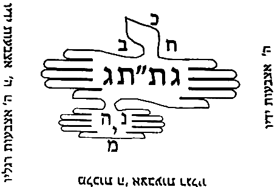

> בענין צורת הספירות ר"ל סדר עמידתן רבו בו הדעות וציירו להם המקובלים צורות ביריעות גדולות וקראום אילן. יש שרצה לציירם בצורת א' כיצד חלקו הראש לג' חלקים הא' לכ"ע וצד ימין של ראש א' חכמה והשמאלי בינה. והקו אשר למטה מהיו"ד שהוא וא"ו של אלף קרא ראשו הימין חסד וראשו השמאלי גבורה ואמצעי ת"ת. וממראה מתניו ולמטה מה שכנגד הימין נצח ומה שכנגד השמאל הוד ומה שבין שניהם יסוד ועוקץ התחתון מלכות וזו צורתה.

**6:1:5** Behold, they intended to depict the figure of the supernal Man in the figure of an Alef, to hint that the whole of it is a perfect union: although we say "ten sefirot"—which indicates separate things—the whole of it is a perfect union, and this he indicated by the likeness of an Alef. And there is some support for this view in the words of Rashbi in Sefer ha-Tikkunim (Tikkun 55), and these are his words: "Come and see: this skull is [the letter] Alef, like this; it has four sides, [and] in them YHVH is one and His name is one—there is none else besides Him," etc. Thus far [his words].

> הנה כוונו לכתוב צורות האדם העליון בצורת אלף לרמוז כי כלו יחוד שלם. אע"פ שנאמר י"ס שהוא מורה דברים מחולקים כלו הוא יחוד שלם וזה הורה בדמות אלף. ויש קצת סמך לדעת זה בדברי הרשב"י בס' התיקונים (תקון נה) וז"ל תא חזי קרקפתא דא א כגוונא דא, ד' סטרין דיליה בהון ידו"ד הוא חד ושמיה חד אין עוד מלבדו כו' עכ"ל.

**6:1:6** And although his words and his figure are not exactly as above,  

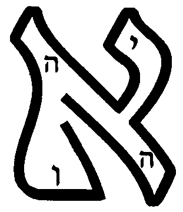

> ואע"פ שאין דבריו וציורו ממש כנ"ל,

**6:1:7** nonetheless, from it [it] appears that the intent of the Name—which is ten sefirot, as is known—is hinted at in the figure of the Alef, to hint at ten sefirot unified [in] a perfect unity, an equal unity. And this is what it says, "in them YHVH is one and His name is one"—the meaning [being] to indicate that He and His name are unified, although His name indicates ten sefirot. And behold, the existence of the Alef indicates the union.

> אעפ"כ מתוכו נראה כי כוונת השם שהוא י' ספירות כנודע, נרמז בצורת האלף לרמוז אל י"ס מיוחדים אחדות שלימה אחדות שוה. וז"ש בהון ה' הוא חד ושמיה חד פי' להורות שמתייחד הוא ושמו עם היות ששמו מורה י"ס. והנה מציאות הא' מורה על היחוד.

**6:1:8** And the matter of the ten digits and the ten digits—its place is not here, and it will be explained in the Gate of the Soul, chapter 8. And others depicted the figure of the ten sefirot in the figure of an Alef, like this:  

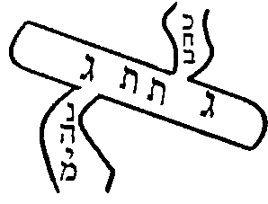

> וענין י' אצבעות וי' אצבעות אין מקומו הנה ויתבאר בשער הנשמה פ"ח. ואחרים ציירו צורת י' ספי' בצורת אלף כזה.

**6:1:9** And it is true that the first figure is the most acceptable, for it is close to the tradition [Kabbalah] in the hand of most of the Kabbalists, as we shall explain. And the intent of these Kabbalists is not to say that this is literally the secret of their standing—for in this figure there are no channels, nor right and left intrinsically (that is to say, Chesed and Din)—but rather their intent is to indicate the complete union: just as the Alef means "one," so the ten sefirot are a perfect unity. And he further intended by this to make the figure of a *patach* at its [upper] thorn, above Keter, to hint that Keter is not a first cause, God forbid, but [that] above it [is] the sole Lord who rules over all of them and emanates effluence upon them; and one *patach* below, at Malkhut, to hint that the intent of all this is for the governance of the lower ones, and that it [Malkhut] is a passage for the effluence emanated from the First Cause to His created entities, as we have explained in the preceding gates. Further, another figure Rabbi Moshe de León wrote in the Sefer ha-Shem that he composed, and he said that it depends on the view of Sefer ha-Bahir; and some Kabbalists followed this way, and in particular because they wished to rely on it [to support] the matter of "their end is embedded in their beginning"—for the end, which is Malkhut, is embedded in the beginning, which is Keter. And its figure is like this:  

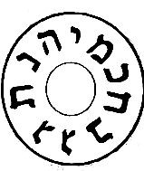

> והן אמת כי הצורה הא' היא היותר מתקבלת כי היא קרובה אל הקבלה אשר ביד רוב המקובלים כאשר נבאר. ואין כוונת המקובלים האלה לומר שזה ממש סוד עמידתן כי במציאות הצורה הזו לא צנורות ולא ימין ושמאל בעצם (ר"ל חסד ודין). אלא כוונתם להורות על היחוד הגמור כמו שהאלף פי' אחד כן הי"ס הן אחדות שלימה. וכיון עוד בזה לעשות צורת הפתח בעוקצה למעלה מן הכתר לרמוז כי אין הכתר סבה ראשונה ח"ו אלא עליו אדון יחיד המושל בכלן ומשפיע עליהם שפע. ופתח אחד למטה במלכות לרמוז כי כוונת כל זה להנהגת התחתונים והוא מעבר אל השפע הנשפע מהסבה ראשונה אל ברואיו כאשר בארנו בשערים הקודמים. עוד צורה אחרת כתבה ר' משה דליאון בספר השם שחבר ואמר שהיא תלויה בדעת ספר הבהיר. וקצת מקובלים דרכו דרך זה ובפרט כי רצו להסמך בו על ענין נעוץ סופן בתחלתן כי הסוף שהיא המלכות נעוץ בתחילה שהוא הכתר וצורתה כזו.

**6:1:10** And their view concerning this figure, in the matter of "their end is embedded in their beginning," is not settled at all, as the one who delves will see with his intellect; rather, the matter of "their end is embedded in their beginning" is a great secret explained in the Tikkunim in the words of Rashbi, and we shall explain it in the Gate "From Below to Above". Further, there are those who wrote a figure close to the agreement of the Kabbalists, and it is like this:  

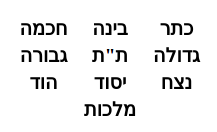

> ואין דעתם בענין צורה הזו בענין נעוץ סופן בתחילתן מתישבת כלל כאשר יראה המעיין בשכלו אלא ענין נעוץ סופן בתחילתן הוא סוד גדול נתבאר בתיקונים בדברי הרשב"י ונבאר אותו בשער ממטה למעלה. עוד יש שכתבו צורה קרובה אל הסכמת מקובלים והיא כזו:

**6:1:11** And Rabbi Moshe de León likewise copied it in the Sefer ha-Shem, and wrote: "And this view does not arise well according to the Kabbalah." But Rabbi Shem Tov ben Rabbi Shem Tov annotated upon it in the margin, [and] these are his words: "In my humble opinion, this view does not conflict with the other views, and it is very deep. And he counted ten sefirot from the known Keter, whose name is like the name of its master—it is the supernal Keter, the sole Lord; and this is called in Sefer Yetzirah 'He sealed the height' (with Yod) [with  Y H V], and it is called Keter like it, for it encompasses all the sefirot. And this is the secret of Thought emanated from the supernal Keter—[namely] Chokhmah, that is to say, the more revealed [one]; and it, by the power of the Ein Sof, brings forth the actions, [so as] to act in the likeness of the female, [and] therefore it is on the left. And Binah is called thus [because] she is between the two; in the secret of the Da'at stored away in her [which] is the emanation of the known Keter, in the secret of [the] supernal Keter. And this is the secret of the three names that the Name revealed to Moses at the bush; and the second, in the second name, is entirely the likeness of the female. Concerning this [there is] a very deep secret." Thus far [his words].

> והעתיקה ג"כ רבי משה דיליאון בספר השם וכתב ואין הדעת הזה עולה יפה ע"ד הקבלה אבל ה"ר שם טוב בן ר' שם טוב הגיה עליו בגליון ז"ל לענ"ד אין הדעת הזאת עם הדעות אחרות חולק והוא עמוק מאד ומנה ע"ס מכתר הידוע ששמו כשם רבו הוא הכ"ע אדון יחיד וזה נקרא בס' יצירה חתם רום (ביו"ד) [ביה"ו] ונקרא כתר כמוהו כי הוא המקיף אל כל הספירות וזהו סוד המחשבה הנאצלת מכ"ע החכמה כלומר היותר נגלית והיא בכח הא"ס מוציאה הפעולות לפעול דמיון הנקבה לכן היא בשמאל והבינה נקרא כן שהיא בין שניהם בסוד הדעת הגנוז בה הוא אצילות כתר הידוע בסוד כ"ע וזהו סוד ג' שמות שגילה השם למשה בסנה והשני' בשם שני הוא הכל דמיון הנקבה על זה סוד עמוק מאוד עכ"ל.

**6:1:12** And behold, he intended to give a reason for Binah's being in the middle, [and] for Chokhmah's being on the left. And the beginning of his words may be understood somewhat by the reasoning of the view that is his, which we wrote in the Gate of Whether the Ein Sof is the Keter, chapter 3. But in truth, [to engage in] length concerning this reasoning—that Chokhmah is on the left, and Keter on the right, and Binah in the middle—is a vain exercise, for it is a strange and rejected reasoning; for they hold that Chokhmah is Din, and Binah tips the balance between Chokhmah and Keter. And this view is null, as we shall expound at length in the Gate of Essence and Governance, chapter 5. And the correct view, the received [one], agreed upon in the mouth of all the Kabbalists, is this; and Rabbi Moshe de León wrote it in the Sefer ha-Shem, [and] these are his words: "And there is another view, comely and very acceptable, surpassing them all, and it is true: that the three upper ones are like a *segolta*." And it is this:  

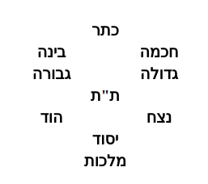

> והנה כיון לתת טעם לבינה שהיא בנתים לחכמה שהיא בשמאל. ותחלת דבריו יובנו קצת בסברת הדעת אשר לו אשר כתבנו בשער אם הא"ס הוא הכתר פ"ג. ולפי האמת אריכות בענין הסברא הזאת שחכמה אל השמאל וכתר אל הימין ובינה היא באמצע הוא פועל בטל כי הוא סברא זרה ודחיה כי סבירא להו שחכמה היא דין ובינה מכרעת בין החכמה והכתר. והדעת זה בטל כמו שנאריך בשער מהות והנהגה בפרק ה'. והדעת הנכונה והמקובלת המוסכמת בפי כל המקובלים היא זו וכתבה ר' משה דיליאון בספר השם וז"ל ויש דעת אחרת נאה ומקובלת מאוד עולה על כולנה והיא אמת שג' עליונות כעין סגולתא והוא זאת.

**6:1:13** And [these are] the gracious words of a wise man, for it is fine sifted flour. And this way was adopted by Rabbi Yehudah Chayyat in his book, and he gave a sign for the matter: "*segolta*, *segol*, *segol*"—for the three first ones [are] a *segolta*, the three second ones a *segol*, and the three third ones a *segol*, and Malkhut receives from all of them, below all of them. However, concerning Malkhut he wrote things that are forbidden to hear—and may his Master forgive him. And this figure is likewise agreed upon and necessitated from the words of Rashbi in many places. And in the interpretation of the points [vowels] he holds that the three first ones are a *segolta*, the *segolta*'s hint being among them; and likewise he holds that the *segol* [signifies] the three patriarchs, and at times he holds that they are Netzach-Hod-Yesod [N H Y]—[which] indicates that this view is agreed upon and necessitated. He further explained, in another place—and it is a great proof for this view—[and] these are his words, in Sefer Ra'aya Mehemna (Beha'alotekha, folio 153): "And Chokhmah, Chesed, [and] Netzach shall be on the right, for on their account David said, 'The right hand of YHVH does valiantly, the right hand of YHVH is exalted, the right hand of YHVH does valiantly.' And three on the left shall be bound together, which are Binah, Gevurah, [and] Hod. And three grades of the middle—Keter, Tiferet, [and] Yesod—which bind [the] right and [the] left." Thus far [his words].

> ודפח"ח כי היא סלת נקיה. והדרך הזה תפס ר' יהודא חייטי בספרו ונתן סימן לדבר סגולתא סגול. סגול. כי ג' ראשונות סגולתא, וג' שניות סגול, וג' שלישית סגול, ומלכות מקבלת מכלן למטה מכלן. אמנם כתב בענין המלכות דברים שאסור לשומען ושרי ליה מאריה. וכן מוסכם ומוכרח הצורה הזאת מתוך דברי הרשב"י במקומות רבים. ובפירוש הנקודות סבירא ליה כי ג' ראשונות הם סגולתא וסגולתא הרמז שלה בהם וכן סבירא ליה שסגול הם ג' אבות ולעתים ס"ל שהם נה"י מורה היות הדעת הזה מוסכם ומוכרח. עוד פי' במ"א והוא הכרח גדול להדעת הזה וז"ל בס' רעיא מהימנא (בהעלותך דף קנ"ג) ויהון חכמה חסד נצח לימין דבגינייהו אמר דוד ימין ה' עשה חיל ימין ה' רוממה ימין ה' עושה חיל. ותלת משמאלא יתקשרון כחדא דאינון בינה גבורה הוד. ותלת דרגין דאמצעיתא כתר ת"ת יסוד, דאחדין בימינא ושמאלא עכ"ל.

**6:1:14** Behold, he explained explicitly that Chokhmah, Chesed, [and] Netzach are on the right, and Binah, Gevurah, [and Hod] are on the left, and Keter, Tiferet, [and] Yesod [are] in the middle. And according to their order known to us, it is necessitated that they be in the manner that we depicted above. And the being of Malkhut beneath Yesod is necessitated, for she receives from him, and he is the "best man" between her and her husband, and it is necessitated that she be beneath him.

> הנה ביאר בפי' כי חכמה חסד נצח הם אל הימין, ובינה גבורה הוא אל השמאל, וכתר ת"ת יסוד באמצע. ולפי סדורם הידוע אצלינו הוכרח היותם על הדרך שציירנו למעלה. והיות המלכות תחת היסוד הוא מוכרח, כי היא מקבלת ממנו, והוא השושבין בינה ובין בעלה, והוכרח היותה תחתיו.

**6:1:15** And further, [it is necessitated] because she is the gate of entry, as is necessitated from the words of Rashbi, peace be upon him, [in] places too many to number. This matter was further explained in the Tikkunim (in Tikkunei Zohar Chadash, folio 112), [and] these are its words: "And the nine sefirot are arranged in threes upon the central pillar, like this: Chokhmah-Chesed-Netzach, Keter-Tiferet-Yesod, Binah-Gevurah-Hod; Malkhut is the tenth to them and the fourth to them." Thus far [its words].

> ועוד כי היא פתח הכניסה כאשר הוכרח מתוך דברי הרשב"י ע"ה מקומות רבו מספר. עוד נתבאר הענין הזה בתקונים (בתז"ח דף קי"ב) וז"ל ותשע ספירות אינון משולשין בעמודא דאמציעותא כגוונא דא. חכמה חסד נצח, כתר תפארת יסוד, בינה גבורה הוד, מלכות עשירית לון ורביעית לון עכ"ל.

**6:1:16** And the intent is clear: that the sefirot are arranged three [by] three. And once we have known this matter, of necessity their order is: Keter, Tiferet, Yesod in the middle—because Tiferet and Yesod are intermediaries and arbiters between Din and compassion, as we shall explain in the Gate of Arbiters. And therefore their depiction in this figure that we depicted above was required. It was further explained in the Tikkunim (Tikkun 69, folio 101b), [and] these are its words: "Keter over Chokhmah and Binah is a *segolta*—a *cholam* over a *tzeirei*. A *segol* is a dot beneath the *tzeirei*. Chesed, Gevurah, Tiferet below. Netzach, Hod, Yesod in the middle is a *shuruk*; and so, when Tiferet is in the middle, it is a *shalshelet*." Thus far [its words], for our matter.

> והכוונה מבוארת כי הספירות מסודרות ג' ג'. ואחר שידענו הענין הזה. בהכרח סדרם הוא כתר ת"ת יסוד באמצע. מפני כי הת"ת והיסוד הם ממוצעים ומכריעים בין הדין והרחמים, כמו שנבאר בשער המכריעין. ולכן הוצרך ציורם בצורה הזאת שציירנו לעיל. עוד נתבאר בתיקונים (תקונא ס"ט דף ק"א ע"ב) וז"ל כתר על חכמה ובינה איהו סגולתא חולם על צר"י. סגול איהו נקודה תחות צר"י. חסד גבורה תפארת לתתא. נצח הוד יסוד באמצעיתא איהו שרק והכי כד תפארת באמצעיתא איהו שלשלת. עכ"ל לעניינו.

**6:1:17** And behold, he said that Keter [is] over Chokhmah and Binah in the figure of a *segolta*. And he said that Tiferet [is] below Gedulah and Gevurah, and this is a *segol*. [It is] true that at times it [Tiferet] will be exactly between Gedulah and Gevurah, and then it will be in the figure of a *shalshelet*—and this is what it says, "when Tiferet is in the middle, it is a *shalshelet*." And likewise Yesod [is] between Netzach and Hod, and they are a *shuruk*, which are three dots in one row—although they are not diagonal, as is its norm. Thus far. Thus, from these passages, the figure that most of the commentators depicted for the sefirot is necessitated; and it is a correct reasoning, and there is no doubt in it.

> והנה אמר כי כתר על חכמה ובינה בצורת סגולתא. ואמר כי תפארת למטה מגדולה וגבורה והיינו סגול. אמת כי לעתים תהיה ממש בין גדולה וגבורה ואז תהיה בצורת שלשלת. וז"ש כד תפארת באמצעיתא איהו שלשלת. וכן יסוד בין הנצח וההוד והם שרק, שהם ג' נקודות בשורה אחת, עם היות שאינם באלכסון כמשפטו, ע"כ. הרי מתוך המאמרים האלה הוכרח הצורה שציירו רוב המפרשים בספירות והיא סברא נכונה ואין בה ספק:

### Chapter 6:2. Explanation of the author of Me'irat Einayim, who reverses the views for us, and our objection to him.

**6:2:1** After we have stood, in the preceding chapter, to set up the matter of the Emanation in the figure upon which all the Kabbalists, or most of them, have agreed, and we have necessitated it by means of some passages from the words of Rashbi, peace be upon him, in the Tikkunim—we have seen [fit] to copy here the reasoning of the author of Me'irat Einayim, [showing] that from these passages there is a refutation of his words, [for] he is opposed to all the Kabbalists. And these are his words, in [the] portion [of] Terumah. First he wrote, in the name of Rabbi Shem Tov, one figure, and it accords with the agreed-upon figure and does not conflict with the figure that we necessitated in the preceding chapter, except in the three first ones; and this is its figure:  

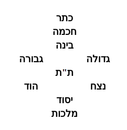

> אחר שבפרק הקודם עמדנו להציב ענין האצילות בצורה שהסכימו בה כל המקובלים או רובם והכרחנו אותו במקצת מאמרים מדברי הרשב"י ע"ה בתקונים. ראינו להעתיק הנה סברת בעל מאירת עינים שיש מתוך המאמרים האלה הריסה אל דבריו והוא מנגד אל כל המקובלים וז"ל בפרשת תרומה. ראשונה כתב בשם ר' שם טוב צורה אחת והיא עם הצורה המוסכמת צודקת ואינה חולקת על הצורה שהכרחנו בפרק הקודם אלא בשלש ראשונות וזו צורתה.

**6:2:2** And although the order of these three first ones is the reasoning of the author of Me'irat Einayim and the view of Rabbi Todros ha-Levi in Sefer ha-Ma'arekhet—and Rabbi Moshe de León likewise wrote something of this reasoning—

> ועם היות סדר ג' ראשונות אלו הוא סברת בעל מאירת עינים ודעת רבי טודרוס הלוי בספר המערכ' וכן כתב קצת מזאת הסברא רבי משה דיליאון.

**6:2:3** Behold, from the passages that we necessitated in the preceding figure, in the preceding chapter, there is found an explicit refutation of their words, and there is no need to be lengthy. He further wrote in Sefer Me'irat Einayim, in the aforementioned portion, [and] these are his words: "Behold, I depict for you the figure of the ten sefirot in their correct, true positioning, for [the one] to whom the Name, may He be blessed, has given eyes to see and a heart to understand; and I have not seen one in a thousand among all the Kabbalists who perceived this matter, apart from my teacher, from whom I received [it]." And this is it:  

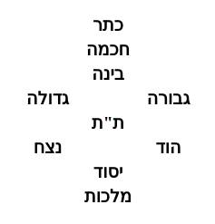

> הנה מתוך המאמרים שהכרחנו בצורה הקודמת בפרק הקודם נמצא הריסה אל דבריהם בפירוש ואין צריך להאריך. עוד כתב בספר מאירת עינים בפרשה הנז' וז"ל הנני מצייר לך צורת עשר ספי' בהעמדתן הנכונה האמיתית לאשר נתן השם ית' עינים לראות ולב להבין ולא ראיתי אחד מן אלף בכל המקובלים שהרגיש בענין זה מבלעדי מורי שקבלתי ממנו וזו היא.

**6:2:4** And whoever says of this form that it is reversed—he is of a perverse generation; and if the speaker's intent is good, his mind is reversed. He seeks to see the hinder parts, whereas we [see] the face, for it is said, "I have set YHVH always before me," etc. And although the sefirot are nothing but holy spirit—spiritual thoughts, unified one to another [in] a true union, and all unified in the Ein Sof, in [literally] the Ein Sof—and above there is neither right nor left, but rather these incline rightward, to acquittal, and therefore [the right] is called right and compassion, and these incline leftward, to liability, and therefore [the left] is called left and Din—nonetheless, behold, David, peace be upon him, said, "I have set YHVH always before me," etc. (Psalms 16:8). And over and above all this, our Sages of blessed memory said (Yoma, folio 53): when a person takes three steps [back], he gives "peace" to his left first, because the Shekhinah is opposite him; and thus he bows to the right of the Shekhinah, and afterward gives "peace" to his right, which is the left of the Shekhinah. Thus far [his words].

> וכל האומר על התבני' הזאת שהיא מהופכת, דור תהפוכות הוא. ואם כונת האומר טובה, שכלו מהופך הוא. מבקש לראות אחוריים, ואנחנו הפנים שנאמר שויתי ה' לנגדי תמיד וגו'. ואעפ"י שאין הספירות אלא רוח הקדש מחשבות רוחניות מיוחדות זו לזו יחוד אמתי. והכל מיוחד באין סוף, לא"ס. ואין למעלה לא ימין ולא שמאל. אלא שאלו מיימינים לזכות, ולפיכך נקרא ימין ורחמים. ואלו משמאילים לחובה, ולכך נקרא שמאל ודין. מ"מ הרי דהמע"ה אמר שויתי ה' לנגדי תמיד וגו' (תהלים טז ח). ועל כל זאת אחז"ל (יומא דף נ"ג) כשאדם פוסע שלש פסיעות יתן שלום לשמאלו תחלה מפני ששכינה כנגדו והכי הוא משתחוה לימינו של שכינה ואח"כ נותן שלום לימינו שהוא שמאלו של שכינה עכ"ל.

**6:2:5** And we have several responses to him. First, regarding what he said—that he [the opponent] seeks to see the hinder parts, whereas we [see] the face: even according to him there is no substance in this reasoning, for so it is fitting not to gaze upon the face, as it is written (Exodus 33:23), "and you shall see My back, but My face shall not be seen." And even [as for] the hinder parts—how many "hinder parts of hinder parts" are [the ones] that are seen!—all the more so [is it not fitting] to gaze upon the awesome face (see in Tikkun 69, folio 111, in what was said concerning "you shall not be able to see My face"). And this is the opposite of the correct view.

> ויש לנו עליו כמה תשובות. ראשונה במה שאמר הוא מבקש לראות האחוריים ואנחנו הפנים. אפילו לדידיה אין בטעם זה ממש כי כן ראוי שלא להביט בפנים כדכתיב (שמות לג כג) וראית את אחורי ופני לא יראו. ואפילו האחוריים כמה אחוריים לאחוריים הנראים כ"ש להביט בפנים הנוראים (ע' בתקונא סט דקי"א במ"ש על לא תוכל לראות את פני). וזהו הפך הדעת הנכון.

**6:2:6** And further, [the truth is] that the matter is the opposite of his view, for the face is in this order: right opposite right, and left opposite left. And [there is] a proof from the matter of the tefillin: for the first portion, Kadesh—which is Chokhmah—is at the right of the reader and the left of the one laying [the tefillin]; and the portion Ve-haya im shamoa—which is Gevurah—is at the right of the one laying [them] and the left of the reader. But according to his view it should be the opposite, for the one laying [them] lays [them] right opposite right and left opposite left, and the reader, who is opposite him, would have the left toward the right and the right toward the left. And there is no [valid] response from [the fact that] Ve-haya ki yevi'akha—which is Binah—and Shema—which is Gedulah—are in [direct] correspondence: Shema, Gedulah, at the right of the one laying [them], and Ve-haya ki yevi'akha at his left. This is no response at all; for, on the contrary, Chokhmah and Gevurah are the principal [proof] for this matter, for several reasons: for it is fitting to arrange Chokhmah to the right, since it is the rightmost, the head of all the sefirot, and Gevurah [is] the principal leftmost, [tending] to liability. And why should we reverse these, which are principal, on account of two [others] that are [only] the root of the right and the left?

> ועוד כי הענין הוא הפך דעתו [ז] כי הפנים הם בסדר הזה ימין כנגד ימין ושמאל כנגד שמאל. וראיה מענין דתפילין כי פרשה ראשונה קדש והיא חכמה לימין הקורא ולשמאל המניח, ופרשת והיה אם שמוע שהיא גבורה לימין המניח ולשמאל הקורא. ולפי דעתו היה ראוי להיות בהפך כי המניח מניח ימין כנגד ימין ושמאל כנגד שמאל והקורא שהוא כנגדו יהיה שמאל לימין וימין לשמאל. ואין תשובה מן והיה כי יביאך שהוא הבינה ושמע שהוא הגדולה הם ביושר שמע גדולה לימין המניח והיה כי יביאך לשמאל המניח. זו אינה תשובה כלל, שאדרבה החכמה והגבורה הם עיקר אל הענין הזה מפני כמה דברים. כי מן הראוי לסדר חכמה אל הימין מפני שהוא ימינית ראש לכל הספירות, וגבורה עיקר השמאלית לחובה. ולמה לנו להפך אלו שהם עיקר מפני שנים שאינם [אלא] שורש הימין והשמאל.

**6:2:7** And further, [the proof holds] because Shema, too, [is] at the right of the reader in the aspect of Ve-haya im shamoa; and likewise Ve-haya ki yevi'akha [is] at the left of the reader in the aspect of Kadesh. And this is a compelling proof—what it is impossible to say of Kadesh and Ve-haya im shamoa—that, with respect to the aspect of all of them, Kadesh is always at the left of the one laying [them] and the right of the reader, and Ve-haya im shamoa at the right of the one laying [them] and the left of the reader. And this is certainly a refutation of the words of the author of Sefer Me'irat Einayim.

> ועוד כי שמע נמי אל הימין הקורא בבחי' והיה אם שמוע וכן והיה כי יביאך אל שמאל הקורא בבחינת קדש. וזו ראיה מוכרחת מה שא"א לומר בקדש והיה אם שמוע, שבבחינת כלם לעולם קדש לשמאל המניח וימין הקורא, והיה אם שמוע לימין המניח ושמאל הקורא. וזה ודאי הריסה אל דברי בעל ספר מאירת עינים.

**6:2:8** And [there is] a further proof from the ascent of the altar, for there [is] the foundation of the union, as Rashbi, peace be upon him, explained in the Zohar (Bamidbar, folio 120); and we have copied [its] language in the Gate of Self and Vessels, chapter 1, and in the Gate of Essence and Governance, chapter 21.

> ועוד ראייה מעליית המזבח כי שם יסוד היחוד, כמו שפי' הרשב"י ע"ה בזוהר (במדבר דף ק"ך), והעתקנו ל' בשער עצמות וכלים בפ"א, ובשער מהות והנהגה פכ"א.

**6:2:9** And behold, the ascent of it [the altar] was by the ramp, and the ramp was on the south of the altar; and when [the priest] was ascending, he would turn to the southeast corner, which is the right of the one ascending. And were it true as the words of Sefer Me'irat Einayim, it would be fitting that he turn to his left, for there [would be] the right opposite him; and it would be fitting that the ramp be on the north of the altar, so that in his ascent by the ramp he would turn to the left of the one ascending—that is, the right that is opposite [him]—and turn to the northeast corner, in this order, etc. Rather, what have you to say? That [as for] this figure, there is no doubt that it is reversed, and the true figure is the figure agreed upon in the words of Rashbi, peace be upon him, [namely] that the right [corresponds] to the right and the left to the left. And therefore they expounded, "every turn that you turn shall be only to the right"—and this is the literal right of a person, [such] that "a left opposite him" and "a right opposite him" have no place there. And likewise they expounded concerning Abraham our father, peace be upon him, that all his turnings were to [the side of] Chesed. A further response to what he wished to derive support [for] from the verse "I have set YHVH always before me": it is no proof, for David, peace be upon him, would say so on account of the fear of the Name [being] before his face all the day, and he would think as if the Shekhinah were opposite him perpetually, and he [were] like a servant before the King, so as not to waver from his service, neither little nor much. And [as for] what he wished to derive support [for] from the matter of the three steps—shall we, then, set aside all the rest of the matters of the [Temple] service and bring a proof from a single detail, [namely] the matter of the steps?

> והנה עלייתו היה בכבש והכבש היה בדרומו של מזבח ובהיותו עולה היה פונה לקרן דרומית מזרחית שהוא ימינו של העולה, ואם אמת כדברי ספר מאירת עינים היה ראוי שיפנה על שמאלו כי שם ימין כנגדו, והיה ראוי שיהיה הכבש בצפון המזבח כדי שבעלייתו בכבש יפנה אל שמאל העולה דהיינו ימין שכנגדו ויפנה לקרן צפונית מזרחית כסדר הזה וכו'. אלא מאי אית לך למימר כי הצורה הזאת אין בו ספק שהיא מהופכת והצורה האמיתית היא הצורה המוסכמת בדברי הרשב"י ע"ה שהוא ימין אל הימין ושמאל אל השמאל [ח]. ולכן דרשו כל פנות שאתה פונה לא יהא אלא לימין וזה ימינו של אדם ממש דלא שייך תמן שמאל שכנגדו ולא ימין שכנגדו. וכן דרשו באאע"ה שכל פנותיו היה אל החסד. עוד תשובה אל מה שרצה להסתייע מפסוק שויתי ה' לנגדי תמיד אינו ראייה כי דהמע"ה היה אומר כך משום יראת השם נגד פניו כל היום והיה חושב כאלו שכינה כנגדו לעולם והוא כעבד לפני המלך לבלתי יתמוטט מעבודתו לא מעט ולא הרבה. ומה שרצה להסתייע מענין ג' פסיעות וכי נניח כל שאר ענייני המעשה ונביא ראיה מפרטי אחד והוא ענין הפסיעות.

**6:2:10** Furthermore, there is no proof at all; for [though] you raise an objection against me from the view of Rava, who said "his right" [means] the right of the Holy One, blessed be He, [and] "his left" the left of the Holy One, blessed be He—I [can] support myself from the view of Abaye, who reckoned "his right" [as] his own right and "his left" his own left literally, [so as] to reckon that the matter of the steps is like the intent of the other commandments and deeds. Until Rava taught him that the meaning of "his right" is, that is to say, the right of the Holy One, blessed be He, [and] "his left" the left of the Holy One, blessed be He—the opposite of the other things. And the reason is that now, when one comes to take leave, he comes to teach a person not to think that his words are for naught and in vain, God forbid, but rather that he should be assured that his words were heard—like a person who speaks with the King in the inner chamber and takes leave of the King in peace and love. Or it is possible [that it is] to show a person his faith: that even though he unified the supernal worlds by the "hinder parts" that are seen, nonetheless the Holy One, blessed be He, hearkened to him by the "awesome face." Therefore, when he comes to take leave, he gives peace to the right of the Holy One, blessed be He, which is his [own] left. And in this manner we can explain the verse "I have set YHVH always before me," etc. Or it is possible that we should say that the matter of the peace[-giving] in this is for the [angel] who receives the prayer and makes it into crowns for his Master—even though he said "the right of the Holy One" and "his left." So too they said (in tractate Berakhot, fol. 7): Rabbi Ishmael said, "I saw Aktariel Yah YHVH Tzeva'ot," etc.—and he is the one who receives the prayers, and he is not the King of Glory; for if so, he would not have said "I saw" literally, God forbid. And as is known, Aktariel is a prince on high and not a god. And nevertheless there is no difficulty [in] his saying "Yah YHVH Tzeva'ot," for the angels are called by the name of their Master, by the Glory that hovers over them. And so it says concerning Abraham (Genesis 18:3), "And he said, my Lord [Adonai], do not pass on," and the Sages, of blessed memory, explained that he said [it] to the greatest of them—and the intent is the Glory that hovers over and clothes itself in them, which is the Shekhinah. And so [it is] in the matter of Aktariel, for concerning the Glory that clothes itself in him it says "Yah YHVH Tzeva'ot." And so [it is] in the matter of "He who makes peace," that he gives peace to the right opposite him and to the left opposite him because the Glory hovers over him and clothes itself in him; and there a literal left and a literal right apply. And this secret depends on the knowledge of the matter of the angels; it will be explained in the Gate of the Palaces.

> ועוד כי אין ראייה כלל דאדמותבת לי מסברת רבא דאמר ימינו ימינו של הקב"ה שמאלו שמאלו של הקב"ה, תסייעי לי מסברת אביי דהוה חשיב ימינו ימין דידיה ושמאל שמאל דידיה ממש לחושבו כי ענין הפסיעות ככוונת שאר המצות והמעשים. עד שרבא הורה לו כי פי' ימינו ר"ל ימינו של הקב"ה שמאלו שמאל של הקב"ה הפך שאר הדברים. והטעם כי עתה שבא להפטר בא להורות לאדם שלא יחשוב היות דבריו לריק ולבטלה ח"ו אלא שיהיה מובטח שנשמעו דבריו כאדם המדבר עם המלך החדרה ונפטר מהמלך בשלום ואהבה. או אפשר להראות האדם אמונתו שאעפ"י שייחד העולמות העליונים באחורים הנראים עכ"ז הקב"ה הקשיב לו בפנים הנוראים. לפיכך כשבא ליפטר נותן שלום לימינו של הקב"ה שהוא שמאלו. ועד"ז נוכל לפרש פסוק שויתי ה' לנגדי תמיד וגו'. או אפשר שנאמר כי ענין השלום בזה הוא למקבל התפלה ועושה אותה כתרים לרבו עם היות שאמר ימינו של הקב"ה ושמאלו של הקב"ה. כך ג"כ אמרו (במס' ברכות ד"ז) א"ר ישמעאל ראיתי את אכתריא"ל י"ה ידו"ד צבאות וכו' והוא הוא המקבל התפלות ואינו מלך הכבוד, שא"כ לא היה אומר ראיתי ממש ח"ו. וכמו שהוא ידוע כי אכתריא"ל הוא שר במרום ולא אלוה. ועם כל זאת אין דוחק אמרו י"ה ידוד צבאות, כי המלאכים נקראים בשם רבם בשם הכבוד החופף עליהם. וכן הוא אומר באברהם (בראשית יח ג) ויאמר אדני אל תעבור, ופירשו חז"ל לגדול שבהם אמר, והכוונה הכבוד החופף ומתלבש בהם שהיא השכינה. וכן בענין אכת"ריא"ל כי על הכבוד המתלבש בו נאמר י"ה ידו"ד צבאות. וכן בענין עושה שלום שנותן שלום לימין שכנגדו ולשמאל שכנגדו מפני שהכבוד חופף עליו ומתלבש בו. ושם שייך שמאל ממש וימין ממש. וסוד זה תלוי בידיעה ענין המלאכים יתבאר בשער ההיכלות [ט].

**6:2:11** Furthermore, another response, namely: in that it is well known that man—his forms, his structure, his limbs, his arteries, and his sinews—is the likeness of a supernal reflection. And man is a supernal shadow that became corporealized and thickened in this world, and he is the likeness of a supernal reflection appearing in this world. If so, it is fitting that his right [correspond] to the right of the supernal things and his left to the left of the supernal things—like the matter of the shadow, whose right is opposite the right of its root. And this matter is a root and a fundamental principle in faith and in piety.

> ועוד תשובה אחרת והוא במה שמפורסם היות האדם צורותיו ותכונתו ואבריו ועורקיו וגידיו דמות בבואה עליונה. והאדם הוא צל עליון שנתגשם ונתעבה בעה"ז והוא דמות בבואה עליונה הנראה בעולם הזה. א"כ מן הראוי שיהיה ימינו לימין הדברים העליונים ושמאלו לשמאל דברים העליונים כענין הצל שהוא ימינא נגד הימין שרשו. והענין הוא שרש ועיקר באמונה והחסידות.

**6:2:12** Furthermore, that in truth there is above neither right nor left, but all is right and all is left. And a great proof [is] from the matter of the Tablets, which were one of the supernal branches whose spirituality became corporealized and thickened for the honor of Israel; and the Sages, of blessed memory, testified concerning them (Shekalim, fol. 16) that the Ten Commandments were visible in them from every side and from every direction and from every corner. And if in [something] corporealized [it is] so—that there is in it neither right nor left, but all is right and all is left—how much more so, and a fortiori, in the subtlety of the spiritual that is elevated above every cause, may it be praised and exalted. And if we decree right and left, it is in the aspect of merit and liability, as in the matter of what they said, "these incline to the left, to liability, and these incline to the right, to merit." And it is known that the matter of merit and liability is in our terms, not in the terms of the spiritual [realm]—rather in the terms of its actions toward its created entities. If so, His right is our right and His left is our left, and there is no distinction between this and that.

> ועוד כי לפי האמת אין למעלה לא ימין ולא שמאל והכל ימין והכל שמאל. וראייה גדולה מענין הלוחות שהיו אחד מהענפים העליונים שנתגשם הרוחניות ונתעבה לכבודן של ישראל, והעידו עליהם רז"ל (שקלים דף ט"ז) כי עשרת הדברות נראות בהם מכל צד ומכל עבר ומכל פנה. ואם במתגשם כך שאין בו לא ימין ולא שמאל אלא הכל ימין והכל שמאל, כל שכן וק"ו בדקות הרוחני המתעלה על כל עילה ישתבח ויתעלה. ואם אנו גוזרים ימין ושמאל הוא בבחינת הזכות והחובה כענין שאמרו אלו משמאילים לחובה ואלו מיימינים לזכות. וידוע כי ענין הזכות והחובה הוא בערכנו לא בערך הרוחניות אלא בערך פעולותיו אל נבראיו, אם כן ימינו הוא ימיננו ושמאלו הוא שמאלנו ואין חלוק בין זה לזה.

**6:2:13** And the matter of the steps is according to one of the ways we explained. And we find ourselves learning that the principal, correct figure in this is according to what we drew in the previous chapter and established from the views of Rashbi, peace be upon him: three to the right, three to the left, three in the middle, and Malkhut receiving from them all. This is what emerges from the words of most of the Kabbalists. And there is yet [another] vision, and we shall explain it in the coming chapters, with the help of the Rock and His salvation.

> וענין הפסיעות הוא על אחד מן הדרכים שפירשנו. ונמצאנו למדים שעיקר הצורה הנכונה בזה היא כפי מה שציירנו בפרק הקודם והכרחנו בדעות הרשב"י ע"ה ג' אל הימין ג' אל השמאל ג' באמצע והמלכות מקבלת מכלם. זהו העולה מתוך דברי רוב המקובלים. ויש עוד חזון ונבאר אותו בפרקים הבאים בעזרת הצור וישועתו:

### Chapter 6:3. Explanation of the order of the worlds from the first point to the last; and there the matter of the seven earths from the Zohar is explained.

**6:3:1** After we have occupied ourselves in the previous chapters with the investigation of the figure of the standing of the pure and holy Emanation, and the figure agreed upon in the mouth of all the Kabbalists has emerged by our consensus—it is our wish to disclose to the ear of the discerning, concerning this figure, what its essence and its matter are and what the intent of its depiction is. And before everything, it is necessary to preface: although we say "right" and "left," there is there neither right nor left in their place, [and] neither back nor face. Rather, the matter of the sefirot is as we shall explain.

> אחרי שנתעסקנו בפרקים הקודמים בחקירת צורת עמידת האצילות הטהור והקדוש, ועלה בהסכמתנו הצורה המוסכמת בפי כל המקובלים. רצוננו לגלות אזן המשכילים בענין הצורה הזו מה מהותה וענינה ומה הכוונה בציורה. וקודם כל דבר צריך להקדים עם היות שאנו אומרים ימין ושמאל אין שם לא ימין ולא שמאל במקומם לא אחור ולא פנים. אמנם ענין הספי' הם כמו שנבאר.

**6:3:2** And behold, it is known that every cause encompasses what it causes, and every cause encompasses its effect, and the effect is encompassed by its cause—just as the point of the earth is in the middle of the firmament, and the firmament surrounds the earth, and the firmament is the cause of all the things that are beneath the heavens, by the will of the Maker; as is well known among the investigators, that the motion of the spheres is the cause of the compounding of the elements. And Rambam, of blessed memory, explained [this] in the fourth [chapter] of Hilkhot Yesodei ha-Torah, and said that the motion of the spheres necessitates the compounding of the elements in the lower world. And likewise the diurnal sphere encompasses all the spheres and is their cause, to the point that it turns them [in] the opposite of their [own] motion—which is from west to east—and it turns them from east to west, by the will of their Maker. And above all, encompassing all, is the sphere of the Intellect. And so [it is] with the ascent of the grades, for each and every one encompasses all the grades that are below it. And this appears [to be] of necessity, and in particular when one examines the chapters of the Account of Creation, he will rejoice and be glad, and the love of this premise of ours will be the more steeped in his heart. And there is a proof for this from the dictum of Resh Lakish (in Chagigah, fol. 12), and these are [the] words: Rabbi Yehudah said, there are two firmaments, for it is said, "Behold, to YHVH your God belong the heavens and the heaven of heavens." Resh Lakish said [there are] seven, and these are they: Vilon [Curtain], Raki'a, Shechakim, Zevul, Ma'on, Makhon, Aravot. Vilon serves no purpose except [that] it enters at morning and goes out at evening and renews each day the work of creation, for it is said, "who stretches out the heavens like a curtain [*dok*]." Raki'a—[the firmament] in which are the sun and moon, stars and constellations, fixed [in it], for it is said, "And God set them in the firmament of the heavens." Shechakim—[the firmament] in which millstones stand and grind manna for the righteous, for it is said, "And He commanded the skies [*shechakim*] above," etc., "and He rained down upon them manna to eat." Zevul—in which are [the heavenly] Jerusalem and the Temple, and an altar is built, and Michael the great prince stands and offers an offering upon it, for it is said, "I have surely built You a house of habitation [*zevul*], a place for You to dwell in forever." And whence [do we know] that it is called heaven? For it is written, "Look down from heaven and see, from Your holy and glorious habitation [*zevul*]." Ma'on—in which are companies of ministering angels who recite song by night and are silent by day, for the sake of the honor of Israel, for it is said, "By day YHVH commands His lovingkindness," etc., and what is the reason, etc.—thus far [the passage], to our purpose.

> והנה ידוע כי כל סבה מקיף את מסובבו וכל עילה מקיף את עלולו והעלול מוקף מעילתו, כאשר נקודת הארץ באמצע הרקיע והרקיע סובב את הארץ והרקיע סבת כל הדברים אשר תחת השמים ברצון הקונה, כאשר הוא מפורסם בין החוקרים כי תנועת הגלגלים סבת הרכבת היסודות, וביארו הרמב"ם ז"ל בפ"ד מהלכות יסודי התורה ואמר כי תנועת הגלגלים יחייב הרכבת היסודות בעולם השפל. וכן הגלגל היומי מקיף כל הגלגלים והוא סבתם עד שהוא מחזירם הפך תנועתם שהוא ממערב למזרח והוא מחזירם ממזרח למערב ברצון קוניהם. ועל הכל מקיף את הכל גלגל השכל. וכן מידי עלות המדרגות, כי כל אחד ואחד מקיף את כל המדרגות אשר למטה ממנו. וזה נראה בהכרח ובפרט כשיעיין בפרקי מעשה בראשית ישמח ויגל ויושקע אהבת הקדמתנו זאת יותר בלבבו. ויש לזה ראייה ממאמר דריש לקיש (בחגיגה די"ב) וז"ל אר"י שני רקיעים הן שנאמר הן לה' אלקיך השמים ושמי השמים ריש לקיש אמר שבעה ואלו הן וילון רקיע שחקים זבול מעון מכון ערבות. וילון אינו משמש כלום אלא נכנס שחרית ויוצא ערבית ומחדש בכל יום מעשה בראשית שנאמר הנוטה כדוק שמים. רקיע שבו חמה ולבנה ככבים ומזלות קבועים בו שנאמר ויתן אותם אלקים ברקיע השמים. שחקים שבו רחיים עומדות וטוחנות מן לצדיקים שנאמר ויצו שחקים ממעל וגומר וימטר עליהם מן לאכול. זבול שבו ירושלם ובית המקדש ומזבח בנוי ומיכאל השר הגדול עומד ומקריב עליו קרבן שנאמר בנה בניתי בית זבול לך מכון לשבתך עולמים. ומנא לן דאקרי שמים דכתיב הבט משמים וראה מזבול קדשך ותפארתך. מעון שבו כתות של מלאכי השר' שאומרים שירה בלילה וחשות ביום מפני כבודן של ישראל שנאמר יומם יצוה ה' חסדו ומה טעם וכו'. עכ"ל לעניננו.

**6:3:3** And behold, to say that these seven firmaments are the seven firmaments [i.e., spheres] that the astronomers counted is impossible—for he said that in one of these seven are the sun and moon, stars and constellations; and if these seven firmaments were the seven [spheres] that the astronomers counted, it would have been fitting that he count eight: seven for the seven planets, and one for the constellations. And such is not his intent, for he said that the sun and moon, stars and constellations are in one of the seven firmaments, whose name is Raki'a. And to explain that the Sages, of blessed memory, dispute with the astronomers—holding that the sun and moon, stars and constellations are fixed in a single sphere alone—[that too] is impossible. And therefore the sages of Israel do not dispute with the sages of the [other] nations except [on the question of] whether the sphere is fixed and the constellation revolves, or the constellation is fixed and the sphere revolves; but as to the number of the spheres they do not dispute.

> והנה לומר שהז' רקיעים אלו הם ז' רקיעים שמנו חכמי התכונה א"א שהרי אמר שבאחד משבעה אלו הם חמה ולבנה ככבים ומזלות ואם היו הז' רקיעים אלו שבע רקיעים שמנו חכמי התכונה היה ראוי שימנה שמנה. ז' אל ז' ככבי לכת, וא' למזלות. ולא כן כוונתו שאמר שחמה ולבנה ככבים ומזלות הם באחד מז' רקיעים ששמו רקיע. ולפרש כי רז"ל חולקים עם חכמי התכונה [ס"ל דחמה ולבנה כוכבים ומזלות קבועים בגלגל אחד לבד א"א. וע"כ לא פליגי חכמי ישראל עם חכמי האומות אלא אם גלגל קבוע ומזל חוזר או מזל קבוע וגלגל חוזר אבל במנין הגלגלים לא פליגי.

**6:3:4** Furthermore, the sages of Israel did retract and concede to the sages of the nations that the constellation is fixed and the sphere revolves; but as to the number of the spheres they do not dispute. And since the constellation is fixed and the sphere revolves, a multiplicity of spheres is necessitated according to the number of the constellations, which differ in their courses—and this is compelling. And the correct reason for this is that the totality of all the nine spheres is in one firmament. And likewise all the rest of the firmaments are supernal worlds, and in each one of them are many, many firmaments. And the sages who speak on the matter of the Account of Creation have already said that the number of the firmaments is like the count of [the word] "the heavens" [*ha-shamayim*] mentioned in the verse (Ezekiel 1:1), "the heavens were opened and I saw visions of God"—and their number is nine hundred and fifty-five; for the closed Mem of "*ha-shamayim*" amounts to six hundred, it being the second letter of the doubles [the final Mem]; and they are all included in a short number, [whether] seven firmaments, or nine, or five—for all of them have support and corroboration; and there is no place to elaborate.

> ועוד הרי חזרו והודו חכמי ישראל לחכמי אומות דמזל קבוע וגלגל חוזר אבל במנין הגלגלים לא פליגי. ואחר שמזל קבוע וגלגל חוזר יחויב רבוי הגלגלים לפי מנין המזלות שהם משונים בהתהלכותם, וזה מוכרח. והטעם הנכון לזה הוא כי כלל כל הט' גלגלים הוא ברקיע אחד. וכן כל שאר הרקיעים הם עולמות עליונים ובכל אחד מהם כמה וכמה רקיעים. וכבר אמרו החכמים המדברים בענין מעשה בראשית כי מספר הרקיעים כחשבון השמים הנזכר בפסוק (יחזקאל א א) נפתחו השמים ואראה מראות אלקים ומספרם תשע מאות וחמשים וחמשה כי מ"ם סתומה של השמים עולה שש מאות שהיא אות שניה של הכפולות והם נכללים כלם במספר קצר שהם ז' רקיעים או ט' או ה' כי יש לכלם סמך וסעד, ואין מקום להאריך.

**6:3:5** And behold, when he said "the sun and moon, stars and constellations," he there included the totality of all the firmaments that the astronomers counted. And this is no wonder, for the astronomers counted similarly [in another case]: they said that the sphere of the moon is one, whereas they [also] said explicitly that they are three; and likewise all the spheres, their number is eighteen, as Rambam explained in the third [chapter] of Hilkhot Yesodei ha-Torah. And so [Resh Lakish] included them all in one firmament—and this reasoning is sufficient and correct by way of the plain sense. But in truth he counted in these firmaments none but spiritual matters, as is explained in the Zohar and the Ra'aya Mehemna; and so he designates those spiritual things by the term "firmaments," since they all encompass the world and the spheres. And so [it is with] everything, for the higher the grades ascend, the [more] they surround the grades within them. And so, in this manner, [is] the matter of the sefirot: for they are all within Ein Sof, the King who reigns; and within Keter, Chokhmah; and within Chokhmah, Binah; and within Binah, Chesed; and within Chesed, Gevurah; and within Gevurah, Tiferet; and within Tiferet, Netzach; and within Netzach, Hod; and within Hod, Yesod; and within Yesod, Malkhut. And within Malkhut, Beriah; and within Beriah, Yetzirah; and within Yetzirah, Asiyah. And in them are included the matter of the Account of Creation and the Account of the Chariot. Thus the chariots are found within Malkhut. And the Sages, of blessed memory, explained in the chapters of the Chariot [matters] concerning the chariots and the thrones. And within those things that are in the chapters of the Chariot [are] those things that are in the chapters of the Account of Creation; and within those things that are in the chapters of the Account of Creation, the spheres; and within the spheres, the earth; and within the earth, at its navel, are seven earths. And concerning this matter of seven earths we were astonished by this very existence, to the point that it arose in our mind to say that the matter of the seven earths stated in the Account of Creation and in the words of Rashbi, peace be upon him, is the matter of the climes that the astronomers divided. Until God, in His compassion, favored us and brought to our hand many dicta that refute this view and concur that there are literally seven earths within the earth. And these are the words of the Zohar, Parashat Vayikra (fol. 9b): Rabbi Yehudah opened: "And God said, let there be a firmament in the midst of the waters." Come and see: at the hour when the Holy One, blessed be He, created the world, He created seven firmaments above, [and] created seven earths below; seven seas, seven rivers, seven days, seven weeks, seven years, seven times, [and] seven thousand years that the world is to be. The Holy One, blessed be He, [is] in the seventh of all. Seven skies [another reading: firmaments] above, and all is one. And in each and every one [are] ministers, stars, and constellations that serve in each and every firmament; and in all of them are those chariots, these upon these, to receive upon themselves the yoke of the kingship of their Master. And in all the firmaments there are chariots and ministers differing one from another, these upon these: some of them with six wings and some of them with four wings; some of them with four faces, some of them with two faces, some of them with one; some of them flaming fire, some of them water, some of them spirit—as it is written, "He makes His angels spirits, His ministers a flaming fire." And all these firmaments [are] these upon these, like the layers of an onion, these below and these above. Each and every firmament goes and trembles from the fear of their Master; by His mouth they journey and by His mouth they stand. And higher than all of them [is] the Holy One, blessed be He, who carries them all by His strength and His might. In like manner [are] the seven earths below, and they are all inhabited—except that these are higher and these are lower. And the land of Israel is higher than all of them, and Jerusalem [is] higher than all the inhabited world. And our companions, the dwellers of the south, saw in the books of the ancients and in the Book of Adam that thus He divides all those earths, [such] that all of them are found below in like manner to those firmaments above, these upon these and these upon these. And between each and every earth [is] a firmament that separates between this and that; and therefore all the earths are distinguished by names, and between them are the Garden of Eden and Gehinnom; and among them are creatures differing one from another, in like manner to those chariots above—some of them with two faces, some with four, some with one, and the appearance of these is not like [that of] those. And should you say: behold, all the inhabitants of the world came forth from Adam—and did Adam descend to all those earths and beget children? And how many wives did he have? Rather, Adam was found only in this world, the highest of all, which is called Tevel (the earth-realm humans inhabit), as it is written, "playing in His Tevel [His earth]." And this Tevel is joined to the firmament above and is bound to the supernal name, as it is written, "and He shall judge Tevel in righteousness"—"in righteousness" indeed. And therefore the children of Adam are found in this higher [earth] that is called Tevel, and they are higher than all, in like manner to that which is above. What is the reason? Just as above, over all the firmaments there is a firmament higher than all, and above [it] is found the Throne of the Holy One, blessed be He—as it is said, "like the appearance of a sapphire stone, the likeness of a throne, and upon the likeness of the throne a likeness like the appearance of a man upon it above"—so too here, in this Tevel is found the King of all; and what is He? Adam [a man]—that which is not found in all the lower [earths]. And those lower ones, whence do they come? Rather, from the residue of the earth and the aid of the firmament above, creatures come forth differing one from another. Some of them [are] in their garments [clothed], some of them in husks like those worms that are found in the earth, some of them in red, black, and white husks, and some of them of all colors. Thus are all the creatures of this kind. And they do not endure in [continued] existence except [for] ten years or more. And in the Book of Rav Hamnuna the Elder it is explained further: that the whole inhabited world revolves in a circle like a ball, these below and these above; and all those creatures differ [according to] the difference of the air [climate] in each and every place, and they stand in their existence like other human beings. And therefore there is a place in the inhabited world where, when it is light for these, it is dark for those: for these [it is] day and for those night; and there is a place where it is all day, and no night is found in it except [for] one brief hour. And this which is stated in the books of the ancients and in the Book of Adam the First, thus it is. For so it is written, "I praise You, for I am awesomely wondrous; wondrous are Your works," and it is written, "How manifold are Your works, O YHVH." And concerning this, all is well; and this secret has been delivered to the masters of wisdom and not to dividers of boundaries, because it is a deep secret of the Torah. In like manner [there is something] in the sea, in which there are many creatures differing one from another, as it is written, "This [is] the sea, great and broad of hands," "there ships go," etc. And all depends one upon the other and is bound one to the other, and all [is] in like manner to that which is above; and in all the worlds [there is] nothing ruling over them all except Adam, and the Holy One, blessed be He, [is] above him. Rabbi Nehorai the Elder set out upon the Great Sea, and the sea raged, and all those who were in the ship perished. And a miracle was wrought for him, and he descended by known tracks into the heart of the sea, and came out beneath the sea to one inhabited [land]; and he saw [some] of those creatures, all of them small, and they were reciting a prayer, and he did not know what they were saying. A miracle was wrought for him and he ascended. He said: Happy are the righteous who toil in the Torah and know the enclosed things of the supernal secrets! Woe to those who dispute their words and do not believe! From that day on, when he would come to the study-house and they recited words of Torah, he would weep. They said to him: And why do you weep? He said to them: Because I transgressed against the faithfulness of the words of the Rabbis, and I fear the judgment of that world. Thus far [the passage].

> והנה כשאמר חמה ולבנה ככבים ומזלות שם כלל כלל כל הרקיעים שמנו חכמי התכונה. ואין זה מן התימה שהרי חכמי התכונה מנו כיוצא בזה שאמרו שגלגל הירח אחד והם אמרו בפי' שהם ג' וכן כל הגלגלים מספרם י"ח כמו שפי' הרמב"ם בפ"ג מהלכות יסודי התורה. וכן כלל כלם ברקיע אחד והטעם הזה מספיק ונכון על דרך הפשט. ולפי האמת לא מנה ברקיעים אלו אלא עניינים רוחניים כמבואר בזהר ורעיא מהימנא, והרי שמכנה הדברים הרוחניים ההם בלשון רקיעים להיות שכלם מקיפים את העולם ואת הגלגלים, וכן הכל כי כל שיעלו המדרגות יסבבו המדרגות בתוכן. וכן עד"ז ענין הספירות, כי כלם בתוך הא"ס ממ"ה, ובתוך הכתר החכמה, ובתוך החכמה הבינה, ובתוך הבינה החסד, ובתוך החסד הגבורה, ובתוך הגבורה הת"ת, ובתוך הת"ת נצח, ובתוך הנצח הוד, ובתוך ההוד יסוד, ובתוך היסוד המלכות. ותוך המלכות הבריאה, ובתוך הבריאה היצירה, ובתוך היצירה העשייה, ובהם נכללים ענין מעשה בראשית ומעשה מרכבה. נמצאו בתוך המלכות המרכבות. וביארו רז"ל בפרקי מרכבה מענין המרכבות והכסאות. ובאותן הדברים אשר בפרקי מרכבה אותן הדברים אשר בפרקי מעשה בראשית, ובתוך אותן הדברים אשר בפרקי מעשה בראשית הגלגלים, ובתוך הגלגלים הארץ, ובתוך הארץ בטיבורה הם ז' ארצות. ולענין זה מז' ארצות היינו משתוממים בכל המציאות הזה בעצמו עד שעלה בדעתנו לומר שענין ז' ארצות האמור במעשה בראשית ובדברי הרשב"י ע"ה היא ענין האיקלימים אשר חלקו התוכנים. עד שזכנו האל ברחמיו ואנה לידינו מאמרים הרבה המכחישים הסברא הזאת ומסכימים כי שבעה ארצות ממש הם בתוך הארץ. וז"ל הזהר פ' ויקרא (ד"ט ע"ב) רבי יהודא פתח ויאמר אלקים יהי רקיע בתוך המים. תא חזי, בשעתא דקודשא ברוך הוא ברא עלמא ברא ז' רקיעים לעילא, ברא ז' ארצות לתתא, ז' ימים, ז' נהרות, ז' יומין, ז' שבועות, ז' שנים, ז' פעמים, ז' אלפי שנין דהוי עלמא. קב"ה בשביעאה דכלא. ז' שחקים [ס"א רקיעין] לעילא וכלא חד. ובכל חד וחד שמשין ככבים ומזלות דמשמשי בכל רקיע ורקיע ובכלהון מאינון רתיכין אלין על אלין לקבל עליהון עול מלכותא דמאריהון. ובכלהו רקיעין אית רתיכין ושמשין משניין דא מדא אלין על אלין, מנהון בשית גדפין ומנהון בד' גדפין, מנהון בד' אנפין מנהון בתרין אנפין מנהון בחד, מנהון אשא דלהיט מנהון מיא מנהון רוחא הה"ד עושה מלאכיו רוחות משרתיו אש לוהט. וכלהו רקיעין אלין על אלין כגלדי בצלים אלין לתתא ואלין לעילא, כל רקיעא ורקיעא אזלא ורעשא מאימתא דמאריהון על פומיה נטלין ועל פומיה קיימין. ועלאה מכולהו קב"ה דנטיל כלהו בחיליה ותוקפיה. כגוונא דא ז' ארצות לתתא וכלהו בישובא. בר דאילין עלאין ואלין תתאין. וארעא דישראל עלאה מכלהו וירושלים עלאה על כל ישובא. וחבירנא יתבי דרומא חמו בספרי קדמאי ובספרא דאדם דהכי מחלק כל אינון ארצות דכלהו משתכחי לתתא כגוונא דאינון רקיעים לעילא אלין על אלין ואלין על אלין. ובין כל ארעא וארעא רקיע דמפריש בין דא לדא ועל דא כולהו ארצות פרישן בשמהן ובינייהו ג"ע וגיהנם ואית בינייהו בריין משניין אלין מאלין כגוונא דאינון רתיכין דלעילא מנהון בתרין אנפין מנהון בארבע מנהון בחד וחיזו דאלין לאו כאלין. ואי תימא הא כל בני עלמא מאדם נפקא וכי נחית אדם לכלהו ארצות ואוליד בנין וכמה נשין הוו ליה. אלא אדם לא אשתכח אלא בהאי עלמא עלאה מכלהו דאקרי תבל וכמה דכתיב (ויצו לתבל) [משחקת בתבל] ארצו. והאי תבל אחידא ברקיעא דלעילא ואתאחידא בשמא עלאה הה"ד והוא ישפוט תבל בצדק בצדק ודאי ובג"כ בנוי דאדם אשתכחו בהאי עלאה דאקרי תבל ואינון עלאין על כלא כגוונא דלעילא. מ"ט, כמה דלעילא לכלהו רקיעין אית רקיע עלאה מכלהו ולעילא אשתכח כסא דקב"ה כד"א כמראה אבן ספיר דמות כסא ועל דמות הכסא דמות כמראה אדם עליו מלמעלה, אוף הכא בהאי תבל אשתכח מלכא דכלא ומאי איהו אדם מה דלא אשתכח בכלהו תתאין. ואינון תתאי מאן אתו אלא מקסטורא דארעא וסיועא דרקיעא דלעילא נפקין בריין משניין אילין מאילין. מנהון בלבושיהון, מנהון בקליפין כאינון תולעים דמשתכחי בארעא, מנהון בקליפין סומקין אוכמין וחיורין ומנהון מכל גוונין. כך כל בריין כגוונא דא. ולא אשתכחו בקיומא בר י' שנין או יתיר. ובספרא דרב המנונא סבא פריש יתיר דהא כל ישובא מתגלגלא בעיגולא ככדור אלין לעילא ואלין לתתא וכל אילין בריין משניין משנוייא דאוירא כפום כל אתר ואתר וקיימין בקיומייהו כשאר בני נשא. ועל דא אית אתר בישובא כד נהיר יממא לאלין חשוך לאלין לאלין יממא ולאלין ליליא ואית אתר דכולא יממא ולא אשתכח בו ליליא בר בשעתא חדא זעירא והאי דאמרי בספרי קדמאי ובספרא דאדם קדמאה הכי הוא. דהכי כתיב אודך על כי נוראות נפליתי נפלאים מעשיך, וכתיב מה רבו מעשיך ה'. ועל דא כלא שפיר ורזא דא אתמסר למאריהון דחכמתא ולא למפלגי תחומין בגין דאיהי רזא עמיקא דאורייתא. כגוונא דא אית בימא דאית ביה כמה בריין משניין דא מן דא הה"ד זה הים גדול ורחב ידים כו' שם אניות יהלכון כו'. וכלא תליא דא בדא ומתקשרא דא בדא וכלא (כוונא) [כגוונא] דלעילא ובכלהו עלמין לא שלטא בכולהו בר אדם וקב"ה עליה. רבי נהוראי סבא פריש לימא רבא ואתרגיש ימא ואתאבידו כל אינון דהוו בארבא ואתרחיש ליה ניסא ונחית בשבילין ידיעאן בליבא דימא ונפק תחות ימא לישובא חדא וחמא מאינון בריין כולהו זעירין והוו מצלי צלותא ולא ידע מאי קאמרי. אתרחיש ליה ניסא וסליק אמר זכאין אינון צדיקייא דמשתדלי באורייתא וידעי סתימין דרזי עלאי, ווי לאינון דאפליגו על מלייהו ולא מהימני. מההוא יומא כד הוה אתי לבי רב ואמרו מילי דאורייתא הוה בכי. אמרו ליה ואמאי קא בכית אמר לון בגין דעברנא על מהימנותא דמילי דרבנן ומסתפינא מן דינא דההוא עלמא עכ"ל.

**6:3:6** And we know that these things are difficult for the human intellect and terrifying [to] the heart of those who examine [them]. And it is not fitting for one who believes in their tradition to doubt them; for not in vain did the Zohar adduce that Rabbi Nehorai doubted [it], even though he was [one] of the great ones of Israel and of the transmitters of the [oral] tradition, as is evident from the Midrashim and from the Gemara—whether we wish to say that he was Rabbi Meir, who is Rabbi Nehorai, as is explained in tractate [Eruvin] (fol. 13), or whether we say that he was other than him, as is evident from the words of this passage, that he was prior to Rashbi, peace be upon him, or in his time, and was a man of renown and distinguished in his generation. And so it is evident in Midrash Ruth from the Zohar, and likewise in Sefer ha-Bahir. And despite the abundance of his piety and his wisdom, he doubted it and was punished in the matter of the loss of the ship, and saw with his [own] eye [some] of the matter; and therefore those who remain shall hear and fear and shall sin no more presumptuously.

> וידענו כי הדברים האלה קשים אל השכל האנושי ומבהילים לב המעיינים. ואין ראוי למאמין בקבלתם לספק בהן כי לא לחנם הביא הזהר שנסתפק ר' נהוראי עם היותו מגדולי ישראל וממעתיקי השמועה כדמוכח מתוך המדרשים ומתוך הגמ'. אם נרצה לומר שהוא היה ר' מאיר שהוא ר' נהוראי כדפי' במס' [עירובין] (דף י"ג) או אם נאמר שהיה זולתו כדמוכח מתוך דברי המאמר הזה שהיה מוקדם אל הרשב"י ע"ה או בזמנו והיה בעל שם ומסוים בדורו. וכן מוכח במדרש רות מהזוהר וכן בספר הבהיר. ועם רוב חסידותו וחכמתו נסתפק בו ונענש בענין אבידת הספינה וראה בעינו קצת מן הענין, ולכן הנשארים ישמעו ויראו ולא יזידון עוד.

**6:3:7** And behold, from the words of the passage it is understood how they themselves were not expert in this matter with clarity; as is evident from his proofs from the Book of Adam the First and from the Book of Rav Hamnuna, it appears that the words were faint in their hearts and not settled, as the examiner will see and read. And the matters are compelling of themselves, by the power of the true tradition, and there is no [room] to question. And even though there results from this, for the examiner, a doubt or doubts—as happens to us—it is fitting to conceal them and hide them, since they have at present no resolution, so that no one of those slack in [the study of] the words of the Sages, of blessed memory, will come and gibe from his words. And therefore let us hope [that] the compassion of God will favor us with the knowledge of this in truth, without error in the heart. And at present there is nothing to convey to another at all except the strength of the faith transmitted in this from this passage. And [as for] the rest, our eyes are toward YHVH our God, until He favors us and brings forth our judgment to light; and therefore we shall not bring ourselves into the explanation of the passage, neither much nor little. And however it be, behold, it is compelling from this passage that at the navel of the earth there are seven earths, this within that, in the manner of the spheres; and in this manner we ascend from the point of the earth up to the First Cause, the Ein Sof, blessed be He, and all the things are within it. And with this we can understand what they said, "He is the place of the world, and the world is not His place." And "the glory of God is to hide a matter," and this matter does not necessitate, God forbid, a place for His glory, may He be exalted—even though there are those who say that permission has already been given to ascribe place, [that is,] rank. And even from this we flee; rather, [we say] that His glory fills the whole earth. For even of the ninth sphere they said that from it upward place ceases, and it is without place—how much more so, higher and higher. And what we say here concerning the matter of a sefirah within the sefirot—and in these matters—the intent is not that the plain sense of the things is so, God forbid, for this is a criminal iniquity and is a fire that consumes unto destruction; for one who believes in things like these, God forbid, corporealizes the Godhead, and this is the opposite of the perfect faith that He is not a body nor a force in a body. And likewise all the Emanation, since it is close to Him, is divested of body and its accidents; for each one nearer [is] nearer than its fellow, [more] sanctified than its fellow. And what we say [as] "this above that" is priority of rank, not priority of place, as we shall explain. And let the examiner set these words of ours before his eyes, and let him not be among those who think evil, and let him not think that He is one who occupies place; for on the contrary, He is the place of the world and has no place, and He brought forth the place in which every occupier of place came to be. And before the creation of the occupiers of place, He had to create the place in which the occupiers of place would be created. And the investigators have already agreed that from the ninth sphere upward there is no place, and the tenth sphere of the Intellect, which is the holy [one], abides without place and is a place for the occupiers of place that are below it. And let this suffice for us, to be shown to the examiner; and to his God let him return, and let him keep lovingkindness and justice; and one must beware of error, for in these matters the unwittingness of study mounts up to [the level of] willful sin. And we trust in our Maker that one will not come, through our words, to error, God forbid. For concerning the like of this it is said (Ecclesiastes 12:9), "and he weighed and investigated and set in order many parables"; and they expounded in the Gemara (Eruvin, fol. 21), "the Torah was like a basket that has no handles"—although this is expounded in the Gemara concerning the safeguards of the Torah, nonetheless it hints also at our intent: that the Torah was like a basket that has no handles, until [Solomon] set in order the parables, by corporealizing the subtle matters, and from there the spiritual is understood. And how many matters like these are in Sefer ha-Bahir; and how many of the dicta of the Sages, of blessed memory, [serve] to corporealize the matter of the Godhead, in order to make [it] understood and to break [it for] the ear. And therefore the examiner must be cautious and guard himself.

> והנה מתוך דברי המאמר יובן איך הם בעצמם לא היו בקיאים בענין הזה בבירור כדמוכח מתוך ראיותיו מספרא דאדם קדמאה ומספרא דרב המנונא נראה דהוו מילי פייגן בלבייהו ולא מתיישבי כאשר יראה ויקרא המעיין. והדברים מוכרחים מצד עצמם מכח הקבלה האמיתיית ואין להרהר. ואפי' נמשך מזה אל המעיין ספק או ספיקות כאשר יקרה לנו ראוי להעלימם ולהסתירם אחר שאין להם כעת תרוץ. שלא יבא אחר מן הנרפים בדברי רז"ל ויקנתר מתוך דבריו. ולכן נקוה רחמי האל יזכנו בידיעת זה באמיתית בלי שגיאה בלב. וכעת אין להשפיע לזולתו כלל אלא חוזק האמונה הנמסרת בזה מתוך המאמר הזה. [י] ואל היותר עינינו אל ה' אלקינו עד שיחננו ויוציא לאור משפטינו ולכן לא נכניס עצמינו בביאור המאמר לא רב ולא מעט. ואיך שיהיה הנה מוכרח מתוך המאמר הזה כי בטיבור הארץ הם ז' ארצות זו בתוך זו כדרך הגלגלים, וכדרך הזה נעלה מנקודת הארץ עד הסבה הראשונה הא"ס ב"ה וכל הדברים הם בתוכו. ועם זה נוכל להבין מה שאמרו הוא מקומו של עולם ואין העולם מקומו. וכבוד אלקים הסתר דבר ולא יחייב הענין הזה ח"ו מקום לכבודו ית' עם היות שיש אומרים כי כבר נתן רשות ליחס מקום [ר"ל] המעלה. ואף מזה אנו בורחים אלא שמלא כל הארץ כבודו. כי אפי' מגלגל ט' אמרו שממנו ולמעלה אפס המקום והוא בלי מקום כ"ש למעלה למעלה. ומה שאנו אומרים כאן מענין ספירה בתוך הספי' ובדברים האלו אין הכונה היות פשוטן של דברים כן ח"ו כי זה עון פלילי ואש הוא עד אבדון תאכל כי המאמין כדברים האלה ח"ו מגשים האלקות והוא הפך האמונה השלימה שאינו גוף ולא כח בגוף. וכן כל האצילות אחר שהוא קרוב אליו הוא משולל מן הגוף ומקריו כי כל הקרוב קרוב מחבירו מקודש מחבירו. ומה שאנו אומרים זה למעלה מזה הוא קדימת מעלה לא קדימת מקום כמו שנבאר. וישים המעיין דברינו אלה נגד עיניו ואל יהיה בחושבי רע ואל יחשוב היותו בעל מקום. כי אדרבה הוא מקומו של עולם ואין לו מקום והוא המציא המקום שבו נתהוה כל בעל מקום. וקודם בריאת בעלי המקום הוצרך לברוא המקום שבו יברא בעלי המקום. וכבר הסכימו החוקרים כי מגלגל ט' ולמעלה אין מקום, וגלגל השכל העשירי שהוא הקודש חונה בלי מקום והוא מקום אל בעלי המקום שהוא ממנו ולמטה. ודי לנו בזה להתראה אל המעיין ובאלקיו ישוב וחסד ומשפט ישמור וצריך ליזהר מן השגיאה כי בדברים אלו שגגת תלמוד עולה זדון. ובטחנו בקוננו שלא יבא מתוך דברינו אל השגיאה ח"ו. כי על כיוצא נאמר (קהלת יב ט) ואזן וחקר ותקן משלים הרבה, ודרשו בגמ' (עירובין דף כ"א) היתה התורה כקופה שאין לה אזנים. עם שזה נדרש בגמרא על סייגי התורה עכ"ז ירמז גם אל כונתינו כי היתה התורה כקופה שאין לה אזנים עד שתקן המשלים בהגשים הדברים הדקים ומשם יובן הרוחניות. וכמה מעניינים כיוצא באלה בספר הבהיר. וכמה מהמאמרים מרז"ל להגשים עניין האלקות להבין ולשבר את האוזן. ולכן צריך המעיין להזהר ולהשמר:

### Chapter 6:4. Explanation of the order of the sefirot from cause to effect (*me-illah le-alul*) truly and without doubt, and the order by which the sefirot are ten.

**6:4:1** In this chapter it would have been fitting to explain the order of the sefirot from cause to effect, in truth, without cavil, and likewise the order of the sefirot as to their being ten. But it is included in the coming chapters, with God's help, and from them we shall find well explained the order of the sefirot from cause to effect without cavil and the order of the sefirot as to their being ten; and [as for] turning the bag inside out, why should I [do so]?

> בפרק זה היה ראוי לבאר סדר הספירות מעילה לעלול באמת בלי פקפוק וכן סדר הספירות להיותם עשר. אלא הוא נכלל בפרקים הבאים בס"ד, ומתוכם נמצא באר היטב סדר הספירות מעלה לעלול בלי פקפוק וסדר הספירות להיותם עשר, ואפוכי מטרתא למה לי:

### Chapter 6:5. Explanation of how the sefirot are distinguished so as to be ten, given that they are spiritual — for the spiritual is not divisible into parts — and the connection of the sefirot among themselves and with the Emanator.

**6:5:1** After eras and eras have passed for us concerning this figure that [the previous chapters] furnished us, God illumined the eyes of our intellect in it, and God brought before us holy ones speaking, and we rejoiced in them as over all wealth, since we found in them a support and a stay. Firstly, the author of Sefer Me'irat Einayim—and this is the form of his words: This is the figure of the standing of the ten sefirot, without essence or change, may His name be blessed and exalted; and this is what the verse said (Job 26:7), "He suspends the earth over nothingness [*belimah*]." And do not say it is not [so], for it is so; and when you count from your right to your left you will find ten, and you will see that Keter is a house for them all and the source of them all. It turns out that what is prior in the Emanation is great and encompasses all, and what is posterior in the Emanation is small and encompassed by all and includes them all; and this is like the layers of an onion. And just as this lower earth is small and is in the middle of all the created entities, like a mustard-seed in a ring, and behold it includes all the elements and is in the middle of all, like the heart in the body of a man—so, as it were, [is] the Diadem.  

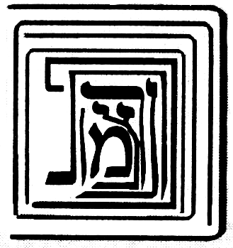

> אחר אשר חלפו לנו עידן ועידנין בענין הצורה הזאת שהמציאונו בפרקים הקודמים האיר ה' עיני שכלנו בה והקרה ה' לפנינו קדושים מדברים ושמחנו בהם כעל כל הון לפי שנמצא לנו בהם משען וסמך. ראשונה בעל ספר מאירת עינים וזה טופס לשונו זו היא צורת עמידתן של עשר ספי' בלי מהות ושנוי יתברך ויתעלה שמו וזה שאמר הכתוב (איוב כו ז) תולה ארץ על בלימה ואל תאמר אינו כי ישנו וכאשר תמנה מימינך לשמאלך תמצא עשרה ותראה כי הכתר בית לכלן ומקור כלן נמצא שהקודם לאצילות גדול ומקיף הכל והמאוחר לאצילות קטן ומוקף מהכל וכלול מכלן וזהו כגלדי הבצלים וכמו שהארץ השפלה הזאת היא קטנה והיא באמצע כל הנבראים כחרדלא בעזקתא והנה היא כלולה מכל היסודות והיא באמצע כל כמו לב בגוף האדם, כך כביכול העטרה.

**6:5:2** And therefore it is called the land of the living, and the heart. And look and see that the Diadem includes the Righteous One [Yesod] and all the supernal ones, unified with them and encompassed by them all and receiving from them all. And so [too] the Righteous One, and so Hod, and so Netzach, and so Gevurah, and so Chesed, and so Binah—each includes all, and they are unified one in another, and each one includes them all, and they are all unified in it; and all is unified in Ein Sof, in the Cause of causes. Thus far [his] words. And it is a proof compelling [to] our view, letter by letter, word by word.

> ולפיכך נקראת ארץ החיים והלב. והסתכל ותראה כי העטרה כלולה מהצדיק ומכל העליונים, מיוחדת בהם ומוקפת מכלם ומקבלת מכלם. וכן הצדיק וכן ההוד וכן הנצח וכן הגבורה וכן החסד וכן הבינה כולל הכל ומיוחדים זה בזה וכל א' כלול מכולם וכולם מיוחדים בו והכל מיוחד בא"ס בסבת הסבות עכ"ל. והוא ראייה מוכרחת אל דעתנו אות באות תיבה בתיבה.

**6:5:3** And further, we have a proof and a stay in the Zohar, Parashat Terumah (fol. 165a), and these are [the] words: Rabbi Yossi said: There are nine firmaments, and the Shekhinah is the tenth. For should you say [that] because it is written "ten" [the sefirot are counted] apart from the Shekhinah—if so, the Shekhinah would be the eleventh, standing over ten. Rather, certainly they are nine, and they are the nine days that are between Rosh Hashanah and Yom Kippur, and Yom Kippur is the tenth. In like manner [is] the Mishkan, which is ten curtains. Ten firmaments [are] a secret of secrets that was not delivered except to those who know wisdom. And all is in the secrets of the holy Lamp [Botzina Kadisha], who reveals the secret of each and every firmament and those ministers who serve in each and every one. Seven firmaments are above, and seven firmaments are below, in like manner to that which is above. There are seven firmaments in which are stars and constellations to govern this world, each according to its way, as is required for it. In all of them the seventh is preeminent—except the eighth, which conducts them all and stands over them all, as it is written, "extol Him who rides upon the Aravot." Who is "He who rides upon the Aravot," and what is Aravot? Rather, this Aravot is the seventh firmament. Why is it called Aravot? Because it includes fire and water together, from the side of the south and from the side of the north, and it is mixed [*me'orav*] of the two sides. Thus far [the passage], to our purpose. And the explanation of the passage: above the [present] matter, Rabbi Chiya expounded on the explanation of the verse "And you shall make the Mishkan [of] ten curtains," etc.; and Rabbi Yossi found difficulty in the verse that said "And you shall make the Mishkan [of] ten curtains"—and it is known that the Mishkan is the Shekhinah, Malkhut. If so, how did he say that one should make ten curtains, which are the ten sefirot, over the Mishkan, which is Malkhut? It turns out, accordingly, that the sefirot are eleven—and this is the opposite of the truth, that they are ten and not nine, ten and not eleven, as is explained in [the] gate "Ten and Not Nine." For this [reason] he said that the ten curtains do not necessitate ten sefirot apart from the Shekhinah; rather, "there are nine firmaments." [That is to say,] nine sefirot alone are over the Shekhinah, and the Shekhinah is the tenth. And he adopted the wording "nine" and did not say "there are ten firmaments and the Shekhinah is one of them"—which would be more precise, [namely] that the Shekhinah too is called a firmament, as is explained from his words. The reason [is] that the place of the error and the mistake was because he said "And [you shall make] the Mishkan," which is the Shekhinah, "[of] ten curtains," as [if] it appears that ten sefirot are over Malkhut. And to guard ourselves from this corruption [of understanding], he said, against the error, "nine firmaments," and the Shekhinah, which is the Mishkan, is the tenth to the firmaments—and that is what he said, "and the Shekhinah is the tenth." "For should you say [that] because it is written 'ten,'" etc.: that is, that should you wish to say that, from the fact that the verse said "And you shall make the Mishkan [of] ten curtains" and did not say "nine curtains," it appears that they are ten apart from the Shekhinah, God forbid—if so, you will be saying that they are eleven, and the *mishnah* in Sefer Yetzirah said "ten and not eleven." And therefore he did not wish to say [otherwise], but [rather], "if so, the Shekhinah is the eleventh." And in his mentioning the words "the eleventh," who does not know the *mishnah* that said "ten and not eleven," and "one who adds to ten is not of the [proper] number"? Rather, certainly they are nine, etc. And it is not Rabbi Yossi's intent to say that Yom Kippur is Malkhut and the ten days of repentance are from above downward—for it is already explained in the Zohar and the Tikkunim and in several places that Yom Kippur is in Binah, and the testimony to this [is] the five afflictions; and it is a foretaste of the World to Come, as the Sages, of blessed memory, said (Berakhot, fol. 17a), "In the World to Come there is no eating or drinking," etc. Rather, Rabbi Yossi's intent is only to tell us that the sefirot are ten, in the likeness of those days, which are only ten. And if the sefirot were eleven, the days would be eleven. And just as the days are nine and Yom Kippur is the tenth, so it is fitting concerning the matter of the sefirot, for the Mishkan itself [is] the tenth. And the matter [is] that the ten days of repentance are days that are in repentance, which is Binah; and behold, the Yod is repentance itself—that is to say, the supernal grade within it—and it is included in [the] ten days, which are the ten sefirot, and it is of the [number of the] days. So [too] the matter of the Mishkan itself: it is the tenth curtain and the tenth sefirah. And the intent of the verse in saying "And you shall make the Mishkan," etc., the intent [is] that you shall make the existence of the Mishkan such that it include ten sefirot, which are ten curtains, and the whole ten, that is the Mishkan—not that the Mishkan is one and the curtains ten by themselves, as you might have thought, for if so they would amount to eleven; rather, the Mishkan, that is the totality of the ten curtains. And that is what Rabbi Yossi said, "in like manner [is] the Mishkan, which is ten curtains"—[that] is to say, the Mishkan is the gathering of the ten curtains, which is what we say, [that] Malkhut includes ten, as we explained in the previous gates and shall explain in [the] gate "Essence and Governance," blessed be He. "A secret of secrets," etc.: he extolled the wisdom and its excellence. "Who reveals the secret in each and every firmament, and those ministers," etc.: the intent [is] that in each attribute [there are] several angels appointed over the matter of the action of that attribute, and the angels receive the power of the action from the supernal roots by means of ministers that draw near to their source—they are those whom we shall explain in [the] Gate of the Holy Palaces. And from those near to the roots, who sit first in the palace of the King, [there] chain down many thousands and myriads of myriads, from grade to grade and from cause to effect, until they reach this world. And this matter has been explained in the words of Rashbi, peace be upon him, [in] places too many to number. And these angels mentioned are called ministers to those supernal firmaments, which are the sefirot. And that is the intent of Rabbi Yossi here, in his saying "seven firmaments are above"—the explanation [being]: seven sefirot alone are the principal ministers for the governance of the world; and therefore the building of the world [is] seven days, with the Sabbath day, since the principal governance [is] with these seven. And just as above there are seven conductors, so in the lower firmaments the conductors of the world are seven—that is, the seven planets. And he said that above six firmaments is a seventh firmament, more excellent than the six that are below it, and it is called Aravot, from the language of "mixing" [*erev*], for in it two attributes are mixed—that is, its blending between judgment and lovingkindness; and Aravot is Tiferet, which mixes them. And he called it "seventh," even though it is fifth below Gedulah and Gevurah, for the reason we explained in [the] Gate of the Order of the Emanation, in chapter six. And he said that there is an eighth firmament riding over all, that is, Binah, which is the mother crouching over the young.

> ועוד יש לנו ראייה וסמך בזוהר פ' תרומה (דף קס"ה.) וז"ל ר' יוסי אמר תשע רקיעין אינון ושכינתא איהי עשיראה. דאי תימא בגין דכתיב עשר בר משכינתא איהי, אי הכי שכינתא חד סרי איהי דקיימא על י'. אלא ודאי ט' אינון ואינון ט' יומין דבין ר"ה לי"ה וי"ה איהו עשיראה. כגוונא דא משכן דאיהו י' יריעות. י' רקיעין רזא דרזין דלא אתמסר בר לאינון דידעי חכמתא. וכלא איהו ברזין דבוצינא קדישא דאיהי גלי רזא דכל רקיעא ורקיעא ואינון שמשין דמשתמשי בכל חד וחד. ז' רקיעין אינון לעילא וז' רקיעין אינון לתתא כגוונא דלעילא. ז' רקיעין אינון דבהון כוכביא ומזלות לאנהגא עלמא דא כפום אורחיה כמה דאצטריך ליה. בכלהו שביעאה עדיף. בר תמינאה דקא מדבר לכולהו וקיימא על כלהו. דכתיב סולו לרוכב בערבות. מאן רוכב בערבות ומאן איהו ערבות. אלא ערבות דא רקיעא שביעאה. אמאי אקרי ערבות על דאיהו כליל מאש ומים כחדא מסטרא דדרום ומסטרא דצפון ואיהו מעורב מתרין סטרין. עכ"ל לענייננו. ופי' המאמר, שלמעלה מן הענין דרש ר' חייא בפי' הפסוק ואת המשכן תעשה עשר יריעות וגו', ורבי יוסי הוקשה לו בפסוק שאמר ואת המשכן תעשה עשר יריעות וידוע כי המשכן היא שכינה מלכות וא"כ האיך אמר שיעשה עשר יריען שהן ע"ס על המשכן שהיא המלכות. נמצא לפי"ז שהספירות אחד עשר, וזה הפך האמת שהם י' ולא ט' י' ולא י"א וכמבואר בשער י' ולא תשע. לזה אמר שלא היוד יריעות יחייבו עשר ספירות זולת השכינה. אלא ט' רקיעין אינון. פיר' ט' ספירות לבד הם על השכינה והשכינה היא העשירית. ונקט לישנא דט' ולא אמר י' רקיעין אינון ושכינתא חדא מנייהו שהוא יותר מדוקדק שהשכינה ג"כ נקרא רקיע כמבואר מתוך דבריו. הטעם מפני כי מקום הטעות והשגיאה היה מפני שאמר ואת המשכן שהיא השכינה תעשה עשר יריעות כנראה שעשר ספירות הם על המלכות. ולשמור עצמנו מן השבוש הזה אמר נגד הטעות תשע רקיעין והשכינה שהיא המשכן היא עשירית אל הרקיעין והיינו דקאמר ושכינתא איהי עשיראה. דאי תימא בגין דכתיב עשר וכו'. פי' שאם תרצה לומר כי מטעם שאמר הכתוב ואת המשכן תעשה עשר יריעות ולא אמר ט' יריעות נראה שהם עשר מלבד השכינה ח"ו. א"כ נמצאת אומר שהם אחד עשר והמשנה בס"י אמרה י' ולא י"א. ולכן לא רצה לומר אלא אי הכי שכינתא חד סרי. ובהזכירו מלות חד סרי מי לא ידע המשנה שאמרה עשר ולא אחד עשר והמוסיף על עשר אינו מן השם. אלא ודאי ט' אינון וכו'. ואין כונת רבי יוסי לומר שיום הכפורים היא המלכות וי' ימי תשובה הם מלמעלה למטה. לפי שכבר מבואר בזוהר ובתיקונים ובכמה מקומות כי יום הכפורים הוא בבינה והעד על זה ה' ענויים והוא מעין עולם הבא כמו שארז"ל (ברכות דף י"ז.) העולם הבא אין בו לא אכילה ולא שתייה וכו'. אבל כונת רבי יוסי אינו אלא לומר לנו כי הספירות הם עשר בדמיון אותן הימים שאינם אלא עשר. ואם היו הספירות י"א יהיו הימים י"א. וכמו שהימים ט' ויום הכפורים עשירי כן ראוי לענין הספירות כי המשכן עצמו העשירי. והענין כי עשרת ימי תשובה הם ימים שבתשובה שהיא הבינה והנה היוד היא התשובה עצמה רצה לומר המדרגה העליונה שבה והיא נכללת בעשרה ימים שהם עשר ספירות והיא מכלל הימים. כן ענין המשכן עצמו הוא היריעה העשירית והספי' העשירית. וכונת הכתוב באמרו ואת המשכן תעשה וכו' הכונה כי מציאות המשכן תעשה שתהיה כלולה מעשר ספירות שהם י' יריעות וכל העשר היינו המשכן. לא שהמשכן אחד והיריעות עשר בפני עצמן כדקא ס"ד שאם כן יעלו לאחד עשר, אלא שהמשכן היינו כללות עשר יריעות. וזה שאמר רבי יוסי כגוונא דא משכן איהו יו"ד יריעות, פי' המשכן הוא קבוץ היו"ד היריעות דהיינו מה שאנו אומרים מלכות כלולה מי' וכמו שבארנו בשערים הקודמים ונבאר בשער מהות וההנהג' ב"ה. רזא דרזין וכו', הפליג בשבח החכמה ומעלתה. דאיהו גלי רזא בכל רקיעא ורקיעא ואינון שמשין וכו'. הכונה כי כל מדה כמה מלאכים ממונים על ענין פעולת המדה ההיא והמלאכים מקבלים כח הפעולה מהשרשים העליונים על ידי משרתים המתקרבים אל מקורם הם אותם אשר נבאר בשער היכלות הקדושה. ומאותם הקרובים אל השרשים היושבים ראשונה בהיכל מלך משתלשלים כמה אלפים ורבי רבבות ממדרגה אל מדרגה ומעלה לעלול עד הגיעם אל העולם [הזה]. והענין הזה נתבאר בדברי הרשב"י ע"ה מקומות רבו מספר. ואלו המלאכים הנז' הם נקראים משרתים לאותם הרקיעים העליונים הם הספירות וזהו כונת רבי יוסי הנה באמרו ז' רקיעים אינון לעילא, פירוש ז' ספירות לבד הם המשמשים העקריים להנהגת העולם, ולכן בנין העולם ז' ימים עם יום השבת להיות כי עקר ההנהגה עם הז' האלה. וכמו שלמעלה הם ז' מנהיגים, כן ברקיעים התחתונים המנהיגים העולם הם ז', דהיינו ז' כוכבי לכת. ואמר כי למעלה מששה רקיעים הוא רקיע שביעי משובח מהששה אשר למטה ממנו והוא נקרא ערבות מלשון ערוב שבו מתערבות ב' מדות דהיינו מזיגתו בין הדין והחסד והערבות הוא התפארת המערבם וקראו שביעי עם היותו חמשי למטה מגדולה וגבורה מן הטעם שבארנו בשער סדר האצילות בפ"ו. ואמר שיש רקיע שמיני רוכב על הכל, דהיינו הבינה שהיא האם הרובצת על הבנים.

**6:5:4** And behold, the explanation of the passage is concluded, and from it we have learned the matter of the Emanation—that they are in the likeness of the spheres that surround this world, this within that, like the layers of an onion; and for this reason he called them firmaments, and their governance [is] like the governance of the lower firmaments, and they are spheres encompassing all that is within them, like a mustard-seed in a ring. And blessed is God, who made His lovingkindness wondrous to us in a besieged city, and we found ourselves corroboration and a stay from the words of the Zohar—[they are] all of them according to Rashbi, as is known—and there is no doubt in this matter.

> והנה נכלל ביאור המאמר ומתוכו למדנו ענין האצילות שהם כדמות הגלגלים הסובבים העולם הזה זה בתוך זה כגלדי בצלים ומטעם זה קראם רקיעים והנהגתם כהנהגת הרקיעים התחתונים והם גלגלים מקיפים כל אשר בתוכם כחרדלא בגו עזקתא. וברוך ה' אשר הפליא חסדו לנו בעיר מצור ומצאנו לנו סעד וסמך מתוך דברי הזוהר קראי כולהו אליבא דרשב"י כנודע ואין לענין זה ספק:

### Chapter 6:6. Explanation that the sefirot in their standing are one above the other up to ten, and that their standing is three to the right, three to the left, and four in the center — and all is one.

**6:6:1** After we elaborated, in the previous chapter, on the figure of the Emanation and its standing, and established it and confirmed it and upheld it as is fitting—it is fitting to see that this figure is found to demolish the whole edifice that we built in the previous chapters concerning the matter of the figure of the Emanation, [namely] that they are three rights and three lefts and three middle [ones]. And accordingly, this is not [consonant] with its [other] figure, for they are all one within another and there is in them neither right nor left. Now, [since] this and that are the words of Rashbi, it is not fitting to say that his words contradict one another, some of them against others. And likewise the author of Sefer Me'irat Einayim, who wrote that figure that we wrote above in chapter two, and afterward wrote this figure and retracted within the span of an utterance—and he said above that one who denies the first figure is [of] a generation of perversities, etc.—and this is very strained. And to resolve this matter, let us say: a question was asked among the investigators concerning the angels, which they designated by the name "separate intellects," and they said: since they are simple, spiritual, and far from all the accidents of body, if so, by what are they distinguished into the number ten? And Rambam, peace be upon him, wrote the matter of this question in the second [chapter] of Hilkhot Yesodei ha-Torah, and these are [his] words: "And by what are the forms distinguished one from another, seeing that they are not bodies?" And he answered: because they are not equal in existence, but each one of them is below the rank of its fellow, and it exists from its [fellow's] power, this above that, and all exist from the power of the Holy One, blessed be He. Thus far [his] words.

> אחר שבפרק הקודם הארכנו בפ' צורת האצילו' ועמידתן והכרחנוהו ואשרנוהו וקיימנוהו כדחזי. ראוי לראות כי נמצא הצורה הזאת הורסת כל הבנין שבנינו בפרקים הקודמים מענין צורת האצילות שהם ג' ימינים וג' שמאלים וג' אמצעיים. ולפי"ז אין זה לצורתו כי כלם זב"ז ואין בהם לא ימין ולא שמאל. השתא הא והא הם דברי הרשב"י, ואין ראוי לומר שיהיו חולקים דבריו קצתם אל קצתם. וכן בעל ספר מאירת עינים, שכתב הצורה ההיא שכתבנו לעיל בפרק ב', ואחר כך כתב הצורה הזו וחזר בו תוך כדי דבור, והוא אמר לעיל שהמכחיש הצורה ראשונה דור תהפוכות וכו', וזה דוחק גדול. ולתקן הענין הזה נאמר שאלה נשאלה בין החוקרים בענין המלאכים אשר כנו אותם בשם שכלים נבדלים ואמרו כי אחרי שהם פשוטים רוחניים ורחוקים מכל מאורעי הגוף אם כן במה יפרדו אל מנין העשרה. וכתב ענין השאלה הזאת הרמב"ם ע"ה בפ"ב מהלכות יסודי התורה וז"ל ובמה יפרדו הצורות זו מזו והם אינם גופים. ותירץ לפי שאינם שווים במציאות אלא כל אחד מהם למטה ממעלתו של חבירו, והוא מצוי מכוחו זה למעלה מזה, והכל נמצאים מכח של הקב"ה עכ"ל.

**6:6:2** And the intent [is] that he there elaborated on the negation of body and its accidents in [the case of] the angels, and it was difficult for him: since they are far from the accidents of body, and since existents equal in existence are not distinguished one from another except by the accidents of body, and since the angels have no accidents of body—if so, by what are they distinguished, [such] that they are ten grades, as he himself counted? And he answered: because they are not equal in their existence. The explanation [is] that it is true [that] those equal in their existence are not distinguished except by the accidents of body; and the angels, which are distinguished even though they have no accidents of body—the reason is because they are not equal in their existence, but [are] effects one of another, and each one of them is below the rank of its fellow, etc. And the master Rabbi Shem Tov ben Shem Tov, in Sefer ha-Emunot, Gate 4, chapters one, two, [and] three, established with clear proofs that their view is not correct. And these are [his] words: Behold, according to their view, there is nothing between the Cause of causes and them except that this one is a cause to the effects [proceeding] from it; and we have no power to know a single thing of [any] difference between the First Cause and the last of them, etc., except [the relation] from cause to effect—that is to say, they are all unified in a complete unity, for there is among them neither conjunction nor separation, and they have no place at all, for they are not body nor a force in body, but [are] separate intellect[s]; but the cause is above what it causes and the cause is above its effect, and it turns out that the First Cause is a cause to them all, and the first effect is a cause to all the effects that are below it, and they are above the lower ones.

> והכוונה כי הוא הפליג שם בשלילות הגוף ומאורעיו במלאכים והוקשה לו כי אחר שהם רחוקים ממאורעי הגוף ואחר שאין הנמצאים השוים במציאות נפרדים זה מזה אלא במאורעות הגוף ואחר שהמלאכים אין להם מאורעי הגוף א"כ במה יפרדו להיותם עשרה מדרגות כמו שמנה הוא בעצמו. ותירץ לפי שאינם שווים במציאותם. פי' כי אמת הוא כי השוים במציאותם לא יפרדו אלא במאורעי הגוף והמלאכים שהם נפרדים עם היות שאין להם מאורעי הגוף הטעם הוא מפני שאינם שוים במציאותם אלא עלולים זה מזה וכ"א מהם למטה ממעלתו של חבירו וכו'. והרב ר' שם טוב בן שם טוב בספר האמונות שער ד' פרק א' ב' ג' הכריח בראיות ברורות שאין דעתם צודקת. וז"ל הנה לדעתם אין בין עילת העילות אליהם אלא שזה עלה אל העלולים ממנו ואין בנו כח לידע דבר אחד מחילוף בין הסבה הראשונה לאחרון מהם וכו' כי אם מעילה לעלול כלומר כלם יתיחדו באחדות גמור כי אין ביניהם לא חבור ולא פירוד ואין להם מקום כלל כי אינם גשם ולא כח בגשם אלא שכל נבדל אבל הסבה למעלה מן המסובב והעילה למעלה מן העלול ונמצא שהסבה הראשונה סבה לכלם והעלול הראשון עילה לכל העלולים שלמטה ממנו והם למעלה מן התחתונים.

**6:6:3** And further, the master refuted this view concerning the angels, because it is compelling from the words of the Sages, of blessed memory, that the angels were created on the second day or on the fifth day, according to what the Sages, of blessed memory, disputed in this (in Bereshit Rabbah, ch. 3); and he said that if the angels were [as] the unity of the [divine] Name, how is it possible to say that they were created after the creation of heaven and earth? And it is impossible, just as it is impossible to say that they preceded the First Cause.

> ועוד הרב הכחיש סברא זו במלאכים מפני שהוכרח בדברי רז"ל שהמלאכים נבראו ביום ב' או ביום ה' כפי מה שנחלקו בזה חז"ל (בב"ר פ"ג) ואמר שאם היו המלאכים כאחדות השם איך אפשר לומר שאחר בריאת שמים וארץ נבראו והוא נמנע כמו שנמנע לומר שקדמו לסבה ראשונה.

**6:6:4** And further, how does the language of "creation" [rightly] apply to them?

> ועוד איך צודק בהם לשון בריאה.

**6:6:5** And further, he established [the point] from Parashat Vayera, from the vision of Abraham, who saw them in the likeness of men, and he established there that it cannot rightly be said that it was in a prophetic vision. Thus far his objections.

> ועוד הכריח מפ' וירא אליו ממראה אברהם שראה אותם כדמות אנשים והכריח שם כי לא יצדק לומר שהיה במראה הנבואה. עכ"ל השגותיו.

**6:6:6** And behold, he established, on the basis of these questions, that they [the angels] are subtle beings, corporealizing themselves in a subtle and pure body; and for this he adduced [proofs] from the words of the Sages, of blessed memory, as we shall explain in the Gate of the Palaces, with God's help. And now we ourselves ask concerning the matter of the sefirot, exactly like their question: since we elaborated, in the previous gates, on the matter of the sefirot and their distancing from body and its accidents—if so, by what are they distinguished, if they are equal in their existence? And we shall answer according to their answer, that their distinction is in that they are not equal in their existence: for Keter exists from Ein Sof, and not so Chokhmah, whose existence is from Keter; and not so Binah, which exists from Chokhmah; and not so Chesed, whose existence is from Binah; and not so Gevurah, whose existence is from Chesed; and not so Tiferet, whose existence is from Gevurah; and not so Netzach, whose existence is from Tiferet; and not so Hod, whose existence is from Netzach; and not so Yesod, whose existence is from Hod; and not so Malkhut, whose existence is from Yesod. And behold, now they are distinguished one from another, in that each one is a cause to its fellow. And now, concerning the sefirot, what Rabbi Shem Tov found difficult in the words of Rambam will not be difficult for us, because the sefirot preceded the creation of heaven and earth and do not fall under time, but on the contrary, they are a root to time. For the six sefirot are a root to the six days, and the seventh is the Sabbath day, as will be explained in the Glossary of Titles, with God's help. And concerning them the Sages, of blessed memory, said (Bereshit Rabbah, ch. 3), "this teaches that an order of times existed before this." And it will also not be difficult for us [to explain] that they appeared to the prophets, for the prophets never apprehended the very sefirot themselves at all; and even to Moses our teacher, peace be upon him, it was said (Exodus 33:23), "and you shall see My back," etc. And what we say, that the prophecy of Moses our teacher was in Tiferet and [that] of the other prophets in Malkhut—and likewise what we say, that Netzach and Hod are the two prophets of truth—the intent in all this is not that they apprehended the sefirot literally, but [rather] that from there [is] their nourishment; but their intellection was in the palaces. And so Rashbi, peace be upon him, explained, as we shall explain in the Gate of the Palaces, in chapter two, in the second palace, with God's help. Since his difficulties will not be difficult for us, if so, when we ask: since the sefirot are *belimah*, as we explained in the previous gates, [then] by what are they distinguished?—we too shall say that they are distinguished in that the one is a cause to its fellow, as if we should mean that there is no distinction between Keter and its Emanator except that the Emanator is a cause to the emanated. And beyond this they are unified [in] the utmost union; but between Ein Sof and Keter, by reason of Keter['s] being emanated and not Emanator, and Ein Sof Emanator and not emanated, there is much distinction, as explained above in the Gate of Whether the Ein Sof is the Keter and in the Gate of Self and Vessels. And this is clear, that Keter is emanated and Ein Sof the Emanator [is] not emanated. But by reason of their descent, the sefirot do not descend from it except in the manner [of relation] that [obtains] between Emanator and emanated and that [obtains] between cause and effect; and likewise Chokhmah descends from Keter, and Binah from Chokhmah, and likewise the other sefirot, like the descent of the effect from the cause. And the matter [is] that Malkhut apprehends Yesod, but not to the measure that it apprehends itself. And Yesod apprehends itself, and apprehends Malkhut with [a] more complete [apprehension] than Malkhut apprehends itself. And likewise it does not apprehend Hod to the measure that it apprehends itself. And Hod apprehends itself more than Yesod apprehended [it]. And likewise it apprehends Malkhut with [a] greater apprehension than Yesod apprehends [it], and how much more so Malkhut itself. And likewise Netzach—its knowledge of itself will be more elevated than Hod apprehends [it]. And likewise Yesod apprehends [it] more than Hod apprehends [it], and how much more so Yesod [apprehends] itself. And likewise it apprehends Malkhut more than Yesod apprehends [it], and how much more so Malkhut itself. And in this manner, too, the apprehension of Yesod in Hod will be more elevated than the apprehension of Malkhut in Hod; and likewise the apprehension of Hod in Netzach will be more elevated than the apprehension of Yesod [in it]; and likewise their apprehensions, one over another, will be elevated, up to the first grade.

> והנה הכריח על פי השאלות האלה שהם הויות דקות מתגשמים בגוף דק וזך ולזה הכריח מדברי רז"ל וכמו שנבאר בשער ההיכלות בס"ד. ועתה נשאל אנחנו בענין הספירות כשאלתם ממש שאחר שהפלגנו בשערים הקודמים בענין הספירות והרחקם מן הגוף ומאורעיו א"כ במה יפרדו אם הם שוים במציאותם. ונשיב כפי תשובתם שהפרדם הוא במה שאינם שוים במציאותם כי הכתר מצוי מא"ס ולא כן חכמה שמציאותה הוא מן הכתר ולא כן הבינה שהיא מצויה מן החכמה ולא כן החסד שמציאותה מן הבינה ולא כן הגבורה שמציאותה מן החסד ולא כן הת"ת שמציאותה מן הגבורה ולא כן הנצח שמציאותה מן הת"ת ולא כן ההוד שמציאותה מן הנצח ולא כן היסוד שמציאותה מן ההוד ולא כן המלכות שמציאותה מן היסוד והנה עתה הם נפרדות זו מזו במה שכל א' עילה לחברתה. ועתה בספירות לא יקשה עלינו מה שהקשה הרש"ט לדברי הרמב"ם. מפני שהספי' קדמו אל בריאת שמים וארץ ואינם נופלים תחת הזמן, אלא אדרבא הם שרש אל הזמן. כי ו' ספירות הם שרש ו' ימים, ושביעית יום שבת. כאשר יתבאר בשער ערכי הכנוים בע"ה. ועליהם אז"ל (בב"ר פ"ג) מלמד שהיה סדר זמנים קודם לכן. וגם לא יקשה עלינו שנראו לנביאים, שמעולם לא ראו הנביאים עצם הספירות ממש, ואפילו למשה רבינו ע"ה נאמר שמות לג כג) וראית את אחורי וכו'. ומה שאנו אומרים שנבואת מרע"ה בת"ת ושאר הנביאים במלכות. וכן מה שאנו אומרים כי נצח והוד הם ב' נביאי קשוט. אין הכוונה בכל זה שהיו משיגים ממש בספירות, אלא שמשם יניקתם. אבל השכלתם הי' בהיכלות. וכן פי' הרשב"י ע"ה כמו שנבאר בשער היכלות בפ"ב בהיכל שני בס"ד. כיון שלא יקשה עלינו קושיותיו. א"כ כשנשאל מאחר שהספירות בלימה כדפי' בשערים הקודמים א"כ במה יבדלו. אף אנו נאמר שהם נבדלות במה שהאחת עילה לחברתה כאלו נרצה שאין הבדל בין הכתר למאצילו אלא שהמאציל עילה אל הנאצל. ואל היותר מזה הם מיוחדים תכלית היחוד אבל בין הא"ס והכתר בסבות היות הכתר נאצל ולא מאציל וא"ס מאציל ולא נאצל הבדל הרבה יש כדפי' לעיל בשער אם הא"ס הוא הכתר ובשער עצמות וכלים. וזה ברור כי הכתר נאצל והא"ס המאציל לא נאצל. אבל מצד רדתם הספירות מאתו אינם יורדות אלא בענין שבין מאציל לנאצל ומה שבין עילה ועלול וכן יורדת החכמה מהכתר והבינה מחכמה וכן שאר הספירות כירידת העלול מן העילה. והענין כי המלכות משיג היסוד אבל לא כשיעור שישיג את עצמו. והיסוד משיג עצמו ומשיג המלכות ביותר שלימות שישיג המלכות את עצמו. וכן אינו משיג בהוד כשיעור שישיג את עצמו. וההוד משיג את עצמו יותר ממה שהשיג היסוד. וכן משיג המלכות ביותר השגה ממה שישיג היסוד וכ"ש המלכות בעצמה. וכן הנצח תתעלה ידיעתו את עצמו ממה שישיג ההוד. וכן ישיג היסוד יותר ממה שישיג ההוד וכ"ש היסוד. וכן ישיג המלכות יותר ממה שישיג היסוד וכ"ש המלכות עצמה. ועל דרך זו ג"כ יתעלה השגת היסוד בהוד מהשגת המלכות בהוד וכן תתעלה השגת ההוד בנצח מהשגת היסוד וכן תתעלה השגתם זו על זו עד המדרגה הראשונה.

**6:6:7** And this matter [is] a great principle in [the realm of] existence, as we shall expand the explanation in Sefer Or Yakar, with God's help. And we know that it will be difficult in the eyes of the examiner that, accordingly, it turns out that Chokhmah is not unified with the Emanator, and likewise Binah with Keter—since that which is an effect from it, this is its cause, and the bond of the effect [is] with its cause, not with the cause of its cause, intrinsically. We shall answer to this: that it is true [that] the questioner has aimed well and is right in his ruling that they are not unified from this side; but they are unified from another side, each one in them all and all in each one, by [virtue of] the aspect of their inclusion from [the number] ten.

> וענין זה עיקר גדול במציאות כאשר נרחיב ביאור בספר אור יקר בס"ד. וידענו שיקשה בעיני המעיין שא"כ נמצאו שהחכמה אינה מתייחדת עם המאציל וכן בינה עם הכתר מאחר שמה שהוא עלול ממנו זו עילתו וקשר העלול עם עלתו לא עם עלת עלתו בעצם. נשיב על זה כי אמת הוא יפה כוון השואל וצדק בגזרתו שאינם מיוחדים מצד זה, אבל הם מיוחדים מצד אחר כל אחד בכלם וכלם בכל אחד בערך בחי' כללותם מיו"ד.

**6:6:8** And behold, accordingly, Keter has with Gevurah ten unifications, namely: the Keter-within-Keter with the Keter-within-Gevurah, and the Chokhmah-within-Keter with the Chokhmah-within-Gevurah, and in this manner the other grades; and so for all the sefirot. And since it has been explained that, by way of inclusion, the sefirot ascend in their manifestations without end—as we shall explain in the Gate of Essence and Governance, chapter two, with God's help—therefore [the matter] will ascend in unification without end. And this is by [reference to] the [relative] measure of their unification and their bond [as] the emanated [sefirot] themselves. But in the Emanator they are unified in two respects: the one, by [reference to] their bond with their concealed root above, as is explained in the Gate of Tzachtzachot; and the second, in the aspect of the light of the Self that spreads within the grades, which is the Self of the Godhead, not divided into these parts except by means of the sefirot, as explained in the Gate of Self and Vessels. And the Self that spreads is unified in its source, like the ray of the sun unified in the sun, and in the likeness of the soul unified in its powers that spread through the body. And the sefirah itself is unified in the Self that spreads [in the] utmost union, just as the soul is unified with the body, for reasons that we shall explain in the Gate of the Soul.

> והנה לפי"ז יש לכתר עם הגבורה יו"ד יחודים והם כתר שבכתר עם כתר שבגבורה והחכמה שבכתר עם חכמה שבגבורה ועד"ז שאר המדרגות וכן לכל הספירות. ואחר שנתבאר כי על דרך הכללות עולה הספי' במציאותי' לאין תכלית כמו שנבאר בשער מהות והנהגה פרק ב' בס"ד. ולפיכך יעלה ביחוד לאין תכלית וזהו בערך יחודם וקשורם הנאצלים הם בעצמם. ובמאציל הם מתייחדים בשתי פנים האחד בערך קשורם עם שרשם הנעלם למעלה כמבואר בשער הצחצחות. והב' בבחינת האור העצמות המתפשט בתוך המדרגות שהוא עצם האלקות בלתי מתחלק לחלקים האלה אלא ע"י הספירות כדפי' בשער עצמות וכלים. והעצם המתפשט מיוחד במקורו כנצוץ השמש המיוחד בשמש וכדמיון הנפש המיוחדת בכחותיה שמתפשטות בגוף. והספי' עצמה מתייחדת בעצם המתפשט תכלית היחוד כמו שמתייחד הנפש עם הגוף לסבות כאשר נבאר בשער הנשמה.

**6:6:9** And behold, after the matter of their bond and the matter of their unification and the matter of their distinction have been explained—that they are in the likeness of cause and effect, cause and what it causes—the Emanation is found [to be] a jointed lampstand, [its parts] unified and bound [in] the utmost union, bond, and longing. And concerning this matter a covenant was cut for those who occupy themselves with the wisdom of the Pardes. And this was the claim of Elisha, [namely] that through this he became Acher [the Other]. And this was the sin of Adam the First, who came to dismantle the tent and was found dismantling on the Sabbath, and therefore he was [held] liable. And one who contemplates this matter, [this] occupation, must beware lest he do according to their pattern; and therefore let the examiner occupy himself with this chapter, and in it he will find rest for his soul, and his soul will abide in well-being, and he will dwell secure with none to make him afraid.

> והנה אחר שנתבאר ענין קשורם וענין יחודם וענין הבדלם שהם כדמיון עילה ועלול סבה ומסובב נמצא האצילות מנורה של פרקים מיוחדים ומקושרים תכלית היחוד והקשר והחשק. ועל ענין זה נכרת ברית למתעסקים בחכמת הפרדס. וזה הי' טענת אלישע שע"י כך נעשה אחר. וזה היה חטא אדם הראשון שבא לפרק את האהל ונמצא מפרק בשבת ולכן חייבו. והמתבונן ענין זה העסק צריך ליזהר שלא יעשה כתבניתם, ולכן המעיין יעסוק בפרק זה ובו ימצא מרגוע לנפשו ונפשו בטוב תלין ושכן לבטח ואין מחריד:

### Chapter 6:7. To explain the matter of the Ein Sof, which has no end, and its expansion through all the grades down to the last point; and the matter of the sefirot, that each is included in its fellow.

**6:7:1** After the matter of the bond of the sefirot among themselves and their bond with the Emanator has been explained in the previous chapter—when the examiner contemplates it with good diligence, he will find good taste and knowledge and the compelling [force] of the matter of itself, and the truth will show its way. And he will find, accordingly, [that] the sefirot—when we come to liken them and to depict them, by way of likeness, to the human intellect—[one] will be compelled to believe that they are one above another. For Ein Sof the Emanator is the Cause of all causes and the Source of all causes, and the first effect from it is Keter; and Keter [is] a cause and a cause to Chokhmah, by the power of the Emanator that overflows from its light upon it; and Chokhmah is a cause and a cause to Binah, by the power of the Emanator, by means of Keter, in [its] emanating the light of the Emanator by means of the first emanated [one], Keter, upon it. And so for all the rest of the Emanation: for Binah [is] a cause to Chesed, and Chesed a cause to Gevurah, and Gevurah a cause to Tiferet, and Tiferet a cause to Netzach, and Netzach a cause to Hod, and Hod a cause to Yesod, and Yesod a cause to Malkhut. Behold, they are ten grades, ordered one above another, thus: Keter, Chokhmah, Binah, Gedulah, Gevurah, Tiferet, Netzach, Hod, Yesod, Malkhut. And of what is fitting to know [is] that, apart from this order, they have another order. And the reason for this [is] that each sefirah has two causes: the one, its cause—that after the preceding [one] was emanated, it was emanated. The example of this [is] that even though the true cause of Netzach is Chesed, nonetheless, because of the order of its emanation, its cause is none but Tiferet, as we elaborated concerning the matter of their emanation in the Gate of the Order of the Emanation, in chapter six.

> אחר שנתבאר מתוך הפרק הקודם ענין קשר הספי' בעצמם וקשורם עם המאציל, כאשר יתבונן המעיין בו בטוב השקידה ימצא טוב טעם ודעת והכרח הענין מעצמו והאמת יורה דרכו. וימצא לפי"ז היות הספירות כאשר נבא להמשילם ולציירם ע"ד דמיון אל השכל האנושי יוכרח להאמין שהם זו למעלה מזו. מפני כי הא"ס המאציל הוא עלת כל העלות וסבת כל הסבות והעלול הראשון ממנו הוא כתר וכתר סבה ועילה לחכמה מכח המאציל השופע מאורו עליו וחכמה הוא סבה ועילה לבינה מכח המאציל ע"י הכתר בהשפיע אור המאציל ע"י הנאצל הראשון כתר עליו. וכזה לכל שאר האצילות כי בינה עילה וסבה לחסד וחסד עלה וסבה לגבורה וגבורה עלה וסבה לת"ת ות"ת עלה וסבה לנצח ונצח עלה וסבה להוד והוד עלה וסבה ליסוד ויסוד סבה ועלה למלכות. הרי הם עשר מדרגות מסודרות זו למעלה מזו כזה כתר חכמה בינה גדולה גבורה תפארת נצח הוד יסוד מלכות. וממה שראוי לדעת כי בזולת הסדר הזה יש להם סדר אחר. וטעם לזה כי לכל ספירה ב' עלות. והם הא' עילתו שאחר שנאצלה הקודמת נאצלה היא. המשל בזה כי אעפ"י שעילתו האמיתית של הנצח הוא החסד עכ"ז מפני סדר אצילותו עילתו אינו אלא התפארת כמו שהארכנו בענין אצילותם בשער סדר האצילות בפ"ו.

**6:7:2** And behold, they have two aspects to their cause and their source: the one, the order that we explained above, one upon another up to the ten; the second, the order of their effluence and their source, according to their division. There is [one] whose aspect is lovingkindness [Chesed], and it must incline to the line of Chesed; and there is [one] whose aspect is judgment [Din], and it must incline to the line of Din; and there is [one] whose aspect is compassion [Rachamim], and it must incline to the line of Rachamim, and it aligns itself between these two lines, toward the mean.

> והנה נמצאו להם ב' בחינות אל עלתם. וסבתם האחד הסדר שפירשנו למעלה זו על זו עד העשר. השני סדר שפעם ומקורם לפי חלוקם יש שבחינתה חסד וצריך היותה נוטה אל קו החסד ויש שבחינתה דין וצריך נטייתה אל קו הדין. ויש שבחינתה רחמים וצריך נטייתה אל קו הרחמים והיא מתיישרת בין שני הקוין האלה אל המיצוע.

**6:7:3** And behold, the matter of these their aspects is their subsistence and their effluence that is poured out upon them. And it turns out, accordingly, that they have two aspects to their causes: the first aspect, the cause of the order, as explained; the second aspect is the nourishment and the effluence and the subsistence. And even though, from the side of the aspect [pertaining] to the order of the emanation, their order [being] one above another is compelling—when we look to the side of their nourishment, which is the cause of their subsistence, they are found [to be] in another arrangement; for we see [that] Keter emanates into Chokhmah and into Binah—if so, it is compelled from this that it is the cause of both of them. And from another side it is compelled that Chokhmah is the cause of Binah and Keter the cause of Chokhmah—if so, it is compelled that [they] be ordered in the likeness of a *segolta*, thus:  

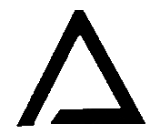

> והנה ענין בחינתם אלה הוא קיומם ושפעם הנשפע עליהם. ונמצא לפי זה להם ב' בחינות אל סבותם. בחי' ראשונה סבת הסדר כדפי'. בחינה שנייה היא היניקה והשפע והקיום. ואעפ"י שמצד הבחינה אל סדר האצילות הוכרח סדרם זו למעלה מזו. כשנביט אל צד יניקתם אשר הוא סבת קיומם נמצאים בענין אחר כי אנו רואים כ"ע משפיע אל החכמה ואל הבינה א"כ יוכרח מזה היותו סבת שתיהם. ומצד אחר יוכרח היות חכמה סבת הבינה והכתר סבת החכמה א"כ יוכרח היות מסודרת כדמות סגולתא כזה.

**6:7:4** Keter; and one channel, which indicates the preceding cause—and their order is Keter, Chokhmah, Binah. And from the side of Keter's emanating into Binah, it is necessitated that there be a channel from Keter to Binah; and the matter of the channels will be explained in a gate of its own. And from the side of Chokhmah's emanating into Chesed, and Binah into Gevurah, it is compelled that Chesed be beneath Chokhmah and Gevurah beneath Binah—which indicates that Chokhmah is the cause of Chesed and Binah the cause of Gevurah. And from the side of Tiferet's drawing sustenance from Keter and from Chesed and from Gevurah, it is compelled that it be opposite it, indicating that its cause is Keter. And from the side of its drawing sustenance from Chesed and from Gevurah, it is compelled that it be between the two of them, to indicate that it is caused by both of them. And from the side of its being sixth in the Emanation, it is compelled that it be drawn somewhat below the two of them, as we have depicted. And from the side of Netzach's being seventh in the Emanation, it is compelled that it draw sustenance from Tiferet. And from the side of its drawing sustenance from Chesed, it is compelled that it be beneath Chesed. And so Hod, in this way, [is] beneath Gevurah. And Yesod is compelled to be beneath Tiferet, for from there is its principal nourishment, and it is its cause from the side of the pouring-forth [of effluence]. And from the side of its drawing sustenance from Netzach and Hod, it is likewise compelled that it be between the two of them. And from the side of its being ninth to them all, it is compelled that it be drawn downward, to beneath them all, as we have depicted.  

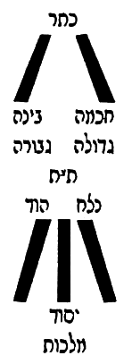

> כתר וצנור א' המורה על הסבה הקודמת והם סדרן כתר חכמה בינה. ומצד היות הכתר משפיע אל הבינה יתחייב היות צנור מכתר אל הבינה, וענין הצנורות יתבאר בשער בפ"ע. ומצד היות חכמה משפעת בחסד והבינה בגבורה יוכרח היות חסד תחת חכמה וגבורה תחת בינה שהוא מורה כי החכמה סבת החסד והבינה סבת הגבורה. ומצד היות הת"ת יונק מן הכתר ומן החסד ומן הגבורה יוכרח היותו כנגדו מורה שסבתו הוא הכתר. ומצד היותו יונק מן החסד ומן הגבורה יוכרח היותו בין שניהם להורות שהוא מסובב משניהם. ומצד היותו ששי אל האצילות יוכרח היותו נמשך קצת למטה משניהם כאשר ציירנו. ומצד היות הנצח שביעי לאצילות יוכרח היותו יונק מן התפארת. ומצד היותו יונק מן החסד יוכרח היותו תחת החסד. וכן הוד ע"פ דרך זה תחת הגבורה. ויסוד יוכרח היותו תחת הת"ת כי משם עיקר יניקתו והוא סבתו מצד ההשפעה. ומצד היותו יונק מן הנצח וההוד יוכרח ג"כ היותו בין שניהם. ומצד היותו תשיעי לכלם יוכרח היותו נמשך למטה אל תחת כלם כאשר ציירנו.

**6:7:5** And Malkhut, from the side of its being tenth, below Yesod, is drawn below Yesod.

> ומלכות מצד היותה עשירית למטה מהיסוד נמשכת למטה מן היסוד.

**6:7:6** And behold, after the matter of the agreement of the figures upon one matter has been explained, it is fitting to explain this matter that is found in the Zohar many times: "ascending and descending" [*salka ve-nachta*].

> והנה אחר שנתבאר ענין הסכמת הצורות אל ענין אחד ראוי לבאר ענין זה הנמצא בזוהר פעמים רבות סלקא ונחתא.

**6:7:7** And behold, the matter of ascent and descent indicates corporeality, and this does not properly apply at all; and with this premise all will be explained. Namely: since the matter of their being one above another does not intend the existence of place, God forbid, as we have explained, but rather the matter of rank and priority from cause to effect, as explained above at length—

> והנה ענין עליה וירידה הוא מורה על הגשמות וזה אינו צודק כלל, ועם ההקדמה הזו יתבאר הכל. והוא כי אחר שענין היותם זו למעלה מזו אין הכוונה על מציאות המקום ח"ו כאשר בארנו אלא על הענין המעלה והקדימה מעילה לעלול כמבואר לעיל בארוכה.

**6:7:8** behold, the matter of ascent and descent likewise will be in this way. As, for example, Malkhut: before she was driven down to the tenth grade, she was in the seventh grade, beneath Tiferet, in her rank and her subtlety, so much so that she was a cause to Netzach and Hod and Yesod. And when iniquity caused [it] and she was driven from her place, she descended, and her lights were coarsened and darkened, until she does not have the capacity to be a cause to Netzach and Hod; rather, on the contrary, she is their effect and needs them and receives light and effluence from them—and this is the matter of her descent. And so the matter of her ascent: that she be refined so much that she return to Tiferet, and Tiferet be her cause, and she be a cause to all that is beneath Tiferet, owing to the abundance of her brilliance and her light. And likewise, in this way, when we say that one attribute among the attributes ascends to another attribute higher than it, the intent is this matter: that because of the effluence that that higher attribute poured into the lower attribute, it was refined until it ascends from grade to grade, until it becomes a cause to the other attributes that are beneath the attribute that overflows upon it—and this is called that that attribute "ascended" to the other. And therefore it is explained in the Zohar many times, and in particular in the Commandments [Pikkudin], the commandment "to bless" (in Parashat Ekev, fol. 271a), etc., that it is impossible for any attribute to ascend to another attribute unless it first receives from it abundant effluence in its [own] place, so that, by the measure of the abundance of the effluence, so will it be raised from grade to grade. And there are times when the effluence is not so intensified, and it does not ascend as far as the attribute that overflows upon it, but to another attribute that is beneath it, and from there it receives from it—like Malkhut, who at times ascends as far as Yesod alone, to receive effluence from her husband, Tiferet; and this indicates that Malkhut was refined until she ascended from being tenth to the ninth, and was not refined so much as to be literally seventh, near to Tiferet; rather, from that grade she receives from him. And this is the matter of ascent and descent mentioned in the Zohar concerning the attributes; and this is enough of a remark on this matter. And with this the interpretation of all the matters has been explained, and [that] the figure agreed upon in the mouth of all the Kabbalists is the truest—and not that there is a literal figure there, God forbid, nor a place of their standing, nor face nor back, nor right nor left, except from the side of Din or of Rachamim, according to their nourishment, each and every one according to its pouring-forth and its nourishment. And indeed, the key to all these matters is that being a cause or an effect [and the grades' being one beneath another — from Asis Rimonim] is in the two ways explained above; and with this it is clear that sometimes this depiction will obtain and sometimes another, all according to the pouring-forth [of effluence]—though it is true that this is the customary and the constant one.

> הנה ג"כ ענין העליה והירידה תהיה על דרך זו כמו המשל המלכות היותה קודם שנטרדה למטה במדרגה העשירית היתה במדרגה שביעית תחת הת"ת במעלתה ודקותה כל כך עד שהיא היתה סבה אל הנצח וההוד והיסוד. וכאשר גרם העון ונטרדה ממקומה ירדה ונתעבו וחשכו מאוריה עד שאין בידה סיפוק להיותה סבה אל הנצח וההוד אלא אדרבה היא עלולה מהם וצריכה אליהם ומקבלת מהם אור ושפע וזו היא ענין ירידתה. וכן ענין עלייתה שתזדכך כל כך עד שתשוב אל הת"ת ויהיה הת"ת עילתה והיא עילה וסבה אל כל אשר תחת הת"ת לרוב בהיקותה ואורה. וכן עד"ז כאשר נאמר שתעלה מדה מן המדות אל מדה אחרת עליונה ממנה הכוונה על הענין הזה כי מפני השפע שהשפיעה המדה ההיא העליונה במדה התחתונה נזדככה עד שתעלה ממדריגה אל מדריגה עד היותה עילה אל שאר המדות שהם תחת המדה השופעת עליה וזה יקרא שעלתה המדה ההיא אל האחרת. ולכן נתבאר בזהר פעמים הרבה ובפרט בפקודין פקודא לברכא (בפ' עקב דף רע"א) וכו' שא"א אל שום מדה לעלות אל מדה אחרת אם לא שתקבל ממנה קודם שפע רב במקומה כדי שע"י שיעור רבוי השפע כן תתעלה ממדרגה למדרגה. ויש פעמים שלא יוגבר השפע כ"כ ולא תעלה עד המדה השופעת עליה אלא אל מדה אחרת אשר תחתיה ומשם תקבל ממנה כמו המלכות העולה לפעמים עד היסוד לבד לקבל שפע מבעלה הת"ת וזה מורה כי נזדככה המלכות עד שעלתה מהיותה עשירית אל הט' ולא נזדככה כל כך להיותה ממש שביעית קרובה אל הת"ת אלא מן המדרגה ההיא תקבל ממנו. וזהו ענין עליה וירידה הנז' בזוהר במדות, ודי בזה הערה בענין הזה. ובזה נתבאר פשר כל הדברים והצורה המוסכמת בפי כל המקובלים היותר אמיתית ולא שתהיה שם צורה ממש ח"ו ולא מקום עמידתן ולא פנים ולא אחור ולא ימין ולא שמאל אלא מצד הדין או הרחמים על פי יניקתם כל אחד ואחד כפי השפעתו ויניקתו. ואמנם מפתח כל הדברים כי היות סבה או מסובב [והיות מדרגות זו תחת זו. מעסיס רמונים) הוא על שני דרכים המבוארים לעיל, ובזה מבואר כי פעמים יהיה הציור הזה ופעמים זולתו הכל לפי ההשפעה עם שהוא אמת שזהו המורגל והתמידי:

### Chapter 6:8. To save the student from error in the matter of *ha-edut* [the term is uncertain in this printing — perhaps "the sefirot" or "the grades"] and their Emanator.

**6:8:1** After we have already roused ourselves, as much as is needed, concerning the matter of the order of their standing in the preceding chapters, there remains an obligation upon us, in the matter of this inquiry, to save the inquirer from error. For perhaps he will be in doubt and say: since it is true that the sefirot have a number, as explained in the preceding gates, and the number necessitated in them is ten—if so, when we come to their matter we shall say that the place of the end of Malkhut is the beginning of Yesod (that is to say, in the way of spirituality, from effect to cause), and the place of the end of Yesod is the beginning of Hod; for what is Hod is not Yesod, and what is Yesod is not Hod, and what is Hod is not Netzach—for they are distinct, [by] what [lies] between cause and effect; and behold, the effect is not the cause, and the cause is not the effect.

> אחר שכבר נתעוררנו כל הצורך בענין סדר עמידתן בפרקים הקודמים. נשאר אלינו לחובה בענין הדרוש הזה להציל המעיין מן הטעות. כי שמא יסתפק ויאמר אחר שהוא אמת שהספירות יש להם מספר כאשר מבואר בשערים הקודמים והמספר המחוייב בהן הוא עשר. א"כ כאשר נבא בעניינם נאמר כי מקום סיום המלכות הוא תחלת היסוד ר"ל דרך הרוחניות מעלול לעילה, ומקום סיום היסוד הוא תחלה ההוד, כי מה שהוא הוד אינו יסוד ומה שהוא יסוד אינו הוד ומה שהוא הוד אינו נצח שהם נבדלים מה שבין עילה לעלול והנה העלול אינו עילה והעילה אינו עלול.

**6:8:2** And behold, accordingly it turns out that, even though they are unified [in] a complete union, nonetheless they are, in this respect, distinct, as explained above. And now, behold, Keter is the effect of the Ein Sof, and the Ein Sof is its cause; if so, what is Keter is not the Ein Sof, and what is the Ein Sof is not Keter—and behold, it turns out that the Ein Sof has a limit, God forbid, [namely] what is not Keter; for the place of the end of Keter is the beginning of the Ein Sof. And on the face of it, this question is the place of the error to which a person is brought [when he comes] to contemplate this; and it is an error and a great confusion. And the laying to rest of this doubt is clear, and there is no place for this question at all. And the reason is that the power of the cause is in the effect, and the effect is not bereft of its cause. That is to say: when we say "this is Keter," we do not on that account necessitate that it is not the Ein Sof, God forbid. For on the contrary, there is no place for the effect apart from the cause; and behold, the effect draws sustenance from it, and its being is its cause—in the likeness of the soul within the body. For you cannot object that what is body is not soul, and what is soul is not body; for this claim does not properly apply, for two reasons. One: because the soul is certainly the cause of the body, and there is no body without a soul, and what is body is the soul—for the soul gives life to the body, and the body is nourished from the soul, and it is impossible to depict that the soul be annulled from a part of the body unless it return to dust. But the living body is certainly a garment to the soul; and therefore it is compelled that what is body be soul, for it is the cause of the body, and a living body cannot be brought into existence without a soul. However, our saying "a soul without a body" does apply properly, for there is indeed a place for a soul without a body, since the soul is not the effect of the body. And so are the matters with the Ein Sof and those that are its effects: for it is not possible to bring into existence an effect without a cause, and what is an effect—certainly the power of the cause is within it. However, a cause without an effect does apply properly; for the cause has an aspect in its own right, from the side of what does not need the effects, and it has an aspect that spreads forth and shines in the effects and gives life to them. And in this way we shall understand the matter of the sefirot themselves: for on account of this reason it is compelled that the power of Keter be in Chokhmah, for it is a cause to it and it is its vitality; and so the power of Chokhmah in Binah, for the cause of Binah is Chokhmah, and it is its vitality; and so the power of Binah is in Chesed, for it is a cause to it and it is its vitality; and so the power of Chesed in Gevurah, for it is a cause to it and it is its vitality. And with this will be understood what is explained in the Zohar, Parashat Terumah (fol. 167), that the five times "water" in the Account of Creation are on the second day, in Gevurah—and since Gevurah is the power of fire, how is it possible that the power of water be in it? Rather, [it is] in this way. And so the power of Gevurah in Tiferet, for it is a cause to it and it is its vitality; and so the power of Tiferet in Netzach, for it is a cause to it and it is its vitality; and so the power of Netzach in Hod, for it is a cause to it and it is its vitality; and so the power of Hod in Yesod, for it is a cause to it and it is its vitality; and so the power of Yesod in Malkhut, for it is a cause to it and it is its vitality. And it turns out, accordingly, that Malkhut is Yesod, and Yesod is Hod, and Hod is Netzach, and Netzach is Tiferet, and Tiferet is Gevurah, and Gevurah is Gedulah, and Gedulah is Binah, and Binah is Chokhmah, and Chokhmah is Keter, and Keter is the Ein Sof. And not this alone, but [it] spreads forth in them all, so that it cannot properly be said "this is Malkhut and not the Ein Sof," God forbid; rather, Malkhut too has within it the power of the Ein Sof. And not this alone, but in this way is the vitality of the sefirot, and the vitality of the chariots, and the vitality of the angels, and the vitality of all the work of creation, from the first point to the last. And this is "and You give life to them all" (Nehemiah 9:6), and the Sages, of blessed memory, explained: "and You bring them all into being." And so they explained "and You give life to them all"—and it is all one matter. For since He brought them into being and brought them into existence from Nothing, it is compelled that they be poured upon from Him, and that all draw their vitality from Him; and since He gives life to them, it turns out that He brings them into existence and brings them into being at every time and at every moment and at every hour.

> והנה לפי"ז נמצא שאע"פ שהם מיוחדים יחוד גמור עכ"ז הנה הם בערך זה נבדלים כדפי' לעיל. ועתה הנה הכתר עלול מא"ס והא"ס עלתו א"כ מה שהוא כתר אינו הא"ס ומה שהוא א"ס אינו כתר, והנה נמצא שיש לא"ס גבול ח"ו מה שאינו הכתר כי מקום סיום הכתר הוא תחלת הא"ס. ולכאורה שאלה זו היא מקום הטעות שיביא האדם להתבונן בזה והוא טעות ושבוש גדול. והשבתת ספק זה מבואר ואין מקום לשאלה זו כלל והטעם כי כח העילה בעלול ואין העלול משולל מעילתו. ר"ל כי כאשר נאמר זהו הכתר לא מפני זה נחייב שאינו הא"ס ח"ו. כי אדרבה אין מקום לעלול בזולת העילה והנה העלול יונק ממנה והיותו הוא עלתו כדמיון הנשמה בתוך הגוף. כי לא תוכל להקשות שמה שהוא גוף אינה נשמה ומה שהוא נשמה אינו גוף. כי לא יצדק טענה זו משני פנים. אחד מפני כי הנשמה ודאי עילתה של גוף ואין גוף בלי נשמה ומה שהוא גוף הוא הנשמה כי הנשמה מחייה את הגוף והגוף נזון מן הנשמה וא"א לצייר שיתבטל הנשמה מקצת הגוף אם לא שישוב לעפר אבל הגוף החי הוא לבוש אל הנשמה ודאי ולכן יוכרח היות מה שהוא גוף נשמה דהיא עילת הגוף ואין להמציא גוף חי בלי נשמה. אמנם יוצדק אמרנו נשמה בלא גוף כי כבר יש מקום לנשמה בלא גוף אחר שאין הנשמה עלולה מן הגוף. וכן הדברי' בא"ס והעלולים ממנו, כי אין באפשרות להמציא עלול בלא עילה ומה שהוא עלול בודאי כח העילה בתוכו אמנם עילה בלא עלול יצדק כי יש בחינה לעילה בפני עצמו מצד מה שאינו צריך אל העלולים, ויש לו בחינה המתפשטת ומאירה בעלולים ומחייה אותם. ועד"ז נבין ענין הספירות בעצמן, כי מפני טעם זה יוכרח היות כח הכתר בחכמה כי הוא עילה אליו והוא חיותו וכן כח חכמה בבינה כי עלת הבינה הוא החכמה והיא חיותה וכן כח הבינה בחסד הוא כי עלה אליו והוא חיותו וכן כח החסד בגבורה כי הוא עילה אליה והוא חיותה. ועם זה יובן מה שפי' בזוהר פ' תרומה (דף קס"ז) שחמש פעמים מים שבמעשה בראשית הם ביום ב' בגבורה ואחר שהגבורה כח האש איך אפשר שיהיה בהן כח המים אלא על הדרך הזו. וכן כח הגבורה בת"ת כי היא עלה אליו והוא חיותו וכן כח הת"ת בנצח כי הוא עלה אליו והוא חיותו וכן כח הנצח בהוד כי הוא עלה אליו והוא חיותו וכן כח ההוד ביסוד כי הוא עלה אליו והוא חיותו וכן כח היסוד במלכות כי הוא עלה אליה והוא חיותה. ונמצא לפי"ז כי המלכות הוא היסוד והיסוד הוא ההוד וההוד הוא הנצח והנצח הוא התפארת והת"ת הוא הגבורה והגבורה הוא הגדולה והגדולה הוא הבינה והבינה הוא החכמה והחכמה הוא הכתר והכתר הוא הא"ס. ולא זה בלבד אלא מתפשט בכולן עד שלא יצדק לומר זהו מלכות ולא א"ס ח"ו אלא המלכות ג"כ יש בה כח האין סוף. ולא זו בלבד אלא בדרך זו הוא חיות הספירות וחיות המרכבות וחיות המלאכים וחיות כל מעשה בראשית מן הנקודה הראשונה ועד האחרונה. וזהו ואתה מחיה את כלם (נחמיה ט ו) ופי' רז"ל ואתה מהוה לכולם. וכן פי' ואתה מחיה את כלם והכל ענין אחד. כי מאחר שהוא היוה אותם והמציאם מן האין יוכרח שיושפעו ממנו ושואבים כלם ממנו חיותו ואחר שהוא מחיה אותם נמצאו שהוא ממציאם ומהוום בכל עת ובכל רגע ובכל שעה.

**6:8:3** And behold, bringing-into-being and giving-life are all one matter for them. And by this matter will be understood "and in His goodness He renews every day, continually, the work of creation"—which is the effluence that overflows to give them life and to make them stand and to set them in their [proper] character. And if, God forbid, the withdrawal of His effluence from them should arise in the mind, in a moment they would perish. And they are but renewed, in the secret of the renewal of His light; and it is the effluence of a river that does not cease but is renewed, like the waters of the river, which at every moment are renewed. And let us return to our matter: for the Ein Sof, the King of kings of kings, rules over them all; for His Self pierces and descends by way of the sefirot and between the sefirot, and within the chariots and between the chariots, and within the angels and between the angels, and within the spheres and between the spheres, and within the elements and between the lowly elements, and within the earth and between the earth and its offspring, and unto the last point that is in the abysses—"the whole earth is full of His glory." And this is what Rashbi intended in the Tikkunim (in the Introduction, fol. 3b), in his saying: "And the Cause over all shines in the ten sefirot of Atzilut and in the ten of Beriah, and shines in the ten classes of angels and in the ten spheres of the firmament, and does not change in any place." Thus far [his] words.

> והנה מהוה ומחיה הכל ענין אחד להם. ובענין הזה יובן ובטובו מחדש בכל יום תמיד מעשה בראשית שהוא שפע השופע להחיותם ולהעמידם ולהציבם בצביונם. ואם ח"ו יעלה על הדעת הסתלקות שפעו מהם כרגע יספו. ואינם אלא מחודשים בסוד חדוש אורו והוא שפע נהר שאינו פוסק אלא מתחדש כמימי הנהר שבכל רגע הם מחודשים. ונחזור אל ענינינו כי הא"ס ממ"ה מושל בכלם כי עצמותו נוקב ויורד דרך הספירות ובין הספירות ותוך המרכבות ובין המרכבות ותוך המלאכים ובין המלאכים ותוך הגלגלים ובין הגלגלים ותוך היסודות ובין היסודות השפלים ותוך הארץ ובין הארץ וצאצאיה ועד נקודה האחרונה שבתהומות מלא כל הארץ כבודו. וזה כיון רשב"י בתיקונים (בהקדמה ד"ג ע"ב) באמרו ועלת על כלא נהיר בעשר ספירן דאצילות ובעשר דבריאה ונהיר בעשר כתות דמלאכיא ובעשר גלגלי דרקיע ולא אשתני בכל אתר עכ"ל.

**6:8:4** And he was precise in his saying "and does not change," to guard lest we say that, since He spreads forth in this measure, it turns out that He changes according to the change of the garments, God forbid; for this he said "and does not change in any place." And the rest of the words of the passage will be explained in the Gate of ABYA.

> ודקדק באמרו ולא אשתני, להשמר שלא נאמר שאחר שהוא מתפשט בשעור הזה נמצא שהוא משתנה לפי שנוי הלבושים ח"ו לזה אמר ולא אשתני בכל אתר. ושאר דברי המאמר יתבאר בשער אבי"ע.

**6:8:5** And behold, when the inquirer sets his intellect upon the rightness of the concealment of the King of kings of kings, we shall set him further upon the matter of the sefirot, of which we said above that Keter is in Chokhmah and Chokhmah in Binah, etc. There is yet [another] chosen order for them, namely: that the power of Malkhut is in Yesod, and the power of Yesod in Hod, and the power of Hod in Netzach, and the power of Netzach in Tiferet, and the power of Tiferet in Gevurah, and the power of Gevurah in Gedulah, and the power of Gedulah in Binah, and the power of Binah in Chokhmah, and the power of Chokhmah in Keter—which we cannot say [in the case of Keter, namely] that the power of Keter is in the Ein Sof. And the intent is not to say that it is not in the Ein Sof, God forbid, as will be explained in the Gate of Tzachtzachot, with God's help; rather, in the way in which we necessitate this order in the sefirot, we do not necessitate that the power of Keter is in the Ein Sof. And the matter is that the matter of "the Shekhinah among the lower ones is a need on high" has already been explained, and we shall expand the explanation of it in the Gate of Essence and Governance, with God's help. And the matter is that Keter needs Chokhmah, for from the side of its shining to Chokhmah, the Ein Sof shines in it; it turns out that in this aspect Chokhmah is a cause to Keter, and the power of Chokhmah is in Keter. And in this way for all the sefirot. And it turns out [that] the power of Malkhut is in Yesod, because [Malkhut] is its cause in the respect that Yesod needs it in order to receive from Hod, which is above it; and so the power of Yesod in Hod, because Hod needs it in order to receive from Netzach, which is above it; and so the power of Hod in Netzach, because [Netzach] needs it in order to receive from Tiferet, which is above it; and so the power of Netzach in Tiferet, because Tiferet needs it in order to receive from Gevurah, which is above it; and so the power of Tiferet in Gevurah, because Gevurah needs it in order to receive from Gedulah, which is above it; and so the power of Gevurah in Gedulah, because Gedulah needs it in order to receive from Binah, which is above it; and so the power of Gedulah in Binah, because Binah needs it in order to receive from Chokhmah, which is above it; and so the power of Binah in Chokhmah, because Chokhmah needs it in order to receive from Keter, which is above it; and so the power of Chokhmah in Keter, because Keter needs it in order to receive from the Ein Sof, which is above it. And we cannot say that the power of Keter is in the Ein Sof, for He needs nothing other than Himself, and all need Him, and He is the source of all, and all draw from Him; He is the cause of Himself, and there is no cause prior to Him, God forbid. And concerning the matter of these two inclusions in the sefirot—which are from below upward and from above downward—[it is] explained many times in the Zohar, and in particular in Parashat Vayetze (fol. 158), on the matter of the tribes, where Rabbi Chizkiyah said: "'The mountains of spices'—who are the 'spices'? These are the six sons of Leah, who include six others; and they are twelve, and they are six, because each one is included in its fellow." Thus far [his] words.

> והנה כאשר יעמיד המעיין שכלו על יושר העלמו של מלך מלכי המלכים. נעמידנו עוד על ענין הספירות שאמרנו למעלה שהכתר בחכמה והחכמה בבינה וכו'. עוד סדר נבחר להם והוא כי כח המלכות ביסוד וכח היסוד בהוד וכח ההוד בנצח וכח הנצח בת"ת וכח הת"ת בגבורה וכח הגבורה בגדולה וכח הגדולה בבינה וכח הבינה בחכמה וכח החכמה בכתר. מה שלא נוכל לומר שכח הכתר בא"ס. ואין הכוונה לומר שאינו בא"ס ח"ו כמו שיתבאר בשער הצחצחות בס"ד. אלא בדרך אשר נחייב בסדר זה בספירות לא נחייב שכח הכתר בא"ס. והענין כי כבר נתבאר ענין שכינה בתחתונים צורך גבוה ונרחיב בו ביאור בשער מהות והנהגה בס"ד. והענין כי הכתר צריך אל החכמה כי מצד הארתו אל החכמה מאיר בו הא"ס נמצא שבבחינה זו החכמה עילה וסבה לכתר וכח החכמה בכתר. ובדרך זו לכל הספירות, ונמצא כח המלכות ביסוד מפני שהוא עילתה בערך שהיסוד צריך אליה לקבל מהוד שלמעלה ממנה, וכן כח היסוד בהוד מפני שהוד צריך אליו כדי לקבל מן הנצח שהוא למעלה ממנה, וכן כח ההוד בנצח מפני שהוא צריך אליה כדי לקבל מהת"ת שהוא למעלה ממנו, וכן כח הנצח בת"ת מפני שת"ת צריך אליו כדי לקבל מהגבורה שהיא למעלה ממנו, וכן כח הת"ת בגבורה מפני שהגבורה צריך אליו כדי לקבל מהגדולה שהיא למעלה ממנה, וכן כח הגבורה בגדולה מפני שהגדולה צריכה אליה כדי לקבל מבינה שהיא למעלה ממנה, וכן כח הגדולה בבינה מפני שהבינה צריכה אליה כדי לקבל מהחכמה שהיא למעלה ממנה, וכן כח הבינה בחכמה מפני שהחכמה צריכה אליה כדי לקבל מהכתר שהיא למעלה ממנה, וכן כח החכמה בכתר מפני שהכתר צריך אליה כדי לקבל מהא"ס שהוא למעלה ממנו. ואין אנו יכולין לומר שיהיה כח הכתר בא"ס כי אינו צריך אל זולתו והכל צריכין לו והוא מקור לכל והכל שואבים ממנו הוא סבת עצמו ואין סבה קודמת אליו ח"ו. ועל ענין שתי הכללות האלה שהם ממטה למעלה וממעלה למטה בספירות פי' פעמים הרבה בזוהר ובפרט בפ' ויצא (דף קנ"ח) בענין השבטים, שאמר שם ר' חזקיה הרי בשמים, מאן אינון בשמים, אילין שית בנין דלאה דכליל שית אחרנין, ואינון תריסר ואינון שית בגין דכל חד כלול בחבריה עכ"ל.

**6:8:6** And in the way that we have explained, it is clear—only that the inclusion is in one of two modes: either the upper ones in the lower ones, or the lower ones in the upper ones. This matter is further explained in the Zohar on the Song of Songs, on the verse "seven and seven pipes," and there he explained the inclusion from below upward, as is explained; and we shall not copy its language here, because it needs a broad explanation, and it is explained by us in its place. This matter is further explained there on the verse (Song of Songs 1:2) "Let him kiss me," etc. And with this will be understood the matter of "that the right is included in the left and the left in the right," which comes in the Zohar many times; and it is a key to several gates.

> וע"ד שפי' הוא מבואר אלא שהכללות באחד משני פנים אם העליונים בתחתונים או התחתונים בעליונים. עוד נתבאר ענין הזה בזוהר שה"ש בפסוק שבעה ושבעה מוצקות ושם ביאר הכללות ממטה למעלה כמבואר ולא נעתיק לשונו הנה מפני שהוא צריך ביאור רחב והוא מבואר אצלינו במקומו. עוד נתבאר הענין הזה שם בפסוק (א ב) ישקני כו'. ועם זה יובן ענין דכליל ימינא בשמאלא ושמאלא בימינא הבא בזוהר פעמים הרבה והוא מפתח לכמה שערים.

**6:8:7** And behold, this chapter is concluded and this Gate is completed, as we were shown from Heaven; and praise [be] to God, blessed be He, who has helped us. Amen.

> והנה נכלל פרק הזה ונשלם השער הזה כאשר הורונו מן השמים והתהלה לאל יתברך אשר עזרנו אמן:

---

## Gate 7: Channels

We named it **"Channels"** because in it is explained the matter of the channels that extend from one sefirah to another — how many they are, what they are, and what they serve. Its chapters number five.

### Chapter 7:1. What the matter of the channels is, what is meant by saying "the channels were broken," how many they are, and their form.

**7:1:1** **The Seventh Gate: The Gate of Channels:**

> **שער השביעי הוא שער הצנורות:**

**7:1:2** The intent in this Gate is to explain the matter of the channels, concerning which the commentators have agreed that they are between each and every sefirah, [and] by means of which the sefirot draw their effluence one from another. And so we shall explain what their matter is, and the intent in them, and their figure, and their number.

> הכוונה בשער הזה לבאר ענין הצנורות שהסכימו בהם המפרשים שהן בין כל ספירה וספירה שעל ידם שואבות הספירות שפעם זו מזו. וכן נבאר מה עניינם והכונה בהם וצורתם ומספרם:

**7:1:3** **Chapter One:**

> **פרק ראשון:**

**7:1:4** Before anything [else], we say that the term "channel" [*tzinor*] is derived from the language of "Deep calls unto deep at the sound of Your channels [*tzinorekha*]" (Psalms 42:8). And the meaning of *tzinor* is a pipe made [as] a way by which water comes from place to place. And the Kabbalists applied this [term] to the way of the effluence that is poured from attribute to attribute. And many times the Kabbalists designated the stopping of the effluence by the expression "the breaking of the channels," and likewise "the ruin of the channels," and the like; and these things are not as their plain sense. And the matter is that every sefirah that receives from its fellow, at the time of its will to receive, certainly an arousal must ascend from it to the upper one, so that by means of its arousal the upper one will be aroused and pour effluence into it; and so Rashbi, peace be upon him, explained in many places. And the proof of the matter is from the verse (Genesis 2:6) "And a mist went up from the earth," and afterward "and watered," etc. And we have set this matter apart, to explain it with sufficient explanation in the Gate of Essence and Governance, with God's help. And since the matter is so, therefore when a sefirah wishes to receive from the sefirah above it, the lower attribute must shine toward it a shining face, so that by the light of its face, gazing upon the light of the [upper] sefirah, it will arouse it, and abundant effluence will be poured into it, and its face will shine from the light of the upper sefirah. And not from all the faces together is it aroused to receive, but particular faces opposite particular faces, according to the will of their Emanator. And as the faces opposite the faces multiply, the channels multiply, as we shall explain in the coming chapters. And the general rule is that the light that is aroused from this one to that one and from that one to this one, by means of which the effluence is poured forth, is called a channel. And the parable for this is the sight of the eye, of which most of the natural philosophers said that a subtle light goes out from the eye and strikes the thing seen, and draws in that light, and from within it apprehends the thing seen. It turns out, according to their view, that the light that is aroused from the eye to draw in the sight would be called a channel, by way of parable: for just as the channel is a passage for the water, and by means of it the water is drawn to the place where it is wanted, so the light that goes out from the eye is a channel for the sight, to draw by means of it the thing seen into the eye. And so is the matter in the sefirot: the light that goes out from the lower one to the upper one, and from the upper one to the lower one, is designated by the name "channel," because by means of it the effluence is drawn from the upper sefirah to the lower sefirah. And just as, when a person hides his eyes from seeing, that channel is stopped and the eye does not draw in the sight—and this matter would be designated the breaking of the channel and its stopping—so in the matter of the sefirot: when, through the multitude of iniquities, the faces turn aside, and that light is not aroused, and the sefirah does not draw the effluence from its fellow, this is designated by the name "the breaking of the channels and their stopping." And now, with this matter, how much sweeter than honey is the parable of the stories that we set forth in the Gate of Self and Vessels, chapter four.

> קודם כל דבר נאמר כי לשון צנור נגזר מלשון תהום אל תהום קורא לקול צנוריך (תהלים מב ח). ופירוש צנור הוא סילון העשוי דרך בו יבוא המים ממקום למקום. והמקובלים כינו ענין זה אל דרך השפע הנשפע ממדה למדה. והרבה פעמים כינו המקובלים אל השבתת השפע לשון שבירת הצנורות וכן קלקול הצנורות וכיוצא בזה, ואין הדברים האלה כפשטן. והענין הוא כי כל ספירה המקבלת מחברתה בעת רצונה לקבל בודאי צריך שיעלה התעוררות ממנה אל העליונה כדי שע"י התעוררותה תתעורר העליונה ותשפיע בה וכן פי' הרשב"י ע"ה במקומות רבים. וראיית הענין מפסוק (בראשית ב ו) ואד יעלה מן הארץ ואח"כ והשקה וכו'. ויחדנו הענין הזה לבארו באור מספיק בשער מהות וההנהגה בס"ד. ואחר היות הענין כך לכן כאשר תרצה הספירה לקבל מספירה של מעלה ממנה תצטרך המדה התחתונה להאיר כנגדה פנים מאירים כדי שבאור פניה המביטים באור הספירה יעורר אותה ויושפע בה שפע רב ויאירו פניה מאור הספירה העליונה ולא מכל הפנים יחד תתעורר לקבל אלא פנים מיוחדים כנגד פנים מיוחדים לפי רצון מאצילם. וכאשר יתרבו הפנים נגד הפנים יתרבו הצנורות כאשר נבאר בפרקים הבאים. והכלל כי האור המתעורר מזו לזו ומזו לזו שעל ידה יושפע השפע נקרא צנור. והמשל בזה אל ראות העין שאמרו רוב הטבעיים כי אור דק יוצא מהעין ומכה בדבר הנראה ושואב האור ההוא ומתוכו משיג הדבר הנראה. נמצא לפי דעתם כי האור המתעורר מן העין לשאוב הראות יקרא צנור. ע"ד המשל כי כמו שהצנור הוא מעבר אל המים ועל ידה נשאבים המים אל מקום הנרצה כן האור היוצא מן העין הוא צנור אל הראות לשאוב על ידו הדבר הנראה בעין. וכן הענין בספירות האור היוצא מהתחתונה אל העליונה ומהעליונה אל התחתונה יכונה בשם צנור, מפני שעל ידה נשאב השפע מן הספירה העליונה אל הספירה התחתונה. וכמו שכאשר יעלים האדם עיניו מהראות יושבת הצנור ההוא ולא ישאב העין הראות ויכונה הענין הזה שבירת הצינור והשבתתו, כן בענין הספירות כאשר ברוב העונות תסובנה הפנים ולא יתעורר האור ההוא ולא ישאב הספירה השפע מחברתה זה יכונה בשם שבירת הצינורות והשבתתם. ועתה עם הענין הזה מה מתוק מדבש משל העליות שהמשלנו בשער העצמות וכלים פ"ד.

**7:1:5** And behold, this matter is explained in the Zohar in many places, and in particular in Parashat Vayikra (fol. 15), and these are its words: "For it is taught: at the time when the Holy One, blessed be He, looks upon the world and sees that the deeds of human beings below are worthy, the Holy Ancient One is revealed in Zeir Anpin, and all those holy crowns gaze face to face, enclosed, and all of them are blessed. Why are they blessed? Because they gaze one upon another in a straight way, not turning aside to the right or to the left. This is what is written: 'their faces behold [one another] straight.' And all of them are blessed and water one another, until all the worlds are blessed and all the worlds are found as one; and then it is called 'YHVH is one and His name is one.' And when the sins of the world multiply, the Holy Ancient One is enclosed, and they do not look face to face. And then judgments are aroused in the world, and thrones are cast down, and the Ancient of Days is enclosed and is not revealed. This is what is written: 'I beheld until thrones were cast down, and the Ancient of Days sat,' etc.—for those supernal crowns that water all the others do not stand in their subsistence (in our Zohar the reading is *le-okmei be-kiyyumaihu*, 'to sustain [them] in their subsistence') (*lo*, 'not'). And who are they? The Patriarchs. 'And the Ancient of Days sat'—and was not revealed. And then the wicked of the world overturn compassion into judgment." Thus far [its] words.

> והנה הענין הזה פי' בזוהר במקומות רבים ובפרט בפ' ויקרא (דף ט"ו) וז"ל דתאנא, בשעתא דקב"ה אשגח בעלמא וחמא דמתכשרין עובדיהון דבני נשא לתתא, אתגליא עתיקא קדישא בזעיר אפין ומסתכלין כל אינון כתרין קדישין אנפין באנפין סתימין ומתברכין כלהו. מ"ט מתברכין משום דמסתכלין אילין באילין בארח מישור. דלא סטו לימינא ולשמאלא. הה"ד ישר יחזו פנימו. ומתברכין כלהו ומשקיין דא לדא עד דאתברכן כולהו עלמין ואשתכחו עלמין כלהו כחד, וכדין אתקרי ה' אחד ושמו אחד. וכד חובי עלמא סגיאו, אסתים עתיקא קדישא ולא משגיחין אפין באפין. וכדין דינין מתערין בעלמא וכרסוון רמיו ועתיק יומין אסתים ולא אתגלייא. הה"ד חזה הוית עד די כרסוון רמיו ועתיק יומין יתיב כו'. דאינון כתרין עלאין דאשקיין לכלהו אחרנין לא קיימי בקיומייהו (בזהר שלנו איתא לאוקמי בקיומייהו) (לא). ומאן אינון אבהן. ועתיק יומין יתיב ולא אתגלייא. וכדין מהפכי חייבי עלמא רחמי לדינא עכ"ל.

**7:1:6** From within it the matter of the channels and their *tikkun* is explicitly explained: that it is at the time when the Emanator wills to pour forth [effluence]; and then the Holy Ancient One—which is Keter, Arikh Anpin—pours light and effluence to all the sefirot, and the faces, which are the matter of the sefirot, are set straight opposite them, and the effluence multiplies. However, when the faces turn aside to the right and to the left through the iniquity of the generation, then the channels are ruined and no effluence is poured forth. And there are many [passages] like this passage in the Zohar that reveal this matter, and there is no need to go on at length, for they are recognizable as words of truth. And now that the essence of the channel and what is meant by it have been explained, we shall further explain the number of the channels upon which the commentators have agreed. And the number of the channels: three are drawn from Keter—one to Chokhmah, and one to Binah, and one to Tiferet. A further three (a variant reads: four) are drawn from Chokhmah—one to Binah, and one to Chesed (a variant reads: and one to Gevurah), and one to Tiferet. A further two (a variant reads: three) are drawn from Binah—(a variant reads: one to Chesed), one to Gevurah, and one to Tiferet. A further three from Gedulah—one to Gevurah, one to Tiferet, one to Netzach. A further two are drawn from Gevurah—one to Tiferet, and one to Hod. A further three are drawn from Tiferet—one to Netzach, and one to Hod, and one to Yesod. A further two are drawn from Netzach—one to Hod, and one to Yesod; and, in the view of some, one to Malkhut. A further one channel is drawn from Hod to Yesod; and, in the view of some, one to Malkhut. A further one is drawn from Yesod to Malkhut. Their total is found [to be] twenty-two, as the number of "By you [*bekha* = 22] shall Israel bless, saying" (Genesis 48:20). And it is our wish to depict their figure here, so that understanding them will be easy in the eyes of the discerning; and this is their figure:

> מתוכו מתבאר בפירוש ענין הצנורות ותיקונם שהוא בעת רצון המאציל להשפיע ואז עתיקא קדישא שהוא הכתר אריך אנפין משפיע אור ושפע לכל הספירות והפנים שהם ענין הספירות יישירו נגדם והשפע מתרבה. אמנם כאשר תסובב הפנים אל הימין ואל השמאל בעון הדור, אז הצינורות מתקלקלים ואין שפע נשפע. ויש כיוצא במאמר זה הרבה בזוהר המגלים הענין הזה ואין צורך להאריך כי ניכרים הם דברי אמת. ואחר שנתבאר מהות הצנור והנרצה בו. נבאר עוד מנין הצינורות אשר הסכימו בהם המפרשים. ומנין הצינורות הם ג' נמשכים מהכתר, אחד אל החכמה, ואחד אל הבינה, ואחד אל הת"ת. עוד ג' (נ"א ד') נמשכים מהחכמה, אחד אל הבינה, וא' אל החסד (נ"א וא' אל הגבורה), וא' אל הת"ת. עוד ב' (נ"א ג') נמשכין מהבינה, (נ"א א' אל החסד), א' אל הגבורה, וא' אל הת"ת. עוד ג' מהגדולה, א' אל הגבורה, א' אל הת"ת, א' אל הנצח. עוד שנים נמשכים מהגבורה, א' אל התפארת, ואחד אל ההוד. עוד שלשה נמשכים מן הת"ת, א' אל הנצח, וא' אל ההוד, וא' אל היסוד. עוד שנים נמשכים מהנצח, א' אל ההוד, וא' אל היסוד ולדעת קצת א' אל המלכות. עוד צנור א' נמשך מהוד אל היסוד ולדעת קצת א' אל המלכות. עוד א' נמשך מהיסוד אל המלכות. נמצאו כללם כ"ב כמספר ב"ך יברך ישראל לאמר (בראשית מח כ). ורצוננו לצייר צורתם הנה. כדי שיקל הבנתם בעיני המשכיל וזהו צורתם:

**7:1:7** (Says the editor: We have depicted this figure, the one agreed upon according to the view of the author—namely, four from Chokhmah and three from Binah—for so he depicted and explained in his Sefer Or Ne'erav, part six, chapter two. But in this composition he wrote the view of the commentators, and omitted two channels—one from Chokhmah to Gevurah and one from Binah to Gedulah—and added two channels, one from Netzach to Malkhut and one from Hod to Malkhut. And it is not agreed upon, as he explained in chapter three and proved from the Zohar, Parashat Noach):

> (אמר המגיה ציירנו הצורה הזאת המוסכמת לדעת המחבר דהיינו ד' מחכמה וג' מבינה כי כך צייר וביאר בספר אור נערב שלו בחלק ו' בפרק ב'. אבל בחבור הזה כתב דעת המפרשים וחסר ב' צינורות א' מחכמה אל הגבורה וא' מבינה אל גדולה והוסיף ב' צינורות א' מנצח אל המלכות וא' מהוד אל המלכות. ואינה מוסכמת כמו שביאר בפ"ג והכריח מהזהר פ' נח):

**7:1:8** 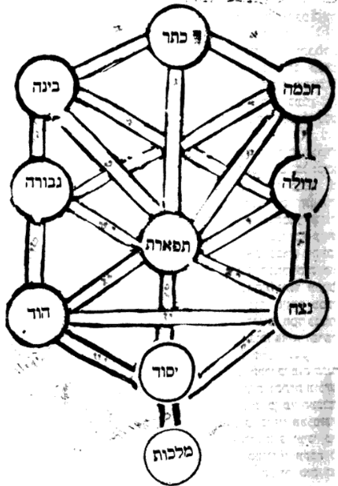

### Chapter 7:2. Explanation of the channels belonging to Keter and Chokhmah down to Hod.

**7:2:1** Since in the preceding chapter we have planted the Tree of Life for the knowledge of good, and [shown] how the deeps [call]—"deep calls unto deep at the sound of the channels"—it is fitting for the inquirer to take care in working it and in keeping it, so that we shall not need to depict it again in the coming chapters, God willing. And now we shall explain what these callings serve.

> אחר שבפרק הקודם נטענו את עץ החיים לדעת טוב וכיצד התהומות תהום אל תהום קורא לקול הצנורות ראוי למעיין ליזהר בעבודתו ובשמירתו כדי שלא נצטרך עוד אל ציורו בפרקים הבאים ב"ה. ועתה נבאר מה הקריאות האלה משמשות.

**7:2:2** And behold, from Keter three channels go out:

> והנה מהכתר יוצאים ג' צנורות:

**7:2:3** The first channel [is] to Chokhmah. From this channel is the beginning of the spreading-forth of the supernal world; and they are the shining face from which the whole world was illumined by the glory of its emanation, and from there all the sefirot were revealed. And they called its name "the Concealed Channel," since there is none more concealed than it; for the joining of Chokhmah to Keter—it is not known how and in what way—so much so that, almost, by way of that channel Chokhmah at times draws sustenance in effluence from the Ein Sof by means of Keter; for there is the hiding-place of the Cause of causes. And this matter Rashbi, peace be upon him, explained in the Tikkunim (Tikkun 52, fol. 84), and these are his words, on the verse "YHVH Adonai is my strength [*cheili*]," etc.: "What is 'my strength' [*cheili*]? The might of all, from above. *Cheili*—the strength of Yod [*cheil yod*]; and this is Abba, whose might, whose welling, is the Ein Sof (a variant reads: a welling that has no end)." Thus far [his] words.

> צנור ראשון אל החכמה. מזה הצנור התחלת התפשטות של עולם העליון והם הפנים המאירים אשר משם כל העולם האירה מכבוד אצילותו ומשם נתגלו כל הספירות וקראו שמו צנור הנעלם להיות כי אין נעלם יותר ממנו כי התחברות החכמה אל הכתר אין נודע כיצד והאיך עד שכמעט דרך אותו צנור לפעמים יונק החכמה בשפע מהא"ס ע"י הכתר כי שם הסתר סבת הסבות. וזה הענין ביאר הרשב"י ע"ה בתיקונים (תקונא נ"ב דף פ"ד) וז"ל בפסוק אדנ"י ידו"ד חילי וגו'. מאי חילי, תוקפא דכלא מלעילא חילי חיל י' ודא אבא תוקפא דיליה נביעו דיליה א"ס (נ"א נביעו דלית ליה סוף) עכ"ל.

**7:2:4** And because the inquirer might imagine to reject this proof of ours by saying that at times Keter is called Ein Sof, we have seen fit to explain the passage, so that from within it it will be compelled that "Ein Sof" is the very Ein Sof. And this is its explanation. "What is *cheili*?"—the reason being that above he explained all the rest of the verse, and now he asked of the word *cheili*, what its meaning is. And he answered, "the might of all, from above," and the intent is the Ein Sof. And because to the Ein Sof neither name nor word properly applies, for this he said that the meaning of *cheili* is from the language of power, and the intent is [that] the Ein Sof is the one who gives power and strength and might to all the sefirot. And because this matter might already apply properly to Keter—for Keter too gives power and strength to all that is below it—therefore he lengthened his language and said "the might of all, from above," meaning: the one who gives power to all, and who is above all, there being none above Him; and that is the Ein Sof. And because, since *cheili* means the supernal power, I might have said that the meaning of *cheili* is the strength of Keter, for this he said "the strength of Yod," that is, Chokhmah, which is called Yod, as is known. And what he said, "and this is Abba," follows along with the rest of the explanation of the passage, and there is no [need] to go on at length. And they said that to this channel, which is from Keter to Chokhmah, the right strap of the head-tefillin hints—that is, with the hint of the housing [*bayit*] being to Keter—and from this channel went forth "living waters, flowing from Lebanon" to Chokhmah.

> ומפני שידמה המעיין לדחות ראיותינו זו באמרו כי לעיתים כתר יקרא אין סוף ראינו לבאר המאמר כדי שמתוכו יוכרח שא"ס הוא האין סוף ממש. וזה פירושו. מאי חילי. מטעם כי למעלה ביאר כל שאר הכתוב ועתה שאל מלת חילי מהו פירושו. והשיב תוקפא דכלא מלעילא והכוונה בא"ס. ומפני שאין סוף לא יצדק בו לא שם ולא מלה, לזה אמר כי פי' חילי הוא מלשון כח והכוונה האין סוף הוא הנותן כח וחיל ועצמה לכל הספירות. ומפני שכבר יצדק ענין זה בכתר כי כתר נמי נותן כח וחיל לכל אשר למטה ממנו לכן האריך בלשונו ואמר תוקפא דכלא מלעילא. פי' אותו הנותן כח לכל, והוא למעלה מן הכל שאין למעלה ממנו והיינו הא"ס. ומפני כי אחר שחילי ר"ל כח העליון הייתי אומר כי פי' חילי היינו חילי של כתר, לזה אמר חיל י', דהיינו חכמה שהיא הנקרא יו"ד כנודע. ומה שאמר ודא אבא הוא נמשך עם שאר פירוש המאמר ואין להאריך. ואמרו כי אל הצנור הזה שמכתר לחכמה רמז רצועה ימנית של תפלין של ראש והיינו בהיות הרמז של בי"ת בכתר ומן הצנור הזה יצאו מים חיים נוזלים מן לבנון אל החכמה:

**7:2:5** The second channel goes out from Keter to Binah. From this channel Binah receives effluence [of] abundant good from Keter. And they said that from it the perfumed wine spreads forth to Binah, and Binah brings it out from potential to actuality; and the perfumed wine spreads forth as far as the altar, in order to set right the dish of the pot gone rancid on account of the transgressions of Israel, and there, on account of [our] iniquities, they pour it out as a libation. For here "libation-wine" [*yein nesekh*] does not apply, for there is no touch of a gentile here. And they meant, in their saying "to set right the dish gone rancid," something like what was explained in the Zohar (perhaps he means Zohar, Balak, fol. 189a-b; see there) concerning Isaac: that there was mixed in his wine the wine of Esau, poured out [in order] to bless him; and Jacob brought him of the spiced wine, of the good wine, as it is written (Genesis 27:25), "and he brought him wine"—and then the power of compassion was added to him. And likewise, from this channel compassion is poured to Binah, to suckle the power of the milk to the children, so that our eyes be "washed in milk," and they grow quiet and rest, as we shall explain in the Gate of Essence and Governance, chapter six. And then, as they are washed in milk, the red eyes are whitened; and this is by the power of this channel, which pours the power of the milk from the supernal whiteness. And this channel is concealed. And they said that it is the left strap of the head-tefillin.

> צנור שני יוצא מן הכתר אל הבינה מן הצנור הזה תקבל הבינה שפע רב טוב מהכתר. ואמרו כי ממנו מתפשט היין המבושם אל הבינה והבינה מוציאה אותו מכח אל הפועל והיין המבושם מתפשט עד המזבח כדי לתקן תבשיל הקדרה המסרחת מחמת עבירות ישראל ושם בעונותי' מנסכים אותו. כי כאן לא שייך יין נסך, כי אין כאן מגע גוי. ורצו באמרם לתקן תבשיל המסרחת כענין מה שבארו בזהר (אולי כוונתו לזהר בלק דף קפ"ט א' ב' ע"ש) בענין יצחק כי היה מעורב ביינו יין של עשו הנסוך לברך אותו. והביא לו יעקב מיין הרקח מיין הטוב כדכתיב (בראשית כז כה) ויבא לו יין ואז נתוסף עליו כח הרחמים. וכן מן הצנור הזה נשפע הרחמים אל הבינה להניק כח החלב אל הבנים להיות עינינו רוחצות בחלב וישקטו וינוחו כמו שנבאר בשער מהות והנהגה פ"ו. ואז בהתרחצם בחלב יתלבנו העינים האדומים וזה בכח הצינור הזה המשפיע כח החלב מן הלובן העליון. והצינור הזה נעלם. ואמרו כי היא רצועה שמאלית של תפלין של ראש:

**7:2:6** The third channel goes out from Keter to Tiferet; and from there is the way of its ascent to Keter, to receive effluence and abundant good to pour forth to the four flocks of sheep that are beneath it, and they are Netzach, Hod, Yesod, Malkhut. And by way of this channel it ascends to join Father and Mother in the secret of their union, by means of Da'at, as explained above in the Gate of Whether the Ein Sof is the Keter. And by means of the effluence poured upon it from Keter by way of this channel, it has the power to incline toward Chesed; for because it draws sustenance from Chesed and Gevurah, it stands between the two of them, even; and when effluence is poured upon it from the supernal whiteness, then it inclines toward Chesed. And this channel is called "the middle line," together with its continuation as far as Malkhut. And the commentators explained that this channel is what Moses our teacher, peace be upon him, sought to know, and He answered him, "for no man shall see Me and live" (Exodus 33:20). And these are words of [mere] prophesying, for Moses our teacher, peace be upon him, never asked about this.

> צנור ג' יוצא מהכתר אל הת"ת ומשם דרך עלייתו אל הכתר לקבל שפע ורב טוב להשפיע אל ארבעת עדרי צאן אשר תחתיו והם נצח הוד יסוד מלכות ודרך הצינור הזה יעלה לחבר אב ואם בסוד יחודם ע"י הדעת כמבואר לעיל בשער אם הא"ס הוא הכתר. וע"י השפע הנשפעת עליו מן הכתר דרך הצנור הזה יש לו כח להטות כלפי החסד כי מפני היותו יונק מחסד וגבורה עומד בין שניהם שוה וכאשר יושפע עליו שפע מהלובן העליון אז יטה כלפי חסד והצינור הזה קרוי קו האמצעי עם המשכו עד המלכות. ופירשו המפרשים כי הצינור הזה הוא שבקש מרע"ה לידע והשיב לו כי לא יראני האדם וחי (שמות לג כ). ואלו הם דברי נביאות כי מעולם לא שאל מרע"ה בזה:

**7:2:7** A further three channels are drawn from Chokhmah. The first, to Binah: it is that by which the thirty-two paths are drawn from Chokhmah to Binah—and they are the twenty-two letters and the ten utterances, which are concealed in Chokhmah, "*koach mah*" (the power of "*mah*"), and Binah brings them out from potential to actuality; so the commentators explained. And it is possible that this is the channel by which was the spreading-forth from Chokhmah to Binah in the sefirot themselves, at the beginning of the Emanation, as explained in the Gate of the Order of the Emanation, with God's help. And by way of this channel Chokhmah is concealed within Binah, as is explained in the Zohar in many places.

> עוד ג' צנורות נמשכים מן החכמה. הא' אל הבינה. הוא אשר בו נמשכים הל"ב נתיבות מן החכמה אל הבינה והם כ"ב אותיות וי' מאמרות הנעלמות בחכמה כ"ח מ"ה ובינה מוציאם מכח אל הפועל, כ"פ המפרשים. ואפשר היות זה הצינור שבו היה ההתפשטות מהחכמה אל הבינה בעצמות הספירות בתחלת האצילות כדפי' בשער סדר האצי' בס"ד, ודרך הצינור הזה מתעלמת החכמה בתוך הבינה כמבואר בזוהר בהרבה מקומות:

**7:2:8** The second channel is drawn from Chokhmah to Chesed. By way of this channel the effluence of lovingkindness [*chesed*] is drawn to Gedulah from Chokhmah. And by way of this channel the seventy-two bridges are drawn to Chesed, as we shall explain in the Gate of Essence and Governance, chapter sixteen. And the seventy-two bridges are in Chokhmah—"*koach mah*"—in potential, and in Chesed in actuality. And so "Chokhmah" amounts to seventy-three, which are the seventy-two bridges with Chesed hovering over them. And likewise, by means of this channel is drawn "the good oil upon the head, running down upon the beard, the beard of Aaron," as we shall explain in the Glossary of Titles, under the entry "oil"—that the principal [source] of the oil is from Keter, by means of Chokhmah, to the priest, the man of Chesed. And because its root is in Keter, therefore *shemen* ["oil"] in atbash amounts to Bet-Yod-Tet [21], which is Ehyeh, and it is a holy name. And likewise, by way of this channel the [effluence of] Chokhmah descends to Chesed, as they, of blessed memory, said: "One who wishes to become wise should turn south"; and through this the Yod of the name is at times designated in Chesed, as is customary in the Zohar and in the Tikkunim.

> צנור ב' נמשך מהחכמה אל החסד. דרך הצינור הזה נמשך שפע החסד אל הגדולה מהחכמה. ודרך הצינור הזה נמשכים אל החסד הע"ב גשרים כמה שנבאר בשער מהות והנהגה פרק ט"ז. והע"ב גשרים הם בחכמה כ"ח מ"ה בכח, ובחסד בפועל. וכן חכמה עולה ע"ג שהם ע"ב גשרים והחסד חופף עליהם. וכן ע"י הצינור הזה נמשך השמן הטוב על הרא"ש יורד על הזקן זקן אהרן כמו שנבאר בשער ערכי הכינויים בערך שמן שעיקר השמן הוא מהכתר ע"י החכמה אל הכהן איש החסד. ומפני ששרשו בכתר לכן שמ"ן בא"ת ב"ש עולה בי"ט הוא אהי"ה והוא שם קדוש. וכן דרך הצנור הזה ירד [שפע] החכמה אל החסד כאמרם ז"ל הרוצה להחכים ידרים, וע"י כך יכונה י' של שם לעתים בחסד כמורגל בזוהר ובתיקונים:

**7:2:9** The third channel is drawn from Chokhmah to Tiferet; and this we have found only with the author of the parchment (Yeri'ah) [a particular chart of the Tree]. And possibly the reason is that Tiferet is the son of Chokhmah and Binah, and behold, it is compelled that the power of the father be in the power of the son, and likewise the power of the mother; for "there are three partners in a person." And possibly by way of this channel is the matter of "Israel arose in thought." And for this matter there is disclosure from many places in the Zohar and in the Idra, as will be explained in Sefer Or Yakar, with God's help.

> צנור ג' נמשך מהחכמה אל התפארת וזה לא מצאנוהו אלא לבעל היריעה. ואפשר הטעם כי התפארת הוא בן החכמה והבינה והנה יוכרח היות כח האב בכח הבן וכן כח האם כי ג' שותפים באדם. ואפשר כי דרך הצנור הזה הוא ענין ישראל עלה במחשבה. ויש לענין זה גילוי ממקומות הרבה בזוהר ובאדרא כאשר יתבאר בספר אור יקר בס"ד:

**7:2:10** A further two channels are drawn from Binah. The first, to Gevurah. And the commentators explained that it is to quiet the judgment of Gevurah and the power of the husks. And it is known that Binah pours into Gevurah in two modes. The one is judgment and might [*gevurah*]—for Binah is called "the worker of mighty deeds (*gevurot*)," and "from its side judgments are aroused," as we shall explain in the Gate of Essence and Governance. And this is specifically when it pours through this channel alone, which is from its own self. However, when it receives through the channel that it has from Keter and pours through this channel into Gevurah, then the effluence is to quiet the judgment and the might. And in this way is drawn the weakening of the husks, which are the officers of the judges, from outside; and when the judgment is annulled, their power is annulled, since they do not effect their action.

> עוד שני צנורות נמשכים מהבינה. הא' אל הגבורה. ופי' המפרשים שהוא להשקיט דין הגבורה וכח הקליפות. וידוע כי משני פנים תשפיע הבינה אל הגבורה. האחד הוא הדין והגבורה. כי הבינה פועל גבורות נקראת. ומסטרא דיליה דינין מתערין. כמו שנבאר בשער מהות והנהגה. וזה דוקא כאשר תשפיע בצינור הזה לבד שהוא מעצמותה. אמנם כאשר תקבל בצנור אשר לה מהכתר ותשפיע בצנור הזה אל הגבורה. אז השפע הוא להשקיט הדין והגבורה. ובדרך הזה ימשך חולשות הקליפות שהם שוטרי הדיינים מבחוץ. ובהתבטל הדין יתבטל כחם, מאחר שאינם פועלים פעולתם:

**7:2:11** The second channel [is] from Binah to Tiferet.

> צנור ב' מבינה אל ת"ת.

**7:2:12** Behold, this channel will be explained in the way that we explained above concerning the third channel, which is drawn from Chokhmah to Tiferet. And by way of this channel Tiferet ascends to Binah. And by way of this channel Binah established Tiferet, as in the matter of "He established the heavens by understanding" (Proverbs 3:19), as will be explained in the Gate of Manifestations, and was explained in the Gate "Ten and Not Nine."

> הנה הצנור הזה יתבאר ע"ד שבארנו למעלה בצנור הג' הנמשך מחכמה אל הת"ת. ודרך הצנור הזה יעלה הת"ת אל הבינה. ודרך הצנור הזה כונן הבינה את הת"ת. כענין כונן שמים בתבונה (משלי ג יט). כמו שיתבאר בשער המציאות ונתבאר בשער י' ולא תשע:

**7:2:13** A further three channels go out from Chesed. And the first of them, to Gevurah. And likewise from Gevurah the power of the fire of Gevurah goes out to Chesed, to dry the moisture of the water of Chesed; and the power of the water of Chesed [goes out] to quench the fire of Gevurah—for so Rashbi, peace be upon him, explained. And with this will be understood a matter in which one thing opposes another: that the south is hot and dry, and the north cold and moist—and it would have been fitting to be the reverse. And what is explained on this is set forth in the Gate of Essence and Governance, in chapter eleven, and in the Glossary of Titles, in the name of Rashbi, peace be upon him. Many have explained that between [the ends of] this channel is Tiferet, which is what combines them. But by what we have explained it is better settled: that apart from Tiferet they have a channel together; and this agrees best with most of the words of the Zohar. And by means of this channel Chesed is included in Gevurah and Gevurah in Chesed, without the joining of Tiferet, as is explained in the Zohar and explained in the Gate of Essence and Governance. The second channel goes out from Chesed to Tiferet. And they said that from this channel thirty-five princes are drawn to Tiferet, and Tiferet brings them out from potential to actuality; and they are those who incline rightward, toward merit—so the commentators explained. And likewise, by means of this channel are also drawn seventy-two powers that are joined to the seventy-two names, as is known—which are the 216 lights: seventy-two of the right, seventy-two of the left, seventy-two of the middle. And Tiferet is what brings them out from potential to actuality and tips them toward the right. And likewise, by means of this channel is the matter of the arbitration, in combination with that of Gevurah.

> עוד ג' צנורות יוצאים מהחסד. והא' מהם אל הגבורה. וכן מהגבורה יוצא כח אש של גבורה אל החסד ליבש לחות המים של חסד. וכח מים של חסד לכבות אש הגבורה. כי כן ביאר הרשב"י ע"ה. ועם זה יובן דבר המנגד זה לזה. כי הדרום הוא חם ויבש, והצפון קר ולח. והיה מן הראוי להיות להפך. ומה שפי' בזה מבואר בשער מהות והנהגה בפי"א ובשער ערכי הכנוים בשם הרשב"י ע"ה. רבים פירשו כי בין הצנור הזה הוא הת"ת שהוא המצרפם. ובמה שבארנו הוא יותר מתיישב כי בזולת הת"ת יש להם צנור יחד והוא היותר מסכים עם רוב דברי הזוהר. וע"י הצנור הזה נכללים חסד בגבורה וגבורה בחסד בלי הצטרפות הת"ת כמבואר בזוהר ופי' בשער מהות והנהגה. צנור ב' יוצא מהחסד אל הת"ת. ואמרו כי מזה הצנור נמשכים ל"ה שרים אל הת"ת. והת"ת מוציאם מהכח אל הפועל. והם המיימינים לזכות, כן פי' המפרשים. וכן ע"י הצינור הזה נמשכים ג"כ ע"ב כוחות המצטרפים אל ע"ב שמות כנודע, שהם רי"ו אורות ע"ב ימינים ע"ב שמאלים ע"ב אמצעים. והת"ת הוא המוציאם מהכח אל הפועל ומכריען אל הימין. וכן ע"י הצנור הזה הוא ענין ההכרעה בצרוף אותו של גבורה:

**7:2:14** The third channel goes out from Gedulah to Netzach; from there is the principal nourishment of Netzach, from Chesed. And the secret [is] "pleasantness at Your right hand forever [*netzach*]" (Psalms 16:11). For it is the emissary of Gedulah, and the principal action of Netzach is in lovingkindness [*chesed*]. And just as in Chesed there are seventy-two powers for the name of seventy-two, so there are in Netzach as well. For the three Patriarchs are the three Vavs—*va-yissa*, *va-yavo*, *va-yet* (Exodus 14)—and likewise they are Netzach, Hod, Yesod, and in them too is the name of seventy-two. So Rashbi explained in the Tikkunim.

> צנור ג' יוצא מהגדולה אל הנצח משם עיקר יניקת הנצח מהחסד. והסוד נעימות בימינך נצח (תהלים טז יא). כי הוא שליח הגדולה ועקר פעולת הנצח הוא בחסד, וכמו שבחסד ע"ב כוחות אל שם ע"ב כן יש גם בנצח. כי ג' אבות ג' ווי"ן "ויסע "ויבא "ויט (שמות יד). וג"כ הם נצח הוד יסוד, ובהם ג"כ שם ע"ב. כ"פ הרשב"י בתיקונים:

**7:2:15** A further two channels are drawn from Gevurah. The first, to Tiferet. And the commentators explained that from there are drawn thirty-five princes who incline leftward, toward the scale-pan of liability, and Tiferet brings them out to actuality. And likewise, from within this channel are drawn seventy-two powers that are joined to the seventy-two names, as is known—which are the 216 lights, and seventy-two of them are of the left; and by means of this channel and that of Chesed, it is the arbiter between them, as we have explained. And further, by means of the aid of these channels, of Chesed and of Gevurah, he is united with his bride, in the secret of (Song of Songs 2:6) "His left hand is under my head, and his right hand embraces me," and as we shall explain in the Gate of Essence and Governance. And we have already written a little of this in the preceding gates.

> עוד נמשכים שני צנורות מהגבורה. האחד אל הת"ת. ופי' המפרשים כי משם נמשכים ל"ה שרים המשמאילים לכף חובה והת"ת מוציאם לפועל. וכן מתוך הצנור הזה נמשכים ע"ב כוחות המצטרפים אל ע"ב שמות כנודע שהם רי"ו אורות וע"ב מהם שמאלים וע"י הצנור הזה ושל חסד הוא המכריע ביניהם כאשר בארנו. ועוד ע"י סיוע צנורות אלו של חסד ושל גבורה הוא מתיחד בכלתו בסוד (שה"ש ב ו) שמאלו תחת לראשי וימינו תחבקני. וכמו שנבאר בשער מהות והנהגה. וכבר כתבנו בשערים הקודמים קצת מזה:

**7:2:16** The second channel goes out from Gevurah to Hod, and by means of it is the principal nourishment of Hod from Din, as we explained above in the Gate "Ten and Not Nine." And the commentators explained that by means of this channel the negative commandments are drawn from Gevurah to Hod, and in Hod is their explication; and likewise the positive commandments from Chesed to Netzach, by means of the channel that it has from it. And it is possible that Gedulah and Gevurah are the principal powers of the positive commandments and the negative commandments, and by means of Netzach and Hod they are revealed, just as the other actions that are in Chesed and in Gevurah are revealed by their means.

> צנור ב' יוצא מהגבורה אל ההוד ועל ידו עקר יניקת ההוד מן הדין כאשר בארנו למעלה בשער י' ולא תשע. ופי' המפרשים כי ע"י הצנור הזה נמשכים מצות ל"ת מהגבורה אל ההוד ובהוד ביאורם, וכן מ"ע מהחסד אל הנצח ע"י צנור שיש לו ממנה. ואפשר כי גדולה וגבורה הם עיקר כחות מ"ע ומצות ל"ת וע"י נצח והוד מתגלים כמו ששאר הפעולות שבחסד ובגבורה מתגלים על ידם:

**7:2:17** A further three channels are drawn from Tiferet. The first, to Netzach; and by means of it [Netzach] draws a little sustenance from the redness of Gevurah, for the sake of the blending, as is explained at length in the Gate "Ten and Not Nine," in chapter four. And there is one who did not write this channel, nor the one going out from it to Hod. And this is a void opinion; and this [channel] is agreed upon, as we have explained.

> עוד ג' צנורות נמשכים מהת"ת. הא' אל הנצח. ועל ידו יונק קצת מאודם הגבורה לסבת המזג כמבואר בארוכה בשער י' ולא ט' בפ"ד. ויש מי שלא כתב הצינור הזה וכן היוצא ממנו אל ההוד. וסברא בטלה היא זו. וזו היא מוסכמת כדפירשנו:

**7:2:18** The second channel goes out from Tiferet to Hod, to sweeten its judgment a little. And this is on account of its inclining—the whiteness toward the redness—as is explained in the said Gate and will be explained in the Gate of Colors. And by means of the two said channels the dew pours forth and descends from the heavens, [which is] Tiferet; then they [Netzach and Hod] "grind manna for the righteous"—Yesod and Malkhut, Tzaddik and Tzedek. And it will be explained in the Glossary of Titles, under the entry "Shechakim."

> צנור ב' יוצא מהת"ת אל ההוד למתק דינו מעט. וזה מסבת נטייתו הלובן אל האודם כמבואר בשער הנזכר ויתבאר בשער הגוונים. וע"י שני הצנורות הנז' משפיע ויורד הט"ל מן השמים ת"ת אז והם שוחקים מן לצדיקים יסוד ומלכות צדיק וצדק. ויתבאר בשער ערכי הכינויים בערך שחקים:

**7:2:19** The third channel goes out from Tiferet to Yesod. And by means of it Yesod receives abundant good, to unite the groom with his bride; for by means of it her sustenance descends, and it is the best man. It turns out that this channel has two actions. The one: the sustenance that overflows to the woman by means of the intermediary, and likewise the sustenance of Yesod itself. And the second action: that it is the way of her ascent to be united with her husband, after she has been adorned "as a bride adorns herself with her jewels."

> צנור ג' יוצא מהת"ת ליסוד. ועל ידו מקבל היסוד רב טוב ליחד החתן עם כלתו, כי על ידו ירד מזונה והוא השושבין. נמצא לצנור הזה שתי פעולות. הא' המזון השופע לאשה ע"י השליש וכן מזון היסוד בעצמו. והפעולה השנית כי הוא דרך עלייתה להתיחד עם בעלה אחרי אשר היא מקושטת ככלה תעדה כליה:

**7:2:20** A further two channels go out from Netzach. The first, to Hod. And the commentators explained that by means of this channel they are united to ascend (to the heavens). And it is possible that by means of this channel is the grinding of the manna, in a slight evenness of blending, before its coming to Yesod. And by means of this channel, and likewise the channel that is from Chesed to Gevurah, and likewise the channel that is from Chokhmah to Binah, is the union of Tiferet and Malkhut, in the secret of their inclining to the right and to the left. For Tiferet is in Netzach and Malkhut in Hod: YHVH in Netzach, Adonai in Hod; and by means of Yesod the two of them are united together, and  Y A H D V N H Y  is made. And so they are in Chesed and Gevurah—the male to the right and the female to the left: YHVH in Chesed, Adonai in Gevurah; and the two of them are united in Tiferet. And so they are in Chokhmah and Binah—the male to the right and the female to the left: YHVH in Chokhmah, Adonai in Binah; and the two of them are united in Keter—and not literally Keter, but in the secret of Da'at, which is the union of Chokhmah and Binah.

> עוד ב' צנורות יוצאים מהנצח. האחד אל ההוד. ופ' המפרשים שע"י הצנור הזה מתאחדים לעלות (השמים). ואפשר שע"י הצנור הזה הוא שחיקת המן בשווי מזג מועט קודם בואו אל היסוד. וע"י צנור זה וכן צנור שמחסד אל הגבורה וכן צנור שמחכמה אל הבינה הם יחוד ת"ת ומלכות בסוד נטייתם אל הימין ואל השמאל. כי הת"ת בנצח והמלכות בהוד. יהוה בנצח אדני בהוד. וע"י היסוד מתיחדים שניהם יחד ונעשה יאהדונה"י. וכן הם בחסד וגבורה הזכר אל הימין והנקבה אל השמאל יהוה בחס"ד אדני בגבורה. ושניהם מתיחדים בת"ת. וכן הם בחכמה ובינה הזכר אל הימין ונקבה אל השמאל יהו"ד בחכמה אדנ"י בבינ"ה ושניהם מתיחדים בכתר. ולא ממש הכתר אלא בסוד הדעת שהוא יחוד חכמה ובינה.

**7:2:21** And behold, it turns out that these three channels—that from Chokhmah to Binah, and that between Gedulah and Gevurah, and that between Netzach and Hod—are for [set] times; that is to say, for the times of the union of Tiferet with Malkhut.

> והנה נמצאו ג' צנורות אלה שמחכמה לבינה ושבין גדולה וגבורה ושבין נצח להוד הם לעתות ר"ל אל עתות היחוד מת"ת למלכות.

**7:2:22** And the matter of these unifications is explained in the Tikkunim [Tikkun 18, fol. 33a].

> וענין היחודים האלה נתבארו בתיקונים [תקונא י"ח דל"ג.]:

**7:2:23** The second channel goes out from Netzach to Yesod. For by means of this channel and the one opposite it is the blending and the arbitration by which Yesod tips the balance between Netzach and Hod. And by means of these two channels is the power of the seed, and by their means it is ripened—as is known, that Yesod is the member, and Netzach and Hod are the two testicles of the male.

> צנור ב' יוצא מהנצח אל היסוד. כי ע"י הצנור הזה ושכנגדו הוא המזיגה וההכרעה שמכריע יסוד בין נצח והוד. וע"י שני הצנורות הללו הוא כח הזרע וע"י מתבשל כמו שנודע שהיסוד הוא האמה והנצח וההוד הן תרין ביעין דדכורא:

**7:2:24** The third channel goes out from Netzach to Malkhut. And by means of it "a thread of lovingkindness [*chesed*] was drawn over Esther," and by means of it she receives effluence from Chesed before the coupling. And likewise by means of Hod—for she needs to receive effluence from two places, from the right and from the left, in the secret of (Song of Songs 2:6) "His left hand is under my head," etc. And it will be explained in the Gate of Essence and Governance, with God's help, in chapter twenty-one.

> צנור שלישי יוצא מהנצח אל המלכות. ועל ידו חוט של חסד נמשך על אסתר ועל ידו תקבל שפע מהחסד קודם הזיווג. וכן ע"י ההוד שהיא צריכה קבלת שפע משני מקומות מהימין ומהשמאל בסוד (שה"ש ב ו) שמאלו תחת לראשי וגו' ויתבאר בשער מהות והנהגה בס"ד בפרק כ"א:

**7:2:25** A further two channels go out from Hod. The first, to Yesod; and its rule has been explained above. And the second, to Malkhut. And the author of the parchment explained that from this channel the primordial serpent cast filth into Eve. And his words are words of dreams, like one prophesying a vain vision; for "who set a drunkard among the Nazirites?"—as we shall explain, that the husk has no entry into holiness at all, as will be explained in the Gate of Substitutes. And what it might have been possible to say [is] that by means of this channel judgment is poured from Hod to Malkhut; but all this is without foundation [*yesod*], as we shall explain in the coming chapter.

> עוד ב' צנורות יוצאים מהוד. האחד אל היסוד. ופי' משפטו למעלה. והשני אל המלכות. ופי' בעל היריעה כי מן הצינור הזה הטיל נחש הקדמוני זוהמא בחוה. ודבריו דברי חלומות כמתנבא חזיון שוא כי מי נתן שכור בין הנזירים כמו שנבאר כי אין מבוא לקליפה בקדושה כלל כאשר יתבאר בשער התמורות. ומה שהיה באפשר לומר שע"י הצינור הזה נשפע הדין מההוד למלכות אבל כל זה בלי יסוד כמו שנבאר בפרק הבא:

### Chapter 7:3. Refutation of two channels the commentators posited — from Netzach to Malkhut and from Hod to Malkhut; and there the passage from the beginning of Parashat Noach is explained.

**7:3:1** And what is fitting to know [is] that what the commentators said concerning the two channels—one from Netzach to Malkhut and the second from Hod to Malkhut—is not tenable at all. For it is clear that Malkhut receives effluence only by means of Yesod, as is explained in the Zohar, Parashat Noach (fol. 59b), and these are its words: "Rabbi Elazar said: 'These' [*eleh*] in every place invalidates the former ones. We have learned, etc. What is written above, in the portion of Bereshit? 'And a river issues from Eden to water the garden, and from there it divides,' etc. That river that flows and issues [*nagid ve-nafik*] and enters the garden and waters it with the watering from above, and gives it rest [*naycha*], and it yields fruit and makes seeds grow—and it is then rest for all. And this is rest for the garden, and this one makes rest in it, as it is said, 'for in it He rested,' and it is written, 'and He rested on the seventh day.' And this is the secret of the matter: this one makes generations, and no other. Come and see: [in like manner] Noah below was the holy covenant, a pattern of that above, and therefore he is called 'a man of the ground.' And we have learned a secret: for Noah needed the ark [*tevah*], to be joined with it and to sustain the seed of all, as it is written, 'to keep seed alive.' Who is the ark? This is the Ark of the Covenant. And Noah and the ark below were thus, after the pattern of above. Of Noah, 'covenant' is written, as it is written, 'and I will establish My covenant with you,' etc. And until the covenant was established in him he did not enter the ark, as it is written, 'and I will establish My covenant with you, and you shall come into the ark.' And then the ark was the Ark of the Covenant. Ark and Noah—all after the manner of above. And because this covenant above makes generations, in like manner Noah below makes generations. On account of this it is written, 'These are the generations of Noah: Noah was a righteous man.' So it is, certainly, after the manner of above. And therefore it is written, 'and the righteous one is the foundation of the world,' and the earth is sustained upon this; for he is the pillar upon which the world stands. And who is he? This is the Righteous One [Tzaddik]. And Noah is called 'righteous' below. And the secret of all: 'Noah walked with God'—precisely; that he never separated from Him, and [so as] to be on earth after the manner of above: 'a righteous man'—the foundation of the world; 'covenant of peace'—the peace of the world; 'a man of the ground'—certainly. And therefore, 'and Noah found favor in the eyes of YHVH.'" Thus far [its] words.

> ומה שראוי לדעת, כי מה שאמרו המפרשים מענין ב' צנורות א' מנצח אל המלכות והשני מהוד אל המלכות, אינם מתישבים כלל. כי ברור הוא שהמלכות לא תקבל שפע כ"א ע"י היסוד. כמו שנתבאר בזוהר פ' נח (דף נ"ט ע"ב) וז"ל אמר ר' אלעזר אלה בכל אתר פסל את הראשונים. תנינן וכו'. מה כתיב לעילא בפרשתא דבראשית, ונהר יוצא מעדן להשקות את הגן ומשם יפרד וגו'. ההוא נהר דנגיד ונפיק ועייל לגנתא ואשקי ליה משקיו דלעילא ועביד ליה נייחא ועביד איבין ורבי זרעין והוא כדין נייחא לכלא. ודא נייחא ליה לגנתא ודא עביד נייחא ביה. כד"א כי בו שבת, וכתיב וישבות ביום השביעי. ודא רזא דמלה דא עביד תולדות ולא אחרא. תא חזי [כגוונא דא] נח לתתא קיימא קדישא הוה דוגמא דלעילא, ועל דא איקרי איש האדמה. ורזא אוליפנא, דהא נח איצטריך לתיבה לאתחברא בה ולקיימא זרעא דכלא דכתיב לחיות זרע. מאן תיבה, דא ארון הברית. ונח ותיבה לתתא, הכי הוו כדוגמא דלעילא. נח כתיב ביה ברית דכתיב והקימותי את בריתי אתך וגו'. ועד דאתקיים ביה ברית לא עאל לתיבותא, דכתיב והקימותי את בריתי אתך ובאת אל התיבה. וכדין הוה תיבה ארון הברית. תיבה ונח, כלא כגוונא דלעילא. ובגין דהאי ברית לעילא הוא עביד תולדות, כגוונא דא נח לתתא הוא עביד תולדות. בג"כ כתיב אלה תולדות נח נח איש צדיק. הכי הוא ודאי כגוונא דלעילא. וע"ד וצדיק יסוד עולם כתיב. וארעא ע"ד אתקיימא. דהא איהו עמודא דעלמא קיימא עליה. ומאן איהו דא צדיק. ונח איקרי צדיק לתתא. ורזא דכלא את האלקים התהלך נח דייקא. דלא אתפרש מיניה לעלמין. ולמהוי הוא בארעא כגוונא דלעילא. איש צדיק, יסודא דעלמא. ברית שלום, שלמא דעלמא. איש האדמה ודאי. וע"ד ונח מצא חן בעיני ה' עכ"ל.

**7:3:2** What there is to be precise about in this passage is: First, his saying "that river that flows and issues"—what need is there for the word "flows" [*nagid*]? For his saying "issues" [*nafik*]—which is the language of the verse, which says "and a river issues from Eden"—suffices.

> מה שיש לדקדק במאמר זה הוא. א'. מ"ש ההוא נהיר דנגיד ונפיק. מה צורך אל מלת נגיד כי באמרו נפיק דהיינו לישנא דקרא דקאמר ונהר יוצא מעדן די.

**7:3:3** And further: he ought to have [said] "issues, and afterward flows"; for such is the way—that first it issues, and afterward it is drawn onward. And we can resolve [this by saying] that he adopted the language of the verse, "a river of fire flowed and issued from before Him" (Daniel 7:10). And nonetheless, according to our way it will be made more precise.

> ועוד נפיק ולבתר נגיד מבעי ליה. דהכי אורחא שקודם יוצא, ואח"כ נמשך. ונוכל לתרץ דלישנא דקרא נקט נהר דינור נגיד ונפיק מן קדמוהי (דניאל ז י). ועכ"ז ע"פ דרכנו ידוקדק יותר.

**7:3:4** And further, on the verse too there is a difficulty: why did it not say "a river … issued from before Him"? Or let it say "issued and flowed"; what is "flowed and issued," not in order? Second: what he said, "and waters it with the watering from above"—certainly it is the watering from above! For such is the way of a river: it is drawn from above downward and waters the lower ones from the effluence of the upper ones. And why did he go on at length about what teaches us nothing, since it is obvious? Third: his saying "and gives it rest," etc., and afterward he said "and it is then rest for the garden," etc., according to one reading—or, according to another reading, "and it is then rest for all," etc. One must see why he did not state, in the first clause, two aspects, as he stated in the latter clause—as appears from the sense of the language, where he says "and it is then rest for the garden, and the garden is rest in it," or, according to the other reading, "and this is rest for the garden, and this one makes rest in it." But in the first clause he said only "and gives it rest," alone. Fourth: his saying "and it yields fruit and makes seeds grow" appears a needless doubling. Fifth: his saying "Who is the ark? This is the Ark of the Covenant"—why did he adopt the language "the Ark of the Covenant," and not say "Who is the ark? This is Malkhut," which would be preferable? Sixth: here it is implied that the ark by itself is the Ark of the Covenant, whereas further on he concludes that when Noah is within the ark, the two of them in union are called the Ark of the Covenant. Seventh: his saying "'a righteous man'—so it is, certainly," etc., up to "for he is the pillar upon which the world stands," etc.—it all appears a lengthening upon what was already expounded at the beginning. Eighth: his saying "And who is he? This is the Righteous One." Now with what was he occupied until now, that he asks "who is he"? Are we not dealing with the Righteous One? And to resolve all this, it seems [right] to explain that for Rabbi Elazar there was a difficulty in the verse, in its saying "These are the generations." And his difficulty was: always, "And these" adds to the former ones; "These" invalidates the former ones—and this "These," what does it invalidate? For one cannot say that it invalidates the whole work of creation, for it would not be pleasing to their Master that one say so. And he said, "We have learned, etc. What is written above, in the portion of Bereshit?"—because it was difficult for him [that] we should say that it invalidates the generations of formlessness [*tohu*] and void [*bohu*] and darkness, which are the husks. Therefore he said, "What is written above, in the portion of Bereshit?"—as one who is precise and says that it is not fitting to explain that it refers back to formlessness and void and does not refer back to the whole portion of Bereshit that adjoins it. "And a river issues from Eden to water," etc.—"that river that flows and issues," etc. He said "flows" because Eden is Binah, and the river is Tiferet, and the garden is Malkhut; and because it does not water the garden as [soon as] it issues from its mother's womb—for it must be drawn a journey of five hundred years, that is, the five sefirot, until it arrives to water the garden—therefore he was compelled to use the language "flows," that is, meaning: it is drawn through all those grades until it arrives at the garden. And he reversed the order in saying "flows" and afterward "issues," because it was difficult for him that it would have been fitting for the verse to be silent about the word "issues" and say "a river from Eden waters the garden," since the word "issues" is not precise—for it issues and is drawn [onward]; or let it say "and a river issues from Eden and comes to water the garden," for now the language of each one would be precise, that is, [that it is] drawn. And at the resolution of this he aimed in saying "flows and issues"; namely, that the verse comes to inform us of a novel matter: that we should not err and say that when Tiferet waters Malkhut it does not literally water [her] from the effluence of Binah, but changes it from its nature and waters Malkhut according to her measure below. For this he said that it is not so; rather, Tiferet pours into Malkhut that effluence according to its nature in Binah, as though Malkhut herself were receiving from Binah itself, with no intermediary at all. And this is what it says: "issues from Eden to water the garden." And therefore it did not say "and comes," because the matter of the drawing-forth does not intrinsically pertain here, since it is not changed from its character on account of the drawing-forth—as though the garden, which is Malkhut, literally receives it from the source, which is Binah, and Tiferet and Yesod serve for this matter of watering only the service of a passage. And this he taught us by his language "flows and issues"—the intent [being]: as is the manner of its issuing from Binah, so is the manner of its being drawn forth. And the measure of the language is thus: it flows in the manner in which it issues, and in the manner in which it issues it enters the garden—as though she herself were receiving from Binah with no intermediary. And this is what he says: "and waters it with the watering from above." The intent is that the effluence that comes to her by means of the river is as though she were drawing sustenance and receiving from Binah itself with no intermediary—"the watering from above," literally; and the intermediaries serve for this matter only the service of a mere channel, although it is not so with regard to other matters and to another effluence. "And gives it rest"—the intent is that Yesod makes rest for Malkhut by this effluence, and no benefit is drawn from it to Yesod; because this effluence is to set Malkhut right and to adorn her, alone. For this effluence is like the first rainfall [*revi'ah*] upon the earth, which is for the preparing of the ground, to plough and to sow, and not to make what is sown grow. And therefore he said "and gives it rest"—meaning that this benefit is for Malkhut alone. But after this *tikkun* he pours into her the effluence that is fit to beget, which is the coupling after the *tikkun* and the adornment of the bride. And then the effluence is to make fruit, which are the souls that are poured forth from above in the secret of the union of the groom and his bride. And this is "and it yields fruit"—for the souls are the fruit of the Tree; and this is the matter of the second rainfall, which is to make the existence of the seeds sprout. "And makes seeds grow"—this is the matter of the third rainfall, which is the effluence poured forth to make grow and to make splendid the plantings and the seeds, which are the souls; and this is "and makes seeds grow." And they are a parable for marital relations in the last three months, of which it is explained in the Gemara (Niddah, fol. 31a) that they are good for the child and for the mother—namely, that the child comes forth vigorous. And from our flesh we behold God: for so it is above—when the effluence increases upon the plantings, the plantings multiply and grow. And the witness to this is the matter of the soul that comes in the waning of the moon or in its fullness, expounded in the words of Rashbi in the Tikkunim (Tikkun 69, fol. 98). "And it is then rest for all"—meaning: when the effluence is in these two times, which are the second and the third rainfall, then by this benefit and rest are drawn to all: to Tiferet and Yesod, which are the secret of the river and the secret of the male, and to Malkhut, which is the secret of the female, as is known. For in the coupling there is rest for the male and rest for the female, in the secret of "the Shekhinah among the lower ones is a need on high." "And this is rest for the garden, and this one makes rest in it." He aimed to explain that, although we say "and this is rest for all," the intent is not that it is rest for them equally. Rather, the rest of the Shekhinah is drawn from the river itself; and this is what he says, "and this is rest for the garden"—by means of the said river there is benefit and repose for the Shekhinah. But it is not the rest of the river, [in the sense] that the Shekhinah makes repose for him; rather, it is drawn to him from above on her account. And this is what he says, "and this one makes rest in it"—meaning, the river makes repose, respite and ease in her; and not that she makes the repose for him. Rather, he makes his rest there, and the rest is drawn to him from above on her account, through the river's coupling, until abundant effluence is drawn to him from above. And it is a parable of a weary man who stops to rest in some place: it is not the place that makes rest for him, but he makes his rest there. "As it is said, 'for in it He rested,'" etc. Neither of the verses is specific to his proof, for each of them admits of being explained in two ways. Either we say [that] "for in it He rested" means: [she] rested in Yesod, and not [in] Malkhut; or we say [that] "in it" means: in the garden, which is Malkhut, Yesod rested and reposed. And so the verse "and He rested on the seventh day"—we can explain it in these two ways: the one, meaning that Yesod rested in Malkhut, which is the Sabbath day; or it means that Malkhut rested on the seventh day, which is Yesod—for of both of them the name "seventh day" is correctly predicated, as we shall explain in the Glossary of Titles, under the entry "Sabbath" and under the entry "days." And he aimed to explain from these two verses the two aspects—the rest of Malkhut and the rest of Yesod—for from the superfluity of the verses we expound one thus and one thus; for if you do not say so, why are [both] needed? Rather, [it is] as we have explained. And because on the face of it one [sense] is implied—namely, that Malkhut rested and reposed in Yesod, which on the face of it is the more accepted—therefore he took up first the second verse and said "for in it He rested," that is, the additional verse, which comes to teach us the resting of Yesod in Malkhut; for the resting of Malkhut in Yesod is the first verse, which is "and He rested on the seventh day." And this is what he aimed at in reversing the order of the verses—as if he said: Know that Yesod rested and reposed in Malkhut, for it is written "for in it He rested." What will you say—that this is the resting of Malkhut in Yesod? For this he said, "and He rested on the seventh day," meaning the resting of Malkhut in Yesod—behold, it is [already] written; for they are two verses: the first for the resting of Malkhut in Yesod, and the second for the resting of Yesod in Malkhut. This is the way according to this reading, and it is the more correct reading. And there are books that read, above: "and makes seeds grow, and it is then rest for the garden, and the garden is rest in it, as it is written, 'for in it He rested,'" etc. And it is possible to settle it [thus]: that the intent, with regard to the union, is the two aspects in Malkhut—her manifestation that is united with her husband, which ascends to be united, and her manifestation that remains in its place, in the secret of the manifestations.

> ועוד דאקרא נמי קושיא. אמאי לא קאמר נהר נפיק מן קדמוהי. או לימא נפיק ונגיד. מאי נגיד ונפיק שלא כסדר. ב'. מאי דקאמר ואשקי ליה משקיו דלעילא. ודאי דמשקיו דלעילא איהו. כי כן דרך הנהר נמשך מלמעלה למטה ומשקה התחתונים משפע העליונים. ולמה האריך במה שלא השמיענו דבר כי ברור הוא. ג' אמרו ועביד ליה נייחא כו' ואח"כ אמר והוא כדין נייחא לגנתא כו' לגרסא א', או לגרסא אחרת והוא כדין נייחא לכלא וכו'. יש לראות למה לא אמר ברישא ב' בחינות כמו שאמר בסיפא כפי הנראה ממשמעות לישנא דקאמר והוא כדין נייחא לגנתא וגנתא נייחא ביה, או לגרסא אחרת ודא נייחא ליה לגנתא ודא עביד נייחא ביה. אבל ברישא לא קאמר אלא ועביד ליה נייחא לבד. ד'. אמרו ועביד איבין ורבי זרעין נראה כפל ללא צורך. ה'. אמרו מאן תיבה דא ארון הברית. אמאי נקיט לישנא דארון הברית ולא קאמר מאן תיבה דא מלכות דעדיף טפי. ו' דהכא משמע דתיבה סתם איהו ארון הברית, ולקמן קא מסיק דכד נח בתוך התיבה נקרא תרווייהו ביחודא ארון הברית. ז'. אמרו איש צדיק הכי הוא ודאי כו' עד דהא איהו עמודא דעלמא קיימא וכו', הכל נראה אריכות במה שכבר נדרש ברישא. ח'. אמרו ומאן איהו דא צדיק. וכי עד השתא במאי עסיק דקא שאיל מאן איהו, וכי לאו על צדיק קיימינן. ולתרץ כל זה נראה לפרש שרבי אלעזר הוקשה לו בפסוק מאי דקאמר אלה תולדות. וק"ל לעולם ואלה מוסיף על הראשונים אלה פסל את הראשונים, והאי אלה מאי פסיל. דאין לומר דפסיל כל מעשה בראשית, דלא ניחא למרייהו דלימא הכי. ואמר תנינן וכו' מה כתיב לעילא בפ' דבראשית. משום דקשיא ליה דנימא דפסיל תולדין דתהו ובהו וחשך שהם הקליפות. לכן אמר מה כתיב לעילא בפ' דבראשית, כמדקדק ואומר שאין ראוי לפרש דאהדר לתוהו ובוהו ולא אהדר לכל פרשתא דבראשית דסמיכא ליה. ונהר יוצא מעדן להשקות וגו' ההוא נהר דנגיד ונפיק וכו', אמר נגיד מפני שהעדן היא הבינה והנהר הוא הת"ת והגן הוא המלכות. ומפני שלא כצאתו מרחם אמו ישקה הגן. כי צריך לימשך מהלך ת"ק שנה, דהיינו ה' הספירות עד הגיעו להשקות את הגן. לכן הוכרח לומר לישנא דנגיד דהיינו פי' נמשך כל המדרגות ההם עד הגיעו אל הגן. והיפך הסדר באמרו דנגיד ואח"כ נפיק. משום דקש"ל שמן הראוי דלשתוק קרא מתיבת יוצא ולימא נהר מעדן משקה את הגן כיון שתיבת יוצא לא דייקא שהרי יוצא ונמשך, או נימא ונהר יוצא מעדן ובא להשקות את הגן דהשתא דייק לישנא דכל א' דהיינו נמשך. ולתירוץ זה כיון באמרו נגיד ונפיק והוא שהכתוב בא להודיענו ענין מחודש. שלא נטעה לומר כי כאשר הת"ת משקה המלכות לא ישקה ממש משפע הבינה אבל ישנהו מטבעה וישקה המלכות כפי שעורה למטה, לזה אמר שאינו כן אלא הת"ת משפיע במלכות השפע ההיא כפי טבעה בבינה וכאילו המלכות ממש היתה מקבלת מהבינה ממש בלי אמצעי כלל. וז"ש יוצא מעדן להשקות את הגן. ולכן לא אמר ובא משום דלא שייך בזה בעצם ענין ההמשכה אחר שאינו משתנה מעניינו בסבת ההמשכה, כאלו ממש הגן שהיא המלכות מקבלו מן המקור שהיא הבינה, והת"ת והיסוד משמשים אל ענין ההשקאה הזאת רק שמוש מעבר. וזה השמיענו בלשונו נגיד ונפיק הכוונה כמציאות יציאתו מהבינה כן מציאות המשכתו. ושעור הלשון כך נגיד במציאות דנפיק ובמציאות דנפיק עייל לגנתא כאילו היא ממש היתה מקבלת מן הבינה בלי אמצעי. וז"ש ואשקי לה משקיו דלעילא. הכוונה כי השפע הבא אליה ע"י הנהר כאילו היא היתה יונקת ומקבלת מהבינה עצמה בלי אמצעי משקיו דלעילא ממש ואין האמצעים משמשים אל הענין הזה אלא שמוש צנור בעלמא עם היות שאינו כן אל העניינים אחרים ואל שפע אחר. ועביד ליה נייחא, הכוונה כי היסוד עושה נייחא למלכות בשפע הזה ואין נמשך ממנו תועלת אל היסוד. מפני שהשפע הזה הוא לתקן המלכות ולקשטה לבד. שהשפע הזה הוא כמו רביעה ראשונה לארץ שהוא לתיקון הקרקע לחרוש ולזרוע ולא לגדל זריעה. ולכן אמר ועביד ליה נייחא. פי' שהתועלת הזה הוא אל המלכות לבד. אבל אחר התיקון הזה משפיע לה שפע הראוי להוליד, שהוא הזווג אחר התקון והקישוט אל הכלה. ואז השפע הוא לעשות פירות שהם הנשמות הנשפעות מלמעלה בסוד יחוד חתן וכלתו. והיינו ועביד איבין. שהנשמות הם פרי האילן, והיינו ענין רביעה שניה שהיא להצמיח מציאות הזרעים. ורבי זרעין. הוא ענין רביעה שלישית, שהוא השפע הנשפע לגדל ולהדר הנטיעות והזרעים שהם הנשמות והיינו ורבי זרעין. והם משל אל התשמיש בג' חדשים אחרונים. שפי' בגמרא (נדה דף ל"א.) שיפה לולד ולאם. והוא שיצא הולד מזורז. ומבשרנו נחזה אלוה. כי כן למעלה כאשר יגבר השפע אל הנטיעות, הנטיעות מתרבות ומתגדלות. והעד על זה, ענין הנשמה הבאה בחסרון הלבנה או במלואה הנדרש בדברי הרשב"י בתיקונים (תקונא ס"ט דצ"ח). והוא כדין נייחא לכלא, פי' בהיות השפע בשתי פעמים האלה שהם רביעה שניה ושלישית אז בזה נמשך תועלת ונייחא לכלא, אל הת"ת ויסוד שהם סוד הנהר וסוד הזכר, ואל המלכות שהוא סוד הנקבה כנודע. כי בזווג נייחא לזכר ונייחא לנקבה בסוד שכינה בתחתונים צורך גבוה. ודא נייחא ליה לגנתא ודא עביד נייחא ביה. כוון לבאר כי עם היות שאנו אומרים ודא נייחא לכלא, אין הכוונה שהוא ניחא אליהם בשוה. אלא נייחא דשכינה הוא נמשך מהנהר עצמו. וז"ש ודא נייחא ליה לגנתא ע"י הנהר הנז' הוא תועלת ומנוח אל השכינה. אבל אינו נייחא דנהר ושהשכינה עושה לו מנוח, אלא שנמשך אליו מלמעלה בסבתה. וז"ש ודא עביד נייחא ביה. פי' הנהר עושה מנוח נופש ומרגוע בה. ולא שהיא עושה לו המנוח. אלא הוא עושה מנוחתו שם, והמנוחה נמשכת אליו מלמעלה בסבתה ע"י שיזדווג הנהר עד ימשך אליו מלמעלה שפע רב. והוא משל אל האדם היגע ועומד לפוש במקום מן המקומות שלא המקום עושה לו מנוחה אלא שהוא עושה מנוחתו שם. כד"א כי בו שבת כו'. אין אחד מהכתובים מסויימים אל ראייתו כי כל אחד מהם סובל לבארו על ב' פנים. אם שנאמר כי בו שבת פי' ביסוד שבת ולא המלכות, או שנאמר כי בו פי' בגן שהיא המלכות שבת ונח היסוד. וכן פסוק וישבות ביום השביעי, נוכל לבארו על שני פנים האלו. הא' פי' וישבות היסוד במלכות שהוא יום שבת או ירצה וישבות המלכות ביום השביעי שהוא יסוד כי בשניהם יצדק שם יום שביעי כמו שנבאר בערכי הכינויים בערך שבת ובערך ימים. וכוון לבאר מתוך שני כתובים האלה שתי הבחינות נייחא דמלכות ונייחא דיסוד דמיתורא דקראי דרשיין חדא הכי וחדא הכי. דאי לא תימא הכי אמאי צריכי אלא כדפרשינן. ומשום דלכאורה משמע חדא דהיינו שהמלכות שבת ונח ביסוד שהוא היותר מוסכמת לכאורה. לכן נקט ברישא קרא תניינא וקאמר כי בו שבת דהיינו קרא יתירא דאתא לאשמועינן שביתת היסוד במלכות. דשביתת המלכות ביסוד היינו קרא קדמאה דאיהו וישבות ביום השביעי. וזהו מה שכוון בהפוך סדר הכתובים. כאמרו תדע שהיסוד שבת ונח במלכות דכתיב כי בו שבת מה תאמר היינו שביתת מלכות ביסוד לזה אמר וישבות ביום השביעי פי' שביתת המלכות ביסוד הרי כתיבא דתרי קראי נינהו. וקדמאה לשביתת מלכות ביסוד, ותניינא לשביתת היסוד במלכות. זהו הדרך לגרסא זאת והיא הגרסא היותר נכונה. ואית ספרים דגרסי לעילא ורבי זרעין והוא כדין נייחא לגנתא וגנתא נייחא ביה כמו דכתיב כי בו שבת וגו'. ואפשר ליישבה כי הכונה אל היחוד הם ב' בחינות במלכות. מציאותה המתיחדת בבעלה העולה להתייחד, ומציאותה הנשארת במקומה בסוד המציאיות.

**7:3:5** And behold, the manifestation that ascends—its rest is in her husband himself, who is united with it. And her lower manifestation has rest, but not in her husband himself, for he is not united with it but with the upper manifestation alone. And of these two aspects he spoke. Of the aspect that remains, which is the lower aspect, he said "and it is then rest for the garden"—meaning: repose and contentment are drawn to the garden, but not that her rest is with him himself. And of the second aspect he said "and the garden is rest in it," that is, in him himself—which is the manifestation that ascends to be united. And he brought proof for this matter from the two verses. First, "for in it He rested," that is, in him himself, in the secret of the aspect that is united with her husband above. And the second, "and He rested on the seventh day," which means that He poured forth rest upon the seventh day; but it is not evident from it that [it is] in him himself, as [in] the first verse, which said "for in it He rested," that is, in him himself. And therefore he put first the verse "for in it He rested," because from it it is compelled that "and He rested on the seventh day" is not in him himself—since it did not say "in it" in that verse. "The secret of the matter," etc.—meaning, the sum of the secret of the whole matter is that there is none who gives contentment to Malkhut but Yesod, in the secret of the river from its beginning to its end, that is, the Vav, which is the river, as is well known. And by this the word "These" will be understood: for the intent is not "these are generations, and not others"—for there are no others besides them—but this is its explanation: "These are the generations of Noah"—Noah is the master of generations, and none other. And the word "These," which invalidates, does not invalidate generations; rather, it invalidates [another] master of generations—for there is no master of generations but Yesod. And this is what is meant by "the secret of the matter," etc. "Come and see: in like manner, Noah below was the holy covenant." Now he comes to explain "Noah, Noah," which means two rests, as explained above. And to indicate that the intent is Yesod, which is what is hinted at in Noah, he said "Noah was the holy covenant"—meaning: Noah was the chariot for Yesod, which is *kayyama kaddisha*, whose meaning is "holy covenant." "And therefore he is called 'a man of the ground'"—meaning, husband [*ba'al*] of the ground; the intent is: husband of Malkhut, who is called "ground." "And we have learned a secret: for Noah," etc. He wished to prove that Yesod has no place into which to pour except Malkhut—lest we say that it is true that Malkhut does not receive from any but Yesod, yet it is still possible that Yesod pours into something other than Malkhut. For this he said, "we have learned a secret," etc., "Noah needed the ark," etc.—the intent being that just as Malkhut needs Yesod, so Yesod needs Malkhut; as he goes on to explain, that there is no subsistence for the generations of Yesod except by means of Malkhut, as he concludes. "Who is the ark? This is the Ark of the Covenant," etc. It was difficult for him, for the correlation of the ark, which is Malkhut, is correlated only with the aspect of Yesod, which is Noah. For [it is] like the head-tefillin, which is the male, and the female correlated with it is the hand-tefillin; and so day in relation to night, and so the sun in relation to the moon, and so the *etrog* with the species that are in the *lulav*. And therefore it would be fitting, since Noah is Yesod, that his wife be Malkhut, and she is a correlative aspect. But that Noah, who is a human being, should be correlated with an ark of gopher wood—this is certainly not correlative. For this he said that, on the contrary, the aspect of Malkhut in respect of Yesod is found only in the ark. And the proof is from the Ark where the Torah is: Scripture called it "the Ark of the Covenant"—meaning that Malkhut is called "ark" [*aron*] and "ark" [*tevah*] in respect of her joining to Yesod, and this is "the Ark of the Covenant." And now, since Noah is Yesod, that which is correlated with Yesod, which is Noah, is none but the ark. And this is what he says: "And Noah and the ark below were thus, after the pattern of above"—meaning, they are correlated, even though Noah is a human being and this is an ark of wood. And he proved the matter from Scripture, in his saying "Of Noah, 'covenant' is written"—meaning, Scripture testified to his being a chariot for Yesod, as [in] "and I will establish My covenant with you," etc. "And until the covenant was established in him," etc.—meaning: after he proved that Noah is Yesod, he wished to prove also that the ark is Malkhut; and this is what he says, "and until the covenant was established in him"—meaning: since we see that he did not merit to enter the ark until he was at the grade of covenant, it appears that the ark is Malkhut, and he did not merit to enter within Malkhut until he was "covenant," which is Yesod. And this is what Scripture says: "and I will establish My covenant with you, and you shall come into the ark"—meaning: when I establish My covenant with you, that is, that he be a chariot for Yesod, then he will merit to enter within the ark, which is Malkhut. "And then the ark was the Ark of the Covenant"—meaning: when Noah, who is called "covenant," is within the ark, then the ark is called the Ark of the Covenant. And [so] the matter of the ark and Noah is settled—their being correlated with one another in a complete relation. And this is what he says: "Ark and Noah—all after the manner of above," etc.—meaning: just as Noah did not enter the ark until he was "covenant," it appears that Malkhut has no effluence or receiving except from Yesod. And since, in order to keep seed alive, he needed to enter the ark, it appears that Yesod has no place apart from Malkhut. And the intent in this is to explain to us what Scripture said, "These," which invalidated the former ones: that there is none who pours into Malkhut but Yesod, and Yesod has no recipient but Malkhut. And this is "Ark and Noah—all after the manner of above," as explained: that there is no livelihood or subsistence or generations for Noah except by means of the ark, and there is no existence for the ark except through Noah. "Noah was a righteous man—so it is, certainly, after the manner," etc. It was difficult for him: according to what he has now explained—that the intent of Scripture in the matter of "These are the generations of Noah: Noah" is Yesod, which makes generations, and it invalidated [any other], for no other makes generations; and it said twice "Noah, Noah," which are two rests, rest for Malkhut and rest for Yesod—if so, it is difficult, for the verse is superfluous in saying "a righteous man." And he explained that the aspect of his being called "righteous" is not the same as the aspect of his being called "Noah." For he is called "Noah" on account of the generations and the souls, as explained at the beginning of our discussion; but he is called "righteous" from his aspect of being the subsistence of Malkhut—that is to say, from the aspect of Yesod's pouring into Malkhut the effluence without which she has no subsistence. And this is what he says: "So it is, certainly, after the manner of above"—the intent being that just as Yesod has yet another aspect besides the generations, so [too] Noah, who was a chariot for him, [was so] in this aspect as well. And this is what he said, "after the manner of above"—meaning, in all the supernal aspects. "And therefore it is written, 'and the righteous one is the foundation of the world.'" Meaning: he comes to explain that the aspect of Yesod in which it is called "righteous" is on account of Malkhut's having no existence without him—not in the aspect of the souls, but in the aspect of the sustenance and the effluence and the subsistence of Malkhut. And he proved the matter from the verse "and the righteous one is the foundation of the world"; and the intent is that he is the foundation [*yesod*] of Malkhut, which is the lower world, and she has no existence without him—like a foundation, which is the place of the building and makes it stand, and without which it has no standing or footing. And this is what he says: "and the earth is sustained upon this; for he," etc.—meaning: the existence of the intrinsic subsistence is only by means of Yesod. "And who is he? This is the Righteous One"—meaning: and what is the name and the title that delimits and defines this aspect? You must say: "This is the Righteous One"—[the name] hints at this aspect, as it is written, "and the righteous one is the foundation of the world." If so, it appears of necessity that the word "righteous" hints at the aspect of the subsistence of Malkhut; and this is what Scripture aimed at in saying "a righteous man"—the intent being that he had the aspect of subsistence as well; that in respect of this aspect too he was a chariot for Yesod. And this is what he says: "And Noah is called 'righteous' below"—meaning that he was a chariot for him in this aspect as well. "And the secret of all," etc.—meaning: he proved the matter from Scripture, which said "Noah walked." And if it should arise in the mind that Noah was a chariot for Yesod only in respect of the generations alone, why did Scripture say "with God," etc.—whose intent is that his walking was always with the Shekhinah, who is called "God" [Elohim]? For the aspect of the generations is only from time to time. Rather, certainly [it is] as we have said. "'With God,' etc.—that he never separated from Him"—meaning that the Shekhinah is always with Yesod in union. It appears that he was a chariot also in respect of the perpetual effluence that is poured forth for sustenance. And therefore it is fitting that she not be separated from him, for she has no existence without him. "And [so as] to be on earth after the manner of above"—meaning, in all the aspects that are in Yesod, as explained. "'A righteous man'—the foundation of the world; 'covenant of peace,'" etc. It was difficult for him: granted that it should say "righteous," as we have said—what does "man" come for? For "man" is the very same as "righteous," that is, "husband," as in the saying "the man of God," which means husband of the Shekhinah. For this he resolved that "man" is another aspect besides these two; namely, that Yesod is called "man" when the Shekhinah is clothed in the force of judgment, when she is a sword of war; and Yesod pours into her and sets the blood of war in peace—then he is called "man." And this is what he says, "covenant of peace"—meaning, Yesod is called "covenant of peace"; and his being called "covenant of peace" is in this aspect: that he brings peace to the world, which exists in the force of the judgment that is poured forth from Malkhut reddened with judgment. And this is what he says, "the peace of the world"—in this aspect Noah is called "man." And this is what he says of Noah himself: "'a man of the ground'—certainly"; the intent being that he is "man" and pours forth peace and compassion when Malkhut is called "ground" [*adamah*]—the intent being: when she is red [*adumah*], from the side of the force of the redness of judgment. And it is an aspect new beyond the two preceding ones. "And therefore, 'and Noah found favor,'" etc.—meaning: because Noah was a chariot for Yesod from the side of all these aspects, it was said, of the rank of his chariot-hood, "and Noah found favor"—which was not said of any other. For how many others there were who were a chariot for Yesod, and "found favor" was not said of them! Rather, certainly the reason is that he included all the aspects that Yesod has with Malkhut, which is not so with the others. Thus far the explanation of the passage. And the general rule that emerges from the passage is that Yesod pours into Malkhut, and Malkhut does not receive from any other. And by this the view of those who say that there are two channels from Netzach and Hod to Malkhut is annulled; rather, it is impossible for any sefirah among the sefirot to pour into Malkhut except by means of Yesod. Further, Scripture said (Isaiah 57), "and none understands that because of the evil the righteous one is gathered in"—meaning, gathered in from pouring forth. It appears that all the effluence depends on Yesod, which is the Righteous One; for if not so, how did it say that the righteous one alone "is gathered in"? And so they expounded of the Assembly of Israel, which is Malkhut, that she is likened to a dove, etc. And so it is said (Isaiah 57:1), "The righteous one has lost," etc.—he has lost the Lady [Matronita]. And the like. All this indicates that there is none who pours into Malkhut but Yesod. And it is indeed true that we find that Netzach pours into Malkhut, and likewise Hod; and likewise, above, in the matter of the thread of lovingkindness from the side of Chesed, and the scarlet thread from the side of Gevurah. The intent is not that they have other channels; rather, the intent is that all is by means of Yesod, which is the passage for all sustenance and effluence that is poured into Malkhut. And just as we insist upon this of her, so we insist in the matter of Yesod, that he has no place into which to pour but her, as is proved from the passage mentioned above.

> והנה המציאות העולה מנוחתה הוא בבעלה ממש המתייחד עמה. ומציאותה התחתונה יש לה מנוחה אבל לא בבעלה ממש שאינו מתיחד עמה אלא עם המציאות העליון לבד. ואל שני בחינות האלה אמר. אל הבחינה הנשארת שהיא הבחינה התחתונה אמר והוא כדין ניחא לגנתא. פי' נמשך מנוח ונחת רוח אל הגן, אבל לא שיהיה מנוחתה עמו ממש. ואל הבחינה השניה אמר וגנתא נייחא ביה, דהיינו בו ממש שהוא המציאיות העולה להתייחד. והביא ראיה אל הענין הזה משני הכתובים. ראשונה כי בו שבת דהיינו בו ממש בסוד הבחינה המתיחדת עם בעלה למעלה. והשנית וישבות ביום השביעי שפי' שהשפיע שביתה אל יום השביעי. אבל אינו ניכר מתוכו שבו ממש ככתוב הראשון שאמר כי בו שבת דהיינו בו ממש ולכן הקדים פסוק כי בו שבת מפני שמתוכו יוכרח כי וישבות ביום השביעי אינו בו ממש מדלא קאמר בו בההוא קרא. רזא דמלה וכו' פי' כלל סוד כל הענין כי אין מי שיעשה נחת רוח למלכות אלא היסוד בסוד הנהר מתחלתו ועד סופו דהיינו ו' שהוא הנהר כמפורסם. ובזה יובן מלת אלה, כי אין הכונה אלה הם תולדות ולא אחרים, שאין אחרים זולתם אלא הכי פירושא, אלה תולדות נח, נח בעל תולדות ולא זולתו. ומלת אלה הפוסל אינו פוסל תולדות. אלא פוסל בעל תולדות שאין בעל תולדות אלא היסוד. וזהו הנרצה ברזא דמלה וכו'. ת"ח כג"ד נח לתתא קיימא קדישא הוה. עתה בא לבאר נ"ח נ"ח שפי' שתי נייחות כדפי' לעיל. ולהורות שהכוונה על היסוד שהיא הנרמז בנח אמר נח קיימא קדישא הוא. פי' נח היה המרכבה אל היסוד שהוא קיימא קדישא שפירושו ברית קודש. וע"ד איקרי איש האדמה. פי' בעל האדמה הכונה בעל המלכות הנקר' אדמה. ורזא אוליפנא דהא נח וכו'. רצה להכריח כי אין ליסוד מקום להשפיע אלא במלכות. שלא נאמר שאמת הוא שאין המלכות מקבלת מזולת היסוד, אבל כבר אפשר שהיסוד ישפיע אל זולת המלכות, לז"א רזא אוליפנא וכו'. נח אצטריך לתיבה וכו'. שהכונה כי כמו שהמלכות צריך אל היסוד, כן היסוד צריך אל המלכות. כדמפרש ואזיל שאין הקיום לתולדותיו של היסוד אם לא ע"י המלכות כדמסיק. מאן תיבה דא ארון הברית וכו'. הוקשה לו כי אין התיחסות התיבה שהיא המלכות מתיחס אלא אל בחינת היסוד שהוא נח. כי כמו שתפלה של ראש שהוא הזכר והנקבה המתיחסת אליו היא תפלה של יד. וכן יום לגבי לילה, וכן שמש לגבי הלבנה, וכן אתרוג עם מינים שבלולב. ולכן הוא מן הראוי שלהיות נח היסוד שתהיה אשתו המלכות והיא בחינה מתיחסת. אבל שיתיחס נח שהוא אדם עם תיבת עצי גופר זה ודאי בלתי מתיחס. לז"א כי אדרבה בחינת המלכות בערך היסוד לא תמצא אלא בתיבה. וראיה מהארון ששם התורה, קראה הכתוב ארון הברית. פי' שהמלכות נקראת ארון ותיבה בערך הצטרפה אל היסוד והיינו ארון הברית. ועתה כיון שנח הוא היסוד, המתיחסת אל היסוד שהוא נח אינו כ"א התיבה. וז"ש ונח ותיבה לתתא הכי הוו כדוגמא דלעילא, פירוש מתיחסים הם עם היות שנח הוא אדם וזו תיבה של עצים. והכריח הענין מן הכתוב באמרו נח כתיב ביה ברית. פי' הכתוב העיד על היותן מרכבה אל היסוד. כמו והקימותי את בריתי אתך וכו'. ועד דאתקיים ביה ברית וכו'. פי' אחר שהכריח שנח הוא היסוד רצה להכריח ג"כ כי התיבה היא המלכות, וז"ש ועד דאתקיים ביה ברית. פי' מדחזינן שלא זכה ליכנס בתיבה עד היותו במדרגת ברית, כנראה שהתיבה הוא המלכות ולא זכה ליכנס בתוך המלכות עד היותו ברית שהוא היסוד. וז"ש הכתוב והקימותי את בריתי אתך ובאת אל התיבה. פי' כאשר אקים את בריתי אתך דהיינו שיהיה מרכבה אל היסוד אז יזכה ליכנס בתוך התיבה שהיא המלכות. וכדין הוה תיבה ארון הברית, פי' בהיות נח הנק' ברית בתוך התיבה אז תקרא התיבה ארון הברית. ויתישב ענין התיבה ונח היותם מתיחסים זה לזה יחס שלם. וז"ש תיבה ונח כלא כגוונא דלעילא כו'. פי' כמו שנח לא נכנס לתיבה עד היותו ברית. כנראה שאין למלכות שפע וקבלה אלא מיסוד. וכיון שלהחיות זרע הוצרך ליכנס לתיבה כנראה שאין ליסוד מקום בלתי המלכות. והכוונה בזה לבאר לנו מה שאמר הכתוב אלה שפסל את הראשונים שאין משפיע למלכות אלא היסוד, ואין ליסוד מקבל אלא המלכות. וזהו תיבה ונח כלא כגוונא דלעילא כדפי', שאין מחייה וקיום ותולדות נח אלא ע"י התיבה ואין מציאות לתיבה אלא בנח. נח איש צדיק הכי איהו ודאי כגוונא וכו'. הוקשה לו כי לפי מה שפי' עתה שכונת הכתוב בענין אלה תולדות נח נח הכוונה על היסוד שהוא עושה תולדות ופסל שאין אחר עושה תולדות. ואמר ב' פעמים נח נח שהם ב' נייחות נייחא למלכות ונייחא ליסוד. א"כ קשה כי הפסוק מיותר שאמר איש צדיק וביאר כי אין בחינת היותו נקרא צדיק שוה עם בחינת היותו נקרא נח. כי נח יקרא בסבת התולדות והנשמות כדפי' ריש סוגיין. אבל צדיק נקרא מבחינתו שהוא קיום המלכות, ר"ל מבחינות השפעת היסוד אל המלכות השפע אשר אין לה קיום זולתו. וז"ש הכי הוא ודאי כגוונא דלעילא. הכונה כי כמו שליסוד עוד בחינה זולת התולדות. כן לנח שהיה מרכבה לו גם כן בבחינה זו. וזה שאמר כגוונא דלעילא, פי' בכל בחינות עליונות. וע"ד וצדיק יסוד עולם כתיב. פי' בא לבאר כי בחינת היסוד שנקרא צדיק, הוא מפאת שאין למלכות מציאות זולתו. לא בבחי' הנשמות, אלא בבחינת המזון והשפע וקיום המלכות. והכריח הענין מפסוק וצדיק יסוד עולם. והכונה כי הוא יסוד. המלכות שהיא עולם התחתון. ואין לה מציאות זולתו, כמו היסוד שהוא מקומה ומעמיד הבנין. וזולתו אין מצב ומעמד לה. וז"ש ועל דא ארעא אתקיימת. דהא איהו וכו' פי' מציאות הקיום העצמי אינו כ"א ע"י היסוד. ומאן איהו דא צדיק. פי' ומי הוא השם והכנוי המגביל והמגדיר הבחי' הזאת. הוי אומר דא צדיק. רומז אל בחינה זו. כדכתיב וצדיק יסוד עולם. א"כ נראה בהכרח היות תיבת צדיק רומז אל בחינת קיום המלכות, וזו שכוון הכתוב באמרו איש צדיק. הכוונה שהיה לו בחינת הקיום ג"כ. שגם בערך בחינה זו היה מרכבה אל היסוד. וז"ש ונח איקרי צדיק לתתא. פי' שהיה ג"כ מרכבה לו בבחי' זו. ורזא דכלא כו', פי' הכריח הענין מן הכתוב שאמר התהלך נח. ואם יעלה על הדעת שלא היה נח מרכבה אל היסוד אלא בערך התולדות לבד למה אמר הכתוב את האלקים וכו' שהכונה שלעולם הליכתו עם השכינה הנקראת אלקים. שהרי אין בחינת התולדות אלא מזמן לזמן. אלא ודאי כדקא אמרן. את האלקים כו' דלא אתפרש מניה לעלמין. פי' שהשכינה לעולם עם היסוד ביחוד. נראה שג"כ היה מרכבה בערך השפע התמידי הנשפע למזון. ולפיכך הוא מן הראוי שלא תפרד ממנו כי אין לה מציאות זולתו. ולמהוי הוא בארעא כגוונא דלעילא. פי' בכל הבחי' אשר ביסוד כדפי'. איש צדיק יסודא דעלמא ברית שלום וכו'. הוקשה לו תינח דלימא צדיק כדקאמרן. איש למאי אתא. דאיש היינו צדיק ממש דהיינו בעל, כאמרו איש האלקים שפי' בעל השכינה. לזה תירץ כי איש הוא בחינה אחרת זולת שתים האלה. והוא כי היסוד נקרא איש בהיות השכינה מתלבשת בתוקף הדין בהיותה חרב מלחמה. ומשפיע בה היסוד ומשים דמי מלחמה בשלום אז נקרא איש. וז"ש ברית שלום. פי' היסוד נקרא ברית שלום. ובהיותו נקרא ברית שלום הוא בבחי' זו שהיא משלים העולם ההווה בתוקף הדין הנשפע מהמלכות המאודמת בדין. וז"ש שלמא דעלמא, בבחינה זו נקרא נח איש. וז"ש בנח עצמו איש האדמה ודאי. שהכוונה שהוא איש ומשפיע שלום ורחמים בהיות המלכות נקרא אדמה. שהכוונה בהיותה אדומה מצד תוקף אדמימות הדין. והיא בחינה מחודשת משתים הקודמות. וע"ד ונח מצא חן כו', פי' להיות שנח היה מרכבה אל היסוד מצד כל הבחינות האלה נאמר במעלת מרכבתו ונח מצא חן. מה שלא נאמר בזולתו. שכמה אחרים שהיו מרכבה אל היסוד ולא נאמר בהן מצא חן. אלא ודאי הטעם מפני היותו כולל כל הבחינות אשר ליסוד עם המלכות מה שאין כן בהזולת. ע"כ פי' המאמר. והכלל העולה מתוך המאמר הוא היות היסוד משפיע במלכות ואין מלכות מקבלת מזולתו. ובטלה בזה דעת האומרים שיש ב' צנורות מנצח והוד למלכות. אלא שא"א לספירה מהספירות להשפיע במלכות אלא ע"י היסוד. עוד אה"כ (ישעיה נ"ז) ואין מבין כי מפני הרעה נאסף הצדיק, פי' נאסף מלהשפיע. נראה שכל השפע תלוי ביסוד שהוא הצדיק. שאל"כ איך אמר נאסף הצדיק לבד. וכן דרשו בכנסת ישראל שהיא המלכות שנמשלה ליונה וכו'. וכן נאמר (ישעיה נז א) הצדיק אבד [יא] וכו' למטרוניתא אבד. וכיוצא בזה. כ"ז מורה על כי אין משפיע למלכות אלא היסוד. והן אמת כי נמצא שהנצח משפיע למלכות. וכן ההוד. וכן למעלה בענין חוט של חסד מצד החסד, וחוט השני מצד הגבורה. אין הכונה שלהם צנורות אחרים. אבל הכונה כי הכל ע"י היסוד שהוא מעבר אל כל מזון ושפע הנשפע למלכות. וכן כמו שאנו מפליגים בה, כן נפליג בענין היסוד שאין לו מקום להשפיע אלא בה כדמוכח מתוך המאמר הנזכר לעיל:

### Chapter 7:4. Explanation of the two channels in Yesod, one impure and one pure.

**7:4:1** A further channel is drawn from Yesod to Malkhut; for it is the course of the great river that issues from the Edens [delights] of Binah to water the garden. And by means of this channel he takes hold of Malkhut, to couple her with her husband above; and by way of this channel she was driven out, through iniquities. And concerning this channel we have seen in the Ta'amei ha-Mitzvot of Ibn Farchi, in the negative commandment not to drink libation-wine [*yein nesekh*], and these are his words there: "There are two orifices in the supernal Covenant. From the one he pours to the Shekhinah, and that effluence which goes out is called 'sweet waters'; and from there go out many reasons [*te'amim*, 'flavors'] of Torah, which are called 'water,' as it is said (Isaiah 55:1), 'Ho, everyone who thirsts, come to the water'—and 'water' is nothing but Torah. And the second orifice pours to the powers of impurity, and it is called 'libation-wine,'" etc. Thus far his words, in brief.

> עוד צנור נמשך מיסוד אל המלכות כי הוא משך הנהר הגדול היוצא מעדני הבינה להשקות הגן וע"י הצנור הזה אוחז במלכות לזווגה לבעלה למעלה ודרך הצנור הזה נטרדה בעונות. ובענין הצנור הזה ראינו בטעמי המצות לבן פרחי במצות לא תעשה שלא לשתות יין נסך, וז"ל שם. ב' נקבים יש בברית העליון האחד משם משפיע לשכינה שנקרא אותו השפע היוצא מים מתוקים ומשם יוצאים כמה טעמי תורה שנקראו מים שנאמר (ישעיה נה א) הוי כל צמא לכו למים ואין מים אלא תורה. והנקב השני משפיע לכחות הטומאה ונק' יין נסך וכו'. עכ"ל בקיצור.

**7:4:2** Behold, from his language it is implied that these words of his are words of received tradition [*kabbalah*]. And the matters prove themselves of their own accord, for "from my flesh I behold God."

> הנה מתוך לשונו משמע היות דבריו אלה דברי קבלה. והדברים מוכיחים מצד עצמם כי מבשרי אחזה אלוה.

**7:4:3** And behold, in a human being there are two orifices: the one to pour into his female, to beget in his likeness, and the second to expel the foul matter and the residue. Further, we have found a companion for him in a book whose author's name is not known to us—it is a commentary on the Song of Songs and a commentary on Parashat Terumah, and its language in some places is Aramaic—and these are its words, in the explanation of the letters, on the letter Ayin: "And now we have to show, in the secret of Ayin—their source—what the image is; thus it hints: secrets hinted and concealed were engraved. Beneath the chariot of the Holy King is the secret of the holy covenant of the Holy One, blessed be He, which is called 'the righteous one, the foundation of the world'; and it is the wellspring that pours into the holy well, which is the Lady.

> והנה באדם ב' נקבים, האחד להשפיע בנוקבתו להוליד בדומה לו, והשני להוציא הגיעול והמותר. עוד מצינו לו חבר בס' לא נודע שם מחברו אצלנו והוא פי' שיר השירים ופי' פ' תרומה ולשונו בקצת המקומות לשון ארמי, וז"ל בפי' האותיות באות ע'. וכען אית לן להחויא ברזא דע' מקורם מה הוי דיוקנא כך רמז רזין רמיזין טמירין אתגליפו. תחות רתיכא דמלכא קדישא איהי רזא דברית קדישא דקודשא בריך הוא דאתקרי צדיק יסוד עולם ואיהו מבועא דשאיב לבירא קדישא דאיהי מטרוניתא.

**7:4:4** "And those two heads of the Ayin are the secret of these two orifices that are in the mouth of the member. And they are two wellsprings: the holy wellspring of the right is the nourishment of the Lady, and from there draw nourishment the prophets and the pious and the blameless and the righteous, who delight in the Garden of Eden. And the second wellspring is the nourishment of the bands of impurity and of the angels that accuse in the world; and from there is the nourishment of Balaam the wicked; and from there comes the good [fortune] of the wicked, who prosper in their ways in this world. And concerning this it is written (Job 38:13), 'and the wicked are shaken out of it'—with a large Ayin—for their nourishment is from the second head of the Ayin." Thus far [its] words.

> והנהו תרי ראשין דע' אינהו רזא דהני ב' נקבין דאיכא בפומיה דאמה. ואינון תרין מבועין מבועא דימינא קדישא יניקו דמטרוניתא ומתמן ינקי נביאי וחסידי ותמימי וצדיקי דמתפנקא בגנתא דעדן. ומבועא תנייא יניקו דכתות מסאבותא ומלאכין דמקטרגין בעלמא. ומתמן יניקו דבלעם רשיעא. ומתמן אתי טיבו לרשיעא דמצליחין באורחיהון בעלמא דנן. ועל דא כתיב (איוב לח יג) וינערו רשעים ממנה עם עי"ן רבתא. דיניקיהון מרישא תניינא דעי"ן עכ"ל.

**7:4:5** And his words are clear, being a support for the tradition of Ibn Farchi that I wrote above, who said that in Yesod there are two channels, one holy and one for the dross, the smeltings of gold. He further wrote these very things in the explanation of the letter Tzadi: "The Tzadi has two heads, which hints at the attribute of the Righteous One [*tzaddik*]; and those are two holy wellsprings. One pours and draws from there to the Lady, and from there the upper and the lower ones are blessed—'for there YHVH commanded the blessing,' etc. And this is the wellspring from which the holy angels were created, and many holy souls were created. And the second wellspring pours to His left side (of the Holy One, blessed be He), and from there is the nourishment of the strange woman and the adulterous woman. And if Israel are worthy, that wellspring is enclosed and the holy wellspring of the right is opened; and if not, that wellspring is opened which pours [to] the strange woman—the powers of impurity that sit outside the supernal academy, which are called 'others' [*acherim*]," etc. "And from the second wellspring—from there go out [draw nourishment] demons and spirits and night-spirits [*lilin*] and harmful spirits and the wicked, from the left side," etc. Thus far [its] words.

> ודבריו מבוארים היותם עזר לקבלת ן' פרחי שכתבתי למעלה שאמר שביסוד ב' צנורות א' קדוש וא' לסיגים היתוכי זהב. עוד כתב כדברים האלה בעצמם בפי' אות צדי', צ' אית ליה תרין ראשין דרמיז מדת צדיק והנהו תרין מבועין קדישין חד שפיך ושאיב מתמן למטרוניתא ומתמן מתברכין עלאין ותתאין, כי שם צוה ה' את הברכה וכו'. ומבועא דא דמתמן אתבריאו מלאכין קדישין ואתבריאו כמה נשמתין קדישין. ומבועא תניינא איהו שפיך לסטר שמאלוי (דקב"ה) ומתמן יניקו דאשה זרה ואשה מנאפת. ואי זכיין ישראל ההוא מבועא סתים ופתיח מבועא קדישא דימינא. ואי לאו, אפתח ההוא מבועא דשאיב אשה זרה כחות הטומאה היושבים חוץ לישיבה עליונה שנקראו אחרים וכו'. וממבועא שנית משם יוצאין [יונקין] שדין ורוחין ולילין ומזיקין ורשעים מצד השמאלי וכו' עכ"ל.

**7:4:6** And his words are clear and agree with our matter. And there is some proof for this in the Zohar, Parashat Acharei (fol. 74a), and these are its words: "Rabbi Yehudah said: At the time when the righteous multiply in the world, the Assembly of Israel sends up good fragrances and is blessed by the Holy King, and her face shines. And at the time when the wicked multiply in the world, as it were, the Assembly of Israel does not send up fragrance, and she tastes of the bitter Other Side [Sitra Achra]. Then it is written, 'He cast down from heaven to earth the beauty [*tiferet*] of Israel,' and her face is darkened." Thus far [its] words.

> ודבריו מבוארים ומסכימים לענייננו. ויש לזה קצת הוכחה בזוהר פ' אחרי (דף ע"ד.) וז"ל ר' יהודא אמר בשעתא דאסגיאו זכאין בעלמא כנסת ישראל סלקא ריחין טבאין ומתברכא ממלכא קדישא ואנפהא נהירין. ובזמנא דאסגיאו חייבין בעלמא כביכול כנס"י לא סלקא ריחא ואטעמת מסטרא אחרא מרירא. כדין כתיב השליך משמים ארץ תפארת ישראל. ואנפהא חשוכאן עכ"ל.

**7:4:7** And the intent is that when there are in this world righteous and pious ones, then by means of their good deeds the Shekhinah draws effluence from above through their merit; and they are the female waters [*mayin nukvin*] that she pours forth in order to receive the male waters [*mayin dekhurin*], as we shall explain in the Gate of Essence and Governance, with God's help. And so is the matter with regard to the effluence and the blessing. And this is what it says, "sends up fragrances"—meaning, she sends up the fragrance of the deeds of the righteous, as in the matter of (Genesis 27:27) "See, the fragrance of my son is as the fragrance of a field"—for he smelled in him that it was from the supernal field. And when there are no righteous in this world, the effluence does not descend, and Malkhut seeks the waters of lovingkindness [*chesed*] and there are none. And then the power of judgment is aroused through the claims of the husks, and they are poured upon by way of that evil channel; and then she tastes [what is] more bitter than death. And this is "and she tastes of the Other Side," etc.—meaning, she tastes bitterness from the place of gall, from impurity. And accordingly it is compelled that there be in Yesod two channels: one for blessing, from the side of the right, and one for bitterness, from the side of the left, by which dross is poured to her, from the side of the smeltings of gold, and she receives bitter dross. And one who has eyes of intellect and is of the reapers of the field will understand, by this premise, the matter of the sin of the son of the Israelite woman (Leviticus 24), which is closed in the Zohar, and they revealed it to those who know; and we shall not explain, because "it is the glory of God to hide a matter." And the matter will be understood when you are precise about the language of the Zohar in Parashat Emor (fol. 106a), which said there, "the last Heh was the female," etc. And with this he was covering over his mother, and he cursed himself, God forbid. "But we will bless Yah." And the reason for there being in the Righteous One these two orifices is that the Righteous One was the governor who poured forth to the upper and the lower, to the inner and to the outer ones, and on him hung the sustenance of all created entities, those of the right and those of the left, before the diminishment; and also whenever Malkhut ascends to her place, to the height [ha-Ramatah], to her husband, for there is her house—sitting at the head of the corner, as will be explained in the Gate of the Diminishment [of the Moon]—then it is compelled that the Righteous One be the one who feeds the world; and then the created entities are poured upon by means of these two orifices: the one for the sustenance, to the sons of the palace, and the second, the residue, to the dogs. And if the questioner should ask, "Who has put residue among the holy things?"—this will be explained in the Gate of Substitutes. And in these matters brevity is fitting, out of regard for the honor of the Omnipresent.

> והכוונה כי בהיות בעולם הזה זכאין וחסידין, אז ע"י מעשיהם הטובים שואבת השכינה מלמעלה בזכותם שפע והם המים נוקבין דאשדית לקבלא מיין דכורין כמו שנבאר בשער מהות והנהגה בס"ד. וכן הדבר לענין השפע והברכה וז"ש סלקא ריחין פי' מעלה ריח מעשה הצדיקים כענין (בראשית כז כז) ראה ריח בני כריח שדה. שהריח בו שהיה מהשדה העליון. וכשאין צדיקים בעולם הזה אין השפע יורד והמלכות מבקשת מימי החסד ואין. ואז מתעורר כח הדין ע"י תביעות הקליפות ונשפעות דרך הצנור הרע ההוא ואז היא טועמת מר ממות וזהו ואטעמת מסטרא אחרא וכו' פי' טועמת מרירות ממקום מרה מהטומאה. ולפי"ז הוכרח היות ביסוד ב' צנורות אחד לברכה מצד הימין ואחד למרירות מצד השמאל הנשפע אליה סיגים מצד היתוכי הזהב והיא מקבלת סיגים מרים. ולמי שעיני שכל לו והוא ממחצדי חקלא יבין בהקדמה זו ענין חטא בן הישראלית (ויקרא כד) הנסתם בזוהר וגלוהו ליודעים ואנו לא נפרש מפני כי כבוד אלקים הסתר דבר. והענין יובן כשתדקדק לשון הזהר בפ' אמור (דף ק"ו.) שאמר שם ה"א בתראה הות נוקבא וכו'. ועם זה הוה מכסה על אמיה וקלל עצמו ח"ו. ואנחנו נברך יה. וטעם היותו בצדיק ב' נקבים האלו הוא מפני שצדיק היה המנהיג המשפיע לעליונים ותחתונים לפנימים ולחצונים ובו היה תלוי מזון לכל הנבראים ימיניים ושמאליים קודם המיעוט וגם מדי עלות המלכות אל מקומה הרמתה אל בעלה ששם ביתה יושבת בראש פנה כאשר יתבאר בשער המיעוט אז יוכרח היות הצדיק זן את העולם ואז יושפעו הנבראים ע"י ב' נקבים אלו האחד אל המזון לבני ההיכל והשני המותר לכלבים. ואם ישאול השואל מי נתן מותר בקדשים, זה יתבאר בשער התמורות. והדברים האלה הקצור בהן יפה לחוס על כבוד המקום:

### Chapter 7:5. Explanation of the matter of the channels according to their varying aspects.

**7:5:1** After we have, in the preceding chapters, summed up the tradition of the channels as it is found in the mouth of all the Kabbalists, early and late, we shall now broaden the explanation and explain the matter of these channels according to their aspect, and according to what is understood by us from the words of Rashbi, peace be upon him, after the whole of the Glossary of Titles, with their explanation, has passed through our mind—as their aspect and their division and their matter will be explained. And after looking into the matter of the bond of the sefirot according to Rashbi, as will be explained in the Gate of Essence and Governance—and there it is explained that they are bound by means of their equivalents; that is to say, that Keter is united with the nine sefirot by means of the portion of Keter that is in all the sefirot, and Chokhmah by means of the portion of Chokhmah that is in all the sefirot, and Binah by means of the portion of Binah that is in all the sefirot. And after the intellect has been well strengthened in this premise, by the power of inquiry and correct discernment, as will be explained in the Gate of Essence and Governance, the inquirer will discern with his intellect that the channels vary according to the aspects, by the thousands and the myriads, just as the inclusions of the sefirot have no number. And the example of this: when the faces turn, and the face of Keter shines upon Chokhmah with the shining face that is in it from the side of its own self, Keter, then it is compelled that Chokhmah show opposite it a face correlative to the face of Keter [which is the Keter-within-Chokhmah]; and then they are united and bound in a mighty union and bond, by means of the shining of the faces and the drawing-forth of the light, in the likeness of the light that goes out from the eye, as explained above at the beginning of chapter one. And this is a superior union, by means of which Chokhmah receives the names [effluence] of Keter and its very aspect, because their union and their channel are by means of Keter itself, pouring and receiving; and this is the most superior union among all the unions. And then three aspects are distinguished between them, besides the three aspects mentioned above, as explained. And these aspects are: the aspect of the Keter that pours, and the aspect of the Keter that receives, and the aspect of the middle channel between them, which raises the light and pours it—behold, their union is complete. And at times they are united by means of the aspects of Chokhmah. The example of this: that Keter reveals the face of Chokhmah that it has, in order to pour into Chokhmah; and then Chokhmah reveals its face, the face of Chokhmah that it has; and then they are united in a mighty union by means of the faces that are equal, for good; and there comes to be between them the channel that befits them, according to the aspect of their union.

> אחר שבפרקים הקודמים כללנו קבלת הצנורות כפי אשר נמצא בפי כל המקובלים הראשונים ואחרונים. עתה נרחיב ביאור ונבאר ענין צנורות האלה כפי בחינתם וכפי המובן אלינו מתוך דברי הרשב"י ע"ה אחר עבור על דעתנו כלל ערכי הכנויים בביאורם כמו שיתבאר בחינתם וחילוקם ועניינם. ואחר ההבטה בענין קשר הספירות להרשב"י כאשר יתבאר בשער מהות וההנהגה ושם מבואר שהם מתקשרות ע"י שוויים. ר"ל כי הכתר מתיחד עם הט' ספירות ע"י חלק הכתר שבכל הספירות, והחכמה ע"י חלק החכמה שבכל הספירות, והבינה ע"י חלק הבינה שבכל הספירות. ואחר שיתחזק השכל בהקדמה זו היטב בכח עיון והשכלה נכונה כמו שיתבאר בשער מהות והנהגה, ישכיל המעיין בשכלו כי הצנורות ישתנו לפי הבחינות לאלפים ולרבואות כמו שכללות הספירות אין להם מספר. והמשל בזה כאשר תסובינה הפנים ויהיו פני הכתר מאירים בחכמה בפנים המאירים אשר בו מצד עצמו כתר אז הוכרח היות החכמה מראה כנגדו פנים המתייחסים אל פני הכתר [שהוא כתר שבחכמה] ואז יתייחדו ויתקשרו ייחוד וקשר אמיץ וע"י הארת הפנים והמשכת האור כדמיון האור היוצא מן העין כדפי' לעיל ריש פ"ק וזהו יחוד משובח שעל ידו תקבל החכמה שמות [שפע] הכתר ובחינותו ממש מפני היות יחודם וצנורותם ע"י הכתר בעצמו משפיע ומקבל וזהו יחוד משובח שבכל היחודים. ואז יבחנו ביניהם ג' בחינות זולת ג' הבחינות הנז' לעיל כדפי'. והבחינות האלה הם בחינת כתר המשפיע ובחינת כתר המקבל ובחינת צנור האמצעי שביניהם המעלה האור ומשפיעו הרי יחודם שלם. ולפעמים יתייחדו ע"י בחינות החכמה, המשל בזה שיגלה הכתר פני החכמה אשר לו להשפיע אל החכמה ואז החכמה יגלה פניה פני החכמה אשר לה ואז יתייחדו יחוד אמיץ ע"י הפנים השוים לטובה ויתהוה ביניהם צנור הראוי להם כפי בחינת יחודם.

**7:5:2** And behold, this union is superior, but not as the first. For in the first, of which we said that the union is by means of Keter, Chokhmah receives from Keter effluence as befits Keter—for from Keter to Keter all is poured—and it receives a concealed effluence according to the measure of the one that pours and the one that receives. But with Chokhmah, even though it receives a superior effluence, nonetheless it is not as the first, for this is the effluence of Chokhmah, since from Chokhmah to Chokhmah it went forth. And in this way the inquirer shall judge for all the unions that this sefirah has with the one above it. And from the union of this sefirah will be understood their union one with another, one with them all and them all with one; and so for all the sefirot. And now, according to this way, when we wish to pour forth compassion in the secret of the compassion of Keter, we unite Chokhmah with Keter in the aspect of Keter, and Binah with Keter in the aspect of Keter, and Chesed with Chokhmah in the aspect of Keter, and Gevurah with Binah in the aspect of Keter. And let no man's heart fail him at our saying that Binah receives from Keter in the aspect of the Keter that is in it and pours into Gevurah in the aspect of the Keter that is in it; for it is known that their inclusion of ten ascends without limit and without end. And it turns out, accordingly, [that there are] how many faces to the awesome faces, and how many backs to the backs that are seen. And when it receives, it receives in the aspect of the Keter-within-Keter-within-Binah; and when it pours, it pours in the aspect of the Keter-within-Malkhut-within-Binah. And so for all the sefirot. For in this way the aspects will be; and accordingly the pouring-forth is found [to be] the pouring-forth of Keter, from Keter to Keter, down to the last grade among the grades, and the compassion [is] simple compassion, in the manner that befits Keter.

> והנה היחוד הזה משובח אבל לא כראשון כי בראשון שאמרנו שהיחוד על ידי הכתר תקבל החכמה מהכתר שפע כפי הראוי מהכתר כי מכתר אל כתר נשפע הכל ויקבל שפע נעלם כפי שעור המשפיע והמקבל. אבל בחכמה אע"פ שתקבל שפע משובח עכ"ז לא יהיה כראשון שזהו שפע חכמה כי מחכמה אל חכמה יצא ועד"ז ישפוט המעיין לכל היחודים אשר לספירה זו עם אותה שלמעלה הימנה. ומהיחוד של ספירה זו יובן יחודם זע"ז אחד עם כלם וכלם עם אחד וכן לכל הספירות. ועתה לפי דרך זה כאשר נרצה להשפיע רחמים בסוד רחמי הכתר נייחד החכמה עם הכתר בבחינת הכתר, והבינה בכתר בבחינת הכתר, והחסד עם החכמה בבחינת הכתר, והגבורה בבינה בבחינת הכתר. ואל יפול לב אדם עליו באמרנו שבינה מקבל מכתר בבחינת הכתר שבה ומשפיע בגבורה בבחינת הכתר שבה. כי ידוע הוא שכלולותם מי' יעלה לאין תכלית ולאין סוף. ונמצא לפי"ז כמה פנים לפנים הנוראים וכמה אחוריים לאחוריים הנראים. וכשמקבלת מקבלת בבחינת הכתר שבכתר שבבינה, וכשמשפעת משפעת בבחינת הכתר שבמלכות שבבינה. וכן לכל הספירות. כי עד"ז יהיו הבחינות וימצא לפי"ז ההשפעה השפעת הכתר מכתר לכתר עד המדרגה האחרונה שבמדרגות, והרחמים רחמים פשוטים בענין שראוי לכתר.

**7:5:3** And further, it is fitting that Keter be united in all the sefirot through the Keter that is in them, at that same moment; and so Chokhmah, and so for all the sefirot. And then the effluence is an effluence bright and radiant, as the radiance of those that shine. And when, God forbid, judgment is poured forth, then the sefirot receive from one another by means of the aspect of Gevurah that is in each one of them; and then the judgment is poured forth with force, "and God hastens to do it," and does not delay the day of its coming. And according to this way we may infer to the other actions. And with this premise it will be understood, manifestly, [that there is] a compelling necessity for the governance—as for the actions—of union, in the agreement of all the sefirot, in the binding of limb to limb and aspect to aspect, until their agreeing together upon that action; and they are all clothed in the likeness of that action and are transformed according to the aspect of their action. And by this the channels vary in their aspect by the thousands and the myriads; for they are always united according to their bond and their union, which is the union of all the aspects and all the divisions in complete equality—and so the channels, for the aspects and the channels are all one thing. And it has been reported to us that there exists a book whose name is Sefer ha-Tzinorot (the Book of the Channels), which speaks of the matter of the channels specifically and counts six hundred thousand channels. And for our iniquities we have not merited it; and they say that it is found among our brethren in the city of Fez, may their Rock and Redeemer preserve them. And it is our wish now to divide the matter of the divisions by which it is possible for the sefirot to receive one from another: whether from Keter to Keter down to Malkhut, or from Chokhmah to Chokhmah down to Malkhut, or from Binah to Binah down to Malkhut; and so for all the sefirot—from Chesed to Chesed, and from Gevurah to Gevurah, and from Tiferet to Tiferet, and from Netzach to Netzach, and from Hod to Hod, and from Yesod to Yesod, and from Malkhut to Malkhut. And by this all the sefirot are found to be in agreement upon one action, in the secret of the channels, all included and in agreement upon that action. And not only this, from sefirah to sefirah, but even within a sefirah itself, in the secret of its pouring into its parts, it will be likewise in this way—for example, from Keter to Keter, and all within Keter. And the inclusions of the ten sefirot that are in Keter are found all opened and shining with the light of Keter, or with the light of Chokhmah, or with the light of Binah, and so with the other lights that are in the sefirot; and so for the parts of the other sefirot—that the sefirah of Chokhmah be opened entirely in [the light of] Keter, or entirely in the light of Chokhmah, or entirely in the light of Binah, and so with the other lights of the sefirot.

> ועוד ראוי שיתייחד הכתר בכל הספירות שבכתר שבהם באותו רגע, וכן חכמה וכן לכל הספירות. ואז השפע שפע בהיר ומזהיר כזוהר המאירים. וכאשר ח"ו יושפע דין, אז יקבלו הספירות אלה מאלה ע"י בחי' הגבורה אשר בכל א' מהן. ואז הדין נשפע בתוקף וממהר האלקים לעשותו ולא יאחר את יום בואו. ולפי דרך זה נקיש אל שאר פעולות. ועם הקדמה זו יובן בפרסום הכרח מוכרח להנהגה כמו הפעולות ביחוד בהסכמות כל הספירות בהקשר אבר אל אבר ובחינה אל בחינה עד הסכמתם יחד אל הפעולה ההיא ויתלבשו כלם כדמות הפעולה ההיא ונתהפכו כפי בחינת פעולתם. ובזה הצנורות ישתנו בחינתם לאלפים ולרבואות כי לעולם הם מתיחדים כפי קשרם ויחודם שהוא ייחוד כל הבחינות וכל החלוקות בשווי גמור וכן הצנורות כי הבחינות והצנורות הכל דבר אחד, והועד אלינו שנמצא ספר ששמו ספר הצנורות הוא מדבר בענין צנורות דוקא ומונה ס' רבוא צנורות. ובעונותינו לא זכינו אליו ואומרים שהוא נמצא אצל אחינו שבמדינת פאס יצ"ו. ורצוננו עתה לחלק ענין החלוקות שאפשר לספירות לקבל זו מזו אם מכתר לכתר עד המלכות, או מחכמה לחכמה עד המלכות, או מבינה לבינה עד המלכות. וכן לכל הספירות מחסד לחסד ומגבורה לגבורה ומת"ת לת"ת ומנצח לנצח ומהוד להוד ומיסוד ליסוד וממלכות למלכות. ונמצאו בזה כל הספי' מוסכמות אל פעולה אחד, בסוד הצנורות כלם נכללים ומוסכמים אל הפעולה ההיא. ולא זו בלבד מספירה לספירה אלא אפי' בספירה עצמה בסוד השפעתה בחלקיה יהיו ג"כ עד"ז. המשל מכתר לכתר והכל בכתר. ונמצאו כללות ע"ס שבכתר כלם נפתחות ומאירות באור כתר או באור חכמה או באור בינה וכן בשאר אורות שבספי' וכן לחלקי שאר הספי' שיהיה ספי' חכמה נפתחת כולה בכתר או כולה באור חכמה או כולה באור בינה וכן בשאר אורות הספירות.

**7:5:4** And behold, there are yet [further] aspects. The example of this: if Keter pours, through the Keter that is in it, into the Chokhmah-within-Chokhmah, and from the Chokhmah-within-Chokhmah into the Binah-within-Binah, and from the Binah-within-Binah into the Chesed-within-Chesed, and so for all the sefirot in this way—there are many kinds of divisions, which it is impossible to grasp except by a corporeal depiction: that we depict before us ten circles, and in each and every circle ten faces, which are the ten aspects of the ten sefirot that are in each one of the ten sefirot; and the faces revolve, face opposite face, as their rule requires. For example: the face of the Malkhut-within-Keter with the face of the Keter-within-Chokhmah, and so the Keter in them all with the Malkhut-within-Keter—for then the effluence is of another kind; and afterward we turn the face of the Yesod-within-Keter to the face of the Keter in them all—the effluence will be of [yet] another kind. And so for all the ten faces of Keter: there are ten kinds of effluence and ten kinds of channels, for according to the change of the effluence the channels change. And now, if we turn Chokhmah alone ten times, for each one of the ten faces of Keter, without the faces of the remaining sefirot changing or turning, the number of the kinds of effluence will amount to one hundred.

> והנה יש עוד בחינות. המשל בזה אם ישפיע כתר בכתר שבו אל חכמה שבחכמה ומחכמה שבחכמה אל הבינה שבבינה ומבינה שבבינה אל חסד שבחסד וכן לכל הספירות עד"ז יש כמה מיני חלוקות אשר א"א לעמוד בהם אם לא בציור גשמי שנצייר לפנינו עשר עגולים ובכל עיגול ועיגול עשר פנים שהם עשר בחינות מע"ס שבכל אחד מעשר ספירות ויתגלגלו הפנים כנגד פנים כפי אשר יעלה משפטם. המשל פני המלכות שבכתר עם פני הכתר שבחכמה וכן כתר שבכלם עם מלכות שבכתר שאז השפע ממין אחר ואח"כ נסבב פני היסוד שבכתר עם פני הכתר שבכלם יהיה השפע ממין אחר. וכן לכל עשר פני הכתר הוא עשר מיני שפע ועשר מיני צינורות כי לפי שינוי השפע ישתנו הצינורות ועתה אם נסבב החכמה לבד עשר פעמים לכל אחד מעשר פני הכתר מבלי שישתנו ויסבבו פני הספי' הנשארות יעלה המספר אל מיני השפע מאה במספר.

**7:5:5** And the matter of these divisions cannot be set down in writing; and if a person wishes to accustom himself to them, let him occupy himself with the figure depicted before him, and conduct himself in it with inquiry for many days, until YHVH enlightens the eyes of his intellect. For the power of the pen fails to prolong these matters further—unless this matter be passed on from mouth to mouth, or the discerning one delve into them with his intellect by means of this figure.

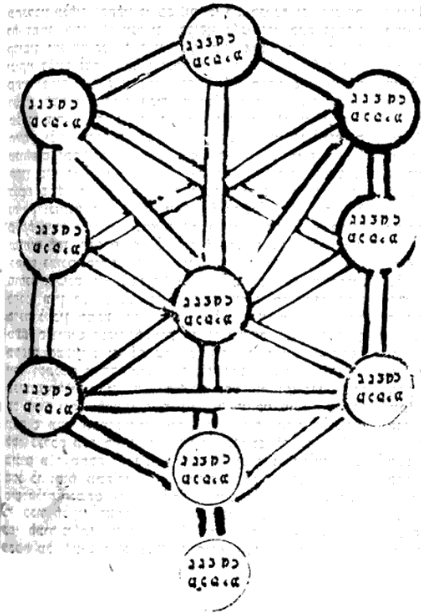

> וענין החלוקים האלה א"א להעלות בכתב ואם ירצה האדם להרגיל עצמו בהם יתעסק בצורה המצויירת לפניו ויתנהג בה בעיון ימים רבים עד יאיר ה' עיני שכלו כי כשל כח הקולמוס להאריך הדברים האלה יותר אם לא שיושפע הענין הזה מפה אל פה או שיעמיק המשכיל בהם בשכלו ע"י הצורה הזאת.

**7:5:6** And behold, with this the Gate is concluded; and blessed is the true Helper, to whom wisdom belongs. And in these matters we fear error and trust in pardon; for of such as this it is said (Proverbs 5:19), "in her love you shall err [*tishgeh*] always"—these are matters which a person does not grasp except through difficulty.

> והנה בזה נכלל השער הזה וברוך העוזר האמיתי אשר לו חכמה. ואנו בעניינים אלו יריאים מן השגיאה ובטוחים במחילה כי על כזה נאמר (משלי ה יט) באהבתה תשגה תמיד הם דברים שאין אדם עומד בהם אלא מתוך הקושי:

**7:5:7** (Says the editor: These ten circles, in which the ten sefirot are depicted—let the inquirer picture [them] as though the circles were revolving in their rotation, and then he will understand the intent of the author, peace be upon him. And the matter is: when the inquirer examines the facing of the sefirot—for example, the aspect of the Chokhmah-within-Chokhmah to the aspect of the Chokhmah-within-Keter, or the aspect of the Binah-within-Binah to the aspect of the Binah-within-Chokhmah or within Keter—then he must imagine and think as though the circle revolves and the Chokhmah-within-Chokhmah, in the circle of Chokhmah, stands opposite the Chokhmah that is in the circle of Keter; and so all of them. Then he will understand and discern the intent of the author, and will know it in truth, with the help of the God of knowledges, YHVH. Thus far [his] words):

> (אמר המגיה אלו עשר עגולים שנצטיירו בו עשר ספירות יצייר המעיין כאלו מתגלגלים העיגולים בסביבובם ואז יבין כוונת המחבר ע"ה והענין כשיעיין המעיין בהבטת הספירות דרך משל בבחינה חכמה שבחכמה לבחי' חכמה שבכתר או בחינת בינה שבבינה בבחינת בינה שבחכמה או שבכתר אז צריך לדמות ולחשוב כאילו העיגול מתגלגל ועומד חכמה שבחכמה בעיגול חכמה נגד חכמה שבעיגול הכתר וכן כולן אז יבין וישכיל כוונת המחבר וידע אותו באמיתית בעזרת אל דעות ה' עכ"ל ע"ב):

---

## Gate 8: Essence and Governance

We named it **"Essence and Governance"** because in it is explained the essence (*mahut*) apprehended in the sefirot — not actual essence, God forbid — together with matters of judgment (*din*) and compassion (*rachamim*), and the governance of the King of the king of kings through them. Its chapters number twenty-six.

### Chapter 8:1. On the sefirot and their union in a single, equal action, despite being divided in their essence — this one judgment, that one compassion; and there the reason for the existence of the ten is explained.

**8:1:1** **The Eighth Gate: Essence and Governance.**

> **שער השמיני הוא מהות וההנהגה.**

**8:1:2** After we occupied ourselves in the preceding Gate with the matter of the channels in all the particulars of their parts, we have seen fit to explain in this Gate the matter of the sefirot in their essence as it is apprehended by us—whether lovingkindness [Chesed], or judgment [Din], or compassion [Rachamim]—and something of the way of their governance, as far as is apprehended by us.

> אחרי שנתעסקנו בשער הקודם בענין הצינורות בכל פרטי חלקיהם, ראינו לבאר בשער זה ענין הספירות במהותם המושג אלינו אם חסד אם דין אם רחמים וקצת מדרך הנהגתם כפי המושג אלינו:

**8:1:3** **Chapter One:**

> **פרק ראשון:**

**8:1:4** Most of the Kabbalists have agreed that the sefirot are a power that includes many opposites. And the parable for this is the will of the soul: for it turns to many actions, even if they are almost opposite—such as love and hatred, and irritation and laughter, and the other opposite actions like these. And so is the matter in the sefirot, which have in them judgment and compassion: at times [a sefirah] clothes itself in judgment, and at times in compassion. And just as it is in the hand of a person to receive and to bestow—and each of these two actions divides into two: whether receiving good or receiving evil, whether bestowing good or bestowing evil—and likewise many [other] actions; and it is a small limb in a person, conducting itself according to the will of the soul: so is the matter of the sefirot. There is in each and every sefirah the power to effect a thousand thousands of thousands of differing actions, each and every one according to its matter and its power and its apprehension and its knowledge and its imprint [*teva*], which the Emanator impressed in it. And we know that this premise which we have set forth will be difficult for the inquirer, and he will say: if so, one sefirah would have sufficed—why did He emanate ten, since the one is a power that includes many opposites, and by it He could effect all the actions? And to this we answer that they were needed for the reason explained in the Gate of the Reason for the Emanation, in chapter six: that for a human being to apprehend the concealed—that is to say, the Godhead—this revelation was needed, up to ten revelations, one below another, so that by this means the created entities might apprehend a little of the knowledge of the exaltedness of the Emanator.

> רוב המקובלים הסכימו כי הספירות הם כח הכולל הפכים רבים והמשל בזה אל רצון הנפש כי היא מתהפכת לכמה פעולות ואם הם כמעט הפכיות כמו אהבה ושנאה וכעס ושחוק ושאר הפעולות ההפכיות כאלו. וכן הענין בספירות שיש בהן דין ורחמים לפעמים היא מתלבשת בדין ולפעמים ברחמים. וכמו שביד האדם לקבל ולהשפיע וכל א' מאלו השני פעולות יתחלקו אל שנים אם קבלת טוב אם קבלת רע אם השפעת טוב אם השפעת רע וכן כמה פעולות והוא אבר קטן שבאדם מתנהג כפי רצון הנפש. כן ענין הספירות יש בכל ספירה וספירה כח לפעול אלף אלפי אלפים פעולות משתנות כל אחד ואחד כפי ענינה וכחה והשגתה וידיעתה וטבעה שהטביע בה המאציל. וידענו כי ההקדמה הזאת אשר הקדמנו יקשה להמעיין ויאמר א"כ די היה בספירה אחת ולמה האציל עשר, מאחר שהאחת היא כח הכולל הפכים רבים ובה יוכל לפעול כל הפעולות. ולזה נשיב כי הוצרכו לטעם מה שפי' בשער טעם האצילות בפ"ו כי להשיג האדם הנעלם ר"ל האלקות הוצרך הגלוי הזה עד עשר גלויים זו למטה מזו כדי שע"י כך יוכלו הנבראים להשיג קצת מידיעת רוממות המאציל.

**8:1:5** And further: even though we say that there is in each sefirah a power that includes many opposites, nonetheless there are still many things such that what this one pours forth, that one does not pour forth—as they, of blessed memory, said (Mo'ed Katan, fol. 28): "Children, life, and sustenance—the matter does not depend on merit, but the matter depends on *mazal*." And the meaning is: "merit" is Chesed, and "*mazal*" is Keter. And the intent is that, although most of the kindnesses and the good things are drawn from Chesed, and its name proves it, nonetheless children, life, and sustenance are not in the hand of this attribute; rather, their principal [source] is in Keter, for it is the supernal *mazal*. And even though the commentators explained otherwise and said that "merit" is Gevurah, nonetheless [it is] in accordance with these words of ours [that] it is explained in the Tikkunim (Tikkun 10, fol. 24), and as we shall explain in the Glossary of Titles, under the entry "merit." And in this way we shall explain that Binah receives those who return; therefore it is called Repentance [Teshuvah]. And it is there that forgiveness and atonement principally depend, by the power of the supernal Keter that overflows upon it. And in this way vengeance is in Gevurah; and so various actions are assigned to the sefirot, and what is assigned to this one is not assigned to that one. And what was said above, that it is a power that includes many opposites, will be in this way: that in the action that is drawn from it, it must effect many opposites—like the eye, whose action is sight, yet it includes opposites: evil sight or good sight, little sight or much sight. And so is the matter in the sefirot. The example of this: one who returns to YHVH with all his power and with all his intent, like the repentance of King David, peace be upon him, and all the other penitents who returned to YHVH with all that is possible within the bounds of repentance—these, certainly, their repentance is superior and is most accepted, to raise their soul to the choice grade of penitents. And when the sinner does not return to YHVH in this grade, then his repentance is accepted, but his soul will not ascend to that choice grade to which the repentance of King David, peace be upon him, ascended. And likewise one who returns and mortifies his soul with a slight mortification; and there is one who confesses his sin only; and likewise one who does not return until the crushing of the soul. And such things, which exist in parts of parts, the knowledge of human beings cannot take in—only the divine knowledge and power, which belong to Him, may He be blessed and exalted, in the sefirot. And all these divisions are for good, and to reward with good reward in the World to Come. And there is likewise, in this way, [the power] to punish one who did not afflict himself on Yom Kippur with the five afflictions that depend on Yom Kippur, which is Binah, certainly. For it is not fitting to punish one who ate to his fill as one who ate an olive's bulk or two olives' bulk; and one who ate and drank is not equal to one who had marital relations; and likewise one who had marital relations is not equal to one who anointed himself. And such are the distinctions that actually occur, which human knowledge cannot take in, still less judge—only the divine power.

> ועוד שאפי' שאנו אמרים שיש בכל ספירה כח הכולל הפכים רבים עכ"ז כבר יהיו כמה דברים שמה שתשפיע זו לא תשפיע זו כאמרם ז"ל (מ"ק דף כ"ח) בני חיי ומזוני לא בזכותא תליא מילתא אלא במזלא תליא מלתא. ופי' זכות הוא החסד ומזל הוא כתר. והכוונה כי עם היות שרוב החסדים והטובות הם נמשכים מחסד ושמו מוכיח עליו, עכ"ז בני חיי ומזוני אינה ביד המדה הזאת אבל עקרם בכתר כי הוא המזל העליון. ואעפ"י שהמפרשים פי' בענין אחר ואמרו שזכות הוא גבורה, עכ"ז כדברינו אלו יתבאר בתיקונים (תקונא י' דף כ"ד) וכמו שנבאר בשער ערכי הכנויים בערך זכות. ועד"ז נבאר כי הבינה היא מקבלת השבים לפיכך נקראת תשובה. ושם עיקר תליית הסליחה והכפרה בכח כתר עליון השופע עליה. ועד"ז הנקמה בגבורה, וכן פעולות שונות נפקדות לספירות ומה שנפקד לזו לא נפקד לזו. ומה שאמר למעלה שהוא כח כולל ההפכים רבים יהיה עד"ז, כי בפעולה הנמשכת ממנה צריכה לפעול הפכיים רבים. כענין העין שפעולתו הראות אמנם כולל הפכיים, ראייה רעה או ראייה טובה, ראייה מועטת או ראייה מרובה. וכן הענין בספירות. המשל בזה השב אל ה' בכל כחו ובכל כונתו כתשובת דהמע"ה וכל שאר בעלי תשובה אשר שבו אל ה' בכל האפשר בגדר התשובה. אלו ודאי תשובתם מעולה ומתקבלת ביותר להעלות נשמתם למדרגה הנבחרת אשר לבעלי תשובה. וכאשר לא ישוב החוטא לה' במדרגה הזאת, אזי תשובתו מתקבלת אבל לא תעלה נשמתו במדרגה הנבחרת ההיא אשר עלתה תשובת דהמע"ה. וכן מי שישוב ויסגף נפשו סיגוף מעט, ויש מי שיתוודה על חטאו לבד, וכן מי שלא ישוב עד דכדוכא של נפש. וכאלו הדברים אשר במציאות חלקי חלקים אשר אין דעת בני אדם יכול לכוללם כ"א הדעת והכח האלקי אשר לו ית' ויתעלה בהספירות. וכל אלו החלוקות הם לטוב ולהשכיר שכר טוב לעה"ב. ויש ג"כ עד"ז להעניש מי שלא התענה ביום הכפורים בה' ענויים התלויים ביום הכיפורים שהיא בינה ודאי. שאין ראוי להעניש מי שאכל עד כדי שביעתו כמי שאכל כזית או שני זיתים ולא ישתוה מי שאכל ושתה עם מי ששמש מטתו. וכן לא ישתוה מי ששימש עם מי שסך וכאלו החילוקים הנופלים במציאות אשר אין הדעת האנושי יכול לכללם כ"ש לשופטם כ"א כח האלקי.

**8:1:6** And the matter of the negative commandments and the positive is that they are divided and dependent upon all ten sefirot. And although all of them in their generality are the 248 positive commandments in Chesed and the 365 negative commandments in Gevurah, nonetheless their particulars are in the ten sefirot, as we have said. And their punishment, or their reward, or their claim in judgment, or the *tikkun* of the ruin that the sinner has ruined, depends upon the sefirah at which the commandment hints. And its particulars and its laws and its reward and its punishment, in general and in particular, are [by] the power that includes many opposites, of which we have spoken. For if it were a power fitted to the sefirah and belonging to it, then if it does good it would not punish, and if it punishes it would not do good; and if it increases reward for one it would not lessen [it] for others, and if it lessens [it] for one it would not increase [it] for others. Rather, certainly, it is compelled that they be a power that includes opposites, to judge the sinner or to reward the doer, whether little or much. And all these actions are by the will of the Emanator, who pours His providence upon them and by means of His sefirot, as we explained in the Gate of Self and Vessels. And in this way is the governance in the world. And the question does not arise, to say: let all the commandments be in one power, and the judging itself in that power—for several reasons, [among them] the reasons that I explained in the Gate of the Reason for the Emanation and that we explained above.

> וענין מצות לא תעשה ועשה הם נחלקים ותלוים בכל עשר ספי'. ועם היות שכלם בכללם הן רמ"ח מ"ע בחסד ושס"ה ל"ת בגבורה, עכ"ז פרטיהם בי"ס כאשר אמרנו. וענשם או שכרם או תביעתם בדין או תיקון הקלקול אשר קלקל החוטא הוא תלוי בספירות אשר המצוה רומזת אליה. ופרטיו ודיניו ושכרו וענשו בכלל ובפרט הוא כח הכולל ההפכים רבים אשר אמרנו. שאם היה כח מסוגל בספירה וקנוי בה, הנה אם יטיב לא יעניש, ואם יעניש לא ייטב. ואם ירבה שכר לאחד לא ימעט לאחרים ואם ימעט לאחד לא ירבה לאחרים. אלא ודאי הוכרח היותם כח הכולל ההפכיים לדון את החוטא או להשכיר את העושה אם מעט ואם הרבה וכל אלו הפעולות ברצון המאציל השופע עליהם השגחתו וע"י ספירותיו כאשר פירשנו בשער עצמות וכלים. ועד"ז יהיה ההנהגה בעולם. ולא יפול השאלה לומר יהיו כל המצות בכח אחד והשפיטה עצמה בכח ההוא. מכמה טעמים אם מן הטעמים שפירשתי בשער טעם האצילות ופירשנו למעלה.

**8:1:7** And further: because it is not the commandments that necessitated the sefirot, but the sefirot that necessitated the commandments. For in our doing the commandment we unite the power that hints at the commandment, which is a branch of the sefirah, with its root; and this is the will of our Maker, that we unite His sefirot—for by their light we see light, for in them is His Self—and it is the glory of the kingship of the [King of the] world that we set right His palaces and His thrones as is fitting, so that His Shekhinah may be among us. And in some of the commandments there is power to remove the spirit of impurity from the earth, "and the idols shall be utterly cut off"; and this is the glory of the King of the world, that we contend with those who rise up against Him. And concerning this the Sages, of blessed memory, said (Sanhedrin, fol. 111): "'and opened her mouth without measure [*chok*]'—[this is] one who has not fulfilled even one statute [*chok*]," which is one commandment: even though he has not transgressed a negative commandment, nonetheless he has no portion in His attributes, may He be blessed, since he has not set right or united there any attribute so that he might cleave to it. We can further answer, on that reason, in another manner, more seemly and acceptable: that the matter of the sefirot is the revelation of His powers, which are His effects and are included in His Self, as will be explained further in the Gate of Tzachtzachot; and this is for the sake of the governance. And lovingkindness and compassion and might and victory and thanksgiving and righteousness and kingship—all of them are attributes included in Him and concealed in His Self. And no multiplicity befalls the Emanator by this, God forbid, as we explained in the Gate of the Order of the Emanation, and we shall also explain in the Gate of Tzachtzachot, in chapters three [and] four. And now, will the questioner ask why a person has made, in his garment, sleeves, or leggings, or sheaths for the digits? No. For we shall answer him that, since this is the garment for the body, and the body is the cause of the garment, it is compelled that the garment be correlated with the body in all its parts and in all its limbs. And since the sefirot are the revelation of His attributes, and are a garment to them, as we explained in the Gate of Self and Vessels, in chapter four—if so, the question does not arise, "why thus and not thus," as we have said.

> ועוד מפני כי לא המצות הכריחו הספירות כי הספירות הכריחו המצות כי בעשותינו המצוה ניחד הכח הרומז אל המצוה שהיא ענף הספירה אל שורשו וזה רצון קוננו שנייחד ספירותיו כי באורם נראה אור כי בהם עצמותו והוא כבוד מלכותו של עולם שנתקן היכליו וכסאותיו כראוי לשתהיה שכינתו בינינו. ויש בקצת מהמצות כח להעביר רוח הטומאה מן הארץ והאלילים כרות יכרתון וזהו כבוד מלכו של עולם שנתקוטט במתקומיו וע"ז אחז"ל (סנהדרין דף קי"א) ופערה פיה לבלי חק מי שלא קיים אפילו חק אחד, שהיא מצוה אחת, אעפ"י שלא עבר על מצות לא תעשה עם כל זאת אין לו חלק במידותיו ית' כיון שלא תיקן או ייחד שם איזה מדה לשידבק בה. עוד נוכל להשיב בטעם ההיא באופן אחר יותר נאה ומתקבל, כי ענין הספירות הן ההתגלות כחותיו העלולים ממנו וכלולים בעצמותו כאשר יתבאר יותר בשער הצחצחות וזהו לסבת ההנהגה. והחסד והרחמים והגבורה והנציחה וההודאה והצדקות והמלכות כלם הם מדות כלולים בו ונעלמים בעצמותו. ולא יפול בזה רבוי במאציל ח"ו כאשר בארנו בשער סדר האצילות, ונבאר ג"כ בשער צחצחות בפ"ג ד'. ועתה הישאל השואל למה עשה האדם בלבושו בתי ידים או בתי שוקיים או בתי האצבעות. לא. כי נשיב לו כי אחר שזה הלבוש אל הגוף והגוף סבת הלבוש הוכרח היות הלבוש מתייחס אל הגוף בכל חלקיו ובכל אבריו. ואחר שהספירות הם גלוי מדותיו והם לבוש אליהם כאשר בארנו בשער עצמות וכלים בפ"ד א"כ לא יפול השאלה למה כך ולא כך כאשר אמרנו.

**8:1:8** And behold, in this way it has been explained how the question does not arise concerning the human body—why its limbs are thus and not thus, and why its hairs are thus, and all such things. For the body is a garment to the soul, and the soul reveals its actions by means of it—so much so that when [a person] sins and is defiled, that sin is depicted in the soul and afterward in the body, as the prophet testified in his reproofs (Isaiah 3), "The look of their faces testifies against them," etc. And so it says in the Zohar that at a time when there is pestilence in the city, God forbid, it is fitting for every person to cover his forehead, so that the Angel of Death not recognize his iniquities engraved on his forehead. And so the Sages, of blessed memory, said (Ta'anit, fol. 30b): "Whoever eats meat and drinks wine on the eve of the Ninth of Av—his iniquities are engraved upon his bones, as it is said, 'and their iniquities were upon their bones.'" And all this is for the reason that the soul shows its actions in them, and the stains that are in it, it shows in the body.

> והנה עד"ז נתבאר איך לא יפול השאלה בגוף האדם למה אבריו כך ולא כך ולמה שערותיו כך וכל הדברים כאלה. כי אחר שהגוף הוא לבוש אל הנשמה והנשמה מגלה פעולותיה על ידו עד שכאשר יחטא ויתטנף יצטייר החטא ההוא בנשמה ואח"כ בגוף כאשר העיד הנביא במוסריו (ישעי' ג') הכרת פניהם ענתה בם וכו'. וכן אמר בזוהר כי בזמן שיש דבר בעיר ח"ו ראוי לכל אדם שיכסה מצחו לשלא יכיר מלאך המות עונותיו החקוקים במצחו. וכן אמרו רז"ל (תענית דף ל' ע"ב) כל האוכל בשר ושותה יין ערב תשעה באב עונותיו חקוקים על עצמותיו שנאמר ותהי עונותם על עצמותם. וכל זה לסבה שהנשמה מראה בהם פעולותיה והכתמים אשר בה מראה בגוף.

**8:1:9** And behold, it is known that the soul includes ten, as we explained in the Gate "Ten and Not Nine," chapter five, and as will be explained in the Gate of the Soul. And since the soul includes all the upper worlds, it is compelled that its garment be the mold and form of the soul, which is the form of the upper worlds. And this is what Scripture says (Job 19:26): "and from my flesh I behold God." If so, it turns out, accordingly, that it is compelled that its limbs be in this structure, and [with] these joints and these veins, which are the channels of the effluence that is poured to the limbs. And all these limbs [matters] are verified of themselves and need no proof; and they will be explained at length in the Gate of the Soul, in part two.

> והנה ידוע שהנשמה כלולה מיו"ד כאשר בארנו בשער י' ולא תשע פ"ה ויתבאר בשער הנשמה. ואחר שהנשמה היא כלולה מכל העולמות העליונים הוכרח היות לבושה דפוס וצורת הנשמה אשר הוא צורת העולמות העליונים. וזש"ה (איוב יט כו) ומבשרי אחזה אלוה. א"כ נמצא לפי זה שהוכרח היות אבריו בתכונה ובפרקים האלה והעורקים האלה שהם צנורות השפע המושפע אל האברים וכל האברים [הדברים] האלה הם מאומתים מצד עצמם ואינם צריכין הכרח ויתבארו בארוכה בשער הנשמה בחלק ב'.

**8:1:10** And behold, with this we have added instruction on the matter of the reason for the Emanation, in addition to what we explained in the Gate of the Reason for the Emanation, with the help of Heaven.

> והנה בזה הוספנו לקח על ענין טעם האצילות מוסיף על מה שבארנו בשער טעם האצילות בסייעתא דשמיא:

### Chapter 8:2. Explanation of the term "sefirot" as applied to the emanated entities, and their agreement upon a single action; and there, the whole existence of the totality of the sefirot as apprehended — their being composed of ten, of seven, of five, of four, and of three.

**8:2:1** After we set out in the preceding chapter the matter of the sefirot, and explained that they are a power that includes many opposites, we can say that this is the reason for their being called sefirot—from the term "sapphire stone" [*even sappir*]. For just as the sapphire has no particular color, but includes all the colors that are seen in it, so the sefirah includes all the opposites, as we have explained. And although each one has a known color, as we shall explain in the Gate of Colors, nonetheless in this aspect they are called sefirot, as we have explained. And they are also called sefirot from the term "telling" [*sippur*]; and so explained Rabbi Shem Tov ben Shem Tov in Sefer ha-Emunot, Gate 4, chapter 4, and these are his words: "In the Bahir I found: Why are they called sefirot? Because 'the heavens tell [*mesapperim*] the glory of God' (Psalms 19:2).

> אחר שהקדמנו בפרק הקודם ענין הספירות ופירשנו שהם כח הכולל הפכים רבים, נוכל לומר כי זה טעם היותם נקראות ספירות מלשון אבן ספיר. כי כמו שהספיר אין לו גוון מיוחד אלא כולל כל הגוונים הנראים בו כן הספירה כוללת כל ההפכים כאשר בארנו. ועם שיש לכל אחד גוון ידוע כמו שנבאר בשער הגוונים, עכ"ז בבחי' זו הם נקראים ספי' כדפי'. והם נקראים ספי' ג"כ מלשון סיפור וכן פי' רבי שם טוב ן' ש"ט בספר האמונות ש"ד פ"ד וז"ל בבהיר מצאתי אמאי אקרי ספי' משום השמים מספרים כבוד אל.

**8:2:2** And the intent is that, just as speech and writing, by their delimiting, make plain—so as to be perceptible—the things concealed within the thought of the wise man, so the heavens indicate the Lord, blessed be He; for so the sefirot are what reveal the concealed thoughts and the forms that are separate from any body, [of which there is] no grasp and no depiction at all." Thus far his words; and [these are] the gracious words of a wise man. For the sefirot tell of, and set a limit to, what is not limited—though not literally a limit, God forbid, as we explained in the preceding gates. And there are those who explained [it] from the term "number" [*mispar*], for number is among the things that are limited. And although they are not limited relative to their simple root, they are limited relative to their action toward us, as we explained above (in Gate 2, chapter 1). And other commentators explained [it] from the term "telling" [*sippur*]; and the intent is that telling and speaking of them is permitted, which is not so of the Ein Sof. And there are those who explained [it] from the term "border" [*sefar*], as in "a city that is near the border," which is a term of boundary and limit; and the intent is that they set a limit to what is no limit at all—and the intent is not that they literally set a limit, but as we have explained. And what it is fitting to explain is that what we said in the preceding chapter—that the governance, and the reward and the punishment, are by means of a particular attribute—does not mean that He effects lovingkindness for them by means of the attribute of Chesed alone, God forbid; for if so, this is separation and cutting, God forbid. For once it is possible for the action to be by means of one of the sefirot, it turns out that it is possible for a sefirah to be separate, in its parts, by itself; and this is not of the truth. Rather, it is not fitting to picture action and governance in any sefirah by itself, since no sefirah acts by means of its own manifestation alone; rather, the governance is by means of all of them. And when we say that the action is by means of some sefirah, the intent is that when lovingkindness prevails in the sefirah, Malkhut receives their effluence, and then all of them are, in her, Chasadim [lovingkindnesses], and all of them agree toward the side of Chesed. And likewise Gevurah: when judgment and the Gevurot prevail in the sefirah, Malkhut receives their effluence, and then all of them are, in her, Gevurot, and all of them agree toward the side of Gevurah. And so Rashbi, peace be upon him, explained in the book of the Tikkunim (Tikkun 19, fol. 40a), and these are his words: "When this stone wishes to execute judgment upon Amalek, or upon the Other Side, and likewise upon the guilty, she takes from Gevurah, and all the sefirot are included in her, and in her they are all called Gevurot. And when she wishes to do favor and lovingkindness in the world, she takes from Chesed, and all the sefirot are included in her, and they are called Chasadim. And when she wishes to have compassion on the world, she takes from the central pillar, and all the sefirot are included in her, and they are called Rachamim [compassions]." Thus far [his] words.

> והנה הכונה כמו שהדבור והמכתב יבאר בהגבלתו להיות מורגש הדברים הנעלמים בתוך מחשבת החכם, כן השמים מורים על ה' יתברך, שכן הספי' הם המגלות מחשבות הנעלמות והצורות הנבדלים משום גשם ולא שום תפיסה וציור. עכ"ל ודפח"ח. כי הספירות מספרות ומגבילות הבלתי בעל גבול, ולא גבול ממש ח"ו כמו שבארנו בשערים הקודמים. ויש שפי' מלשון מספר כי המספר מבעלי הגבול. ואע"פ שאינם בעלי הגבול בערך שרשם הפשוט, בעלי גבול הם (ו)בערך פעולתם אלינו כדפי' לעיל (בשער ב' פ"א). ומפרשים אחרים פי' מלשון סיפור. והכונה כי הסיפור והדיבור בם מותר משא"כ בא"ס. ויש שפירשו מלשון ספר כמו עיר הסמוכה לספר והוא לשון תחום וגבול והכונה שהם מגבילות מה שאינו גבול כלל, ואין הכונה מגבילות ממש אלא כדפי'. ומה שראוי לבאר כי מה שאמרנו בפרק הקודם שההנהגה והשכר והעונש הוא על ידי מדה מיוחדת אין ר"ל שיפעל להם חסד ע"י מדת חסד לבד ח"ו שא"כ הוא פירוד וקיצוץ ח"ו. כי אחר שאפשר להיות הפעולה ע"י אחד מן מספירות נמצא שאפשר להיות ספירה נפרדת בחלקיה בפני עצמה ואין זה מן האמת. אלא אין ראוי לצייר פעולה והנהגה בשום ספירה בפ"ע לפי שאין ספירה פועלת באמצעית מציאותה בפ"ע אלא ההנהגה היא באמצעות כלם. ומה שאנו אומרים שהפעולה ע"י איזה ספירה, הכונה כי כאשר יגבר החסד בספירה תקבל מלכות שפעם ואז יהיו כלם בה חסדים וכלם מסכימות אל צד החסד. וכן הגבורה כאשר יגבר הדין והגבורות בספירה תקבל מלכות שפעם ואז יהיו כלם בה גבורות וכלם מסכימות אל צד הגבורה. וכן פי' הרשב"י ע"ה בס' התקונים (תקונא יט ד"מ.) וז"ל כד האי אבנא בעא למעבד דינא בעמלק או בסטרא אחרינא וכן בחייבין נטלא מגבורה ואתכלילן בה כל ספיראן ואתקריאו בה כלהו גבורות. וכד בעאת למעבד חנא וחסדא בעלמא נטלא מחסד וכלהו ספירן אתכלילן בה ואתקריאו חסדים. וכד בעאת לרחמא על עלמא נטלא מעמודא דאמצעיתא וכלהו ספירן אתכלילן בה ואתקריאו רחמי עכ"ל.

**8:2:3** Behold, he explained explicitly how the sefirot all agree toward the sefirah that prevails, and all by means of the last attribute, which governs the world, for in her is the principal governance. And what it is fitting to examine closely in this matter is that it is impossible that Chesed should agree toward the side of Gevurah, and likewise Gevurah toward the side of Chesed, since they are two opposites—this one judgment and that one lovingkindness. And how is it possible to say that what is lovingkindness should effect the power of judgment, and that what is judgment should effect the power of lovingkindness? And we answer that this matter is impossible except in that each one of them includes ten; and you will find that there is in Chesed the power of Gevurah, and there is in Gevurah the power of Chesed, and so for all the sefirot. And by means of this equality they are unified and become equal, as we shall explain in this Gate. And we need to explain the matter of "each one includes ten," so that the inquirer should not think that each one includes ten in the plain sense—that is, that there is in Chesed a recognizable part that is Gevurah, and likewise in Gevurah a recognizable part that is Chesed. For if so, God forbid, the sefirot turn out to be divided into parts and separated from one another; and what we had in mind to set right by our saying "each one includes ten" is spoiled by what follows from it, for [then] even each one is divided into ten parts. Rather, the intent is that no one can say "this is a part of Chesed" that does not include ten, nor of any part among the parts of the other sefirot that all the ten are not included in it; and likewise ten from ten, without end and without limit—everything includes ten upon ten, and ten from ten. And should you say: if so—that each one includes all of them—it now turns out, accordingly, that there is no difference among the sefirot, and all of them are equal; and if so, how do we say that this one is Gevurah and this one Chesed, and so for all of them? Since in Chesed there are ten and in Gevurah ten, all of them turn out equal, for good or for ill, God forbid. To this we answer with a premise that Rambam explained concerning the elements, in chapter 4 of the Laws of the Foundations of the Torah, and these are his words: "Every single body—of man and beast and wild animal and bird and fish and plant and metal and stone—its matter is joined together from fire and air and water and earth. And the four of them are mixed together, and each one of them is changed at the time of the mixing, until what is joined together from the four of them is found to be unlike any one of them when it is alone. And there is not in the mixture of them even one part that is fire by itself, or water by itself, or earth by itself, or air by itself; rather, all have been changed and have become another body. And every body that is joined together from the four of them—there are found in it cold and heat, moist and dry, as one. There are among them bodies in which the element of fire is strong, such as, etc.; and there are among them bodies in which the element of water is strong, etc. And in this way one body is found hotter than another hot body, and one body drier than another dry body; and [there are] bodies in which the cold alone is seen, and bodies in which the moist alone is seen, and bodies in which the cold and the dry are seen as one, equally, etc., or the heat and the dry as one, equally, etc." Thus far his words, for our matter.

> הנה ביאר בפי' איך הספי' כלם הם מסכימות אל הספי' הגוברת והכל ע"י מדה האחרונה המנהגת העולם שבה עיקר ההנהגה. ומה שראוי לדקדק בענין זה הוא כי א"א להיות שהחסד יסכים אל צד הגבורה וכן הגבורה אל צד החסד אחר שהם ב' הפכים זה דין וזה חסד ואיך אפשר לומר שמה שהוא חסד שיפעול כח הדין ומה שהוא דין שיפעול כח החסד. ונשיב כי א"א הענין הזה אלא במה שהם כל א' כלולה מי' ותמצא שיש בחסד כח הגבורה ויש בגבורה כח החסד וכן לכל הספי'. וע"י השווי הזה הם מתיחדות ומשתוות כמו שנבאר בשער זה. וצריכים אנו לבאר ענין כל אחת כלולה מעשר שאל יחשוב המעיין שיהיה כל אחת כלולה מי' כפשוטה ר"ל שיש בחסד חלק ניכר שהוא גבורה וכן בגבורה חלק ניכר שהוא חסד שא"כ ח"ו נמצאו הספי' נחלקו לחלקים ונפרדים זמ"ז. ומה שעלה בדעתינו לתקן במאמרינו כל א' כלולה מי' נתקלקל במה שנמשך מזה כי אפי' כל אחת נחלקת לי' חלקים. אלא הכונה שאין אדם יכול לומר זה חלק חסד שלא יכלול מי' ולא בחלק מחלקי שאר הספי' שלא יהיה נכללים בו כל הי' וכן י' מי' עד לאין סוף ותכלית הכל כלול מיו"ד ליו"ד ויו"ד מיו"ד. וא"ת א"כ שכל א' כלול מכלם ימצא עתה לפי זה שאין חלוק בספי' וכלם יהיו שוות וא"כ איך אנו אומרים שזו גבורה וזו חסד וכן לכלם, כיון שבחסד י' ובגבורה י' נמצאו כלם שוים לטובה או לרעה ח"ו. לזה נשיב בהקדמה אחת שפי' הרמב"ם בענין היסודות בפ"ד מהלכות יסודי התורה. וז"ל ימצא כל גוף וגוף מאדם ובהמה וחיה ועוף ודג וצומח ומתכת ואבן, גולמו מחובר מאש ורוח ומים ועפר. וארבעתם יתערבו ביחד וישתנו כל אחד מהם בעת העירוב עד שימצא המחובר מארבעתם אינו דומה לא' מהם כשהוא לבדו. ואין במעורב מהם אפי' חלק אחד שהוא אש בפני עצמה או מים בפני עצמם או עפר בפ"ע או רוח בפ"ע, אלא הכל נשתנו ונעשו גוף אחר. וכל גוף המחובר מארבעתם ימצא בו קור וחום לח ויבש כאחד. יש מהם גופים שיהיה בהם חזקה מיסוד האש כמו וכו'. ויש מהן גופים שיהא בהם חזקה מיסוד המים כו'. ועד"ז ימצא גוף חם יותר מגוף אחר חם, וגוף יבש יותר מגוף אחר יבש. וגופים שיראה בהם הקור בלבד, וגופים יראה בהם הלח בלבד, וגופים שיראה בהם הקור והיובש כאחד בשוה כו' או החום והיובש כאחד בשוה וכו'. עכ"ל לעניננו.

**8:2:4** And behold, by this premise a person can contemplate the sefirot: that the principal [thing] is the power of Gevurah, in which judgment is seen and not lovingkindness, and the power of Chesed, in which lovingkindness prevails and not judgment. And we needed all this so as not to make a separation, God forbid, as we have explained. And when this principle is fixed in the heart of the discerning, it will not be far from him to know how Chesed, when Gevurah prevails, can itself also effect Gevurah, since in Chesed too there is the power of Gevurah; and so for all the sefirot and in all the blendings. However, the matter of this agreement is, intrinsically, by means of the Diadem, which governs the world, for in her this blending is made. For in their own place it is impossible: for if we say that the agreement and the blending are in their place above, it turns out, God forbid, that nine sefirot are lacking, for all of them are Gevurot or Chasadim. Rather, perforce we say that in their place they are [in] their [own] blending, which their Emanator set in them. It is true that its being drawn to effect that action is by means of the Gevurot that are in them, or by means of the Chasadim that are in each and every sefirah, as we explained in the Gate of Channels, chapter 5. But that they should be turned to judgment and Gevurah, or to lovingkindness, altogether—this is impossible except by means of Malkhut specifically. And of this Rashbi, peace be upon him, was exact in his wording, in the passage that we copied, in that he said "and all the sefirot are included in her, and they are called Chasadim," etc.—meaning that first they are included in the stone, which is Malkhut, and then they are called Chasadim or Gevurot or Rachamim altogether. And the hint to their each including ten is in the way that Rashbi said in the book of the Tikkunim (Tikkun 47, fol. 81b), and these are his words: "For there is no sefirah that does not include ten, each one in its own dominion." Thus far [his] words. And it is clear. And he was exact in saying "in its own dominion"—meaning, even while its dominion, its [own] action, prevails in it, in the way that we have explained.

> והנה בהקדמה הזאת יוכל האדם להתבונן בספי' כי העיקר הוא כח הגבור' אשר יראה בו הדין ולא החסד, וכח החסד אשר יגבר בו החסד ולא הדין. והוצרכנו לכל זה לבלתי עשות פירוד ח"ו כמו שפי'. וכאשר יקבע העיקר הזה בלב המשכיל הנה לא ירחק ממנו המקום לדעת איך יכול החסד כאשר יגבר הגבורה להיות ג"כ הוא פועל הגבורה בהיות כי גם בחסד יש כח גבורה. וכן לכל הספי' ובכל המוזגות. ואולם ענין ההסכמה הזאת היא בעצם ע"י העטרה המנהגת העולם שבה יעשה המזיגה הזאת. שבמקומם אי אפשר, שאם נאמר שההסכמה והמזיגה היא במקומם למעלה נמצא ח"ו חסר תשעה ספי' כי כלם גבורות או חסדים, אלא על כרחינו נאמר שבמקומה הם מזיגתם אשר שם בהם מאצילם. אמת שתהיה המשכתה לפעול הפעולה ההיא ע"י הגבורות שבהם או ע"י החסדים שבכל ספי' וספי' כמו שבארנו בשער הצנורות בפ"ה. אמנם לשיהפכו לדין וגבורה או לחסד מכל וכל, זה א"א כי אם ע"י המלכות דוקא. וזה דקדק בלשונו הרשב"י ע"ה במאמר שהעתקנו שאמר וכלהו כלילן בה ואתקריאו חסדים וכו' פי' כי קודם יכללו בהאבן שהיא המלכות ואז יקראו חסדים או גבורות או רחמים מכל וכל. ולרמוז על היותם כל אחת כלולה מי' היא על הדרך אשר אמר הרשב"י בס' התקונים (תקונא מ"ז דף פ"א ע"ב) וז"ל דלית ספירה דלא אתכלילת בעשר כל חדא בממשלת דילה עכ"ל. ומבואר הוא. ודקדק באמרו בממשלת דילה, פירוש עם היות גובר בה ממשלתה פעולתה על הדרך שפירשנו.

**8:2:5** And now, after we have explained the matter of their including ten, we wish to explain the matter of the revelation of the ten in each and every one, for it is a wondrous rank. And the matter is that—besides their including ten in the way that we have explained, and this inclusion never falls short and never exceeds, just as it is impossible for the sefirot to be eleven, or nine, so too with regard to the inclusion—there is, however, a matter more important than this, which is not found in them except when there is abundant good: namely, that [the ten] be revealed in them, and each one of them be included in all of them; as if to say that all the ten sefirot that are in it appear, by reason of its having received from ten and its shining in ten. That is to say, Keter includes ten by reason of its being unified with ten. How so? It shines in the nine, and the nine shine in it, and they shine toward the face of Keter; so that ten shine in it. And so in Chokhmah, and so in Binah. How so? Binah pours forth effluence into the seven lower ones—here are seven that are included in her, and she is included in them; and the two upper ones shine in her and are included in her—here are nine; and further, her own face itself shines in her—here are ten. And so for all the sefirot. And by this, ten sefirot appear in all of them; and this is a manifestation choicer than the inclusion expounded above. And this manifestation is found more commonly in Malkhut, as we explained in the Gate "Ten and Not Nine." And the inquirer must keep his eyes open to this manifestation, which is not like the preceding manifestation. And this manifestation will at times be partial—that is, they will be included only in seven, which are the seven sefirot of the Structure; and this inclusion will not be of the importance and rank that it has when it is of ten, as we shall explain in the Gate of Manifestations, chapter 5. And one should not wonder and say that a separation is seen in this, since only seven appear in it, and not ten. The reason is that, since all the ten are included in it, and [only] on account of the scantness of the light do they not all appear, but are concealed and do not act, it is not called separation. For such is the way of the sefirot: although they include ten, they act only from the one that prevails, and nonetheless it is not called separation, since all of them are included in it. And for all that, the one that prevails is the principal one—if in Chesed, Chesed; if in Gevurah, Gevurah. And so is the matter with these inclusions: because they received only from the seven, they were included only in seven. And now, accordingly, when we count in them ten times ten, which are a hundred, we mean this important inclusion. And when we count ten times a hundred, we mean to say that even those ten were shining in ten others; and so the number rises from ten to ten without end, and according as the number grows, it indicates the abundance of the inclusion. And likewise, at times we count seven times seven, indicating the seven days of the Structure, which were included in themselves; and so their number rises from seven to seven, by sevens—such as seven times seven, forty-nine, or forty-nine times forty-nine. And at times we compound the two numbers and say that the seven lower ones were included in ten; and now they come to seven times ten, which are seventy, or seven hundred—all according to the strengthening of the inclusion, as we have explained. And there is another aspect, namely that we say that the ten sefirot include seven; and the number and the inclusion rise in the manner of the preceding number. However, it indicates compassion more, since in this aspect the first three themselves were revealed, which is not so in the preceding aspects, in which they were revealed only in the lower ones; and it is clear. And all these aspects and their inclusion—their explanation has come in the Zohar and in the Tikkunim and in the commentators; and since the matters are scattered, one here and one there, and it would be burdensome for us to bring their proof, we have written them in brief; and they are agreed upon of themselves. Further, the sefirot include ten in another aspect, and these are the manifestations of the sefirot themselves. And the matter is that in Keter all the sefirot were revealed at the time of the Emanation, as we explained in the Gate of the Emanation; and on this account their manifestation must be there, as we shall explain the matter of the manifestations in the Gate of Manifestations.

> ועתה אחר שבארנו ענין היותם כלולות מיו"ד רצוננו לבאר ענין התגלות העשר בכאו"א כי הוא מעלה נפלאה. והענין כי בזולת שהם נכללות מי' על הדרך שבארנו והכללות הזה לא יחסר ולא יעדיף לעולם כמו שא"א לספירות להיותם י"א ולא ט', וכן לענין כללות ג"כ. אמנם יש ענין חשוב מזה אשר זה לא ימצא בהם כי אם בהיות רוב טובה והוא שיתגלה בהם ויוכללו כל אחד מהם בכלם כאלו תאמר שיהיו כל הע"ס שבה מתראות מצד שקבלה מי' ומאירה בי'. ר"ל הכתר כלול מי' מצד שהוא מתייחד בעשר, כיצד הוא מאיר בט' והט' מאירים בו והם מאירות כלפי פני הכתר הרי שמאירים בו עשר. וכן בחכמה וכן בבינה. כיצד הבינה משפעת בז' התחתונות הרי ז' שנכללים בה והיא נכללת בהם, ושני העליונות מאירות בה ונכללות בה הרי ט', ועוד מאירים בה פניה ממש הרי עשר. וכן לכל הספירות. ובזה מתראות בכלן עשר ספי' והוא מציאות מובחר מענין הכללות הנדרש למעלה ונמצא מציאות הזה בהרגל יותר אל המלכות כדפי' בשער י' ולא תשע. וצריך המעיין להיות עיניו פקוחות על המציאות הזה שאינו כמציאות הקודם. והמציאות הזה לעיתים יהיה במקצת ר"ל שלא יוכללו אלא בשבע שהם ז' ספירות הבנין והכללות הזה לא יהיה בחשיבות ומעלה שיהיה כאשר הוא מעשר כמו שנבאר בשער המציאות בפ' ה'. ואין לתמוה ולומר כי יראה בזה פירוד אחר שלא יתראו בה אלא ז' ולא י'. הטעם הוא מאחר שנכללות בה כל העשר ומפני מיעוט האור אינם מתראות כלם אלא מתעלמות ואינם פועלות לא יקרא פירוד. כי כן דרך הספי' עם היותה כלולות מעשר לא יפעלו אלא מהגוברת ועכ"ז לא יקרא פירוד אחר שכלם נכללות בה. ועם כל זאת הגוברת היא העיקרית אם בחסד חסד אם בגבורה גבורה. וכן הענין אל הכללות האלו שמפני שלא קבלו אלא מן השבע לא נכללו אלא בשבע ועתה לפי"ז כאשר נמנה בהם עשר פעמים י' שהם מאה נרצה בענין הכללות החשוב הזה. וכאשר נמנה עשר פעמים מאה נרצה לומר כי אפילו אותם העשר היו מאירות בעשר אחרות וכן יעלה המספר מעשר לעשר עד אין תכלית וכפי אשר יגדל המספר יורה על רוב הכללות. וכן לפעמים נמנה שבעה פעמים שבעה מורה על שבעת ימי הבנין שנכללו הן בעצמן וכן יעלה מספרם מז' לשבעה בשביעיות כמו שבעה פעמים שבעה מ"ט או מ"ט פעמים מ"ט. ולפעמים נרכיב ב' המספרים ונאמר שהשבעה התחתונות נכללו בעשר ועתה יעלו שבעה פעמים עשר שהם שבעים או שבע מאות הכל לפי התגברות הכללות כדפי'. ויש בחינה אחרת והיא שנאמר שי"ס נכללו משבע ויעלו המספר והכללות כדרך המספר הקודם. אמנם יורה על הרחמים יותר להיות שבבחי' זו נתגלו הג' ראשונות בעצמם מה שאין כן בבחי' הקודמות שלא נתגלו אלא בתחתונות והוא מבואר. וכל הבחינות האלה וכללותם באו ביאורם בזהר ובתקונים ובמפרשים, ולהיות הדברים מפוזרים א' הנה וא' הנה ויכבד עלינו להביא ראייתם כתבנום בקצרה והם מוסכמים מצד עצמם. עוד הספי' נכללות מעשר בבחינה אחרת והם מציאיות הספי' בעצמם. והענין כי בכתר נתגלו כל הספי' בעת האצילות כאשר בארנו בשער האצילות. והנה לזה חיוב היות שם מציאותם כמו שנבאר ענין המציאות בשער המציאות.

**8:2:6** And behold, these nine are spiritual beings, subtler than their own self that is revealed below, so that they are sources and a channel through which the life-force is poured to their lower manifestation. And when they were emanated in Chokhmah, there too the manifestation of eight sefirot remained; and the supernal Keter—its manifestation was emanated in her, so that they should not be nine, God forbid. And further, this was necessary because by means of it the Emanation was emanated. So in Chokhmah there is a manifestation of ten, but not like the manifestation that is within Keter, because in Keter they are in subtlety.

> והנה הט' האלה הם הויות רוחניות דקות מעצמותם המתגלה למטה עד שהם מקורות וצנור שבהם יושפע החיות אל מציאותם התחתון. וכאשר נאצלו בחכמה שם ג"כ נשארו מציאות ח' ספי' וכ"ע נאצל מציאותו בה כדי שלא יהיו ט' ח"ו. ועוד הוכרח כן מפני שע"י נאצל האצילות. הרי בחכמה מציאות עשר אבל לא כמציאות שבתוך הכתר מפני שבכתר הם בדקות.

**8:2:7** And further, the nine above were a source for the nine lower ones, which is not so in Chokhmah, for the eight are a source for the eight lower ones; but Keter, on the contrary—its principal source is the manifestation of the upper sefirah, which was completed above her in [its] manifestation, and it is a branch and has need of it. And likewise seven were emanated in Binah—here are seven—and they are sources for the seven lower ones, and they are not like the sources that are in Chokhmah. And further, in Chokhmah there were eight, a source for eight, and in Binah seven, a source for seven; and the two upper ones are emanated there to complete [them].

> ועוד כי הט' למעלה היו מקור לתשע התחתונות משא"כ בחכמה כי הח' מקור לח' התחתונות, אבל הכתר אדרבא מקורו העיקרי הוא מציאות ספירות העליונות שנשלמה למעלה ממנה במציאות והיא ענף וצריך אליו. וכן נאצלו ז' בבינה הרי ז' והם מקורות לז' תחתונות ואינם כמקורות אשר בחכמה. ועוד שבחכמה היו ח' מקור לח' ובבינה ז' מקור לז'. ושנים העליונות נאצלות שם להשלים.

**8:2:8** And further, because by means of them was the principal [part] of the Emanation, for by their power the seven were emanated in her; and therefore their manifestation remained there. And in this way for all the sefirot, for all of them are in all of them. And this is another matter, which is the manifestation of the sefirah itself in the sefirah. And so all the sefirot turn out to have aspects corresponding to all of them. And Malkhut differs from all of them, for she has a literal source in each one of the sefirot, since she is the last of them all. And this is the reason that her manifestation remained in all the grades of the sefirot, for she descended by way of the grades of the ladder, as was explained in the Tikkunim (in the Introduction, fol. 10b), and these are its words: "When she was taken from Keter, she was called 'diadem of splendor' [*ateret tiferet*], etc.; when she was taken from the supernal Chokhmah, which is 'beginning' [*reshit*], she was called after its name; and when she was taken from Binah, she was called after its name, Tevunah; and when she was taken from Chesed, she was called," etc. And in this way he explained there in the Tikkunim, to show her name according to her aspects, by way of the grades of the ladder by which she descended; and according to the sources—to show her ascent to that aspect—she is called after its name, as we shall explain in the explanation of the passage in its place, if God decrees life. Further, the sefirot have another inclusion, of three—namely the three lines: the line of Chesed, the line of Din, the line of Rachamim—and in this aspect [each] includes three. And at times [each] includes four—namely Chesed, Gevurah, Tiferet, Malkhut, which are the four legs of the Chariot; and they are literally the four letters of the name, for Yod is in Chesed and Heh in Gevurah, as is explained in the Tikkunim many times; and they are also the face of a man, the face of a lion, the face of an ox, the face of an eagle, as the matter will be explained in the Gate of Titles. And at times they include five, which are Chesed, Gevurah, Tiferet, Netzach, Hod; and the reason is that thus far the Emanation reached, for Malkhut and Yesod are included in Tiferet. And when we consider the aforementioned five with respect to their being included in ten, they come to fifty. And likewise, when we consider them with respect to each one's including five, they come to twenty-five.

> ועוד מפני שעל ידם היה עיקר האצילות כי מכחם נאצלו בה הז' ולכן נשאר שם מציאותם ועד"ז לכל הספירות שכולם הם בכולם. וזה ענין אחר שהוא מציאות הספירה ממש בספי'. ונמצאו לכל הספירות בחינות כנגד כלם. והמלכות נשתנה מכלם כי יש לה מקור ממש בכל אחת מהספירות אחר שהיא אחרונה לכלם. וזה הטעם שנשאר מציאותה בכל מדרגות הספירות כי דרך מדרגות הסולם ירדה וכמו שנתבאר בתקונים (בהקדמה ד"י ע"ב) וז"ל כד אתנטילת מכתר אתקריאת עטרת תפארת כו', כד אתנטילת מחכמה עילאה דאיהי ראשית אתקריאת על שמה, וכד אתנטילת מבינה אתקריאת על שמה תבונה. וכד אתנטילת מחסד אתקריאת וכו'. ובדרך הזה פי' שם בתיקונים להראות על שמה כפי בחינותיה דרך מדרגות הסולם אשר ירדה וכפי המקורות להראות עלייתה אל הבחינה ההיא תקרא על שמה וכמו שנבאר בפי' המאמר במקומו אם יגזור השם בחיים. עוד לספי' כללות אחר' מג' והיינו ג' קווים קו החסד קו הדין קו הרחמים ובבחינתו יוכלל מג' ולפעמים יוכלל מד' והיינו חסד גבורה תפארת מלכות שהם ד' רגלי המרכבה והם ממש הד' אותיות שבשם כי יו"ד בחס"ד וה' בגבורה כמבואר בתיקונים פעמים הרבה והם ג"כ פני אדם פני אריה פני שור פני נשר כמו שיתב' הענין בשער הכינוים. ולפעמים יוכללו מה' והם חסד גבורה ת"ת נצח הוד, והטעם כי ע"כ הגיע האצילות כי מלכות ויסוד הם נכללים בת"ת. וכאשר נבחן החמשה הנז' בערך שהם נכללים בעשר יעלו לנ'. וכן כאשר נבחין אותם בערך שכלול כל א' מה' יעלו כ"ה.

**8:2:9** And further, at times they include six, which are the six extremities that are included in Tiferet; and then each and every one is designated by the name Vav [six]. And they are three upper Vavs—Gedulah, Gevurah, Tiferet—and they are [those of] *va-yissa*, *va-yavo*, *va-yet* (Exodus 14:19–21): Vav, Vav, Vav; and they are eighteen. And they are likewise in Netzach and Hod and Yesod, and they are another eighteen; their sum is thirty-six. And when they include ten, they come to sixty. And these inclusions and their order are explained in the Zohar and in the Tikkunim many times; and we have abridged the matter in this chapter so that it be set in order before the eyes of the inquirer, for wherever there is need of it.

> ועוד נכללים לפעמים מו' והם ו' קצוות הנכללות בת"ת ואז הם מכונים בשם ו' כאו"א. והם שלשה ווין עליונים גדולה גבורה ת"ת והם ויס"ע ויב"א וי"ט וו"ו והם ח"י. והם ג"כ בנצח והוד ויסוד והם ח"י אחרים כללם ל"ו. וכאשר נכללים מעשר יעלו ששים. והכלליות האלה וסדרם מתבארים בזוהר ובתיקונים פעמים הרבה וקצרנו הענין בפ' זה כדי שיהיה סדור לעיני המעיין לכל אשר יהיה שם הצורך אליו:

### Chapter 8:3. Explanation of the essence apprehended in Keter, and its being composed of ten; and an explanation of the 620 (*tar"kh*) pillars of light; and there, part of the prayer of R. Nechunya ben ha-Kanah.

**8:3:1** After we have occupied ourselves in the preceding chapters with the matter of the inclusion of the sefirot and their bearing on the governance, we shall add further explanation of the essence apprehended in them by the Kabbalists—a tradition from one man's mouth to another's, back to Moses our teacher, peace be upon him, from the mouth of the Almighty [Gevurah]. The first sefirah is the first emanated, and it is the supernal Keter, in which, relative to the emanated that are below it, there is no lack at all and no deficiency at all; rather, it is simple compassion, without any admixture of judgment at all. If so, how is it possible for it to include ten? For the inclusion indicates that there is in it a side of Gevurah, which is judgment; and we say that it is simple, without any admixture of judgment at all. And it is possible to answer this in several ways. The first is that it need not be that it includes Gevurah in the aspect of judgment; rather, it includes Gevurah in the aspect of the wealth that is under the hand of Gevurah, as the Sages, of blessed memory, said (Bava Batra, fol. 25b): "One who wishes to become wealthy should turn north"; and its matter corresponds to Gevurah, for there is the gold. And likewise [there are] such matters as these, which are compassion and are of the action of Gevurah—like the rains, which are from the side of Gevurah and are compassion for the world. And likewise a person's being mighty [*gibbor*], conquering his inclination: that might [*gevurah*] is from the side of complete compassion, in that he was not delivered into the hand of his inclination—by the power of Gevurah, which made him prevail over his enemy. And so they explained in the Tikkunim (in Tikkunei Zohar Chadash, fol. 114b), and these are its words: "In the fifth month, there is given in it the might of Gevurah, to prevail over the evil inclination from the side of the left, so that it not rule over him," etc.; see there. And although this is expounded there for another matter, nonetheless it emerges for us from his words that a person's prevailing over his inclination is from the side of Gevurah.

> אחר שנתעסקנו בפרקים הקודמים בענין כללות הספי' ועניינם אל ההנהגה. עוד נוסיף ביאור במהות המושג בהם אל המקובלים קבלה איש מפי איש עד מרע"ה מפי הגבורה. הספירה האחד הוא הנאצל הא' והוא כ"ע אשר בערך הנאצלים אשר למטה ממנו אין בו חוסר כלל ולא גירעון כלל אלא הוא רחמים פשוטים מבלי תערובות דין כלל. א"כ איך אפשר להיותה כלולה מיו"ד כי הכללות מורה שיש בה צד גבורה שהוא דין ואנו אומרים שהיא פשוטה מבלי תערובת דין כלל. ואפשר לזה להשיב על כמה פנים. הראשון הוא כי לא יוכרח שיהיה כלול מהגבורה בבחינת הדין אבל יהיה כלול מהגבורה בבחי' העושר אשר תחת יד הגבורה. כמו שאחז"ל (ב"ב דף כ"ה ע"ב) הרוצה להעשיר יצפין. ועניינו כנגד הגבורה אשר שם הזהב. וכן עניינים כאלה אשר הם רחמים והם מפעולת הגבורה. כמו הגשמים שהם מצד הגבורה והם רחרים לעולם. וכן היות האדם גבור כובש את יצרו אותה הגבורה יהי' מצד הרחמים הגמורים אשר לא נמסר ביד יצרו בכח הגבורה שהגבירו על שונאו. וכן ביארו בתקונים (בתז"ח דף קי"ד ע"ב) וז"ל בירחא חמשאה יהיב ביה תוקפא דגבורה לאתגברא על יצר הרע מסטרא דשמאלא דלא שליט ביה וכו' ע"ש. ועם היות כי זה נדרש שם לענין אחר, עכ"ז יצא לנו מתוך דבריו כי היות האדם מתגבר על יצרו הוא מצד הגבורה.

**8:3:2** And further, they have other actions, such and such, good and pleasant. And from the side of the aspect of Gevurah in these actions, Keter includes it. And when Gevurah is aroused, Keter pours forth effluence by the side of Gevurah that it has; and even if it pours forth the action of compassion—such as the effluence of wealth, or of prevailing, below—from the supernal Keter that effluence will strengthen Gevurah, so that there be in it strength and firmness of power to act. And although this matter belongs to Keter accidentally, for its principal pouring-forth was for compassion, nonetheless in Gevurah "kind found its kind," and by it Gevurah was aroused to act. Further, it is possible to answer in another way: that it is true that Keter effects only compassion—this is its power; although it includes Gevurah, nonetheless it has the power to nullify that Gevurah and to subdue it to compassion. And not on this account is its including ten to be denied. As is the matter with the elements: not because a given body shows heat alone, or cold alone, shall we be obliged [to say] that it is simple and is not composed of the four elements at all. Rather, we shall say that it is composed of the four elements, and because of the prevalence of the element of water that is in it the other elements do not act in it, and the cold alone is seen in it. And so is the matter when heat is seen in it: its cause is the prevalence of the fire, as Rambam, peace be upon him, explained in his words that we copied in the preceding chapter. And in this way with the sefirah of Keter: although there be in it the power of Gevurah, its judgment does not act, as happens with the elements, which we explained. Further, we can resolve [it] in another way, and it is nearer to the truth and is the principal one. And the matter is well known: that in the simple Ein Sof it is necessary that there be a manifestation of the ten sefirot, as we shall explain in the Gate of Tzachtzachot. And now, why should it not be difficult for us that, accordingly, the simple God turns out to be composite, with a great composition such as this—of ten sefirot, among which are Gevurah, the power of judgment, and Gedulah, the power of lovingkindness? And in truth there is no composition greater than this. And such is not the rule of the cardinal faith that is fixed in the heart of the believers; for the cardinal principle of the faith is to believe that the Ein Sof is one, simple with the utmost simplicity, without any composition. Rather, certainly, the answer to this question is at its side: for, God forbid, our intent in saying that the manifestation of the sefirot is in the Ein Sof is not that their manifestation above is in the way that their manifestation is below. Rather, above they are simple with the utmost simplicity, and unified in the very roots with the utmost union, and they are subtle [and] spiritual with the utmost subtlety, so that neither multiplicity nor change, neither judgment nor compassion, is attributed to them; and we shall speak of them at length in the Gate of Tzachtzachot. And now, since Keter is the first emanated, there is nothing between it and the Emanator except that this one is cause and this one is its effect. And according to the measure that we were obliged to go far in the matter of the sefirot that are in the Ein Sof, in that same way we are obliged to go far in the matter of the sefirot that are in Keter. For according to their descent from before Him, so the things and the actions are revealed; and according to their nearness to their source, so they are concealed and hidden. And therefore, although Keter includes ten, the intent is not that the ten effect judgment and compassion as is their action in their [own] place; rather, they are concealed sources. And in this way is the manifestation of the emanation of judgment, for those who ask whence judgment came forth, as we shall explain in this Gate explicitly. This is what is given to the human intellect to answer to the question. However, the tradition compels us that Keter is the utmost of compassion, as it is written (Daniel 7:9), "And the Ancient of Days sat; His garment was white as snow." And its effluence is nothing but simple compassion; and "He sits upon a throne of sparks of fire, to subdue them"; and so Rashbi, peace be upon him, explained in the Idra (of Naso, fol. 128b). However, judgment is effected in the hiding of its face, God forbid, and the departure of its effluence from the sefirot; then judgment acts of itself. For the arousal of the line of Din prevails over the line of Rachamim, and the Gevurah that is in each and every attribute prevails, and by means of it judgment acts. However, the Gevurah that is in Keter is the reverse—[it is] to subdue judgment; and it is "the forehead of the King," for when the forehead of the will is revealed, the judgments are nullified, as Rashbi explained in the Idra (there, fol. 129a); and we shall explain [it] there, with God's help, in the book Or Yakar. However, a mighty difficulty follows from this: for the actions of judgment turn out to be effected by means of nine sefirot alone, and this is not fitting. And we answer that the departure and the hiding of the face of Keter from the attributes, so that judgment may act—this is called partnership, in that Keter is a partner to judgment. And so Rashbi explained there in the Idra. And this is the explanation of the passage that Rabbi Menachem Recanati explained, as we copied in the Gate of Self and Vessels, in chapter 2: "And YHVH rained upon Sodom," etc. And likewise the matter of the parable of the stories that we explained there in chapter 4. And there is no strain in our saying that the departure and the hiding of its face is called partnership with judgment; for we are compelled to say something close to this matter of the Ein Sof: for if He were spreading forth in all the sefirot, there would be no judgment at all; and it is impossible to say that judgment is not effected by Him, for if so, punishment turns out not to be by Him, God forbid, and this is the removal of providence. Rather, the hiding of His face and the removal of His providence from His sefirot is His partnership with judgment. And one may object: if so—that He removes His providence and His Self from the attributes—then it turns out that the sefirot have actions apart from Him, for they effect judgment upon the departure of His providence. Therefore we answer that certainly there are different aspects to His providence in the sefirot.

> ועוד יש להם פעולות אחרות כאלה וכאלה טובות ונעימות. ומצד בחינת הגבורה בפעולות האלה הכתר נכלל ממנה. וכאשר תתעורר הגבורה הנה ישפיע הכתר בצד הגבורה אשר לו, ואפי' אם תשפיע פעולת הרחמים כמו שפע העושר או התגברות למטה הנה מכ"ע השפע ההוא יגביר הגבורה באופן שיהיה בה חוזק ואמיץ כח לפעול. ואע"פ שזה הענין יהיה אל הכתר במקרה כי עיקר השפעתו לרחמים היתה, עכ"ז בגבורה מצא מין את מינו ונתעוררה על ידו הגבורה לפעול. עוד אפשר להשיב ע"ד אחרת כי אמת הוא שהכתר אינו פועל אלא רחמים זהו כחו הגם שהוא נכלל מהגבורה עכ"ז יש בו כח לבטל הגבורה ההיא ולהכניעה אל הרחמים ולא מפני זה יוכחש היותה כלולה מעשר. כאשר הענין בהיסודות שלא מפני היות הגשם ההוא מורה על החום בלבד או על הקור בלבד נחייב שהוא פשוט ואינו מורכב מארבע יסודות כלל. אלא נאמר שהוא מורכב מד' יסודות ומפני תגבורות יסוד המים שבו לא יפעלו בו שאר היסודות ויתראה בו הקור לבד. וכן הענין כאשר יתראה בו החום סבתו תגבורת האש כמו שפי' הרמב"ם ע"ה בלשונו שהעתקנו בפ' הקודם. ועד"ז בספירת הכתר אעפ"י שיהיה בו כח הגבורה לא יפעל דינה כמקרה היסודות שפי'. עוד נוכל לתרץ ע"ד אחרת והוא יותר קרוב אל האמת ועיקר. והענין מפורסם הוא שבא"ס הפשוט הוכרח בו היות שם מציאות ע"ס כאשר נבאר בשער הצחצחות. ועתה למה לא יקשה עלינו שנמצא לפי"ז האלוה הפשוט מורכב מהרכבה גדולה כזאת מע"ס שמכללם הגבורה כח הדין והגדולה כח החסד. והאמת שאין הרכבה גדולה מזו. ואין כן חק האמונה העקריות הקבועה בלב המאמינים. שעיקר האמונה להאמין שהא"ס הוא אחד פשוט תכלית הפשיטות בלי שום הרכבה. א"ו תשובת שאלה זו בצדה כי ח"ו אין כונתינו באמרנו שמציאות הספי' בא"ס שיהיה מציאותם למעלה כדרך שמציאותם למטה. אלא למעלה הם פשוטות תכלית הפשיטות ומתייחדות בעצם השרשים תכלית היחוד והם דקות רוחניות תכלית הדקות עד שלא יתיחס בהן רבוי ושנוי ודין ורחמים ונאריך הדבור בהם בשער הצחצחות. ועתה אחר שהכתר הוא הנאצל הראשון אין בינו ובין המאציל כ"א שזה עילה וזה עלול ממנו. ולפי השיעור שחוייבנו להפליג בענין הספירות שבא"ס. על דרך ההוא חוייבנו להפליג בענין הספירות שבכתר, כי כפי רדתם מאת פניו כן יתגלו הדברים והפעולות וכפי קרבתם אל מקורם כן יתעלמו ויסתתרו. ולכן אע"פ שהכתר כלול מעשר אין הכונה שיהיו העשר פועלות דין ורחמים כפעולתם במקומם אלא הם מקורות נעלמים. ועד"ז היא מציאות אצילות הדין להשואלים מהיכן יצא הדין כמו שנבאר בשער זה בפי'. זהו הנמסר אל שכל האנושי להשיב בשאלה. אמנם הקבלה הכרחנו היות הכתר תכלית הרחמים כדכתיב (דניאל ז ט) ועתיק יומין יתיב לבושיה כתלג חוור. ואין שפעו אלא רחמים פשוטים ואיהו יתיב על כורסייא דשביבין דנור לאכפייא לון וכן פי' הרשב"י ע"ה באדרא (דנשא קכ"ח ע"ב). אמנם הדין נפעל בהסתר פניו ח"ו והסתלקות שפעו מן הספירות אז הדין יפעל מעצמו, כי התעוררות קו הדין יתגבר על קו הרחמים, וגבורה שבכל מדה ומדה תתגבר ועל ידה תפעל הדין. אמנם גבורה שבכתר היא להפך להכניע הדין והיא מצחא דמלכא כי בהתגלות מצח הרצון הדינין מתבטלין כדפי' הרשב"י באדרא (שם דף קכ"ט.) ונבאר שם ב"ה בס' אור יקר. אמנם ימשך מזה קושיא עצומה כי נמצא פעולות הדין נפעל ע"י ט' ספירות לבד וזה אין ראוי. ונשיב כי הסתלקות והסתר פני הכתר מן המדות כדי שתפעל הדין זה נקרא שתוף שמשתתף הכתר אל הדין. וכן פי' הרשב"י שם באדרא. והיינו פי' המאמר שפי' ר' מנחם רקאנטי כמו שהעתקנו בשער עצמות וכלים בפ"ב וה' המטיר על סדום וכו'. וכן ענין משל העליות שפי' שם בפ"ד. ואין דוחק באמרנו כי סלוק והסתר פניו נקרא שתוף אל הדין, שהרי מוכרחים אנו לומר קרוב אל ענין זה אל הא"ס שאם היה מתפשט בכל הספי' לא היה דין כלל, וא"א לומר שאין הדין נפעל על ידו, שא"כ נמצא אין העונש על ידו ח"ו וזהו סילוק ההשגחה. אמנם הסתר פניו וסילוק השגחתו מספירותיו הוא שיתופו אל הדין. ויש להקשות שא"כ שהוא מסלק השגחתו ועצמותו מן המדות א"כ נמצא שיש פעולות לספירות זולתו שהרי הם פועלת דין בהסתלק השגחתו. לכן נשיב שודאי יש בחינות שונות אל השגחתו בספירות.

**8:3:3** Behold, when the matter is complete compassion, and the heavens are pure before Him, He is revealed in His attributes with a revelation of [His] Self, so that all of them are unified with the utmost union. However, when the heavens are clothed in blackness, His providence departs from the sefirot—yet not altogether; rather, He reveals the light in them by means of an intermediary, by means of Binah, in the six extremities, from the side of Gevurah; and the effluence and the providence are scant, so that judgment is effected. And this is the secret of "From afar YHVH appeared to me" (Jeremiah 31:2), and likewise "Why, YHVH, do You stand afar off" (Psalms 10:1)—for the light is not revealed as is fitting; and this is "You conceal [Yourself] in times of trouble." And this is the cause of judgment and its coming-to-be, according to the truth. And its *tikkun* [is by means of repentance], in the secret of the revelation of providence and the shining of the Ein Sof by means of Keter in the sefirot. And this is the secret of the effluence and the compassion that are poured forth, by means of which judgment is set right, and "eyes washed in milk," as will be explained, with God's help, in the coming chapters. Further, concerning the manifestation of this sefirah: although it is concealed with the utmost concealment—so that, on account of its great concealment, Chokhmah is called the beginning of the revelation, as we explained in the Gate of Whether the Ein Sof is the Keter, chapter 3—nonetheless our sages and our elders, who received from our prophets, revealed to us that there are in this sefirah 620 pillars of light, as the number of [the word] *keter*. And the first to reveal this matter is Rabbi Nechunya ben HaKanah, in his lovely prayer, and these are his words there: "I call You by six hundred and twenty pillars of light, which are the head of Your speech, which are a *tikkun* for the height of Your rank; and from them the life-force is drawn into all the sefirot; and they stand one beside another, as a soul within the body; and they are full within and without and on the outside—YHVH YHVH YHVH; and they are engraved in the likeness of male and female, and are reversed into Tiferet and kingship in the permutation [*tziruf*] of the height of their stature; and to their subtlety there is no end; and they are parts that are not divided at all; and they are exalted in reading and combining and reckoning. There goes forth the wellspring of the flame, which is beyond searching out and beyond number, from the light that is concealed, with the increase of the darkness that is hidden; and it is the manifestation known to all the discerning, in thirteen kinds of substitution [*temurah*], which are revealed and concealed, laid upon Keter literally:  M Tz P Tz  M Tz P Tz  T K  G S P Y  P S Ṭ P Ṭ  T G L  T V M Y  P G Sh  S Ch Q  P T Y A  Ṭ H G  S Ch Q  K T K V M Y  Ṭ B T  Z P Ṭ  P V B Z  P S N T Tz  P Ṭ D Tz." Thus far his words. And its explanation: "I call You by six hundred and twenty"—"calling" [*keri'ah*] is a term of the pouring-forth of effluence, as in "Deep calls to deep at the voice of Your channels" (Psalms 42:8), and as in "And one called to another and said" (Isaiah 6:3), which the Targum renders "and they receive one from another." And so "I call You," etc., means: I shall draw forth Your effluence in six hundred, etc. "Which are the head of Your speech" means the beginning of the revelation of the Ein Sof, although they are not apprehended by us. And since speech is a figure for revelation—because above, in the Ein Sof, on account of His great concealment, speech of Him is forbidden—therefore he said that the 620 are "the head of Your speech," meaning the first of the emanated things that enter into speech. Or "I call You by six," etc., means: I call You and title You by the name "620 pillars of light"; for it is known that in the Ein Sof there is no name that would limit Him, as we explained in the Gate of Whether the Ein Sof is the Keter, chapter 1, with Heaven's help.

> הנה בהיות הענין רחמים גמורים ושמים זכו לפניו הוא מתגלה במדותיו גלוי עצמי עד שכולם מתיחדות תכלית היחוד. אמנם בהיות השמים לובשים קדרות מסתלק השגחתו מן הספירות ולא מכל וכל אלא הוא מגלה האור בהם ע"י אמצעי ע"י הבינה בשש קצוות מצד הגבורה והשפע וההשגחה מועטת עד שהדין נפעל. וזהו סוד (ירמיה לא ב) מרחוק ה' נראה לי, וכן (תהלים י יא) למה ה' תעמוד ברחוק, שאין האור מתגלה כראוי והיינו תעלים לעתות בצרה, וזהו סבת הדין והווייתו לפי האמת. ותיקונו [הוא ע"י התשובה] בסוד גלוי ההשגחה והארת האין סוף ע"י הכתר בספירות. וזהו סוד השפע והרחמים הנשפעים שעל ידו הדין יתוקן ועינים רוחצות בחלב כאשר יתבאר בע"ה בפ"ה. עוד במציאות ספירה זו עם היותה נעלמת תכלית ההעלם עד שמרוב התעלמותה נקרא החכמה ראשית ההתגלות כמו שבארנו בשער אם הא"ס הוא הכתר פ"ג. עכ"ז גלו לנו חכמינו וזקנינו שקבלו מנביאינו היות בספירה זו תר"ך עמודי אור כמנין כת"ר. והמגלה הראשון אל העניין הזה הוא רבי נחוניא בן הקנה בתפלתו הנחמדה וז"ל שם אקראך בשש מאות ועשרים עמודי אור שהם ראש מילולך, שהם תיקון לרום מעלתך, ומהם יתמשך החיות בכל הספירות, ועומדים זה בצד זה כנשמה בתוך הגוף, והם מלאים מבפנים ומבחוץ ובחיצון, יהו"ה יהו"ה יהו"ה, והם נחקקים כדמות זכר ונקיבה, ומתהפכים לתפארת וממלכה בצירוף רום קומתם, ואין לדקותם תכלית, והן חלקים שאינם מתחלקים כלל, ומתנשאים במאמר ומכלל וחשבון, יוצא מעיין השלהבת שהוא עד אין חקר ואין מספר, מאורה המתעלמת בתוספת החשך המסותרת, והיא המציאות הידוע לכל המשכילים, בי"ג מיני תמורה, שהם גלוים ונעלמים מונחים על הכתר ממש, מצפ"ץ מצפ"ץ ת"ך גספ"י פסטפ"ט תג"ל תומ"י פג"ש סח"ק פתי"א טה"ג סח"ק כתכומ"י טב"ת זפ"ט פוב"ז פסנת"ץ פטד"ץ עכ"ל. ופיר' אקראך בשש מאות ועשרים פי' קריאה מלשון השפעה כענין (תהלים מב ח) תהום אל תהום קורא לקול צנוריך. וכמו (ישעיה ו ג) וקרא זה אל זה ואמר, ות"י ומקבלין דין מדין. והנה אקראך וכו' ירצה אשפיע שפעתך בשש מאות וכו', שהם ראש מילולך פי' תחילת ההתגלות אל הא"ס ואעפ"י שאינן מושגים אלינו. ולפי שהדיבור הוא משל אל הגלוי מפני שלמעלה בא"ס לרוב ההעלמו הדיבור אסור בו לכן אמר כי תר"ך הם ראש מילולך פי' ראשית הדברים הנאצלים הנכנסים בדיבור. או ירצה אקראך בשש וכו' ר"ל אקראך ואכנה אותך בשם תר"ך עמודי אור כי ידוע שבאין סוף אין שם שיגבלהו כמו שביארנו בשער אם הא"ס הוא הכתר פ"א בס"ד.

**8:3:4** And behold, the name of the Ein Sof is the Emanation, all of it as a whole: just as a name indicates the matter that is titled by that name, so the whole Emanation indicates the Ein Sof. And just as a name is like a handhold upon the thing spoken of—as if to say that there is no possibility of speaking of so-and-so unless we title him by such-and-such a name, and by means of that name we have a place to speak of that thing—so with the Ein Sof there is no place to speak of Him except from the side of the aspect of the Emanation and its revelation, and it is the place of a handhold upon Him. Therefore he said "which are the head of Your speech": it is the place of beginning and the head of speech concerning the Ein Sof; for from there and upward there is no place for speech, and the beginning of speech is from the 620, from Keter and downward. "Which are a *tikkun* for the height of Your rank." Meaning: it was already explained in the Idra de-Nazir—and we copied its words in the Gate of the Order of the Emanation, chapter 4—that the Emanation is a *tikkun* for the Emanator. Since there is no intellection of the Emanator except by means of the emanated, His *tikkun* is therefore the Emanation, and His revelation is His beauty; since His delight is in revelation, revelation is beauty and rank for Him. Or "which are a *tikkun*" means that these pillars are the beauty and the adornment and the *tikkun* of Keter, which is the height of the rank of the Ein Sof according to what is revealed to us. "And from them the life-force is drawn." Meaning: from these pillars are drawn the light and the effluence that is the life-force of all the sefirot; for the light of the Ein Sof is what gives life and nourishment to all the emanated, and the emanated take pleasure in the radiance and the light of the Emanator, as we explained in the Gate of the Order of Their Standing, chapter 8. And as it appears, these pillars are channels and sources for the sefirot, which draw light from the Ein Sof. "And they stand one beside another, as a soul within the body." Meaning: these pillars in Keter are in this order—that they are one beside another, and they are one within another, as a soul within the body; so they are found in the matters of their order, one within another. They are found one beside another, and they are found to be as a soul within the body, one within another, like the order of the sefirot that we explained in the Gate of the Order of Their Standing, in chapter 4 and in chapter 7. And he said "one beside another" because, relative to the sefirot, they are one beside another, as we see that the middle points are sefirot (see Asis Rimonim); so they are found one beside another. And according to the truth, when we come to consider them in themselves, they are one within another, like the soul within the body—this one a cause to that, and that one an effect of this—like the relation of the sefirot themselves, which are distinct as cause and effect are distinct; such is the difference in the relation of these pillars. "And they are full within and without and on the outside." Meaning: each and every pillar has in it three kinds of effluence, which are "within" and "without" and "on the outside." That is: they are full "within," namely the pillar's own self and the aspect of itself; and "without" is the aspect of its cause, namely the light received by it from above; and "on the outside" is with respect to its aspect that pours forth. And they are now three aspects. The first is its intrinsic aspect, which is the essence of the pillar in itself. And the second is its aspect from the side of its receiving, which is, according to the truth, "without" its self, although it is more excellent than its self. The third is "on the outside," which is its aspect with respect to what it pours forth to another; and it is, according to the truth, called "outer," because it goes outward from its grade and from its interior, which is the aspect of its self.

> והנה שם הא"ס הוא האצילות כלו בכלל כמו שהשם מורה על הענין המכונה בשם ההוא כן האצילות כלו מורה על הא"ס. וכמו שהשם הוא כמו בית אחיזה על הנדבר כאלו נאמר שאין מציאות לדבר על פלוני אם לא שנכנה לו שם פלוני וע"י השם ההוא יהיה לנו מקום לדבר בדבר ההוא, כן בהא"ס אין מקום לדבר בו אם לא מצד בחינת האצילות וגלויו והוא מקום בית אחיזה לו. לכן אמר שהם ראש מילולך הוא מקום התחלה וראש הדיבור בהאין סוף שמשם ולמעלה אין מקום אל הדיבור ותחילת הדיבור הוא מתר"ך מכת"ר ולמטה. שהם תיקון לרום מעלתך. פי' כבר נתבאר באדרא דנזיר והעתקנו לשונו בשער סדר האצילות פ"ד שהאצילות הוא תיקון אל המאציל מאחר שאין השכלה במאציל אלא ע"י הנאצל א"כ תיקונו הוא האצילות וגלויו הוא יופיו אחר שחפצו בגילוי הגילוי לו ליופי ולמעלה. או ירצה שהם תיקון פי' העמודים האלה הם יופי וקשוט ותיקון הכתר שהוא רום מעלת האין סוף לפי הנגלה אלינו. ומהם יתמשך החיות פי' מן העמודים האלה נמשך האור והשפע שהוא חיות הספירות כלם, כי אור הא"ס הוא המחיה והמזון לכל הנאצלים, והנאצלים נהנין מזיו ואור המאציל כמו שביארנו בשער סדר עמידתן פ"ח. ולפי הנראה היות העמודים האלה צנורות ומקורות לספירות ששואבין אור מהא"ס. ועומדין זה בצד זה כנשמה בתוך הגוף. פי' הנה העמודים האלה בכתר הם כסדר זה שהם זה בצד זה והם זה בתוך זה כנשמה בתוך הגוף כן נמצאים בעניני סדרם זבת"ז. נמצאו זה בצד זה ונמצאו שהם כנשמה בתוך הגוף זה בתוך זה כסדר הספירות שפי' בשער סדר עמידתן בפ' ד' ובפ"ז. ואמר זבצ"ז כי בערך הספירות זה בצד זה הם כאשר נראה כי הנקודה האמצעיות הם ספירות (ע' בעסיס רמונים) נמצאו שהם זה בצד זה. ולפי האמת כאשר נראה להעריכם בעצמם הם זה בתוך זה כמו הנשמה בתוך הגוף שזה עילה לזה וזה עלול מזה כערך הספי' בעצמם שהם נבדלות מה שבין עילה ועלול כן הבדל ערך העמודים האלה. והם מלאים מבפנים ומבחוץ ובחיצון פי' כי כל עמוד ועמוד יש בו ג' מיני שפע שהם מבפנים ומבחוץ ובחיצון. פי' הם מלאים מבפנים דהיינו עצם העמוד ובחינת עצמו, ומבחוץ הוא בחי' עילתו דהיינו אור המקובל אליו מלמעלה, ובחיצון הוא בערך בחינתו המשפעת. והם עתה שלשה בחינות, האחד בחינתו העצמי שהוא מהות העמוד בעצמו, והשני בחינתו מצד קבלתו שהוא לפי האמת מבחוץ של עצמותו עם היותו משובח מעצמותו, השלישי בחיצון שהוא בחינתו בערך מה שמשפיע אל זולתו והוא לפי האמת נקרא חיצון מפני שיוצא חוצה ממדרגתו ומפנימתו שהוא בחי' עצמותו.

**8:3:5** And behold, these three aspects are: the first, with respect to the cause that it has; and the second, with respect to itself, which is the effect of the one above it; and the third, with respect to its effect, which is below it. And this is "within," which is the aspect of itself; and "without," the aspect of its cause; and "on the outside," the aspect of its effect; and they are three kinds of effluence. And the light that pours forth upon each and every one of the pillars is "YHVH YHVH YHVH." Meaning: it is already known that the four-letter name includes all the ten sefirot, and it will be explained in the Gate of the Four-Letter Name. And it is known that each and every pillar includes ten sefirot, since there is no branch at all in the sefirot that does not include ten. And therefore, since there are three aspects in each and every pillar, they turn out to be three times ten sefirot, for each aspect includes ten; and they are three names of the four-letter name, which are YHVH YHVH YHVH. "And they are engraved in the likeness of male and female." Meaning: these names are their engraving and their depiction—that is, their emanation—in the likeness of male and female. And the matter is that the aspect that is with respect to what it receives, namely the aspect called above "without," is the aspect of a male, pouring forth effluence to the aspect of its self, which is called above "within." If so, there turn out to be two names, the upper one male and the second female—one that pours forth effluence and one that receives it. And likewise the aspect of itself is a male, pouring forth effluence to its aspect that receives the effluence, which is the one titled above "on the outside." And therefore there turn out to be three names, three aspects, whose matter and whose engraving is in the likeness of male and female. "And are reversed into Tiferet and kingship," etc. Meaning: the first aspect, which is the one titled "without" above, and the second aspect, which is the one titled "within"—we said that they are males; and the last, which is "on the outside," is female. He said that they are reversed into Tiferet and kingship, that is, male and female. For the last, outer aspect of this pillar pours forth effluence into the first [aspect], which is the "without," of the lower pillar. So the aspects turn out to have been reversed: what is male was reversed into female, and what was female was reversed into male; for the last aspect is male to the first [aspect] of the pillar that is beneath it, which receives from it. "In the permutation of the height of their stature; and to their subtlety there is no end." Meaning: the reversal; and it is when they are all joined [*yitztarfu*] according to the order of the height of their stature, in that they are one above another. The last aspect of the upper one of them turns out to be male to the first aspect of the second, which is below it; and this is when we consider them with respect to their joining together [*tzirufam*] and with respect to the height of their stature, one on top of another, as has been explained. "And to their subtlety there is no end." Meaning: although we have spoken of all these parts in them, the intent is not, God forbid, that there is in them a body that is divided, at all; for, on the contrary, they are subtle and spiritual with the utmost spirituality, on account of their nearness to their source, so that to their subtlety there is no end. And although we distinguish divisions and aspects in them, it is not that they are divided parts, God forbid; rather, they are parts that are not divided except with respect to cause and effect, in the way that we went far [in speaking] of the sefirot. And it is fitting to go further and further in the matter of the pillars, because they are parts and aspects of one sefirah; and further, because they are in this sefirah, which is subtle and spiritual, the first emanated, unified with the Emanator, as is known.

> והנה ג' בחינות האלה הם הא' בערך העילה אשר לו והשני בערך עצמו שהוא העלול מן העליון ממנו והשלישי בערך עלולו אשר למטה ממנו. והיינו מבפנים שהוא בחינת עצמו ומבחוץ בחי' עילתו ובחיצון בחינת העלול ממנו והם ג' מיני שפע. והאור השופע על כאו"א מהעמודים ידו"ה ידו"ה ידו"ה. פי' כבר נודע כי שם בן ד' כולל כל הע"ס ויתבאר בשער שם בן ד'. וידוע כי כל עמוד ועמוד הוא כלול מע"ס לפי שאין ענף וענף בספיר' שלא יהיה כלול מי' ולכן אחר שהם שלשה בחינות בכל עמוד ועמוד נמצא שהם שלשה פעמים י"ס כי כל בחינה כלולה מעשר והן שלשה שמות שם בן ד' שהם ידו"ה ידו"ה ידו"ה. והם נחקקים כדמות זכר ונקבה פי' כי שמות האלה הם חקיקתן וציורן דהיינו אצילותן בדמות זכר ונקבה. והענין כי הבחינה שהיא בערך מה שמקבלת דהיינו הבחי' הנקרא לעיל מבחוץ היא בחינת זכר משפיע אל בחי' עצמותו הנקרא לעיל מבפנים. א"כ נמצאו ב' שמות העליון זכר והשני נקבה משפיע ומושפע. וכן בחינת עצמו הוא זכר משפיע אל בחינתו המושפעת שהיא המכונה לעיל בחיצון. ולכן נמצא ג' שמות ג' בחינות ענינם וחקיקתן כדמות זכר ונקבה. ומתהפכים לת"ת וממלכה וכו'. פי' כי הבחינה הראשונה שהיא המכונה בחוץ למעלה והבחינה השנייה שהיא המכונה בפנים אמרנו שהם זכרים והאחרונה שהיא בחיצון היא נקבה, אמר שהם מתהפכין לת"ת וממלכה דהיינו זכר ונקבה כי הבחינה האחרונה החצונה של העמוד הזה היא משפעת בראשונה שהיא החוץ על עמוד התחתונה נמצאו שנתהפכו הבחינות כי מה שהוא זכר נתהפך אל נקבה ומה שהיה נקבה נתהפך לזכר כי הבחינה האחרונה הוא זכר אל הראשונה של העמוד אשר תחתיו שהיא מקבלת ממנו. בצירוף רום קומתם ואין לדקותם תכלית פי' ההתהפכות והוא כאשר יצטרפו כלם כסדר רום קומתם שהם זה על זה נמצא הבחינה האחרונה של העליון מהם הוא זכר אל הבחינה הראשונה של השני אשר למטה ממנה וזהו כאשר נעריכם בערך צירופם יחד ובערך רום קומתם זה על גב זה כמבואר. ואין לדקותם תכלית פי' אעפ"י שאמרנו בהם כל אלו החלקים אין הכונה ח"ו על שיש בהם גשם המתחלק כלל ועיקר כי אדרבה הם דקים ורוחניות תכלית הרוחניות מפני קורבתם אל מקורם שאין לדקותם תכלית, ואעפ"י שנשפוט בהם חילוקים ובחינות לא שהם חלקים מתחלקים ח"ו אלא הם חלקים שאינם מתחלקים אלא בערך עלה ועלול כדרך שהפלגנו בספירות. וראוי להפליג יותר ויותר בענין העמודים מפני שהן חלקים ובחינות של ספירה אחת, ועוד מפני שהם בספירה הזאת שהיא דקה ורוחניות נאצל ראשון מיוחד במאציל כנודע.

**8:3:6** And we have yet another explanation of this wording, and it will be explained in the coming chapter, with the help of the Rock.

> ועוד לנו פי' בלשון הזה ויתבאר בפ"ה בעזרת הצור:

### Chapter 8:4. Explanation of the 620 pillars of light in explaining R. Nechunya ben ha-Kanah's words; and there, part of the matters of permutation (*tziruf*), in its secret.

**8:4:1** "And they are exalted in reading and combining and reckoning." This matter is, at first sight, very difficult; for these matters are five: arrangement and permutation and reading, combining and letter-reckoning. And so their explanation came in Sefer Ma'ayan ha-Chokhmah, and these are its words: "This is arrangement and permutation and reading, combining and reckoning—that is, of the explicit name, which is unified in the branches of the root of the movement that prevails in thirteen kinds of substitution. How is the arrangement? To bring out a teaching from a reading and a reading from a teaching; and an arrangement from a permutation and a permutation from an arrangement; and combining by reckoning and reckoning by combining; until all things are set in the wellspring of the flame, and the flame in the wellspring, beyond searching out and beyond number, to the light that is concealed, with the increase of the darkness that is hidden; and to bring everything into the completed work, in thirteen kinds of substitution." Thus far its words.

> ומתנשאים במאמר ומכלל וחשבון, הענין הזה לכאורה קשה הרבה שהעניינים האלה הם חמשה תקון וצרוף ומאמר מכלל וחשבון. וכן באו ביאורם בספר מעיין החכמה וז"ל זהו תיקון וצירוף ומאמר מכלל וחשבון פי' של שם המפורש המיוחד בענפי שורש התנועה המתגברת בי"ג מיני תמורה כיצד הוא התיקון להוציא דבר במאמר ומאמר בדבר ותיקון בצירוף וצירוף בתיקון ומכלל בחשבון וחשבון במכלל עד להעמיד כל הדברים במעיין השלהבת והשלהבת במעיין עד אין חקר ואין מספר לאורה המתעלמת בתוספת החשך המסותרת ולהביא הכל במלאכה הנגמרת בי"ג מיני תמורה עכ"ל.

**8:4:2** And behold, at first sight it implies that Rabbi Nechunya wrote only three, which are reading and combining and reckoning; and we need to know what this is and why this is. First it is fitting that we enter into the explanation of these five matters, [and] what their description is. And in Sefer ha-Kanah he explained them briefly, and these are its words: "The arrangement is that you know the name from its beginning to its end, as it is written. And permutation is as you permute it by the twenty-two alphabets that are in the Sefer Yetzirah of Abraham our father; and you shall know how to make a reading from each and every permutation; and afterward to combine everything together, which is the combining; and afterward to know by reckoning, so that you not err in the permutation of the letters, nor in their vowels." Thus far its words.

> והנה לכאורה משמע שר' נחוניא לא כתב אלא ג' שהם מאמר ומכלל וחשבון וצריכין אנו לדעת מה זה ועל מה זה. קודם ראוי שנכנס בביאור ה' עניינים אלה מה תארם. ובספר הקנה ביאר אותם בקצרה וז"ל התיקון שתדע השם מתחלתו ועד סופי כמו שהוא כתוב. וצירוף כמו שתצרף אותו בכ"ב אלפא ביתא שבספר יצירה של אברהם אבינו, ותדע לעשות מכל צירוף וצירוף מאמר, ואחר כך לכלול הכל ביחד שהוא המכלל, ואחר כך לידע בחשבון כדי שלא תטעה בצירוף האותיות גם בנקודם עכ"ל.

**8:4:3** And his words are in the explanation of the forty-two-letter name that comes out of Bereshit, as we shall explain in the Gate of Particulars of Names.

> ודבריו הם בפי' שם בן מ"ב היוצא מבראשית כמו שנבאר בשער פרטי השמות.

**8:4:4** And behold, he explained that the arrangement is that a person know the name with respect to the order of its writing and its arrangement. And this is also explained in a certain *baraita* that is attributed to Shimon ha-Tzaddik, peace be upon him, and these are its words: "Shimon ha-Tzaddik said to his disciples: Know that the explicit name is divided into five parts, and these are they: arrangement and permutation and reading and combining and reckoning. The arrangement is that a person begin its ordering from beginning to end, as with the three verses that are called the name of seventy-two, which are ויסע (*vayissa*), ויבא (*vayavo*), ויט (*vayet*) (Exodus 14:19–21): the first from its head to its end, and the middle from its end to its beginning, and the last from beginning to end; and this is the order of their reading: והו ילי סיט (Vehu, Yeli, Sit)," etc. Thus far its words, for our matter.

> והנה פירש כי התיקון הוא שידע האדם השם בענין סדר כתיבתו ותיקונו וזה נתבאר ג"כ בברייתא אחת המכונה לשמעון הצדיק ע"ה וז"ל אמר שמעון הצדיק לתלמידיו דעו כי שם המפורש נחלק לה' חלקים ואלו הן תיקון וצירוף ומאמר ומכלל וחשבון. התיקון הוא שיתחיל אדם סדורו מתחלה ועד סוף כמו השלשה פסוקים אשר נקראו שם הע"ב והם ויס"ע ויב"א וי"ט הראשון הוא מראשו לסופו והאמצעי מסופו לתחילתו והאחרון מתחילה ועד סוף וזהו סדר קריאתן וה"ו יל"י סי"ט וכו' עכ"ל לענייננו.

**8:4:5** And behold, his words agree with the words of the Kanah, who said that the arrangement is for a person to know first the arrangement of the name with which he is occupied, and afterward from there he is drawn on to other matters. And it is possible that this matter is called "arrangement" because it is the arranging of the name and its order, without confusion or corruption; and this is arrangement. But the words of Sefer Ma'ayan ha-Chokhmah do not indicate so, for it said: "How is the arrangement? To bring out a teaching from a reading and a reading from a teaching," etc.; and these words do not, at first sight, correspond with what we explained in the matter of the arrangement. Therefore we shall need to explain the words of Sefer Ma'ayan ha-Chokhmah.

> והנה דבריו מסכימות עם דברי הקנה שאמר שתיקון הוא לידע האדם תחילה תיקון השם אשר הוא עוסק בו ואחר כך משם ימשך לענינים אחרים. ואפשר שנקרא הענין הזה תיקון להיות שהוא תיקון השם וסדרו בלי בלבול ושבוש וזהו תיקון. ואין דברי ספר מעיין החכמה מורים כן שאמר כיצד הוא התיקון להוציא דבר במאמר ומאמר בדבר וכו' ואין הדברים האלה מתיחסים לכאורה עם מה שבארנו בענין התיקון. לכן נצטרך לבאר דברי ספר מעיין החכמה.

**8:4:6** And behold, the permutation—the example of it is this: if we have before us the four-letter name, which we wish to permute, the permutation of its letters will come to twelve words, as they are permuted in the Gate of Particulars of Names, chapter 9, in the twelve-letter name.

> והנה הצירוף הוא המשל בזה אם יש לפנינו שם בן ד' שרצוננו לצרפו הנה צירוף אותיותיו יעלו י"ב תיבות כאשר הם מצורפים בשער פרטי השמות פ"ט בשם בן י"ב.

**8:4:7** And behold, after the twelve are complete and we come to the thirteenth, the permutation returns to the arrangement, which is its source. And this is "the arrangement that comes to the permutation, and the permutation that returns to the arrangement"; for when the permutation is finished, the thing returns to its source, namely the arrangement, which is the name as it is written. And this certainly indicates the hold of the branches—which are the permutations that are permuted out of the name, which is the root—and they hold fast to their root, and go forth and spread out, and return and enter into their source. And such is the way with the permutation and the substitutions of the name by the twenty-two alphabets that we wrote of in the Gate of Permutation, by means of which it is permuted twenty-two times; and when we come to permute it the twenty-third [time], the permutation returns to its source, namely the arrangement. And all this indicates the branches that are unified in the root: the permutation returns to the arrangement, and the arrangement to the permutation. Therefore one who contemplates the wisdom of permutation must, before he comes to the permutation, know whether the name that is before him is a root or a branch, so that he may know the place where the branches suck from the root, so as to be able to unify the branches in their root. As if to say: if he had before him מצפץ (M Tz P Tz), which is יהוה (YHVH) by at-bash, he needs to know whether this name,  M Tz P Tz, is a source or a root, and afterward cycle it into permutation. For the example of this: if he cycles  M Tz P Tz, when he reaches the twenty-third, which is the completion of all the alphabets and their beginning, the name will of necessity return to  M Tz P Tz, which was their source. So the poor man turns out, in his folly, to have reversed the order: he thought that  M Tz P Tz  is the root, and that twenty-two branches spread out in it, and that the four-letter name, which comes out of it by way of the substitutions of at-bash, is a branch. Certainly he "walked in darkness and had no light" (Isaiah 50:10); for what he thought a branch is the root, and what he thought the root is a branch. And this is why the arrangement is needed: "to bring out a permutation from the arrangement and an arrangement from the permutation," which is said in Sefer Ma'ayan ha-Chokhmah. And so is the matter with reading and combining. For it belongs to the secret of permutation that one know how to make a reading from it. The example of this: after he has cycled, in permutation, one permutation among the permutations, he makes from it a reading in which there is some sense. As in this example: when a person permutes the word שלמה (Shlomo), he makes from it a reading from which some derivation is understood, such as של מה (*shel mah*), which are two readings; and their derivation: *mah* amounts in *gematria* to the four-letter name spelled out in full, namely Chokhmah; and *shel* means that he is "of" Chokhmah, which is called *mah*, as we have explained. Or it means that Tiferet, which is called Shlomo, is *shal*—as in "and the iron slips off [*ve-nashal*]" (Deuteronomy 19:5), namely removal: he was removed and emanated from Chokhmah, which is *mah*. And afterward we permute it into שלם ה (*shalem heh*), meaning that by their effluence Malkhut, which is the Heh, is made whole [*shelemah*]. And this is reading. And what he said, "to bring out a reading from a teaching and a teaching from a reading," means that after he makes a reading from the permutation, he makes a teaching from the reading, and a reading from the teaching. The example of this: the arrangement שלמה (Shlomo), which is the source—we permuted it into של מה (*shel mah*); this is permutation. Afterward he makes from this permutation a reading, namely ש מלה (*shin millah*). Afterward he makes from it a teaching, that is, an interpretation. And its interpretation: Tiferet, which is called shin *millah* [the printed text has ש למה]. It means: Shin is Binah, which is called Shin, the root of the tree, as explained in the Tikkunim, and we copied it in the Gate "From Below to Above"; and *millah*, "word," means voice, which is Tiferet, coming forth from Binah. Further, from the permutation שמלה he makes a reading, which is שם לה (*shem lah*, "a name to Heh"). Afterward he makes a teaching from this reading, and it is the interpretation of the reading: "name" means the four-letter name, which is unified with Malkhut; that is, "a name to Heh," meaning to the final Heh, which is Malkhut. And after he makes the teaching, the matter returns to the reading. And afterward he makes a combining from the reading; and the matter of combining is to combine word with word, if need be. The example of this: שלמה אלקים (Shlomo Elohim): he joins the two words together and combines them to make a reading, and says שלם האל מיה (*shalem* ha-El mi-Yah, "the wholeness of El is from Yah"); the one who permutes has the power to do this and to combine the two of them together. And he makes a teaching from them, meaning: the root of the wholeness of El, which is Chesed, is from Yah, which is Chokhmah; and all by means of Shlomo Elohim, Tiferet and Malkhut, for by means of them is the pouring-forth of the effluence out of the union. And likewise he combines them into השל מהאל מי (*ha-shal* me-ha-El *Mi*); and this is combining and reading. And he makes a teaching from them, which is the interpretation: *Mi*, which is Binah, brings down and pours forth the effluence from El. And since combining is a thing that confounds the intellect with much confusion, therefore one needs to know the count of the letters and their reckoning; and this is "and reckoning." And the matter also needs the count of the letters—that is, their reckoning and their number—so that if he needs to make two out of one letter, or one out of two, by way of the joining and separating that we explained in the Gate of Permutation, he will do it and not err; and this is "combining by reckoning and reckoning by combining." "Until all things are set in the wellspring of the flame," etc.: when the letter-reckoning returns to the combining, and the combining to the reading, and the reading to the permutation, and the permutation to the arrangement—this is the return of the flame to the wellspring; for the particulars return to the generalities, and the generalities to the source, which is the permutation, and the permutation to the arrangement; that is, even the flame itself into the wellspring. And in order to fix this matter in our intellect we shall speak of it at further length, although it is not among the things that belong to this Gate. And we say that the matter is this: every gathering of the letters of the names, and every gathering of the letters of the Torah, are powers unified together. For each and every letter has a spirituality and a soul of its own; and when so many letters are joined together, as [in] the word *bereshit*, it is one angel and power, beneath which are six powers, which are the six letters, and beneath them many kinds of powers and many kinds of spirituality. For whatever comes into the hand of the discerning one by permuting them, let him not think that he has brought into being what was not in the world; for he has brought out only some of the concealed powers that branch out. And all the permutations of the word are branches branching out from that power and spirituality; and the farther the permutation is from the word, the more it branches out into particularity. And from this a person can recognize the glory of his Maker and the greatness of His exaltedness.

> והנה אחר תשלום י"ב ונבא אל הי"ג יחזיר הצירוף אל התיקון שהוא מקורו. וזהו התיקון הבא אל הצירוף והצירוף החוזר אל התיקון מפני שבהתם הצירוף יחזור הדבר אל מקורו דהיינו התיקון שהוא השם ככתבו. וזה מורה ודאי על אחיזת הענפים שהם הצירופים המצטרפים מן השם שהוא השרש והם נאחזים בשרשם ויוצאים ומתפשטים וחוזרים ונכנסים אל מקורם. וכן הדרך אל צירוף ותמורות השם בכ"ב אלפא ביתות שכתבנו בשער הצירוף שעל ידיהם יצטרף כ"ב פעמים וכשנבא לצרפו הכ"ג הנה יחזיר הצירוף אל מקורו דהיינו התיקון וכל זה מורה על הענפים המתייחדים בשרש. הצירוף חוזר אל התיקון והתיקון אל הצירוף. לכן צריך המסתכל בחכמת הצירוף קודם שיבא אל הצירוף שידע אם השם אשר לפניו הוא שורש או ענף כדי שידע מקום יניקת הענפים מן השרש כדי שיוכל ליחד הענפים בשרשם. כאלו נאמר אם היה לפניו מצפ"ץ שהוא בא"ת ב"ש ידו"ד צריך לידע אם השם הזה שהוא מצ"פץ הוא מקור או שורש ואחר כך יגלגלהו אל הצירוף. שהמשל בזה אם יגלגל מצ"פץ כשיגיע אל כ"ג שהוא תשלום אלפא ביתות כלם ותחלתם, בהכרח יחזור השם אל מצ"פץ שהיה מקורם. נמצא העני בסכלותו שהפך הסדר שחשב שמצ"פץ הוא השרש ובו מתפשטים כ"ב ענפים ושהשם בן ד' היוצא ממנו בדרך תמורות א"ת ב"ש הוא ענף, ודאי שהלך חשכים ואין נגה לו. כי מה שחשב לענף הוא שרש ומה שחשב לשרש הוא ענף. וזהו שצריך התיקון להוציא צירוף בתיקון ותיקון בצירוף הנאמר בספר מעיין חכמה. וכן הדבר במאמר ומכלל כי מסוד הצירוף שידע לעשות ממנו מאמר. המשל בזה אחר שיגלגל בצירוף צירוף מן הצירופים יעשה ממנו מאמר שיהיה בו משמעות מה. כמו המשל בזה כאשר יצרף האדם מלת שלמה יעשה ממנו מאמר שיובן ממנו איזו גזירה כמו ש"ל מ"ה שהם ב' מאמרים וגזרתם מ"ה עולה בגי' שם בן ד' במילואו דהיינו חכמה. וש"ל ר"ל שהוא של חכמה שהוא הנקרא מ"ה כדפי'. או ירצה שהת"ת שהוא נקרא שלמה הוא של. פי' כמו (דברים יט ה) ונשל הברזל דהיינו הסרה, הוסר ונאצל מחכמה שהיא מ"ה. ואחר כך נצרף אותו אל של"ם ה'. פי' כי בשפעם נעשה המלכות שהיא הה"א שלמה. וזהו מאמר. ומה שאמר להוציא מאמר בדבר ודבר במאמר פי' כי אחר שיעשה מהצירוף מאמר יעשה מן המאמר דבר ומן הדבר מאמר. המשל בזה שהרי תיקון שלמה שהוא מקור צרפנו אותה אל ש"ל מ"ה זהו צירוף. אחר כך יעשה מזה הצירוף מאמר דהיינו ש' מלה. אחר כך יעשה ממנו דבר דהיינו פי'. ופירושו הת"ת הנק' ש' למה. ירצה ש' הוא בינה שהוא הנקרא ש' שורש האילן כדפי' בתיקו' והעתקנוהו בשער ממטה למעלה. ומל"ה ירצה קול שהוא ת"ת היוצא מבינה. עוד יעשה מהצרוף שהוא ש"ם ל"ה מאמר שהוא שם לה. אח"כ יעשה מן המאמר הזה דבר והוא פי' המאמר שהוא שם פי' שם בן ד' הוא מתייחד עם המלכות דהיינו שם לה' פי' לה' אחרונה שהיא המלכות. ואחר שיעשה הדבר יחזור הענין אל המאמר. ואחר כך יעשה מן המאמר מכלל, וענין המכלל הוא לכלול תיבה בתיבה אם יצטרך. המשל בזה שלמה אלקים יצטרף שתי תיבות יחד ויכללם לעשות מאמר ויאמר של"ם הא"ל מי"ה יש ביד המצרף כח לעשות ולכלול שתיהם יחד. ויעשה מהם דבר פי' עקר שלימות הא"ל שהוא חסד הוא מי"ה שהוא החכמה והכל על ידי שלמ"ה אלקים ת"ת ומלכות. שעל ידם השפעת השפע מתוך היחוד. וכן יכלול אותם הש"ל מהא"ל מ"י וזהו כלל ומאמר, ויעשה מהם דבר שהוא פי' מ"י שהוא הבינה מוריד ומשפיע השפע מהא"ל. ומפני שמכלל הוא דבר המשבש השכל ברוב הבלבול לכן צריך לדעת מנין האותיות וחשבונם וזהו והחשבון. והענין ג"כ צריך אל מנין אותיות ר"ל חשבונם ומספרם שאם יצטרך לעשות מאות אחת שתים או משתים אחת על דרך החיבור והפירוד שפי' בשער הצירוף יעשהו ולא יטעה וזהו מכלל בחשבון וחשבון במכלל. עד להעמיד כל הדברים במעיין השלהבת וכו' כאשר יחזור החשבון אל המכלל והמכלל אל המאמר והמאמר אל הצירוף והצירוף אל התיקון, זו חזרת השלהבת אל המעיין כי הפרטים יחזרו אל הכללים והכללים אל המקור שהוא הצירוף והצירוף אל התיקון דהיינו אפי' השלהבת עצמו במעיין. וכדי לקבוע ענין זה בשכלנו עוד נאריך בו עם היות שלא יהיה מהמתייחס אל השער הזה. ונאמר כי הענין הזה הוא שכל קיבוץ אותיות השמות וקיבוץ אותיות התורה הם כוחות מתיחדות יחד, כי כל אות ואות יש לו רוחניות ונשמה לעצמו, ובהצטרף כל כך אותיות כמו תיבת בראשית הוא מלאך וכח אחד, אשר תחתיו ו' כוחות שהם ו' אותיות ותחתיו כמה מיני כחות וכמה מיני רוחניות. כי כל מה שיעלה ביד המשכיל בצירופם אל יחשוב שהמציא מה שלא היה בעולם, שלא המציא אלא קצת מן הכחות המתעלמים המסתעפים, וכל צירופי התיבה הם ענפים המסתעפים מהכח והרוחניות ההוא וכל מה שירחק הצירוף מהמלה כן יסתעף לפרטית ומזה יוכל האדם להכיר כבוד קונו וגודל רוממותו.

**8:4:8** And behold, in returning the things to the wellspring of the flame he will know and recognize, out of the force of the permutation, the height of its ranks. And should he wish to permute one word of the words of the Torah in all the permutations that are possible, his days and his nights would come to an end, and they would not come to an end, on account of the multitude of the matters apprehended by means of the twenty-two alphabets of Sefer Yetzirah, and by means of the numbers and the permutations, without end. And therefore one must "set the things in the wellspring of the flame, beyond searching out," etc., "to the light that is concealed, with the increase," etc. Meaning: he will know, out of the arrangement, the permutation, the reading, the combining and the letter-reckoning, that there is no searching out of the light that is concealed—which are the branches that are revealed out of the permutation, and return and are concealed in their source, which is the supernal Keter; for there is the concealment of all the branches, in the secret of the return of the things and the threads and the flames to their source. "With the increase of the darkness that is hidden": meaning, with the increase of the holiness of the Emanator, the Ein Sof, who is darkness relative to apprehension; and therefore He is called "hidden darkness," for according to the truth He is light to all the lights. For when the branches are concealed in the supernal Keter, and Keter in the Ein Sof, then certainly there the things are exalted, so that thought cannot picture the power of the exaltedness of the branches. And therefore one must "bring everything into the completed work"—meaning, it is the Malkhut that is in Keter, in which is the concealment of all things; and there is the station of apprehension, for from there and upward there is no intellection. And this is the reverse of what he said at the head of his words, "in the branches of the root of the movement that prevails in thirteen kinds of substitution"; for that indicates their root, which prevails over the thirteen attributes, for there is the root and source of all things, and from there is their going forth and their emanation; for it is the root, and the powers are branches branching out from it. But in "bringing everything," which is the return of the things to the source, a person has no power to raise them and to root them except in the completed work alone, as we have explained. "In thirteen kinds of substitution": meaning, to set the things in their source, which are the thirteen attributes of compassion that are included in Keter; for there is the concealment of all things, and there is the end of apprehension, for there they are concealed. And they are called "kinds of substitution" because they differ from one another; for the attributes are not equal, but differ from one another; and they are the very thirteen sources that are in Keter. And with this the matter of arrangement and permutation and reading and combining and letter-reckoning has been explained; and they have been explained [only] a little, for a great matter is included in it, and in our poverty there is none among us who would attain a little of the little, until YHVH have compassion from heaven. And by the way, some of the words of Rabbi Nechunya ben HaKanah, peace be upon him, have been explained. And nonetheless we shall not withdraw our hands from his words, in that he said, "And they are exalted," etc. Meaning: these pillars are exalted in the loftiness of number, without end, through the branches that branch out in reading and combining and letter-reckoning: when we combine them, and readings are made from them, and they are combined, and afterward we reckon them in reckonings, they rise without end. And by this we can hint a little. And from there the discerning one can understand that these pillars are not of the same value when we consider them two by two—for they make a choicer light than when we consider each one by itself; and likewise if we consider them three by three, they will rise to a light more and more pure and choice than when we consider them two by two. And so they rise without end, by way of arrangement and permutation, and by way of reading, and by way of combining, and by way of letter-reckoning. An example of this: let us picture in our mind that these 620 pillars of light are 620 letters, and we divide them two by two and permute those words according to the permutation that they can bear; again we divide them [into groups of] three letters and permute them; again we divide them into fours and permute them; until they come to be 620 letters together, one word; and we permute it by way of permutation, [and] the number of its words will rise without end. And this is what he said: "in the permutation of the height of their stature." The explanation: "the height of their stature" is their arrangement [*tikkun*]—at times two by two, and here is one arrangement; and three by three, here is another arrangement; and so for all the numbers, until their arrangement is 620 letters; and afterward they are permuted; and by this their subtlety rises without limit. And this is "in the permutation," that is, permutation; "the height of their stature," that is, arrangement; "and to their subtlety there is no end," as we have explained. And when the inquirer wishes to grasp the force of the exaltedness of these pillars, let him contemplate with his intellect their rules, which we shall set out in the Gate of Permutation; and there he will understand with his intellect how the order of permutation [goes], and its matter, and how it rises to what the mouth cannot say and the ear cannot hear. Certainly then he will grasp the force of their exaltedness, that to their subtlety there is no end. And the reason for his saying "and to their subtlety there is no end": the intent is that these many aspects are by reason of the subtlety. For subtlety and emanation are discerned in this: when two effects are unified together, they will be the manifestation of another aspect, other than the one effect's being alone. And the reason is that, when two are unified, it is the cleaving and the union of the effect with its cause, and an added rank increases in the cause and in the effect: in the effect, because of its nearness and its union with its cause; and in the cause too, because the cause needs the effect, as the mother needs the infant, so that her milk may increase. And in such ways, many and many more: for even if the effect is unified with what is not its cause, it cannot escape one of the two—either it is above it or below it; and in any case it is the completeness of their union. And likewise if three letters are unified, it is a higher rank, and their light increases, because the cause and the effect have been unified in their upper cause, and the like. And therefore, the more the letters increase, the more the lights increase and the aspects increase. And the reason is that the effects, on account of their subtlety, are unified from the side of this aspect and from the side of that aspect, and so for many aspects; and such is their matter, on account of their subtlety. And he said that they are further exalted "in reading, combining and reckoning": for when we picture before us 620 letters written in their order in one word, how many readings and combinations and reckonings we can bring forth out of that word! And from them he will know and recognize their exaltation and their rank.

> והנה בהחזיר הדברים אל המעיין השלהבת ידע ויסיר מתוך תוקף הצירוף רום מעלות' וכאשר ירצה לצרף תיבה מתיבות התורה בכל הצירופים שבאפשר יכלו ימיו וליליו והם לא יכלו מרוב הענינים המושגים ע"י הכ"ב אלפא ביתות שבספר יצירה וע"י המספרים והצרופים לאין תכלית. ולכן צריך להעמיד הדברים במעיין השלהבת עד לאין חקר כו' לאורה המתעלמת בתוספת וכו'. פי' ידע מתוך התיקון הצירוף ומאמר ומכלל וחשבון שאין חקר לאורה המתעלמת שהם הענפים המתגלים מתוך הצירוף וחוזרים ומתעלמים במקורם שהוא כ"ע ששם העלם הענפים כלם בסוד חזרת הדברים והחוטים והשלהביות אל מקורם. בתוספ(ו)ת החשך (המוסתרות) [המסותרת] פי' בתוס' קדושת המאציל א"ס שהוא חשך בערך ההשגה ולכן נקרא חשך מסותרת שלפי האמת הוא אור לכל המאורות כי בהיות הענפים מתעלמים בכתר עליון והכתר בא"ס אז ודאי שם מתעלים הדברים עד שאין המחשבה יכולה לדמות כח רוממות הענפים, ולכן צריך להביא הכל במלאכה הנגמרת. ר"ל היא המלכות שבכתר שבה התעלמות כל הדברים ושם מצב ההשגה כי משם ולמעלה אין השכלה. והוא הפך מ"ש בראש דבריו בענפי שורש התנועה המתגברת בי"ג מיני תמורה. שזה מורה על שרשם המתגברת על י"ג מדות ששם שרש ומקור כל הדברים ומשם יציאתם ואצילתם כי הוא שרש והכחות הם ענפים מסתעפים ממנו. אבל בהבאת הכל שהוא חזרת הדברים אל המקור אין כח באדם להעלותם ולהשרישם אלא במלאכה הנגמרת לבד כדפי'. בי"ג מיני תמורה פי' להעמיד הדברים במקורם שהם י"ג מדות של רחמים הנכללים בכתר כי שם התעלמות הדברים כלם ושם סוף ההשגה כי שם הם מתעלמים. ונקרא מיני תמורה שהם מחולפים זה מזה שאין המדות שוות אלא הם מחולפות זו מזו והם הם שלש עשרה מקורות שבכתר. ובזה נתבאר ענין תיקון וצירוף ומאמר ומכלל וחשבון ונתבארו קצת על שבו נכלל ענין רב ואין לנו בעניותינו מי שישיג לקצת מן הקצת עד ירחם ה' משמים. ואגב אורחין נתבארו קצת דברי רבי נחוניא בן הקנה ע"ה. ועכ"ז לא נשיב ידינו מדבריו שאמר ומתנשאים וכו' פי' העמודים האלה הם מתנשאים ברוממות חשבון עד לאין תכלית לענפים המסתעפים במאמר ומכלל וחשבון כאשר נכללם ונעשים מהם מאמרים ויוכללו ואחר כך נחשבם בחשבונות ויעלו לאין תכלית ובזה נוכל לרמוז קצת. ומשם יוכל המשכיל להבין כי אין ערך העמודים האלה כאשר נבחינם בערך ב' ב' שיעשו אור יותר מובחר מכאשר נבחינם כאו"א לעצמו, וכן אם נבחינם ג' ג' יעלו יותר ויותר אור זך ומובחר מכאשר נבחינם שנים שנים. וכן יעלו לאין תכלית בדרך תיקון וצירוף ובדרך מאמר ובדרך מכלל ובדרך חשבון. המשל בזה נמציא בדעתינו שתר"ך עמודי אור אלה הם תר"ך אותיות ונחלקם שנים שנים ונצרף התיבות ההם כפי הצירוף אשר יוכלון שאת, עוד נחלקם ג' אותיות ונצרפם, עוד נחלקם אל ארבע ארבע ונצרפם עד שיגיעו שיהיו תר"ך אותיות יחד תיבה אחת ונצרפם על דרך הצירוף יעלה מספר תיבותיו לאין תכלית. וזה שאמר בצירוף רום קומתם. פירוש רום קומתם הוא תיקונם, פעמים שנים שנים והרי תיקון אחד, וג' ג' הרי תיקון אחר. וכן לכל המספרים עד שיהיה תיקונם תר"ך אותיות ויצטרפו אח"כ ובזה יעלה דקותם לבלי תכלית. וזהו בצירוף דהיינו צירוף. רום קומתם היינו תיקון ואין לדקותם תכלית כדפי'. וכאשר ירצה המעיין לעמוד על תוקף רוממות העמודים האלה יתבונן בשכלו בכללם שנסדר בשער הצירוף ושם ישכיל בשכלו איך סדר הצירוף וענינו וכיצד יעלה למה שאין הפה יכולה לומר ולא האזן יכולה לשמוע ודאי שאז יעמוד על תוקף רוממותם שאין לדקותם תכלית. וטעם אמרו ואין לדקותם תכלית הכונה כי בסבת הדקות הוא הבחינות הרבות האלה כי הדקות והאצילות יבחן בהתייחד שני עלולים יחד יהיו מציאת בחינה אחרת מהיות העלול האחד לבדו. והטעם כי בהתיחדם שנים הוא דביקות ויחוד העלול בעלתו ויתרבה תוספת מעלה בעילה ובעלול. בעלול מפני קורבתו ויחודו בעילתו, ובעילה ג"כ מפני שצריך העילה אל העלול כצורך האם אל התינוק כדי שיתרבה לה החלב. ועל דרכים כאלה כמה וכמה כי אפילו תתיחד העלול בזולת עלתו לא ימנע אחת מהשתים אם שתהיה למעלה ממנה או למטה ממנה ועכ"פ הוא שלימות ייחודם. וכן אם יתייחדו שלשה אותיות הוא מעלה יותר ויתרבה אורם מפני שהעילה והעלול נתייחדו בעילתם העליונה וכיוצא בזה. ולכן כל עוד שיתרבו האותיות יתרבו האורות ויתרבו הבחינות. והטעם כי הדקות אשר לעלולים יתיחדו מצד בחינה זו ומצד בחינה זו וכן לכמה בחינות ועניינם מפני דקותם. ואמר שהם מתנשאים עוד במאמר מכלל וחשבון, כי כאשר נדמה לפנינו תר"ך אותיות כתובות כסדרן בתיבה אחת כמה מאמרים ומכלולים וחשבונות נוכל להוליד מתוך התיבה ההיא ומהם ידע ויכיר נשיאתם ומעלתם.

**8:4:9** And behold, it has been explained that Rabbi Nechunya ben HaKanah already mentioned arrangement and permutation, in what he said: "in the permutation of the height of their stature." And if the inquirer goes deep, he will see that this agrees with what we explained of it in the preceding chapter—for these and those are the words of the living God, and all rises to one place. For by means of permutation, too, the aspects are reversed: for the last is made first and the first last, and the end middle and the middle end, and the head middle and the middle head; and further, three aspects are discerned that are reversed, from male to female and from the one that pours forth to the one that receives. And this is the very permutation, with respect to the inclusion, in that each one is included in its fellow, as we shall explain in the Gate of Permutation, blessed be the Name. "There goes forth the wellspring of the flame": meaning, in arrangement and permutation, and in reading and in combining and letter-reckoning, they spread out into many, many matters, all of them going forth and spreading out from the wellspring of the flame, which is the source. And it is possible that the wellspring of the flame is the ember, namely Yod, which is Chokhmah, and from it is the spreading-out of the flame, namely Heh-Vav-Heh; for so Rashbi, peace be upon him, explained, and we shall explain it in the Gate of Titles, under the entry "ember" [*gachelet*]. And the reason is that from Chokhmah is the spreading-out of the things from the source, and from there the flame goes forth to branch out, which is "beyond searching out and beyond number"—meaning the spreading-out of the branches from the source beyond searching out and beyond number, as we have explained. And he said "from the light that is concealed," whereas in Sefer Ma'ayan ha-Chokhmah it says "to the light that is concealed." And the matter is that, since in Sefer Ma'ayan ha-Chokhmah he said "to set all things," etc., which is the return of the things to the source, as we have explained, therefore he said "to the light that is concealed." And here the intent is to draw out and bring forth the things from the wellspring, as he said, "There goes forth the wellspring," etc.; therefore he said "from the light that is concealed," which is Keter, which is concealed even from imagination and thought. And "the darkness that is hidden" is the First Cause, Emanator of all the emanated. And it is called darkness because to our apprehension it is darkness, for there is no apprehension of it, just as there is no apprehending in darkness; and to show this matter he calls it "hidden darkness," for it is darkness by reason of the hiding. And he said that with the increase of the effluence from the hidden darkness into the concealed light, then the branches are exalted and multiply without end, in the secret of their shining into one another; and then they are included without end, in the secret of arrangement and permutation and reading and combining and letter-reckoning, as we have explained—"which is the manifestation known to the discerning." "In thirteen kinds of substitution": meaning, that we have no knowledge except of the source, the wellspring of the flame, which is from Chokhmah downward—that is the revealed; for Keter is concealed and is not apprehended. And he said that the manifestation in which it is apprehended is in thirteen kinds of substitution, meaning thirteen attributes, which are also in Keter; and by means of them there is some apprehension and intellection, because by means of them the action of Keter, in the secret of thirteen, is revealed in thirteen, and thirteen in thirteen, down to the last grade. And they called them "substitution," meaning attributes that differ from one another; and so it is explained in Sefer Ma'ayan ha-Chokhmah: "and the substitutions are attributes, and the attributes substitutions." "Which are revealed and concealed, laid upon Keter literally": meaning, these attributes are revealed in the secret of the boundaries, which are twelve, and the power that includes them is thirteen; and they are in the Teli, the sphere and the heart; and these are thirteen that are revealed. And they are concealed in the secret of the exalted source, which are the thirteen that are in Keter; and by means of the revealed we know the concealed. And this is what he said: that they are revealed and concealed and laid upon Keter—meaning that they are literally in Keter, not below; rather, the attributes are in Keter itself, in its manifestation, and they are sources for the thirteen attributes, which are three times thirteen in the Teli, the sphere and the heart, as we explained in the Gate of Particulars of Names, in the seventy-two-letter name. And he explained that the thirteen kinds of substitution are  M Tz P Tz, etc. And he said that they are laid "upon" Keter, and not "in" Keter, because they are [so] with respect to this emanated one's being unified with the Emanator. Thus far reaches what our Maker has graciously granted us in the explanation of this passage of Rabbi Nechunya. And concerning Keter and these thirteen attributes, there are those who explained that they are thirteen sources; and we have explained them at length, and for love of brevity we shall not copy them here.

> והנה נתבאר שכבר הזכיר רבי נחוניא בן הקנה תיקון וצירוף במה שאמר בצירוף רום קומתם. ואם יעמיק המעיין יראה כי זה מסכים עם מה שפי' בו בפרק הקודם שאלו ואלו דברי אלקים חיים והכל עולה אל מקום אחד כי על ידי הצירוף ג"כ הבחינות הן מתהפכות כי האחרון יעשה ראשון והראשון אחרון והסוף תוך והתוך סוף והראש תוך והתוך ראש ויבחנו עוד ג' בחינות מתהפכות מזכר לנקבה וממשפיע למושפע והוא הוא עצמו הצירוף בערך הכללות שנכלל כל אחד בחבירו כמו שנבאר בשער הצירוף ב"ה. יוצא מעיין השלהבת פי' כי בתיקון וצירוף ובמאמר ובמכלל וחשבון הם מתפשטים לכמה וכמה עניינים כלם יוצאים ומתפשטים ממעיין השלהבת שהוא המקור. ואפשר היות מעיין השלהבת הגחלת והיינו י' שהיא חכמה וממנה התפשטות השלהבת דהיינו הו"ה כי כן פירש הרשב"י ע"ה ונבאר אותו בשער הכנויים בערך גחלת. והטעם כי מהחכמה התפשטות הדברים מהמקור ומשם יוצא שלהבת להסתעף שהוא עד אין חקר ואין מספר פי' התפשטות הענפים מהמקור עד אין חקר ואין מספר כדפי'. ואמר מאורה המתעלמת. ובספר מעיין החכמה אמר לאורה המתעלמת. והענין מפני שבספר מעיין החכמה אמר להעמיד כל הדברים וכו' שהוא חזרת הדברים אל המקור כדפי' לכן אמר לאורה המתעלמת. וכאן הכונה להמשיך ולהוציא הדברים מהמעיין כמו שאמר יוצא מעיין וכו' לכן אמר מאורה המתעלמת שהוא הכתר שהוא מתעלם אפילו מהדמיון והמחשבה. וחשך המסותרת הוא סבה ראשונה מאציל כל נאצל. ונקרא חשך לפי שבהשגתינו הוא חשך כי אין בו השגה כמו שאין מציאות השגה בחשך ולהראות על הענין הזה קורא אותו חשך מסותר כי חשך בסבת ההסתר. ואמר כי בתוספות השפע מחשך המסותר באור המתעלם אז יתעלו הענפים ויתרבו לאין תכלית בסוד הארתם אלו באלו ואז יוכללו לאין תכלית בסוד תיקון וצירוף ומאמר ומכלל וחשבון כדפי' שהיא המציאות הידוע למשכילים. בי"ג מיני תמורה. פי' שאין לנו ידיעה אלא מקור מעיין השלהבת שהיא מחכמה ולמטה הוא הגלוי כי הכתר נעלם ואינו מושג, ואמר כי מציאות השגתו הוא בי"ג מיני תמורה פי' י"ג מדות שהם ג"כ בכתר ועל ידם יש השגה קצת והשכלה מפני שעל ידם פעולת הכתר בסוד י"ג מתגלה בי"ג וי"ג בי"ג עד המדרגה האחרונה. וקראום תמורה, פי' מדות מתחלפות, וכ"פ בס' מעיין החכמה, והתמורות מדות והמדות תמורות. שהם גלוים ונעלמים ומונחים על הכתר ממש פי' כי המדות הללו הם גלויים בסוד הגבולים שהם י"ב והכח הכולל אותם י"ג והם בתלי גלגל ולב, ואלו הם י"ג שהם גלוים, והם נעלמים בסוד המקור המתעלה שהם י"ג שבכתר ועל ידי הגלוים נדע הנעלמים וזהו שאמר שהם גלוים ונעלמים ומונחים על הכתר פי' שהם ממש בכתר לא למטה אלא המדות הם בכתר עצמו במציאותו והם מקורות לי"ג מדות שהם ג' פעמים י"ג בתלי גלגל ולב כדפי' בשער פרטי השמות בשם בן ע"ב. וביאר שי"ג מיני תמורה הם מצפ"ץ וכו', ואמר שהם מונחים על הכתר ולא בכתר שהם בערך מה שמתייחד הנאצל הזה במאציל. ע"כ הגיע מה שחננו קוננו בביאור המאמר הזה לרבי נחוניא. ובענין הכתר ובי"ג מדות הללו יש שפי' שהם י"ג מקורות ובארנום בארוכה ומפני אהבת הקיצור לא נעתיקם הנה:

### Chapter 8:5. Explanation of whether Chokhmah is judgment or compassion; and there we cite the words of all the commentators on this and raise objections against them.

**8:5:1** After we have occupied ourselves in the preceding chapters with the matter of Keter, we shall come in this chapter to explain the two that are emanated from it, and they are Chokhmah and Binah. And concerning their essence—whether they are judgment or compassion—the commentators disagreed. There are those who wrote that Chokhmah, relative to Keter, has some judgment in it, and relative to Binah it is compassion; and this matter we shall explain further on. And there are those who wrote that it is simple compassion, and judgment is from Binah downward. And some explained the reverse, and said that Binah is compassion and Chokhmah judgment; and it is a strange view, strange in the extreme. And these are his words: "When the will and the thought arose that the world be created, that will and delight is the revelation of the thing; and that will the Kabbalists titled with the term 'thought.' And when that thought was emanated, the thorn of the Yod of the proper name [*shem ha-etzem*] became known; and that light sparks into Keter in sparks numbering *keter* [620]; and they are white sparks, white in the extreme; and by this light all the lights sparkle, and it includes them all. And wisdom required the emanation of another spark, called Chokhmah, from the light described; and when this light became known, the body of the Yod of the proper name became known; and that light sparks into the thirty-two paths of Chokhmah. And wisdom required the emanation from this light of thirty-two sparks, and they are red sparks, red in the extreme; and therefore they are called the thirty-two paths of Chokhmah. And wisdom required the emanation from this light of a third light, called Binah; and when this light spread out, the first Heh of the proper name became known; and that light sparks into fifty sparks, and they are sparks that incline to the red and to the white, and they are called, in the mouth of the sages, the fifty gates of Binah." Thus far his words.

> אחר שנתעסקנו בפרקים הקודמים בענין הכתר, נבוא בפרק זה לבאר שני הנאצלים ממנו והם חכמה ובינה. ובענין מהותם אם הם דין או רחמים נחלקו המפרשים. יש מש"כ כי החכמה בערך הכתר יש בה קצת דין ובערך בינה היא רחמים, וענין זה נבאר בו לפנים. ויש שכתב שהיא רחמים פשוטים והדין הוא מבינה ולמטה. וי"מ שכתבו הפך ואמרו שהבינה רחמים והחכמה דין והיא סברא זרה תכלית הזרות. וז"ל כשעלה הרצון והמחשבה להבראות העולם אותו הרצון והחפץ הוא גלוי הדבר ואותו הרצון כנוהו המקובלים בלשון מחשבה וכשנאצלה אותה המחשבה נתפרסמה עוקץ של יו"ד משם העצם ואותו האור המתנוצץ לכתר נצוצות במנין כת"ר והם ניצוצות לבנים בתכלית הלובן ובזה האור מתנוצצים כל המאורות והוא כולל את כולם. וחייבה החכמה להאציל ניצוץ אחר הנקרא חכמה מן האור המתואר ובהתפרסם זה האור נתפרסם עובי של יו"ד משם העצם ואותו האור מתנוצץ אל ל"ב נתיבות חכמה. וחייבה החכמה להאציל מזה האור ל"ב נצוצות והם ניצוצות אדומים בתכלית האודם ועל כן נקראו ל"ב נתיבות חכמה. וחייבה החכמה להאציל מזה האור אור השלישי הנקרא בינה ובהתפשט זה האור נתפרסם ה' ראשונה משם העצם ואותו האור מתנוצץ לנ' ניצוצות והן ניצוצות נוטים אל האודם ואל הלובן ונקראים בפי החכמים נ' שערי בינה עכ"ל.

**8:5:2** And behold, they explained that Chokhmah is more judgment than Binah, in that of the thirty-two paths of Chokhmah he said that they are red sparks, red in the extreme, and of the gates of Binah he said that they are blended of judgment and compassion, being sparks that incline to the red and to the white. Further, they explained: "One path is drawn from Chokhmah to Chesed, for [otherwise] all those outer powers would be nullified, since from Chesed craving is not revealed; and you already know that Chokhmah is judgment; and this is clear." Thus far his words.

> והנה שפירשו שהחכמה דין יותר מהבינה, שבל"ב נתיבות החכמה אמר שהם ניצוצים אדומים בתכלית האודם ובשערי הבינה אמר שהם נמזגים בדין וברחמים שהם ניצוצות נוטים אל האודם ואל הלובן. עוד פירשו נתיב אחד נמשך מן החכמה אל החסד כי היו מתבטלים כל אותם הכוחות החיצונות כי מחסד לא תתגלה התאוה וכבר ידעת כי החכמה דין הוא וזה מבואר עכ"ל.

**8:5:3** And this view is certainly among the astonishing ones, so that one may say: who brought them into this view? And it seems to me that they entered into it on seeing that Gedulah precedes Gevurah—and it is Chesed and white—and after Gedulah Gevurah was emanated, which is judgment and red; and afterward Tiferet was emanated, which stands between the two of them to tip the balance between the red and the white, and it is a color of red and white mixed. That is to say: as is the matter of these three, so is the way of the first three; for the first three are roots, and the three patriarchs are branches to them, and from the branches we judge concerning the roots. And therefore they said that Keter, the first of the Emanation, is the old one and the white, and therefore it is called the Ancient of Days, which is the power of whiteness; and it corresponds to Gedulah. And what follows it, which is Chokhmah, corresponds to Gevurah, and it is red. For just as after the whiteness of Chesed the redness of Gevurah was emanated, so after the whiteness of Keter the redness of Chokhmah was emanated. And just as after Gedulah and Gevurah, which are the extremities, the arbiter was emanated, which is in the middle between the two of them, so between Keter and Chokhmah Binah is in the middle between the two of them. And the proof of this is that it is called Binah from the term "the man in between" [*ish ha-beinayim*] (1 Samuel 17:4), whose meaning is that it stands between the two extremities. Therefore they said that it has fifty sparks inclining to the red and to the white. And likewise Tiferet is last to the two extremities and tips the balance between the two of them. This, at first sight, appears to be what compelled them to this view. However, the undoing of this proof will be explained in the Gate of Arbiters, with God's help. Further, we found a great man who was enticed after this view, and he is Rabbi Todros ha-Levi, the author of Ma'arekhet ha-Elohut: for in the section [*ma'arekhet*] on Names and Attributes, at the sefirah of Chokhmah, he wrote that it is "judgment, war, might," and at the sefirah of Binah he wrote "complete compassion," etc.

> והסברא הזאת ודאי מן המתמיהין לומר מי הכניסם בסברא זו. ונ"ל כי נכנסו בזה בראותם כי גדולה קודמת לגבורה והוא החסד והלובן ואחר הגדולה נאצלה הגבורה והיא דין ואודם ואחר כך נאצל תפארת העומד בין שניהם להכריע בין האודם והלובן והוא גוון אודם ולובן מעורב. ר"ל כי כענין ג' אלה כן דרך שלשה הראשונות כי ג' הראשונות הם שרשים וג' אבות ענפים להם ומן הענפים נדון להשרשים. ולכן אמרו שהכתר הראשון לאצילות הוא הזקן והלבן ולכן נקרא עתיק יומין שהוא כח הלובן והוא כנגד הגדולה והנמשך אחריו שהוא החכמה הוא כנגד הגבורה והיא אדומה. כי כמו שאחר הלובן חסד נאצל האודם גבורה כן אחר הלובן כתר נאצל האודם חכמה. וכמו שאחר הגדולה והגבורה שהם הקצוות נאצל המכריע המתמצע בין שתיהם, כן בין הכתר והחכמה הבינה מתמצע בין שתיהן. והכרח לזה שנקרא בינה מלשון (מ"א יז) איש הבינים שפירושו שהיא עומדת בין שתי הקצוות. לכן אמרו שלה חמשים ניצוצות נוטים אל האודם ואל הלובן. וכן התפארת אחרון להב' קצוות ומכריע בין שתיהם. זה נראה לכאורה שהכריחם לסברא הזאת. ואמנם השבתת הכרח הזה יתבאר בשער המכריעין בעזרת האל. עוד מצאנו אדם גדול שנתפתה אחר סברא זו והוא רבי טורדוס הלוי בעל המערכות האלקות. שבמערכת השמות ומדות בספי' חכמה כתב שהיא דין מלחמה גבורה, ובספירת בינה כתב רחמים גמורים וכו'.

**8:5:4** Behold, he explicitly holds as [the view] above. And Rabbi Yehudah Chayyat, in the commentary on the Ma'arekhet called Minchat Yehudah, explained "judgment, war" [thus]: "Because Chokhmah is the first portion [*reshit*] that was separated from the dough; from this side came change and opposition and judgment," etc. "For since there are cause and effect, there is opposition: for the cause gives and the effect receives; and therefore lack cleaves to the first effect and is with it; and from there spread forth all kinds of opposition—impurity and purity, and peace and war, judgment and compassion. For from the side of the one that pours forth there will be compassion, and from the side of the one that receives judgment comes. And because of this—since Chokhmah is the beginning of judgment from the side that we have said—therefore it is called judgment, although the judgment in it is in potential, relative to the strong judgment of Gevurah, which is in actuality. And because of the relation that it has with it in judgment, there is one who said that in the intention of 'Holy, holy, holy,' one must, at the second 'holy,' intend Chokhmah bound with Gevurah, as he will say in its place, with the help of Heaven. And in the book of the Idra: 'There is the Adam of Beriah, who is Keter, ancient of all the ancient ones; he turns to the right, to Chesed, and rides on a lion, and grasps, and makes engravings. And there is the Adam of Yetzirah: he is Chokhmah; he rides on an ox, and turns to the left, and casts fire into his mouth, and depicts depictions. And there is the Adam of Asiyah, who rides on an eagle, and he is Tiferet; and he turns to the east with his face, and makes colors in the light of the face,' etc.

> הנה בפי' דסבירא ליה כהאי דלעיל. ורבי יהודה חייט בפי' המערכת הנק' מנחת יהודה פירש דין מלחמה מפני שהחכמה הוא הראשית אשר הופרש מן העיסה מן הצד הזה בא השנוי וההיפוך והדין וכו' כי מאחר שיש עילה ועלול יש היפוך כי העילה נותנת והעלול מקבל ולזה העלול הראשון דבק בו ועמו החסרון ומשם נתפשט כל מיני היפוך וטומאה וטהרה ושלום ומלחמה דין ורחמים כי מצד המשפיע יהיה רחמים ומצד המקבל יבא דין ומפני זה כי החכמה היא התחלת הדין מן הצד שאמרנו לזה נקרא דין אע"פ שהדין בה הוא בכח בערך הדין החזק של הגבורה שהוא בפועל. ומפני הייחס שיש לה עמה בדין יש מי שאמר כי בכוון קדוש קדוש קדוש צריך בקדוש שני לכוין בחכמה קשורה עם הגבורה כמו שאומר במקומו בסיעתא דשמיא. ובספר האידרא [יב] אית אדם דבריאה דאיהו כתר קדמון לכל הקדמונים סטא לימינא לחסד ורכיב באריה ואחיד ועביד שרטוטין. ואית אדם דיצירה איהו חכמה רכיב בשור וסטא לשמאלא ואטיל אשא בפומיה וצייר ציורין. ואית אדם דעשיה רכיב בנשר ואיהו תפארת וסטא למזרח באנפוי ועביד גוונין בנהירו דאנפין וכו'.

**8:5:5** Behold, it is clear from this that Chokhmah is bound with Pachad [Fear], and Binah with Tiferet. And the view of the author of Sefer ha-Orah is that Chokhmah is compassion and Binah judgment, the reverse of the view of the Rav. And I come to make peace between them, and say that from the side of its face, which faces Keter, it is compassion, and from the side of the back it is judgment relative to the face; and therefore Binah, which is emanated from its back, is judgment." Thus far the words of Rabbi Yehudah. Further, Rabbi Yehudah explained, at the entry Binah: "'Complete compassion'—and the honor of the Rav remains in its place; but there is no complete compassion except Keter. And it is plain that Binah, from the side of the back of Chokhmah, has judgment in it, as the author of Sefer ha-Orah wrote. And therefore its name is YHVH with the vowel-points of Elohim; and therefore south [and] north spread forth from it; and from the power of the judgment that is in it a straight track goes from it to Gevurah. And in the book of the Zohar, and these are its words: 'And from the side of Abba, the supernal Chesed holds; from the side of Imma, Gevurah hangs; and the male child between them.'" Thus far the words of R. Yehudah.

> הנה מבואר מזה כי החכמה קשורה עם הפחד והבינה עם הת"ת. ודעת בעל ספר האורה כי החכמה רחמים והבינה דין הפך סברת הרב. ואני בא להטיל שלום ביניהם ואומר כי מצד הפנים שלה הפונים אל הכתר היא רחמים ומצד האחורים היא דין לגבי הפנים ולזה הבינה שהיא נאצלת מאחריה היא דין עכ"ל של רבי יהודא. עוד פירש רבי יהודא בערך בינה רחמים גמורים וכבודו של הרב במקומו מונח כי אין רחמים גמורים אלא כתר. ופשוט שהבינה מצד האחוריים של החכמה יש בה דין כמ"ש בעל ספר האורה. ולזה השם שלה יהו"ה בנקודת אלקים. ולזה נתפשטו ממנה דרום צפון ומכח הדין שבה הולך ממנה שביל ישר לגבורה. ובספר הזוהר וז"ל ומסטרא דאבא אחיד חסד עלאה מסטרא דאימא תלייה גבורה ובן דכר בינייהו עכ"ל של ר"י.

**8:5:6** And he further added many proofs brought from the book of the Zohar, and we did not wish to elaborate. And now, what shall we say on seeing Rabbi Yehudah act as one who shuts his eyes to the passage that he copied above from the Idra to prove the view of the author of the Ma'arekhet? For from there is proof that Keter is at the right, over Chesed; and Chokhmah at the left, over Gevurah; and Binah at the middle line, Tiferet. And almost from this very passage it is explained that Binah tips the balance between Keter and Chokhmah, and that such is the secret of the order of their standing—Keter at the right, Chokhmah at the left, Binah in the middle—as some of the commentators wrote, and we copied it in the Gate of the Order of Their Standing. Therefore the view of these sages is that Keter is at the right and Chokhmah at the left: this one the root of Chesed, and that one the root of judgment. And according to his view, which he imagined he could tip, from the passage and from the Kedushah, toward the view of the author of the Ma'arekhet—that Chokhmah is at the left, judgment—if so, what difficulty did he have in Binah's being compassion, at the middle? For so he explained in the passage: "The Adam of Yetzirah: he is Chokhmah; he rides on an ox and turns to the left." And since from here, in his opinion, there is proof that Chokhmah is judgment, at the left, then we too shall say: since he said of the Adam of Asiyah, "he rides on an eagle, and he is Tiferet," etc., then Binah is at the middle, compassion. And likewise is the matter with the Kedushah: since he proved that the second "holy" is to draw from Chokhmah to the left, Gevurah, so that Chokhmah is judgment, then we too shall say that, since the third "holy" is to draw from Binah to Tiferet, Binah is compassion like Tiferet; and Binah turns out to be at the middle line, in Tiferet, and it is more compassion than Chokhmah, which is at the left. Further, we wonder at R. Yehudah, who meant to impose a compromise between the author of Sefer ha-Orah and the author of the Ma'arekhet when their views are the reverse of each other: for to the author of the Ma'arekhet, Chokhmah is judgment and Binah compassion; and to the author of Sefer ha-Orah, Binah is judgment and Chokhmah compassion. And he wishes to impose a compromise between them, saying that Chokhmah is judgment because it is emanated from the side of Keter: from the side of the face that faces Keter it is compassion, and from the side of the face that looks toward Binah, which is the back, it is judgment. And how, by this thing, can he set right views that are opposites? Two opposites cannot both be true. And according to his ruling, Binah turns out always to be more judgment than Chokhmah, as in the view of the author of Sefer ha-Orah, since the back of Chokhmah is face toward Binah. Further, the compromise that he imagined he was making is the words of the book Sha'arei Orah, as we shall copy in this Gate, chapter 10. And how is it possible, in a matter of views that are opposites, to contrive to make peace between two opposites? For a compromise is the middle view that unites the two views, not a ruling that tips toward one view and denies the other.

> ועוד הוסיף להביא ראיות מספר הזוהר הרבה ולא רצינו להאריך. ועתה מה נאמר בראותינו לרבי יהודה שעושה כמעלים עיניו מהמאמר שהעתיק למעלה מהאידרא להכריח סברת בעל המערכת, ומשם ראייה שכתר אל הימין על החסד, והחכמה אל השמאל על הגבורה, ובינה אל הקו האמצעי תפארת. וכמעט מתוך המאמר הזה מתבאר כי בינה מכריע בין כתר וחכמה ושכן הוא סוד סדר עמידתן כתר אל הימין חכמה אל השמאל בינה באמצע כמו שכתבו קצת מן המפרשים והעתקנוהו בשער סדר עמידתן. לכן סברת החכמים האלה שכתר אל הימין והחכמה אל השמאל זה שורש החסד וזה שורש הדין. ולפי סברתו שדימה להכריע מן המאמר והקדושה לסברת בעל המערכת שחכמה אל השמאל דין א"כ מה הוקשה לו שבינה רחמים אל האמצע שכן ביאר במאמר אדם דיצירה איהו חכמה רכיב בשור וסטא לשמאלא ואחר שמכאן לדעתו ראייה שהחכמה דין אל השמאל א"כ אף אנו נאמר מאחר שאמר באדם דעשייה רכיב בנשר ואיהו תפארת וכו' א"כ בינה אל אמצע רחמים, וכן הענין בקדושה מאחר שהוא הכריח כי קדוש שני להמשיך מהחכמה אל השמאל גבורה א"כ החכמה דין א"כ אף אנו נאמר שאחר שקדוש שלישי הוא להמשיך מבינה עד ת"ת א"כ בינה היא רחמים כמו הת"ת ונמצא בינה אל קו האמצעי בת"ת והיא רחמים יותר מהחכמה שהיא אל השמאל. עוד תמיהה לן על ר"י שכיון להטיל פשרה בין בעל ספר האורה ובין בעל המערכת בהיות דעתם זו הפך זו, כי לבעל המערכת חכמה דין בינה רחמים, ולבעל ספר האורה בינה דין וחכמה רחמים. והוא רוצה להטיל פשרה ביניהם לומר כי חכמה דין מפני שהיא נאצלת מצד הכתר, מצד הפנים הפונים אל הכתר היא רחמים ומצד הפנים המביטים אל הבינה שהם אחוריים היא דין, ואיך בדבר הזה יוכל לתקן סברות הפכיות ושתי הפכים לא יוצדקו. ולפי הכרעתו נמצא כי לעולם הבינה דין יותר מבחכמה כסברת בעל ספר האורה מפני שהחכמה אחוריה הם פנים אל הבינה. עוד כי הפשרה שדימה לעשות הם דברי ספר שערי אורה כאשר נעתיק בשער זה פ"י. ואיך אפשר שבדעת הסברא ההפכיות יתחכם להשלים בין ב' הפכים כי הפשרה היא הסברא אמצעית המיחדת ב' הסברות לא הכרעה להטות לדעת אחת ולהכחיש האחת.

**8:5:7** And further, that he wished to reject the view of the author of the Ma'arekhet on the ground that in Binah there is the name YHVH with the vowel-points of Elohim—this is no proof. For who tells us that its name is so on account of south and north spreading forth from it? Let us say that its name is so for the reason that it is compassion and judgments are aroused from it, as we shall explain.

> ועוד שרצה לדחות סברת בעל המערכת מטעם כי בבינה הוא שם ידו"ד בנקודות אלקים אינה ראייה כי מאן לימא לן ששמה כך על שם שנתפשט ממנה דרום וצפון, ונימא ששמה כך מטעם דאיהי רחמי ודינין מתערין מינה כמו שנבאר.

**8:5:8** And further, Rabbi Yehudah explained at the beginning of his book that the Emanation came like a point of three by three: that Chokhmah emanated Chesed and Netzach, and Binah Gevurah and Hod. If so, how did south and north spread forth from it, since this is not his view?

> ועוד שרבי יהודה פירש ריש ספרו שבא האצילות כנקודה של שלש שלש, שהחכמה האצילה החסד והנצח, והבינה הגבורה וההוד, וא"כ איך נתפשטו ממנה דרום וצפון מאחר שאין זה דעתו.

**8:5:9** And further, he proved [his view] from the straight track that [goes] from Binah to Gevurah. But what proof is that? It is possible that the author of the Ma'arekhet holds that the straight track is from Chokhmah to Gevurah; and the proof is from the passage that he himself adduced, from the Idra, and likewise from the explanation of the Kedushah, that the thought [goes] from Chokhmah to Gevurah. Or we may say that he holds that the first three are in the form of the *shuruk*, one above another, for so he wrote explicitly; and from the track there is no proof at all.

> ועוד הכריח משביל הישר שמהבינה אל הגבורה, ומאי ראייה היא אפשר שבעל המערכת סבירא ליה ששביל הישר הוא מהחכמה אל הגבורה וראייה מהמאמר שהוא בעצמו הכריח כן מהאידרא וכן מפירו' הקדושה שהמחשבה מהחכמה לגבורה. או נאמר דסבירא ליה ששלש ראשונות בצורת השורק זו למעלה מזו שכן כתב בפירוש ואין מהשביל ראייה כלל.

**8:5:10** And further, even if we say that there is a straight track from Binah to Gevurah, it is no proof, as [is shown by what] the other commentators wrote, whose view is like the view of the author of the Ma'arekhet, and who hold that Chokhmah is literally at the right and Binah at the left. And these are their words: "In the channel that is drawn from Chokhmah to Chesed: because outside the chariots of Chesed there are husks that suck from Chesed; and were it not for the effluence of Chokhmah drawn to Chesed, all those outer husks would be nullified, for from Chesed craving is not revealed; for Chokhmah is judgment and fire." Thus far their words.

> ועוד כי אפילו שנאמר שיש שביל ישר מהבינה אל הגבורה אינה ראייה כמו שכתבו שאר המפרשים שדעתם כדעת בעל המערכת וסבירא להו כי החכמה ממש אל הימין והבינה אל השמאל. וז"ל בצינור הנמשך מהחכמה אל החסד. בעבור כי חוץ למרכבות החסד נמצאים קליפות היונקים מן החסד ולולי שפע החכמה הנמשך אל החסד היו מתבטלין כל אותם הקליפות החצוניות כי מן החסד לא תתגלה התאוה כי החכמה הוא דין ואש עכ"ל.

**8:5:11** Behold, he said explicitly that Chokhmah is over Chesed, and nonetheless he said that Chokhmah is judgment and Chesed compassion, and that, were it not for the effluence of Chokhmah, the power of Chesed, which is compassion, would nullify the husks by its compassion. And of the channel drawn from Binah to Gevurah he wrote the reverse: that were it not for the effluence of Binah, the husks would destroy the world, etc. So the proof of Rabbi Yehudah is no proof at all. However, the compelling proof is from several other passages that are in the Zohar, and they are known and famous to those who know knowledge: that Chokhmah is in the secret of whiteness, in the secret of simple compassion; and so they called it "a white *tallit*" in some places; and the thirty-two paths are simple compassion, and there is no doubt in this. And even if in the Torah they are [expressed] with the name Elohim, which indicates judgment, the reason is because of Binah, as we shall explain in the Gate of Paths, and as we proved from the passage in the Gate of the Order of Their Standing that Chokhmah is at the right; and such is the view of the commentators. And according to this, when we come to get to the bottom of their view, it turns out that there is nothing to this matter. Is there, God forbid, literally a right and a left above? Rather, right and left are titles for judgment and compassion. If so, how is it possible to say that Chokhmah is judgment, except that it stands at the right? If it is judgment it is not right, and if it is right it is not judgment. And likewise with Binah: if it is compassion it is not left, and if it is left it is not compassion; for two opposites cannot both be true. And it is not apt to say "this is right and this is left"; rather, Chesed is the right and judgment is the left. And now, according to this, how can "right" be true when we say "right and judgment," as the commentators whom we copied above explained?

> הלא בפי' אמר כי החכמה על החסד ועכ"ז אמר החכמה דין והחסד רחמים, ואם לא היה שפע החכמה, כח החסד שהוא רחמים היה מבטל ברחמיו הקליפות. ובצינור הנמשך מבינה אל הגבורה כתב להפך כי לולי שפע הבינה היו הקליפות מכלות העולם וכו' והנה שאין הכרח של רבי יהודה הכרח כלל. אמנם הראייה המכרחת היא מכמה מאמרים אחרים שיש בזוהר וידועים ומפורסמים הם ליודעי דעת שהחכמה בסוד הלבנונית בסוד רחמים הפשוטים וכן קראוה טלית לבנה בקצת מקומות והל"ב נתיבות הם רחמים פשוטים ואין בזה ספק. ואף אם בתורה הם בלשון אלקים שיורה דין, הטעם הוא מפני הבינה, כמו שנבאר בשער הנתיבות וכמו שהכרחנו במאמר בשער סדר עמידתן שהחכמה אל הימין וכן סברת המפרשים. ולפ"ז כאשר נבא לרדת לסוף דעתם נמצא שאין לענין זה ממש. וכי ימין ושמאל ממש יש למעלה ח"ו אלא הימין והשמאל הוא כנוי אל הדין והרחמים וא"כ איך אפשר לומר כי החכמה הוא דין אלא שהוא עומד אל הימין ואם היא דין אינה ימין ואם הוא ימין אינה דין, וכן בבינה אם היא רחמים אינה שמאל ואם היא שמאל אינה רחמים, ששני הפכים לא יוצדקו ולא שייך לומר זה ימין וזה שמאל אלא החסד הוא הימין והדין הוא השמאל. ועתה לפי"ז איך יצדק ימין באומרנו ימין ודין כאשר בארו המפרשים שהעתקנו לעיל.

**8:5:12** Further, according to the view of the author of the Ma'arekhet, that the order of the first three is in [the form of] the *shuruk*, one on top of another, it appears that he wished to explain their being one above another as the middle line—neither Chesed nor judgment, but intermediates, which are compassion; and he contradicts himself. For if you do not say so, then what was his intent in [setting] the order of the first three one above another? Are they, God forbid, possessors of place? Rather, certainly his view is that they are one above another, and that there is in them no inclination toward judgment, which is the left, nor toward Chesed, which is the right, but they are intermediates between judgment and Chesed, that is, compassion. And now, this is nothing but that they were confused about the order of the first three, [taking it] like the order of the second three in the matter of the arbitration, and did not understand that Da'at is the third, and Chokhmah and Binah are the extremities, as we shall explain in the Gate of Arbiters. And according to this, everything turns out to be in proper order: for just as Gedulah is first, Chesed, and after it Gevurah, judgment, and between the two of them, afterward, Tiferet the arbiter—so is the matter with them: Chokhmah at the right, Chesed; Binah at the left, Gevurah; and Da'at, after the two of them, tips the balance between the two extremities. For Keter is the root of the three lines, which are the line of Chesed, the line of Rachamim, as we shall explain in this Gate, with God's help. And as for the matter of those that incline toward judgment, the left, and the right, Chesed, we have already spoken at length in the Gate of the Order of Their Standing. And to come to a compromise between these views is a vain exercise, for they do not enter into agreement at all. And the truth is that Chokhmah is compassion, as we proved earlier and in the Gate of the Order of Their Standing. And the passage from the Idra that R. Yehudah brought to the aid of the author of the Ma'arekhet is no proof at all; and likewise from the place whence he came, from the matter of the Kedushah: for the first "holy" is in Keter, to pour forth effluence to Gedulah; and the second "holy" in Chokhmah, to pour forth to Gevurah; and the third "holy" in Binah, to pour forth to Tiferet. The intent in this is that, to weaken the power of judgment and Gevurah, we draw effluence to it from Chokhmah; and so is the matter with the depictions, for all is to weaken the power of the fire. And Rashbi was exact in the wording of the passage, in that he said "and casts fire," which he did not say in the others; for the intent is a taking that is not its way—a new action. Further, we can say it in another way: [why] in all of them he did not say "casts fire into his mouth": for the intent is that these depictions cannot be depicted except by means of Gevurah, to strengthen them and to make them firm; and they are only a taking of a little fire, like a writer who takes ink with the pen. And for their concealment, their effluence from Chokhmah was necessary; but not that this passage proves that it is judgment. And by these ways we can resolve everything that comes into our hands to overturn this matter. And this matter is proven: that Chokhmah is compassion, and it is the root of Chesed, and there is no stammering in this matter. And the honor of those who disagree remains in its place; "they shall enter in peace, they shall rest on their beds" (Isaiah 57:2). Further, we explained that in Chokhmah there are thirty-two paths; and the first to reveal this inquiry are the author of Sefer Yetzirah, and Sefer ha-Bahir, and Rashbi, peace be upon him, and likewise all the Kabbalists. And they called these sparks "paths," which indicates concealment, as it is written, "Ask for the paths of old" (Jeremiah 6:16), and likewise, "A path that the bird of prey knows not" (Job 28:7), and likewise, "a path in the mighty waters" (Isaiah 43:16); for "path" indicates concealment. This is not so with Binah, whose [sparks] are called "gates," for they are a gate and an entrance by which to enter into the palace.

> ועוד לדעת בעל המערכת שסדר ג' ראשונ' בשורק זו על גב זו כנראה שרצה לפרש היותן זו למעלה מזו כקו האמצעי לא חסד ולא דין אלא אמצעים שהם רחמים, וקשה דידיה אדידיה. דאי לא תימא הכי א"כ מה היתה כונתו בסדר ג' ראשונות זו למעלה מזו וכי בעלי מקום הם ח"ו. אלא ודאי דעתו הוא שהם זו למעלה מזו ואין בהן נטיה אל הדין שהוא השמאל ולא אל החסד שהוא הימין אלא הם אמצעים בין הדין והחסד דהיינו רחמים. ועתה אין זה אלא שנתבלבלו בענין סדר ג' ראשונות כסדר ג' שניות בענין ההכרעה ולא הבינו כי הדעת הוא הג' והחכמה והבינה הם הקצוות כמו שנבאר בשער המכריעין. ונמצא לפי"ז כי הכל בסדר נכון כי כמו שגדולה ראשונה חסד ואחריה הגבורה דין ובין שניהם אח"כ ת"ת המכריע. כן הענין להם שהחכמה אל הימין חסד, בינה אל השמאל גבורה, והדעת אחר שתיהם מכריע בין ב' הקצוות. שהכתר הוא שורש לג' קווין שהם קו החסד קו הרחמים כמו שנבאר בשער זה בע"ה. ולענין הנוטים אל הדין השמאל והימין החסד כבר הארכנו בשער סדר עמידתן. ולבא בפשרת הסברות האלה הוא פועל בטל, כי אינם נכנסים בהסכמה כלל. והאמת שהחכמה היא רחמים כאשר הכרחנו בקודם ובשער עמידתן. והמאמר מהאידרא שהביא ר' יהודה לעזרת בעל המערכת אינה ראייה כלל. וממקום שבא ג"כ מענין הקדושה כי קדוש ראשון בכתר להשפיע אל הגדולה, וקדוש ב' בחכמה להשפיע אל הגבורה, וקדוש ג' בבינה להשפיע אל הת"ת. הכונה בזה כי להחליש כח הדין והגבורה אנו משפיעים לה מחכמה וכן הענין בציורין כי הכל הוא להחליש כח האש. ודקדק רשב"י בלשון המאמר שאמר ונטיל אשא מה שלא אמר כן בשאר, כי הכונה לקיחה שאין דרכה בכך פעולה מחודשת. עוד נוכל לומר בענין אחר כי בכלם לא אמר נטיל אשא בפומיה. שהכונה שאין הציורין האלה יכולים להצטייר אלא ע"י הגבורה לחזקם ולתקפם ואינם אלא לקיחת אש מועט ככותב הנוטל דיו בקולמוס. ולהעלמם הוכרח השפעתם מהחכמה אבל לא שיכריח המאמר הזה כי היא דין ועפ"י דרכים האלה נוכל לתרץ כל אשר יבא לידינו להריסת הענין הזה. והענין הזה מוכרח שהחכמה רחמים והוא שורש החסד ואין בדבר זה גמגום. וכבוד החולקים במקומם מונח ויבאו שלום ינוחו על משכבם. עוד פי' שבחכמה ל"ב נתיבות, והמגלה הראשון אל הדרוש הזה בעל ספרי יצירה וספר הבהיר ורשב"י ע"ה וכן כל המקובלים וקראו לניצוצות האלה נתיבות המורה על ההעלם כמו דכתיב (ירמיה ו') שאלו לנתיבות עולם, וכן (איוב כח ז) נתיב לא ידעו עיט, וכן (ישעיה מג טז) במים עזים נתיבה, כי נתיב מורה על ההעלם משא"כ בבינה שנקראו שערים שהם שער ומבוא לכנס אל ההיכל.

**8:5:13** And behold, the sparks that are in Keter are called "pillars," for they are hard like pillars of marble, so that the eye has no power over their outside nor over their inside. And the paths—a person apprehends the inner [part], but with great difficulty. And the gates are open and intelligible; on the contrary, they are open, to enter into a thing more inner than they. And so is the matter with the branches of these attributes: Binah is an opening and a gate through which to understand the inwardness; and Chokhmah is revealed and concealed; and Keter is concealed altogether. Thus far reaches the occupation with the attribute of Chokhmah. And these paths, on account of their great length, we have removed to a gate of their own, which will be called the Gate of Paths.

> והנה הניצוצות שבכתר נקראים עמודים שהם קשים כעמודי שיש שאין העין שולט בחיצונו ולא בפנימותו, והנתיבות אדם משיג הפנימית אמנם בדוחק גדול, והשערים פתוחים ומושכלים ואדרבה הם פתוחים ליכנס אל דבר פנימי ממנו. וכן הענין מענפי מדות אלו שהבינה פתח ושער להשכיל בפנימיות, והחכמה מתגלית ונעלמת, והכתר נעלם מכל וכל. ע"כ הגיע העסק במדת החכמה. והנתיבות האלה לרוב אריכותם סלקנו אותו לשער בפ"ע יקרא שער הנתיבות:

### Chapter 8:6. Explanation of whether Binah is judgment or compassion, according to the Zohar; and there a passage from the Zohar on Song of Songs is explained, "by the mouth of Elijah it was decreed," etc., and a passage from Parashat Mishpatim, "when Gevurah expands."

**8:6:1** After we occupied ourselves in the preceding chapter with the matter of Chokhmah, whether it is judgment or compassion, and concluded that it is complete compassion—and likewise, by the way, we explained the view of the commentators concerning Binah, and most of them likewise agree that there is judgment in it—"I know neither *chilak* nor *bilak*; I know the Mishnah": and these are the words of Rashbi, peace be upon him, in the book of the Zohar (Vayikra, fol. 10b), and these are his words: "We have learned: YHVH, which is called Elohim—because that river is compassion, and because judgments are aroused from it, letters of compassion are written and it is pointed Elohim." Thus far his words.

> אחרי שנתעסקנו בפ' הקודם בענין החכמה אם דין אם רחמים והעלינו שהיא רחמים גמורים. וכן אגב אורחין ביארנו סברת המפרשים בענין הבינה וכן רובם מסכימים שיש בה דין. ואנא לא חילק ידענא ולא בילק ידענא אנא מתניתא ידענא והם דברי הרשב"י ע"ה בס' הזוהר (ויקרא דף י' ע"ב) וז"ל תנינא ידו"ד דאקרי אלקים בגין דההוא נהר רחמי ובגין דדינין מתערין מינה אתוון דרחמי כתיב ונקוד אלקים עכ"ל.

**8:6:2** We learn from his words that Binah is compassion, although judgments are aroused from it; meaning, although it pours forth effluence into Gevurah, where judgment is, yet in its own self there is no judgment. And we have further proofs, stronger than this. The first is from the Zohar (Chadash, Song of Songs, fol. 73c), and these are its words: "Song of Songs. By the mouth of Elijah it was decreed, with supernal permission. 'Song of Songs' is the praise of praises to the King whose peace is His, because it is a place that requires joy, for there is no agitation and no judgment there. For the World to Come is all joy, and it gladdens all. And therefore it sends gladness and joy to all the grades. Just as an arousal of joy needs to be aroused from this world upward, so joy and gladness need to be aroused from the world of the moon toward the supernal King. And therefore the worlds stand in one pattern, and arousal rises only from below to above." Thus far its words.

> שמענו מדבריו שהבינה רחמים עם היות דדינין מתערין מינה, פי' עם היות שהיא משפעת בגבורה ששם הדין אבל בעצמותה אין דין. ויש לנו עוד ראיות יותר חזקות מזו. א'. מזוהר (חדש שה"ש דע"ג (וז"ל) שיר השירים. על פומא דאליהו אתגזר ברשו עילאא שיר השירים היא שבחא דשבחין למלכא דשלמא דיליה בגין דאיהו אתר דבעי חדוה דלא אית תמן רוגזא ודינא. דהא עלמא דאתי כלא איהו חדוה ואיהו חדי לכולהו. ובגין כן משדר חדו וחדוה לכל דרגין. כמה דאיצטריך אתערו דחדוה לאתערא מהאי עלמא לעילא, הכי איצטריך לאתערא חדוה וחידו מעלמא דסיהרא לגבי מלכא עילאה. ובג"כ עלמין קיימין בדוגמא חדא ואתערו לא סלקא אלא מתתא לעילא עכ"ל.

**8:6:3** And the explanation: "by the mouth of Elijah"—in the commentary on the Song of Songs there are at least two explanations of each and every verse: one that Rabbi Shimon would explain, and one that Elijah would explain. And above, another explanation of the verse [was given], and this explanation Elijah explained; and this is his intent in "by the mouth of Elijah," etc. "With supernal permission": the intent is that the Holy One, blessed be He, gave permission to come and reveal the concealed secrets that were revealed among the righteous in the academy on high. "'Song of Songs' is the praise of praises," etc. The explanation of the measure of the verse: "Song"—the praise of praises. "Of Songs" [*ha-shirim*]—as [if it were] "of the princes" [*ha-sarim*]. "Which is Solomon's" [*asher* li-Shlomo]—"the King whose peace is His," to the one whose peace is His; that is, Binah, the King whose peace, which is Tiferet, is His: King, Binah; and peace, Tiferet. And the reason that he titles Binah with the word Shlomo in this verse is that the one who sings this song is Malkhut, as we shall explain; and the reason is so as to be unified with Peace, which is her husband; and this union is by means of Binah, and therefore the song is to Binah, for the reason that the Peace is His. "Because it is a place," etc. It was difficult for him: granted, according to Rabbi Shimon, who explained in another explanation that this song is sung to Malkhut, so that by means of it she may ascend to the union by way of the grades mentioned there—that is well, for she needs the praise in order to ascend on high, as he explained there. But according to what Elijah now explains, that this song is said to Binah, it is difficult: what need has this grade of this song? And to this he answered that the reason is "because it is a place that requires joy," and by means of [the song] the gladness is aroused to pour forth, as he goes on to explain. And he explained that the reason it "requires joy" is that "there is no agitation and no judgment there"; the intent is: neither agitation, which is harsh judgment, nor judgment, which is soft judgment. "For the World to Come," etc. It was difficult for him: how can our saying that there is no judgment in Binah be true, since the judgment of strong Gevurah is emanated from it, as we explained in the Gate of the Order of the Emanation, chapter 6? And if so, there must be judgment there. To this he proved that there is no judgment there, for the reason that this sefirah is called the World to Come—and it is the World to Come, as we shall explain in the Gate of the Glossary of Titles. And since it is the World to Come, there is in it neither agitation nor judgment, just as in the World to Come there is neither irritation nor agitation nor judgment, but all is compassion and gladness and joy. "And it gladdens all." Meaning: it is called the World to Come [*olam ha-ba*, "the coming world"] because it comes and pours forth effluence below; and he intended this in saying "and it gladdens all," for it is what sends gladness and effluence and joy to all the sefirot. "And therefore," etc. Meaning: it was difficult for him: how can we say that it sends gladness and joy, etc., since we see that Gevurah sucks from it, and it pours forth Gevurot to it, and it is called "doer of mighty deeds" on this account? To this he proved, with a complete proof, and said, "And therefore," etc.: if its principal pouring-forth were that it pours forth judgment, then the seven days of the Structure, which suck from it, ought to be judgment; but we see that most of them are Chesed and compassion. If so, its pouring-forth must principally be compassion and gladness. And this is the thrust of the wording "And therefore," etc.: meaning, because it is gladness it pours forth gladness to all the sefirot; for if not so, it would not pour forth compassion to them. And as for the wonder—since it is compassion and its pouring-forth is compassion, how are judgments aroused from it?—we have already resolved [it] a little in the Gate of Channels, chapter 2, and we shall speak of it at length in the coming chapters. And at times Gevurah receives compassion from Binah: for when Binah pours forth to Gevurah from the side of the channel that is from her to Gevurah alone, then she pours forth judgment to it; but when Binah receives in the channel that she has from Keter by means of Chokhmah, and pours forth into Gevurah, then Gevurah is washed in the milk of the mother, which whitens it. And a matter like this is explained in the Zohar, Parashat Mishpatim (fol. 122b), and these are its words: "When Gevurah spreads out and the eyes blaze in red color, Atika Kadisha shines His whiteness, and it blazes in Imma, and she is filled with milk and nurses all; and all the eyes are bathed in that milk of Imma that flows and goes forth continually. This is what is written: 'washed in milk' (Song of Songs 5:12)—in the milk of Imma that flows continually and does not cease." Thus far its words.

> ופי' על פומיה דאליהו בפי' שיר השירים יש בו ב' פירושים בכל פסוק ופסוק לפחות, הא' שהיה מפרש ר' שמעון ואחד שהיה מפרש אליהו. ולמעלה פי' אחר בפסוק והפי' הזה פירש אותו אליהו. וזה כונתו על פומא דאליהו וכו'. ברשו עילאה הכונה שנתן הקב"ה רשות לבא לגלות הסודות הנעלמים שהיו מתגלים בין הצדיקים בישיבה של מעלה. שיר השירים שבחא דשבחין וכו'. פי' שיעור הכתוב, שיר, שבחא דשבחין. השירים, כמו השרים. אשר לשלמה, מלכא דשלמא דיליה לאותו שהשלום שלו דהיינו בינה מלך שהשלום שהוא הת"ת שלו. מלך בינה ושלום ת"ת. והטעם שמכנה הבינה במלת שלמה בפסוק זה הוא מפני כי זה השיר המשורר אותו הוא המלכות כאשר נבאר. והטעם כדי להתיחד עם השלום שהוא בעלה והיחוד הזה הוא על ידי בינה ולכן השיר אל הבינה מטעם שהשלום שלו. בגין דאיהו אתר וכו'. הוקשה לו כי בשלמא לרבי שמעון שפירש בפי' אחר כי השיר הזה שרים אותו אל המלכות שתסתלק על ידו אל הייחוד דרך המדרגות הנזכר שם, ניחא כי היא צריכה אל השבח לאסתלקא לעילא כדפי' שם. אבל למה שמפרש עתה אליהו שהשיר הזה נאמר אל הבינה קשה כי מה צריך המדרגה הזו אל שיר הזה. ולזה השיב כי הטעם הוא בגין דאיהו אתר דבעי חדוה וע"י מתעורר השמחה להשפיע כדמפרש ואזיל. ופירש שהטעם דבעי חדוה הוא לפי דלית תמן רוגזא ודינא הכונה לא רוגז שהוא דין חזק ולא דינא שהוא דינא רפייא. דהא עלמא דאתי וכו'. הוקשה לו כי איך יוצדק אמרנו שאין בבינה דין מאחר שדין הגבורה החזקה נאצלת ממנה כדפי' בשער סדר האצילות בפ"ו, וא"כ הוכרח היות שם דין. לזה הכריח כי אין שם דין מטעם כי הספירה הזאת נקראת עולם הבא. והיא עוה"ב כאשר נבאר בשער ערכי הכנויים. וכיון שהיא עולם הבא א"כ אין בה לא רוגז ולא דין כמו שבעוה"ב אין שם לא כעס ולא רוגז ולא דין אלא הכל רחמים ושמחה וחדוה. ואיהו חדו לכלא. פי' כי היא נקראת עה"ב ע"ש שהיא באה ומשפיע למטה, וזה כוון באמרו ואיהו חדי לכלא כי היא המשלחת שמחה ושפע וששון לכל הספירות. ובג"כ וכו'. פי' הוקשה לו, ואיך נוכל לומר שהיא משלחת שמחה וששון וכו' כיון שאנו רואין שהגבורה יונקת ממנה והיא משפיע לה גבורות והיא נקראת פועל גבורות ע"ש כך. לזה הכריח בהכרח גמור ואמר ובג"כ וכו' אם היתה עיקר השפעתה שהיא משפעת דין א"כ שבעת ימי הבנין שהם יונקים ממנה א"כ היה ראוי שיהיו דין אבל אנו רואים שרובם הם חסד ורחמים א"כ הוכרח היות השפעתה עיקרה רחמים ושמחה. וזהו התכת הלשון ובג"כ וכו', פי' בשביל שהיא שמחה משפעת שמחה לכל הספירות שאל"כ לא היתה משפעת להם רחמים. ולענין התימה שמאחר שהיא רחמים והשפעתה רחמים איך דינין מתערין מינה, כבר תרצנו קצת בשער הצינורות פ"ב ונאריך בו בפרקים הבאים. ולעתים תקבל הגבורה רחמים מן הבינה כי כאשר תשפיע הבינה לגבורה מצד הצינור שממנה אל הגבורה לבדו אז היא משפעת לה דין אבל כאשר תקבל הבינה בצינור אשר לה מכתר ע"י החכמה ותשפיע בגבורה אז תתרחץ הגבורה בחלב האם המלבנות אותה. וכענין הזה נתבאר בזוהר פ' משפטים (דקכ"ב ע"ב) וז"ל כד גבורה מתפשטא ועיינין מלהטין בגוון סומקא נהיר עתיקא קדישא חיורא דיליה ולהטא באימא ואתמליא מחלבא ואניקת לכלא ואסתחון כולהו עיינין בההוא חלבא דאימא דאתנגיד ונפק תדירא הה"ד רוחצות בחלב בחלב דאימא דאתנגיד תדירא ולא פסיק עכ"ל.

**8:6:4** And the explanation of "When Gevurah spreads out and the eyes blaze": for it is already known that Gevurah has in it many powers and branches spreading out below, all of them acting in Gevurah; and he said "when Gevurah spreads out," which is the power of judgment poured forth into the powers of Gevurah, and it effects judgment. "And the eyes blaze": meaning, the eyes are powers of judgment, and most of them are judgment, as is proven in the Idra. And he said "blaze" in the secret of the flaming-up of judgment and Gevurah. And he said "in red color" because there is in the eyes a color of compassion, namely the whiteness that is in them; and if they were blazing and receiving effluence and shining from above, then they too would act in compassion; and this is not what is intended, but rather the strength of judgment. Therefore he said "blaze in red color," meaning in the force of the redness alone, and the whiteness does not act at all. "Atika Kadisha shines His whiteness." Meaning: this judgment is only because Binah is opened only in the source of Gevurah alone, as we shall explain at length in this Gate, in the coming chapters; and as he said, "in red color," which is the red without any action of the white at all, for Binah does not have so much effluence of whiteness. And he said that then, to sweeten this strong power of judgment, "Atika Kadisha shines," which is necessarily Keter, as this matter will be explained at length in the book Or Yakar. "His whiteness": meaning, as he said, "And the Ancient of Days sat; His garment was white as snow" (Daniel 7:9), for whiteness is related to Him in the secret of compassion.

> ופי' כד גבורה מתפשטא ועיינין מלהטין, כי כבר ידוע כי הגבורה יש בה כמה כחות וענפים מתפשטים למטה כלם פועלים בגבורה, ואמר דכד גבורה מתפשטא שהוא כח הדין הנשפע בכחות הגבורה ופועלת דין. ועיינין מלהטין, פי' כי העינים הם כוחות הדין ורובם דין כדמוכח באידרא. ואמר מלהטין בסוד התלהבות הדין והגבורה. ואמר בגוון סומקא מפני שיש בעינים גוון של רחמים והוא הלבנינות שבהם ואם היו מתלהטים ומושפעים ומאירים מלמעלה א"כ גם הם היו פועלים ברחמים ואין זה המכוון אלא לחוזק הדין, לכך אמר מתלהטין בגוון סומקא פירוש בתוקף האדמומית לבד והלבנינית אינו פועל כלל. נהיר עתיקא קדישא חוורא דיליה. פי' אין הדין הזה אלא מפני שהבינה אינה נפתחת אלא במקור הגבורה לבד כמו שנאריך הביאור בשער הזה בפרקים הבאים. וכמו שאמר בגוון סומקא שהוא האדום בלתי פעולת הלבן כלל כי אין לבינה שפע הלבנינות כ"כ. ואמר שאז למתק כח הדין החזק הזה נהיר עתיקא קדישא שהוא הכתר בהכרח כאשר יתבאר ענין זה בארוכה בס' אור יקר. חיוורא דיליה, פי' כאמרו (דניאל ז ט) ועתיק יומין יתיב לבושיה כתלג חיור שהלבנונית מתייחס אליו בסוד הרחמים.

**8:6:5** And further, in the force of the aspect of His whiteness itself, which is the very aspect [of Keter], is the power of sweetening judgment. And therefore he said "His whiteness," meaning His [own] aspect, not the lower aspect; and by means of it all the sources are opened in Him in compassion, for there is no judgment there, as we explained above in chapter 3. And this "His whiteness" is the aspect of Binah that is in Keter, as we shall explain in the book Or Yakar, part 1; and therefore the power of sweetening judgment is in it. "And it blazes in Imma." Meaning: it shines in Imma, which is Binah with respect to her aspect called "mother," which has in her sources for all the roots: the root of Chesed, the root of compassion, and the root of judgment.

> ועוד כי בתוקף בחי' לבנוניתו ממש שהיא עצם בחינתו בו כח המתקת הדין. ולכן אמר חיורא דיליה פי' בחינתו לא בחינת התחתונה, ועל ידו נפתחים בו כל המקורות ברחמים, כי אין שם דין כמו שפי' לעיל בפ"ג. והאי חיורא דיליה, היינו בחינת הבינה שבכתר כאשר נבאר בס' אור יקר ח"א. ולכן בו כח המתקת הדין. ולהטא באימא. פי' מאירה באמא שהיא הבינה בערך בחינתה הנקרא אם שיש בה מקורות אל כל השרשים, בין שרש החסד, בין שורש הרחמים, בין שורש הדין.

**8:6:6** And further, the milk is related to the title "mother," for the mother is one who has milk; and the verse says "washed in milk," as he concludes. And therefore he said, "And it blazes in Imma, and she is filled with milk." When the effluence is poured forth from above, it is in the secret of subtlety; and therefore he said "and it blazes in Imma," the term "blaze" being like illumination and subtlety. But after it is poured forth in her, he said "she is filled with milk," which is whiteness, but it is more revealed and has thickened from light into milk. "And nurses all." Meaning: she pours forth into all the sources—into the source of Chesed and the source of compassion; and not as she was before, when she was opened only in judgment alone, as he explained: "the eyes blaze in red color" alone, and not the whiteness. And now, in the secret of compassion, "and she nurses all": the secret of the line of Chesed and the secret of the line of Rachamim. "And all the eyes are bathed in that milk." Meaning: for now the sucking and the effluence have changed from the custom. For until now, when Binah was pouring forth, she was pouring forth compassion to the line of Rachamim, and likewise judgment to the line of Din, and likewise Chesed to the line of Chesed; but now that the power of compassion has been aroused all the more, all must suck—even Gevurah, which is the line of Din—from the side of the line of Rachamim and the line of Chesed, in the secret of the milk. And this is what he said: "and all the eyes are bathed," meaning all the aspects of the eyes, both the whiteness and the redness, are washed and suck from "that milk of Imma," meaning the secret of compassion. And of the other aspects, which are the line of Rachamim and the line of Chesed, which did not suck good or ill, he said "and she nurses all"; and of the eyes, in the secret of the judgment that spread out in them, he said "are bathed," meaning they are washed of the judgment, so as to nullify it. "That flows and goes forth continually." Meaning: it is continually poured forth when she is called mother, for this is in the pouring-forth of the milk on the side of compassion and Chesed, which is always poured forth to those aspects—unless because of the iniquities, which inflame judgment and stop up the two sources, Chesed and compassion; for then she is not called mother, since she does not nurse milk. And now, when Atika Kadisha shines whiteness to sweeten the judgment, even all the eyes are washed of the judgment in that milk, and the left too becomes compassion. And this is what he said: "in the milk of Imma that flows continually and does not cease." Meaning: as long as she is called mother she has milk, for she always nurses the milk to the children. So there turn out now to be, in manifestation, three aspects. The first is the aspect common to every soul, in which she is called mother and nurses the children always and does not cease, in the secret of three lines: the line of Chesed, Chesed; the line of Rachamim, compassion—and the two of them are the secret of the milk; and the line of Din, judgment. And the second aspect is when she effects judgment alone and does not nurse the milk to the children, and is not called mother—that is to say, she is not called mother with respect to the milk; for it will already be found that she is called mother and yet indicates judgment, as we shall explain. And then, when she nurses Gevurah alone, the masters of judgment prevail and the eyes blaze. And when Atika Kadisha shines His whiteness, then the judgment is quieted; and this is the third aspect, in which the channel from Keter to her is opened, and all the channels are opened in compassion and in Chesed, and even Gevurah sucks compassion and is washed in the milk of the mother. Thus far the explanation of the passage. And according to what we have heard, we learn that to the other sefirot she pours forth continually, when she is in the aspect of the mother, from that milk which is the gladness; but to Gevurah and its powers she pours forth the gladness and joy at intervals, as in the matter of the third aspect that we explained above.

> ועוד כי החלב מתייחס אל כנוי אם, כי האם בעלת חלב. והכתוב אומר רוחצות בחלב כדמסיק, ולכן אמר ולהטא באימא ואתמליא מחלבא. בהיות השפע נשפע מלמעלה הוא בסוד דק ולכן אמר ולהטא באימא לשון להטא שהוא כמו הארה ודקות. אבל אחר שנשפע בה אמר אמתליא מחלבא שהוא לבנונית אבל הוא מתגלה יותר ומתעבה מאור לחלב. ואניקא לכלא. פי' משפעת בכל המקורות במקור החסד ומקור הרחמים. ולא כמו שהיתה מקודם שלא היתה נפתחת אלא בדין לבד כמו שפירש עיינין מלהטין בגוון סומקא לבד ולא הלבנונית. והשתא בסוד הרחמים ואניקת לכלא סוד קו החסד וסוד קו הרחמים. ואסתחון כולהו עיינין בההוא חלבא. פי' כי עתה נשתנה היניקה והשפע מהמנהג. כי עד עתה כשהיתה בינה משפעת היתה משפעת רחמים אל קו הרחמים וכן דין אל קו הדין וכן החסד אל קו החסד, אבל עתה שנתעורר כח הרחמים ביותר צריך שינקו הכל אפילו הגבורה שהיא קו הדין מצד קו הרחמים וקו החסד בסוד החלב. וזהו שאמר ואסתחן כולהו עיינין, פי' כל בחינות העינים בין הלבנינות בין האדמימות מתרחצות ויונקות מההוא חלבא דאימא, פי' סוד הרחמים. ושאר הבחינות שהם קו הרחמים וקו החסד שלא ינקו לא טוב ולא רע אמר בהם ואניקא לכלא, ובעינים בסוד הדין שנתפשט בהם אמר ואתסחן פי' מתרחצות מהדין כדי לבטלו. דאתנגיד ונפיק תדירא. פי' תמיד הוא נשפע כאשר היא נקראת אם שזהו בהשפעת החלב בצד הרחמים והחסד שלעולם הוא נשפע לאותם הבחינות אם לא מפני העונות המלהיבות הדין וסותמין הב' מקורות חסד ורחמים שאז אינו נקראת אם שאינה מניקה חלב. ועתה בהיות עתיקא קדישא נהיר חיורא למתק הדין אפילו כל העינים מתרחצות מהדין בחלב ההוא והשמאל נעשה ג"כ רחמים. וז"ש בחלבא דאימא דאתנגיד תדירא ולא פסיק. פי' בעוד שנקראת אם יש לה חלב שלעולם היא מניקה החלב לבנים. נמצאו עתה במציאות ג' בחינות. הא' היא הבחינה השוה לכל נפש שהיא נקראת אם והיא מניקה לבנים לעולם ואינה פוסקת בסוד ג' קוין קו החסד חסד קו הרחמים רחמים ושתים סוד החלב, וקו הדין דין. והבחינה השנייה היא כאשר פועלת דין לבד ואינה מניקה החלב לבנים ואינה נקראת אם. ר"ל אינה נקראת אם בערך החלב, כי כבר ימצא שתקרא אם ויורה דין כמו שנבאר. ואזי בהיותה מניקה לגבורה לבד בעלי הדין מתגברין ועניינין מלהטין. וכאשר נהיר עתיקא קדישא חיורא דיליה אז הדין נשקט והיא הבחינה השלישית שנפתח הצינור מכתר אליה ונפתחו הצינורות כלם ברחמים ובחסד ואפילו הגבורה יונקת רחמים ומתרחצת בחלב האם ע"כ פי' המאמר. ועפ"י שמועתינו למדנו כי לשאר הספירות היא משפעת בתמידות כשהיא בבחינת האם מאותו החלב שהוא השמחה אבל אל הגבורה וכחותיה משפיע בהם השמחה והחדוה לפרקים כענין הבחינה הג' שפי' למעלה.

**8:6:7** And further, we have learned that this innovation is by means of the pouring-forth of Keter into Binah, as we have explained. And by the way, it has been settled a little how she is compassion and nonetheless pours forth judgment; and we shall broaden the explanation of this matter in the coming chapters. And let us return to the matter of the passage (from the Song of Songs): "Just as [an arousal of joy] needs," etc. It was difficult for him: granted, according to the explanation of R. Shimon, who explained that the praise is to Malkhut—that is well, for she needs completion and the help of the lower ones, by means of whom she is unified on high with her husband, in the manner of "To You, YHVH, I lift up my soul" (Psalms 25:1), which is the giving-over of his soul, by means of which she is unified with her beloved; for the righteous are the female waters that she casts forth to receive the male waters, as we shall explain in this Gate. But Binah—what need has she of help and arousal from below, that they should sing to her? To this he answered: just as the matter is settled for us, and it is not strange in our mind, that Malkhut needs help from the lower ones—although the thing is strange in the extreme—so it is settled that Binah needs help from Malkhut. For the grades are in equality; and they are exalted all the more, for our relation to the Shekhinah is not equal to the relation of the Shekhinah to Binah. And therefore let it not be evil in the eyes of the discerning that Binah needs arousal. And the intent is that when Malkhut does not pour forth below, they will not give to her from above—like a woman's milk: as long as she nurses her child she has milk to nurse, and when the boy grows, the milk in her breasts diminishes. So is the matter with Binah: when she does not pour forth to the other sefirot, they will not pour forth to her abundant good as [they would] if she were pouring forth. And this is their intent in saying, "the Shekhinah among the lower ones is a need on high"; and likewise what is expounded in the Zohar in many places, "blessings dwell only in a place where there are male and female." And the reason is that every male pours forth and every female receives the effluence; and when there is a receiver, it is fitting that the blessings come upon the one who pours forth; but when there is no receiver—that is, male without female—it is not fitting that they give to the one who pours forth. And this is enough for us at this time.

> ועוד שמענו כי החידוש הזה הוא ע"י השפעת הכתר בבינה כדפי'. ואגב אורחין נתיישב קצת שהיא רחמים ועכ"ז משפעת דין, ונרחיב הביאור בענין הזה בפרקים הבאים. ונחזור לענין המאמר (משיר השירים) כמה דאיצטריך וכו'. הוקשה לו בשלמא לפי' ר"ש שפירש כי השבח הוא אל המלכות ניחא שצריך שלימות ועזר התחתונים שעל ידם תתייחד למעלה בבעלה ע"ד (תהלים כה א) אליך ה' נפשי אשא. שהוא מסירת נפשו שעל ידה תתייחד עם דודה שהצדיקים הם מיין נוקבין דאושידת לקבלא מיין דכורין כמו שנבאר בשער זה. אבל הבינה מה צריך העזר והתעוררות מלמטה עד שישוררו אליה. לזה השיב כמו שמתיישב הדבר אלינו ואינו זר בדעתנו היות המלכות צריכה עזר מן התחתונים אעפ"י שהדבר זר תכלית הזרות, כן נתיישב היות הבינה צריכה עזר מהמלכות, כי המדרגות בשווי, ויותר מתעלות שאין ערכנו עם השכינה שוה כערך השכינה עם הבינה. ולכן לא ירע בעיני המשכיל היות הבינה צריכה התעוררות. והכוונה כי כאשר המלכות לא תשפיע למטה לא יתנו לה מלמעלה. כמו חלב האשה כי בעוד שמניקה את בנה יש לה חלב להניק וכשיגדל הנער יחסר החלב בדדיה, כן הדבר בבינה כאשר לא תשפיע אל שאר הספי' לא ישפיעו לה רב טוב כמו אם היתה משפעת. וזה כוונתם באמרם שכינה בתחתונים צורך גבוה, וכן מה שנדרש בזוהר מקומות רבים ברכאן לא שריין אלא באתר דדכר ונוקבא. והטעם כי כל זכר משפיע וכל נקבה מושפעת, ובהיות שיש מקבל ראוי שיבואו הברכות על המשפיע אבל כשאין מקבל שהוא זכר בלא נקבה אין ראוי שיתנו למשפיע. ודי לנו בזה בעת הזאת.

**8:6:8** And behold, there emerges for us from this passage good reason and knowledge that in Binah there is no judgment, but only that the judgments are aroused from her; and the intent is the effluence poured forth from her to Gevurah; and even to Gevurah she will at times pour forth compassion, and it will be whitened by her. And with this we shall understand the matter of the song of the Levites: for by means of their singing they would sweeten the judgment, and would open those channels from the light of Atika, which shines in Binah, and "the eyes were washed in milk." And this is "And the Levite shall perform—he [*hu*]" (Numbers 18:23); meaning, *hu* is Binah; and so it is explained in the Zohar, Vayetze (fol. 156b), and these are its words: "'And he lay with her that night—*hu*' (Genesis 30:16). *Hu*, certainly," etc. "'And the Levite shall perform—*hu*,' in order to draw blessings from it for all." Thus far its words. And the explanation of "for all": even into Gevurah it is necessary to pour forth blessings and compassion, in the secret of the song that opens that channel. And for this reason David was asking that the priests be Levites, as he said, "and Your devoted ones [*chasidekha*] shall sing for joy" (Psalms 132:9) (see Zohar, Pinchas, fol. 242a): to pour forth to Gevurah in the secret of the right, so that the light of Atika may shine in Imma all the more by means of the right. But on the side of idolatry, which is the left, it is the reverse, as in the matter of what Micah said (Judges 17:13): "And Micah said: Now I know that YHVH will do me good, since I have the Levite as a priest"; meaning, to strengthen the side of the Levite, which is Gevurah and judgment, in the secret of the husks. And one should not say the reverse—that "I have the Levite as a priest" [means] the left in the right—for that is not among the things that relate to idolatry and to the graven image. And behold, it is explicit that Binah is compassion and gladness, although judgments are aroused from her.

> והנה יצא לנו מזה המאמר טוב טעם ודעת שבבינה אין דין רק שמתערין ממנה הדינין והכונה על השפע הנשפע ממנה אל הגבורה ואפי' על הגבורה תשפיע לפעמים רחמים ותתלבן על ידה. ועם זה נבין ענין שיר הלוים כי על ידי שירתם היו ממתיקין הדין והיו פותחין אותם הצינורות מנהירו דעתיקא שהוא מאיר בבינה והיו עינים רוחצות בחלב. וזהו (במדבר יח כג) ועבד הלוי הוא. פי' הוא בינה וכן פי' בזוהר ויצא (דף קנ"ו ע"ב) וז"ל וישכב עמה בלילה הוא. הוא ודאי כו' ועבד הלוי הוא בגין לאמשכא מיניה ברכאן לכלא עכ"ל. ופי' לכלא, אפי' בגבורה צריך להשפיע בה ברכות ורחמים בסוד השיר הפותח הצנור ההוא. ולטעם זה היה מבקש דוד שיהיו הכהנים לויים כאמרו (תהלים קלב ט) וחסידך ירננו (עי' זהר פינחס דף רמ"ב.) להשפיע לגבורה בסוד הימין ויהיה נהירו דעתיקא נהיר באימא ביותר על ידי הימין. אבל לצד הע"ז שהוא השמאל הוא להפך כענין שאמר מיכה (שופטים י"ז) ויאמר מיכה עתה ידעתי כי ייטב ה' לי כי היה לי הלוי לכהן. ר"ל להגביר צד הלוי שהוא הגבורה והדין בסוד הקליפות. ואין לומר להיפך כי היה לי הלוי לכהן השמאל בימין, כי אין זה מהמתייחס אל הע"ז ואל הפסל. והנה בפירוש היות הבינה רחמים ושמחה עם היות שדינין מתעוררים ממנה.

**8:6:9** And further, we have a sound proof in the Zohar, Parashat Shemini (fol. 39), and these are its words: "'And Elohim created' (Genesis 1:27). Every place of judgment is called Elohim. And that supernal place, the place from which they go out—so it is called here. And even though it is compassion, judgments go out from it and hang on it." Thus far its words. And from this it appears explicitly that Binah is called Elohim, and not because it is judgment, but because judgment came out from it. And he was exact in his wording, in that he says "hang": because the judgments suck from it, and they are not in it, but hang from it; and therefore he said "hang." A further proof, in Parashat Emor (fol. 99a), and these are its words: "Come and see: this river, even though it is not judgment, judgments go out from its side and are strengthened by it." Thus far its words. And he was exact in saying "from its side": for the arousal is not literally from it, but from its side; that is, from its direction, from its aspect toward Gevurah, as in what we explained above. A further proof, in Parashat Va'etchanan (fol. 262b): "The fourth house—'And it shall be, if you will diligently hearken,' 'Take heed to yourselves,' 'and the anger of YHVH will be kindled'—is strong Gevurah and harsh judgment, and it goes out from the side of the supernal Imma. And we have learned: even though she is not judgment, from her side judgment goes out, the supernal Gevurah." Thus far its words. And behold, he said explicitly that she is not judgment at all, but judgment, which is Gevurah, was emanated from her, as is known. And this matter is found to be explained and proven by several faithful witnesses.

> ועוד יש לנו ראייה נכונה בזוהר פ' שמיני (דף ל"ט) וז"ל ויברא אלקים. כל אתר דדינא אלקים איקרי. וההוא אתר עלאה אתר דנפקו מניה הכי קרי לה הכא. ואף על גב דרחמי הוא, מיניה נפקו דינין וביה תליין עכ"ל. וממנו נראה בפירוש כי בינה נקרא אלקים ולא מפני שהוא דין אלא שממנו יצא הדין. ודקדק בלשונו שאומר תליין, מפני שממנו יונקים הדינים, ואינם בו אבל תלוין ממנו, ולכן אמר תליין. עוד ראייה בפרשת אמור (דף צ"ט.) וז"ל ת"ח האי נהר אע"ג דלאו איהו דינא. דינין נפקין מסטריה ואתתקפו ביה עכ"ל. ודקדק שאמר מסיטריה, שאין ההתעוררת ממנו ממש אלא מסיטריה, ר"ל מצדו מבחינתו אל הגבורה כעין שפי' לעיל. עוד ראייה בפרשת ואתחנן (דף רס"ב ע"ב) ביתא רביעאה והיה אם שמוע, השמרו לכם, וחרה אף יי'. גבורה תקיפא ודינא קשיא היא ונפקת מסיטרא דאימא עילאה. ותנינן אע"ג דלאו הוא דינא, מסיטרהא נפקא דינא גבורה עילאה עכ"ל. והנה אמר בפי' כי אינה דין כלל, אבל נאצלה ממנה הדין שהיא הגבורה כנודע. ונמצא ענין זה מבואר ומוכרח מכמה עדים נאמנים:

### Chapter 8:7. On the necessity of determining whether Binah is judgment or compassion; and a passage from Parashat Acharei Mot, "have we not learned, Elokim is in every place," etc. — with its wording cited and notes upon it alone.

**8:7:1** Although in the preceding chapter we went to great lengths in proofs that Binah is compassion, nonetheless we saw fit to copy this passage, since it is a proof of the aforesaid; and further, because from within it the matter is explained of how Binah is compassion and her arousal is judgment, although it is a strange matter; and likewise from within it wondrous matters are explained for this inquiry. And these are its words, in Parashat Acharei (fol. 65a): "Rabbi Elazar was sitting before Rabbi Shimon his father. He said to him: Have we not learned that Elohim is judgment in every place? Yod-Heh-Vav-Heh—there is a place where it is called Elohim, such as Adonai YHVH. Why is it called Elohim, when they are letters of compassion in every place? He said to him: So it is written in Scripture: 'Know therefore this day, and lay it to your heart, that YHVH is the Elohim' (Deuteronomy 4:39); and it is written, 'YHVH is the Elohim' (1 Kings 18:39). He said to him: This thing I know—that in a place where there is judgment there is compassion, and at times in a place where there is compassion there is judgment. He said to him: Come and see that so it is. YHVH is compassion in every place; and at the time when the wicked turn compassion into judgment, then YHVH is written and we read it Elohim. But come and see the secret of the matter. There are three grades, and each and every grade is by itself; and even though all is one, and they are bound into one, and this one is not separated from that. Come and see: all the plantings and all the lamps that blaze—all of them shine and blaze and are watered and are blessed from that river that flows and goes forth, for everything is included in it, and the whole of everything is in it. And this river is called mother to the garden, and above the garden, because Eden is partnered with her and is not separated from her. And therefore all the wellsprings go forth and flow and are watered to every side, and openings are opened in her. And therefore compassion is found from her, and compassion is opened in her. And because we call her mother, female, Gevurah and judgment go out from her. She is called compassion on her own, but from her side judgments are aroused. Therefore it is written [with] compassion and pointed with judgment: letters of compassion, and it flows on her side [into] judgment, in this manner: YHVH. This is one grade. The second grade: from the side of this first grade there goes forth and is aroused another grade, which is called Gevurah; and this is called Elohim in these very letters; and one beginning is from Zeir Anpin, and it is joined with it. And because this one is joined with that one, it is written, 'YHVH is the Elohim'—for YHVH is the Elohim—in these letters, and it is one. And this is the second grade. The third grade: Tzedek, the last crown, this is the King's court. And we have learned: Adonai—so it is written and so it is called; and Knesset Yisrael is called by this name; and this name is completed in this place. And these are the three grades that are called by names of judgment; and all is bound one to one, without separation, as we have established." Thus far its words.

> עם היות שבפרק הקודם הפלגנו בראיות שהבינה היא רחמים. עכ"ז ראינו להעתיק המאמר הזה להיות שהיא ראיה על הנזכר. ועוד שמתוכו מתבאר ענין איך הבינה רחמים והתעוררותה דין עם שהוא ענין זר. וכן מתוכו מתבארים ענינים נפלאים אל הדרוש הזה. וז"ל בפ' אחרי (דף ס"ה.) רבי אלעזר הוה יתיב קמיה דרבי שמעון אבוי, א"ל הא תנינן אלקים בכל אתר דינא הוא. יו"ד ה"א וא"ו ה"א אית אתר דאקרי אלקים, כגון אדנ"י יהו"ה. אמאי איקרי אלקים, והא אתוון דרחמי אינון בכל אתר. א"ל הכי הוא כתיב בקרא וידעת היום והשבות אל לבבך כי ה' הוא האלהים, וכתיב ה' הוא האלהים. א"ל מלה דא ידענא דבאתר דאית דינא אית רחמי ולזמנין באתר דאית רחמי אית דינא. א"ל ת"ח דהכי הוא. יהו"ה בכל אתר רחמי, ובשעת דמהפכי חייביא רחמי לדינא, כדין כתיב ידו"ד וקרינן ליה אלקים. אבל ת"ח רזא דמלה. תלת דרגין אינון, וכל דרגא ודרגא בלחודוי. ואע"ג דכלא חד ומתקשרי בחד ולא אתפרש דא מן דא. ת"ח כולהו נטיעין וכלהו בוצינין דמתלהטין, כולהון נהירין ומתלהטן ומתשקיין ומתברכן מההוא נהרא דנגיד ונפיק דכלא כליל ביה וכללא דכלא ביה. והאי נהרא אתקרי אם לגנתא ועילא מן גנתא, בגין דעדן משתתף בהדה ולא פריש מינה ובגין כן כל מבועין נפקין ונגדין ואתשקיין לכל עיבר ופתחן בה פתיחין. ועל דא רחמי מינה משתכחין ורחמי פתיחן בה ובגין דקרינן לה אם נוקבא, גבורה ודינא מינה נפיק. איקרי רחמי בלחודהא, הא מסטרהא דינין מתערין. בגין כן כתיב רחמי ונקוד בדינא אתוון רחמי ואתנגיד בסטרהא דינא כגוונא דא יהו"ה. האי דרגא חד. דרגא תניינא, מסטרא דהאי דרגא קדמאה נפיק ואתער דרגא אחרא דאקרי גבורה והאי אתקרי אלקים באילין אתוון ממש ושירותא חד מזעיר אנפין הוא וביה אתאחד ובגין דאיתאחיד האי בהאי כתיב יהו"ה הוא האלקים, כי ידו"ד הוא האלקים, באילין אתוון, והוא חד, ודא הוא דרגא תניינא. דרגא תליתאה, צדק, כתרא בתראה, האי בי דינא דמלכא. ותאנא, אדני הכי כתיב והכי איקרי וכנסת ישראל בהאי שמא אתקרי. והאי שמא באתר דא אשתלים. ואילין אינון תלת דרגין דאיקרון בשמהן דדינא. וכלא מתקשר חד בחד בלא פירודא כמה דאוקימנא עכ"ל.

**8:7:2** And these are the difficulties to be raised in this passage. First: Rabbi Elazar asked this question—why the four-letter name, although it is compassion, is pointed with the vowel-points of Elohim, which indicate judgment. And since this is his intent and his question, what is the reason for his approach, in saying "Have we not learned," etc.? These are agreed premises; and it would have been fitting for him to be brief in his wording and say, "Why is the four-letter name [pointed] with the vowel-points of Elohim?" Second: what he said, "in every place"—what is "in every place"? Third: what he said, "such as Adonai YHVH"—did we not know until now that there is a four-letter name with the vowel-points of Elohim, that he needed to say "such as," etc.? Fourth: the objection goes to the root of the matter. What was Rabbi Elazar in doubt about? Who does not know, among all these, that the four-letter name with the vowel-points of Elohim is a name related to Binah, which is not so with the other four-letter names, which are in Tiferet? If so, here is a great distinction, and the reason for the change of this name in its pointing. And if the essence of his question was to say, "Why is this name in Binah, and what is the reason?"—that is certainly a question, and this is what he ought to have asked. And if it seems [right] to explain that this is the intent of his question, why did he ask in a roundabout way? Let him go by the short way and ask the reason for this name's being related to Binah. Fifth: what did Rabbi Shimon answer him—"So it is written in Scripture," etc.? How did he answer him with what the verse says thus? For [the verse] would itself be a difficulty concerning our God, and a verse needs reasoning. And if his intent is to say the end of his words, which is one of the two answers that he gave him at the end, then how did R. Elazar say "This thing I know," etc., and Rashbi answer "so it is," when there is no answer there? And if we say that R. Elazar did not let him finish his word, this is certainly a great strain. Sixth: what R. Elazar said, "This thing I know," etc. If he knew that at times in a place where there is compassion there is judgment, then what was difficult for him? For on this account it is pointed with the vowel-points of Elohim, because judgment is mixed in there, as he himself explained. And if this is not an answer, what did R. Shimon tell him that was new, in what he said, "And at the time," etc.? For R. Elazar knew this, and nonetheless it did not satisfy him. And if we say that he told him something new—that they "turn," etc.—what does that matter to the answer, since it has already been stated to us that at times in a place of compassion there is judgment, which is the essence of the answer, and nonetheless it did not satisfy? And what does it matter to us whether it is because they turn [compassion into judgment] or in another manner? Seventh: what Rashbi said, "Come and see the secret of the matter," etc. It appears from these words that it is the secret of the answer, and there is no distinction between them, and it is all one answer; yet we see that there is a distinction between them "as the heavens are high above the earth" (Psalms 103:11), as is proven at a running reading of the passage. Eighth: what he said, "three grades," etc.—for it is length without benefit in answering the question; for with the first grade the question was settled, and what need is there to lengthen in making known the two others? And it is a strain to say that he mentioned it incidentally. Ninth: the length of his wording in the matter of "three grades, and each and every grade," etc., up to "Come and see"—for as it appears, it is length without benefit. And if the intent is to make known to us that we should not separate and divide the Emanation into parts—did this need to be said? Are these not premises that precede everything for every beginner in this wisdom? All the more so R. Elazar, who was a father in wisdom and in piety, that he should need this warning! For from his youth he was accustomed to the wisdom of the Kabbalah, as is proven in the Zohar in many places. Tenth: that he lengthened and called the sefirot "plantings" and "lamps"—why two names?

> ומה שיש להתעורר בזה המאמר. א' הוא שרבי אלעזר שאל השאלה הזו למה שם בן ד' עם היותו רחמים נקוד בנקודת אלקים המורה על הדין. וכיון שזה כוונתו ושאלתו מה טעם בענינו באמרו הא תנינן וכו', שאלו הם הקדמות מוסכמות. ומן הראוי שיקצר בלשונו ויאמר למה שם בן ד' בנקודות אלקים. ב' מה שאמר בכל אתר, מאי בכל אתר. ג' מה שאמר כגון אדנ"י יהו"ה, וכי עד השתא לא ידענא דאית שם בן ד' בנקודות אלקים עד שהוצרך לומר כגון וכו'. ד' אעיקרא דדינא פירכא מה היה מסתפק רבי אלעזר, וכי מי לא ידע בכל אלה ששם בן ד' בנקודת אלהים הוא שם מתיחס אל הבינה משא"כ שאר שמות שם בן ד' שהוא בת"ת, ואם כן הרי חילוק גדול וטעם השתנות השם הזה בנקודתו. ואם עקר שאלתו לומר למה שם זה בבינה ומה טעם, זו ודאי שאלה היא וזה היה ראוי שישאל. ואם נראה לפרש שזה היא כוונת שאלתו, למה שאל בעקיפין ילך לו בדרך קצרה וישאל טעם התיחס השם הזה בבינה. ה' מה השיב לו ר"ש הכי הוא כתיב בקרא וכו', היאך השיב לו במאי דקאמר קרא הכי כי יהיה קושיא לאלקינו וקרא צריך סברא. ואם כונתו לומר סוף דבריו דאיהו אחד משני תשובות שאמר לו לבסוף, א"כ איך אמר ר"א מלה דא ידענא וכו' והשיב הרשב"י דהכי הוא, ואין שם תשובה. ואם נאמר דלא שביק ליה ר"א לסיומיה למלתיה, זה ודאי דוחק גדול. ו' מה שאמר ר"א מלה דא ידענא וכו', ואם היה יודע כי לפעמים במקום שיש רחמים אית דינא א"כ מאי קשיא ליה דמשום הכי נקוד בנקודת אלקים משום דמתערב תמן דינא כמו שפירש הוא בעצמו. ואם אין זו תשובה מה חדש לו ר"ש במאי דקאמר ובשעתא וכו', שהרי ר"א היה יודע כן ועכ"ז לא ניחא ליה. ואם נאמר שחדש לו שמהפכין וכו', זה מה איכפת לו לענין התירוץ אחר שכבר קדם לנו כי לפעמים באתר דרחמי אית דינא שהוא עקר תירוצא ועכ"ז לא ניחא ומאי איכפת לן אם משום דמהפכי או גוונא אחרא. ז' מ"ש הרשב"י ת"ח רזא דמלה כו', והנראה לפי הדברים האלה שהוא סוד התשובה ואין חילוק ביניהם והכל תירוץ אחד ואנן חזינן דאית חילוק ביניהם כגבוה שמים מעל הארץ כדמוכח לפום ריהטא דשמעתתא. ח' מ"ש תלת דרגין וכו', כי הוא אריכות ללא תועלת בתירוץ השאלה כי בדרגא קדמאה נתיישבה השאלה ומה צריך להאריך בהודעת תרין אחרנין. ודוחק לומר דאגב גררא נקטיה. ט' אריכות לשונו בענין תלת דרגין וכל דרגא ודרגא וכו' עד ת"ח, כי לפי הנראה הוא אריכות ללא תועלת ואם הכונה להודיענו שלא נפריד ונחלק האצילות לחלקים, וכי צ"ל זה הלא הם הקדמות הקודמת לכל מתחיל בחכמה זו כ"ש ר"א שהוא אב בחכמה ובחסידות שיצטרך לאזהרה זו שהרי מנעוריו הורגל בחכמת הקבלה כדמוכח בזוהר במקומות רבים. י' שהאריך וקרא לספירות נטיעות ובוצינין, ב' שמות למה.

**8:7:3** And further, they said "shine, blaze, are watered, are blessed"; and these are a doubling, four times over, and it is all one. And it is a strain to say that he doubled the matter in different words, all the more so when it is three- and fourfold. Eleventh: what he said, "for everything is included in it, and the whole of everything is in it"; for this is a doubling of a whole matter in different words, and this is a great strain. Twelfth: what he said, "And this river is called mother to the garden," etc.—who is the garden, and who is above the garden, and what does it have to do with this here, since no garden was mentioned here? Thirteenth: the length of his wording up to "the second grade," which is length of wording in a short matter; for all is included in short words: that it is compassion, and judgments are aroused from it from the side of Gevurah, and on this account the name is compounded of judgment and compassion—just as it is compounded of judgment with respect to the arousal of Gevurah, and of compassion with respect to itself. And it would have been possible to include this matter in short words, as is his way in Parashat Shemini and in Parashat Va'etchanan, whose wording we copied in the preceding chapter. Fourteenth: the objection goes to the root of the matter; for these are two opposites that the mind cannot bear. For how is it possible that it should be compassion and judgment be aroused from it? For fire does not produce coldness, and water does not produce warmth; and how is it possible that two opposites should be compounded? Fifteenth: what he said, "and one beginning is from Zeir Anpin." What is he saying? And who is the beginning of Zeir Anpin, which pertains neither to Binah nor to Gevurah? For Zeir Anpin is only either Tiferet or Malkhut, as we shall explain in the Gate of the Glossary of Titles. If so, what is he saying, "and one beginning is from Zeir Anpin," etc.? What do Malkhut and Tiferet want here? And how does it settle with what he said, "YHVH is the Elohim"? Sixteenth: what he said, "Tzedek, the last crown, this is the King's court"; and these are three titles for Malkhut, without need; for it is enough for us that he say "Malkhut," and not double the words with words in which there is no need at all, neither for all of them nor for part of them. Seventeenth: what he said, "And we have learned," etc.: "so it is written"—here is one; "and so it is called"—here are two; "and Knesset Yisrael is called by this name"—here are three; "and this name is completed in this place," etc.—here are four things; and all of them are one, and the four of them are superfluous. Thus far our intellect has reached in raising difficulties in the wording of the passage, in order to understand it, to set it in order, and to support it.

> ועוד אמרו נהירין מתלהטין מתשקיין מתברכאן, והם כפל ד"פ והכל א'. ודוחק לומר שכפל הענין במלות שונות, כ"ש בהיותו משלש וארבע. י"א מה שאמר דכלא כליל ביה וכללא דכלא ביה, כי זה כפל ענין שלם במלות שונות וזה דוחק גדול. י"ב מה שאמר והאי נהרא אתקרי אם לגנתא וכו', מאן גנתא ומאן עילא לגנתא ומאי שייך הכא דלא אדכר הכא גנתא. י"ג אריכות לשונו עד דרגא תנינא, שהוא אריכות לשון בענין קצר שהכל נכלל במלות קצרות כי היא רחמים ודינין ממנו מתערין מצד הגבורה ומפני כך שם מורכב מדין ורחמים כמו שהוא מורכב מדין בערך התעוררות גבורה ורחמים בערך עצמה. והיה אפשר לכלול הענין הזה במלות קצרות כדרכו בפרשת שמיני ובפ' ואתחנן שהעתקנו לשונו בפ' הקודם. י"ד אעיקרא דדינא פרכא, כי הם שני הפכיים שאין הדעת סובלתם כי איך אפשר שהיא רחמים ויתעורר ממנה הדין, כי האש לא יפעל הקרירות והמים לא יפעלו החמימות ואיך אפשר ב' הפכיים שיורכבו. ט"ו מ"ש ושירותא מזעיר אנפין איהו, מאי קאמר ומי הוא שרותא דזעיר אנפין דלא שייך לא בבינה ולא בגבורה, דזעיר אפין אינו אלא או ת"ת או מלכות כמו שנבאר בשער ערכי הכינויים. וא"כ מאי קאמר ושירותא מזעיר אפין וכו' דלמלכות ותפארת מאי בעי הכא ואיך מתיישב עם מ"ש ה' הוא האלקים. ט"ז מה שאמר צדק כתרא בתראה האי בי דינא דמלכא, והם ג' כנויין אל המלכות ללא צריך כי דיינו שיאמר מלכות ולא שיכפול הדברים במלות שאין בהם צורך כלל לא מינה ולא מקצתה. י"ז מה שאמר ותאנא וכו' הכי כתיב הרי א' והכי איקרי הרי ב' וכנ"י בהאי שמא אתקרי הרי ג' והאי שמא באתר דא אשתלים וכו' הרי ד' דברים וכלם אחד וארבעתם מיותרים. ע"כ הגיע שכלנו בהערת לשון המאמר להבין אותו לכוננו ולסעדו:

### Chapter 8:8. The *tikkun* of the passage and its explanation up to its midpoint, from within which great matters in the aforementioned inquiry are explained.

**8:8:1** It is fitting to state first that, from Rashbi and R. Elazar, peace be upon them, the answer of his fellow was neither hidden nor concealed from either of them; and neither interrupted his fellow in words until each of them had completed the main intent of his answer; and nonetheless their words are right and straight. And the main intent of R. Elazar in his question is to rule out two answers that fall within his question; and he meant to show that neither one suffices for his question, nor the two of them together. And the two answers are these. One is to say that, because judgment is included with compassion and compassion with judgment, it is therefore no difficulty that the name of compassion should have some judgment with it, all according to the prevalence; that is, when judgment prevails with the compassion, at times it is related to the name of compassion, and this is at known times. The second is that it is fitting that judgment be hinted at in the name of compassion, and that they not be separated, just as the actions are not separated at all; for judgment and compassion agree together in every action, as was explained above in chapter 6; and since judgment is included in the actions of compassion, it is fitting that one name be related to both of them. And these are the two answers, such that by each of them it would be fitting for the four-letter name to come with the vowel-points of Elohim. And there is a distinction between them: for the first answer is a sound reason, except that it is difficult [in that it implies] that at times compassion ought to be called by a name indicating the inclusion of judgment with it, all according to the prevalence and according to the blending; the second is a sound reason, except [that it implies] that compassion ought always to be called by a name indicating the inclusion of judgment with it. And R. Elazar intended to rule out these two answers in the wording of his question, in saying, "Have we not learned that Elohim is judgment in every place": meaning, since it has already been established for us that there is a name for judgment by itself—although there is no simple judgment with which compassion is not mixed—and it is the name Elohim, which is the name of judgment without compassion at all, then it is fitting that the four-letter name should always come indicating compassion without any admixture of judgment at all. And this is [his answer] to the "always": for just as the name Elohim is a title for judgment without the joining of compassion, so it is fitting with the four-letter name that it always indicate compassion without admixture of judgment. And so the second answer is rejected by what he said: one cannot say that the name of compassion ought not to be called without admixture of judgment because compassion is included with judgment; for just as judgment is called by the name Elohim without the joining of compassion, although it is not found by itself, so the four-letter name ought to be called by a name that is simple for compassion, without admixture of judgment, although judgment be included with it. And to the answer that is particular—saying that at times, according to the prevalence and the blending, it is called by the name of judgment, and [judgment] is mentioned within the name of compassion because the judgment prevailed and was blended until it rose into the name—to this he said, "Elohim is judgment in every place": meaning, the name Elohim is judgment in every place; for even if compassion prevails a little, nonetheless it does not change, but in all places Elohim is written equally, indicating judgment and force. And according to this, the four-letter name too ought not to change, but ought always to be called by the name of simple compassion; as you know that the four-letter name, spelled out in full, amounts to Mah [45], which is Chokhmah—*ko'ach mah* [the power of Mah]—which indicates compassion, as is known and will be further explained. And he said, "there is a place where it is called Elohim, such as," etc.: in his question he intended also another question; for the four-letter name is never found with the vowel-points of Elohim except with the name Adonai; and one needs to know the reason why—for what relation does this have to that?

> ראוי להקדים כי הרשב"י ור"א ע"ה לא נכחד מהם ולא נעלם לכל אחד מהם תשובת חבירו. ולא הפסיק אחד לחבירו בדברים עד שהשלימו כאו"א מהם עיקר כונתו בתשובתו ועכ"ז דבריהם נכוחים וישרים. ועיקר כונת ר"א בשאלתו הוא לשלול שני תשובות הנופלים בשאלתו. וכוון להוכיח שאין האחת מספיק לשאלתו ולא שתיהם יחד. והשתי תשובות הם. אחת לומר מפני שהדין נכלל עם הרחמים והרחמים עם הדין לזה לא יקשה בהיות שם הרחמים עמו קצת דין הכל לפי התגבורת, ר"ל כאשר יגבר הדין עם הרחמים לעתות יתייחס בשם הרחמים וזהו לזמנים ידועים. שנית שמן הראוי ששם הרחמים יורמז בו הדין ולא יפרדו כמו שאין הפעולות נפרדים כלל שהדין והרחמים יחד מסכימים בכל פעולה כמו שנתבאר לעיל פ"ו וכיון שפעולות הרחמים נכללת בה הדין ראוי שיתיחס שם אחד לשניהם. והן אלה ב' תשובות עד שבכל אחד מהם ראוי שיבא שם בן ד' בנקודת אלקים. ויש חילוק ביניהם. כי התשובה הראשונה הוא טעם נכון אלא דקשה שלפעמים ראוי שיקרא הרחמים בשם המורה על כללות הדין עמו הכל לפי התגבורת ולפי המזיגה. השנית הוא טעם נכון אלא שלעולם ראוי שיקרא הרחמים בשם המורה על כללות הדין עמו. ולשלול ב' תשובות אלה כוון ר"א בלשון שאלתו באמרו הא תנינן אלקים בכל אתר דינא פי' אחר שכבר קדם לנו שיש שם לדין בפ"ע עם היות שאין דין פשוט שלא יתערב עמו רחמים, והוא שם אלקים שהוא שם הדין בלא רחמים כלל. א"כ ראוי ששם בן ד' יבא לעולם המורה רחמים בלי תערובת דין כלל. וזהו הטעם אל התמידות, כי כמו ששם אלקים כנוי אל הדין בלי הצטרפות הרחמים, כן ראוי בשם בן ד' שיהיה לעולם מורה על הרחמים בלי תערובת דין. והרי נדחה התשובה השנית במה שאמר שאין לומר שאין ראוי שיקרא שם הרחמים בלי תערובת דין מפני כי הרחמים נכללים עם הדין. כי כמו שהדין נקרא בשם אלקים בלא הצטרפות הרחמים עם היות שאינו נמצא בפ"ע, כן שם בן ד' ראוי שיקרא בשם פשוט לרחמים בלי תערובת הדין עם היות שיהיה הדין נכלל עמו. ולתשובה שהיא פרטות לומר שלפעמים לפי התגבורת והמזיגה יקרא בשם הדין ויזכר בכלל שם הרחמים מפני שנתגבר הדין ונמזג עד שיעלה בשם. לזה אמר אלקים בכל אתר דינא פי' שם אלקים בכל מקום הוא דין כי אפילו שיגבר הרחמים קצת עכ"ז לא ישתנה אלא בכל מקומות כתיב בשוה אלקים מורה על הדין ועל התוקף. ולפי"ז ג"כ שם בן ד' ראוי שלא ישתנה אלא שיקרא לעולם בשם רחמים פשוטים כמו שידעת כי שם בן ד' במילואו עולה מ"ה שהוא חכמה כ"ח מ"ה המורה על הרחמים כנודע ויתבאר עוד. ואמר אית אתר דאיקרי אלקים כגון וכו' כוון בשאלתו ג"כ אל שאלה אחרת כי מעולם לא נמצא שם בן ד' בנקודות אלקים אלא עם שם אדני. וצריך לדעת הטעם למה כי מה יחס זה אצל זה.

**8:8:2** And behold, the first, second and third difficulties have been resolved. [And to] the fourth difficulty that we raised—that the objection goes to the root of the matter, etc.—we say that R. Elazar already knew that Binah is called so because of the compounding of judgment and compassion; but the main thing in his question was that this matter should be related to a single name that would settle it, and not to the four-letter name, for this name is not fitting for that, for the reason that we have said; rather, a single name should be compounded of letters indicating judgment and compassion, and be related to Binah. And to this question of his Rashbi, peace be upon him, answered with a reason of substance, and said, "So it is," etc.: meaning, the verse comes to inform us and to bring us out of this intent, in saying, "Know therefore this day, and lay it," etc. Meaning: although you find that the four-letter name is simple compassion in its letters and in its matter, nonetheless you should know that "YHVH is the Elohim": in it is the power of strong judgment. And do not despair of retribution; for even in the attribute of compassion, at times judgment is compounded, and it turns into it. And this is the explanation of "Know therefore this day," etc. And Rabbi Elazar answered and said, "This thing I know": meaning, it was not because this verse was hidden from him that he asked his question. However, this verse is no proof at all. For just as the verse informed us of this premise—that at times judgment is mixed into the four-letter name, which is compassion—so necessarily at times compassion is mixed with judgment; and just as, in the place where compassion is mixed with judgment, no vowel-point or matter is mentioned in the name Elohim that would indicate it, so in the four-letter name it is not fitting that judgment be mentioned. And this is what he meant in saying "that in a place where there is judgment there is compassion": meaning, in the place of judgment too there is compassion, and nonetheless it is not mentioned in the name at all; so "in a place where there is compassion," although there is judgment, it is not fitting that that judgment be mentioned. And he was further exact in saying "and at times in a place where there is compassion," etc.: for in the place of compassion there is judgment at times, and rarely; but in a place where there is judgment, compassion is always mixed in there, for "He does not stir up all His fury" (Psalms 78:38), and the measure of good is greater than the measure of retribution. And now: if, in the place where compassion is constantly mixed with judgment—which ought to have been mentioned, in accordance with its constancy—nonetheless it is not mentioned and does not rise into the name, then in the place where judgment is [present] rarely and at known times, how much more is it not fitting that it be mentioned in the name! And to this Rashbi answered that, on the contrary, [the answer comes] from the very place from which you came: for what is the constant admixture of compassion is all included in the name Elohim; but here, where it is a thing that arises anew from time to time, that prevailing judgment ought to be called by name. And this is what he said: "Come and see that so it is." Meaning: as you said, and from the place from which you came—for the four-letter name is compassion in every place; and therefore, when judgment is aroused upon it because of "the wicked who turn"—that is, the turning of the compassion itself into judgment—it is therefore then fitting that the judgment itself be mentioned in the four-letter name. And although the four-letter name is written, "we read it Elohim": the intent is to show that although we read it Elohim, nonetheless its root is compassion. And indeed we read it with the name of judgment as a mere reading; for it is borrowed for the reading alone, for us, not with respect to itself—for with respect to itself it is compassion: "the four-letter name is written," but we read it as a mere reading. And therefore it is not such a strain. And with this the fifth and sixth difficulties are resolved. "But come and see the secret of the matter," etc. Know that now he comes to say how the four-letter name with the vowel-points of Elohim is in Binah, and is called so because they make judgment prevail over it, in that they literally turn compassion into judgment; and this is the essence of the answer, and it is all one answer. And likewise he comes to resolve what he asked: why the four-letter name with the vowel-points of Elohim always comes in union with the name Adonai. And to resolve this he was compelled to say, "There are three grades," etc. For the third grade is Malkhut, and Malkhut is called Adonai, a term of judgment, from the side of Binah (perhaps it should read "Gevurah," and so it appears below and in chapter 9), which is called Elohim; and all is one, unified; and they are three grades, and they are one. For by reason of the union in which they are unified, the name Adonai is related to Malkhut from the side of Binah [Gevurah], which is called Elohim. And when Malkhut is called by the name Adonai, then Binah is called by the four-letter name with the vowel-points of Elohim. And Elohim and the name Adonai both indicate judgment, and all is one at a particular time. And the union of Malkhut with Binah in the aspect of judgment is Gevurah, which is called Elohim. So it turns out now that they are three grades, and they are unified with the true union, and they are three. And this is what he said: "There are three grades"; meaning, Binah and Gevurah and Malkhut. And so that the inquirer should not wonder that Gevurah is called Elohim only in union with Binah, and likewise Malkhut Adonai only in union with Gevurah—from which a strain would follow: that the name Elohim ought to be found only in union with the four-letter name with the vowel-points of Elohim, and likewise Adonai, and it would be necessary that the three of them always come together, and this is not so—he saved us from this error, and said, "and each and every grade is by itself": meaning, it is not necessary that the three of them be together, but each one by itself. And although the four-letter name with the vowel-points of Elohim is always unified with the name Adonai, it is for the reason that we shall explain.

> והנה נתתרצו הקושיות הא' הב' והג'. [ועל הקושיא] הד' ששאלנו דאעיקרא דדינא פירכא וכו', נאמר שכבר ידע ר"א שהבינה נקרא כן מפני הרכבת הדין והרחמים אבל עיקר שאלתו היה שיתייחס הענין הזה בשם אחד שיתישב ולא בשם בן ד' כי אין השם הזה ראוי לכך מן הטעם שאמרנו. אבל יורכב שם אחד מאותיות המורים על הדין ועל הרחמים ויתיחס בבינה. ועל שאלתו זאת השיב הרשב"י ע"ה טעם כעיקר ואמר, הכי הוא וכו' פי' שהכתוב בא להודיענו ולהוציאנו מהכונה הזאת באמרו וידעת היום והשבות וכו'. פי' כי אע"פ שתמצא ששם בן ד' הוא רחמים פשוטים באותיותיו ובעניינו, עכ"ז תדע כי ידוד הוא האלקים בו כח הדין החזק ואל תתיאש מן הפורעניות כי אפילו במדת הרחמים לפעמים יתרכב הדין ויתהפך אליו. וזהו פי' וידעת היום וכו'. והשיב רבי אלעזר ואמר מלה דא ידענא. פי' כי לא מפני העלמת הפסוק הזה שאל שאלתו. אמנם הפסוק הזה אינו הכרח כלל. הרי כמו שהודיע לנו הכתוב הקדמה זו כי לפעמים בשם בן ד' שהוא רחמים יתערב הדין כן בהכרח לפעמים עם הדין יתערב הרחמים וכמו שבמקום שנתערב הדין עם הרחמים לא נזכר בשם אלקים נקודה או ענין שיורה עליו כן בשם בן ד' אין ראוי שיזכר הדין. וזה רצה באמרו דבאתר דאית דינא אית רחמי פי' גם במקום הדין יש רחמים ועכ"ז לא נזכר בשם הרחמים כלל, כן באתר דאית רחמי אע"פ שיש דין אין ראוי שיזכר הדין ההוא. ודקדק עוד באמרו ולזימנין באתר דאית רחמי וכו' כי במקום הרחמים יש הדין לפעמים ולעיתים רחוקות, ובמקום שיש דין לעולם מתערב שם הרחמים כי לא יעיר כל חמתו ומדה טובה מרובה ממדת פרעניות. ועתה השתא ומה במקום שהוא תמידי רחמים מתערבים עם הדין שהיה ראוי שיזכר לפי תמידותו ועכ"ז לא נזכר ולא עלה בשם, במקום שהוא הדין לעתים רחוקות ולזמנים ידועים לא כ"ש שאין ראוי שיזכר בשם. ולזה השיב הרשב"י כי אדרבה ממקום שבאת, כי זה שהוא תערובות הרחמים לעולם, הוא נכלל הכל בשם אלקים. אבל כאן שהוא דבר מתחדש מזמן לזמן הדין המתגבר ההוא ראוי שיקרא בשם. וזה שאמר ת"ח דהכי הוא. פי' כמו שאמרת וממקום שבאת כי שם בן ד' בכל מקום הוא רחמים ולפיכך כשיתעורר עליו הדין מפני הרשעים שמהפכין, ר"ל היפוך הרחמים עצמם אל הדין, ולכך אז ראוי שיזכר בשם בן ד' הדין בעצמו. ואעפ"י שכתיב שם בן ד' קרינן ליה אלקים, הכונה להראות כי אעפ"י שאנו קוראים אותו אלהים עכ"ז עקרו הרחמים. ואמנם בשם הדין קרינן ליה קריאה בעלמא כי הוא מושאל אל הקריאה לבד אלינו לא בערכו, כי בערכו הוא רחמים שם בן ד' כתיב אלא אנן קרינן ליה קריאה בעלמא. ולפיכך אינו כל כך דוחק. ובזה נתרצו הקושיא ה' ו'. אבל ת"ח רזא דמלה וכו'. דע כי עתה בא לומר איך שם בן ד' בנקודות אלקים הוא בבינה ונקרא כן מפני שמגבירין עליו הדין שמהפכין רחמי לדינא ממש וזהו עיקר התשובה והכל תשובה אחת. וכן בא לתרץ מה ששאל למה בא שם בן ד' בנקודת אלהים לעולם ביחוד שם אדני. ולתרץ זה הוכרח לומר תלת דרגין אינון כו' כי המדרגה הג' היא מלכות והמלכות נק' אדני לשון דין מצד הבינה (אולי צ"ל הגבורה וכ"מ לקמן ובפ"ט) הנקרא אלקים והכל אחד מיוחד והם ג' מדרגות והם אחת. כי מטעם היחוד שמתיחדים יתיחס שם אדנ"י אל המלכות מצד הבינה [הגבורה] הנקרא אלקים. וכאשר המלכות נקרא בשם אדני אז הבינה נקרא בשם בן ד' בנקודות אלקים. ואלקים ושם אדני שניהם מורין על הדין והכל אחד בזמן מיוחד. ויחוד המלכות עם הבינה בבחינת הדין הוא הגבורה הנק' אלקים. נמצא עתה שהם ג' מדרגות והם מיוחדות יחוד האמיתי והם שלשה. וז"ש תלת דרגין אינון, פי' הבינה והגבורה והמלכות ומפני שלא יתמה המעיין שלא יקרא הגבורה אלקים אלא ביחוד הבינה וכן המלכות אדנ"י אלא ביחוד הגבורה, ומזה יומשך דוחק כי היה מן הראוי שלא ימצא שם אלקים אלא בייחוד שם בן ד' בנקודת אלקים וכן אדני. וחוייב שיבאו שלשתם לעולם יחד, וזה אינו. לזה הצילנו מן השיבוש ואמר. וכל דרגא ודרגא בלחודוי פי' שאין מן החיוב שיהיו שלשתם יחד אלא כל אחד ואחד לבדה, ועם היות ששם בן ד' בנקודת אלקים מתייחד לעולם בשם אדני הוא מן הטעם אשר נבאר.

**8:8:3** And behold, with this the seventh, eighth and ninth difficulties are resolved. "Come and see: all the plantings." We have already explained in the Gate of the Order of the Emanation that Binah—although it is the root of judgment and its source, as we shall explain—nonetheless Chesed and compassion and judgment spread out from her, and from her the three lines were emanated, in the secret of Chesed, judgment and compassion: three patriarchs, Gedulah, Gevurah, Tiferet; and sons, Netzach, Hod, Yesod.

> והנה בזה נתרצו הקושיא הז' והח' והט'. ת"ח כולהו נטיען. כבר בארנו בשער סדר האצילות שהבינה עם היותה שרש הדין ועקרו כמו שנבאר עכ"ז ממנה נתפשטו החסד והרחמים והדין וממנה נתאצלו ג' קוין בסוד חסד דין ורחמים, ג' אבות גדולה גבורה תפארת, ובנים נצח הוד יסוד.

**8:8:4** And behold, the branches and the sefirot, which are the seven days of the Structure, are discerned in two aspects: the aspect of judgment for all of them, and the aspect of compassion for all of them. And with respect to the aspect of compassion they are called "plantings," which grow on the waters of compassion; to all of them the blessing is poured forth. And with respect to the aspect of judgment they are called burning lamps of fire. And this is why he called the sefirot here "plantings" with respect to compassion, and "lamps" with respect to judgment. And because he needed to prove that the four-letter name with the vowel-points of Elohim is in Binah—meaning that judgment and compassion went out from her, as we shall explain, for this is the reason for this preface and this length—therefore he took these two aspects in which the sefirot are discerned. And [it is] further because each of the two aspects is discerned in two other aspects, and they are little judgment and abundant judgment, little compassion and abundant compassion. And the explanation: although all the sefirot may incline toward the side of compassion, there are aspects to that inclination. Either the prevalence of compassion is such that judgment has not risen in it into the name, and nonetheless the prevalence is not so great, for the things are not yet in completeness, although it is compassion; and this we title by the name "little compassion." And the second, that the power of compassion prevails, and the light is revealed, and the effluence increases, until "the mountains drip sweet wine" (Joel 4:18), etc.; and this we title by the name "abundant compassion." And when it is neither of the two, but all the sefirot incline toward the side of judgment, and judgment increases—but not, God forbid, a prevalence of judgment to the point of destruction, but judgment plainly—this we title by the name "little judgment." And when the power of judgment prevails, and indignation increases, and judgment comes to pass, as at the time of the Flood and of the destruction of the Temple, when the thing was, God forbid, near to annihilation—this we title "abundant judgment." And since these four [measures of] judgment are poured forth into the sefirot in the aspects of judgment and of compassion, he said, "all of them shine and blaze"—meaning the lamps, which are the aspects of the sefirot with respect to judgment: "shine" with respect to little judgment, and "blaze" with respect to abundant judgment, which is the fire of the flaming-up of the fire of Gevurah and its judgment. And this is what he said, "shine and blaze," with respect to these two aspects. And with respect to compassion he said, "and are watered and are blessed": "and are watered," with respect to the watering that the plantings need, which is compassion, though not intrinsically; and with respect to abundant compassion he said "and are blessed" [*mitbarkhan*], which is like a pool [*berekhah*] of water. And with this the tenth difficulty is resolved. "From that river that flows and goes forth": meaning, these four aspects that we have explained, which are little judgment and abundant judgment, and little compassion and abundant compassion—all is poured forth from Binah, which is called "the river that flows and goes forth," as is explained in many places. And he called Binah by the name "river" because this name is related to Binah with respect to the watering, as is known.

> והנה הענפים והספירות הם ז' ימי הבנין יבחנו בשתי בחינות בחינת הדין לכלם ובחינת הרחמים לכלם. ובערך בחינת הרחמים נקראים נטיעות שהם גדילות על מימי הרחמים לכלם יושפע הברכה. ובערך בחינת הדין נקראים נרות דולקות של אש וזהו שקראן כאן לספירות נטיעאן בערך הרחמים ובוסינין בערך הדין. ומטעם שהוצרך להכריח ששם בן ד' בנקודת אלקים בבינה, פי' שממנה יצאו הדין והרחמים כמו שנבאר כי זו טעם ההקדמה והאריכות הזה. לכן נקט שתי בחינות האלה שבהם יבחנו הספירות. ומטעם כי עוד יבחנו כל אחת מב' בחי' לשתי בחינות אחרות והם דין מועט ודין מרובה רחמים מועטים ורחמים מרובים. ופי' שאעפ"י שיהיו כל הספירות נוטים אל צד הרחמים, יש בחינות אל הנטייה ההוא. או שיהיה תגבורת הרחמים שלא עלה בה הדין בשם ועכ"ז אין התגבורת כ"כ כי עדיין אין הדברים בשלימות עם היות שהוא רחמים, וזהו אנו מכנים בשם הרחמים מועטים. והשנית שיהיה כח הרחמים גובר והאור מתגלה והשפע מתרבה עד שיטפו ההרים עסיס וגו', וזה אנו מכנים בשם רחמים מרובים. וכאשר לא יהיה אחד משתים, אלא שיהיו הספירות כלם נטייתם אל צד הדין והדין מתרבה אבל לא ח"ו תגבורת הדין עד להשמיד אלא דין סתם, זה אנו מכנים בשם דין מועט. וכאשר יגבר כח הדין והזעם מתרבה והדין הווה כמו בזמן המבול וחורבן בית המקדש שהיה הדבר ח"ו קרוב לכליה, זה אנו מכנים בדין מרובה. ולהיות שישפע בספי' בבחינות הדין והרחמים ד' שפטים האלה אמר כולהו נהירין ומתלהטן פי' הבוסינין שהוא בחינות הספי' בערך הדין. נהירין בערך דין מועט, ומתלהטן בערך דין מרובה שהוא אש התלהבות אש הגבורה ודינה. וזה שאמר נהירין ומתלהטן בערך ב' בחינות אלו. ובערך הרחמים אמר ומתשקיין ומתברכאן. ומתשקיין, בערך ההשקאה הצריכה אל הנטיעות שהוא הרחמים אך לא בעצם. ובערך הרחמים המרובים אמר ומתברכאן, שהוא כמו בריכת מים. ובזה נתרצה הקושיא י'. מההוא נהרא דנגיד ונפיק פי' ד' בחינות אלו שפירשנו שהם הדין מועט ודין מרובה ורחמים מועטים ורחמים מרובים הכל נשפע מהבינה הנקרא נהרא דנגיד ונפיק כדפי' במקומות רבים, וקרא לבינה בשם נהר מפני ששם זה מתייחס לבינה בערך ההשקאה כנודע:

### Chapter 8:9. The completion of the *tikkun* of that passage, with the bulk of its benefit for the aforementioned inquiry.

**8:9:1** "For everything is included in it," etc. To understand this matter we must state first that holiness and emanation are not in the way of other matters. For holiness always increases. And when the grades were emanated from Binah, which is the place of the first planting, to the place of the transplanting, not on that account was the planted manifestation nullified altogether; on the contrary, the first manifestation remained, subtler and brighter than the second. And the first manifestation is a root and a source and a track by way of which the second, lower manifestation receives the effluence. How so? The choice manifestation that remains within Binah is subtle with the utmost subtlety and near to the Emanator, the root of roots; and therefore, because of its nearness to its source, it is a track and a source for the very self of the sefirot that are emanated below. It turns out, according to this, that the Chesed planted within Binah is a source for the Chesed emanated in its [own] place. And let not the discerning one imagine that by this he has reached the bottom of our view on the manifestations; for the matter needs the Gate of Manifestations, in which this premise will be explained at length. And besides this manifestation that the sefirot have in Binah, they have there yet another manifestation, in the way of this premise, although it is not so concealed and excellent as the first. And it is this: after the sefirot were emanated below in their place, then, when the Will, blessed be He, ascends from Him, the sefirot ascend and are unified with the place from which they were emanated, and there they receive abundant effluence and blessing. And when they return to their place, the manifestation of their ascent remains there, after they were emanated below; and it is subtle and choice, but not like the first manifestation. And the reason is that the first manifestation is subtle with the utmost subtlety, because it is found from the manifestation of the sefirot before their emanation and their revelation and their thickening at all; but the second manifestation is a manifestation found from the sefirot after the emanation and the revelation, and their manifestation is not as subtle as the first.

> דכלא כליל ביה וכו'. להבין הענין הזה צריך שנקדים כי הקדושה והאצילות אינה כדרך שאר העניינים. כי הקדושה היא מתרבה לעולם. וכאשר נתאצלו המדרגות מבינה שהיא מקום הנטיעה הראשונה אל מקום השתילה לא מפני כן נתבטל המציאות הנטוע מכל וכל, אבל אדרבה נשאר המציאות הראשון יותר דק ויותר בהיר מהשני. והמציאות הראשון הוא שורש ומקור ושביל שדרך בו תקבל השפע המציאות השני התחתון. כיצד המציאות הנבחר הנשאר תוך הבינה דק תכלית הדקות וקרוב אל המאציל שרש השרשים, ולכן מפני קורבתו אל מקורו הוא שביל ומקור אל עצם הספירות הנאצלות למטה. נמצא לפי זה שחסד הנטוע שבתוך בינה מקור לחסד הנאצל במקומו. ואל יתדמה המשכיל שירד בזה לסוף דעתינו במציאיות, כי הענין צריך אל שער המציאות שבו יתבאר הקדמה זאת בארוכה. ומלבד המציאות הזה אשר לספירות בבינה יש להם שם עוד מציאות אחר על דרך הקדמה זו ואעפ"י שאינו נעלם ומשובח כזה הראשון. והוא אחר שנתאצלו הספירות למטה במקומם הנה בעלות הרצון ית' מאתו יתעלו הספירות ויחיחדו אל המקום אשר נאצלו ושם יקבלו רוב שפע וברכה. וכאשר יחזרו אל מקומם ישאר מציאות עלייתם שם אחר שנתאצלו למטה והוא דק ונבחר אך לא כמציאות הראשון, והטעם כי המציאות הראשון הוא דק תכלית הדקות מפני שימצא ממציאות הספירות קודם אצילותם והגלותם והתעבם כלל אבל המציאות השני הוא מציאות מתמצא מהספירות אחר האצילות וההגלות ואין מציאותם דק כל כך כראשון.

**8:9:2** And further, the first is a manifestation found from the sefirot from above to below, at the time of their emanation; and the second is found from below to above, after the emanation. And there is a great difference: for this one pours forth and that one receives the effluence, as we shall explain in the Gate "From Below to Above."

> ועוד כי הראשון הוא מציאות מתמצא מהספירות מלמעלה למטה בעת אצילתם. והשני הוא מתמצא ממטה למעלה אחר האצילות. ויש הבדל גדול כי זה משפיע וזה מושפע כמו שנבאר בשער ממטה למעלה.

**8:9:3** And behold, these two manifestations are the sources of the sefirot. The first, subtle manifestation is a choice manifestation, through which the choice aspect is poured forth, which is abundant effluence and blessing; and through the second manifestation little effluence, little compassion, is poured forth. However, little judgment and abundant judgment are on the side of Gevurah alone, as we explained above in chapter 6, and we shall explain [further] from this.

> והנה ב' המציאות האלה הם מקורי הספי'. המציאיות הראשון הדק הוא מציאות נבחר שבו יושפע הבחינה הנבחרת שהיא רוב שפע וברכה, ובמציאות השני יושפע שפע מועט רחמים מועטים. אמנם דין מועט ודין מרובה הוא בצד גבורה לבדה כאשר ביארנו לעיל פרק ו' ונבאר מזה.

**8:9:4** And behold, he intended these two manifestations here in saying, "for everything is included in it, and the whole of everything is in it." Meaning: of the first, choice manifestation he said "for everything is [included] in it"; meaning, the whole circuit is included in it, in the secret of their subtle manifestation before their revelation and their emanation. And of the secret of the second manifestation, which includes the revealed sefirot, he said "and the whole of everything is in it"; meaning, the whole of the sefirot after their emanation are all in it, above, in Binah. And the reason for all the length in this premise is to establish the intent concerning the matter of judgment in Binah, around which the essence of the inquiry turns, as we shall explain. And behold, the eleventh difficulty is resolved. "And this river is called mother to the garden," etc. The matter of the supernal father and mother, who are Chokhmah and Binah, is already known, as we shall explain below in chapter 17.

> והנה אל שתי המציאיות האלה כיון כאן באמרו דכלא כליל ביה וכללא דכלא ביה. פירוש אל המציאיות הנבחר הראשון אמר דכלא [כליל] ביה, פי' כל ההיקף נכלל בו בסוד מציאותם הדק קודם הגלותם ואצילותם. ובסוד המציאות השני שהוא כולל הספי' המתגלה אמר וכללא דכלא ביה, פי' כללות הספי' אחר אצילותם כלם בו למעלה בבינה. וטעם כל האריכות בהקדמה זו הוא להכריח הכונה מענין הדין בבינה שבו סובב עקר הדרוש כמו שנבאר והנה נתרץ הקושיא י"א. והאי נהרא אתקרי אם לגנתא וכו'. כבר נודע ענין אב ואם העליונים שהם חכמה ובינה כמו שנבאר לקמן פי"ז.

**8:9:5** And behold, "mother" is not related to Binah except in union with the father, who is Chokhmah. For by means of Chokhmah, which pours forth, Binah is called a receiving female; and if there is no Chokhmah, male, father, there is no Binah, mother, female. And so they explained in the Tikkunim, and proved the matter from the verse, "Yea, if [*im*] you call for understanding [*binah*]" (Proverbs 2:3), whose explanation is: do not read *im* but *em* [mother]. And the verse said that the aspect called Binah is the aspect called mother. And she is called Binah only in her union with her husband, by means of Da'at; and her permutation is בן יה (ben Yah); and as is explained by us in the explanation of the passage in its place. And let us return to our matter: Binah is called mother from the side of her union with Chokhmah. And now it is already known that Binah is called "mother to the garden," that is, Malkhut; and likewise she is called mother to the other plantings of the garden, which are the sefirot that are above the garden. And this is "mother to the garden, and above the garden." And the reason that he said "mother to the garden" and did not say "mother to the seven sefirot," as would be fitting: the intent is to explain the principal union of Binah with Malkhut, in order to resolve the matter of the name Adonai YHVH, as we shall explain. Or "and this is called mother to the garden" means: "garden" is the name for the whole of the plantings, which are the sefirot that are watered from her; and she is called mother to them, and she sits above the garden; for then she is called mother, when she crouches over her children to water them and to nurse them, as we explained in chapter 6. And this is "and above the garden." True, it is a terse expression. And the reason that he called them a garden is that they are called "plantings," which relates to "are watered and are blessed," which he said above. "Because Eden is partnered," etc. Meaning: the reason that she is called mother is that Eden, which is Chokhmah, is unified with her to pour forth to them, and does not depart from her; therefore she is called mother, as we explained above. "And therefore all the wellsprings go forth," etc. The intent is to resolve how she is necessarily compassion and [yet] judgments are aroused, etc. And this is what he said, "And therefore": meaning, because she is included in the manifestation of the sefirot, as we have explained, and likewise all of them are poured forth from her as she is called mother—and the principal thing is the union of Chokhmah with her—by means of this she is necessarily compassion. For the whole that is within her is mostly Chesed and compassion, and they receive Chesed and compassion from Eden by means of the river; and since it is so, she is necessarily compassion. For her reception of compassion is by means of the extremities that are in her in a concealed manifestation, as we have explained, and they are simple compassion; and she receives compassion and pours forth compassion. And necessarily, although her nature is judgment, with all this her root is compassion, because of the three aforementioned causes. The first is because of the reception that the concealed, subtle extremities within Binah receive, which are the very essence of compassion. And the second is because of the pouring-forth of Chokhmah into her, so that those sources may receive. And the third is because of the pouring-forth that she pours forth to the revealed extremities, which are emanated in their place. And of these three causes he said, "all the wellsprings go forth and flow and are watered to every side," etc. Meaning: the sources are filled and receive, and they are poured into from every side from Chokhmah, in the secret of compassion. And this explanation is compelled: [it does not mean] that the wellsprings go forth and flow—that is, go out from her and water every side. For if so, he ought to have said "and water [*ashkiyan*] to every side," etc.; but he said only "and are watered" [*ishtakiyan*], in the reflexive, which is "are watered" from Chokhmah. And let not his saying "go forth and flow" be difficult; for its explanation is: they go forth from Chokhmah into Binah, into the very sources. Or we may say that the term *ishtakiyan* is like *ashkiyan*, and it refers to the pouring-forth that is poured from it to the sefirot below by means of the sources and the roots concealed within her; and this is "the wellsprings go forth and flow" in its plain sense; and "wellsprings" are the sources and the concealed manifestations, as we have explained. And the first is, in our view, the principal one. "And openings are opened in her": meaning, they open her and fill her with the effluence of compassion, as a male who fills the female; and likewise the concealed sources, by the pouring-forth of Chokhmah that comes upon them, open Binah. And this is the one aspect, which is the effluence of Chokhmah that is in her. And of the other, which is the pouring-forth of compassion, he said, "compassion is found from her"; meaning, compassion is found from her and is poured forth from her side to the lower extremities, that is, in the place of their emanation. And of the other—that in her own self she is compassion, because the extremities and the sources concealed in her are compassion—he said, "and compassion is opened in her"; meaning, in herself, in her own self, she is the power of compassion, and compassion is opened in her.

> והנה לא יתייחס אם בבינה אם לא ביחוד האב שהוא חכמה. כי ע"י החכמה שהוא משפיע נקרא הבינה נקבה מקבלת, ואם אין חכמה זכר אב אין בינה אם נקבה. וכן בארו בתיקונים, והכריח הענין מן הכתוב (משלי ב ג) כי אם לבינה תקרא שפי' אל תקרי אם אלא אם. והכתוב אמר שהבחינה הנקראת בינה היא הבחינה הנקראת אם. ואינה נקראת בינה אלא ביחודה עם בעלה ע"י הדעת. וצירופה ב"ן י"ה. וכמו שמבואר אצלינו בפי' המאמר במקומו. ונחזור אל ענייננו, כי הבינה נקראת אם מצד יחודה עם החכמה. ועתה כבר נודע כי הבינה נקרא אם לגנת"א, דהיינו מלכות. וכן ג"כ נקרא אם לשאר נטיעות הגן, שהם הספירות שהם למעלה מן הגן. וזהו אם לגנתא ועילא מן גנתא. וטעם אמרו אם לגנתא ולא אמר אם לשבע ספירן כראוי. הכוונה לפרש עיקר יחוד הבינה עם המלכות לתרץ ענין שם אדנ"י ידו"ד כמו שנבאר. או ירצה והאי אתקרי אם לגנתא, פי' גנתא נקרא כללות הנטיעות שהם הספירות המשתקיות ממנה. והיא נקראת אם אליהם והיא יושבת עילא מן גנתא שאז נקראת אם בהיותה רובצת על בניה להשקותם ולהניקם כדפי' בפ"ו. וזהו ועילא מן גנתא. אמת שהוא לשון קצר. והטעם שקראם גן מפני שהם לשון נטיעות שהוא המתייחס אל מתשקיין ומתברכאן שאמר לעיל. בגין דעדן אשתתף וכו'. פי' כי הטעם שהיא נקראת אם הוא מפני שהעדן שהוא חכמה מתייחד עמה להשפיע להם ואינו מסתלק ממנה לפיכך תקרא אם כדפי' לעיל. ובג"כ כל מבועין נפקין וכו'. הכונה לתרץ כיצד היא רחמים בהכרח ודינין מתערין וכו'. וז"ש ובגין כך, פי' מפני שהיא נכללת במציאות הספירות כדפי' וכן כלם נשפעים ממנה כמו שנקראת אם, והעיקר ביחוד החכמה עמה, ע"י כך היא רחמים בהכרח, שהרי הכללות אשר בתוכה הם רובם חסד ורחמים ומקבלים חסד ורחמים מהעדן ע"י הנהר, וכיון שכן בהכרח היא רחמים. שהרי קבלתה הרחמים ע"י הקצוות אשר בה במציאות נעלם כדפי' והם רחמים פשוטים ומקבלת רחמים ומשפעת רחמים. ובהכרח אעפ"י שטבעה דין (על) [עם] כל זה עקרה רחמים. מפני ג' סבות הנזכר. הא' מפני הקבלה שמקבלת הקצוות הנעלמות הדקות שבתוך הבינה שהם עצם הרחמים, והשני מפני השפעת החכמה בה כדי שיקבלו המקורות ההם, והג' מפני ההשפעה שהיא משפעת אל הקצוות הנגלים המתאצלים במקומם. ואל ג' סיבות האלו אמר כל מבועין נפקין ונגדין ואשתקיין לכל עיבר וכו'. פי' מתמלאים ומקבלים המקורות והן מושפעים מכל צד מהחכמה בסוד הרחמים. והפי' הזה מוכרח. שאין מבועין נפקין ונגדין, ר"ל יוצאים ממנה ומשקים לכל צד. שא"כ הי' לו לומר ואשקיין לכל עיבר וכו' ולא אמר אלא ואשתקיין בלשון התפעל שהוא אתשקיין מחכמה. ואל יקשה אמרו נפקין ונגדין. שפירושו יוצאין מהחכמה אל תוך הבינה בעצם המקורות. או נאמר כי לשון אשתקיין הוא כמו אשקיין וירצה אל ההשפעה הנשפעות ממנו אל הספי' למטה ע"י המקורות והשרשים הנעלמים בתוכה וזהו מבועין נפקין ונגדין כמשמעו ומבועין היינו המקורות והמציאיות הנעלמים כדפירשנו. והראשון אצלינו הוא עיקר. ופתחין בה פתיחין, פי' פותחין אותה וממלאין אותה שפע הרחמים כזכר הממלא את הנקבה, וכן המקורות הנעלמים בהשפעת החכמה הבא עליהם הם פותחין הבינה. וזו היא הבחינה האחת שהוא שפע החכמה שבה. ואל האחרת שהיא השפעת הרחמים אמר רחמי מינה משתכחין. פי' הרחמים נמצאים ממנה ונשפעים מצדה אל הקצוות התחתונים, ר"ל במקום אצילותם. ואל האחרת שהיא בעצמותה רחמים מפני שהקצוות והמקורות הנעלמות בה הם רחמים אמר ורחמים פתיחין בה, פי' בעצמה בעצמותה היא כח הרחמים ורחמים נפתחים בה.

**8:9:6** And behold, by these three reasons it is proven that she is compassion: whether from the side of her receiving, or from the side of her own self, or from the side of her pouring-forth. "And because we call her mother," etc. Meaning: because she is female, as is known, and every female is judgment, in the secret of the inverted tree, which is turned from below to above and turns its face to receive, as will be explained in the Gate "From Below to Above." And Binah is female relative to Chokhmah, for the reason that she receives beings [*havayot*] from it, as we shall explain. Therefore judgment must go out from her. It turns out, according to this, that her being called compassion altogether does not settle with her, because judgment and Gevurah go out from her; and judgment does not settle with her, because she is the outlet of compassion, and she is compassion, and her receiving is compassion. And this is what he said: "She is called compassion on her own"; meaning, that she should be called by the name of compassion alone does not settle at all, "because from her side judgments are aroused." And therefore this name was related to her, whose principal letters are compassion, to hint that her principal [nature] is compassion; and we pronounce its letters with the name Elohim, as a mere reading, to hint that judgments too are aroused from her. And this is what he said: "letters of compassion," which is the principal thing, "and pointed [with] judgment," because "judgment flows from her side." And all is explained. And what he said, "we call her mother," etc.—we have already examined his intent above, in the preceding chapter. And here is one grade. And with this the question of R. Elazar concerning the four-letter name with the vowel-points of Elohim is resolved. But the reason for its being always unified with the name Adonai he comes to resolve at the end of the passage, as we shall explain. And now the twelfth, thirteenth and fourteenth difficulties are resolved. "The second grade: from the side of this first," etc. Meaning: from the side of Binah, which is the first grade of judgment, there goes out a second grade, and it is Gevurah, which is called Elohim in letters and in pointing, as he goes on to explain. And he was exact in saying "from the side of this first grade," and did not say "from the first grade" literally; because the root of Binah is not judgment, God forbid, as we have explained, but her root is compassion, and "from her side judgments are aroused." Therefore he said "from the side," whose meaning is "from her direction," not intrinsically in her. And this rule will be of use in many places. "And the beginning of Zeir Anpin," etc. Meaning: Gevurah is the beginning of the emanation of Malkhut, as is known; for Malkhut is on the side of Gevurah, as is explained above in the preceding gates and in the gates to come. And he needed this in order to explain that the third judgment, which is Malkhut, is unified with Binah by means of Gevurah, in the secret of the judgments. And now the four-letter name with the vowel-points of Elohim will settle beside the name Adonai, to hint that, for the reason that the name Adonai, which is Malkhut, and its cause, which is its beginning toward judgment—which is "its beginning," namely Gevurah, the name Elohim—goes out from Binah, therefore Binah is called the four-letter name with the vowel-points of Elohim. "And it is joined with it": meaning, he returns to what he left off from, namely Binah. And because of the union of Gevurah, the name Elohim, with the four-letter name with the vowel-points of Elohim, and its arousal from Binah, the verse said, "for YHVH is the Elohim." Meaning: YHVH, which is the four-letter name, is unified with the name Elohim, in the letters of Elohim, that is, Gevurah. And he said YHVH, with the four-letter name in its plain sense, and its explanation is that the four-letter name, which is in Binah intrinsically, "is the Elohim": it is the arousal of the name Elohim. And what is mentioned in one place, in general, in the four-letter name with the vowel-points of Elohim is explained in particular in two names, YHVH Elohim, each one by itself. And therefore what is explained in the Zohar in other places—that YHVH Elohim is in Binah—is not difficult; for this is general and that is particular. And so the matter is explained in the verse "for YHVH is the Elohim," which is the verse mentioned above. And now, with this thing, it is explained how the wicked turn the attribute of compassion into the attribute of judgment. For when Chokhmah is raised up and the sources of compassion are stopped up, Binah turns out to arouse Gevurah alone, by the power of the four-letter name with the vowel-points of Elohim. And the parable of this: when we picture in our intellect the light of a candle against the light of the sun—for certainly "a lamp at noon is of no use" (Chullin 60b), and the candle does not perform its action at all, although its light is certainly not diminished from what it was; but because of the great brightness of the sun its actions make no impression. And so is the matter with Binah: when she pours forth to all the lines their effluence, behold, she is compassion, because most of the sources are compassion; and Gevurah, before the other sources, is like a lamp at noon. And not only that, but at times it too is clothed [in compassion], in that its judgment is subdued by the abundance of compassion, as we explained in chapter 6. But when the wicked cause the sources to be stopped up, and Binah is opened only in the source of Gevurah alone, and judgment comes to pass—behold, the wicked have turned Binah, which was the attribute of compassion, into judgment, in that she pours forth judgment and is opened in the sources of judgment. And with this it is explained that the two answers are one; and from the beginning of the words of Rashbi to their end, all is one answer, and it does not change from matter to matter. And the fifteenth difficulty is resolved. "The third grade," etc. We have already explained above that he needed this in order to explain the matter of the union of the four-letter name with the vowel-points of Elohim with the name Adonai. And he called it here Tzedek, because Malkhut is called Tzedek from the side of Gevurah, as we shall explain in the Glossary of Titles. And because the principal judgment is in the secret of her aspect called "sea," which draws near to the depth of the sea in her last aspect, he said "the last crown"; meaning, the last aspect is called Tzedek, and it is the court, the place of judgment and of Gevurah, for in this aspect she is called "court." And he called it "court" because the name Adonai is a court, meaning the court of Tiferet; as is known that the name Adonai is a house and palace for the four-letter name, and we shall explain it in the Gate of Names, at the name Adonai. If so, since the name Adonai is called "court," it appears that the name Adonai is judgment, which is called Tzedek, etc., from the side of Gevurah, which is unified with Binah, as we have explained.

> והנה הוכרח מפני ג' טעמים האלה היותה רחמים. אם מצד קבלתה אם מצד עצמה ואם מצד השפעתה. ובגין דקרינן לה אם וכו'. פי' ומפני שהיא נקבה כנודע שכל נקבה היא דין בסוד האילן המתהפך ממטה למעלה והופך את פניו לקבל וכאשר יתבאר בשער ממטה למעלה. והבינה נקבה בערך החכמה מטעם שהיא מקבלת הוויות ממנה כמו שנבאר. לכן הוכרח היות הדין יוצא ממנה. נמצא לפי"ז כי היותה נקראת רחמים מכל וכל לא יתיישב בה, מפני שממנה מוצא הדין והגבורה. ודין לא יתיישב בה מפני שהיא מוצא הרחמים והיא רחמים וקבלתה רחמים. וז"ש איקרי רחמים בלחודהא. פי' שתקרא בשם רחמים לבד אינו מתיישב כלל משום דמסטרהא דינין מתערין. ולכן נתייחס אליה שם זה שעיקר האותיות הם רחמים לרמוז אל שעיקרה רחמים. ואנו הוגים אותיותיו בשם אלקים קריאה בעלמא לרמוז אל שג"כ דינין מתערין ממנה וז"ש אתוון רחמי שהוא העיקר, ונקוד דין מפני דאתנגיד מסטרהא דינא והכל מבואר. ומה שאמר קרינן לה אם וכו'. כבר דקדקנו כוונתו לעיל בפרק הקודם. והרי מדרגה אחת. ובזה ניתרצה שאלת ר' אלעזר בערך שם בן ד' בנקודות אלהים. אבל טעם יחודו לעולם בשם אדנ"י בא לתרץ בסוף המאמר כמו שנבאר. ועתה נתרצו הקושיו' י"ב י"ג י"ד. דרגא תניינא מסיטרא דהאי קדמאה וכו' פי' מצד הבינה שהוא המדרגה הראשונה של הדין, יוצא מדרגה שניה והוא הגבורה שנקרא אלקים באותיות ובנקוד כדמפרש ואזיל. ודקדק באמרו מסטרא דהאי דרגא קדמאה ולא אמר מדרגא קדמאה ממש. מפני שאין העיקר של בינה דין ח"ו כדפי', אבל עיקרה רחמים, ומסטרהא דינין מתערין. לכן אמר מסיטרא שפי' מצדה לא בה בעצם וכלל זה יועיל למקומות רבים. ושירותא דזעיר אפין וכו'. פי' הגבורה הוא תחילת אצילות המלכות כנודע כי המלכות בצד הגבורה כמבואר לעיל בשערים הקודמים ובשערים הבאים. והוצרך לזה לבאר שהדין השלישי שהוא המלכות מתיחד בבינה ע"י הגבורה בסוד הדינין. ועתה יתיישב שם בן ד' בנקודת אלקים אצל שם אדנ"י לרמוז כי מטעם ששם אדנ"י שהיא המלכות וסיבתה שהוא תחילתה אל הדין שהוא שירותא דיליה היינו הגבורה שם אלקים דיוצא מהבינה לכן נקרא הבינה שם בן ד' בנקודת אלקים. וביה אתאחיד. פירוש הדר למאי דסליק מיניה דהיינו הבינה. ומפני שיחוד הגבורה שם אלקים בשם השם בן ד' בנקודת אלקים והתעוררותה מהבינה אמר הכתוב כי ה' הוא האלקים. פי' ה' שהוא שם בן ד' הוא מתייחד בשם אלקים באותיות אלקים דהיינו הגבורה ואמר ה' בשם בן ד' כפשוטו ופירושו שהוא שם בן ד' שהוא בבינה בעצם הוא האלקים הוא התעוררות שם אלקים. ומה שנזכר במקום אחד בשם בן ד' בנקודת אלקים בכלל. נתבאר בפרט בשני שמות ה' אלקים, כל אחד ואחד לבדו. ולזה לא יקשה מה שפי' בזוהר במקומות אחרים ה' אלקים בבינה, כי זה כלל וזה פרט וכן נתבאר הענין בפסוק כי ה' הוא האלקים שהוא הפסוק הנזכר לעיל. ועתה עם הדבר הזה נתבאר היאך מהפכין הרשעים מדה"ר למדה"ד, כי בהיות החכמה מתעלת ומקורות הרחמים נסתמים נמצאת הבינה מעוררת הגבורה לבד בכח שם בן ד' בנקודת אלקים. והמשל בזה כאשר נדמה בשכלינו אור הנר לאור השמש כי ודאי שרגא בטיהרא לא מהני והנר אינו פועל פעולתה כלל עם שודאי לא נתמעטה אורה מכמות שהיה אלא שמרוב בהיקות השמש פעולותיה אינם עושים רושם. וכן הדבר בבינה בהיותה משפעת אל כל הקוים שפעתם הנה היא רחמים מפני שרוב המקורות רחמים. והגבורה לפני שאר המקורות כשרגא בטיהרא, ולא עוד אלא שלפעמים היא ג"כ תתלבש [ברחמים] מצד שיכבש דינה ברוב הרחמים כדפי' בפ"ו. וכאשר הרשעים גורמים שהמקורות נסתמים ואין הבינה נפתחת אלא במקור הגבורה לבד והדין הווה, הנה הפכו הרשעים הבינה שהיתה מדת רחמים אל הדין שהיא משפעת הדין והיא נפתחת במקורות הדין. ובזה נתבאר היות שתי התשובות אחת. ומתחלת דברי הרשב"י עד סופם הכל תשובה אחת ואינו משתנה מענין לענין ונתתרץ הקושיא ט"ו. דרגא תליתאה כו' כבר בארנו לעיל כי הוצרך לזה לבאר ענין יחוד שם בן ד' בנקודת אלקים עם שם אדנ"י וקראה כאן צדק מפני שהמלכות נקרא צדק מצד הגבורה כמו שנבאר בערכי הכנויים. ומפני שעיקר הדין הוא בסוד בחינתה הנקראת ים המתקרבת אל מצולת הים בבחינתה האחרונה, אמר כתרא בתראה פי' בחינה אחרונה נקרא צדק והוא הב"ד מקום הדין והגבורה שבבחינה זו נקרא בי דינא. וקראה בי דינא מפני ששם אדני ב"ד פי' בית דינו של תפארת כמו שנודע ששם אדנ"י בית והיכל לשם בן ד'. ונבאר אותו בשער השמות בשם אדנ"י. א"כ כיון ששם אדנ"י נקרא בי דינא נראה ששם אדנ"י הוא דין הנקרא צדק וכו' מצד הגבורה המתייחד עם הבינה כדפי'.

**8:9:7** And behold, the sixteenth difficulty is resolved. "And we have learned: Adonai—so it is written," etc. Meaning: the name Adonai is not like the four-letter name, which is written YHVH and read Adonai; for because of its concealment it is not read as it is written, but it is read by its palace, by its titles; and the title and palace of the four-letter name is Adonai, as we have explained, and it will be explained in the aforementioned Gate. But the name Adonai is not so; rather, it is written Adonai and read Adonai. And this is what he said: "Adonai—so it is written and so it is called": its writing and its pronunciation are equal. And this indicates its revealedness. "And Knesset Yisrael is called by this name." Meaning: Malkhut is called by this name, and in the aspect in which she is called Knesset Yisrael. And Malkhut is called Knesset Yisrael in her last aspect, in the aspect of the judgment that is in her; for by the power of the judgment with which she judges the world she receives and does not pour forth at all. And this indicates the force of her judgment: that she receives, and nonetheless does not wish to pour forth, but gathers in [*makhneset*] and does not give out; and it will be explained in the Glossary of Titles. And the intent in this is to prove that in the aspect called Tzedek she is also called Adonai, and it is the third court; and so he proved from the Tosefta, in that he said "and we have learned." And this is what he said: "and this name is completed in this place"; because places are already found from which it appears that the name Adonai is compassion (see Zohar, Balak, fol. 185b).

> והנה ניתרצה קושיא ט"ז. ותנא אדני הכי כתיב כו' פי' שם אדנ"י אינו כשם בן ד' הנכתב בידו"ד ונקרא באדנ"י כי מפני העלמו אינו נקרא ככתבו. אמנם נקרא בהיכלו בכינוייו. וכינוי והיכל שם בן ד' הוא אדנ"י כדפי' ויתבאר בשער הנזכר. אמנם שם אדני אינו כן אלא נכתב אדני ונקרא אדני וז"ש אדני הכי כתיב והכי איקרי כתבו והגיונו שוה. וזה מורה על גלוייו. וכנסת ישראל בהאי שמא איתקרי. פי' המלכות נקרא בשם זה ובבחינת מה שנקרא כנסת ישראל. והמלכות נקרא כנס"י בבחינה אחרונה בבחינת הדין שבה. שמכח הדין שדנה את העולם מקבלת ואינה משפעת כלל. וזה מורה על תוקף דינה, שהיא מקבלת ועכ"ז אינה רוצה להשפיע אלא מכנסת ואינה מוציאה, ויתבאר בערכי הכינויים. והכוונה בזה להכריח כי בבחינה הנקראת צדק ג"כ נקראת אדנ"י והוא בית דין שלישי וכן הכריח מהתוספתא שאמר ותנא. וז"ש והאי שמא באתר דא אשתלים מפני שכבר ימצא מקומות ונראה מהם ששם אדני יהיה רחמים (ע' זהר בלק דף קפ"ה ע"ב):

**8:9:8** However, its principal completion is only in the aspect of judgment, as is known from the matter of the letters דן (*dan*, "judges") that are mentioned within it; and likewise in that it is the reversed light, as is well known, for the Yod is below, in the secret of הוהי, as we shall explain in the Gate "From Below to Above." Behold, its principal completion is in the secret of the aspect of judgment. "And these are the three grades": meaning, they are three in union; for the name Adonai is unified with the four-letter name with the vowel-points of Elohim by means of the name Elohim. And this is what he said, "and all is bound one to one," etc., as we explained above.

> אמנם עיקר שלימותו אינו אלא בבחינת הדין כמו שנודע בענין אותיות ד"ן הנזכר בתוכו וכן שהוא אור המתהפך כמפורסם שהיו"ד למטה בסוד הוה"י כמו שנבאר בשער ממטה למעלה. הנה עקר שלימותו הוא בסוד בחי' הדין. ואילין אינון תלת דרגין פי' כי הם ג' ביחוד, כי שם אדני מתיחד בשם בן ד' בנקודת אלהים ע"י שם אלהים. וזה שאמר וכלא מתקשר חד בחד וכו' כדפי' לעיל.

**8:9:9** And behold, the seventeenth difficulty is resolved, and the explanation of the passage is completed, with Heaven's help. And from the whole of his words there has emerged for us the explanation of a great matter: the manifestation of Binah, how she is complete compassion and the judgments are aroused from her, as we have explained; and likewise the matter of the turning of the attribute of compassion into the attribute of judgment, and of the attribute of judgment into the attribute of compassion. And blessed is He who graciously grants to man knowledge [and] understanding [*binah*].

> והנה נתתרץ קושי' הי"ז. ונשלם ביאור המאמר בס"ד. ויצא לנו מכלל דבריו ביאור ענין גדול, מציאות הבינה כיצד היא רחמים גמורים והדינין מתעוררים ממנה כדפי'. וכן ענין התהפכות מדת רחמים למה"ד ומדת הדין למדה"ר. וברוך החונן לאדם דעת בינה:

### Chapter 8:10. On the existence of judgment (*din*) — whence its coming-to-be first arises, and what its root and source are; and there we cite the words of [Sefer ha-]Orah and raise objections against it.

**8:10:1** Although our conclusion in the preceding chapters was that even Binah is compassion—needless to say Chokhmah, and all the more so Keter—let not the inquirer think that, in our saying that they are compassion, our intent is that they are equal compassion. Rather, the compassion of Keter is compassion simple in the utmost, and the reason is the sufficiency and the capacity that is in its hand, because it is the source of the blessings. And Chokhmah is compassion, but not like the compassion of Keter; and likewise Binah, not like the compassion of Chokhmah. For they rise in grade, one above another; but the name "judgment" is not titled to any one of the three. And the lessening of compassion in one relative to its fellow is because of the capacity and the sufficiency that each one of them has over its fellow, as is known. And concerning the source of judgment many were confused, asking: if it is true that there is no judgment at all in Keter, then how can there be judgment from there downward? For whence did judgment come out, and whence its cause and its emanation? For in Keter, which is father to all the sefirot, there is no judgment at all; if so, whence did the force of judgment come out? And they almost wished to say that in Keter too there is some judgment; and they hung their eyes on a thing that it is forbidden to think, all the more so to mention. And this was the portion of some of the Kabbalists of our generation, who are among the spoilers of the vineyard of YHVH of Hosts. And we have no portion with such as these, God forbid; for not because of a perplexity or perplexities that fall into our tradition shall we deny the plain sense of the plain passages and of most of the views. It is far, far more fitting to say that the way of wisdom is concealed and exalted. And there are some of the earlier commentators who resolved [it] in another way, and among them is Rabbi Joseph Gikatilla, in the book Sha'arei Orah (Gate 5, fol. 45), and these are his words: "Know that in all the holy names and the titles, from Keter downward, you have no simple attribute that is not mixed with its fellow. How so? The Chesed of Abraham is not complete Chesed, for the attribute of judgment of Isaac is mixed with it. And you have no attribute of compassion that has not some judgment in it, and you have no attribute of judgment that has not some compassion in it. And if you should reply and say, 'If so, why do you call it the attribute of compassion, since there is judgment in it? Or why should we designate it the attribute of judgment, since there is compassion in it?'—know that the attribute whose root is compassion, and most of which is clothed in compassion, although there is some judgment [in it], we call the attribute of compassion; and every attribute whose root is judgment, and most of which is clothed in judgment, although there is some compassion in it, we call the attribute of judgment. But there is no name, and no attribute, and no title, from Ehyeh downward, that is all complete judgment or all complete compassion. For if you say so, you will be found cutting among the saplings and separating the union. For if you say that the attribute of compassion is complete compassion, it will never join with the attribute of judgment, Gevurah; they will be found like two opposites that never draw near to one another. And if they do not join, then the union is separated into parts: the attribute of compassion by itself, and the attribute of judgment by itself. And of this it is said, 'a whisperer separates the Champion' (Proverbs 16:28). But the secret of the bond of the sefirot, and the names, and the titles, and all the attributes one with another, is as I shall tell you. Know that the attribute of the supernal Keter, which is all compassion, is joined first with the side of Chokhmah that faces upward, which is also compassion; and from the side of [Binah] [the second side of Chokhmah], which faces downward and is called the back, the attribute of judgment is born. And from the side of the attribute of judgment of Chokhmah, which faces toward Binah, that side, which is called judgment, comes round to be called compassion in relation to the configuration of Binah. For the farther they are from Keter, the more the attribute of judgment is born among them. And if so, the back of Chokhmah is called judgment in relation to Keter, and is called compassion in relation to Binah. And from these two sefirot, called Chokhmah and Binah, all the other names and titles are emanated. You learn, then, that every right is from the side of Chokhmah, and every left is from the side of Binah. And although the right is from the side of Chokhmah, Chokhmah is not complete compassion; for, as we have said, the back of Chokhmah is called judgment over against Keter—all the more so the right that is drawn from Chokhmah, which has in it compassion and judgment. But this is the rule: all the sefirot emanated from the side of Chokhmah are all called the attribute of compassion, and all the sefirot emanated from Binah are all judgment. And therefore, in the configuration of these beside those, these are called compassion and those judgment—not because those of the right side are complete compassion, but because most of them and their root are compassion, though there is some judgment in them; and not because those of the left side are complete judgment, but because most of them and their root are judgment, though there is some compassion in them. And this is the bond of the sefirot and the chariots: for were it not for the mixing of the attributes, they would never draw near and be bound one to another." Thus far his words.

> עם היות שעלתה הסכמתינו בפרקים הקודמים כי אפילו הבינה היא רחמים ואצ"ל החכמה וכ"ש הכתר, אל יחשוב המעיין שבאמרנו שהם רחמים שיהיה כוונתינו שהם רחמים שווים. אלא רחמי הכתר הם רחמים פשוטים בתכלית, והטעם מפני הסיפוק והיכולת שיש בידו מפני היותו מקור הברכות. והחכמה רחמים, אבל לא כרחמי הכתר. וכן הבינה לא כרחמי החכמה. כי אם הם עולות במדריגה זו למעלה מזו אבל שם דין לא יכונה באחת משלשתן. והמעטת הרחמים מזו מבחברתה היא מפני היכולת וההסתפקות שיש לכאו"א מהן על חברתה כנודע. ובענין מוצא הדין נתבלבלו רבים בשאול אם אמת הוא שאין דין כלל בכתר. א"כ איך יוצדק דין משם ולמטה כי מהיכן יצא הדין ומהיכן סבתו ואצילתו שהרי הכתר שהוא אב לכל הספירות אין שם דין כלל א"כ מהיכן יצא תוקף הדין. וכמעט שרצו לומר שבכתר ג"כ יש דין קצת. ותלו עיניהם בדבר שאסור לחשבו כל שכן להזכירו. וזה חלק קצת מהמקובלים שבדורינו מחבלי כרם ה' צבאות. ואין לנו חלק כאלה ח"ו כי לא מפני מבוכה או מבוכות שיפלו בקבלתינו נכחיש פשוטי המאמרים הפשוטים ורוב הסברות. יותר ויותר נאה לומר כי דרך החכמה נעלמה ונשגבה. ויש קצת מהמפרשים הקודמים שתרצו בדרך אחרת ומכללם הוא הר"ר יוסף גיקטיליא בספר שערי אורה (שער ה' דף מ"ה) וז"ל דע כי בכל שמות הקדש והכנויים מן הכתר ולמטה אין לך מדה פשוטה שאינה מתערבת עם חברתה. כיצד חסד אברהם אינו חסד גמור שהרי מדת הדין של יצחק מתערבת עמו. ואין לך מדת הרחמים שאין בה קצת דין ואין לך מדת הדין שאין בה קצת רחמים. ואם תשוב ותאמר א"כ למה אתה קורא מדת רחמים מאחר שיש בה דין או למה ניחד אותה מדת הדין מאחר שיש בה רחמים. דע כי המדה שעקרה רחמים ורובה מתלבשת ברחמים אע"פ שיש קצת דין אנו קוראים אותה מדת רחמים. וכל מדה שעקרה דין ורובה מתלבשת בדין אעפ"י שיש בה קצת רחמים אנו קוראים אותה מדת הדין. אבל אין שם ולא מדה ולא כנוי מאהיה ולמטה שיהיה כלו דין גמור או כלו רחמים גמורים. שאם אתה אומר כן נמצאת קוצץ בנטיעות ומפריד ביחוד. שאם תאמר שמדת רחמים הוא רחמים גמורים לעולם לא תתחבר עם מדת הדין הגבורה. נמצאו כשני הפכים שאינם מתקרבים זה אל זה לעולם. ואם לא יתחברו הרי היחוד נפרד פרקים פרקים מדה"ר בפ"ע ומדת הדין בפני עצמה. וע"ז נאמר (משלי טז כח) ונרגן מפריד אלוף. אבל סוד קשר הספי' והשמות והכינויים וכל המדות אלו באלו כמו שאומר לך. דע כי מדת הכתר עליון שכולה רחמים מתאחדת תחלה בצד החכמה הפונה למעלה שהוא ג"כ רחמים ומצד [הבינה] [השני של חכמה] שהוא פונה למטה ונקרא אחור נולדת מדת הדין, ומצד מדת הדין של חכמה הפונה מול בינה חזר אותו צד הנקרא דין להיותו נקרא רחמים אצל מערכת הבינה, כי יותר שמתרחקים מן הכתר נולדת מדת הדין ביניהם, וא"כ האחוריים של חכמה נקראת דין אצל הכתר ונקודה רחמים אצל הבינה. ומשתי אלו הספי' הנקראות חכמה ובינה נאצלים שאר כל השמות והכנויים. נמצאת למד כי כל ימין הוא מצד החכמה, וכל שמאל הוא מצד הבינה. ואע"פ שהימין מצד החכמה אין החכמה רחמים גמורים כמו שאמרנו שהאחוריים של חכמה דין הם נקראים כנגד כתר כל שכן הימין הנמשך מן החכמה שיש בו רחמים ודין. אבל זה הכלל, כל הספירות האצולות מצד החכמה כלם נקראים מדת הרחמים, וכל הספירות האצולות מן הבינה כלם דין. ולפיכך מערכת אלו אצל אלו, אלו נקראות רחמים ואלו דין. לא מפני שאלו של צד ימין הם רחמים גמורים אלא שרובם ועקרם הם רחמים אבל קצת דין יש בהם. ולא מפני שאלו של צד השמאל הן דין גמור אלא מפני שרובם ועקרם הוא דין אבל קצת רחמים יש בהן. וזהו קשר הספי' והמרכבות שאלמלא הערוב של המדות לעולם לא היו מתקרבות ונקשרות אלו באלו עכ"ל.

**8:10:2** And when we examine his words with the utmost exactness, and the bottom of his view—in that he said that "the farther they are from Keter, the more the attribute of judgment is born in them"—then there is no doubt that Chesed is farther from Keter than Binah is; and if so, why is Chesed at the right, in the secret of compassion, and Binah at the left, in the secret of judgment? And likewise: just as Binah sucks from the back of Chokhmah, which is judgment, so Chesed too sucks from the back of Chokhmah; and there is no doubt that the face of the back of Chokhmah that shines into Binah is more excellent than the face that looks toward Chesed, because Binah is second to Chokhmah and Chesed third to it—to the point that the first three are reckoned as one, as we shall explain. And if so, why is Binah at the left, judgment, and Chesed at the right, compassion? It ought to have been the reverse.

> וכשנדקדק תכלית הדקות דבריו וסוף דעתו שאמר כי כל יותר שמתרחקים מן הכתר נולדת מדת הדין בהם, א"כ אין ספק כי חסד רחוק מן הכתר יותר מן הבינה וא"כ למה החסד אל הימין בסוד הרחמים ובינה אל השמאל בסוד הדין. וכן כמו שהבינה יונקת מאחורי החכמה שהוא דין, א"כ החסד ג"כ יונק מאחורי החכמה, ואין ספק היות פני אחורי החכמה המאירים בבינה משובחים מהפנים המביטים בחסד מפני היות הבינה שנייה לחכמה והחסד שלישית אליה עד ששלש ראשונות חשובות כאחת כמו שנבאר. וא"כ למה בינה אל השמאל דין, וחסד אל הימין רחמים. דאיפכא הוה ליה למהוי.

**8:10:3** And further: since, in the first three, the back of Chokhmah is judgment over against Keter and is compassion in relation to Binah, and likewise the face of Binah is judgment over against Chokhmah—for this is his intent—then likewise the back of Binah should be compassion toward the face of Chesed, and the face of Chesed judgment in relation to Binah. For as is the relation of Binah to Chokhmah, so is the relation of Chesed to Binah. And besides this, it is well known that Netzach is farther from the source of compassion than Gevurah is; or at the least they should be equal: for Gevurah receives from Chokhmah at the third grade, and Netzach receives from Chokhmah at the third grade; so Gevurah is found to be [third] to Chokhmah by means of Binah or Chesed, and Netzach too [third] to Chokhmah by means of Chesed. And according to this it would be fitting, at the least, that there be a prevalence of judgment in Netzach as in Gevurah; and you cannot say this thing in any way, for it is known that Gevurah is the harsh attribute of judgment, and Netzach is compassion, in the secret of Chesed. And in this way the question falls upon all the sefirot according to their grade, grade after grade: for the more the grades spread out, the more judgment ought to increase, according to his words; and this is not so, as is well known.

> ועוד כיון שבשלש ראשונות האחוריים של חכמה הן דין כנגד כתר והם רחמים אצל הבינה וכן פני הבינה הם דין כנגד חכמה שזהו כוונתו. א"כ ג"כ אחורי בינה יהיו רחמים אל פני חסד, ופני חסד דין אצל הבינה. כי כערך הבינה אצל החכמה, כן ערך החסד אל הבינה. ובזולת זה מפורסם הוא שהנצח הוא רחוק ממקור הרחמים יותר מן הגבורה. ולכל הפחות יהיו שוים כי הגבורה מקבלת מחכמה מדרגה שלישית ונצח מקבלת מחכמה מדרגה שלישית, נמצאת הגבורה [שלישית] לחכמה על ידי הבינה או החסד, והנצח ג"כ [שלישי] לחכמה ע"י החסד. ולפי זה היה ראוי לכל הפחות שיהיה ג"כ תגבורת הדין בנצח כבגבורה. ואין אתה יכול לומר דבר זה בשום אופן. כי ידוע שהגבורה מדת הדין הקשה, והנצח רחמים בסוד החסד. ועד"ז יפול השאלה בכל הספירות כפי מדרגתם מדרגה אחר מדרגה, כי כל עוד שיתפשטו המדרגות היה ראוי שיתרבה הדין לפי דבריו וזה אינו כמפורסם.

**8:10:4** And further: in Binah and in Gevurah and in Hod, why should they not be judged by the judgment of the first three, so that the back of Gevurah would be compassion in relation to Hod, since Hod sucks from the back of Gevurah? And why is Gevurah harsh judgment, and Hod not so much? And if it is true that his words are right—that the face of Chokhmah in relation to Binah is the back in relation to Keter—this will be only with respect to subtlety and spirituality, but not with respect to judgment and compassion. For judgment does not depend on subtlety or on spreading out, as he thought. For the angel Michael, who is a branch of Chesed below, in the secret of the angels, is without doubt more Chesed than Gevurah, which is the harsh attribute of judgment—although this one, beside that, is like a mustard seed to the great sea, and more. For there is no relation between them: this one is subtle with the utmost subtlety, cleaving to the Emanator, one of the emanated; and that one is small, low, low, and "came down wondrously" (Lamentations 1:9). And in these ways with all the angels and the powers. And this thing is clear, and to lengthen on it is almost a vain exercise. And indeed it is in our power to nullify this question about judgment from its root, by saying that this question should not fall, just as it does not fall concerning the matter of Gevurah [itself]: how from the limitless was the limited emanated, and from what has no end how did what has an end come out, and from what is not body how did body come out, and from nothing how did something come out? For all these are of the kind of this question; and it is near to say that they have no answer [other than to say] that there is no reason in the Will, and so it arose in His Will to draw out the things for the governance of the world. And so is the matter with judgment: for "He spoke, and it was" (Psalms 33:9). But nonetheless, since we choose the truth in what is true, our wish is to restore the things to their proper measure, "and the palace shall stand in its proper place" (Jeremiah 30:18). And the matter is known: Keter is the utmost subtlety among the emanated, and with all this it is the root of Chesed and compassion and judgment. However, the judgment in it is not literally judgment—that is, that it effects judgment there, God forbid—although its root is there; rather, it is concealed, in the way that we explained above in this Gate, in chapter 3. And likewise it includes Chesed and is called supernal Chesed; and of the power of compassion it is the foundation and the root, as is known, for it is the father of the middle line, the line of Rachamim. And we have already spoken at length of this in the preceding gates, and we shall explain it in this Gate and in the Gate of Tzachtzachot. And from this root two powers spread out, which are the power of Chesed from the side of Chokhmah and the power of judgment from the side of Binah—not that Chesed and judgment are literally there, but they are there in subtlety, in the way of the subtlety of the four elements, which are air, water, fire, earth, and whose source is in four supernal attributes, which are Chesed, Gevurah, Tiferet, Malkhut. Not that in these attributes there is fire or water or air or earth; rather, the source of these elements is there, in these attributes. And so is the matter with Chesed, judgment and compassion: they are poured forth from Keter, Chokhmah, Binah, and they are in them in subtlety, and are revealed intrinsically in Chesed, Gevurah, Tiferet—Chesed, the power of Chesed; and Gevurah, the power of strong judgment; and Tiferet, the power of compassion, intrinsically. And from these, three branches branch out that serve them, and they are Netzach, Hod and Yesod, over against the three upper ones. And the matter is this: just as Keter, Chokhmah and Binah were concealed in their source, in the Ein Sof, blessed be He, including the whole Emanation, unified and concealed, subtle with the utmost subtlety, as we shall explain in the Gate of Tzachtzachot, and nonetheless after their emanation their power and their matter are revealed—so is the relation of the three attributes in [their] actions, which are Chesed, judgment and compassion: they are concealed in Keter, their first source, and neither Chesed nor judgment nor compassion is judged in it; but just as is said concerning the roots in the Ein Sof, so is the matter of the actions in the supernal Keter. For as is the relation of their emanation, in the manifestation of the very self of the sefirot above in the Ein Sof, so is the relation of the aspect of their action, which are Chesed, judgment and compassion, in the supernal Keter. For the actions are drawn from the attributes; so the attributes are causes of the actions, and likewise the Ein Sof is cause of Keter. And as is the equality of the attributes in the Ein Sof, so is the equality of the actions in Keter. For the attributes were concealed in their source and unified with the utmost union, and were not in the literal manifestation of the sefirot; but after their revelation in Keter, three roots were emanated and revealed, which are Keter, Chokhmah, Binah—not a revelation of [their] self, but some revelation, revealed relative to the first source; and still the actions are concealed, so that there is no judging in them, until they come to the place of their revelation, which is Chesed, Gevurah, Tiferet. And in order to bring the inquirer to the content of these words of ours, he must grasp what we shall write on this in the Gate of Tzachtzachot, concerning the matter of primordial light, clear light, refined light: for although they are three, they are one, unified. And now the question "whence did judgment come out?" does not fall; for the source of the sefirot and the source of judgment and compassion and Chesed are all one thing. For they are three roots—the root of Chesed, and the root of judgment, and the root of compassion—and they are primordial light, clear light, refined light, concealed in one root and revealed in Keter, Chokhmah, Binah; and the actions are concealed, and are fully revealed in Gedulah, Gevurah, Tiferet (see Asis Rimonim).

> ועוד בבינה ובגבורה ובהוד למה לא ישפט בהם כמשפט ג' ראשונות ויהיו אחוריים של גבורה רחמים בערך ההוד אחר שההוד יונק מאחורי הגבורה, ולמה הגבורה דין קשה וההוד לא כל כך. ואם אמת כי צדקו דבריו שהפנים של חכמה בערך הבינה הם אחוריים בערך הכתר, זה יהיה דוקא לענין דקות ורוחניות אבל לא לענין דין ורחמים. כי אין התלות הדין בדקות או בהתפשטות כאשר חשב. שהרי המלאך מיכאל שהוא ענף מהחסד למטה בסוד המלאכים אין ספק שהוא חסד יותר מהגבורה שהוא מדת הדין הקשה, ואף על פי שזה כנגדה כגרגיר חרדל אל הים הגדול ויותר. כי אין ערך ביניהם כי זה דק תכלית הדקות מתדבק אל המאציל אחד מהנאצלים, וזה קטן למטה מטה ותרד פלאים. ועל הדרכים האלה בכל המלאכים והכוחות. ודבר זה ברור הוא והאריכות בזה כמעט פועל בטל. והן אמת יש לאל ידנו לבטל שאלה זו מענין הדין מעיקרו באמרנו כי כמו שלא יפול שאלה זו בענין הגבורה איך מאין גבול נאצל גבול ומבלתי בעל תכלית איך יצא בעל תכלית ומבלתי גשם איך יצא גשם ומהאין איך יצא היש. כי כל אלו הם מעין השאלה הזו. וקרוב לומר שאין להם תשובה [אחרת רק לומר] שאין טעם ברצון וכך עלה ברצונו להמשיך הדברים בענין הנהגת העולם. וכן הענין בדין כי הוא אמר ויהי. אבל על כל זה להיותינו בוחרים באמת במה שהוא אמת רצונינו להשיב הדברים על מתכונתם וארמון החכמה על משפטו ישב. והענין ידוע שהכתר הוא תכלית הדקות שבנאצלים (ועל) [ועם] כל זה הוא שרש אל החסד והרחמים והדין. ואמנם הדין בו אינו דין ממש. ר"ל שפועל שם דין ח"ו עם היות ששרשו שם. אלא הוא נעלם על דרך שפי' למעלה בשער הזה בפ"ג. וכן הוא כולל החסד ונקרא חסד עליון. ולכח הרחמים הוא יסודו ועקרו כנודע שהוא אב לקו האמצעי קו הרחמים. וכבר הארכנו בזה בשערים הקודמים ונבאר אותו בשער הזה ובשער הצחצחות. ומשרש זה נתפשטו ב' כוחות שהם כח החסד מצד החכמה וכח הדין מצד הבינה. ולא שיהיו שם חסד ודין ממש, אמנם הם שם בדקות כדרך דקות היסודות הארבעה, שהם אויר מים אש עפר, ומקורם בארבע מדות עליונות שהם חסד גבורה תפארת מלכות. ולא שיהיו במדות האלה לא אש ולא מים ולא רוח ולא עפר, אלא מקור היסודות האלה הוא שם במדות האלה. וכן הענין בחסד דין ורחמים שהם נשפעים מכתר חכמה בינה והם בהם בדקות ומתגלים בעצם בחסד גבורה תפארת. חסד כח החסד, וגבורה כח הדין החזק, ותפארת כח הרחמים בעצם. ומאלו מסתעפים ג' ענפים משמשים לאלו והם נצח הוד ויסוד נגד שלשה עליונות. והענין, כי כמו שכתר חכמה ובינה היו נעלמים במקורם באין סוף ב"ה כוללים כל האצילות מתייחדים ונעלמים דקים תכלית הדקות כמו שנבאר בשער הצחצחות, אעפ"כ אחר אצילותם מתגלה כחם וענינם. כן הערך אל שלשה מדות בפעולות שהם חסד דין ורחמים הם מתעלמים בכתר מקורם הראשון ולא ישפוט בו לא חסד לא דין ולא רחמים, אלא כדרך שנאמר בענין השרשים באין סוף כן ענין הפעולות בכתר עליון. כי כערך אצילותם במציאות עצם הספירות למעלה באין סוף, כן ערך בחינת פעולתם שהם חסד דין ורחמים בכ"ע. כי הפעולות הם נמשכות מהמדות, נמצא המדות עילות לפעולות. וכן האין סוף עילה לכתר. וכשווי המדות באין סוף, כן שווי הפעולות בכתר. כי המדות היו נעלמות במקורם ומתייחדים תכלית היחוד ולא היו במציאות הספי' ממש אלא אחר גלויים בכתר נאצלו ונתגלו שלשה שרשים שהם כתר חכמה בינה ולא גלוי עצמי אלא גלוי מה מתגלה בערך המקור הראשון ועדין הפעולות נעלמות שאין בהם שפיטה עד בואם אל מקום גלויים שהם חסד גבורה תפארת. וכדי להעמיד המעיין על תוכן דברינו אלה, צריך לעמוד על מה שנכתוב בזה בשער הצחצחות בענין אור קדמון אור צח אור מצוחצח. כי אעפ"י שהם שלשה, הם אחד מיוחד. ועתה לא יפול השאלה מהיכן יצא הדין, כי מוצא הספירות ומוצא הדין והרחמים והחסד הכל דבר אחד. כי הם שלשה שרשים, שרש החסד ושרש הדין ושרש הרחמים, והם אור קדמון אור צח אור מצוחצח נעלמים בשרש אחד ומתגלים בכתר חכמה בינה. והפעולות נעלמים ומתגלים היטב בגדולה גבורה ת"ת (ע' בעסיס רמונים):

### Chapter 8:11. On the connection of the sefirot and their union with one another, despite some being judgment and others compassion.

**8:11:1** And after we set right, in the preceding chapter, the matter of judgment and its source, it remains for us to explain the matter of the bond of the sefirot and their union; for it is the inquiry that compelled Rabbi Joseph to the matter mentioned in the preceding chapter. And we have in this a fine way, on the words of Rashbi, peace be upon him, as we shall copy his wording here. And the matter is that all the sefirot include ten, as we spoke of at length in chapter 2; and with this thing the matter of their union and their bond will be explained. And the matter is that Keter is unified with Chokhmah from the side of the Keter that is in Chokhmah, and likewise it is unified with the other sefirot from the side of the Keter that is in them; and it turns out, according to this, that each and every sefirah has many bonds with the sefirot. The example of this: Gevurah with Chesed from the side of the Gevurah that is in Chesed, and Chesed with Gevurah from the side of the Chesed that is in Gevurah—besides their being able to be unified and bound from the side of the other nine parts of the other sefirot. The example of this: the Keter that is in Chesed with the Keter that is in Gevurah. And so for all the other parts, concealed in themselves within the parts themselves; that is, the parts of the sefirot that are in each and every sefirah are themselves unified with one another, in the way of the sefirot themselves. For there is no part in the world that does not include ten; for so we are obliged to believe, for if not so, it is separation and cutting, God forbid. And this very matter Rashbi explained in the Zohar, in Parashat Va'era (fol. 23b), and these are his words: "Rabbi Shimon said: Come and see: four are the first; they are the secret of faith, and they are the fathers of all the worlds, and they are the secret of the holy supernal chariot. And they are four elements—fire, air and water and earth. These are the supernal secret, and these are the fathers of all the worlds, fathers of everything. And from them go out gold and silver and copper and iron, and beneath these other metals that resemble them, in the manner of these. Come and see: fire, air and water and earth—these are the first, and the roots of above and below, and the upper and the lower stand upon them. And these are four to the four sides of the world, and they stand in these four: north and south, east and west—these are the four sides of the world, and they stand in these four. Fire to the side of north, air to the side of east, water to the side of south, etc., earth to the side of west. And these four are bound in these four, and all are one. And these make four metals, which are gold and silver and copper and iron. Here they are twelve, and all are one. Come and see: fire is the left, to the side of north; for fire—the force of heat is in it, and its dryness is strong; and north is its reverse; and they are blended one with the other, and it is one. Water is to the right, and it is to the side of south. And the Holy One, blessed be He, to join them as one, made the blend of this like the blend of that. North is cold and moist, fire hot and dry: He exchanged them to the side of south. South is hot and dry, water cold and moist; and the Holy One, blessed be He, blends them as one: for the waters go out from the south and enter into the north, and from the north the waters flow; fire goes out from the north and enters into the force of the south, and from the south the force of heat goes out to the world. Because the Holy One, blessed be He, lends this to that, and each and every one lends to its fellow from its own, as is fitting for it. In this manner air and east: because each one lends to its fellow, and this is included in that, so as to be joined as one. Come and see: fire from this side, water from that side, and they are a dispute. Air enters between them and holds the two sides. This is what is written: 'and the spirit [*ruach*] of Elohim hovered over the face of the waters' (Genesis 1:2); for fire stands above on this side, and water stands on the face of the earth; air enters between them and holds the two sides and separates the dispute. Earth: water stands upon it, and air and fire, and it receives from all of them by the power of these three that stand upon it. Come and see: air and east. East is hot and moist; air is hot and moist; and therefore it holds the two sides. For fire is hot and dry, [and water cold and moist]; air is hot and moist: the side that is hot holds to the fire, the side that is moist holds to the water; and therefore it makes agreement between them and separates the dispute of fire and water. Earth is cold and dry; and therefore it receives all of them upon itself, and all of them do their work in it, and it receives from all of them, to bring forth by their power nourishment for the world. Because in the west the earth is held, which is cold and dry, [and the side that is cold holds] to the north, which is cold and moist—for cold holds to cold; therefore north is held to west on this side. South, which is hot and dry, by that dryness of its own holds the dryness of the west on the other side; and the west is held on two sides. And likewise south is held to east, for the heat of the south is held in it by the heat of the east. And east is held to north, for its moisture is held to the moisture of the north. Now it is found: south-east, east-north, north-west, west-south; and all are included one in another, to be linked one in one." Thus far his words.

> ואחר שתקננו בפרק הקודם ענין הדין ומוצאו, נשאר עלינו לבאר ענין קשר הספירות ויחודם. כי הוא הדרוש שהכריח רבי יוסף אל הענין הנזכר בפרק הקודם. ולנו בזה דרך נאה על דברי הרשב"י ע"ה כמו שנעתיק לשונו הנה. והענין הוא כי כל הספירות כלולות מעשר כמו שהארכנו בזה בפ"ב. ועם הדבר הזה יתבאר ענין יחודם וקשורם. והענין כי הכתר מתייחד עם החכמה מצד הכתר שבחכמה וכן הוא מתיחד עם שאר הספירות מצד הכתר שבהם, ונמצא לפי"ז לכל ספי' וספירה כמה קשרים עם הספירות. המשל בזה הגבורה עם החסד מצד הגבורה שבחסד, וחסד עם הגבורה מצד החסד שבגבורה. בזולת שיוכלו להתייחד ולהתקשר מצד שאר ט' חלקי שאר הספירות. המשל בזה כתר שבחסד בכתר שבגבורה. וכן לכל שאר החלקים הנעלמים בעצמם בחלקים בעצמם ר"ל חלקי הספירות שבכל ספירה וספירה מתייחדות הם בעצמם זה עם זה על דרך הספירות עצמם כי אין חלק בעולם שלא יהיה כלול מעשר שכן חוייבנו להאמין שאם לא כן הוא פירוד וקצוץ ח"ו וזה הענין בעצמו ביאר הרשב"י בזוהר בפ' וארא (דף כ"ג ע"ב) וז"ל אמר רבי שמעון, ת"ח, ד' אינון קדמאי אינון רזא דמהימנותא. ואינון אבהן דכולהו עלמין, ואינון רזא דרתיכא עילאה קדישא, ואינון ד' יסודין אש רוח ומים ועפר אלין אינון רזא עילאה. ואלין אינון אבהן דכולהו עלמין אבהן דכולא. ומאינון נפקין זהב וכסף ונחשת וברזל, ותחות אלין מתכאן אחרנין דדמיין לו כגוונא דאלין. ת"ח, אש רוח ומים ועפר אלין אינון קדמאין ושרשין דלעילא ותתא, ועלאין ותתאין עלייהו קיימי. ואילין אינון ד' לד' סטרי עלמא, וקיימין בארבע אלין צפון ודרום מזרח ומערב, אלין אינון ד' סטרין דעלמא וקיימין בד' אלין. אש לסטר צפון, רוח לסטר מזרח, מים לסטר דרום כו', עפר לסטר מערב. וארבע אלין בד' אלין קטירין וכלהו חד. ואלין עבדי ארבע מתכאן דאינון זהב וכסף ונחושת וברזל. הא אינון י"ב וכלהו חד. ת"ח, אש הוא שמאלא לסטר צפון, דהא אש תוקפא דחמימותא ביה, ויבישו דיליה תקיף. וצפון בהיפוכא דיליה הוא. ואתמזג חד בחד ואיהו חד. מים לימינא והוא לסטר דרום. וקודשא בריך הוא לחברא לון כחדא, עביד מזגא דא כמזגא דא. צפון איהו קר ולח, אש חם ויבש, אחליף לון לסטר דרום. דרום איהו חם ויבש, מים קרים ולחים, וקודשא בריך הוא מזיג לון כחד. דנפקי מייא מדרום ועאלין בגו צפון, ומצפון נגדו מייא. נפיק אשא מצפון ועאל בתוקפא דדרום, ומדרום נפיק תוקפא דחמימותא לעלמא. בגין דקב"ה אוזיף דא בדא, וכל חד וחד אוזיף לחבריה מדיליה כדקא חזי ליה. כגוונא דא רוח ומזרח. בגין דאוזיף כל חד לחבריה ואתכליל דא בדא לאתחברא כחד. ת"ח, אשא מסטרא דא, מים מסטרא דא, ואינון מחלוקת. עאל רוח בינייהו ואחיד לתרין סטרין. הה"ד ורוח אלקים מרחפת על פני המים, דהא אש קאים לעילא בסטרא דא, ומים קיימי על אפי ארעא. רוח עאל בינייהו ואחיד לתרין סטרין ואפריש מחלוקת. עפר, מים קיימי עלה ורוח ואשא ומקבלא מכלהו בחילא דתלתא אילין דקיימו עלה. ת"ח, רוח ומזרח. מזרח חם ולח, רוח חם ולח איהו, ובג"כ אחיד לב' סטרין, דהא אש חם ויבש, [ומים קרים ולחים], רוח איהו חם ולח, סטרא דאיהו חם אחיד באשא, סטרא דאיהו לח אחיד במייא, ועל דא אסכים בינייהו ואפריש מחלוקת דאשא ומייא. עפר איהו קר ויבש, וע"ד מקבל עליה כולהו, וכולהו עבדי ביה עבידתייהו, ומקבלא מכולהו לאפקא בחילייהו מזונא לעלמא. בגין דבמערב אתאחיד עפרא דאיהו קר ויבש, [וסיטרא דאיהו קר אחיד] בצפון דאיהו קר ולח, דהא קרירא אתאחיד בקרירא. בג"כ צפון אתאחיד במערב בסטרא דא. דרום דאיהו חם ויבש, בההוא יבשותא דיליה אחיד ליבשותא דמערב בסיטרא אחרא, ואתאחיד מערב בתרין סטרין. וכן אתאחיד דרום במזרח, דהא חמימותא דדרום אתאחיד ביה בחמימותא דמזרח. ומזרח אתאחיד בצפון, דהא לחותא דיליה אתאחיד בלחותא דצפון. השתא אשתכח דרומית מזרחית מזרחית צפונית צפונית מערבית מערבית דרומית. וכולהו כלילין דא בדא לאשתלשלא חד בחד עכ"ל.

**8:11:2** And from within it there appears explicitly the union and the bond of Gedulah, Gevurah and Tiferet and Malkhut, which are water, fire and air and earth: Gedulah is unified with Gevurah and Gevurah with Gedulah by means of their equal parts; and likewise Gedulah with Tiferet, and Tiferet with Gevurah, and the three of them with Malkhut, by means of their parts that are equal, each with its brother; and this is the cause of their union. And likewise from this we shall learn concerning the other sefirot and the manner of their union and their bond, as we explained above. However, what he said [in another version], that air is cold and dry, is difficult: for by way of what is seen in experience, air is hot and moist; it is equal to fire in its heat and to water in its moisture; and so all the investigators agreed. And so Rashbi, of blessed memory, wrote in the Tikkunim (Tikkun 69, fol. 104b), and these are his words: "A point in the middle, *shuruk*, which blows with the wind upon the waters, which holds both of them; and it is hot and moist." Thus far his words. It appears from it explicitly that the view of Rashbi is that it is hot and moist, and that it is equal between the two of them—meaning fire and water, which are two opposites, as we have explained.

> ומתוכו נראה בפירוש יחוד וקשר גדולה גבורה ות"ת ומלכות שהם מים אש ורוח ועפר, ומתייחדים גדולה בגבורה וגבורה בגדולה ע"י חלקיהם השוים וכן גדולה בת"ת ות"ת בגבורה ושלשתם במלכות ע"י חלקיהם המשתוים איש באחיו וזהו סבת יחודם. וכן מזה נלמוד אל שאר ספירות ואופן יחודם וקישורם כדפי' לעיל. אמנם מה שאמר [בנוסח אחר] שרוח קר ויבש, קשה כי מדרך הנראה בנסיון כי הרוח חם ולח הוא משתוה אל האש בחמימותו ואל המים בלחותו, וכן הסכימו כל החוקרים, וכן כתב הרשב"י ז"ל בתקו' (תקונא סט דף ק"ד ע"ב) וז"ל נקודא באמצעותא שורק דנשיב ברוחא על מייא דאחיד בתרווייהו ואיהו חם ולח עכ"ל. נראה ממנו בפירוש שסברת רשב"י שהוא חם ולח והוא משתוה בין שניהם, פי' אש ומים שהם שני הפכים כדפי'.

**8:11:3** And further, in another place (Tikkun 21, fol. 62), R. Shimon holds that air is hot and moist. And it is possible that in this passage too the principal [reading] is "air is hot and moist," but a scribal error fell into the books. And the passage needs some explanation, and this is its explanation. "And they are the fathers of all the worlds": meaning, from them is linked the rest of the chain of the emanated and the created and the formed and the made; for all of them are divided into these four parts, as in the matter of "its seat of purple [*argaman*]" (Song of Songs 3:10), which corresponds to Gedulah, Gevurah, Tiferet, Malkhut, which are Abraham—Michael, Isaac—Gabriel, Jacob—Uriel or Nuriel, David—Raphael. And likewise the matter of the division of fire and water and air and earth. And likewise the twelve constellations are divided into these four divisions. And likewise in the chariot: lion, ox, eagle, man. And these are the four great rivers, as it says, "and from there it parted and became four heads" (Genesis 2:10); and likewise for the other parts of reality. And likewise in the matter of the attributes themselves: all of them are divided into these four divisions, in different aspects—as if to say Chesed, Gevurah, Tiferet, Malkhut: here are four. And of these he said, "and the secret of the holy supernal chariot."

> ועוד במ"א (בתקונא כ"א דס"ב) סבירא ליה לר"ש שהאויר חם ולח. ואפשר שבמאמר הזה ג"כ העיקר רוח חם ולח אלא שט"ס נפל בספרים. והמאמר צריך ביאור קצת, וזה ביאורו. ואינון אבהן דכלהו עלמין פי' כי מהם משתלשלין שאר שלשלת הנאצלים ונבראים ונוצרים ונעשים כי כלם נחלקים בד' חלקים אלו כענין (שה"ש ג י) מרכבו ארגמ"ן. שהוא נגד גדולה גבורה תפארת מלכות, שהם אברהם מיכאל, יצחק גבריאל, יעקב אוריאל או נוריאל, דוד רפאל. וכן ענין חלוק אש ומים ורוח ועפר. וכן שנים עשר מזלות נחלקים אל ארבע מחלקות האלה. וכן במרכבה אריה שור נשר אדם. והיינו ד' נהרות גדולים כאמרו (בראשית ב י) ומשם יפרד והיה לארבעה ראשים, וכיוצא בו אל שאר חלקי המציאות. וכן בענין המדות בעצמם כלם נחלקים בארבע מחלקות אלו בבחינות שונות כאלו נאמר חסד גבורה תפארת מלכות הרי ד'. ועל אלו אמר ורזא דרתיכא עילאה קדישא.

**8:11:4** And further, the reason of this matter will be explained: because they are Chesed, judgment and compassion, and the whole of everything. And if so, this matter will further require a second way of dividing them; and it is that Chokhmah, Binah, Chesed, Gevurah are literally these four mentioned. And Chokhmah is man, because it is the whole of everything, and from it is the source of everything; and just as Malkhut is the whole of everything because she receives from everything, so Chokhmah is the whole of everything because it emanates everything, as it says, "In wisdom You have made them all" (Psalms 104:24). And likewise Binah is eagle, and of it is said, "the great eagle, great of wings" (Ezekiel 17:3); and Chesed lion, and Gevurah ox: here are four faces. And further, four second faces: Tiferet man, Netzach lion, Hod ox, and Yesod eagle.

> ועוד יתבאר טעם ענין זה מפני שהם חסד דין ורחמים וכלל הכל. וא"כ יחוייב ענין זה עוד דרך שני אל חילוקם. והוא חכמה בינה חסד גבורה הם ממש ד' אלו הנזכרות. והוא חכמה אדם מפני שהיא כלל הכל וממנה מוצא הכל. וכמו שהמלכות כלל הכל מפני שמקבלת מן הכל כן החכמה כלל הכל מפני שמאצלת את הכל כאמרו כלם בחכמה עשית. וכן בינה נשר ועליה נאמר (יחזקאל יז ג) הנשר הגדול (בעל) [גדול] הכנפים, וחסד אריה, וגבורה שור, הרי ארבע פנים. ועוד ארבע פנים שניים תפארת אדם, נצח אריה, הוד שור, ויסוד נשר.

**8:11:5** And further, a third face: Malkhut, the pattern of the palace (another version: "of everything"); and in this way Rashbi, peace be upon him, explained in the Tikkunim (in the Introduction, fol. 3b, and in Tikkun 1, fol. 16b). It turns out that "the secret of the holy supernal chariot" is literally the chariot of the Emanation, as we have explained. And he was exact in this, in saying "supernal holy"; and it is not included in his saying "of all the worlds," which are the worlds that are below the Emanation. And now he explained who these four are, and said, "and they are fire and air and water and earth." And the matter is that the lower form is a seal of the pattern of the upper ones, like one who seals, with engraved seals, a fine form on four plates: one of gold, the second of silver, the third of copper, the fourth of lead. For the first form is in all the places, and they were sealed with one seal and made at once; except that, according to the descent of the sealed seal from the engraved seal, so its form thickens; and likewise, according to the thickness of the materials that receive the seal, so is the descent of the sealed form. And this is the reason that these four elements are spoiled and thick and coarse, coming to be and passing away, like the form sealed in lead, whose form is easily spoiled. But the four elements that belong to Michael and Gabriel and Raphael and Uriel have a lovely form and a pure matter, which received that form; and their form is not spoiled, because of its nearness to its source, to the upper seal that seals. And this is the plate of copper.

> ועוד פנים שלישית מלכות תבנית היכל (נ"א הכל) ודרך זה פי' רשב"י ע"ה בתקונים (בהקדמה ד"ג ע"ב ובתקונא א' דט"ז ע"ב). נמצא היות רזא דרתיכא עילאה קדישא דהיינו מרכבת האצילות ממש כדפי'. וזה דקדק באמרו עלאה קדישא, ולא נכלל באמרו דכלהו עלמי"ן דהיינו עולמות שהם למטה מהאצילות. והשתא פירש הני ד' מאן אינון. ואמר ואינון אש ורוח ומים ועפר. והענין כי הצורה התחתונה היא חותם תבנית העליונות כמחתים פתוחי חותם צורה נאה בד' טסים האחת היא של זהב שניה של כסף שלישית של נחושת ד' של עופרת. כי הצורה הראשונה היא בכל המקומות, ובחותם אחד נחתמו ובבת אחת נעשו. אלא שכפי רדת החותם הנחתם מהחותם המחוקק כן תתעבה צורתו, וכן כפי עביות החומרים המקבלים החותם כן ירידת הצורה הנחתמת. והיינו טעם היות ד' יסודות אלו מקולקלים ועבים וגסים הווים ונפסדים כצורה הנחתמת בעופרת שבנקל נפסד צורתו. אמנם ד' יסודות אשר למיכאל וגבריאל ורפאל ואוריאל, להם צורה נחמדה וחומר זך שקבל הצורה ההוא ולא תפסד צורתו מפני קורבתו אל מקורו להחותם העליון המחתים. והיינו טס של נחשת.

**8:11:6** And further, the Throne has four lovely pillars of silver, above the four aforementioned living creatures, and they are pure as silver, nearer to their source, without their form being spoiled; and likewise the gold above them. And in this way for the whole order of the worlds and the chariots. And always, whether above or below, they are certainly water, fire and air and earth; except that these are sealed at one grade and those at a second, etc., until their descent to the lowliness of corporeality. And this is what he said: "and they are four elements, fire, air, water, earth," which we said above—not that they are literally fire, air, water, earth, but a subtle being [*havayah*], not like this one. And this is what he said: "these are the supernal secret," in the secret of the four elements that are in the Emanation, which are water—Chesed; fire—judgment; air—compassion; earth—the whole of the three of them. "And these are fathers," etc.: for they are a seal with which everything from them downward was sealed. "And from them go out," etc.: the matter is that east and west and north and south are unified in the secret of the water and the fire and the air and the earth; and they are four females and four males. And the reason is that Chesed and Gevurah and Tiferet and Malkhut pour forth into the lower aspect that is in Malkhut, in which the four of them are included together, as Rashbi explained on the Song of Songs, on the verse "And behold, one wheel upon the earth" (Ezekiel 1:15), etc. And the four sides turn out to be four females to the fire and the air and the water and the earth. And the offspring that goes out from the union of four with four is four kinds of metals, which are gold, silver and copper and iron; and they are emanated from these four aspects. And this is what he said: "And from them go out gold," etc.—for they are literally offspring to them—as he goes on to explain: "Here they are twelve, and all are one." For they are four males unified with four females, and four go out from them; and all is one matter and one manifestation.

> ועוד הכסא לה ד' עמודים של כסף נחמדים למעלה מד' חיות הנזכרים, והם זכים ככסף קרובים אל מקורם יותר בלי שתפסד צורתם. וכן הזהב למעלה מהם. וכדרך זה אל כל סדר העולמות והמרכבות. ולעולם בין למעלה בין למטה הם מים אש ורוח ועפר ודאי, אלא שאלו נחתמים במדרגה א' ואלו בשנית וכו' עד רדתם אל פחיתות הגשמיות. וזהו שאמר ואינון ד' יסודין אש רוח מים עפר שאמרנו למעלה, לא ממש אש רוח מים עפר הם אלא הויה דקה לא כזאת. וז"ש אילין אינון רזא עלאה בסוד ד' יסודות שבאצילות שהם מים חסד אש דין רוח רחמים עפר כלל שלשתם. ואילין אבהן וכו' שהם חותם שבו נחתמו כל אשר מהם ולמטה. ומאינון נפקין וכו', הענין כי מזרח ומערב וצפון ודרום הם מתייחדים בסוד המים והאש והרוח והעפר והם ד' נקבות וד' זכרים. והטעם כי החסד והגבורה והתפארת והמל' הם משפיעים בבחי' התחתונה שבמלכות שבה כלול ארבעתן יחד כדפי' הרשב"י בשה"ש ע"פ והנה אופן אחד בארץ וכו'. ונמצאו ד' סטרין הם ד' נוקביים אל האש והרוח והמים והעפר. והתולדה היוצא מבין יחוד ארבעה בארבעה הוא ד' מיני מתכות שהם זהב כסף ונחשת וברזל. והם מתאצלים מד' בחינות אלו. וז"ש ומאינון נפקין זהב וכו' שהם ממש תולדה להם וכדמפרש ואזיל הא אינון י"ב וכולהו חד. כי הם ד' זכרים מתייחדים בד' נקבות וד' יוצאים מהם והכל ענין אחד ומציאות אחד.

**8:11:7** And behold, since by the way of natural coming-to-be it is necessary that the male and the female not be equal—and if they are not opposites in their nature they do not beget—so the four males in the four females are opposites in their nature, so that the blending of judgment and compassion may be blended, and the Emanation that comes to be will be toward judgment and compassion. And this is what he said: "Come and see: fire is the left"—which is literally in Gevurah; and it indicates the nature of Gevurah, which by the abundance of its judgment dries up the effluence and parches it, so that it does not pour forth at all. And this is what he said: "for fire—the force of heat is in it, and its dryness is strong," which indicates the drying-up of the effluence, God forbid. "And north"—which is the lower Gevurah, which comes from the upper Gevurah, being female to the male—"is its reverse": for the judgment of Malkhut is not to dry up the effluence, but to hold it back and withhold it, and there is no union; and it is indicated by the matter of the cold, which congeals the waters and withholds them.

> והנה להיות שמדרך ההויה הטבעיות צריך שלא ישתוו הזכר והנקבה, ואם לא יהיו הפכיים בטבעם לא יולידו. כן ד' זכרים בד' נוקביים הם הפכיים בטבעם כדי שיתמזג המזגת הדין והרחמים. והאצילות המתהוה יהיה אל הדין והרחמים. וז"ש ת"ח אש הוא בשמאלא. שהוא בגבורה ממש והוא מורה על טבע הגבורה שברוב דינה מנגבת השפע ומייבשו שלא ישפיע כלל ועיקר. וז"ש דהא אש תוקפא דחמימותא ביה ויבישו דיליה תקיף מורה על נגיבת השפע ח"ו. וצפון שהוא גבורה תתאה דאתי מגבורה עלאה שהוא נקבה אל הזכר בהיפוכא דיליה הוא, כי המלכות אין דינה לייבש השפע אלא מעצרו ומעכבו ואין יחוד. ומורה בענין הקרירות המגליד המים ומעכבם.

**8:11:8** And behold, when the judgment of Gevurah partners with her, it warms Malkhut with its judgments and arouses the coupling and the effluence; and there is the source of the gold, which is the wine that gladdens. And this is what he will say: "and they are blended one with the other, and it is one." And likewise in the literally lower things, to sustain the power of the creation and of the creatures, so that they not be nullified through excessive dryness or excessive cold prevailing over them; for the excessive prevalence of one element is the cause of sicknesses and of the nullification of the elements, as is known; and the cause of all is their supernal root, as we have explained. And because the heat and the dryness that are in the south—although it is hot and dry—are not as strong as the heat and the dryness of fire, as he concludes, therefore he said, "for fire—the force of heat is in it, and its dryness is strong": meaning, the power of strong dryness and heat, as we have explained, which is not so with the south. "Water to the right," etc.: from the side of Chesed; and they are cold and moist, indicating the prevalence of the effluence and of compassion. And south is hot and dry—not like the heat and dryness that are in fire, as we have explained, but hot and dry in the measure of the lower Gevurah; and it indicates the drying of the waters from upon the earth, so that there is no effluence at all. And behold, the female is the reverse of the male, as we explained above. "And the Holy One, blessed be He, to join them," etc.: for it would have been fitting that the proper order be north, which is cold and moist, indicating the waters, on the side of Chesed, which is water cold and moist; and south, which is hot and dry, on the side of fire, which is hot and dry—not in reverse, as they are now. But "the Holy One, blessed be He, to join them as one, made the blend of this like the blend of that"; that is, that the side of the females be the reverse of the side of the males, so that the coming-to-be may be blended and the aforementioned matters come to be from within them. And the example of this: the north side is cold and moist from the side of the waters of Chesed that are over against it, so that our saying that north is the side of the Chesed that is in Gevurah is true; and the south is hot and dry from the side of the fire that is over against it, so that our saying that south is the Gevurah that is in Chesed is true. And behold, north and south are the side of the females, and their exchange indicates the power of blending and of arbitration. And indeed the matter of cold and moist, or hot and dry, and the like, will be explained in the Gate of Arbiters.

> והנה בהשתתף בה דין הגבורה הוא מחממת המלכות בדיניה ומעורר הזווג והשפע ושם מוצא הזהב שהוא היין המשמח וזה שיאמר ואתמזג חד בחד ואיהו חד. וכן בהדברים התחתונים ממש לקיים כח הבריאה והנבראים שלא יתבטלו מפני התגבר עליהם היובש המרובה או הקור המרובה, כי תגבורת היסוד הא' ביותר הוא סבת החלאים וביטול היסודות כנודע. וסבת הכל שרשם העליון כדפי'. ומפני שאין החום והיובש אשר בדרום עם היותו חם ויבש חזק כ"כ כמו חום ויובש האש כדמסיק, לכן אמר דהא אש תוקפא דחמימותא ביה ויבישו דיליה תקיף. ירצה כח היובש והחום החזק כדפי', משא"כ בדרום. מים לימינא וכו' מצד החסד, והם קרים ולחים מורה על תגבורת השפע והרחמים. ודרום חם ויבש לא כחום ויובש שבאש כדפי' אלא חם ויבש כשיעור הגבורה תתאה ומורה על יבושת המים מעל הארץ ואין שפע כלל, והנה הנקבה הפך הזכר כדפי' לעיל. וקב"ה לחברא לון וכו' שמן הראוי היה שיהיה הסדר הנכון צפון שהוא קר ולח המורה על המים לצד החסד שהוא מים קרים ולחים, ודרום שהוא חם ויבש לצד האש שהוא חם ויבש, לא בהפוכו כשהם עתה. אלא קודשא בריך הוא לחברא לון כחדא עביד מזגא דא כמזגא דא דהיינו שתהיה צד הנקבות היפך צד הזכרות כדי שיתמזג ההוויה ויתהוו מתוכם העניינים הנ"ל. והמשל בזה כי הצד צפון קר ולח מצד מימי החסד שכנגדם עד שיצדק אמרנו כי צפון הוא צד החסד שבגבורה. והדרום תם ויבש מצד האש שכנגדו עד שיצדק אמרנו כי דרום הוא גבורה שבחסד. והנה צפון ודרום צד הנוקביים וחילופם יורה על כת המזגה וההכרעה. ואולם ענין קר ולח או חם ויבש וכיוצא יתבאר בשער המכריעין.

**8:11:9** And behold, according to the proper order of the matter, the side of Chesed pours forth into the side of the female that is over against Gevurah, and the side of Gevurah pours forth into the side of the female that is over against Chesed; and this is the form of the matter, to make it plain to the ear. And this is what he said: "the waters go out from the south and enter into the north"; for from the south, which is Chesed, water, is the source of the waters, and they are poured forth only by means of Malkhut, that is, "and enter into the north," and from there they are drawn to the lower ones. And likewise the judgment of Gevurah: "fire goes out from the north," that is, from Gevurah itself, "and enters into the force of the south," that is, into Malkhut herself, from the side of Chesed and Gevurah, and is drawn to the lower ones. And this is what he said: "and from the south the force of heat goes out to the world," etc. "In this manner air and east," etc.: the intent is that air and east unify them. That is: because the side of the east is hot and moist, it unifies north and south—for it is hot in the south and moist in the north—and behold, south and north are unified by means of both of them. And likewise air is hot and moist; it unifies the water and the fire, for water is moist and fire hot, and air is equal to water in its moisture and to fire in its heat. And yet air and east are not literally equal: for the hot side of the air is the moist side of the east, and the hot side of the east is the moist side of the air. And the reason is that the water is to the south, and from its side, to the side of the right, the air is moist; and the fire is to the north, and from its side, to the side of the left, the air is hot. Behold, the air is moist from the side of the right and hot from the side of the left. And not so the east, which is moist from the side of the left, where the north is, and hot from the side of the right, where the south is. If so, it turns out that just as north and fire are opposites, and south and water are opposites, so east and air are literally opposites: for the hot side of the east is the moist side of the air, and the hot side of the air is the moist side of the east; and behold, hot is the opposite of moist, and moist the opposite of hot. And this is what he said: "In this manner air and east: because each one lends to its fellow." Meaning, how so? The hot in the air pours forth into the moist side of the east and warms it, and from there heat is drawn into the world; and likewise the moist side of the air pours forth into the hot side of the east and moistens it, and from there moisture is drawn into the world, as we explained concerning north and south. And this is what he says: "In this manner," etc. And because this matter was hidden from the copyists, they corrupted the books below and copied "air cold and dry," the opposite of the east, which is hot and moist. And it is a corruption; rather, air is hot and moist, as we have explained, and it is the truth, as Rashbi explains in the Tikkunim and in other places. And the rest of the words of the passage in this premise are clear, and will be explained in the book Or Yakar. Further, this matter of bond and union is found explained in Sefer ha-Bahir (cited in the Tosafot to the Zohar, fol. 12, at the end of the book of Bereshit), and these are its words: "And why is it called *shamayim* [heaven]? Rather, it is round like a head; and it teaches that water is on its right and fire on its left, and it is in the middle: שא מים—from fire and from water; and it brings peace between them. The fire comes and finds on its side the attribute of fire; the water comes and finds on its side the attribute of water. And this is 'He makes peace in His heights' (Job 25:2)." Thus far its words.

> והנה לפי סדר הענין הנכון הוא כי צד החסד משפיע בצד הנקבה שכנגד הגבורה וצד הגבורה משפיע בצד הנקבה שכנגד החסד וזהו צורת הענין לשבר האזן.  וז"ש נפקי מייא מדרום ועאלין בגו צפון כי מדרום שהוא חסד מים הוא מוצא המים ואינם נשפעים אלא ע"י המלכות דהיינו ועאלין בגו צפון ומשם נמשכים אל התתתונים. וכן דין הגבורה נפיק אשא מצפון דהיינו מהגבורה עצמה ועאל בתוקפא דדרום דהיינו במלכות עצמה מצד החסד והגבורה ונמשך אל התחתונים, וז"ש ומדרום נפיק תוקפא דחמימותא לעלמא כו'. כגוונא דא רוח ומזרח וכו'. הכונה כי רוח ומזרח מיחדם. היינו על היות צד המזרח חם ולח מיחד הצפון והדרום שהוא חם בדרום ולח בצפון והרי דרום וצפון מיוחד ע"י שתיהם. וכן רוח הוא חם ולח מיחד המים והאש כי מים לחים ואש חם והרוח משתוה אל המים בלחותו ואל האש בחמימותו. ואמנם הרוח והמזרח אינם שווים ממש, כי צד החם שברוח הוא צד הלח שבמזרח וצד החם שבמזרח הוא צד הלח שברוח. והטעם, כי המים אל הדרום ומצדם לצד הימין הרוח לח, והאש אל הצפון ומצדו הרוח לצד השמאל חם, הרי הרוח לח מצד הימין וחם מצד השמאל. ולא כן המזרח שהוא לח מצד השמאל ששם הצפון וחם מצד הימין ששם הדרום. א"כ נמצא כמו שהצפון והאש הפכיים והדרום והמים הפכיים כן המזרח והרוח ממש הפכיים, כי מצד החם שבמזרח הוא צד הלח שברוח וצד החם שברוח הוא צד הלח שבמזרח והרי חם הפך הלח והלח הפך החם. וז"ש כגוונא דא רוח ומזרח בגין דאוזיף כל חד לחבריה. פי' כיצד, החם שברוח משפיע בצד הלח שבמזרח ומחממו ומשם נמשך החום בעולם וכן צד הלח שברוח משפיע בצד החם שבמזרח ומלחלחו ומשם נמשך הלחות בעולם כדפי' לגבי צפון ודרום. והיינו דקאמר כגוונא דא כו'. ומפני שנעלם ענין זה מהמעתיקים שבשו הספרים לקמן והעתיקו רוח קר ויבש הפך המזרח שהוא חם ולח. ושבוש הוא אלא שהרוח חם ולח וכדפי' והוא אמת וכדמפרש הרשב"י בתקונים ובמקומות אחרים. ושאר דברי המאמר בהקדמה זו מבוארים ויתבאר בספר אור יקר. עוד נמצא ענין קשר ויחוד הזה מבואר בספר הבהיר (המובא בתוספות זהר די"ב בסוף ס' בראשית) ז"ל ולמה נקרא שמים, אלא שהוא עגול כמו ראש ומלמד שמים בימינו ואש בשמאלו והוא באמצע ש"א מים מאש וממים ומכניס ביניהם שלום, בא האש ומצא מצדו מדת האש, בא מים ומצא מצדו מדת המים, והיינו עושה שלום במרומיו עכ"ל.

**8:11:10** And the explanation of "round like a head": that it is round like the heavens. And the reason that he said "like a head" and did not say "like the heavens" is that Tiferet is called head, for the head tips the balance between the arms; and just as the head is above the arms, so Tiferet is at times above Gedulah and Gevurah. And he proved the matter of the roundness from the head, which is round and resembles it. And the explanation of "round": the intent is that just as a circle has no head and no end, and its foundation is the place of the center point, a point subtle in the utmost, so Tiferet has no head and no end, and its foundation is the first point, and it is the point of the Emanation, the first three. Further, Tiferet is the world of the circumference, in the secret of the six extremities; and therefore it is called round, and the heavens are round, to hint at the circumference. And the rest of the words of the passage are clear of themselves. And likewise our intent is explained without doubt: that he said that the heavens are bound to Gedulah and Gevurah from the side of water with water and fire with fire; and likewise from this side Gedulah and Gevurah are bound to it. And what is fitting to lengthen on in this matter we explained in the Gate of Channels, chapter 5.

> ופי' עגול כמו ראש שהוא עגול כמו השמים. וטעם אמרו כמו ראש ולא אמר כשמים, מפני כי הת"ת נקרא ראש כי הראש מכריע בין הזרועות, וכמו שהראש למעלה מן הזרועות כן הת"ת לפעמים למעלה מהגדולה והגבורה. והכריח ענין העגול מהראש שהוא עגול ודומה לו. ופירוש העגול, הכוונה כמו שהעגול אין לו ראש וסוף ויסודו מקום נקודת המרכז נקודה דקה בתכלית כן התפארת אין לו ראש וסוף ויסודו הנקודה הראשונה והיא נקודת האצילות ג' ראשונות. עוד שהת"ת הוא עולם ההיקף בסוד ו' קצוות, ולכן נקרא עגול ושמים עגולים לרמוז אל ההיקף. ושאר דברי המאמר מבוארים מעצמם. וכן נתבאר כוונתינו בלי ספק שאמר שהשמים מתקשרים בגדולה וגבורה מצד מים במים ואש באש, וכן מצד זה מתקשרים עמו הגדולה והגבורה. ומה שראוי להאריך בענין זה בארנו בשער הצינורות פ"ה.

**8:11:11** And behold, the bond and the union of the sefirot have been explained without our needing the words of Rabbi Joseph, the author of Sefer ha-Orah.

> והנה נתבאר קשר ויחוד הספירות בלי שנצטרך אל דברי רבי יוסף בעל ספר האורה:

### Chapter 8:12. Explanation of "sorrow in the inner chambers" (*atzivu be-vatei gavai*); and there we cite the words of Sefer Otzar ha-Kavod and Sefer Sha'arei Tzedek and raise objections against them.

**8:12:1** The intent in this chapter is to explain a passage that at first sight appears the reverse of all that we explained above, where we said that judgment is from the first three downward, and the first three are not included. And [in Chagigah] (fol. 5b) the reverse is implied, and these are the words of the Gemara: "'But if you will not hear it, my soul shall weep in hidden places' (Jeremiah 13:17), etc. Rav Shmuel bar Inya said in the name of Rav: The Holy One, blessed be He, has a place where He weeps, and its name is Mistarim [Hidden Places]. And what is 'because of pride' [*mipnei gevah*]? Rabbi Shmuel bar Yitzchak said: Because of the pride of Israel, which was taken from them and given to the nations of the world. Rabbi Shmuel bar Nachmani said: Because of the pride of the Kingdom of Heaven, which was taken. But is there weeping before the Holy One, blessed be He? Did not Rav Papa say: There is no sorrow before the Holy One, blessed be He, as it is said, 'Glory and majesty are before Him, strength and joy are in His place' (1 Chronicles 16:27)? It is no difficulty: this is in the inner chambers, that is in the outer chambers. And in the outer chambers not? But it is written, 'And on that day YHVH Tzeva'ot called to weeping and to mourning and to baldness and to girding with sackcloth' (Isaiah 22:12)! The destruction of the Temple is different, for even the angels of peace wept, as it is said, 'Behold, the Erelim cried outside; the angels of peace weep bitterly' (Isaiah 33:7)." Thus far. It is implied from within it that in the inner chambers there is weeping and sorrow and judgment, from his saying "this is in the inner chambers, that is in the outer chambers." And Rashi explained: "In the inner chambers there is, as it is written, 'in hidden places,'" etc. It is certainly implied, from his saying "in hidden places shall weep," that the place where He weeps is the Mistarim. And so it is certainly implied, from our seeing that he objected, "And in the outer chambers not? But it is written," etc.—for it appears that the answerer answered him that in the outer chambers there is no sorrow, since he objects, "And in the outer chambers not?" etc. And so that the reading not be corrupted, Rashi explained: "'And in the outer chambers not'—so we read: 'And in the outer chambers there is not? But it is written, "And He called,"' etc.; for every 'calling' is making a voice heard outside." Thus far his words.

> המכוון בפ' זה הוא לבאר מאמר שלכאורה נראה הפך מכל מה שבארנו למעלה שאמרנו שהדין הוא משלש ראשונות ולמטה ואין ג' ראשונות בכלל. [ובחגיגה] (ד"ה ע"ב) משמע איפכא וז"ל הגמ' ואם לא תשמעוה במסתרים תבכה נפשי וכו'. אמר ר' שמואל בר איניא משמיה דרב מקום יש לו להקב"ה ששם בוכה ומסתרים שמו. ומאי מפני גוה. אמר ר' שמואל בר יצחק מפני גאותן של ישראל שנטלה מהם ונתנה לאומות העולם. רבי שמואל בר נחמני אמר מפני גאותה של מלכות שמים שנטלה. ומי איכא בכייה קמיה קב"ה, והא אמר רב פפא אין עצבות לפני הקב"ה שנאמר הוד והדר לפניו עוז וחדוה במקומו. ל"ק הא בבתי גוואי הא בבתי בראי. ובבתי בראי לא והא כתיב ויקרא ה' צבאות ביום ההוא לבכי ולמספד ולקרחה ולחגור שק. שאני חרבן בה"מ שאפי' מלאכי שלום בכו שנאמר הן אראלים צעקו חוצה מלאכי שלום מר יבכיון ע"כ. משמע מתוכו שיש בבתי גוואי בכיה ועצבות ודין ממה שאמר הא בבתי גוואי הא בבתי בראי, ופרש"י בבתי גוואי איכא דכתיב במסתרים וכו', משמע ודאי מדקאמר במסתרים תבכה כי המקום שיש לו ששם בוכה הוא המסתרים. וכן משמע ודאי מדחזינן שהקשה ובבתי בראי לא והא כתיב כו', שנראה שהמתרץ תירץ לו שבבתי בראי ליכא עצבות מדמקשה ובבתי בראי לא כו'. ומפני שלא נשבש הגרסא פי' רש"י ובבתי בראי לא הכי גרסינן ובבתי בראי ליכא והא כתיב ויקרא וכו' דכל קריאה השמעת קול לחוץ היא עכ"ל.

**8:12:2** And he proved from the two verses that the principal explanation is that the inner chambers are the place in which the weeping is fixed, whether for the destruction or after the destruction, at every time: from what he said, "The Holy One, blessed be He, has a place where He weeps, and its name is Mistarim," and this is the inner chambers; and from what he also said, "And in the outer chambers there is not? But it is written, 'And He called'"—and every calling is making a voice heard outside. If so, the main objection is to the outer chambers, of which he said that there is no weeping there. And this is difficult for all that we explained above in the preceding chapters, for he said that in the inner chambers, that is, the first three, there is no judgment, that is, weeping and sorrow. And Rabbi Todros ha-Levi, in the book Otzar ha-Kavod, wrote, and these are his words: "Rabbi Shmuel said, etc. There are books in which is written 'and in the outer chambers not,' and it is an error; for it is impossible so, according to the give-and-take of the passage, and according to the proof brought from the angels of peace; for these Erelim are outer, as it is written, 'cried outside,' that is, the outer chambers.

> והכריח משני הכתובים כי עקר הפי' כי בבתי גוואי הוא המקום שנקבע בו הבכייה בין לחרבן בין לאחר החרבן בכל עת ממה שאמר מקום יש לו להקב"ה ששם בוכה ומסתרים שמו והיינו בתי גוואי, ומה שאמר ג"כ ובבתי בראי ליכא והא כתיב ויקרא וכל קריאה הוא השמעת קול לחוץ א"כ עקר הקושיא הוא על בתי בראי שאמר דליכא בכייה. וקשה לכל מה שפי' לעיל בפרקים הקודמים שאמר שבבתי גוואי דהיינו ג' ראשונות ליכא דינא דהיינו בכייה ועצבות. ורבי טודרוס הלוי בספר אוצר הכבוד כתב וז"ל אמר ר' שמואל וכו' יש ספרים שכתב בהן ובבתי בראי לא וטעות הוא שאי אפשר כן לפום שקלא וטריא דשמעתא ולפום מה דמייתי ראייה ממלאכי שלום דאלו אראלים חצונים הם דכתיב צעקו חוצה דהיינו בתי בראי.

**8:12:3** "And now I will explain to you the secret of their words. What he said—'the pride of Israel,' 'the pride of the Kingdom of Heaven'—all is one; for the pride of Israel is none but the Holy One, blessed be He, as it is said, 'and who is the sword of your pride' (Deuteronomy 33:29). But Rabbi Shmuel bar Nachmani explained explicitly that in the destruction of the House, as it were, the pride of the Kingdom of Heaven was diminished—as in the matter that they said, that the legs of the Throne were diminished, or that the wings of the living creatures were diminished, and the household on high was diminished. And the place that the Holy One, blessed be He, has, whose name is Mistarim—they are the inner chambers; they are the inner crowns, of which it is said, 'rays from His hand are His, and there is the hiding of His strength' (Habakkuk 3:4). And the angels of peace receive from there in truth, and they too wept for the destruction of Jerusalem and of the Temple below, for this depends on that, as we have hinted in several places. And the outer chambers are the central pillars on which the world stands, and in them the Netzach, the pride and the Hod of the Holy One, blessed be He, spread out; and the Righteous One of the world is Yesod; and they are 'two golden spouts' (Zechariah 4:12), for so we have hinted to them; and this is enough. And some say: the inner chambers are the first five, and the outer chambers the last five; and it is all one intent." Thus far the words of Rabbi Todros ha-Levi, of blessed memory. And his words are astonishing: for he emended the books, and said that it is impossible so "according to the give-and-take of the passage, and according to the proof brought," etc.; and we do not get to the bottom of his view. For, on the contrary, the give-and-take does not imply so, but rather [accords with] the reading of the books that he emended, as we proved above, and as Rashi explained. And we can only say that perhaps he had another version of this passage. And with all this, the matter is as I wrote, the reverse of what the Rav explained: rather, certainly the constant weeping is in Mistarim, the inner chambers; except that the destruction of the Temple is different, for even the angels of peace in the outer chambers wept. For this is the sense of the passage, and this is the principal reading in most of the books that are found with us. And on the rest of his explanation of the passage we do not wish to lengthen, since our intent is to explain it in its proper measure. Further, Rabbi Joseph Gikatilla followed this view, in the book Sha'arei Tzedek, which is attributed to him in most books; and these are his words, at the sefirah of Binah. He said that Binah is called the Upper Chamber [*aliyah*], and said: "If a righteous man merits to ascend to the attribute of the Upper Chamber, he tears up every decree of judgment in the world. And the reason is that whoever cleaves to the attribute of the Upper Chamber—no harm, and no evil occurrence, and no lack cleaves to him in that place; for it is the place complete in every kind of completeness, and there are constant gladness and joy. And this is what they said in every place; and they call it the inner chambers. And what they said in Chagigah—'it is no difficulty: this is in the inner chambers, that is in the outer chambers'—know that the inner chambers are what is called from Binah upward, which is the secret of the Upper Chamber; the outer chambers, Tiferet and Malkhut. And because around Tiferet are seventy princes, who are the oppressors of Israel when they sin, and around Malkhut all the thrones of the foreign kingdoms—and she is 'like a rose among the thorns,' etc.—there are in that place the tumult and the troubles and the lacks, and the kinds of harm and the sorrows. But from Binah upward there is nothing there but joy and gladness; there is no adversary and no evil occurrence, for all is in fullness." Thus far his words, for our matter. And in truth he went in the way of Rabbi Todros; and that is not the reading of the Gemara, and according to this the passage does not settle. And besides all this, in the Zohar it is explained explicitly as Rashi, of blessed memory, explained in the Gemara; and these are its words, in Parashat Noach (fol. 61b): "Rabbi Elazar was going to Rabbi Yose son of Rabbi Shimon ben Lakunya, his father-in-law. When he saw him, he prepared a seat for him [*tofsisa de-kumra be-matun de-kulfa*], and they sat. His father-in-law said to him: Perhaps you have heard from your father this that is written: 'YHVH has done what He purposed; He has fulfilled His word [*bitza imrato*] that He commanded from days of old' (Lamentations 2:17)? He said to him: The Companions have established it: '*bitza imrato*'—that He tore His purple robe. 'That He commanded from days of old': for that purple robe He deposited from those first, supernal days; and on the day that the Temple was destroyed He tore it, because this purple robe is His glory and His *tikkun*, and He tore it. He said to him: 'YHVH has done what He purposed'—does a king plan beforehand to do harm to his children before they come to sin? Rabbi Elazar said to him: [It is like] a king who had a precious vessel, and every day he was afraid for it lest it break, and he would look at it, and it was precious in his eyes. In time his son came and angered the king; the king took that precious vessel and broke it. This is what is written: 'YHVH has done what He purposed.' Come and see: from the day the Temple was built, the Holy One, blessed be He, would look at it, and it was very dear to Him; and He was afraid for Israel lest they sin and the Temple be destroyed. And so every time that He would come to the Temple He would put on that purple robe. After they caused sins and agitated the King, the Temple was destroyed and He tore that purple robe. This is what is written: 'YHVH has done what He purposed; He has fulfilled His word,' etc. This 'His word' [*imrato*] at first sat 'on the top of the bough' [*rosh amir*] (Isaiah 17:6), and behold, it was crowned [*it'atru*] as a diadem [*atarah*] for the head, and a lovely tree before Him; and it is 'from days of old' certainly. And then there was sorrow before Him in the outer chambers, certainly; 'and behold, the Erelim cried outside' (Isaiah 33:7); 'and on that day the Lord YHVH Tzeva'ot called,'" etc. Thus far its words.

> והנה אבאר לך סוד דבריהם מה שאמר גאותן של ישראל גאותן של מלכות שמים הכל אחד, שאין גאוותן של ישראל אלא הקב"ה שנאמר (דברים לג) ואשר חרב גאותיך. אלא שרבי שמואל בר נחמני ביאר בפי' שבחרבן הבית כביכול נתמעטה גאוותה של מלכות שמים כענין שאמרו שנתמעטו רגלי הכסא או שנתמעטו כנפי החיות ונתמעטה פמלייא של מעלה. והמקום שיש לו להקב"ה ששמו מסתרים הם בתי גוואי הם הכתרים הפנימים שעליהם נאמר (חבקוק ג ד) קרנים מידו לו ושם חביון עזו, ומלאכי שלום מקבלים משם באמת ובכו גם הם לחרבן ירושלים ובית המקדש של מטה דהא בהא תליא כמו שרמזנו בכמה מקומות. ובתי בראי עמודי התווך שעליהם העולם עומד ובהם נצחונו גאותו והודו של הקב"ה מתפשטין וצדיקו של עולם הוא יסוד והם שני צנתרות זהב שכן רמזנו להם ודי בזה. ויש אומרים בתי גוואי ה' ראשונות, ובתי בראי ה' אחרונות. והכל כוונה אחת. עכ"ל רבי טורדוס ז"ל הלוי. ודבריו תמוהים שהגיה הספרים ואמר שא"א כן לפום שקליא וטריא דשמעתתא ולפום מה דאייתי ראייה כו', ואין אנו יורדים לסוף דעתו כי אדרבה שקליא וטריא לא משמע הכי אלא כגרסת הספרים שהגיה וכמו שהכרחנו לעיל וכמו שפי' רש"י. ואין לנו לומר אלא שמא נסחא אחרת היה לו במאמר הזה. ועם כל זאת הענין הוא כמו שכתבתי הפך מה שפירש הרב. אלא ודאי בכייה תמידית הוא במסתרים בתי גוואי אלא דשאני חרבן בית המקדש דאפילו מלאכי שלום בבתי בראי בכו כי זה משמעות המאמר וזה עקר הגרסא ברוב ספרים הנמצאים אצלינו. ובשאר פירושו במאמר אין רצוננו להאריך מפני שכוונתינו לבארו על מתכונתו. עוד נמשך אחר הסברה הזאת רבי יוסף גיקטלייא בספר שערי צדק המכונה לו ברוב הספרים וזה לשונו בספירת בינה אמר שהבינה נקראת עלייה. ואמר אם זכה צדיק לעלות למדת העלייה מקרע כל גזר דין שבעולם, והטעם לפי שהנדבק במדת העלייה אין נזק ולא פגע רע ולא חסרון נדבק באותו מקום לפי שהוא המקום השלם בכל מיני שלימות ושם השמחה והששון תמידית וז"ש בכ"מ וקורין אותו בתי גוואי. ומה שאמרו בחגיגה ל"ק הא בבתי גוואי הא בבתי בראי, דע כי בתי גוואי נקרא מן הבינה ולמעלה שהוא סוד העלייה, בתי בראי התפארת והמלכות. ולפי שסביב התפארת ע' שרים שהם צרים את ישראל כשחוטאים, וסביב המלכות כל הכסאות של מלכיות נכריות והיא כשושנים בין החוחים כו', יש באותו המקום המהומה והצרות והחסרונות ומיני הנזק והיגונות. אבל מבינה ולמעלה אין שם כ"א ששון ושמחה אין שטן ואין פגע רע כי הכל הוא במילוי עכ"ל לענייננו. והאמת דרך בדרך רבי טורדוס ואין כן גרסת הגמרא וכפי זה אין המאמר מתיישב. ובזולת כל זה בזוהר נתבאר בפי' כדפי' רש"י ז"ל בגמרא. וז"ל בפ' נח (דף ס"א ע"ב) רבי אלעזר הוה אזיל לגבי דרבי יוסי ב"ר שמעון בן לקוניא חמוי, כיון דחמי ליה אתקין ליה טופסיסא דקומרא במטון דקולפא ויתיבו. אמר ליה חמוי אפשר דשמעת מאבוך האי דכתיב עשה ה' אשר זמם בצע אמרתו אשר צוה מימי קדם. אמר ליה הא אוקמוה חברייא בצע אמרתו דבזע פורפירא דיליה. אשר צוה מימי קדם, דהא פורפירא פקיד לה מאינון יומין קדמאי עלאי וביומא דאתחרב בי מקדשא בזע ליה בגין דהאי פורפירא איהי יקרא דיליה ותיקונא דיליה ובזע ליה. א"ל עשה ה' אשר זמם. וכי מלכא חשיב קודם לאבאשא לבנוי עד לא ייתון למחטי. אמר ליה ר"א, למלכא דהוה ליה מאן יקר ובכל יומא הוה דחיל עליה דלא יתבר, והוה מסתכל ביה ותקין בעינוי. ליומין אתא בריה וארגיז ליה למלכא, נטיל מלכא ההוא מאן יקר ותבר ליה הה"ד עשה ה' אשר זמם. ת"ח מן יומא דאתבני בי מקדשא הוה הקב"ה מסתכל ביה וחביב עליה סגי והוה דחיל עלייהו דישראל דלא יחטון ויתחרב בי מקדשא. וכן בכל זמנא דהוה אתי לגבי בי מקדשא הוה לביש ההוא פורפירא. לבתר דגרמו חובין וארגיזו קמיה מלכא אתחריב בי מקדשא ובזע ההוא פורפירא היינו דכתיב עשה ה' אשר זמם בצע אמרתו. וגו' האי אמרתו בקדמיתא יתבא בראש אמיר, והא אתעטרו עטרה לרישא ואילן נאה לפניו ואיהי מימי קדם ודאי. וכדין עציבו קמיה בבתי בראי ודאי והן אראלם צעקו חוצה. ויקרא ה' אלקים צבאות ביום ההוא כו' עכ"ל.

**8:12:4** Behold, he agreed that at the destruction of the Temple weeping and sorrow arose anew in the outer chambers—so it appears that the constancy is in the inner chambers, as Rashi explained. And this thing needs no further proof. And before we come to the explanation of the passage, we wish to explain this matter and bring it out to the light. And the matter is that although judgment and its action are in Gevurah, nonetheless its dependence is on Binah; and according to what is poured forth from above, so they act below, for it is not in their power to add or to subtract. And these are the words of the Zohar, in Parashat Noach (fol. 70a): "'And YHVH smelled the pleasing odor' (Genesis 8:21); and it is written, 'a fire-offering, a pleasing odor' (Leviticus 1:9). 'Fire-offering' [*isheh*]—so I have heard: smoke and fire are joined as one, for there is no smoke without fire, as it is written, 'And Mount Sinai was all in smoke, because YHVH descended upon it in fire' (Exodus 19:18). Come and see: fire goes out from within, and it is subtle, and it takes hold of another thing outside that is not so subtle; and they are held one with the other, and then smoke rises. What is the reason? Because the fire takes hold of a thing that is coarse. And your sign is the nose, from which smoke goes out from within the fire. And therefore it is written, 'They shall put incense before You [*be-appekha*, in Your nose]' (Deuteronomy 33:10): because the fire returns to its place, and the nose is gathered in by that odor, inward, inward, until all is unified and returns to its place, and all is brought near within the Thought, and it becomes one desire [*re'uta*]. And then [it is] a pleasing odor [*re'ach nicho'ach*], for agitation rests and rest is made. For the smoke is gathered in, and enters, and is pressed into the fire, and the fire is held in the smoke, and both of them enter within, until agitation rests. And when all is held one with the other and agitation rests, then it is rest and one bond, and it is called rest: the rest of all, the rest of the spirit, the joy of all as one, the light of the lamps, the light of the face. And therefore it is written, 'And YHVH smelled the pleasing odor'—like one who smells and gathers everything inward to its place. Rabbi Yeisa came and kissed him," etc. Thus far its words.

> הנה הסכים שבחרבן ב"ה נתחדש בכיה ועציבו בבתי בראי, כנראה שהתמידות הוא בבתי גוואי כדפרש"י. ואין הדבר הזה צריך עוד הכרח. וקודם שנבא בביאור המאמר רצוננו לבאר הענין הזה ולהוציאה לאורה. והענין הוא כי עם היות שהדין ופעולתו הוא בגבורה, עכ"ז תלייתו הוא בבינה. ולפי הנשפע מלמעלה כן יפעלו מלמטה כי אין ביכולת' להוסיף ולא לגרוע. וז"ל הזוהר בפ' נח (ד"ע.) וירח ה' את ריח הניחוח, וכתיב אשה ריח ניחוח. אשה, הכי שמענא תננא ואשא מחוברין כחדא דהא לית תננא בלא אשא כמו דכתיב והר סיני עשן כלו מפני אשר ירד עליו ה' באש. ת"ח, אש נפק מלגאו ואיהי דק ואחיד במלה אחרא לבר דלאו איהו דק הכי. ואתאחדן דא בדא וכדין תננא סליק. מ"ט בגין דאתאחיד אשא במלה דרגיש וסימנך חוטמא דנפקא ביה תננא מגו אשא. וע"ד כתיב ישימו קטורה באפך, בגין דאהדר אשא לאתריה וחוטמא אתכניש בההוא ריחא לגו לגו עד דאתחיד כלא ותב באתריה ואתקריב כלא לגו מחשבה ואתעביד רעותא חדא וכדין ריח ניחוח דנח רוגזא ואתעבד נייחא. דהא תננא אתכניש ועייל וקמיט באשא ואשא אתאחדת בתננא ועייל תרווייהו לגו עד דנח רוגזא. וכד אתאחיד כלא דא בדא ונח רוגזא כדין הוא נייחא וקשירו חד ואתקרי נייחא. נייחא דכלא נייחא דרוחא, חדוותא דכלא כחדא, נהירו דבוצינין נהירו דאנפין, ובגין כך כתיב וירח ה' את ריח הניחוח כמאן דארח וכניש כלא לגו אתריה. אתא ר' ייסא ונשקיה וכו' עכ"ל.

**8:12:5** And from within this passage a great light goes out for us on this inquiry, and we shall explain it in brief. He said, "smoke and fire are joined as one": meaning, fire is the effluence of Gevurah that goes out from Binah; and from there goes out the flame, the blaze that takes hold of a somewhat coarser, revealed matter, which are like the wood, as will be explained. And the smoke is the powers of Gevurah that spread outward to act in Gevurah. And in truth fire and smoke are joined as one: for just as smoke cannot act without fire—for when it is separated from the fire its power is nullified, as in "As smoke is driven away, so drive them away" (Psalms 68:3)—so too the action of fire is only by means of the smoke, which are the emissaries of the fire, the emissaries of judgment; and therefore they are joined as one. And the proof is from reality itself: "for there is no smoke without fire"; so the powers of judgment cannot act unless judgment is aroused from above. And he proved the matter from what is written, "And Mount Sinai was all in smoke," etc. And the explanation of the verse: Mount Sinai was all full of the powers of judgment, in the strengthening of Gevurah; and he gave the reason, "because YHVH descended upon it in fire"—meaning, the Torah was given by means of Gevurah, and therefore the power of Gevurah necessarily prevailed. "Come and see: fire goes out from within, and it is subtle": meaning, the fire goes out from inside, from within Binah, in the root and source of Gevurah that is within Binah, as we have explained; and the effluence is the fire, the flame; and it is subtle because it is near to the source; and that fire does not act, and the smoke does not prevail by means of it, until it is poured forth to Gevurah. And this is "and it takes hold of another thing outside that is not so subtle," that is, Gevurah, which is the power of judgment in actuality. "And then smoke rises": that is, the powers of judgment that spread outward. "What is the reason?": meaning, what is the reason that they did not spread out and did not prevail when the judgment was poured from the source, but their power had to be by means of Gevurah? And he said, "Because [the fire] takes hold," etc.: meaning, when the judgment is in subtlety it is above, near to its source, and has no action; but after it is poured forth to the place of its action, then it acts with all its powers in Gevurah. "And your sign is the nose," etc.: all this is to explain the verse "And He smelled," with which he opened. And he said that the matter is like the hot breath that comes by way of the nose. And when a person smells an odor, that odor rises upward to the brain, for in it is the sense of smell; and that breath turns out to return to its source—and not only to its source, but above its source: for its source is Binah, and above its source is the Thought, Chokhmah—to sweeten the judgment in the light of Atika, which is explained in the preceding chapters. And this is what he said: "the nose is gathered in by that odor"; that is, by means of the odor the breath and the smoke return inward. And this is what he said, "and returns to its place," which is Binah; and afterward "all is brought near within the Thought." And he did not say "and returns within the Thought," because it does not literally return to Chokhmah, but to Binah; but it draws near to Chokhmah, that is, the shining of Chokhmah in Binah, until the judgment is made fragrant even on the side of Gevurah, as we explained above (see Ra'aya Mehemna, Pinchas, fol. 224a; and below, in the Gate of the Glossary of Titles, at the entries "smoke," "odor" and "incense"). "And then a pleasing odor," etc.: meaning, an odor that makes rest; for by means of the odor—that is, the return of the judgment to its source and its drawing near to Chokhmah—by this the agitation rests. "Then it is rest and one bond," etc.: that is, all of them suck from the side of compassion and Chesed, as we have explained. And this is what he said, "the rest of all": even Gevurah itself is clothed in compassion, needless to say Chesed and Tiferet. "The joy of all as one": he explained to us that there are two kinds of judgment. The one is agitation and judgment; the second is the wine of Binah, which gladdens and does not intoxicate like the first. And now, in the return of the judgment to its source, when it is made fragrant, then that judgment becomes gladness, and is poured forth even into Chesed and Tiferet; and this is what he said, "the joy of all," which is in the aspect of the judgment that gladdens. So: "the rest of all"—that is, even Gevurah is clothed in compassion; "the joy of all"—for even Chesed is clothed in the judgment that gladdens. "The light of the lamps, the light of the face," as in the matter of "to make the face shine with oil" (Psalms 104:15).

> ומתוך המאמר הזה יוצא לנו אור גדול אל הדרוש הלזה ונבאר אותו בקיצור. אמר תננא ואשא מחוברין כחדא פי' אש הוא שפע הגבורה היוצא מן בינה ומשם יוצא הלהבת שלהבת הנאחזות בענין יותר גס קצת המתגלה שהם כמו העצים כמו שיתבאר. והעשן הן כוחות הגבורה המתפשטים לחוץ לפעול בגבורה. ולפי האמת האש והעשן מחוברין כחדא מפני שכמו שא"א לעשן לפעול בזולת אש שבהפרדו מן האש יתבטל כחו כענין (תהלים סח ג) כהנדוף עשן תנדוף. וכן האש אין פעולתו אלא ע"י העשן שהם שלוחי האש שלוחי הדין. ולכן הם מחוברים כחדא. וראייה מהמציאות עצמו דהא לית תננא בלא אשא כן א"א לכחות הדין לפעול אם לא יתעורר דין מלמעלה. והכריח הענין במה דכתיב והר סיני עשן כולו וכו', ופי' הכתוב והר סיני היה כלו מלא כוחות הדין בהגברת הגבורה, ונתן הטעם מפני אשר ירד עליו ה' באש פי' התורה נתנה ע"י הגבורה. ולכן הוכרח להיות כח הגבורה מתגבר. ת"ח אש נפיק מלגו ואיהו דק פי' האש יוצא מלפנים מתוך הבינה בשרש ומקור הגבורה שבתוך הבינה כדפי' והשפע הוא האש השלהבת והוא דק ביען שהוא קרוב אל המקור ואין האש ההוא פועל ואין העשן מתגבר על ידו עד שהוא נשפע אל הגבורה וזהו ואחיד במלה אחרא לבר דלאו איהו דק הכי, דהיינו הגבורה שהוא כח הדין בפועל. וכדין תננא סליק דהיינו כוחות הדין המתפשטין לחוץ. מ"ט פי' מה טעם לא נתפשטו ולא נתגברו בהיות הדין נשפע מן המקור אלא הוצרך להיות כחם ע"י הגבורה, ואמר בגין דאתאחיד וכו' פי' בהיות הדין בדקות הוא למעלה קרוב אל מקורו ואין לו פעולה, אבל אחר שנשפע אל מקום פעולתו אז פועל בכל כחותיו בגבורה. וסימנך חוטמא וכו', כל זה הוא לבאר פסוק וירח דפתח ביה ואמר כי הענין הוא כמו הנשימה החמה הבאה דרך החוטם. וכאשר האדם מריח בריח, הריח ההוא עולה למעלה אל המוח כי בו הוא חוש הריח ונמצא הנשימה ההיא חוזרת אל מקורה, ולא לבד אל מקורה אלא למעלה ממקורה שמקורה הוא הבינה ולמעלה ממקורה דהיינו המחשבה חכמה למתק הדין בנהירו דעתיקא המבואר בפרקים הקודמים. וזה שאמר חוטמא אתכניש בההוא ריחא דהיינו ע"י הריח חוזרת הנשימה והעשן לפנים וזה שאמר ותב לאתריה שהוא הבינה ואח"כ אתקריב כלא לגו מחשבה. ולא אמר ותב לגו מחשבה, מפני שאינו חוזר ממש אל החכמה אלא אל הבינה אבל מתקרב אל החכמה דהיינו הארת החכמה בבינה עד שתתבסס הדין אפי' בצד הגבורה כדפי' לעיל (ע' ר"מ פינחס דף רכ"ד. ולקמן בשער ערכי הכנויים בע' עשן ובע' ריח ובע' קטורת). וכדין ריח ניחוח וכו' פי' ריח העושה נחת שע"י הריח דהיינו חזרת הדין אל מקורו וקריבתו אל החכמה ובזה נח רוגזא. כדין הוא נייחא וקשירו חד וכו' דהיינו שכלם יונקים מצד הרחמים והחסד כדפי'. וזה שאמר נייחא דכלא אפי' הגבורה עצמה מתלבשת ברחמים ואצ"ל החסד והתפארת. חדוותא דכלא כחדא. פירש לנו לומר שיש שני מינין דין. האחד הוא רוגז ודין, השני הוא יין הבינה המשמח ולא משכר כראשון. ועתה בחזרת הדין אל מקורו ומתבסם, אז הדין ההוא נעשה שמחה ונשפע אפי' בחס"ד ות"ת וזה שאמר חדוותא דכלא שהוא בבחינת הדין המשמח. נמצא נייחא דכלא, דהיינו אפי' הגבורה מתלבשת ברחמים. חדוותא דכלא, כי אפי' החסד מתלבשת בדין המשמח. נהירין דבוסינין נהירו דאנפין כענין (תהלים קד) להצהיל פנים משמן וכו'.

**8:12:6** And behold, from within this passage it appears explicitly that the root of judgment is from above, and below there is only what is poured forth from above—like the parable of the wood: for if there were no flame, there would be no smoke that brings down tears, which is from the eyes, which are what blaze in judgment. And likewise it is explained that the flame does not raise smoke except by means of the wood. It turns out, according to this, that the root of the sorrow and the judgment is in the inner chambers, which is Binah; for in the outer chambers, which are the other attributes, there is no sorrow, for it is not in the hand of Gevurah to add to the judgment, to act, except according to the measure poured forth to it from above, from Binah. And in truth there is no judgment above in Binah, since the flame does not act at all except by its taking hold in the wood of Gevurah, as he explained. And this matter is further explained there (fol. 70b), and these are its words: "Rabbi Chizkiyah said: 'I will not again curse the ground any more for man's sake' (Genesis 8:21)—what is it? Rabbi Yeisa said: This I have heard from R. Shimon, who said: Whenever the fire above increases in strength, the smoke, which is the judgment below, strengthens the agitation and destroys everything; for when the fire goes out it has no cessation until the judgment is completed. And when the judgment above does not increase in strength, the judgment below executes judgment and ceases, and the judgment is not completed to destroy." Thus far its words.

> והנה מתוך המאמר הזה נראה בפי' כי עיקר הדין מלמעלה ואין למטה אלא מה שנשפע מלמעלה, כמשל העצים שאם לא הי' השלהבת לא היה העשן המוריד דמעות שהוא מהעינים שהם המתלהטים בדין. וכן נתבאר שאין השלהבת מעלה עשן אם לא ע"י העצים נמצא לפי"ז כי עקר העציבות והדין הוא בבתי גוואי שהוא הבינה, דבבתי בראי שהם שאר המדות ליכא עציבו שאין ביד הגבורה להוסיף הדין לפעול אם לא כפי המדה הנשפעת לה מלמעלה מן הבינה. ולפי האמת אין דין למעלה בבינה אחר שאין השלהבת פועלת כלל אם לא באחיזתה בעצי הגבורה כדפירש. ונתבאר הענין הזה עוד שם (ע"ב) וז"ל אמר רבי חזקיה לא אוסיף לקלל עוד את האדמה בעבור האדם, מאי היא. אמר רבי ייסא הא שמענא מר"ש דאמר כל זמנא דאשא דלעילא אוסיף לאתקפא, תננא דאיהו דינא דלתתא אתקיף רוגזא ושיצי כלא. בגין דכד נפיק אשא לית ליה פסק עד דישתלים דינא. וכד דינא דלעילא לא אוסיף לאתתקפא, דינא דלתתא עביד דינא ופסיק ולא ישתלים דינא לשיצאה עכ"ל.

**8:12:7** And behold, he said that when [Binah] does not add its effluence from above, the lower Gevurah and its powers cease; for there is no smoke except from the power of fire, and [it acts only] when they add this judgment from above. And it turns out, according to this, that judgment is the reverse of compassion: for it is the way of compassion and of the good effluence to increase, as we shall explain in the Gate of Manifestations, in the first chapter; which is not so with judgment, which, if it is not poured forth from above, will not be effected and will not increase below. And this is "in the outer chambers there is no sorrow": he means that there is no judgment in them, since they have no power to add to it and to increase it except according to what is given from above. And with this thing we shall understand what our Sages, of blessed memory, said (Yoma, fol. 76): "the measure of good is greater than the measure of retribution"; for the measure of good increases continually, and the measure of retribution decreases. And this is of the greatness of our Creator, and of His delight in compassion and in the sustaining of the world. And after we have settled the matter of the passage, it is fitting that we come to its explanation as is fitting. And before we come to the explanation of its wording, we shall examine in it some points of exactness. First: they said, "What is 'in hidden places'? Rav Shmuel said: The Holy One, blessed be He, has a place where He weeps, and its name is Mistarim." And why did he explain that Mistarim is its name—which indicates by this that it is not literally in a hidden place, but is called Mistarim? It would have been more fitting for him to explain: the Holy One, blessed be He, has a place where He weeps, and it is in a hidden place, and therefore it says "in hidden places"; and this is literally the inner chambers, of which the Gemara explains. Second: what was difficult for him in the verse, that he turns to explain it? For the verse is expounded according to its plain sense—that in hidden places, literally, the inner chambers, He will weep if they do not hear. And if so, what was he asking, in saying "What is 'in hidden places'?", that he turns to explain it? Third: what was difficult for him from what Rav Papa said? These are verses! And why did he not set the verses against each other—for [one] says "in hidden places shall weep," which implies that there is weeping, and another verse says "strength and joy are in His place"—so that the verses contradict each other? Fourth: what did Rav Papa come to teach us? For it is the plain sense of the verse, in which is written "strength and joy are in His place." Fifth: they said, "And in the outer chambers there is not?" What is this? For until now he wished to say that there is no sorrow at all; and now that he answered him, "this is in the inner chambers, where there is, and in the outer chambers there is not," he objects that even in the outer chambers there is—astonishing! Sixth: they said, "The destruction of the Temple is different, for even the angels of peace," etc. What is "even"? It implies: not only the Holy One, blessed be He, but even the angels of peace. He ought to have said the reverse—even the Holy One, blessed be He, wept—which is the novelty. And now we shall come to the explanation of the passage, so that everything may be set right. "What is 'in hidden places'?": because the sense of the verse implies that the weeping and the judgment are in hidden places; and the first three are called Mistarim, for so Rashbi, peace be upon him, explained (in Tikkun 10, fol. 24a) on the verse "The hidden things belong to YHVH our God" (Deuteronomy 29:28): that the hidden things are the letters Yod-Heh, that is, the first three, Yah; and the revealed things, that is, Vav-Heh, which are Tiferet and Malkhut, with the whole of the rest of the Emanation. And if so, how did he say "in hidden places shall my soul weep," indicating that judgment is poured forth from the first three? And this is a great strain—that we should say that judgment is poured forth even by means of Keter; for in truth there is no judgment there at all, as is explained above in the preceding chapters. And therefore he changed the sense of the verse and said, "The Holy One, blessed be He, has a place where He weeps, and its name is Mistarim": meaning, it is one place only, that is, one sefirah, not three, as the plain sense of the verse implies.

> והנה אמר כי כאשר לא יוסיף שפעו מלמעלה מהבינה, הנה הגבורה התחתונה וכוחותיה פוסקים שאין מציאות לעשן אלא מכח האש וכאשר מוסיפין מלמעלה הדין הזה. ונמצא לפי זה הדין הפך הרחמים, כי מדרך הרחמים והשפע הטוב להתרבות כמו שנבאר בשער המציאות בפרק ראשון, מה שאין כן בדין שאם לא יושפע מלמעלה לא יופעל ולא יתרבה מלמטה. וזהו דבבתי בראי ליכא עציבו שרצונו לומר שאין בו דין הוא מאחר שאין בהם כח להוסיף ולהרבותו אלא כפי הניתן מלמעלה. ועם הדבר הזה יובן מה שארז"ל (יומא דף ע"ו) מדה טובה מרובה ממדת הפורעניות, כי מדה טובה מתרבה והולכת ומדת פורעניות מתמעטת. וזהו מגדולתו של יוצרינו וחפצו ברחמים וקיום העולם. ואחר שישבנו בענין המאמר ראוי שנבא בביאורו כראוי. וקודם שנבא בביאור לשונו נדקדק בו קצת דקדוקים. א' אמרו מאי במסתרים אמר רב שמואל מקום יש לו להקדוש ברוך הוא ששם בוכה ומסתרים שמו. ולמה פי' שמסתרים הוא שמו, שמורה בזה שאינו במקום נסתר ממש אלא שנקרא מסתרים. יותר ראוי היה לו לבאר מקום יש לו להקדוש ברוך הוא ששם בוכה והוא במקום נסתר ולכן אמר במסתרים והיינו ממש בתי גוואי דמפרש עלה בגמרא. ב' מאי קשיא ליה בקרא דמהדר לפרושי, דקרא כפשוטו מודרש דבמסתרים ממש בתי גוואי יבכה אם לא ישמעו, וא"כ מאי קא מבעיא ליה דאמר מאי במסתרים דמהדר לפרשו. ג' מאי דקשיא ליה מדאמר רב פפא והרי קראי נינהו ואמאי לא רמי קראי אהדדי דאמר במסתרים תבכה דמשמע דאיכא בכיה וקרא אחרא אמר עוז וחדוה במקומו וקשה קראי אהדדי. ד' מאי אתא ר"פ לאשמעינן דפשטיה דקרא איהו דכתיב עוז וחדוה במקומו. ה' אמרו ובבתי בראי ליכא מאי האי, דעד השתא הוה בעי לומר דליכא עציבו כלל ועיקר, והשתא דשני ליה הא בבתי גוואי דתמן איכא ובבתי בראי ליכא פריך דאפי' בבתי בראי איכא, אתמהא. ו' אמרו שאני חורבן ב"ה דאפילו מלאכי שלום וכו' מאי אפילו דמשמע לא מבעיא קב"ה אלא אפילו מלאכי שלום איפכא מבעי ליה אפילו קב"ה בכי דהיינו חידושא. ועתה נבא בביאור המאמר בענין שיתוקן הכל. מאי במסתרים מפני שמשמעות הפסוק משמע שהבכיה והדין במסתרים. ומסתרים נקראו שלש ראשונות שכן פי' רשב"י ע"ה (בתקונא י' דף כ"ד.) בפסוק הנסתרות ליהו"ה אלקנו, שנסתרות הם אותיות י"ה דהיינו שלש ראשונות י"ה, והנגלות דהיינו ו"ה שהם תפארת ומלכות עם כללות שאר האצילות. וא"כ איך אמר במסתרים תבכה נפשי מורה שהדין נשפע מן ג' ראשונות. וזה דוחק גדול שנאמר שיושפע הדין אפילו ע"י הכתר, מפני שלפי האמת אין שם דין כלל כמבואר לעיל בפרקים הקודמים. ולכן שינה משמעות הכתוב ואמר מקום יש לו להקדוש ברוך הוא ששם בוכה ומסתרים שמו. פי' מקום אחד לבד הוא, פי' ספירה אחת לא שלש כדמשמע פשטיה דקרא.

**8:12:8** And the matter of Mistarim: not because the weeping is in all three hidden places; rather, "its name is Mistarim"—that is, in it two others are included; and this is Binah, and in it Keter and Chokhmah are included; therefore it is called Mistarim; and in it is the weeping, as we have explained—not because there is weeping in all the hidden places, God forbid. And the explanation of "has a place," etc.: he means that Tiferet, which is what is titled here "the Holy One, blessed be He," has a place from which judgment is poured forth to it; and this is "where He weeps," "and its name is Mistarim," as we have explained. "Because of the pride of Israel": the intent is, because of the effluence and the light that was poured forth to Israel by means of the Shekhinah; and now, by iniquities, it was taken from them and given to the nations of the world. And this matter is like the matter of "They made me keeper of the vineyards; my own vineyard I have not kept" (Song of Songs 1:6) (see Zohar, Tazria, fol. 45b). For when we are in exile among the nations, and the Shekhinah is with us and among us—certainly to guard us—then she pours forth to us abundant good in the impure lands; and so this effluence turns out to be poured forth to them, and we eat of its residue. And the reality of this matter: for example, in Egypt, when Israel were exiled among them, the food of Israel was given to the prince of Egypt so that Israel would be fed—as in the matter of a father who feeds his son by means of an agent: necessarily the food of the king's son is given to that agent. And so, when we are exiled under harsh masters, the Shekhinah our mother pours forth her effluence to us by means of that prince; so the prince turns out to feed and sustain the members of his household with our food, and we eat of their residue and their leftovers. And this is what our Sages, of blessed memory, said (Avodah Zarah, fol. 8a): "Israel outside the Land are worshippers of idolatry in purity." For their prayer is to pour forth to the Shekhinah, and the Shekhinah pours forth upon them.

> וענין מסתרים לא מפני שהבכיה בכל הג' מסתרים אלא מסתרים שמו היינו שבו נכללים שתים אחרים והיינו בינה ובה נכללת כתר וחכמה לכך נקרא מסתרים ובה היא הבכיה כדפי' ולא מפני שתהיה בכיה בכל המסתרים ח"ו. ופי' מקום יש לו וכו' ר"ל מקום יש לו להת"ת שהוא המכונה כאן הקב"ה שמאותו המקום נשפע אליו הדין והיינו שבוכה בו ומסתרים שמו כדפי'. מפני גאותן של ישראל הכוונה מפני השפע והאור שהיה נשפע לישראל על ידי השכינה, ועתה בעונות נטלה מהם וניתנה לאומות העולם. והענין הזה כענין שמוני נוטרה את הכרמים כרמי שלי לא נטרתי (ע' זהר תזריע דף מ"ה ע"ב). כי בהיותנו בגלות בין האומות והשכינה עמנו ובינינו ודאי לשמרנו הנה תשפיע לנו רב טוב בארצות הטמאות, והנה נמצא שזה השפע נשפע אליהם ואנו אוכלים מתמציתו. ומציאות הענין הזה, כי המשל במצרים כשגלו ישראל ביניהם הנה מזון ישראל היה ניתן לשרו של מצרים כדי שיהיו ישראל ניזונים, כענין האב שזן את בנו על ידי שליש והנה בהכרח מזון בן המלך ניתן אל השליש ההוא, וכן בהיותנו גולים תחת אדונים קשים הנה השכינה אמנו תשפיע אלינו שפעה על ידי השר ההוא, נמצא השר זן ומפרנס בני ביתו במזונותינו ואנו אוכלין מתמציתן ומותרם, והיינו (שאז"ל ע"ז ד"ח) ישראל שבחוצה לארץ עובדי עבודה זרה בטהרה הם. כי תפלתם להשפיע אל השכינה והשכינה תשפיע עליהם.

**8:12:9** And behold, the Shekhinah, when she pours forth, pours forth to them only by means of the prince under whose rule they are; so they turn out, God forbid, to bring an image into the Sanctuary in complete purity. And this is David's complaint, in saying, "For they have driven me out this day from cleaving to the inheritance of YHVH, saying, Go, serve other gods" (1 Samuel 26:19), as [our Sages, of blessed memory,] explained (Ketubot 110b). And therefore our Sages, of blessed memory, said (Chagigah 13b) that in every place to which Israel were exiled, that nation was exalted—because it is the one that sits first in the kingdom.

> והנה השכינה כשמשפעת אינה משפעת להם אלא על ידי השר אשר הם תחת ממשלתו נמצאים ח"ו מכניסים צלם בהיכל בטהרה גמורה. וזהו תלונת דוד באמרו כי גרשוני היום מהסתפח בנחלת ה' לאמר לך עבוד אלקים אחרים כדפרשו (חז"ל כתובות קי). ולכן ארז"ל (חגיגה י"ג ע"ב) שבכל מקום שגלו ישראל אותה האומה נתעלה. מפני שהיא היושבת ראשונה במלכות.

**8:12:10** And the matter that [our Sages], of blessed memory, said—that we eat literally of their residue—is visible to the eye. For the blessing rests on the foods, on the rain of the land and on the order of the years that are drawn for blessing; and behold, Israel buy their sustenance from them for full silver. So the root of the blessing turns out to be theirs alone, and Israel do not have their sustenance in ease. And this is visible to eyes of flesh, all the more so to the eye of the intellect. And this is what is intended by the wording "the pride of Israel, which was taken from them and given to the nations of the world"—literally, as we have explained. And Rabbi Shmuel bar Nachmani, who said "because of the pride of the Kingdom of Heaven," went deeper, and said: not only this, but also from above—from the mother who sustains, who is called the Kingdom of Heaven when she is unified and "leans upon her beloved" (Song of Songs 8:5), whose explanation is: the Kingdom that is unified with Heaven, that is, Tiferet. And he said that from her too the effluence departed; for because of the wickedness of the children the mother's food is removed, and she is driven from the King's palace, God forbid. "But is there weeping before Him? Did not [Rav Papa] say," etc.: he did not set the verses against each other, because they do not contradict; for we explain "strength and joy are in His place" to mean that most of the time, or always, there is joy; but when some cause occurs, then it is possible that there be weeping and judgment; and therefore the verses do not contradict. And the main objection is from what Rav Papa explained, "There is no sorrow before the Holy One, blessed be He," which appears to intend ruling out judgment altogether. Therefore it is difficult for what he said, "The Holy One, blessed be He, has a place," etc.

> וענין שאמרו ז"ל שאנו אוכלים מתמציתן ממש הוא נראה לעין, כי הברכה שורה במזונות במטר הארץ וסדר השנים הנמשכות לברכה והנה ישראל קונים מהן פרנסתן בכסף מלא נמצא עקר הברכה להם לבדם ואין לישראל היות פרנסתן בשופי וזה נראה לעיני בשר כל שכן לעין השכל וזהו הנרצה בלשון גאותן של ישראל שנטלה מהם ונתנת לאומות העולם ממש כדפי'. ורבי שמואל בר נחמני שאמר מפני גאותה של מלכות שמים העמיק יותר ואמר שלא זה בלבד אלא גם מלמעלה מהאם המפרנסת שהיא נקראת מלכות שמים בהיותה מתייחדת ומתרפקת על דודה שפירושו מלכות המתייחדת בשמים דהיינו תפארת. ואמר שגם ממנה נסתלק השפע, שמפני רשעתן של הבנים מסלקים מזון האם והיא נטרדת מהיכל מלך ח"ו. ומי איכא בכייה קמיה והא אמר וכו'. לא רמי קראי אהדדי משום דלא קשיין, שנפרש עוז וחדוה במקומו שפירושו ברוב הפעמים או לעולם יש חדוה אבל כאשר יקרא איזה סבה אז אפשר שתהיה בכיה ודין. ולפיכך קראי לא קשיין. ועקר פרכא הוא במה שפירש רב פפא אין עציבות לפני הקב"ה שנראה שכוונתו לשלול הדין מכל וכל. לכן קשה למאי דקאמר מקום יש לו להקב"ה וכו'.

**8:12:11** And behold, this objector—whether he is the anonymous Talmud or another—did not distinguish between "before" and "from before," for "before" is in Malkhut. Rather, we had in mind that all is one; and he objected from the words of Rav Papa, who said, "There is no sorrow before Him." And the explanation of "before," according to what we now have in mind, is in Binah; and "before" means "prior," that is, prior to the Holy One, blessed be He—that is, prior to Tiferet—which is Binah. Or we may say that he objected that, since "before" is the Shekhinah, then [it would be a case of] "the native on the earth and the convert in the highest heavens": and likewise, if in Malkhut there is no judgment and sorrow, all the more so in Binah, which is above, it is not fitting that there be, God forbid, any judgment at all. And this is the principal [explanation] in our view. And he answered him: on the contrary, in the inner chambers there is, and in the outer chambers there is not—according to what we explained above, that the intent is that the root of judgment is from Binah; for in Malkhut it is not increased, but according to the measure that is poured forth, so it acts; and on the contrary, the more it is poured forth by way of the grades, the more it decreases. This is according to the second explanation. And according to the first explanation, he answered him that the matter of "before" means in the outer chambers, that is, in Malkhut; but in the inner chambers there is, as we have explained. And he objected: "And in the outer chambers there is not?" etc. Meaning: granted, according to me there is no difficulty, for I say the reverse—that in the outer chambers there is, and this is "And He called," etc., and in the inner chambers there is not, and this is "there is no sorrow"; and nothing was difficult for me except this, "But if you will not hear it," etc., as we objected at the outset. But according to you, who said the reverse—that in the inner chambers there is sorrow and agitation and judgment, and this is "in hidden places shall weep," etc., and in the outer chambers there is not, and this is "there is no sorrow"—it is difficult: for it is written, "And on that day YHVH Tzeva'ot called to weeping and to mourning"; and "calling" implies making heard outside.

> והנה המקשה הזה בין יהיה סתמא דתלמודא או זולתו לא חילק בין לפני או מלפני, שלפני הוא במלכות. אלא סלקא דעתין דכלא חד, והקשה מדברי רב פפא דאמר אין עצבות לפני. ופי' לפני לפום מאי דסלקא דעתין השתא הוא בבינה. ולפני פי' קודם, ר"ל קודם להקב"ה דהיינו קודם לת"ת שהוא הבינה. או נאמר דהקשה דמאחר דלפני היינו שכינה א"כ יציבא בארעא וגיורא בשמי שמייא וכן אם במלכות אין דין ועצבות כ"ש בבינה שהוא למעלה שאין ראוי שיהיה ח"ו דין כלל, וזה עקר אצלינו. ותרץ לו דאדרבא בבתי גואי איכא ובבתי בראי ליכא, כפי מה שפי' לעיל שהכונה שעקר הדין הוא מהבינה כי במלכות לא יתוסף בו אלא כפי שיעור הנשפע כן יפעל ואדרבה כל עוד שיושפע דרך המדרגות יתמעט, זהו לפי הפירוש השני. ולפי הפירוש הראשון השיב לו, שענין לפני פירוש בבתי בראי דהיינו במלכות אבל בבתי גואי איכא וכמו שפי'. והקשה ובבתי בראי ליכא וכו'. פי' בשלמא לדידי לא קשייא דאנא אמינא איפכא דבבתי בראי איכא והיינו ויקרא וכו' ובבתי גוואי ליכא והיינו אין עצבות ולא הוה קשה לי אלא הדא דאם לא תשמעוה כו' כדמקשינן מעיקרא. אלא לדידך דאמרת איפכא דבבתי גוואי איכא עציבו ורוגזא ודינא והיינו במסתרים תבכה וכו', ובבתי בראי ליכא והיינו אין עציבות. קשה והא כתיב ויקרא ה' צבאות ביום ההוא לבכי ולמספד, וקריאה השמעה לחוץ משמע.

**8:12:12** And further, it is written, "And YHVH Tzeva'ot called," and this is a calling of pouring-forth. And he means that Tiferet, that is, YHVH, and Netzach and Hod, that is, Tzeva'ot—and likewise Yesod, which is "a sign in His host"—poured forth "on that day," which is Malkhut, as is explained in the Zohar (Shelach, fol. 171) on the verse "And it shall be on that day that living waters shall go out" (Zechariah 14:8), which we shall copy in the Gate of Manifestations, chapter 3. And behold, it is proven that judgment was poured forth and increased in the outer chambers; and it is difficult for you. And he answered: the destruction of the Temple is different, for then it was increasing, for the reason that the attribute of compassion departed. And the matter is this: while the attribute of judgment pours forth and the attribute of compassion also pours forth, the more the judgment is poured forth by way of the grades, the more it decreases and is sweetened, by means of the blendings known in the arbiters. But when, God forbid, judgment comes to pass and compassion departs, then judgment increases—and all the more so when the attribute of compassion is turned into judgment, for then the judgment is added to and increases the more it is poured forth. And this is what he said: "The destruction of the Temple is different, for even the angels of peace wept": [not only] the aspect of compassion and the grades of Chesed—and all the more so the attribute of judgment, and needless to say this—but even the emissaries of the attribute of compassion, which spread outward, even in them judgment increased. And this is "even the angels of peace wept, as it is said," etc.

> ועוד כתיב ויקרא ה' צבאות והיינו קריאת השפעה, ור"ל שהשפיע ת"ת דהיינו ה', ונצח והוד דהיינו צבאות, וכן יסוד דאות הוא בצבא שלו, השפיעו ביום ההוא שהיא המלכות. כדפי' בזוהר (שלח דף קע"א) בפסוק והיה ביום ההוא יצאו מים חיים שנעתיקהו בשער המציאות פ"ג והנה מוכח שנשפע ונתוסף הדין בבתי בראי וקשה לדידך. ותירץ שאני חרבן בית המקדש שאז היה מתרבה מטעם שנסתלק מדת הרחמים. והענין הוא כי בעוד שמדת הדין משפעת ומדת הרחמים ג"כ משפיע כל עוד שיושפע הדין דרך המדרגות יתמעט ויתמתק על ידי ההמזגות הידועות במכריעים. אבל כאשר ח"ו הדין הווה והרחמים מסתלקין אז הדין מתרבה ומה גם כאשר מדת הרחמים יתהפך אל הדין שאז הדין נוסף ומתרבה כל עוד שיושפע. וז"ש שאני חרבן בית המקדש שאפי' מלאכי שלום בכו, אפילו בחינת הרחמים ומדרגות החסד וכל שכן מה"ד ואין צריך לומר זה. אלא אפי' שלוחי מדה"ר שהם מתפשטים לחוץ אפי' בהם נתרבה הדין, וזהו אפילו מלאכי שלום בכו שנאמר וכו'.

**8:12:13** And behold, in this the explanation of this passage has been included, and it is settled in its proper measure, and the matter of judgment has been set right. And what appeared to be our enemy has become our ally, and the explanation is complete.

> והנה בזה נכלל ביאור המאמר הזה ונתישב על מתכונתו ונתקן ענין הדין. ומה שהיה נראה אויבינו נעשה איש שלומינו ונכלל הפירוש:

**8:12:14** (See Zohar, Vayikra, fol. 15b, in what is written: "And then it is called 'and it was grieved' [*va-yit'atzev*]—'and it was grieved' in the outer chambers," etc.; and it requires consideration.)

> (ע' זהר ויקרא דט"ו ע"ב במש"כ וכדין אתקרי ויתעצב ויתעצב בבתי בראי כו' וי"ל):

### Chapter 8:13. On the first three sefirot being reckoned as one; the *tikkun* of what is found in the Tikkunim concerning the exile of the upper and lower Shekhinah; and there, three aspects of the union of the sefirot, and a passage from the Tikkunim concerning "an offering to the Lord."

**8:13:1** After we went to great lengths to speak, according to our measure, of the matter of judgment in the first three, we wish in this chapter to speak of a matter that is explained concerning them in the prayer of Rabbi Nechunya ben HaKanah, peace be upon him; and we shall not copy his wording, so as not to lengthen, but [give] the matters in brief. He said that these first three are reckoned as one; and he said that they are the knowledge, Keter; and the knower, Chokhmah; and the known, Binah. And the explanation of this matter is that the knowledge of the Creator is not like the knowledge of the other existents. For with the knowledge of the other existents, they and their knowledge are not one; rather, they know things by a knowledge that is outside them. The example of this: a person who knows one of the forms, or some thing that is pictured in his mind—in any case there will be three things. The first is the mind, which was devoid of that form before his knowing it. And the second is the mind by which he recognizes and knows that form. And the third is the known form, pictured in his mind. And they are three: the knowledge, and the knower, and the known. And some have titled them with the terms intellect, intellecting and intellected [*sekhel*, *maskil*, *muskal*]. And the knowledge of the Holy One, blessed be He, is not so; rather, He is the knowledge, and the knower, and the known. And the matter is that His knowledge of matters is not from the side of His providence over them after their separation from Him; rather, by the intellection and knowledge of His own Self He knows and watches over all the matters of the world. For the things that are in reality are existent and unified with Him in His Self; for He is the mold of all the existents, and they are in Him in the subtlest and choicest manifestation in the world, so that all the existents have no completeness except their completeness in that choice manifestation, which is unified in the One who brings them into being; and according to their descent from before Him, so they descend from their completeness and from their rank.

> אחר שהפלגנו לדבר כפי ערכנו בענין הדין בג' ראשונות, רצוננו בפרק זה לדבר בענין שנתבאר בהם בתפילת רבי נחוניא בן הקנה ע"ה ולא נעתיק לשונו כדי שלא להאריך אלא דברים בקיצור. שאמר ששלש ראשונות אלו הם חשובות כאחד. ואמר שהם דעת כתר, והיודע חכמה, והידוע בינה. ובאור הענין הזה כי אין ידיעת הבורא כידיעת שאר הנמצאים. כי ידיעת שאר הנמצאים אינם הם וידיעתם אחת אלא יודעים הדברים בידיעה שחוץ מהם. המשל בזה האדם היודע צורה מן הצורות או איזה דבר שיצטייר בדעתו הנה על כל פנים יהיה ג' דברים. האחד הדעת אשר היה משולל מאותה צורה קודם ידיעתו אותה. והב' הדעת אשר בה יכיר וידע הצורה ההיא. והג' הצורה הידועה המצויירת בדעתו. והם ג', הדעת והיודע והידוע. ויש שכינו אותם בלשון שכל משכיל מושכל. ואין ידיעת הב"ה כן אלא הוא הדעת והיודע והידוע. והענין, כי אין ידיעתו בעניינים מצד השגחתו בהם אחר הפרדם ממנו. אלא בהשכלה ובידיעת עצמותו ידע וישגיח כל ענייני העולם, כי הדברים שבמציאות הם נמצאים ומיוחדים אליו בעצמותו. כי הוא דפוס כל הנמצאים כלם והם בו במציאות דק ונבחר שבעולם עד שאין לכל הנמצאים שלימות אם לא שלימותם במציאות הנבחר ההוא המתיחד בממציאם וכפי רדתם מאת פניו כן ירדו משלימותם וממעלתם.

**8:13:2** And behold, all the existents are pictured in the sefirot, and the sefirot in their Emanator. So all the existents and all the sefirot are found to be included in Keter, Chokhmah, Binah; for so they are included before their spreading forth. And these are the three that are stored away, which are "heads of heads," which Rav Hai Gaon, of blessed memory, explained, as we shall explain in the Gate of Tzachtzachot.

> והנה כל הנמצאים מצטיירים בספירות והספירות במאצילם. נמצאו כל הנמצאים וכל הספירות נכללות בכתר חכמה בינה. שכן הם נכללות קודם התפשטותם. והיינו ג' גנוזות שהם ראשי ראשים שבאר רב האי גאון ז"ל, שנבאר בשעת הצחצחות.

**8:13:3** And behold, the first three are unified there with the utmost union, so that even after their emanation they went to great lengths regarding their union, saying that the first three are reckoned as one, as we shall explain. If so, the three of them are found to be the knowledge, and the knower, and the known. And the matter is that Keter, which is the first emanated, is concealed, and the existents are still concealed, so that a knower is not judged in them—that is, the manifestation of the exaltation of the existents—but knowledge, which is like a simple form without any revealed manifestation at all. And in Chokhmah is the knower already, because in it is the unformed matter [*golem*] from which all the existents are pictured. And all the existents as a whole are Binah, which includes the whole Structure; and this is the known. And the reason that the existents are called by the term of knowledge is that the manifestation of all the existents is the concealed Da'at [knowledge], which is the six extremities, called "the order of times." And let us return to the matter: for this reason the holy one said that the first three are the knowledge, the knower and the known, as many have explained, to indicate their union. And to this matter they said that these three sefirot are *neshamah*, *ruach*, *nefesh*—and the intent is not that they are the source of these three; for it is established for us that the *neshamah* has its source from Binah, and the *ruach* from Tiferet, and the *nefesh* from Malkhut, as we shall explain in the Gate of the Soul. Rather, the intent is that just as the *neshamah* and the *ruach* and the *nefesh* are three grades, one above another, and they are in one union, so these three sefirot are one union, although they are three grades, effects one of another. And now it is fitting that we examine what the intent is in our saying that the first three are reckoned as one; for it indicates that this oneness is in these three sefirot more than in the other sefirot; and this is a thing strange in the extreme. For it is known that our faith ought to be in the union of all the sefirot: although they are ten, they are a unified oneness. And this is one of the principles of this wisdom: that it not be in our mind that the Emanation is divided into parts, God forbid. And since this principle is a peg fixed in the heart of those faithful in the faith, how then can our words be true, that the first three are reckoned as one? For all ten are also reckoned as one. And this matter weighs on us all the more when we see the reverse of all this in the words of Rashbi, peace be upon him, in the Tikkunim (in the Introduction, fol. 1b), and these are his words: "'As a bird that wanders from its nest, so is a man who wanders from his place' (Proverbs 27:8). And 'bird' is none other than the Shekhinah, who is driven from her place. This is what is written: 'You shall surely send away [*shale'ach teshalach*] the mother,' etc. (Deuteronomy 22:7): *et* ['the'] to include the lower Shekhinah; 'the mother,' the upper Shekhinah. This is what is written: 'and for your transgressions was your mother sent away' (Isaiah 50:1); for the two of them are driven from their places. And therefore *shale'ach teshalach*—two sendings: one from the First Temple, and the second from the Second Temple." Thus far his words, for our matter. And although the wording needs a broad explanation, we shall not lengthen here, for it is already explained by us with a broad and long explanation. And nonetheless, from within it we learn that just as the lower Shekhinah is alone and desolate, driven from her place, and is not unified with her husband, so the upper Shekhinah, Binah, is in this matter also driven away. And how can a person restrain himself before this thing, which is the reverse of the principle that we said above, and the reverse of the words of the holy Rabbi Nechunya?

> והנה ג' ראשונות מתיחדות שם תכלית היחוד עד שאפי' אחר אצילותם הפליגו ביחודם לומר ג"ר חשובות כאחת כמו שנבאר. א"כ נמצאו היות שלשתן הדעת והיודע והידוע. והענין, כי הכתר שהוא הנאצל הראשון הוא נעלם ועדין הנמצאות נעלמות עד שלא ישפוט בהם יודע דהיינו מציאות עלוי הנמצאות. אלא דעת, שהוא כמו צורה פשוטה מבלי מציאות מתגלה כלל. ובחכמה הוא היודע כבר מפני שבה הוא הגולם שממנו מצטיירים הנמצאות כלם. והנמצאות כלם בכלל היא הבינה שהיא הכוללת כל הבנין והיינו הידוע. וטעם היותם נקראים הנמצאים בלשון ידיעה מפני שמציאות הנמצאות כלם הוא הדעת הנעלם שהוא ו' קצוות הנק' סדר זמנים. ונחזור אל הענין, כי מפני טעם זה אמר הקדוש כי ג' הראשונות הם הדעת היודע והידוע כדפי' רבים להורות על יחודם. ואל הענין הזה אמרו שג' ספירות אלה הם נשמה רוח נפש. ואין הכונה שיהיו מקור שלשה אלה דהא קיימא לן שהנשמה מקורה מבינה ורוח מת"ת והנפש ממלכות כאשר נבאר בשער הנשמה. אלא הכונה כי כמו שהנשמה והרוח והנפש הם ג' מדרגות זו למעלה מזו והם ביחוד אחד, כן ג' ספי' האלה הם יחוד א' אעפ"י שהם ג' מדרגות עלולות זו מזו. ועתה ראוי שנדקדק מה הכוונה באמרנו ג' ראשונות חשובות כאחד שמורה על היות האחדות הזה בספירות הג' האלה יותר משאר הספירות וזה דבר זר תכלית הזרות. כי ידוע הוא כי ראוי שתהיה אמונתנו ביחוד בכל הספירות ועם היות שהם עשר הם אחדות מיוחד. וזה אחד מן העקרים בחכמה הזאת שלא יהיה בדעתינו היות האצילות נחלק לחלקים ח"ו. ואחר שעיקר הזה היא יתד תקועה בלב המאמינים הנאמנים באמונה. א"כ איך יצדקו דברינו שהג"ר חשובות כאחת, שהרי כל העשר ג"כ חשובות כאחד. ויותר יכבד עלינו הענין הזה בראותינו הפך כל זה בדברי הרשב"י ע"ה בתיקונים (בהקדמה ד"א ע"ב) וז"ל כצפור נודדת מקנה כן איש נודד ממקומו, ולית צפור אלא שכינתא דאיהי אתתרכא מאתרהא, הה"ד שלח תשלח את האם וגו' את לרבות שכינתא תתאה האם שכינתא עלאה, הה"ד ובפשעכם שולחה אמכם דתרווייהו אתתרכו מאתריהון, ובג"ד שלח תשלח תרין שלוחין חד מבית ראשון ותניינא מבית שני עכ"ל לענייננו. ועם היות שהלשון צריך ביאור רחב לא נאריך הנה שכבר הוא מבואר ביאור רחב וארוך אצלינו. ועכ"ז מתוכו למדנו שכשם ששכינתא תתאה יחידה וגלמודה מגורשת ממקומה ואינה מתיחדת עם בעלה, כן שכינה עילאה בינה בענין זה היא גם כן מגורשת. ואיך יוכל האדם להתאפק נגד הדבר הזה שהיא הפך העיקר שאמרנו למעלה והפך דברי הקדוש רבי נחוניא.

**8:13:4** And further, another passage in the Tikkunim besides this, and these are its words (in Tikkunei Zohar Chadash, fol. 117): "'If you lie between the sheepfolds [*shefatayim*]' (Psalms 68:14): happy is he who lays the supernal Mother between his lips; and because of her it is said, 'If [*im*] you lie,' etc.—do not read *im* but *em* [mother]. And they are two: the upper mother, the lower mother; the upper Shekhinah, the lower Shekhinah, of which it is said *shale'ach teshalach*—two sendings corresponding to them. Of them it is said, 'and the two of them went' (Ruth 1:19). Happy is he who lays them in his lips, in prayer, in Torah," etc. Thus far its words.

> ועוד מאמר אחר בתיקונים בזולת זה. וז"ל (בתקוני ז"ח דקי"ז) אם תשכבון בין שפתים. זכאה איהו מאן דשכיב אימא עילאה בין שפוון דיליה ובגינה אתמר אם תשכבון כו' אל תקרי אם אלא אם. ותרין אינון אם עלאה אם תתאה שכינתא עלאה שכינתא תתאה, דעלה אתמר שלח תשלח תרין שלוחין לקבלייהו. עלייהו אתמר ותלכן שתיהן. זכאה איהו מאן דשכיב לון בשפוון דיליה בצלותא באורייתא וכו' עכ"ל.

**8:13:5** And further, this matter is explained in the Tikkunim in places other than these; and we shall not copy them, so as not to overload the discussion.

> ועוד מתבאר הענין הזה בתקונים בזולת מקומות אלו, ולא נעתיקם שלא להקיף בהלכות.

**8:13:6** And behold, the resolution and settling of these doubts requires that we state first that the union of the sefirot is in one of three ways. The first is in that they are unified from the side of the Holy One, blessed be He, having watched over them at the beginning of their emanation, and fixed for them His effluence, and shone His light in them; for in this nourishment and effluence they are unified with a true, strong and firm union—so that if, God forbid, it should enter the mind that that effluence be withheld, the world would come to an end and be lost, and the spirituality would return to its source, as before their emanation. And this is the intention of the reading of the Shema, according to the correct intention. For the intention in the union of the reading of the Shema is not to pour forth into the emanated more abundant effluence than their effluence by which the world follows its custom, and on which the sustaining of things and the bond of the elements depend. Rather, the intention is that we unify all the sefirot one to one, and all of them in the Emanator, and make Him King over all the existents, great and small, to show that He is the cause of their sustaining, and that this is our complete faith—not to add to and increase what is customary, but to show the union that is necessary to sustain it, to establish it and to set it up, so that the creatures may be complete in their power, in their creation, as before the sin of the first Adam, when the creation was strong in the power and strength of the effluence poured forth; except that the earth was impoverished, and the beauty of things diminished, by his sin, as is known. The second union is to pour forth abundant effluence by way of the channels, beyond the matter of the creation; and it is according to the need of the time. There is a time when the need of the time will be for pardon and forgiveness and atonement; and then we draw down the effluence from the supernal whiteness, Keter, which whitens the iniquities of Israel, by means of Binah—for it is the root of repentance, for the forgiveness—and by means of it, in union with the father, who is Chokhmah, that effluence is poured forth to Malkhut, and Binah and Malkhut are unified, by means of six intermediaries, that is, "one; one and one," etc. And then it is the Day of Atonement, "and it shall be forgiven all the congregation of the children of Israel" (Numbers 15:26); and this is the essence of the service of the Day of Atonement, as is proven from the words of Rashbi in the Zohar. And there is a time when they will need wisdom, in order to become wise in the Torah; and then the effluence of Chokhmah is poured forth by way of Chesed—and this is "one who wishes to become wise should turn south"—and from there to Tiferet, which is the Torah, and from there to Malkhut, that is, the lower Chokhmah. And there is a time when wealth will be needed; and then the effluence of Binah is poured forth to Gevurah—and this is "one who wishes to become wealthy should turn north"—and from there to Malkhut. And there is a time when they will need might and power to take vengeance on the enemies; and then Binah pours forth judgment to Gevurah, and from Gevurah to Hod, and from there to "the sword that avenges the vengeance of the covenant" (Leviticus 26:25), with the help of Netzach; and then they will prevail over the enemies and defeat them. And there are many matters like these, which the discerning one will consider when he occupies himself with the words of Rashbi; and we shall not lengthen on these matters, since they are not among the things that belong here.

> והנה התר ספקות האלה וישובם צריך שנקדים כי יחוד הספירות הוא באחד מג' פנים. הא' במה שהם מיוחדות מצד מה שהשגיח בהם הקב"ה בתחילת אצילותם וקבע להם שפעו והאיר בהם אורו אשר במזון ושפע הזה הם מתיחדות יחוד אמתי וחזק ואמיץ עד שאם ח"ו יעלה בדעת המנע השפע ההוא היה העולם כלה ואבד והרוחניות חוזר אל מקורם כקודם אצילותם. וזו היא כוונת ק"ש לפי הכונה הנכונה. שאין הכונה ביחוד ק"ש להשפיע בנאצלים שפע רב יותר משפעם אשר בו עולם כמנהגו נוהג ובו תלוי קיום הדברים וקשר היסודות. אלא הכונה ע"י שנייחד הספירות כלם אחד אל אחד וכלם במאציל ונמליכהו בכל הנמצאים גדולים וקטנים להורות על שהוא סבת קיומם ושזהו אמונתנו השלימה. לא להוסיף ולהעדיף על המתנהג. אלא להורות על היחוד המוכרח לקיימו להעמידו ולהציבו כדי שיהיו הנבראים שלמים בכחם בבריאתם כקודם חטא אדם הראשון שהיתה הבריאה חזקה בכח וחיל השפע הנשפע אלא שנתדלדלה הארץ ונתמעטו יופי הדברים בחטאו כנודע. היחוד השני והוא להשפיע שפע רב דרך הצינורות ביותר על ענין הבריאה והוא כפי צורך הזמן. יש פעם שיהיה צורך הזמן אל המחילה וסליחה וכפרה ואז נמשיך השפע מהלובן העליון הכתר המלבן עוונותיהם של ישראל ע"י הבינה. כי היא עיקר התשובה על הסליחה ועל ידה ביחוד האב שהוא חכמה ישפיע השפע ההוא אל המלכות ויתיחדו הבינה והמלכות. ועל ידי ששה אמצעים דהיינו אחת אחת ואחת כו' ואז הוא יום כיפורים ונסלח לכל עדת בני ישראל וזו עיקר עבודת יום הכפורים כדמוכח דברי הרשב"י בזוהר. ויש פעם שיצטרכו חכמה כדי להתחכם בתורה ואז ישפיע שפע החכמה דרך החסד והיינו הרוצה להחכים ידרים ומשם אל הת"ת שהוא התורה ומשם אל המלכות דהיינו חכמה תתאה. ויש פעם שיצטרך עושר ואז ישפיע שפע הבינה אל הגבורה והיינו הרוצה להעשיר יצפין ומשם אל המלכות. ויש פעם שיצטרכו גבורה וכח להנקם מהאויבים ואז ישפיע הבינה הדין אל הגבורה ומהגבורה אל ההוד ומשם אל החרב הנוקמת נקם ברית בסיוע הנצח ואז יגבירו על האויבים וינצחום. וכעניינים האלה הרבה אשר יתבונן המשכיל בהיותו עוסק בדברי הרשב"י ולא נאריך בעניינים האלה אחר שאינם מהמתייחס.

**8:13:7** And behold, this matter will be understood further when the inquirer occupies himself with the Gate of the Glossary of Titles. And in truth all these matters and drawings-down are called effluence and abundant good, beyond the allotment that He allotted at the creation of the world for the standing of the creatures. And there is yet a third union, which is particular to four sefirot, which are Chokhmah and Binah, Tiferet and Malkhut; and it is the matter of coupling, which is found only in these sefirot. And this matter is like the coupling of a man and his wife—a thing that a person cannot grasp unless we compare the second union to the food that a man gives to his wife in abundance, although it may at times be by means of an agent; and the third union is like the matter of literal coupling, in which he couples with her "to bring forth a vessel for his work" (Isaiah 54:16) (see Asis Rimonim). And it is a matter so exalted that the mouth cannot [speak, but only] soothe the ear in matters such as these; and we shall broaden the explanation of this in this Gate, in a chapter of its own. And now, after we have stated first the matter of these three unions, we shall come to explain the matter of the resolution of the doubt that we raised. And we say that the first union is equal for all the sefirot, and faith does not judge among them division and separation, God forbid, with respect to that union; rather, the providence is always equal in them, from end to end, from the first to the last. But with respect to the second union, it will often be lacking in the seven sefirot of the Structure, and at times there will be found in this one what is not found in that one, because it is an addition of effluence, and all is according to the need. At times the world needs more judgment than compassion, as at a time of war; and at times the world needs the prevalence of Chesed more than another attribute, and the effluence is found to increase in it more than in the other sefirot; and so for all the sefirot, according to the need. And this separation will be only in the seven sefirot of the Structure; but the first three are always reckoned as one sefirah with respect to this. For if this effluence departs, it will never depart except from the Structure; but from Binah upward it will always stand in radiance and unified light. And therefore it is found that, for most of these supernal matters, there is no division among these three; rather, what is in this one is in that one, and what is in that one is in this one. And likewise Keter has in it the aspect of Chokhmah from the side of Chokhmah, and the aspect of Binah from the side of Binah; and Binah the aspect of Keter from the side of Keter, and the aspect of Chokhmah from the side of Chokhmah; and Chokhmah the aspect of Keter from the side of Keter, and the aspect of Binah from the side of Binah—as we shall explain in the Gate of Arbiters—which is not found so for all the other sefirot. And these are אשר (*asher*), ראש (*rosh*), שאר (*she'er*), which are titles for the first three, as we shall explain in the Gate of Titles (see Pelach ha-Rimmon, chapter 10). And the third union, which is the union of coupling—this union is lacking, through iniquities, also in Binah, because her union depends on the union of Tiferet and Malkhut; and as long as there is no union of son and daughter below, there is no union of father and mother above. And so Rashbi explained in the Tikkunim (Tikkun 69, fol. 103), and these are his words: "He said to him: And the letters of YHVH, which are 'an offering that rises and descends' [*korban oleh ve-yored*]—who rises first, or who descends? Vav descends first to Heh, and afterward Yod rises to the upper Heh; for so they have established: 'I will not enter into the Jerusalem above,' etc. Yod will not enter into the upper Heh, which is the Jerusalem above, until Vav enters into Heh, which is the Jerusalem below." Thus far his words.

> והנה זה הענין יובן יותר בהיות המעיין עוסק בשער ערכי הכינויים. והאמת כל העניינים והממשכות האלה יקראו שפע ורב טוב מיותר על הקצבה שקצב בבריאת העולם לעמידת הבריאות. ויש עוד יחוד השלישי שהוא פרטי בד' ספירות שהם חכמ"ה ובינ"ה ת"ת ומלכו"ת שהוא ענין הזווג אשר לא ימצא אלא בספירות האלה. והענין הזה הוא כעין זווג איש ואשתו דבר שאין אדם יוכל לעמוד בו אם לא שנעריך היחוד השני אל המזון שאדם נותן לאשתו בשופע עם שיהיה פעמים ע"י השליש. והיחוד הג' כענין זווג ממש שמזדווג עמה להוציא כלי למעשהו (ע' בעסיס רמונים) והוא ענין משובח עד שאין הפה יכול [לדבר אלא] לשכך האזן בעניינים כאלה ונרחיב בזה הביאור בשער זה בפרק מיוחד. ועתה אחר שהקדמנו ענין ג' יחודים אלה נבא לבאר ענין התר הספק אשר התעוררנו. ונאמר כי היחוד הראשון הוא בשוה אל כל הספירות ולא ידין האמונה ביניהם חילוק ופרוד ח"ו לענין היחוד ההוא, אלא לעולם ההשגחה שוה בהם מן הקצה אל הקצה מהראשונה עד האחרונה. אבל לענין היחוד השני יחסר פעמים הרבה בז' ספי' הבנין וימצא בזו פעמים מה שלא ימצא בזו מפני שהוא תוספת שפע והכל לפי הצורך. פעמים העולם צריך יותר דין מהרחמים כמו בעת מלחמה, ופעמים העולם צריך ביותר אל תגבורת החסד ממדה אחרת ונמצא השפע מתרבה בה יותר משאר הספירות, וכן לכל הספירות לפי הצורך. ולא יהיה פירוד הזה אם לא בז' ספירות הבנין אבל בג' ראשונות לעולם חשובות כספירה אחת לענין זה. כי אם יסתלק השפע הזה לעולם לא יסתלק אלא מהבנין, אבל מבינה ולמעלה לעולם יעמוד בזיו ואור מיוחד. ולכן נמצא כי לרוב הדברים העליונים אלה השלשה אין ביניהם חלוק אלא מה שיש בזו יש בזו ומה שיש בזו יש בזו. וכן הכתר יש בו בחי' החכמה מצד החכמה, ובחינת בינה מצד הבינה, והבינה בחינת הכתר מצד הכתר, ובחינת חכמה מצד חכמה. והחכמה בחינת הכתר מצד הכתר, ובחינת בינה מצד הבינה. כמו שנבאר בשער המכריעין מה שלא נמצא כן לכל שאר הספירות כלם. והיינו אש"ר רא"ש שא"ר שהם כנויים אל ג' ראשונות כמו שנבאר בשער הכינויין (ע' בפלח הרמון פ"י). והיחוד הג' שהוא יחוד הזיווג, היחוד הזה תחסר בעונות גם בבינה מפני שיחודה תלוי ביחוד התפארת והמלכות וכל עוד שאין יחוד בן ובת למטה אין יחוד אב ואם למעלה. וכן ביאר הרשב"י בתיקונים (תקונא ס"ט דף ק"ג) וז"ל א"ל והא אתוון דיהו"ה דאינון קרבן עולה ויורד מאן סליק בקדמיתא או מאן נחית. ו' נחית בקדמיתא לגבי ה' ולבתר סליק יו"ד לגבי ה' עלאה דהכי אוקמוה מ"מ לא אבא בירושלים של מעלה וכו', לא ייעול יו"ד בה' עילאה דאיהי ירושל' דלעילא עד דיעול ו' בה' דאיהו ירושלם דלתתא עכ"ל.

**8:13:8** And this thing R. Shimon asked of the Elder who was occupied before them with the verse "I sleep, but my heart wakes" (Song of Songs 5:2); and the Elder explained that matter there, in the letters of the Name, and these are his words: "At the time that the redemption [*purkana de-fiku*] comes, it rises and descends, like an offering that rises and descends: the upper Heh rises to the Yod, and the lower Heh descends to the Vav. What was  Y H H V  returns to be  Y H V H: father with mother, son with daughter." Thus far his words.

> והדבר הזה שאלו ר' שמעון לסבא שהיה עוסק לפניהם בפסוק אני ישנה ולבי ער ופי' שם הסבא עניין ההוא באותיות השם וז"ל בזמן דייתי פורקנא דפיקו סליק ונחית כגוונא דקרבן עולה ויורד, סליק ה"א עלאה לגבי יו"ד ונחית ה' תתאה לגבי ו"ו מה דהוה יהה"ו אתחזר יהו"ה אבא עם אימא ברא עם ברתא עכ"ל.

**8:13:9** And he said that "an offering that rises and descends" is the ascent of Binah to Chokhmah and the descent of Malkhut to Tiferet, so as to unify them with a complete union. And this is "an offering to YHVH" (Leviticus 1:2), whose explanation is the union of the letters of the four-letter name and their drawing near [*kiruv*], as Rashbi explained (there, fol. 103b). And behold, since at times the daughter is with the father—as in the matter of "YHVH by wisdom founded the earth" (Proverbs 3:19)—and the son with the mother—as in the matter of "by understanding He established the heavens"—then, when this matter is so, the order of the letters of the Name is thus:  Y H H V. And the first Heh is Malkhut and the second Binah; for it is impossible to say that the first Heh is Binah and the second Malkhut, for then he would turn out to enter the upper Jerusalem before his entering the lower Jerusalem, and this is the reverse of what is fitting. Therefore the first Heh of the name  Y H H V  must be in Malkhut—and this is the daughter with the father—and the second Heh in Binah, the mother with the Vav, which is the son. And since this matter is so, when there is "an offering that rises and descends"—meaning the ascent of Binah to the father and the descent of Malkhut to the son—the Name is then found to be set in order as it is written, straightforwardly: the name  Y H V H. And on this he explained there what is said, "Therefore a man shall leave his father and his mother and cleave to his wife" (Genesis 2:24): that is, Tiferet, which was separated from the first Heh and was unified with the last Heh; and they are father with mother, son with daughter. And since this matter is so, Rabbi Shimon asked that Elder and said: what was first—the ascent of Binah to be unified with Chokhmah, or the descent of Malkhut to Tiferet? And this is what he said: "Who rises first, or who descends?" And that Elder answered and said that necessarily [first comes] the descent of Tiferet, from the place of its distance, to Malkhut, who is exiled in exile; and afterward Yod, which is the father, rises to be unified with Binah. And they said, "Vav descends first"; and it would have been fitting that he say "Heh descends first," for this is  Y H H V, as we have explained, and likewise "the upper Heh rises to the Yod"; and he did not say so, but "Vav descends," etc., because it is the explanation of the name  Y H V H, which is son to mother and father to daughter. And it too rises and descends: for in order to unify them it is necessary that Vav descend to Heh, which is Tiferet to Malkhut, and that Yod rise to Heh, which is Chokhmah rising to Binah. And he said that first Vav, which is Tiferet, is unified with Malkhut, which is Heh, before Yod, which is the father, is unified with Heh, which is the mother. And he gave a reason for the thing: "and I will not enter into the city" (Hosea 11:9); and they expounded (Ta'anit, fol. 5a): "I will not enter into the Jerusalem above until I enter into the Jerusalem below." And the upper Jerusalem is Binah; and Chokhmah will not enter and be unified with her until Tiferet enters and is unified with Malkhut, which is the Jerusalem below.

> ואמר שקרבן עולה ויורד הוא עליית הבינה אל החכמה וירידת המלכות אל התפארת כדי לייחדם יחוד שלם וזהו קרבן לה' שפירושו יחוד אותיות שם בן ד' וקירובם כמו שבאר הרשב"י (שם ע"ב) והנה להיות שפעמים ברתא עם אבא כענין (משלי ג יט) ה' בחכמה יסד ארץ, וברא עם אימא כענין כונן שמים בתבונה. ואז בהיות הענין הזה אותיות השם סדרם כך יהה"ו. והה"א ראשונה מלכות והשנייה בינה מפני שאי אפשר לומר שיהיה הה"א ראשונה בינה והשנייה מלכות מפני שימצא נכנס בירושלים העליונה קודם כניסתו בירושלים התחתונה וזהו הפך מן הראוי. לכן הוכרח היות ה' ראשונה שבשם יהה"ו במלכות והיינו ברתא עם אבא וה' שנייה בבינה אמא עם ו' שהוא ברא. ואחרי היות הענין הזה כך בהיות קרבן עולה ויורד פי' עליית הבינה אל אבא וירידת המלכות לגבי ברא נמצא השם אז מתתקן ככתבו ביושר שם יהו"ה, ועל זה פירש שם שנאמר על כן יעזוב איש את אביו ואת אמו ודבק באשתו דהיינו ת"ת שנתפרש מה' ראשונה ונתייחד בה' אחרונה והם אבא עם אמא ברא עם ברתא. ולהיות הענין הזה כן שאל רבי שמעון לההוא סבא ואמר כי מה היה ראשונה אם עליית הבינה להתיחד עם החכמה או ירידת המלכות עם התפארת וזהו שאמר מאן סליק בקדמיתא או מאן נחית. ותירץ ההוא סבא ואמר כי בהכרח ירידת הת"ת ממקום ריחוקו אל המלכות הגולה בגלות, ואח"כ עולה יו"ד שהוא אבא להתיחד עם הבינה. ואמרו ו' נחית בקדמיתא, והיה מן הראוי שיאמר ה' נחיתת בקדמיתא שזהו יהה"ו כדפי', וכן ה' עלאה סליקת לגבי יוד, ולא אמר הכי אלא ו' נחית כו' מפני שהוא ביאור שם הוי"ה שהוא ברא לגבי אימא ואבא לגבי ברתא, והוא גם כן עולה ויורד כי כדי ליחדם צריך שירד ו' לגבי ה"א שהוא תפארת לגבי מלכות ויעלה יו"ד לגבי ה"א שהוא חכמה העולה לגבי בינה. ואמר שראשונה יתיחדו ו' שהוא תפארת לגבי מלכות שהיא ה"א קודם שיתיחדו יו"ד שהוא אבא עם ה' שהיא אימא. ונתן טעם לדבר ולא אבא בעיר ודרשו (תענית ה') לא אכנס בירושלים של מעלה עד שאכנס בירושלים של מטה, וירושלים העליונה הוא בינה ולא יכנס ולא יתיחד עמה החכמה עד שיכנס ויתיחד התפארת עם המלכות שהיא ירושלם של מטה.

**8:13:10** And behold, he has revealed to us in this that Chokhmah and Binah are not unified in the secret of the coupling of male and female until Tiferet and Malkhut, bridegroom and his bride, are coupled; so that because of this they said that it is necessary that first Vav be unified with Heh, and afterward Yod with Heh. And behold, with respect to this aspect is the matter of the divorce: that the two mothers were driven away—and the verse *shale'ach teshalach*, and "the two of them went."

> והנה גילה לנו בזה שלא יתיחדו חכמה ובינה בסוד זווג זכר ונקבה עד שיזדווגו תפארת ומלכות חתן וכלתו. עד שמפני זה אמרו כי צריך שקודם יתיחדו ו' עם ה' ואח"כ יו"ד עם ה'. והנה בערך בחינה זו היא ענין הגירושין ששתי האמהות נתגרשו והכתוב שלח תשלח, ותלכנה שתיהן.

**8:13:11** And further, Rashbi, peace be upon him, himself explained this matter in the Tikkunim (Tikkun 50, fol. 84), and these are his words: "And it is necessary to return Yod to Heh, which is the place above, and to return Vav to Heh, which is the place below; because the Holy One, blessed be He, swore that He would not return to the Heh above until He returns to the Heh below. And the secret of the matter: 'and I will not enter into the city,' etc.; and they have established it." Thus far his words. And for our intent it is clear.

> ועוד באר ענין זה רשב"י ע"ה עצמו בתיקונים (תקונא נ' דף פ"ד) וז"ל וצריך לאחזרא יו"ד לגבי ה"א דאיהי מקום דלעילא ולאחזרא ו' לגבי ה"א דאיהי מקום דלתתא בגין דקב"ה אומי דלא יחזיר לה' דלעילא עד שיחזיר לה' דלתתא, ורזא דמלה ולא אבא בעיר וגו', והא אוקמוה עכ"ל. ולכונתינו מבואר.

**8:13:12** And behold, this chapter is complete.

> והנה נשלם הפרק הזה:

### Chapter 8:14. The *tikkun* of the passage "eat, friends" (*ichlu re'im*) in Parashat Vayikra; and the explanation and *tikkun* of the passage "when [Yod and] Heh join" (*kad mitchabberan*) in Parashat Lech Lecha.

**8:14:1** After we have set this matter upon two strong pillars, the words of the divine Rashbi, we have seen fit to set right a few passages that appear at first glance to oppose this matter. First, in the Zohar, Parashat Vayikra (fol. 4), and these are its words: "Rabbi Shimon said: It is all well [said]; but the secret of the matter is: 'Eat, friends,' above; 'drink and be drunk, lovers,' below (Song of Songs 5:1). Rabbi Elazar said to him: Who are those above, and who are those below? He said to him: Your question is fitting. This is the supernal place, those who are in joy, in oneness, who never separate; these are called 'friends.' This is what is written: 'And a river goes out from Eden' (Genesis 2:10). And Eden and that river never separate, and they are found forever in desire, in oneness, in joy. 'Drink and be drunk, lovers': these are the ones below, who are called 'lovers' at known times; and we have already established it. Come and see: of those upper ones, eating is written without drinking. What is the reason? One who has jugs of wine needs food; and because the guarded wine dwells there, eating is written of them. And of those lower ones, who need watering, drinking is written of them; for all the plantings need watering from the deep stream. And therefore, of these, eating, and of these, drinking; these are friends and these are lovers. Rabbi Elazar said to him: It appears that 'lovers' are [a term of] affection; what is the reason they are the lower ones? He said to him: Those who crave one another and are not found [together] constantly are called 'lovers'; and those who are found [together] constantly, and are not covered, and do not separate from one another, are called 'friends.' And therefore these are friends and these are lovers: these in desire, in oneness, in joy constantly, and these in craving at times. And this is the perfection of all, so that Knesset Yisrael is blessed; and then there is joy in all the worlds." Thus far his words.

> אחר שהצבנו הענין הזה בשני עמודים חזקים דברי האלקיי הרשב"י, ראינו לתקן קצת מאמרים הנראים לכאורה מנגדים לענין זה. ראשונה בזהר פ' ויקרא (דף ד') וז"ל רבי שמעון אמר כלא שפיר, אבל רזא דמלה אכלו רעים לעילא שתו ושכרו דודים לתתא. אמר ליה רבי אלעזר מאן אינון לעילא ומאן אינון לתתא. אמר ליה יאות שאלתא, דא אתר עילאה דאינון בחדוותא באחדותא דלא מתפרשין לעלמין אלין אקרון רעים הה"ד ונהר יוצא מעדן. ועדן וההוא נהר לא מתפרשין לעלמין ואשתכחו לעלמין ברעותא באחדותא בחדוותא. שתו ושכרו דודים אלין אינון דלתתא דאקרון דודים לזמנין ידיעאן, והא אוקימנא. ת"ח, באינון עלאי כתיב בהו אכילה בלא שתיה, מ"ט. מאן דאית לה גרבי דחמרא אכילה בעיא, ובגין דתמן שריא חמרא דמנטרא כתיב בהו אכילה, ובאינון תתאי דבעיין שקיו כתיב בהו שתיה, דהא כל נטיעאן שקיו בעיין מנחלא דעמיקא. ועל דא באלין אכילה ובאלין שתיה אלין רעים ואלין דודים. אמר ליה רבי אלעזר, אתחזי דהא דודים חביבותא אינון, מ"ט אינון תתאי. אמר ליה, אינון דתאיבן דא לדא ולא משתכחי תדיר אקרי דודים, ואינון דמשתכחי תדיר ולא מתכסיין ולא מתפרשין דא מן דא אקרון רעים. ועל דא אלין רעים ואלין דודים. ואלין ברעותא באחדותא בחדוותא תדיר ואלין בתאובתא לזמנין. ודא הוא שלימותא דכלא, בגין דתתברכא כנסת ישראל וכדין חדוותא בכלהו עלמין עכ"ל.

**8:14:2** And at first glance it appears that Chokhmah and Binah are the friends above, and they never separate; and the lovers below, who are Tiferet and Malkhut, have joining and union at intervals. And this thing opposes the matter of the third union, which we proved from the words of Rashbi in the previous chapter. And one cannot deflect this and say that the matter of the union mentioned in this passage is the second union, which concerns the effluence that increases and [in which] the first three are reckoned as one, as we explained in the previous chapter. For if so, why specifically "lovers," who are Tiferet and Malkhut, of whom he said that they crave one another and their union is at intervals? Let all seven sefirot of the Structure also be lovers; and why specifically the Holy One, blessed be He, and His Shekhinah? Rather, this certainly appears to oppose the matter that we explained above. And before we enter into the explanation of this passage, we shall set forth one premise, and by it everything will be set right. For although in the previous chapter we said that the matter of coupling is in Chokhmah with Binah and in Tiferet with Malkhut, nevertheless the coupling of Chokhmah with Binah is not like the coupling of Tiferet with Malkhut, and there is a great difference between them. For the coupling of Tiferet and Malkhut is at intervals, that is to say, at known hours, as in the matter of the hour of the Amidah, at "Sim Shalom" [Grant peace], as is explained in the words of Rashbi, and as will be explained in a book of its own, if God decrees life.

> ולכאורה נראה כי החכמה והבינה הם רעים לעילא ולא מתפרשן לעלמין. והדודים לתתא שהם תפארת ומלכות יש להם חיבור ויחוד לפרקים. ודבר זה מנגד אל ענין היחוד הג' שהכרחנו מתוך דברי הרשב"י בפרק הקודם. ואין לדחות ולומר שענין היחוד הנזכר במאמר זה הוא יחוד השני שהוא בערך השפע המתרבה ושהג"ר חשובות כא' כדפי' בפ' הקודם. שא"כ מאי אריא דודים שהם תפארת ומלכות דקאמר דתאבין דא לדא ויחודם לפרקים, להוי נמי דודים כל ז' ספי' הבנין ואמאי דווקא הקב"ה ושכינתיה. אלא ודאי זה נראה מנגד אל הענין שפי' למעלה. וקודם שנכנס בביאור המאמר הזה נציע הצעה אחת ובה יתוקן הכל. כי עם היות שבפרק הקודם אמרנו כי ענין הזווג הוא בחכמה עם הבינה ובת"ת עם המלכות, עכ"ז אין זווג החכמה עם הבינה כזווג הת"ת עם המלכות ויש ביניהם חילוק גדול. כי זווג התפארת והמלכות היא לפרקים, ר"ל שעות ידועות כענין שעת העמידה בשים שלום כמבואר בדברי הרשב"י וכמו שיתבאר בספר בפני עצמו אם יגזור ה' בחיים.

**8:14:3** And behold, that coupling does not stand all day and all the time, but only a known hour, at a fixed time; and after that time each one returns to its place, and Malkhut comes to her place to lead the lower ones and to pasture the flocks of her sheep, for she is a shepherd. Although she will be in great peace and great effluence, that good effluence will not be the cause of the coupling; for "does the plowman plow all day to sow?" (Isaiah 28:24). Rather, he pours forth to her effluence and food for her and her maidens (Proverbs 31:15), and they take pleasure with great pleasure. But "the seed of man" (Jeremiah 31:27), which is the souls, will be only at alternating times, and known days, and appointed hours. This is the matter of the coupling of Tiferet and Malkhut. But the coupling of Chokhmah and Binah stands forever; it will never change; they are joined and will not separate (Job 41:9). And what we say, that their coupling will never change and never separate, the intent is not that it will never separate at all. Rather, the intent is that their coupling is not like the coupling of Tiferet and Malkhut, who even in a time of peace separate and unite from time to time, and after their uniting they separate until the time of their turn comes. And Chokhmah and Binah are not so; rather, they are always joined and do not separate, except in the time of the destruction, when there is no union there, because of the time in which He will not enter into the Jerusalem above, etc., as we have explained. And with this premise this passage will be understood. And now we enter into its explanation. "Rabbi Shimon said: It is all well [said]." The matter is that above this passage they expounded the verse "I have come into my garden," etc. (Song of Songs 5:1), and explained various explanations of it. And Rashbi, peace be upon him, answered on this that "it is all well [said], but the secret of the matter" — meaning that they did not explain the matter of lovers and friends, and he came to explain it; and he intended to hide the secret, and included much in few words. And they said, "Eat, friends, above; drink and be drunk, lovers, below." And the explanation of "above": the intent is the known friends, who are father and mother, Chokhmah and Binah; and the lovers are son and daughter, Tiferet and Malkhut. And Rabbi Elazar too was not ignorant of this premise, for "it is known in all the earth" (Isaiah 12:5) to all who enter the gate of this wisdom. But he was in doubt about two things. One, the matter of eating above and drinking below, which is the reverse of the matter, as we shall explain.

> והנה הזיווג ההוא לא תעמוד כל היום וכל הזמן אלא שעה ידועה בזמן קצוב ואחר הזמן ההוא ישוב כל א' למקומו והמלכות תבא אל מקומה לנהל התחתונים ולרעות עדרי צאנה כי רועה הוא. עם היות שתהיה ברוב שלום וברוב שפע לא יהיה השפע הטוב ההוא סבת הזווג כי לא כל היום יחרוש החורש לזרוע אלא ישפיע לה שפע ומזון לה ונערותיה ויתענגו בעונג גדול. אבל זרע אדם שהוא הנשמות לא יהיה כי אם בזמנים מחולפים וימים ידועים ושעות מזומנות. זהו ענין זוג התפארת והמלכות. אבל זווג החכמה והבינה הוא עומד לעד לעולם לא ישתנה אחים ולא יתפרדו. ומה שאנו אומרים שלעולם לא ישתנה ולא יתפרד זווגם, אין הכונה שלא יתפרד לעולם. אלא הכונה שאין זווגם כמו זיווג התפארת והמלכות שאפילו בשעת שלום הם מתפרדים ומתיחדים מזמן לזמן ואחר התיחדם יתפרדו עד בא זמן חליפתו. והחכמה והבינה לא כן אלא לעולם הם אחים ולא יתפרדו כי אם בזמן החרבן שאין שם יחוד בסבת הזמן שלא יבא בירושלים של מעלה וכו' כדפי'. ועם הצעה הזאת יובן המאמר הזה. ועתה נכנס בביאורו. ר"ש אמר כלא שפיר. הענין הוא שלמעלה מן המאמר הזה דרשו בפסוק באתי לגני וכו' ופירשו בו פירושים שונים. והשיב על זה הרשב"י ע"ה דכלא שפיר, אבל רזא דמלה. פי' שלא ביארו ענין דודים ורעים ובא הוא לבארו וכוון להסתיר הסוד וכלל את המרובה במלות קצרות. ואמרו אכלו רעים לעילא שתו ושכרו דודים לתתא, ופי' לעילא הכונה על הרעים הידועים שהם א"ב וא"ם חכמה ובינה, ודודים בן ובת תפארת ומלכות. וג"כ ר' אלעזר לא נעלם ממנו ההקדמה זאת כי מודעת היא בכל הארץ לכל באי שער החכמה הזאת. אבל נסתפק בב' דברים. א' ענין אכילה למעלה ושתייה למטה שהוא הפך הענין כמו שנבאר.

**8:14:4** And further, "lovers" seems [to denote] coupling and love more than "friends"; for "friends," on the face of it, is mere friendship, while "lovers" is a word of love and affection. And on the contrary, it would be more correct that "friends," which is not so much coupling, be below, and "lovers," which is more so, be above; because above they do not separate, which is not so below, where they separate, as we have explained. And Rashbi answered both of them, and said, "Your question is fitting" (so is the principal reading; and there are books that read, "This question is fitting"). It is possible that he wondered at him, since he was a lion son of a lion and expert in the chambers of wisdom, that he should be in doubt even about these things; [this was] because of the great subtlety of their intellect and the depth of their dialectic. And he answered the first thing first: to what he said, that it would have been fitting to say "lovers above, friends below," as we have explained, he answered: "the supernal place, those who are in joy, in oneness, who do not separate," etc. He tripled the matter, to allude to the three unions. "In joy" is the second union, which is the pouring-forth, [in which] the three of them are reckoned as one, as we explained in the previous chapter; and the matter of their union is in an abundance of effluence and gladness that unites them, and this is "in joy." And for the first union, which is their union from the beginning of their emanation, he said "in oneness," namely, the union of the sefirot. And for the third union, which is the coupling, he said "who never separate," all the days that there is peace in the world, as we explained in the premise. "These are called friends": meaning, for this reason, because their union is the utmost union, so that they never crave one another, they are called "friends." For just as it is not applicable to say of friends that they crave one another, so these sefirot, being forever united and not craving one another, are called "friends"; and this is his saying, "these are called friends." "This is what is written: 'And a river goes out from Eden.'" It was difficult for him, for the verse said the reverse of this, in saying "and a river goes out from Eden," explained as: "and a river," Binah, "goes out from Eden," Chokhmah, as it is explained in the Zohar, Parashat Mishpatim, and we shall copy its wording in the Gate of Names, chapter 11.

> ועוד דודים נראה זיווג ואהבה יותר מרעים, כי רעים לכאורה הוא רעות בעלמא ודודים הוא לשון אהבה וחבה. ואדרבה יותר צודק שיהי' רעים שאינו כל כך זווג יהי' למטה והדודים שהוא יותר יהי' למעלה מפני שלמעלה לא מתפרשן משא"כ למטה שמתפרדים כדפי'. והרשב"י תירץ לשניהם ואמר יאות שאלתא כן הוא עקר הגרסא ואית ספרים דגרסין יאות שאלה דא. אפשר שתמה עליו מפני היותו ארי בן ארי ובקי בחדרי החכמה היותו מסתפק אפי' בדברים האלה לרוב דקות שכלם ועומק פלפולם. והשיב על ראשון ראשון. למה שאמר שהיה ראוי שיאמר דודים לעילא רעים לתתא כדפי'. תירץ אתר עילאה דאינון בחדוותא באחדותא דלא מתפרשן וכו', כפל הענין ג' פעמים לרמוז אל הג' יחודים. בחדוותא הוא היחוד השני שהוא ההשפעה ששלשתן חשובות כאחד כדפי' בפ' הקודם וענין יחודם הוא ברוב שפע ושמחה המיחדת אותם וזהו בחדוותא. ואל היחוד הראשון שהוא יחודם מתחלת אצילותם אמר באחדותא דהיינו יחוד הספירות. ואל היחוד הג' שהוא הזווג אמר דלא מתפרשן לעלמין כל ימי היות שלום בעולם כדפי' בהצעה. אלין אקרון רעים. פי' מטעם זה שיחודם תכלית היחוד שלעולם אין מתאוין זה לזה נקראים רעים. כי כמו שהריעים לא שייך לומר בהם שמתאוין זה לזה כן הספי' האלה עד לעולם מיוחדים ואין מתאוין זה לזה נקראים רעים, וזהו אמרו אלין אקרון רעים. הה"ד ונהר יוצא מעדן. הוקשה לו כי הפסוק אמר הפך זה שאמר ונהר יוצא מעדן, ופי' ונהר בינה יוצא מעדן חכמה כמו שפי' בזוהר פ' משפטים ונעתיק לשונו בשער השמות פי"א.

**8:14:5** And behold, the verse said "and a river goes out from Eden," meaning Binah, who separates from Chokhmah after the coupling; and this opposes what he said, "who never separate." To this he answered and said: on the contrary, from the verse there is a proof; and this is what he intended in saying, "This is what is written: 'And a river goes out from Eden.'" "And Eden and that river never separate": meaning, be precise, for it said "goes out" and did not say "went out," in the past tense, which would imply that after they were united their union separated; for this reason it said "goes out," which is the present, which implies that they are forever united, for it forever goes out from it and stands in it. And this is what it says: "and Eden," namely Chokhmah, "and river," namely Binah — the verse intended to tell us that they never separate. "And they are found in desire, in oneness, in joy": he intended to triple the expression in order to point to the three unions. When he said "in desire," that is the third union, which is the coupling, which is the pleasing will, namely, desire [*re'uta*]. "And oneness" is the union that unites them from the beginning of the Emanation; it is the first union that we mentioned. "And joy" is the second union, the effluence "that gladdens God and men" (Judges 9:13). And in truth these three have no order, and we have not found a reason for this matter. "'Drink and be drunk, lovers': these are the ones below," etc. He intended to attribute the name "lovers" specifically to those below, because their union is at known times, as he explained at the end. And this is what he said, "who are called 'lovers' at times"; and therefore only the name "lovers" fits them. "And we have already established it": it is possible that they had engaged in this exposition on another occasion. Or he means, "and we have already established it" by what he opened with at the beginning of his words, "drink and be drunk, lovers, below"; and after he explained the matter of "friends," the reason for "lovers" is implied of itself, and therefore he said "and we have already established it." And after he resolved the matter of friends above and lovers below, he came to resolve the matter of eating and drinking, and said, "Come and see: of those upper ones, eating is written," etc. Meaning: the matter of eating is a title for the things that are revealed in the Emanation, in the likeness of eating, which applies only to thick and coarse things; but drinking is titled for things more subtle than eating. Therefore it was difficult for Rabbi Elazar, for it would have been fitting to say "drinking" of Chokhmah and Binah, who are the friends, since Chokhmah and Binah are subtle with the utmost subtlety; and therefore their matter and their action, and their effluence that is poured to them, ought to be titled with the expression "drinking," which is a title for subtlety, as befits them. But of Tiferet and Malkhut, who are more revealed, it would be fitting to say "eating," which is an allusion to thick and coarse effluence, which is not like the subtlety of the former, as befits their rank. And therefore Rashbi, peace be upon him, answered that, on the contrary, "one who has jugs of wine needs food," etc. For the sefirot that are above are in subtlety, and they are the grapes in which the wine is guarded. And therefore their union and their perfection is when the sefirot that spread out and are revealed below, which is the eating, rise to them, to the subtle manifestation. And so the sefirot in subtlety turn out to include also the sefirot after their revealing; and the roots turn out to be unified with the branches, by way of the ascent of the branches to the place of the roots. And from this great benefit is drawn to the supernal subtlety, for they receive abundant effluence and blessing by their means, as in the matter that they said, "the Shekhinah among the lower ones is a need on high," as will be explained in this Gate. "And of those lower ones, who need watering," etc.: meaning, and in those lower ones, which are the expansion, son and daughter, in whom all seven sefirot are included, their essence is eating, that is, revealing. And therefore they need to unite with the upper sources, the subtle ones concealed in Chokhmah and Binah, so that by their means they receive abundant effluence and good. And when they are united in their source, and their source in them, they receive effluence from above in subtlety, which is likened to drinking. Because the expression "eating" was also correct of them, being the effluence to their rank below — and therefore he could also have said "eat, friends and lovers" — therefore he answered and said, "for all the plantings," etc. Meaning: all the sefirot that spread out need to receive the effluence "from the deep stream," namely Binah, the source of all the sources, in the secret of planting and transplanting that we explained in the Gate of the Order of the Emanation, chapter 6. And therefore they always need the drinking, which is the principal thing, so that they suck from the deep stream; that is, so that the effluence that is poured below be like the subtlety that is above, and not become thick, though it is poured by way of the channels. And because of this great benefit, it is said "drinking" below and "eating" above. "And therefore, of these, eating," etc.: meaning, now, by what he said, the matter of eating above and drinking below is resolved, and likewise the matter of friends above and lovers below is resolved. "Rabbi Elazar said to him: It appears that," etc. Rabbi Elazar asked this matter because Rashbi was lengthy in attributing friends to above and brief in attributing lovers to below, for he said only "lovers: these are the ones below, who are called 'lovers' at known times"; and on the face of it this implies that they are lovers [only] at times. If so — "lovers" is a word of love and affection — then why should he not title the upper ones "lovers," since the expression "lovers" applies to them as well? And it is fitting for a master of language to say of the upper ones what would not be correct of the lower ones, and to say of the lower ones what would not be correct of the upper ones. And here, since the expression "lovers" is a word of affection, then at the least "lovers" should be equal to the word "friends"; if so, why are they the lower ones, so that the word "lovers" is not on a par with the word "friends"? "He said to him: Those who crave one another," etc. He came to explain that the word "lovers," although it is an expression of affection, is an affection that indicates distance; for only those who are distant from one another are called "lovers." And this is the expression "lovers," whose explanation is that each one of them is a lover [*dod*] to his fellow and craves him, and they are not found together except from time to time. But "friends" is explained by their being companions and united forever, never distanced so that they would crave one another; and these are Chokhmah and Binah, who never separate, etc. "And therefore these are friends and these are lovers": meaning, for this reason "lovers" is correct specifically of Tiferet and Malkhut and not of others, and "friends" of Chokhmah and Binah and not of others. "These in desire, in oneness, in joy constantly": and in saying these three words he alludes to the three unions, as we have explained. "And this is the perfection of all": because he explained, according to the give-and-take, that the lovers and friends are Tiferet and Malkhut and Chokhmah and Binah; but from the verse it is implied that the union in this verse is the union of the six extremities, as in the matter of "I have eaten my honeycomb with my honey, I have drunk my wine," etc. (Song of Songs 5:1), which is the union of Gedulah, Gevurah, Tiferet with Netzach, Hod, Yesod and Malkhut, as Rashbi, peace be upon him, explained in the Ra'aya Mehemna (Pinchas, fol. 244), and we copied its wording in the Gate "Ten and Not Nine," chapter 3. If so, how does the verse deal with the lovers and friends alone? It ought to have dealt with all six extremities. And to this he answered, "And this is the perfection of all, so that [Knesset Yisrael] is blessed," etc. Meaning, in the blessing of the bride from the bridegroom, that is, the union of Tiferet and Malkhut; and their coupling is the union of all six extremities, and it is all one matter. And so they explained in the Tikkunim (Tikkun 19, fol. 37), and these are its words: "And when they receive, all the sefirot receive from one another, and the angels below receive one from another; this is what is written, 'and they receive one from another.' And each and every one gives permission to enter into the domain of its fellow, as it is said, 'and they give permission to one another.'" Thus far its words.

> והנה הכתוב אמר ונהר יוצא מעדן פי' הבינה שמתפרדת מחכמה אחר הזווג, וזה מנגד אל מה שאמר דלא מתפרשין לעלמין. לזה השיב ואמר אדרבה מהפסוק ראיה, וזה כיון באמרו הה"ד ונהר יוצא מעדן. ועדן וההוא נהר לא מתפרשין לעלמין. פי' דוק שאמר יוצא ולא אמר יצא לשון עבר שמשמע אחר שנתייחדו נתפרד יחודם לזה אמר יוצא שהוא הוה שמשמע שלעולם מיוחדים, שלעולם יוצא ממנו ועומד בו. וז"ש ועדן דהיינו חכמה, ונהר דהיינו בינה. כוון הכתוב לומר לנו דלא מתפרשין לעלמין. ואשתכחו ברעותא באחדותא בחדוותא. כוון לכפול הלשון לכוין אל שלשת היחודים. שאמר ברעותא, היינו היחוד הג' שהוא הזיווג שהוא הרצון הנחמד דהיינו רעותא. ואחדותא, היינו היחוד המיחד אותם מתחלת האצילות הוא היחוד הראשון שאמרנו. וחדוותא, הוא היחוד השני השפע המשמח אלקים ואנשים. ועל האמת כי שלשה אלה אין להם סדר ולא מצאנו לענין זה טעם. שתו ושכרו דודים אלין אינון דלתתא וכו'. כיון ליחס שם דודים דוקא באינון דלתתא, מפני שיחודם לזמנים ידועים כמו שביאר לבסוף. וזה שאמר דאקרון דודים לזמנין ומפני כך לא יתישב בהם אלא שם דודים. והא אוקימנא. אפשר שקדם להם העסק בדרוש זה פעם אחרת. או ירצה והא אוקימנא במה שפתח בתחלת דבריו שתו ושכרו דודים לתתא, ואחר שביאר ענין רעים ממילא משמע טעם דודים ולכן אמר והא אוקימנא. ואחר שישב ענין רעים לעילא ודודים לתתא בא לישב ענין אכילה ושתייה, ואמר ת"ח באינון עילאי כתיב בהו אכילה וכו' פי' ענין אכילה הוא כנוי אל הדברים המתגלים באצילות כדמיון האכילה דלא שייך אלא בדברים העבים והגסים, אבל שתייה יכונה אל הדברים הדקים יותר מן אכילה. לכן הוקשה לרבי אלעזר שהיה ראוי שיאמר בחכמה ובינה שהם הרעים שתייה, שהחכמה והבינה הם דקים תכלית הדקות ולכן עניינם ופעולתם ושפעם הנשפע אליהם צריך שיכונה בלשון שתייה שהוא כנוי אל הדקות כאשר נאות אליהם. אבל התפארת והמלכות שהם יותר נגלים ראוי שיאמר בהם אכילה שהוא רמז אל השפע העב והגס שאינו כדקות הקודם כאשר נאות לפי מדרגתם. ולכן השיב הרשב"י ע"ה כי אדרבה מאן דאית ליה גרבא דחמרא אכילה בעיא וכו'. כי הספי' שהם למעלה בדקות והם הענבים שהיין משומר בהם. ולכן יחודם ושלימותם הוא בהיות הספי' המתפשטות המתגלות למטה שהיא האכילה עולות אליהם אל מציאות הדק. ונמצאו הספירות בדקות כוללות גם הספירות אחר גלויים ונמצאו שרשים מתיחדים בענפים על דרך עליית הענפים אל מקום השרשים ומזה ימשך אל הדקות העליון תועלת רב שיקבלו רוב שפע וברכה על ידם כענין שאמרו שכינה בתחתונים צורך גבוה כמו שיתבאר בשער זה. ובאינון תתאי דבעיין שקייו וכו'. פי' ובאותם התחתונים שהם ההתפשטות בן ובת שבהם נכלל כל הז' ספירות עקרם אכילה היינו התגלות. ולכן צריכין אל התיחדם אל המקורות העליונים הדקים הנעלמים בחכמה ובינה כדי שעל ידם יקבלו רב שפע וטוב. ובהיותם מתיחדים במקורם ומקורם בהם יקבלו שפע מלמעלה בדקות הנמשל אל שתייה. מפני שג"כ היה צודק עליהם לשון אכילה שהוא השפע אל מדרגתם למטה ולכן ג"כ היה יכול לומר אכלו רעים ודודים. לכן תירץ ואמר דהא כל נטיעאן וכו'. פי' כל הספי' המתפשטות צריכין לקבל השפע מנחלא דעמיקא דהיינו בינה מקור המקורות כלם בסוד נטיעה ושתילה שבארנו בשער סדר האצילות פ"ו ולכן לעולם אל השתייה הם צריכין שהוא העיקר להיותם יונקים מנחלא דעמיקא דהיינו השפע שיהיה נשפע למטה כדקות אשר הוא למעלה ולא יתעבה עם שיהיה נשפע דרך הצינורות, ומפני תועלת הרב הזה נאמר שתייה למטה ואכילה למעלה. ועל דא באלין אכילה וכו' פי' עתה במה שאמר נתיישב ענין אכילה למעלה ושתיה למטה וכן נתיישב ענין רעים למעלה ודודים למטה. אמר ליה ר"א, אתחזי דהא כו', שאל הענין הזה ר"א מפני שהרשב"י האריך ביחס רעים למעלה וקצר ביחס דודים למטה שלא אמר אלא דודים אלין דלתתא דאקרון דודים לזמנין ידיעאן ומשמע לכאורה שהם לעתים דודים. א"כ דודים לשון אהבה וחיבה הוא וא"כ למה לא יכנה דודים בעליונים אחר שגם בהן שייך לשון דודים ומן הראוי לבעל לשון לומר בעליונים מה שלא יצדק בתחתונים ולומר בתחתונים מה שלא יצדק בעליונים וכאן מאחר שלשון דודים הוא לישנא דחביבותא א"כ לכל הפחות יהיה שוה דודים אל מלת רעים א"כ אמאי אינון תתאי שאין מלת דודים נגד מלת רעים. א"ל אינון דתאבין דא לדא וכו' בא לפרש כי מלת דודים עם היות שהוא לשון חיבה הוא חיבה המורה על ההרחקה שלא יקראו דודים אלא אותם שהם רחוקים זה מזה והיינו לשון דודים שפירושו שכל אחד מהם דוד לחבירו ומתאווה לו ואינם נמצאים יחד אלא מזמן לזמן. אבל רעים פי' על היותם חברים ומיוחדים לעולם ומעולם לא נתרחקו כדי שיהיו תאבים זה לזה, ואלו הם החכמה והבינה שמעולם לא מתפרשן וכו'. ועל דא אלין רעים ואלין דודים פי' מפני טעם זה צודק דודים דוקא בת"ת ובמלכות ולא בזולתם. והרעים בחכמה ובבינה ולא בזולתם. אלין ברעותא באחדותא בחדוותא תדיר. וזש"א ג' מלות אלה ירמז אל הג' יחודים כדפי'. ודא הוא שלימותא דכלא. מפני שהוא פירש לפום שקלא וטריא כי דודים ורעים הם ת"ת ומלכות וחכמה ובינה, ומתוך הפסוק משמע שהיחוד בפסוק זה הוא יחוד הו' קצוות כענין (שה"ש ה א) אכלתי יערי עם דבשי שתיתי ייני וכו' שהם יחוד גדולה גבורה ת"ת עם נצח הוד יסוד ומלכות כדפי' הרשב"י ע"ה בר"מ (פינחס דרמ"ד) והעתקנו לשונו בשער י' ולא תשע בפ"ג, וא"כ איך עסיק קרא בדודים ורעים לבד דהוה ליה לעסוקי בכל הו' קצוות. ולזה תירץ ודא שלימותא דכלא בגין דאתברכא וכו'. פי' בברכת הכלה מהחתן דהיינו יחוד תפארת ומלכות וזווגם הוא יחוד כל הו' קצוות והכל ענין אחד. וכן בארו בתקונים (תקונא יט דל"ז) ז"ל וכד אינון מקבלין, כל ספיראן מקבלין דא מן דא ומלאכים לתתא מקבלין דין מן דין, הה"ד ומקבלין דין מדין. וכל חד וחד יהיב רשו למיעל בתחומא דחבריה, כד"א ונותנין רשות זה לזה עכ"ל.

**8:14:6** And the intent is that when Tiferet and Malkhut unite — for it is about them that [the passage] stands there — he says that all the sefirot unite in their union. Or he means to say, "And this is the perfection of all," etc., meaning: it was difficult for him that at the beginning of the verse, "I have come into my garden," etc., which are the words of the bridegroom to his bride toward union — if so, how did he say "eat, friends," who are Chokhmah and Binah, who have no relation at all to this? To this he said, "And this is the perfection of all, so that Knesset Yisrael is blessed": meaning, for union is impossible for the upper ones, who are Chokhmah and Binah, except through the union of the lower ones, who are Tiferet and Malkhut. "And then there is joy in all the worlds": meaning, for even the angels that are below the Emanation have great benefit in this, for they unite and receive from one another; for there are male angels, who are angels of peace, from the side of the male, and angels of righteousness from the side of the female. And when righteousness and peace unite (see Psalms 85:11), which is the union of Tiferet and Malkhut, these angels unite in the secret of males and females. And so it is explained in the Tikkunim in many places. Thus far the explanation of the passage. And so we learn that when iniquity does not cause [otherwise], and there is peace in the land, and the Temple is on its foundation, then Chokhmah and Binah are united and never separate from one another. And their union is forever "like a man joined with his companion" [*ke-ma'ar ish ve-loyot*] (1 Kings 7:36), since Malkhut takes pleasure in abundant peace, although she couples with her husband only at known times, as is explained above. But through iniquities, as in the time of the destruction, there is no union and coupling, neither in the Jerusalem above nor in the Jerusalem below. And indeed, the difference for Malkhut between this time and the time of peace is that now her sustenance is by means of an agent, and she is in a house by herself; she suffices for small matters and does not suffice for great ones. And after there is a time of peace, she will unite with her husband in a house set apart for the two of them, and effluence and food will be poured upon them without end. And she will be "married to a husband" [*be'ulat ba'al*]: "in the rising [*be-aliyato*] of the husband she rises with him, and does not descend" (Ketubbot 61a); and she will suffice with light and effluence for great and small. And this is not the matter of the coupling; for the coupling is the union "like a man joined with his companion," to beget, in likeness, new souls. And even afterward, when "the light of the moon will be as the light of the sun," etc. (Isaiah 30:26), nevertheless the coupling will be at intervals, as before her diminution, though also more praiseworthy. And therefore these are friends and these are lovers: this is a coupling that does not separate, and this is a coupling that separates until the time of its turn comes; and so they will couple each and every day. Thus far reaches what appears to us in resolving this matter. Further, there appears at first glance to be a contradicting passage, found in Parashat Lech Lecha (fol. 95), and these are its words: "We have learned: when Yod and Heh join [*kad mitchabberan yod be-heh*], then it is written, 'And a river goes out from Eden to water the garden' (Genesis 2:10). And do not say 'when they join'; rather, 'they join,' certainly." Thus far its words.

> והכונה כי כאשר יתייחדו תפארת ומלכות דעלייהו קאי התם וקאמר שכל הספירות מתייחדים ביחודם. או ירצה לומר ודא הוא שלימותא דכלא וכו'. פי' הוקשה לו שבתחלת הפסוק באתי לגני וכו' דהיינו דברי החתן לכלתו אל היחוד. וא"כ איך אמר אכלו רעים שהם חכמה ובינה שאין להם יחס כלל לזה. לז"א ודא שלימותא דכלא בגין דאתברכא כ"י. פי' כי א"א היחוד אל העליונים שהם חכמה ובינה אם לא ביחוד התחתונים שהם תפארת ומלכות. וכדין חדוותא בכלהו עלמין. פי' כי אפילו המלאכים אשר למטה מהאצילות יש להם בזה תועלת רב שמתייחדים ומקבלין אלה מאלה שיש מלאכים זכרים שהם מלאכי שלום מצד הזכר ומלאכי צדקה מצד הנקבה. וכאשר צדק ושלום מתייחדים שהוא יחוד ת"ת ומלכות, מתייחדים המלאכים האלה בסוד זכרים ונקבות. וכן מתבאר בתיקונים מקומות רבים. ע"כ פי' המאמר. ונמצאו למדין כי כאשר אין עון גורם, ושלום בארץ והמקדש יהיה על מכונו, אז הם מיוחדים חכמה ובינה ולא מתפרשין דא מן דא לעלמין. ולעולם יחודם כמער איש עם לויה שלו מאחר שהמלכות מתענגת על רוב שלום עם היות שאינה מזדווגת עם בעלה אלא בזמנים ידועים כמבואר לעיל. אבל בעונות כאשר בזמן החרבן, אין יחוד וזווג לא בירושלים העליונה ולא בירושלים התחתונה. ואמנם החלוק שיש למלכות בזמן הזה לזמן השלום הוא שעתה מזונתה על ידי שליש והיא בבית בפני עצמה מספקת לדברים קטנים ואינה מספקת לגדולים. ואחר שתהיה שעת שלום תתייחד עם בעלה בבית מיוחד לשניהם ויושפע עליהם שפע ומזון עד אין תכלית. ותהיה בעולת בעל, בעלייתו של בעל עולה עמו ואינה יורדת (כתובות ס"א) ותספיק אור ושפע לגדולים וקטנים. ואין זה ענין הזיווג כי הזווג הוא הייחוד כמער איש ולויות להוליד בדומה נשמות חדשות. וזה אפילו אח"כ עם היות שתהיה אור הלבנה כאור החמה וכו', עכ"ז הזווג יהיה לפרקים כמו קודם מעוטה ג"כ ויותר משובח. ומפני כן אלו רעים ואלו דודים. זה זווג דלא מתפרשאן, וזה זווג דמתפרשין עד בא זמן חליפתו. וכן יזדווגו מידי יום ביום. ע"כ הגיע הנראה אלינו בישוב ענין זה. עוד נראה לכאורה מאמר סותר נמצא בפ' לך (דף צ"ה) וז"ל תנינן כד מתחברן יו"ד בה"א כדין כתיב ונהר יוצא מעדן להשקות את הגן. ולא תימא כד מתחברין אלא מתחברין ודאי עכ"ל.

**8:14:7** And at first glance it appears that it is not applicable to say of them "when they join," for it would seem that they join at intervals, and there are times when they are not joined and united. To this he said, "they join, certainly," namely, that above the two of them join and never separate from one another. Nevertheless, when it is examined with good insight, one will find that it is "our man of peace" (Psalms 41:10), especially by what we set forth in the previous passage. And before we enter into its explanation, we must be precise: why did he say "when they join," so that he needed to say "and do not say," etc.? Let him say from the outset, "Yod and Heh join and never separate, and then it is written, 'And a river goes out from Eden'"; and why did he twist his language? And the matter is that "the river" can be explained as Tiferet or as Binah, and "the garden" is Malkhut or the six extremities, according to the explanation. And the title "river" [*nahar*] is a title for a manifestation of great light, from the expression "and light [*nehora*] dwells with Him" (Daniel 2:22). And likewise it is an allusion to the running of the shining effluence, like the matter of a river, which never ceases. And now he said "when Yod," namely Chokhmah, "and Heh," namely Binah, "join"; and then, by means of their union, Tiferet is exalted, so that it is called "a river that goes out from Eden," Binah, etc.; for then its effluence shines and increases and is poured to Malkhut. Or then, by means of their union, Binah is exalted until she is called "a river that goes out" from Chokhmah, which is Eden, and waters the garden, that is, the seven days of the Structure. And he said "and do not say," etc., so that we not err and say that the union of Chokhmah and Binah is like the union of Tiferet and Malkhut, who separate after their union. Rather, "they join, certainly," for their union is forever and they never separate from one another, at a time that is a time of peace. And he said "when they join" because there is a time when they are not united, as in the matter of the exile, which is a time of emergency; for then He swore, "and I will not enter into the city" (Hosea 11:9), that He will not enter into the Jerusalem above, etc., as is explained above. Or it is possible to explain it in another way: "when they join" means "with respect to their joining and their union, it is written, 'And a river goes out,'" etc.; and "and a river goes out" is explained according to the explanation we explained above, in chapter 14. And this is to inform us of this choice quality: that the matter of "the river," and the matter of "goes out," which is the present, whose explanation is that it forever goes out and does not cease — this is with respect to her knowledge. And his saying "and do not say" means: so that we not err in his words and say that the matter of "when they join" means that there is a time when they do not join; rather, they join forever, certainly. And the word "when" [*kad*] is to indicate that this matter is only with respect to their joining.

> ולכאורה נראה דלא שייך בהו למימר כד מתחברן דמתחזי דלפרקים אתחברן ואית זמנים שאינם מחוברות ומיוחדות. לז"א מתחברין ודאי דהיינו דלעילא מתחברין תרווייהו ולא מתפרשין דא מן דא לעלמין. עכ"ז כשיעויין בטוב ההשקפה ימצא שהוא איש שלומנו בפרט במה שהקדמנו במאמר הקודם. וקודם שנכנס בפירושו צריך שנדקדק למה אמר כד מתחברין לשהוצרך לומר ולא תימא וכו', לימא מעיקרא יו"ד בה' מתחברן ולא מתפרשן לעלמין וכדין כתיב ונהר יוצא מעדן ולמה עקם לשונו. והענין הוא כי הנהר אפ"ל בת"ת או בבינה, והגן הוא המלכות או ו' קצוות לפי הפירוש. וכנוי נהר הוא כינוי אל מציאות אור גדול מלשון (דניאל ב כב) ונהורא עמיה שרא. וכן הוא רמז אל מרוצת השפע המאיר כענין הנהר שאינו פוסק לעולם ועד. ועתה אמר כד מתחברן יו"ד דהיינו חכמה בה"א דהיינו בינה. ואז על ידי יחודם יתעלה התפארת שיקרא נהר יוצא מעדן בינה וכו' שאז שפעו מאיר ומתרבה ונשפע אל המלכות. או אז על ידי יחודם תתעלה הבינה עד שתקרא נהר יוצא מחכמה שהיא עדן והשקה הגן את שהם שבעת ימי הבנין. ואמר ולא תימא כו' לפי שלא נטעה לומר שיחוד החכמה והבינה הוא כיחוד התפארת והמלכות שהן מתפרשן אחר יחודן. אלא מתחברין ודאי שלעולם יחודם ומעולם אינם מתפרדים איש מעל אחיו בעת שהוא עת שלום. ואמר כד מתחברן לפי שיש עת שאינם מיוחדים כענין הגלות שהוא שעת חירום שאז נשבע ולא אבא בעיר שלא יכנס בירושלים של מעלה וכו' כמבואר לעיל. או אפשר לפרשו באופן אחר כד מתחברן פי' בבחינת חיבורן ויחודן, כתיב ונהר יוצא וכו' ופי' ונהר יוצא כפירוש שפי' לעיל פי"ד, והיינו להשמיענו מעלה זו הנבחרת שענין הנהר וענין יוצא שהוא הוה שפירושו לעולם יוצא ואינו פוסק זהו בבחינת ידיעתה. ואמרו ולא תימא. פי' שלא נטעה בדבריו לומר שענין כד מתחברן שיש זמן דלא מתחברן. אלא מתחברן לעולם וודאי. ומלת כד, הוא להורות שענין זה הוא בבחינת חבורם לבד.

**8:14:8** And the matter of joining can be explained as we explained above, namely, in a time of peace. Or we may explain: "and a river" is Chokhmah, "and Eden" is Keter Elyon, "and garden" is Binah; for so Rashbi explained in the Tikkunim (Tikkun 55, fol. 85). And now, the matter of "when they join" is not intended for literal coupling, which is the third union that we explained in the previous chapter; for if so, he ought to have said "when they couple." Rather, the intent is the second union, which is the aspect [in which] the three are reckoned as one. And he said that this is the aspect of "And a river goes out from Eden to water the garden"; for it is with respect to the union and joining of Chokhmah with Binah that the verse said "and a river goes out from Eden." Meaning, the verse did not come to expound to us the union and oneness of Chokhmah in Keter — for "who does not know in all these?" (Job 12:9) — but rather it is the aspect of the union of Chokhmah and Binah that the verse intended to explain to us. And because from the word "when" one could come to error, thinking that at times they are united and at times they are not united, therefore he said, "and do not say 'when they join,'" which is an indication of time; for this is not so, but rather, certainly, "they join." Thus far reaches the explanation of this passage. And by one of these ways the inquirer will be able to set right "wherever any breach is found" (2 Kings 12:6), so that the words of Rashbi, peace be upon him, do not contradict one another, God forbid.

> וענין חיבור אפשר לפרש כמו שפי' לעיל דהיינו בשעת שלום. או נפרש ונהר חכמה ועדן כ"ע וג"ן בינה שכן פי' הרשב"י בתיקונים (תקונא נ"ה דפ"ה.). ועתה ענין כד מתחברן אין הכונה אל הזווג ממש שהוא היחוד הג' שפי' בפרק הקודם, שא"כ הל"ל כד מזדווגין. אלא הכוונה על יחוד השני שהוא הבחי' שהג' חשובות כא'. ואמר דהיינו בחי' ונהר יוצא מעדן להשקות את הגן כי בבחינת יחוד וחיבור החכמה עם הבינה אמר הכתוב ונהר יוצא מעדן. פי' כי לא בא הכתוב לדרוש לנו ייחוד ואחדות חכמה בכתר כי מי לא ידע בכל אלה אלא בבחינת יחוד חכמה ובינה הוא מה שכיון הכתוב לבאר לנו. ומפני שבמלת כד, אפשר לבא ממנו אל הטעות, לחשוב שפעמים הם מתייחדות ופעמים אינם מתייחדות. לכן אמר ולא תימא כד מתחברן שהוא הוראה על הזמן, שזה אינו אלא ודאי מתחברן. ע"כ הגיע פי' המאמר הזה. ובא' מהדרכים האלה יוכל המעיין לתקן אל כל אשר יהיה שם בדק כדי שלא יהיה דברי הרשב"י ע"ה סותרים אלו לאלו ח"ו:

### Chapter 8:15. Explanation of what the Zohar interprets — that one should not engage with the first three sefirot — and the reason for our engaging with them, with the explanation of several passages on this matter.

**8:15:1** After we have walked in the previous chapters as we have walked in the matter of the first three, we have seen fit in this chapter to speak of them, and of the lengths to which our sages, of blessed memory, went in saying that it is not fitting to speak at length about them. And it is found in the book of the Zohar, Parashat Yitro (fol. 93a; and similarly in Parashat Vayetze, fol. 158), and these are its words: "'You shall surely send away the mother, and the young you may take for yourself,' etc. (Deuteronomy 22:7). [The mother is] the secret of the supernal world, in which permission to gaze was not given; and one must send away questioning and gazing from it. 'And the young you may take for yourself': as it is written, 'For ask now of the first days,' etc., 'and from one end of heaven to the other end of heaven' (Deuteronomy 4:32). But above the end of heaven, 'you shall surely send away' asking from your thoughts. And of this it is written, 'that it may go well with you, and you may prolong your days,' etc. As it is written, 'you may take for yourself': it is in a person's domain." Thus far its words.

> אחר שבפרקים הקודמים התהלכנו כאשר התהלכנו בענין ג' ראשונות. ראינו בפרק זה לדבר בהם ובמה שהפליגו רז"ל לומר כי אין ראוי להאריך הדבור בהם. ונמצא בס' הזוהר פ' יתרו (דצ"ג. וכעי"ז בפ' ויצא דף קנ"ח) וז"ל שלח תשלח את האם ואת הבנים תקח לך וגו'. רזא דעלמא עלאה דלא איתהיב ביה רשו לאסתכלא ואצטריך לשלח מגו שאלתא ואסתכלותא ביה. ואת הבנים תקח לך, דכתיב כי שאל נא לימים ראשונים וגו' ולמקצה השמים ועד קצה השמים. אבל לעילא מקצה השמים שלח תשלח מרעיונך למשאל. ובדא כתיב למען ייטב לך והארכת ימים כו'. כמה דכתיב תקח לך, ברשותיה דבר נש איהו עכ"ל.

**8:15:2** And among what is fitting to be precise about in this passage is his saying, "'You shall surely send away': the secret of the supernal world," etc., "and one must send away questioning" — that it is not fitting to ask about it at all, and this is "to send away questioning." And so it is proven from what he said: "'And the young you may take for yourself': as it is written, 'For ask now of the first days.'" Meaning: if you wish to speak and to ask, [do so] specifically about the days, which are the young; for of the mother, "you shall surely send away," etc. The sum of the matter appears to be that it is forbidden to ask from Binah upward, and even about Binah it is forbidden to ask. And it is difficult, for in the Zohar, Parashat Terumah (fol. 126b), Rashbi explained that it is permitted to ask. And these are his words: "'Who' [*Mi*]: we have established it — the supernal grade above, the beginning that stands in question." Thus far his words.

> וממה שראוי לדקדק במאמר הזה הוא אמרו שלח תשלח רזא דעלמא עלאה וכו' ואצטריך לשלח מגו שאלתא, שאין ראוי לשאול בה כלל וזהו לשלח מגו שאלתא. וכן מוכח מתוך מה שאמר ואת הבנים תקח לך דכתיב כי שאל נא לימים ראשונים. פי' ואם תרצה לדבר ולשאול, דוקא בימים שהם הבנים. כי בהאם שלח תשלח וכו'. כלל הדברים נראה שאסור לשאול מהבינה ולמעלה ואפילו בבינה אסור לשאול. וקשה דבזוהר פ' תרומה (דף קכ"ו ע"ב) פי' הרשב"י דמותר לשאול. וז"ל מ"י הא אוקמינא דרגא עלאה לעילא שרותא דקיימא בשאלתא עכ"ל.

**8:15:3** This implies that it is called *Mi*, "Who," an expression of questioning, to indicate that here is the place of the question. And it is forced to say that the intent is to say that here there is a place of question, but not that it is permitted to ask; because elsewhere in the Zohar (Balak, fol. 193a) the reverse of this appears. And these are its words: "Rabbi Elazar opened and said: 'YHVH, You are my God; I will exalt You, I will praise Your name,' etc. (Isaiah 25:1). This verse is the secret of the faith. YHVH: the supernal secret, the beginning of the supernal point, enclosed, which is not known. My God [*Elohai*]: the secret of 'a still small voice' (1 Kings 19:12); and it is the beginning that stands for question, and it is enclosed and not known, and there is none who answers about it, because it is enclosed and concealed and stored away. You [*Atah*]: this is the right, the beginning that stands for question and for answering about it; and it is a priest forever, as it is said, 'You are a priest forever' (Psalms 110:4)." Thus far its words, as relevant to our matter. And its intent is clear: that YHVH is certainly Chokhmah; and Chokhmah is called "beginning" because it is the beginning of the revealing of the Emanation. "Enclosed, which is not known": the intent is that above Chokhmah is Keter, and it is in hiddenness and concealment, for Keter is not apprehended, not even its concealment, as we went at length on this in the Gate of Whether the Ein Sof is the Keter. "My God: the secret of 'a still small voice,' and it," etc.: meaning, for Binah too is called "beginning," and in that she is a beginning, [she is] the place of the question. And the intent is certainly that there questioning is permitted, although there is no apprehension of an answer; since he said, "You: this is the right, the beginning that stands for question and for answering about it," it implies that there is no difference between this one and that one, except that in Binah there is question and no answer, and in Chesed there is question and answer. And just as in Chesed it is certainly permitted to ask — as he said in the passage before us, "For ask now of the first days" — so it is certainly permitted to ask about Binah, although there is no answer. And from where do we [derive] to distinguish between this one and that one, since he did not vary his language, and of all of them he said alike "that stands for question," etc.? And besides all this, one must investigate the matter of sending away the mother, and that it is not fitting to speak of the first three: what are we dealing with? If it is to tell us that it is not fitting to expound them or their matter — that is impossible, for we have seen Rashbi, peace be upon him, engaging with them and with their matter: whether in Keter, in the matter of the 620 pillars of light, and many matters expounded about it in the words of Rashbi, peace be upon him, and especially in the Tikkunim; and likewise in Chokhmah, in the matter of the thirty-two paths of wisdom, and several other expositions expounded without searching out and without end; and likewise in Binah and her fifty gates. And we will not believe that Rashbi, peace be upon him, was one who expounds well but does not practice well, God forbid. And if we wish to say that the matter of this warning is to the prophets who gaze through the mirrors [*aspaklariot*], that they should take care not to ask about the matter of these three attributes — this is difficult, for in prophecy they apprehended as far as Keter, and only Keter alone was hidden from them; as is alluded to in the visions of Ezekiel, when he reached Keter he said, "[and I saw,] and I fell upon my face" (Ezekiel 1:28), as Rashbi, peace be upon him, explained in the Tikkunim (Introduction, fol. 6b). And although he apprehended them only in images, "like a seal of wax," as will be explained in the Gate of ABYA, even so he already apprehended as far as Keter. And according to the truth, a prophet never apprehended the sefirot themselves, God forbid, as will be explained in the Gate of the Palaces. And if so, when we investigate the matter of this warning about the first three, we do not find a place for it at all. And therefore we say that the matter of these attributes is that they are predicates of the Emanator, blessed be He: as in the matter of Chesed, that is to say, "kind" [*chasid*], for He performs kindness by means of this Chesed and is called by it "kind"; and likewise wise through Chokhmah, mighty through Gevurah, understanding through Binah. And now, when the inquirer wishes to contemplate His attributes that belong to Him, we shall say of some of them how: since the first is called Thought or Intellect, and it is Keter — behold, when a person comes to apprehend its essence, it is certainly forbidden, for he has imagined he could apprehend what is not within possibility. And is it possible for a person to apprehend the Thought of the Emanator, who emanated from the head of the Emanation through the whole order of the great and awesome grades, and brought forth all the existents from privation into being? Certainly such a man, as it were, touches the Keter [crown] of the King of the world. And likewise Chokhmah is the wisdom of the Emanator, and He and His wisdom are one. And is it possible for a person to apprehend the wisdom of the King of the world, God forbid? For Chokhmah is literally near to His intellect and His thought; yet Chokhmah is not literally the intellect, for the intellect is more unified with His Self, since the intellect is more subtle than wisdom. And from man we can know this matter: for the intellect is literally the person, while wisdom is a thing outside him. And in the Emanator it is not so; rather, He and His wisdom are one. But with all this, His wisdom is not unified like the union of His intellect and His thought, which is Keter; for this is the first emanated, and that is the second emanated. And likewise Binah is a person's power to apprehend something out of wisdom; and behold, it is not fitting for a person to imagine contemplating the understanding of the Emanator, since they are among the things that touch His Self, and they are literally His very Self. Although all the attributes are His Self, with all this these differ from all of them, since their service is in the place of holiness; and since they are in the Self, it is forbidden to gaze at their essence and Self. For one who wishes to apprehend the essence and Self of these three touches the Self and essence of the Emanator Himself, and "breaches a fence" (Ecclesiastes 10:8), whereby harm will reach him and not benefit — as it were, he rebels against the Kingdom. And to this end they said that the first three are reckoned as one, for they are the intellect, the wisdom and the understanding. And therefore He warned us in His Torah not to rebel against His crown, God forbid, and not to imagine we could apprehend the essence of the Self of His intellect and His wisdom and His understanding. But Chesed and Gevurah and Tiferet and Netzach and Hod and the Righteous One and Malkhut are attributes, as it were, other than Him; that is to say, they are united in Him with the utmost union, but they are for the governance of the world, and apprehension of them is possible. For from His kindness in the world we know the way of the governance of His Chesed in the world, and we can apprehend the way in which the Emanator conducts Himself with the attribute of Chesed. And likewise Gevurah; and likewise His being glorified in this world we can apprehend from His awesome deeds that He has done; and so His eternity and His victory, and likewise His majesty, and likewise His righteousness, and likewise His kingship. All these attributes we can discuss [lit. give and take in], since they are attributes in which we can apprehend some apprehension of the way of His governance by them, according to the actions born of them in this world. But in His intellect, which is His thought, and in His wisdom and His understanding — who can apprehend the matter of His thoughts, which are deep and lofty (see Psalms 92:6)? And who can apprehend the side by which He conducts Himself in His thought, and the way in which He grows wise in His wisdom, and likewise the way in which He conducts Himself to understand in His understanding? This is impossible, and it is among the things from which we are warned to keep apart, so that we not stumble, God forbid. And since these three grades are not equal, as we have explained — for each one is more distant from our apprehension than its fellow, by reason of its nearness to the Emanator — therefore they are concealed in the language of the Torah, as in the matter of "YHVH, You are my God," expounded in the Zohar, which we copied above.

> משמע שנקרא מ"י לשון שאלה להורות שכאן מקום השאלה. ודוחק לומר שהכונה לומר שיש כאן מקום שאלה אבל לא שיהיה מותר לשאול. מפני שבמק"א בזוהר (בלק דף קצ"ג.) נראה הפך זה. וז"ל, פתח ר' אלעזר ואמר ה' אלקי אתה ארוממך אודה שמך וגו'. האי קרא רזא דמהימנותא איהו. יהו"ה, רזא עלאה שרותא דנקודה עלאה סתימא דלא ידיע. אלקי, רזא קול דממה דקה ואיהי שרותא דקיימא לשאלה ואסתים ולא ידיע ולית מאן דאתיב עליה בגין דאיהו סתים וטמיר וגניז. אתה, דא ימינא שירותא דקיימא לשאלה ולאתבא ביה והוא כהן לעלמין כד"א אתה כהן לעולם עכ"ל לעניננו. וכונתו מבוארת שיהו"ה הוא חכמה ודאי, ונק' החכמה ראשית מפני שהיא ראשית גלוי האצילות. סתימא דלא ידיע. הכוונה כי למעלה מחכמה הוא הכתר והוא בהסתר ובהעלם כי הכתר אינו יושג אפילו העלמו. כמו שהארכנו בזה בשער אם הא"ס הוא הכתר. אלקי רזא קול דממה דקה ואיהי וכו'. פי' כי היא הבינה ג"כ נקרא ראשית ובערך שהיא ראשית מקום השאלה. והכונה ודאי ששם מותר השאלה עם היות שאין השגת תשובה, מדקאמר אתה דא ימינא שרותא דקיימא לשאלה ולאתבא ביה משמע שאין חילוק בין זו לזו אלא שהבינה יש בה שאלה ואין תשובה, והחסד יש בו שאלה ותשובה. וכמו שבחסד מותר לשאול ודאי כמו שאמר במאמר אשר לפנינו כי שאל נא לימים ראשונים, כן ודאי מותר לשאול בבינה עם היות שאין תשובה. ומנין לנו לחלק בין זו לזו מאחר שלא שינה בלשונו ובכלם בשוה אמר דקיימא לשאלה וכו'. ובזולת כל זה יש לחקור ענין שליחת האם ושאין ראוי לדבר בג' ראשונות במאי עסקינן, אם הוא לומר לנו שאין ראוי לדרוש בהם ולא בענינם, א"א שהרי ראינו הרשב"י ע"ה עוסק בהם ובעניינם, אם בכתר בענין תר"ך עמודי אור וכמה עניינים רבים הנדרשים בו בדברי הרשב"י ע"ה ובפרט בתיקונים, וכן בחכמה בענין ל"ב נתיבות חכמה וכמה דרושי' אחרי' הנדרשי' לאין חקר ותכלית, וכן בבינה ובחמשים שעריה, ולא נאמין שיהיה הרשב"י ע"ה נאה דורש ולא נאה מקיים ח"ו. ואם נרצה לומר שיהיה ענין האזהרה הזאת אל הנביאים המביטים באספקלריאות שיהיו נזהרים שלא לשאול על ענין שלשה מדות אלה. קשה שהרי בנבואה היו משיגים עד הכתר ולא נעלמה מהם אלא הכתר לבד כנרמז במראות יחזקאל כשהגיע אל הכתר אמר [ואראה] ואפול על פני כדפי' הרשב"י ע"ה בתיקונים (בהקדמה ד"ו ע"ב). ועם שלא השיגם אלא בציורין כחותמא דשעוה כמו שיתבאר בשער אבי"ע, אפי' הכי כבר השיג עד הכתר. ולפי האמת מעולם לא השיג נביא בספירות עצמם ח"ו כמו שיתבאר בשער ההיכלות. וא"כ כשנחקור ענין האזהרה הזאת בשלש ראשונות לא נמצא לה מקום כלל. ולכן נאמר שענין המדות האלה הם תוארים אל המאציל ב"ה, כענין חסד ר"ל חסיד שהוא פועל חסד על ידי החסד הזה והוא נקרא בו חסיד, וכן חכם בחכמה גבור בגבורה נבון בבינה. ועתה כאשר ירצה המעיין להשכיל במדותיו הקנויות אליו נאמר בקצתם כיצד אחר שהראשונה נקרא מחשבה או שכל והוא הכתר הרי כשיבא האדם להשיג מהותה ודאי אסור כי דמה להשיג מה שאין באפשריות. וכי אפשר לאדם להשיג מחשבת המאציל אשר האציל מראש האצילות ועד כל סדר המדרגות הגדולות והנוראות והוציא מההעדר אל ההויה כל הנמצאות. ודאי כי איש הלזה כביכול הוא נוגע בכתר מלכו של עולם. וכן החכמה הוא חכמתו של המאציל והוא וחכמתו אחד. וכי אפשר לאדם להשיג חכמת מלכו של עולם ח"ו. כי החכמה הוא ממש קרוב אל שכלו ואל מחשבתו. ולא ממש החכמ' הוא השכל. כי השכל יותר מתאחד בעצמותו יען כי השכל הוא יותר דק מהחכמה. ומהאדם אנו יכולים לדעת הענין הזה כי השכל הוא ממש האדם והחכמה הוא דבר חוץ ממנו. ובמאציל אינו כן אלא הוא וחכמתו אחד אבל עם כל זאת לא תתאחד חכמתו כיחוד שכלו ומחשבתו שהוא הכתר שזה נאצל אחד, וזה נאצל שני. וכן הבינה הוא כח האדם להשיג דבר מה מתוך החכמה והרי אין ראוי לדמות האדם להשתכל בבינת המאציל אחר שהם מהדברים הנוגעים אל עצמותו והם הם עצמותו ממש. עם היות שכל המדות עצמותו עם כל זאת נשתנו אלו מכלם יען היות תשמישם במקום הקודש ולהיות שהם בעצמות אסור להסתכל במהותם ועצמותם כי הרוצה להשיג במהות ועצמות שלש אלה נוגע בעצמות ומהות המאציל עצמו. ופורץ גדר במה שיגיעהו היזק ולא תועלת, כביכול שהוא מורד במלכות. ולתכלית זה אמרו ג' ראשונות חשובות כאחת שהם השכל והחכמה והבינה ולכן הזהירנו בתורתו לבל נמרוד בכתרו ח"ו ושלא נדמה להשיג מהות עצמות שכלו וחכמתו ובינתו. אבל החסד והגבורה והתפארת והנצח וההוד והצדיק והמלכות הם מדות כביכול בזולת ממנו ר"ל מתייחדות בו תכלית היחוד אבל הם להנהגת העולם וההשגה בהם אפשריות. כי מתוך חסידותו בעולם נדע דרך הנהגת חסדו בעולם ונוכל להשיג הדרך שהמאציל מתנהג במדת החסד. וכן הגבורה וכן היות מתפאר בעולם הזה נוכל להשיגו מתוך נוראותיו אשר עשה. וכך נצחתו ונצחונו, וכן הודו וכן צדקתו וכן מלכותו, כל המדות האלה נוכל לשאת ולתת בהם יען היותם מדות שנוכל להשיג קצת ההשגה בדרך הנהגתו בהם כפי הפעולות המתיילדות מהם בעה"ז. אבל בשכלו שהוא מחשבתו וחכמתו ובינתו מי יוכל להשיג ענין מחשבתיו אשר עמקו שגבו. ומי יוכל להשיג הצד אשר הוא מתנהג במחשבתו והדרך שהוא מתחכם בחכמתו. וכן הדרך אשר הוא מתנהג להבין בבינתו. זה בלי אפשר והוא מהדברים אשר אנו מוזהרים להבדל מהם שלא נכשל ח"ו. וכיון שהשלשה מדרגות האלו אינם שוים כמו שפי' כי כל אחת היא מתרחקת מהשגתנו יותר מחברתה מטעם קורבתה אל המאציל, לכן הן נעלמות בלשון התורה כענין ה' אלקי אתה הנדרש בזוהר שהעתקנו לעיל.

**8:15:4** And behold, in Chokhmah no pronoun suffix [*kinnui*] at all was required, as in the matter of *Elohai*, whose explanation is "my God"; rather, YHVH, without anything indicating revelation at all — to indicate that it is in concealed Chokhmah, and it is the beginning of revealing, as in the matter of the prophets, where the station of their apprehension is in the seeing of visions [*ra'ayonim*] in the apprehension of prophecy. And this is what is intended in the words of the passage in saying "the beginning of the point," etc. The intent is that he did not mention Keter, since it is more concealed than Chokhmah; but Chokhmah is "the beginning of the supernal point," etc., for in it there is the beginning of revealing to the prophets, as we have explained — not the apprehension of the Self and the essence, God forbid, but the apprehension of its effluence and its light, "running and returning" (Ezekiel 1:14). And of Binah, because she is more apprehended, he said "my God," for there is in it some indication of revealing, in saying *Elohai*, whose explanation is "my God." And this is what he said: "and it is the beginning that stands for question," etc.; and the matter of the question we shall explain. "You" [*Atah*] indicates what is apprehended, as one speaking to Him in the second person; and this is what he said: "this is the right, the beginning that stands for question and for answering." And the more one engages in them, the more praiseworthy he is, provided only that he take care against error, God forbid. And he said, "and it is a priest forever": meaning, this attribute is the beginning of engagement and speech toward all the worlds, for from there is the beginning of apprehension, and it is drawn from there to the end of the grades. And we shall say that there is a difference between Chokhmah and Binah. For Chokhmah is what already belongs to Him, and not an addition of anything; and therefore in the engagement of His wisdom it follows that no consequent action comes to be, since He revels in His wisdom, not that from that reveling a consequent coming-to-be would follow — as in the matter of a person who revels and takes pleasure in what he has become wise in, not that from that reveling any addition of wisdom is born at all; for if so, that would be Binah, which is the one who understands one thing out of another. And so is the matter with the Emanator, with the distinction that is between us and Him, which the mouth cannot speak or liken. But when He understands with His understanding, behold, [something] will be understood, and a new coming-to-be will come to be, which was not until now; and this is a coming-to-be drawn out to the lower ones from Binah, which is what is understood out of the action in Binah. And it is the manifestation of the roots concealed in Binah, which is the voice that goes out of the shofar while it is concealed within the inwardness; and this is the "still small voice" mentioned in the passage "YHVH, my God," which we explained. And there it "stands in question," but not so that it is apprehended, since it is concealed within the depths of Binah. And the apprehension of those attributes within Binah, in the manifestation of His governance by them, has question and no answer, according to their nearness to Binah, about whom questioning is still forbidden. And therefore the apprehension of His governance in Chesed and in Gevurah and in Tiferet and in Netzach and in Hod and the Righteous One [text: *ve-ha-tzedakot*] and Malkhut, which are concealed there, is permitted for questioning, but there is no answer; for there is no knowledge to apprehend, because of the concealment and hiddenness, by reason of the nearness to Binah, about whom questioning is forbidden, as we have explained. And now the words of the passage are correct, in saying "For ask now of the first days," which are these attributes. But as for the first three, apprehension of their Self and their essence is forbidden altogether. And with this the words of Rashbi, peace be upon him, have been explained "in all their dwelling places," and the rest of the wording of the passages is clear. And from God we ask forgiveness and atonement for what has been expounded.

> והנה החכמה לא חויב בה כנוי כלל כענין אלוקי שפי' אלוה שלי. אלא ה' בלי מורה גילוי כלל. להורות שהוא בחכמה הנעלמת והיא תחלת הגלוי כענין הנביאים ששם מצב השגתם בראיית הרעיונים בהשגת הנבואה. וזהו הנרצה בדברי המאמר באמרו שירותא דנקודה וכו'. הכונה כי הכתר לא הזכיר יען היותו נעלם יותר מהחכמה אבל החכמה הוא שרותא דנקודה עלאה וכו'. שהרי יש בה תחלת הגלוי אל הנביאים כדפי'. לא השגת העצמות והמהות ח"ו אלא השגת שפעה ואורה ברצוא ושוב. ובבינה מפני שהיא יותר מושגת אמר אלקי שיש בו קצת הוכחה אל הגילוי באמרו אלקי שפירושו אלוה שלי. וזה שאמר ואיהי שרותא דקיימא לשאלה וכו' וענין השאלה נבאר. אתה, הוא מורה על המושג כמדבר אליו לנוכח וז"ש דא ימינא שרותא דקיימא לשאלה ולאתבא. והיותר עוסק בהם הוא יותר משובח. ובלבד שיזהר מן הטעות ח"ו. ואמר והוא כהן לעלמין פי' המדה הזו הוא תחלת העסק והדבור אל העולמות כלן כי משם תחלת ההשגה ונמשכת משם עד סוף המדרגות. ונאמר כי יש חלוק בין חכמה לבינה כי החכמה מה שהוא קנוי אליו כבר ולא תוספות דבר ולכן בעסק חכמתו יתחייב שלא יתהוה פעולה הנמשכת יען כי משתעשע בחכמתו לא שבשעשוע ההוא יתחייב הויה נמשכת. כענין אדם המשתעשע ומתענג במה שהחכים לא שבשעשוע ההוא יוולד תוספות חכמה כלל דא"כ היינו בינה שהוא המבין דבר מתוך דבר. וכן הדבר אל המאציל בהבדל אשר בינינו לבינו שאין הפה יכולה לדבר ולהמשילו. אבל כאשר יבין בתבונתו הנה יובן ויתהוה הויה מחודשת מה שלא היה עד עתה וזו היא הויה נמשכת לתחתונות מתוך הבינה שהוא המובן מתוך הפעולה בבינה והיא מציאות השרשים הנעלמים בבינה שהוא הקול היוצא משופר בהיותו נעלם בתוך הפנימיות וזהו קול דממה דקה הנזכר במאמר ה' אלקי שפי'. ושם קיימא בשאלתא אבל לא שיושג יען שהוא מסתתים בתוך עמקי הבינה. והשגת המדות ההם בתוך הבינה במציאות הנהגתו בהם יש שאלה ואין תשובה לפי קורבתם אל הבינה שעדיין השאלה בה אסורה ולכן השגת הנהגתו בחסד ובגבורה ובתפארת ובנצח ובהוד והצדקות והמלכות הנעלמים שם היא מותרת בשאלה אבל אין תשובה כי אין ידיעה להשיג מפני ההעלם וההסתר בסבת הקורבה אל הבינה שהשאלה בה אסורה כדפי'. ועתה צדקו דברי המאמר באמרו כי שאל נא לימים ראשונים שהם המדות האלה. אבל אל השלשה ראשונות ההשגה בעצמותם ומהותם אסורה מכל וכל. ובזה נתבארו דברי הרשב"י ע"ה בכל מקומות מושבותם ושאר לשון המאמרים מבואר. ומהאל נשאל הסליחה והכפרה אל הנדרש:

### Chapter 8:16. Explanation of the essence apprehended by us in Chesed from its actions, and the reason for the 72 bridges within it; and an explanation of what is apprehended of Gevurah.

**8:16:1** Since it has already risen in our agreement that speech about the apprehension of His governance in the six extremities of the Structure is permitted, if so, we shall not withhold our hands from discussing what the early ones wrote about them. The first is the attribute of Chesed. And its action is *chesed* [kindness], after its name, and its actions are drawn from Chokhmah. And the essence of its governance is to annul the power of the husks, to subdue them and to make them cease. And this is the reason for the Flood, which was by water: although those waters were from the Other Side, nevertheless it was already in water. Or it would be a husk from the side of Chesed; or the accuser receives from its side in order to purify the world of all the impurities of that evil generation. And because the action of this attribute is against the impurity and the husk, of it is said, "and a God who is indignant every day" (Psalms 7:12); and it is explained in the Zohar (Parashat Tzav, fol. 31) that He is indignant at the accusers, so that they not accuse. And this action was necessitated in this attribute because its attribute is to act in kindness, that is to say, not according to judgment, but to sustain and to do good to the wicked and to the good.

> אחר שכבר עלה בהסכמתנו כי הדבור בהשגת הנהגתו בו' קצוות הבנין מותרת. א"כ לא נאסוף ידינו מלשאת ולתת במה שכתבו הראשונים בהם. הראשונה היא מדת החסד. והיא פעולתה החסד על שמה ופעולתיה נמשכים מהחכמה. ומהות הנהגתה הוא לבטל כח הקליפות להכניעם ולהשביתם. וזה טעם המבול שהיה במים עם היות שהמים ההם היו מסטרא אחרא עכ"ז כבר היה במים. או יהיה קליפה מצד החסד. או שמקבל המקטרג מצדה כדי לטהר העולם מכל טומאות הדור הרע ההוא. ומפני היות פעולת המדה הזאת נגד הטומאה והקליפה עליה נאמר ואל זועם בכל יום, ופי' בזוהר (פ' צו דל"א) שהוא זועם על המקטרגים שלא יקטרגו. והוכרח הפעולה הזאת במדה הזאת מפני שמדתה לפעול בחסד ר"ל שלא כדין אלא לפרנס ולהטיב לרעים ולטובים.

**8:16:2** Behold, at the tranquility of the sinner the husk cries out "violence!", saying, "These are idol-worshippers," etc., as is its evil custom, to accuse and to expose the blemishes of human beings. And if it were not within its power to be indignant at them and to annul them, its action would be annulled and judgment would go on increasing. Therefore, in order to perform its action and "to stop the mouth of those who speak falsehood" (Psalms 63:12), it was necessary, according to the decree of His wisdom, may He be exalted, that the ability to make the husks cease be in its hand, so that they not accuse and confound its joy; for its joy is in its action, which is the action of kindness.

> הנה בשלוות החוטא תצעק הקליפה חמס לומר אלו עובדי ע"ז וכו' כמנהגה הרע לקטרג ולגלות מומי בני אדם. ואם לא היה בכחה לזועמם ולבטלם היתה פעולתה מתבטלת והדין מתרבה והולך. לכן כדי לפעול פעולתה ולסכור פי דוברי שקר הוצרך כפי גזרת חכמתו ית' להיות בידה יכולת השבתת הקליפות שלא יקטרגו ויבלבלו שמחתה. כי שמחתה בפעולתה שהיא פעולת החסד.

**8:16:3** And behold, among the action of this attribute are all the things that are in the secret of whiteness; that is to say, all the things in which whiteness indicates the attribute of Chesed — such as the stones that are white in their color, which by their special property are for grace and for kindness, since their manifestation is poured forth from Chesed; and things besides these, which are explained in the Gate of the Glossary of Titles.

> והנה מפעולת המדה הזו הם כל הדברים שהם בסוד הלובן ר"ל כל הדברים אשר בהם הלובן יורה על מדת החסד. כמו האבנים שהם בגוונם לבן שהם בסגולתם לחן ולחסד להיות מציאותם נשפע מהחסד. וזולת הדברים האלה המתבארים מתוך שער ערכי הכנויים.

**8:16:4** And further, among the actions of this attribute is love; for such is its action above, in the secret of coupling: to love and to bring near the bridegroom and his bride. And although this action is at times found [attributed] to Gevurah, as will be explained in the Glossary of Titles, the matter is that love is aroused from Gevurah and completed by means of this attribute. And "from our flesh we behold God" (see Job 19:26): for first a man is aroused to love of his female from the side of ardor and heat, and afterward that love is fixed in his heart from the side of the softness of his heart. And there are times when it will be the reverse; all according to the one who marries and the one who is married [*ha-nose ve-ha-nasu*]. And it is explained from the words of our sages, of blessed memory, and of Rashbi, peace be upon him, that wisdom is poured forth to a person from the side of this attribute, in partnership with Chokhmah, which is above it; and they gave a sign for the matter: "one who wishes to become wise should turn south" (Bava Batra 25b). And likewise they said that light, and what resembles it, is alluded to in it; and the secret is "the menorah in the south," and from there its light goes out to the world. And there are many matters of the actions that it is impossible to include here, but [only] in the explanation of the titles in the Glossary of Titles. And this attribute is not compassion and kindness like Chokhmah, since it was blended and unified with Gevurah in the secret of the Binding [of Isaac], as we shall explain; for it is of the perfection of this attribute that it be forever unified with Gevurah. And therefore, from the side of the Gevurah that is in it, some of the actions of judgment are attributed to it, in dryness, on the southern side; for so it is called *Negev* [the dry land]. And as the verse said, "Your right hand, YHVH, glorious in power" (Exodus 15:6), as is explained in the Zohar, Parashat Beshalach, and many places besides. And this way [applies] also to Gevurah: that it is of its perfection, although it is the strength of judgment, that it be included in Chesed; and this is the secret of moisture in the north, although the north is an allusion to Gevurah. And this is the secret of the Binding of Isaac, in which fire was included in water and water in fire, as is explained in the Zohar, in the portion of the Binding. And it is known of this attribute that there are in it seventy-two bridges; and the allusion to them is the seventy-two names that are in *Vayisa*, *Vayavo* and *Vayet* (Exodus 14:19–21). And Rabbi Nechunya ben HaKanah, peace be upon him, explained this matter in his lovely prayer, and these are his words: "You are One, in the hiddenness of the radiance; it is divided into seventy-two bridges, which indicate the sweat of the Chayyot, and from them [come] the upper waters; and they are called the fourth sefirah, and it is Chesed. And each and every bridge has a name, and they are crowned, arrayed in prepared words, going out from potential into actuality; and they are  V H V,  L Y," etc. Thus far his words.

> ועוד מפעולות המדה הזו האהבה כי כן פעולתה למעלה בסוד הזווג לאהוב ולקרב חתן וכלתו. ועם היות שכבר נמצא לעתים הפעולה הזו אל הגבורה כמו שיתבאר בערכי הכנויים. הענין הוא כי האהבה יתעורר מתוך הגבורה ותושלם ע"י המדה זו, ומבשרנו נחזה אלוק כי תחלה יתעורר האדם לאהבת נוקבתו מצד ההתלהבות והחום ואח"כ יתקע האהבה ההיא בלבבו מצד מורך לבבו. ויש עתים שתהיה להפך הכל לפי הנושא והנשוא. ונתבאר מתוך דברי רז"ל והרשב"י ע"ה כי החכמה אל האדם נשפעת מצד המדה הזאת בשתוף החכמה שהיא עליה ונתנו סימן לדבר הרוצה להחכים ידרים. וכן אמרו כי האור והדומה אליו רמוז בה. והסוד מנורה בדרום ומשם אורה יוצאה לעולם. ויש כמה מענייני הפעולות אשר א"א לכוללם כאן אלא בפי' הכינויים אשר בערכי הכינויים. ואין המדה הזאת רחמים וחסד כחכמה יען נמזגה ונתייחדה עם הגבורה בסוד העקידה כמו שנבאר כי משלימות המדה הזאת להיותה מתיחדת לעולם בגבורה ולכן מצד הגבורה שבה יוחס אליה קצת מפעולות הדין ביובש בצד הדרום שכן נקרא נגב. וכמו שאמר הכתוב (שמות טו) ימינך ה' נאדרי בכח כמו שנתבאר בזוהר פר' בשלח ומקומות רבים זולתם. ודרך זו גם כן אל הגבורה שמשלימותה עם היותה תוקף הדין להיותה נכללת בחסד וזהו סוד הליחות בצפון עם היות הצפון רמז אל הגבורה. וזהו סוד עקדת יצחק שנכלל אש במים ומים באש כמו שנתבאר בזוהר פ' העקידה. ונודע במדה הזאת היות בה ע"ב גשרים, והרמז אליהם ע"ב שמות אשר בויס"ע ויב"א וי"ט, וביאר הענין הזה רבי נחוניא בן הקנה ע"ה בתפילתו הנחמדת. וז"ל אתה יחיד בסתר הזהר הוא מתחלק לשבעים ושתים גשרים שהם מורים על זיעת החיות ומהם המים העליונים ונקראים ספירה רביעית והיא חסד וכל גשר וגשר יש לו שם והם מוכתרים מסודרים בתיבות מזומנות יוצא מן הכח אל הפועל והם וה"ו ל"י וכו' עכ"ל.

**8:16:5** And according to what appears from the expression "bridges," it is that these seventy-two lights in Chesed are channels and sources for the effluence poured forth from the upper ones by way of Chesed, which is the beginning of the Structure; and they are bridges to the waters of Chesed. And we may think that the seventy-two bridges are an allusion to three times twenty-four, twenty-four for each of the upper sefirot: twenty-four for Keter, twenty-four for Chokhmah, twenty-four for Binah.

> ולפי הנראה מתוך לשון גשרים הוא היותו ע"ב מאורות אלו שבחסד צנורות ומקורות אל השפע הנשפע מן העליונות דרך החסד שהוא תחלת הבנין. והם גשרים אל מימי החסד. ונחשוב היות ע"ב גשרים רמז אל ג' פעמים כ"ד כ"ד לכל ספירה וספירה מהספירות העליונות, לכתר כ"ד לחכמה כ"ד לבינה כ"ד.

**8:16:6** And behold, these twenty-four are the twenty-four permutations that are permuted from the four-letter name, as we shall expand the explanation in the Gate of Particulars of Names, at the name of seventy-two. And since each name of the three four-letter names is an attribute in itself and a matter in itself — for Keter is the root of compassion, and Chokhmah the root of Chesed, and Binah the root of Din — therefore they were divided into the three divisions, twenty-four for each part. And the reason is that each and every name has four letters, which indicate in particular four sefirot, which are Chokhmah and Binah and Tiferet and Malkhut. And they are four, corresponding to the configurations in which the six extremities are revealed, as is explained in the Gate of the Order of the Emanation; therefore four times six is twenty-four. And likewise their permutation: six times for Yod, six times for Heh, six times for Vav, six times for Heh.

> והנה הכ"ד זה הם כ"ד צרופים המצטרפים מתוך שם בן ד' כמו שנרחיב ביאור בשער פרטי השמות בשם ע"ב. ולהיות שכל שם מג' שמות בן ד' מדה בפני עצמה וענין בפני עצמו, כי הכתר שורש הרחמים וחכמה שורש החסד והבינה שורש הדין, לכן נחלקו למחלקות השלשה כ"ד לכל חלק. והטעם מפני שלכל שם ושם ארבע אותיות מורות בפרטות על ארבע ספירות שהם חכמה ובינה ותפארת ומלכות. והם ארבע נגד המערכות שבהם מתגלות הששה קצוות כמו שנתבאר בשער סדר האצילות, לכן ארבע פעמים ששה הם כ"ד וכן צרופם ו"פ לי' ו"פ לה' ו"פ לו' ו"פ לה'.

**8:16:7** And the matter of the division of the names and their permutation into sixes and into twenty-fours is well resolved, as we shall explain their relation, their division and their matter in the Gate of Particulars of Names, chapter 9. This is what appears to us at first glance concerning these seventy-two, without our lengthening on it at all; for it is clear to us that the matter bears an expansion of explanation, as the inquirer roams with his intellect. And brevity is good, especially in a place where we have no tradition about them and no sufficient revelation. And because each attribute of the first three includes all three, as we shall explain in the Gate of Arbiters, therefore seventy-two was poured forth to each one of the three Patriarchs. For from the three in Chokhmah, seventy-two [are poured] to Chesed; and so Chokhmah [*chokhmah*] amounts to seventy-three: seventy-two bridges, and Chokhmah, the great Chesed, hovering over them. And from the three in Binah seventy-two are poured to Gevurah, and from the three in Keter seventy-two is poured to Tiferet. And the principal seventy-two came in Chesed, and they are [said] in a borrowed sense of Tiferet and of Gevurah. Because in Keter and Binah the three points, which are the first three, are not in order: for in Keter they are the aspect of Keter, the aspect of itself, and the aspect of Chokhmah and Binah because of its pouring forth into them; and they are not in order. And in Binah they are likewise, because she receives from both of them, from Keter on one side and from Chokhmah on another side. And so for Keter, Chokhmah and Binah are in one equality; and likewise for Binah, Keter and Chokhmah are in one equality. But for Chokhmah, the aspects are in order: for it has the aspect of Keter, preceding all, from the side of its receiving from it; and its aspect from the side of itself, in the middle; and the aspect of Binah, from the side of its pouring forth into her. And behold, in it are the two aspects, each one according to its value; and therefore the principal seventy-two bridges are in Chesed.

> וענין חילוק השמות וצרופם לששה ששה ולכ"ד מתיישב היטב כמו שנבאר יחוסם וחילוקם ועניינם בשער פרטי השמות פ"ט. זה הנראה לנו לכאורה בענין ע"ב אלה בלתי שנאריך בו כלל. כי ברור לנו כי הענין סובל הרחבת הביאור כאשר ישוטט המעיין בשכלו. והקצור יפה ובפרט במקום שאין לנו קבלה בהן ולא גלוי מספיק. ומפני שכל מדה ומדה מג' ראשונות היא כלולה מכל שלשה כמו שנבאר בשער המכריעין. לכן הושפע לכ"א מג' אבות ע"ב כי מג' שבחכמה ע"ב לחסד וכן חכמה עולה ע"ג ע"ב גשרים וחכמה החסד הגדול חופף עליהם. ומג' שבבינה נשפעים ע"ב אל הגבורה ומג' שבכתר נשפע ע"ב אל התפארת. ובאו עיקר ע"ב בחסד והם בהשאלה אל התפארת ואל הגבורה. מפני שאין בכתר ובינה השלשה נקודות שהם שלשה ראשונות כסדר מפני שבכתר הם בחינת הכתר בחינת עצמו ובחינת חכמה ובינה מפני השפעתו בהם ואינם כסדר. ובבינה הם ג"כ כן מפני שהיא מקבלת משתיהם מהכתר מהפאה אחת ומחכמה מפאת אחרת. ונמצא אל הכתר חכמה ובינה בהשוואה אחת, וכן אל הבינה כתר וחכמה בהשוואה אחת. אבל החכמה הבחינות אליה הם כסדר, שיש לה בחינות הכתר קודמות לכל מצד קבלתה ממנו, ובחינתה מצד עצמה אמצעית, ובחינת בינה מצד השפעתה בה. והרי בה שתי הבחינות כל אחת לפי ערכה ולכן עיקר ע"ב גשרים בחסד.

**8:16:8** And the matter of the seventy-two in Gevurah and the seventy-two in Tiferet will be explained in the Gate of the Palaces, in chapter 4.

> וענין ע"ב שבגבורה וע"ב שבת"ת יתבאר בשער ההיכלות בפרק ד':

**8:16:9** And the second sefirah of the six days of the Structure is Gevurah. And it performs might [*gevurah*] and judgment, after its name, and all matters of judgments and mighty acts are poured forth from it. And it is a strap to chastise people with its discipline, to strengthen them and to arouse them in the service of the Creator. And likewise, by means of it, it gives power and might in a person to make the good inclination prevail over the evil inclination, as we explained in chapter 3. And likewise all the might by which Israel prevailed over their enemies was by its means, as it is written, "Through God we shall do valiantly" (Psalms 60:14). And every mighty man principally sucks from Gevurah (see the Introduction to the Tikkunei Zohar, fol. 10: "and there, mighty men," etc.). And from the side of this attribute all the outer ones and the masters of judgment are poured forth; but there is a great difference between them. For the pure masters of judgment are poured forth from it from the pure side, in the secret of "pure gold"; and the lower ones, the masters of the husks, are poured forth from it from the side of the dross of the gold. And it needs those powers to judge this world in the damages of horn and ox and pit and donkey and the like. And they are impure straps "to chastise with scorpions" (1 Kings 12:11) the transgressors and the wanton. And among the actions of this attribute are all the things that are in the secret of redness; and from this attribute [come] the things in which redness indicates Gevurah, such as the stones that are red, whose special property is to cast fear upon creatures, because they suck from this attribute. And whatever else is found like these things is explained in the Gate of the Glossary of Titles. And from the side of this attribute also is the arousal of love, in the secret of the ardor of the inclination, as our sages, of blessed memory, explained: "the affection of intercourse." And from this attribute is the arousal in the secret of "and he loved her" (Genesis 24:67) (see Zohar, Chayei Sarah, fol. 133). And although love is also in Chesed, nevertheless the beginning of the arousal is from Gevurah, as will be explained in the Glossary of Titles, under the entry "love." And it is explained from the words of our sages, of blessed memory, and of Rashbi, peace be upon him, that wealth is poured forth to a person from this attribute; and they gave a sign for the matter: "one who wishes to become rich should turn north" (Bava Batra 25b). And likewise they said that fire and its like, and flame and its like, are in this attribute.

> והספירה השנית אל ששת ימי הבנין היא הגבורה והיא פועלת גבורה ודין כשמה וכל ענייני הדינים והגבורות נשפעים ממנה והיא רצועה לייסר האנשים במוסרה לחזקם ולעוררם בעבודת הבורא. וכן ע"י שהיא נותנת כח וגבורה באדם להגביר יצר הטוב על יצר הרע כדפי' בפ"ג. וכן כל הגבורה שהיו ישראל מתגברים על אוביהם היתה על ידה כדכתיב (תהלים ס יד) באלקים נעשה חיל. וכל גבור עיקר יניקתו מהגבורה (ע' בהקדמת ת"ז ד"י ותמן גבורים כו'). ומצד המדה הזאת נשפעים כל החצונים ובעלי הדינין. אלא שיש חלוק גדול ביניהם שבעלי הדין הטהורים נשפעים ממנה מצד הטהור בסוד זהב טהור והתחתונים בעלי הקליפות נשפעים ממנה מצד סיגי הזהב. והיא צריכה אל הכחות ההם לדון העולם הזה בנזקי קרן ושור ובור וחמור וכיוצא באלו. והם רצועות טמאות לייסר בעקרבים הפושעים והזדים. ומפעולות המדה הזאת כל הדברים שהם בסוד אדמימות. ומן המדה זו הדברים אשר בהם האודם יורו על הגבורה כמו האבנים שהם אדומים שסגולתם להטיל אימה על הבריות מפני שיניקתם מן המדה הזאת. והנמצא עוד כדברים האלה מתבאר בשער ערכי הכנויים. ומצד המדה הזו ג"כ התעוררות האהבה בסוד התלהבות היצר כדפי' רז"ל חיבת ביאה. ומן המדה הזאת ההתעוררות בסוד ויאהבה (ע' זהר חיי דקל"ג) ועם היות שהאהבה היא בחסד ג"כ עכ"ז תחלת ההתעוררות מן הגבורה כמו שיתבאר בערכי הכנויים בערך אהבה. ונתבאר מתוך דברי רז"ל והרשב"י ע"ה כי העושר נשפע אל האדם מן המדה הזאת ונתנו סימן לדבר הרוצה להעשיר יצפין. וכן אמרו כי האש וכיוצא בו והשלהבת וכיוצא בה הם במדה הזאת.

**8:16:10** And further, they said that the principal sustenance is poured forth from this attribute; and the witness to this is "the table in the north," and from there sustenance comes to the world. And likewise the rains are poured forth from it, and therefore our sages, of blessed memory, titled them "the might of rains" (Mishnah Ta'anit 1:1), and explained: because they come down with might. And the hearing of every matter of outcry and prayer is in this place; and so it is explained from the words of Rashbi, peace be upon him. True, it is with the assistance of Binah; and therefore hearing is found for judgment and for compassion with the name Elohim — such as "And Elohim hearkened to her" (Genesis 30:22), and "And Elohim heard the voice of the lad" (Genesis 21:17); for judgment: "And Elohim heard, and His anger was kindled" (Numbers 11:1) (in our texts: "YHVH," and not Elohim). And seeing is in Chesed, and likewise "And YHVH saw"; and it is found for judgment and for compassion, and nevertheless all is in Chesed. And he gave a sign: *re'iyah* [seeing] is *aryeh* [lion], and the lion is in Chesed, as is known; and the letters of *aryeh* are *yir'ah* [fear], and that is judgment. And in this attribute there are "sixty mighty men" (Song of Songs 3:7), and their allusion is in the six *gevurot* of the six extremities that are in it. And likewise the matter of the seventy-two of the Sanhedrin, as we explained their matter above. And there is more among the actions of this attribute, and it will be explained from the Gate of the Glossary of Titles.

> ועוד אמרו כי עיקר המזון נשפע מן המדה הזו, והעד על זה שלחן בצפון ומשם מזון בא לעולם. וכן הגשמים נשפעים ממנו ולכן כינום רז"ל גבורות גשמים ופירשו מפני שהם יורדים בגבורה. ושמיעת כל דבר צעקה ותפלה הם במקום הזה. וכן מבואר מתוך דברי הרשב"י ע"ה. אמת שהוא בסיוע הבינה ולכן נמצא שמיעה לדין ולרחמים בשם אלקים כגון (בראשית ל כב) וישמע אליה אלקים וישמע אלקים את קול הנער (שם כא יז). לדין (במדבר יא א) וישמע אלקים ויחר אפו (לפנינו "ה'" ולא אלוקים). והראיה היא בחסד וכן וירא ה'. ונמצא לדין ולרחמים. ועכ"ז הכל בחסד. ונתן סימן ראיה אריה, ואריה הוא בחסד כנודע, ואותיות אריה יראה והוא דין. ויש במדה הזאת ששים גבורים ורמיזתם בשש גבורות שש קצוות שבה. וכן ענין ע"ב סנהדרין כמו שבארנו עניינם לעיל. ויש יותר בפעולות מן המדה הזאת ויתבאר מתוך שער ערכי הכנויים:

### Chapter 8:17. Explanation of the essence apprehended by us from Tiferet; and there, an explanation of the union of Chokhmah with Binah and their coupling (*zivug*) together, the reason for the matter and what it intends — a lengthy explanation.

**8:17:1** The third attribute of the six days of Creation is the one called Tiferet. And its name testifies of it, for all splendor [*pe'er*] and glory is poured forth from this attribute. And so it is, for glory and beauty are the composition of red and white, as is well known; and therefore it is said, "My lover is white and ruddy" (Song of Songs 5:10). And all matters of the composition of red and white are in this attribute — such as the precious stones that in their color are green like the yolk of an egg, whose special property is for peace, just as this attribute mediates peace between the extremities. And all the matters in which the element of air prevails are poured forth from this attribute. And likewise the Torah and engaging in it depend on this attribute; and the witness is the Ark, in which are the Tablets of the Covenant, which is placed between the north and the south — and specifically the Written Torah, as will be explained in the Gate of the Glossary of Titles. And children depend on this attribute. That is to say, when a person prays, he should intend that his prayer rise to the upper *mazal*, which is the first three in general, where the children are; as our sages, of blessed memory, explained: "Children, life and sustenance," etc., "[do not depend on merit,] but the thing depends on *mazal*" (Mo'ed Katan 28a). And they did not say "the thing is [*havya*] in *mazal*," which would imply that they are there, in the *mazal*, but "depends" [*talya*], that is, their dependence; but their place is Tiferet, as Rashbi, peace be upon him, explained (in the Introduction to the Tikkunei Zohar, fol. 14), and these are his words: "Turn to the east, and the central pillar takes it, and 'my children' is sealed in it." Thus far his words.

> המדה השלישית מששת ימי בראשית היא הנקרא תפארת. ושמה מעיד עליה כי כל הפאר וההדר הוא נשפע מן המדה הזאת. וכן הוא כי ההדר והיופי הוא הרכבת האדום והלובן כמפורסם. ולכן נאמר (שה"ש ה י) דודי צח ואדום. וכל ענייני הרכבת האודם והלובן הם במדה הזאת כמו האבנים היקרות שבגוונם הירוק כחלמון ביצה שסגולתם אל השלום כמו שהמדה הזאת מתווך שלום בין הקצוות. וכל העניינים שגובר בהם היסוד האוירי הם נשפעים מן המדה הזאת. וכן התורה והעסק בה תלייתה במדה הזאת. והעד הארון אשר שם לוחות הברית הנתון בין (בין) הצפון והדרום ודוקא תורה שבכתב כאשר יתבאר בשער ערכי הכנויים. והבנים הם תלויים במדה הזאת ר"ל כי כאשר יתפלל האדם יכוון בענין שתעלה תפלתו אל המזל העליון שהוא ג' ראשונות בכלל ששם הבנים כדפי' חז"ל בני חיי ומזוני וכו' אלא במזלא תליא מלתא. ולא אמרו הויא מלתא דמשמע שהם שם במזל, אלא תליא דהיינו תלייתם אבל מקומם הוא התפארת כדפי' רשב"י ע"ה (בהקדמת ת"ז דף י"ד) וז"ל פנה למזרח ונטיל ליה עמודא דאמצעיתא וחתים ביה בני עכ"ל.

**8:17:2** And the resolution of the matter is that he must raise the purity of his prayer above, to the *mazal* [the upper one, which is Keter], and then they will give him from the storehouse of children, which is in Tiferet. And it is possible that the reason children depend on this attribute is that it is the master of the souls, and they are the fruit of its grapes, as is explained in the Zohar in many places, and as will be explained in the Gate of the Soul. And therefore it is not fitting to give children except with the permission of the master of the fruit, which is the children. For the pouring forth of children is from the brain, which is in the matter of the first three; and likewise the place of the souls is in Binah. Therefore Tiferet must be raised to the *mazal*, as we explained. And the manna came down to Israel from this attribute, as the verse taught: "Behold, I will rain down for you bread from heaven" (Exodus 16:4) — which is Tiferet. And among the actions of this attribute is the effluence of the souls, by means of the union of Tiferet and Malkhut. And it is a matter found in these two attributes that is not found in others, except in Chokhmah and Binah. And the matter is as we explained above in chapter 13: that this union is not like the matter of the union and bond of the other sefirot; rather, it is a praiseworthy matter, like the union in which a man unites with his wife at the time of coupling, which is an effluence that he pours into her, and from that effluence offspring of something come to be. And this matter is literally in Chokhmah and Binah, who are titled by Rashbi many times Abba Ila'ah and Imma Ila'ah [the supernal Father and the supernal Mother]. And the matter is that when Chokhmah couples with Binah, spiritual beings come to be from there. And so it was in the matter of the sefirot at the time they were emanated from Binah: Chokhmah united with her in a complete, particular union, like the coupling of a man and his wife; and from the brains of Abba [*mochin de-Abba*] were drawn the six sefirot of the Structure, all of it included in son and daughter, who are called double-faced [*du-partzufin*]. And this is what Rashbi explained concerning Tiferet: the son who is drawn from the father's brain. And he drew the sefirot forth in great subtlety and poured them into Binah, who is the mother; and the mother became pregnant with them, like a pregnant woman. And just as "the bones in the womb of her who is with child" (Ecclesiastes 11:5) come to be from the subtle matter, and grow, and come to be there into the manifestation of the form of the fetus, so the sefirot. And therefore Rashbi explained that the Emanation tarried in Binah twelve months — the great pregnancy that there is in a human being, which is twelve months, as our sages, of blessed memory, explained (Tractate Niddah, fol. 27). And we wrote the passage in the Gate of Self and Vessels (chapter 7), and there we explained that the words are not according to their plain sense. And therefore Chokhmah and Binah are father and mother to all the Emanation, and the whole Emanation is children to them; and Binah is called "the mother of the children, joyful" (Psalms 113:9). And it asks in the Zohar, Parashat Vayechi (fol. 219a): "The mother is known; the children, who are they?" Because these children have two aspects, or their aspect with respect to birth. And the matter is that just as a woman, when she conceives twins, all of them are placed in one womb — for a woman does not have two wombs, but one; but there are chambers in it, so that it can receive up to seven — so too in Binah all are included as one at the time of their gestation there; but the truth is that they are many chambers, as we explained the matter of "and by knowledge [*da'at*] are the chambers filled" (Proverbs 24:4) in the Gate of Whether the Ein Sof is the Keter. And we return to the matter: for while they are there, all of them are included in the double-faced; and after they go out, at the time of the Emanation, they are particularized into seven. And therefore he said, "the children, who are they?" — whether the inner aspect, in which they are included in the double-faced, or the outer aspect, which is after the birth, in which they are particularized into seven. And he answered there, as relevant to our matter; see there.

> ופשר הדברים כי צריך להעלות טוהר תפלתו למעלה במזל [העליון שהוא הכתר] ואז יתנו לו מאוצר הבנים שהוא בתפארת. ואפשר היות טעם תליית הבנים במדה הזו מפני שהוא בעל הנשמות והם פרי ענביו כמבואר בזוהר מקומות הרבה, וכמו שיתבאר בשער הנשמה. ולכן אין ראוי לתת הבנים אם לא ברשות בעל הפרי שהם הבנים. שהשפעת הבנים הם מן המוח שהוא בענין שלש ראשונות וכן מקום הנשמות הם בבינה. לכן צריך להעלות התפארת אל המזל כדפי'. והמן היה יורד לישראל מתוך המדה הזאת כמו שהורה הכתוב (שמות טז ד) הנני ממטיר לכם לחם מן השמים שהוא תפארת. ומפעולות המדה הזאת הם שפע הנשמות ע"י יחוד התפארת והמלכות. והוא ענין נמצא אל שתי המדות האלה מה שלא נמצא בזולתם אלא בחכמה ובבינה. והענין כמו שבארנו לעיל בפי"ג שהיחוד הזה אינו כענין יחוד וקשר שאר הספירות אלא הוא ענין משובח כענין היחוד שיתייחד האיש עם אשתו בעת הזווג שהוא שפע שמשפיע בה ומן השפע ההוא יתהוה תולדות דבר מה. והענין הזה הוא ממש בחכמה ובינה שהם מכונים אצל הרשב"י פעמים רבות אבא עלאה ואמא עלאה. והענין כי בהזדווג החכמה עם הבינה יתהוה משם הויות רוחניות. וכן היה בענין הספי' בעת שנאצלו מן הבינה נתייחד עמה החכמה יחוד שלם פרטי כענין זווג איש ואשתו ונמשכו ממוחין דאבא שש ספי' הבנין הנכלל הכל בבן ובת שהם נקראים ד"ו פרצופין. והיינו שפי' הרשב"י בענין הת"ת הבן שנמשך ממוח האב. והמשיך הספירות בדקות גדול והשפיעם אל הבינה שהיא האם ונתעברה האם מהם כאשה מעוברת. וכמו שהעצמים בבטן המלאה הם מתהוים מהחומר הדק ומתגדלים ומתהוים שם אל מציאות צורת העובר כן הספי'. ולכן פי' רשב"י שהאצילות נתעכב בבינה י"ב חדשים העיבור הגדול שבאדם שהוא י"ב חדש כדפי' רז"ל (במס' נדה דף כ"ז). וכתבנו המאמר בשער עצמות וכלים (פ"ז) ושם בארנו שאין הדברים כפשוטן. ולכן הם בחכמה והבינה, אב ואם אל כל האצילות, והאצילות כלו בנים אליהם, והבינה נקרא אם הבנים שמחה. ושאל בזוהר פ' ויחי (דף רי"ט.). אם ידיעה, הבנים מאן אינון. מפני שאל הבנים האלה ב' בחינות או בחינתם בערך הלידה והענין כי כמו שהאשה כאשר היא מתעברת מתאומים כלם נתונים ברחם אחת כי אין לאשה שתי רחמים אלא א' אבל יש בה חדרים שתוכל לקבל עד ז'. וכן בבינה כלם נכללים כאחד בעת עבורם שמה אבל האמת שהם חדרים רבים כמו שבארנו ענין ובדעת חדרים ימלאו בשער אם הא"ס הוא הכתר. ונחזור אל הענין כי בהיותם שם נכללים כולם בד"ו פרצופין. ואחרי צאתם בעת האצילות הם נפרטים לשבעה ולכן אמר בנים מאן אינון, אם הבחינה הפנימית והם נכללים בד"ו או הבחינה החיצונה שהיא אחר הלידה והם נפרטים בשבעה, ותירץ שם לענייננו ע"ש.

**8:17:3** And behold, Leah was in the place of Binah, as is explained in the words of Rashbi. And now one must ask: how did she conceive from Jacob, who is Tiferet, and he is the son? And although there is no forbidden relation above, nevertheless it is not possible that it be. For although the union of the son and the mother is permitted, how is it possible that the mother should conceive from the son, when he is the son himself? And the matter is that the union of Chokhmah and Binah is by means of the concealed Da'at, which is the manifestation of Tiferet before its emanation; that manifestation is called Da'at, and Da'at unites them, just as Yesod unites Tiferet and Malkhut, as is explained in the aforementioned Gate. And although that manifestation is not the chariot of Jacob, who is [a chariot] only for Tiferet specifically, and outside, as was explained in the Gate "Ten and Not Nine," chapter 2, nevertheless it availed him to rise up at the known time, so that by this Leah would conceive. And further, Da'at is clothed in Tiferet and is a soul to it, as we shall explain in Sefer Or Yakar.

> והנה לאה היתה במקום הבינה כמבואר בדברי הרשב"י. ויש עתה לשאול והאיך נתעברה מיעקב שהוא ת"ת והוא הבן. ועם היות שאין ערוה למעלה עכ"ז אין באפשר להיות. כי עם היות שיחוד הבן והאם מותר היאך אפשר שתתעבר לשלום האם מהבן והוא הבן עצמו. והענין הוא כי ענין יחוד החכמה והבינה הוא ע"י דעת הנעלם שהוא מציאות הת"ת קודם אצילותו שמציאות ההוא נקרא דעת והדעת מייחדם כמו שמייחד היסוד התפארת והמלכות כמבואר בשער הנזכר. ועם היות שאין המציאות ההוא מרכבתו של יעקב שאינו אלא בת"ת דווקא ומלבר כאשר נתבאר בשער י' ולא ט' פ"ב, עכ"ז הועיל לו להסתלק בעת הידוע כדי שע"י כך תתעבר לאה. ועוד שהדעת מתלבש בת"ת והוא נשמה אליו כאשר נבאר בספר אור יקר.

**8:17:4** And behold, the matter of the union and coupling of Chokhmah and Binah at the time of the Emanation has been explained. But one must ask: granted at the time of the Emanation, when this coupling was needed in order to emanate the children; but now, after the Emanation, what do their marital relations accomplish? That is to say, for the matter of the effluence it is impossible, for that is not coupling — as we proved above in chapters 13 and 14, that the matter of the effluence is not marital relations but sustenance, like the man who sustains his wife and gives "food to all her household and a portion to her maidens" (see Proverbs 31:15).

> והנה נתבאר ענין יחוד וזווג חכמה ובינה בעת האצילות. אבל יש לשאול תינח בעת האצילות שהוצרך הזווג הזה כדי להאציל הבנים. אבל עתה אחר האצי' מה שמושם מועיל. כלומר לענין השפע א"א שאין זה זווג כמו שהכרחנו לעיל בפי"ג וי"ד שאין ענין השפע שמוש אלא מזון כעין האיש הזן את אשתו ונותן לה טרף לכל ביתה וחוק לנערותיה.

**8:17:5** And the matter of marital relations is that there come to be a new coming-to-be; if so, what is the coming-to-be that is renewed from their marital relations? And to resolve this matter we shall ask another question. For granted, in the union of Tiferet and Malkhut, which is at times, and they return and unite again — fine, they bring souls into being, as we shall explain, for in each and every union he makes souls. But in the union of Chokhmah and Binah, who never separate — if so, what is the matter of their bringing-into-being? Or how and when is the one completed and the other comes to be, since they never separate, as all these particulars were explained above in chapters 13 and 14? To this we say: it is known that were it not for the manifestation of the emanation of Chokhmah and Binah, it would not be possible for the Emanation to exist at all, as we explained some of this matter in the Gate of the Order of the Emanation, chapters 4 and 5. And the reason is that there is no creature without male and female; that is, that things are in subtlety, and are revealed and become thick. And "a refining pot and a furnace" (Proverbs 17:3) for the six days of Creation, so that they come to be and be revealed from Keter, were Chokhmah and Binah, in the secret of their union, in the secret of father and mother. And were it not for Chokhmah and Binah, the six days would have no power to come to be. And Rashbi explained this matter in Parashat Ha'azinu (fol. 290a), at the time of his passing, and these are his words: "Come and see: at the hour when Atika Kadisha, the Enclosure of all enclosures, wished to be arranged, He arranged all like male and female. After male and female were included, they did not endure except in another endurance of male and female. And this Chokhmah, the totality of all, when it went out and shone from Atika Kadisha, it shone only in male and female; for this Chokhmah spread out and brought forth Binah from itself, and it was found to be male and female. Chokhmah father, Binah mother; Chokhmah and Binah were weighed in one balance, male and female. And for their sake all endures in male and female, for were it not for this they would not endure. This beginning is father to all, father of all the fathers; they joined one with another and shone one in another. Chokhmah father, Binah mother, as it is written, 'for you shall call understanding [*Binah*] mother [*em*]' (Proverbs 2:3)." Thus far his words. And although from the plain sense of the words we have proof for what we seek, nevertheless we shall not withhold our hands from explaining his words — and further, in order to resolve a mighty question that falls in this matter. For one must ask: Chokhmah and Binah themselves, how were they emanated without male and female, since the whole Emanation requires male and female? And this is the main intent of Rashbi in the explanation of this passage. And he said, "Come and see: at the hour when Atika Kadisha," etc. — this is Keter. And he called it "the Enclosure of all enclosures" because it is before the expansion, and then Keter is enclosed and concealed even from all the enclosed ones, which are the concealed emanated ones; and even they do not apprehend Keter, because of the greatness of its concealment. "Wished to arrange": that is, when He wished to emanate the rest of the Emanation. And there are two versions in this: either *be'a le-atkana* ["wished to arrange"] or *be'a le-ittakkana* ["wished to be arranged"], and all is one matter. For in arranging the Emanation He arranges Himself, for His *tikkun* is His revealing, and His revealing is the *tikkun* of His Emanation; if so, "to arrange" or "to be arranged" — all is one. "He arranged all like male and female": meaning, He emanated the whole Emanation in the likeness of male and female — as Chokhmah and Binah, male and female; Tiferet and Malkhut, male and female. "After male and female were included": meaning, he intended to resolve the question that we asked, how Chokhmah and Binah were emanated without male and female. And he answered that in Keter itself male and female were included, for part of it is the aspect of male and part of it the aspect of female, as we shall explain in the Gate "From Below to Above."

> וענין השמוש הוא להיות הוויה מחודשת, א"כ מה הוא ההוי' המתחדשת מתוך שמושם. ולתרץ ענין זה נשאל שאלה אחרת כי בשלמא ביחוד הת"ת והמלכות שהוא לעתים וחוזרים ומתיחדים תינח שהם מהוים נשמות כמו שנבאר כי בכל יחוד ויחוד עושה נשמות. אבל ביחוד החכמה והבינה דלא מתפרשין לעלמין א"כ מה ענין הווייתן או כיצד ואימתי משתלמת האחת ומתהוה האחרת אחר שאינם מתפרשין לעולם כמו שנתבארו כל הפרטים האלו לעיל פי"ג י"ד. לזה נאמר כי ידוע שאם לא היה מציאות אצילות החכמה והבינה לא היה באפשר להתקיים כלל האצילות כמו שבארנו קצת מהענין הזה בשער סדר האצילות פ"ד ה'. והטעם כי אין בריה בלא זכר ונקבה דהיינו שהדברים בדקות ויתגלו ויתעבו. ומצרף וכור אל ו' ימי בראשית שיתהוו ויתגלו מהכתר, היו החכמה והבינה בסוד ייחודם בסוד אב ואם. ואלולי החכמה והבינה אין כח בששת ימים להתהוות. ובאר הענין הזה הרשב"י בפ' האזינו (דר"צ.) בעת פטירתו וז"ל ת"ח, בשעתא דעתיקא קדישא סתימא דכל סתימין בעא לאתתקנא, אתקין כלא כעין דכר ונוק', בתר דאתכלילו דכר ונוקבא לא אתקיימו אלא בקיומא אחרא דדכר ונוק'. והאי חכמה כללא דכלא כד נפקא ואתנהיר מע"ק לא אתנהיר אלא בדכר ונוק', דהאי חכמה אתפשט ואפיק מיניה בינה ואשתכח דכר ונוק' הוא. חכמה אב בינה אם, חכמה ובינה בחד מתקלא אתקלו דכר ונוק'. ובגיניהון כלא אתקיים בדכר ונוקבא, דאלמלא האי לא מתקיימין. שרותא דא אב לכלא, אב לכלהו אבהן, אתחברו דא בדא ונהירו דא בדא, חכמה אב בינה אם דכתיב כי אם לבינה תקרא עכ"ל. ועם היות מתוך פשטן של דברים יש לנו ראייה אל מבוקשינו, עכ"ז לא נאסוף ידינו מלבאר דבריו. ועוד כדי לתרץ שאלה עצומה שנופלת בענין הזה, שיש לשאול, כל עצמן של חכמה ובינה האיך נאצלו בלא זכר ונקבה מאחר שכל האצילות צריך זכר ונקבה. וזהו עיקר כונת הרשב"י בביאור המאמר הזה. ואמר ת"ח בשעתא דעתיקא קדישא כו' הוא הכתר, וקראו סתימא דכל סתימין מפני שהוא קודם ההתפשטות ואז הכתר הוא סתום ונעלם אפילו מכל הסתימין שהם הנאצלים הנעלמים ואפי' הם אינם משיגים הכתר לרוב העלמו. בעא לאתקנא היינו כאשר רצה להאציל שאר האצילות. ויש בזה שני נוסחאות או בעא לאתקנא או בעא לאתתקנא, והכל ענין אחד. כי בהיותו מתקן האצילות הוא מתקן עצמו כי תקונו הוא גלויו וגלוייו הוא תיקון אצילותו, א"כ לאתקנא או לאתתקנא הכל אחד. אתקין כלא כעין דכר ונוקבא פי' האציל כל האצילות בדמות זכר ונקבה כמו חכמה ובינה זכר ונקבה, תפארת ומלכות זכר ונקבה. בתר דאתכלילו דכר ונוקבא. פי' כוון לתרץ אל השאלה ששאלנו, שהאיך נאצלו חכמה ובינה בלא זכר ונקבה. ותירץ כי הכתר עצמו היה נכלל בו זכר ונקבה כי מקצתו בחי' זכר ומקצתו בחינת נקבה כאשר נבאר בשער ממטה למעלה.

**8:17:6** And the matter of male and female in Keter: they are the aspect of Chokhmah in it, male, and the aspect of Binah in it, female. And both of them are included in it in the secret of primordial light, clear light, refined light that is in Keter, as we shall explain in the Gate of Tzachtzachot. And although male and female were included in Keter, nevertheless the manifestation of male and female in Keter did not suffice to emanate the Emanation by its means. And this is what he says: "after male and female were included," namely in Keter, nevertheless "they did not endure" — meaning, the Emanation had no endurance to be emanated — "except in another endurance of male and female," namely Chokhmah and Binah. Or he means, "after male and female were included": meaning, although the Emanation was included in male and female, which are Chokhmah and Binah, nevertheless the Emanation did not endure except in another male and female, which are Tiferet and Malkhut. And the first reading is the principal one. "And this Chokhmah," etc., is to resolve our questions: that even Chokhmah was emanated only by means of male and female, which are in Keter, as we explained. And this is what it says: "And this Chokhmah," etc., "when it went out" — meaning, when it was emanated from Keter; for it was emanated including nine sefirot, for eight sefirot were concealed in it, as we explained in the Gate of the Order of the Emanation. "When it went out and shone from Atika Kadisha": meaning, when it was emanated from Keter, it was emanated only by means of male and female, which are the aspects of male and female in Keter.

> וענין זכר ונקבה שבכתר הם בחינת חכמה שבו זכר ובחינת בינה שבו נקבה. ושתיהם נכללים בו בסוד אור קדמון אור צח אור מצוחצח שבכתר כאשר נבאר בשער הצחצחות. ועם היות שהיה הכתר נכללים בו זכר ונקבה עכ"ז לא הספיק מציאות זכר ונקבה שבכתר להאציל על ידו האצילות, והיינו דקאמר בתר דאתכלילו דכר ונוקבא דהיינו בכתר, עכ"ז לא אתקיימו פי' לא היה להאצילות קיום להתאצל אלא בקיומא אחרא דדכר ונוקבא דהיינו חכמה ובינה. או ירצה בתר דאתכלילו דכר ונוקבא. פי' עם היות שנכלל האצי' בזכר ונקבה שהם הכמה ובינה, עכ"ז לא נתקיים האצילות אם לא בזכר ונקבה אחר שהם תפארת ומלכות. ולשון ראשון עיקר. והאי חכמה כו' הוא לתרץ שאלותינו שאפילו החכמה לא נאצלה אלא על ידי זכר ונקבה שהם בכתר כדפי'. וז"ש והאי חכמה כו' כד נפקא פי' כאשר נאצלה מן הכתר שנאצלה כלולה מט' ספירות שהיו ח' ספירות נעלמות בה כדפי' בשער סדר האצילות. כד נפקא ואתנהיר מעתיקא קדישא פי' כאשר נאצלה מהכתר לא נאצל אלא על ידי זכר ונקבה שהם בחי' זכר ונקבה שבכתר.

**8:17:7** And the matter of our saying that in Keter there are literal aspects of male and female is necessary, and is explained in the Tikkunim in many places, and we shall explain them in the Gate "From Below to Above" (chapter 5; see there). "For this Chokhmah spread out," etc.: it was difficult for him — granted that Chokhmah was emanated by means of the male and female in Keter; but Binah, how was she emanated without male and female, for Chokhmah emanated Binah? And he answered that the emanation of Binah was only a mere expansion; for Chokhmah and Binah were emanated at once by means of Keter, and when Chokhmah emanated Binah it was only a mere expansion. And this is what it says: "for this Chokhmah spread out," etc. And there male and female are found, which are Chokhmah and Binah; and this is what it says: "they were weighed in one balance, male and female" — meaning, they were emanated in one point and weighed in one weight, as we explained. "And for their sake," etc.: meaning, by their cause all endures, for they are male and female; "for were it not for this they would not endure," because every creature must be created by means of male and female. "This beginning is father to all": meaning, Chokhmah is father to the whole Emanation, for the whole Emanation is children to Chokhmah. And so that we not err and say that it was also father to Binah — and if so, the difficulty returns to its place, that Binah was emanated without a mother — to this he said, "father of all the fathers," meaning that it is father to Gedulah, Gevurah, Tiferet. "They joined one with another," etc.: that is, in order to emanate the whole Emanation, as he goes on to explain. Thus far. And behold, from it it has been explained that the principal endurance of the Emanation is by means of the father and the mother.

> וענין אמרנו שבכתר הם בחי' זכר ונקבה ממש הוא מוכרח ומבואר בתקונים מקומות הרבה ונבארם בשער ממטה למעלה (פ"ה ע"ש). דהאי חכמה אתפשט וכו'. הוקשה לו תינח שהחכמה נאצלה על ידי זכר ונקבה שבכתר, והבינה האיך נאצלה בלא זכר ונקבה שהרי החכמה האצילה הבינה. ותירץ שאצילות הבינה לא היה אלא התפשטות בעלמא כי החכמה והבינה בבת אחת נאצלו על ידי הכתר וכאשר החכמה האצילה הבינה לא היה אלא התפשטות בעלמא, וז"ש דהאי חכמה אתפשט וכו'. ושם נמצא זכר ונקבה שהם חכמה ובינה, וז"ש בחד מתקלא אתקלו דכר ונוקבא. פי' בנקודה אחת נאצלה ובמשקל אחד נשקלו כדפי'. ובגיניהון כו'. פי' בסבתם מתקיימין הכל שהם זכר ונקבה דאלמלא האי לא מתקיימין מפני שכל בריה צריכה להיות נבראת ע"י זכר ונקבה. שרותא דא אב לכלא, פי' חכמה אב לכל האצילות כי כל האצילות הם בנים לחכמה. ומפני שלא נטעה לומר שהיה ג"כ אב לבינה, וא"כ הדרא קושיא לדוכתיה, שבינה בלא אם נאצלה, לז"א אב לכלהו אבהן, פי' שהוא אב לגדולה גבורה תפארת. אתחברו דא בדא וכו' היינו כדי להאציל כל האצילות כדמפרש ואזיל. ע"כ. והנה מתוכו נתבאר שעיקר קיום האצילות הוא על ידי האב והאם.

**8:17:8** And behold, just as in the matter of the union of a man and his wife there are two aspects — the one is to beget anew, and the second is to make the plantings grow, that is, so that the child come forth vigorous, as we explained in the previous Gate, chapter 3 — so too Binah and Chokhmah: their union is not to make a new coming-to-be, but to establish the beings in their vigor, so that they stand in their full form. And the matter is that, in order for Tiferet and Malkhut to be crowned so that they unite, it is impossible for them to be crowned with those praiseworthy diadems that invigorate and arm the sefirot except through the union of Chokhmah and Binah. And so Rashbi, peace be upon him, explained in the Zohar, Parashat Acharei (fol. 61b), and these are his words: "Come and see: it is written, 'And a river goes out from Eden to water the garden' (Genesis 2:10). This river spreads out to its sides at the hour when this Eden couples with it in a complete coupling, in that path that is not known above or below, as it is written, 'a path that no bird of prey knows' (Job 28:7); and they are found in desire, never separating one from the other. Then springs and streams go out and crown the holy son with all those crowns; and then it is written, 'with the diadem [*atarah*] with which his mother crowned [*ittrah*] him' (Song of Songs 3:11). And at that hour that son inherits the inheritance of his father and his mother, and then he revels in that pleasure and those delicacies. And we have learned: at the hour when the supernal King sits in His diadems, in royal delicacies, then 'while the king was at his table, my nard gave forth its fragrance' (Song of Songs 1:12) — this is Yesod, which brings forth blessings for the holy King to couple with the Lady at this grade; and then blessings are given in all the worlds, and upper and lower ones go out and are blessed by its means." Thus far his words.

> והנה כמו שיש בענין יחוד איש ואשתו ב' בחינות, האחד הוא להוליד מחדש, והשני לגדל הנטיעות, דהיינו כדי שיצא הולד מזורז כמו שפי' בשער הקודם פ"ג. וכן הבינה והחכמה אין יחודם להיות הויה מחודשת אלא כדי להעמיד ההויות על זרוזם שיהיו עומדים בצביונן. והענין כי כדי שיתעטרו תפארת ומלכות כדי שיתייחדו, א"א להם להתעטר באותן העטרות המשובחות המזרזים ומזיינים הספי' אם לא ביחוד חכמה ובינה. וכן ביאר הרשב"י ע"ה בזוהר פ' אחרי (דס"א ע"ב) וז"ל ת"ח כתיב ונהר יוצא מעדן להשקות את הגן, האי נהרא אתפשט בסטרוי בשעתא דמזדווג עמיה בזווגא שלים האי עדן זווגא בההוא נתיב דלא אתיידע לעילא ותתא כמה דכתיב נתיב לא ידעו עיט ואשתכחו ברעותא דלא מתפרשן תדירא חד מחד. כדין נפקין מבועין ונחלין ומעטרי לבן קדישא בכל אינון כתרין וכדין כתיב בעטרה שעטרה לו אמו. וההוא שעתא ירית ההוא בן אחסנתיה דאבוי ואמיה וכדין הוא אשתעשע בההוא ענוגא ותפנוקי. ותאנא בההוא שעתא דמלכא עלאה בתפנוקי מלכין יתיב בעטרוי, כדין עד שהמלך במסיבו נרדי נתן ריחו, דא יסוד דאפיק ברכאן לאזדווגא מלכא קדישא במטרוניתא בהאי דרגא, וכדין אתייהבין ברכאן בכלהו עלמין ונפקין ומתברכין על ידו עלאין ותתאין עכ"ל.

**8:17:9** Behold, from this passage it is explained explicitly that there is no diadem for the union of son and daughter — namely the diadem of all the crowns, as explained in chapter 10 — except at the time of the union of Chokhmah and Binah; and since their union is constant, the diadem will be [there] for the children at the time of need.

> הרי מתוך המאמר הזה מתבאר בפי' שאין עטרה ליחוד בן ובת דהיינו עטרת כל הכתרים כמבואר בפרק י' אם לא בעת יחוד חכמה ובינה, ובהיות יחודם תמידי יהיה העטרה אל הבנים בעת הצורך.

**8:17:10** And behold, Rabbi Yose went to great lengths in recounting the *tikkunim* of this diadem. And these are his words in the Zohar, Parashat Balak (fol. 209a): "'And the angel of YHVH stood,' etc. (Numbers 22:24). We have learned: from the side of Imma, when she is crowned, one thousand five hundred engraved sides go out in her diadem, in her ornaments. And when she wishes to couple with the King, she is crowned [*mit'atra*] with one diadem [*itra*] of four colors. Those colors blaze to the four sides of the world; each and every color blazes three times on that side, so that they are twelve engraved borders, and they enter and are included in twelve others. At the head of the diadem there are four walls to the four sides, and they are towers, as it is written, 'towers of perfumes' (Song of Songs 5:13). What is 'perfumes'? As it is written, 'of all the powders of the merchant' (Song of Songs 3:6). And on each and every tower, three gates set with precious stones, on each and every side. This diadem shines with the sparklings of Ophir, for the sake of the honor of the King, as it is written, 'I will make man more precious than fine gold, a human than the gold of Ophir' (Isaiah 13:12). Beneath the diadem hang bells of gold all around it: a bell of gold on this side and a bell of gold on that side, and one pomegranate. Within that pomegranate there are a thousand bells, and each bell of them blazes in red [and] in white. That pomegranate is split into four splits and stands open to show its bells: three hundred and twenty-five bells on this side, and so on each and every side, until the four sides of the world blaze from the appearance of each and every segment; and they are 'a slice of pomegranate,' as it is written, 'your temple is like a slice of pomegranate' (Song of Songs 4:3). Four wheels in the segment, four corners; they carry that diadem in rolling, and when they carry it they lift it upward, until they reach the rolling of the supernal sphere that roars day and night. All those segments join and carry the diadem and lift it. And the sound of those wheels is heard in all the firmaments; at the sound of the melody all the hosts of heaven tremble, and all of them ask one another, until all of them say, 'Blessed be the glory of YHVH from His place' (Ezekiel 3:12). When the King couples with the Lady, this diadem rises and settles on the head of the Lady. Then one supernal diadem descends, set with every precious stone, with lilies and roses all around it; with six wheels it comes to the six sides of the world; six wings of an eagle carry it. On its segments are fifty grapes all around it, which the supernal Imma engraved in it, set with precious stone, white and red and green and black, blue and purple. Six hundred and thirteen corners to each and every side; one thousand six hundred towers to each and every side. And on each and every tower, rows [of stones] set, flowers above, drawn up from the table of the supernal Imma in her anointing oil. Then Imma, in a whisper, draws down supernal gifts, and sends and sets them in that diadem. Afterward she draws down streams of the holy anointing oil upon the head of the King; and from His head that good supernal oil descends upon His precious beard, and from there it flows upon those garments of honor of the King. This is what is written: 'like the good oil upon the head, running down upon the beard, the beard of Aaron,' etc. (Psalms 133:2). Afterward the diadem returns, and the supernal Imma crowns Him with that diadem, and spreads over Him and over the Lady garments of honor, with that diadem. Then a voice is heard in all the worlds: 'Go forth and gaze, O daughters of Zion, upon King Solomon,' etc. (Song of Songs 3:11). Then there is joy among all those sons of the King. And who are they? All those who come from the side of Israel," etc. Thus far its words, as relevant to our matter. And let the inquirer not think that the matters of this diadem are things according to their plain sense, God forbid; rather, it is all a parable for many wondrous matters in the Emanation, to know whose matter the wise would weary days and nights, and come away with toil and labor. For there is none who has descended into the depth of these things except Rashbi and his companions, "whose dwelling is not with flesh" [Daniel 2:11]; and nevertheless I explained it in Sefer Or Yakar, in the explanation of the portion. And indeed, for our purpose, what emerges for us from all this is that the matter of this diadem, and the garments of honor mentioned in this passage, is from the side of Imma; and that is specifically by reason of the union of the father with her, for from there is the principal "good oil" mentioned in the passage. And since this matter is so, we have learned a great principle concerning the union of Abba and Imma: that it is needed for the union of Tiferet and Malkhut. And since we went at length in the previous chapters in the negations of speech about the first three, the remark expounded about their union up to now suffices for us; and we shall speak of the union of the son and the daughter.

> והנה העטרה הזאת הפליג רבי יוסי בספור תקוניה. וז"ל בזוהר פ' בלק (דף ר"ט.). ויעמוד מלאך ה' וגו'. תאנא, מסטרא דאמא כד איהי מתעטרא נפקין בעטרהא אלף וחמש מאה סטרי גליפין בתכשיטהא. וכד בעייא לאזדווגא במלכא מתעטרא בחד עטרא דארבע גוונין. אינון גוונין דמתלהטן בד' סטרי עלמא, כל גוונא וגוונא מתלהטא תלת זמנין בההוא סטרא דאינון י"ב תחומי גליפין, ועאלין ואתכלילו בי"ב אחרנין. ברישא דעטרא אית ד' שורין לד' סטרין ואינון מגדלות כמו דכתיב מגדלות מרקחים מהו מרקחים כמה דכתיב מכל אבקת רוכל. ועל כל מגדלא ומגדלא תלת פתחין קביעין באבנין טבן מכל סטרא וסטרא. האי עטרא נהירא בדילוגין דאופיר בגין יקרא דמלכא כמה דכתיב אוקיר אנוש מפז ואדם מכתם אופיר. תחות עטרא תליין זגי דדהבא בסחרנהא זגא דדהבא מסטרא דא וזגא דדהבא מסטרא דא וחד רמונא. בגווה ההוא רמונא אית ביה אלף זגין וכל זגא מנייהו מתלהטא בסומקא בחוורא. ההוא רמונא אתפליג בפלוגין ארבע וקיימא פתיחא לאחזאה זגהא, תלת מאה ועשרין וחמש זגין מסטרא דא, וכן לכל סטרא וסטרא, עד דמתלהטן ד' סטרי עלמא מחיזו דכל פלכא ופלכא ואינון פלח הרמון כמה דכתיב כפלח הרמון רקתך. ד' גלגלין בפלכא ד' זווין, נטלין בגלגולא לההוא עטרא וכד נטלין לה זקפן לעילא עד דמטו לגלגולא דפלכא עלאה דנהים יממא וליליא מתחברן כל אינון פלכין ונטלין לעטרא וזקפן לה. וקלא דאינון גלגלין אשתמע בכלהו רקיעין, לקל נעימותא מתרעשין כל חילי שמיא וכלהון שאלין דא לדא עד דכלהו אמרין ברוך כבוד ה' ממקומו. כד אזדווג מלכא במטרוניתא סלקא עטרא דא ואתיישבא ברישא דמטרוניתא כדין נחית חד עטרא עלאה קביעא דכל אבן טבא וחזור ושושן בסחרנהא, בשית גלגלין אתייא לשית סטרין דעלמא שית גדפין דנשר נטלין לה, בפלכוי חמשין ענבין סחרנהא דגליף בה אמא עלאה קביען באבן טבא חוור וסומק וירוק ואוכם תכלא וארגוונא. שית מאה וי"ג זווין לכל סטרא וסטרא אלף ושית מאה מגדלין לכל סטרא וסטרא. וכל מגדלא ומגדלא טורין קביען פרחין לעילא אשתאבן בפתורא דאמא עלאה במשח רבות דילה. כדין אימא בלחישו נגיד מתנן עלאין ושדר וקבע לון בההוא עטרא, לבתר אנגיד נחלי דמשח רבות קדישא על רישא דמלכא ומרישיה נחית ההוא משחא טבא עלאה על דיקניה יקירא ומתמן נגיד על אינון לבושי יקר דמלכא הה"ד כשמן הטוב על הראש יורד על הזקן זקן אהרן וגו'. לבתר אתהדר עטרא ומעטרא ליה אמא עלאה בההוא עטרא ופרשא עליה ועל מטרוניתא לבושי יקר בההוא עטרא כדין קלא אשתמע בכלהו עלמין צאנה וראנה בנות ציון במלך שלמה וגו'. כדין חדוותא הוא בכל אינון בני מלכא, ומאן אינון, כל אינון דאתי מסטרייהו דישראל וכו' עכ"ל לענינינו. ואל יחשוב המעיין שענייני העטרה זו הם דברים כפשוטן ח"ו אלא הכל משל אל כמה עניינים נפלאים באצילות אשר לדעת עניינם ילאה המשכיל ימים ולילות ויעלה בידו עמל ויגיעה כי אין מי שירד לעומק הדברים האלה אלא רשב"י וחביריו די מדורהון עם בישרא לא איתוהי, ועכ"ז פירשתיה בספר אור יקר בביאור הפרשה. והאמנם אל כוונתינו יצא לנו מכ"ז כי ענין עטרה זו ולבושי יקר הנז' במאמר הזה הוא מסטרא דאימא והיינו דוקא בסבת יחוד האב עמה כי משם עקר שמן הטוב הנזכר במאמר. ואחר היות הענין הזה כן למדנו כלל גדול אל יחוד אבא ואימא שזהו צריך ליחוד ת"ת ומלכות. ואחר שהפלגנו בפרקים הקודמים בשלילות הדיבור בג' ראשונות די לנו הערה הנדרש ביחודם עד עתה, ונדבר ביחוד הבן והבת:

### Chapter 8:18. Explanation of the union of Tiferet with Malkhut; and there it is explained that their supernal union occurs only through an arousal from below (*hit'orerut tachton*); and an explanation of a passage from the Zohar, Parashat Bereshit.

**8:18:1** Just as this matter of union is found in Chokhmah and Binah together, so too it is found in Tiferet and Malkhut. And therefore both of them are titled with the expressions "bridegroom and bride," "a man and his wife," and the like, in these matters. And there is a difference between the union of Chokhmah and Binah and the union of Tiferet and Malkhut. For the union of Chokhmah and Binah — they never separate from one another, as explained above in chapters 13 and 14; but the union of Tiferet and Malkhut is at times and at moments, as at the time when Israel reach "Sim Shalom" in prayer. And this coupling needs the arousal from below; and if a lower arousal, which is from this world, does not come first, they will not unite as is fitting. And this matter is explained in the Zohar, Parashat Bereshit (fol. 35a), and these are its words: "Come and see: Adam and Eve were created side by side. What is the reason they were not created face to face? Because it is written, 'for YHVH Elohim had not caused it to rain upon the earth' (Genesis 2:5), and coupling was not found in its *tikkun* as is fitting. And when this was set right below, and they turned face to face, then it was found above. From where do we know? From the Tabernacle, as it is written, 'the Tabernacle was set up' (Exodus 40:17): because another Tabernacle was set up with it; and until it was set up below, it was not set up above. So too, when it was set right below, it was set right above. And because until now it had not been set right above, they were not created face to face. And the verse proves it, for it is written, 'for YHVH Elohim had not caused it to rain upon the earth'; and therefore 'and there was no man to till the ground' (Genesis 2:5), for he was not in his *tikkun*. And when Eve was completed, Adam was completed, and before that he was not completed. And the secret of this is that until here there is no letter Samekh in the portion. And although the Companions said [so], but Samekh — this is 'help' [*ezer*]. And this is the help above, which turned above face to face; male and female were supported one opposite the other. Certainly: 'They are upheld [*semukhim*] for ever and ever, made in truth and uprightness' (Psalms 111:8). 'Upheld': this is male and female, who are upheld together. This world that we mentioned depends on the world below; and when the world below was not set right, that world that we mentioned was not set right. 'For YHVH Elohim had not caused it to rain upon the earth': for one is supported by the other. This lower world, when it was set right, and they turned face to face and were set right, support was found above. For before this the work was not in its *tikkun*, because 'YHVH Elohim had not caused it to rain upon the earth,' and one depends on the other. What is written after it? 'But a mist went up from the earth' (Genesis 2:6) — this is the *tikkun* below; afterward, 'and watered the whole face of the ground.' 'But a mist went up from the earth': this is the craving of the female toward the male. Another explanation: what is the reason He had not caused it to rain? Because the *tikkun* of 'went up from the earth' was not found; and therefore from the lower earth the work above is aroused. Come and see: smoke rises from the earth first, and the cloud is aroused, and all joins afterward, one with another. In this manner, the smoke of the offering arouses from below and makes perfection above, and all joins one with another and is completed. In this manner above: the arousal begins from below, and afterward all is completed. And were it not that Knesset Yisrael begins with arousal first, that which is above would not be aroused toward her; and by the craving below it is completed above." Thus far his words.

> כמו שנמצא ענין היחוד הזה אל החכמה והבינה יחד כמ"כ נמצא אל התפארת והמלכות. ולכן מתכנים שניהם בלשון חתן וכלה ואיש ואשתו וכיוצא בהן בעניינים האלה. ויש חילוק בין יחוד החכמה והבינה ליחוד התפארת והמלכות. כי יחוד החכמה והבינה לא מתפרשן דא מן דא כמבואר לעיל פי"ג י"ד, אבל יחוד התפארת והמלכות הוא לעתים ולרגעים כמו בזמן שיגיעו ישראל בתפלה לשים שלום. והזווג הזה צריך אל ההתעוררות מלמטה ואם לא יקדים התעוררות תחתון שהוא מן העוה"ז לא יתייחדו כראוי. וזה הענין נתבאר בזוהר פ' בראשית (דל"ה.) וז"ל ת"ח אדם וחוה דא בסטרא דדא אתבריאו, מ"ט לא אתבריאו אנפין באנפין, בגין דכתיב כי לא המטיר ה' אלקים על הארץ וזווגא לא אשתכח בתיקוניה כדקא יאות. וכד אתקקן האי לתתא ואתהדרו אנפין באנפין כדין אשתכח לעילא. מנלן מן המשכן דכתיב הוקם המשכן בגין דמשכן אחרא אתקם עמיה ועד דלא אתקם לתתא לא אתקם לעילא. אוף הכי כד אתתקן לתתא אתתקן לעילא. ובגין דעד כען לא אתתקן לעילא לא אתבריאו אנפין באנפין. וקרא אוכח דכתיב כי לא המטיר ה' אלקים על הארץ, ובג"כ ואדם אין לעבוד את האדמה דלא הוה בתיקוניה. וכד אשתלימת חוה אשתלים אדם וקודם לכן לא אשתלים. ורזא דא דעד הכא לא אית את סמ"ך בפרשתא. ואע"ג דחברייא אמרו, אבל סמך דא עזר. ודא עזר דלעילא דאתהדר לעילא אנפין באנפין, דכר ונוקבא אסתמיך דא לקבל דא. ודאי סמוכים לעד לעולם עשויים באמת וישר. סמוכים, דא דכר ונוקבא דאינון סמוכים כחדא, האי עולם דקא אמרן תלייא בעולם דלתתא וכד לא אתתקן עולם דלתתא לא אתתקן ההוא עולם דקאמרן. כי לא המטיר ה' אלקים על הארץ דהא דא בדא סמיך עולם דא תתאה כד אתתקן ואתהדרו אנפין באנפין ואתתקנו אשתכח סמך לעילא. דהא מקדמת דנא לא הוה עובדא בתיקונא בגין כי לא המטיר ה' אלקים על הארץ ודא בדא תלייא. מה כתיב בתריה ואד יעלה מן הארץ דא תקונא דלתתא, לבתר והשקה את כל פני האדמה. ואד יעלה מן הארץ דא תאובתא דנוקבא לגבי דכורא. ד"א מ"ט לא המטיר בגין דלא אשתכח תקונא דיעלה מן הארץ, ועל דא מן ארעא תתאה אתער עובדא דלעילא. ת"ח תננא סליק מארעא בקדמיתא ועננא אתער וכלא אתחבר לבתר דא בדא. כגוונא דא תננא דקרבנא אתער מתתא ועביד שלימו לעילא ואתחבר כלא דא בדא ואשתלים. כגוונא דא לעילא. אתערותא שארי מתתא ולבתר אשתלים כלא ואלמלא דכנסת ישראל שריא באתערותא בקדמיתא לא אתער לקבלא ההוא דלעילא ובתאובתא דלתתא אשתלים לעילא עכ"ל.

**8:18:2** And because we have seen that this passage skips in its words from matter to matter, and within the same matter, we have seen fit to explain it. Meaning, "were created side by side," as is alluded to in the Tractate (Berakhot, fol. 61a): "they were double-faced." "What is the reason they were not created face to face?": meaning, for they were back and front, and they were back to back; and therefore he asks, what is the reason this creation was in vain, since this creation of theirs is of no benefit at all — and the proof is that afterward it was necessary to set them right. And he answered, "because it is written, 'for YHVH Elohim had not caused it to rain'": meaning, that there was no union above for Tiferet with Malkhut. And because it was difficult for him that it is impossible to say that coupling was not found in the Emanation — for he explained explicitly that there was coupling in the matter of the emanation of the soul of the first Adam, as we shall explain his words — therefore he said, "and coupling was not found in its *tikkun*": meaning, there was coupling, but not a complete coupling in its *tikkun*, namely face to face. "And when it was set right," etc.: for the *tikkun* of the upper depends on the *tikkun* of the lower ones, as he concludes, that the upper ones depend on the arousal of the lower ones; and therefore, since there was no arousal below, there was no complete union above. And because this matter appears at first glance difficult — that we should say that the cause depends on the effect, and the cause needs the effect that comes from it — he proved the matter from the Tabernacle, from what is expounded in the expression "was set up" [*hukam*], whose explanation is: "the Tabernacle was set up" — another Tabernacle above, namely the Shekhinah. And because it was difficult for him [that] we might say: it is true that another Tabernacle was set up above, for we do not deny that the doing of the commandments certainly makes an impression above; but nevertheless there is no proof from here at all. For we might say that the matter of "the Tabernacle was set up" is that a new matter was renewed above because of the setting up of the Tabernacle — but not that we should say that there would be no manifestation for the upper ones except by means of the lower ones, as we need to say concerning union. Therefore he said, "and until it was set up," etc.: for in the explanation of "was set up," the intent is that what had had no standing at all before was now set up. And he did not need to prove this explanation, for it is proven of itself; because one cannot say that the intent of the verse is to say that the making of the Tabernacle made an impression above like the rest of the doing of the commandments — for that is obvious. And is the making of the Tabernacle, though it alludes to the creation of the upper, middle and lower world, less than the rest of the doing of the commandments? And what need was there to inform us that it made an impression and a matter of holiness above? Rather, certainly this is only so that the intent is to inform us that before the setting up of the lower Tabernacle, it was not possible for there to be a setting up of the upper Tabernacle; and this is what it says, "and until it was set up," etc. "So too here," etc.: in the matter of the creation of man, while there was no setting up for the lower ones, namely the coupling, the upper ones did not have completeness of coupling. "And because until now," etc.: the intent is to indicate that the lower ones too depend on the doing of the upper ones; for Adam and Eve were not created face to face because the cherubim above were not face to face. "And the verse proves it, for it is written," etc.: meaning, from the verse there is a proof that the union above was not in its *tikkun* at the time of the creation of the world; and this is what it says, "for YHVH had not caused it to rain," namely, "for he was not in his *tikkun*," etc. Meaning, the intent in the expression "and there was no man" is not that there was no manifestation of the creation of man at all; for if so, it would appear that with the creation of man everything was set right, and it would not follow that with an arousal below there was an arousal above. Rather, the intent is: "and there was no man" complete in his *tikkun*; and man is not complete except with the *tikkun* of the female, his mate. And when the female was completed — after the Holy One, blessed be He, sawed her off and braided her, as is explained in the Gemara there on "and He brought her to the man" (Genesis 2:22) — then the man was completed. And the reason is that he is called by the name "man" [*adam*] only when they are together, complete, male and female; as we say (in Yevamot, fol. 63) on "male and female He created them ... and He called their name Adam" (Genesis 5:2). And therefore "and there was no man" means a man complete in male and female, as is fitting. And this is what it says: "and there was no man to till," etc., "for he was not in his *tikkun*; and when Eve was completed, Adam was completed, and before that he was not completed." If so, it is correct throughout to say "and there was no man" until Eve was completed and coupled face to face. "And the secret of this is that until here there is no letter Samekh in the portion": the intent is, the secret of the matter indicates that in the whole creation of man, in that whole portion, the letter Samekh is not mentioned. "And although the Companions," etc.: meaning, although the Companions explained (in Bereshit Rabbah, chapter 17) that while Eve had not been created Samekh was not mentioned in the portion, and wished to explain this whole matter in the plain sense, concerning Adam and Eve his wife — nevertheless, "but Samekh — this is help," etc.: meaning, the intent is to explain the matter concerning the upper help. And the intent is that while the lower Eve had not been sawed off, the Shekhinah was not face to face; and therefore the lower ones were created back and front. But when the Holy One, blessed be He, sawed off Eve, the Shekhinah became a support [*samekh*] above. And the explanation of "Samekh — this is help": granted, according to what the Companions explain, that is the matter of "support," for Eve is a support for Adam; but above, concerning the Holy One, blessed be He, it is not applicable to say that the Shekhinah is a support for Him — on the contrary, He is a support for her. Therefore he said "Samekh — this is help": he took it out of the expression *samekh*, whose explanation is leaning, that the male leans upon the female, and explained it with the expression "help," that is, some assistance to the governance by reason of the union face to face. And this is what it says: "Samekh — this is help; and this is the help above," that is, the Shekhinah, who turned face to face; "male and female were supported one opposite the other."

> ומפני שראינו המאמר הזה מדלג בדברים מענין לענין ובאותו ענין ראינו לבארו. פי' דא בסטר דא אתבריאו כמו שרמוז במסכת (ברכות דף ס"א) ד"ו פרצופין היו. מ"ט לא אתבריאו אנפין באנפין. פי' כי הם היו אחור וקדם והיו אחור נגד אחור ולכן שואל מ"ט היתה בריאה זו לבטלה אחר שאין בריאתם זו מועלת כלל, וראיה שהוצרך אחר כך לתקנם. ותירץ בגין דכתיב כי לא המטיר ה' אלקים. פי' שלא היה היחוד למעלה אל התפארת עם המלכות. ומפני שהוקשה לו שא"א לומר שבאצילות לא נמצא הזווג שהרי הוא פירש בפירוש כי היה הזווג בענין אצילות נשמתו של אדם הראשון כמו שנבאר לשונו. לכן אמר וזווגא לא אשתכח בתיקוניה פי' זווג היה אבל לא זווג שלם בתיקוניה דהיינו פנים כנגד פנים. וכד אתתקן וכו'. כי בתיקון התחתונים תלוי תקון העליון כדמסיק שבהתעוררות התחתונים תלוים העליונים ולכן בהיות שלא היה התעוררות למטה לא היה יחוד שלם למעלה. ומפני כי ענין זה נראה לכאורה קשה שנאמר שתהיה הסבה תלויה במסובב והעילה צריכה אל העלול ממנה. הכריח הענין מן המשכן מהנדרש בלשון הוקם שפירושו הוקם המשכן משכן אחרא לעילא, דהיינו השכינה. ומפני שהוקשה לו נאמר שאמת הוא שהוקם משכן אחר למעלה שלא נכחיש שמעשה המצות עושה רושם למעלה ודאי. אבל עכ"ז אין הכרח מכאן כלל. כי נאמר שענין הוקם המשכן היינו שנתחדש ענין חדש למעלה מפני קימת המשכן אבל לא שנאמר שלא יהיה מציאות אל העליונים אם לא על ידי התחתונים כדבעי למימר לגבי יחודא. לכן אמר ועד דלא אתוקם כו'. כי הפי' הוקם הכוונה שהוקם עתה מה שלא היה קימה קודם לכן כלל. ולא הוצרך להכריח הפירוש הזה כי הוא מוכרח מעצמו מפני שאין לומר שיהיה כונת הכתוב לומר שמעשה המשכן עשה רושם למעלה כשאר מעשה המצות. כי זה פשיטא, וכי גרע מעשה המשכן עם היותו רומז אל בריאת העולם העליון ותיכון ותחתון משאר מעשה המצות ומה צורך להשמיענו שעשה רושם וענין של קדושה למעלה. אלא ודאי אין זה אלא שהכונה להודיענו כי קודם קימת המשכן התחתון לא היה אפשר להיות קימה אל המשכן העליון וז"ש ועד דלא אתקם כו'. אוף הכא כו' בענין בריאת האדם בעוד שלא היתה קימה אל התחתונים דהיינו הזיוג לא היה אל העליונים שלימות הזווג. ובגין דעד כען כו' הכונה להורות כי גם התחתונים הם תלוים במעשה העליונים כי לא נבראו אדם וחוה פנים אל פנים מפני שלא היו הכרובים למעלה פנים אל פנים. וקרא אוכח דכתיב וכו' פי' מן הכתוב ראייה שלא היה היחוד כתקונו למעלה בעת בריאת העולם וז"ש כי לא המטיר ה', דהיינו דלא הוה בתקוני' וכו'. פי' שאין הכונה בלשון ואדם אין שאין מציאות בריאת האדם כלל שא"כ יראה כי בבריאת האדם נתקן הכל ולא נפקא מינה דבאתערותא דלתתא הוה אתערותא דלעילא. אלא הכוונה ואדם השלם בתקונו לא היה ואין האדם שלם אלא בתיקון הנקבה בת זוגו וכאשר נשלמה הנקבה אחר שנסרה הקב"ה וקלעה כדפי' בגמרא שם על ויביאה אל האדם אז נשתלם האדם. והטעם כי לא יקרא בשם אדם אלא בהיותם יחד שלמים זכר ונקבה. כדאמרינן (ביבמות דס"ג) ע"פ זכר ונקבה בראם ויקרא את שמם אדם. ולכן ואדם אין פי' אדם שלם בדכר ונוקבא כראוי. וז"ש ואדם אין לעבוד כו' דלא הוה בתקוניה וכד אשתלימת חוה אשתלים אדם וקודם לכן לא אשתלים. א"כ לעולם צודק שיאמר ואדם אין עד שנשלמה חוה ונזדווגה פנים כנגד פנים. ורזא דא דעד הכא לא אית את ס' בפרשתא. הכוונה סוד הענין מורה שבכל בריאת האדם בכל הפרשה ההיא לא נזכרה אות סמ"ך. ואף על גב דחברייא וכו'. פי' עם היות שהחברים פירשו (בב"ר פי"ז) כי בעוד שלא נבראת חוה לא נזכרה בפ' סמ"ך ורצו לבאר כל ענין זה בפשט לענין אדם וחוה אשתו. ועכ"ז אבל סמ"ך דא עזר וכו' פירוש הכוונה לבאר הענין על העזר העליון. והכוונה כי בעוד שלא ננסרה חוה התחתונה לא היתה השכינה פנים בפנים ולכן נבראו התחתונים אחור וקדם. אבל כאשר נסר הקב"ה לחוה נעשה השכינה סמך למעלה. ופי' סמך דא עזר. בשלמא למאי דקא מפרשי חברייא היינו ענין סמך שחוה סמך לאדם אבל לעילא גבי קב"ה לא שייך למימר שהשכינה סמך אליו שאדרבה הוא סמך אליה, לכן אמר סמך דא עזר הוציאו מלשון סמך שהוא פירוש סמיכה שהזכר נסמך אל הנקבה, ופירש לשון עזר דהיינו סיוע קצת אל ההנהגה בסבת הייחוד פנים בפנים. וז"ש סמך דא עזר ודא עזר דלעילא דהיינו שכינה דאתהדרת פנים אל פנים. דכר ונוקבא אסתמך דא לקבל דא.

**8:18:3** Behold, regarding literal support, he said that there was support for both of them: for just as the Shekhinah is a support for Tiferet, all the more so Tiferet is a support for the Shekhinah. And therefore he brought proof that this one is a support for that one from what the verse said, "They are upheld [*semukhim*] for ever and ever," in the plural — as it appears that it is also correct that the Shekhinah is a prop and support for Tiferet. "Upheld: this is male and female," who are Tiferet and Malkhut; "and they are upheld together," equally — for just as Tiferet supports Malkhut, so Malkhut supports Tiferet. "This world that we mentioned depends on the world below": meaning, Tiferet, the upper world, depends on Malkhut, the lower world; and the intent is to prove that Tiferet needs the support of Malkhut. And this is what it says: "and when the world below," which is Malkhut, "was not set right," Tiferet was not set right. "For [YHVH] had not caused it to rain," etc., "for one is supported by the other": meaning, Tiferet is supported by Malkhut, and Malkhut by Tiferet. "And this world": meaning Tiferet. "Lower, when it was set right": that is, Malkhut, as he concludes. "This is the craving of the female": that is, the souls of the righteous, as we shall explain in the next chapter — that Malkhut casts up female waters to receive male waters, as we shall explain. "What is the reason He had not caused it to rain? Because," etc.: all this circling that he has circled until now is to explain how the matter of the union of Tiferet with Malkhut depends on the lower man. And it is clear: for since the completeness of Tiferet is when Malkhut is with him face to face, and she does not unite with him face to face except by means of the arousal of craving, that is, the deeds of human beings below, as we shall explain — and man below was not in completeness — therefore "He had not caused it to rain." And this is the sum of his words, and this is the cause of his circlings. "And come and see," etc., is a proof for this matter, as he goes on to conclude. Thus far.

> הנה בענין סמיכה ממש אמר שהיה סמך לשניהם כי כמו שהשכינה סמך לתפארת יותר ויותר התפארת סמך לשכינה. ולכן הביא ראיה שזה סמך לזה ממה שאמר הכתוב סמוכים לעד לעולם לשון רבים כנראה שג"כ יצדק שהשכינה סעד וסמך אל התפארת. סמוכים דא דכר ונוקבא שהם תפארת ומלכות והם סמוכים כחדא שוה בשוה כמו שסמך הת"ת אל המלכות כן סמך המלכות אל הת"ת. האי עולם דקא אמרן תלייא בעולם דלתתא. פי' הת"ת עולם העליון תלוי במלכות עולם התחתון, והכוונה להכריח כי התפארת צריך לסמך המלכות. וז"ש וכד לא אתתקן עולם דלתתא שהוא המלכות לא נתקן התפארת. כי לא המטיר וכו' דהא דא בדא סמיך פי' התפארת נסמך במלכות ומלכות בת"ת. ועולם דא פי' הת"ת. תתאה כד אתתקן היינו המלכות כדמסיק. דא תאובתא דנוקבא היינו נשמתן של צדיקים כמו שנבאר בפרק הבא שהמלכות אושידת מ"נ לקבלא מיין דכורין כמו שנבאר. מ"ט לא המטיר בגין וכו'. כל הגלגול הזה שגלגל עד עתה הוא לבאר איך באדם התחתון תלוי ענין היחוד של ת"ת עם המלכות, והוא ברור כי אחר ששלימות הת"ת הוא בהיות המלכות עמו פנים בפנים והיא אינה מתייחדת עמו פב"פ אם לא ע"י אתערותא דתאובתא דהיינו מעשה בני אדם למטה כמו שנבאר. ואדם למטה לא היה בשלימות לכן לא המטיר וזה כלל דבריו וזה סבת גלגוליו. ות"ח וכו' ראיה אל הענין הזה כדמסיק ואזיל. ע"כ.

**8:18:4** And behold, from this passage we have learned that in the matter of union the upper ones depend on the arousal of the lower ones, as we explained. And now it is fitting that we investigate the whole matter of this arousal, as to its essence and its matter; and for this we shall devote to it a chapter of its own, and there we shall explain the root and principle of this arousal.

> והנה מתוך המאמר הזה למדנו כי בהתעוררות התחתונים תלוים העליונים בענין היחוד כמו שבארנו. ועתה ראוי שנחקור כלל ענין התעוררות הזה על מהותו ועניינו, ולזה נייחד לו פרק בפ"ע ושם נבאר שרש ועקר אל התעוררות הזה:

### Chapter 8:19. Explanation of what the arousal is and whence it derives; and an explanation of a passage from the Zohar, Parashat Noach, "at the time that the Holy One, blessed be He, is crowned."

**8:19:1** Since it has risen in our agreement in the previous chapter that the matter of the union between Tiferet and Malkhut needs the arousal of this world, it is fitting that we investigate to know what the matter of this arousal is. And this Rashbi explained to us in Parashat Noach (fol. 60a), and these are his words: "Rabbi Shimon said: At the hour when the Holy One, blessed be He, is crowned [*mit'atter*] with His diadems [*itrohi*], He is crowned from above and from below. He is crowned from above, from the place that is deepest of all; He is crowned from below — with what? With the souls of the righteous. Then life is added from above and from below, and the place of the Sanctuary is included from all sides, and the well is filled, and the sea is completed, and then it gives to all. It is written, 'Drink waters out of your own cistern, and flowing streams out of the midst of your own well' (Proverbs 5:15). Why here 'your cistern' first and afterward 'your well'? For only an empty one that does not flow is called a cistern; a well [is] waters that flow. Rather, it is all one place: [rather, the place] that the poor hold on to is called a cistern, for it has nothing of its own but what is put into it; and who is it? Dalet. Afterward it is made a well, which is full from all sides; and who is it? Heh. It is filled from above and flows from below: it is filled from above, as we have said, and it flows from below, from the souls of the righteous. Another explanation: 'Drink waters out of your own cistern' — this is King David, of whom it is written, 'Oh that one would give me water to drink from the cistern of Bethlehem' (2 Samuel 23:15). 'And flowing streams' — this is Abraham. 'Out of the midst' — this is Jacob, who is in the middle. 'Your well' — this is Isaac, who is called 'a well of living waters.' Behold, in this verse the supernal holy chariot is found, of the Patriarchs and King David, who is joined with them. And there is one who says: 'And flowing streams' — this is Isaac; 'out of the midst' — this is Moses, who is in the middle; 'your well' — this is Aaron, who is called 'a well of living waters'; and King David, who is joined with them. The craving of the female toward the male is only when the spirit enters into her and she casts forth waters to receive the upper male waters. So Knesset Yisrael: craving is not aroused toward the Holy One, blessed be He, except through the spirit of the righteous who enter into her; and then waters flow within her to receive the waters of the male. And all becomes one craving, and one bundle, and one knot; and this is the desire of all, and the stroll that the Holy One, blessed be He, takes with the souls of the righteous." Thus far his words, as relevant to our matter. And the intent of "at the hour when the Holy One, blessed be He, is crowned with His diadems" is the time of coupling, as explained above in chapter 17. "With His diadems," in the plural, because the diadem includes six extremities; for the diadem with which He is crowned is that the roots of the six concealed extremities are revealed upon the six lower sefirot, that is to say, the Emanation. And therefore he said "with His diadems," for they are many diadems. And this is what Rabbi Yose intended in the passage that we copied above in chapter 17, in saying, "and spreads over Him and over the Lady garments of honor" — that is, they are clothed in the concealed roots, and then is their union and their coupling. And likewise the diadem was explained in the passage that we explained in the Gate "Ten and Not Nine," chapter 2, where the Tannaim disagree: there is one who says that the diadem is from six, as we say, and there is one who says from those three, namely Chesed, Gevurah, Tiferet, which are three colors. And it is possible to say that with respect to coupling they do not disagree, that they are six. But one holds that the three, which are Chesed, Gevurah, Tiferet, are of Tiferet — and in this they disagree there — and the remaining three are a diadem for Malkhut, namely Netzach, Hod, Yesod, which are the manifestation of the Heh in her, with which she adorns herself at the time of coupling, as we explained in the Gate of the Order of the Emanation, chapter 2. But with respect to the manifestation of coupling, all agree that they are six, for so it is proven in the Zohar in several places. And this is what is explained in the Zohar concerning the seven years that Jacob served for Rachel: so that he would be crowned from the six extremities, which he needs in order to unite; and this is "His diadems" mentioned in the passage. Or it is possible that "His diadems" are the two diadems that He inherits, one from Abba and one from Imma, and they are the Chesed in Chokhmah and the Gevurah in Binah; and so Rashbi explained at the time of his passing, in Parashat Ha'azinu. And I explained in Sefer Or Yakar that Tiferet inherits these two diadems from Chokhmah and Binah. "He is crowned from above and He is crowned from below," as he concludes: "from above," that is, by means of Chokhmah and Binah, which are called "the deepest of all"; and this is what Rabbi Yose explained in the passage that we copied in chapter 17, concerning the matter of the good oil — and oil is from the side of Chokhmah, as we shall explain in the Gate of the Glossary of Titles. "He is crowned from below — with what? With the souls of the righteous": meaning, the souls of the righteous who are in their lifetime. For among the dead they are "free from the commandments" (Shabbat 30a), and their Torah and their good do not pour forth and do not avail for this; for this matter was given only to the lower ones, who are possessors of free choice.

> אחר שעלה בהסכמותינו בפ' הקודם כי ענין היחוד שבין ת"ת ומלכות צריך התעוררות העוה"ז. ראוי שנחקור לדעת מה ענין התעוררות הזה. וזה באר לנו הרשב"י בפרשת נח (ד"ס.) וז"ל ר' שמעון אמר בשעתא דקב"ה מתעטר בעטרוי מתעטר מלעילא ומתתא. מתעטר מעילא מאתר דעמיקא דכלא, מתעטר מתתא במה בנשמתהון דצדיקייא. כדין אתוסף חיין מעילא ומתתא ואתכליל אתר מקדשא מכל סטרין ובירא אתמלייא וימא אשתלים וכדין יהב לכלא. כתיב שתה מים מבורך ונוזלים מתוך בארך, אמאי הכא בורך בקדמיתא ולבתר בארך, דהא בור לא אקרי אלא ריקנייא דלא נביע, באר מיין דנבעין. אלא כלא אתר חד הוא [אלא אתר] דמסכני אחידן ביה אקרו בור דלית ליה מדיליה אלא מה דיהבון בגויה ומאן איהו ד'. לבתר אתעביד באר דאיהי מלייא מכל סטרין ומאן איהו ה' אתמלייא מעילא ונביע מתתא. אתמלייא מעילא כמה דאמרן ונביע מתתא מנשמתין דצדיקייא. ד"א שתה מים מבורך, דא דוד מלכא דכתיב ביה מי ישקני מים מבור מבית לחם. ונוזלים, דא אברהם. מתוך, דא יעקב דאיהו באמצעיתא. בארך, דא יצחק דאקרי באר מים חיים. הא בהאי קרא אשתכח רתיכא קדישא עלאה מאבהן ודוד מלכא דאתחבר עמהון. ואית מאן דיימא, ונוזלים, דא יצחק. מתוך, דא משה דאיהו באמצעיתא. בארך, דא אהרן דאקרי באר מים חיים ודוד מלכא דאתחבר עמהון. תיאובתא דנוקבא לגבי דכורא לאו איהו אלא כד עייל רוחא בה ואושדת מיין לקבלא מיין עלאין דכורין. כך כנסת ישראל לא אתערת תאובתא לגבי קב"ה אלא ברוחא דצדיקייא דעאלין בגווה. וכדין נבעין מייא בגווה לקבלא מיין דדכורא. וכלא אתעביד תאובתא חדא וצרורא חדא וקטורא חדא ודא הוא רעוא דכלא וטיולא דמטייל קב"ה בנשמתהון דצדיקייא עכ"ל לעניינו. והכוונה בשעתא דקב"ה מתעטר בעטרוי היינו בעת הזווג כמבואר לעיל פי"ז. בעטרוי לשון רבים, לפי שהעטרה כלולה מו' קצוות כי העטרה שהוא מתעטר היינו שהשרשים מהשש קצוות הנעלמים מתגלים על השש ספירות התחתונות ר"ל האצילות. ולכן אמר בעטרוי שהם עטרות רבות. ולזה כיון ר' יוסי במאמר שהעתקנו למעלה בפי"ז שאמר ופרשא עליה ועל מטרוניתא לבושי יקר דהיינו שהם מתלבשים בשרשים הנעלמים ואז היא יחודם וזווגם. וכן נתבארה העטרה במאמר שבארנו בשער עשר ולא תשע פ"ב דתמן פליגי תנאי אית מאן דאמר דהעטרה איהי משית כדאמרינן ואית מאן דאמר מאינון תלת דהיינו חסד גבורה ת"ת שהם ג' גוונין. ואפשר לומר דלענין הזווג לא פליגי דשית אינון. אבל חד סבירא ליה שהשלשה שהם חסד גבורה ת"ת הם דת"ת דבהכי פליגי תמן, ושלשה הנשארים הם עטרה אל המלכות דהיינו נה"י שהם מציאות הה"א שבה שהיא מתקשטת בהם בעת הזווג כדפי' בשער סדר האצילות פ"ב. אבל לענין מציאת הזווג כ"ע ל"פ דשית אינון דהכי מוכח בזוהר בכמה מקומות. וזהו שפי' בזהר בענין ז' שנים שעבד יעקב ברחל כדי שיהיה מתעטר מו' קצוות שהוא צריך כדי להתייחד והיינו עטרוי הנזכר במאמר. או אפשר דעטרוי היינו תרין עטרין דירית חד מאבא וחד מאימא והם חסד שבחכמה וגבורה שבבינה, וכן ביאר הרשב"י בשעת פטירתו בפ' האזינו. ופי' בספר אור יקר כי הב' עטרות אלו יורש התפארת מחכמה ובינה. מתעטר מלעילא ומתעטר מלתתא כדמסיק מעילא היינו ע"י חכמה ובינה שהם הנקראים עמיקא דכלא והיינו שפירש רבי יוסי במאמר שהעתקנו בפי"ז מענין השמן הטוב ושמן הוא מצד החכמה כמו שנבאר בשער ערכי הכינויים. מתעטר מתתא במה בנשמתהון דצדיקייא. פי' נשמתן של צדיקים שהם בחיים חיותם. כי במתים הם חפשים מן המצות ואין תורתם וטובתם משפיע ולא מועיל לזה כי לא ניתן ענין זה אלא לתחתונים שהם בעלי הבחירה.

**8:19:2** And the matter of his saying "with their souls" is that the souls have their manifestation above, and they are a thread that chains down from on high, from Tiferet, to this lower world; for they chain down manifestation from manifestation, and manifestation from manifestation, until they reach this manifestation. And at the time that their good deeds rise, they rise by way of this channel and chain until they reach there, and from there they draw the effluence below. And this is what he said: "He is crowned — with what? With the souls of the righteous," which are the upper manifestations of the souls, which raise the fragrance of their deeds before Him, and He is crowned with them, as this matter will be explained at length in the Gate of the Soul, chapter 7. "Then life is added from above and from below": meaning, from the side that they pour forth the vitality and the effluence from above, and likewise from below, in the secret of the reversing light, the returning light, which indicates the strength of the light that comes, so that there is power in it to magnify that which turns over.

> וענין אמרו בנשמתהון, היינו שהנשמות מציאותם למעלה והם חוט המשתלשל ממעלה מעלה מהת"ת עד עולם התחתון הזה כי משתלשלים מציאות ממציאות ומציאות ממציאות עד הגיעם אל המציאות הזה. ובעת עלות מעשיהם הטובים הם עולים דרך הצינור והשלשלת הזה עד הגיעם שם ומשם ממשיכים השפע למטה. והיינו שאמר מתעטר במה בנשמתהון דצדיקייא שהם המציאות העליונים של הנשמות, שהם מעלים ריח מעשיהם לפניו והוא מתעטר עמהם כאשר יתבאר הענין הזה בארוכה בשער הנשמה פ"ז. כדין אתוסף חיים מעילא ומתתא פי' מצד שמשפיעין מלמעלה החיות והשפע וכן מלמטה בסוד האור המתהפך האור החוזר שהוא מורה על חוזק האור הבא עד שיש בו כח להגדיל המתהפך.

**8:19:3** And this matter will be explained in the Gate "From Below to Above." "And the place of the Sanctuary is included": meaning, the last aspect in Malkhut, her lowest aspect, is what is called "the place of the Sanctuary," meaning the place of the indwelling of the Sanctuary, in which the Sanctuary dwells. And this last aspect in Malkhut is included from all sides; for because she is last, she is included in all by means of the effluence of the blessings. And his saying "from all sides": it is possible to say, from three sides, which are the line of the right, the line of the left and the middle line; or it is possible to say "from all sides," from two aspects — the aspect of the light from above to below and the aspect of the light from below to above. "And the well is filled," etc.: that is, the middle aspect of Malkhut, in which there are many waters, and she is full. But her upper aspect is what is called "sea," which is completed with every kind of completeness. And although she is called by the title "sea" in the secret of her lower aspect, where are "the depths of the sea," as we shall explain in the Glossary of Titles, nevertheless it is possible to explain it above, in a borrowed sense, because of the abundance of the waters, more than the well; and this explanation is necessary. "It is written, 'Drink waters out of your own cistern,'" etc., "for only [an empty one] is called a cistern," etc. And if so, what is a cistern is not a well, and a well is not a cistern; and if so, how does he title Malkhut with two titles, when both are impossible? For if the title "well" is correct, the title "cistern" will not be correct; and if the title "cistern" is correct, the title "well" will not be correct of her. And to say that they are two sefirot is impossible, for we have not found a sefirah that is called "well" and "cistern" except this one. To this he said, "Rather, it is all one place": meaning, it is always one sefirah that is called thus and is called thus. And the matter is that she has two aspects, as he concludes. "The place [that] the poor [hold on to]": that is, her aspect in which she is poor and has no vitality in abundance; and therefore the poverty of the poor is drawn to them from there, because they were born in the deficiency of the moon. And this is "the place that the poor hold on to is called a cistern," for the effluence does not increase in her, for the reason that she does not then have the deeds of the righteous, to request the effluence by their means. "And who is it? Dalet," etc.: meaning, behold, the manifestation of Heh is the manifestation of three Vavs, which are Netzach, Hod, Yesod, as explained above in the Gate of the Order of the Emanation. And if so, the manifestation of Dalet is two Vavs, which are Netzach and Hod; and this is not by means of her husband, which is the coupling, but by means of her receiving from both of them. And she has no union with her husband, which is by means of Yesod, because she has no deeds so as to be flowing from within; and therefore she is poor, in poverty. "But afterward": meaning, after she has received from Netzach and Hod, which is the secret of the right and the left for the coupling, as we shall explain — that is, the secret of the embrace — then she is made a well, which is the manifestation of Heh, within which is a small Vav, which is the manifestation of Yesod, which empties out the blessings into her by the power of the deeds of the righteous, which are female waters that arouse the craving. And this is what he says: "Afterward it is made a well, which is full from all sides," that is, from all three lines, right and left and middle; and then it is a well that flows from within itself, as he concludes, "and it flows from below, from the souls of the righteous," namely the female waters mentioned, as he concludes. "Another explanation," concerning cistern and well: that in Malkhut it is a cistern alone, and "well" is in another sefirah. "'Out of your own cistern' — this is King David": meaning, in this aspect David was a chariot for Malkhut, with respect to her aspect called "cistern"; and the proof is that he craved its waters and called it "cistern." If so, the aspect of David is what is called "cistern." And so it is proven there (in the Zohar, fol. 63), on the verse "Hearken, O Laishah," etc. (Isaiah 10:30). "'And flowing streams' — this is Abraham" needed no proof at all, for it is implied of itself that flowing and poured-forth waters are from the side of Chesed, the attribute of Abraham. "'Out of the midst' — this is Jacob": for he is the middle one and the mediator between the Patriarchs; and this is what it says, "who is in the middle." "'Your well' — this is Isaac, who is called 'a well of living waters'": meaning, from the side of the spring of life, which is Binah, which is above it; and with the word "living" he proved the matter. "Behold, in this verse is found," etc.: since he was forced in the matter of relating the titles to the attributes, in what can be explained in other ways, therefore he said: although it is possible to explain it in the way that was explained above, or as some explain it, nevertheless in this way we have gained that "in this verse the supernal holy chariot is found," which are the four legs of the chariot, Chesed and Gevurah, Tiferet and Malkhut. And it is a fine matter for these four to be mentioned together in the verse, for they are attributes related to one another, as is known — which is not so according to the previous explanation, in which all is in Malkhut and he was not precise in the other words. "The supernal holy chariot, of the Patriarchs and King David, who is joined with them": meaning, for although according to these explanations that the [other] explainers explained, as we need to say, also according to that way there are four attributes in the verse, nevertheless they are not literally the three Patriarchs, but Isaac and Moses and Aaron and David. And according to the truth, David in essence has no relation with these three, but with the Patriarchs, as is known in the matter of his kingship in Hebron, in order to be unified with the Patriarchs, as is explained in the Zohar, Parashat Va'era (fol. 31a; and in Parashat Vayechi, fol. 246b). And if so, it turns out that this explanation, in these aspects, is more praiseworthy than the two other explanations. "And there is one who says," etc.: these explainers left the first explanation because of the difficulty of "well" in Gevurah — for a well is more than flowing streams — and this is forced. And the first explanation was not forced in this, because of the order of the Patriarchs; and although their order is Abraham, Jacob, Isaac, nevertheless he already gave a reason for the matter and said, "who is in the middle," and therefore he is in their midst. And to the precedence of David too he gave intent, in saying "of the Patriarchs and King David," etc.; for the explanation of the verse is David, who is related to the three Patriarchs, and therefore David came before the three of them; and this is what he intended in saying "who is joined" already. And the [other] explainers, since they saw that the order of the Patriarchs was in any case not as it should be, therefore wished, within the confusion, that the titles at least be somewhat related; and for this they said, "'And flowing streams' — this is Isaac," for he already has some waters in him, as in the matter of "the might of rains." "'Out of the midst' — this is Moses": we have already explained the difference between Jacob and Moses in the Gate "Ten and Not Nine," chapter 2 — that Jacob is outside, Moses inside, etc.; let it be examined there. And because he explained that "flowing streams" is Isaac, and the manifestation of "flowing" indicates compassion, he said that the intent here is only to their concealed manifestation: Isaac like Moses. And this is what he said, "'Out of the midst' — this is Moses, who is in the middle," in the ways that we explained above.

> וענין זה יתבאר בשער ממטה למעלה. ואתכליל אתר מקדשא. פי' הבחינה האחרונה שבמלכות בחינתה התחתונה היא הנקרא אתר מקדשא פי' מקום שכינת המקדש שהמקדש שורה בו. והבחינה הזאת האחרונה שבמלכות היא נכללת מכל סטרין. כי מפני היותה אחרונה ע"י שפע הברכות היא נכללת בכל. ואמרו מכל סטרין, אפשר לומר מג' צדדין שהם קו הימין וקו השמאל וקו האמצעי. או אפשר לומר מכל סטרין משתי בחינות בחינת האור ממעלה למטה ובחינת האור ממטה למעלה. ובירא אתמליא וכו'. היינו בחינת המלכות האמצעיות שיש בו מים רבים ו' [יד] היא מלאה. אבל בחינתה העליונה היא הנקראת ים שהיא נשלמת בכל מיני שלמות. ועם היות שהיא נקראת בכנוי ים בסוד בחינתה התחתונה ששם מצולות ים כמו שנבאר בערכי הכנויים, עכ"ז אפשר לפרשו למעלה על דרך השאלה לרבוי המים יותר מן הבאר והפירוש הזה הוא מוכרח. כתיב שתה מים מבורך וכו' דהא בור לא אקרי וכו' וא"כ מה שהוא בור אינו באר ובאר אינו בור, וא"כ איך מכנה למלכות בשתי כנויים שא"א לשניהם שאם יצדק כנוי באר לא יצדק כנוי בור ואם יצדק כנוי בור לא יצדק בה כנוי באר. ולומר שיהיו ב' ספירות א"א, שלא מצינו ספירה שנקרא באר ובור אלא זו. לזה אמר אלא כלא אתר חד הוא פי' לעולם ספירה אחת היא שנק' כך ונקראת כך. והענין לפי שיש לה ב' בחינות כדמסיק. אתר דמסכני היינו בחינתה שהוא דלה ואין לה חיות ברבוי ולכן העניים עניותם נמשך להם משם משום שנולדו בחסרונה של לבנה. וזהו אתר דמסכני אחידן ביה אקרי בור שאין השפע מתרבה בה מטעם שאין לה אז מעשה הצדיקים לשאול על ידם השפע. ומאן איהו ד' וכו'. פי' הנה מציאות ה' הוא מציאות ג' ווי"ן שהם נצח הוד יסוד כמבואר לעיל בשער סדר האצילות. וא"כ מציאות הד' הוא ב' ווי"ן שהם נצח והוד וזה אינו ע"י בעלה שהוא הזווג אלא ע"י קבלתה משתיהם ואין לה יחוד בבעלה שהוא ע"י היסוד מפני שאין לה מעשים כדי להיותה נביע מגוה ולכן היא דלה במסכנות. אבל לבתר. פי' אחר שקבלה מהנצח וההוד שהוא סוד הימין והשמאל אל הזווג כמו שנבאר דהיינו סוד החיבוק אז נעשה באר שהיא מציאות ה' שיש בתוכה ו' זעירא שהוא מציאות היסוד המריק הברכות בתוכה מכח מעשה הצדיקים שהם מיין נוקבין המעוררים התאווה. וז"ש לבתר אתעביד באר דאיהו מליא מכל סטרין דהיינו מכל ג' קוים ימין ושמאל ואמצע, ואז הוא באר שהוא נביע מגוויה וכדמסיק ונביע מתתא מנשמתהון דצדיקייא דהיינו מיין נוקבין הנז' וכדמסיק. ד"א לענין בור ובאר, כי במלכות הוא בור לבד ובאר הוא בספירה אחרת. מבורך דא דוד מלכא פי' בבחינה זו היה דוד מרכבה אל המלכות בערך בחינתה הנקראת בור, והראיה שהתאוה למימיה וקראה בור, א"כ בחינת דוד היא הנקרא בור. וכן מוכח שם (בזהר דס"ג) בפסוק הקשיבה לישה וכו'. ונוזלים דא אברהם לא הוצרך לראייה כלל כי ממילא משתמע כי מים הנוזלים ונשפעים הם מצד החסד מדתו של אברהם. מתוך דא יעקב כי הוא האמצעי והמתווך בין האבות, וז"ש דאיהו באמציעותא. בארך דא יצחק דאקרי באר מים חיים פי' מצד מעין החיים שהיא הבינה שעליה. ובמלת חיים הכריח הענין. הא בהאי קרא אשתכח כו'. לפי שנדחק בעניין ייחס הכנויים אל המדות במה שאפשר לפרשו בפנים אחרות. לכן אמר עם היות שאפשר לפרשו בדרך שפי' לעיל או כיש מפרשים, (על) [עם] כל זה עד"ז הרווחנו שבהאי קרא אשתכח רתיכא קדישא עלאה, שהם ד' רגלי המרכבה חסד וגבורה ת"ת ומלכות, והיא ענין נאה בהיות נזכרים ד' אלה יחד בכתוב שהם מדות מתייחסות כנודע משא"כ לפי' הקודם שהכל הוא במלכות ולא דקדק בשאר המלות. רתיכא קדישא עלאה מאבהן ודוד מלכא דאתחבר עמהון. פי' כי עם היות שאלה הפירושים שפירשו המפרשים כדבעי למימר גם לפי הדרך ההוא יש בכתוב ד' מדות (על) [עם] כל זה אינם ממש ג' אבות אלא יצחק ומשה ואהרן ודוד. ולפי האמת אין בעצם יחס דוד עם הג' האלה אלא עם האבות כנודע בענין מלכותו בחברון כדי להתיחד עם האבות כמו שפי' בזוהר פ' וארא (דף ל"א. ובפ' ויחי דרמ"ו ע"ב), וא"כ נמצא שהפי' הזה בבחינות האלה הוא משובח משני הפירושים האחרים. ואית מאן דיימא כו'. המפרשים האלה שבקוה לפירוש קדמאה מפני דוחק באר בגבורה כי באר הוא יותר מן הנוזלים, וזה דוחק. והפי' הראשון לא נדחק בזה מפני סדר האבות ועם היות שסדרם הוא אברהם יעקב יצחק (על) [עם] כל זה כבר נתן טעם לדבר ואמר דאיהו באמצעיתא ולכן הוא בתוכם. ואל קדימת דוד ג"כ כיון שאמר מאבהן ודוד מלכא וכו', שפי' הפסוק דוד המתייחס בג' אבות, ולכן קדם דוד אל שלשתם, וזה כיון באמרו דאתחבר כבר. והמפרשים כיון שראו שכבר אין סדר האבות כראוי ולכן רצו בהבלבול ושיהיו הכנויים מתייחסים קצת ולזה אמרו ונוזלים דא יצחק שכבר יש בו קצת מים כענין גבורות גשמים. מתוך דא משה כבר בארנו החלוק שבין יעקב למשה בשער י' ולא תשע פ"ב, כי יעקב הוא מלבר משה מלגאו וכו', יעויין שם. ומפני שפי' שנוזלים הוא יצחק ומציאות נוזלים מורה על הרחמים, אמר שאין הכוונה כאן אלא על מציאותם הנעלם יצחק דומיא דמשה, וזהו שאמר מתוך דא משה דאיהו באמצעיתא על הדרכים שפי' לעיל.

**8:19:4** And further, he wished to explain "'out of the midst' — this is Moses," to be precise well about the expression "out of the midst" [*mi-tokh*]: he did not say "midst" [*tokh*] but "out of the midst," which is to say the innermost of the midst, namely Moses, "who is in the middle" and within, as explained in the aforementioned Gate. "'Your well' — this is Aaron," over against Moses; and it is certainly "a well of living waters," for there is the abundance of the waters of Chesed, and especially in the grades of Aaron, who is over against the grade of Moses our teacher, peace be upon him; and therefore in it there is an abundance of waters — which is not so with Abraham, whose attribute is "southward" [*negbah*], an expression of dryness [*nagov*], as we shall explain in the Gate of the Glossary of Titles, under the entry *negbah*. "And King David, who is joined with them": he was precise in "with them," and did not say "with the Patriarchs," as we explained above. And he said "and King David," etc., to set right the difficulty mentioned above in the first explanation. "The craving," etc., returns to explain the first matter. "The craving of the female," etc., "is only when the spirit enters into her": meaning, it is a parable: when Yesod enters into her, that is, the extension of Tiferet, the extension of the Vav; and then she casts forth waters, that is, the deeds of the righteous, which are the female waters. And she casts forth these waters to receive male waters; for by their merit she receives from the male, and she demands by their merit. And this is "casts forth," for she shows her action from below to above, in the secret of returning light. And this is what it says, "So Knesset Yisrael," etc.; for "from my flesh I behold God" (Job 19:26). And therefore the female waters are the deeds of the righteous, which rise by means of their souls, in the way we explained above. "And all becomes one craving," etc.: that is to say, Tiferet and Malkhut make one craving, which is their arousal; "and one bundle," that is, the manifestation of the embrace, which is "his left hand under my head" (Song of Songs 2:6), which we shall explain; "and one knot," that is, the manifestation of the union. These are three aspects in the union: the first is this one, with which we have engaged in chapters 18, 19 and 20; the second is the one with which we shall engage in chapter 21; the third is the one with which we shall engage in chapter 22. "And this is the desire of all": meaning, this matter and this arousal is pleasing and lovely to all — to Tiferet and to Malkhut and to the righteous. "And this is the desire of all, and the stroll that the Holy One, blessed be He, takes," etc.: from the wording it is implied that the arousal is by means of the souls that are in the Garden of Eden, since he said, "And this is," etc., "and the stroll that [He] takes," etc.; and the matter is with the souls of the righteous that are in the Garden of Eden. And this is difficult with the passage that we wrote above in chapter 18, that an arousal from below is required, that is, from this world. And so it is implied in the Zohar, Parashat Acharei (fol. 74), and these are its words: "Rabbi Yehudah said: At the hour when the righteous are many in the world, Knesset Yisrael raises good fragrances and is blessed from the holy King, and her face shines. And at the time when the wicked are many in the world, as it were, Knesset Yisrael does not raise fragrance, and she tastes bitterness from the Other Side; then it is written, 'He cast down from heaven to earth,' etc. (Lamentations 2:1), and her face is darkened. Rabbi Yose said: At the hour when the righteous are many in the world, it is written, 'His left hand under my head, and his right hand embraces me' (Song of Songs 2:6); and at the time when the wicked are many in the world, it is written, 'He has drawn back His right hand' (Lamentations 2:3). Rabbi Chizkiyah said: From here: 'and a whisperer separates the chief friend' (Proverbs 16:28) — that is to say, he separates the King from the Lady," etc. Thus far its words.

> ועוד רצה לבאר מתוך דא משה, לדקדק היטב לשון מתוך ולא אמר תוך אלא מתוך שר"ל תוכניות התוך דהיינו משה דאיהו באמצעיתא ומלגאו כמבואר בשער הנזכר. בארך דא אהרן לקבל משה, והוא באר מים חיים ודאי, ששם רבוי המים של חסד ובפרט במדרגות אהרן שהוא כנגד מדרגת מרע"ה ולכן בה רבוי מים ולא כן אברהם שמדתו נגבה שהוא לשון נגוב כמו שנבאר בשער ערכי הכינויים בע' נגבה. ודוד מלכא דאתחבר עמהון דקדק עמהון ולא אמר עם אבהן כדפי' לעיל. ואמר ודוד מלכא וכו', לתקון הדוחק [טו] הנזכר לעיל בפירוש קדמאה. תאובתא וכו' חוזר לבאר עניין ראשון. תאובתא דנוקבא כו' לאו איהו אלא כד עייל רוחא בה. פי' הוא משל כאשר נכנס היסוד בה דהיינו משך הת"ת משך הוא"ו ואז היא אושידת מייא, היינו מעשה הצדיקים שהם המים הנוקבין והיא אושידת המים האלה לקבלא מין דכורין כי בזכותם היא מקבלת מן הזכר והיא תובעת בזכותם. והיינו אושידת שמראה פעולתה ממטה למעלה בסוד האור חוזר. וז"ש כך כנסת ישראל כו', כי מבשרי אחזה אלוק. ולכן מים נוקבין הם מעשה הצדיקים העולים ע"י נשמתם על דרך שפי' לעיל. וכלא אתעבידא תאובתא חדא וכו' ר"ל התפארת והמלכות עושים תאובתא חדא הוא ההתעוררותם. וצרורא חדא היינו מציאות החיבוק שהוא שמאלו תחת לראשי שנבאר. וקטורא חדא היינו מציאות היחוד הם ג' בחינות שביחוד. הראשונה היא זאת שנתעסקנו בה בפי"ח י"ט כ', שנית היא אותה שנתעסק בפ' כ"א, השלישית היא אותה שנתעסק בפכ"ב. ודא הוא רעוא דכלא פי' הענין הזה וההתעוררות הזה הוא מרוצה ונחמד אל הכל אל התפארת ואל המלכות ואל הצדיקים. ודא הוא רעוא דכולא וטיולא דמטייל קב"ה וכו'. מתוך הלשון משמע כי ההתעוררות הוא ע"י הנשמות שבגן עדן מדקאמר ודא הוא כו' וטיולא דמטייל וכו', והענין הוא בנשמתן של הצדיקים שבגן עדן. וקשה במאמר דכתבנו לעיל בפרק י"ח דבעי אתערותא דלתתא דהיינו מהעה"ז, וכן משמע בזוהר פ' אחרי (דף ע"ד) וז"ל רבי יהודא אמר בשעתא דאסגיאו זכאין בעלמא כנסת ישראל סלקא ריחין טבאן ומתברכא ממלכא קדישא ואנפהא נהירין. ובזמנא דאסגיאו חייבין בעלמא כביכול כ"י לא סלקא ריחא ואטעמת מסטרא אחרא מרירא, כדין כתיב השליך משמים ארץ וגו'. ואנפהא חשוכין. רבי יוסי אמר בשעתא דאסגיאו זכאין בעלמא כתיב שמאלו תחת לראשי וימינו תחבקני ובזמנא דאסגיאו חייבין בעלמא כתיב השיב אחור ימינו. רבי חזקיה אמר מהכא ונרגן מפריד אלוף, כלומר פריש מלכא מן מטרוניתא וכו' עכ"ל.

**8:19:5** Behold, from the words of these Tannaim it is implied that the matter of the union is by means of the deeds of the lower human beings, as he said: "at the hour when the righteous are many in the world, Knesset Yisrael raises good fragrances," that is, the fragrance of the doing of the commandments. And concerning this matter Isaac said of Jacob, "See, the fragrance of my son is as the fragrance of a field," etc. (Genesis 27:27); for he smelled in him the fragrance of the Shekhinah when she receives from Tiferet. And this is what it says, *asher*, whose explanation is "when": "the fragrance of a field when YHVH has blessed it" — which is Tiferet. "And at the time when [the wicked] are many," etc., and there is nothing by which to unite, "she does not raise fragrance," because there are no good deeds.

> הנה מתוך דברי התנאים האלה משמע כי ענין היחוד הוא על ידי מעשה בני אדם התחתונים כמו שאמר בשעה דאסגיאו זכאין בעלמא כ"י סלקא ריחין טבין דהיינו ריח מעשה המצות. ועל ענין הזה אמר יצחק על יעקב (בראשית כז כז) ראה ריח בני כריח שדה וכו' כי הוא היה מריח בו ריח השכינה כאשר היא מקבלת מן התפארת, וז"ש אשר פירושו כאשר. ריח שדה כאשר ברכו ה' שהוא הת"ת. ובזמנא דאסגיאו וכו' ואין במה להתיחד, לא סלקא ריחא לפי שאין מע"ט.

**8:19:6** And the matter of "and she tastes bitterness" was explained in the Gate of Channels, chapter 4. "Rabbi Yose said: At the hour when the righteous are many," etc.: it is possible to say that Rabbi Yehudah spoke only of the general effluence alone; and this is what it says, "and is blessed from the holy King," that is, His effluence — and not "is united" or "is coupled." But Rabbi Yose explained concerning the literal union; and this is what it says, "his left hand under my head," that is, the embrace of which we shall speak.

> וענין ואטעימת מרירא פי' בשער הצינורות בפ"ד. רבי יוסי אמר בשעתא דאסגיאו זכאין כו' אפשר לומר כי רבי יהודא לא דבר אלא בשפע הכולל לבד, וז"ש ומתברכא ממלכא קדישא דהיינו שפעו ולא מתייחדא או מזדווגא. אבל רבי יוסי פירש בענין היחוד ממש, וז"ש שמאלו תחת לראשי דהיינו החיבוק שנדבר בו.

**8:19:7** And further, besides this, in Parashat Vayakhel (fol. 200b), Rabbi Chiyya, in the name of Rashbi, was telling Rabbi Abba the *tikkunim* of prayer; and in the *tikkun* of the falling on the face he said there: "And then one must fall on his face and give over his soul, at the hour when she takes vital souls and spirits; then it is the hour to give over his soul within those vital souls that she takes, for then the bundle of life is as is fitting. This word I heard among the secrets of the Holy Lamp, and permission was not given to me to reveal it, except to you, supernal pious ones. For if, at that hour when she takes vital souls and spirits in the desire of a single cleaving, he sets his heart and his desire on this, and gives his soul in cleaving, in that desire, to include it in that cleaving — if it is accepted at that hour, in that desire of those vital souls and spirits and souls that she takes, this is a person who is bound in the bundle of life in this world and in the World to Come. And further, for she needs to be included from all sides — the King and the Lady — from above and from below, and to be crowned with their souls on all sides: she is crowned with the souls above, and she is crowned with the souls below. And if a person directs his heart and his desire to all this, and gives over his soul from below in cleaving, in desire, as has been said," etc. Thus far its words, as relevant to our matter.

> ועוד בזולת זה בפ' ויקהל (ד"ר ע"ב) רבי חייא בשם הרשב"י היה אומר לר' אבא תקונין דתפלה. ובתיקון נפילת אפים אמר שם וכדין אצטריך למנפל על אנפוי ולממסר נפשיה בשעתא דאיהי נקטא נפשין ורוחין כדין הוא שעתא לממסר נפשיה בגו אינון נפשין דאיהי נקטא, דהא כדין צרורא דחייא איהו כדקא יאות. מלה דא שמענא ברזין דבוצינא קדישא ולא אתייהב לי רשו לגלאה בר לכו חסידין עליונין. דאי בההוא שעתא דאיהי נקטא נפשין ורוחין ברעו דדביקותא חדא איהו ישוי לביה ורעותיה לדא ויהיב נפשיה בדבקותא בההוא רעותא לאכללא לה בההוא דבקותא, אי אתקבלת בההיא שעתא בההוא רעותא דאינון נפשין ורוחין ונשמתין דאיהי נקטא, האי איהו בר נש דאתצריר בצרורא דחיין בהאי עלמא ובעלמא דאתי. ותו דבעייא לאתכללא מכל סטרין מלכא ומטרוניתא מעילא ומתתא ולאתעטרא בנשמתהון בכל סטרין. אתעטרת בנשמתין דלעילא ואתעטרת בנשמתין דלתתא. ואי בר נש יכוין לביה ורעותיה לכל דא וימסר נפשיה מתתא בדבקותא ברעותא כמה דאתמר כו' עכ"ל לענייננו.

**8:19:8** And behold, it appears explicitly that what the Holy One, blessed be He, and His Shekhinah are included from below is through this man who gives over his soul in the falling on the face after his prayer; so that she be included from above, in the secret of the souls poured forth from above, which are renewed — that is, the effluence of the male and the male waters — and from below, that is, the female waters, which is in the secret of this man and the like. And as they expounded in the Zohar (Vayetze, fol. 153b) concerning Joseph and Benjamin, that this one is a righteous one below and that one a righteous one above; and so the Shekhinah turns out to be a female between two males, that is, Benjamin below, in the secret of female waters. And so it is explained in Parashat Terumah (fol. 128b), and these are its words: "Once they reach 'Sim Shalom,' then that river that goes out from Eden performs marital relations in this chamber; and then all must go out from before the King, and no person and no other needs to be found there, nor to ask requests; rather, one must fall on his face. What is the reason? Because that hour is the hour of marital relations, and every person must be ashamed before his Master and cover his face in great shame, and include his soul in that marital relation of vital souls; for that chamber is included from above and from below with vital souls and spirits." Thus far its words, as relevant to our matter. And from it it is explained that the arousal from below is the souls of the living, who stand in life in this world. And the matter is proven of itself; for it is not fitting that we say that this matter would be by means of the righteous who are in the Garden of Eden, for they are free from the commandments, and their deeds neither raise up nor bring down.

> והנה נראה בפירוש כי מה שהקב"ה ושכינתו נכלל מלמטה הוא באיש הזה המוסר נפשו בנפילת אפים אחר תפילתו, כדי שיהיה נכלל מלמעלה בסוד הנשמות הנשפעות מלמעלה שהם מתחדשות דהיינו שפע הזכר ומיין דכורין, ומלמטה דהיינו מיין נוקבין, הוא בסוד האיש הזה וכיוצא בזה. וכמו שדרשו בזוהר (ויצא דף קנ"ג ע"ב) בענין יוסף ובנימין שזה צדיק לתתא וזה צדיק לעילא. ונמצא השכינה נקבה בין תרין זכרים דהיינו בנימין לתתא בסוד מים נוקבין. וכן נתבאר בפ' תרומה (דף קכ"ח ע"ב) וז"ל כיון דמטו לשים שלום כדין עביד שמושא ההוא נהר דנפיק מעדן באידרא דא וכדין בעאן כולא לנפקא מקמי מלכא ולא אצטריך ב"נ ולא אחרא לאשתכחא תמן ולא למשאל שאלתין אלא אצטריך למנפל על אנפין. מ"ט בגין דההוא שעתא שעתא דשמושא הוי ובעי כל בר נש למכסף מקמי מאריה ולחפיא אנפוי בכסופא סגי ולאכללא נפשיה בההוא שמושא דנפשין דאתכליל ההיא אידרא מעילא ומתתא בנפשין ורוחין עכ"ל לעניננו. ומתוכו מתבאר כי אתערותא דלתתא היינו נשמתן של החיים העומדים בחיים בעה"ז. והענין מעצמו מוכרח כי אין ראוי שנאמר שע"י הצדיקים שבגן עדן יהיה הענין הזה שהרי הם חפשים מן המצות ואין מעשיהם מעלים ולא מורידים.

**8:19:9** And further: for if so, that the coupling is by means of those souls, then it ought never to be lacking, but on the contrary, to increase; and this is difficult for Rabbi Yehudah and Rabbi Yose and Rabbi Chizkiyah, who explained that it depends on this world, whether the righteous are many or whether the wicked are many. And in order to resolve this matter we shall ask a further question, according to what is implied, that the matter of "casts forth," etc., is the matter of the stroll and the reveling of the Holy One, blessed be He, with the righteous. Behold, we know from the previous passages that the matter of union and coupling is at the time of "Sim Shalom"; and the reveling is at midnight, as is implied in several places in the Zohar. And these are its words in Parashat Lech Lecha (fol. 92b): "'At midnight I rise to give thanks to You for Your righteous judgments,' etc. (Psalms 119:62). What did David see, that he said 'midnight' and did not say 'at midnight'? Rather, 'Midnight' certainly — and he said this to the Holy One, blessed be He. And is the Holy One, blessed be He, called thus? Yes; for at literal midnight the Holy One, blessed be He, is present, with His company, and then is the hour when He enters the Garden of Eden to revel with the righteous," etc. Thus far its words. And he lengthens there much further on this matter. Behold, it is implied explicitly that the reveling of the Holy One, blessed be He, with the righteous in the Garden of Eden is at midnight.

> ועוד שא"כ שהזווג הוא על ידי אותם הנשמות, א"כ היה ראוי שלא יחסר לעולם אלא אדרבה יעדיף, וקשה לרבי יהודה ולרבי יוסי ורבי חזקיה דפי' דבהאי עלמא תליא אי אסגיאו זכאין ואי אסגיאו חייבין. וכדי ליישב הענין הזה נשאל עוד שאלה לפום מאי דמשמע כי ענין אושידת וכו' הוא ענין הטיול והשעשוע שהקב"ה משתעשע עם הצדיקים. הרי ידענו מתוך המאמרים הקודמים כי ענין היחוד והזווג הוא בעת שים שלום. והשעשוע הוא בחצי הלילה כדמשמע בכמה מקומות מהזוהר. וז"ל בפ' לך (דף צ"ב ע"ב) וז"ל חצות לילה אקום להודות לך על משפטי וכו'. מאי קא חמא דוד דאיהו אמר חצות לילה ולא אמר בחצות. אלא חצות לילה ודאי ולקב"ה אמר הכי. וכי קב"ה אקרי הכי. אין, דהא חצות לילה ממש קב"ה אשתכח וסיעתא דיליה, וכדין היא שעתא דעייל בגנתא דעדן לאשתעשע עם צדיקייא וכו' עכ"ל. ועוד הוא מאריך שם בענין זה הרבה הרי משמע בפירוש דשעשוע דקב"ה עם הצדיקים בג"ע הוא בחצות לילה.

**8:19:10** And further, in Parashat Noach (fol. 72), and these are its words: "Every person who rises to engage in Torah from midnight, when the north wind is aroused — the Holy One, blessed be He, comes to revel with the righteous in the Garden of Eden; and He and all the righteous in the Garden, all of them listen to him and hearken to those words that come out of his mouth," etc. Thus far its words, as relevant to our matter. And from it it is explained that the reveling of the Holy One, blessed be He, with the righteous in the Garden of Eden is at midnight. And in order to resolve this matter we say that the reveling of the Holy One, blessed be He, with the righteous in the Garden of Eden — this is the matter of the Shekhinah, Malkhut, with Tiferet, who revels with them in the secret of Beriah and Yetzirah and Asiyah: that is, the upper Garden of Eden, beneath the Throne of Glory; and the lower Garden of Eden, Yetzirah; and the dwelling of the vital souls, Asiyah — as we shall explain below in the Gate of the Soul. And so it is proven from the wording of the Zohar that this reveling is not a union in which Tiferet is united with the Shekhinah in the secret of the Emanation, high above, but a receiving of effluence that she receives from the supernal river, and likewise the righteous receive. And Tiferet with Malkhut is revealed among them, and in the secret of their manifestation they unite, and the light of the righteous increases; and this is the reveling. And these are its words in the book of the Zohar, Parashat Lech Lecha (fol. 92a): "At midnight, when the birds awaken, the side of the north is aroused with a wind. The scepter that is on the side of the south rises in its standing and strikes that wind, and it subsides and is sweetened. Then the Holy One, blessed be He, is aroused in His custom to revel with the righteous who are in the Garden of Eden. At that hour, happy is the portion of the person who rises to revel in the Torah; for the Holy One, blessed be He, and all the righteous, all of them listen to his voice. This is what is written: 'You who dwell in the gardens, the companions hearken to your voice; let me hear it' (Song of Songs 8:13). And not only this, but the Holy One, blessed be He, draws over him a thread of lovingkindness, so that he be guarded in the world; for the upper and the lower ones guard him. This is what is written: 'By day YHVH will command His lovingkindness, and in the night His song is with me' (Psalms 42:9). Rabbi Chizkiyah said: Whoever engages in Torah at this hour certainly has a portion constantly in the World to Come. Rabbi Yose said: What is the reason for 'constantly'? He said to him: Thus have I learned: that every midnight, when the Holy One, blessed be He, is in the Garden of Eden, all those plantings of the Garden are watered more from that stream that is called 'the ancient stream' (Judges 5:21), 'the stream of delights' (Psalms 36:9), whose waters never cease. As it were, the one who rises and engages in Torah — it is as if that river were poured upon his head and watered him among those plantings that are in the Garden of Eden. Rabbi Yose said: And not only this, but since all the righteous who are within the Garden listen to him, they set a portion for him in that watering of the stream. It turns out that he has a portion constantly in the World to Come." Thus far its words.

> ועוד בפרשת נח (דע"ב) וז"ל כל ב"נ דקם למלעי באורייתא מפלגו דליליא כד אתער רוח צפון קב"ה אתי לאשתעשע עם צדיקיא בגנתא דעדן והוא וכולהו צדיקיא דבגנתא כולהו צייתין ליה וצייתא להנהו מלין דנפקין מפומיה וכו' עכ"ל לעניננו. ומתוכו מתבאר כי השעשוע שהקב"ה משתעשע עם הצדיקים בג"ע הוא בחצות הלילה. וכדי ליישב הענין הזה נאמר כי שעשוע שהקב"ה משתעשע עם הצדיקים בגן עדן זהו ענין השכינה מלכות עם התפארת המשתעשעת עמהם בסוד הבריאה והיצירה והעשיה. דהיינו ג"ע העליון תחת כסא הכבוד, וג"ע התחתון יצירה, ומדור הנפשות עשיה, כאשר נבאר לקמן בשער הנשמה. וכן מוכרח מתוך לשון הזהר שאין השעשוע הזה ייחוד שמתייחד הת"ת עם השכינה בסוד האצילות למעלה למעלה אלא קבלת שפע שמקבלת מתוך הנהר העליון וכן מקבלים הצדיקים. ות"ת עם המלכות מתגלה ביניהם ובסוד מציאותם מתייחדים ואור הצדיקים נוסף והיינו שעשועים. וז"ל בס' הזוהר פ' לך (דף צ"ב.) בפלגותא דליליא כד צפרין מתערין, סטרא דצפון אתער ברוחא. קם בקיומיה שרביטא דבסטר דרום ובטיש בההוא רוחא ושכיך ואתבסם. כדין אתער קב"ה בנמוסוי לאשתעשע עם צדיקייא דבגנתא דעדן. בההוא שעתא זכאה חולקיה דבר נש דקם לאשתעשע באורייתא דהא קב"ה וכל צדיקייא כולהו צייתין לקליה הה"ד היושבת בגנים חברים מקשיבים לקולך השמיעני. ולא עוד אלא דקודשא בריך הוא משיך עליה חד חוטא דחסד למהוי נטיר בעלמא. דהא עלאין ותתאין נטרין ליה. הה"ד יומם יצוה ה' חסדו ובלילה שירה עמי. אמר רבי חזקיה, כל מאן דאשתדל בהאי שעתא באורייתא ודאי אית ליה חולקא תדיר בעלמא דאתי. אמר רבי יוסי מ"ט תדיר. א"ל, הכי אוליפנא דכל פלגות ליליא כד קב"ה בג"ע, כל אינון נטיען דגנתא אשתקיין יתיר מההוא נחלא דאיקרי נחל קדומים נחל עדנים דלא פסקין מימוי לעלמין. כביכול ההוא דקאים וישתדל באורייתא כאלו ההוא נהרא אתרק על רישיה ואשקי ליה בגו אינון נטיען די בגנתא דעדן. אמר ר' יוסי, ולא עוד אלא הואיל וכלהו צדיקייא דבגו גנתא צייתין ליה חולקא שויין ליה בההוא שקייו דנחלא. אשתכח דאית ליה תדיר חולקא בעלמא דאתי עכ"ל.

**8:19:11** And from it it is explained explicitly that the intent of the matter of this reveling is not the upper coupling between Tiferet and Malkhut in the Emanation, but the effluence that the Holy One, blessed be He, pours upon them. And in truth, "the Holy One, blessed be He," mentioned in all these places — the intent is not to Tiferet specifically but to Malkhut, which is also called "the Holy One, blessed be He," in most places. And I went at length in explaining the secret of this matter in the Zohar, Parashat Balak, section 5 of Gate 8; see there. However, the stroll mentioned in the passage before us is their union in the Emanation. And his saying "with the souls of the righteous" does not mean the souls that have already departed from this world, but those souls that are still in their lifetime, by means of their pure and clean deeds, in the way that we explained. For it is not in the hand of the righteous who are in the Garden of Eden either to unite or to cut off; and the principal thing is the righteous in the world of action. And although we said that the reveling is by means of the living, we do not deny that at the time when a righteous person departs from the world, Knesset Yisrael is united with Tiferet by means of his soul that withdraws from the world; for so it is proven from some precision in the wording of the Zohar. But nevertheless the female waters mentioned in this passage are only by means of the literally living. And therefore (in the passage of the Zohar from Parashat Noach, fol. 60, mentioned above) he did not mention "with the righteous in the Garden of Eden," but only "and this is the desire of all, and the stroll that the Holy One, blessed be He, takes with the souls of the righteous," and he did not say "in the Garden." And in any case it is possible to say that it is at the time of their withdrawal from the world. From the whole of the previous chapters we have learned concerning the union of Tiferet with Malkhut that it is impossible except by means of a lower arousal; and this arousal is the fragrance of the commandments of the righteous.

> ומתוכו מתבאר בפי' כי אין כוונת ענין השעשוע הזה אל הזווג העליון שבין תפארת ומלכות באצילות אלא השפע שמשפיע הקב"ה עליהם. ועל האמת כי הקב"ה הנזכר בכל המקומות האלה אין הכונה על התפארת דוקא אלא על המלכות שהיא נקראת ג"כ הקב"ה ברוב המקומות. וסוד ענין זה הארכתי בבאורו בזוהר פ' בלק סימן ה' משער ח' יע"ש. אמנם הטיול הנזכר במאמר שלפנינו היא יחודם באצילות. ואמרו בנשמתהון דצדיקייא אינו ר"ל הנשמות שכבר נפטרו מן העוה"ז אלא אותם נשמות שעדיין בחיים חיותם ועל ידי מעשיהם הזכים והטהורים ועל הדרך שפי'. כי אין ביד הצדיקים שבגן עדן לא לייחד ולא לקצץ, והעיקר הוא הצדיקים שבעולם המעשה. ועם היות שאמרנו שהשעשוע ע"י החיים לא נכחיש כי בעת שהצדיק נפטר מן העולם על ידי נשמתו המסתלקת מן העולם מתייחדת כנסת ישראל עם הת"ת כי כן מוכח מקצת דקדוק לשון הזוהר. אבל עכ"ז אין מיין נוקבין הנזכרים במאמר הזה אלא על ידי החיים ממש, ולכן (במאמר הזהר מפ' נח ד"ס הנ"ל) לא הזכיר עם הצדיקים בג"ע. אלא ודא הוא רעוא דכלא וטיולא דמטייל קב"ה בנשמתהון דצדיקייא לבד ולא אמר בגנתא. ועל הכל אפשר לומר שהוא בעת הסתלקם מן העולם. מכלל הפרקים הקודמים למדנו אל יחוד הת"ת עם מלכות שא"א להיות אם לא ע"י התעוררות תחתון, והתעוררות הזה הוא ריח המצות של הצדיקים:

### Chapter 8:20. Explanation of the reason for the need for arousal, what the arousal toward Chokhmah and Binah is, and the matter of the Shekhinah among the lower ones being "a need on high" (*tzorekh gavoha*).

**8:20:1** Since we have already explained above the manifestation of arousal and its essence, we wished to explain the matter of the arousal from its beginning, and its reason. And the matter is that blessing does not dwell in the upper ones unless it dwells in the lower ones. And this is what is expounded in the book of the Zohar many times: "the Shekhinah among the lower ones is a need on high." And the matter is that the manifestation of the whole Emanation was emanated only for the need of the lower ones, as we went at length in the Gate of the Reason for the Emanation. And since it is so, that its principal [purpose] is for the lower ones, if so, when the lower ones are fit for the blessing to dwell upon them, then the blessing and the effluence dwell in the upper ones; and when blessing does not dwell in the lower ones, because of the badness of their preparation, the blessing does not dwell in the upper ones. And therefore "the Shekhinah among the lower ones" — meaning, that the dwelling of the Shekhinah be among the lower ones, that is, in the lowly world — "is a need on high," meaning, a need for the upper Emanation that is above it. And the parable for this is the nursing mother: for when her child is alive and has the preparation to nurse, the milk increases in her breasts; and when she has no child to nurse and to pour forth upon, then the milk lessens in her breasts. And the intent is that the matter of arousal that we speak of is the preparation and the throne for the effluence and for the blessing. And therefore arousal is needed from the lower righteous one, who is in this world, toward the Shekhinah, so that the righteous one be a throne and a dwelling for the effluence that is poured forth to this world from the Shekhinah, and by his merit it will be poured forth to the lower ones; and then the Shekhinah is a throne and a dwelling for Tiferet, and the effluence is poured forth. However, when no effluence is poured forth from the Shekhinah to the lower ones, because she has no throne and dwelling in this world, then the effluence withdraws from her and she has no union and coupling with Tiferet. And the divine Tanna Rabbi Yehudah revealed this matter in the book of the Zohar, and these are his words, in Parashat Lech Lecha (fol. 88a): "Rabbi Yehudah opened: 'I am my lover's, and his yearning is toward me' (Song of Songs 7:11). We have established that by an arousal below an arousal above is found; for there is no arousal above until there is arousal below. And the blessings above are found only in what has substance in it and is not empty. From where do we know? From the wife of Obadiah, to whom Elisha said, 'Tell me, what do you have in the house?' (2 Kings 4:2). For the blessings above do not dwell on an empty table, nor in an empty place. What is written? 'And she said, Your maidservant has nothing in the house except a jar of oil.' She said to him: the measure of this oil is only enough for anointing the little finger. He said to her: You have comforted me; for I did not know how the blessings above would dwell in an empty place; but now that you have oil, this is a place in which blessings are found. From where do we know? For it is written, 'Like the good oil upon the head,' etc. (Psalms 133:2), and what is written at its end? 'For there YHVH commanded the blessing, life forevermore' (Psalms 133:3). And in this place blessings dwell. And if you say, 'like the dew of Hermon that descends upon the mountains of Zion' (Psalms 133:3) — and it is not written 'oil' but 'dew'? Rather, it is oil and it is dew: that dew is what the Holy One, blessed be He, casts down from the supernal anointing oil; for that oil goes out to the right side. Two they are, wine and oil, and they go to two sides: wine to the left side and oil to the right side; and from the right side blessings go out to the world, and from there the holy kingship is anointed. And because oil was set in order below first, oil is ready above — the emptying of blessings. Come and see: from the arousal of this oil, the one above stands ready to pour upon David and Solomon, so that his children are blessed. From where do we know? For it is written, 'And the oil stood' (2 Kings 4:6); it is written here 'stood,' and it is written there, 'the root of Jesse, which stands for a banner of the peoples' (Isaiah 11:10). Come and see: the table of the showbread, from which blessings go out, and sustenance to the world, must not be found empty even for one moment, so that the blessings not withdraw from there. So too, one does not bless over an empty table, for the blessings above do not dwell on an empty table. Come and see what is written: 'I am my lover's, and his yearning is toward me.' 'I am my lover's' first, and afterward 'his yearning is toward me.' 'I am my lover's' — to prepare a place for him first; and afterward, 'his yearning is toward me.'" Thus far its words, as relevant to our matter.

> אחר שכבר פי' לעיל מציאות התעוררות ומהותו. רצינו לבאר ענין ההתעוררות מתחלה וטעמו. והענין הוא כי אין ברכה שורה בעליונים אלא א"כ שורה בתחתונים. וזהו הנדרש בספר הזוהר פעמים רבות שכינה בתחתונים צורך גבוה. והענין כי מציאות כל האצילות לא נאצל אלא לצורך התחתונים כמו שהארכנו בשער טעם האצילות. ואחר שכן הוא שעקרו אל התחתונים א"כ בהיות התחתונים ראוים אל הברכה שישרה עליהם אז שורה הברכה והשפע בעליונים. וכאשר אין ברכה שורה בתחתונים לרוע הכנתם אין הברכה שורה בעליונים. ולכן שכינה בתחתונים פי' שתהיה משכן השכינה בתחתונים דהיינו בעולם השפל, הוא צורך גבוה פי' צורך אל האצילות העליון אשר למעלה ממנו. והמשל בזה אל המינקת כי בהיות בנה בחיים ויש לו הכנה לינק יתרבה החלב בדדיה, וכאשר אין לה בן לינק ולהשפיע עליו אז יחסר החלב מדדיה. והכונה כי ענין התעוררות שאנו אומרים היינו ההכנה והכסא אל השפע ואל הברכה ולכן צריך התעוררות מהצדיק התחתון שהוא בעה"ז אל השכינה כדי שיהיה הצדיק כסא ומעון אל שפע הנשפע אל העה"ז מן השכינה ובזכותו יושפע אל התחתונים. ואז השכינה כסא ומעון אל הת"ת והשפע נשפע. אמנם כאשר אין שפע נשפע מן השכינה אל התחתונים מפני שאין לה כסא ומעון בעה"ז, אז השפע מסתלק ממנה ואין לה יחוד וזווג עם התפארת. וגילה הענין הזה התנא האלקי רבי יהודה בס' הזוהר וז"ל בפ' לך (דפ"ח.) רבי יהודה פתח אני לדודי ועלי תשוקתו. הא אוקימנא דבאתערותא דלתתא אשתכח אתערותא דלעילא, דהא לא אתער לעילא עד דאתער לתתא. וברכאן דלעילא לא אשתכח אלא במה דאית ביה ממשא ולאו איהו ריקנייא. מנא לן מאשת עובדיה דאמר לה אלישע הגידי לי מה יש לך בבית. דהא ברכאן דלעילא לא שריא על פתורא ריקנייא ולאו באתר ריקנייא. מה כתיב ותאמר אין לשפחתך כל בבית כי אם אסוך שמן. אמרה ליה שיעורא דהאי משחא לאו איהו אלא כדי משיחת אצבעותא זעירא. אמר לה נחמתני, דהא לא ידענא איך ישרון ברכאן דלעילא בדוכתא ריקנייא, אבל השתא דאית לך שמן דא היא אתר דאשתכחא ביה ברכאן. מנלן דכתיב כשמן הטוב על הראש וגו' וסיפיה מאי כתיב כי שם צוה ה' את הברכה חיים עד העולם. ובאתרא דא שראן ברכאן. ואי תימא כטל חרמון שיורד על הררי ציון ולא כתיב שמן אלא טל. אלא איהו שמן ואיהו טל ההוא טל הוא איהו דאטיל קב"ה ממשחא עלאה, דההוא שמן נפיק לסטרא דימינא. תרין אינון יין ושמן ואזלו לתרין סטרין יין לסטרא דשמאלא ושמן לסטרא דימינא ומסטרא דימינא נפקי ברכאן לעלמא ומתמן אתמשח מלכותא קדישא. ובגין דשמן הוה אתתקן לתתא בקדמיתא שמן מזדמן לעילא אריקו דברכאן. ת"ח, מאתערותא דהאי שמן דלעילא קאים לארקא על דוד ושלמה לאתברכא בנוי. מנלן דכתיב ויעמוד השמן כתיב הכא ויעמוד וכתיב התם שרש ישי אשר עומד לנס עמים. ת"ח משלחן דלחם הפנים דברכאן נפקין מתמן ומזונא לעלמא, לא בעי לאשתכחא ריקנייא אפי' רגע' חדא בגין דלא יסתלקון ברכאן מתמן. אוף הכי לא מברכין על שלחן ריקנייא דהא ברכאן דלעילא לא שריין על שלחן רקנייא. ת"ח מה כתיב אני לדודי ועלי תשוקתו. אני לדודי בקדמיתא, ולבתר ועלי תשוקתו. אני לדודי לאתקנא ליה דוכתא בקדמיתא, ולבתר ועלי תשוקתו עכ"ל לעניננו.

**8:20:2** And behold, he explained explicitly that the reason for the matter of arousal is so that there be a dwelling and an abode and a throne for the Emanation; and this is the principal arousal, which indicates that there is an abode and a preparation for the effluence, as we explained. And this matter is because the light of the Emanation is not revealed without its having a sheath in which to be stored away.

> והנה פירש בפירוש כי טעם ענין התעוררות כדי שיהיה משכן ומכון וכסא אל האצילות, וזו היא עיקר ההתעוררות שמורה שיש מכון והכנה אל השפע כדפי'. והענין הזה הוא כי אין אור האצילות מתגלה בלי שיהיה לו תיק להגנז בו.

**8:20:3** And behold, when there is no sheath and abode in this world in which to be stored away, it is compelled to rise, and the effluence does not descend except enough for the sustenance of the lower ones; and therefore the light is not revealed in Malkhut except enough for her sustenance. However, when there is in this world a sheath and an abode in which the descending light and the effluence may be concealed, then the light is revealed and seen, and the effluence descends to Malkhut in plenty, so that the lower ones are sustained and "take pleasure in the abundance of peace" (Psalms 37:11). And this matter has a revelation in the Zohar, but we do not wish to lengthen. And now one must ask whether arousal is also needed for Binah, just as arousal from the lower ones is needed for Malkhut, so that the bridegroom and his bride couple. And we say that it is also needed; and this is the reason that there is no coupling above, in Binah with Chokhmah, when there is no coupling for Malkhut with Tiferet, as we proved in chapters 13 and 14. And so Elijah, of blessed memory, taught in the explanation of the Zohar Chadash on the Song of Songs (fol. 74a), and these are his words: "Just as an arousal of joy needs to be aroused from this world above, so it is necessary to arouse joy and gladness from the world of the moon toward the supernal world. And therefore the worlds stand in one pattern, and arousal rises only from below to above." Thus far his words.

> והנה בהיות שאין תיק ומכון בעוה"ז להגנז בו הוכרח לעלות ואין השפע יורד כדי מזון התחתונים ולכן אין האור מתגלה במלכות אלא כדי מזונה. אמנם כשיש בעולם הזה תיק ומכון להתעלם בו האור היורד והשפע, אז האור מתגלה ונראה והשפע יורד אל המלכות בשופי כדי שיזונו התחתונים ויתענגו על רוב שלום. ויש לענין הזה גילוי בזוהר אלא שאין רצוננו להאריך. ועתה יש לשאול אם צריך ג"כ התעוררות אל הבינה, כמו שצריך התעוררות מהתחתונים אל המלכות כדי שיזדווגו חתן וכלתו. ונאמר שצריך ג"כ, וזהו הטעם שאין זווג למעלה בבינה עם החכמה כשאין זווג למלכות עם הת"ת וכמו שהכרחנו בפי"ג י"ד. וכן הורה אליהו ז"ל בפירוש הז"ח משיר השירים (דף ע"ד.) וז"ל כמה דאיצטריך אתערו דחדווא לאתערא מהאי עלמא לעילא, הכי אצטריך לאתערא חדווא וחדו מעלמא דסיהרא לגבי עלמא עלאה. ובג"כ עלמין קיימין בדוגמא חדא, ואתערו לא סלקא אלא מתתא לעילא עכ"ל.

**8:20:4** Behold, arousal from Malkhut is needed for the upper union, that is, for Binah. And by this it will be understood what is the reason they said that the Shekhinah sings constantly: because the union of Binah with Chokhmah is [such] that they never separate, therefore arousal is needed constantly. But the union of Malkhut with Tiferet is at the time of morning; therefore the principal song is in the morning, at the time of our prayer, in order to unite her with her husband. And the principal [explanation] of this passage we explained above, in chapter 6. And the matter is that the worlds chain down one from another and are a throne one for another; and this world — that is to say, the man in it — is an abode and a throne for the Shekhinah; and therefore our sages, of blessed memory, expounded, "the principal [dwelling of the] Shekhinah was among the lower ones." And the Shekhinah is a throne and an abode and a palace for Tiferet, and Tiferet for Binah, and Binah for Chokhmah. And the matter is clear. And one must ask: since it is so, that there is no union and coupling except by means of arousal, if so, how was the soul of the first Adam emanated? And to say that it was by means of arousal is impossible, for still "there was no man" (Genesis 2:5). And to say that it was a coupling from the back, God forbid — this is certainly forced, for there is no coupling except face to face. If so, how was it emanated? And for this it occurred to us to resolve it in the way that they resolved this matter in the book of the Zohar, Parashat Terumah (fol. 167), concerning that child who was the son of Rav Safra, when he engaged with the five times "light," and five times "water," and five times "firmament," which are in the likeness of the seed of man: which is first, that is, in the brain, light; and afterward water; and afterward firmament, that is, the extension of the body of man. And so it was in the matter of the Emanation: light from the side of Chesed, water Gevurah, firmament Tiferet. And he asked further about this and said to them: "This that I said, that here was clarified the secret of man in the light of that seed, and afterward it was made water, and from within those waters a firmament spread out, the likeness of man, as we have aroused — granted, when this is done within the womb of a woman; for the seed is formed only within the womb of the female, for the likeness of man to spread out in it. But here, if these five grades are the likeness of man, in what place was this likeness formed and spread out within those waters? If you say within a female — this would be the World to Come — it is not so; for the form and the likeness were not formed until the letters went outside, and afterward took shape. And further, the World to Come was the craftsman, as it is written, 'And Elohim said, Let there be light, and there was light; and Elohim said, Let there be a firmament' — behold, it was the craftsman. And if you say, in the lower female — it is not so; for until then she did not exist, and when this likeness of man went out, his female went out with him. Behold, the likeness of man was not formed in her. If so, in what place was this seed formed and engraved, to be the engraving of the likeness of man? Rather, this is a supernal secret: the first Adam was formed and engraved without a female; the second Adam, from the power and the seed of this one, was engraved and formed within a female. The first Adam — the engraving of the form and the likeness of the body was not in a female, and it was without any form at all; and it was formed and engraved below from the World to Come, without male and without female. Those letters took shape within a measure, and in them the secret of man was formed and engraved. And the letters, in a straight way, in their order, from the secret of the primordial light, began to be engraved and to be formed; and this light was sown within it, within the measure. When it reached within the measure, it turned into water; within the water a firmament spread out, the form of man, the likeness, as is fitting. After the female was adorned for him and they turned face to face, this likeness of man entered in craving toward the female, and there [the next] was engraved and formed in his pattern; and of him it is written, 'and he begot in his likeness, after his image' (Genesis 5:3). This one was formed within a female, which that first one was not; for that first one was formed within itself, in measure, within the measure, as has been said. In this manner below. Below, what is written? 'And the man knew Eve his wife,' etc. (Genesis 4:1)." Thus far its words, as relevant to our matter. And from it the matter of the upper Adam has been explained, who was made of himself, without a female, as he goes on to explain. We too shall say concerning the first Adam that he was made without a female; rather, [just as] the very light, water and firmament took shape of themselves, from the side of the expansion, so is the matter with the soul of the first Adam, which took shape. And there is some proof for this from what is explained in the Tikkunim (Tikkun 69, fol. 107) concerning "what is his name, and what is his son's name" (Proverbs 30:4): that the first Adam is "what [*mah*] is his name," and Moses is "what is his son's name." And in Adam there is *mah*, and in Moses there is *mah*. And in Moses, *mah* is the four-letter name in its filling, which is in Tiferet, which is called "son" to Chokhmah — which is also the four-letter name in its filling, amounting to *mah* [45], thus: Yod, Heh-Alef, Vav-Alef-Vav, Heh-Alef. And since the soul of Adam was emanated from a high place, it did not need coupling. And so it is explained in the Tikkunim that Adam is Chokhmah and Eve is Binah (for the filling of the name of 45 is in numerical value *Chavah* [Eve]); and therefore of her it is said, "for she was the mother of all living" (Genesis 3:20). And therefore their emanation did not need a lower coupling. But in the Zohar (Bereshit, fol. 34b) it appears explicitly that Tiferet and Malkhut coupled to bring forth the soul of the first Adam. And it would already be possible to say that what is expounded in the Zohar, that they coupled to bring forth, means to reveal his soul, which was concealed in Binah. And so it is implied from its wording there, for it said, "and the east cleaved to the west and brought him forth"; and it did not say "and he was made from it," but "and brought forth," meaning that they brought him out of the concealed place where he had been. But the expression "Let us make man" (Genesis 1:26) is somewhat difficult. And it is already possible to resolve it: "let us make" means, let us bring him out from the grade of Emanation to an outer grade, which is the grade of Asiyah [Making]. But nevertheless we do not get out of the difficulty; for in that passage it says explicitly that they coupled in the secret of "his left hand under my head, and his right hand embraces me" (Song of Songs 2:6). And what is it to us whether the coupling was to bring him forth or to bring him into being? In the end, they coupled. If so, since "there was no man," and there was no arousal, how was he emanated, or brought forth? And according to all the explanations it is difficult. And therefore we say that the coupling was from the back.

> הרי שצריך אל היחוד העליון דהיינו אל הבינה התעוררות מהמלכות. ובדבר הזה יובן מה טעם אמרו שהשכינה משוררות לעולם, מפני שיחוד הבינה עם החכמה הוא ולא מתפרשין לעלמין, לכן צריך התעוררות לעולם. אבל יחוד המלכות עם הת"ת הוא לעת הבקר, לכן עקר שירתא היא בבקר בעת תפלתינו כדי לייחדה עם בעלה. ועיקר המאמר הזה בארנוהו למעלה פ"ו. והענין הוא שהעולמות משתלשלים זה מזה והם כסא זה לזה והעוה"ז ר"ל האדם שבו הוא מכון וכסא לשכינה ולכך דרז"ל עיקר שכינה בתחתונים היתה. והשכינה כסא ומכון והיכל אל התפארת והתפארת אל הבינה והבינה אל החכמה. והענין מבואר. ויש לשאול אחר שכן הוא שאין יחוד וזווג אם לא ע"י ידי ההתעוררות, א"כ נשמת אדם הראשון היאך נאצלה. ולומר שהיה ע"י התעוררות א"א שהרי עדין אדם אין. ולומר דהוה זווגא מאחורא ח"ו זה ודאי דוחק דלית זווגא אלא אנפין באנפין, א"כ כיצד נאצלה. ולזה היה עולה על דעתנו לתרץ על דרך שתרצו לענין הזה בס' הזוהר פ' תרומה (דף קס"ז) גבי ההוא רבייא דהוה בריה דרב ספרא כי עסיק בה"פ אור וה' פעמים מים וה"פ רקיע שהם בדיוקנא דזרע דאדם שהוא בקדמיתא דהיינו במוחא אור ואחר כך מים ואחר כך רקיע דהיינו פשיטו דגופו דאדם. וכן היה בענין האצילות אור מצד החסד מים גבורה רקיע תפארת. ושאל על זה עוד ואמר לון האי דאמינא דאבריר הכא רזא דאדם באור דההוא זרע ולבתר אתעביד מים ומגו אינון מים אתפשט רקיע דיוקנא דאדם כמה דאתערנא. תינח כד אתעביד דא לגו מעוי דאתתא דהא לא אתצייר זרעא אלא בגו מעוי דנוקבא לאתפשטא בה דיוקנא דאדם. והכא אי אילין חמשי דרגין אנון דיוקנא דאדם באן אתר אצטייר ואתפשט האי דיוקנא בגו אינון מים. אי תימא גו נוקבא הוו דא עלמא דאתי, לאו הכי דהא לא אצטייר ציורא ודיוקנא עד דנפקו אתוון לבר ולבתר אתגלימו. ותו דהא עלמא דאתי אומנא הוה דכתיב ויאמר אלקים יהי אור ויהי אור ויאמר אלקים יהי רקיע הא הוה אומנא. ואי תימא בנוקבא דלתתא, לאו הכי דהא עד לא הות וכד נפק האי דיוקנא דאדם נוקביה נפקת בהדיה. הא לא אתצייר דיוקנא דאדם בה. אי הכי באן אתר אתצייר ואתגליף האי זרע למהוי גליפו דיוקנא דאדם. אלא דא רזא עילאה, אדם קדמאה אתצייר ואתגליף בלא נוקבא, אדם תניינא מחילא וזרעא דהאי אגליף ואצטייר גו נוקבא. אדם קדמאה גליפו דציורא ודיוקנא דגופא לא הוה בנוקבא ובלא ציורא כלל הוה. ואתצייר ואגליף לתתא מעלמא דאתי בלא דכורא ובלא נוקבא. אינון אתוון אגלימו גו משחתא ואתצייר ואגליף בהו רזא דאדם. ואתוון בארח מישר בסדורא דלהון מרזא דאור קדמאה שריאו לאתגלפא ולאתציירא (אתוון) ואזדרע האי אור בגויה גו משחתא. כד מטא גו משחתא אתהדר מייא גו מייא אתפשט רקיע ציורא דאדם דיוקנא כדקא חזי. לבתר דאתקשטת נוקבא לגביה ואתהדרו אנפין באנפין, האי דיוקנא דאדם עאל בתאובתא לגבי נוקבא ותמן אתגליף ואתצייר כגוונא דיליה ועליה כתיב ויולד בדמותו כצלמו וגו'. האי אצטייר גו נוקבא מה דלא הוה ההוא קדמאה דאצטייר (גו) ההוא קדמאה בגויה במדידו גו משחתא כמה דאתמר כגוונא דא לתתא. לתתא מה כתיב והאדם ידע את חוה אשתו וכו' עכ"ל לענייננו. ומתוכו נתבאר ענין אדם העליון שנעשה מעצמו בלא נקבה כדמפרש ואזיל. אף אנו נאמר לענין אדם הראשון שנעשה בלא נוקבא אלא עצמות או"ר מי"ם רקי"ע שבעצמם מצד ההתפשטות היה מתגלם, כן הוא הענין בנשמת אדה"ר שהיתה מתגלמת. ויש לזה הוכחה קצת ממה שנתבאר בתיקונים (תקונא סט דף ק"ז) בענין מה שמו ומה שם בנו, כי אדם הראשון הוא מה שמו ומשה הוא מה שם בנו. ויש באדם מה, ובמשה מה. ובמשה הוא מה שם בן ד' במילואו שבת"ת הנק' בן אל החכמה שהוא ג"כ שם בן ד' במילואו ועולה מ"ה כזה יו"ד ה"א וא"ו ה"א. ולהיות שנשמת אדם נאצלה ממקום גבוה לא הוצרך אל הזווג. וכן פי' בתקונים כי אדם הוא חכמה וחוה היא בינה (כי המילוי של שם מ"ה בגי' חוה) ולכך עליה נאמר כי היא היתה אם כל חי ועל כן לא הוצרך אצילותם אל זווג תחתון. אלא שבזוהר (בראשית דף ל"ד ע"ב) נראה בפי' שנזדווגו ת"ת ומלכות להוציא נשמת אדה"ר. וכבר היה באפשר לומר כי מה שנדרש בזהר שנזדווגו להוציא היינו לגלות נשמתו שהיתה נעלמת בבינה. וכן משמע מתוך לשונו שם שאמר ומזרח אתדבק במערב ואפיק ליה, ולא אמר ואתעביד מיניה אלא ואפיק פי' שהוציאו ממקום הנעלם שהיה. אלא שהלשון נעשה אדם קשה קצת. וכבר אפשר לתרצו נעשה ר"ל נוציאהו ממדרגת האצילות אל מדרגה חיצונה שהיא מדרגת העשייה. אלא שעכ"ז מידי קושיא לא נפקינן, שהרי בפי' אומר במאמר ההוא שנזדווגו בסוד שמאלו תחת לראשי וימינו תחבקני, ומה לנו אם היה הזווג להוציאו או אם יהיה להמציאו סוף סוף נזדווגו. א"כ אחר שאדם אין ולא היתה ההתעוררות כיצד נאצל או הוציאוהו, ולכל הפירושים קשה. ולכן נאמר כי זווגא הוה מאחורא.

**8:20:5** And the matter of "from the back" is this: when there is arousal from below, by the power of that arousal there is power in Malkhut to shine her face toward Tiferet; and after she shines her face toward him, he shines his face toward her, in the secret of the channels that we explained in the Gate of Channels, chapter 1. However, when Malkhut has no deeds, she has no power to shine her face toward Tiferet in the secret of returning light, as we shall explain in the Gate of the Glossary of Titles, under the entry "water." And since they do not shine face to face as is fitting, behold, it is a coupling from the back. And this matter — to say that their coupling was from the back — is necessary, because from the side of the coupling of Tiferet and Malkhut a soul of male and female was emanated, as we shall explain.

> וענין מאחורא הוא כאשר יש התעוררות מלמטה בכח ההתעוררות ההוא יש כח במלכות להאיר פניה נגד הת"ת ואחר שהיא מאירה פניה נגדו הוא מאיר פניו נגדה בסוד הצינורות שבארנו בשער הצנורות בפרק א'. אמנם כשאין למלכות מעשים אין לה כח להאיר פניה נגד התפארת בסוד אור החוזר כמו שנבאר בשער ערכי הכנויים בערך מים. ואחר שאינם מאירים פנים אל פנים כראוי הרי זווגא מאחורא. והענין הזה לומר שהיה זווגם מאחורא מוכרח לפי שמצד זווג תפארת ומלכות נאצלה נשמת זכר ונקבה כמו שנבאר.

**8:20:6** And behold, when they are face to face, the souls are emanated face to face, as in the matter of the souls that were emanated after the world was created. And Adam and his wife were emanated face to back; and the witness to this is the matter of his body, which was so, for the body is a garment for the soul — until afterward the Holy One, blessed be He, sawed her off. And after He sawed her off, when there was arousal from below, the souls emanated above were face to face; and the witness is Seth and his mate, who needed no sawing at all. And this is what Rashbi, peace be upon him, intended in his wording, in the passage that we wrote in chapter 18: "Come and see: Adam and Eve were created side by side. What is the reason they were not created face to face? Because it is written, 'for YHVH Elohim had not caused it to rain upon the earth,' and coupling was not found in its *tikkun* as is fitting."

> והנה כאשר הם פנים נגד פנים הנשמות מתאצלים פנים נגד פנים כענין הנשמות שנאצלו אחר שנברא העולם. ואדם ואשתו נאצלו פנים באחור, והעד על זה ענין הגוף שלו שכך היה כי הגוף לבוש אל הנשמה. עד שאח"כ נסרה הקב"ה, ואחר שנסרה כאשר היתה התעוררות מלמטה, הנשמות הנאצלות למעלה היו פנים נגד פנים והעד שת ובת זוגו שלא נצטרכו אל נסירה כלל. וזה שכיוון הרשב"י ע"ה בלשונו במאמר שכתבנו בפי"ח. ת"ח אדם וחוה דא בסטרא דדא אתבריאו מ"ט לא אתבריאו אנפין באנפין בגין דכתיב כי לא המטיר ה' אלקים על הארץ וזווגא לא אשתכח בתקוניה כדקא יאות.

**8:20:7** Behold, he did not say that there was no coupling at all, but that it was not as is fitting, for it was from the back, as we explained; and the matter is as we explained. And it remains for us further to explain a matter found in the Zohar, Parashat Tazria (fol. 45), and these are its words: "Come and see: at the hour when the Holy One, blessed be He, is with Knesset Yisrael, at those times when He is with her, and she arouses desire toward Him first and draws Him to her in great affection and craving, then she is filled from the right side, and many hosts are found from the right side in all the worlds. And when the Holy One, blessed be He, arouses affection and desire first, and she is aroused afterward, and not at the time that He is aroused, then all is found on the side of the female, and the left is aroused, and many hosts stand and are aroused on the left side in all the worlds. In this manner it is written, 'If a woman conceives and bears a male,' etc. (Leviticus 12:2). What is the reason? We have learned: the lower world is found like the upper world, and this one is in the pattern of that one. And therefore the Holy One, blessed be He, decreed male or female, so that desire be found in the world." Thus far its words.

> הנה שלא אמר שלא היה זווג כלל אלא שלא היה כראוי שהיה באחורא כדפי', והענין כמו שבארנו. ונשאר עלינו עוד לבאר ענין הנמצא בזהר פ' תזריע (דמ"ה) וז"ל ת"ח בשעתא דקב"ה אשתכח בה בכנ"י באנון זמנין דאשתכח עמה והיא אתערת רעותא לגביה בקדמיתא ומשכאת ליה לגבה בסגיאות חיבתא ותאובתא, כדין אתמליא מסטרא דימינא וכמה אוכלוסין משתכחי מסטרא דימינא בכלהו עלמין. וכד קב"ה אתער חביבותא ורעותא בקדמיתא והיא אתערת לבתר ולאו בזמנא דאיהו אתער, כדין כלא בסטרא דנוקבא אשתכח ושמאלא אתער וכמה אוכלוסין קיימין ומתערין בסטרא דשמאלא בכלהו עלמין. כהאי גוונא כתיב אשה כי תזריע וילדה זכר וגו'. מאי טעמא, תנינן עלמא תתאה כגוונא דעלמא עלאה אשתכח ודא כדוגמא דדא. ועל דא קב"ה גזר דכר או נוקבא לאשתכחא רעותא בעלמא עכ"ל.

**8:20:8** And behold, he taught that sometimes Malkhut is aroused only last, and then many masters of judgment are aroused, etc. And it would have been fitting to ask: since she has the power to be aroused, as he said, "and she is aroused afterward," if so, why is she not aroused first, so that there would be no matter of judgment? And the matter is this: when Malkhut has no manifestation and power to be aroused at all, God forbid, then she becomes a menstruant [*poreset niddah*], in that she sucks bitterness, as we explained in the previous chapter and in the Gate of Channels, chapter 4. And when she has deeds, but they are few, because of the iniquity of the generation, or [when] Israel are half meritorious and half guilty, then she is not aroused at all; but Tiferet, in the abundance of His compassion for Israel, is aroused over the mother, and then He arouses her, and the compassion is aroused, and the mother is aroused last, with the few deeds that there are in the generation. And then many masters of judgment are aroused, because they demand judgment and say, "These are idol-worshippers and those are idol-worshippers; these uncover nakedness," etc.; and therefore the power of judgment is aroused. And concerning a matter like this is our prayer that we say: "When You behold the poverty of our deeds, bring near righteousness of Your own accord." Meaning: when You see that the deeds of the people of the world are poor — but there are already deeds, only they are few and poor — then bring near Tzedek, Malkhut, which is called Tzedek [righteousness], of Your own accord; and do not, because of this, annul, God forbid, Your union with her, but bring her near of Yourself, by Your being aroused first. And it turns out, according to this, that in the aspect of arousal there are three aspects. The first aspect, and it is the chosen one: "when the righteous are many in the world"; for then the world is judged according to its majority, and she is aroused first; and then "and bears a male" — meaning, "whoever is stronger prevails": the power of compassion prevails over the power of judgment, and therefore all is compassion and the world is at ease. The second aspect is when the world is guilty but there are some meritorious ones in it; for then she bears last, for she has no power to be aroused first because of the fewness of the deeds, and she is aroused last, as we explained; and then it is a time of coupling, but there are accusers in the coupling, as we explained. The third aspect is when the majority of the world is guilty, or all of it; and this is what he said, "when the wicked are many in the world"; for then "she tastes bitterness," for she sucks from the outer side, meaning from the excess, as we explained in the Gate of Channels, chapter 4. And what remains of the explanation of this passage will be explained in the coming chapters. And this remark is enough for us on this, concerning the matter of arousal. And we come to explain the matter of the second aspect of coupling, and it is the aspect of the embrace and the kiss.

> והנה הורה כי לפעמים לא תתעורר המלכות אלא באחרונה ואז כמה בעלי דינין מתערין וכו'. ומן הראוי היה לשאול כי אחר שיש לה כח להתעורר כמ"ש והיא אתערת לבתר, א"כ למה לא תתעורר בראשונה ולא יהיה ענין הדין. והענין הזה הוא, כי כאשר לא תהיה למלכות מציאות וכח להתעורר כלל ועיקר ח"ו, אז היא פורסת נדה במה שיונקת מר כדפי' בפרק הקודם ובשער הצנורות פ"ד. וכאשר יהיה לה מעשים אלא שהם מועטים לעון הדור או שישראל מחצה זכאין ומחצה חייבין, אז היא אינה מתעוררת כלל אבל הת"ת לרוב רחמיו על ישראל הוא מתעורר על האם ואז הוא מעורר אותה והרחמים מתעוררין והאם מתעוררת באחרונה בקצת מעשים שיש בדור. ואז כמה בעלי דינין מתערין לפי ששואלים בדין ואומרים הללו עובדי ע"ז והללו עע"ז הללו מגלי עריות וכו' ולכן מתעורר כח הדין. ועל ענין כזה הוא תפלתנו שאנו אומרים דלות מעשינו בשורך קרב צדק מאליך. פי' כאשר תראה שמעשה בני עולם הם דלים אבל כבר יש מעשים אלא שהם מועטים ודלים, (או) [אז] תקרב הצדק המלכות שהיא נקרא צדק מאליך ולא מפני זה יתבטל ח"ו יחודך עמה אלא קרב אותה מעצמך ע"י שתתעורר אתה קודם. ונמצא לפ"ז בבחי' ההתעוררות הם ג' בחינות. בחי' א' והיא הנבחרת כד אסגיאו זכאין בעלמא, שאז העולם נדון אחר רובו והיא מתעוררת קודם, ואז וילדה זכר פי' מאן דאלים גבר גובר כח הרחמים על כח הדין ולכן הכל רחמים והעולם בנחת. הבחינה השנית היא כאשר העולם חייבין אבל יש בו זכאין קצת, שאז היא יולדת באחרונה שאין לה כח להתעורר קודם מפני מיעוט המעשים והיא מתעוררת באחרונה כדפי', ואז הוא עת זווג אבל יש מקטרגים בהזווג כדפי'. הבחינה הג' היא כאשר העולם רובו חייבין או כולו שזהו שאמר כד אסגיאו חייבין בעלמא, שאז אטעמת מרירא שיונקת מצד החצון פי' מן המותר כדפי' בשער הצנורות בפ"ד. ומה שנשאר ביאור המאמר הזה יתבאר בפרקים הבאים. ודי לנו הערה בזה לענין ההתעוררות. ונבא לבאר בענין בחינה שנית אל הזווג והיא בחינת החבוק והנשוק:

### Chapter 8:21. Explanation of the embrace — "His left hand beneath my head," etc. — in the coupling of Tiferet and Malkhut, and likewise the matter of the kiss (*neshikah*).

**8:21:1** What is intended in this chapter is to explain the matter of the parable, in the upper coupling, of the embrace and the kiss. And these are its words in the book of the Zohar, Parashat Bereshit (fol. 34b): "Rabbi Shimon rose and said: I was contemplating: when the Holy One, blessed be He, wished to create man, all the upper and lower ones trembled. And the sixth day was rising in its grades, until the supernal desire rose and illumined the beginning of all lights. And it opened the gate of the east, for from there light goes out. And the south showed the strength of the light that it inherited from the head, and was strengthened in the east. The east strengthened the north; and the north was aroused and spread out and called with great might to the west, to draw near and to be partner with it. Then the west rose in the north and was bound to it. Afterward the south came and took hold of the west, and south and north surrounded it, for these are the fences of the Garden. Then the east drew near to the west, and the west dwelt in joy and asked of all of them, and said, 'Let us make man in our image, after our likeness' (Genesis 1:26) — that he be in this manner, in four sides and above and below. And the east cleaved to the west and brought him forth. And therefore we have learned: man went out from the place of the Temple." Thus far its words.

> הנרצה בפרק זה הוא לבאר ענין המשל בזווג העליון אל החבוק והנשוק. וז"ל בספר הזוהר פ' בראשית (דף ל"ד ע"ב) רבי שמעון קם ואמר מסתכל הוינא כד בעא קב"ה למברי אדם אזדעזעו כל עלאין ותתאין. ויומא שתיתאה הוה סליק בדרגוי, עד דסלקא רעותא עלאה ונהיר שירותא דכל נהורין. ופתח תרעא דמזרח דהא מתמן נהורא נפיק. ודרום אחמי תוקפי דנהורא דירית מרישא ואתתקף במזרח. מזרח אתקיף לצפון וצפון אתער ואתפשט וקרי בחיל סגיא למערב למקרב ולאשתתפא בהדיה. כדין מערב סלקא בצפון ואתקשר ביה. לבתר דרום אתיא ואחיד במערב וסחרין ליה דרום וצפון דאלין גדרי גנתא. כדין מזרח קריב במערב ומערב שריא בחדווא ובעאת מכלהו ואמרת נעשה אדם בצלמנו כדמותנו דלהוי כגוונא דא בד' סטרין ועילא ותתא. ומזרח אתדבק במערב ואפיק ליה. ועל דא תנינן אדם מאתר דבית המקדש נפק עכ"ל.

**8:21:2** "I was contemplating": meaning, I was examining the matter of the creation of man. "Trembled," etc.: because the creation of man was not right in the eyes of the upper ones, because by means of man the principal [dwelling of the] Shekhinah is among the lower ones; and therefore they said, "What is man, that You are mindful of him?" (Psalms 8:5), as our sages, of blessed memory, explained. And so it is explained in the Zohar concerning Uza and Aza'el. And therefore the upper and lower ones trembled, because all of them were given into his hand and he rules over all of them, as it is written, "and have dominion over the fish of the sea" (Genesis 1:28). "And the sixth day" is Yesod, the sixth day.

> מסתכל הוינא פי' מעיין הייתי בענין בריאת האדם. אזדעזעו וכו' מפני שלא ישר בעיני העליונים בריאת האדם מפני שע"י האדם עיקר שכינה בתחתונים. ולכן אמרו (תהלים ח ה) מה אנוש כי תזכרנו כדפי' רז"ל. וכן נתבאר בזהר בענין עזא ועזאל. ולכן נזדעזעו העליונים והתחתונים מפני שכלם בידו ניתנו והוא המושל על כלם דכתיב (בראשית א כח) ורדו בדגת הים. ויומא שתיתאה הוא היסוד יום הששי.

**8:21:3** And the matter of "was rising in its grades" means: it was rising with Tiferet and Malkhut, for it is what unites them. And the matter is that it was aroused toward the coupling that is done by its means; and it rises to Tiferet and descends to Malkhut. "Until the [supernal] desire rose," etc.: meaning, until the will rose before Him; and the meaning is, until effluence was poured to Keter from above, and it poured forth to Chokhmah, which is what is called "the beginning of all lights," as we explained in the Gate of Whether the Ein Sof is the Keter, chapters 3 and 7. "And it opened the gate of the east": he did not say "the east," which is Tiferet, but "the gate of the east," which is Chokhmah; for from there the east shines, at the time of its emanation and even after its emanation; and from there, by way of this gate, its light goes out to the whole Emanation. "And the south showed its strength," etc.: meaning, Chesed, which is what is called "light"; and the principal sucking of Chesed is from Chokhmah, and therefore Chesed shone its light, which it receives from its head, which is Chokhmah. "And was strengthened in the east": meaning, Chesed took hold of and was united with Tiferet, from the side of their relation together; for Chokhmah is the gate of the east, and the south receives from there, and therefore Chesed is united with the east. And by this will be resolved what is found in some places, the title "east" for Chokhmah, for the reason that we said.

> וענין הוה סליק בדרגוי פי' היה מסתלק עם הת"ת והמלכות שהוא המייחדם. והענין שהיה מתעורר אל הזווג הנעשה ע"י והוא עולה אל הת"ת ויורד אל המלכות. עד דסלקא רעותא וכו'. פי' עד שעלה הרצון לפניו, ופי' עד שהושפע שפע אל הכתר מלמעלה והשפיע אל החכמה שהיא הנקרא שירותא דכל נהורין כדפי' בשער אם הא"ס הוא הכתר בפ"ג וז'. ופתח תרעא דמזרח. מזרח לא קאמר דהיינו הת"ת אלא תרעא דמזרח שהוא החכמה שמשם מאיר המזרח בשעת אצילותו ואף אחר אצילותו. ומשם דרך השער הזה אורה יוצאה אל כל האצילות. ודרום אחמי תוקפיה וכו'. פי' החסד שהוא הנקרא אור ועיקר יניקת החסד מן החכמה ולכן החסד האיר אורו שהוא מקבל מראשו שהוא החכמה. ואתתקף במזרח פי' החזיק והתייחד החסד עם התפארת מצד יחוסם יחד כי החכמה שער המזרח ודרום מקבל משם ולכן מתייחד החסד עם המזרח. ובזה יתישב מה שנמצא בקצת מקומות כינוי המזרח אל החכמה מפני טעם שאמרנו.

**8:21:4** And behold, Chesed is united with Tiferet from the side that it inclines toward Chesed. "And the east strengthened the north": meaning, Tiferet, after it has already been united with the south and received from it, goes to unite with the north, to do its work: to tip Gevurah toward Chesed. "And the north was aroused and spread out and called with great might": meaning, it arouses the power of judgment, so that judgment not be annulled; and therefore it pours judgment into Malkhut, who is called the lower Gevurah. And this is "to draw near and to be partner with it," in the way of those who wage war, who do not scatter, so that all of them be one band. "Then the west rose" — and it is Malkhut — and is united with Gevurah, for the secret of her inclination is toward judgment. "Afterward the south came and took hold of the west": meaning, Chesed, when it saw that judgment was prevailing by means of Malkhut, and that she was united with Gevurah, prevails and takes hold of Malkhut, who is called "west" [*ma'arav*] because there is the mixing [*eruv*] of the powers, for she receives from all. "And south and north surrounded it," etc.: meaning, the aspect of Malkhut is an aspect by itself, which is the manifestation of Yod; and [it is] by means of the north and the south, which adorn her and make fences for her around her — that is, the manifestation of Heh — as we explained above in the Gate of the Order of the Emanation, chapter 2, and shall explain in the Gate of Manifestations. "Then the east drew near to the west": meaning, by means of Chesed and Gevurah there is a manifestation of union for Tiferet with Malkhut; but before this matter they have no drawing-near.

> והנה החסד מתייחד עם התפארת מצד שהוא מטה כלפי חסד. ומזרח אתקיף לצפון פי' הת"ת אחר שכבר נתייחד עם הדרום וקבל ממנו הוא הולך להתייחד עם הצפון לעשות מעשהו להכריע הגבורה אל החסד. וצפון אתער ואתפשט וקרי בחיל סגיא. פי' מעורר כח הדין לבלתי יתבטל הדין ולכן היא משפעת הדין אל המלכות שהיא נקראת גבורה תתאה, וזהו למקרב ולאשתתפא בהדיה, כדרך עורכי המלחמה שאינם מתפזרים כדי שיהיו כולם אגודה אחת. כדין מערב סלקא והיא המלכות ומתייחדת עם הגבורה שסוד נטייתה הוא אל הדין. לבתר דרום אתיא ואחיד במערב פי' החסד כאשר ראה שהדין מתגבר על ידי המלכות ומתיחדת עם הגבורה הוא מתגבר ואוחז במלכות שהיא הנקרא מערב מפני ששם ערוב הכוחות שהיא מקבלת מן הכל. וסחרין ליה דרום צפון וכו' פי' כי בחינת המלכות היא בחינה בפ"ע שהיא מציאות י' וע"י הצפון והדרום המקשטים אותה ועושים לה גדרים סביבה דהיינו מציאות הה', כדפי' לעיל בשער סדר האצילות פ"ב, ונבאר בשער המציאיות. כדין מזרח קריב במערב פי' ע"י החסד והגבורה יש מציאות היחוד אל התפארת עם המלכות. אבל קודם הענין הזה אין להם קירוב.

**8:21:5** And the matter of his saying "the east drew near to the west": the intent is not to the manifestation of literal coupling, but it is the matter of embrace; for this union is called embrace, which is by means of the two arms: "his left hand under my head, and his right hand embraces me" (Song of Songs 2:6). And the intent is that Malkhut puts the left before the right; that is, "his left hand," which is Gevurah, which comes to her first, as I explained; and afterward "his right hand," which is Chesed, which is the south that takes hold of the west, which is Malkhut; and of it is said, "and his right hand embraces me." And this is what is called embrace, toward the upper union. And this is "the east drew near to the west," which he says, that it is in the secret of the embrace. "And the west dwelt in joy": this is the secret of her gladness, lying in the bosom of the King between His two arms. And it is possible that it alludes to the kiss, which we shall explain afterward. "In this manner, in four sides and above and below": meaning, the four sides are east, west, north and south mentioned in the passage, which are Chesed, Gevurah, Tiferet, Malkhut; and above and below are Netzach and Hod, which are the two testicles of the male, although they were not mentioned; and they are called above and below, as we explained in the Gate of Whether the Ein Sof is the Keter. And likewise man includes all of them, as we shall explain in the Gate of the Soul. "And the east cleaved to the west": that is, the union and coupling itself; for so he said "cleaved," and did not say "drew near" as he said above. "And brought him forth": meaning, emanated his soul, as we explained in the previous chapter. "And therefore we have learned: man [went out] from the place of the Temple": that is, Malkhut, which is called "the Temple" [*beit ha-mikdash*, the house of the Sanctuary]. And it is possible that Malkhut is called "house" and "palace" for the upper Holy that hovers over the house and sanctifies it — which is Tiferet, which is called "holy" from the side of Chokhmah, which is called "holiness" [*kodesh*]; and it is sanctified from there and sanctifies its house and its palace; and this is their union, and from there was the emanation of the soul of the first Adam. Thus far. And from it we have learned the matter of the embrace for the upper coupling: that it is by Chesed's uniting with Tiferet, and Tiferet's uniting with the north, which is Gevurah; and Gevurah takes hold of Malkhut, and Chesed takes hold of Malkhut; and then Malkhut and Tiferet are embraced and bound together in longing, in the secret of "his left hand under my head, and his right hand embraces me" (Song of Songs 2:6), as we explained. And the reason that they have no embrace and drawing-near except by means of Chesed and Gevurah is that Malkhut is the element of earth, and its nature is cold and dry; and Tiferet is the element of air, and it is hot and moist. And behold, they are opposites in their nature, one from the other, for this one is hot and moist and that one is cold and dry. And it is impossible for them to be equalized and completed except by means of water and fire, which are intermediate between them: for water, cold and moist, is equal to air in its moisture and to earth in its coldness; and fire, hot and dry, is equal to earth in its dryness and to air in its heat. And behold, they are united, although they are opposites, by means of fire and water, which are Gevurah and Chesed, as we explained above. And this union is explained in the Zohar in several places. And what one must be precise about is that we have found that Rashbi, peace be upon him, explained this matter contrary to this intent, in the Zohar, Parashat Bamidbar (fol. 120a), and these are its words: "Rabbi Elazar asked Rabbi Shimon his father: From where is the sign for the coupling of union? He said to him: My son, although we have established words on every side, and they are scattered, a word here and a word there, take this sign in your hand, and so it is: like the circuit of the altar. For we have learned, 'And he came to the south-eastern corner, the east-northern, the north-western, the west-southern' (Mishnah Zevachim 5:3). He said to him: But it is not possible until a person first receives upon himself the yoke of the holy Kingdom and places this yoke upon himself; and you said that he comes to the south first! He said to him: All this I have told you; for I said 'and he came to the corner' first, and you know the secret of 'corner,' and this is the yoke of the holy Kingdom. Afterward, 'south-eastern,' for there is the Tree of Life; and this is to couple it with the east, which is Abba Ila'ah, for the son comes from the side of Abba. And therefore from south to east, for the strength of the south is in the east, and the south must be bound together with the east. And the east, which is bound to the north, as it is said, 'and whose belly You fill with Your treasure [*tzefunekha*]' (Psalms 17:14), because this one completes and fills streams and springs; and therefore 'east-northern': these are Abba and Imma, who never separate, as we have established. And what is said, 'northern,' for it is the supernal concealed one, and from its side the north goes out, and judgments are aroused from its side, although it is compassion and joy, as we have established. And when it goes out, the north goes out with it, which is included and bound in the south. Afterward, 'north-western,' for from the side of Abba the son goes out, and from the side of Imma the daughter goes out. And therefore 'north-western'; and this is the first corner, for now it is bound to the north plainly. Afterward one must bind it to the south, for there is the bond of all, and the body is found in it; and therefore 'west-southern.' It turns out that this corner is three times: one, for a person to receive it first; and afterward two, to bind her with two arms, to be joined with the body and for all to be one. And this is the order of the complete union; and each and every side in that bond that is fitting for it, and let him not exchange a side for another side that is not fitting for it, so that he not be punished. And whoever performs this union as is fitting, as we have said, happy is his portion," etc. Thus far its words, as relevant to our matter.

> וענין אמרו מזרח קריב במערב אין הכוונה אל מציאות זווג ממש אלא הוא ענין חבוק כי היחוד הזה נקרא חבוק שהוא ע"י השתי זרועות שמאלו תחת לראשי וימינו תחבקני. והכונה כי המלכות מקדים השמאל אל הימין והיינו שמאלו שהוא הגבורה הקודמת אליה כדפירשתי ואח"כ ימינו שהוא החסד שהוא הדרום האוחז במערב שהוא המלכות ועליו נאמר וימינו תחבקני וזהו הנקרא חבוק אל היחוד העליון. והיינו מזרח קריב במערב דקאמר שהוא בסוד החבוק, ומערב שריא בחדוה זה סוד שמחתה שוכבת בחיק המלך בין שתי זרועותיו. ואפשר שירמוז אל הנשיקה שנבאר אח"כ. כגונא דא בד' סטרין ועילא ותתא. פי' ד' סטרין הם מזרח מערב צפון ודרום הנז' במאמר שהם חסד גבורה תפארת מלכות. ומעלה ומטה הם נצח והוד שהם תרין ביעין דדכורא עם היות שלא נזכרו והם נקראים מעלה ומטה כדפי' בשער אם הא"ס הוא הכתר. וכן האדם כלול מכלם כמו שנבאר בשער הנשמה. ומזרח אתדבק במערב היינו היחוד והזווג בעצם דכן אמר אתדבק ולא אמר קריב כמו שאמר לעיל. ואפיק ליה פי' האציל נשמתו כדפי' בפרק הקודם. וע"ד תנינן אדם מאתר דבית המקדש היינו המלכות שהוא הנקראת בית המקדש. ואפשר שהמלכות נקרא בית והיכל אל הקודש העליון החופף ומקדש הבית. שהוא התפארת הנקרא קדוש מצד החכמה הנקרא קדש. והוא מקודש משם ומקדש ביתו והיכלו וזהו יחודם ומשם היתה אצילות נשמתו של אדה"ר. ע"כ. ומתוכו למדנו ענין החיבוק אל הזווג העליון שהוא ע"י שהחסד מתייחד בתפארת והתפארת מתיחד בצפון שהוא הגבורה והגבורה אוחז במלכות והחסד אוחז במלכות ואז המלכות והתפארת מחובקים ומחושקים יחד בסוד (שה"ש ב) שמאלו תחת לראשי וימינו תחבקני כדפי'. והטעם שאין להם חבוק וקירוב אלא על ידי החסד והגבורה, הוא לפי שהמלכות היא יסוד העפר ומטבעו שהוא קר ויבש, והתפארת הוא יסוד האויר והוא חם ולח. והרי הם הפכיים בטבעם זה מזה, שזה חם ולח וזהו קר ויבש. וא"א להם להשתוות ולהשלים אם לא ע"י המים והאש שהם אמצעיים ביניהם, שהמים קרים ולחים משתוים אל הרוח בלחותו ואל העפר בקרירותו, והאש חם ויבש משתוה אל העפר ביבשותו ואל האויר בחמימותו. והרי שהם מתייחדים עם היותם הפכיים ע"י אש ומים שהם הגבורה והחסד כדפי' לעיל. והיחוד הזה מתבאר בזוהר בכמה מקומות. ומה שצריך לדקדק הוא שמצינו הרשב"י ע"ה פירש בענין הזה הפך אל הכונה הזו בזוהר בפ' במדבר (דף ק"ך.) וז"ל ר"א שאיל לר"ש אבוי סימנא לזווגא דיחודא מנין. אמר ליה ברי אע"ג דאוקימנא מלין לכל סטר ואתבדרו הכא מלה והכא מלה, סימנא דא נקוט בידך והכי הוא כעין סחרא דמדבחא. דתנן ובא לו לקרן דרומית מזרחית מזרחית צפונית צפונית מערבית מערבית דרומית. א"ל והא לא יכיל עד דמקבל עליה ב"נ עול מלכותא קדישא בקדמיתא ויהיב עליה עול דא, ואת אמרת דייתי לדרום בקדמיתא. א"ל כלא הא אמינא לך, דהא ובא לו לקרן אמינא בקדמיתא, והא ידעת רזא דקרן, ודא הוא עול מלכותא קדישא. לבתר דרומית מזרחית, דתמן הוא אילנא דחיי, ודא לאזדווגא ליה במזרח דאיהו אבא עילאה, דהא בן מסטרא דאבא קא אתי. ובג"כ מדרום למזרח דתוקפא דדרום במזרח הוא ובעי לאתקשרא כחדא דרום במזרח. ומזרח דאתקשר בצפון כד"א וצפונך תמלא בטנם, בגין דהאי אשלים ומלי נחלין ומבועין וע"ד מזרחית צפונית אלין אבא ואימא דלא מתפרשין לעלמין והא אוקימנא. ומה דאתמר צפונית דאיהי טמירא עלאה ומסטרא דילה נפיק צפון ודינין מסטרא דילה מתערין אע"ג דאיהי רחמי וחידו והא אוקימנא. וכד איהי נפקת, צפון נפיק ביה דאיהו אתכליל וקשיר בדרום. לבתר צפונית מערבית דהא מסטרא דאבא נפיק בן ומסטרא דאמא נפיקת בת. ובג"כ צפונית מערבית ודא הוא קרן דקדמיתא, דהשתא אתקשר בצפון סתם. לבתר בעי לקשרא ליה בדרום דתמן הוא קשורא דכלא וגופא ביה אשתכח, ועל דא מערבית דרומית. אשתכח האי קרן תלתא זמני חד לקבלא ליה בר נש בקדמיתא, ולבתר תרי לקשרא לה בתרי דרועי לאתחברא בגופא ולמהוי כלא חד. ודא הוא סדורא דיחודא שלים, וכל סטר וסטר בההוא קשורא דיתחזי ליה ולא יחליף סטרא בסטרא אחרא דלא איתחזי ליה, בגין דלא יתעניש. ומאן דעביד יחודא דא כדקא חזי כמה דאמרן, זכאה חולקיה וכו' עכ"ל לענייננו.

**8:21:6** And behold, from it it is explained that, besides the change of the directions — for he explained south as Tiferet, east as Chokhmah and north as Binah — he further changed this matter of the embrace; for he wished to explain that the principal union is to unite Tiferet and Malkhut between Chokhmah and Binah. And to explain the matter so in the previous passage is impossible, according to the nature of the wording of the passage. And therefore it seems [right] to be precise in the wording of the passage at its end, where he said: "It turns out that this corner is three times: one, for a person to receive it first; and afterward two, to bind her with two arms." And the intent is that Malkhut is mentioned three times in the first *mishnah*: in what he said, "and he came to the corner," that is, the entrance, which is to receive the yoke of the Kingdom of Heaven first, as Rabbi Elazar explained; and two are "north-western," that is, west, which is Malkhut, and "west-southern," which is Malkhut also. And he said that they are to unite her with two arms, which are Chesed and Gevurah, that is, "southern" and "northern," for each one of them is mentioned with the west. And this is difficult, for this is not his previous way; for above he said that south is Tiferet and north is Binah. Therefore we say that when we are precise in his wording, Rabbi Shimon never changed. For the south is Chesed, and likewise the east, which is Chokhmah, is in the way that we explained above. And so he was precise in saying, "Afterward, 'southern,' for there is the Tree of Life"; and he did not say "'southern,' which is the Tree of Life," but "for there"; for the intent is that Tiferet's inclination is toward the right, which is Chesed. And this is what he says, "for there is the Tree of Life," meaning in the south, which is Chesed. And afterward he said, "And what is said, 'northern,' for it is the supernal concealed one, and from its side the north goes out," etc. Behold, he said that the reason Binah is called "north" [*tzafon*] — the intent is that she is concealed [*tzafun*], that is, the expression *tzafon*; and further, that from there the north is drawn.

> והנה מתוכו מתבאר בזולת שנוי הרוחות שפירש דרום בתפארת ומזרח בחכמה וצפון בבינה, עוד שינה ענין החבוק הזה שרצה לבאר כי עיקר היחוד הוא ליחד התפארת ומלכות בין חכמה ובינה. ולפרש הענין כן במאמר הקודם אי אפשר לפי טבע לשון המאמר. ולכן נראה לדקדק לשון המאמר בסופו שאמר אשתכח האי קרן תלת זמני חד לקבלא ליה בר נש בקדמיתא ולבתר תרי לקשרא לה בתרין דרועי. והכונה כי ג' פעמים נזכרת המלכות במשנה ראשונה במה שאמר ובא לו לקרן, דהיינו פתח הכניסה שהיא לקבל עול מלכות שמים ראשונה כדפירש רבי אלעזר, ושנים הם צפונית מערבית דהיינו מערב שהוא המלכות, ומערבית דרומית היא המלכות ג"כ, ואמר שהם ליחדה בשתי זרועות שהם חסד גבורה דהיינו דרומית וצפונית שכל אחד מהם נזכר עם המערב. וקשה שאין זה דרכו הקודמת, שלמעלה אמר דרום שהוא התפארת וצפון שהוא הבינה. לכן נאמר כי כשנדקדק לשונו מעולם לא שינה רבי שמעון. שדרום הוא החסד וג"כ מזרח שהוא החכמה הוא על דרך שפי' לעיל. וכן דקדק שאמר לבתר דרומית דתמן הוא אילנא דחיי. ולא אמר דרומית דאיהו אילנא דחיי, אלא דתמן, שהכונה שהתפארת נטייתו אל הימין שהוא החסד, וז"ש דתמן אילנא דחיי, פי' בדרום שהוא החסד. ואח"כ אמר ומה דאתמר צפונית דאיהו טמירא עלאה ומסטרא דיליה נפיק צפון וכו'. הנה שאמר שהטעם שנקרא בינה צפון הכוונה שהיא נעלמת דהיינו לשון צפון, ועוד שמשם נמשך הצפון.

**8:21:7** And behold, it turns out according to this that the principal north is in Gevurah. And the reason that this union needed Binah over Gevurah and Chokhmah over Chesed is that he came to resolve the matter that is difficult in this matter of the embrace. For Tiferet always sucks from Chesed and from Gevurah, and likewise Malkhut sucks from Chesed and from Gevurah; if so, what is different in this matter of union, that they need to receive from Chesed and from Gevurah? Behold, they always receive from there! Rather, the difference is that Tiferet receives from Chesed in the aspect of Chesed alone, and from Gevurah in the aspect of Gevurah alone; but for the union they need to receive from Chesed in the aspect of Chokhmah, which is above it, and from Gevurah in the aspect of Binah, which is above it. And one cannot say that the union of Tiferet with the north is not [found] in this passage; for he was precise and said, "and the south must be bound together with the east, the east that is bound to the north," as we say, etc. The intent is that one must unite the south, where Tiferet is, in the way that we explained, with Chokhmah; and Chokhmah is already united with Binah. It turns out that Tiferet, by means of Chokhmah, is united with Binah. This is what emerges for us from these passages: that Tiferet must receive from Chesed with Chokhmah — the intent is the effluence of Chokhmah upon Chesed — and from Gevurah by means of the effluence of Binah; and afterward Gevurah pours into Malkhut the effluence that it receives from Binah; and afterward Malkhut further receives from the effluence of Chokhmah that is in Chesed. And the intent is that all of them are united for this embrace.

> והנה נמצא לפ"ז כי עיקר צפון בגבורה. והטעם שהוצרך אל היחוד הזה אל הבינה על הגבורה ואל החכמה על החסד. מפני שבא לתרץ הענין שקשה אל ענין החבוק הזה. כי לעולם התפארת יונק מן החסד ומן הגבורה וכן המלכות יונקת מן החסד ומן הגבורה, א"כ מה נשתנה ענין זה היחוד שצריכין לקבל מן החסד ומן הגבורה הרי לעולם מקבלים משם. אלא השינוי הוא כי הת"ת מקבל מן החסד בבחינת החסד לבדו ומן הגבורה בבחינת הגבורה לבדה. אבל אל היחוד צריך שיקבלו מן החסד בבחי' החכמה שעליה, ומן הגבורה בבחי' הבינה שעליה. ואין לומר שאין מתוך המאמר הזה יחוד הת"ת בצפון. שהרי דקדק ואמר ובעי לאתקשרא כחדא דרום במזרח מזרח דאתקשר בצפון כמו דאמרי' וכו'. הכונה כי צריך לייחד הדרום ששם הת"ת על הדרך שפי' עם החכמה והחכמה היא מיוחדת עם הבינה כבר. נמצא שהת"ת ע"י החכמה מתייחד עם הבינה. זהו העולה אלינו מתוך המאמרים האלה, שצריך הת"ת לקבל מהחסד עם החכמה הכוונה שפע החכמה על החסד ומן הגבורה ע"י שפע הבינה ואח"כ הגבורה תשפיע במלכות השפע שמקבלת מהבינה. ואח"כ עוד מקבל המל' משפע החכמה שבחסד. והכונה שהם מתיחדים כלם אל החבוק הזה.

**8:21:8** And further, [it comes] to indicate, also in the matter of the embrace, the bond and union of Chokhmah with Binah; for certainly Yod must also be united with Heh, and by its means Vav will be united with Heh. Or it is possible to say that these two passages never agree together, and nevertheless they do not disagree. In the first passage, which is in Bereshit, we are dealing with the coupling of Tiferet and Malkhut for the matter of the souls; and therefore he said that Tiferet must be united with Chesed and Gevurah, with the effluence that comes to them from the upper ones, for so it is necessary, as we explained. And so it appears from the words of the passage, which said, "and the south showed its strength, which it inherited from the head" — that is what Chesed receives from Chokhmah; and likewise Malkhut receives from Gevurah and from Chesed, and by its means they are united. And in this passage we are dealing with union, meaning in the intention of the Reading of the Shema. And he said that one must enter at the corner, which is Malkhut, that is, "Hear"; and afterward the south, that is, Tiferet, which is "Israel"; and afterward its union with Chesed; and from there unite Tiferet with Chokhmah, which is the east, that is, YHVH. And afterward he should intend that Chokhmah is united with Binah, that is, "our God," which is the north; and in the name "our God" he should intend Binah, and Gevurah, which is the north, and Malkhut, for the three of them are called Elohim. And afterward he should unite Malkhut in YHVH, which is Tiferet, which is the south. And afterward, with the word "One," he alludes that all of them are united in a complete union. And one should not wonder that there are several ways in the matter of union; for so Rashbi explained explicitly in answer to the question of Rabbi Elazar, who said, "the sign for the coupling of union" — as it appears, he did not ask about the manifestation of the known coupling, but about the union, which is the explanation of the Reading of the Shema. This is another way to set this matter right; and nevertheless, with us the first is the principal one. And since we have been aroused concerning the matter of the embrace, we come to the explanation of the matter of the kiss. And first it is fitting that we say: the kiss is with the mouth, for so it is written, "Let him kiss me with the kisses of his mouth" (Song of Songs 1:2). And so they explained in the Zohar, Parashat Noach (fol. 70), and these are its words: "'Let him kiss me with the kisses of his mouth': this is the supernal craving; for desire goes out from the mouth to kiss, and does not go out from the nose, when fire goes out. For when the mouth is joined to kiss, fire goes out with desire, with the shining of the face, with the joy of all, with the cleaving of rest. And therefore, 'for your love is better than wine,' etc." And from it it is explained that this kiss is not by means of Gevurah, from which is the pouring forth of the intoxicating wine and the burning fire, as is known and will be explained in the Gate of the Glossary of Titles. Rather, the kiss is with the mouth, which is more compassion and more praiseworthy. For from the nose judgment sometimes goes out, but the mouth is compassion; and by means of the kiss the power of Gevurah is aroused in the secret of the effluence of Binah, the guarded wine, the wine that gladdens; and this is "fire with desire, with the shining of the face," which he said.

> ועוד להורות גם בענין החבוק קשר ויחוד החכמה עם הבינה שודאי צריך ג"כ שיתיחד יו"ד בה"א, וע"י יתיחדו וא"ו בה"א. או אפשר לומר כי לעולם אין שני המאמרים האלה מסכימים יחד ועכ"ז לא פליגי. והמאמר הראשון שבבראשית עסקינן בזווג הת"ת והמלכות לענין הנשמות. ולכן אמר שצריך ליחד הת"ת עם החסד והגבורה עם השפע הבא להם מן העליונות שכן הוא מוכרח כדפי'. וכן נראה מתוך דברי המאמר שאמר ודרום אחמי תוקפיה דירית מרישא. שהוא מה שהחסד מקבל מן החכמה וכן המלכות מקבלת מן הגבורה ומן החסד ועל ידו מתיחדים. ובמאמר הזה עסקינן ביחוד פי' בכוונת ק"ש, ואמר שצריך ליכנס בקרן שהיא המלכות דהיינו שמע ואח"כ בדרום דהיינו הת"ת שהוא ישראל. ואח"כ יחודו עם החסד ומשם ייחד הת"ת עם החכמה שהוא המזרח דהיינו ידו"ד. ואח"כ יכוין שהחכמה מיוחדת עם הבינה דהיינו אלקינו שהוא הצפון. ובשם אלקינו יכוין אל הבינה ואל הגבורה שהוא הצפון ואל המלכות ששלשתם נקראים אלקים. ואח"כ ייחד המלכות בידו"ד שהוא הת"ת שהוא הדרום. ואח"כ במלת אחד ירמוז שכלם מיוחדים ביחוד שלם. ואין לתמוה שיהיה בענין היחוד כמה דרכים, שכן ביאר בפירוש הרשב"י על שאלת רבי אלעזר שאמר סימנא לזווגא דיחודא כנראה שלא שאל על מציאת הזווג הידוע אלא על היחוד שהוא פי' של ק"ש. זהו דרך אחרת לתקן הענין הזה, ועכ"ז אצלנו הראשון עקר. ואחר שהתעוררנו בענין החבוק נבא בביאור ענין הנישוק. וראשונה ראוי שנאמר הנשיקה היא בפה כי כן כתיב (שה"ש א ב) ישקני מנשיקות פיהו. וכן בארו בזוהר פרשת נח (דף ע') וז"ל ישקני מנשיקות פיהו. דא הוא תאובתא עלאה דנפקא רעותא מפומא לנשקא ולא נפיק מחוטמא כד אשא נפקא, דהא כד אתחבר פומא לנשקא נפיק אשא ברעותא בנהירו דאנפין בחדווא דכלא באתדבקותא דנייחא. ובג"כ כי טובים דודיך מיין וכו'. ומתוכו נתבאר שאין הנשיקה הזאת ע"י הגבורה שמשם השפעת יין המשכר ואש השורף כנודע ויתבאר בשער ערכי הכנוים. אלא הנשיקה הוא בפה שהוא רחמים יותר ומשובח יותר. שמן החוטם לפעמים יוצא הדין אבל הפה הוא רחמים וע"י הנשיקה מתעורר כח הגבורה בסוד שפע הבינה יין המשומר יין המשמח והיינו אשא ברעותא בנהירו דאנפין דקאמר.

**8:21:9** And they added further in the explanation of this kiss, in Parashat Mishpatim (fol. 124b), and these are its words: "'Let him kiss me with the kisses of his mouth.' What is the reason for 'let him kiss me'? It ought to have said 'let him love me'; why 'let him kiss me'? Rather, thus have we learned: what are kisses? The cleaving of spirit with spirit. For therefore the kiss is with the mouth, for the mouth is the outlet and the source of the spirit; and therefore they kiss with the mouth in affection, and spirit cleaves with spirit, so that they do not separate from one another. And therefore one whose soul goes out in a kiss cleaves to another spirit, to a spirit from which it does not separate; and this is called a kiss. And therefore Knesset Yisrael said, 'Let him kiss me with the kisses of his mouth,' to cause spirit to cleave with spirit, so that they not separate from one another." Thus far its words.

> ועוד הוסיפו בביאור הנשיקה הזאת בפ' משפטים (דף קכ"ד ע"ב) וז"ל ישקני מנשיקות פיהו. מ"ט ישקני יאהבני מיבעי ליה אמאי ישקני. אלא הכי תנינן מאי נשיקות אדבקותא דרוחא ברוחא דבג"כ נשיקה בפה דהא פומא אפקותא ומקורא דרוחא הוא ועל דא נשיקין בפומא בחביבותא ודבקין רוחא ברוחא דלא מתפרשן דא מן דא. ועל דא מאן דנפיק נשמתיה בנשיקה מתדבק ברוחא אחרא ברוחא דלא מתפרש מיניה והיינו אקרי נשיקה. ועל דא אמרה כנסת ישראל ישקני מנשיקות פיהו לאדבקא רוחא ברוחא דלא יתפרש דא מן דא עכ"ל.

**8:21:10** And behold, from it it appears that the kiss is a thing more concealed and lovelier than love; for love is the matter of the embrace of which we spoke before, and the matter of the kiss is after love; and he said that by its means is the cleaving of spirit with spirit. And so Rashbi, peace be upon him, explained in the Midrash (in the Zohar Chadash, Song of Songs): "'The Song of Songs' — the cleaving of body with body; 'Let him kiss me with the kisses of his mouth' — the cleaving of spirit with spirit," etc. Thus far his words.

> והנה מתוכו נראה היות הנשיקה דבר נעלם ונחמד יותר מהאהבה שאהבה היא ענין החבוק שאמרנו בו מקודם וענין הנשיקה הוא אחר האהבה ואמר שעל ידו הוא דבקותא רוחא ברוחא. וכן ביאר הרשב"י ע"ה במדרש (בז"ח שה"ש) שיר השירים אתדבקותא דגופא בגופא, ישקני מנשיקות פיהו אתדבקותא דרוחא ברוחא וכו' עכ"ל.

**8:21:11** And behold, he taught that the matter of "the Song of Songs," which he explained there of the sefirot, is the cleaving of body, that is, the sefirot in their outer aspects; but the kiss is the cleaving of spirit with spirit, in the secret of inwardness and soul for the sefirot: that the two inner spirits cleave together, like a man who kisses his beloved with his mouth. For by means of the mouth he unites mouth with mouth, breath with breath [*neshimah*] — and this is soul with soul [*neshamah*], spirit with spirit. And the principle that emerges for us concerning the mouth and the kiss, from some places of the Zohar, is that the mouth is the matter of Malkhut in her aspect concealed in Tiferet; and through it is the outlet of the inner spirit concealed in Tiferet, and likewise of the inner spirit concealed in Malkhut; and by their means is the kiss. And the matter of the kisses is aroused from the inwardness of the sefirot, which shines from the Ein Sof.

> והנה הורה שענין שיר השירים שפי' שם בספירות הוא אתדבקותא דגופא דהיינו הספי' בבחינותיהן החצוניות, אמנם הנשיקה אתדבקותא דרוחא ברוחא בסוד פנימיות ונשמה אל הספי' היותם מתדבקות ב' הרוחות הפנימיות יחד כאדם הנושק לחשוקתו בפיו. כי ע"י הפה הוא מיחד פה עם פה נשימה בנשימה והיינו נשמה בנשמה רוחא ברוחא. והכלל העולה אלינו בענין הפה והנשיקה מקצת מקומות מהזוהר הוא כי הפה הוא ענין המלכות בבחינתה הנעלמת בתפארת ודרך בה מוצא הרוח הפנימי הנעלם בתפארת וכן הרוח הפנימי הנעלם במלכות ועל ידם הנשיקה. וענין הנשיקות מתעוררות מפנימיות הספירות המאיר מהא"ס.

**8:21:12** And this matter is that just as they are united from the side of the outer aspects of the sefirot, so they are united from the side of the inner aspects of the sefirot. And the secret of "spirit with spirit" will be explained in Sefer Or Yakar, in the first part; and in these matters I went at length there, on the Zohar, in the account of the Old Man and in Parashat Vayetze; see there. And it remains for us to explain a matter explained in the book of the Zohar, Parashat Emor (fol. 100b), and these are its words: "Rabbi Abba sent to Rabbi Shimon, saying to him: When is the coupling of Knesset Yisrael with the holy King? He sent to him: 'And moreover she is indeed my sister, the daughter of my father, but not the daughter of my mother; and she became my wife' (Genesis 20:12). Rabbi Abba was agitated; he raised his voice and wept, and said: Rabbi, Rabbi, Holy Lamp, woe, woe! Woe to the world when you depart from it; woe to the generation that will be in the world when you withdraw from them and they remain orphans of you. Rabbi Chiyya said to Rabbi Abba: This that he sent you, what does it say? He said: Certainly the coupling of the King with the Lady is only at the time when she is illumined from Abba Ila'ah; and when she is illumined from it, we call her 'holy' [*kodesh*], for from the house of Abba she takes this; and then they couple together. For the King is called 'holy,' as it is written, 'Israel is holy to YHVH, the first fruits of His harvest' (Jeremiah 2:3), for it takes from the place that is called 'holy.' Then: 'my sister, the daughter of my father, but not the daughter of my mother' — for from the house of Abba is this name, and not from the house of Imma. And therefore 'and she became my wife': to couple together at this time and not at another time — at the time that she takes from the house of Abba, and not at the time that she takes from the house of Imma. And the Day of Atonement proves it, for marital relations are forbidden, because coupling is not found, for she takes from the house of Imma and not from the house of Abba. Rabbi Chiyya said: Certainly happy is the generation in whose midst Rabbi Shimon dwells; happy are those who stand before him every day." Thus far its words.

> וענין זה הוא שכמו שהם מתיחדים מצד הבחינות החצוניות של הספי' כך יתיחדו מצד הבחינות הפנימיות של הספירות. וסוד רוחא ברוחא יתבאר בספר אור יקר בחלק ראשון. ובעניינים אלו הארכתי שם הרבה בזוהר בעובדא דסבא ופ' ויצא ע"ש. ונשאר עלינו לבאר ענין מתבאר בספר הזוהר פ' אמור (דף ק' ע"ב) וז"ל רבי אבא שלח ליה לר"ש אמר ליה אימתי זווגא דכ"י במלכא קדישא. שלח ליה וגם אמנה אחותי בת אבי היא אך לא בת אמי ותהי לי לאשה. אתרגיש ר' אבא ארים קליה ובכה ואמר רבי ר' בוצינא קדישא ווי ווי, ווי לעלמא כד תיפוק מיניה ווי לדרא דיהון בעלמא כד תסתלק מנהון וישתארון יתמין מינך. א"ל ר' חייא לר' אבא האי דשלח לקבלך מאי קאמר. אמר ודאי זווגא דמלכא במטרוניתא לא הוי אלא בזמנא דנהרא מאבא עלאה וכד אתנהרא מיניה קרינן לה קדש דהא מבי אבא נטלא האי וכדין מזדווגין כחדא בגין דמלכא קדש אקרי דכתיב קדש ישראל לה' ראשית תבואתה דנטיל מאתר דאקרי קדש. כדין אחותי בת אבי היא אך לא בת אמי דהא מבי אבא שמא דא ולא מבי אימא ועל דא ותהי לי לאשה לאזדווגא כחדא בזמנא דא ולא בזמנא אחרא, בזמנא דנטלא מבי אבא ולא בזמנא דנטלא מבי אימא. ויום הכפורים אוכח דתשמיש המטה אסור בגין דזווגא לא אשתכח דהא מבי אימא נטלא ולא מבי אבא. אמר ר' חייא ודאי זכאה דרא דר"ש שארי בגוויה זכאין אינון דקיימין קמיה כל יומא עכ"ל.

**8:21:13** And behold, he explained explicitly that there is no union of Tiferet with Malkhut except when Malkhut receives from Chokhmah, and then they are united; but when she receives from Binah alone, they are not united. And the Day of Atonement, which is Binah pouring forth into Malkhut, proves it: for it is forbidden in marital relations, which indicates that there is no union above. And this is the choicest explanation of this wording. And there is no wonder from the matter of the embrace, in which we unite her in the north, which is Gevurah, from the effluence of Binah, as we explained above; because he already returns and says "west-southern," which is to unite her on the right, in Chesed, where Abba is.

> והנה ביאר בפי' שאין יחוד ת"ת עם המלכות אלא בהיות המלכות מקבלת מחכמה ואז מתיחדים, אבל כאשר היא מקבלת מבינה לבד אינם מתיחדים. ויום הכפורים שהוא הבינה משפעת במלכות מוכיח שאסור בתשמיש המטה מורה שאין יחוד למעלה. וזהו מבחר הפי' בלשון הזה. ואין תימא מענין חבוק שאנו מיחדים אותה בצפון שהוא הגבורה משפע הבינה כדפי' לעיל, מפני שכבר חוזר ואומר מערבית דרומית שהיא ליחדה בימין בחסד דתמן אבא.

**8:21:14** And further, for Chokhmah is united with Binah, as we said, "the east that is bound to the north," that is, Chokhmah is united with Binah. And there is no doubt that all her receiving from Chokhmah is by means of Binah. And what he said, "but not the daughter of my mother," means: but not when she receives from the aspect of Binah, in the aspect of her own self alone; but when she is "the daughter of my father," that is to say, that she receives her aspect with Chokhmah, that is, literal Chokhmah. And this matter is necessary from several places.

> ועוד כי החכמה מיוחדת עם הבינה כמו שאמרנו מזרח דאתקשר בצפון דהיינו החכמה מיוחדת עם הבינה. ואין ספק שכל קבלתה מהחכמה היא על ידי הבינה. ומה שאמר אך לא בת אמי פי' אך לא כאשר היא מקבלת מבחינת הבינה בבחינת עצמותה לבד, אלא כאשר היא בת אבי ר"ל שמקבלת בחינתה עם החכמה היינו חכמה ממש. והענין הזה מוכרח מכמה מקומות:

### Chapter 8:22. Explanation of the union proper — its enjoyment, its nature, and what derives from it; and there, the matter of the coming-to-be of souls.

**8:22:1** The intent in this chapter is to explain, concerning the union proper itself, what its matter is and its pleasure, and what is drawn from it. And this matter has already been explained somewhat from the wording of the passage of the Zohar that we wrote in chapter 20. And these are its words elsewhere, in Parashat Vayikra (fol. 7a): "'And a priest's daughter' (Leviticus 22:12): this is the holy soul, which is called the King's daughter; for they have established that the holy soul goes out from the coupling of the King and the Lady. And therefore, just as the body below is from male and female, so is the soul above." Thus far its words.

> הכונה בפרק זה הוא לבאר בעצם היחוד ממש מה ענינו והנאתו ומה הנמשך ממנו. והענין הזה כבר נתבאר קצת מתוך לשון מאמר הזוהר שכתבנו בפ"כ. וז"ל במ"א בפ' ויקרא (דף ז'.) ובת כהן, דא נשמתא קדישא דאתקריא ברתא דמלכא, דהא אוקמוה נשמתא קדישא מזווגא דמלכא ומטרוניתא נפקת, ובג"כ היך גופא דלתתא מדכר ונוקבא כך היא נשמתא לעילא עכ"ל.

**8:22:2** Behold, he taught that the coupling is to receive the souls. And so it is explained in Parashat Lech Lecha (fol. 85b), and these are its words: "'And his fruit is sweet to my palate' (Song of Songs 2:3): these are the souls of the righteous, who are all the fruit of the works of the Holy One, blessed be He, and they stand with Him above. Come and see: all the souls of the world, which are the fruit of the works of the Holy One, blessed be He, are all one, in one secret. And when they descend to the world, all of them separate into forms, male and female; and those male and female are joined together. And come and see: the craving of the female toward the male makes a vital soul, etc. And the desire of the craving of the male toward the female, and his cleaving to her, brings forth a vital soul, and includes the craving of the female and takes it; and the lower craving is included in the upper craving, and they become one desire without separation. And then the female takes all and conceives from the male, and the cravings of both of them cleave together. And therefore all is included, one in the other. And when the souls go out, male and female go out together; and afterward, once they descend, they separate, this one to its side and that one to its side. And the Holy One, blessed be He, couples them afterward; and the coupling is not given to another, but to the Holy One, blessed be He, alone, for He knows their coupling, to join them as is fitting. Happy is the person who is meritorious in his deeds and walks in the way of truth, so that vital soul is joined with vital soul as they were at the outset. For if he is meritorious in his deeds, this is a person complete as is fitting. And therefore it is written, 'and his fruit is sweet to my palate,' for he is in [his] *tikkun*, blessed, so that worlds are blessed from him; because all depends on the deeds of a person, whether he is meritorious or not meritorious. Rabbi Chizkiyah said: Thus have I heard, for it is written, 'From Me is your fruit found' (Hosea 14:9): for the Holy One, blessed be He, said to Knesset Yisrael, 'From Me, certainly, is your fruit found.' It is not written 'My fruit is found,' but 'your fruit': that craving of the female that makes a vital soul and is included in the strength of the male; and vital soul is included in vital soul, and they become one, included one in the other, as we have said. Afterward both of them are found in the world; and [so], by the power of the male, the fruit of the female is found. Another explanation: by the craving of the female the fruit of the male is found; for were it not for the craving of the female toward the male, fruits would never be made. This is what is written: 'From Me is your fruit found.'" Thus far its words.

> הרי הורה כי הזווג הוא לקבל הנשמות. וכן נתבאר פ' לך (דף פ"ה ע"ב) וז"ל ופריו מתוק לחכי אלין נשמתהון דצדיקייא דכולהו איבא דעובדוי דקב"ה וקיימי עמיה לעילא. ת"ח כל נשמתין דעלמא דאינון איבא דעובדוי דקב"ה כולהו חד ברזא חד. וכד נחתי לעלמא כלהו מתפרשין בגווגין דכר ונוקבא ואינון דכר ונוקבא מחוברים כחדא. ות"ח תאובתא דנוקבא לגבי דכורא עביד נפש (כו'). ורעותא דתאובתא דדכורא לגבי נוקבא ואתדבקותא דיליה בה אפיק נפש, וכליל תאובתא דנוקבא ונטיל לה ואתכלילו תאובתא תתאה בתאובתא דלעילא, ואתעבידו רעותא חדא בלא פרודא. וכדין נטיל כלא נוקבא ואתעברת מן דכורא ותאובתין דתרווייהו מתדבקן כחדא. וע"ד כלא כליל דא בדא. וכד נשמתין נפקין, דכר ונוקבא כחדא נפקין. ולבתר כיון דנחתו מתפרשין דא לסטריה ודא לסטריה. וקב"ה מזווג לון לבתר ולא אתיהיב זווגא לאחרא אלא לקב"ה בלחודוי דאיהו ידע זיווגא דלהון לחברא לון כדקא יאות. זכאה הוא ב"נ דזכי בעובדוי ואזיל בארח קשוט בגין דאתחבר נפש בנפש כמה דהוו מעקרא. דהא אי זכי בעובדוי דא הוא בר נש שלים כדקא יאות. ובג"כ כתיב ופריו מתוק לחכי דהוא בתקונא מבורך לאתברכא מיניה עלמין בגין דכלא בעובדין דבר נש תליא אי זכי אי לא זכי. א"ר חזקיה הכי שמענא דכתיב ממני פריך נמצא. דקב"ה אמר לה לכנסת ישראל ממני ודאי פריך נמצא, פריי נמצא לא כתיב אלא פריך ההוא תאובתא דנוקבא דעביד נפש ואתכליל בתוקפא דדכורא ואתכליל נפש בנפש ואתעבידו חד כליל דא בדא כדאמרן. לבתר אשתכחו תרווייהו בעלמא ודא בחילא דדכורא אשתכח איבא דנוקבא. ד"א בתאובתא דנוקבא אשתכח איבא דדכורא, דאי לאו תאובתא דנוקבא לגבי דכורא לא אתעבידו פירין לעלמין, הה"ד ממני פריך נמצא עכ"ל.

**8:22:3** And from the whole of the passage it is explained that the souls are from the coupling of Tiferet and Malkhut. And when we come into the depth of understanding it, it appears from it that the soul of the male and the soul of the female are united, and are twins in one gestation; and it is impossible to picture the soul of the female without a male, or the soul of the male without a female. And the reason is that they are two powers from two sefirot that are united: from the power of the female a female is drawn, and from the power of the male a male is drawn. And we have found that the souls, whether male or female, come to be from the union of Tiferet and Malkhut. And there is a difficulty with this: for we hold that the souls are from Binah, as will be explained in the Gate of the Soul; and since they are from the union of Tiferet and Malkhut, how is it possible that they are from Binah? And one cannot say that this matter expounded here concerns the spirits, which are from Tiferet, or the vital souls, which are from Malkhut — and so he said "vital soul with vital soul" — for at the beginning of his words he said "souls" [*nishmatin*], as he said, "'and his fruit is sweet to my palate': these are the souls," etc. And further, "its fellow tells of it" (Job 36:33): the previous passage, in Parashat Vayikra, which also said "soul" [*nishmata*].

> ומתוך כלל המאמר מתבאר כי הנשמות הם מזווג תפארת ומלכות. וכאשר נבא בעומק הבנתו נראה מתוכו כי נשמת הזכר ונשמת הנקבה הם מיוחדים ותאומים בעיבור אחד וא"א לצייר נשמת הנקבה בלא זכר ונשמת הזכר בלא נקבה. והטעם מפני שהם שתי כוחות משתי ספי' מתיחדות. מכח הנקבה נמשכת נקבה ומכח הזכר נמשך זכר. ומצאנו שהנשמות בין זכר בין נקבה מתהוות מיחוד התפארת ומלכות. ויש להקשות על זה דאנן קי"ל שהנשמות הם מבינה כאשר יתבאר בשער הנשמה, ואחר שהם מיחוד ת"ת ומלכות האיך אפשר שיהיו מהבינה. ואין לומר שענין זה הנדרש הנה היינו בערך הרוחות שהם מהתפארת או הנפשות שהם ממלכות וכן אמר נפש בנפש, שהרי בתחלת דבריו נשמתין קאמר כמו שאמר ופריו מתוק לחכי אלין נשמתהון וכו'. ועוד יגיד עליו ריעו המאמר הקודם שבפ' ויקרא שאמר נשמתא ג"כ.

**8:22:4** And further there is a difficulty: for in the Zohar it appears explicitly that from the union of Tiferet and Malkhut there comes to be only either a male or a female; and so it is proven from the wording in Parashat Tazria that we wrote in chapter 20. And in Parashat Pekudei (fol. 245b), concerning the palaces, in the first palace, it is found, and these are its words: "In this palace there is a spirit called Satutriyah, and this is a fair appearance (another version: sapphire) that sparkles to every side; and this is what stands to two sides, and from these sparks separate, like the sparkling of a lamp, as we have established in several respects. And many colors blaze from this on the right side. When that upper firmament, the river that flows and goes out from Eden, brings forth souls to bring them into the seventh palace above, that seventh palace takes them. And when those holy souls go out from within that seventh palace, they descend until they reach, etc.; and that holy spirit, Satutriyah, which is on the right, takes them. And all those male souls that are destined to fly into righteous males on the right — it takes all of them, and they tarry there until they are included in the souls of the female. For from this spirit another spirit goes out to the left, which is seen and stored away and included in this first spirit, and they are one, included one in the other; and this spirit is called Adiriyah Sangiyah; this is the spirit on the left. And this stands so that when [there is] the craving of the seventh palace to cleave to that river that flows and goes out, that desire that rises from below to above makes souls by its desire, and they are females. And when the desire of that river descends and cleaves from above to below, they make male souls. The desire from above makes males; the desire from below makes females. And when these female souls go out from within that seventh palace, they descend until they reach this spirit on the left, which is called Adiriyah, and is called 'the sapphire pavement' (Exodus 24:10), as we have established in other respects. Once those female souls reach this spirit, this spirit takes them, and they stand in it. And afterward this spirit of the left is included in this spirit of the right; and then those souls become included, male and female together; they couple and fly from this palace and separate into human beings as is fitting." Thus far its words.

> ועוד יש להקשות שבזוהר נראה בפי' כי מיחוד ת"ת ומלכות אינו מתהוה אלא או זכר או נקבה וכן מוכיח מתוך הלשון בפ' תזריע שכתבנו בפ"כ. ובפ' פקודי (דף רמ"ה ע"ב) בענין ההיכלות בהיכל הראשון איתא וז"ל בהאי היכל אית רוחא דאקרי סטוטריה והאי איהו חיזו שפירא (נ"א ספירא) דנציץ לכל עיבר והאי איהו דקיימא לתרין סטרין ומאלין מתפרשן נציצין כנציצו דשרגא כמה דאוקימנא בכמה סטרין. וכמה גוונין מלהטן מהאי בסטרא דימינא. כד ההוא רקיעא עלאה נהר דנגיד ונפיק מעדן אפיק נשמתין לאעלא גו היכלא שביעאה לעילא, ההוא היכלא שביעאה נקיט לון. וכד נפקי אינון נשמתין קדישין מגו ההוא היכלא שביעאה נחתין עד דמטין כו' ונקיט לון ההוא רוחא קדישא סטוטרי"ה דאיהו לימינא. וכל אינון נשמתין דכורין דאינון זמינין לאתפרחא בזכאין דכורין לימינא, כלהו נקיט לון ומתעכבי תמן עד דאתכלילו בנשמתין דנוקבא. בגין דמהאי רוחא נפקא רוחא אחרא לשמאלא דמתחזי ואתגניז ואתכליל בהאי רוחא קדמאה ואינון חד כלילן דא בדא והאי רוחא אקרי אדיריה סניגיה האי איהו רוחא לשמאלא. והאי קיימא דכד תאובתא דהיכלא שביעאה לאתדבקא בההוא נהר דנגיד ונפיק, ההוא רעותא דסלקא מתתא לעילא עבדא נשמתין ברעותא דיליה ואינון נוקבי. וכד רעותא דההוא נהר נחתא ואתדבקא מעילא לתתא עבדין נשמתין דכורין. רעותא דלעילא עביד דכורין, רעותא דלתתא עביד נוקבין. וכד אלין נשמתין נוקבין נפקין מגו ההוא היכלא שביעאה נחתין עד דמטו להאי רוחא שמאלא דאקרי אדירי"ה, ואקרי לבנת הספיר כמה דאוקימנא בסטרין אוחרנין. כיון דמטו להאי רוחא אינון נשמתין נוקבין, נקטי לון האי רוחא וקיימאן ביה. ולבתר אתכלילו רוחא דא דשמאלא ברוחא דא דימינא וכדין אתעבידו אינון נשמתין כלילין דכר ונוקבא כחדא, מזדווגין ופרחאן מהאי היכלא ואתפרשאן בבני נשא כדקא יאות עכ"ל.

**8:22:5** And behold, from this passage there follows a demolition of the two fences that we fenced above concerning the soul. First: for he said that they come to be male and female by themselves, these to the right and these to the left — true, they are united by means of those two powers, set out with known names, as is explained from the plain sense of the passage. Second: he said above that they are from the union of Tiferet and Malkhut; and behold, he said here explicitly that they are only from the union of the seventh palace with the river that flows and goes out, which is in Binah, and not from the union of the bridegroom and the bride. Further, there follows from this passage a demolition of the passage from Parashat Tazria that we wrote in chapter 20. For there he said that desire from below to above is compassion and is male; and this is "If a woman conceives and bears a male" (Leviticus 12:2), and our sages, of blessed memory, explained, "if the woman emits seed first, she bears a male" (Niddah 31a). And here he says, "that desire that rises from below to above takes souls by its desire, and they are females." Behold, he said explicitly that when the desire is from below to above, then they are females; and afterward he said, "and when the desire of that river descends and cleaves from above to below, they make male souls" — the reverse of what he said in Parashat Tazria, that when the arousal is from above to below, then it is female and judgment. And it seems [right] to resolve that this third is not a question, because the matter mentioned here is another matter, and what is mentioned in Parashat Tazria is a matter by itself. And to the first two, it seems [right] to say that what is mentioned in this passage is a matter by itself, and what is mentioned in the other passages, from the union of Tiferet and Malkhut, is a matter by itself. And to explain this matter we shall put forth a premise: for it is known that the palaces are vessels revealing the actions of the sefirot, and the sefirot pour forth into the palaces, as we shall expand the explanation in the Gate of the Palaces.

> והנה מתוך המאמר הזה הריסה אל שתי הגדרין שגדרנו למעלה בענין הנשמה. ראשונה שאמר שהן מתהוות זכר ונקבה בפני עצמן אלו אל הימין ואלו אל השמאל אמת שהם מתיחדים ע"י שתי הכחות ההם מפורשים בשמות ידועים כמבואר מתוך פשט המאמר. שנית אמר לעיל שהם מיחוד ת"ת ומלכות, והנה אמר כאן בפי' שאינן אלא מהיחוד ההיכל השביעי בנהר דנגיד ונפיק שהיא בבינה לא מיחוד החתן והכלה. עוד נמשך מתוך המאמר הזה הריסה אל המאמר מפ' תזריע שכתבנו בפ"כ. ששם אמר שרעותא מתתא לעילא הוא רחמים והוא זכר והיינו אשה כי תזריע וילדה זכר ופי' רז"ל אשה מזרעת תחלה ילדה זכר. והכא קאמר ההוא רעותא דסלקא מתתא לעילא נקטא נשמתין ברעותא דיליה ואינון נוקבי. הרי שבפי' אמר שבהיות רעותא מתתא לעילא אז הם נקבות ואח"כ אמר וכד רעותא דההוא נהר נחתא ואתדבקא מעילא לתתא עבדין נשמתין דכורין, הפך מ"ש בפ' תזריע שבהיות התעוררות מלמעלה למטה אז היא נקבה ודינא. ונראה לתרץ שזאת השלישית אינה שאלה מפני שהענין הנזכר כאן הוא ענין אחר והנז' בפ' תזריע הוא ענין בפ"ע. ולשנים הראשונים נראה לומר כי הנזכר במאמר הזה הוא ענין בפ"ע והנזכר בשאר המאמרים מיחוד תפארת ומלכות הוא ענין בפ"ע. ולבאר הענין הזה נקדים הקדמה, כי ידוע שההיכלות הם כלים מגלים פעולות הספי' והספי' משפיעים בהיכלות כמו שנרחיב הביאור בשער היכלות.

**8:22:6** And behold, this first palace is over against the ninth sefirah; and it was the tenth before the diminution, and therefore its palace is this first one, [counting] from below to above; and it is called "the sapphire pavement." And it is known that Yesod includes the union of Tiferet and Malkhut, as we shall explain further on; it is alluded to in the name יאהדונה"י; and therefore in the palace of Yesod is the revealing of the coming-to-be of the souls. And the two spirits that are in this palace — those of which he said, one to the right and one to the left — are a dwelling and a throne for Tiferet and for Malkhut; for the male's inclination is always to the right, in the secret of compassion, and the female's inclination is always to the left, in the secret of judgment. And it is known that the principal [source of the] souls is in Binah, which is called in this passage "the river that flows," and her dwelling among the palaces is the seventh palace. And behold, it is known that the manifestation of the drawing of the soul from Binah to Tiferet and Malkhut is in concealment and in subtlety, in the way of the seed poured from the brain of the male to the male, and from the brain of the female to the female.

> והנה ההיכל הזה הראשון הוא כנגד הספירה התשיעית. והיא היתה עשירית מקודם המיעוט ולכן היכלה הוא זה הראשון ממטה למעלה והוא נקרא לבנת הספיר. וידוע כי היסוד הוא כולל יחוד תפארת ומלכות כאשר נבאר לפנים הוא נרמז בשם יאהדונה"י ולכן בהיכל היסוד שם גלוי הויות הנשמות. ושתי הרוחות אשר בהיכל זה הם אותם שאמר אחד אל הימין ואחד אל השמאל הם משכן וכסא לת"ת ולמלכות, שהזכר נטייתו לעולם אל הימין בסוד הרחמים והנקבה לעולם נטייתה אל השמאל בסוד הדין. וידוע שהעקר נשמות הם בבינה שהיא הנקראת במאמר הזה נהר דנגיד, ומשכנה בהיכלות הוא היכל השביעי. והנה ידוע כי מציאות המשכת הנשמה מהבינה אל הת"ת והמלכות הוא בהעלם ובדקות, כדרך הזרע הנשפע מהמוח הזכר אל הזכר וממוח הנקבה אל הנקבה.

**8:22:7** And behold, it is known that the secret of the male is in direct light, from above to below, by way of the drawing of the sefirot; and the secret of the female is in returning light, from below to above. And therefore, when the effluence of the soul is poured to Tiferet, it is poured upon him in the secret of his direct light, which is from above to below; and when the effluence of the soul is poured to Malkhut, it is poured upon her in the secret of her light, which is from below to above. And therefore he said concerning the male, "when the desire of that river descends from above to below, they make male souls": meaning, when this effluence is in the secret of direct light, and it is the light that descends from above to below, then the souls are males. Meaning, it is the effluence fit for the male, to bring into being from it the soul of a male; and then the right light, which is the dwelling and seat of Tiferet, who is the male, receives it. However, when the effluence is in the secret of returning light, which is the light that rises from below to above, then the souls are females; meaning, effluence fit to bring into being from it the soul of the female; and then the left light, which is the dwelling and throne for Malkhut, who is the female, receives it.

> והנה ידוע שסוד הזכר הוא באור ישר ממעלה למטה דרך המשך הספירות, וסוד הנקבה באור חוזר ממטה למעלה. ולכן כאשר יושפע שפע הנשמה אל התפארת יושפע עליו בסוד אורו הישר שהוא מלמעלה למטה, וכאשר יושפע שפע הנשמה אל המלכות יושפע עליה בסוד אורה שהוא ממטה למעלה. ולכן אמר בזכר כד רעותא דההוא נהר נחתא מעילא לתתא עבדין נשמתין דכורין, פי' כאשר השפע הזה הוא בסוד אור הישר והוא אור היורד מלמעלה למטה אז הנשמות הם זכרים. פי' הוא שפע הראוי אל הזכר להוות ממנו נשמת זכר ואז מקבל אותו האור הימיני שהוא משכן ומושב הת"ת שהוא הזכר. ואמנם כאשר השפע הוא בסוד אור החוזר שהוא האור העולה ממטה למעלה אז הנשמות הם נקבות, פי' שפע הראוי להוות ממנו נשמת הנקבה. ואז מקבל אותו האור השמאלי שהוא משכן וכסא אל המלכות שהיא הנקבה.

**8:22:8** And the matter of the descent of this effluence from the river has no form at all, but is a power poured forth from the brain by way of the spinal cord. However, the manifestation of the soul in its coming-to-be in the form of a soul is in the two powers, which are the right and the left light, which are the dwelling of Tiferet and Malkhut; and by their means the male and the female are united, as he explained in the passage. And by this it turns out that this passage does not disagree with any one of the passages mentioned. And from it there emerges for us, for the matter of coupling, that the beginning of the effluence fit for the soul is poured from Binah to Tiferet — fit for the male — and to Malkhut — fit for the female; and this is the matter of the souls being from Binah. Afterward Tiferet and Malkhut are united, and by means of their union the souls are united as twins, male and female, until they come to human beings, and from there each and every one is separated by itself. And what he wrote in Parashat Tazria, concerning the matter of "the woman emits seed first," is not for the matter of the souls, but for the arousal that precedes the coupling, as I explained in chapter 20. And what one must now investigate in this matter is this: from all these passages in general it appears that souls come to be from the union of Tiferet and Malkhut, as is proven above; and this is a thing not possible, for Rashbi, peace be upon him, said explicitly that all the souls were created [already] from the creation of the world, at the least. And these are his words in the Zohar, Parashat Lech Lecha (fol. 90b): "Come and see, for Rabbi Shimon said: It is written, 'This is the book of the generations of Adam' (Genesis 5:1). And did he have a book? Rather, they have established that the Holy One, blessed be He, showed the first Adam each generation and its expounders, etc. How did He show him? If you say that he saw with the holy spirit that they were destined to come into the world, like one who sees with wisdom what will come into the world — it is not so; rather, he saw all of them with the eye; and that likeness in which they are destined to stand in this world — he saw all of them with the eye. What is the reason? Because from the day the world was created, all the vital souls that are destined to stand in human beings, all of them stand before the Holy One, blessed be He, in that very likeness in which they are destined to stand in the world. In this manner, all those righteous ones, after they go out from this world, all of them go out and rise, and the Holy One, blessed be He, prepares for them another likeness to be clothed in, like what they were in this world. Therefore all of them stand before Him, and the first Adam saw them with the eye. And if you say that after he saw them they did not stand in their existence — come and see: all the words of the Holy One, blessed be He, are in existence, and they stand before Him until they descend to the world. In this manner it is written, 'with him who is here [standing with us this day],' etc. (Deuteronomy 29:14); they have established that all human beings who are destined to be in the world were all found there. Here there is something to look into, for it is written, 'and with him who is not here,' etc., and it implies all those who will come out from those who stood there; for it is written, 'with us this day,' and it is not written, 'standing with us this day.' Rather, certainly here all of them stood there and were not visible to the eye; therefore it is written 'with us this day,' although they are not visible. And if you say, what is the reason they were not visible here, as they were visible to the first Adam, who saw them eye to eye — and here it should have been more visible? Rather, here, when the Torah was given to Israel, they were seeing another vision and supernal grades, and gazing eye to eye, and they craved to gaze and to see the glory of their Master; and therefore they saw the supernal glory of the Holy One, blessed be He, alone, and not another. And therefore all human beings who are destined to stand in the world, etc. This is what is written: 'Your eyes saw my unformed substance, and in Your book they are all written' (Psalms 139:16). 'Your eyes saw my unformed substance' — what is the reason? Because another, supernal likeness was like this one. And therefore it is written, 'And who is a rock [*tzur*] except our God?' (Psalms 18:32): who is a good fashioner [*tzayyar*], who includes all, one in the other, like the Holy One, blessed be He." Thus far its words.

> וענין ירידת שפע זה מהנהר אין בו צורה כלל אלא כח הנשפע מהמוח דרך חוט השדרה. אמנם מציאות הנשמה בהווייתה בצורת נשמה הוא בשתי הכוחות שהם אור ימיני ושמאלי שהם משכן תפארת ומלכות ועל ידיהם הם מתיחדים הזכר והנקבה כדפירש במאמר. ובזה נמצא שאין המאמר הזה חולק עם האחד מהמאמרים הנזכרים. ומתוכו יצא לנו אל ענין הזווג כי תחלת השפע הראוי אל הנשמה נשפע מהבינה אל הת"ת הראוי לזכר ואל המלכות הראוי לנקבה, והיינו ענין הנשמות שהם מבינה. אח"כ מתיחדים תפארת ומלכות. וע"י יחודם מתיחדים הנשמות תאומים זכר ונקבה, עד שהם באים אל בני אדם ומשם נפרדים כל אחת ואחת לעצמה. ומה שכתב בפרשת תזריע מענין אשה מזרעת תחלה, אינו לענין הנשמות אלא אל התעוררות הקודם אל הזווג כדפירשתי בפ"כ. ומה שיש לחקור עתה בענין זה הוא שמתוך כל המאמרים האלה בכלל נראה כי מיחוד תפארת ומלכות מתהוים נשמות כדמוכח לעיל, וזה דבר בלתי אפשר שבפירוש אמר הרשב"י ע"ה שהנשמות כלם הם נבראות מבריאות העולם לכל הפחות. וז"ל בזוהר פרשת לך (דף צ' ע"ב) ת"ח דאמר ר' שמעון כתיב זה ספר תולדות אדם. וכי ספר הוה ליה אלא אוקמוה דקב"ה אחמי ליה לאדה"ר דור ודור ודורשיו כו'. היאך אחמי ליה אי תימא דחמא ברוח קודשא דאינון זמינין למיתי לעלמא כמאן דחמא בחוכמתא מה דייתי לעלמא. לאו הכי אלא חמא בעינא כולהו וההוא דיוקנא דזמינין למיקם בהאי עלמא כלהו חמא בעינא. מ"ט בגין דמיומא דאתברי עלמא כלהו נפשין דזמינין למיקם בבני נשא כלהו קיימי קמיה קב"ה בההוא דיוקנא ממש דזמינין למיקם ביה בעלמא. כגוונא דא כל אינון צדיקייא בתר דנפקין מהאי עלמא כלהו נפקן סלקן וקב"ה אזמין לון דיוקנא אחרא לאתלבשא בהו כגוונא דהוו בהאי עלמא בג"כ כולהון קיימין קמיה וחמא לון אדה"ר בעינא. ואי תימא בתר דחמא לון לא קיימי בקיומייהו. ת"ח כל מלוי דקב"ה בקיומא אינון וקיימין קמיה עד דנחתו לעלמא. כגוונא דא כתיב את אשר ישנו פה וכו' הא אוקמוה דכלהו בני נשא דזמינין למהוי בעלמא כלהו אשתכחו תמן. הכא אית לאסתכלא, דהא כתיב ואת אשר איננו פה וכו' ומשמע הנהו כולהו דיפקון מאינון דקיימי תמן בגין דכתיב עמנו היום ולא כתיב עמנו עומד היום. אלא ודאי הכא כלהו קיימו תמן ולא אתחזו לעינא בג"כ כתיב עמנו היום אע"ג דלא מתחזון. ואי תימא מ"ט לא אתחזון הכא כמה דאתחזון לאדה"ר דחמא לו עינא בעינא, והא הכא מתחזי יתיר. אלא הכא כד אתיהיבת אורייתא לישראל חיזו אחרא ודרגין עלאין הוו חמין ומסתכלין עינא בעינא והוו תאיבין לאסתכלא ולמחמי ביקרא דמאריהון. ובג"כ חמו יקרא עלאה דקב"ה בלחודוי ולא מאחרא. וע"ד כלהו בני נשא דזמינין לקיימא בעלמא כו', הה"ד גלמי ראו עיניך ועל ספרך כלם יכתבו. גלמי ראו עיניך מ"ט בגין דדיוקנא אחרא עלאה הוי כהאי ובג"כ כתיב ומי צור זולתי אלקינו מאן צייר טב דכליל כלא דא בדא כקב"ה עכ"ל.

**8:22:9** And behold, from it it is explained explicitly that the souls were emanated, pictured with a revealed picture; so much so that Rashbi, peace be upon him, took care that we not say that the souls that the first Adam saw were those still destined to be emanated, and that he saw by the power of prophetic vision; but rather that he saw them emanated, pictured with a revealed picture, for he saw them with his eyes, as is proven from his wording. And likewise, in the matter of "him who is not here with us this day," it was difficult for him why it did not say "standing," and why they did not see them; and he needed to resolve that they did not set their heart to the matter, because they were seeing more supernal matters, which are the thrones of the King of the kings of kings, the Holy One, blessed be He. And since it is so, it is fitting to know what is the matter of the soul that is emanated at the time of coupling.

> והנה מתוכו מתבאר בפי' היות הנשמות נאצלות מצויירות ציור מתגלה. עד שנשמר הרשב"י ע"ה שלא נאמר שהיו הנשמות שראה אדה"ר אותם שעתידין עדיין להתאצל וראה בכח מראה הנבואה. אלא שראה אותם נאצלות מצויירות ציור מתגלה שראה אותם בעיניו כדמוכח בלשונו. וכן בענין אשר איננו פה עמנו היום הוקשה לו למה לא אמר עומד ולמה לא ראו אותם. והוצרך לתרץ שלא נתנו לב לדבר, לפי שהיו רואים עניינים עליונים יותר שהם כסאותיו של ממ"ה הקב"ה. ואחר שכן, ראוי לדעת מה ענין הנשמה שמתאצלת בעת הזווג.

**8:22:10** And further, it is impossible to say that there was coupling before the first Adam, from what has been explained in the previous chapters, that there was no complete coupling until after the first Adam was created. And we do not find that Seth and his mate came out back to back, nor Abel and his mate, nor Cain and his mate. And if it is true that they were emanated in a coupling that was before the first Adam, then all of them ought to have been back to back. But indeed this matter is found only in Adam and his mate, whether in his body or in his soul. And one cannot say that so were the souls at the time of their emanation, before the sawing of the first Adam; for if so, a Tanna would not have omitted to explain this in one place. Therefore it seemed [right] to explain that at the time of the emanation of the soul of the first Adam all the souls in the world were emanated — that is to say, all the generations that stand until the resurrection — and those souls that come to be from the coupling are kept for the future to come; for then the Holy One, blessed be He, will renew His world with new souls. And this is forced.

> ועוד שא"א לומר שהיה זווג קודם אדה"ר ממה שנתבאר בפרקים הקודמים כי לא היה זווג שלם עד אחר שנברא אדה"ר ולא ראינו שת ובת זוגו שיצאו אחור כנגד אחור וכן הבל וזוגתו וקין וזוגתו. ואם אמת שנאצלו בזווג שהיה קודם אל אדה"ר א"כ היה ראוי שכולם יהיו אחור כנגד אחור. ואמנם הענין הזה לא נמצא כ"א באדם וזוגתו אם בגופו ואם בנשמתו. ואין לומר שכן היו הנשמות בעת אצילותן קודם הנסירה של אדה"ר, דא"כ לא לישתמיט תנא בחד דוכתא לפרושי האי. לכן היה נראה לפרש שבעת אצילות נשמת אדה"ר נאצלו כל הנשמות שבעולם ר"ל כל הדורות העומדים עד התחייה ואותן הנשמות המתהוות מהזווג הם שמורות לעתיד לבא כי אז יחדש הקב"ה עולמו בנשמות חדשות. וזה דוחק.

**8:22:11** And further, it would be possible to say that from this passage there is no necessity that [the souls] were emanated, but only the sheaths of the souls and their likeness, in which they are clothed after their emanation. And so is it precise in his saying, "and that likeness in which they are destined to stand," etc., which implies that it is not literally the soul, but a likeness in which the soul is clothed.

> ועוד היה באפשר לומר שאין מתוך המאמר הזה הכרח שהיו נאצלות אלא תיקי הנשמות ודיוקנם שהם מתלבשות בהן אחר אצילותן ודייק הכי אמרו וההוא דיוקנא דזמינין למיקם וכו' משמע שאינן ממש הנשמה אלא דיוקן שבו מתלבש הנשמה.

**8:22:12** And further, so is it precise in his saying, "and the Holy One, blessed be He, prepares for them another likeness to be clothed in," that is, sheaths and garments for all the souls. And so is the wording of the verse precise, "Your eyes saw my unformed substance [*galmi*]," that is, the unformed substance of the garment in which the soul descends after its emanation. And this too is somewhat forced in our view: for if there are not yet souls, why garments? And did not the creation of the likeness suffice at the time of the emanation of their soul?

> ועוד דייק הכי שאמר וקב"ה אזמין לון דיוקנא אחרא לאתלבשא בהו דהיינו תיקין ולבושין אל כל הנשמות. וכן דייק לישנא דקרא גלמי ראו עיניך דהיינו גלמי לבוש שבו נחתא הנשמה אחר אצילותה. וג"ז אצלינו קצת דוחק, שאם נשמות ליכא עדיין, לבושין למה. וכי לא הספיק בריאת דיוקנא בעת אצילות נשמתם.

**8:22:13** And it further appears [possible] to resolve, and we say: at the time that the Holy One, blessed be He, emanated the emanated soul of His handiwork, it included sixty myriads of souls; for there is no generation of fewer than sixty myriads, and so Rashbi explained in the Tikkunim.

> ועוד נראה לתרץ, ונאמר בעת שהאציל הקב"ה נשמת יציר כפיו האצולה, היתה כלולה מס' רבוא נשמות. שאין דור פחות מס"ר, וכן פי' הרשב"י בתיקונים.

**8:22:14** And behold, since his soul included those sixty myriads, as long as the people went on multiplying his soul was spreading out in them, and his soul never lacked anything; and this is the reason for the penalty of death for all who came after him, for all of them sinned in that deed. And he goes on joining with all the souls. And we have some glimmerings of proof: for Moses our teacher, peace be upon him, who is Seth, as is expounded in the Tikkunim — and of him it is said, "and he begot in his likeness, after his image" (Genesis 5:3) — included sixty myriads, like his father; for he is the son drawn [from the brain of] the father; and therefore he brought out sixty myriads from Egypt. And of him it is said, "one woman bore sixty myriads in one womb." And to this they alluded, that Moses is equal to all Israel. And of this he said, "six hundred thousand on foot are the people in whose midst I am" (Numbers 11:21); for his people literally came out of him and were included in him, and therefore all of them sucked Torah from him. And to this he alluded, "Did I conceive all this people? Did I beget them?" (Numbers 11:12): for although they are included in him, nevertheless I am not the one pregnant with them — which alludes to the Shekhinah, who becomes pregnant with them; and also I am not the one who begets them — over against Tiferet, who is the father who begets. And of this he said, "But YHVH was angry [*va-yit'abber*] with me for your sakes" (Deuteronomy 3:26), for the Shekhinah became pregnant [*me'ubberet*] through me; meaning, all her fetuses were in me, and I was your afterbirth — certainly "for your sakes." And therefore it is explained in the Tikkunim (Tikkun 69, fol. 108 and fol. 110) that Moses our teacher, peace be upon him, spreads out in each and every generation in sixty myriads, that is, the cycle of the transmigration of sixty myriads, of which it is said, "One generation goes and another generation comes" (Ecclesiastes 1:4) — and the explanation is: the generation that goes is the generation that comes. And therefore in each and every generation he spreads out in sixty myriads, and his Torah shines in them, and all of them suck from him, as this matter is explained in the Tikkunim on the verse "And she again bore," etc. (Genesis 4:2). And by this will be understood what is expounded in the Ra'aya Mehemna (Parashat Ki Tetze, fol. 280), that Moses our teacher is in this world in a despised body among Israel, as is explained there. And God forbid that Moses our teacher, peace be upon him, the choicest of all creatures, should be transmigrated at all, all the more so in disgrace. Rather, the intent is the manifestation of the light of his Torah, which shines in the masters of Torah, and the sixty myriads who suck from him; and they are despised among the ignorant [*amei ha-aretz*]; and this is true, with no doubt about it, for that matter. And we return to our matter: that the soul of the first Adam included sixty myriads, which is the measure of one generation. And this is explained in the Midrash Rabbah (Ki Tissa, chapter 40), and these are its words: "While the first Adam was lying an unformed mass [*golem*], the Holy One, blessed be He, showed him each and every righteous person who was destined to arise from him. There is one who hangs from the head of the first Adam, and there is one who hangs from his hair, and there is one who hangs from his forehead, and some from his eyes, and some from his nose, and some from his mouth, and some from his ear, and some from his earlobes (and this is the place of the ring). And know, that at the hour when Job sought to dispute with the Holy One, blessed be He, he said, 'Oh that I knew where I might find Him,' etc., 'I would set my cause in order before Him' (Job 23:3–4). The Holy One, blessed be He, answers him: You seek to dispute with Me? 'Where [*eifoh*] were you when I laid the foundations of the earth?' (Job 38:4). What is *eifoh*? Rabbi Shimon ben Lakish said: The Holy One, blessed be He, said to him: Job, tell Me, your *ephah* [measure] — in which place was it hanging? On his head, or on his forehead, or on which limb of his? If you know in which place your *ephah* was, you may dispute with Me. Thus: 'Where [*eifoh*] were you?'" Thus far its words.

> והנה בהיות נשמתו כלולה מאותם ס' רבוא כל עוד שהיו האנשים הולכים ומתרבים היתה נשמתו מתפשטת בהם ולעולם אין נשמה שלו חסרה דבר וזהו הטעם קנס המיתה לכל הבאים אחריו כי כלם חטאו במעשה ההוא. והוא הולך ומצטרף בכל הנשמות. ויש לנו קצת דמדומי ראיה שהרי במרע"ה שהוא שת כנדרש בתיקונים ועליו נאמר (בראשית ה ג) ויולד בדמותו כצלמו שהיה כלול מס"ר כאביו כי הוא הבן הנמשך [ממוח] האב ולכן הוציא ממצרים ס' ריבוא. ועליו נאמר אשה אחת ילדה ס' רבוא בכרס אחד. ועל זה רמזו שקול משה כנגד כל ישראל. ועל זה אמר (במדבר יא כא) שש מאות אלף רגלי העם אשר אנכי בקרבו. כי עמו ממש היו ממנו יצאו ובו היו כלולים, ולכן כלם ינקו ממנו תורה. ועל זה רמז (שם שם יב) האנכי הריתי את כל העם הזה אם אנכי ילדתיהו. כי הגם שהם כלולים בו, עכ"ז אין אנכי הרה מהם שהוא רומז כנגד השכינה המתעברת מהם. וגם אין אנכי המוליד אותם כנגד הת"ת שהוא האב המוליד. וע"ז אמר (דברים ג כו) ויתעבר ה' בי למענכם כי נעשת השכינה מעוברת בי. פי' כל עובריה היו בי ואנכי הייתי שלייתכם למענכם ודאי. ולכן פירש בתיקונים (תקונא שתין ותשע דף ק"ח ודף ק"י) שמרע"ה מתפשט בכל דור ודור בס' ריבוא דהיינו סיבוב הגלגול של ס"ר שעליו נאמר (קהלת א) דור הולך ודור בא ופי' דור שהולך הוא דור שבא ולכן בכל דור ודור הוא מתפשט בששים ריבוא ותורתו מאירה בהם וכלם יונקים ממנו כמבואר ענין זה בתיקונים בפסוק (בראשית ד ב) ותוסף ללדת וכו'. ובזה יובן הנדרש בר"מ (פ' תצא דר"פ) שמשה רבינו בעולם הזה בגוף נבזה בין ישראל כמבואר שם. וח"ו שיהיה משה רבינו ע"ה מבחר היצורים כלם מגולגל כלל כל שכן בבזיון. אלא הכוונה על מציאות אור תורתו המאירה בבעלי התורה וששים ריבוא היונקים ממנו והם נבזים בין עמי הארץ, וזה אמת שאין בו ספק אל הענין ההוא. ונחזור אל ענייננו שהיתה נשמת אדה"ר כלולה מס"ר שהוא שיעור דור אחד. וזה ביאר במ"ר (תשא פ"מ) וז"ל עד שאדה"ר מוטל גולם הראה לו הקב"ה כל צדיק וצדיק שעתיד לעמוד ממנו. יש שהוא תלוי בראשו של אדה"ר ויש שהוא תלוי בשערו ויש שהוא תלוי במצחו ויש בעיניו ויש בחוטמו ויש בפיו ויש באזנו ויש במלתין (וזה מקום הנזם). ותדע לך בשעה שהיה איוב מבקש להתוכח עם הקב"ה אמר מי יתן ידעתי ואמצאהו וגו' אערכה לפניו משפט. הקב"ה משיבו אתה מבקש להתוכח עמי איפה היית ביסדי ארץ. מהו איפה, ארשב"ל אמר ליה הקב"ה איוב אמור לי האיפה שלך באיזה מקום היתה תלויה בראשו או במצחו או באיזה אבר שלו אם אתה יודע באיזה מקום היתה איפתך אתה מתווכח עמי. הוי איפה היית עכ"ל.

**8:22:15** And from it our intent is explained explicitly, without doubt. And he said, "while the first Adam was lying an unformed mass," because after the Holy One, blessed be He, set him up and established him in his full form and in his standing, the plantings included in him spread out in the Garden of Eden, until bodies would arise for them to be clothed in; but they were included in him before the completion of his creation, when he was an unformed mass, that is, a rolled-up lump of dough. And since we have mentioned this matter, we say that the wording of the passage was precise, that the Holy One, blessed be He, showed the first Adam "each generation and its expounders": behold, He showed him only according to the number of this generation, which is sixty myriads; but those added beyond sixty myriads were not yet created, for they are emanated by means of the coupling; and they are the new souls, from which too the Holy One, blessed be He, is destined to renew His world, as we explained above. And by this will be understood what our sages, of blessed memory, expounded: that Adam saw David, who had no life, and gave him seventy years of his own life — although this matter is expounded in the Zohar in another way. This is what appears to us in setting this matter right, and the chapter is concluded. And we shall now explain a fine matter concerning union that is found in the book of the Zohar.

> ומתוכו בפי' מתבאר כונתינו בלי פקפוק. ואמר עד שאדה"ר מוטל גולם מפני שאחר שהציבו והעמידו הקב"ה בצביונו ובמעמדו נתפשטו הנטיעות הכלולות בו בג"ע עד עמוד להם גופים להתלבש אבל היו כלולים בו קודם גמר בריאותו בהיותו גולם דהיינו עסה מגולגלת. ואחר שהזכרנו ענין זה נאמר כי דקדק לשון המאמר שהראה הקב"ה לאדה"ר דור דור ודורשיו, הנה שלא הראה לו אלא כמנין הדור הזה שהוא ס' רבוא אבל הנוסף על ס' רבוא לא היו עדין נבראות שהם נאצלות ע"י הזווג והם הם הנשמות החדשות שמהם ג"כ עתיד הקב"ה לחדש עולמו כדפי' לעיל. ובזה יובן מה שדרשו רז"ל שראה אדם לדוד שלא היו לו חיים ונתן לו ע' שנה מחייו. עם היות שנדרש ענין זה בזוהר בענין אחר. זהו הנראה לנו בתיקון הענין הזה ונכלל הפרק הזה. ונבאר עתה ענין נאה ביחוד שנמצא בס' הזוהר:

### Chapter 8:23. Explanation of the aspects of Malkhut in relation to the limbs of the male, their union in three places, and the union of Chokhmah and Binah in three places.

**8:23:1** In the Tikkunim Rashbi, peace be upon him, explained, and these are his words: "The foundation [*yesoda*] of the world is the union of the Holy One, blessed be He, and His Shekhinah." And many like these. This indicates that the union of Tiferet and Malkhut is by means of Yesod; and Yesod is the groomsman who binds and unites the bridegroom and the bride — and not only a groomsman, but literally it is the member [*ammah*] that unites the male with the female; and likewise all the titles of this attribute indicate it. And as the saying of our sages, of blessed memory, "body and covenant we count as one": meaning that Tiferet is over against the body of a person and Yesod over against the member. And there is no doubt that in Malkhut, for the matter of union, there are three aspects: the first, an aspect toward Yesod; the second, an aspect toward Tiferet; and the third, her aspect toward Gedulah and Gevurah and Netzach and Hod. And the reason is that just as in the union of a man and his wife there is an aspect in the female toward the member, and an aspect toward the spine, which is the whole of the body, and an aspect toward the arms and toward the thighs, so is the upper union, in which they are united six over against six. And so it is explained in the Tikkunim, and these are its words, in Tikkun 51 (fol. 86b): "'In the beginning Elohim created *et* [the heavens],' etc. (Genesis 1:1). What is *et*? Rather, the early ones have established that every *et* is for inclusion. And this is *et* [Alef-Tav]: the Torah, included from Alef to Tav, by which heaven and earth were created.

> בתיקונים פי' הרשב"י ע"ה וז"ל יסודא דעלמא יחודא דקב"ה ושכינתיה. וכאלה הרבה. מורה על שיחוד הת"ת והמלכות הוא ע"י היסוד והיסוד הוא השושבין הקושר ומיחד החתן והכלה ולא שושבין לבד אלא ממש הוא האמה המייחד הזכר עם הנקבה וכן כל כנויי המדה הזאת מורים עליו וכמאמר רז"ל גוף וברית חשבינן חד פי' כי התפארת כנגד הגוף של אדם והיסוד כנגד האמה. ואין ספק כי יש במלכות לענין היחוד ג' בחינות. הא' בחינה אל היסוד, הב' בחינה אל הת"ת, והג' בחינתה אל הגדולה והגבורה והנצח וההוד. והטעם כי כמו שביחוד איש ואשתו יש בחינה בנקבה אל האמה ובחינה אל השדרה שהוא כלל הגוף ובחינה אל הזרועות ואל השוקים, כן יחוד העליון שהם מתיחדים שש כנגד שש. וכן נתבאר בתיקונים וז"ל בתקון נ"א (דף פ"ו ע"ב) בראשית ברא אלקים את כו'. מאי את אלא הא אוקמוה קדמאין כל אתין לרבויא. ודא א"ת, אורייתא כלילא מא' עד תי"ו דבה אתבריאו שמייא וארעא.

**8:23:2** "And further, *et ha-shamayim*: *shamayim* [heaven] — this is the Holy One, blessed be He, as it is written, 'then hear in heaven' (1 Kings 8:32); *et* — His mate with Him. *Ve-et* — this is the Righteous One and his mate. *Ha-aretz* [the earth] — the vessel of all of them, to bring forth seeds and fruits." Thus far its words.

> ועוד את השמים שמים. דא קוב"ה הה"ד ואתה תשמע השמים, את בת זוגו עמיה, ואת דא צדיק ובת זוגיה, הארץ מאנא דכלהו לאפקא זרעין ואיבין עכ"ל.

**8:23:3** And behold, one must certainly ask: what is the mate of the Righteous One, and what is the mate of the Holy One, blessed be He, and what is the vessel of all of them? For all is one. Rather, certainly it is as we have explained: the Shekhinah is called *et*, and the verse comes to inform us of the matter of the union in all its aspects. And the first, he said, *et ha-shamayim*, that is, the aspect of the union of Tiferet with Malkhut, which is body with body. Second, he said *ve-et*, for the Vav is Yesod, which is called the small Vav; and this is "the Righteous One and his mate," which is the middle point, the manifestation of the essential union. "*Ha-aretz*, the vessel of all of them": that is, her aspect toward the arms, which are Gedulah and Gevurah, and toward the thighs, which are Netzach and Hod. And just as union is found for Tiferet and Malkhut, so union is found for all their aspects and the upper spiritual limbs; so that union and coupling is found even in the angels of the Shekhinah, who are united with the angels of the Holy One, blessed be He. And so it is explained in the Tikkunim (Tikkunei Zohar Chadash, fol. 113b), and these are its words: "And when she rises upon them, immediately the Holy One, blessed be He, descends to receive her with many hosts and camps. Camps rise with the Shekhinah, and the camps of the King descend upon them; and they are a lower chariot from upper ones, and these receive from those in joy, with a kiss. And the secret of the matter: 'and behold, the angels of Elohim ascending and descending on it' (Genesis 28:12) — behold, the angels of the Shekhinah, who is Elohim, ascend, and angels descend on it toward her." Thus far its words.

> והנה יש לשאול ודאי כי מאי ניהו בת זוגיה דצדיק ומאי ניהו בת זוגיה דקב"ה ומאי ניהו מאנא דכלהו, כי הכל אחד. אלא ודאי כדפרשינן כי השכינה נקרא את והכתוב בא להודיענו ענין היחוד בכל בחינותיו. והראשונה אמר את השמים דהיינו בחינת יחוד התפארת עם המלכות שהיא גוף בגוף. שנית אמר ואת כי הוא"ו הוא יסוד שהוא נקרא וא"ו זעירא והיינו צדיק ובת זוגיה שהוא הנקודה האמצעית מציאות היחוד העצמי. הארץ מאנא דכלהו דהיינו בחינתה אל הזרועות שהם גדולה גבורה ואל השוקים שהם נצח והוד. וכמו שנמצא היחוד אל הת"ת והמלכות כן נמצא היחוד אל כל בחינותיהם והאברים הרוחנים העליונים עד שנמצא היחוד והזווג אפי' במלאכין דשכינתא המתיחדים במלאכין דקב"ה. וכן נתבאר בתיקונים (תקוני ז"ח דף קי"ג ע"ב) ז"ל וכד סליקת עלייהו מיד נחית קב"ה לקבלא לה בכמה חילין ומשריין. משריין סלקין עם שכינתא ומשריין דמלכא נחתין עלייהו ואנון מרכבתא תתאין מעילאין ומקבלין אלין מאילין בחדווא בנשיקו. ורזא דמלה והנה מלאכי אלקים עולים ויורדים בו והנה מלאכים דשכינתא דאיהי אלקים עולים ומלאכים יורדים בו לגבה עכ"ל.

**8:23:4** And the intent is clear: that when the Shekhinah rises, with all her camps, to unite with her husband, her husband goes out toward her; and as he comes to unite with her, so his angels descend to unite with the angels of the Shekhinah, since these are males and those are females. And it is possible that these angels are emanated spirits, these from the male and those from the female, like the 248 limbs in a man. And it is possible that these are the 248 powers to which Rashbi alluded in the Commandments, in the commandment of the Reading of the Shema (in Parashat Va'etchanan, fol. 263a), where he said that for the union 248 upper limbs are united, as is expounded there. And these two aspects expounded in this chapter are explained in the Tikkunim (Tikkun 19, fol. 37), and these are its words: "And when [they receive, all the sefirot] receive from one another, and the angels below receive one from another, as it is said, 'and they receive one from another'; and each one gives permission to enter into the domain of its fellow, as it is said, 'and they give permission to one another.'" Thus far its words.

> והכוונה מבוארת כי בהיות השכינה עולה וכל מחנותיה להתיחד בבעלה בעלה יוצא לקראתה ובבואו להתיחד עמה כן מלאכיו יורדין להתיחד עם מלאכי השכינה להיות שאלו זכרים ואלו נקבות. ואפשר היות מלאכים האלה רוחות אצולים אלו מהזכר ואלו מהנקבה כעין רמ"ח אברים באדם. ואפשר היות אלו רמ"ח כוחות שרמז הרשב"י בפקודין פקודא דק"ש (בפ' ואתחנן דף רס"ג.) שאמר שאל היחוד מתיחדים רמ"ח אברים עליונים כנדרש שם. ונתבארו ב' הבחי' האלה הנדרשות בפרק זה בתקונים (תקונא י"ט דף ל"ז) וז"ל וכד [אינון מקבלין כל ספיראן] מקבלין דא מן דא ומלאכין לתתא מקבלין דין מן דין כד"א ומקבלין דין מן דין. וכל חד יהיב רשו לאעלאה לתחומא דחבריה כד"א ונותנים רשות זה לזה עכ"ל.

**8:23:5** And the intent is that when Tiferet and Malkhut are united — for it is about this that [the passage] stands there, but we have abbreviated his words — he said that then the sefirot receive from one another, and likewise the angels. He indicated the two aspects expounded in this chapter in the matter of union, which are the union of male sefirot with female, and the union of male angels with female. Further, it is explained in the Tikkunim (Tikkun 18, fol. 33) that Chokhmah and Binah have three unions — that is to say, union in three places — and likewise Tiferet and Malkhut; and they are these. First, they are Chokhmah and Binah: YHVH in Chokhmah, Ehyeh in Binah; and Ehyeh is a palace for the four-letter name, "the sheath of the sword," as is explained in the Tikkunim — that is, the four-letter name that is in Chokhmah; and Ehyeh is in Binah: this one to the right and that one to the left, in the way of the male and the female. For the male's inclination is always to the right, and the female's inclination always to the left, in the secret that every female inclines to judgment; and therefore this one is on the right and that one on the left, each one as is fitting for it. And the two of them are united in the secret of their union in Keter; and their union is alluded to in this name, יאההויה"ה; for it is a name composed of two names, indicating that Ehyeh is a palace and an abode for the name YHVH, and also indicating that YHVH is in His palace. And therefore, to indicate their union in the sefirah of Keter, both are united there in the aforementioned name. And likewise they separate to the right and to the left in Gedulah and Gevurah, thus: YHVH in Chesed, Ehyeh in Gevurah; and they are united in the middle, which is Tiferet, thus: יאההויה"ה. And likewise they separate to the right and to the left in Netzach and Hod, thus: YHVH in Netzach, Ehyeh in Hod; and they are united in the middle, which is Yesod, thus: יאה"הויה"ה. And both of them are in Malkhut, which is called Kiryat Arba [the City of Four], because in it four names are included: the name YHVH, Ehyeh, YHVH, Adonai. For these four names are the four letters in the four-letter name: the first name is over against the Yod, which is in Chokhmah; the name Ehyeh over against the Heh, which is in Binah; the second four-letter name is Tiferet, which is over against the Vav; and the name Adonai is over against the last Heh, which is in Malkhut. And the initials of these four names are  Y A Y A  [יאיא], etc., a holy name; and it is the initials of "YHVH Eloheinu YHVH Echad" (Deuteronomy 6:4), which are the four letters in the name, as we explained.

> והכונה שכאשר מתיחדים ת"ת ומלכות דעלה קאי התם אלא שקצרנו דבריו. ואמר שאז הספירות מקבלות אלו מאלו וכן המלאכים. הורה על שתי הבחינות הנדרשות בפרק זה בענין היחוד שהם יחוד ספי' זכרים בנקבות ויחוד מלאכים זכרים בנקבות. עוד מתבאר בתקונים (תקונא י"ח דף ל"ג) היות לחכמה ובינה ג' יחודים ר"ל יחוד בג' מקומות וכן לת"ת ולמלכות, והם אלו. ראשונה הם החכמה והבינה יהו"ד בחכמה אהיה בבינה ואהיה הוא היכל לשם בן ד' נרתיקא דחרבא כמבואר בתיקונים והיינו שם בן ד' שבחכמה ואהיה הוא בבינה זה אל הימין וזה אל השמאל כדרך הזכר והנקבה שהזכר לעולם נטייתו אל הימין והנקבה לעולם נטייתה אל השמאל בסוד שכל נקבה נוטה אל הדין ולכן זה בימין וזה בשמאל כל אחד כראוי לו ושניהם מתיחדים בסוד יחודם בכתר ונרמז יחודם בשם זה יאההויה"ה כי הוא שם מורכב מב' שמות מורה שאהי"ה היכל ומכון לשם יהו"ה, וגם מורה שיהו"ה בהיכלו. ולכן להורות על יחודם בספי' הכתר שניהם מיוחדים שם בשם הנזכר. וכן הם מתפרדים אל הימין ואל השמאל בגדולה וגבורה כזה יהו"ה בחסד אהיה בגבורה ומתיחדים באמצע שהוא התפארת כזה יאההויה"ה. וכן הם מתפרדים אל הימין ואל השמאל בנצח והוד כזה יהוה בנצח אהיה בהוד והם מתיחדים באמצע שהוא היסוד כזה יאה"הויה"ה ושתיהם במלכות שהיא נקרא קרית ארבע על שם שבה נכללות ד' שמות שם יהו"ה אהי"ה יהו"ה אדנ"י שד' שמות אלה הם ד' אותיות שבשם בן ד'. ששם ראשון הוא כנגד הי' שבחכמה, ושם אהי"ה כנגד הה"א שהיא בבינה, ושם בן ד' השני הוא התפארת שהוא כנגד הוא"ו, ושם אדני הוא כנגד ה"א אחרונה שהיא במלכות. וראשי תיבות ד' שמות אלה הוא י"א י"א כו' שם קדוש והוא ר"ת "יהוה "אלהינו "יהוה "אחד שהם ד' אותיות שבשם כדפי'.

**8:23:6** And behold, the union of YHVH in Chokhmah and Ehyeh in Binah is in the secret of [going] from above to below, because both of them pour forth, and the secret of the one who pours forth is in the secret of direct light, from above to below. And YHVH [and] Adonai, in the union of Tiferet and Malkhut, are poured into, and their union is from below to above. And therefore in Netzach and Hod they separate, YHVH [and] Adonai, this one to the right and that one to the left, in the way of male and female, for the male is always to the right and the female always to the left; and both of them are united in Yesod, and both of them are יאהדונה"י, a name indicating that the name Adonai is made a throne and an abode and a dwelling for the name YHVH, and the name YHVH dwells in the palace, which is Adonai; as it is written, "But YHVH is in His holy palace; let all the earth be silent [*has*] before Him" (Habakkuk 2:20) — *has* [הס] is the number of Adonai and the number of *heikhal* [palace]. And likewise both of them separate to the right and to the left in Gedulah and Gevurah: YHVH in Gedulah, Adonai in Gevurah, this one to the left and that one to the right — the female to the left, in the secret of her inclination toward judgment, and the male to the right, in the secret of his inclination toward compassion — and both of them are united in Tiferet, which is the middle, thus: יאהדונה"י. And likewise the branches separate in Chokhmah and Binah and are united in Keter. This is a transcription of the words of Rashbi, peace be upon him, from the Tikkunim, with a few additions, small and not great, in explaining some of his words. And what has been expounded up to here suffices us in explaining the matter of union. And what remains concerning their union on weekdays by means of Metatron, and on the Sabbath by means of Yesod, we shall not speak of here, since we shall explain it in the Gate of ABYA, for there it belongs. And we return to explain the matter of the essence of the attributes, in judgment and in compassion, and in their action.

> והנה יחוד יהו"ה שבחכמה ואהיה שבבינה הוא בסוד ממעלה למטה מפני ששניהם משפיעים, וסוד המשפיע הוא בסוד האור הישר ממעלה למטה. ויחוד יהו"ה אדנ"י בתפארת ומלכות הם מושפעים ויחודם הוא ממטה למעלה. ולכן בנצח והוד הם מתפרדים יהוה אדני זה אל הימין וזה אל השמאל כדרך זכר ונקבה שהזכר לעולם אל הימין והנקבה לעולם אל השמאל ושניהם מתיחדים ביסוד ושניהם יאהדונה"י שם המורה שהשם אדני נעשה כסא ומכון ומעון לשם יהוה ושם יהו"ד שוכן בהיכל שהוא אדנ"י כדכתיב (חבקוק ב כ) וה' בהיכל קדשו הם מפניו כל הארץ. ה"ס כמנין אדנ"י וכמנין היכ"ל. וכן שניהם מתפרדים אל הימין ואל השמאל בגדולה ובגבורה יהו"ה בגדולה אדנ"י בגבורה זה אל השמאל וזה אל הימין נקבה אל השמאל בסוד נטייתה אל הדין והזכר אל הימין בסוד נטייתו אל הרחמים ושתיהם מתיחדים בתפארת שהוא האמצע כזה יאהדונה"י. וכן ענפים מתפרדים בחכמה ובינה ומתיחדים בכתר. זהו העתק דברי הרשב"י ע"ה מהתיקונים בתוספות מעט מזעיר לא כביר בביאור מקצת דבריו ודי לנו כנדרש עד הנה בביאור ענין היחוד. ומה שנשאר בענין יחודם בחול ע"י מטטרון ובשבת ע"י היסוד, לא נדבר בו הנה יען נבאר אותו בשער אבי"ע כי שם הוא המתיחס. ונחזור לבאר ענין מהות המדות בדין ורחמים ובפעולתם:

### Chapter 8:24. Explanation of the essence apprehended in the three attributes Netzach, Hod, and Yesod; and of "pleasantness" (*no'am*) in relation to Netzach and Hod — that within the erasable name they have but one name, as explained in the Zohar.

**8:24:1** Since we have explained in the previous chapters the matter of Gedulah and Gevurah and Tiferet, we shall now explain the matter of Netzach and Hod and Yesod. And with these attributes there is no need to lengthen on their matter, whether judgment or compassion, for they are branches that branch out from Chesed and Gevurah and Tiferet; and as are the actions of those, so are the actions of these, except that their judgment is not so strong, nor the Chesed so strong, because they suck from Tiferet. And the matter is that Netzach is the branch of Chesed, and therefore its action is kindness, and likewise in the matter of water, as is explained concerning Chesed; but because it sucks from the side of Tiferet, in which is the power of Gevurah — as is known, for it is "the man in between" — therefore its actions do not prevail on the side of Chesed like Chesed itself. And besides this, Rashbi, peace be upon him, explained (in the Introduction to the Tikkunei Zohar, fol. 14) that in Netzach the power of life is sealed, from the side of Chokhmah; and these are his words: "He looked above, toward Chokhmah, and was bound to the right thigh, and sealed life in it." Thus far his words.

> אחר שבארנו בפרקים הקודמים בענין הגדולה והגבורה והת"ת. נבאר עתה ענין נצח והוד והיסוד. ובמדות האלה אין צריך להאריך בעניינם אם דין אם רחמים כי הם ענפים מסתעפים מחסד וגבורה ות"ת. וכפעולות האלה כן פעולות האלה אלא שאין דינם חזק כ"כ ולא החסד כ"כ בחוזק מפני שהן יונקין מהת"ת. והענין שהנצח הוא ענף החסד ולכן פעולתו חסד וכן בענין המים כמבואר בחסד אבל מפני שהוא יונק מצד הת"ת שבו כח הגבורה כנודע שהוא איש הבינים, לכן אין פעולתו גוברות על צד החסד כחסד עצמו. ובזולת זה פי' הרשב"י ע"ה (בהקדמת ת"ז דף י"ד) שבנצח חותם כח החיים מצד החכמה וז"ל אסתכל לעילא לגבי חכמה ואתקשר בירכא ימינא וחתים ביה חיים עכ"ל.

**8:24:2** He taught that although life is in Chokhmah, as in the matter of "wisdom gives life to those who have it" (Ecclesiastes 7:12), nevertheless the storehouse in which life is placed, to give life to the people of the world, is Netzach — although its opening depends on the first three, as they said, "Children, life and sustenance [do not depend on merit], but the thing depends on *mazal*"; and we explained it in chapter 17. And like Netzach, so is Hod, whose actions are like Gevurah, for it is a branch drawn from it; and therefore its actions are in judgment and fire, as is explained concerning Gevurah. But because it sucks from Tiferet, in which is the power of Chesed — as is known, for it is "the man in between" — therefore its actions do not prevail on the side of judgment like Gevurah itself. And besides this, Rashbi, peace be upon him, explained that sustenance depends on it; and these are his words there: "He looked above, toward Imma Ila'ah, and was bound to the left thigh, and sealed sustenance in it." Thus far his words.

> הורה שעם היות שחיים הם בחכמה כענין (קהלת ז יב) החכמה תחיה בעליה, עכ"ז האוצר שבו נתון החיים להחיות בני העולם הוא הנצח עם היות שפתיחתו תלוי בג' ראשונות כאמרם ז"ל בני חיי ומזוני וכו' אלא במזלא תליא מלתא ופרשנוהו בפרק י"ז. וכיוצא בנצח כן הוא ההוד שפעולתיה דומין לגבורה שהוא ענף נמשך ממנו ולכן פעולותיו בדין ואש כמבואר בגבורה. אבל מפני שהוא יונק מן הת"ת שבו כח החסד כנודע שהוא איש הבינים לכן אין פעולתיו גוברות על צד הדין כגבורה עצמה. ובזולת זה פי' רשב"י ע"ה כי המזון הם תלוים בו וז"ל שם אסתכל לעילא לגבי אימא עלאה ואתקשר בירכא שמאלא וחתים ביה מזוני עכ"ל.

**8:24:3** And the matter of sustenance in Hod is in the way of life in Netzach, as is explained above. And what one must be precise about in the matter of these two attributes is that we have found them different in their matter more than the other sefirot. For the other sefirot each have a name by itself, as we shall explain in the Gate of Names; but these two sefirot have one name only, which is Tzeva'ot, as will be explained there. And likewise in most of their titles they are always joined. And so Rashbi, peace be upon him, explained: "Netzach and Hod are two halves of the body" — which indicates that the two of them are one matter, something not found even for Tiferet and Malkhut, although they are double-faced and the two of them are one. And so he explained concerning heaven and earth, in the action of the attributes, regarding "King Solomon made himself a palanquin" (Song of Songs 3:9), in Parashat Terumah, and we copied it in the Gate of the Reason for the Emanation, chapter 4; and he said that the fourth day, which is Netzach, did not bring forth its actions in completeness until Hod came, because the two of them are one matter; let it be examined there. And now one must be precise about this matter in every way possible. And indeed, as to what we asked — why a name by itself was not set apart for each one of them, but one name for the two of them, which is Tzeva'ot — we have found that Rashbi, at the time of his passing, in Parashat Ha'azinu (fol. 296a), explained this matter, and these are his words: "Further, the body spreads out into two legs, and between them are held two kidneys and two testicles of the male; for all the oil and the fatness and the strength of the male, of the whole body, are gathered in them; for all the hosts that go out, go out from them; and all rest at the mouth of the member. And therefore they are called Tzeva'ot [Hosts], and they are Netzach and Hod. Tiferet is YHVH; Netzach and Hod are Tzeva'ot; and therefore, YHVH Tzeva'ot. The member of the male is the end of the whole body, and it is called Yesod," etc. Thus far his words, as relevant to our matter. And he is speaking of the matter of the expansion of the Emanation as far as Netzach and Hod; and he said that they have three aspects, like the form of the body, and they are the legs and kidneys and testicles of the male, because they are limbs needed for the manifestation of coupling. And the reason is that the anatomists have said that the passage of the seed is by way of two channels, one to the right and one to the left; and their descent is by way of the thighs, and from there they descend to the kidneys and pass through there, and from there they are drawn to the testicles, and from there to the mouth of the member. And therefore he said, "for all the oil and the fatness and the strength of the male," etc., that is, the seed of the male; and therefore he said, "for all the hosts that go out," etc., "and all rest at the mouth of the member": that is, the seed drawn from the thighs and from the kidneys and from the testicles to Yesod, to the aspect that is united in it, which is what is called the mouth of the member.

> וענין מזוני בהוד הוא על דרך חיים בנצח כמבואר לעיל. וזה שיש לדקדק בענין ב' מדות אלו הוא שמצינו אותם משונות בעניינם יותר משאר הספירות כי שאר הספירות לכל אחד ואחד שם בפ"ע כמו שנבאר בשער השמות. ולשתי הספירות האלו שם אחד לבד שהוא צבאות כמו שיתבאר שם. וכן ברוב כנויהם לעולם הם מיוחדות. וכן פי' הרשב"י ע"ה נצח והוד תרי פלגי דגופא אינון. מורה על שתיהם היותן ענין א' מה שלא נמצא כזה אפי' לתפארת ומלכות עם היותם ד"ו פרצופין ושתיהן אחד. וכן פירש לענין שמים וארץ בפעולת המדות גבי אפריון עשה לו המלך שלמה בפ' תרומה והעתקנוה בשער טעם האצילות בפ"ד. ואמר שיום ד' הוא הנצח לא הוציא פעולותיו בשלימות עד בא ההוד מפני ששניהם ענין א' יעויין שם. ועתה צריך לדקדק על הענין הזה בכל האפשר. ואמנם אל מה ששאלנו למה לא נתייחד לכל א' מהם שם בפ"ע אלא שלשניהם שם א' והוא צבאות. מצאנו להרשב"י בשעת פטירתו בפ' האזינו (דף רצ"ו.) פירש הענין הזה וז"ל תו אתפשט גופא בתרי שוקין ומתאחדן בינייהו תרין כוליין ותרין ביעי דדכורא. דכל משחא ורבות וחילא דדכורא דכל גופא בהו אתכנש. דכל חיילין דנפקי, מנהון נפקין. ושריין כלא בפום אמה. ובג"כ אקרון צבאות ואינון נצח והוד. ת"ת יהוה. נו"ה צבאות. ובג"כ ה' צבאות. אמה דדכורא סיומא דכל גופא ואקרי יסוד וכו'. עכ"ל לעניינו. והוא מדבר בענין התפשטות האצי' עד נו"ה ואמר שלהם ג' בחינות כצורת הגוף והם שוקים וכליות וביצי זכר מפני שהם אברים הצריכים אל מציאות הזווג. והטעם שאמרו חכמי הנתוח שמעבר הזרע דרך ב' צנורות א' אל הימין וא' אל השמאל וירידתם דרך הירכים ומשם יורדים אל הכליות ועוברים דרך שם ומשם נמשכים אל האשכים ומשם אל פי האמה, ולכן אמר דכל משחא ורבותא וחילא דדכורא וכו' דהיינו זרע הזכר, ולכן אמר דכל חיילין דנפקי כו' ושריין כלא בפום אמה היינו הזרע הנמשך מן הירכים ומן הכליות ומן האשכים אל היסוד אל הבחי' המתייחדים בו שהוא הנק' פי האמה.

**8:24:4** And behold, it turns out that the thighs, which are Netzach and Hod, have three aspects. The first is called "thighs"; and that is their aspect that draws near to their aspect called "loins," which is their aspect toward Tiferet and toward the arms, which are Gedulah and Gevurah; and this aspect is called "thighs."

> והנה נמצא אל ירכים שהם נצח והוד ג' בחינות. הא' נק' ירכים והיינו בחינתם המתקרבים אל בחינתם הנקראים מתנים שהוא בחינתם אל הת"ת ואל הזרועות שהם גדולה וגבורה, והבחינה זאת נקרא ירכים.

**8:24:5** And a further aspect, nearer to Yesod, and it is called "kidneys."

> ועוד בחינה יותר מתקרבת אל היסוד והיא נקראת כליות.

**8:24:6** And a further aspect, nearer still, and it is called "testicles." And all of them are needed for the union of a man and his wife, as is explained above. And therefore, for the upper union, these three aspects flow into Yesod, in its aspect that is united in Malkhut and concealed within her, which is what is called "the head of the Righteous One" (Proverbs 10:6), that is, from the diadem upward, as we shall explain in the Gate of the Glossary of Titles. And he said, "and therefore they are called Tzeva'ot," to allude to two things: one, on account of the hosts that go out from there, as we explained above. And this is a reason for the name Tzeva'ot, an expression of hosts: because their drawing and their pouring forth is to Yesod, and this is the principal host that is titled in them; therefore they are called Tzeva'ot, by one name equal for the two of them, which indicates multitude — which is not so in the other holy names. And to indicate their union with the body, which is Tiferet, he said, "Tiferet is YHVH; Netzach and Hod are Tzeva'ot" — contrary to the view of those who say that Netzach is called YHVH Tzeva'ot and Hod Elohim Tzeva'ot. And only Netzach and Hod together are included in the name Tzeva'ot, as we shall expand the explanation in the Gate of Names.

> ועוד בחינה יותר ויותר מתקרבת והיא נקראת אשכים. וכלם צריכין אל יחוד איש ואשתו כמבואר לעיל. ולכן אל יחוד העליון ג' בחינות אלה שופעים אל היסוד בבחינתו המתייחד במלכות ומתעלם בתוכה והיא הנקרא ראש צדיק דהיינו מהעטרה ולמעלה כמו שנבאר בשער ערכי הכנויים. ואמר ובג"כ אקרון צבאות לרמוז אל ב' דברים א' על שם החיילים דנפקין מתמן כדפי' לעיל. וזה טעם אל שם צבאות לשון צבאות מפני שהמשכתם והשפעתם אל היסוד וזו עיקר צבא המכונה בהם לכן נקראים צבאות בשם אחד שוה לשניהם מורה על הרבוי משא"כ בשאר השמות הקדש. ולהורות על יחודם עם הגוף שהוא הת"ת אמר ת"ת יהו"ד נו"ה צבאות. הפך דעת האומרים שנצח נק' יהוה צבאות והוד אלקים צבאות. ואין נכלל בשם צבאות אלא נו"ה יחד כמו שנרחיב ביאור בשער השמות.

**8:24:7** And behold, from this passage the reason has been explained why the two of them have one name, as we explained. And for the rest we say: since we know the explanation of this name for the union, and its relation, and the matter of the aspect of these attributes toward the coupling, if so, it is fitting that both of them be called by equal names, since it has already preceded for us that sowing is only by means of these two limbs. And although there is a difference between the anatomists and the sages of Israel in Tractate Yevamot, in the chapter *Ha-Arel* (Yevamot, fol. 75; see there in the Tosafot), for [the sages] hold that it is already possible to beget with one testicle, nevertheless the anatomists have already conceded that with one he will beget only males or only females, according to [which] limb is lacking. And since it has already preceded for us in the previous chapters that male and female are drawn from the upper coupling, if so, the manifestation of coupling is impossible except by means of both of them together; and therefore they are certainly "two halves of the body." Besides that, it is impossible for the body to stand in its standing except by means of the two thighs that hold it up — which is not so with the other pairs among all the limbs of a person. And this explanation of this matter suffices us.

> והנה מתוך זה המאמר נתבאר טעם למה לשניהם שם א' כדפי'. ואל השאר נאמר כי אחר שידענו ביאור השם זה אל היחוד ויחוסו וענין בחי' המדות האלה אל הזווג, א"כ ראוי שיקראו שניהם בשמות שוים אחר שכבר קדם לנו כי אין הזריעה אלא ע"י ב' האברים האלה. ועם היות שיש חילוק בין חכמי הנתוח לבין חכמי ישראל במס' יבמות בפ' הערל (יבמות דף ע"ה ע"ש בתוס') דסבירא להו שכבר אפשר להוליד בביצה אחת, עכ"ז כבר הודו חכמי הנתוח שלא יוליד בא' כ"א זכרים או נקבות לפי היות חסרון האבר. ואחר שכבר קדם לנו בפרקים הקודמים שמהזווג העליון נמשך זכר ונקבה א"כ א"א מציאת הזווג אלא ע"י שניהם יחד ולכן תרי פלגי דגופא הם ודאי. בזולת שא"א לגוף לעמוד על מעמדו אם לא ע"י ב' הירכים המעמידים אותו משא"כ בשאר הזוגות שבכל אברי האדם. ודי לנו בזה ביאור אל הענין הזה:

**8:24:8** And as to the matter of Yesod: it is known that its attribute and its actions are like the action of Tiferet; and our sages, of blessed memory, gave a sign for this in saying, "all that happened to Jacob happened to Joseph"; and it is a branch of Tiferet, drawn from it. And therefore its actions are in compassion, in the secret of air, as we explained concerning Tiferet. But because Yesod sucks from Netzach and Hod, and the power of Gevurah from Hod prevails over it, therefore its inclination is more toward the side of judgment, as we explained in the Gate "Ten and Not Nine," chapter 2. And although we say that its actions are like Tiferet, it further has actions equal to all the sefirot, because in it all the powers and the effluence of the sefirot are mixed, as is known. And besides these there are many actions of these attributes that it is impossible to explain except in the Gate of the Glossary of Titles, by means of the explanation of the titles.

> ואל ענין היסוד, נודע היות מדתו ופעולותיו כפעולת הת"ת ונתנו סימן לזה רז"ל באמרם כל מה שאירע ליעקב אירע ליוסף והוא ענף מהת"ת נמשך ממנו. ולכן פעולתיו ברחמים בסוד האויר כדפי' בת"ת. אבל מפני שיסוד יונק מן הנצח וההוד ומתגבר עליו כח הגבורה מן ההוד לכן נטייתו יותר אל צד הדין כמו שבארנו בשער י' ולא ט' בפ"ב. ועם היות שאנו אומרים שפעולותיו כהת"ת, יש לו עוד פעולות שוות אל כל הספירות מפני שבו מתערבים כל הכחות ושפע הספירות כנודע. ובזולת אלה יש פעולות אל המדות האלה הרבה שא"א לבארם אם לא בשער ערכי הכנויים ע"י פי' הכנויים:

**8:24:9** And among the attributes of Malkhut are all the matters related to the female in the matters of the world, and likewise the things related to the element of earth, as we explained above. And it is explained in the words of Rashbi that her inclination is toward judgment, and she is the attribute of judgment — but not hard like Gevurah, but soft; and her attribute is to reward and to punish, by the power of the upper attributes that are above her. And in her all the powers are held, whether good or evil, like the matter of the king, who needs the evil and the good to complete what he delights in. And with this the matter of the seven attributes and their essence in judgment and compassion is concluded.

> וממדות המלכות הוא כל הענינים המתייחסים אל הנקבה בענייני העולם וכן הדברים המתייחסים אל יסוד העפר כדפי' לעיל. ונתבאר בדברי הרשב"י שנטייתה אל הדין והיא מדת הדין אבל לא קשה כגבורה אלא רפה, ומדתה להשכיר ולהעניש מכח המדות העליונות שעליה. ובה אחוזים כל הכחות אם טובים ואם רעים כענין המלך שהוא צריך לרעים ולטובים להשלים חפציו ובזה נכלל ענין שבע מדות ומהותם בדין ורחמים:

### Chapter 8:25. Explanation that emanation establishes itself upon three lines — the line of Chesed, the line of Din, the line of Rachamim; an explanation of the passage of Parashat Vayechi, "and it was, as the musician played"; and there it is explained that Keter is the secret of Chesed and Rachamim with no admixture of Din at all, in the verse "with wisdom, with understanding, and with knowledge."

**8:25:1** The intent in this chapter is to explain two aspects in which the Emanation is regarded. The first aspect is divided into three aspects: the first they called the intelligible world, and they are Keter, Chokhmah, Binah; the second is called the perceptible world, and they are Gedulah, Gevurah, Tiferet; the third they called the natural world [*olam mutba*, "the imprinted world"], and they are Netzach, Hod, Yesod. And in each one of these three aspects there are three sefirot, besides Malkhut, who receives from all, as we explained. And the second is also divided into three other aspects. And they are: the first aspect, the aspect of the right, and it is the aspect of Chesed, and in it three sefirot are included, and they are Chokhmah, Chesed, Netzach; and the second, the aspect of the left, and it is the aspect of Din, and in it three sefirot are included, and they are Binah, Gevurah, Hod; and the third, the aspect of the middle, and it is the aspect of Rachamim, and in it three sefirot are included, and they are Da'at, Tiferet, Yesod. And Malkhut receives from all of them, and Keter includes all of them, as he explained.

> הכוונה בפ' זה הוא לבאר ב' בחי' שבהם נבחן האצילות. הבחי' הא' נחלקת לג' בחי'. הא' קראו העולם מושכל והם כ"ח"ב, הב' נקרא עולם המורגש והם גדולה גבורה תפארת, הג' קראוה עולם המוטבע והם נה"י, ובכל א' מג' בחינות אלה מג' ג' ספירות, בזולת המלכו' שהיא המקבלת מן הכל כדפי'. והשנית היא ג"כ נחלקת לג' בחינות אחרות. והם בחינה ראשונה בחינת הימין והוא בחינת החסד ובה נכללו ג' ספירות והם חכמה חסד נצח, והב' בחינת השמאל והיא בחינת הדין ובה נכללות ג' ספירות והם בינה גבורה הוד, והג' בחינות האמצע והיא בחינת הרחמים ובה נכללו ג' ספירות והם דעת תפארת יסוד. והמלכות מקבלת מכלן וכתר כלול מכלן כאשר ביאר.

**8:25:2** And this matter is explained in the Zohar, Parashat Vayechi (fol. 216b), for Rabbi Elazar said: "The Shekhinah does not dwell amid sadness, as it is written, 'But now bring me a musician [*menagen*]; and it came to pass, as the musician played [*ke-nagen ha-menagen*]' (2 Kings 3:15). *Menagen*, *menagen* — three times. Why? In order to arouse the spirit from the perfection of all, which is the complete spirit. Rabbi Abba said: Two. We have learned: from four sides all is found. Rabbi Abba said: And all the roots of the upper and the lower ones are all held in them. And it has been taught: this one enters and this one goes out; this one is enclosed and this one is spread out; they are joined, one with its fellow, and they are the fathers of all. Rabbi Shimon said: 'Only in your fathers did YHVH set His longing' (Deuteronomy 10:15) — it is written 'your fathers,' literally three; and it is implied, for it is written 'only' — literally 'only.' And from these all the other others separate and are joined, and the name rises to be crowned." Thus far its words.

> וענין זה נתבאר בזהר פ' ויחי (דף רט"ז ע"ב) דאמר ר' אלעזר לית שכינתא שריא מגו עצבות דכתיב ועתה קחו לי מנגן והיה כנגן המנגן. מנגן מנגן תלת זמני אמאי בגין לאתערא רוחא משלימותא דכלא דהוא רוחא שלימא. ר' אבא אמר תרין. [טז] תנינן מד' סטרין כלא אשתכח. א"ר אבא וכל שרשין דעלאין ותתאין כלא אחידן בהו. ותנא דא עייל ודא נפיק דא סתים ודא פריש אתאחד חדא בחברתא ואינון אבהן דכלא. ר' שמעון אמר רק באבותיך חשק ה' כתיב באבותיך ממש תלתא, ומשמע דכתיב רק, רק ממש, ומאלין מתפרשן ומתאחדין כל שאר אחרנין וסלקין שמא לאתעטרא עכ"ל.

**8:25:3** And the explanation: in the matter of Elisha mentioned in the verse there are three [mentions of] playing. And Rabbi Elazar explained that they allude to Tiferet, as it includes the three Patriarchs; and this is his saying, "to arouse the spirit from the perfection of all." And he intended what Elisha needed: the spirit of prophecy, which he did not have; he needed an arousal from Tiferet, which is called "spirit"; and as it is complete with Gedulah and Gevurah, it is a complete spirit, including all the aspects, which are Chesed, Din and Rachamim; so that the spirit of prophecy would come upon Elisha from the right and from the left and from the middle, in the secret of the drawing of the effluence to Netzach and Hod, which are the place of prophecy, and to Yesod, which unites them. And this is the matter of the three playings, which are over against the three Patriarchs, included in Tiferet, which is called "spirit," and poured to Malkhut, which is called "prophecy." And this is the secret of "the spirit of prophecy": Tiferet and Malkhut united by means of Netzach and Hod — Tiferet to the right and Malkhut to the left — and both of them united by means of Yesod, in the secret of יאהדונה"י, as we shall explain in the Gate of Names, chapter 2, and as we explained above in chapter 23. And Rabbi Abba disagreed with Rabbi Elazar, because he holds that in the verse there are only two playings; for "But now bring me a musician" is not of the count, for it is a mere narration of things, and the principal is "and it came to pass, as the musician played," which are two playings. And this is what Rabbi Abba said, "two": meaning, two playings only. And he also disagreed with him in that the totality of the Emanation is not in three but in four, and they are included in two; and they are Chesed, Gevurah, Tiferet and Malkhut; for Tiferet is united with Malkhut, and Chesed with Gevurah.

> ופי' כי בענין אלישע הנז' בכתוב ג' נגונין. ור' אלעזר פירש שרומזים אל התפארת בהיותו כלול מג' אבות וזהו אמרו לאתערא רוחא משלימותא דכלא, וכוון אל מה שהיה צריך אלישע רוח נבואה שלא היה לו, היה צריך התעוררות מהתפארת הנקרא רוח, ובהיותו שלם עם הגדולה והגבורה הוא רוח שלם כולל כל הבחינות שהם חסד דין ורחמים כדי שתחול על אלישע רוח נבואה מן הימין ומן השמאל ומן האמצע בסוד משך השפע אל הנצח וההוד שהם מקום הנבואה והיסוד שהוא המיחדם, וזה ענין ג' נגונים שהם כנגד ג' אבות כלולים בתפארת הנקרא רוח ונשפע למלכות שהיא נקראת נבואה. וזהו סוד רוח נבואה ת"ת ומלכות מתיחדים ע"י הנצח וההוד, ת"ת אל הימין ומלכות אל השמאל, ושניהם מתיחדים ע"י היסוד בסוד יאהדונה"י כמו שנבאר בשער השמות בפ"ב וכמו שביארנו לעיל בפרק כ"ג. ור' אבא חלק על ר' אלעזר משום דסבירא ליה שאין בכתוב כ"א ב' נגונין כי ועתה קחו לי מנגן אינו מן המנין כי הוא ספור דברים בעלמא והעקר הוא והיה כנגן המנגן שהם ב' נגונים, וז"ש רבי אבא אמר תרין פי' ב' נגונים לבד, וחלק עליו ג"כ שאין כללות האצילות בשלש אלא בד' ונכללות בשתים והם חסד גבורה ת"ת ומלכות כי הת"ת מתייחד עם המלכות וחסד עם הגבורה.

**8:25:4** And behold, when they are included in two, which are the two playings, then prophecy would dwell upon Elisha. And this is his saying, "we have learned: from four sides all is found": meaning, that all the existents are composed of these four spiritual elements. And he further added the saying of Rabbi Abba after it, to indicate that Rabbi Abba's view is that in these four the whole Emanation is included; and this is what it says, "and all the roots of the upper and the lower ones are all held in them," meaning, in these four all is included. "And it has been taught," etc.: he added, to explain how they are four and are included in two. For "this one enters and this one goes out": meaning, Chesed's work is to bring in and to draw near, and the left's to scatter and to distance, as they said, "the left pushes away and the right draws near"; and therefore one must unite them and blend them toward the mean. "This one is enclosed and this one is spread out": meaning, Tiferet is concealed and Malkhut is revealed; and therefore one must unite them, so as to reveal the concealed through the revealed; and this is "they are joined, one with its fellow" — meaning, so that, being four, they are included in two powers, toward the mean. "And they are the fathers of all": meaning, these four are the fathers and the root of the Emanation; the intent is that in these four aspects all is included. And Rabbi Shimon disagreed with Rabbi Abba and said that all is included in Chesed, Gevurah, Tiferet, which are Chesed, Din and Rachamim; for Malkhut receives from them and is of their totality — not that she is a fourth aspect by herself. And this is what it says, "your fathers, literally": three fathers, which are Abraham, Isaac and Jacob, that is, Gedulah and Gevurah and Tiferet, which are Chesed and Din and Rachamim — three specifically, and not four, as Rabbi Abba explained. "And it is implied, for it is written 'only'": meaning, the verse intended to negate the view of Rabbi Abba in saying "only" — that is to say, these, and no others with them, for in these three alone all is included. "And from these [the others] separate": meaning, although at first glance it would appear that the aspect of Malkhut is an aspect set apart by itself, that is no proof; for she is included in these, and from these three she branches out, and not that she is an aspect by herself, as it appears. Thus far.

> והנה בהיותם נכללים בשתים שהם שני נגונים אז הי' הנבואה שורה על אלישע. וזהו אמרו תנינן מד' סטרין כלא אשתכח. פי' שכל הנמצאים מורכבים מד' יסודות אלו הרוחניים. והוסיף עוד מימרא דר' אבא אחריו להורות שדעת ר' אבא שבד' אלו נכללים כל האצילות, וז"ש וכל שרשין דעלאין ותתאין כולהו אחידן בהו פי' בד' אלו נכללים הכל. ותאנא וכו'. הוסיף לבאר היאך הם ד' ונכללים בשתים, כי דא עייל ודא נפיק, פי' החסד מלאכתו לכנס ולקרב והשמאל לפזר ולרחק, כאמרם שמאל דוחה וימין מקרבת, ולכן צריך ליחדם ולהמזיגם אל המיצוע. דא סתים ודא פריש פי' הת"ת הוא מתעלם והמלכות מתגלה ולכן צריך ליחדם כדי לגלות הנעלם מתוך הנגלה וזהו אתאחד חדא בחברתה. פי' להיותם ד' נכללות בשתי כוחות אל המיצוע. ואנון אבהן דכלא, פי' שארבעה אלו הם האבות ושרש לאצילות, הכוונה שבד' בחינות האלה נכלל הכל. ורבי שמעון חלק על רבי אבא ואמר שהכל נכלל בחסד גבורה ת"ת שהם חסד דין ורחמים כי המלכות מקבלת מהם והיא מכללם לא שתהיה בחינה ד' בפ"ע, וז"ש באבותיך ממש אבות שלשה שהם אברהם יצחק ויעקב דהיינו הגדולה והגבורה והתפארת שהם החסד והדין והרחמים. תלתא דוקא ולא ד' כמו שפי' ר' אבא. ומשמע דכתיב רק. פי' שכוון הכתוב לשלול דעת רבי אבא באמרו רק, כלומר אלו ולא אחרים עמהם שבג' אלו לבד נכלל הכל. ומאלין מתפרשן. פי' ואע"פ שיראה לכאורה כי בחינת המלכות בחינה מיוחדת בפ"ע, אינה ראיה. כי היא נכללת באלו ומאלו הג' היא מסתעפת ולא שתהיה בחינה בפ"ע כפי הנראה. ע"כ.

**8:25:5** And behold, from this passage it is explained that the whole Emanation is included in these three aspects, which are Chesed, Din, Rachamim — that is, the line of the right, the line of the left, the middle line. Rabbi Elazar explained this matter further in Parashat Shemot (fol. 14), and these are his words: "Behold, we have learned that with ten utterances the world was created; and when you look, they are three, and the world was created with them: 'with wisdom, and with understanding, and with knowledge' (Exodus 31:3)." Thus far its words, as relevant to our matter.

> והנה מתוך המאמר הזה מתבאר היות האצילות כלו נכלל בג' בחינות אלה שהם חסד דין רחמים דהיינו קו ימין קו השמאל קו האמצע. עוד ביאר הענין הזה רבי אלעזר בפ' שמות (דף י"ד) וז"ל הא תנינן בעשרה מאמרות נברא העולם, וכד תסתכל תלתא אינון ועלמא בהון אתברי בחכמה ובתבונה ובדעת עכ"ל לענייננו.

**8:25:6** And behold, these three are three grades, which are Chesed, Din and Rachamim. However, they are roots, and in them are concealed the branches, which are three and three, as we explained. And one must be precise: why are they not included in Keter, Chokhmah and Binah, which are the roots of the three lines, as is explained in the Gate of the Order of the Emanation? And Da'at — what is it doing here? And the reason is that in Keter neither judgment nor compassion applies. For compassion includes Din and Chesed, being the line of the mean; and Keter is the secret of Chesed and Rachamim that has no admixture of Din at all; and therefore our saying of it that it is the line of Rachamim would not be correct in truth. And Da'at is the aspect of Tiferet before its expansion, with respect to its aspect in Keter between Chokhmah and Binah, in the secret of arbitration, as will be explained in the coming Gate. And therefore, when we wish to include the second aspect, which is the aspect of Rachamim, we cannot include it in Keter itself, for it would not be correct, for the reason that we explained. However, we can include it in Da'at, which is the aspect of Tiferet and the aspect of Keter — that is, Tiferet, which rises up to Keter; and in its rising there, in their upper manifestation, it turns out that it is the root and totality of Rachamim, with some judgment included with it. But Keter itself is a concealed root; in it the three aspects are included in concealment, like the hiddenness and concealment of the emanated branches in the Emanator. And therefore, because of this, judgment is not correct of it, as we explained above in chapter 3. And now, according to this, the sefirot turn out to be included and regarded in three aspects, by their breadth and by their length, although they have neither length nor breadth, thus:

> והנה ג' אלה הם ג' מדרגות שהם חסד דין ורחמים. אמנם הם שרשים ובהם נעלמים הענפים שהם ג' וג' כמו שבארנו. וראוי לדקדק למה אינם נכללים בכתר חכמה ובינה שהם שרשים אל ג' קוים כמבואר בשער סדר האצילות. ודעת מאי בעא הכא. והטעם הוא מפני שבכתר לא שייך לא דין ולא רחמים מפני שהרחמים נכללים מדין וחסד שהם קו המיצוע והכתר הוא סוד חסד ורחמים שאין בו תערובת דין כלל ולכן לא יצדק אמרנו בו שהוא קו הרחמים באמיתות. והדעת הוא בחינת הת"ת קודם התפשטותו. בערך בחינתו בכתר בין חכמה ובינה בסוד ההכרעה כמו שיתבאר בשער הבא. ולכן כשנרצה לכלול הבחינה השנית שהוא בחינת הרחמים אין אנו יכולין לכללו בכתר בעצם כי לא יצדק מן הטעם שבארנו. אמנם נוכל לכללו בדעת שהוא בחי' הת"ת ובחי' הכתר דהיינו הת"ת המתעלה עד כתר ובעלותו שם במציאותן העליון נמצא שהוא שורש וכללות הרחמים בקצת דין הנכלל עמו. אבל הכתר בעצמו הוא שורש נעלם בו יוכללו ג' הבחינות בהעלם כדמיון הסתר והעלם הענפים הנאצלים בהמאציל. ולכן מפני זה לא יצדק בו דין כדפי' לעיל בפ"ג. ועתה לפי זה נמצאו הספי' נכללות ונבחנות בג' בחינות לרחבם ולארכם עם היות שאין בהם לא אורך ולא רוחב כזה:

**8:25:7** [The diagram, translated. The rows are the three worlds named in the margin of the print; the columns are the lines of Din, Rachamim and Chesed, named in the bottom row. Above the grid the print has the word "length."]

<table><tr><td>Binah</td><td>Keter Da'at</td><td>Chokhmah</td><td>intelligible</td></tr><tr><td>Gevurah</td><td>Tiferet</td><td>Gedulah</td><td>perceptible</td></tr><tr><td>Hod</td><td>Yesod</td><td>Netzach</td><td>natural</td></tr><tr><td><i>Din</i></td><td>Malkhut <i>Rachamim</i></td><td><i>Chesed</i></td><td></td></tr></table>

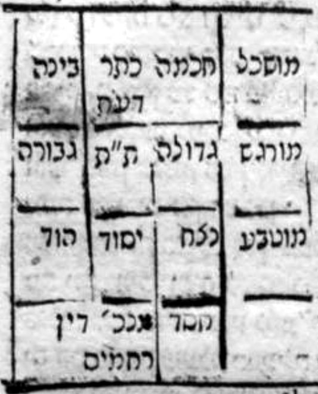

[The diagram as printed: Koretz, 1780, scan p. 125 (Russian State Library, dlib.rsl.ru/01006686897). Sefaria's text has a blank here.]

**8:25:8** Behold, three by three. Keter, Chokhmah, Binah: the intelligible world; Gedulah, Gevurah, Tiferet: the perceptible world; Netzach, Hod, Yesod, Malkhut: the natural world. Behold, their aspect divided by breadth. And by length they are: Chokhmah, Gedulah, Netzach — behold, the world of Chesed; Binah, Gevurah, Hod — behold, the world of Din; Da'at, Tiferet, Yesod — they are the world of Rachamim. And above them is Keter, including all three aspects, just as it includes the first three; and although it includes Din — for it includes Binah, which is the root of Din — this matter does not entail Din in it at all, as we explained in chapter 3. And below all of them is Malkhut, including three aspects, for she is the one who includes all the sefirot, as is known. It turns out according to this that Chokhmah and Binah and Da'at, which is in the place of Keter, are the secret of the actions in potential; and Gedulah and Gevurah and Tiferet, the secret of the actions in actuality; Netzach, Hod, Yesod are the messengers who perform the actions. It turns out according to this that Keter is a soul to Tiferet, in the secret of Da'at; and Chokhmah a soul to Gedulah; and Binah a soul to Gevurah; and Chesed a soul to Netzach; and Gevurah a soul to Hod; and Tiferet a soul to Yesod; and Yesod, which receives from the three of them, a soul to Malkhut, who includes all of them.

> הרי שלשה על שלשה. כתר חכמה בינה עולם מושכל, גדולה גבורה תפארת עולם מורגש, נצח הוד יסוד מלכות עולם מוטבע. הרי בחינתם נחלקת לרוחב. ולאורך הם חכמה גדולה נצח הרי עולם החסד, בינה גבורה הוד הרי עולם הדין, דעת ת"ת יסוד הם עולם הרחמים. ולמעלה מהם כתר כלול כל שלשה בחינות כמו שהוא כולל ג' ראשונות ובהיות כלול מן הדין שהרי הוא כלול מהבינה שהוא שורש הדין ולא יחייב הענין הזה בו הדין כלל כמו שבארנו בפ"ג. ולמטה מכלם מלכות כוללת ג' בחינות שהיא הכוללת כל הספירות כנודע. נמצא לפ"ז כי חכמה ובינה ודעת שהוא במקום הכתר סוד הפעולות בכח, וגדולה וגבורה ת"ת סוד הפעולות בפועל, נצח הוד יסוד הם השלוחים הפועלים הפעולות. נמצא לפ"ז שכתר נשמה לת"ת בסוד דעת, והחכמה נשמה לגדולה, ובינה נשמה לגבורה, וחסד נשמה לנצח, וגבורה נשמה להוד, ות"ת נשמה ליסוד, ויסוד המקבל משלשתן נשמה למלכות הכלולה מכלם:

### Chapter 8:26. Explanation of the essence apprehended in Malkhut, its receiving from all the sefirot, through whom it receives, and its manifestation after the exile (*galut*).

**8:26:1** The principle that emerges from the previous chapter is that Keter and Chokhmah and Binah pour forth into Chesed, Tiferet, Gevurah, and Chesed, Tiferet, Gevurah pour forth into Netzach, Hod, Yesod. However, Yesod receives all of them and pours forth to Malkhut; and apart from Malkhut they have no governance in the world. For all is given into her hand, and they have no permission to pour forth to the lower ones except by her means. And so Rashbi explained in the Tikkunim (Tikkun 4, fol. 19a), and these are his words: "And there is no sefirah among all the sefirot that has permission to empty out blessings and to pour forth to the lower ones except through Bat Sheva, because she is the bond of all the sefirot. For if the sefirot were emptying out apart from her, there would be separation; and therefore there is no permission to empty out blessings and to pour forth to any place apart from her, toward the lower ones. And therefore it is said of her, 'Let not the wise man glory,' etc., 'but in this,' etc. (Jeremiah 9:22–23)." Thus far his words.

> הכלל העולה מהפרק הקודם הוא כי הכתר והחכמה והבינה משפיעים בחסד ת"ת גבורה, וחסד ת"ת גבורה משפיעים בנה"י. אמנם היסוד מקבל כלם ומשפיע למלכות ובזולת המלכות אין להם הנהגה בעולם. כי הכל ניתן בידה ואין להם רשות להשפיע בתחתונים אם לא על ידה. וכן ביאר הרשב"י בתקונים (תקונא ד' דף י"ט.) וז"ל ולית ספירה מכלהו ספירן דיהא לה רשו לארקא ברכאן ולאשפעא לתתאין אלא בבת שבע בגין דאיהי קשורא דכלהו ספירן. דאי ספירן הוו מריקן לבר מינה הוה פרודא ובג"כ לית רשו לארקא ברכאן ולאשפעא לשום אתר בר מינה לגבי תתאין ובג"ד אתמר בה אל יתהלל חכם כו' כ"א בזאת כו' עכ"ל.

**8:26:2** And it is clear for our matter. And the truth is that the pouring forth of the sefirot into Malkhut is by means of Yesod, as we explained in the Gate of Channels, chapter 3; and, God forbid, when Yesod withdraws, the effluence and the good withdraw. And if the questioner asks: how is it possible to suppose that the effluence of Yesod withdrew from Malkhut and the world would endure? This is no difficulty, for this question has already been asked in the Zohar, Parashat Terumah (fol. 166b), and these are its words: "This light the Holy One, blessed be He, sowed in the Garden of His delights, and made it rows and rows, by means of this Righteous One; and he is the gardener of the Garden. And he took this light and sowed it, a seed of truth, and made it rows and rows in the Garden of Eden; and it begot and sprouted and made fruits, and from them the world is sustained. This is what is written: 'Light is sown for the righteous,' etc. (Psalms 97:11). And it is written, 'and as a garden causes its seeds to sprout' (Isaiah 61:11). What are its seeds? These are the seeds of the primordial light, which is sown constantly: now it begets and makes fruits, and now it is sown as at first; before the world eats this fruit, it begets this seed and gives fruit, and does not subside. And therefore all the worlds are sustained by the provision of that gardener who is called Righteous One, who does not subside and never ceases — except at the time when Israel are in exile. And if you say: at the time of the exile it is written, 'The waters fail from the sea, and the river is drained dry' (Job 14:11) — how does it make offspring? Rather, it is written 'sown': it is sown constantly. And from the day that river ceased, the gardener did not enter that Garden; and that light, which is sown constantly, makes fruits, and from them, of itself, it is sown as at first, and does not subside, constantly — like a garden that makes offspring, and from that seed that fell in it, in its place, of itself it makes offspring as at first. And if you say that those offspring and fruits are as they were at the time that the gardener was there — it is not so; but this sowing is never withheld. In this manner, 'and the Torah is light' (Proverbs 6:23): the Torah [that was given from the side of that primordial light] is thus sown constantly in the world, and makes offspring and fruits, and never subsides; and from that fruit of it the world is sustained." Thus far its words.

> ומבואר הוא לענייננו. והאמת כי השפעת הספירות במלכות הוא ע"י היסוד כדפי' בשער הצנורות בפ"ג. וח"ו בהסתלק היסוד תסתלק השפע והטוב. ואם ישאל השואל ואיך אפשר לשער שנסתלק שפע היסוד מהמלכות [יז] ויתקיים העולם. הא ל"ק שכבר נשאלה שאלה זו בזהר פ' תרומה (דף קס"ו ע"ב) וז"ל האי אור זרע ליה קב"ה בגנתא דעדנוי ועבד ליה שורין שורין ע"י דהאי צדיק, ואיהו גננא דגנתא, ונטל להאי אור וזרע ליה זרוע דקשוט ועביד ליה שורין שורין בגנתא דעדן ואוליד ואצמח ועביד פירין ומנייהו אתזן עלמא הה"ד אור זרוע לצדיק וגו'. וכתיב וכגנה זרועיה תצמיח. מאן זרועיה, אלין זרועיה דאור קדמאה דאיהו זרוע תדיר השתא אוליד ועביד איבין והשתא זרוע איהו כדקדמיתא עד לא ייכול עלמא איבא דא אוליד זרועא דא, ויהיב איבא ולא שכיך וע"ד כל עלמין אתזנו בספוקא דההיא גננא דאקרי צדיק דלא שכיך ולא פסיק לעלמין בר בזמנא דישראל בגלות'. ואי תימא בזמנ' דגלות' כתיב אזלו מים מני ים ונהר יחרב ויבש היך עביד תולדין. אלא כתיב זרוע, זרוע איהו תדיר. ומיומא דאפסיק ההוא נהר גננא לא עאל בההוא גנתא. וההוא אור דאיהו זרוע תדיר עביד איבין ומניהו מגרמיה אזדרע כדקדמיתא ולא שכיך תדיר. כגנתא דעביד תולדין ומההוא זרועא נפל ביה באתריה, ומגרמיה עביד תולדין כדבקדמיתא. ואי תימא דאינון תולדין ואיבין הוו כמה דהוה בזמנא דגננא תמן, לאו הכי אבל לא אתמנע זרוע דא לעלמין. כגוונא דא ותורה אור אורייתא [דאתיהיבת מסטרא דההוא אור קדמאה] הכי אזדרע תדיר בעלמא ועביד תולדין ואיבין ולא שכיך לעלמין, ומההוא איבא דיליה אתזן עלמא עכ"ל.

**8:26:3** And the intent of this passage is to prove that Yesod is what pours forth into Malkhut; and he is the man who tills this ground, and there is none who breaches the fence and trespasses his border to sow or to till besides him. And this is the point around which the wheel of this passage turns. For above this matter he said that Tiferet is called "light" from the side of its sucking from Chesed, as we shall explain in the Gate of the Glossary of Titles, under the entry "light"; and he said that this light, which is the effluence that is poured forth, is poured forth by means of the Righteous One, the foundation of the world. And he explained that the one who pours forth is Tiferet, the Holy One, blessed be He, who is the master of the seed; and the tenant farmer who tills the ground is Yesod; and the garden in which the seed is sown is Malkhut. And he called her by the name "garden" on account of the wording of the verse, which says, "Light is sown" (Psalms 97:11), and the expression "sowing" applies to a garden; and on account of the verse that is written, "and as a garden causes its seeds to sprout" (Isaiah 61:11), for from there is his proof, as will be explained.

> וכונת המאמר הזה הוא להכריח שהיסוד הוא המשפיע במלכות והוא האיש העובד האדמה הזאת ואין פורץ גדר ומשיג גבולו לזרוע או לעבוד זולתו. וזהו נקודה אשר עליה תסוב גלגל המאמר הזה. כי למעלה מן הענין אמר שהת"ת הנקרא אור מצד יניקתו מן החסד כאשר נבאר בשער ערכי הכנוים בערך אור, ואמר שזה האור שהוא השפע הנשפע הוא נשפע ע"י הצדיק י"ע. ובאר שהמשפיע הוא הת"ת הקב"ה שהוא בעל הזרע. והאריס העובד את האדמה הוא היסוד. והגן אשר בו נזרע הזרע הוא המלכות. וקראה בשם גן משום לישנא דקרא דקאמר (תהלים צז) אור זרוע ולשון זריעה שייך גבי גינה. ומשום קרא דכתיב (ישעיה ס"א) וכגנה זרועיה תצמיח כי משם ראייתו כאשר יתבאר.

**8:26:4** And further, because there are fifty-three [*gan*] portions in the Torah; and this is the secret of the verse "and the Torah is light" (Proverbs 6:23), for it is about this that [the passage] stands there. And when she receives from Tiferet, which is the Torah, then she is called *gan* [garden], to allude to its fifty-three portions. "And made it rows," etc.: the intent is to resolve the verse, which said "its seeds," in the plural; and so that, from the expression "its seeds," which implies many, we not come to say that many sow in her, and she sprouts and grows all the seeds, each after its kind — for this he spoke first, to save us from the error. And it is true that in the seed of the Righteous One there are many kinds of effluence, each one to the storehouse fit for it: storehouses of life and storehouses of wealth, storehouses of wisdom and storehouses of Torah and storehouses of understanding; and this is "and made it rows," which are the storehouses. "And he took this light," etc.: it was difficult for him: if so, it would follow according to this that the seed that goes out from the Righteous One is not as the Righteous One receives it from above, but is changed in the self of the Righteous One. For otherwise, how would the word "sown for the righteous" be correct? For if the effluence is poured into her as it is poured from above, what benefit is drawn from this to the Righteous One, that the name "sown for the righteous" should be related to him? To this he said, "and he took this light," etc.; and the explanation is: he takes the light and pours it forth, and sows it as light, just as it is poured from above; and it is not in his hand to hold it back or to change it — just as there is no power in the organ of intercourse to change the seed from its nature, which belongs to it by means of the two that empty it out. And this is what it says, "and he sowed it, a seed of truth": meaning, a seed of truth [*emet*], that is, Tiferet; and even after the sowing it is a seed of truth, related to Tiferet. And as to what was difficult for him — what benefit is drawn from this to the Righteous One, or what is his action, that the saying "sown for the righteous" should be correct — to this he answered, "and made it rows and rows": meaning, the light and the effluence come mixed, without being separated each after its kind, and Yesod is the one who divides it to the storehouses, each one according to its nature, decreed from its root — in the way of the tenant farmer, or the man who tills the ground, who "puts the wheat in rows, and the barley in its place, and the spelt at its border" (Isaiah 28:25).

> ועוד מפני שג"ן סדרים יש בתורה. וזהו סוד הפסוק (משלי ו) ותורה אור דעליה קאי התם. ובקבלתה מהת"ת שהוא התורה אז נקראת גן לרמוז אל ג"ן סדריה. ועביד ליה שורין וכו'. הכונה לישב הפסוק שאמר זרועיה לשון רבים. וכדי שמתוך לשון זרועיה דמשמע רבים, לא נבא לומר שרבים זורעים בה והיא צומחת ומגדלת כל הזרעים כל אחד למינהו. לזה הקדים להצילנו מן הטעות. ואמת כי בזרע הצדיק יש כמה מיני שפע כל א' אל האוצר הראוי לו אוצרות חיים ואוצרות עושר אוצרות חכמה ואוצרות תורה ואוצרות בינה וזהו ועביד לי' שורין ששהם האוצרות. ונטיל להאי אור וכו'. הוקשה לו א"כ ימשך לפ"ז שאין הזרע היוצא מן הצדיק הוא כמו שמקבל הצדיק מלמעלה אלא ישתנה בעצמות הצדיק. שאל"כ איך יצדק מלת זרוע לצדיק שאם השפע יושפע בה כמו שנשפע מלמעלה מה תועלת ימשך מזה לצדיק עד שיתייחס אליו שם זרוע לצדיק. לז"א ונטיל להאי אור כו' ופי' הוא לוקח האור ומשפיעו וזרעו אור כמו שהוא נשפע מלמעלה ואין בידו לעכב או לשנות כמו שאין באבר המשגל כח לשנות הזרע מטבעו הקנוי לו ע"י שני המריקים. וז"ש וזרע ליה זרועא דקשוט פי' זרע אמת דהיינו הת"ת, ואפי' אחר הזרע הוא זרע אמת מתייחס אל הת"ת. ואל מה שהוקשה לו מה תועלת נמשך מזה לצדיק או מה פעולתו עד שיצדק אמרו זרוע לצדיק. לזה השיב ועביד ליה שורין שורין פי' כי האור והשפע בא מעורב בלי מתפרד כל אחד למינו והיסוד הוא המחלק אל האוצרות כל אחד לפי טבעו הנגזר משרשו. כדרך האריס או האיש העובד האדמה אשר שם חטה שורה ושעורה נסמן וכוסמת גבולתו.

**8:26:5** And further, besides this, he begets it and makes it sprout; and this is what it says, "and it begot and sprouted," etc. And the reason for this doubling is to allude to two things: the one, for the matter of the effluence that is poured forth for the sustenance of the world and its provision and the other matters of the world; and the second, for the matter of the souls. And this is his intent: "and it begot" souls, "and sprouted" fruits and seeds; for both of them are the sustenance of the world. "This is what is written: 'Light is sown,'" etc.: he settled the matter from two verses. From the first verse, which is "Light is sown for the righteous," he proved that the one who sows this seed is the Righteous One, as it said, "Light is sown for the righteous." And from the second verse he settled and proved that the one who receives the effluence is the chosen garden; and this is "and as a garden," etc., as we explained. "What are its seeds? These are the seeds," etc.: it was difficult for him: if so, it turns out that the garden, after its sowing, will afterward necessarily change the seed from how it was; and in the end the expression "light is sown" would not be precise, for after it is sown it is not light. For this he said, "What are its seeds? These are the seeds of the primordial light": meaning, just as the primordial light was — by which is intended the effluence poured from Chesed into Tiferet, to pour forth to the bride — so, after it is sown in Malkhut, and after its sprouting, the name "light" is still upon it. And this he intended in saying, "the primordial light, which is sown constantly": the intent is that it never changes from how it was in its place. "Now it begets and makes fruits," etc.: it was difficult for him: if so, why did the verse say "its seeds she causes to sprout," a name implying "its seeds," that they are hers, so that it is in her hand to change them? For otherwise it ought to have said "she causes seed to sprout"; what is "its seeds"? For this he answered that what is now renewed in Malkhut is that it makes offspring and fruits, which it did not before. And this is what it says, "now," etc.: meaning, after it is sown, "it begets and makes fruits." "And now it is sown as at first": meaning, even now, at the time that it makes the fruit, it is light, as before its coming to Malkhut, the place of its sowing. And he took the expression "sown" to be precise in the expression "light is sown for the righteous," which proves that even after its sowing it is called light, as we explained, and that it never changes from how it was in its place: light. "Before the world eats this fruit," etc.: it was difficult for him: what necessity is there for the manifestation of this matter, that it be light as before its coming? And why not say that it changes, in the way of all sowings, which change to a manifestation other than their sowing — for they rot and change into the manifestation of sprouting, which is grass, and from it that seed is born? For this he answered that it is not fitting to say so of the manifestation of the effluence poured to Malkhut. For if we said so, it would follow that the effluence is somewhat limited at the time that it sows, and if so, it changes to a manifestation other than the manifestation of its coming, and afterward sprouts; and if so, between this and that the world would be destroyed. Rather, certainly we are compelled to say that as it is in its source, so it is poured to Malkhut; and as it is at the time of its pouring forth, so it is at the time of its growing and making fruits; and there is never any delay, for all this is as an instant. And this is what it says: "before the world eats this fruit, it begets this seed and gives fruit, and does not subside." "And therefore all the worlds are sustained by the provision of that gardener," etc.: the intent is to explain what has already preceded for us, that the Righteous One is called "the river that flows and goes out and never ceases"; for the thing cannot be held back in any way in the world, for the world would be destroyed, as it is after the destruction, as he goes on to explain. "And if you say," etc.: meaning, according to your words, that there is no manifestation for the world except by means of the drawing of the effluence without delay — if so, at the time of the exile, when no effluence is poured forth, as is proven from the verses, how does the world endure, and from where are those fruits from which the world is sustained?

> ועוד בזולת זה שהוא מולידה ומצמיחה, וז"ש ואוליד ואצמח וכו'. וטעם הכפל הזה הוא לרמז אל שני דברים. האחד לענין השפע הנשפע למזון העולם ולפרנסתו ושאר דברי העולם. והשני לענין הנשמות. וזה כונתו ואוליד נשמות, ואצמח פירות וזרעים. כי שניהם הם מזון העולם. הה"ד אור זרוע וכו'. הכריע הענין מב' כתובי מהכתוב הא' שהוא אור זרוע לצדיק הכריח כי הזורע זרע זה הוא הצדיק כמו שאמר אור זרוע לצדיק. ומן הכתוב השני הכריע והכריח כי המקבל השפע הוא הגן הנבחר, וזהו וכגנה וכו' כדפי'. מאן זרועיה אלין זרועי וכו'. הוקשה לו א"כ נמצא שהגן אחר זריעתו יוכרח אח"כ שישתנה הזרע מכמות שהיה וסוף סוף לא ידוקדק לשון אור זרוע כי אחר היותו זרוע אינו אור, לזה אמר מאן זרועיה אלין זרועי אור קדמאה. פי' כמו שהיה אור קדמאה שהנרצה בו השפע הנשפע מחסד בת"ת להשפיע להכלה, כן אחר שנזרע במלכות ואחרי צמיחתו עדיין שם אור עליו. וזה כוון באמרו אור קדמאה דאיהו זרוע תדיר. הכונה שלעולם לא ישתנה מכמות שהיה במקומו. השתא אוליד ועביד איבין וכו'. הוקשה לו א"כ למה אמר הכתוב זרועיה תצמיח שם חיוב זרועיה שהם שלה שבידה לשנותה שאל"כ היה ראוי שיאמר זרע תצמיח מאי זרועיה. לזה השיב כי מה שנתחדש עתה במלכות הוא היותו עושה תולדות ופירות מה שלא היה קודם לכן. וז"ש השתא כו'. פי' אחר שנזרע אוליד ועביד איבין. והשתא זרוע הוא כקדמיתא פי' אפי' עתה בעת עשותו הפרי הוא אור כקודם בואו אל המלכות מקום זריעותו. ונקט לשון זרוע לדקדק לשון אור זרוע לצדיק המוכיח שאפי' אחר זריעתו יקרא אור כדפי', ולעולם לא ישתנה מכמות שהיה במקומו אור. עד לא ייכול עלמא איבא דא וכו'. הוקשה לו כי מה הכרח אל מציאות הענין הזה שיהיה אור כקודם בואו ולא נאמר שישתנה כדרך כל הזריעות שמשתנים אל מציאות זולת זריעתם שמתרקבים ומשתנים אל מציאות הצמיחה שהוא עשב וממנו נולד הזרע ההוא. לזה השיב שאין ראוי לומר כן במציאות השפע הנשפע אל המלכות. מפני שאם נאמר כן נחייב שהשפע נגבל קצת בעת שזורע וא"כ משתנה אל מציאות זולת מציאות בואו ואח"כ צומח, וא"כ בין זה לזה העולם חרב. אלא ודאי חוייבנו לומר כי כמו שהוא במקורו כן נשפע אל המלכות, וכמו שהוא בעת שפעו כן הוא בעת גידולו ועשותו פירות, ולעולם אין עכוב כי כל זה כרגע. וז"ש עד לא ייכול עלמא איבא דא אוליד זרועא דא ויהיב איבא ולא שכיך. וע"ד כל עלמין אתזנו בספוקא דההוא גננא וכו'. הכונה לבאר מה שכבר קדם לנו כי צדיק נקרא נהר דנגיד ונפיק ולא פסיק לעלמין כי אין הדבר יכול להתעכב בשום אופן בעולם, כי היה העולם חרב כמו שהוא אחר החורבן כדמפ' ואזיל. ואי תימא וכו'. פי' לפי דבריך שאין מציאות לעולם אם לא ע"י משך השפע בלי עכוב, א"כ בזמן הגלות שאין שפע נשפע כדמוכח מקראי א"כ איך העולם מתקיים ומהיכן הם אותן הפירות שהעולם נזון מהם.

**8:26:6** And further: since the effluence has withdrawn from Yesod, if so, how does Yesod make offspring and fruits? So his question turns out to be in two respects: first, concerning Malkhut — how is there a manifestation for the world, for it is written, "The waters fail from the sea"? And the second, concerning Yesod — how does it pour forth, for it is written, "and the river is drained dry"? And he answered to this that from the day the Temple was destroyed, effluence has never been poured forth by means of Yesod, that is, the gardener; "and he did not enter the Garden," meaning, he did not unite with Malkhut, because they are not found together, as it is written, "The righteous one is lost" (Isaiah 57:1), as is explained in the Zohar. And to the question, by what is the world provided for — it is by means of the effluence already poured forth, which was sown from the time before the destruction. And the matter is that the way of holiness is to increase and not to diminish, as we shall explain in the Gate of Manifestations, chapter 1. And if so, the effluence itself is never withheld; rather, a manifestation other than it comes to be from it, to sustain and to provide for the world. And this is the parable of the sown garden, [in which afterward, from the seeds that fall,] of themselves, it is sown and grows there out of the seed sown before. "And if you say that those offspring," etc.: it was difficult for him: if so, what advantage is there for a person in all his toil in union, since the effluence grows of itself, and other sustenance comes to be from it, from which the world is sustained? If so, the union with Yesod neither raises up nor brings down, since the garden is sown of itself. To this he answered: and do you think that the seed sown of itself, and the manifestation that comes to be, are equal to the manifestation of the literal watering — so that it would appear that there is no advantage in the gardener's being within the garden, and in the river that waters it? God forbid; the thing is not so. For now manifestation comes to be from manifestation, and manifestation from manifestation, and they are not the light itself; for the light itself always remains there, to bring into being a manifestation other than itself, which is the seed that is sown. But when the Righteous One is within his Garden, and waters it and sows it, since the light is drawn and does not cease, the world is sustained from the self of the light itself, not from its manifestations; and, on the contrary, the manifestations increase and the blessings increase in the world. And this is what it says, "but this sowing is never withheld," etc.: the intent is that it is true that the sowing is never withheld, but not that it is of the value and equal to the time when the Righteous One is within his Garden, as we explained. "In this manner, 'and the Torah is light'": he returns to explain the verse with which he opened, that is, "For the commandment is a lamp, and the Torah is light" (Proverbs 6:23); and the intent is that the Torah is like the sown light, which always makes fruits and never ceases. Thus far the explanation of the passage. And the principle that emerges for us is that the sustenance and the effluence poured to Malkhut are by means of Yesod, and not by means of another sefirah besides it. And even at the time of the exile, when the Righteous One is not in his lodging, nevertheless the world is sustained from what he poured forth before. And among the things one must know: since at the time of the exile the world is sustained from effluence that was poured into Malkhut before, if so, what will intention in prayer and union give, and what will it add? And all the more now, in this bitter exile, of which it is said, "The righteous one is lost," and likewise, "The waters fail from the sea" — if so, what do prayer and supplication and union accomplish, since the righteousness of the Righteous One pours forth neither little nor much, as is proven from the previous passage?

> ועוד אחר שהשפע נסתלק מהיסוד א"כ איך היסוד עושה תולדות ופירות. ונמצא שאלתו בב' פנים. ראשונה על המלכות היאך יש מציאות לעולם דהא כתיב אזלו מים מני ים. והשנית על היסוד היאך הוא משפיע שהרי כתיב ונהר יחרב ויבש. ותירץ לזאת שמיום שנחרב בית המקדש מעולם לא נשפע שפע ע"י היסוד דהיינו גננא, ולא נכנס לגנתא פי' לא נתיחד עם המלכות מפני שאינן נמצאין יחד. כדכתיב (ישעיה נז א) הצדיק אבד כדפי' בזהר. ואל השאלה במה העולם מתפרנס, הוא ע"י השפע הנשפע מכבר שהוא זרוע מזמן קודם החרבן. והענין כי מדרך הקדושה להתרבות ולא להתמעט כמו שנבאר בשער המציאיות פ"א. וא"כ השפע העצמי אינו נמנע לעולם אלא מתהוה ממנו מציאות זולתו לזון ולפרנס העולם. וזה משל אל הגינה הנזרעת [שאח"כ מהזרעונים הנופלים] מעצמם נזרע וגדל שם מתוך הזרע הנזרע מקודם. ואי תימא דאינון תולדין כו'. הוקשה לו שא"כ מה יתרון לאדם בכל עמלו ביחוד אחר שמעצמו גדל השפע ומתהווה ממנו מזון אחר שממנו העולם ניזון אם כן היחוד עם היסוד לא מעלה ולא מוריד אחר שהגנה נזרעת מעצמה. לזה השיב וכי התחשוב שיהיה הזרע הנזרע מעצמו והמציאות המתהוה שוה אל מציאות השקה ממש ולכן יראה שאין יתרון בשהגנן בתוך הגנה ואל הנהר המשקה. ח"ו אין הדבר כן שעתה מציאות מתהוה ממציאות ומציאות ממציאות ואינם עצם האור כי עצם האור לעולם נשאר שם להוות מציאות זולתו שהוא הזרע הנזרע. אבל בהיות הצדיק בתוך גנתו ומשקה אותה וזורעה כיון שאור נמשך ואינו פוסק, העולם ניזון מעצמות האור בעצמו לא ממציאותיו. אלא אדרבה המציאות מתרבים והברכות מתרבות בעולם. וז"ש אבל לא אתמנע זרוע דא וכו'. הכוונה שאמת הוא שמעולם לא נמנע הזריעה אבל לא שיהיה בערך ובשווי עם זמן היות הצדיק בתוך גנתו כדפי'. כג"ד ותורה אור. חוזר לבאר הקרא דפתח ביה דהיינו כי נר מצוה ותורה אור והכוונה שהתורה הוא כמו האור הזרוע שלעולם עביד איבין ולא פסיק לעלמין. ע"כ פי' המאמר. והכלל היוצא לנו שהמזון והשפע הנשפע למלכות. הוא ע"י יסוד ולא ע"י ספירה אחרת זולתו. ואפי' בזמן הגלות שאין צדיק בבית מלונו עכ"ז העולם נזון ממה שהשפיע מקודם לכן. וממה שצריך לדעת כי כיון שבזמן הגלות העולם נזון משפע שנשפע במלכות מקודם א"כ מה יתן ומה יוסיף הכוונה בתפלה והיחוד. ומה גם עתה בגלות המר הזה שעליו נאמר הצדיק אבד וכן אזלו מים מני ים, א"כ מה פועלת התפילה והתחינה והיחוד, אחר שצדקת הצדיק לא ישפיע לא מעט ולא הרבה כדמוכח מתוך המאמר הקודם.

**8:26:7** And this matter they explained in the Zohar, Parashat Shemini (fol. 40), and these are its words: "And whoever knows how to unite the holy name — although blessings are not found in the world — he supports and props up Knesset Yisrael in the exile." And behold, explicitly: although the blessings are not found, nevertheless there is in the matter support and prop.

> וענין זה בארו בזוהר פ' שמיני (דף מ') ז"ל ומאן דידע ליחדא שמא קדישא אע"ג דברכאן לא משתכחי בעלמא איהו סמיך וסעיד לכנסת ישראל בגלותא. והרי בפי' כי עם היות שהברכות אינם נמצאות עכ"ז יש בענין סמך וסעד.

**8:26:8** And the matter of support is that Malkhut, who is "the falling booth of David" in the exile, has no rising until He looks down and sees, and that hour arrives in which the verse that is written will be fulfilled: "On that day I will raise up the booth of David that is falling" (Amos 9:11). And he was precise in the word "falling" [*nofelet*], a participle in the pattern of *po'elet*, *nokemet*. And the intent is that she is forever falling; for that effluence — as long as the time of the destruction continues and there is no renewal in it — is like the parable of the seed of the garden that is sown of itself, which, if they do not renew it, will be spoiled, God forbid. And therefore "there is no day whose curse is not greater than that of its fellow," because the power of the female has weakened, God forbid; and this is "falling." And because of this she needs supporters, so that she not fall altogether.

> וענין סמך הוא כי המלכות שהיא סוכת דוד הנופלת בגלות ואין לה קימה עד ישקיף וירא ויגיע ההיא שעתא דתתקיים קרא דכתיב ביום ההוא אקים את סוכת דוד הנופלת (עמוס ט'). ודקדק מלת נופלת לשון בינוני במשקל פועלת נוקמת. והכוונה שלעולם נופלת מפני שהשפע ההוא כל עוד שזמן החורבן נמשך ואין בו החדוש הוא כמשל זרע הגנה הנזרעת מאליה שאם לא יחדשוהו יתקלקל ח"ו. ולכן אין לך יום שאין בו קללה מרובה מחבירו יען כי תשש כח הנקבה ח"ו וזהו הנופלת. ומפני כך צריכה אל סומכים שלא תפול מכל וכל.

**8:26:9** And the matter of the support is by means of some pouring forth [which will be found from above, "from the juice of pomegranates" (Song of Songs 8:2)], as through the cracks of a needle, to renew support in the world. And all those who make the prop and the support, their reward is doubled and redoubled; and of them it is said, "Rejoice for joy with her, all you who mourn over her" (Isaiah 66:10). And the matter is that they be united — even if the union of their aspect is not as it was before the exile — until the Temple is built and the verse that is written is fulfilled: "And YHVH shall be King over all the earth; on that day YHVH shall be One and His name One" (Zechariah 14:9).

> וענין הסמך הוא ע"י ההשפעה קצת [אשר תהיה מתמצא מלמעלה מעסיס רמונים] כמבין סדקי המחט לחדש סמך בעלמא. וכל העושים הסעד והסמך שכרם כפול ומכופל ועליהם נאמר (ישעי' ס"ו) שישו אתה משוש כל המתאבלים עליה. והענין הוא שיתייחדו, ואם לא יהיה יחוד בחינתם כאשר מקודם הגלות. עד שיבנה בית המקדש ויקוים מקרא שכתוב (זכרי' י"ד) והיה ה' למלך על כל הארץ ביום ההוא יהיה ה' אחד ושמו אחד.

**8:26:10** And with this this Gate is concluded; and praise to God, the true Helper. And we journey on to the Gate of Arbiters.

> ובזה נכלל השער הזה ותהלה לאל העוזר האמת. ונסע אל שער המכריעים:

---

## Gate 9: Arbiters

We named it **"Arbiters"** because its inquiry concerns who tips the balance between Netzach and Hod, between Gedulah and Gevurah, and between Chokhmah and Binah — what arbitration is and what it serves. Its chapters number six.

### Chapter 9:1. Explanation of the need for arbitration; and there it is explained that it belongs to the attribute of Chesed to bestow upon the wicked and the good; and a passage from the Zohar, Parashat Terumah, is explained: "and in His goodness" — not "from His goodness."

**9:1:1** **The Ninth Gate: The Gate of Arbiters.**

> **שער התשיעי הוא שער המכריעין:**

**9:1:2** The intent in this Gate is to explain the number of the arbiters between Chesed and Din: how many they are, and how the manifestation of the arbitration is.

> הכוונה בזה השער לבאר מנין המכריעין בין החסד והדין וכמה הם וכיצד מציאות ההכרעה:

**9:1:3** **Chapter One:**

> **פרק ראשון:**

**9:1:4** The intent in this chapter is to make known the matter of arbitration. And the matter is this: when the Holy One, blessed be He, emanated His holy Emanation, He emanated two opposite attributes, which are Chesed and Gevurah, from which reward and punishment are drawn. And since it sometimes happens that the world needs punishment, but not so much, and likewise it sometimes needs reward, but not so much, therefore the Emanator emanated the middle line between the two extremes; and it is what is called the arbiter line. How so? Chesed is an attribute that inclines to reward and to the good, and to pour forth upon the wicked and the good, as its name, which is *chesed* [kindness]. And so it is explained in the Zohar, that Chesed is to pour forth upon the wicked and the good. And these are its words in Parashat Terumah (fol. 168b): "'And in His goodness,' and not 'from His goodness.' 'And in His goodness' — this is the supernal right. And 'from His goodness' — this is another grade, which comes from the side of the right, and it is a grade below it. Because by that good the world was built, and by it it is fed. Why is it called 'good,' and why is it called 'Chesed'? It is 'good' when all is included within it and it has not spread out to descend below; it is 'Chesed' when it descends below and does good to all creatures, to the righteous and to the wicked, and does not care — even though it is one grade. And from where do we know? For it is written, 'Surely goodness and kindness shall follow me' (Psalms 23:6). If goodness, why kindness? And if kindness, why goodness? For one would suffice. Rather, 'good' includes all within it and has not spread out below; 'Chesed' descends and spreads out below and feeds all, the righteous and the wicked alike. And here, since he said 'and in His goodness we live,' he went on to say, 'who feeds the whole world in His goodness, in kindness.'" Thus far its words.

> הכוונה בפרק זה הוא להודיע ענין ההכרעה. והענין כי בהאציל הקב"ה אצילותו הק' האציל שני מדות הפכיים שהם החסד והגבורה שהשכר והעונש נמשך מהם. ויען כי פעמים יקרה היות העולם צריך אל העונש אבל לא כ"כ וכן יצטרך לפעמים אל השכר אבל לא כ"כ לכן האציל המאציל קו האמצע בין שתי הקצוות והוא הנקרא קו המכריע. כיצד החסד הוא מדה הנוטה אל השכר ואל הטוב ולהשפיע לרעים ולטובים כשמו שהוא חסד. וכן פי' בזוהר שהחסד הוא להשפיע לרעים ולטובים. וז"ל בפ' תרומה (דף קס"ח ע"ב) ובטובו ולא מטובו, ובטובו, דא ימינא עלאה. ומטובו דא דרגא אחרא דאתי מסטרא דימינא ואיהו דרגא לתתא מניה. בגין דבההוא טוב אתבניא עלמא וביה אתזן. אמאי אקרי טוב ואמאי אקרי חסד. טוב איהו כד כלול כלא בגויה ולא אתפשט לנחתא לתתא, חסד כד נחתא לתתא ועביד טיבו בכל בריין בצדיקיא וברשיעיא ולא חייש, ואע"ג דדרגא חד הוא. ומנ"ל דכתיב אך טוב וחסד ירדפוני. אי טוב למה חסד ואי חסד למה טוב דהא בחד סגיא. אלא טוב כליל כלא בגוויה ולא אתפשט לתתא. חסד נחית ואתפשט לתתא וזן כלא צדיקי ורשיעי כחדא. והכא כיון דאמר בטובו חיינו הדר ואמר הזן את העולם כולו בטובו בחסד עכ"ל.

**9:1:5** And there are things to be precise about in it. First: his saying, "And 'from His goodness' — this is another grade, which comes from the side of the right, and it is a grade below." Once he has said that it is "another grade, which comes," etc., why did he go on to say "a grade below"? For it is understood of itself: since it is drawn from the right, it is certainly below the right. Second: his saying, "because by that good [the world] was built," etc., which is the reverse of what he explains at the end of his words; and the beginning contradicts the end. At the beginning he said that by the good the world is fed, and at the end he said that "good" is before the drawing-forth, when it does not feed at all; and he contradicts himself. Third: further, his saying, "even though it is one grade" — what is "even though"? Do not all the sefirot have aspects, each aspect with a title of its own, as is explained in the Gate of the Glossary of Titles? If so, what is "even though"? Fourth: his saying, "and from where do we know," etc. — why that? Let us say that they are two attributes, and that is why he asks of the attribute of good and of the attribute of Chesed; and there is no proof from the verse for what he intends. Fifth: according to the explanation that "good" is "when all is included," etc., which is a holding back of the effluence, so that it is not drawn forth — if so, why should David ask for "goodness," which is before it has spread out, since he has Chesed? Let him say "kindness" and be silent about "goodness." Sixth: as to the Grace after Meals, according to what he explained concerning "who feeds the whole world," etc. — if so, why should we say "goodness," so that we must afterward say "kindness"? Let us say "kindness" from the outset and be silent about "goodness"; better that we say the cure and not come to the wound at all. And to settle this passage we say that the sage who is the author of this passage found it difficult, in the Grace after Meals, that we say "in His goodness," so that we are compelled afterward to say "in grace, in kindness" to set it right; and it would have been better to say "in kindness" from the outset. And to answer this matter he first asked another question: the reason for what is said in Tractate Berakhot (fol. 50): "One who says 'from His goodness we live' is ignorant; 'and in His goodness we live' is wise." And he explained and said, "'And in His goodness' is the supernal right," meaning Chesed; and "from His goodness" is Yesod, which is drawn from Chesed, meaning Yesod, which receives from Chesed. And this is "from His goodness," whose explanation is "part of His goodness": the intent is the thing that is drawn from the good. And "in His goodness" means His goodness literally, that is, His Chesed. And this is what he says: "'from His goodness' — this is another grade, which comes from the side of the right," that is, from the side of Yesod, which is drawn from Chesed. And so that we not say that the explanation of "from His goodness" is "from the effluence of His goodness," that is, the effluence of the good, which is Chesed — for this he said, "and it is a grade below": meaning, it is literally another grade and another attribute, drawn from Chesed and sucking from it, not the effluence of Chesed itself. "Because by that good," etc.: it was difficult for him: since he has explained that "from His goodness" is another grade below, which is Yesod or another, then, since it is an attribute drawn from Chesed, why is one who says "from His goodness" ignorant? For "from His goodness" is an attribute that receives effluence from the supernal good. To this he gave a reason and said, "because by that good" — meaning, by the good of the upper world, which is Chesed, was the building of the world, as is known; and therefore the sustenance of the world and its effluence come from the place of its building. And therefore one who says "from His goodness" is ignorant; rather, the correct thing is "in His goodness," which is Chesed, for it built the world, and it sustains it and provides for it. "Why is it called 'good,' and why is it called 'Chesed'?": since both are in one aspect, according to what I explained, that by means of the good was the building of the world, that is, literally Chesed, as it is written, "The world is built by kindness" (Psalms 89:3) — if so, it turns out that they are equal aspects; and if so, why did their names change, since they are equal aspects according to your view? And to this he said, "It is 'good' when all is included within it and it has not spread out to descend below." The intent is that Chesed includes the whole Structure. And so the Zohar explained (in Parashat Balak, fol. 191), on the verse "And YHVH went before them by day [*yomam*]" (Exodus 13:21), that Chesed is called *yomam*, meaning a day that includes all the days; and we explained it in the Gate of the Glossary of Titles, under the entry *yomam*. And the intent is that Chesed includes all the extremities, in the secret of "For I said, the world [*olam*]" — which is the whole circumference [that is called *olam*] — "is built by kindness": meaning, by Chesed it was built, and became thick, and was revealed. And therefore, while it is in Chesed before its revealing, [as] an aspect being revealed, that aspect is called "good" [*tov*], which is from the expression "when he dresses [*be-heitivo*] the lamps" (Exodus 30:7); the intent is a light by which all of them shone with a great light, and before they were [dressed] they did not shine. And this is their building: their revealing and their *tikkun* into a manifestation that is revealed. And this is what he said: "when all is included within it and it has not spread out to descend below; it is 'Chesed,'" etc. That is, after the things there became thick and shone so as to be revealed, and spread out, then Chesed pours forth its effluence, and its nature is [to pour] upon the wicked and the good; and this is what is called Chesed, "and does not care." "Even though it is one grade": meaning, although all is one aspect — for the very one that was good is what became Chesed, since from the place where they were built their sustenance is drawn — nevertheless, with respect to these two matters, it is called by these two names. And so is the matter with the effluence: for in the good it shines and is revealed, and afterward it is called Chesed, because from there it is poured forth upon the wicked and the good, as we explained above. And now by this it is settled why we need to say in the Grace after Meals "goodness" and afterward "kindness," and likewise with David. For from the work of Creation we learn that the revealing must first be "good," and afterward be "Chesed"; if so, when we ask for sustenance, we need the good first, so that it become thick and be revealed, and afterward that it be drawn forth, that is, Chesed, which is [given] according to law and not according to law. And he proved the matter from David, peace be upon him, who said, "Surely goodness and kindness shall follow me," etc. And he asked: if David's need was for Chesed, that is, to pour forth according to law and not according to law, why did he ask of the attribute of good? Now, if he had Chesed, did he need goodness? And if he did not want the attribute of Chesed, so that it not be poured forth upon the enemies, but [wanted] the attribute of good — as it occurred to us that "good" is an intermediate attribute that pours forth upon the good — then why did he say "kindness," since Chesed is even for the wicked? Rather, what must you say? That "good" is the place in which the effluence shines, or [in which] the beings [become] a revealed being; and Chesed is their pouring forth after their revealing. And therefore he was compelled to say "goodness and kindness": goodness in order to bring the effluence into being, and kindness in order to pour it forth. If so, we too say so in the Grace after Meals: we need to mention these two matters, first "in His goodness," that is, the place where the effluence comes into being and is made good, and afterward "in kindness," that is, its drawing forth upon the wicked and the good. And so we learn from this passage that the attribute of Chesed is to pour forth upon the wicked and the good, as is proven from the plain sense of the words. And one cannot say that the aspect of good is what pours forth upon the righteous alone, and Chesed upon the wicked and the good, for several reasons. First, he said, "it is 'good' when all is included within it and it has not spread out to descend below"; and if it were true that the attribute of good pours forth upon the good, why did he say that it is called "good" when all is included, etc., "and it has not spread out"? Behold, it spreads out to pour forth upon the good! Further, his saying, "when it descends below and does good," etc., shows that when it does kindness with all, then it spreads out, and the spreading out was needed for the good as it was needed for the wicked. Rather, it must be as we have said: when it is called "good" it does not pour forth at all, for it is a holding back of the effluence, to receive a revealed being; and it is Chesed when it pours forth, for then its nature is to pour it forth upon the wicked and the good. It turns out that the attribute of Chesed, as its name, pours forth its effluence upon the wicked and the good.

> ויש לדקדק בו. א' אמרו ומטובו דא דרגא אחרא דאתי מסטרא דימינא ואיהו דרגא לתתא, אחר שאמר שהוא דרגא אחרא דאתי וכו' למה האריך באמרו דרגא לתתא כי מובן מעצמו הוא כי אחר שהוא נמשך מהימין ודאי שהוא למטה מן הימין. ב' אמרו בגין דבההוא טוב אתבניא וכו', שהוא הפך מה שמפרש בסוף דבריו. וקשיא רישא לסיפא. ברישא אמר שבטוב אתזן עלמא, ובסיפא אמר כי טוב הוא קודם ההמשך שאינו זן כלל. וקשה דידיה אדידיה. ג' עוד אמרו ואע"ג דדרגא חד הוא, מאי ואע"ג, וכי כל הספירות לא יש בהם בחינות וכל בחינה לה כנוי בפני עצמה כמבואר בשער ערכי הכנויים וא"כ מאי ואע"ג. ד' אמרו ומנ"ל כו', מאי אריא, נימא דתרי מדות ניהו והיינו דקא שאיל ממדת טוב וממדת חסד ואין מן הכתוב ראייה אל המכוון אליו. ה' לפי פי' שטוב היינו כד כלול כלא וכו', שהוא עכוב השפע ואינו נמשך, א"כ מה לו לדוד לשאול בטוב שהוא עד לא אתפשט מאחר שיש לו חסד א"כ לימא חסד ולשתוק מטוב. ו' לענין ברכת המזון לפי מה שפי' בענין הזן את העולם כו', א"כ למה לנו לומר טוב כדי שנצטרך אח"כ לומר חסד נימא מעיקרא חסד ולשתוק מטוב, יותר טוב שנאמר הרפואה ולא נבא אל המכה כל עיקר. ולישב המאמר הזה נאמר שהחכם בעל המאמר הזה הוקשה לו בברכת המזון מה שאנו אומרים בטובו עד שאנו מוכרחים לומר אח"כ בחן בחסד לתקן, ויותר טוב היה שמעיקרא נאמר בחסד. ולהשיב על הענין הזה שאל שאלה אחרת בתחלה טעם על מ"ש במס' ברכות (ד"נ) אמר מטובו חיינו הרי זה בור, ובטובו חיינו הרי זה חכם. ופירש ואמר ובטובו ימינא עלאה פי' החסד. ומטובו הוא היסוד הנמשך מהחסד, פי' יסוד המקבל מן החסד. והיינו מטובו שפי' מקצת טובו, הכוונה הדבר הנמשך מהטוב. ובטובו פי' טובו ממש דהיינו חסדו. והיינו דקאמר מטובו דא דרגא אחרא דאתי מסטרא דימינא דהיינו מצד היסוד הנמשך מהחסד. ומפני שלא נאמר שפי' מטובו היינו משפע טובו דהיינו שפע הטוב שהוא החסד, לז"א ואיהו דרגא לתתא פי' היא מדרגה ומדה אחרת ממש נמשך מהחסד ויונק ממנו לא שפע החסד עצמו. בגין דבההוא טוב וכו'. הוקשה לו שכיון שפי' מטובו היינו מדרגה אחרת למטה שהוא היסוד או זולתו א"כ אחר שהוא מדה נמשכת מן החסד א"כ למה האומר מטובו הוא בור שהרי מטובו היא מדה מושפעת מהטוב העליון. לזה נתן טעם ואמר בגין דבההוא טוב פי' בטוב העולם העליון שהוא החסד בו היה בנין העולם כנודע ולכן מזון העולם ושפעו ממקום בניינו ולכן האומר מטובו הוא בור אלא הנכון בטובו שהוא החסד שהוא בנה העולם והוא המקיימו ומפרנסו. אמאי אקרי טוב ואמאי אקרי חסד. מאחר ששניהם בבחינה אחד לפי מה שפירשתי שע"י הטוב היה בנין העולם דהיינו ממש החסד דכתיב (תהלים פט ג) עולם חסד יבנה א"כ נמצא שהם בחינות שוות וא"כ למה נשתנו שמותיהם אחר היותם בחינות שוות לפי דעתך. ולזה אמר טוב איהו כד כליל כלא לגויה ולא אתפשט לנחתא לתתא. הכוונה כי החסד הוא כולל כל הבנין. וכן פי' הזוהר (בפ' בלק דף קצ"א) בפסוק ויי' הולך לפניהם יומם שהחסד נקרא יומם, פי' יום כלול מכל הימים, ובארנוה בשער ערכי הכנויים בערך יומם. והכוונה שהחסד כולל כל הקצוות בסוד כי אמרתי עולם שהוא כל ההיקף [הנקרא עולם] חסד יבנה. פי' בחסד נבנה ונתעבה ונתגלה. ולכן בהיותו בחסד קודם גלויו בחינה מתגלית אותה בחינה נקרא טוב שהוא מן לשון (שמות ל ז) בהיטיבו את הנרות הכונה מאור שבה האירו כלם אור גדול וקודם היותם לא היו מאירים. וזהו בניינם גלוים ותיקונם אל מציאות מתגלה. וזה שאמר כד כלול כלא לגויה ולא אתפשט לנחתא לתתא, חסד איהו וכו'. היינו אחר שנתעבו הדברים שם והאירו להתגלות ונתפשטו ואז משפיע החסד משפעו ומטבעו לרעים ולטובים וזהו הנקרא חסד ולא חייש. ואע"ג דדרגא חד הוא. פי' עם היות שהכל בחינה אחת כי אותה שהיה טוב היא עצמה שנעשה חסד כי במקום שנבנו משם נמשך קיומם, עכ"ז בערך שני העניינים האלה נקראים ב' שמות אלה. וכן הענין אל השפע כי בטוב הוא מאיר ומתגלה, ונקרא אח"כ חסד כי משם נשפע לרעים ולטובים כדפירשנו לעיל. ועתה בזה נתיישב למה אנו צריכים לומר בברכת המזון טוב ואח"כ חסד, וכן בדוד. כי ממעשה בראשית נלמד שצריך אל הגלוי להיות טוב תחלה ואח"כ להיותו חסד, א"כ כשנשאל המזון צריך קודם אל הטוב כדי שיתעבה ויתגלה ואח"כ שימשך דהיינו חסד שהיא כדין ושלא כדין. והכריח הענין מדהמע"ה שאמר אך טוב וחסד ירדפוני וכו'. ושאל אם דוד היה צרכו אל החסד דהיינו להשפיע כדין ושלא כדין, א"כ למה שאל ממדת הטוב, השתא ומה בחסד אית ליה טוב אצטריכא ליה. ואם לא היה רוצה ממדת החסד כדי שלא יושפע על האויבים, אלא במדת טוב כסלקא אדעתין דטוב היינו מדה בינונית משפיע לטובים, א"כ למה אמר חסד. דחסד אפי' לרעים איהו. אלא מאי אית לך למימר דטוב היינו מקום שבו מתנהר השפע או ההויות הויה מתגלית, וחסד הוא השפעתם אחר גלוים. ולכן הוכרח לומר טוב וחסד, טוב כדי להוות השפע וחסד כדי להשפיעו. א"כ אף אנו נאמר כן בברכת המזון שאנו צריכין להזכיר ב' עניינים האלה, ראשונה בטובו דהיינו מקום הויות השפע והטבתו, ואח"כ בחסד דהיינו המשכתו לרעים ולטובים. ונמצינו למדים מתוך המאמר הזה כי מדת החסד היא להשפיע לרעים ולטובים כדמוכח מתוך פשטן של דברים. ואין לומר כי בחינת הטוב הוא המשפיע לצדיקים לבד, וחסד לרעים ולטובים. מכמה טעמים. ראשונה שאמר טוב כד כליל כלא בגויה ולא אתפשט לנחתא לתתא ואם אמת הוא שמדת טוב הוא משפיע לטובים למה אמר שהוא נקרא טוב כד כליל וכו' ולא אתפשט הא אתפשט להשפיע לטובים. עוד אמרו כד נחתא לתתא ועביד טיבו וכו'. נראה שכאשר הוא עושה חסד עם הכל אז מתפשט וההתפשטות הוצרך לטובים כמו שהוצרך לרעים. א"ו כדקאמרן שכאשר נקרא טוב אינו משפיע כלל שהוא עכוב השפע לקבל הויה מתגלית, וחסד הוא בהיותה משפעת שאז מטבעה להשפיעה לרעים ולטובים. נמצא שמדת החסד כשמה כן היא משפעת שפעה לרעים ולטובים:

### Chapter 9:2. On arbitration and its function; and there, the matter of "those who dispute for the sake of Heaven" and the dispute of Korach.

**9:2:1** Just as in the attribute of Chesed there is the virtue of the opening of the hand — not distinguishing between righteous and wicked, between one who serves God and one who does not serve Him, as regards the effluence and sustenance — so in the attribute of Gevurah there is the virtue of the closing of the hand: pouring forth only by the attribute of hard judgment, upon one who stood the test and was tested by it. As in the matter of Isaac, who stretched out his neck upon the altar for the service of his Master when he was in the full strength of his might, thirty-seven years old; and then it is in its hand to reward. And it is exacting with the righteous to a hair's breadth, as our sages, of blessed memory, said (Bava Kamma, fol. 50) on the verse "and round about Him it storms [*nis'arah*] mightily" (Psalms 50:3). And when a man sins, the outburst goes out from before it and destroys him in an instant. And since neither of these two extremes is the intent of the creation of the world, and the master of an extreme is not complete, as we shall explain, it was necessary that there be an arbiter between the two extremes; and that is the line of Rachamim. For from the side of Chesed they incline to the right, to the scale-pan of merit, and from the side of Gevurah they turn to the left, to the scale-pan of liability; and the line of Rachamim tips the balance between them. And since a third view does not arbitrate — rather, the inclination of the arbiter must be near to one of the two extremes — and since the line of Rachamim, being in the middle, includes both, it would tend to the mean, and this arbitration would be no arbitration; therefore it must be drawn from Keter Elyon, so that by the power of the compassion of the supernal whiteness it inclines to the side of Chesed. And this is what is called "inclining toward Chesed." And since Chesed "sits first in the kingdom" (see Esther 1:14), it was necessary to open with merit first. And this is the reason that our sages, of blessed memory, said, "one opens with merit first"; and if the Sanhedrin opened with guilt first, they would not judge him at all. And so our sages, of blessed memory, expounded (Sanhedrin, fol. 2): "'the congregation shall judge … and the congregation shall deliver' (Numbers 35:24–25) — we need a congregation that judges and a congregation that delivers"; for we need an allusion to the two powers of Din and Chesed. And since water and fire do not mix together except by means of an intermediary, because of their great distance, air was needed, which is the middle arbiter line, which includes the two extremes; and therefore it is called *shamayim* [heaven], whose intent is *esh* [fire] and *mayim* [water]. And one may ask: it would have been fitting to say "water-fire," for water is first, as we explained; if so, it ought to have been *mayimesh*. And one may say: since the intent of the arbitration is to incline toward Chesed, as we explained, for this reason he said first *sh*-*mayim*: the fire set toward the water. And this is the intent of the *mishnah* (Avot, chapter 5): "Every dispute that is for the sake of Heaven [*shamayim*] will in the end endure" — that is, Chesed and Gevurah, which are in dispute and delight in the middle arbitration, which is *shamayim*, as we explained. And therefore in the end it is united and endures, for it is within holiness and the pure Emanation. But a dispute that is not for the sake of Heaven, where they do not delight in arbitration but only dispute out of contentiousness, cleaves to the fire of Gehinnom, which is the husk that does not accept arbitration; and they are the side of the left, who always turn to the left, to the pan of liability, and do not want the arbitration of Chesed. And therefore separation is said of it, as in "And God separated between the light" — which is holiness — "and the darkness" (Genesis 1:4) — which is the darkness of Gehinnom, as in "and the wicked shall be silent in darkness" (1 Samuel 2:9). And it is separated from holiness because it distanced itself from the Din that accepts arbitration. So it was in the matter of Korach and his congregation, whose root was Levites, from the side of Gevurah; and Aaron the priest was the man of Chesed; and Moses our teacher, peace be upon him, was the arbiter line, which is his attribute. And Korach's congregation did not want arbitration; therefore separation is said of them, as in "Separate yourselves from among this evil congregation" (Numbers 16:21). And therefore Moses our teacher, peace be upon him, said, "But if YHVH creates a new thing," etc. (Numbers 16:30): since they had become equal to the evil husk, which is "evil congregation" — there is no congregation of fewer than ten, and it was evil — therefore he brought them into Gehinnom, kind to kind. But a dispute that is for the sake of Heaven is like the dispute of Hillel and Shammai. For Hillel was the Nasi, a man of Chesed, and Shammai the Av Beit Din, a master of Gevurah; and they are recognized by their attributes, for Hillel never grew irritated in his days, so as not to blemish his attribute, and Shammai was given to agitation, for his attribute caused it. And the root of their dispute was for the sake of Heaven, to accept arbitration; and therefore their dispute endured. And in this way will be understood what our sages, of blessed memory, said (Eruvin, fol. 13): "Why did Beit Hillel merit to have the *halakhah* fixed according to them? Because of their humility." And the intent is that they cleaved to the side of Chesed, in humility and lowliness and in being easygoing; and therefore the *halakhah*, which is the Shekhinah, is according to them, for her inclination is to the side of Chesed, as in what our sages, of blessed memory, said (Megillah, fol. 13): "Esther was greenish, but a thread of Chesed was drawn over her." And in this way will be understood what our sages, of blessed memory, said (there in Eruvin): "These and these are the words of the living God," etc. Meaning, "the living God" [*Elohim Chayyim*] is Binah, from which the whole Structure is poured forth. And he said that both those who declare impure, unfit and liable — who incline to the side of Gevurah, to stringency, to show that the husks have permission there, and therefore "liable, unfit, impure" — and those who declare pure, fit and innocent — who incline to the side of Chesed, to leniency, to show that the husks have no permission and dominion there, and therefore "innocent, fit and pure" — all is from Binah, from which is the pouring forth of the two extremes. And when the hand and the effluence that increases from one of the two lines prevails, then the *halakhah* is according to it, to forbid and to permit, etc. And therefore, both the one who declares pure and the one who declares impure, each one's words are correct. And therefore sometimes, too, the *halakhah* will be according to Beit Shammai, though with difficulty, for the greater inclination is to the side of Chesed. And to alert us to this matter our sages, of blessed memory, said, "Beit Hillel are lenient, Beit Shammai stringent" — this one to Chesed and that one to Gevurah, according to their attributes — except in a certain number of cases, as is known. And the reason for the reversal sometimes is in the way of "Here I am, my son" (Genesis 22:7): that sometimes Chesed is toward the side of Gevurah and Gevurah toward the side of Chesed, for fire is included in water and water included in fire, as we explained in the Gate of Essence and Governance, chapter 16; and this is the reason for the Binding of Isaac, as is explained in the Zohar, in the portion of the Binding. And with this will be understood the reason for their reversal in some of the Trees [*ilanot*], Abraham to the left and Isaac to the right, especially in the parchment [*Yeri'ah*, a particular chart of the Tree].

> כמו שבמדת החסד מעלת הויתור שלא להבחין בין צדיק לרשע בין עובד אלקים ללא עבדו, לענין השפע והמזון. כן למדת הגבורה מעלת הקפיצה שלא להשפיע אלא במדת הדין הקשה למי שעמד בנסיון ונתנסה על ידה. כענין יצחק שפשט צוארו על גבי המזבח לעבודת קונו בהיותו בתוקף גבורתו בן ל"ז שנה ואז יש בידה להשכיר. ומדקדק עם הצדיקים כחוט השערה כענין שארז"ל (בב"ק דף נ') ע"פ וסביביו נשערה מאד. וכאשר יחטא איש יצא הקצף מלפניה ויאבדנו כרגע. ולהיות כי אין א' משני קצוות האלה כוונת בריאת העולם ולא בעל הקצוות שלם כאשר נבאר. הוכרח להיות בין ב' הקצוות מכריע והוא קו הרחמים, כי מצד החסד מיימינים לכף זכות, ומצד הגבורה משמאילים לכף חובה, וקו הרחמים מכריע ביניהם. ולהיות שאין דעת שלישי מכריע אלא שצריך להיות נטיית המכריע קרוב אל אחד משני הקצוות, ובהיות קו הרחמים באמצע כלול משניהם יהיה אל האמצעות ואין ההכרעה זו הכרעה. לכן מוכרח אל המשכתו מכ"ע שבכח רחמי הלובן העליון יטה אל צד החסד וזה שנקרא מטה כלפי חסד. ומצד היות החסד היושבת ראשונה במלכות הוכרח להיות פותח בזכות תחלה. וזהו הטעם שאחז"ל פותחין בזכות תחלה ואם הסנהדרין פתחו לחובה תחלה לא היו דנין אותו כל עיקר. וכן דרשו רז"ל (סנהדרין א') ושפטו העדה והצילו העדה בעינן עדה שופטת ועדה מצלת, דבעינן רמז אל שני כוחות הדין והחסד. ולפי שאין המים והאש מתערבים יחד אם לא ע"י אמצעי לרוב רחקם, הוצרך אל האויר שהוא קו האמצעי המכריע שהוא כלול מב' הקצוות, ולכן נק' שמים שהכונה אש ומים. ויש לשאול כי היה ראוי שיאמר מים אש כי המים הם תחלה כדפי' א"כ היה ראוי שיאמר מימש. וי"ל כי כיון שכוונת ההכרעה להיות מטה כלפי חסד כדפי', לזה אמר תחלה שמים אש המושבים אל המים. וזה כונת המשנה (אבות פ"ה) כל מחלוקת שהוא לשם שמים סופה להתקיים דהיינו חסד וגבורה שהם במחלוקת, וחפצים בהכרעה האמצעית דהיינו שמים כדפי'. ולכן סופה להתייחד ולהתקיים שהיא בתוך הקדושה והאצילות הטהור. אבל המחלוקת שאינה לש"ש שאינם חפצים בהכרעה רק מחלוקת לקנטוריא, הוא מתדבק באשו של גיהנם שהיא הקליפה שאין מקבלת הכרעה והם הם סטרא דשמאלא שלעולם משמאילים לכף חובה ואינם רוצים בהכרעת החסד. ולפיכך נאמר בו הבדלה כענין (בראשית א) ויבדל אלקים בין האור שהוא הקדושה ובין החשך שהוא חשך שבגיהנם כענין (ש"א ב ט) ורשעים בחשך ידמו. ונבדלת מן הקדושה מפני שנתרחקה מן הדין המקבלת הכרעה כמו שהיה בענין קרח ועדתו שהיה עקרם לוים מצד הגבורה ואהרן הכהן איש החסד ומשרע"ה היה קו המכריע שהיא מדתו. ולא רצו עדת קרח בהכרעה לפיכך נאמר בהם הבדלה כענין (במדבר טז) הבדלו מתוך העדה הרעה. ולכן אמר משה רבינו ע"ה (שם) ואם בריאה יברא ה' וכו' כיון ששוו אל הקליפה הרעה שהיא עדה הרעה אין עדה פחותה מי' והיתה רעה לפיכך הכניסם בגיהנם מין במינו. אבל במחלוקת שהיא לש"ש כמחלוקת הלל ושמאי שהלל היה נשיא איש החסד ושמאי אב"ד בעל הגבורה וממדותיהם ניכרים שהלל לא כעס מימיו שלא לפגום מדתו ושמאי היה רגזן שמדתו גרמה לו. ועקר מחלקותם היה לשם שמים לקבל הכרעה, ולפיכך נתקיימה מחלקותם. ועד"ז יובן מה שאחז"ל (עירובין דף י"ג) מפני מה זכו בית הלל לקבוע הלכה כמותם מפני ענוותנותם. והכונה שהיו מתדבקים לצד החסד בענוה ובשפלות ובהיותם נוחים ולכן הלכ"ה שהיא השכינה כמותם שנטייתה לצד החסד כענין אמרם ז"ל (מגילה דף י"ג) אסתר ירקרקת היתה אלא שחוט של חסד משוך עליה. ועד"ז יובן אמרם ז"ל (שם בעירובין) אלו ואלו דברי אלקים חיים וכו' פי' אלקים חיים הוא הבינה שמשם נשפע כל הבנין. ואמר שבין המטמאין והפוסלין והמחייבין שהם נוטין לצד הגבורה אל החומרא להראות שיש שם רשות לקליפות ולכן חייב פסול טמא, בין המטהרין המכשירין והמזכין שהם נוטין לצד החסד אל הקולא להראות שאין שם רשות ושליטה לקליפות ולכן זכאי כשר וטהור, הכל הוא מהבינה שמשם השפעת ב' הקצוות וכאשר יגבר יד ושפע המתרבה מאחד משני הקוים אז הלכה כמותו לאסור ולהתיר וכו'. ולכן בין המטהר ובין המטמא כל א' דבריו צודקים. ולכן לפעמים ג"כ יהיה הלכה כבית שמאי בדוחק שרוב הנטייה הוא לצד החסד. ולהעירנו על הענין הזה אז"ל ב"ה לקולא ב"ש לחומרא זה לחסד וזה לגבורה כמדתם חוץ מדבר מספר כנודע. וטעם החלוף לפעמים הוא ע"ד (בראשית כב ז) הנני בני שלפעמים החסד לצד הגבורה והגבורה לצד החסד שהאש כלול במים והמים כלולים באש כדפי' בשער מהות והנהג' פי"ו, וזה טעם עקידות יצחק כמבואר בזוהר פרשת העקדה. ועם זה יובן טעם חילופם בקצת האילנות אברהם אל השמאל ויצחק אל הימין בפרט ביריעה:

### Chapter 9:3. On the number of the arbiters; the arbitration of Tiferet between Gedulah and Gevurah is explained; and there, the *mishnah* of Sefer Yetzirah, "three mothers, Aleph-Mem-Shin," and the matter of arbitration in the secret of the four elements — fire, water, air, and earth.

**9:3:1** After we have occupied ourselves in the previous chapters with the matter of arbitration, we shall now come, in these chapters, to the number of the arbiters. And what is agreed in the mouth of all the commentators is that the arbiters are two. The one is Tiferet, which tips the balance between Gedulah and Gevurah; and they are the three Patriarchs: Abraham, the man of Chesed; Isaac, the master of Gevurah; and Jacob, "a perfect [*tam*] man, dwelling in tents" (Genesis 25:27). And the explanation of *tam*: the intent is "complete." For it is not fitting that one be called complete in essence who is compelled to one action and does not change from it — like Gevurah, which is the power of judgment, and likewise Chesed, the power of kindnesses, which are the two extremes; and the extremes are not completeness. And so it is explained in the Zohar, Parashat Terumah (fol. 167), and these are its words: "'And God saw the light, that it was good' (Genesis 1:4): this is the pillar that stands in the middle, and stands and holds on this side and on that side. And when there was the completeness of the three sides, 'that it was good' is written of it, which was not [written] of those others, because there was no completeness until the third light, which completed all the sides. And once this third came, then it separated the dispute of the right and the left." Thus far its words.

> אחר שבפרקים הקודמים נתעסקנו בענין ההכרעה, נבא עתה בפרקים האלה במנין המכריעים. והמוסכם בפי כל המפרשים הוא שהמכריעים הם שנים. האחד הוא התפארת המכריע בין הגדולה והגבורה והם ג' אבות אברהם איש החסד יצחק בעל הגבורה ויעקב (בראשית כה כז) איש תם יושב אוהלים. ופי' תם הכוונה שלם כי אין ראוי שיקרא שלם בעצם מי שהוא מוכרח בפעולה אחת וממנה לא ישתנה כמו הגבורה שהוא כח הדין, וכן החסד כח החסדים, שהם ב' הקצוות והקצוות אינם שלימות. וכן פי' בזהר פ' תרומה (דף קס"ז) וז"ל וירא אלקים את האור כי טוב, דא איהו עמודא דקאים באמצעיתא וקאים ואחיד בסטרא דא ובסטרא דא. וכד הוה שלימו דתלת סטרין כתיב ביה כי טוב מה דלא הוה בהני אחרנין בגין דלא הוה שלימו עד אור תליתאה דאשלים לכל סטרין. וכיון דאתא תליתאה דא כדין אפריש מחלוקת דימינא ושמאלא עכ"ל.

**9:3:2** And above this he explained that "Let there be light" is Chesed, and "and there was light" is Gevurah; and this is *va-yehi*, an expression of sorrow. And now he said that "And God saw the light, that it was good" is Tiferet. And he lengthened his language in saying, "this is the pillar that stands in the middle," etc. The reason is that Tiferet has two manifestations. The first is its simple manifestation, which is the self of Tiferet, the secret of the third line, the line of Rachamim, without its holding on to either of the extremes at all. And the second manifestation is its composition from three lines, three colors, and its arbitration among them, because it inclines toward one of them and reconciles them. And because deficiency already applies to the first manifestation as well — for it is a third view, being the line of Rachamim, a line by itself, without inclining toward either of the extremes, and this is no arbitration, for a third arbitration does not arbitrate — therefore it too is not called complete. But the second manifestation is called complete, for in it is the power of all three views; and for this he said, "this is the pillar that stands in the middle." And besides its being in the middle, "it stands and holds on this side and on that side," which is its being included of the three lines; and then it is complete. And this is what he said: "and when there was the completeness of the three sides," which is the completion of the three lines, which are Chesed, Gevurah, Tiferet. And he was precise in what is expounded, in saying "the completeness of the three sides": for if the intent were Tiferet as intermediate between the two, he ought to have said "the completeness of the two," which are Gedulah and Gevurah. Rather, certainly it is as we explained: that it itself, in its first manifestation, needed peace in order to be an arbiter. And to stand on the clarification of this matter one must look into the Gate "Ten and Not Nine," chapter 2. And what we say, that the extremes are not in completeness — the intent is not deficiency, for there is no deficiency in the Emanation, God forbid, for there everything is in truth complete; and the intent in this is to put it gently to the ear. And the master of opposites is called complete in truth; and this applies only to Tiferet in its second manifestation, where it is called *tam*, complete. And this is what is said, "a perfect man, dwelling in tents": the intent is two tents, which are Gedulah and Gevurah. And to indicate the matter of this arbitration the author of Sefer Yetzirah said, in chapter 3, and these are his words: "Three mothers, Alef-Mem-Shin: their foundation is the pan of merit and the pan of liability, and the tongue of law tips the balance between them." Thus far his words.

> ופי' למעלה מזה אמר כי יהי אור הוא חסד, ויהי אור גבורה וזהו ויהי לשון צער. ועתה אמר כי וירא אלקים את האור כי טוב הוא התפארת. והאריך בלשונו באמרו דא היא עמודא דקאים באמצעי' וכו'. הטעם כי לת"ת ב' מציאות. הא' מציאותו הפשוט שהוא עצם התפארת סוד קו השלישי קו הרחמים בלי היותו אוחז אל אחד הקצוות כלל. והמציאות הב' הוא הרכבתו מג' קוים ג' גוונים והכרעתו בהם מפני היותו נוטה אל אחד מהם והיותו משלים ביניהם. ומפני שהמציאות הראשון כבר יצדק בו ג"כ החסרון, מפני שהיא דעת שלישי שהוא קו הרחמים קו בפני עצמו מבלי נטותו אל א' הקצוות ואין זו הכרעה שאין הכרעה שלישית מכרעת, ולכן ג"כ לא יקרא שלם. אבל המציאות השני נקרא שלם שבו כח כל השלשה דעות, ולזה אמר דא איהו עמודא דקאים באמצעי'. ובזולת היותו באמצע, קאים ואחיד בסטרא דא ובסטרא דא שהוא היותו כלול מג' הקוים, ואז הוא שלם. וז"ש וכד הוו שלימו דתלת סטרין שהוא השלמת השלשה קוים שהם חסד גבורה תפארת, ודקדק אל הנדרש באמרו שלימו דתלת סטרין, שאם הכונה על התפארת הממוצע בין שניהם שלימו דתרין הוה ליה למימר שהם הגדולה והגבורה, אלא ודאי כדפי' כי הוא עצמו במציאותו הראשון הוצרך אל השלום כדי שיהיה מכריע. ולעמוד על בירור ענין זה צריך לעיין בשער י' ולא ט' בפ"ב. ומה שאנו אומרים שאין הקצוות בשלימות, אין הכונה על החסרון שאין חסרון באצילות חלילה כי שם שלימות הכל באמת. והכונה בזה לשכך את האזן. ויקרא שלם באמת בעל ההפכים וזה לא יוצדק כ"א בת"ת במציאותו השני ששם נקרא תם שלם. וז"ש איש תם יושב אוהלים הכונה על שני אהלים שהם גדולה גבורה. ולהורות על הענין ההכרעה הזאת אמר בעל ספר יצירה פרק ג' וז"ל שלש אמות אמ"ש יסודן כף זכות וכף חובה ולשון חק מכריע בנתים עכ"ל.

**9:3:3** And the intent is that the author of Sefer Yetzirah divided the letters into three parts with respect to creation. And the first part is Alef-Mem-Shin; and he called them "mothers" [*immot*] because they are mothers to all that is emanated and created and formed and made. And the meaning of our saying "mothers" is totality: in them everything is included, and from them everything goes out, as we shall explain. And there are those who explained the word Alef-Mem-Shin as the initials of *emet* [truth], *mishpat* [justice], *shalom* [peace]. And this is not correct, for these three words are titles of Tiferet, as we shall explain in the Gate of the Glossary of Titles, and that is not the intent here, as we explained. And he said "guilt and merit and arbiter." There are those who explained that they are Gedulah, Gevurah, Tiferet; and this is the more correct and settled. And they are Alef-Mem-Shin: *avir* [air], *mayim* [water], *esh* [fire]: air is Tiferet, water Chesed, fire Gevurah. And it is already explained that in this world the element of fire is above and the element of water below, and the element of air is between the two, tipping the balance: equal to fire by its heat and to water by its moisture, for air is hot and moist. And the reason that water is below and fire above — the reverse of the Emanation, where Gedulah, the element of water, is above, and Gevurah, the element of fire, below — the reason is that earth is over against the fourth leg, which is Malkhut; and she is the upper element of earth, and of her it is explained, "Esther was greenish, and a thread of Chesed was drawn over her." And therefore He placed the element of water next to the element of earth, and impressed in it the imprint [*teva*] of heaviness, so that it would join to the earth. Another correct reason: the principal upper governance with the created is by means of Chesed, and so our sages, of blessed memory, explained; and the earth is the dwelling of the lowly lower ones; therefore He distanced them from judgment as far as possible, for everything that is nearer to the earth is more compassion than its fellow. And therefore upon the element of earth is the element of water, which is over against Chesed; and upon the element of water the element of air, which is over against Tiferet, which is compassion; and above all, fire, which is judgment, distant from the created by a third degree. And now one must ask: since Alef-Mem-Shin means air, water, fire, why is the element of earth not mentioned in the whole of Sefer Yetzirah, being the fourth element of creation, as we explained? And this thing will be understood from what the philosophers explained: that the element of earth, although it is a fourth element, is the totality of the first three elements, which are water, fire, air, and from them the fourth element came into being. And they gave a demonstration of this: if a person boils a vessel of water on the fire in such a way that its boiling never quiets or rests — and if the water lessens he adds more to it — until some time passes over it, there will come to be within the water an earthy matter like stone.

> והכוונה שבעל ס"י חלק האותיות לשלש חלקים לענין הבריאה. והחלק הא' הוא אמ"ש. וקראן אמות לפי שהן אמהות לכל הנאצל ונברא ונוצר ונעשה. והרצון באמרנו אמהות הכונה כללות, שם נכלל הכל וממנו תצא הכל כמו שנבאר. ויש שפי' במלת אמ"ש שר"ת א'מת מ'שפט ש'לום. ואינו נכון כי שלשת תיבות האלה הם כנוי הת"ת כאשר נבאר בשער ערכי הכנויים ואין כן הכונה הנה כדפי'. ואמר חובה וזכות ומכריע. יש שפירשו שהם גדולה גבורה ת"ת. והוא היותר נכון ומתיישבת. והם אמ"ש אויר מים אש. אויר תפארת, מים חסד, אש גבורה. וכבר מבואר כי בעוה"ז יסוד האש למעלה ויסוד המים למטה ויסוד האויר בין שניהם מכריע משתוה אל האש מצד חמימותו ואל המים מצד לחותו שהאויר חם ולח. וטעם שהמים למטה והאש למעלה הפך האצילות שהגדולה יסוד המים הוא למעלה והגבורה יסוד האש למטה. הטעם הוא כי העפר הוא כנגד רגל הד' שהיא המלכות והוא יסוד העפר העליון ופי' בה כי אסתר ירקרקת היתה וחוט של חסד משוך עליה. ולכן נתן יסוד המים אצל יסוד העפר ונטבע בו טבע הכובד כדי שיתחבר אל העפר. עוד טעם נכון כי עיקר ההנהגה העליונה עם הנבראים הוא ע"י החסד, וכן פי' רז"ל. והעפר הוא מושב השפלים התחתונים לפיכך הרחיקם מן הדין בכל האפשר כי כל הקרב אל העפר הוא רחמים יותר מחבירו. ולכן על יסוד העפר יסוד המים שהם כנגד החסד, ועל יסוד המים יסוד האויר שהוא כנגד הת"ת שהוא רחמים, ועל הכל אש שהוא הדין רחוק מהנבראים מדרגה שלישית. ועתה יש לשאול אחר שאמ"ש ר"ל אויר מים אש למה לא נזכר בכל ספר יצירה יסוד העפר שהוא יסוד ד' אל הבריאה כדפי'. והדבר הזה יובן במה שפירשו חכמי המחקר שיסוד העפר עם היותו יסוד רביעי הוא כלל ג' יסודות הראשונים שהם מים אש אויר ומהם נתהוה יסוד הד'. ואמרו מופת לזה שאם ירתיח אדם כלי של מים על האש באופן שלא ישקטו ולא ינוחו רתיחותיו לעולם ואם יחסרו המים יוסיף עליהם עוד עד יעבור עליהם על זה זמן מה יתהוה בתוך המים עפרורית כדמות אבן.

**9:3:4** And behold, when a person considers in his mind the element of fire in its great power — for the compound fire among us is not one part of many of the elemental fire — with the great air blowing in the element of fire, and the water boiling in it, then the creation and coming-to-be of this earth will not be far from him. And since its coming-to-be is like a composition, as we explained, therefore Sefer Yetzirah mentions only the principal elements, which are air, water, fire. And likewise in the matter of the Emanation: it is all included in these three parts, which are air, the line of Rachamim; water, the line of Chesed; fire, the line of Din; and the action of Malkhut is an action composed of the three of them. And this is with respect to action, not with respect to the Emanation; for our intent here is not like the words of R. Yehudah Chayyat, God forbid — may the Compassionate One save us from his view. Rather, our intent is to her actions, which are from the side of her receiving from these three lines; and we already went at length on this in the Gate of Essence and Governance, chapter 25, with the help of the Name. And this is what is meant here in our saying "mothers": that they are mothers to all the parts of existence. "Their foundation is the pan of merit," etc.: it is already known that the letters, in their spirituality, are an emanation emanated from the upper roots, and they are vessels and palaces for the honored roots, which are the sefirot, as we shall explain in the coming Gates. And therefore he said "their foundation": meaning, the foundation and root of these letters, which are Alef-Mem-Shin, is the pan of merit, etc. And "the pan of merit and the pan of liability" are Gedulah and Gevurah, with their upper sources, which are Chokhmah and Binah, as we shall explain. And "the tongue of law" is the middle line, the arbiter. And *kaf* [pan] is derived from "the pan of a balance"; and the intent is that Gedulah, which is the right, is the pan that weighs toward the pan of merit, and Gevurah, which is the left, is the pan that weighs toward the pan of liability. And "the tongue of law" is the tongue of the balance, whose place of inclination is toward the side of the arbitration. And in saying "the tongue of law" he intended that Tiferet is called "tongue" from the side of Binah, as we explained in the Gate "Ten and Not Nine," chapter 1; and he intended Tiferet and the manifestation of the concealed Da'at in Binah and from Binah upward, as we explained in the Gate of Whether the Ein Sof is the Keter, chapter 8; and they are two arbiters. And "law" [*chok*] is Yesod, the third arbiter, as we shall explain the matter of three arbiters in the coming chapters; and the three of them tip the balance between the pans of merit and the pans of liability. And we have already proved above, in the Gate "Ten and Not Nine," chapter 2, the matter of this arbiter from the words of Rashbi, peace be upon him. And what is fitting that we know is that the completeness of the arbitration does not belong to Tiferet except by means of Malkhut. And the matter is this: Chesed is the element of water, and Gevurah the element of fire. And water and fire are opposites to one another in two respects: first, that water is cold and fire hot — behold one opposition; further, water is moist and fire dry — behold a second opposition. And therefore we needed two arbiters, for it is impossible with one. For air is hot and moist, and is equal to fire by its heat and to water by its moisture: fire comes and finds on its side the heat of the air; water comes and finds on its side the moisture of the air. It turns out that air reconciles them and tips the balance in these two respects. And still their dispute stands from the side of cold and dryness, until the element of earth, which is over against Malkhut, tips the balance between them. For earth is cold and dry: water comes and finds on its side the coldness; fire comes and finds on its side the dryness. And so earth turns out to be equal to both of them, and tips the balance. For it is impossible for one element to be composed of two literal opposites — of cold and heat, and moist and dry — which are two opposites in one subject. And in two subjects, which are fire and water, they are not equalized; all the more so they will not be equalized in one subject. Therefore they are equalized by there being in one subject two aspects that are not so opposite, like the cold and the dryness in earth and the heat and the moisture in air. And therefore the arbitration between Gedulah and Gevurah, which are fire and water, is only by means of Tiferet and Malkhut, which are air and earth.

> והנה כשיעלה האדם בדעתו יסוד האש בכחו הגדול, אשר אין האש המורכב אצלנו א' מכמה חלקים מן האש היסודיי, ובהיות אויר הגדול מנשב ביסוד האש והמים מרתיחים בו, הנה לא ירחק ממנו בריאת העפר הזה והויותו. ולהיות שהוייתו כדמות הרכבה כדפי' לכן לא נזכר בס"י אלא היסודות העיקרים שהם אויר מים אש. וכן בענין האצילות כלו נכלל בג' חלקים הללו שהם אויר קו הרחמים מים קו החסד אש קו הדין ופעולת המלכות היא פעולה מורכבת משלשתן. וזה בענין הפעול' לא בענין האצילות. שאין כוונתינו הנה כדברי ר' יהודא חייטי ח"ו ורחמנא ליצלן מדעתיה. אמנם כוונתינו אל פעולותיה שהם מצד קבלתה מג' קוים האלה וכבר הארכנו בזה בשער מהות והנהגה בפ' כ"ה בעה"ו. וזהו הנרצה הנה באמרנו אמהות, שהם אמהות לכל חלקי המציאות. יסודן כף זכות וכו'. כבר נודע שהאותיות ברוחניות הם אצילות נאצל מהשרשים העליונים והם כלים והיכלות אל השרשים הנכבדים הם הספירות כמו שנבאר בשערים הבאים. ולכן אמר יסודן, פי' יסוד ושורש האותיות האלה שהם אמ"ש הוא כף זכות וכו'. ואמרו כף זכות וכף חובה הוא גדולה וגבורה עם מקורם העליונים שהם חכמה ובינה כאשר נבאר. ולשון חק הוא קו האמצעי המכריע. וכף הוא נגזר מכף מאזנים, והכונה כי הגדולה שהוא הימין הוא הכף השוקל לכף זכות, והגבורה שהוא השמאל הוא הכף השוקל לכף חובה. ולשון חק הוא לשון מאזנים שמקום נטייתו לצד ההכרעה. וכיון באמרו לשון חק הכונה שהת"ת נקר' לשון מצד הבינה כדפי' בשער י' ולא ט' בפ"א. וכיון אל הת"ת ואל מציאות הדעת הנעלם בבינה ומבינה ולמעלה כדפי' בשער אם הא"ס הוא הכתר בפ"ח. והם שני מכריעין. וחק הוא היסוד המכריע השלישי כאשר נבאר ענין שלש מכריעין בפרקים הבאים ושלשתם מכריעים בין כפי זכות וכפי חובה. וכבר הוכחנו למעלה בשער י' ולא ט' בפ"ב ענין המכריע הזה מדברי הרשב"י ע"ה. ומה שראוי שנדעהו שאין שלימות ההכרעה אל הת"ת אלא ע"י המלכות. והענין, שהחסד יסוד המים, והגבורה יסוד האש. והמים והאש הפכים זה לזה מב' בחינות, הא' שהמים קרים והאש חם הרי הפך א', עוד המים לחים והאש יבש הרי הפך שני. ולכן הוצרכנו אל שני מכריעין כי א"א בא', כי הרוח חם ולא משתוה אל האש מצד חמימותו ואל המים מצד לחותו. בא האש ומצא בצדו חום האויר, באים המים ומוצאים בצדם לחות האויר, נמצא האויר משלים ביניהם ומכריע בשתי בחינות אלה. ועדיין מחלקותם עומדת מצד הקור והיובש עד שיסוד העפר שהוא נגד המלכות מכריע ביניהם. שהעפר קר ויבש באים המים מוצאים מצדם הקרירות בא האש ומצא בצדו צד היובש. ונמצא העפר משתוה אל שניהם ומכריע. שאי אפשר שיהיה יסוד אחד מורכב משני הפכים ממש מקור וחום ולח ויבש שהם ב' הפכים בנושא אחד. ובשתי נושאים שהם האש והמים אינם משתוים, כ"ש שלא ישתוו בנושא אחד. לכן הם משתוים ע"י שבנושא אחד ב' בחינות שאינם הפכיות כל כך כמו הקור והיובש בעפר והחום והלח באויר. ולכן ההכרעה בין הגדולה והגבורה שהם האש והמים אינה אלא ע"י הת"ת והמלכות שהם האויר והעפר.

**9:3:5** And the matter of cold and moist in Chesed, and hot and dry in Gevurah, means that the actions in Chesed over against Gevurah are two, and likewise in Gevurah over against Chesed. The one is the arousal of Chesed to annul and extinguish the power of the fire, that is to say, to annul the judgment; and this is attributed to the word "cold," and the intent is that it cools the foreign heat poured forth from Gevurah, so that a person can live. And the second action of Chesed is to pour forth literal Chesed, so that the world be conducted in kindness. And this is a new manifestation, which is not the previous action, the action of coldness. That one is the matter of indignation, in which it is indignant at the angels of judgment [text: kings of judgment], so that they not act, and quiets the power of judgment and cools the fire of Gehinnom; afterward it must pour forth the effluence of Chesed, which is to conduct the world by its attribute; and this is attributed to the name "moisture," which is the pouring forth of literal water that moistens the thirsty. And likewise Gevurah has two actions opposite to Chesed. The first is a power of arousal to annul and to dry up the power of the moisture, and to be indignant at the angels of Chesed and at Chesed, so that the world not be conducted by it; and this is attributed to the word "dry," and the intent is that it dries up the moisture of the waters poured forth from Chesed. And the second action of Gevurah is to pour forth and arouse literal judgment in the world, so that the world be conducted by the attribute of judgment and by its mighty acts and its powers. And this is a new manifestation, which is not the previous action: for the action of drying is indignation, in which it is indignant at the angels of Chesed so that they not act, and quiets their power and dries up their moisture; afterward it must pour forth the effluence of Gevurah, which is to conduct the world in judgment; and this is attributed to the name "heat," which warms and burns.

> וענין קר ולח בחסד וחם ויבש בגבורה, ירצה כי הפעולות בחסד נגד הגבורה הם שתים, וכן בגבורה נגד החסד. האחד הוא התעוררות החסד לבטל ולכבות כח האש ר"ל כדי לבטל הדין, וזה יוחס במלת קר, והכונה שהוא מקרר חום הנכרי הנשפע מהגבורה כדי שיוכל האדם לחיות. והפעולה השנייה אשר לחסד היא להשפיע ממש החסד שיהיה העולם מתנהג בחסידות. והיינו מציאות מחודש שאינה הפעולה הקודמת שהיא בפעולת הקרירות, והיינו ענין הזעימה שהיא זועמת במלכי דין שלא יפעלו וישקיט כח הדין ויצנן אש של גיהנם. אח"כ צריך להשפיע שפע החסד שהוא להנהיג העולם במדתו, וזה יוחס בשם הלחות שהוא השפעת מים ממש המלחלחים את הצמאים. וכן לגבורה שתי פעולות הפכיות נגד החסד. הא' הוא כח התעוררות לבטל ולייבש כח הלחות ולזעום במלאכי החסד ובחסד שלא יתנהג העולם ע"י, וזה יוחס במלת יבש. והכונה שהוא מיבש ליחות המים הנשפעים מחסד. והפעולה השנית אשר לגבורה היא להשפיע ולעורר הדין ממש בעולם שיהיה העולם מתנהג במדת הדין ובגבורותיה וכוחותיה. וזה מציאות מחודש שאינה הפעולה הקודמת שבפעולת היבש היינו זעימה שהיא זועמת במלאכי חסד שלא יפעלו וישקיט כחם וייבש לחותם. אח"כ צריך להשפיע שפע הגבורה שהוא להנהיג העולם בדין וזה יוחס בשם החום המחמם ושורף.

**9:3:6** And behold, the nature of Tiferet is hot and moist, because these are two aspects that are not so opposite, being the pouring forth of judgment and compassion together. For it is impossible for it to be hot and cold, for the cold is to annul the power of the heat — that is, the pouring forth of Chesed to annul the pouring forth of judgment, as we explained; and likewise it is impossible for it to be dry and moist, for dryness is the power of Gevurah to annul the effluence of Chesed, which is moisture. Therefore the Emanator impressed in it the power of heat and moisture, which is the pouring forth of judgment and compassion. And to say that it would be cold and dry is impossible, for coldness and dryness are to annul the power of heat and moisture, and it is what blends the two governances and pourings forth together. And if Chesed and Gevurah were further to pour forth the power of dryness and coldness, then the blending of Tiferet's pouring forth would not avail, for its actions would be annulled: by the cold poured forth from Chesed the action of the heat in it would be annulled, and by the dryness poured forth from Gevurah the power of the action of the moisture in it would be annulled. Therefore Malkhut came, and the Emanator impressed in her that she blend the cold and the dryness, so that the actions of Tiferet not be annulled. So we learn that the matter of the arbitration of Gedulah and Gevurah is by means of Tiferet and Malkhut. And we shall go on at length further in the matter of this arbitration in the Gate of Particulars of Names, chapter 16. And the inquirer needs understanding and contemplation in these matters, with good insight.

> והנה הת"ת טבעו החם והלח מפני שהם שתי בחינות בלתי הפוכות כ"כ שהם השפעת הדין והרחמים יחד. כי להיותו חם וקר א"א כי הקור הוא לבטל כח החום שהוא השפעת החסד לבטל השפעת הדין כדפי', וכן להיותו יבש ולח א"א שהיובש הוא כח הגבורה לבטל שפע החסד שהוא הלחות. לכן הטביע המאציל בו כח החום והלח שהוא השפעת הדין והרחמים. ולומר שיהיה קר ויבש א"א שהרי הקרירות והיבשות הוא לבטל כח החמימות והלחות והוא שהוא ממזג ב' ההנהגות וההשפעות יחד. ואם עוד ישפיע החסד והגבורה כח היובש והקרירות הנה לא יועיל המזגת השפעת הת"ת כי יתבטל פעולותיו, ע"י הקור הנשפע מהחסד יתבטל פעולת החום שבו וע"י היובש הנשפע מהגבורה יתבטל כח פעולת הלח שבו. לכן באה המלכות והטביע המאציל בה שתהיה מוזגת הקור והיובש [יח] כדי שלא יתבטלו פעולת הת"ת. נמצינו למדים שע"י הת"ת ומלכות הוא ענין ההכרעה של גדולה וגבורה. ונאריך עוד בענין ההכרעה הזאת בשער פרטי השמות בפרק ט"ז. וצריך למעיין ההשכלה והעיון בענינים האלה בטוב ההשקפה:

### Chapter 9:4. Explanation of the arbitration of Yesod between Netzach and Hod; and there, the passage "for each part there was a counterpart (*ben zug*)."

**9:4:1** After we have occupied ourselves in the previous chapter with the one arbiter, which is Tiferet, between Gedulah and Gevurah, we come to explain the matter of the other arbiter, which is Yesod, which tips the balance between Netzach and Hod. And so all the commentators agreed, and called it the second arbiter. And the matter is that Netzach is the branch of Chesed and Hod the branch of Gevurah, and as is the action of the roots, so is the action of the branches. And therefore, just as the matter of arbitration was needed between the two roots, as expounded in the previous chapter, so the matter of arbitration was needed between the branches. And this arbiter between the two branches is also a branch of the upper arbiter root, for Yesod is the branch of Tiferet, as is explained in the previous Gates. And so they called it "the extension of the Vav"; and the matter of its arbitration is explained in the Zohar in many places. And these are its words in Parashat Vayikra (fol. 12b): "Rabbi Yehudah said to him: 'Thanksgiving' [*todah*] is known; 'his peace-offerings' [*shelamav*] — what is it? Two. He said to him: Two Vavs,  V V, that is *shelamav*: the peace of all." Thus far its words.

> אחרי שנתעסקנו בפ' הקודם במכריע האחד שהוא הת"ת בין הגדולה והגבורה. נבא לבאר ענין מכריע האחר והוא היסוד שהוא מכריע בין נצח והוד. וכן הסכימו כל המפרשים וקראו אותו מכריע שני. והענין שהנצח הוא ענף החסד וההוד ענף הגבורה וכפעולת השרשים כן פעולת הענפים. ולכן כמו שהוצרך ענין ההכרעה בין שני השרשים כנדרש בפ' הקודם, כן הוצרך ענין ההכרעה בין הענפים. והמכריע הזה שבין ב' הענפים הוא ג"כ ענף השרש העליון המכריע, כי היסוד ענף הת"ת כמבואר בשערים הקודמים. וכן קראוהו משך הוא"ו, ונתבאר ענין הכרעתו בזהר במקומות רבים. וז"ל בפרשת ויקרא (דף י"ב ע"ב) א"ל ר' יהודא, תודה ידיע, שלמיו מהו תרי. א"ל תרי ווין ו"ו דהיינו שלמיו, שלמא דכלא עכ"ל.

**9:4:2** And the intent is: "thanksgiving" is known to be in Malkhut; but "his peace-offerings" was difficult for me, for he ought to have said "upon the sacrifice of thanksgiving of his peace-offering [*shelamo*]," that is, Tiferet, which is called "peace" [*shalom*], with which the thanksgiving is united. And he explained that *shelamav* are two Vavs, for both of them are called "peace": Tiferet, peace between Gedulah and Gevurah, and Yesod, peace between Netzach and Hod, as we explained. And there are many passages in the Zohar on this which indicate this matter. And according to this it turns out that Netzach is the element of water, and Hod the element of fire, and Yesod the element of air, and Malkhut beneath them the element of earth. And so Rashbi explained in Bereshit Rabbah (chapter 11), and these are his words: "Rabbi Shimon bar Yochai taught: The Sabbath said before the Holy One, blessed be He: To each You have given a mate [*ben zug*], and to me You have given no mate. The Holy One, blessed be He, said to it: Knesset Yisrael shall be your mate. And when Israel stood before Mount Sinai, He said to them: Remember that thing that I said to the Sabbath, 'Knesset Yisrael shall be your mate [*bat zug*].'" Thus far his words.

> והכוונה כי תודה ידועה היותה במלכות, אבל שלמיו קשיא לי, דהוה למימר על זבח תודת שלמו, דהיינו ת"ת הנקרא שלום, שהתודה מתיחדת עמו. וביאר כי שלמיו הן ב' ווי"ן כי שניהם נקראים שלום, הת"ת שלום בין גדולה וגבורה, ויסוד שלום בין נצח והוד כדפי'. ויש בזה בזוהר מאמרים רבים המורים על הענין הזה. ונמצא לפ"ז כי הנצח הוא יסוד המים, וההוד יסוד האש, והיסוד יסוד האויר, והמלכות תחתיהם יסוד העפר. וכן באר הרשב"י בב"ר (פרשה י"א) וז"ל תנא רשב"י, אמרה שבת לפני קב"ה, לכל יש בן זוג ולי אין בן זוג. א"ל הקב"ה כנסת ישראל תהא בן זוגך. וכיון שעמדו ישראל לפני הר סיני, אמר להם הוו זכורים לאותו הדבר שאמרתי לשבת כ"י תהא בת זוגך עכ"ל.

**9:4:3** And R. Menachem Recanati explained, and these are his words: "'Remember the Sabbath day, to keep it holy' (Exodus 20:8): the Sabbath alludes to the Foundation of the world, which is the foundation of the souls. And before the diminution of the moon, when the two kings used one crown, the Sabbath had no mate to receive from it, as the other beings have, until the moon was diminished; and then the upper Knesset Yisrael was given to it as a mate. 'They are joined one to another' (Job 41:9); 'like a man joined with his companion' (1 Kings 7:36) — as a man clinging to his companion." Thus far his words.

> ופי' ר' מנחם מריקנטי וז"ל, זכור את יום השבת לקדשו, שבת רמז ליסוד עולם שהוא יסוד הנשמות, וקודם מיעוט לבנה שהיו שני המלכים משתמשים בכתר אחד, לא היה בן זוג לשבת לקבל ממנו כשאר ההוויות, עד שנתמעטה הירח. ואז ניתן לו כ"י של מעלה לבת זוג. איש באחיו ידובקו. כמער איש ולויות, כאיש המעורה בלויה שלו עכ"ל.

**9:4:4** And behold, according to what appears from his wording, he wished to explain that Yesod asked for a sefirah beneath it into which it would pour forth. And it is difficult: what was Yesod's intent in this? For that sefirah that would be beneath it would also ask who would be its mate. And the existence of the world is impossible unless there is one sefirah that receives from all, poured into and not pouring forth. And what was its intent? If the Emanator emanated another sefirah beneath it, that other would also ask for its mate, and another, another; if so, the thing has no end. And if the intent is to say that it would be ninth and the other tenth, then one must ask what its intent was: "What makes you think that your blood is redder?" Will not the tenth also say, "To each You gave a mate, and from me You withheld a mate"? Further, it asked for a *ben zug*, which appears to be asking for a male, and did not say *bat zug*, which is a female. Further, according to his explanation, the matter of this request was for a female mate, and they answered it "Knesset Yisrael," which is Malkhut — and this was before the accusation. Is He "awesome in His dealings" (Psalms 66:5) with His emanated ones, that before the moon had accused she was given as a mate to Yesod, for when she would accuse? I am astonished! Further, the accusation of Yesod would be greater than the accusation of the moon; and this is forced, for the moon was stricken, and this one was healed. Further, after the thing is set right, when it is so, who will be its mate?

> והנה לפי הנראה מתוך לשונו שרצה לבאר כי היסוד שאל ספירה תחתיו שישפיע בה. וקשה שמה הי' כוונת היסוד בזה שהרי אותה הספי' שיהיה תחתיו, ישאל ג"כ מי יהיה בת זוגו. וא"א למציאות העולם אם לא שיהי' ספירה אחת מקבלת מהכל מושפעת ואינה משפעת. ומה הי' כוונתו אם יאציל המאציל עוד ספי' אחר' תחתיו, אותה האחרת ישאל ג"כ בת זוגו, והאחרת אחרת א"כ אין לדבר סוף. ואם הכוונה לומר שיהיה הוא תשיעי והאחרת תהיה עשירי, א"כ יש לשאול מה כונתו מאי חזית דדמא דידך סומק טפי הלא העשירי ג"כ יאמר לכל נתת בן זוג ולי מנעת בן זוג. ועוד שהוא שאל בן זוג שנראה שהוא שואל זכר ולא אמר בת זוג שהיא נקבה. ועוד לפי פירושו שאמר שענין שאלה זו היתה בת זוג, והשיבו כנסת ישראל היא המלכות והיה קודם הקטרוג. וכי נורא עלילה על נאצליו, שעדיין לא קטרגה הלבנה ונתנה לבת זוג ליסוד לכשתקטרג אתמהה. ועוד גדול קטרוג זה של יסוד מקטרוגה של לבנה, וזה דוחק כי לבנה לקתה וזה נרפא. ועוד אחר תיקון הדבר כשהיה מי יהיה לו לבת זוגו.

**9:4:5** Therefore it seems [right] to explain that Yesod did not ask for a mate to pour forth upon; for such is the way of the sefirot, to pour forth, and what is it to them whether they pour forth into another sefirah or into the grade beneath them? Rather, its question was: "To each" — that is, Tiferet — "You have given a mate," so that by means of both of them there would be the arbitration; "and to" Yesod "You have given no mate" for the arbitration, but it alone would tip the balance. And they answered it, "Knesset Yisrael shall be your mate." And there is no doubt that this matter was before the accusation; and nevertheless they answered it, "Knesset Yisrael shall be your mate," because Malkhut serves above and below for the arbitration. For by means of Malkhut and Yesod there is peace between Netzach and Hod: before her descent she would serve above and below, with Tiferet between Gedulah and Gevurah, and with Yesod between Netzach and Hod — and this although she is certainly above them; and all the more so now, after the accusation. And this matter is necessitated by what is explained in the Ra'aya Mehemna (Pinchas, fol. 247), in the matter of "it is impossible for two kings to use one crown": that Netzach and Hod were sucking from Malkhut, as we shall explain in the Gate of the Diminution of the Moon. And therefore the arbitration was by means of Malkhut joining with Tiferet and with Yesod, and the arbitration is completed by her means. It turns out that the arbitration of Tiferet is no arbitration except by means of Malkhut, and the arbitration of Yesod is no arbitration except by means of Malkhut. And therefore we were commanded concerning "Remember the Sabbath day," whose intent is to unite Malkhut with Tiferet and with Yesod, so that their arbitration be complete. And this is what appears to us in the explanation of this passage. And now, after the accusation, too, the arbitration is by her means. For even whenever she rises to the bosom of her husband, nevertheless her manifestation remains below; and so they explained in the Tikkunim (Tikkun 1, fol. 16b). And likewise, whenever she comes below, her manifestation is above, in the secret of "Set me as a seal" (Song of Songs 8:6), as is explained there. And there is a great difference between the arbitration of Tiferet and the arbitration of Yesod: for the arbitration of Tiferet is to the right, inclining toward Chesed, and the arbitration of Yesod is toward the left. And the reason is that Tiferet, since it sucks from the supernal whiteness, inclines toward Chesed. But Yesod, when effluence is poured upon it from Tiferet, it does not suffice to incline it to the side of compassion; rather, its inclination is toward judgment, by the intent of its Emanator — so that the whole inclination not be to the right by means of Tiferet, but that there be some counterweight to it: Yesod, which inclines to the side of judgment. And so Rashbi, peace be upon him, explained in the Tikkunim, and we explained it in the Gate "Ten and Not Nine," chapter 2.

> לכן נראה לבאר כי היסוד לא שאל בת זוג להשפיע עליו כי כן דרך הספירות להשפיע ומה להם אם ישפיעו בספי' אחרת או אם ישפיעו במדרגה אשר תחתיהם. אמנם שאלתו היתה, לכל, דהיינו התפארת נתת לו בן זוג שע"י שניהם [יט] תהיה ההכרעה, וליסוד לא נתת בן זוג אל ההכרעה, אלא הוא לבדו היה מכריע. והשיבוהו, כנסת ישראל יהיה בן זוגך. ואין ספק כי ענין זה היה קודם הקטרוג. ועכ"ז השיבוהו כנסת ישראל תהיה בן זוגך, כי המלכות משמשת למעלה ולמטה אל ההכרעה, כי ע"י המלכות והיסוד הוא שלום בין הנצח וההוד קודם רדתה שתהיה היא משמשת למעלה ולמטה, עם הת"ת בין גדולה וגבורה, ועם היסוד בין נצח והוד. ועם היותה עליהם ודאי. ומה גם עתה אחר הקטרוג. וזה הענין יוכרח ע"י מה שפי' בס' רעיא מהימנא (פנחס דף רמ"ז) בענין א"א לשני מלכים להשתמש בכתר אחד, שהיו נצח והוד יונקים מן המלכות כמו שנבאר בשער מיעוט הירח. ולכן הי' ההכרעה ע"י המלכות מצטרפת עם הת"ת ועם היסוד, וההכרעה משתלמת על ידיה. ונמצא שאין הכרעת הת"ת הכרעה אלא ע"י המלכות, ואין הכרעת יסוד הכרעה אלא ע"י המלכות. ולכן הוזהרנו בענין זכור את יום השבת, שהכוונה בו, לייחד המלכות בת"ת וביסוד, כדי שיהיה הכרעתן שלימה. וזהו הנראה לנו בביאור המאמר הזה. ועתה אחר הקטרוג ג"כ ההכרעה על ידה. כי אפי' מדי עלותה אל חיק בעלה, עכ"ז יהיה מציאותה נשארת למטה. וכן ביארו בתיקונים (תקונא א' דף ט"ז ע"ב). וכן מדי בואה למטה, מציאותה למעלה בסוד שימני כחותם כדפי' שם. ויש חלוק גדול בין הכרעת הת"ת והכרעת היסוד. שהכרעת התפארת הוא אל הימין מטה כלפי חסד, והכרעת היסוד כלפי השמאל. והטעם כי הת"ת להיותו יונק מהלובן העליון יטה כלפי חסד. אבל היסוד כאשר יושפע עליו שפע מהת"ת לא יספיקהו להטותו אל צד הרחמים אבל נטייתו אל הדין בכוונת מאצילו כדי שלא יהיה כל הנטייה אל הימין ע"י הת"ת אלא שיהיה לו מדה נגדית קצת היסוד הנוטה לצד הדין. וכן פי' הרשב"י ע"ה בתקונים ופירשנו בשער יו"ד ולא ט' בפ"ב:

### Chapter 9:5. Explanation of whether there is arbitration between Chokhmah and Binah, and who the arbiter is; and there, the passage of the Ra'aya Mehemna, "and I am in the midst of the exile"; and there it is refuted that one should say Binah tips the balance between Chokhmah and Keter, as many have interpreted.

**9:5:1** After we have explained in the previous chapters the matter of arbitration for the two configurations, which are the lower and the middle, it is fitting that we look closely at the third, upper configuration, which is the first three: whether arbitration applies to them, or who would be the arbiter. And as to whether an arbiter applies to them, we could already say that there is no arbiter between them and they do not need one, because they are simple compassion; and even Binah is not judgment in essence, but by reason of the pouring forth to Gevurah, as we explained in the Gate of Essence and Governance. And nevertheless there is some support from the words of Rashbi, peace be upon him, that they need arbitration, as we shall explain, because they are roots for the revealed actions. And there are those who thought that Chokhmah is complete judgment, and Keter compassion, and Binah not so much, and that she tips the balance between Chokhmah and Keter. And they said that Keter is white points, the utmost whiteness, according to the number of *keter* [620]; and Chokhmah thirty-two red points, the utmost redness; and Binah fifty points inclining to redness and to whiteness.

> אחר אשר בארנו בפרקים הקודמים ענין ההכרעה אל שתי המערכות שהם תחתונה ואמצעית. ראוי שנדקדק במערכת השלישית העליונה שהם ג' ראשונות אם יצדק בהם הכרעה, או מי יהיה המכריע. ובענין אם יצדק בהם מכריע, כבר היינו יכולים לומר שאין ביניהם מכריע ואינם צריכות אליו מפני היותם רחמים פשוטים, ואפי' הבינה אינה בעצם דין אלא בסבת ההשפעה אל הגבורה כדפי' בשער מהות וההנהגה. ועכ"ז יש קצת סמך מתוך דברי הרשב"י ע"ה שהם צריכים הכרעה כמו שנבאר מפני שהם שרשים אל הפעולות המתגלות. ויש שחשבו היות החכמה דין גמור והכתר רחמים והבינה לא כ"כ והיא מכרעת בין חכמה וכתר. ואמרו שהכתר הם נקודות לבנות תכלית הלובן כמנין כתר, והחכמה ל"ב נקודות אדומות תכלית האודם, והבינה נ' נקודות נוטות אל האודם ואל הלובן.

**9:5:2** And behold, they intended explicitly that Binah tips the balance between Chokhmah and Keter. And they wished to find support in her name: that she is called Binah from the expression *bein* [between], as in "the man in between" (1 Samuel 17:4), because she tips the balance between the two attributes, Keter and Chokhmah. And we already wrote this opinion in the Gate of Essence and Governance, chapter 5. And likewise among the holders of this opinion are those who draw Keter on the right and Chokhmah on the left and Binah in the middle, as we wrote in the Gate of the Order of Their Standing, chapter 1 — although R. Shem Tov wished to reverse the matter according to his way, as we explained there. And there is some support for this view in the Ra'aya Mehemna (Pinchas, fol. 247), and these are its words: "'And I am in the midst of the exile' (Ezekiel 1:1): this is the Shekhinah; in her the Holy One, blessed be He, is one, the Vav in addition: *va-ani* [and I]. He is the river, the Righteous One, Life of the Worlds. 'And a river goes out from Eden to water the garden' (Genesis 2:10): what is Eden? This is Binah. The river that goes out from her — this is Vav, *ben Yah* [the son of  Y H], the grade of the Faithful Shepherd. And the Faithful Shepherd goes out from the supernal Imma and spreads into six sefirot as far as the Righteous One, and from him he waters the garden, which is the Shekhinah. What is Kevar [Chebar]? Kaf, Keter; Bet, Binah; Resh, *reshit* [beginning], Chokhmah: Keter on the right, Chokhmah on the left, Binah in the middle; *rekhev* [chariot] above, to the Cause of Causes. All ten sefirot are included in the river, which spreads out as far as the Righteous One, who is *kol* [all], including all; and on his account they established it: 'a great and mighty tree,' etc.; and on it all depends." Thus far its words.

> והנה כוונו בפי' היות הבינה מכרעת בין חכמה וכתר. ורצו להסתייע משמה שהיא נקרא בינה מלשון בין כמו (מ"א יז) איש הבינים לפי שהיא מכרעת בין שני המדות כתר וחכמה. וכבר כתבנו זאת הסברא בשער מהות וההנהגה פ"ה. וכן גם כן מבעלי הסברא הזאת הם אותם המציירים כתר אל הימין וחכמה אל השמאל ובינה באמצע כדכתבנו בשער סדר עמידתן פ"א. עם היות שהרב ר' שם טוב רצה להפך הענין ע"פ דרכו כדפי' שם. ויש קצת סמך אל הדעת הזה בס' רעיא מהימנא (פנחס דף רמ"ז.) ז"ל ואני בתוך הגולה, דא שכינתא, בה קב"ה אחד ו' בתוספת ואנ"י, איהו נהר צדיק חי עלמין. ונהר יוצא מעדן להשקות את הגן, מאי עדן דא בינה, נהר דנפיק מינה דא ו' בן י"ה דרגא דרעיא מהימנא. ורעיא מהימנא נפיק מאימא עלאה ואתפשט בשית ספירן עד צדיק ומיניה אשקי לגנתא דאיהו שכינתא. מאי כבר, כ' כתר ב' בינה ר' ראשית חכמה, כתר מימינא חכמה משמאלא בינה באמצעיתא רכ"ב לעילא לעילת העלות. עשר ספירן כולהו אתכלילו בנהר דאיהו אתפשט עד צדיק דאיהו כ"ל כליל כלא ובגיניה אוקמוה אילנא רבא ותקיף וכו' ומיניה תליא כלא עכ"ל.

**9:5:3** And the explanation of this passage according to them is: Keter on the right, in the secret of Chesed and whiteness; Chokhmah on the left, in the secret of judgment and redness; and Binah in the middle, in the secret of compassion, tipping the balance between the right and the left. But it is not fitting to believe that this passage teaches us about the matter of judgment and compassion and arbitration. For we proved in the Gate of Essence and Governance that Keter is simple compassion, and likewise Chokhmah is compassion but not like the compassion of Keter, and Binah compassion but not like the compassion of Chokhmah; and likewise we proved in the Gate of the Order of Their Standing that Chokhmah is on the right, in the secret of the line of Chesed, and Binah on the left, in the secret of the line of Din, because "from her judgments are aroused," etc.; and all this by the power of the passages of the Zohar. And since this is so, how is it possible that we should say that she tips the balance between Keter and Chokhmah, both of which are more compassion than she, when she does not incline toward one of them but is an aspect by itself, less compassion than both — besides other reasons that we have explained? And from this passage there is no proof for this matter at all, as we shall explain. And this is its explanation. "And I am in the midst of the exile — this is the Shekhinah": meaning, Malkhut, which is called "I" [*ani*], as is known and will be explained in the Gate of the Glossary of Titles, with the help of the Name. "In her the Holy One, blessed be He, is one, the Vav in addition: *va-ani*": meaning, the Vav of *va-ani* alludes to Tiferet, united with Malkhut. And the intent is that both of them were with them in the exile, to guard them; for this matter was needed, as Rashbi, peace be upon him, explained in the Zohar (Lech Lecha, fol. 85, and at the beginning of Parashat Shemot), that this prophecy was a need of the hour. "He is the river, the Righteous One, Life of the Worlds": meaning, the river mentioned in the verse is the Righteous One, Life of the Worlds, which is Yesod. And he intended to title it by the name "Life of the Worlds" because his intent is to say that it waters the garden; and this is its title "Life of the Worlds," whose explanation is that it gives effluence and vitality to all the worlds. And the intent of the verse is that he saw Malkhut united with Tiferet upon Yesod, according to her way before the diminution and at the time of the union. "And a river goes out from Eden: what is Eden," etc.: his intent in all this length is because his intent is to explain "river" as the Righteous One, as we explained. And this is forced, for the principal [sense of the] word "river" is in Tiferet.

> ופי' באור המאמר הזה, כי הכתר אל הימין בסוד החסד והלובן, והחכמה אל השמאל בסוד הדין והאודם, ובינה באמצע בסוד הרחמים המכריעים בין הימין והשמאל. ולהאמין שיהיה המאמר הזה מלמד לנו על ענין הדין והרחמים וההכרעה אין ראוי. שהרי הכרחנו בשער מהות וההנהגה כי הכתר רחמים פשוטים וכן החכמה רחמים ולא כרחמי הכתר וכן הבינה רחמים ולא כרחמי החכמה, וכן הכרחנו בשער סדר עמידתן שהחכמה ימינית בסוד קו החסד והבינה שמאלית בסוד קו הדין משום דמינה דינין מתערין וכו', וכל זה בכח מאמרי הזוהר. ואחר שכן האיך אפשר שנאמר שתהיה מכרעת בין הכתר והחכמה ששתיהן רחמים יותר ממנה והיא אינה נוטה אל אחת משתיהן אלא בחינה בפ"ע רחמים מועטים משתיהן בזולת טעמים אחרים שפי'. ומן המאמר הזה אין ראייה אל הענין הזה כלל כמו שנבאר. וזה פירושו ואני בתוך הגולה דא שכינתא פי' מלכות שהיא נקראת אני כנודע ויתבאר בשער ערכי הכנויים בעה"ו. בה קב"ה אחד ו' בתוספת ואני. פי' שהוא"ו של ואני ירמוז אל הת"ת המיוחד עם המלכות. והכוונה כי שניהם היו עמהם בגלות לשמרם כי צורך הענין הזה היה כדפי' הרשב"י ע"ה בזוהר (לך דף פ"ה ובריש פ' שמות) כי הנבואה הזאת צורך שעה היתה. איהו נהר צדיק חי עלמין. פי' הנהר הנזכר בפסוק הוא צדיק חי עלמין שהוא היסוד. וכוון לכנותו בשם חי עלמין, לפי שכונתו לומר שהוא משקה את הגן והיינו כנוייו חי עלמין שפירושו שהוא נותן שפע וחיות לכל העולמים. וכונת הכתוב שראה המלכות מיוחד עם הת"ת על היסוד כדרכה קודם המיעוט ובעת היחוד. ונהר יוצא מעדן מאי עדן וכו'. כונתו בכל האריכות הזה לפי שכונתו לפרש נהר בצדיק כדפי'. וזהו דוחק, שעיקר לשון נהר הוא בת"ת.

**9:5:4** And further, the expression "goes out from Eden" does not settle. For granted, Tiferet literally goes out from Eden, which is the first three; but Yesod does not literally go out from Eden, for it receives from Eden by means of Tiferet. And perhaps because of this we would be forced to say that Eden is Tiferet and the river that goes out from it is the Righteous One; and then the expression "goes out from Eden" would be correct, for according to this way it literally goes out from Eden, which is Tiferet. For this he said first, "what is Eden? This is Binah": the intent is that the title "Eden" is not correct everywhere, but at the least in Binah or from Binah upward, as we shall explain in the Gate of the Glossary of Titles. And he said "this is Binah," and not another title, to show that the word Binah indicates this permutation, which is *ben Yah* [B N  Y H], as he goes on to explain: that it is the river, Tiferet, that truly goes out from Eden. And he said, "this is Vav, the grade of the Faithful Shepherd," to allude to the manifestation of the concealed Da'at, which is the grade of Moses our teacher, peace be upon him, as we explained in the Gate "Ten and Not Nine," chapter 2. And it is the manifestation of Vav, which includes all six extremities and spreads out within them and waters them in a concealed and hidden way. And he intended Da'at, so that it would be possible for the river to be in Tiferet and possible also in the Righteous One; for in the secret of Da'at it begins from Tiferet and spreads out and goes as far as the Righteous One, for so it includes six sefirot, according to the number of Vav. And this is what he said, "goes out from the supernal Imma," which is the precision of the expression "goes out from Eden"; "and spreads into six sefirot as far as the Righteous One" — that is, the Righteous One itself is the river, since it is the extension of the river. "And from him he waters the garden, which is the Shekhinah": meaning, if we say that the whole essence of the river is Tiferet, the expression "to water the garden" will not be precise, because it does not water by itself, but by means of Yesod; and if so, the expression "to water the garden" will not settle. And to say that the Shekhinah is above with Tiferet, in the secret of her place before the diminution, is impossible; for the verse said "to water the garden," and she is called "garden" in the secret of her aspect in the tenth grade. And this is what he was precise about in his wording, saying, "and from him he waters the garden": that is, "from him," by means of the Righteous One, for he is the true waterer. And he was precise in saying "the garden, which is the Shekhinah," for she is called Shekhinah when she dwells and resides among the lower ones; and in that aspect she is called "garden," which is a lower aspect, receiving upon itself all the plantings, in the aspect that is below Yesod. And therefore it was necessary that Yesod be the one who waters the garden; and the matter of the river is as we explained. "What is Kevar," etc.: to understand this matter it is fitting to know that Chokhmah and Binah are  Y H, as is known. And sometimes they are  Y H, whose explanation is that the male, which is Yod, rules over the female, which is Heh; and sometimes they are  H Y, for sometimes the female rules over the male. And Keter is always over both of them, whether it be this way or that.

> ועוד שאינו מתיישב לשון יוצא מעדן, כי בשלמא הת"ת יוצא ממש מעדן שהן ג' ראשונות אבל יסוד אינו יוצא מעדן ממש כי הוא מקבל מהעדן ע"י הת"ת. ושמא מתוך כך היינו נדחקים לומר שעדן הוא הת"ת והנהר היוצא ממנו הוא הצדיק, ועתה יצדק לשון יוצא מעדן כי הוא יוצא ממש מהעדן שהוא הת"ת לפי הדרך הזה. לזה הקדים ואמר מאי עדן דא בינה הכונה שאין כנוי העדן צודק בכל מקום אלא לכל הפחות בבינה או מבינה ולמעלה כאשר נבאר בשער ערכי הכנויים. ואמר דא בינה ולא כנוי אחר, להורות שמלת בינה מורה על צירוף הזה שהוא ב"ן י"ה כדמפרש ואזיל שהוא הנהר ת"ת היוצא מן העדן באמיתית. ואמר דא ו' דרגא דרעיא מהימנא לרמוז על מציאות הדעת הנעלם שהוא מדרגת מרע"ה כדפי' בשער י' ולא ט' פ"ב. והוא מציאות ו' כולל כל שש קצוות והוא מתפשט בתוכם ומשקה אותם בדרך נעלם ונסתר וכיוון אל הדעת כדי שיתכן היות הנהר בת"ת ויתכן גם בצדיק מטעם שבסוד הדעת הוא מתחיל מהת"ת ומתפשט והולך עד הצדיק שכן כולל שש ספי' כמנין ו', וז"ש נפיק מאימא עלאה דהיינו דקדוק לשון יוצא מעדן. ואתפשט בשית ספירן עד צדיק. דהיינו שצדיק עצמו הוא נהר מאחר שהוא משך הנהר. ומניה אשקי לגנתא דאיהי שכינתא. פי' כי אם נאמר שיהיה כל עצם הנהר הת"ת לא ידוקדק לשון להשקות את הגן מפני שאינו בעצמו משקה אלא ע"י היסוד וא"כ לא יתיישב לשון להשקות את הגן. ולומר שיהיה השכינה למעלה עם הת"ת בסוד מקומה קודם המיעוט א"א, שהרי אמר הכתוב להשקות את הגן וגן נקראת בסוד בחינתה במדרגה העשירית. וזהו שדקדק בלשונו ואמר ומניה אשקי לגנתא, דהיינו ומניה ע"י צדיק כי הוא המשקה האמיתי. ודקדק באמרו לגנתא דאיהי שכינתא, כי היא נקראת שכינה כשהיא שוכנת ודרה בתחתונים ובאותה בחינה נקראת גן שהיא בחינה תחתונה המקבלת עליה כל הנטיעות בבחינה שהיא למטה מיסוד. ולכן הוכרח שיהיה היסוד המשקה את הגן וענין הנהר כדפי'. מאי כבר וכו'. להבין ענין הזה ראוי לדעת כי חכמה ובינה הם י"ה כנודע. ולפעמים הם י"ה, שפי' ששולט הזכר שהוא יו"ד על הנקבה שהיא ה'. ולפעמים הם ה"י, שפעמים ששולטת הנקבה על הזכר. ולעולם כתר על שניהם, בין שיהיה כך או כך.

**9:5:5** And the matter of our saying that Heh rules over Yod, or Yod over Heh: the intent is that in Binah there is the aspect of Chokhmah, and in Chokhmah the aspect of Binah, in the secret of "Set me as a seal" (Song of Songs 8:6); for after both of them are united, they are sealed in one another and pictured in one another. And since Chokhmah is the male and the aspect of Binah is subordinate to it, therefore from its side Yod prevails over Heh, and it is male; and this is why Chokhmah is called  Y H. And since Binah is female relative to Chokhmah — for so they are called Abba and Imma — the aspect of Chokhmah is subordinate to her; therefore from her side Heh prevails over Yod, and she is female; and this is the  H Y  of Elohim. It turns out according to this that Keter is always more compassion than both of them and does not change, but Chokhmah and Binah exchange according to their aspect. And Rashbi explained that from the side of Yesod Heh prevails over Yod; that is to say, in Yesod these two sefirot appear with Binah above Chokhmah. And perhaps the reason is that since Yesod inclines toward judgment, as we explained in the previous chapter, therefore from its side it shows, in the matter of prophecy, the power of judgment, which is the prevailing of female over male, which is judgment — as Rashbi, peace be upon him, explained: "every *havayah* in which Heh rules over Yod," etc., "is female and judgment." And from the side of Tiferet, whose inclination is toward compassion, it shows, in the matter of prophecy, the power of compassion, which is the prevailing of Yod over Heh. And so Rashbi taught us in the Ra'aya Mehemna (Vayikra, fol. 17), and these are his words: "The Righteous One includes six grades; and therefore they instituted to interpret a dream by it with three 'peaces' and three 'redemptions,' which are six, the number of Vav. And he is the ladder of Jacob's dream, which includes six sefirot. 'Set up on the earth' (Genesis 28:12): the lower Shekhinah, and this is the lower Heh. 'And its top': this is Yod; in it he is the seventh, the Righteous One. 'Reaching to heaven': this is the supernal Imma, and this is the upper Heh. For from the side of the dream Heh rules over Yod, which is the top of the ladder:  H Y  of Elohim. And therefore, 'and behold, the angels of Elohim ascending,' etc., and not the angels of YHVH." Thus far his words.

> וענין אמרנו ששולט ה' על י' או י' על ה', הכוונה כי בבינה יש בחינת החכמה ובחכמה בחינת הבינה, בסוד (שה"ש ח ו) שימני כחותם, כי אחר ששניהם מתייחדים נחתמים זה בזה ומצטיירים זה בזה. ולהיות שהחכמה הוא הזכר ובחינת הבינה נטפלת לו, לכן מצדו גובר יו"ד על ה"א והוא זכר והיינו שנקרא החכמה י"ה. ולהיות שהבינה היא נקבה בערך החכמה, שכן נקראים אבא ואימא, בחינת החכמה נטפלת אליה, לכן מצדה גוברת ה"א על יו"ד והיא נקבה והיינו ה"י מן אלקים. נמצא לפ"ז כי הכתר לעולם רחמים יותר משניהם ולא ישתנה, אבל חכמה ובינה מתחלפים לפי בחינתם. וביאר הרשב"י כי מצד היסוד גובר ה' על יו"ד, ר"ל כי ביסוד נראים ב' ספי' אלה בינה על החכמה. ואפשר הטעם כי מפני שהיסוד נטייתו אל הדין כדפי' בפ' הקודם, ולכן מצדו מראה בענין הנבואה כח הדין שהוא הגברת נוקבא על דכורא שהוא דין. כדפי' הרשב"י ע"ה כל הויה דשלטה ה' על יו"ד וכו' נוקבא איהי ודינא. ומצד הת"ת שנטייתו אל הרחמים מראה בענין הנבואה כח הרחמים שהם גוברים דהיינו יו"ד על ה"א, וכן הורה לנו רשב"י בס' רעיא מהימנא (ויקרא דף י"ז) וז"ל צדיק איהו כליל שית דרגין, ובג"ד תקינו למפתר ביה חלמא בתלת שלומות ובתלת פדיונות דאינון שית בחושבן וא"ו. ואיהו סולם דחלמא דיעקב כליל שית ספירן. מוצב ארצה שכינתא תתאה ודא ה' תתאה. וראשו דא יו"ד ביה איהו צדיק שביעי. מגיע השמימה דא אימא עלאה ודא ה' עלאה. דמסטרא דחלמא ה' שלטא על יו"ד דאיהו רישא דסולמא ה"י מן אלקים. ובג"ד והנה מלאכי אלקים עולים וגו', ולא מלאכי ה' עכ"ל.

**9:5:6** And although this passage needs a broad explanation, nevertheless from it we have learned that from the side of the Righteous One, which is the ladder, which is Vav, with the Yod, which is its top, it becomes Zayin. And this is what he says, "in it he is the seventh, the Righteous One": meaning, after it is with the Yod, the top of the Vav, it becomes Zayin, which is the diadem on the head of the Righteous One; and it is the Sabbath of rest. And this top of his reaches to heaven, which is Binah. It turns out that the Heh of Binah is over the Yod. And he said "from the side of the dream," for Jacob's vision was in a dream. And from the side of the Righteous One, Malkhut is called "a vision in a dream," as Rashbi explained (in Tikkun 18, fol. 30), and these are his words: "In the closing of the eyes she is called 'a vision in a dream'; and the secret of the matter is 'I sleep, but my heart wakes' (Song of Songs 5:2). And in the opening of the eyes she is 'a vision in waking,' etc. From the side of the central pillar the Shekhinah is 'a vision in waking,' and Moses on its side, of whom it is written, 'mouth to mouth I speak with him' (Numbers 12:8). From the side of the Righteous One, who is the light stored away for the righteous in the future to come (another version: for the World to Come), she is called 'a vision in a dream.'" Thus far his words.

> ועם היות המאמר הזה צריך אל ביאור רחב, עם כל זאת מתוכו למדנו כי מצד הצדיק שהוא הסולם שהוא ו' עם היו"ד שהוא ראשו נעשה ז'. והיינו דקאמר ביה דאיהו צדיק שביעי, פי' אחר שהוא עם היו"ד ראש הוי"ו נעשה ז' שהוא עטרה בראש צדיק והיא שבת מנוחה. וראשו זה מגיע השמימה שהיא הבינה. נמצא ה"א של בינה על יו"ד. ואמר מסטרא דחלמא שכן מראה של יעקב היה בחלום. ומצד הצדיק נקראת המלכות מראה בחלום כדפי' הרשב"י (בתקונא חי ד"ל) וזה לשונו בסתימו דעיינין אתקריאת מראה בחלום, ורזא דמלה אני ישנה ולבי ער. ובפתיחו דעיינין איהי מראה בהקיץ כו'. מסטרא דעמודא דאמצעיתא איהי שכינתא מראה בהקיץ, ומשה בסטריה דכתיב ביה פה אל פה בו אדבר וגו'. מסטרא דצדיק דאיהו אור הגנוז לצדיקים לעתיד לבא (נ"א לעלמא דאתי) אתקריאת מראה בחלום עכ"ל.

**9:5:7** And behold, from this passage it is explained that, apart from the prophecy of Moses our teacher, peace be upon him, all the prophecy of the other prophets is from the side of "a vision in a dream," that is, from the side of the Righteous One. And so Rashbi, peace be upon him, explained in the Tikkunim (in the Introduction, fol. 6) that the prophecy of Ezekiel, in his ten visions, was a vision in the closing of the eyes. And the principle that emerges from all this is that Malkhut is "a vision in a dream," and the closing of the eyes is from the side of Yesod, from whose side it was necessary that the Yod be under the Heh. And since the prophecy of Ezekiel was in the closing of the eyes, as we explained, therefore it appeared to him that Binah is above Chokhmah. And by this will be explained the length of the wording of the passage, which said, "all ten sefirot are included in the river, which spreads out as far as the Righteous One": the intent is that since the totality of the river is in the Righteous One, there is no wonder that the river is called  K B R  [Kevar], whose explanation is Keter, Binah, Chokhmah, in the reverse of the order of the attributes; and it is not called  K R B, whose explanation is Keter, Chokhmah, Binah, in the order of the attributes — for the reason that the essence of the river is drawn to the Righteous One. And this is a proof that the river is the Righteous One and not Tiferet: for if the river were Tiferet, it would have been fitting that the attributes be in their order, that is,  K R B. Rather, certainly the river is the Righteous One, which is the principal extension of the river, and from its side the order is  K B R, which is Heh over Yod, as we explained. And with this it turns out that there is no proof at all from this passage for the views that Binah tips the balance between Keter and Chokhmah. (See Pelach ha-Rimmon, Gate 6, chapter 2, and you will understand; it is enough for the understanding. And see Asis Rimmonim.)

> והנה מתוך המאמר הזה מבואר כי זולת נבואת מרע"ה כל נבואת שאר הנביאים נבואתם מצד מראה בחלום דהיינו מצד הצדיק. וכן פירוש הרשב"י ע"ה בתיקונים (בהקדמה ד"ו.) כי נבואת יחזקאל בי' מראות שלו היה מראה בסתימו דעיינין. והכלל העולה מכל זה כי המלכות היא מראה בחלום. וסתימו דעיינין מצד היסוד אשר מצדו הוכרח היות היו"ד תחת הה"א. ולהיות שנבואת יחזקאל הי' בסתימו דעיינין כדפירשנו, לכן נראה לו שהבינה היא למעלה מהחכמה. ובזה יתבאר אריכות לשון המאמר דאמר ע"ס כלהו אתכלילן בנהר דאיהו אתפשט עד צדיק, הכוונה שכיון שכללות הנהר הוא בצדיק, א"כ אין לתמוה שנקרא הנהר כב"ר שפי' כתר בינה חכמה בהיפוך המדות. ולא נקרא כר"ב שפי' כתר חכמה בינה כסדר המדות, מטעם שעצם הנהר נמשך לצדיק. וזה להכרח שהנהר הוא צדיק ולא תפארת. שאם הנהר היה תפארת, היה ראוי שיהיו המדות כסדרן דהיינו כר"ב. אלא ודאי הנהר הוא הצדיק שהוא העקר המשך הנהר ומצדו הסדר כב"ר שהוא ה' על יו"ד כדפירשנו. ובזה נמצא שאין מתוך המאמר הזה ראייה כלל אל המאמרים שהבינה מכרעת בין כתר וחכמה (ע' בפלח הרימון שער ו' פ"ב ותבין ד"ק וע' בעסיס רמונים):

### Chapter 9:6. Refutation that Keter tips the balance between Chokhmah and Binah, and that Chokhmah tips the balance between Keter and Binah; and the agreement reached as to the arbiter.

**9:6:1** After we refuted in the previous chapter that it is fitting to say that Binah tips the balance between Keter and Chokhmah, we say that it might already occur to the mind that the arbiter between Chokhmah and Binah is Keter, which is in truth intermediate between the two of them. And one may find support for this opinion in the words of Rashbi, peace be upon him, in the book of the Tikkunim (Tikkun 70, fol. 119), and these are his words: "All the names among the *havayot* that begin with Yod — their root is Chokhmah; and all the names that begin with Alef — their root is the supernal Imma. And just as the central pillar is included of right and left, so the supernal Keter includes these two names of Abba and Imma, and it is a crown upon their heads." Thus far his words.

> אחר שבטלנו בפרק הקודם שאין ראוי לומר שיהיה הבינה מכריע בין הכתר והחכמה. נאמר שכבר אפשר שיעלה על הדעת שיהיה המכריע בין החכמה והבינה הכתר שהוא באמת בין שניהם אמצעי. ויש להסתייע לסברא זו מדברי הרשב"י ע"ה בספר התיקונים (תקונא ע' דף קי"ט) וז"ל כלהו שמהון דפתחין בהויות ביו"ד עקרא דלהון החכמה, וכלהו שמהן דפתחין באלף עקרא דלהון אימא עלאה. וכמה דעמודא דאמצעיתא איהו כליל מימינא ומשמאלא, הכי כתר עלאה כליל תרין שמהן אלין דאבא ואמא ואיהו כתר על ראשייהו עכ"ל.

**9:6:2** He said explicitly that just as Tiferet is included of the two extremes, so as to tip the balance between them, so is Keter. And we say that it is impossible for Keter to tip the balance between Chokhmah and Binah, because the way of those in dispute is that they hold the extremes, and the arbiter is a thing intermediate between the two of them. And such is the way of Chesed and Pachad: for this one is Din, fire, and that one is Chesed, water — two opposites — and the air, Tiferet, is intermediate between the two of them. But Keter between Chokhmah and Binah is not so; for Keter is simple compassion, more than Chokhmah and Binah, and how will the holder of the one extreme be the intermediate arbiter between the intermediate one and the holder of the second extreme? And according to this, it would seem more correct to the mind that Chokhmah tips the balance between Keter and Binah, being intermediate between the two of them: for Keter is complete compassion, and Binah has some judgment in her, and Chokhmah is intermediate between the two of them — not complete compassion like Keter, and not inclining to judgment like Binah. And one can find support for this view in the words of Rashbi in the Ra'aya Mehemna (in Parashat Tetze, fol. 281b), and these are his words, in brief: "And he is  K B  of  K V K B  [*kokhav*, star];  K V  [26]: 'For YHVH Elohim is a sun and a shield' (Psalms 84:12), YHVH Tzeva'ot; the Shekhinah, the holy Kingdom:  B K  [*bekha*], 'by you shall Israel bless' (Genesis 48:20); the twenty-two [K B] letters of the Torah.  K B  is included of three grades: Kaf, Keter; Bet, Binah; YHVH, which includes both of them, Chokhmah. And all is included in *kokhav*, the grade of the central pillar. And the Shekhinah is the moon," etc. Thus far his words.

> אמר בפי' כי כמו שת"ת כלול משתי הקצוות להכריע ביניהם, כן הכתר. ונאמר שא"א שיהיה הכתר מכריע בין החכמה והבינה מפני שדרך החולקים להיותם בעלי הקצוות והמכריע ענין ממוצע בין שניהם, והנה כן דרך החסד והפחד כי זה דין אש וזה חסד מים ב' הפכים והרוח הת"ת אמצעי בין שניהם. ולא כן הכתר בין החכמה והבינה כי הכתר הוא רחמים פשוטים יותר מהחכמה והבינה ואיך בעל הקצה האחת יהיה אמצעי מכריע בין הממוצע ובעל הקצה השני. ולפ"ז היותר נכון אל הדעת היה עולה שיהיה החכמה מכריע בין הכתר והבינה שהיא אמצעי בין שניהם כי כתר רחמים גמורים והבינה יש בה קצת דין וחכמה אמצעית בין שניהם, אינה רחמים גמורים ככתר ולא נוטה אל הדין כבינה. ואפשר להסתייע אל הדעת הזה מתוך דברי הרשב"י בס' ר"מ (בפ' תצא דף רפ"א ע"ב) וז"ל בקיצור, ואיהו כ"ב מן כוכ"ב, כ"ו כי שמש ומגן יי' צבאות, שכינתא מלכות הקודש ב"ך יברך ישראל כ"ב אתוון דאורייא, כ"ב כלילא מתלת דרגין, כ' כתר ב' בינ"ה, יהו"ה כליל תרווייהו חכמה. וכולא כליל כוכ"ב, דרגא דעמודא דאמצעיתא. ושכינתא איהי לבנה וכו' עכ"ל.

**9:6:3** Behold, he taught explicitly that Chokhmah is included of Keter and Binah and tips the balance between them, as we explained. And to this we say that it is impossible for Chokhmah to tip the balance between Keter and Binah, for the reason that it is the way of the arbiter to be intermediate between the right and the left; not so Chokhmah, which according to the truth is on the right, as we proved in the Gate of Their Standing; and according to the view of some it is on the left; and in either case it is not in the middle. And a Tanna would not have omitted to tell us, in a single *mishnah*, that it is in the middle.

> הנה בפ' הורה שחכמה כלולה מכתר ובינה והיא מכרעת בנתים כדפי'. ולזה נאמר שא"א שיהיה חכמה מכריע בין הכתר והבינה מטעם שמדרך המכריע להיות אמצעי בין הימין והשמאל לא כן החכמה שהיא לפי האמת ימינית כמו שהכרחנו בשער עמידתן. ולפי דעת קצת היא שמאלית ועכ"ז אינו אמצעית, ולא לשתמיט תנא בחדא מתניתא לומר לנו שהיא אמצעית.

**9:6:4** And further, and stronger than all of these: for Chokhmah is the root of Chesed, and Binah the root of Din, and Keter the root of Rachamim, as we explained in the Gate of Essence and Governance, chapters 25 and 26. And if so, how is it possible to say that Chokhmah, the root of Chesed, tips the balance, when it itself is the pan of merit? And how is it possible to say that Binah, the root of Din, tips the balance, when it itself is the pan of liability? And the principal arbiter is the tongue that tips the balance between the pan of merit and the pan of liability, and merit and guilt need the arbiter. And from the matter of the previous passages there is no proof at all; and they are explained by what we set forth in the previous Gates concerning the matter of three aspects in each and every sefirah. And nevertheless we shall not withhold our hands from explaining them; and they are these: first, with respect to what it receives; second, with respect to what it pours forth; third, with respect to the aspect of itself. And the intent is that these three aspects necessarily exist in each and every attribute. The example of this: Gedulah includes three aspects. The one aspect is from the aspect of Chokhmah, which is a subtle aspect, in which Chesed is somewhat equal to Chokhmah, so that because of this it receives from Chokhmah; and if it were not subtle, near to the subtlety of Chokhmah, it would not be possible for it to receive from it. And afterward the effluence becomes thick and is revealed into the manifestation of Chesed, the aspect of itself. And when it pours forth to Netzach, it must be revealed further, so as to be equal to Netzach, so that Netzach can receive from it — until Netzach rises to the first aspect to receive from it. And in the way of the three aspects mentioned are the aspects of Keter, Chokhmah, Binah in each one of them. How so? Keter includes Chokhmah and Binah: from the side that it pours forth into both of them, it includes Chokhmah from the side of Chokhmah and Binah from the side of Binah. And likewise Chokhmah includes Keter and Binah: it includes Keter because it receives from it, and includes Binah because it pours forth into her. And likewise Binah includes Keter and Chokhmah, because she receives from both of them: from Chokhmah from the side of Chokhmah, and from Keter from the side of Keter. And these three aspects are alluded to in three words, and they are  A Sh R,  R A Sh,  Sh A R  [*asher*, *rosh*, *she'ar*]. And there is no doubt that the three letters in these three words mean: Alef, Keter; Resh, Chokhmah, which is *reshit* [beginning]; Shin, Binah, the root [*shoresh*] of the tree — as we shall expand the explanation of this matter in the Gate of Permutation, chapter 3. And with this no doubt remains in the previous passages, or their like if they are found; for the intent is the aspects in each one of these attributes, as we explained. And so Rashbi, peace be upon him, was precise in saying, "and just as the central pillar is included of right and left," etc.: he indicated judgment and compassion, right and left. But of Keter he said "includes two names," for the intent is not arbitration, judgment and compassion, right and left, but that it includes the aspect of Chokhmah and the aspect of Binah, as Tiferet includes the aspect of the extremes. And since we have already removed all the views it is possible to entertain concerning the arbitrations, we say that it is already possible that there is no arbitration between them at all. For of the whole matter of arbitration and its reason, in the previous chapters and especially in the first chapter, he said that it is because the reward is intermediate and the punishment intermediate, etc., as we explained there. And if so, since Keter and Chokhmah and Binah are compassion, as we explained in the Gate of Essence and Governance, our saying that there is an arbiter between them would not be correct at all, for they do not need arbitration, for they are "men of peace." And it is already possible to say that this is what those intended who say that the first three are reckoned as one: for just as an arbiter does not apply in one sefirah, from part of it to part of it, so it does not apply in the first three. But this opinion is not correct, as will be explained from the words of Rashbi, peace be upon him. And the matter is this: since Chokhmah is the root of Chesed, as is known, and Binah the root of Din — although it is not literal judgment, nevertheless "from her judgments are aroused."

> ועוד עדיפא מכלהו, שהרי החכמה שרש החסד והבינה שרש הדין והכתר שרש הרחמים כדפי' בשער מהות וההנהגה בפרק כ"ה וכ"ו. וא"כ איך אפשר לומר שיהיה החכמה שרש החסד מכרעת שהרי היא עצמה כף זכות. ואיך אפשר לומר שיהיה בינה שורש הדין מכרעת שהרי היא עצמה כף חובה. ועיקר המכריע הוא הלשון המכריע בין כף זכות לכף חובה, והזכות והחובה צריכים אל המכריע. ומענין המאמרים הקודמים אין ראייה כלל והם מבוארים במה שהקדמנו בשערים הקודמים מענין ג' בחינות שבכל ספירה וספירה. ועכ"ז לא נאסוף ידינו מלבארם, והם אלו. א' בערך מה שמקבלת, שניה בערך מה שמשפעת, שלישית בערך בחינת עצמה. והכוונה שהוא מוכרח היות בכל מדה ומדה ג בחינות האלה. המשל בזה גדולה כלולה מג' בחינות. בחינה האחת היא מבחינת החכמה שהיא בחינה דקה שבה משתווה קצת החסד אל החכמה עד שמפני כך היא מקבלת מחכמה, ואם לא הי' דקה קרובה אל דקות החכמה לא הי' באפשר לקבל ממנה. ואח"כ יתעבה השפע ויתגלה אל מציאות החסד בחינת עצמו. וכאשר תשפיע לנצח יוכרח להתגלות יותר כדי להשתווה אל הנצח כדי שיוכל הנצח לקבל ממנה עד שיתעלה הנצח אל בחינה ראשונה לקבל ממנה. ועל דרך ג' בחינות הנזכר הם בחינות כתר חכמה בינה בכל אחד מהם. כיצד הכתר הוא כלול מחכמה ומבינה מצד שהוא משפיע בשתיהם הוא כלול מחכמה מצד החכמה ומבינה מצד הבינה. וכן החכמה כלול מכתר ובינה, כלול מהכתר מפני שמקבלת ממנו וכלול מהבינה מפני שמשפעת בה. וכן הבינה כלולה מכתר וחכמה מפני שמקבלת משתיהם מחכמה מצד החכמה ומכתר מצד הכתר. וג' בחינות אלו רמוזים בג' תיבות והם אש"ר רא"ש שא"ר. ואין ספק כי ג' אותיות שבשלשה תיבות אלו ירצו א' כתר, ר' חכמה שהיא ראשי"ת, שי"ן בינה שרש האילן. כאשר נרחיב ביאור ענין זה בשער הצירוף בפ"ג. ובזה לא נשאר ספק במאמרים הקודמים או דומיהם אם נמצאו. כי הכוונה על הבחינות שבכל אחד מהמדות האלה כדפי'. וכן דקדק הרשב"י ע"ה שאמר וכמה דעמודא דאמצעיתא כליל מימינא ומשמאלא וכו' הורה על הדין והרחמים ימין ושמאל. אבל בכתר אמר כליל מתרין שמהן שאין הכונה על ההכרעה והדין והרחמים ימין ושמאל, אלא על שהוא כולל בחינת החכמה ובחינת הבינה כת"ת הכולל בחינת הקצוות. ואחר שכבר סלקנו ענין כל הדעות האפשריות לעלות על הדעת בענין ההכרעות, נאמר שכבר אפשר שאין ביניהם הכרעה כלל. כי כל ענין ההכרעה וטעמה בפרקים הקודמים, ובפרט בפ"ק, אמר שהיא מפני היות השכר ממוצע והעונש ממוצע וכו' כדפי' שם. וא"כ אחר שהכתר והחכמה והבינה הם רחמים כדפי' בשער מהות וההנהגה. א"כ לא יצדק אמרנו שיהיה ביניהם מכריע כלל ועיקר, כי אינם צריכים אל ההכרעה כי הם אנשי שלום. וכבר אפשר לומר שלזה כוונו האומרים שלש ראשונות חשובות כאחד. כי כמו שבספי' אחת לא יצדק מכריע מקצתה אל קצתה, כן לא יצדק בג' ראשונות. אך הסברה הזאת אינה צודקת כמו שיתבאר מתוך דברי רשב"י ע"ה. והענין הוא כי אחר שהחכמה שרש החסד כנודע והבינה שרש הדין. עם היות שלא יהיה דין ממש, עכ"ז מינה דינין מתערין.

**9:6:5** And behold, for that arousal arbitration is needed to subdue it, since it is the source; for if they do not extinguish the fire in its source, its extinguishing outside its source will not avail.

> והנה אל ההתעוררות ההוא צריך הכרעה להכניעו אחר שהוא המקור ואם לא יכבו האש במקורו לא יועיל כבייתו לחוץ ממקורו.

**9:6:6** And it turns out according to this that judgment needs three arbitrations. First, in its source, which is the place of the upper roots, that is, the first three. Second, it needs arbitration in the place of Din and Chesed themselves, which is in Gedulah and Gevurah themselves. Third, it needs arbitration in the place of the branches, which are the messengers that perform the actions, which are Netzach and Hod, as we went at length in explaining this matter in the Gate of Essence and Governance, chapters 24 and 25. And the reason is that in these three grades are the sources and the actions. And in the sources is the principal thing, for all depends on it; and therefore this arbitration must come first, in the sources, which are the upper roots, so that judgment not prevail from the source and the arbiter tip toward the pan of judgment, God forbid. Further, it is needed in the place of judgment and justice, that is, in Gedulah and Gevurah, where the action of Din and Chesed is; and afterward in the agents of Din and Chesed, which are Netzach and Hod, so that judgment not be roused again there. And since this is so, we say that the arbiter, whether above or below or in the middle, is always the line of Rachamim, which is the arbiter between the pan of merit, which is the line of Chesed, and the pan of liability, which is the line of Din. And there is no escaping its being the arbiter, for it is intermediate between the two lines, as is known and explained above.

> והנה נמצא לפ"ז צריך אל הדין ג' הכרעות. ראשונה במקורו והוא מקום השרשים העליונים דהיינו ג' ראשונות. שנית צריך הכרעה במקום הדין והחסד עצמו שהוא בגדולה וגבורה עצמם. שלישית צריך הכרעה במקום הענפים והם השלוחים הפועלים הפעולות שהם נצח והוד כמו שהארכנו בביאור ענין זה בשער מהות וההנהגה בפרק כ"ד כ"ה. והטעם כי בג' מדרגות האלה הם המקורות והפעולות. ובמקורות הוא עקר שהכל תלוי בו, ולכן צריך קדימת ההכרעה הזאת במקורות שהם השרשים העליונים כדי שלא יתגבר הדין מן המקור ויכריע המכריע לכף הדין ח"ו. עוד צריך במקום הדין והמשפט והיינו בגדולה וגבורה ששם פעולת הדין והחסד, ואח"כ בפועלי הדין והחסד שהם הנצח וההוד כדי שלא יהיה הדין שם חוזר ונעור. ואחר שכן, א"כ נאמר שהמכריע לעולם בין למעלה בין למטה בין באמצע הוא קו הרחמים שהוא המכריע בין כף זכות הוא קו החסד ובין כף חובה הוא קו הדין. ואין להמלט שלא יהיה הוא המכריע שהוא הממוצע בין שתי הקוים כנודע ומבואר לעיל.

**9:6:7** And behold, the head of the line of Rachamim is Da'at; meaning, it is the manifestation of the subtlety of Tiferet, which mediates between Chokhmah and Binah, and by its means is their union, as we explained in the Gate of Whether the Ein Sof is the Keter, chapter 8, and likewise in the Gate of Essence and Governance, chapter 25. And besides them, Rashbi explains the matter of this arbitration, besides what he explained concerning their union by its means, as we explained in the Gate mentioned, in the chapter mentioned. And these are his words in the Tikkunim (in the Introduction, fol. 3), much abbreviated: "And by its name the central pillar is called Israel: *shir El* [the song of El]. *Shir* — of the Levites, from the left; El — from the right, of the priests. The central pillar, Israel, includes both of them. Chokhmah descends with the blessing of the priest, on the right, and by it 'one who wishes to become wise should turn south'; Imma descends with the holiness of the Levites, from the left, and by it 'one who wishes to become rich should turn north.' The central pillar is the bond of the two of them, the union of the two of them." Thus far his words.

> והנה ראש קו הרחמים הוא הדעת, פי' הוא מציאות דקות התפארת המתמצע בין החכמה והבינה ועל ידו יחודם, כאשר בארנו בשער אם הא"ס הוא הכתר בפ"ח וכן בשער מהות וההנהגה בפרק כ"ה. וזולתם יבאר ענין ההכרעה הזאת הרשב"י. בזולת מה שביאר בענין יחודם ע"י, כדפי' בשער הנזכר בפ' הנזכר. וז"ל בתיקונים (בהקדמה דף ג'.) בקיצור מופלג ועל שמיה אתקרי עמודא דאמצעיעותא ישרא"ל. שי"ר אל. שי"ר דלווים משמאלא, א"ל מימינא דכהניא, עמודא דאמצעיתא ישראל כליל תרווייהו. חכמה נחית בברכה דכהנא בימינא וביה הרוצה להחכים ידרים. אימא נחית בקדושה דליואי משמאלא וביה הרוצה להעשיר יצפין. עמודא דאמצעיתא קשורא דתרוייהו יחודא דתרווייהו עכ"ל.

**9:6:8** And behold, he intended to say that Tiferet's being called Israel is with respect to its being in the secret of Da'at, which is called "Israel rose in thought," that is, Chokhmah. And he says that what is intended by the name Israel is *shir El*; and *shir* is from the side of Binah, for such is the service of the Levite toward Binah. And so Rashbi, peace be upon him, explained in the Zohar (Vayetze, fol. 154), and proved the matter from the verse "and the Levite, he [*hu*] shall serve" (Numbers 18:23); for Binah is called *Hu* [He], and the service of the Levite, which is song, was toward this attribute. "El from the right, of the priests": as is known, the name El is in Chesed. "Israel includes both of them," etc.: meaning, the word Israel includes *shir El*, which are Binah and Chokhmah, as he concludes. And this is what he said, "Chokhmah descends with the blessing," etc.; for there is no manifestation of judgment and compassion in Chokhmah and Binah with respect to their own aspect, but only with respect to their being the roots of Chesed and Gevurah. And this is what he said, "Chokhmah descends with the blessing," etc., and likewise "Binah descends with the holiness," etc. And therefore the central pillar, which is the middle line, the line of Rachamim, is the union of the two extremes, as we explained — that is, the roots with respect to their aspect below. And such is the view of Rabbi Moshe de León in this matter; and these are his words in Sefer ha-Shem, in the sefirah of Tiferet, under the word Da'at: "Da'at: on account of the effluence that comes to it from the enclosed brain and descends by way of the spinal cord to the covenant of the member, as far as the house of Malkhut, to appoint her for itself. And on account of [its being] the third view, and it tips the balance; for the middle line is between every two views. The beginning of its arbitration is Gedulah and Gevurah. When it rises, at the time of favor, as far as Keter, to receive simple compassion, it tips the balance between Chokhmah and Binah, and rises above the rank of its fathers, as it is said, 'The blessings of your father prevailed above the blessings of my progenitors,' etc. (Genesis 49:26). And when it descends and knows the Diadem, it tips the balance between Netzach and Hod. And therefore you will find it, in the diagram that the masters of the Kabbalah draw in order to understand a likeness in the Emanation, sometimes above Gedulah and Gevurah, and sometimes intermediate between the two of them, and sometimes beneath them. And understand and know that 'if there is no understanding [*binah*], there is no knowledge [*da'at*].'" Thus far his words.

> והנה כוון לומר שמה שהת"ת נקרא ישראל הוא בבחינת מה שהוא בסוד הדעת הנקרא ישראל עלה במחשב"ה דהיינו חכמה. וקאמר שהמכוון בשם ישראל הוא שי"ר א"ל, ושי"ר הוא מצד הבינה שכך הוא עבודת הלוי אל הבינה. וכן ביאר הרשב"י ע"ה בזהר (ויצא קנד), והכריח הענין מפסוק ועבד הלוי הוא. כי הבינה נקרא הוא, ועבודת הלוי שהוא השיר הי' אל המדה הזו. א"ל מימינא דכהניא, כנודע ששם א"ל הוא בחסד. ישראל כליל תרווייהו וכו'. פי' כי מלת ישראל הוא כולל שי"ר א"ל שהוא הבינה והחכמה כדמסיק. וז"ש חכמה נחית בברכה וכו', כי אין מציאות דין ורחמים בחכמה ובבינה בבחינת עצמם אלא בערך שהם שרשי החסד והגבורה, וז"ש בחכמה נחית בברכה וכו'. וכן בבינה נחית בקדושה וכו'. ולכן עמודא דאמצעיתא שהוא קו האמצעי קו הרחמים הוא יחוד ב' קצוות כדפירשנו דהיינו שרשים בערך בחינתם למטה. וכן דעת רבי משה דיליאון בענין הזה, וז"ל בספר השם בספירת ת"ת במלת דעת. דעת על שם השפע הבא אליו מן המוח הסתום ויורד דרך חוט השדרה לברית המעור עד בית המלכות ליעדה לו. ועל שם כי דעת השלישי והיא מכרעת כי קו האמצעי בין כל שתי הדעות, תחלת הכרעתו הגדולה והגבורה, כשהוא עולה בעת הרצון עד הכתר לקבל רחמים פשוטים הוא מכריע בין החכמה והבינה ועולה למעלה ממעלת אבותיו שנאמר (בראשית מט) ברכת אביך גברו על ברכת הורי וגו'. וכשהוא יורד ויודע העטרה הוא מכריע בין נצח והוד. ולכן תמצאהו בציור שמציירים בעלי הקבלה כדי להבין דמיון באצילות, פעמים למעלה מגדולה וגבורה, ופעמים ממוצע בין שתיהם, ופעמים תחתיהם. ובין ותדע כי אם אין בינה אין דעת עכ"ל.

**9:6:9** And most of his words agree with our intent in the inquiry, apart from other points, which relate to matters other than the inquiry: some of them explained in another matter above, and some to be explained with the help of Heaven. And he taught that Tiferet, in its aspect that is called Da'at, tips the balance between Chokhmah and Binah. And the matter of the arbiters has been given a complete explanation, and this Gate is concluded, with the help of Heaven.

> ורוב דבריו אל הדרוש מסכים עם כונתינו בזולת פרקים אחרים שמתייחסים אל זולת הדרוש, קצתם מבוארים בענין אחר למעלה וקצתם יתבאר בס"ד. והורה היות הת"ת בבחינתו הנקרא דעת מכריע בין החכמה והבינה. ונתבאר ביאור שלם עניין המכריעים, ונכלל השער הזה בסייעתא דשמיא:

---

## Gate 10: Colors

We named it **"Colors"** because in it is explained what is intended by the term "color" in the sefirot, and what colors are attributed to the sefirot according to the Zohar. Its chapters number five.

### Chapter 10:1. Explanation of what is intended by colors in the sefirot; and there, an explanation that through the lower actions the upper sefirot are changed, or the reverse.

**10:1:1** **The Tenth Gate: The Gate of Colors.**

> **שער העשירי הוא שער הגוונים:**

**10:1:2** What is intended in this Gate is to explain the matter of the colors mentioned by the commentators, and in the Zohar in the words of Rashbi. And likewise we shall explain the color of each and every sefirah, and the reason for it; and this in great brevity.

> הנרצה בשער זה הוא לבאר ענין הגוונים הנזכרים אל המפרשים ובזוהר בדברי הרשב"י. וכן נבאר גוון כל ספירה וספירה והטעם בו וזה בקצור מופלג:

**10:1:3** **Chapter One:**

> **פרק ראשון:**

**10:1:4** Many times the inquirer will find in the books of the kabbalists and in the Zohar known colors attributed to each and every sefirah. The inquirer must take care, and let it not rise in his heart and his thought that the things are according to their plain sense, God forbid. For color is a corporeal thing, one of the attributes and accidents of body; and what is not body is not fit to be described by the accidents of body, God forbid. And one who thinks that those colors are in the sefirot according to the plain sense of the passages destroys the world and the boundary that the early ones set, and is found to be a corporealist, God forbid. Therefore the inquirer must take care in this matter. And what is intended by the colors is a parable for the actions drawn from the upper roots. The example of this: Gevurah, which conquers in war, is fit to have red attributed to it, since its way is to spill red blood; and also red indicates cruelty, fury and overflowing anger; and this matter is clear. Therefore to the place of strong judgment they attributed redness.

> פעמים רבות ימצא המעיין בספרי המקובלים ובזוהר מייחס גוונים ידועים אל כל ספירה וספי', ראוי למעיין ליזהר. ואל יעלה על לבו ומחשבתו שיהיו דברים כפשוטן ח"ו, לפי שהגוון הוא דבר הנגשם והוא אחד מתארי הגשם ומקריו ומה שאינו גשם אין ראוי שיתואר במקרי הגשם ח"ו. והחושב שהגוונים ההם בספי' כפשוטי המאמרים הוא מחריב העולם וגבול אשר גבלו ראשונים, ונמצא מגשים ח"ו. לכן ראוי למעיין ליזהר בענין זה. והנרצה בגוונים הוא משל אל הפעולות הנמשכות מהשרשים העליונים. המשל בזה הגבורה הנוצח במלחמה ראוי שיתייחס אליו האדום להיות שדרכו לשפוך דמים אדומים, וגם כן האדום הוראות האכזריות חמה ושטף אף. וענין זה מבואר. לכן אל מקום הדין החזק ניחסהו באדמימות.

**10:1:5** And further, there is no doubt that the red things are drawn from the power of that root, as we explained in the Gate of Essence and Governance. And likewise white indicates compassion and peace; and it is the way of the white-haired to be compassionate, like the old and the grey-haired, whose way is not to wage war; and therefore, when we wish to attribute peace and Chesed and compassion, we attribute it with whiteness. And there is no doubt that the white things are drawn from the power of that root, as we explained in the Gate mentioned. And this is what is intended by colors for the sefirot: a parable for the actions drawn according to their nature and their matter. And we have no place and definition by which to liken and define the matter of their division except by the parable and definition of colors, which are divided and rise and multiply according to the prevailing of one color over another. Therefore we liken the matter of the upper actions to the parable of colors — and all to put it gently to the bodily ear, in what it can hear. And there is no doubt that colors have an entry into the actions of the sefirot and the drawing of their effluence. And for this reason, when the one who draws down needs to draw down an effluence of compassion from Chesed, he pictures before him the name of the sefirah in the color of the matter he needs, according to the color of the attribute: if complete Chesed, complete whiteness; and if not so much, he pictures a whiteness like the plaster of the Sanctuary, and the like, as we shall explain in the Gate of Intention. And likewise, when he wishes to perform an action and needs the drawing down of judgment, then that person clothes himself in red garments and pictures the form of the name YHVH in redness; and so for all the actions and drawings down; and when he needs Chesed and compassion he wraps himself in white. And we have clear proofs of this from the priests, whose drawing down is from the side of Chesed, and their garments are white garments, to indicate peace. And this is the matter of the High Priest on the Day of Atonement, who would remove the golden [garments] and put on white, because the service of the day was in white garments; and they gave a reason for the matter, "an accuser does not become a defender" — they taught explicitly what is expounded here. And in this way, certainly, regarding amulets: when a person makes an amulet for Chesed, he pictures that name in a shining whiteness, for then the action of that name grows. And likewise for judgment, to picture the name of judgment in redness — and all the more so if he pictures it in the blood of a goat, for then the color and its cause all indicate judgment. And these things are known and explained among the writers of amulets, and we have no part in their toil. And we have already seen one who pictured names in amulets — those indicating judgment in red, those indicating Chesed in white, and those indicating compassion in green — all according to true *maggidim* who instructed him in the making of the amulet: all to show that the matter of colors has an entry into the actions drawn from above. (And close to this matter did the worshippers of the stars and constellations do: for their worship was with an incense known to them, to draw down to them power from that constellation, and they would clothe themselves in garments related to their action, according to their folly.) And the faithful witness to this is the stones of the breastplate: twelve stones related according to the drawing down of the twelve tribes of Israel from a high place. And this matter should not be thought far-fetched. For the naturalists have said that if a person looks with his eyes at the running of many waters, the white [humor] is aroused in him; so that for the sick, who have no rest and whose sleep is not sweet to them, they make streams of water run before them, so that the white humor be aroused and increase the moisture, and he sleep. And so is the matter here: when the inquirer roams with his intellect he will find ten handles to this matter. For from the colors seen by the eyes, or pictured in the intellect in a bodily way, the spiritual is affected; and the vital soul arouses the spirit, and the spirit the soul, and the soul [rises] from manifestation to manifestation, until it rises to the place of its sucking and is aroused according to the manifestation of its picture — because they are "as water, face answers to face" (Proverbs 27:19). For by its means the source sees the face in redness, and redness is poured forth to it; and likewise if whiteness, whiteness — as is explained in the Gate of Channels, chapter 1 — for the arousal and the lower face are by means of human beings, and as is explained in the Gate of Essence and Governance, chapter 18.

> ועוד שאין ספק שהדברים האדומים נמשכים מכח השרש ההוא כאשר בארנו בשער מהות והנהגה. וכן הלבן מורה על הרחמים והשלום ומדרך הלבנים להיותם בעלי רחמים כמו הזקנים ובעלי שיבה אשר אין מדרכם לצבא צבא, ולכן כאשר נרצה לייחס השלום והחסד והרחמים נייחסהו בלבנינות. ואין ספק שהדברים הלבנים הם נמשכים מכח השרש ההוא כאשר בארנו בשער הנז'. וזהו הנרצה בגוונים אל הספי' משל אל הפעולות הנמשכות לפי טבעם ועניינם. ואין לנו מקום וגדר להמשילו ולהגדירו בענין חילוקם אלא במשל וגדר הגוונים אשר יתחלקו ויעלו וירבו לפי תגבורת הגוונים אחד על חבירו. לכן נמשיל ענין הפעולות העליונות במשל הגוונים והכל לשכך האזן הגופני במה שיכול לשמוע. ואין ספק שיש לגוונים מבוא אל פעולות הספירות והמשכת שפעם. ולסבה זו כאשר יצטרך הממשיך להמשיך שפע רחמים מהחסד יצייר נגדו שם הספירה בגוון הענין הנצרך אליו כפי גוון המדה. אם חסד גמור ללובן גמור, ואם לא כ"כ יצייר לובן כסיד ההיכל וכיוצא בזה, כמו שנבאר בשער הכוונה. וכן כאשר ירצה לפעול פעולה ויצטרך אל המשכת הדין אז יתלבש האדם ההוא בבגדים אדומים ויצייר צורת ההווייה באודם, וכן לכל הפעולות והממשכות, וכאשר יצטרך חסד ורחמים יתעטף לבנים. ולנו בזה ראיות ברורות מהכהנים שהמשכתם מצד החסד ובגדיהם בגדי לבן להורות על השלום. וזה ענין כ"ג ביה"כ שהיה מעביר זהבים ולובש לבנים מפני שעבודת היום בבגדי לבן. ונתנו טעם לדבר שאין קטיגור נעשה סניגור, הורו בפי' על הנדרש. ועד"ז ודאי לענין הקמיעין כאשר יעשה אדם קמיעא לחסד יצייר השם ההוא בלובן מזהיר כי אז תגדל פעולת השם ההוא. וכן בדין לצייר שם הדין באודם, ומה גם אם יציירהו בדם שעיר שאז הגוון וסבתו הכל מורים על הדין. והדברים האלה ידועים ומבוארים אצל כותבי הקמיעין ואין לנו חלק בעמלם. וכבר ראינו מי שצייר שמות בקמיעין המורים על הדין באודם והמורים על החסד בלובן והמורים על רחמים בירוק והכל ע"פ מגידי אמת אשר הורוהו במעשה הקמיע הכל להורות שיש מבוא לענין הגוונים אל הפעולות הנמשכים מלמעלה (וקרוב לענין זה היו עושים עובדי הככבים והמזלות שהי' עבודתם בקטרת ידוע אצלם להשפיע להם כח מהמזל ההוא והיו מתלבשים בלבושים מתייחסים אל פעולתם כאולתם). והעד הנאמן בזה אבני החשן י"ב אבנים מתייחסים לפי המשכת י"ב שבטי ישראל ממקום גבוה. ואין להרחיק הענין הזה. שהרי בעלי הטבע אמרו כי אם יביט האדם בעיניו במרוצות המים הרבים יתעורר בו [מרה] הלבנה. עד שהחולים שאין להם ישוב ושנתם אינה ערבה בעיניהם יריצו לפניהם סלוני המים כדי שיתעורר הלבנה ויגביר הליחה וישן. וכן הענין בזה כאשר ישוטט המעיין בשכלו ימצא אל הענין הזה עשר ידות כי מהגוונים הנראים לעינים או המצטיירים בשכל בגופני יתפעל הרוחני והנפש תעורר לרוח והרוח לנשמה והנשמה ממציאות למציאות עד שתתעלה אל מקום יניקתה ויתעורר לפי מציאות ציורה יען שהם כמים הפנים לפנים שעל ידה המקור יראה הפנים באודם ויושפע אליה אודם וכן אם לובן לובן כמבואר בשער הצנורות בפ"א כי ההתעוררות והפנים התחתונים הוא ע"י בני אדם וכמבואר בשער מהות והנהגה פי"ח.

**10:1:6** And behold, according to the arousal and its measure will be the pouring forth. And when the inquirer sees this he will rejoice and exult, after passing over in his mind all the expositions mentioned; for the hand of the tongue is too short to go on at length. And this is the reason for the whitening of the strip of crimson on the Day of Atonement: for when judgment is annulled in the upper root, the lower branches are annulled; and just as the source, on which redness principally depends, would change from judgment to compassion, so the lower branch would change from redness to whiteness. And this is the reason that the early pious ones, in days of drought, would pour out water before them at the time of their prayer: so that their heart would be directed to that matter and their soul be affected and draw down according to its arousal, as we explained. And there is no doubt that this is the reason for the wrapping in black of the mourners of Zion: so that they be affected by the absence of light and the prevailing blackness, as in "I clothe the heavens with blackness" (Isaiah 50:3), "Do not look upon me, that I am swarthy" (Song of Songs 1:6). And likewise the matter of wrapping, as in "for why should I be as one who is veiled" (Song of Songs 1:7). And there are many, many matters that indicate this and testify to the matter and its truth; and brevity is good, for many reasons. And since we have already explained the matter of the colors, their essence, and what is intended by them in the sefirot, it is fitting to explain the color of each sefirah according to what the kabbalists, and Rashbi, peace be upon him, in the book of the Zohar, agreed.

> והנה לפי ההתעוררות ושעורו תהיה ההשפעה וכאשר יראה המעיין ישמח ויגיל אחר עבור על דעתו כל הדרושים הנזכרים כי קצרה יד הלשון להאריך. וזה טעם הלבנת לשון של זהורית ביום הכפורים כי בהתבטל הדין בשורש העליון יתבטלו הענפים התחתונים, וכמו שהמקור אשר בו עקר התלות האודם היה משתנה מדין לרחמים כן הענף התחתון היה משתנה מאודם ללובן. וזה טעם החסידים הראשונים בימי העצירה היו משליכים מים לפניהם בעת תפלתם כדי שיתכוון לבם אל הענין ההוא ותתפעל נשמתם וימשוך כפי התעוררותו כדפי'. ואין ספק שזו היא הסבה בעטיפת השחורים לאבלי ציון כדי שיתפעלו מהעדר האור והשחרות הגובר כענין (לבשו) [אלביש] שמים קדרות (ישעיה נ ג), אל תראוני שאני שחרחורת (שה"ש א). וכן ענין העטיפה כענין (שם) שלמה אהיה כעוטיה. ויש כמה וכמה עניינים המורים על זה ומעידים על הענין ואמיתיתו. והקצור יפה (הסבות) [מסבות] רבות. ואחר שכבר בארנו ענין הגוונים ומהותם והנרצה בהם בספירות ראוי לבאר גוון כל ספירה כפי מה שהסכימו המקובלים והרשב"י ע"ה בס' הזהר:

### Chapter 10:2. Explanation of the colors of the first three sefirot, each alone; and there, the matter of darkness in Keter.

**10:2:1** On the colors of the sefirot, each one by itself. First, Keter. There are those who explained that there is no color in Keter at all, because no action is grasped in it, because of the greatness of its concealment; and they called it in general "concealed light," to indicate the concealment of its action. And there are those who explained that the color white applies to it: white light, the utmost whiteness. And the commentators have a proof from the verse that said, "and the Ancient of Days sat; His garment was white as snow," etc. (Daniel 7:9). Behold, the Ancient of Days is in Keter, as Rashbi, peace be upon him, explains in places beyond number; and nevertheless the verse titled it with whiteness, it being the utmost whiteness, according to the measure of its compassion. And it would already be possible to deflect this proof and say: "His garment," it says, and not literally Him; "His hair," it says, and not Him. But according to the truth, whiteness is attributed to it. And these two views do not disagree at all, and all is one matter. For in Keter, while the effluence is above, in the root, no color is judged in it, but it is concealment; and the effluence is fit for whiteness, so as to be revealed and become white.

> בגווני הספירות כאו"א בפני עצמה. ראשונה הכת"ר. יש שפירשו שאין גוון כלל בכתר מפני שאין פעולה נתפסת בו לרוב העלמותו, וקראוהו בכלל אור מתעלם להורות על העלם פעולתו. ויש שפירש שיצדק בו הגוון הלבן אור לבן תכלית הלובן. ויש למפרשים הכרח מן הכתוב שאמר (דניאל ז ט) ועתיק יומין יתיב לבושו כתלג חיור וכו', הנה שעתיק יומין הוא בכתר כדמפרש הרשב"י ע"ה במקומות רבו מספר, ועכ"ז כנה אליו הכתוב הלובן עם היותו תכלית הלבנונית כפי שיעור רחמיו. וכבר היה באפשר לדחות ראייה זו ולומר לבושו קאמר ולא הוא ממש, שערו קאמר ולא הוא. אמנם לפי האמת יתייחס אליו הלובן, ואין שתי הדעות האלו חולקות כלל והכל ענין אחד. כי בכתר בהיות השפע למעלה בשרש לא ישפוט בו גוון כלל אלא הוא העלם, והשפע ראוי אל הלובן שיתגלה ויתלבן.

**10:2:2** And this matter is likened, in the words of Rashbi, peace be upon him, in the Idra, to dew, which is drops in which no color is judged, as is known; but after its descent it becomes thick by means of the cold, and its color is revealed — the color of "the terrible ice" (Ezekiel 1:22), in the strength of whiteness. And so is the matter in the actions of Keter: according to the truth, not even the action of compassion is judged in it, because of the greatness of its concealment; but from the side of the aspect of its revealing and its spreading in the sefirot its color is revealed: whiteness at the utmost of whiteness, the intent being the utmost of Chesed and compassion. And "His garment" and "His hair," said in the verse, are all a parable for concealed worlds, as is proven in the Idra. And therefore it is called "the laying bare of the white" (Genesis 30:37), whose explanation is the revealing of the white: for after its revealing it is whiteness; and this is from the side of its aspect toward the sefirot and its spreading, as we explained. And there are those who explained in Keter the color black, to indicate the light that is concealed in the utmost hidden darkness. And this view does not disagree with the two previous views. For Keter is called darkness from the side of the aspect of its concealment, high above, until it is darkened for it, and even the sefirot do not apprehend it; and this is the aspect of its union with its Emanator. And this is not apprehended by any other, since it is an aspect in which the Emanator is equal to the emanated — although there are very many advantages and excellences to the Emanator over the emanated, as we explained in the Gate of Whether the Ein Sof is the Keter, chapter 1. The principle that emerges is that in Keter there are three aspects. The first aspect is its aspect with the Emanator; and this is called darkness, for the reason that we said. The second aspect is the aspect of itself, revealed and not revealed; the name "dew" applies to it, which is a revealed manifestation but has no color at all. The third aspect is the aspect of whiteness at its utmost, which is the dew that becomes thick like the terrible ice and like the appearance of crystal; and it is its aspect toward the sefirot. And besides this, there are in Keter three kinds of darkness, all of which they attributed to it in the Tikkunim, in various places, and in the Zohar. The first darkness is literally to attribute absence of light. And the intent is that over against the upper light, which is the first existent that brings all the existents into being, it is darkness. And this is what Rashbi said in the Tikkunim (Tikkun 70, fol. 130): "The supernal Keter, although it is clear light, etc., is black before the Cause of Causes." Thus far his words; and we explained it in Gate 3, chapter 2.

> וענין הזה נמשל בדברי הרשב"י ע"ה באדרא אל הטל שהם טיפות שלא ישפוט בהם גוון כנודע, אמנם אחר רדתו יתעבה ע"י הקור ויתגלה גוונו גוון הקרח הנורא בתוקף הלבנינות. וכן הענין בפעולות הכתר, לפי האמת לא ישפוט בו אפי' פעולת הרחמים לרוב העלמו. אבל מצד בחינת גלוייו והתפשטותו בספירות יתגלה גוונו לובן בתכלית הלבנונית. הכוונה תכלית החסד והרחמים. ולבושו ושערו הנאמרים בכתוב הכל משל אל עולמות נעלמות כדמוכח באדרא. ולכן נקרא מחשוף הלבן שפירושו גילוי הלובן שאחר גלוייו הוא לובן וזהו מצד בחינתו אל הספי' והתפשטותו כדפי'. ויש שפי' בכתר הגוון השחור להורות על האור המתעלמת בתכלית החשך המוסתרת. ואין דעה זו חולק עם ב' הדעות הקודמות. כי הכתר נק' חשך מצד בחינת העלמו למעלה למעלה עד אשר יחשיך בעדו ולא ישגוהו אפי' הספירות והיינו בחינת יחודו במאצילו. וזה לא תושג לזולתו יען שהיא בחי' שמשתווה המאציל בנאצל עם היות שיש כמה וכמה יתרונות ומעלות אל המאציל על הנאצל כדפי' בשער אם הא"ס הוא הכתר פ"א. הכלל העולה שבכתר ג' בחינות. בחינה ראשונה היא בחינתו עם המאציל, וזה נק' חשך לסבה שאמרנו. בחינה ב' היא בחינת עצמו מתגלה ולא מתגלה, יצדק בו שם טל שהוא מציאות מתגלה אבל אין בו גוון כלל. בחינ' ג' היא בחינת הלובן בתכלית, שהוא הטל המתעבה כקרח הנורא וכעין הבדלח והיא בחינתו אל הספירות. ובזולת זה יש בכתר ג' מיני חשך שיחסוהו כלם בתיקונים מקומות שונים ובזהר. חשך ראשון הוא ממש ליחס העדר האור. והכונה כי כנגד האור העליון שהוא הנמצא הראשון הממציא כל הנמצאים, הוא חשך נגדו. וז"ש הרשב"י בתקונים (תקונא ע' ד"קל) כתר עלאה אע"ג דאיהי אור צח וכו' אוכמא איהו קדם עלת העלות עכ"ל, וביארנוה בשער ג' פ"ב.

**10:2:3** Behold, he titled it with an expression of blackness, so as to attribute whiteness and light to the One who gives light to every luminary. Second: the upper aspect in it, mentioned above, is called darkness; and it is called darkness and blackness for the opposite reason to the one mentioned: to show the greatness of its concealment and its subtle light, which the upper ones do not apprehend. Third: the last aspect in it is called darkness and blackness, the aspect of the females in it, which is "the black female to its white"; and as for this blackness, it is impossible to understand its matter except in the Gate "From Below to Above," chapter 5. And with this what is found concerning the colors of this attribute in the words of the kabbalists is concluded.

> הנה כינה אותו בלשון שחרות ליחס הלובן והאור אל הנותן אור לכל מאיר. ב' נקרא חשך אל הבחינה העליונה שבו הנז"ל והיא נקרא חשך ושחרות לטעם הפך הנזכר להראות גדולת העלמו ואורו הדק שאין השגה לעליונים בו. ג' נקרא חשך ושחרות בחינה אחרונה שבו בחינת הנקבות שבו שהוא אוכמא נוקבא לחוורו, וזהו השחרות א"א לעמוד על עניינו אלא בשער ממטה למעלה בפ"ה. ובזה נכלל הנמצא בגווני המדה זו בדברי המקובלים:

**10:2:4** Second, Chokhmah. There are those who explained that its color is red; and the reason is that it rose in their mind that Chokhmah was judgment. And we have already refuted the words of the holders of this view in Gate 8, chapter 5. And other commentators attributed to it a sapphire color, which is the color that receives all colors; and there are those who added that it is the color blue [*tekhelet*], which is the utmost [*takhlit*] of all colors. And according to the truth, as to the blue that they attributed, it is possible to say that blue is the first opening of blackness toward color; and perhaps for this reason they attributed to it the color blue, since Chokhmah is the opening of Keter and its sparkling. But what they said, that it receives every color and that it is the utmost of all colors, applies only to the Righteous One or to Malkhut, as we shall explain, for so Rashbi explained. But the color attributed to it is a color from which all colors are poured forth, so that that color is their source; for so it appears from the words of Rashbi, peace be upon him. And perhaps this was the intent of the commentators in the color blue and sapphire: that it is the opening of all colors, from no color to color, and from it they are divided into colors according to its revealing and its brightness and its composition; and likewise Chokhmah is the source of all the actions, by means of its pouring forth into Binah. And nevertheless there is another blue, which is a title for judgment, as we shall explain; and this is not of its kind, God forbid. And what he said, that it is the utmost of all colors: the intent is that from it all of them are drawn and to it they return, like a wheel, whose place of beginning is its end. And there is one who explained that there are seven colors in Chokhmah; and these are his words: "The attribute of Chokhmah is called *yesh* [there is]; and therefore they said, 'Is [*ha-yesh*] YHVH among us?' (Exodus 17:7); and this is what he said, 'there is [*yesh*] a reward for your work' (Jeremiah 31:16). And, as it were, this attribute is called 'nut,' and it is called *ayin* [eye], for in it there are seven colors, corresponding to the colors of the eye. And these are the colors that are in the attribute of Chokhmah. The first, which surrounds the eye, which goes around the attribute of Chokhmah, is the color red; and therefore in a person, in the eye, there is a red color that surrounds the eye; and from here goes out a spring, of which the verse said, 'My lover is white and ruddy' (Song of Songs 5:10), and it is written, 'Who is this that comes from Edom, with crimsoned garments,' etc. (Isaiah 63:1). And the second color is white; and the proof that white is adjacent to red, for it is written, 'though your sins be as scarlet, they shall be white as snow' (Isaiah 1:18) — they are compared to one another; and therefore in the eye of a person there is white. And the third color is like green, seen and not seen; and from here is the drawing of the intermediate, and from here the middle line is drawn. And the fourth color is like leek [*karti*]; and over against it, among human beings, are those who transgress [sins of] *karet* [cutting off]. And the fifth color is like the blue of the *tzitzit*; and it is what gives light to the four colors that I mentioned, and it is literally the pupil of a person's eye. And the sixth color is like water, between green and leek, and stands between these attributes; and from here is the drawing of the son who is a Torah scholar to the masters of commandments. And the seventh color is the Holy of Holies, which gives light to all of them; and it is the color drawn from Keter Elyon; and therefore our sages, of blessed memory, said, 'all the sevenths are holy.' And from here is the sucking of all the wisdoms. And Keter Elyon is what goes around this attribute, and its color is white; and over against it the High Priest would wear white garments on the Day of Atonement." Thus far his words.

> שנייה החכמ"ה. יש מי שפירשו שגוונה אדום. והטעם לפי שעולה על דעתם שהיתה החכמה דין. וכבר בטלנו דברי בעלי הדעת הזה בשער ח' פ"ה. ומפרשים אחרים יחסו לה גוון ספיריי שהוא גוון המקבל כל הגוונים ויש שהוסיפו שהוא גוון התכלת שהוא תכלית כל הצבעים. ולפי האמת כי ענין התכלת שיחסו אפשר לומר כי השחרות תחילת פתיחתו אל הגוון הוא התכלת. ואפשר לסבה זו יחסו אליו גוון התכלת יען היות החכמה פתיחת הכתר והתנוצצותו. אמנם מ"ש שהיא מקבלת כל גוון ושהיא תכלית כל הגוונים לא יצדק כ"א בצדיק או במלכות כמו שנבאר כי כן ביאר הרשב"י, אבל גוון המתייחס בה הוא גוון שממנו יושפעו כל הגוונים ויהי הגוון ההוא מקורם, כי כן נראה מתוך דברי הרשב"י ע"ה. ואפשר שזו היתה כונת המפרשים בגוון התכלת והספיר שהוא פתיחת כל הגוונים מאין גוון לגוון וממנו יתחלקו לגוונים לפי גלוייו ובהירותו והרכבתו, וכן החכמה מקור כל הפעולות ע"י השפעתה בבינה. ועכ"ז יש תכלת אחר שהוא כנוי אל הדין כמו שנבאר ואין זה ממינו ח"ו. ומה שאמר שהוא תכלית כל הגוונים הכוונה שממנו ימשכו כלם ואליו יחזרו כדמיון הגלגל שמקום התחלתו שם סופו. ויש מי שפי' כי הם ז' גוונים בחכמה וז"ל מדת חכמה נקרא יש ולפיכך אמרו (שמות יז ז) היש י"י וגו' וזה שאמר (ירמיה לא טו) יש שכר לפעולתך. וכביכול זו המדה נקרא אגוז, ונקרא עי"ן שיש בה ז' גוונים כנגד גווני העין. ואלו הגוונים שיש במדת חכמה שם האחד המקיף לעין שסובב סביב למדת חכמה גוון אדום ולפיכך יש באדם בעין גוון אדום שסובב לעין ומכאן יוצא מבוע שאמר הכתוב (שה"ש ה י) דודי צד ואדום. וכתיב (ישעיה סג) מי זה בא מאדום חמוץ בגדים וכו'. וגוון השני לבן וראיה שנסמך הלבן לאדום דכתיב (שם א יח) אם יהיו חטאיכם כשנים כשלג ילבינו, הוקשו זה לזה ולפיכך יש בעין האדם לבן. והגוון הג' הוא כעין ירוק נראה ואינו נראה ומכאן המשכת הבינוני ומכאן נמשך קו האמצעי. והגוון הד' הוא כעין כרתי וכנגדו בבנ"א העוברים על כריתות [ב]. והגוון הה' הוא כענין תכלת שבציצית והוא הנותן אור בד' גוונים שזכרתי והוא בבת עינו של אדם ממש. והגוון ו' הוא כעין המים בין ירוק ובין כרתי ועומד בין אלו המדות ומכאן המשכת בן תלמיד חכם לבעלי מצוות. והגוון הז' הוא קדש הקדשים המאיר לכלם והוא הגוון הנמשך מכ"ע. ולפיכך ארז"ל כל השביעיות קדש. ומכאן יניקת כל החכמות. והכ"ע הוא הסובב סביב לזו המדה וגוונו לבן וכנגדו היה לובש כהן גדול בגדי לבן ביום הכפורים עכ"ל.

**10:2:5** And although his words are words of tradition and holy of holies, in the matter of the eye, in his attributing it to Chokhmah, they are not correct, for several reasons. For there is no eye in Chokhmah; but either the open eye, which is above, in Keter — and there it is the white eye, without color — or the eyes with these colors, which are in Gevurah, as is proven from the Idra. Unless we say that the matter of these colors is by means of the thirty-two paths that are drawn below, so that their action changes to judgment and to compassion; [then] perhaps it would be correct.

> ועם היות דבריו דברי קבלה וקדש קדשים, בענין העין במה שייחס אותו בחכמה לא צודק לכמה טעמים, כי אין עין בחכמה אלא או עינא פקיחא שהוא למעלה בכתר ושם הוא עינא חיוורא בזולת גוון, או עינים בעלי הגוונים אלו שהם בגבורה כדמוכח מתוך האידרא. אם לא שנאמר שענין הגוונים האלה הוא על ידי הל"ב נתיבות הנמשכות למטה וישתנו פעולתם לדין ולרחמים אפשר שיצדק:

**10:2:6** The third, Binah. There are those who explained that she is redness inclining to whiteness; and this view we have already refuted above, in the previous Gates. But all of them agreed that she is the color of green light, and they said that she is "the green line that surrounds the world." And such is the view of Rashbi, peace be upon him, as we shall explain in chapter 5. And this green is green like leek and like grasses. And the commentators explained the reason for this color: just as green precedes all the fruits in the world, for their beginning is green, as is known, so this attribute precedes all the work of Creation, as in "And God said" (Genesis 1:3), whose allusion is in Binah. And this does not suffice, for it is not fitting that the corporeal be a reason and proof for the spiritual. And it is possible to say in this that when green like the yolk of an egg or like saffron is mixed into blue, green like grass comes to be from it. And therefore, since Binah is judgment and not literally judgment, she is not red, for she is not literally judgment in essence; but she would be green like saffron, which is red and white mixed. And therefore, when it is mixed with the blue, which is the light of Chokhmah, there comes to be from it the color green, literally like grasses, as the matter of this composition is known to the dyer. Further, it is possible, close to this: that from Binah are drawn the white, which is Chesed, and the red, which is Gevurah, and that composed of both of them, which is the green like saffron, which is the central pillar; and the manifestation of Binah is the gathering of these three that go out from her. And if so, when these colors are gathered in her, green like the yolk comes to be from them; and when the blue, which is the effluence of Chokhmah and its light, is mixed with this green, her color will be green like leek. Therefore the color green like grasses is attributed to Binah, because it is the gathering of Chokhmah and Gedulah and Gevurah and Tiferet, as is known.

> השלישית בינ"ה. יש שפי' שהיא אודם נוטה ללובן. וזה הדעת כבר בטלנו למעלה בשערים הקודמים. אמנם כלם הסכימו שהיא גוון אור ירוק, ואמרו שהיא קו ירוק המקיף העולם. וכן דעת הרשב"י ע"ה כמו שנבאר בפ"ה. והירוק הזה הוא ירוק ככרתי וכעשבים. ופירשו המפרשים הטעם לגוון זה, כי כמו שהירוק הוא הקודם לכל הפירות שבעולם כי תחלתם ירוק כנודע, כן המדה זו קודמת לכל מעשה בראשית כמו (בראשית א) ויאמר אלקים שהרמז בבינה. ואין זה מספיק כי אין ראוי שיהיה הגשמי טעם והכרח לרוחני. ואפשר לומר בזה שכאשר בתכלת יתערב הירוק כחלמון ביצה או כמוריקא יתהוה ממנו הירוק כעשב, ולכן אחר שהבינה דין ולא דין ממש א"כ אינו אודם לפי שאינו ממש הדין בעצם אבל יהיה ירוק כמוריקא שהיא אודם ולובן מעורב, ולכן כאשר יתערב עם התכלת שהוא אור החכמ' יתהוה ממנה גוון הירוק ממש כעשבים כנודע ענין הרכבה זו לבעל הצביעה. עוד אפשר קרוב לזה כי הבינה ממנה נמשכים הלבן שהיא החסד והאדום שהיא הגבורה והמורכב משניהם שהיא הירוק כמוריקא שהוא עמודא דאמצעותא. ומציאות הבינה היא קיבוץ ג' אלה היוצאים ממנה, וא"כ כשיתקבצו בה גוונים אלה יתהוה מהם ירוק כחלמון וכאשר יתערב עם הירוק הזה התכלת שהוא שפע החכמה ואורה יהיה גוונו הירוק ככרתי לכן יתייחס אל הבינה גוון הירוק כעשבים מפני שהוא קבוץ החכמה והגדולה והגבורה והתפארת כנודע:

### Chapter 10:3. Explanation of the colors of the six extremities (*vav ketzavot*); and there, the seven kinds of gold.

**10:3:1** After we occupied ourselves in the previous chapter with the colors of the first three, and wrote about them as far as was possible for us, we come in this chapter to explain the colors of six sefirot — apart from Malkhut, for which a chapter of its own will be set apart, to speak of her.

> אחר שבפרק הקודם נתעסקנו בגווני ג' ראשונות, וכתבנו בשם ככל האפשר אלינו. נבא בפ' זה לבאר גווני ו' ספי'. בזולת שהמלכות יתיחד לה פרק בפ"ע לדבר בה.

**10:3:2** The fourth, Gedulah. There are those who explained it as simply white. And others said that it is blue made white. And the reason is that Chokhmah is blue, and Chesed is blue made white, that is, the revealing of Chesed, which is concealed in Chokhmah. And they explained thus, and not literally white, to distinguish between the whiteness in it and the whiteness of Keter Elyon; for the whiteness of Keter Elyon is the utmost whiteness, as we explained, but as to Chesed it is not so, but whiteness inclining to blue; and this is their saying "blue made white." And when we look closely at this color we find that it is literally the color of silver, which is attributed to this attribute according to the words of Rashbi. For silver is not literally white unless the craftsmen whiten it, but by its nature it inclines somewhat to blue; and this is "blue made white." And sometimes literal whiteness is attributed to it, in the color of milk and the like; and perhaps the reason is the prevailing over it of the upper Chesed, which is Keter Elyon.

> הרביעית גדול"ה. יש שפי' בה הלובן סתם. ואחרים אמרו שהוא תכלת מלובן. והטעם כי החכמה תכלת והחסד תכלת המתלבן דהיינו גלוי החסד שהוא נעלם בחכמה. ופי' כך ולא לבן ממש, לחלק בין הלובן שבה אל לובן כ"ע כי לובן כ"ע הוא לובן התכליתיי כדפי' ולענין החסד לא כן אלא לובן הנוטה אל התכלת. והיינו אמרם תכלת מלובן. וכאשר נדקדק בגוון הזה נמצאהו שהוא ממש גוון הכסף המיוחס למדה זו כדברי הרשב"י שאין הכסף לבנה ממש בלתי אם ילבנוה בעלי המלאכה אבל מטבעה הוא נוטה קצת אל התכלת והיינו תכלת המלובן. ולפעמים יתייחס אליה הלובן ממש בגוון החלב וכיוצא בו, ואפשר הטעם לפי תגבורת החסד העליון שהוא כ"ע עליו:

**10:3:3** The fifth, Gevurah. All of them agreed with one mouth that its color is red light, in redness, to indicate the strength of judgment; and so Rashbi explained in the Zohar in many places. And in some places he titles this attribute black, and in some the color blue; and so our sages, of blessed memory, said, "whoever sees blue in a dream," etc. — meaning *tekhelet*, which consumes [*mekhaleh*]. And the intent in attributing these three colors to this attribute is that there are three aspects in it. The first aspect is the judgment that draws near to Tiferet, which receives the power of arbitration; and it is near to whiteness and compassion. And this is the aspect of the red that is golden and gladdening, which is the good judgment that arouses love and joy. The second aspect is the aspect of the strong judgment that saddens and kills; and it is black, which blackens the faces of creatures, the fire of Gehinnom. And therefore they said, "black is red, only it was stricken" — that is, the fire of Gehinnom, which held on in the secret of holiness, in the secret of redness, and did not want arbitration; therefore it was stricken, and separation was said of it, and it descended to the fire of Gehinnom, that is, the husk. And likewise it was said of Korach's congregation, "Separate yourselves," etc. (Numbers 16:21), as we explained in the Gate of Arbiters, chapter 1. And therefore separation is said on the second day, between the light and the darkness, which is the side of the left that holds on to Gevurah. The third aspect is the aspect of the judgment that acts; and it is poured forth by way of holiness, and it is just judgment, and it is titled with blue; and it is poured forth to Malkhut, for there is the principal blue, as we shall explain; and it is the attribute of soft judgment. And in it is "a cloth all of blue" (Numbers 4:6), to consume the effluence and to bring sin to an end. A fourth color further is the color of gold, which they titled to Gevurah because it is red, and so in some passages of the Zohar; and there are those who titled it to Binah, and so in some passages of the Zohar. And the compromise in this matter is that gold is the arousal of Binah with Gevurah and the union of both of them, in the secret of the judgment that gladdens. And so they explained in the Zohar, close to this matter, in Parashat Terumah (fol. 148), and these are its words: "Gold: it has been said that there are seven kinds of gold. And if you say that gold is judgment and silver is compassion, and gold has risen above it — not so; for certainly gold has a rising above all. But gold is in an enclosed way; and this is the supernal gold, which is the seventh of all those kinds of gold; and this is the gold that shines and sparkles to the eyes; and this is the one that, when it goes out to the world, whoever reaches it conceals it within himself; and from there all the kinds of gold go out and are drawn. When is it called gold — what is called gold? When it is in light and has risen in the glory of awe, and it is in supernal joy, to gladden the lower ones. And when it is in judgment — when it changes from that color to the color blue, black and red — then it is in strong judgment. But gold is in joy, and it stands in the rising of the awe of joy, and in the arousal of joy. And silver is below, the secret of the right arm; for the upper head is gold, as it is written, 'its head of fine gold, its breast and its arms of silver' (Daniel 2:32), below. And when silver is completed, then it is included in gold," etc. Thus far its words.

> החמשית גבור"ה. כלם פה אחד הסכימו שגוונה האור האדום באדמימות להורות על תוקף הדין. וכן פי' הרשב"י בזהר מקומות רבים. ובקצת מקומות מכנה אל המדה הזאת השחור ובקצתם גוון התכלת. וכן ארז"ל כל הרואה תכלת בחלום וכו' [כא] פי' תכלת שהוא מכלה. והכוונה ביחס ג' גוונים אלה אל המדה זו. היא מפני היות בה ג' בחינות. בחי' א' היא הדין המתקרב אל התפארת שהוא מקבל כח ההכרעה, והיא קרובה אל הלובן והרחמים. והיינו בחי' האדום שהוא צהוב ומשמח שהוא הדין הטוב המעורר האהבה והשמחה. בחינה ב' היא בחינת הדין החזק המעצב הממית, והוא שחור המשחיר פני הבריות אשו של גיהנם. ולכן אמרו שחור אדום הוא אלא שלקה דהיינו אשו של גיהנם שהיה אוחז בסוד הקדושה בסוד האדמימות ולא רצה בהכרעה לכן לקה ונאמר בו הבדלה וירד לאשו של גהינם דהיינו הקליפ'. וכ"נ בעדת קרח (במדבר טז כא) הבדלו כו' כדפי' בשער המכריעין פ"א. ולכן נאמר הבדלה ביום שני בין האור ובין החושך הוא סטרא דשמאלא דאחידן בגבורה. בחינה ג' היא בחינת הדין הפועל והיא נשפע דרך קדושה והוא דין צדק והוא מכונה בתכלת והוא נשפע אל המלכות כי שם עקר התכלת כמו שנבאר והוא מדת הדין הרפה. ובה בגד כליל תכלת לכלות השפע ולהתם החטאת. עוד גוון ד' והוא גוון הזהב, שכינו אותו אל הגבורה מפני שהוא אדום וכן בקצת מאמרי הזהר. ויש שכינו אותו אל הבינה וכן בקצת מאמרי הזוהר. והפשרה בענין הזה הוא כי הזהב הוא התעוררות הבינה עם הגבורה ויחודם שניהם בסוד הדין המשמח. וכן בארו בזהר קרוב לענין זה בפ' תרומה (דף קמ"ח) וז"ל זהב הא אתמר דשבעה מיני זהב אינון. ואי תימא זהב איהו דינא וכסף איהו רחמי ואסתלק זהב לעילא מיניה. לאו הכי, דודאי זהב סליקו יתירא איהו על כלא. אבל זהב בארח סתים איהו ודא זהב עילאה דאיהו שביעאה מכל אינון זיני זהב ודא איהו זהב דנהיר ונציץ לעיינין ודא איהו דכד נפיק לעלמא מאן דאדבק ליה טמיר ליה בגויה ומתמן נפקין ואתמשכן כל זיני זהב. אימתי אקרי זהב מאן דאיקרי זהב, כד איהו בנהורא ואסתלק ביקר דחילו ואיהו בחדווה עלאה למחדי לתתאי. וכד איהי בדינא, כד אשתני מההוא גוון לגוון תכלת אוכם וסומק כדין איהו בדינא תקיף. אבל זהב בחדווה איהו ובסליקו דדחילו דחדווה קיימא ובאתערותא דחדווה. וכסף לתתא, רזא דדרועא ימינא. דהא רישא עילאה איהו זהב דכתיב ראשה די דהב טב חדוהי ודרועוהי די כסף לתתא. וכד אשתלים כסף כדין אתכליל בזהב וכו' עכ"ל.

**10:3:4** And he said that gold is above silver, which is in Binah, and that the completion of silver is only in its union with gold, which is concealed. And although he said that it is above the aspect of red [*sumak*], and red is judgment and does not gladden — he was not precise about the color red, but it is a habitual turn of phrase; for so Rashbi himself explained, that red and gold are all one matter, the intent being that red is an aspect near to the aspect of gold. And these are his words (there, fol. 149b): "Red and black. And blue: red is its own, from the second day itself, like the color of fire; and this is Elohim, and it inherits the color of gold, for all is one color. Blue goes out from within that red color; and when it descends below, the red color is distanced, and it enters within that place that is the sea, and is dyed the color blue. That red enters within the sea, and its color is weakened, and it turns blue. And this is Elohim, but it is not strong like the first. Black: this color goes out from the dross of the red, when it is melted and weakened below, in the dross of filth," etc. Thus far its words.

> ואמר שהזהב הוא למעלה מהכסף שהיא בבינה ושלימות הכסף אינו אלא ביחודו עם הזהב שהוא נעלם. ועם היות שאמר שהוא למעלה מבחי' סומק וסומק הוא דין ואינו משמח, לא דייק בגוון סומק אלא אשגרת לישנא הוא כי כן ביאר הרשב"י עצמו כי האדום והזהב הכל ענין אחד. הכונה כי האדום הוא בחינה קרובה אל בחינת הזהב. וז"ל (שם דף קמ"ט ע"ב) סומק ואוכם. ותכלת סומק איהו דיליה מיומא תניינא ממש כעין גוון דאשא ודא איהו אלקים וירית גוון דדהבא דכלא גוונא חדא. תכלתא נפיק מגו ההוא גוון סומק וכד נחית לתתא אתרחק גוון סומק ועאל גו ההוא אתר דאיהו ימא ואצטבע גוון תכלא. ההוא סומקא עייל גו ימא ואתחלש גוון דיליה ואתהדר תכלא. ודא איהו אלקים, אבל לאו איהו תקיפא כקדמאה. אוכם גוון דא נפיק מהתוכא דסומקא כד אתהתך ואתחלש לתתא בהתוכא דזוהמא וכו' עכ"ל.

**10:3:5** And behold, from it is explained the matter of red and gold, that they are near to one another, though one rises somewhat above its fellow; for gold is the aspect of Gevurah with Binah, in the secret of the wine that gladdens. And therefore gold is more precious than silver, for silver is below, in Chesed alone.

> והנה מתוכו מתבאר ענין הסומק והזהב שהם קרובים זה לזה עם שיתעלה קצת האחת על חבירו שהזהב הוא בחינת הגבורה ועם הבינה בסוד היין המשמח. ולכן הזהב חשוב מן הכסף כי הכסף למטה בחסד לבד.

**10:3:6** And the matter of black and blue and red we explained above. And concerning the seven kinds of gold, I have seen one who spoke of them at great length; and these are his words: "Seven kinds of gold there are: three kinds of gold above, in the secret of the awesome faces, and four below, in the secret of 'the holy stones lifted up' (Zechariah 9:16). The three are as we said, and these are they. Closed gold (1 Kings 6:20) is the gold hidden and closed on all its sides, which 'no eye has seen, O God, besides You' (Isaiah 64:3). Beaten gold [*shachut*] (1 Kings 10:16) is in the secret of the north, at the time when an evil wind comes from the north; for the cause changes and the point changes. When it is in judgment upon the world, the gold is called beaten gold; and when it is sweetened in the points of the right, it is called gold of Tarshish — this is what comes from *trei shesh* [two sixes]: two points, each one of which includes six extremities. But when it is in judgment it is called beaten gold, as we said. Greenish gold (Psalms 68:14) is Malkhut, in the secret of the attribute of judgment below: 'Esther was greenish.' And the Messiah sucks from these two causes, from beaten gold and from greenish gold; and therefore he slaughters [*shochet*] and turns every face to pallor, according to the causes from which he sucks. And four are below. Gold of Ophir: it is a place of judgment that comes after judgment, and it sucks from the secret of the gold of Sheba; it is a place of judgment, hidden in the secret of the female, and the secret is 'and Sheba fell upon them and took them' (Job 1:15), according to the secret that Rav Yosef translated in this verse. Pure gold: all of it good, because of the secret that we said; and it is above, in the secret of 'beaten silver brought from Tarshish' (Jeremiah 10:9), and in its secret is gold of Tarshish; and it is a building from the sides of the good, and the choice part is below, as in the mixture of the good. And therefore King David, peace be upon him — all these seven kinds of colors of gold were seen in him, in his hair, in seven places: in the hair of the head, in the hair above his eyes, in his eyebrows, and in the beard, and in the throat, and in the chest, and under his arms; and we have already alluded to this in the commentary on Ecclesiastes. But they said that the hair in the throat, under the beard, is what is called gold of Sheba, according to the secret that we said, that the secret of the gold of Sheba is the secret of judgment hidden in the female, as in their saying, 'and Sheba fell and took them,' which Rav Yosef translated, 'and Lilith the guilty went out.' But the secret of her matter is hidden: for she is the croup, which was created on the fourth day in the work of Creation; and not for infants only, but she rouses many of the people of the world. And of this secret it is said of King Messiah, 'and he shall live, and to him shall be given of the gold of Sheba' (Psalms 72:15): He will place life in him first, before he enters into her, because she is the croup; and the Holy One, blessed be He, will give of that judgment that is found in her, that her works be in the great city of Rome, and by it its inhabitants will fall. And this is the secret of 'there Lilith shall repose, and find for herself a place of rest' (Isaiah 34:14), for from root to branch she will destroy. And therefore in King David, in the place of the throat, there the gold of Sheba is stored away, to show that in the place of the croup there is life." Thus far his words. And his words are certainly words of tradition, sweeter than honey; and therefore we went at length in them.

> וענין אוכם ותכלת וסומק בארנוהו למעלה. ובענין שבע מיני זהב ראיתי מי שהפליג לדבר בהם. וז"ל ז' מיני זהב הם, ג' מיני זהב למעלה בסוד הפנים הנוראים, וד' הם למטה בסוד אבני קדש המתנוססות. ג' הם כמו שאמרנו. ואלו הם, זהב סגור הוא הזהב הנסתר והסגור מכל עבריו אשר עין לא ראתה אלקים זולתיך. זהב שחוט בסוד צפון בזמן שרוח רעה באה מן הצפון כי מתחלפות הסבה ומתחלפות הנקודה. כשהיא בדין על העולם הזהב נקרא זהב שחוט. וכשהיא מתבסמת בנקודות הימין נקרא זהב תרשי"ש זה הבא מתרי שיש ב' נקודות שכל אחד מהם כלל ו' קצוות. אבל כשהיא בדין נקרא זהב שחוט כאשר אמרנו. זהב ירקרק מלכות בסוד מדת הדין שלמטה, אסתר ירקרקת היתה. ובעל המשיח יונק משתי סבות הללו מזהב שחוט ומזהב ירקרק, וע"כ שוחט והופך כל פנים לירקון כפי הסבות שיונק בהם. וארבעה הם למטה. זהב אופיר והוא מקום דין הבא אחר דין ויונק מסוד זהב שב"א [כב] הוא מקום דין ונסתר בסוד נקבה והסוד (איוב א) ותפול שבא ותקחם כפי הסוד אשר תרגם רב יוסף בפסוק הזה [כג]. זהב טהור כלו טוב מפני הסוד אשר אמרנו והוא למעלה בסוד (ירמיה י ט) כסף מרוקע מתרשיש יובא, ובסודו זהב תרשיש והוא בנין מצידי הטוב והמובחר הוא למטה כמו בתערובות הטוב. וע"כ דהמע"ה כל אלו ז' מיני גווני זהב היו נראים בו בשערו בשבעה מקומות בשער הראש בשער שעל גבי עיניו בגבות עיניו ובזקן ובגרון ובחזה ותחת זרועותיו וכבר רמזנוהו זה בפי' קהלת. אמנם כי אמרו שער שבגרון תחת הזקן היא הנקרא זהב שבא. ולפי הסוד שאמרנו כי סוד זהב שבא סוד דין נסתר בנקבה כענין אמרו ותפול שבא ותקחם ותרגם רב יוסף ונפקת לילית חייבתא. אמנם כי סוד עניינה נסתר כי היא אסכרה שנבראת ביום ד' במעשה בראשית ולא לתינוקות בלבד אלא היא עוררת כמה מבני העולם ועל סוד זה נאמר במלך המשיח (תהלים עב טו) ויחי ויתן לו מזהב שבא, ישית בו חיים תחלה קודם הכנסו בה מפני שהיא אסכרה ויתן הקב"ה מאותו דין הנמצא בה להיות מפעליה בכרך גדול של רומי ובה יפלו שוכניה וזהו סוד (ישעיה לד יד) שם הרגיעה לילית ומצאה לה מנוח, כי משרש ועד ענף תכלה. וע"כ דוד המלך במקום הגרון שם גנוז זהב שבא להורות שבמקום האסכרה שם החיות עכ"ל. ודבריו ודאי דברי קבלה ומתוקים מדבש ולפיכך הארכנו בהם:

**10:3:7** The sixth, Tiferet. There are those who explained in it a sapphire color, and it does not settle. But most of the commentators explained in it the color red and white. And Rashbi, peace be upon him, agreed that it is included of white and red; and the reason is that it is included of the right and of the left, white and red. And it is already possible to say that this inclusion is from the side of the arbitration, in which it includes both of them; and the sapphire color is from the side of its subtle, inner aspect, which is called "firmament," as we explained in Gate 1, chapter 2. And Rashbi in some places explained in it the color green. And the truth is that this green is the green like saffron and like the yolk of an egg, which is literally the inclusion of red and white; and so Rashbi explained, "green, included of white and red," and it is clear. And in many places Rashbi, peace be upon him, explained that in Tiferet its color is *argaman* [purple],  A R G M N, whose explanation is: Uriel, Raphael, Gabriel, Michael, Nuriel. And these are four colors in the four letters of the name: Yod in Chesed, the line of Chesed, Michael, white; Heh in Gevurah, the line of Din, Gabriel, red; Vav in Tiferet, green — that is, Uriel from the side of Chesed, Nuriel from the side of Gevurah, and this is "included of white and red"; Raphael from the side of Malkhut, Heh, the mixture of all, as we shall explain. And the four colors, which are the totality of the six extremities, are called *argaman*; and the reason is that Tiferet is included of all the colors, and therefore it is called the beauty [*tiferet*] of all the colors.

> הששית תפאר"ת. יש שפי' בו צבע ספיריי, ואינו מתיישב. אמנם רוב המפרשים פירשו בו גוון אדום ולבן. והסכים הרשב"י ע"ה שהוא כלול חיוור וסומק. והטעם כי הוא כלול מהימין ומהשמאל לבן ואדום. וכבר אפשר לומר כי הכללות הזה הוא מצד ההכרעה שהוא כלול משניהם וגוון הספיריי הוא מצד בחינתו הדקה הפנימית הנקרא רקיע שפי' בשער א' פ"ב. והרשב"י בקצת מקומות פירש בו גוון ירוק. והאמת שהירוק הזה הוא הירוק כמוריקא וכחלמון ביצה שהוא ממש כללות אדום ולבן. וכן פי' הרשב"י ירוק כלול חיוור וסומק ומבואר. ובמקומות הרבה פירש הרשב"י ע"ה כי בתפארת גוונו ארגמ"ן שפירושו "אוריאל "רפאל "גבריאל "מיכאל "נוריאל. והיינו ד' גוונים בד' אותיות שבשם, דהיינו יו"ד בחסד קו החסד מיכאל לבן, ה"א בגבורה קו הדין גבריאל אדום, וא"ו בת"ת ירוק דהיינו אוריאל מצד החסד נוריאל מצד הגבורה, והיינו כליל חיוור וסומק. רפאל מצד המלכות. ה"א תערובות הכל כאשר נבאר. וד' גוונים שהוא כלל ו' קצוות נק' ארגמן והטעם מפני שהת"ת כלול מכל הגוונים וע"כ נקרא תפארת כל הגוונים:

**10:3:8** The seventh, Netzach. They explained in it red inclining to white; meaning, that it inclines more to whiteness, which is compassion, than to redness, which is judgment. And the reason is that it sucks compassion from Chesed, and judgment and compassion blended from Tiferet; and because of the prevailing over it of Chesed, which is its root, its inclination must be more toward compassion.

> השביעית נצ"ח. פי' בו אדום הנוטה אל הלובן. פי' שהוא נוטה יותר אל הלובן שהוא רחמים מנטייתו אל האודם שהוא הדין. והטעם כי הוא יונק רחמים מן החסד. ודין ורחמים ממוזגים מהתפארת, ומפני תגבורת החסד עליו שהוא שרשו יתחייב נטייתו יותר אל הרחמים:

**10:3:9** The eighth, Hod: white light inclining to red; meaning, that it inclines more to redness, which is judgment, than to compassion, which is whiteness. And the reason is that it sucks judgment from Gevurah, and judgment and compassion blended from Tiferet; and because of the prevailing over it of the judgment of Gevurah, which is its root, its inclination must be more toward judgment.

> השמינית הו"ד. אור לובן נוטה אל האדום, פי' שהוא נוטה יותר אל האודם שהוא הדין מנטייתו אל הרחמים שהוא הלובן. וטעם שהוא יונק דין מגבורה ודין ורחמים ממוזגים מהת"ת ומפני תגבורת דין הגבורה עליו שהוא שרשו יתחייב נטייתו יותר אל הדין:

**10:3:10** The ninth, Yesod. There are those who explained in it a sapphire color; and it is possible to settle it in the way that we explained concerning Tiferet. And there are those who explained in it a light included of white and red — of the white that inclines to red and of the red that inclines to white — whose matter is its sitting between the two attributes Netzach and Hod; and its greenness must be redder than the green of Tiferet, since it inclines to judgment and Tiferet to compassion, as we explained in the Gate of Arbiters, chapter 4. And there are those who explained in it a color included of every color; and this settles, since it receives from all. And such is the explanation of Rashbi, peace be upon him; and the sign is "And Joseph was of beautiful form and beautiful appearance" (Genesis 39:6); and it is "a tree pleasant to the sight" (Genesis 2:9), for all beautiful colors are seen in it. And nevertheless the principal mixture of the colors is in Malkhut, as we shall explain.

> התשיעית יסו"ד. יש שפי' בו צבע ספיריי. ואפשר ליישבו ע"ד שפי' בת"ת. ויש שפי' בו אור כלול מלובן ואודם מן הלובן הנוטה אל האודם ומן האודם הנוטה אל הלובן, שעניינו היותו יושב בין שתי מדות נצח והוד ויתחייב היות ירקותו יותר מתאדם מהירוק של התפארת יען היותו נוטה אל הדין והת"ת אל הרחמים כדפי' בשער המכריעין בפ"ד. ויש שפי' בו גוון כלול מכל גוון. ומתיישב הוא כיון שמקבל הוא מהכל. וכן פירוש הרשב"י ע"ה, והסימן (בראשית לט ו) ויהי יוסף יפה תואר ויפה מראה. והוא עץ נחמד למראה (בראשית ב ט) דכל גוונין שפירין אתחזיין ביה. ועכ"ז עיקר עירוב הגוונים הוא במלכות כאשר נבאר:

### Chapter 10:4. Explanation of the colors of Malkhut.

**10:4:1** The tenth is Malkhut. And they explained of her that she is included of every color; and it is correct, for she is the one who performs the actions by means of all of them. And in the Zohar, in some places, it attributes blackness to this attribute, for the absence of her light; and this will be in the days of her deficiency, when it is said, "Do not look upon me, that I am swarthy" (Song of Songs 1:6). And sometimes she is clothed in the color blue, to indicate the strength of judgment. And although there is already a revelation of this matter in what we wrote in the previous chapter on Gevurah and its aspects, nevertheless we have seen fit to copy here the words of Rashbi, peace be upon him, from which benefit will be drawn for this inquiry. And these are his words in Parashat Terumah (fol. 139a): "'And blue' (Exodus 25:4): this is the blue of the *tzitzit*. This blue is the throne, the secret of the tefillin of the hand. This blue is the throne on which capital cases are judged; for there is a throne on which monetary cases are judged, and there is a throne on which capital cases are judged. And therefore all colors are good for a dream except the color blue, so that he know that his soul rises in judgment; and when his soul rises in judgment, the body is judged to be destroyed, and that dream needs much compassion. This blue is the throne of which it is written, 'as the appearance of sapphire stone, the likeness of a throne' (Ezekiel 1:26); and it is written, 'and a fire flashing, and a brightness round about it' (Ezekiel 1:4), because with it they make the windings of the *tzitzit*. And when 'a brightness to it' [comes], it turns to the color green, like the color of leek; from that hour on the time for the Reading of the Shema is permitted, for the color blue has changed from what it was. And therefore it is forbidden to judge capital cases at night, because that color blue rules at that time, and permission is given to snatch a soul without justice, for justice does not rule at that time. When morning comes and the right above is aroused, that light from above goes out and reaches as far as this blue, and it changes from what it was; and then another, holy throne rules over it and cleaves to it. From that hour on is the time for the Reading of the Shema." Thus far its words.

> העשירית היא מלכות. ופי' בה שהיא כלולה מכל גוון. ונכון הוא כי היא הפועלת הפעולות ע"י כלם. ובזוהר בקצת המקומות מייחס השחרות למדה זו להעדר אורה, וזה יהיה בימי חסרונה שאז נאמר (שה"ש א) אל תראוני שאני שחרחורת. ולפעמים היא מתלבשת בגוון תכלת להורות על תוקף הדין. ועם היות שיש כבר גילוי לענין זה כמה שכתבנו בפרק הקודם בגבורה ובחינותיה, עכ"ז ראינו להעתיק הנה דברי הרשב"י ע"ה שימשך מדבריו אל הדרוש הזה תועלת. וז"ל בפ' תרומה (ד"קלט.) ותכלת דא איהו תכלת דבציצית. תכלת דא איהו כרסייא רזא דתפלה דיד, תכלת דא איהו כרסייא דדיינין ביה ד"נ, בגין דאית כרסייא דדיינין ביה ד"מ ואית כרסייא דדיינין ביה דיני נפשות. וע"ד כל גוונין טבין לחלמא בר גוון תכלא, בגין דינדע דהא נשמתיה סלקא בדינא. וכד נשמתיה סלקא בדינא, גופא אתדן לאשתצאה, ואצטריך ההוא חלמא לרחמים סגיאין. תכלת דא איהו כרסייא, דכתיב ביה כמראה אבן ספיר דמות כסא וכתיב ואש מתלקחת ונוגה לו סביב, בגין דעבדין ביה כריכן לציצית. וכד נגה לו, אתהדר לגוון ירוק כגוון כרתי. מההוא שעתא ואילך אשתרי זמנא לק"ש דהא אשתני גוון תכלת מכמה דהוה. ובג"כ אסור למידן ד"נ בליליא, בגין דשלטא ההוא גוון תכלא בההוא זמנא, ואתיהיב רשו למחטף נפשא בלא משפט, דהא משפט לא שלטא בההוא זמנא. כד אתי צפרא ואתער ימינא דלעילא, נפיק ההוא נהורא דלעילא ומטי עד האי תכלת ואשתני מכמה דהוה, וכדין שלטא עליה ואתדבק ביה כרסייא אחרא קדישא. מההיא שעתא ואילך זמנא לק"ש עכ"ל.

**10:4:2** And the matter of this color, the color blue in Malkhut, is in her lower aspect, which draws near to the side of the outer ones. And so they explained in the Zohar (Shelach, fol. 163b), and these are its words: "For the holy moon is beautiful in whiteness, and all colors sparkle in her and are embroidered; and she is like that beauty and whiteness of the sun, literally. And in that sea of hers, within seventy years, one fish goes out, and the color blue is brought out from it; and she takes this color and arranges it, and is covered outside with this color. Not that this color is her garment, for 'fine linen and purple are her clothing' (Proverbs 31:22); but this color is the outer covering. In this manner was the Tabernacle: all of it embroidered in beauty within, and afterward 'they shall spread over it a cloth all of blue' (Numbers 4:6). What is the reason? Because beneath this sea there are 'the depths of the sea' (Micah 7:19), including male and female, and they have an evil eye to gaze; and when they gaze, the color blue meets their eye, and their eye cannot rule. And she is arranged within in all colors, embroidered, as is fitting." Thus far its words.

> וענין הגוון הזה גוון התכלת במלכות הוא בבחינתה התחתונה המתקרבת אל צד החיצונים. וכן ביארו בזוהר (שלח דף קס"ג ע"ב), וז"ל דסיהרא קדישא שפירא איהי בחוורו, וכל גוונין מנצצין בה ומרקמן, ואיהי כההוא שפירו וחוורו דשמשא ממש. ובההוא ימא דיליה גו ע' שנין נפקא נונא חדא ואפיק מיניה גוון תכלת ואיהי נטלא גוון דא ותקינת ליה ואתחפייא לבר בהאי גוון. לאו דהאי גוון לבושא דילה, דהא שש וארגמן לבושה. אבל חופאה דלבר האי גוון איהו. כגוונא דא הוה משכנא דכוליה בשפירו מרקמא לגו, ולבתר ופרשו עליו בגד כליל תכלת. מ"ט, בגין דתחות ים דא אית מצולת י"ם כלל דכר ונוקבא, ואית לון עינא בישא לאסתכלא. וכד מסתכלין, זמין לעינייהו גוון תכלא, ולא יכלא עינייהו לשלטאה. ואיהי אתתקנת לגו בכל גוונין מרקמן כדקא יאות עכ"ל.

**10:4:3** And when this passage is looked at well, it emerges for us that there are three aspects in Malkhut. The first aspect is the color proper to her in herself, which is a shining white color, that is, "like the beauty of the sun," which is her husband, from whom she was taken. And she has a second aspect, which is her garment, that is, "fine linen [*shesh*] and purple are her clothing." And he was precise in the word *shesh* [six]: that she is included of six colors, which she receives from the upper sefirot, which are the six extremities. And *argaman* too is when she receives four colors together, which are four sefirot: Gedulah, Gevurah, Tiferet and the manifestation of Malkhut. And therefore  A R G M N  is the initials of Uriel, Tiferet; Raphael, Malkhut; Gabriel, Gevurah; Michael, Chesed; Nuriel, also Tiferet — but all according to its aspect, sometimes receiving from the right, sometimes from the left, as we shall explain in the Gate of the Palaces, chapter 5. And her receiving from above, and her being clothed in all the colors together, is called "fine linen and purple are her clothing"; and then she is clothed in compassion. And she has a third aspect, and it is the lower garment, the aspect that draws near to the husks, which are called "the depths of the sea." And this color is blue, as the Zohar mentioned above explained. And this is what he said, "and blue — this is the blue of the *tzitzit*," which indicates the strength of judgment, as Rashbi explained in the Commandments, the commandment of *tzitzit* (in Parashat Shelach, fol. 175); see there. And he needed to say so because there is another kind of blue, which is the color of sapphire, whose color inclines to blue; and that blue is compassion, which alludes to Chokhmah, as we explained above. And the intent in it is not the expression of destruction [*kilayon*], God forbid, but the expression of utmost [*takhlit*], because Chokhmah is the utmost of all the work of Creation, being the end of being from below to above, and from it is the coming-to-be of being. Which is not so with the blue in Malkhut: for the blue in Malkhut is an expression of "destruction decreed" (Isaiah 10:22). And this is what he said, "this blue is the throne": meaning, it is the lower aspect of Malkhut, which is called "throne," in the secret of the tefillin of the hand, which is the gathering of all the camps, as is explained. And this blue means the end and destruction of a person, God forbid, in the strength of judgment. And this is what he said, "this blue is the throne on which they judge," etc. And the reason is that this throne is not like the other thrones: for on the other thrones they judge the matters of a person in his particulars, that is, monetary cases; but on this throne, which is the color blue, they judge capital cases, etc. "And when a brightness to it, it turns to the color green," etc.: the intent is that blue is the color *anil* in the vernacular, and its name is *azul*; and green is green like grasses; and this green is composed of the green like saffron or like the yolk, with the blue. And when the two of them are mixed together, the color blue is turned to the color green. And therefore, when the morning becomes light and the sun rises, the light of the sun — which is Tiferet, whose color is green like the yolk, as we explained above — is mixed with the color blue, which is Malkhut in the aspect of "the depths of the sea," as we explained above. And this color blue rules at night, in the secret of the husks that rule at night from her side; and at the beginning of the light of the sun to rise, then the blue turns to green like leek. And this is the matter of "from when one can distinguish between blue and leek-green": that is, when the day becomes light and the light of the sun prevails in Malkhut, until the color blue is somewhat sweetened and turns to green; and then it is the time for the Reading of the Shema, which is Abraham, Chesed. And with this the intent of the passage has been explained, from its beginning to its end; and the colors of Malkhut have been explained: the fine linen and the purple, and the blue, and the green, and the white, as is explained.

> וכשידוקדק במאמר זה היטב יצא לנו שיש במלכות ג' בחינות. בחינה ראשונה היא הגוון עצמי אשר לה בעצמותה שהוא גוון לבן המאיר דהיינו כשפירו דשמשא שהוא בעלה אשר ממנו נלקחה. ויש לה בחינה ב' והיא לבוש שלה דהיינו שש וארגמן לבושה. ודקדק לשון שש, דהיינו שהיא כלולה מו' גוונין שהיא מקבלת מהספי' העליונות שהם ו' קצוות. וארגמן ג"כ הוא בהיותה מקבלת ד' גוונים יחד שהם ד' ספירות גדול"ה גבור"ה תפאר"ת ומציאות מלכות. ולכן ארגמ"ן ר"ת אוריא"ל ת"ת "רפאל מלכות "גבריאל גבורה "מיכאל חסד "נוריאל ג"כ תפארת אלא הכל לפי בחינתו פעמים מקבל מהימין פעמים מהשמאל כמו שנבאר בשעת היכלות פ"ה. וקבלתה מלמעלה והיותה מתלבשת מכל הגוונים יחד נקרא שש וארגמן לבושה, ואז היא מתלבשת ברחמים. ויש לה בחי' ג' והיא לבוש התחתון הבחינה המתקרבת להקליפות שהם נקראים מצולת ים. והגוון הזה הוא תכלת כמו שפי' בזהר הנ"ל. וז"ש ותכלת דא איהו תכלת שבציצית, שהוא מורה על תוקף הדין כמו שפי' הרשב"י בפקודין פקודא דציצית (בפ' שלח דף קע"ה) יעו"ש. והוצרך לומר כן, לפי שיש מין תכלת אחר והוא גוון הספיר שגוונו נוטה אל התכלת, והתכלת ההוא הוא רחמים שהוא רומז בחכמה כדפירשנו לעיל. ואין הכוונה בו לשון כליון ח"ו אלא לשון תכלית לפי שחכמה תכלית לכל מעשה בראשית שהיא סוף הישות ממטה למעלה, וממנה הוא הוויית הישות. משא"כ תכלת שבמלכות. שתכלת שבמלכות, הוא לשון כליון חרוץ. וז"ש תכלת דא איהו כרסייא, פי' כי היא בחינה תחתונה שבמלכות שהיא נקראת כסא, בסוד תפלה של יד שהוא קיבוץ כל המחנות כמבואר. והתכלת הזה פי' תכלת וכליון האדם ח"ו בתוקף הדין. וז"ש תכלת דא איהו כרסייא דדיינין וכו'. והטעם שאין הכסא הזה כשאר הכסאות, כי בשאר הכסאות דנים בהם ענייני האדם בפרטיו והיינו ד"מ, אבל בכסא הזה שהוא גוון התכלת דנין בו ד"נ וכו'. וכד נוגה לו אתהדר לגוון ירוק וכו'. הכוונה כי התכלת הוא גוון האניי"ד בלע"ז ושמו אזו"ל והירוק הוא ירוק כעשבים והירוק הזה הוא מורכב מהירוק ככרכום או כחלמון עם התכלת. ובהתערב שניהם יחד, יהפך גוון התכלת לגוון הירוק ולכן בהיות הבקר אור והשמש עולה ומתערב אור השמש שהוא התפארת שגוונו ירוק כחלמון כדפי' לעיל עם הגוון התכלת שהיא המלכות בבחינת מצולת ים כדפי' לעיל. וזה גוון התכלת שולט בלילה בסוד הקליפות השולטות בלילה מצדה. ובהתחלת אור השמש לעלות אז התכלת מתהפך אל ירוק ככרתי. וזה הענין משיכיר בין תכלת לכרתי דהיינו כאשר יאור היום ואור השמש גובר במלכות עד שתתמתק קצת גוון התכלת ויהפך לירוק. ואז הוא זמן ק"ש שהוא אברהם חסד. ובזה נתבאר כוונת המאמר מתחלתו ועד סופו, ונתבארו גווני המלכות השש וארגמן ותכלת וירוק ולבן כמבואר:

### Chapter 10:5. Explanation of the colors in general — where they are attributed; and there, the explanation of a passage from the Tikkunim, "...these are the heads of the patriarchs (*rashei avot*)."

**10:5:1** After we have included in the previous chapters all the colors of the sefirot and their matter, according to what is "inscribed in the writing of truth" (Daniel 10:21), our wish is to point out concerning this matter that the matter of the colors is a fitting parable for the actions and the matters drawn from the sefirot, as we explained in chapter 1. If so, it turns out that just as the actions of the sefirot are not revealed except by means of Malkhut, and no action is judged in any one of the sefirot except by her means, so the matters of the colors are all in Malkhut; for in the sefirot the colors are not judged. And so Rashbi, peace be upon him, explained in the Tikkunim (in the Introduction, fol. 9), and these are his words: "B R A Sh Y T:  B T  R A Sh Y  [daughter of my heads]: 'These are the heads of their fathers' houses' (Exodus 6:14). *Bat* [daughter]: of her the masters of the Mishnah established, 'a daughter first is a good sign for sons.' And she is the Yod of  A D N Y, a precious pearl included of every color. For the letter Yod of YHVH does not hold any color at all; this is what is written, 'I YHVH have not changed' (Malachi 3:6): it does not change in any color at all, but shines from within the colors. For the name YHVH is like the soul in a person's body, or like a lamp in a palace. And the letter Yod of  A D N Y  is sapphire: it takes the color blue and black from the side of judgment, and white light shines in it from the side of compassion; and it is the letter Yod of  A D N Y. Ruby from the side of Gevurah, topaz from the side of the right, emerald from the side of the central pillar. She is Alef, Dalet, Nun, Yod, included of twelve colors. And all of them are tripled in the Patriarchs, tripled in priests, Levites and Israelites: 'they triple holiness to You.' Every stone whose color is white takes from Chesed, and its special property is for love; and the secret of the matter is, 'I have loved you with an everlasting love; therefore I have drawn you with kindness' (Jeremiah 31:3). A red stone takes from Pachad, and its special property is that its dread be cast upon the creatures of the world. A stone included of two colors, white and red, is the central pillar. Green, from the side of the supernal Imma, who is repentance: 'the green line that surrounds the whole world.'" Thus far his words.

> אחר שכללנו בפרקים הקודמים כל גווני הספירות ועניינם כפי הרשום בכתב אמת. רצוננו להעיר על ענין זה שענין הגוונים הוא משל נאות אל הפעולות והעניינים הנמשכים מהספירות כדפי' בפ"א. א"כ נמצא שכמו שאין הפעולות של ספירות מתגלות אלא ע"י המלכות, ולא ישפוט פעולה בספירה מהם אם לא על ידה. כן ענייני הגוונים הכל במלכות, כי בספירות לא ישפוטו הגוונים. וכן באר הרשב"י ע"ה בתיקונים (בהקדמה ד"ט) וז"ל בראשי"ת ב"ת ראש"י אלה ראשי בית אבותם, בת, עלה אוקמוה מארי מתניתין בת בתחילה סימן יפה לבנים. ואיהי י' מן אדנ"י מרגליות יקרא כלילא מכל גוון. דאת יו"ד מן יהו"ה לא תפיס ביה גוון כלל. הה"ד אני יהו"ה לא שניתי, לא ישתנה בשום גוון כלל, אלא נהיר מלגאו דגוונין. דשם יהו"ה כנשמתא בגופא דאיניש או כשרגא בהיכלא. ואת יו"ד מן אדנ"י איהו ספיר נטיל גוון תכלת ואוכם מסטרא דדינא, ונהיר ביה נהורא חיוורא מסטרא דרחמי, ואיהי את יו"ד מן אדנ"י. אודם מסטרא דגבורה, פטדה מסטרא דימינא, ברקת מסטרא דעמודא דאמצעיתא. איהי אל"ף דל"ת נו"ן יו"ד כלילן מי"ב גוונין. וכלהו משולשין באבהן, משולשין בכהנים לוים וישראלים, קדושה לך ישלשו. כל אבן דגוון דילה חיור, נטילת מחסד וסגולה דילה לרחימו, ורזא דמלה אהבת עולם אהבתיך על כן משכתיך חסד. אבנא סומקא נטילת מפחד, וסגולה דילה למיהוי אימתו מוטל על בריין דעלמא. אבנא כלילא מתרין גוונין חיור וסומק איהו עמודא דאמצעיתא. ירוק מסטרא דאימא עלאה דאיהי תשובה, קו ירוק דאסחר כל עלמא עכ"ל.

**10:5:2** *Bat rashi*: meaning, "daughter" is Malkhut, and specifically in her manifestation that is called the pupil [*bat ayin*, "daughter of the eye"]. And it is her manifestation alluded to in Yod, which is the manifestation that she has from Chokhmah, as we shall explain in the Gate of Manifestations, chapter 3. And "my heads" are the Patriarchs, the three colors that surround the pupil. And they are also the three colors of the rainbow, which surround her and build a building for her around her; and they are the colors of Chesed and Rachamim and Din, as we shall explain. And these three colors are alluded to in the Heh in her, as we shall explain in the Gate mentioned. And he proved that the Patriarchs are called "my heads" from the verse, "These are the heads of their fathers' houses," etc., which are the three letters Heh-Vav-Heh and the three letters Alef-Dalet-Nun, as we shall explain. "*Bat*: of her the masters of the Mishnah established, 'a daughter first'": the intent is first among the letters, when she is above, in the name  Y H V H, which is Yod over Heh-Vav-Heh: it is "a daughter first, a good sign for sons," who are compassion, and the *havayah* is male. But when the daughter is last, which is Yod below Heh-Vav-Heh, thus:  H V H Y, then it is judgment, and the *havayah* is female, and it is judgment. And these things will be well explained in the Gate "From Below to Above," chapters 1–2, for there is the principal place of this exposition and its reason. "And she is the Yod of  A D N Y," etc.: the intent is that the three letters, which are Heh-Vav-Heh, are the three Patriarchs, Gedulah, Gevurah, Tiferet. For in Abraham is the Heh, in the secret of Avram-Avraham; and the second Heh is in Isaac, as is known, which is the inclination of judgment to the left, as we explained in the Gate of Essence and Governance, chapters 2 and 3; and the Vav is in Tiferet, the middle line. And so Rashbi explained in the Ra'aya Mehemna (in Parashat Tetze, fol. 279), and these are his words: "What was the King's daughter? Yod over Heh-Vav-Heh, which are included in the Patriarchs: the first Heh in Abraham, the second Heh in Isaac, Vav in Jacob." Thus far his words.

> ב"ת ראש"י, פי' בת היא מלכות, והיינו דוקא במציאותה הנקרא בת עין. והיא מציאותה הנרמז בי' שהיא המציאות שיש לה מחכמה כמו שנבאר בשער המציאות פ"ג. וראשי, הם האבות ג' גוונים הסובבים לבת עין. והם ג"כ ג' גווני קשת הסובבים אותה ובונים לה בנין סביבה, והם גווני החסד והרחמים והדין כמו שנבאר. וג' גוונים אלה נרמזים בה' שבה, כאשר נבאר בשער הנזכר. והכריח היות האבות נקראים ראש"י מפסוק אלה ראשי בית אבותם וגו' שהם ג' אותיות הו"ה וג' אותיות אד"נ כמו שנבאר. בת, עלה אוקמוה מארי מתניתין בת בתחלה. הכוונה תחלה להאותיות כאשר היא למעלה בשם יהו"ה שהוא יו"ד על הו"ה הוא בת בתחלה סימן יפה לבנים שהם רחמים וההויה היא זכר, אבל כאשר הבת באחרונה שהוא יו"ד מלמטה מן הו"ה כזה הוה"י אז הוא דין וההויה היא נקבה והוא דין. ודברים אלו יתבארו יפה בשער ממטה למעלה פ"א ב' כי שם עקר הדרוש הזה וטעמו. ואיהי י' מן אדנ"י וכו'. הכונה כי ג' אותיות שהם הו"ה הם ג' אבות גדולה גבורה תפארת. כי באברהם היא ה' בסוד אברם אברהם, וה' שנייה ביצחק כנודע שהיא נטיית הדין אל השמאל כמו שבארנו בשער מהות וההנהגה בפ"ב וג', והוא"ו בתפארת קו האמצעי. וכ"פ הרשב"י בר"מ (בפ' תצא דף רע"ט) וז"ל מה דהוה ברתא דמלכא י' על הו"ה דכלילן באבהן, ה"א קדמאה באברהם ה' תניינא ביצחק ו' ביעקב עכ"ל.

**10:5:3** And he was precise in saying "Heh in Abraham," as we said; for since there is a Heh in him, therefore his name is called by it. It turns out that Heh-Vav-Heh are the three Patriarchs, in whom the colors are included, as he says, "and all of them are tripled in the Patriarchs," as he concludes. And likewise Alef-Dalet-Nun are three letters in Malkhut, corresponding to the three colors of the Patriarchs, in which are the colors, as he concludes. And now he will say that the colors are all included in the Yod of  A D N Y, which is the last aspect, which shows the actions below; and so all the colors are seen in her; and this is "a daughter last," which is the lower pupil. But the upper pupil, which is the Yod of Chokhmah, has no color, but it is the light by means of which the colors are revealed. And it is like a lantern made of many colors: while the light does not shine in it, the colors are concealed and not seen; but when the light shines in it, then the colors are seen.

> ודקדק באמרו ה' באברהם כאמרנו, כי לפי שיש בו ה' לפיכך נקרא שמו עליה. [כד]. נמצא הו"ה ג' אבות שבהם כלולים הגוונים כאמרו וכלהו משולשין באבהן כדמסיק. וכן אד"נ הן ג' אותיות במלכות כנגד ג' גווני האבות שבהם הגוונים כדמסיק. ועתה יאמר כי הגוונים כלהו הם כלולים ביו"ד של אדנ"י שהיא הבחינה האחרונה המראה הפעולות למטה וכן כל הגוונים נראים בה וזהו בת באחרונה שהיא בת עין התחתונה. אבל בת עין העליונה שהיא יו"ד של חכמה אין בה גוון, אבל היא האור שע"י יתגלו הגוונים. והוא משל אל העששית העשויה גוונים גוונים ובעוד שלא יאיר האור בה הגוונים מתעלמות ולא נראים אבל בהאיר האור בה אז יתראו הגוונים.

**10:5:4** And behold, the source of the light that shines in the colors is the Yod of Chokhmah. And the intent is that the sefirot have no action except by means of the effluence poured forth from the upper source, which is the Yod of Chokhmah. And when that effluence and vitality is poured forth within the sefirot, then all the sefirot perform their action; and Heh-Vav-Heh shine in Alef-Dalet-Nun, and make the colors shine in the Yod of  A D N Y; for the Yod of  A D N Y, in receiving the colors, is over against the Yod of YHVH in making them shine, as we explained. And with this most of the essence of the passage is explained. "And the letter Yod of  A D N Y," etc., "takes the color blue and black," etc.: we already explained above that blue is a title for the judgment poured forth to her from Gevurah. But "black" — the intent is not the blackness that is poured forth to her from Gevurah, for the blackness from Gevurah is in the outer one, as is explained above in chapter 3; rather, the intent in saying "black" is the absence of light. And of blue and black he said *natil*, an expression of taking; and of white light he said *nahir*, shining: to explain that her principal sucking is from the left; and therefore he said *natil*, that she receives it by her nature; but in the secret of Chesed he said *nahir*, for Chesed shines in her not by her nature. "And its special property," etc.: he proved the colors by the power of the special properties. "Green, from the side," etc.: meaning, green like grasses; and he proved that Binah is the color green, being called "the green line that surrounds the whole world"; and he proved it from her being called *teshuvah* [return], in the secret of the return of the colors to her, in the secret of the Jubilee; and then she surrounds all.

> והנה מקור האור המאיר בגוונים היא יו"ד של חכמה. והכוונה הוא כי הספירות אין להם פעולה אם לא ע"י השפע הנשפע מהמקור העליון שהיא יו"ד של חכמה. וכאשר ישפע השפע והחיות ההוא בתוך הספי' אז יפעלו כל הספי' פעולתם. ויאירו הו"ה באד"נ ויאיר הגוונים ביו"ד של אד"נ כי יו"ד של אדנ"י בקבלת הגוונים היא כנגד יו"ד של יהו"ה בהארתם כדפי'. ובזה מבואר רוב עקר המאמר. ואות י' מן אדני כו' נטיל גוון תכלת ואוכם כו'. כבר פי' למעלה כי התכלת כנוי אל הדין הנשפע לה מגבורה. אבל אוכם אין הכונה אל השחרות שיושפע לה מגבורה, כי השחרות מגבורה הוא בחצוני כמבואר לעיל בפ"ג. אלא הכונה באמרו אוכם להעדר האור ואמר בתכלת ואוכם נטיל לשון לקיחה. ובנהורא חיוורא אמר נהירו. לבאר שעיקר יניקתה מן השמאל, ולכן אמר נטיל שהיא מקבלת אותו מטבעה, אבל בסוד החסד אמר נהיר כי החסד מאירה בה שלא בטבעה. וסגולה דילה וכו'. הכריח הגוונים מכח הסגולות. ירוק מסטרא וכו'. פי' ירוק כעשבים, והכריח שהבינה היא גוון הירוק שהיא נקראת קו ירוק הסובב כל העולם. והכריח כן ממה שהיא נקראת תשובה בסוד תשובת הגוונים בה בסוד היובל ואז היא מקפת הכל.

**10:5:5** And behold, the explanation of the remaining details of the passage will be expanded in Sefer Or Yakar, part two.

> והנה שאר פרטי המאמר יתרחב ביאורו בספר אור יקר חלק שני.

**10:5:6** And behold, in a general way it is explained that the principal colors are in Malkhut, in the secret of her receiving the actions from the upper attributes, for the principal governance is by her means, as we explained. And with this the matter of the colors in the sefirot has been explained. But as for the colors of the channels, some of the commentators explained that the color of each and every channel is according to the measure of the color of the attribute from which the channel is drawn: for example, the channels drawn from Keter are like Keter, and from Chokhmah like Chokhmah, and so for all the other sefirot. And according to our way, which we took concerning the channels in the Gate of Channels — where we said that the channel is mixed from the two attributes, like the channel that goes out from the eye, as is explained there at length — it follows that the colors of the channels are of a color composed of two colors, from the receiver and the giver. And likewise, according to the aspects of the union by which the two sefirot are united, so will be the matter of the channel. For example, if the union of Tiferet and Malkhut is by means of the aspect of Chesed, the color in the channel will be white — and not white like the whiteness in Chesed literally, because there is some admixture of redness in it; but it will be a white color mostly inclining to whiteness, or all of it nearly so. For Tiferet pours forth white near to the whiteness of Chesed, and Malkhut near to the redness of Gevurah, because her principal sucking is from Gevurah. And by this we may reason for the other sefirot in the matter of the channel, each one according to its matter. And with this this chapter is concluded, and this Gate is completed, with the help of God.

> והנה על דרך כלל מתבאר היות עקר הגוונים במלכות בסוד קבלתה הפעולות מהמדות העליונות כי עיקר ההנהגה על ידה כדפי', ובזה נתבאר ענין הגוונים בספי'. ואולם בגווני הצינורות פירשו קצת המפרשים כי גוון כל צנור וצנור הוא לפי שיעור גוון המדה שהצנור נמשך ממנה. המשל, צנורות הנמשכים מכתר ככתר, ומחכמה כחכמה, וכן לכל שאר הספי'. וע"פ דרכנו שדרכנו בענין הצנורות בשער הצנורות, שאמרנו היות הצנור המתערב משתי המדות כעין הצנור היוצא מן העין כמבואר שם בארוכה, יחוייב היות גווני הצנורות מגוון מורכב מב' גוונים מהמקבל והמשפיע. וכן לפי בחינות היחוד שבה מתיחדות שתי הספי', כן יהיה ענין הצנור. המשל אם יהיה יחוד התפארת והמלכות ע"י בחינת החסד יהיה הגוון שבצנור לבן. ולא לבן כגוון הלבנונית שבחסד ממש מפני שיש בו תערובת האדמימות קצת, אמנם יהיה גוון לבן רובו נוטה אל הלובן או כולו בקירוב. כי הת"ת ישפיע לבן קרוב ללובן החסד, והמלכות קרוב לאודם הגבורה, מפני שעקר יניקתה מהגבורה. ובזה נקיש לשאר הספי' בענין הצנור כאו"א לפי עניינו. ובזה נכלל הפ' הזה, ונשלם השער הזה, בילא"ו:

---

## Gate 11: Tzachtzachot

We named it **"Tzachtzachot"** (the Dazzling Lights) because in it is explained the matter of the ten *tzachtzachot* that are upon Keter, well-known in the words of the Kabbalists, and likewise the matter of "clear light" (*or tzach*), "refined light" (*or metzuchtzach*), and "primordial light" (*or kadmon*). Its chapters number seven.

### Chapter 11:1. Citation of a responsum to our teacher Rav Hai Gaon, of blessed memory, on the matter of the three *tzachtzachot*, whose mnemonic is "Kamatz" (קמ"ץ — *kadmon, metzuchtzach, tzach*).

**11:1:1** **The Eleventh Gate: The Gate of Tzachtzachot.**

> **שער האחד עשר הוא שער הצחצחות:**

**11:1:2** What is intended in this Gate is to explain the matter of the Tzachtzachot, which are the sefirot concealed in the Root of all roots, according to what is received from the mouth of all the Kabbalists and of Rashbi, peace be upon him.

> הכוונה בשער זה לבאר ענין הצחצחות הם הספירות הנעלמות בשרש כל השרשים כפי המקובל בפי כל המקובלים והרשב"י ע"ה:

**11:1:3** **Chapter One:**

> **פרק ראשון:**

**11:1:4** The first among the commentators to reveal the matter of this inquiry is our teacher Hai Gaon, in a responsum. And although his wording is long, goes beyond our subject, and needs a broad explanation, nevertheless we shall not withhold our hands from copying it, since it is of great benefit.

> המגלה הראשון אל ענין הדרוש הזה בין המפרשים הוא רבינו האי גאון בתשובת שאלה. ועם היות לשונו ארוך יוצא מענינינו וצריך ביאור רחב, עכ"ז לא נאסוף ידינו מלהעתיקו יען היותו תועלת רב.

**11:1:5** And these are the words of the Geonim: A question was asked of the great luminary, the master of wisdom, our teacher Hai Gaon, of blessed memory, by Rav Paltoi and his companions: "Let our master teach us. For we find that our Sages, of blessed memory, [speak of] thirteen attributes that Moses our teacher, peace be upon him, received; and for Abraham our father, in a book that our Sages, of blessed memory, attributed to his name, which is Sefer Yetzirah, [the author] counts ten sefirot. And we need to learn from his holy mouth: if the ten sefirot are ten attributes, then we find thirteen attributes, [but] thirteen sefirot we do not find. Or are there thirteen attributes alone, or ten sefirot alone? We are in need of your teaching, and we await your answer." The answer to this question needs [going] within, and within the within. And many times before us and before you this question has been asked, in the days of the first generations and in the days of our ancient elders; and the explanation is long, not for one day nor for two days, until one is held in the cords of the concealed wisdom, stored away in the chambers of the prophecies and in the tradition of the sages, the masters of inscriptions [*ba'alei reshumot*]. Nevertheless, in view of your wisdom and your standing, we do not see that your question should be left wholly empty; and the paths of this answer are deep, if it reaches your hands in brief. The thirteen attributes spoken of in the Torah are derivative branches issuing from ten degrees called sefirot, these corresponding to those, together with the three that are stored away, heads of heads. And if these are not available to you, they are traditions of the ancients, each from the mouth of the other, up to the mouth of the prophets, of blessed memory. And the derivatives are the very actions, called attributes; and the roots, which are the fathers, are called sefirot, not because they have a number, or are themselves reckoning and count, but by way of the secret of ten worlds that were made new from them, which have no reckoning and no way to apprehend them except for the One who created them alone; and He is Lord over all, who is not apprehended in any way or by any knowledge at all, blessed be He in His concealment. And Solomon alluded [to this] in the Song of Songs, saying (Song 6:8): "and maidens [*ve-alamot*] without number." And out of honor for your Torah, we have seen fit to hand over to you the names of the sefirot as we received them from our elders, of blessed memory; and we have no permission to reveal more, out of [regard for] the concealed glory, as is written in the book of Proverbs (Prov. 25:2): "It is the glory of God to hide a thing." The ten sefirot were divided in their formation. The first three: the first is wondrous light [*or mufla*], a light that is not apprehended; rather it is unified, and compared to pure thought. And compared to it are the luminaries of knowledge [*mada'*] and intellect [*sekhel*], for thought judges between the two of them. And the last seven are seven luminaries; and three of them are the scale-pan of merit and the scale-pan of liability, and the tongue of forgiveness tips the balance between them. And the fourth luminary is the one that renews the world of souls; they called it "the foundation of the world" [*yesod olam*], [and] the masters of inscriptions and the sages of the Talmud called it "the Righteous One of the world."

> וז"ל הגאונים. נשאלה שאלה למאור הגדול אדון החכמה רבינו האי גאון ז"ל מרב פלטוי וחבריו. ילמדנו רבינו כי מצינו לרז"ל י"ג מדות שקבל מרע"ה. ולאברהם אבינו בספר יחסוהו רז"ל על שמו והוא ספר יצירה מונה שם י"ס ואנחנו צריכין ללמוד מפיו הקדוש אם י"ס הם י' מדות. א"כ י"ג מדות מצינו, י"ג ספי' לא מצינו. או י"ג מדות לבד, או י"ס לבד. לתורתך אנו צריכין ולתשובתך אנו מיחלים. תשובת שאלה זו צריך לפנים ולפני פנים וכמה זמנים לפנינו ולפניכם נשאלה שאלה זו בימי הדורות הראשונים ובימי קדמוננו הזקנים והפי' ארוך לא ליום אחד ולא ליומים עד היותו אחוז בחבלי החכמה הנעלמת הגנוזה בחדרי הנבואות ובמסורת החכמים בעלי רשומות. מ"מ אין אנו רואים מצד חכמתכם ומעלתכם להיות שאלתכם ריקנית מכל וכל ודרכי תשובה זו עמוקים אם תגיע לידכם בקצרה. י"ג מדות האמורים בתורה הם ענפי תולדות יוצאות מעשרה מעלות נקראות ספירות. אלו כנגד אלו. עם שלשה גנוזות ראשי ראשים ואם אינם מצויות לכם מסורות הם לקדמונים איש מפי איש עד מפי הנביאים ז"ל. והתולדות הן הן הפעולות נקראות מדות. והשרשים שהן האבות נקראו ספירות. לא מפני שיש להם מספר או הן עצמן חשבון ומנין רק על דרך סוד עשרה עולמות שנתחדשו מהן שאין להם חשבון ודרך להשיגם רק מי שבראם לבדו והוא אדון על הכל שאינו מושג בשום צד ובשום ידיעה כלל יתברך בהתעלמותו. ושלמה רמז בשה"ש (ו ח) באמרו ועלמות אין מספר. ומפני כבוד תורתכם ראינו למסור לכם שמות הספי' כמו שקבלנו אותם מזקנינו ז"ל ואין לנו רשות לגלות יותר מכבוד נעלם כמו שכתוב בספר משלי (כה ב) כבוד אלקים הסתר דבר. עשר ספירות נחלקו ביצירתן. ג' ראשונות הא' אור מופל"א אור שאינו מושג רק הוא מיוחד ונערך למחשבה הטהורה. ונערכים אליה מאורות המד"ע והשכ"ל כי המחשבה תדין בשניהם. וז' אחרונות הם ז' מאורות והג' מהם כף זכות וכף חובה ולשון הסליחה מכריע ביניהם. והמאור הד' הוא המחדש עולם הנשמות קראוהו יסוד עולם. בעלי רשומות וחכמי התלמוד קראוהו צדיקו של עולם.

**11:1:6** And there is further an outer light, called "consuming fire," and its arms are north and right; and it is the end of all the luminaries and the beginning of all the deeds. And now I shall allude for you to the three supernal luminaries above the ten sefirot. They have no beginning, for they are Name, Self, and Root [ש"ם ועצ"ם ושר"ש] of all roots; and thought cannot apprehend them, for the apprehension and knowledge of every created entity falls short of apprehending [them]. In the name of our holy elders we have received their names: inner primordial light, which spreads forth in the concealed root and sparkles from the power of its spreading, in the likeness of two great lights, refined light and clear light; all of it one light and one root, concealed without end [*le-ein sof*]. And the sages of the Talmud warned against expounding the wisdom and the thought concerning what is not apprehended by any created entity, and said: "What is too wondrous for you [*ba-mufla mimkha*], do not investigate"; "you have no business with hidden things." And as for what the masters of inscriptions said, that the sefirot are like luminaries: [this is] not in the likeness of the luminary of the sun, the moon, and the stars, but [they are] spiritual luminaries, subtle and pure, inward, a radiance that makes the souls radiant. And we searched on every side of investigation, among our teachers the Kabbalists, [who received] from the mouth of the ancient elders, to know whether the three supernal ones have names distinct in themselves, as do those below them. And we found them all agreeing in one agreed view: that they have no known name, because of the greatness of their concealment, other than the names attributed to them under the name "luminaries"; and likewise the root, which has no beginning, has no known name. And the four-letter name, and all the more so all the other titles, are all particular to a created glory. And indeed, the name Yod-Heh-Vav-Heh, which is the foundation of the degrees: the form of the first letter, in the likeness of a very fine point, was formed in its writing, a writing known to the masters of inscriptions, to indicate a wondrous secret: that there took shape and were formed a spiritual matter [*golem*] and form from the power of the three degrees, which are Name, Self, and Root. And from the concealed root there rose and spread an exalted and simple light of thought, and they spread in the very root and within it (another version: "and from the spreading in the very root they came, not," etc.), not outside it; and from them there took shape and were formed the power of knowledge and the power of intellect, and they are the beginning of a concealed spiritual formation. And this point received a strong and wondrous power of form, so that ten degrees were formed in it, subtle to the utmost subtlety; therefore their number rose to the number ten. And from the power of this point ten degrees took shape in the form of the letter Heh that is founded after it, and in the point of its writing, in the order that we have received from our teachers and our ancient elders; and all the powers were stored away within it, in the likeness of a spiritual treasury. And from the power of this second form there took shape and were formed the six extremities of the world of shaping [*ha-gelimah*]: a spiritual matter and form, simple and revealed, [issuing] from the first, which were stored away in the second letter; and they are the beginning of the revealing of the concealed worlds. And therefore the sages of the sefirot called this sefirah "the mirror of the hidden world." And the final Heh is the *tikkun* of the agents, and it brings all the stored-away powers out into complete action, and it is the completion of all the powers. Thus far the orders of the degrees; but it is not in our hands to write and explain this honored and awesome secret with an explanation broad and long beyond measure. And may the Lord, Former of all, give us and you a heart to know, etc. Thus far the words of the responsum of Rav Hai Gaon, of blessed memory. And because of the great concealment of his words, on which most of the bodies of the wisdom depend, we have seen fit to explain it here in a chapter of its own, for the scroll is too short for some of his pleasant words.

> ועוד יש אור חיצון נקרא אש אוכלת וזרועותיו צפון וימין והוא סוף כל המאורות והתחלת כל המעשים. ועתה ארמוז לכם הג' מאורות העליונות על ע"ס אין להם התחלה כי הם ש"ם ועצ"ם ושר"ש כל השרשים ואין המחשבה יכולה להשיג בהם כי ההשגה ודעת כל נברא קצרה מהשיג. בשם זקנינו הקדושים קבלנו שמותיהם. אור פנימי קדמון והוא מתפשט בשרש הנעלם ומתנוצץ מכח התפשטותו כדמיון ב' אורים גדולים אור מצוחצח ואור צח כלו אור אחד ושרש אחד נעלם לאין סוף. וחכמי התלמוד הזהירו מלפרש החכמה והמחשבה ממה שאינו מושג לשום נברא, ואמרו במופלא ממך כו' אל תחקור אין לך עסק בנסתרות. ומה שאמרו בעלי רשומות שהספי' כדמות מאורות, לא כדמיון מאור השמש והירח והכוכבים רק מאורות רוחניות דקות וזכות פנימיות זהר מזהיר הנפשות. וחפשנו בכל צדדי החקירה מרבותינו המקובלים מפי זקנים הקדמונים לדעת אם יש לשלש העליונות שמות נבדלים בעצמן כאשר לשלמטה מהם. ומצאנום כלם מסכימים בדעת מוסכמת שאין להם שם ידוע מרוב העלמתן זולת השמות המיוחסים להם בשם מאורות, וכן השרש שאין לו התחלה אין לו שם ידוע. ושם בן ד' אותיות כ"ש שאר הכנויים כלם מיוחדים על כבוד נברא. ואמנם שם יו"ד ה"א וא"ו ה"א שהוא יסוד המעלות דמות האות הראשון כדמות נקודה דקה מאד נצטיירה בכתיבתה כתיבה ידוע לבעלי רשומות להורות סוד מופלא כי נתגלמו ונצטיירו גולם וצורה רוחניות מכח הג' מעלות שהם שם עצם ושרש. ומן השרש הנעלם עלתה ונתפשטה עלוי ופשוט אור מחשבי ומתפשטות בעצם השורש ובו (נ"א ומהתפשטות בעצם השורש באו לא כו') לא חוץ ממנו ונתגלמו ונצטיירו מהם כח המדע וכח השכל והן התחלת יצירה רוחניות נעלמת. וזאת הנקודה קבלה כח הציור חזק ומופלא להצטייר בה עשר מעלות דק בתכלית הדקות על כן עלה מספרם למספר עשרה. ומכח נקודה זו נתגלמו עשרה מעלות בצורת אות ה"א המיוסדת אחריה ובנקודת כתיבתה על הסדר אשר קבלנו מרבותינו ומזקנינו הקדמונים וכל הכוחות היו גנוזות בתוכה כדמות אוצר רוחני ומכח צורה זו השנית נתגלמו ונצטיירו שש קצוות עולם הגלימה גולם וציור רוחני פשוט וגלוי מן הראשון שהיו גנוזות באות השנית והן התחלת גלוי העולמים הנעלמים. וע"כ חכמי הספירות קראו ספירה זו מראה העולם הנסתר. והה"א האחרונה הוא תקון הפועלים ומוציאה כל הכוחות הגנוזות לפעולה שלימה והיא שלמות כל הכוחות. עד הנה סדרי המעלות רק אין בידינו לכתוב ולפרש זה הסוד הנכבד והנורא בפי' רחב וארוך יותר מדאי. והאדון יוצר הכל יתן לנו ולכם לב לדעת וכו'. עכ"ל תשובת ר' האי גאון ז"ל. ומפני רוב העלם דבריו שרוב גופי החכמה תלוים בה ראינו לבאר אותה הנה בפרק בפ"ע כי קצרה המגלה לקצת דבריו הנעימים:

### Chapter 11:2. Explanation of his words, due to their great obscurity.

**11:2:1** We have already explained in Gate One, chapter 7, that the Gaon's intent in this responsum is not to say that they are thirteen sefirot, God forbid, as appears from the plain sense of his words; and we proved this there conclusively.

> כבר פירשנו בשער א' פ"ז שאין הנרצה להגאון בתשובה זו לומר שהם י"ג ספירות ח"ו כפי הנראה מפשטי דבריו כמו שהכרחנו שם הכרח גמור.

**11:2:2** And the matter of the three concealed ones will be explained. And so he was precise in his wording, saying: "The thirteen attributes spoken of in the Torah are derivative branches issuing from ten degrees called sefirot, these corresponding to those, together with the three that are stored away, heads of heads," etc.

> וענין שלש נעלמות יתבאר. וכן דקדק בלשונו שאמר י"ג מדות האמורות בתורה הם ענפי תולדות יוצאות מי' מעלות נקראים ספירות אלו כנגד אלו עם ג' גנוזות ראשי ראשים וכו'.

**11:2:3** See: he did not want to bring "thirteen sefirot" into his mouth, God forbid; rather he said "from ten degrees called sefirot": that the ten are sefirot, and above the ten there is no sefirah at all; and with regard to the attributes, they rose to thirteen with the three mentioned, which are the concealed ones, as their matter will be explained. He further said: "And the derivatives are the very actions, called attributes; and the roots, which are the fathers, are called sefirot." He means to explain the matter of Self and vessels. For the attributes [*middot*] are the vessels that measure out [*moddedot*] to a man according to his ways and according to the fruit of his deeds, whether little or much, whether good or bad, for they are subject to change. And not so the Self, which is what he titles with the language of "roots" and "fathers," because they are roots spreading forth from the light of the simple Self; and they are His Self, and they have no actions of change intrinsically, as we explained in the Gate of Self and Vessels. And he called them "fathers" since they are fathers and causes to derivatives, which are the attributes, the vessels that measure out, as we explained. And the Self is called "sefirot" from the word sapphire [*sappir*], for it is a sapphire light; language wearies of telling its subtlety except by the parable of sapphire. "Not because they have a number, or are themselves reckoning and count, but by way of the secret of ten worlds that were made new from them." The meaning: as for the definition of the number ten meant in our language, the intent is not that the roots are divided into ten literally, God forbid, for the simple One is not divided into parts. Rather, number [applies] to them because the root spreads forth into ten worlds that were made new from the supernal roots, which are the Self, as we explained. And number can properly be said of them from the side of the aspect of ten worlds, just as judgment and compassion are said of them from the side of the aspect of the vessels, as we explained in the Gate of Self and Vessels, chapter 4. "Which have no reckoning and no way to apprehend them except for the One who created them alone": explanation: even the vessels, although they are what necessitate reckoning in the roots, we do not on that account necessitate that they are a number, God forbid, and that they are revealed worlds; rather they are concealed, and they have no reckoning, God forbid. For their reckoning is from the side of their being divided by way of cause and effect, as we explained in the preceding gates. "And He is Lord over all," etc.: explanation: He is Lord over the roots and the attributes, all of them together. "And Solomon alluded in the Song of Songs: and maidens [*ve-alamot*] without number": the meaning is the ten worlds [*olamot*] made new from the ten concealed roots, which necessitate the number ten in the roots; nevertheless they have no number, [for] the number ten in the sense of limit cannot properly be said of them, since they have no number and division, and their number is by way of cause and effect, as we explained. "And we have no permission," etc.: to excuse himself for the reason that he did not reveal the matter of Self and vessels except by hint and extreme brevity. "And the ten sefirot were divided in their formation": explanation: in their emanation. For "formation" [*yetzirah*] with regard to the sefirot is emanation, just as we have seen "In the beginning He created [*bara*]," and the meaning is "He emanated," and many like them. And the meaning: when we say that they are divided into ten, the meaning is not that they are divided from the side of the Emanator; for in their aspect relative to the Emanator they are equal, unified with the utmost union. And their division, and their descent one from another from cause to effect, is from their own side, from the side of their emanation: for the cause is above the effect, and the effect below the cause.

> הנה שלא רצה להעלות בפיו י"ג ספירות ח"ו. אבל אמר מי' מעלות נקראו' ספירות, שהעשרה הם ספי' ואין למעלה מי' שום ספי', ועלו לענין המדות לי"ג עם ג' הנזכרות שהם הנעלמות כמו שיתבאר עניינם. עוד אמר והתולדות הן הן הפעולות נקראות מדות, והשרשים שהן האבות נקראים ספירות. ירצה לבאר ענין עצמות וכלים. כי המדות הם הכלים המודדות לאיש כדרכיו וכפרי מעלליו אם מעט ואם הרבה אם טוב ואם רע כי הם בעלי השינוי. ולא כן העצמות שהם אשר מכנה בלשון שרשים ואבות מפני שהם שרשים מתפשטים מאור העצם הפשוט. והם עצמותו ואין להם פעולות השנוי בעצם כמו שבארנו בשער עצמות וכלים. וקראם אבות יען היותם אבות וסבות אל תולדות שהם המדות הכלים המודדות כדפי'. והעצם נקרא ספירות מלשון ספיר כי הוא אור ספיריי ילאה הלשון להגיד דקותו אלא במשל הספיריי. לא מפני שיש להם מספר או הן עצמן חשבון ומנין, רק על דרך סוד עשרה עולמות שנתחדשו מהם. הכונה כי גדר המספר עשר הנרצה בלשונינו, אין הכוונה שיהיו השרשים נחלקין לעשר ממש ח"ו. שאין האחד הפשוט נחלק לחלקים. אמנם המספר בהם מפני היות שרש מתפשט אל תוך עשר עולמות שנתחדשו מן השרשים העליונים שהם העצמות כדפי'. ויצדק בהם המספר מצד בחינת עשר עולמות. כמו שנאמר בהם דין ורחמים מפאת בחינת הכלים כדפי' בשער עצמות וכלים פ"ד. שאין להם חשבון ודרך להשיגם רק מי שבראם לבדו. פי' אפי' הכלים עם היות שהם המחייבים חשבון בשרשים לא מפני כן נחייב שהם מספר ח"ו ושהן עולמות מתגלים, אלא הם נעלמות ואין להם חשבון ח"ו כי חשבונם הוא מצד שהם מתחלקות בדרך עילה ועלול כדפי' בשערים הקודמים. והוא אדון על הכל וכו'. פי' שהוא אדון על השרשים והמדות כלם בכלל. ושלמה בשה"ש רמז ועלמות אין מספר. הכונה העולמות העשרה המתחדשות מן העשרה השרשים הנעלמים שהם מחייבים מספר העשר בהשרשים, עכ"ז אין להם מספר שלא יצדק בהם מספר העשר הגבוליי שאין להם מספר וחילוק, ומספרם הוא על דרך עילה ועלול כדפי'. ואין לנו רשות וכו'. להנצל מטעם שלא גילה ענין העצמות והכלים אלא ברמז וקצור מופלג. ועשר ספירות נחלקו ביצירתן. פי' באצילתן. כי היצירה בספיר' הוא אצילות, כמו שראינו בראשית ברא, והכונה האציל, וכיוצא בהם הרבה. והכונה כי מה שאנו אומרים שהם נחלקות לעשר, אין הכונה שהם נחלקות מצד המאציל. שבבחינתם אל המאציל הם שוים מיוחדים תכלית היחוד. וחלוקם ורדתם זו מזו מעילה לעלול, הוא מצד עצמם מצד אצילותם. שהעילה למעלה מעלול, והעלול למטה מהעילה.

**11:2:4** And behold, he intended to divide the sefirot, the first three by themselves and the last seven by themselves, because of the superiority of the three over the seven, as explained in the Gate of Essence and Governance. And he said that this division is from the side of their emanation: these are near to the Emanator, and these descend further from before Him. "The first is wondrous light, a light that is not apprehended; rather it is attributed and compared to pure thought." Explanation: the Supernal Keter is called "light," for we have nothing in the corporeal world as subtle as the subtlety of light, by which to represent spiritual things. And because of the subtlety and concealment of Keter beyond the other sefirot, they called it "wondrous" [*mufla*]; explanation: concealed, from the language "seeing it is wondrous [*peli*]" (Judg. 13:18). And this is what he further explained, saying "a light that is not apprehended." For although we say that it is wondrous light, our intent is not to say that we apprehend its wondrousness, so that we might say of it that it is wondrous light; rather, that it is a light not apprehended by any apprehension in the world at all. So that when we come to relate the sefirot to the limbs of the body, we relate it and compare it to thought, subtle to the utmost subtlety, which is not a limb among the limbs of the body nor a substance among its substances, but is an action that prevails over the body; and it is the subtlest and most spiritual action among all the actions of the body. And he called it "pure thought": that is to say, not when that thought is in a man about corporeal things, for that is certainly a coarse thought; rather the meaning is pure thought, that is, when he thinks about pure, subtle, and spiritual things, for then that thought is without doubt exalted above intellect and knowledge, for it is thought about things subtler than the human intellect. "And compared to it are the luminaries of knowledge and intellect": these are two spiritual powers in the body of man, and Chokhmah and Binah are likened to them. And thought is subtler and more spiritual than knowledge and intellect. For knowledge and intellect are two powers in the body that are more revealed; but thought is more spiritual, superior, without being discernible. For such is the law of Keter, which is subtler than Chokhmah and Binah. And he used the expression "and compared to it," etc., to hint that the three of them are reckoned as one: and just as knowledge and intellect are one with thought, which rides upon them, so it is with the sefirot, and Chokhmah and Binah are attached to Keter and included in it. And he says "luminaries," that is to say, the spirituality that spreads from Keter into Chokhmah and Binah. And they said that thought judges between the two of them: that is, insofar as the arbitration between Chokhmah and Binah is drawn from Keter, in the secret of Da'at, as we explained in the Gate of Arbiters, chapter 6. "Three of them are the pan of merit," etc.: that is, Gedulah is the pan of merit, Gevurah the pan of liability. "And the tongue," etc.: this is Tiferet, called "the tongue of forgiveness," because it is called "tongue" in its aspect with Binah, as we explained in the Gate "Ten and Not Nine," chapter 2; and therefore it is then the tongue of forgiveness, for Binah is the Day of Atonement, as is known, and it is the tongue of forgiveness from her side. "And the fourth luminary is the one that renews," etc.: this is Yesod; and he put it before Netzach and Hod for the reason we gave in the Gate of the Order of the Emanation, chapter 4. And Malkhut is called "the world of souls," for through her Yesod begets the souls, as is known. "And the sages of the Talmud," etc.: like what our Sages, of blessed memory, said (Chagigah 12b): "On what does the world stand? On one pillar, and Righteous is its name, as it is said (Prov. 10:25): and the righteous is the foundation of the world." And by this they taught that the standing and subsistence of Malkhut is through Yesod and through its renewal; and this is what was expounded above.

> והנה כיון לחלק הספי', ג' ראשונות לבד וז' אחרונות לבד, מפני מעלת השלש על הז', כמבואר בשע' מהות וההנהגה. ואמר שענין החלוק הזה הוא מצד אצילותן, אלו קרובות למאציל ואלו יורדות יותר מאת פניו. האחד אור מופלא אור שאינו מושג רק הוא מיוחס ונערך למחשבה הטהורה. פי' כ"ע נקרא אור, כי אין לנו דקות יותר בעולם הגשמי כדקות האור להמשיל בו הרוחניות. ומפני דקות והעלם הכתר על שאר הספירות קראוה מופלא, פירוש נעלם מלשון (שופטים יג יח) והוא פלאי. וזהו שבאר עוד ואמר אור שאינו מושג. כי עם היות שנאמר שהוא אור מופלא. אין כונתינו לומר שאנו משיגים הפלאתו עד שנאמר בו שהוא אור מופלא. אלא שהוא אור שאינו מושג בשום השגה בעולם כלל. עד שכאשר נבא ליחס הספי' אל אברי הגוף נייחסהו ונעריכהו אל המחשבה הדקה תכלית הדקות שאינה אבר מאברי הגוף ולא עצם מעצמיו אלא היא פעולה גוברת על הגוף והיא הפעולה היותה דקה ורוחניות שבכל פעולת הגוף. וקראה מחשבה טהורה, כלומר לא כאשר תהיה המחשבה ההיא באדם בדברים הגשמיים שהיא מחשבה עבה ודאי, אלא הכונה מחשבה טהורה דהיינו בחשבו בדברים הטהורים ודקים ורוחניים שאז תתעלה המחשבה ההיא על השכל והמדע בלי ספק כי היא מחשבה בדברים דקים יותר משכל האנושי. ונערכים אליה מאורות המדע והשכל. הם ב' כחות רוחניות בגוף האדם, ובהם נמשלות חכמה ובינה. והמחשבה היא יותר דקה ורוחניות מהמדע והשכל. כי המדע והשכל הם ב' כחות בגוף יותר מתגלות, אמנם המחשבה היא יותר רוחניות מעולה בלי ניכרת. כי כן משפט הכתר שהוא יותר דק מחכמה ומבינה. ונקיט לשון ונערכים אליה וכו', לרמוז ששלשתם חשובות כאחד. וכמו שהמדע והשכל הם א' עם המחשבה שרוכבת עליהם, כן הדבר בספירות. והחכמה והבינה נטפלים אל הכתר ונכללים בו. ואומר מאורות, כלומר רוחניות המתפשט מן הכתר בחכמה ובינה. ואמרו שהמחשבה תדין בשתיהם, היינו בערך שמן הכתר נמשך ההכרעה לבין החכמה והבינה בסוד הדעת כדפי' בשער המכריעין פ"ו. הג' מהם כף זכות וכו'. היינו גדולה כף זכות, גבורה כף חובה. ולשון וכו' הוא התפארת נקרא לשון הסליחה, מפני שהוא נק' לשון בבחינתו עם הבינה כדפי' בשער עשר ולא תשע בפ"ב, ולכן אז הוא לשון הסליחה, כי הבינה היא יום הכיפורים כנודע, והוא לשון הסליחה מצדה. והמאור הד' הוא המחדש כו'. הוא היסוד והקדימו לנצח והוד מן הטעם שאמרנו בשער סדר האצילות פ"ד. ומלכות נק' עולם הנשמות כי על ידה היסוד מוליד הנשמות כנודע. וחכמי התלמוד וכו'. כענין אז"ל (חגיגה י"ב) על מה העולם עומד על עמוד א' וצדיק שמו שנא' וצדיק יסוד עולם. והורו בזה עמידתה וקיומה של המלכות הוא ע"י היסוד וע"י חדושה והוא הנדרש לעיל.

**11:2:5** "And there is further an outer light," etc. And he related [text: *ve-yichad*, read *ve-yichas*] Malkhut to Yesod, so that it would be in the order Tiferet, Yesod, and Malkhut. And nevertheless he explained "an outer light," etc., that is, the revealed one among them all. And the witness to this is (Exod. 24:17): "And the appearance of the glory of the Lord was like consuming fire on the top of the mountain, in the eyes of the children of Israel"; and therefore he titles her with the name "consuming fire." And the reason she is called so is to indicate judgment. "And its arms are north and right": explanation: the arms of Malkhut are Netzach and Hod. "And it is the end of the luminaries and the beginning of all the deeds": explanation: Malkhut is the end of the luminaries, which are the sefirot, and she is the beginning of all the deeds, as in the matter of (Ps. 104:24) "In wisdom You have made them all," for she is the architect through whom all the work of creation was made. [This is] to indicate that she is the end of all the Emanation. And he dwelt at length on this to indicate that although he put Malkhut before Netzach and Hod, it is not on that account necessitated that she be eighth in the Emanation; rather she is always tenth, and the reason for putting her first is as we explained. "And now I shall allude," etc., "they have no beginning." Explanation: the apprehension and knowledge of the sefirot is [given] to the prophets from effect to cause. The illustration of this: when the prophet apprehends the effect, he rises up to the cause; and from this cause he rises from there to its cause. The illustration of this: when he apprehends Malkhut, which is the effect of Yesod, he rises in his understanding and his apprehension and apprehends that the end of Malkhut, from below upward, is the beginning of her cause, which is Yesod. And likewise from Yesod he understands and knows that its end is the beginning of its cause, which is Hod. And in this way he rises in the seeing of his prophecy up to Keter. But in Keter itself, and from Keter upward, there is no apprehension for any prophet or seer. And this matter is likewise explained in Ezekiel: he said the word "appearance" up to ten [times], and at the tenth he said (Ezek. 1:28) "and I saw, and I fell on my face," for he no longer retained the strength to apprehend, for it is impossible. And so Rashbi explained in the Book of the Tikkunim (in the Introduction, folio 6, and these are its words): "And when he reached the likeness of Keter, which is the tenth grade, see what is written of it: 'and I saw, and I fell on my face,' for he could not bear it." Thus far its words.

> ועוד יש אור חיצון וכו'. ויחד [ויחס] המלכות אל היסוד כדי שיהיה כסדר תפארת יסוד ומלכות. ועכ"ז פי' אור חיצון וכו', דהיינו הנגלה שבכלם. והעד על זה (שמות כד יז) ומראה כבוד ה' כאש אוכלת בראש ההר לעיני ב"י, ולכן מכנה אותה בשם אש אוכלת. והטעם שנק' כך להורות על הדין. וזרועותיו צפון וימין פי' זרועותיה של המלכות הם נצח והוד. והיא סוף המאורות והתחלת כל המעשים פי' המלכות היא סוף אל המאורות שהם הספירות והיא התחלת כל המעשים כענין (תהלים קד) כלם בחכמה עשית שהיא האדריכ"ל שעל ידה נעשה כל מעשה בראשית. להורות שהיא סוף לכל האצילות. והאריך בזה להורות שעם היות שהקדים המלכות אל נצח והוד לא מפני זה הוכרח שתהיה היא שמינית לאצילות אלא לעולם היא עשירית וטעם הקדימה כדפי'. ועתה ארמוז וכו' אין להם התחלה. פי' כי השגת וידיעת הספירות הוא אל הנביאים מעילה לעלול. המשל בזה כי כאשר ישיג הנביא העלול, יעלה עד העילה. ומן העלה הזאת יעלה משם אל עילתה. המשל בזה כאשר ישיג המלכות שהיא עלולה מן היסוד, יעלה בהשכלתו ובהשגתו וישיג כי סוף המלכות ממטה למעלה היא התחלת עילתה שהיא היסוד. וכן מן היסוד ישכיל וידע כי סופו הוא תחלת עלתו שהוא ההוד. וכן עד"ז יעלה בראיית נבואתו עד הכתר. אמנם בכתר עצמו ומכתר ומעלה אין השגה לשום נביא וחוזה. וכן נתבאר ענין זה ביחזקאל אמרו לשון מראה עד עשר, ובעשירית אמר ואראה ואפול ע"פ, כי לא עצר עוד כח להשיג, כי הוא מן הנמנע. וכן פי' הרשב"י בס' התיקונים (בהקדמה ד"ו וז"ל) וכד מטא לדמות כתר דאיהו דרגא עשיראה חזי מה כתיב ביה ואראה ואפול על פני דלא יכיל למסבל עכ"ל.

**11:2:6** And to this the Gaon intended in saying "they have no beginning": for even in Keter "you shall see the utmost part of it, but you shall not see all of it" (Num. 23:13); so how should one apprehend even the beginning of what is above Keter? "For they are Name, Self, and Root," etc. It was difficult for him: if so, if there are already three worlds above Keter, so that they are concealed for a known cause, in the end they are thirteen sefirot. If so, there is a difficulty with what the author of Sefer Yetzirah said, that they are "ten and not nine, [ten] and not eleven," and "a single Lord," etc.; for are they not thirteen according to his way? To this he said that they are not in the count of the sefirot, God forbid; rather they are Name, Self [ש"ם ועצמו"ת ושר"ש], and Root of all roots. And he said "Name, Self, and Root," which are three things and all one, and all is Ein Sof. For the Name is the Self, and the Self is the Root, and He and His Name are one, unified. And therefore He has no name at all. For just as the manifestation of His Self is not bounded, so His Name is not bounded, and He has no name at all; rather, He is necessarily existent, and the Name is known to His Self and not to another. And since the three concealed ones are in Him, therefore they are not sefirot, but the very Self of the Ein Sof. "And thought cannot apprehend," etc.: as we explained, that no thought grasps the Ein Sof, for the reason mentioned. "Primordial light, refined light, clear light": these three names, in the name of light, primordiality, and clearness, all indicate concealment: just as the clear and bright light, which the eye cannot master, so the three concealed ones admit no apprehension by the sight of the intellect, of the prophet, or of others. And the first is called "primordial" to indicate its primordiality over all in the Root. And as for the matter of clear [and] refined, we shall explain further on, with God's help, which of them comes first. And the Gaon explained that these three names are found for these luminaries; and the reason for their division into these three is because of their spreading within their Self, not because of their being revealed outward to another; rather their spreading and their revealing is within their Self. And this is what he said: "and it spreads forth in the concealed root," etc. And to indicate that although with our mouths we call them and title them in the likeness of three lights, in their Self they are one, he said "all of it one light, and one Self, and one root." And because thought and investigation concerning them are a cause of danger, he said "and the sages of the Talmud," etc. And he said that they have no known name, just as the Ein Sof has no known name, because of the greatness of its concealment, as we explained.

> ואל זה כיון הגאון באמרו אין להם התחלה, כי אפי' בכתר אפס קצהו יראה וכלו לא יראה, ואיך ישיג אפי' התחלה ממה שלמעלה מהכתר. כי הם שם ועצם ושרש וכו'. הוקשה לו א"כ שכבר יש למעלה מהכתר ג' עולמות עד שיהיו נעלמות לסבה ידועה, סוף סוף הם י"ג ספירות, א"כ קשה למה שאמר בעל ס"י שהם י' ולא ט' ולא י"א ואדון יחיד וכו' והלא י"ג הם ע"פ דרכו. לזה אמר כי אינם במנין הספי' ח"ו אלא הם ש"ם ועצמו"ת ושר"ש כל השרשים. ואמר שם ועצם ושרש, שהם ג' דברים והכל אחד והכל א"ס. כי השם הוא העצם והעצם הוא השרש והוא ושמו אחד מיוחד. ולכן אין לו שם כלל. כי כמו שמציאות עצמותו אינו נגבל, כן אין שמו נגבל, ואין לו שם כלל, אלא מחויב המציאות, והשם נודע אל עצמותו ולא לזולתו. ולהיות שהג' נעלמות הם בו, לכן אינם ספי' אלא עצם הא"ס. ואין המחשבה יכולה להשיג וכו'. כדפי' שאין מחשבה נתפסת בא"ס מן הטעם הנזכר. אור קדמון אור מצוחצח אור צח. ג' שמות אלה בשם אור וקדמות וצחות הכל מורה על העלם, כמו האור הצח והבהיר שאין העין יכול לשלוט בו, כן הג' נעלמות אין השגה בהם אל ראות השכל והנביא וזולתם. והראשון נקרא קדמון להורות אל קדמותו על הכל בשרש. ובענין צח מצוחצח נבאר לפני' בע"ה איזו מהם קודמת. ופי' הגאון כי ג' שמות אלו נמצאו לאלה המאורות. וטעם חלוקם לשלשה אלה מפני התפשטותן בעצמותן לא מפני גלויין לחוץ אל זולתן אלא התפשטותן וגילויין הוא בעצמותן. וז"ש והוא מתפשט בשרש הנעלם וכו'. ולהורות שעם היות שבפינו נקראם ונכנם בדמות ג' אורות בעצמותן הן אחד, אמר כולו אור אחד ועצם אחד ושרש אחד. ומפני שהמחשבה והחקירה בהם סבת הסכנה, אמר וחכמי התלמוד וכו'. ואמר שאין להם שם ידוע כמו שאין לא"ס שם ידוע לרוב העלמו כדפי'.

**11:2:7** And the matter of the names and the titles, and even the four-letter name: all of it is a hint to the sefirot, as he goes on to explain.

> וענין השמות והכנויים ואפי' שם בן ד' הכל רמז אל הספירות כדמפרש ואזיל.

**11:2:8** And the matter of the four configurations mentioned in his wording, in the letters of the Name, will be clear to the inquirer when he remembers what we wrote in the Gate of the Order of the Emanation, chapter 5; and this matter will be explained further in the Gate of the Four-Letter Name, chapter 4.

> וענין ד' המערכות הנז' בלשונו באותיות השם יתבאר אל המעיין כאשר יזכור מה שכתבנו בשער סדר האצילות פ"ה, וכן יתבאר עוד ענין זה בשער שם בן ד' בפ"ד:

### Chapter 11:3. Emendation of the matter of the three *tzachot* upon Keter, with additional explanation.

**11:3:1** We have seen fit in this chapter to explain the matter of these three concealed ones in a fine light, so that it may settle in the intellect of the one who understands. And the matter is that "His thoughts are not our thoughts, nor His ways our ways" (cf. Isa. 55:8). For when a man imagines in his intellect bringing some manifestation into being, whatever it may be, his thought does not act. And even if he imagines and depicts in his intellect the form of the manifestation that he wills to bring into being, nevertheless it is as though it had not been, until he acts and it goes out into actuality. And so actuality turns out to be more complete than potentiality: for potentiality lacks manifestation and has no manifestation or completeness at all, and actuality is the principal thing and the manifestation, and apart from it there is nothing. And not so are the actions and the beings of the King of kings of kings, the Holy One, blessed be He. For when it arose in His will to bring into being and to emanate the pure and holy Emanation, then it was emanated and formed wholly in His Self, without change in Him, God forbid; rather [it was] a manifestation unified with Him, so that there is no difference at all between the Emanator and that manifestation; rather He and they are all one, one Self and one root. And even if we relate that Emanation to the three aspects, as we shall explain, which are primordial, clear, and refined light, the aspect of their division is not relative to their Self, but relative to the aspect of their branches, which spread forth and are emanated. And the matter in this: we have already explained in the Gate of the Order of the Emanation that the Emanation is included in Keter, Chokhmah, and Binah, because they are the root of Chesed, the root of Din, and the root of Rachamim. And likewise in the order of their emanation, Netzach was in Chesed and Chesed in Chokhmah, included in one another, and all is one; and likewise Hod in Gevurah and Gevurah in Binah, included in one another; and likewise Malkhut in Yesod and Yesod in Tiferet; and all in Keter. And therefore, when the will arose to emanate the Emanation, there were formed in the very root three points, which are Keter, Chokhmah, Binah, and in them all the Emanation is included. And as for the reason for their being divided into three although they are unified with the utmost union: the manifestation of this division is impossible except in a borrowed sense. For just as the very root is one, so the three points are one, and likewise the point and the root are all one thing; but we relate them to three because they are root and source to three branches, which are Keter, Chokhmah, and Binah. And [these are] not Keter, Chokhmah, Binah literally, but Keter, Chokhmah, Binah as formed in Keter, from the side of the manifestation of the beginning of their spreading from the very root into Keter.

> ראינו בפרק זה לבאר בענין ג' נעלמות אלה באור יפה יתיישב בשכל המשכיל. והענין כי לא מחשבותיו מחשבותינו ולא דרכיו דרכינו כי כאשר ידמה האדם בשכלו להוות איזו מציאות שיהיה, הנה מחשבתו לא תפעיל. ואף אם ידמה ויצייר בשכלו צורת המציאות אשר ברצונו להוות, עכ"ז והיה כלא היה עד יפעל ויצא לפועל. ונמצא הפועל שלם מהכח. כי הכח חסר המציאות ואין לו מציאות ושלימות כלל, והפועל הוא העיקר והמציאות וזולתו אין דבר. ואין כן פעולותיו והוייתיו של ממ"ה הקב"ה. כי כאשר עלה ברצונו להוות ולהאציל אצילות הטהור והקדוש הנה אז נאצל ונצטייר כלו בעצמותו בלי שנוי בו ח"ו אלא מציאות מתייחד עמו עד שאין בין המאציל והמציאות ההוא הבדל כלל אלא הוא והם הכל אחד ועצם אחד ושרש אחד. ואף אם נייחס האצילות ההוא אל הג' בחינות כאשר נבאר שהם אור קדמון וצח ומצוחצח. אין בחינת חלוקם בערך עצמותם אלא בערך בחי' ענפיהם המתפשטות ומתאצלות. והענין בזה, כי כבר בארנו בשער סדר האצילות כי האצילות נכלל בכתר וחכמה ובינה מפני היותן שרש החסד ושרש הדין ושרש הרחמים, וכן בסדר אצילותן היו נצח בחסד חסד בחכמה נכללין זה בזה והכל א', וכן הוד בגבורה וגבורה בבינה נכללים זב"ז, וכן המלכות ביסוד ויסוד בת"ת, והכל בכתר. ולכן בעלות הרצון להאציל האצילות נצטיירו בעצם השרש ג' נקודות שהם כתר חכמה בינה ובהם נכלל כל האצילות. וטעם היותם מתחלקים אל ג' עם היות שהם מיוחדים תכלית היחוד, מציאות החילוק הזה א"א אם לא ע"ד השאלה. כי כמו שהעצם השרש אחד כן הג' נקודות אחד וכן הנקודה והשרש הכל דבר אחד, אמנם נייחסם אל השלשה מפני שהם שורש ומקור אל ג' ענפים שהם כתר חכמה ובינה. ולא כתר חכמה בינה ממש אלא כתר חכמה בינה המצטיירים בכתר מצד מציאות התחלת התפשטותם מעצם השרש אל הכתר.

**11:3:2** And so it turns out that Keter, Chokhmah, Binah draw effluence from their sources, unified in the Keter, Chokhmah, Binah that are in Keter; and the Keter, Chokhmah, Binah that are in Keter draw from the concealed source in the very root, which is primordial, clear, and refined light, unified with the utmost union. And when it comes to our mind how mighty is the union of Keter, Chokhmah, Binah as revealed in the sefirot (that is to say, the sefirot themselves, as we were compelled [to hold] concerning their union in particular: a union exalted above the union of the other sefirot, as we explained in the Gate of Essence and Governance), and we exalt above their union an exaltation and intensification of union, all the more so [must we exalt] the union of the Keter, Chokhmah, and Binah that are in Keter, until we say that in Keter there is only one source, one Self, and one root. And if we relate it to three, it is because of the nourishment of the three sefirot from there, which are Keter, Chokhmah, Binah. And when afterwards we go further still and exalt, above the union of the three roots that are in Keter, the union of the three concealed [points], then their union, with great intensification, will not be far from us; and they are related to three lights only insofar as three roots, which are one, draw from them; and they are related to three because they pour out effluence and blessing to the three sefirot, unified with the utmost union. And from here the inquirer may go further in the union of the sefirot in the very root, that they are all unified with a mighty union: Netzach within Chesed and Chesed within Chokhmah, thus:  

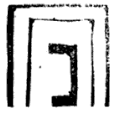

  
 in the way we explained in the Gate of Their Standing, with God's help.

> והנה נמצא שכתר חכמה בינה הם שואבים שפע ממקוריה' המיוחד בכתר חכמה בינה שבכתר. וכח"ב שבכתר שואבים ממקור הנעלם בעצם השרש שהוא אור קדמון וצח ומצוחצח המיוחדים תכלית היחוד. וכאשר יעלה בדעתנו עוצם ייחוד כתר חכמה בינה המתגלים בספירות, ר"ל הספירות בעצמם כפי אשר חוייבנו בייחודם בפרט יחוד מתעלה על יחוד שאר הספירות כדפי' בשער מהות והנהגה. ונעלה על יחודם עלוי והפלגת היחוד. עאכ"ו יחוד הכתר וחכמ' ובינה שבכתר, עד שנאמר שאין בכתר אלא מקור אחד ועצם אחד ושרש אחד. ואם נייחסהו לג', הוא מפני יניקת הג' ספירות משם שהם כתר חכמה בינה. ואח"כ עוד נפליג ונעלה על יחוד הג' שרשי' שבכתר יחוד הג' [נקודות] הנעלמות, הנה לא ירחק ממנו יחודם בהפלגה מרובה, ואינם מתייחסים בג' אורות אלא בערך שמהם שואבים שלשה שרשים שהם אחד ומתייחסים בשלשה מפני שהם מריקים שפע וברכה לג' הספי' מיוחדות תכלית היחוד. ומכאן יפליג המעיין בייחוד הספירות בעצם השרש שהם כולם מתייחדים יחוד אמיץ. נצח בתוך חסד וחסד בתוך חכמה כזה:  
>
>  על הדרך שפירשנו בשער עמידתן בע"ה.

**11:3:3** And likewise Hod within Gevurah and Gevurah within Binah, thus:  

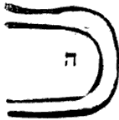

> וכן הוד בתוך גבורה וגבורה בתוך בינה כזה:

**11:3:4** And likewise Malkhut within the Righteous One, and the Righteous One within Tiferet, and Tiferet within Keter, thus:  

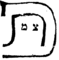

  
 And all this while they are within Keter. And how much more are they unified while they are within the unified root, which is not divided into parts at all! And if we relate the number three to it, it is because they are sources to the three sources of three branches, as we explained. But relative to themselves, in their spreading, they are unified with the utmost union.

> וכן המלכות בתוך הצדיק והצדיק בתוך התפארת ותפארת בתוך כתר כזה:  
>
>  וכל זה בהיותן בתוך הכתר. ומה יתייחדו עוד בהיותן בתוך השרש המיוחד בלתי מתחלק לחלקים כלל. ואם ניחסהו מספר השלשה הוא מפני שהם מקורות לג' מקורות של ג' ענפים כדפי'. אבל בערך עצמם בהתפשטותם הם מיוחדים תכלית היחוד.

**11:3:5** And behold, this manifestation, union, and source was revealed in its simple manifestation from the side of the aspect of His will toward the Emanation. And when we said "was revealed," the meaning is the manifestation of the being [*havayah*], which was not pouring forth [text: *mashpa'at*; read *mushpa'at*, "receiving effluence"] because of the concealment of the Emanation within His Self; and now, from the side of its spreading into the Emanation, it pours forth effluence into those sources. And this is [what we mean by] revealing: not that they are revealed to the emanated ones, all the more so not to the created ones, all the more so not to the formed ones, all the more so not to the made ones. For their manifestation is not revealed to any other than Him, as we explained. Rather, relative to the drawing forth of His providence into the Emanation, this matter is attributed to Him as spreading and revealing, not that it is revealed to any other than His Self, as we shall explain in the coming chapters. And the divine Rav Chamai Gaon revealed this matter further, and we shall copy it in a chapter of its own, as we found it copied by Rabbi David in the book Magen David (although he did not intend this inquiry at all), with the explanation of Rabbi Aharon upon his words; for he is a true teacher in this delightful inquiry, with the help of Heaven.

> והנה המציאות והיחוד והמקור הזה נתגלה במציאותו הפשוט מצד בחינת רצונו אל האצילות. ואמרנו נתגלה הכונה מציאות ההווייה שלא הי' משפעת [מושפעת] להעלם האצילות בעצמותו ועתה מצד התפשטותו באצילות משפיע במקורות ההם. והיינו גלויים, ולא שהם גלוי אל הנאצלי"ם כ"ש אל הנבראי"ם כ"ש אל הנוצרי"ם כ"ש אל הנעשי"ם. כי אין מציאותם מתגלה אל זולתו כדפי'. אלא בערך המשכת השגחתו באצילות יתייחס ענין זה אליו אל התפשטות וגלוי ולא שיהיה נגלה אל זולת עצמותו, וכמו שנבאר בפרקים הבאים. וגילה הענין הזה יותר האלקי רב חמאי גאון ונעתיק אותו בפרק בפ"ע כפי אשר מצאנוהו שהעתיקו רבי דוד בס' מגן דוד עם היות שלא כוון אל הדרוש הזה כלל עם פי' רבי אהרן על דבריו כי הוא מורה צדק בדרוש הנחמד הזה בס"ד:

### Chapter 11:4. Citation of the wording of Rav Chamai Gaon on the *tzachtzachot*, with the interpretation of our teacher R. Aharon upon it.

**11:4:1** Rav Chamai Gaon wrote in the Book of Union [Sefer ha-Yichud] [concerning] the three first beings, which he placed above Keter, as we explained in the first chapter, in the responsum of our teacher Hai: "For these three names are all one matter and one Self, cleaving with a mighty cleaving, without separation and without joining, in the Root of all roots; like a corporeal parable: the heart, the lungs, and the spleen, one root for all of them and for the other limbs in the whole cavity. And from primordial light pure thought was drawn, like the drawing forth of the thoughts of the heart; and from the refined and the clear light, as from two springs, knowledge and intellect were drawn. And by means of intellect and knowledge all the spiritual flames took substance, this in this and this with this, like the matter of the flames that hold fast to the strength of the coals; and what would be (another version: "what was") gathered and hidden, this within this and this within this, until the time of the will of the Primordial Agent arrived, and the spiritual things went out from potentiality into action, and the Emanation of the upper world was emanated, down to the foundation of the tenth stone, called in the language of the sages of the secrets "thick light" [או"ר ע"ב]. And because of the great density they also called it "mixed darkness," for all the powers of the flames are mixed in it and change within it; and it is the foundation of all the worlds, spiritual and corporeal. And how many kinds of colors take substance in them and are formed in its power, some of them spiritual forms and some of them corporeal forms; for it is the last seal of all the seals." Thus far the words of the master, our teacher Chamai Gaon, in the Book of Union. And this is the explanation of our teacher Aharon, peace be upon him:

> כתב רב חמאי גאון בספר היחוד ג' ההוויות ראשונות שהניח למעלה מן הכתר, כמו שבארנו בפ' ראשון בתשובת רבינו האיי. כי אלו השלשה שמות כלם ענין אחד הם ועצם אחד דביקים דבוק אמיץ מבלי פרוד ובלי חבור בשרש כל השרשים. כדמיון משל גשמי הלב והריאה והטחול שרש אחד לכלם, ולשאר האברים שבכל החלל. ואור קדמון נמשכה ממנו המחשבה הטהורה כהמשך מחשבות הלב, ומן האור המצוחצח והצח כשתי מעיינות נמשכה מהן המדע והשכל. ובאמצעית השכל והמדע נתעצמו כל השלהביות הרוחניות זה בזה וזה עם זה כענין הלהבות הנאחזות בתוקף הגחלים ומה שיהיה (נ"א שהיה) כנוס ונסתר זה בתוך זה וזה בתוך זה עד שהגיע זמן רצון הפועל הקדמון ויצאו מן הכח אל הפעולה הרוחניות ונאצל אצילות העולם העליון עד יסוד אבן העשירית הנקרא בלשון חכמי הרזים או"ר ע"ב. ומרוב העובי קראוהו גם כן חשך מעורב, כי כל כחות השלהביות מתערבות בה ומשתנות בתוכה והוא יסוד כל העולמות רוחניים וגשמיים. וכמה מיני גוונים מתעצמים בהן ומצטיירים בכחה מהם צורות רוחניות ומהם צורות גשמיות. כי היא חותם האחרון לכל החותמות. עכ"ל הרב רבינו חמאי גאון בספר היחוד. וזה פרישת רבינו אהרן ע"ה.

**11:4:2** "Behold, the master's intent is to explain that these three names are one matter and one Self, cleaving with a mighty cleaving, without separation. And I think he said this not to distinguish them from the angels and the composite things, but to distinguish them somewhat from the ten sefirot, which are one. That is to say: the ten sefirot, although joining and separation are not to be pictured in them, [are so] with regard to the drawing forth of the effluence; but these three are all one Self and one matter in the Root of all roots, and they are His very Self; and understand. For he did not say 'from the Root of all roots' but 'in the Root of all roots,' to indicate the greatness of the union: that they are in His Self, blessed be He, and His Self is in them. And because the thing is hard to picture, that there should be three and all one matter, he brought a corporeal parable, and said that this is 'like a corporeal parable.' He said: the heart, the lungs, and the spleen are one root for all of them. And we see that they are separate limbs; and we are compelled to say that before they were formed in actuality in these forms, they were stored away and mixed in that unformed mass [*golem*] from which they would come to be at the beginning of their coming-to-be from the seminal drop, while the action of coming-to-be had not yet spread forth to distinguish each and every thing by itself. Rather, those powers of the limbs were stored away and mixed in that mass, not separate from one another, so that you would decree of the three of them, and of the other powers of the limbs stored away there, that they were then one matter and one Self, although we say that there were stored away there the power of the heart, the power of the lungs, and the power of the spleen. And so one may illustrate with some resemblance, although it is not a true parable. And we say: we know from tradition that the most spiritual, subtlest, and most concealed spreading of all the Emanation was the three upper, spiritual sefirot, which are Keter, Chokhmah, and Binah. And if so, it is necessary that these three sefirot, although they are unified in a wondrous oneness and a concealed subtlety, were far more wondrous and concealed when they were already formed in the Root of roots, which is the Ein Sof, in a oneness, subtlety, and concealment more wondrous than they are after their spreading. For whatever comes nearer to the root is more unified, like the branches of a tree; for if it were not so, the matter would go on to infinity. And we do not say that the parable resembles the thing illustrated on all its sides. And this is it: the limbs, after they went out into actuality, nothing remained of them of that manifestation which they had before their going out; but not so here: for because the Ein Sof does not receive change, [Keter, Chokhmah, Binah] remained stored away there after Keter, Chokhmah, Binah were emanated, just as they were before the spreading of their emanation. For the Emanation is only like one who kindles a lamp from a lamp, with regard to the absence of change in the Emanator. And because the stored-away ones are more concealed, they are distinguished. And so we can say of all the other sefirot: that Binah is the six extremities, and likewise the six extremities are Binah itself, since the six extremities remained there concealed, and there is no difference between them except from the side of concealment and revealing. And this is what he said, that there is no separation at all between the sefirot, so as to say that they are substances separate in themselves; rather they are all one, for each one is included of them all. And he said: 'from primordial light pure thought was drawn,' that is, Keter, drawn from it like the drawing forth of the thought of the heart; 'and from the refined and the clear light,' which are like two springs, 'knowledge was drawn,' which is Chokhmah, 'and intellect,' which is Binah. 'And by means of intellect and knowledge all the spiritual flames took substance, this in this and this with this': so that you do not find the one without the other, nor the other without it; so that if you picture yourself pointing with your finger to one of them, you are pointing to all of them, for they are all in it.

> הנה כוונת הרב לבאר שג' שמות אלה ענין א' ועצם א' דבקים דבוק אמיץ בלי פרוד. ואחשוב שאמר זה לא להבדילם מהמלאכים והמורכבים אבל להבדילם הבדל מה מהי' ספירות שהם א'. ר"ל הי"ס עם שלא יצוייר בהם חבור ופרוד לענין המשכת השפע אבל אלה השלשה הכל עצם אחד וענין א' בשרש כל השרשים והן הן עצמותו, והבן. כי לא אמר משרש כל השרשים אלא בשרש כל השרשים, להורות על רוב היחוד שהם בעצמותו ית' ועצמותו בהם. ולמה שהדבר קשה להצטייר שתהיינה ג' והכל ענין א', הביא משל גשמי ואמר שזה כדמיון משל גשמי. אמר הלב והריאה והטחול שורש א' לכלם, וראינו שהם אברים נפרדים, ונתחייב לומר שקודם שיצטיירו בפועל באלו הצורות היו גנוזות ומעורבות באותו הגולם שיתהוו ממנו בתחלת הווייתן מהטיפה זרעיית עם היות שעדיין לא נתפשט פעל ההויה להבדיל כל דבר ודבר לעצמו. אבל היו אותן כחות האברים גנוזות ומעורבות בגולם ההוא בלתי נפרד זה מזה וזה מזה עד שתגזור על שלשתן ועל שאר כחות האברים הגנוזות שם שהם היו אז ענין א' ועצם א', עם היותנו אומרים ששם גנוזות כח הלב וכח הריאה וכח הטחול. וכן יש להמשיל בקצת דמיון אע"פ שאינו משל אמת. ונאמר אנחנו ידענו מפי השמועה שהתפשטות היותר רוחני והיותר דק ונעלם מכל האצילות היו הג' ספי' העליונות הרוחניות הם כתר חכמה ובינה. וא"כ נתחייב שאלה הג' ספירות עם היותן מתייחדות באחדות נפלא ודקות נעלם יותר נפלאות ונעלמות עד מאד שכבר יצטיירו בשרש השרשים והוא הא"ס באחדות ודקות והעלם יותר נפלא ממה שהם אחר התפשטותן כי כל מה שהדבר מתקרב אצל השרש הוא יותר מתאחד כדמיון ענפי האילן. שאל"כ ילך הדבר אל בלתי תכלית. ולא נאמר שהמשל דומה לנמשל מכל צדדיו. וזהו כי האברים אחר שיצאו אל הפועל לא נשאר מהם שום מציאות מאותו המציאות שהי' להם קודם צאתם, משא"כ בכאן כי בעבור שהאין סוף לא יקבל שינוי נשארו שם גנוזות אחר שנאצלו כח"ב כמו שהיו קודם התפשט אצילותן. כי האצילות אינו אלא כמדליק נר מנר לענין העדר השינוי במאציל. ובעבור היות הגנוזות יותר נעלמות יובדלו. וכן נוכל לומר בכל שאר הספי' שהבינה היא הו' קצוות וכן הו' קצוות הם הם הבינה אחר שנשארו שם השש קצוות נעלמות ואין הבדל ביניהם כ"א מצד העלם וההתגלות. וז"ש שאין בין הספירות שום פירוד לומר שהם עצמים נבדלים בעצמם. אבל הם הכל אחד כי כל א' כלולה מכלם. ואמר אור קדמון נמשכת ממנו המחשבה הטהורה, שהוא הכתר נמשך ממנו כהמשך מחשבת הלב. ומן האור המצוחצח וצח שהם כשתי מעיינות נמשכות מהם המדע, שהיא החכמה. והשכל, שהיא הבינה. ובאמצעות השכל והמדע נתעצמו כל השלהביות הרוחניות זה בזה וזה עם זה, עד שלא תמצא האחת בלתי האחרת ולא האחרת בלתה. עד שאם תצייר שאתה רומז באצבעך לאחת מהם אתה רומז לכלם כי כלם בה.

**11:4:3** "And the matter of the spreading from intellect and knowledge is like the matters of the flames that hold fast to the strength of the coals. And what was stored away and hidden, this within this and this within this, was forever in that mode of being stored away, until the time of the will of the Primordial Agent arrived, and the spiritual things went out from potentiality into action, and the Emanation of the upper world was emanated, down to the foundation of the tenth stone, which is Malkhut, which is called in the language of the sages 'thick light.' And because of her great density in comparison to what is above her, they also called her 'mixed darkness,' for all the flames are mixed in her; and she is the foundation of all the spiritual worlds, which are all the sefirot, for through her they act, and without her they would not act. And she is the foundation of the corporeal worlds, for she pours forth to them their manifestation. And how many kinds of colors take substance in her and are formed within her, according to the power of each one of the sefirot that pour effluence into her, some of them spiritual forms and some of them corporeal forms, according to what is needed to act; for she is the last seal of all the forms." Thus far his words.

> וענין התפשטות מן השכל והמדע כענייני הלהבות הנאחזות בתוקף הגחלים. ומה שהיו גנוזים ונסתרים זה בתוך זה וזבת"ז, היו לעולם באותו אופן מן הגנוזה. עד הגיע זמן רצון הפועל הקדמון ויצא מן הכח אל הפעולה הרוחניות ונאצל אצילות עולם העליון עד יסוד אבן העשירית היא המלכות היא הנקרא בלשון חכמים אור עב. ומרוב עביו בהקש אל מה שלמעלה ממנה קראוהו ג"כ חשך מעורב, כי כל השלהביות מעורבות בה והיא יסוד כל העולמות הרוחניים שהם כל הספי'. כי על ידה פועלות, ובלעדה לא יפעלו. והיא יסוד העולמות הגשמים, כי היא משפעת להם מציאותם. וכמה מיני גוונים מתעצמים בה ומצטיירים בתוכה, כפי כח כל אחת מהספי' המשפיעות בה מהן צורות רוחניות ומהם צורות גשמיות, כפי הצריך לפעול, כי היא חותם אחרון לכל הצורות עכ"ל.

**11:4:4** Behold, in the explanation of a holy mouth, filled with the praise of the Lord, blessed be He, he speaks of the matter of the three concealed ones: how they are a manifestation of the first three that remained there in the very root, a manifestation subtle and concealed, fairer and more complete by far than their revealed manifestation; and they are unified with the utmost union, and the count of three is not to be pictured in them except relative to their manifestation revealed after the spreading.

> הנה בפי' פה קדוש ימלא תהלת ה' ברוך הוא מדבר בענין הג' נעלמות איך הם מציאות ג' ראשונות שנשארו שם בעצם השרש מציאות דק ונעלם יפה ושלם יותר ויותר ממציאותם המתגלה והם מיוחדים תכלית יחוד ולא יצויר בהם מנין השלש אלא בערך מציאותם המתגלה אחר ההתפשטות.

**11:4:5** And behold, through the Gaon Rav Chamai and the explanation of Rabbi Aharon upon him, we lack nothing at all of all that we sought; and they serve us as support for all that was expounded on this matter in the preceding chapter, without our remarking on their words and their explanation at all, for love of brevity.

> והנה ע"י הגאון רב חמאי ופרישת רבי אהרן עליו לא חסרנו מכל מבוקשנו כלל. והם לנו מעיר לעזור אל כל הנדרש בענין הזה בפ' הקודם בלי שנעורר בדבריהם וביאורם כלל לאהבת הקצור.

**11:4:6** And behold, now it is not difficult for us that they are thirteen attributes, since they are a manifestation of the first three, concealed in their source; just as we have no difficulty from the manifestation of the six extremities concealed in Binah, as the master explained. And they are the very ten Tzachtzachot, because each one of the first three includes, in its middle and in its manifestation, unified in its self, all the lines: the line of Chesed in Chokhmah, the line of Din in Binah, the line of Rachamim in Keter, as we dwelt on at length above. And by this is explained what the master, our teacher Hai Gaon, explained in his responsum, when he said that the first configuration, which is in the form of the Yod, which has three points, a tip above, a tip below, and a point in the middle, indicates Keter, Chokhmah, and Binah, which spread from Name, Self, and Root [מש"ם ועצ"ם ושר"ש], that is, the three concealed ones. And they said "took shape and were formed": the meaning is the matter [*golem*], which is the vessels, and the form, which is the Self, that is, the form and soul of the Emanation, as explained in the Gate of Self and Vessels, chapter 4. And he said that they are "from the power of the three concealed ones," for through them they were emanated. And the meaning: at the time when the will arose before Him to emanate the Yod, which [sefirot] are included in three points, that is, three Yods, the three points that are in the Yod, as we explained above, then the three acquired manifestation in the very root, as we explained in the preceding chapter. And from the power of that manifestation, which spread in the root itself, the first three were emanated, with the three included in three. For in Chokhmah two are included and concealed, not seen, which are Chesed [and] Netzach; and in Binah two are concealed, which are Gevurah [and] Hod; and in Keter three are concealed, which are Tiferet, Yesod, and Malkhut, as we explained. And the rest of the responsum is clear.

> והנה עתה לא יקשה לנו שהם י"ג מדות אחר שהם מציאות ג' ראשונות הנעלם במקורם, כמו שלא יקשה עלינו ממציאות ו' קצוות הנעלמות בבינה כדפי' הרב. והם הם י' צחצחות, מפני שכל אחד משלשה ראשונות כולל באמצעיתו ובמציאותו מיוחד בעצמותו כל הקוים קו החסד בחכמה קו הדין בבינה קו הרחמים בכתר כפי אשר הארכנו לעיל. ובזה יתבאר מה שפירש הרב רבינו האי גאון בתשובתו, שאמר שהמערכת הראשונה שהיא בציור היוד שיש לה שלשה נקודות עוקץ למעלה ועוקץ למטה ונקודה באמצע להורות על הכתר והחכמה והבינה שהם מתפשטות מש"ם ועצ"ם ושר"ש דהיינו השלשה הנעלמות. ואמרו נתגלמו ונצטיירו. הכונה הגולם שהם הכלים. והצורה שהוא העצמות. דהיינו צורת ונשמת האצילות כמבואר בשער עצמות וכלים בפ"ד. ואמר כי הם בכח השלשה נעלמות כי על ידם נאצלו. והכונה כי בעת עלות רצון לפניו להאציל היו"ד שהם נכללות בשלשה נקודות דהיינו שלשה יודי"ן שלשה נקודות אשר ביו"ד כדפי' לעיל, הנה אז קנו מציאות השלשה בעצם השרש כדפי' בפרק הקודם. ומכח המציאות ההוא שנתפשט בשרש עצמו, נאצלו שלשה ראשונות עם השלשה נכללות בשלשה. כי בחכמה נכללים שתים ונעלמים בלתי נראים שהם חסד נצח, ובבינה נעלמים שנים שהם גבורה הוד, ובכתר נעלמים שלשה שהם תפארת יסוד ומלכות כדפי'. ושאר התשובה מבוארת.

**11:4:7** Behold, the matter of the Tzachtzachot concealed in the Ein Sof has been explained from the words of the Geonim.

> הנה נתבאר מתוך דברי הגאונים ענין הצחצחות הנעלמות בהאין סוף:

### Chapter 11:5. Explanation of a passage from the Zohar, Parashat Pekudei, "Ein Sof does not stand," from within which the *tzachtzachot* and their concealment are explained.

**11:5:1** And so Rashbi, peace be upon him, explained in the Zohar, Parashat Pekudei (folio 239a), and these are his words: "Ein Sof does not stand to be made known, nor to make an end, nor to make a matter [*davar*], as the First Nothing brought forth beginning and end. Who is the beginning? This is the supernal point, which is the enclosed head of all, which stands within thought; and it makes an end, which is called 'the end of the matter' [*sof davar*]. But there, Ein Sof: not for desires [*re'utin*], nor for lights; not lamps in that Ein Sof. All these lights and lamps depend [on it] to subsist by them, and they do not stand to cleave. The one who knows and does not know is none other than the supernal desire, the Enclosure of all enclosures, Nothing. And when the supernal point and the World to Come ascend (another version: 'ascended'), they know only the scent, like one who smells scents and is settled." Thus far its words.

> וכן ביאר הרשב"י ע"ה בזהר פ' פקודי (דף רל"ט.) וז"ל אין סוף לא קיימא לאודעא ולא למעבד סוף ולא למעבד דבר כמה דאי"ן קדמאה אפיק ראש וסוף מאן ראש דא נקודה עלאה דאיהו רישא דכלא סתימאה דקיימא גו מחשבה ועביד סוף דאקרי סוף דבר. אבל להתם אין סוף, לא לרעותין ולא לנהורין, לאו בוצינין בההוא אין סוף. כל אלין נהורין ובוצינין תליין לאתקיימא בהו, ולא קיימי לאתדבקא, מאן דידעי ולא ידעי, לאו איהו אלא רעו עלאה סתימאה דכל סתימין אי"ן. וכד נקודה עלאה ועלמא דאתי אסתלק (נ"א אסתלקו) לא ידעין בר ריחא כמאן דארח בריחין ואתבסס עכ"ל.

**11:5:2** And the explanation of his words: the Root of roots, called Ein Sof, does not stand to be revealed, because of the greatness of its concealment, for there is no knowledge of it at all. And this is what he said: "does not stand to be made known." And he said that besides its being impossible to know it and to apprehend it relative to its aspect, according to the manifestation of its concealment, it also does not stand to be revealed and to spread forth so that one might recognize it and apprehend it. For its Self is not apprehended in any way, except for the apprehension of its actions, that is, its sefirot. And it is known that revealing and spreading forth come through a thing's coming to be with a beginning and an end, for this is the definition of coming-to-be, that it has a beginning and an end. To this he said that the Ein Sof does not stand to make beginning and end, which is "end" and "matter." And the meaning: "end" is its one extreme, and "matter" is its second extreme; and this is "end" [סו"ף] and "matter" [דב"ר], for from above downward the beginning of a matter is [its] end. And he said that the Ein Sof does not stand to reveal its manifestation in "end" and "matter" so as to be apprehended, like Keter, which is called Nothing [Ayin]. And he said "the First Nothing," to indicate that even in its concealed aspect, called "First," that is, its aspect relative to the Emanator, it does not resemble Ein Sof at all, because of the greatness of its concealment. [This is] because "the First Nothing brought forth beginning and end": explanation: Keter is revealed, and its revealing is through the beginning and the end, that is, Chokhmah and Malkhut, as he goes on to explain. And through it is the revealing of Keter, because in Keter is the aspect of Chokhmah, which is the beginning, and the aspect of Binah, which is the aspect of the end; and its revealing is through Chokhmah and Malkhut, which are the beginning and the end, with the middle certainly included. "Who is the beginning? This is the point," etc.: explanation: the intent is Chokhmah, for it is the beginning and first of the Emanation, in the way we explained in Gate Three, chapters 3 and 7. And he said that although it is the beginning of revealing, it is not that it is revealed with an intrinsic revealing; rather [it is] the beginning of a slight revealing. And therefore he went further and said "enclosed, which stands," etc., and it is apprehended only in thought alone. And insofar as the beginning of thought is there, therefore it is the first of the revealing of Keter. "And it makes an end," etc.: explanation: for the beginning of thought is the end of action; for there is Chokhmah at the beginning and Chokhmah at the end, and this is Yod at the beginning and Yod at the end. And the emanation of Malkhut is from there, as in the matter Rashbi, peace be upon him, explained in the Tikkunim (Tikkun 69, folio 103): "I am asleep [*yeshenah*]: I am second [*sheniyah*] to Chokhmah," and as we shall explain in the Gate of Manifestations. And therefore Chokhmah "makes an end," which is Malkhut, the end of the Emanation. "But there," etc.: explanation: the whole matter of the beginning and the end is in the Emanation and in the sefirot; "but there," in the Ein Sof mentioned, [it is not so]. "Ein Sof: not for desires," etc.: the meaning is that will in the Creator, that is to say, in the Ein Sof, is impossible; because if we said that He wills, He would turn out to change from will to will, and this is impossible in the law of the Ein Sof, necessarily existent, who is not subject to changes. Rather, the matter of will is the first emanation, which descends from Him in a chain, and through that will He performs His will, in the likeness of the Self and the vessels: for the vessels are subject to change, and the Self performs the change through them. And therefore the beginning of the spreading of the Emanation is the will to emanate. But this will is concealed, for it is not literally a revealed emanation; rather it is a will through which He is willing to emanate.

> ופי' דבריו, כי שרש השרשים הנקרא אין סוף אינו עומד להתגלות מפני רוב העלמו שאין בו ידיעה כלל. וז"ש לא קיימא לאודעא. ואמר כי בזולת שא"א לדעתו ולהשיגו בערך בחינתו כפי מציאות העלמו. ג"כ אינו עומד להתגלות ולהתפשט כדי שיכירהו וישיגהו. כי אינו מושג עצמותו בשום אופן אם לא השגת פעולותיו דהיינו ספירותיו. ונודע כי הגילוי וההתפשטות הוא ע"י התהוות הדבר בתחלה וסוף שזהו גדר ההויה שיש לה ראש וסוף. לזה אמר שאין הא"ס עומד למעבד תחלה וסוף שזהו סוף ודבר. והכוונה סוף היינו קצהו האחד ודבר היינו קצהו השני, וזהו סו"ף ודב"ר, כי ממעלה למטה תחלת דבר הוא סוף. ואמר שאין הא"ס עומד לגלות מציאותו בסוף ודבר כדי שיושג כמו הכתר הנק' אי"ן. ואמר אי"ן קדמאה. להורות כי אפי' בבחינתו הנעלמת הנקרא קדמאה דהיינו בחינתו בערך המאציל אינו דומה לא"ס כלל מפני רוב העלמו. מפני שאי"ן קדמאה אפיק ראש וסוף. פי' הכתר הוא מתגלה, וגלויו הוא ע"י הראש והסוף דהיינו חכמה ומלכות כדמפרש ואזיל. ועל ידו הוא גלוי הכתר מפני שבכתר בחי' החכמה שהוא הראש ובחינת הבינה שהיא בחינת הסוף, וגלויו הוא ע"י חכמה ומלכות שהם הראש והסוף עם כלל האמצעי ודאי. מאן ראש דא נקודה וכו'. פי' הכוונה על החכמה כי הוא ראש וראשית לאצילות ע"ד שפי' בשער ג' בפ"ג וז'. ואמר שעם היות שהוא תחלת הגלוי לא שיתגלה גילוי עצמי אלא תחלת הגלוי קצת. ולכן הפליג ואמר סתימאה דקיימא כו' ואינה מושגת אלא במחשבה לבד. ובערך ששם תחלת המחשבה לכן הוא ראשית לגילוי הכתר. ועביד סוף וכו' פי' כי תחלת המחשבה הוא סוף המעשה כי חכמה בראש וחכמה בסוף וזהו יו"ד בראש וי' בסוף. ואצילות המלכות משם כענין שפי' הרשב"י ע"ה בתקונים (תקונא ס"ט דף ק"ג) אני ישנה אני שניה לחכמה, וכמו שנבאר בשער המציאות. ולכן החכמה עביד סוף שהיא המלכות סוף האצילות. אבל להתם וכו'. פי' כל ענין הראש והסוף הוא באצילות ובספירות, אבל להתם בא"ס הנז'. א"ס לא לרעותין וכו'. הכוונה כי הרצון בבורא ר"ל בהא"ס א"א מפני שאם נאמר שהוא רוצה נמצא משתנה מרצון לרצון וזה נמנע בחק הא"ס מחוייב המציאות שאינו בעל שנויים. אמנם ענין הרצון הוא האצילות ראשון המשתלשל ממנו, וע"י הרצון ההוא הוא פועל רצונו כדמיון העצמות והכלים. שהכלים בעלי השינוי, והעצמות פועל השינוי על ידם. ולכן תחלת התפשטות האצילות הוא הרצון להאציל. אמנם הרצון הזה נעלם שאינו אצי' מתגלה ממש אמנם הוא רצון שע"י מתרצה להאציל.

**11:5:3** And behold, this will is not the One who wills; rather the Self of the Ein Sof is the One who wills, and He is called "willing" through the will, in the way we explained concerning the matter of judgment and limit in the Gate of Self and Vessels, chapter 4. And in this way it turns out that the will is so near to the Emanator that it is not emanation; rather it is Self, and not literally Self. Rather it is the manifestation of the arising of His will to emanate the emanated ones; and therefore the will is the emanated ones themselves, which came to be and were found in the manifestation of His Self from the side of the arising of His will to emanate the emanated ones, as we explained in chapter 3.

> והנה הרצון הזה אינו הרוצה, אמנם עצמות הא"ס הוא הרוצה והוא נקרא רוצה ע"י הרצון כדרך שפי' בענין הדין והגבול בשער עצמות וכלים בפ"ד. ועד"ז נמצא היות הרצון הקרוב אל המאציל עד שאינו אצילות אמנם הוא עצמות ולא עצמות ממש. אמנם הוא מציאות עלות רצונו להאציל הנאצלים ולכן הרצון הוא הנאצלים עצמם שנתהוו ונמצאו במציאות עצמותו מצד עלות רצונו להאציל הנאצלים כדפי' בפ"ג.

**11:5:4** And behold, according to this there will already be a will to bring a will into existence; for a will arises to bring a will into existence, until there is a point level with the Emanator. And these wills, in the secret of their intrinsic union in the very Emanator, are called "desires" [*re'utin*]. And because of the concealment of the Ein Sof, in which the desires are, he said "Ein Sof: not for desires nor for lights," for they are likewise titled with the name "lights," as in the matter of primordial light, clear light, refined light. But the will through which He works change in this world is Keter, which is what is called "will"; and through it the Ein Sof wills, just as through Chokhmah He is called wise. "Not lamps in that Ein Sof": explanation: even when the sefirot shine and are titled with the name "luminaries," they do not resemble the Ein Sof. And not only the Ein Sof, but even the concealed luminaries unified in His Self, as we explained. "All these lights," etc.: explanation: all the sefirot depend on those concealed roots, because they are sources to the sefirot; for through the concealed luminaries the sefirot draw effluence from the Ein Sof, like the tree, which draws moisture from its roots, and the main watering is to the roots. So the sefirot turn out to depend on the roots and to subsist through them. "And they do not stand to cleave": explanation: although the concealed sources and roots, which are the Tzachtzachot unified in the very root, are the life and subsistence of the sefirot, nevertheless the roots are not revealed to the sefirot, and the sefirot do not apprehend them, because of the greatness of their concealment. And this is what he said, "and they do not stand to cleave": explanation: they do not stand in a state to be apprehended at all. "The one who knows and does not know," etc.: explanation: those of whom it can properly be said that they know and that they do not know are only Keter, Chokhmah, and Binah. For the other sefirot never know, and never did know, and the roots were never revealed to them, such that we might say that there is a time when they do not know. But the matter of "knows and does not know" can properly be said of Keter, Chokhmah, Binah, as he concludes. And nevertheless these three are not equal in their apprehension. For Keter, in its concealed aspect, which is called "the supernal desire" [*re'u ila'ah*], which is a title in the language of will, like "desires" [*re'utin*] mentioned with the Ein Sof; and it is "the Enclosure of all enclosures," called Nothing, for "Something" does not apply to it at all: this aspect is always unified in the concealed roots, which are its cause, and the cause of the roots concealed in it, as we explained above. But Chokhmah and Binah: their apprehension is at times, that is, only at the time of their ascent to the concealed aspect in Keter, which is the source, in which there are likewise three roots, as we explained in chapter 3. And this is what he said: "And when the supernal point," which is Chokhmah, "and the World to Come," which is Binah, "ascends," that is, at the time of the union of the two of them with the utmost union, so that "ascended," in the plural, cannot properly be said of them, but "ascends," in the singular. And then, at the time of their ascent in union in the supernal root, Keter, nevertheless they do not apprehend the roots, except like the scent of one who smells a good scent without touching the spice; rather he smells it, and through it he is settled and sweetened. So these sefirot, after their ascent, [apprehend] the roots and draw sustenance from them through their root that is exalted in Keter; not that they themselves draw sustenance and draw and apprehend the very concealed root. And therefore their nourishment is called [nourishment] from Ein Sof, and likewise their ascent [is called ascent] to Ein Sof.

> והנה לפ"ז כבר יהיה רצון להמציא רצון כי יעלה רצון להמציא רצון עד שיהיה נקודה משתווה אל המאציל. והרצונות האלה בסוד יחודם העצמי בעצם המאציל נקרא רעותין. ומפני התעלמות הא"ס שבו הרעותין אמר א"ס לא לרעותין ולא לנהורין שכן מכונים בשם נהורין. כענין אור קדמון אור צח אור מצוחצח. ואמנם הרצון שעל ידו יפעל שינוי בעוה"ז הוא הכתר שהוא הנקרא רצון. וע"י הא"ס רוצה כמו שע"י החכמה נקרא חכם. לאו בוסינין בההוא אין סוף. פי' אפי' בעת היות הספירות מאירות מכונים בשם מאורות אינם דומות לאין סוף. ולאו דווקא לאין סוף אלא אפי' למאורות הנעלמות המיוחדות בעצמותו כדפי'. כל אלין נהורין וכו'. פי' כל הספירות הם תלוים בשרשים הנעלמים ההם מפני שהם מקורות אל הספי' שע"י המאורות הנעלמות ישאבו הספי' שפע מהאין סוף. כמו האילן שהוא שואב הלחות משרשיו ועקר ההשקאה אל השרשים. נמצאו הספי' תלויים בשרשים ומתקיימים על ידם. ולא קיימי לאתדבקא. פי' עם היות שהמקורות והשרשים הנעלמים שהם הצחצחות המיוחדות בעצם השרש הם חיותם וקיומם של הספי', עכ"ז אין השרשים מתגלות לספירות ואין הספי' משיגים אותם מפני רוב העלמם. וז"ש ולא קיימי לאתדבקא, פי' אינם עומדות בענין שיושגו כלל. מאן דידעי ולא ידעי וכו'. פי' אותם שיצדק בהם שיודעים ושאינם יודעים אינם אלא כתר חכמה ובינה. כי שאר הספי' לעולם אינם יודעים ומעולם לא ידעו ולא נתגלו להם השרשים עד שנאמר שיש עת שאינם יודעים. אמנם יצדק ענין ידעי ולא ידעי, בכתר חכמה בינה כדמסיק. ועכ"ז ג' אלה אינם שוים בהשגתם. כי הכתר בבחינתו הנעלמת שהוא הנקרא רעו עלאה שהוא כנוי לשון רצון כמו רעותין הנז' בא"ס. והוא סתימאה דכל סתימין, הנקרא אי"ן. שלא יצדק עליו הישות כלל ועיקר. הבחינה הזאת לעולם מתייחדת בשרשים הנעלמים שהם סבתו וסבת השרשים הנעלמים בו כדפי' לעיל. אבל חכמה ובינה השגתם הוא לעתים. דהיינו דווקא בעת עלותם אל בחינת הנעלמת בכתר שהוא המקור. שבו ג"כ ג' שרשים כדפי' בפ"ג. וז"ש וכד נקודה עלאה שהוא החכמה ועלמא דאתי שהוא הבינה, אסתלק, שהוא בעת התייחדות שתיהם תכלית היחוד עד שלא יצדק עליהם אסתלקו לשון רבים אלא אסתלק לשון יחיד, ואז בעת עלייתם ביחוד בשרש העליון כתר. עכ"ז אינם משיגות בשרשים, אלא כריח המריח בריח הטוב בלתי פגעו בבושם, אלא מריח בו, וע"י מתבסס ומתמתק. כך הספי' האלה אחר עלייתם הם [משיגות] בשרשים ויונקים מהם ע"י שרשם הנעלה בכתר. ולא שינקו וישאבו הם עצמם וישיגו בעצם השרש הנעלם. ולזה יקרא יניקתם מא"ס וכן עלייתם לא"ס.

**11:5:5** Behold, from this passage, as explained, it appears that with regard to the apprehension of the roots the whole Emanation is divided into three divisions. The first is the seven days of the Structure, which do not apprehend the concealed ones at all; rather their ascent is up to Binah, in the secret of the Jubilee, and from there upward they do not apprehend, but from there they draw sustenance from Keter and from Chokhmah; except for Tiferet and Malkhut, for in the secret of their union they ascend up to Keter, where their source, the Self, is, as the matter and its reason were explained in Gate Five, chapter 6. And the second is Chokhmah and Binah, which apprehend the concealed roots only at intervals, at the time of their ascent; and that apprehension is not in the very Emanator, but "like one who smells," etc., as we explained above. And there is no doubt that even so the apprehension of Chokhmah will not be equal to the apprehension of Binah, but certainly with the exaltation of one over the other, although they ascend together, because they are male and female, and the one does not suffice without the other. The third is Keter, whose apprehension, in its concealed aspect, is always equal; it is never separated from its root, and it and the root are all one thing, unified in its upper aspect, as we explained.

> הנה מתוך המאמר הזה בפי' נראה שבענין השגת השרשים נחלק כל האצילות לשלש מחלוקת. הא' הם ז' ימי הבנין, שאינם משיגות בנעלמות כלל אלא עלייתם עד הבינה בסוד היובל ומשם ולמעלה אינם משיגות אלא משם ינקו מהכתר ומהחכמה, בזולת הת"ת והמלכות כי בסוד יחודם יעלו עד הכתר ששם מקורם העצמות כמו שנתבאר הענין וטעמו בשער ה' בפ"ו. והב' הם חכמה ובינה, שלא ישיגו בשרשים הנעלמות אם לא לפרקים בעת עלותם. וההשגה ההיא אינה בעצם המאציל, אמנם כמאן דארח וכו' כדפי' לעיל. ואין ספק שעכ"ז לא יהיה שוה השגת החכמה עם השגת הבינה אלא בעלוי זו על זו ודאי. עם היותם עולות יחד מפני שהם זכר ונקבה והא בלא הא לא סגייא. הג' הוא הכתר, שזה בבחינתו הנעלמת השגתו שוה לעולם לא יפרד משרשו והוא והשרש הכל דבר א' מתאחד בבחינתו העליונה כדפי'.

**11:5:6** And Rashbi further dwelt at length on the explanation of these Tzachtzachot and the roots that are in the Ein Sof:

> ועוד האריך הרשב"י בביאור הצחצחות האלה והשרשים שהם באין סוף:

### Chapter 11:6. Explanation of the *tzachtzachot* in the passage of Parashat Noach, "Rabbi Shimon said: I raised my hands in prayer," etc.; and the inquiry is further explained at length.

**11:6:1** In the book of the Zohar, Parashat Noach (folio 65a), in some versions in the books, and these are its words: "Rabbi Shimon said: I raised my hand in prayers above. When the supernal desire, above and above, stands upon that desire which is not known and not grasped at all, forever, [it is] the head that is enclosed more, above. And that head brought forth what it brought forth, which is not known, and illumined what it illumined, all in an enclosure. The desire of supernal thought is to pursue after it and to be illumined from it. One hanging is spread, and from within that hanging, in the pursuit of that supernal thought, it reaches and does not reach, etc. Then this light of thought that is not known strikes the light of the hanging that stands, which shines from what is not known, etc. And then this light of thought that is not known strikes the light of the hanging, and they shine as one, and nine palaces are made, palaces for palaces, which are not lights and are not spirits and are not souls, and there is none who stands in them. The desire of all nine lights that all stand in thought, which is one of them in the count, all of them [is] to pursue after them at the time that they stand in thought; and they do not cleave and are not known. And these stand neither in desire nor in supernal thought; they grasp them and do not grasp. In these stand all the secrets of faith; and all those lights from the secret of supernal thought that are below are all called Ein Sof. Up to here the lights reach and do not reach, and are not known. Here there is no desire and no thought. When thought shines and does not know from what it shines, then it is clothed and enclosed within Binah, and it shines what it shines, and it enters this into this until they are all included as one. And in the secret of the sacrifice, when it ascends, all is bound this with this and shines this in this. Then they all stand in ascent, and thought is wrapped in Ein Sof. That light which shines from it, [from which] supernal thought [shines], which does not know it at all, is called Ein Sof; for from it it is found and stands and shines to whom it shines. And on this all stands. Happy is the portion of the righteous in this world and in the world to come." Thus far its words.

> בספר הזהר פ' נח (דס"ה.) בקצת נסחאות בספרי'. וז"ל אר"ש ארימת ידא בצלותין לעילא, כד רעותא עלאה לעילא ועילא, קיימא על ההוא רעותא דלא אתידע ולא אתפס כלל לעלמין. רישא דסתים יתיר לעילא. וההוא רישא אפיק מה דאפיק דלא ידיע, ונהיר מה דנהיר כלא בסתימו. רעו דמחשבה עלאה למרדף אבתריה ולאתנהרא מיניה. חד פריסו אתפריס ומגו ההוא פריסא ברדיפו דההוא מחשבה עלאה מטי ולא מטי כו'. כדין בטש האי נהירו דמחשבה דלא אתידע בנהירו דפרסא דקיימא דנהיר ממה דלא ידיע כו'. וכדין דא נהירו דמחשבה דלא אתידע בטש בנהירו דפריסא ונהרין כחדא ואתעבידו ט' היכלין, להיכלין דלאו אינון נהורין ולאו אינון רוחין ולאו אינון נשמתין ולאו אית מאן דקיימא בהו רעותא. דכל תשע נהורין דקיימי כלהו במחשבה דאיהו חד מנייהו בחושבנא כלהו למרדף אבתרייהו בשעתא דקיימי במחשבה ולא מתדבקן ולא אתיידיעו. ואלין לא קיימי לא ברעותא ולא במחשבה עלאה, תפסין בהו ולא תפסין. באילין קיימין כל רזי דמהימנותא וכל אינון נהורין מרזא דמחשבה עלאה דלתתא כלהו אקרון א"ס. עד הכא מטון נהורין ולא מטון ולא אתידעו. לאו הכא רעותא ולאו מחשבה. כד נהיר מחשבה ולא ידע ממה נהיר. כדין אתלבש ואסתים גו בינה ונהיר מאן דנהיר ואעיל דא בדא עד דאתכלילו כלהו כחדא. וברזא דקרבנא כד סליק, כלא אתקשר דא בדא ונהיר דא בדא. כדין קיימי כלהו בסליקו, ומחשבה אתעטף בא"ס. ההוא נהירו דנהיר מיניה מחשבה עלאה דלא ידע איהי בה כלל אקרי א"ס, דמניה אשתכח וקיימא ונהיר למאן דנהיר. ועל דא כולא קאים. זכאה חולקהון דצדיקייא בעלמא דין ובעלמא דאתי עכ"ל.

**11:6:2** And its way is concealed and lofty; and nevertheless we shall not withhold our hands from discussing it in every way possible, because the commentators copied it into their books, in particular Rabbi Yehudah Chayat, and did not explain it at all. Therefore we shall explain it with a strong hand. "Rabbi Shimon said: I raised my hand," etc.: the reason for the raising of the hands in prayer is explained in the Zohar, Parashat Yitro (folio 67a), and its place is not here. And because Rashbi's intent in this passage is to reveal hidden matters in the Ein Sof, therefore he sanctified himself, "and his hands were steadfast" (Exod. 17:12) until he finished speaking. And thus he said: "When the supernal desire, above and above." Explanation: Chokhmah is called "desire" [*re'uta*], as explained in many places; and the reason is that it is the subtlest of the subtle, and therefore the language of will is attributed to it, as we explained, for will indicates subtlety and primordiality. And likewise the Supernal Keter is called "desire," for it is the true will among the sefirot. And the will that is supernal over them all is the Ein Sof, in the way we explained in the preceding chapter.

> ודרכו נעלם ונשגב, ועכ"ז לא נאסוף ידינו מלשאת ולתת בו בכל האפשר. מפני שהעתיקוהו המפרשים בספריהם, בפרט רבי יהודה חייט, ולא פי' בו כל עקר. לכן נבאר בו בחזקת היד. אר"ש ארימת ידא כו' טעם הנשיאות ידים אל התפלה נתבאר בזהר פ' יתרו (דף ס"ז.) ואין מקומו הנה. ומפני היות כונת הרשב"י במאמר הזה לגלות ענינים נסתרים בא"ס לכן התקדש עצמו ויהיו ידיו אמונה עד תומו לדבר. וכה אמר כד רעותא עלאה לעילא ועילא. פי' החכמה נק' רעותא כמבואר במקומות רבים, והטעם שהיא דקה מן הדקה ולכן נתייחס אליה לשון רצון כדפי' כי הרצון מורה על הדקות והקדמות. וכן כ"ע נק' רעותא כי הוא הרצון האמיתי בספי'. והרצון העליון על כלם הוא הא"ס על הדרך שפי' בפרק הקודם.

**11:6:3** And behold, he said "the supernal desire," and not [the will] of Chokhmah, but "above," which is above the will of Chokhmah; and not Keter, which is the will that is above Chokhmah, but "and above," which is the will that is above the will, which is the Ein Sof, which is above Keter, which is the will that stands over Chokhmah, which is called "will," as we explained above. And he did not suffice with saying "the supernal desire," because Chokhmah too is called "the supernal desire," as is evident in the Zohar many times. "Stands": explanation: rests and abides "upon that desire," explanation: upon Keter. "Which is not known": explanation: relative to its concealed aspect, which is not apprehended. "And not grasped at all, forever": explanation: not only its concealed aspect, which is concealed except at rare times, as at the time when Chokhmah and Binah ascend to it, as we explained in chapter 5; but that concealed aspect, at the utmost of concealment, which was never revealed and never apprehended by any other than it among the emanated ones, and will not be apprehended. And in that aspect it is a throne for the Emanator, an aspect that draws near to Him. "The head that is enclosed more, above": explanation: the Ein Sof, which is the head that stands, is joined, and rests upon this aspect, and is more concealed than this aspect, although that is concealed at the utmost of concealment, as explained. "And that head": explanation: the concealed aspect of Keter, which is head to the other aspects of Keter, and all the more so to the rest of the Emanation. "Brought forth what it brought forth": explanation: emanated what it emanated; and this is the concealed sefirot, which are vessels to the concealed Self. And although they are like a garment to the Self, nevertheless it is not known; and this is what he said: "which is not known." "And illumined what it illumined": this is the Self that spreads within the garment; and therefore it is titled with the language of light, which is the light of the lantern. And because the concealment of the Self is exceedingly greater than the concealment of the garment, he said "all in an enclosure," which goes further in concealment than his saying "which is not known." For "not known" indicates that it is revealed but not known; but "all in an enclosure" indicates its being enclosed of itself in every respect. And with this it will be understood why it was necessary to emanate through "head" and "head," which are the Ein Sof and the first emanated one: because through the Ein Sof the Self that spreads was emanated, and through Keter, which bears the Self and is filled from it, the vessels were emanated, and all by the will of the Emanator. And would that the inquirer would go deep into this, for it is not our way to exaggerate the secrets. And the matter: since the roots that are unified in the very root are, according to the truth, roots of the vessels and not the root of the Self (for the Self is all one, and needs neither root nor source), then just as in the vessels, the outer sefirot, that is to say, the sefirot of the Emanation, the Self spreads in them, so in their root the Self spreads in them; although it is revealed in them more and more, until they are literally His Self and they are the very root. And this matter is among the matters in which contemplation beyond measure is forbidden, and it is in "running and returning." "The desire of supernal thought": explanation: Chokhmah. And he called it "supernal" in its upper aspect, the most concealed, which is unified with Keter. And although its subtlety and its concealment are so great, nevertheless its longing and its craving is to cleave to these concealed roots and to be illumined from them; and therefore it pursues after them. And this is what he said: "to pursue after it and to be illumined from it": explanation: to be receiving and shining from this unified concealed root, emanated from the two heads mentioned above; and it has no apprehension at all, nor even reception from them. "One hanging is spread": this is Keter itself, emanated and revealed, which is a screen between the emanated ones and the sources that are unified in the very root. "And from within that hanging, in the pursuit of that supernal thought": explanation: from within Keter, which is called "hanging," as we explained concerning the reason for the darkness; and the arousal, that is, the pursuit mentioned, by which Chokhmah, called supernal thought in its upper aspect, as we explained, arouses.

> והנה אמר רעותא עלאה. ולא מחכמה אלא לעילא שהוא למעלה מרצון החכמה. ולא הכתר שהוא הרצון שהוא למעלה מחכמה. אלא ועילא שהוא הרצון שהוא למעלה מהרצון שהוא האין סוף. שהוא למעלה מהכתר שהוא הרצון שעומד על החכמה שנקרא רצון כדפי' לעיל. ולא הספיק באמרו רעותא עלאה, מפני שהחכמה ג"כ נקרא רעותא עלאה כדמוכח בזהר פעמי' הרבה. קיימא. פי' שורה וחונה על ההוא רעותא, פי' על הכתר. דלא אתידע. פי' בערך בחינתו הנעלמת שאינה מושגת. ולא אתפס כלל לעלמין. פי' לא בלבד בחינתו הנעלמת שהיא מתעלמת עד לעתים רחוקות כמו בעת עלות אליו החכמה והבינה כדפי' בפ"ה. אלא אותה הבחינה הנעלמת תכלית ההעלם שמעולם לא נתגלה ולא הושגה לזולתו מן הנאצלים ולא יושג. ובאותו בחינה הוא כסא אל המאציל בחינה מתקרבת אליו. רישא דסתים יתיר לעילא. פי' א"ס שהוא הראש העומד ומתאבק ושורה בבחינה הזו והיא נעלם יותר מהבחינה הזו עם היותה נעלמת תכלית ההעלם כמבואר. וההוא רישא. פי' בחינת הכתר הנעלמת שהוא ראש אל שאר בחינות הכתר, וכ"ש אל שאר האצילות. אפיק מה דאפיק. פי' האציל מה שהאציל. והיינו הספירות הנעלמות שהם כלים אל העצמות הנעלם. ועם היות שהם כלבוש אל העצמות עכ"ז לא ידיע. וז"ש דלא ידיע. ונהיר מה דנהיר. היינו העצמות המתפשט בתוך הלבוש, ולכן הוא מכונה בלשון אור שהוא אור העששית. ומפני שהעלם העצמות מופלג על העלם הלבוש, אמר כלא בסתימו. שהוא הפלגת ההעלם יותר מאמרו דלא ידיע. כי לא ידיע מורה שהוא נגלה אבל לא ידיע, אבל כלא בסתימו מורה על היותו סתים מעצמו מכל וכל. ועם זה יובן למה הוצרך להאציל ע"י רישא. ורישא, שהוא הא"ס והנאצל הראשון. מפני שע"י הא"ס נאצל העצמות המתפשט, וע"י הכתר הסובל העצמות ומתמלא ממנו והכל ברצון המאציל נאצלו הכלים. ומי יתן ויעמיק המעיין בזה שאין מדרכנו להגזים הסודות. והענין, כי אחר שהשרשים המתאחדים בעצם השרש, לפי האמת הם שרשי הכלים, לא שרש העצמות. כי העצמות הכל אחד, ואין צריך לא לשרש ולא למקור. א"כ כמו שבכלים הספי' החצונית ר"ל ספירות האצילות העצם מתפשט בהם, כן בשרשם העצם מתפשט בהם עם היות שיתגלה בהם יותר ויותר עד שהם עצמותו ממש והם עצם השרש. והענין הזה הוא מהענינים שהעיון בו ביותר אסור והוא ברצוא ושוב. רעו דמחשבה עלאה. פי' חכמה. וקראה עלאה בבחינתה העליונה היותר נעלמת המתאחדת עם הכתר. ועם היות דקותה והעלמה כ"כ, עכ"ז חשקה ותאוותה להדבק בשרשים הנעלמים האלה והיותה מתנהרת מהם ולכן היא רודפת אחריהם. וז"ש למרדף אבתריה ולאתנהרא מיניה. פי' להיות מקבלת ומאירה מן השרש המיוחד הנעלם הזה המתאצל משני הראשים הנז' לעיל ואין לה השגה כלל ואפי' קבלה מהם. חד פריסו אתפריס. היינו הכתר בעצמו הנאצל ומתגלה שהוא מסך בין הנאצלים והמקורות המתאחדים בעצם השרש. ומגו ההוא פריסו ברדיפו דההוא מחשבה עלאה. פי' מתוך הכתר הנקרא פריסא כדפי' בסבת החשך. וההתעוררות, דהיינו הרדיפה הנז'. שמעוררות החכמה הנקרא מחשבה עלאה בבחינתה העליונה כדפי'.

**11:6:4** And the matter of the pursuit and the arousal is the revealing of her face and her light toward the light of the screen that separates between her and the root and the Self. "It reaches and does not reach" up to that hanging: explanation: the concealed roots mentioned above reach and do not reach Keter, which is the hanging.

> וענין הרדיפה וההתעוררות, היינו גלוי פניה ואורה כלפי האור המסך המבדיל בינה ובין השרש והעצם. מטי ולא מטי עד ההוא פריסא. פי' השרשים הנעלמים הנז' לעיל מטי ולא מטי לכת"ר שהוא הפריסא.

**11:6:5** And the matter of "reaches and does not reach": explanation: revealing and not revealing relative to Chokhmah, and all the more so to the other emanated ones; but it "reaches" relative to the hanging.

> וענין מטי ולא מטי, פי' גילוי ולא גלוי בערך החכמה וכ"ש שאר הנאצלים, אלא הוא מטי בערך הפריסא.

**11:6:6** And the matter of "reaches and does not reach" is an action related to the garment, which is what was titled above with the language "brought forth." And afterwards he said "illumined what it illumined," which is a title for the Self unified in the root, which is what was titled above with the language of light, as we explained. And he said "illumined what it illumined" to indicate the concealment, and that it is not properly apprehended, [as befits] the concealed root. "And then it is supernal thought": explanation: then, when the concealed light shone to the hanging, which is Keter, thought, which is Chokhmah, is illumined from it. So it turns out that the light descends in a chain of three aspects: the aspect of the Ein Sof, that is, in the concealed root; and the aspect of its shining in the hanging, which is Keter; and the aspect of the shining of what is in the hanging into thought, which is Chokhmah. And nevertheless the light and the root revealed in Chokhmah is concealed and not revealed at all, although it has already been revealed to a third grade, as we explained. And the matter is that this thought is not literally the very self of the revealed Chokhmah; rather it is the aspect of Keter toward Chokhmah, that is, Chokhmah in its aspect in Keter. Therefore all is concealed, for all is in the wondrous and covered Amon, which is Keter, as we explained. And this is what he said: "And then it is supernal thought, shining with an enclosed light that is not known, and that thought is not known. Then it strikes," etc., "from what is not known, and was not made known, and was not revealed." Explanation: for even now, after the light has been revealed in its chain-descent to thought, which is the aspect of Chokhmah, nevertheless that thought did not on that account apprehend at all, by means of the concealed shining light, what was concealed at first; rather, as its concealment was then, so is its concealment now. And it added no apprehension in the concealed, except the light that shines in it and is apprehended by it, which is the third aspect of the light alone. And he said "which is not known, and was not made known, and was not revealed," for these are three aspects, that is to say, three matters. The first matter is "not known," that is, that it is not known to Chokhmah in the aspect of thought mentioned above. The second matter: not only to thought is it not known, but even above it, that is, the hanging, "was not made known"; explanation: it did not add to its apprehension at all because of this revealing; and this is a solitary verb [*po'al boded*] in the light. And "was not made known": explanation: to any other than it, neither to Chokhmah nor to other than Chokhmah. The third matter, "and was not revealed": that not only was it not known, but the light itself was not on that account revealed and spread forth from itself to itself more than it was, because of this revealing. And he went so far in this in order to remove change from the very Emanator; rather [it is] like one who kindles a lamp from a lamp, and the Emanator is not diminished, nor known, nor changed, God forbid, as Rabbi Aharon explained, as we wrote in chapter 4. "And then this light of thought that is not known," etc.: explanation: the revealing of the light that shone in thought by means of the light that shone in the hanging, which is a concealed light "that is not known." And therefore it has power to strike the light of the hanging, which is the second light, shining in Keter from the power of the first light, which is unified in the very root. "And they shine as one": explanation: when the light of thought strikes the light of the hanging, then the two lights shine together. "And nine palaces are made, palaces for palaces": explanation: from their shining together there are made nine palaces, nine concealed sefirot; and they are palaces, vessels, and garments for those concealed palaces, which are the supernal lights emanated from the Ein Sof in the first aspect, as explained above. "Which are not lights and are not spirits and are not souls": explanation: they are palaces for those palaces that are neither in the grade of luminaries, nor in the grade of spirits, nor in the grade of souls.

> וענין מטי ולא מטי, שהיא פעולה מתיחסת אל הלבוש שהוא המכונה לעיל בלשון אפיק. ואח"כ אמר נהיר מה דנהיר, שהוא כנוי אל העצם המתאחד בשרש שהוא המכונה לעיל בלשון אור כדפי'. ואמר נהיר מה דנהיר, פי' להורות על ההעלם ושאינו מושג כראוי אל שרש הנעלם. וכדין איהו מחשבה עלאה. פי' אז כאשר האיר האור הנעלם אל הפרסא שהוא הכתר, אז מתנהר ממנו המחשבה שהיא החכמה. נמצא האור משתלשל ג' בחינות. בחינת הא"ס דהיינו בשרש הנעלם, ובחינת הארתו בפרסא שהוא הכתר, ובחינת הארת מה שבפרסא במחשבה שהיא חכמה. ועכ"ז האור והשרש המתגלה בחכמה הוא נעלם ואינו מתגלה כלל עם היות שכבר נתגלה מדרגה שלישית כדפי'. והענין שאין המחשבה הזאת ממש עצם החכמה המתגלית. אמנם היא בחינת הכתר אל החכמה דהיינו החכמה בבחינתה בכתר. לכן הכל נעלם שהכל הוא באמון המופלא ומכוסה שהוא הכתר כדפי'. וז"ש וכדין איהו מחשבה עלאה נהיר בנהירו סתים דלא ידיע וההיא מחשבה לא ידיע. כדין בטש כו' ממה דלא ידיע ולא אתידע ולא אתגליא. פי' כי אפי' עתה אחר שנתגלה האור בהשתלשלות אל המחשבה שהיא בחינת החכמה, עכ"ז לא השיגה המחשבה ההיא מפני כך באמצעות האור המאיר הנעלם כלל מה שהיה נעלם מתחלה. אלא כהעלמו אז כן העלמו עתה. ולא הוסיפה השגה בנעלם אלא האור שמאיר בה ומושג אליה שהיא בחינה שלישית אל האור לבד. ואמר דלא ידיע ולא אתידע ולא אתגליא. כי הם ג' בחינות, ר"ל ג' עניינים. שהענין הראשון הוא לא ידיע, דהיינו שאינו נודע אל החכמה בבחינת המחשבה הנז' לעיל. הענין הב' שלא אל המחשבה לבד לא נודע, אלא אפי' למעלה ממנה דהיינו הפריסא לא אתידע. פי' לא הוסיף להשיג מפני הגלוי הזה כלל והיינו פועל בודד באור. ולא אתיידע, פי' לזולתו, לא לחכמה ולא לזולת החכמה. הענין הג' ולא אתגליא, שלא לבד לא נודע, אלא האור בעצמו לא מפני כך נתגלה ונתפשט מעצמו אל עצמו יותר ממה שהיה מפני הגילוי הזה. והפליג בזה להרחיק השנוי בעצם המאציל, אלא כמדליק נר מנר ואין המאציל חסר ולא נודע ולא נשתנה ח"ו כפי' רבי אהרן שכתבנו בפ"ד. וכדין דא נהירו דמחשבה דלא אתידע כו'. פי' גלוי האור שהאיר במחשבה באמצעית אור שהאיר בפריסא שהוא אור נעלם דלא אתידע. ולפיכך יש לו כח לבטשא בנהירו דפרסא שהוא האור השני המאיר בכתר מכח האור הראשון המתייחד בעצם השרש. ונהירן כחדא. פי' כאשר מכה אור המחשבה באור הפרסא אז מאירים שני האורות יחד. ואתעבידו ט' היכלין להיכלין. פי' מתוך הארתם יחד נעשים מהארתם ט' היכלות ט' ספי' נעלמות והם היכלות וכלים ולבושים לאותם היכלות הנעלמות שהם האורות העליונות הנאצלות מא"ס בבחינה ראשונה כמבואר לעיל. דלאו אינון נהורין ולאו אינון רוחין ולאו אינון נשמתין. פי' הם היכלות לאותם ההיכלות שאינם לא במדרגת מאורות ולא במדרגת רוחות ולא במדרגת נשמות.

**11:6:7** And behold, he mentioned in this three things: lights, spirits, souls. And there is no doubt that "lights" is like "vital souls" [*nafshin*], and the witness to this is "spirits" and "souls." And the meaning: Rabbi Shimon explained elsewhere that Keter, which is the secret of the cantillation marks, is the soul [*neshamah*]; and Chokhmah, which is the secret of the vowel-points, is the spirit [*rucha*]; and Binah, which is the secret of the letters, is the vital soul [*nefesh*]. And he said that these luminaries are neither Binah nor Chokhmah nor Keter, even in the secret of their upper roots that are in Keter; rather they are a Self with which the root is unified, and He and they are all one thing. Or he means "which are not lights": that they are not the sources of the sefirot, but on the contrary they are clothed in the sources of the sefirot, which are the lights in truth; "and are not spirits": that they are not the sefirot themselves, which are like the spirit to the soul, which is the Self that spreads. And he said that they are also not the Self that spreads within the sefirot, which are the souls of the sefirot; rather they are luminaries and roots unified in the very root, and He and they are all one thing. "And there is none who stands in them": explanation: even now, when they are clothed in the lights emanated from the light of the hanging and the light of thought, nevertheless they are not apprehended, "and there is none who stands in them," because of the greatness of their concealment and the greatness of their attachment to their cause, which is the very root, as we explained. "The desire of all nine lights that all stand in thought, which is one of them in the count, all of them [is] to pursue after them at the time that they stand in thought; and they do not cleave and are not known": explanation: the longing of the concealed sefirot in the manifestation of Chokhmah itself is only to apprehend and to know these concealed lights and sources. "Which is one of them": explanation: in saying "lights that all stand in thought," the intent is not the lights that come to be from within the light of the hanging. For of those luminaries we have already said that they are unified in the light of Keter, which is the hanging, and become palaces for the concealed luminaries; and behold, they are palaces to them, so how could they not know them? Rather these are certainly other luminaries, which are of the self of thought, which are the sefirot emanated from the aspect of Chokhmah in the aspect of Keter, downward to ten. And of those he said that although these luminaries were clothed and revealed, nevertheless the longing of the other luminaries, which are of the self of thought, is to apprehend them and to know them after their spreading in thought; and nevertheless they apprehend nothing of Keter. And this is what he said [: "which is one of them"]; for Chokhmah itself, in the secret of its aspect with Keter, is the Keter among them, and it is one of them, of those nine sefirot in the count; which is not so for the supernal luminaries, of which thought is not [one]: rather [they come from] the light that shines in thought from the body of the hanging, which is a concealed and praised light, and from within it and from within the light of the hanging those lights come to be. Rather certainly these are by themselves and those are by themselves. "All of them to pursue after them": after those supernal luminaries that are clothed, and after those that come to be, added to thought, even at the time of their shining in thought and their being clothed in that light; and this is what he said, "at the time that they stand in thought." And nevertheless "they do not cleave": explanation: they do not apprehend them with any apprehension at all. And needless to say they do not cleave, which is an apprehension that apprehends them; but they do not have even a manifestation of knowledge at all. And this is what he said, "and are not known": explanation: the luminaries of thought itself have no knowledge of them at all, as we explained. "And these stand neither in desire nor in thought": explanation: the reason these lights are not apprehended at all, even by the luminaries of thought, is because their standing is neither in Keter itself, which is "desire," nor in the manifestation of thought, which is Chokhmah itself; rather their standing is that they are clothed and spread in the light that shines from them in Keter and in Chokhmah, that is to say, the two aspects, as we explained above. So it turns out that Keter and Chokhmah are a polished substance which the light strikes, and from them come to be sparks of light that are not literally Chokhmah and Keter but subtler than Keter and than Chokhmah; and in them the concealed luminaries are clothed, and therefore it is impossible to apprehend them. "The supernal ones grasp them and do not grasp": explanation: even those supernal lights in which they are clothed, which are those that come to be from the light of Supernal Keter and Chokhmah, apprehend them and do not apprehend; although they are palaces to them, as explained above, nevertheless their apprehension is slight, because of the greatness of their concealment and subtlety, for they are unified in the very root. "In these stand all the secrets of faith": explanation: on these concealed, subtle lights depend all the sefirot and the whole Emanation, in general and in particular, for the reason that they are the concealed Tzachtzachot, which cleave to their cause, high above, and they and the root are all one thing and one Self, as we went so far concerning their union above and in the preceding chapters. "And all those lights from the secret of supernal thought and below are all called Ein Sof": so is the reading in some books; and there are those who read "that are below." And according to the books that read "and below," he means that the supernal roots mentioned above are all manifestations of the sefirot that were formed in the very root, from the side of the arising of the will to emanate the Emanation, as we explained above and in chapter 3. And therefore it turns out that all those luminaries that are the secret and the concealment of [what is] from thought downward, that is, the ten sefirot of the Emanation (for thought is Chokhmah in the aspect of Keter, so that from it downward are the ten sefirot): he said that all these luminaries that are above are called Ein Sof. And the meaning: although he said that they are ten clothed in ten, etc., as explained above, this number does not necessitate limit and reckoning for them, nor does it indicate any apprehension; rather, nevertheless they are called Ein Sof. And indeed, the reason for the number ten and three is because they spread and are emanated outward, and after their emanation they are counted in the number ten, as we explained in the preceding gates. And according to the books that read "that are below," he means that even those luminaries that shine from the power of thought (as we explained, that thought shines from the power of the hanging), he said that even those luminaries that shine from the power of supernal thought [are called Ein Sof]. And he said "that are below" because thought is below those luminaries that shine from it; and therefore it is grasped in thought, and the luminaries are not known, as we explained above. And this is because the luminaries shine from it upward, like a mirror sunk in the ground which, from the power of the sun, shines sparks upward. And he said that all those luminaries are called Ein Sof because of the greatness of their concealment, although they are emanated from the power of thought; since the matter is that the light of the hanging, which is from the light of the concealed luminaries, strikes the light of thought, and it shines upward; and therefore they are titled with [the name] Ein Sof, since they and the root are all one thing. "Up to here the lights reach and do not reach, and are not known": explanation: up to here are the concealed luminaries that are not known and not apprehended, as we explained. And he said "reach and do not reach," as if to say: up to here the luminaries reached; and not literally that they reached, for they have neither limit nor place, for He is found in every place, above the sefirot, and between the sefirot, and below the sefirot, as befits the holiness of the Ein Sof. "Here there is no desire and no thought": explanation: the luminaries he has mentioned until now are neither the sefirah of Keter, called will, nor the sefirah of Chokhmah, called thought; rather they are luminaries unified in the very root, necessarily existent, and He and they are all one thing. And although he said that they are from the light of the hanging and from the light of thought, that is only from its light that spreads upward. And as for the reason for the matter of these two kinds of luminaries in the Ein Sof, which are the concealed lights,

> והנה הזכיר בזה ג' דברים נהורין רוחין נשמתין. ואין ספק כי נהורין כמו נפשין, והעד על זה רוחין ונשמתין. והכונה כי ר"ש פירש במ"א כי כתר שהוא סוד הטעמים הוא נשמה, וחכמה שהוא סוד הנקודות הוא רוחא, ובינה שהוא סוד האותיות הוא נפש. ואמר שאלו המאורות אינם לא בינה ולא חכמה ולא כתר, אפי' בסוד שרשיהם העליונים שבכתר. אלא הם עצם שהשרש מתאחד עמהם והוא והם הכל דבר אחד. או ירצה דלאו אינון נהורין, שאינם מקורות הספירות אלא אדרבה הם מתלבשות במקורי הספי' שהם הנהורין באמיתות. ולאו אינון רוחין, שאינם הספירות בעצמם שהם כעין הרוח אל הנשמה שהוא העצמות המתפשט. ואמר שג"כ אינם עצם המתפשט בתוך הספירות שהם נשמות הספירות, אמנם הם מאורות ושרשים מתאחדים בעצם השורש שהוא והם הכל דבר אחד. ולאו אית מאן דקיימא בהו. פי' אפי' עתה בהתלבשם באורות המתאצלים מאור הפריסה ואור המחשבה עכ"ז אינם מושגים ולא אית מאן דקיימא בהו לרוב העלמם ולרוב אדיקתם בסבתם שהם עצם השרש כדפי'. רעותא דכל ט' נהורין דקיימי כלהו במחשבה דאיהי חד מינייהו בחושבנא כלהו למרדף אבתרייהו בשעתא דקיימי במחשבה ולא אתדבקן ולא אתידעו. פי' חשק הספירות הנעלמות במציאות החכמה בעצמה אינו כ"א להשיג ולידע האורות והמקורות הנעלמות האלה. דאיהי חד מנייהו, פי' אין הכונה באמרו נהורין דקיימי כלהו במחשבה באורות המתהוים מתוך נהירו דפריסא כי על אותם המאורות כבר אמרנו שהם מתיחדים באור הכתר שהוא הפרסא ונעשים היכלות למאורות הנעלמות והרי הם היכלות אליהם והיאך אינם יודעים אותם. אלא ודאי אלו הם מאורות זולתם שהם מעצמות המחשבה שהם הספי' שמתאצלות מבחינת החכמה בבחינת הכתר למטה עד עשר. ועל אותם אמר שעם היות שנתלבשו המאורות האלה ונתגלו עכ"ז חשק המאורות האחרים שהם מעצם המחשבה להשיגם וליודעם אחר התפשטם במחשבה ועכ"ז אינם משיגים דבר מהכתר, וז"ש כי החכמה בעצמה בסוד בחינתה עם הכתר הוא הכתר שבהם והוא אחד מהם מאותם ט' ספירות במנין משא"כ המאורות העליונים שאין המחשבה מהן אלא האור המאיר במחשבה מגוף הפריסה שהוא אור נעלם ומשובח ומתוכו ומתוך אור הפריסה מתהוים האורות ההם, אלא ודאי הני לחוד והני לחוד. כלהו למרדף אבתרייהו, אחר אותם המאורות העליונים המתלבשים ואחר אותם המתהוים הנוספים על המחשבה אפי' בעת הארתם במחשבה והתלבשם באור ההוא, וז"ש בשעתא דקיימי במחשבה. ועכ"ז לא מתדבקן, פי' אינם משיגין אותם השגה כלל. ואצ"ל שאינם מתדבקן שהוא השגה להשיג אותם אלא אפי' מציאות ידיעה כלל אין להם. וז"ש ולא אתידעו, פי' אין למאורות המחשבה עצמה ידיעה בהם כלל כדפי'. ואילין לא קיימי לא ברעותא ולא במחשבה. פי' הטעם שאין אורות הללו מושגים כלל אפי' למאורות המחשבה מפני שאין עמידתן לא בכתר עצמו שהוא רעותא ולא במציאות המחשבה שהיא החכמה בעצמה אלא עמידתם הוא שהם מתלבשים ומתפשטים באור המאיר מעצמם בכתר ובחכמה ר"ל שתי הבחינות כדפי' לעיל. נמצא שהכתר והחכמה הוא עצם לטוש שמכה בהם האור ומתהוה מהם נצוצות אור שאינם ממש החכמה והכתר אלא דק מכתר ומחכמה ובהם מתלבשים המאורות הנעלמים ולכן א"א להשיגם. עלאי תפסי בהו ולא תפסי. פי' אפי' אותם האורות העליונים שהם מתלבשים בהם שהם המתהוים מאור כתר עליון וחכמה הם משיגים אותם ואינם משיגים עם היות שהם היכלות להם כמבואר לעיל, ועכ"ז השגתם מועטת לרוב העלמם ודקותם שהם מתאחדים בעצם השורש. באלין קיימי כל רזי דמהימנותא. פי' באלו אורות הנעלמים הדקים תלוים כל הספירות וכל האצילות כלו בכלל ופרט מטעם שהם הצחצחות הנעלמות שהם דבקים בסבתם למעלה למעלה והם והשרש הכל דבר אחד ועצם אחד כמו שהפלגנו ביחודם לעיל ובפרקים הקודמים. וכל אינון נהורין מרזא דמחשבה עלאה ולתתא כולהו אקרון א"ס. כ"ה הגירסא בקצת הספרים. ואית דגרסי דלתתא. ולהספרים דגרסי ולתתא ירצה כי השרשים העליונים הנז' לעיל כלם הם מציאיות הספי' אשר נצטיירו בעצם השרש מצד עלות הרצון להאציל האצילות כדפי' לעיל ובפ"ג. ולכן נמצא כי כל אותם המאורות שהם סוד והעלם מהמחשבה ולמטה דהיינו ע"ס האצילות כי מחשבה היא חכמה בבחינת הכתר הרי שממנה ולמטה הם ע"ס. ואמר שכל אלו המאורות שהם למעלה נקראים אין סוף והכונה שעם היות שאמר שהם עשר מתלבשות בעשר וכו' כמבואר לעיל לא יחייב המספר הזה להם גבול וחשבון ויורה על השגת מה אלא עכ"ז נקראו א"ס ואמנם טעם המספר בעשר ובשלש היינו מפני שהם מתפשטים ומתאצלים לחוץ ואחר אצילותם יתכנו במספר העשר כדפי' בשערים הקודמים. ולהספרים דגרסי דלתתא ירצה כי אפי' אותם המאורות שהם מאירים מכח המחשבה כדפי' שהמחשבה מאירה מכח הפרסא, ואמר שאפי' אותם המאורות המאירות מכח המחשבה העליונה, ואמר דלתתא מפני שהמחשבה היא למטה מאותם המאורות המאירות ממנה, ולכן היא נתפסת במחשבה. והמאורות לא ידיען כדפי' לעיל. וזה כי המאורות מאירות ממנה כלפי מעלה כעין המראה השקוע בקרקע ומכח השמש מאיר נצוצות כלפי מעלה. ואמר שכל אותם המאורות הם נק' אין סוף לרוב העלמם עם היות שהם מתאצלות מכח המחשבה. אחר שהענין הוא שאור הפרסא שהוא מאור המאורות הנעלמות מכה באור המחשבה והיא מאירה כלפי מעלה ולכן הם מכונים בא"ס יען שהם והשרש הכל דבר אחד. עד הכא מטון נהורין ולא מטון ולא אתידעו. פי' עד כאן הם המאורות הנעלמים שאינם ידועים ולא מושגים כדפי', ואמר מטון ולא מטון, כאמרו עד כאן הגיעו המאורות, ולא ממש שהגיעו שהרי אין להם גבול ולא מקום כי בכל מקום הוא נמצא למעלה מהספי' ובין הספי' ולמטה מהספי' כראוי אל קדושת הא"ס. לאו הכא רעותא ולא מחשבה. פי' המאורות שזכר עד עתה אינם לא ספירת הכתר הנקרא רצון ולא ספירת החכמה הנקרא מחשבה. אלא הם מאורות מתאחדים בעצם השרש המחויב במציאותו והוא והם הכל דבר אחד. ועם היות שאמר שהם מאור הפרסא ומאור המחשבה, היינו דוקא מאורה המתפשט למעלה. וטעם אל ענין ב' מיני המאורות האלה בא"ס שהם האורות הנעלמים.

**11:6:8** and further, palaces to them from the power of the light that shines from the hanging and thought, which are Keter and Chokhmah, as explained above: the matter is that the Being that precedes all beings, the King of kings of kings, knows all beings, and not from the side of the knowledge of the beings, for this is impossible in the law of His completeness. For just as His divinity is not divided into parts, so His knowledge is not divided into parts, because He and His knowledge are one, unified. Rather, He knows the matters and understands them from the side of His understanding of Himself; for in apprehending His Self He apprehends every being other than Him, and He and they are all one, unified thing. And therefore it is necessary that the manifestation of the sefirot be concealed in His Self, because the sefirot are a mold and cause to all of manifestation. And through the roots concealed in His Self He understands and knows all that descends from them in a chain, whether much or little, whether small or great; not one of them is missing. And the depiction of forms in the knowledge of the one who depicts is of two kinds: the one, when a man depicts the form before it comes to be, and then it is the subtlest of the subtle, for it has not yet come to be in revealed manifestation; the second, when a man depicts the form after it has come to be, for then it is subtle in his intellect, but not like the first, because it has already come to be and gone out into the manifestation of body. And complete knowledge is when the knowledge is of matters before they are in manifestation, in the privation that precedes coming-to-be, and likewise in knowing them after their coming-to-be; and if one of them is lacking, the knowledge is not complete. If so, it is necessary that there be in the manifestation of the concealed Being two kinds of knowledge: the first in the privation that precedes coming-to-be, which is the manifestation of the concealed roots, the first, preceding luminaries, as we explained above; and the second after their coming-to-be, and this is the manifestation of the light that returns upward from Chokhmah and Keter, as explained, for this is the return of things to the root after their revealing. And therefore they are not in the subtlety of the first ones, but on the contrary they are a garment to the preceding ones, like coming-to-be that clothes privation, in the way they said (in Sefer ha-Bahir): "What is *bohu* [void]? A thing that clothes the *tohu* [formlessness]." And therefore [he called] them "palaces for palaces," as explained above. And would that the inquirer would contemplate this, and put his hand to his mouth, and let his contemplation in this inquiry be in "running and returning"; and from God we ask pardon. "When thought shines and does not know from what it shines": after the inquiry concerning the Necessarily Existent and the roots unified in Him was completed and concluded, he began to engage in the matters of the emanated ones. And even if [this] was not mentioned in the very Keter, it was already hinted at above. And he said that when thought shines, in which Keter is included in its aspect toward Keter, that is, Keter toward revealing, which is one of the three brains (for the three aspects of Chokhmah are the first three in their order, Keter, Chokhmah, Binah, as we explained in Gate Three, chapter 7), "and does not know from what it shines," as we explained above, that it has no apprehension of the concealed sources. "Then it is clothed within Binah": it has already been explained in the Gate of Essence and Governance that the relation of Binah to Chokhmah is like the relation of Malkhut to Tiferet. And just as Malkhut is a palace to Tiferet, as in the matter that is said (Hab. 2:20), "But the Lord is in His holy palace; hush [הס] before Him," etc., [*has*] being the number of Adonai and the number of *heikhal* [palace], so Binah is a palace and a storing-place for Chokhmah. And therefore when it shines, then it is stored away in Binah; and likewise in the secret of their union as male and female; and therefore blessing is added to them, as he says, "and it shines what it shines," that is, an increase of light to the union. "It enters this into this, until they are all included as one": explanation: the whole Emanation, that is to say, the sefirot, are included together. "And in the secret of the sacrifice," etc.: explanation: and this is the secret of the sacrifice [*korban*], as is written (Lev. 1:2), "a sacrifice to the Lord"; and it is explained in the Zohar (Vayikra, folio 5) that he did not say "drawing near" [*keruv*] or "nearness" [*kerivut*], which would seem to mean one thing that is brought near to the Lord, but said *korban*, which is a solitary verb, a verbal noun standing as a name in itself. And this is that the four-letter name itself draws near, self to self, and joins and draws near: Yod with Heh, Vav with Heh. And this is what he said: "when it ascends, all": explanation: the whole Emanation; "and is bound this with this": explanation: Heh is unified with Vav, Heh with Yod, from below upward; "and shines this in this": in the secret of the returning light. "Then they all stand in ascent": for after they are unified and bound together, then thought, which is head to them all, is wrapped in its cause above. And this is what he said: "and thought is wrapped": explanation: is included within the Ein Sof, in the way of one who wraps himself in a *tallit*, who is stored away and included within it. "That light which shines," etc.: explanation: and not in the Ein Sof literally, but only in that light from which it shines, which flows upon it. And incidentally we have learned that the matter of this wrapping is that it shines from its power. "For from it it is found and stands and shines to whom it shines": he intended three things. First, "is found": the manifestation of emanation. Second, "and stands": that is, the effluence of its subsistence, which is its nourishment. Third, the effluence that it pours forth to others; and this is "and shines to whom it shines." And since these three aspects are from that light alone, which is not apprehended, not from the concealed Self, then even when they are unified, it ascends only up to that light alone, and not to apprehend, but to draw sustenance from it; and this is its wrapping in it. Thus far the explanation of this passage. And from within it many awesome matters concerning the Tzachtzachot have been explained to us; and likewise it is necessitated that the principal roots, which are the Tzachtzachot, are concealed in the Ein Sof.

> ועוד היכלות אליהם מכח האור המאיר מפרסא ומחשבה שהם כתר וחכמה כמבואר לעיל. הענין הוא כי הנמצא הקודם לכל הנמצאים מלך מלכי המלכים הוא יודע כל הנמצאות ולא מצד ידיעות הנמצאות וזה נמנע בחק שלימותו. כי כמו שאלקותו לא יתחלק לחלקים כן ידיעתו לא תתחלק לחלקים מפני שהוא וידיעתו אחד מיוחד. אמנם ידע הענינים וישכיל בהם מצד השכלת עצמו כי בהשגת עצמותו ישיג כל נמצא זולתו והוא והם הכל דבר אחד מיוחד. ולכן חוייב שמציאות הספי' הם נעלמים בעצמותו מפני שהספי' הם דפוס וסבה אל כל המציאות. וע"י השרשים הנעלמים בעצמותו ישכיל וידע כל המשתלשל מהם הן רב הן מעט הן קטן הן גדול איש מהם לא נעדר. ומפני שציור הצורות בדעת המצייר הם בשני מינים האחת כשיצייר האדם הצורה קודם היותה ואז היא דקה מן הדקה, כי עדיין לא נהיתה במציאות המתגלה. השנית כשיצייר האדם הצורה אחר היותה שאז היא דקה בשכלו אבל לא כראשונה מטעם שכבר היתה ויוצאה אל מציאות הגוף. ומפני שהידיעה השלימה הוא בהיות הידיעה בעניינים קודם היותם במציאות ההעדר הקודם אל ההויה וכן בידיעתם אחר הויותם ואם תחסר אחד מהם לא תהיה הידיעה שלימה, א"כ הוכרח היות במציאות הנמצא הנעלם שתי מיני ידיעות. הא' בהעדר הקודם אל ההויה שהיא מציאות השרשים הנעלמים המאורות הראשונים הקודמים כדפי' לעיל. והשנית אחר הוייתם והיינו מציאות האור החוזר כלפי מעלה מן החכמה והכתר כמבואר שזהו חזרת הדברים אל השרש אחר גלויים. ולכן אינם בדקות הראשונים אבל אדרבה הם לבוש אל הקודמים כמו ההויה המלבשת ההעדר. כדרך שאמרו (בס' הבהיר) מאי בהו דבר המלבש את התהו. ולכן [קרא] אותן היכלין להיכלין כמבואר לעיל. ומי יתן ויתבונן המעיין בזה וישים ידו לפיו ויהיה העיון בדרוש הזה אליו ברצוא ושוב ומהאל נשאל המחילה. כד נהיר מחשבה ולא ידע ממה נהיר. אחר שנשלם ונכלל הדרוש במחוייב המציאות והשרשים המתאחדים בו, התחיל לעסוק בעניני הנאצלים. וגם אם לא הוזכר בעצם הכתר כבר נרמז לעיל. ואמר כי כאשר מאיר המחשבה שבה נכלל הכתר בבחינתה אל הכתר דהיינו הכתר אל הגלוי שהוא אחד משלשה מוחין כי ג' בחינות החכמה הם ג' ראשונות כסדרן כתר חכמה בינה כדפי' בשער ג' פ"ז. ולא ידע ממה נהיר, כדפי' לעיל שאין השגה לה אל המקורות הנעלמים. כדין אתלבש גו בינה כבר נתבאר בשער מהות וההנהגה כי יחס הבינה אל החכמה כיחס המלכות אל התפארת. וכמו שהמלכות היכל אל הת"ת כענין שנאמר (חבקוק ב) ויי' בהיכל קדשו ה"ס כו', שהוא כמנין אדנ"י וכמנין היכ"ל. כן הבינה היכל וגניזה אל החכמה. ולכן בהיותה מאירה אז היא נגנזת בבינה וכן בסוד יחודם זכר ונקבה ולכן נתוסף עליהם ברכה, כאמרו ונהיר מאן דנהיר. דהיינו תוספות אורה אל היחוד. עאיל דא בדא עד דאתכלילו כלהו כחדא. פי' כל האצילות ר"ל הספירות נכללים יחד. וברזא דקרבנא כו', פי' וזהו סוד הקרבן דכתיב קרבן לי"י ופי' בזוהר (ויקרא ד"ה) לא אמר קירוב או קריבות שהיה נראה ענין אחד הנקרב ליי' אלא אמר קרבן שהוא פועל בודד מקור עומד בשם עצמו. והיינו שהשם בן ד' עצמו מתקרב עצם אל עצמו ומתחבר ומתקרב יו"ד בה"א וא"ו בה"א. וז"ש כד סליק כלא, פי' כל האצילות. ואתקשר דא בדא, פי' מתאחד ה' בו' ה' ביו"ד ממטה למעלה. ונהיר דא בדא בסוד האור החוזר. כדין קיימי כלהו בסליקו, כי אחר שהם מתאחדים ונקשרים יחד, אז המחשבה שהיא ראש לכלם היא מתעטפת בסיבתה למעלה. וז"ש ומחשבה אתעטף פי' נכלל בתוך הא"ס כדרך המתעטף בטלית שהוא נגנז ונכלל בתוכו. ההוא נהירו דנהיר וכו'. פי' ולא באין סוף ממש אלא דוקא באותו האור שהיא מאירה ממנו שהוא שופע עליה. ואגב אורחין למדנו שענין העטיפה הזאת הוא שתהי' היא מאירה מכחו. דמיניה אשתכח וקיימא ונהיר למאן דנהיר. כוון אל ג' דברים. א' אשתכח מציאות אצילות. ב' וקיימא, דהיינו שפע קיומה שהוא מזונה. ג' שפע שהיא משפעת לאחרות, וזהו ונהיר למאן דנהיר. ומאחר שג' בחינות האלה הם מאותו האור שאינו מושג לבד לא מעצם הנעלם א"כ גם כי יתיחדו לא תעלה אלא עד אותו האור לבד ולא להשיג אלא לינק ממנו והיינו עטיפתה בו. ע"כ ביאור המאמר הזה, ומתוכו נתבאר אלינו כמה וכמה עניינים נוראים בצחצחות, וכן מוכרח כי עיקר השרשים שהם הצחצחות הן נעלמות באין סוף:

### Chapter 11:7. On the order of the three concealed ones — *kadmon, tzach, metzuchtzach* — and that they are within Keter just as they are above Keter, and likewise in Tiferet.

**11:7:1** After the matter of the Tzachtzachot in the Ein Sof has been explained in the preceding chapters according to the words of Rashbi and the Geonim, there is a point to examine: for the opposite of this is found in Rashbi, peace be upon him, in the Tikkunim (Tikkun 70, folio 135b), for there he explained that these three concealed ones are in Keter. And these are his words: "The Supernal Keter, although it is primordial light, and clear light, and refined light, is black before the Cause of causes." It appears clearly that the three concealed ones are in Keter.

> אחר שבפרקים הקודמים נתבאר ענין הצחצחות בהא"ס כפי דברי הרשב"י והגאונים. יש לדקדק כי נמצא הפך זה להרשב"י ע"ה בתיקונים (תקונא ע' דף קל"ה:) כי שם ביאר שג' אלה הנעלמות הם בכתר וז"ל כתר עלאה אע"ג דאיהו אור קדמון ואור צח ואור מצוחצח איהו אוכם קדם עלת העלות. נראה בברור שג' הנעלמות הם בכתר.

**11:7:2** And we further examine his wording, that he did not state them in the Gaon's way; for the Gaon ordered them primordial light, and afterwards refined light, and afterwards clear light. And reason inclines, at first glance, to this matter: for "refined" [*metzuchtzach*] indicates clearness and great whiteness, so that its letters were doubled to indicate the strength of the action; and therefore it is fitting that it be exalted in its clearness above "clear" [*tzach*], which is only a single clearness. And it is possible to say that the matter is as we already set out in the preceding chapters: just as the manifestation of the first three, in the totality of the ten, remained concealed in the Ein Sof, so at the time of their emanation they were formed in Keter, and their manifestation remained there; except that they are not in the order in which they are in the Ein Sof. For in the Ein Sof they are primordial light, and afterwards refined light, and afterwards clear, and their mnemonic is קמ"ץ [*Kamatz*]; but in Keter clear precedes refined. And the reason is like the likeness of the seal that is reversed; not literally like a seal, but because the emanation of Chokhmah preceded the emanation of Binah, therefore its revealing came first, and [Binah] is last, near to the revealing and the emanation; and therefore they are primordial light, and afterwards clear light, and afterwards refined light. And by this the words of Rashbi are explained in all their modes. However, we found in the book Ma'ayan ha-Chokhmah, attributed to Moses our teacher, peace be upon him, the master of the prophets, a matter concerning these Tzachtzachot that disagrees with the view of the Geonim and the words of Rashbi. And these are its words: "And these were springing forth from the darkness; and they are: light from light, and radiance from radiance, splendor from splendor, and radiance from light, light from radiance, splendor from light, and light from splendor, and splendor from radiance, and radiance from splendor, and burning from burning. Behold, ten. The first is wondrous light, and this is light from light; and the second is hidden light, and this is radiance from radiance; the third is sparkling light, and this is splendor from splendor; the fourth is clear light, and this is radiance from light; the fifth is refined light, and this is light from radiance; the sixth is resplendent light, and this is splendor from light; the seventh is purified light, and this is light from splendor; the eighth is clear and refined light, and this is splendor from radiance; the ninth is bright light, and this is radiance from splendor; the tenth is glowing light [*or nogah*], and this is burning from burning." Thus far its words.

> ועוד נדקדק בלשונו שלא אמרם כדרך הגאון כי הגאון סדרם אור קדמון ואח"כ אור מצוחצח ואח"כ אור צח. והשכל נוטה לכאורה לענין זה כי מצוחצח מורה צחות ולובן גדול עד שנכפלו בו האותיות להורות על חוזק הפעולה ולכן ראוי להיות מתעלה בצחותו על צח שאינו אלא צחות אחד. ואפשר לומר כי הענין הוא כמה שכבר הקדמנו בפרקים הקודמים, כמו שנשארו נעלם מציאות ג' ראשונות בכללות העשר בהא"ס, כן בעת אצילתם נצטיירו בכתר ונשאר שם מציאותם. אלא שאינם כסדר שהם בהא"ס. כי בהא"ס הם אור קדמון ואח"כ אור מצוחצח ואח"כ צח וסימנם קמ"ץ, אבל בכתר קדם הצח אל המצוחצח, והטעם כדמות החותם המתהפך ולא כחותם ממש אלא מפני שאצילות החכמה קדמה אל אצילות הבינה לכן קדם גלויה והיא אחרונה קרובה אל הגלוי והאצילות ולכן הם אור קדמון ואה"כ אור צח ואח"כ אור מצוחצח. ובזה נתבאר דברי הרשב"י בכל אופניו. אמנם מצאנו בס' מעיין החכמה המכונה למרע"ה רבן של הנביאים ענין באלו הצחצחות שחולק על דעת הגאונים ודברי הרשב"י. וז"ל ואלו היו נובעים מהחשך. והם אור מאור, וזוהר מזוהר, זיו מזיו, וזהר מאור, אור מזוהר, זיו מאור, ואור מזיו, וזיו מזוהר, וזוהר מזיו, ויקוד מיקוד. הרי י'. הראשון אור מופלא וזהו אור מאור, והב' אור נסתר וזהו זוהר מזוהר, הג' אור מתנוצץ וזהו זיו מזיו, הרביעי אור צח וזהו זוהר מאור, הה' אור מצוחצח וזהו אור מזוהר, הו' והוא אור מזהיר וזהו זיו מאור, הז' אור מזוקק וזהו אור מזיו, הח' אור צח ומצוחצח וזהו זיו מזוהר, הט' אור בהיר וזהו זוהר מזיו, הי' אור נוגה וזהו יקוד מיקוד עכ"ל.

**11:7:3** And although the words are obscure and concealed, not making known from within whether they treat the Tzachtzachot or the sefirot, nevertheless there is a difficulty for every interpretation. If the sefirot, behold, he attributed the name of the concealed ones to the sefirot. And if the concealed ones, there is likewise a difficulty: first, that he counted ten and the Geonim three. And although this is not a difficulty, for he already said above that ten and three are all one matter to them, as we explained in the preceding chapters, yet it is difficult that he related clear light to Chesed and refined light to Gevurah. And this is difficult, for both according to Rashbi, peace be upon him, and according to the Geonim, all agreed that they are Chokhmah and Binah. And this we can resolve with strain, and say that since Chokhmah is the line of Chesed and Binah the line of Din, and the lines were included in clear and refined, then clear may already be related to Chesed and refined to Gevurah, after their roots. But it is very difficult: for the Geonim said that refined light is superior to clear, and here it implies that clear is superior, as he said that the fourth, which is Chesed, is clear, and the fifth, which is Gevurah, is refined. And so too the words of Rashbi in the Tikkunim imply, although we settled it with strain above. Therefore it seems right to say that the correct order is thus: primordial light, clear light, refined light. And the matter is: the first is called "primordial," which indicates its primordiality, its wondrousness, and its concealment; even after its emanation it is related by this name, for Keter is called "primordial air," and likewise it is called "wondrous Amon," and all is one matter. And therefore the book Ma'ayan ha-Chokhmah related the first by the name "wondrous light." The second is clear. And it is called "clear" to show the whiteness and the clearness, as befits Chesed, and also Chokhmah, which is the line of Chesed, of whiteness and clearness. The third is refined; and therefore the book Ma'ayan ha-Chokhmah related this name to Gevurah, because Gevurah is the line of Din in actuality. And the explanation of "refined" [*metzuchtzach*]: he means a light made spot upon spot [*baheret baheret*], like stains, from the language "drops of milk" [*tzichtzuchei chalav*] which comes in the language of our Sages, of blessed memory (in tractate Avodah Zarah, folio 35), and the meaning is points like stains. And because the light of Gevurah has in it the power of judgment, therefore it is called refined light, for they are the stains of darkness and judgment that mix with the light. Or we may mean that Chokhmah is concealed and is revealed only in Binah, which is its palace, as explained in the preceding chapter; and therefore in Chokhmah there is "clear," one alone, but in Binah there are two clearnesses, which is *metzuchtzach*: the clearness of Binah itself, and the clearness of Chokhmah, which appears in Binah. And close to this matter Rashbi explained in the Zohar, Parashat Vayechi (folio 224), on the verse (Isa. 58:11) "and He will satisfy your soul in dry places [*be-tzachtzachot*]," with the doubling of *tzachtzachot* with respect to the soul, as explained there. And in this way we shall say that it is the view of Rashbi, peace be upon him, in the Tikkunim, that clear precedes refined; and the Geonim were not precise about their order.

> ואם היות דברים סתומים ונעלמים בלתי מודיע מתוכו אם בצחצחות אם בספי' עסקו. עכ"ז לכלהו פירושים קשיא אם בספי' הרי שיחס שם הנעלמות אל הספי'. ואם בנעלמות ג"כ קשיא ראשונה שהוא מנה עשרה והגאונים שלש. ועם היות שזו איננה קושיא שכבר אמר למעלה שעשר ושלש הכל ענין אחד להם כדפי' בפרקים הקודמים. אבל קשה כי הוא ייחס אור צח בחסד ואור מצוחצח בגבורה. וקשה שהרי בין להרשב"י ע"ה בין לגאונים כלם הסכימו שהם חכמה ובינה. וזה נוכל לתרץ בדוחק ונאמר שאחר שהחכמה קו החסד והבינה קו הדין והקוים היו נכללים בצח ומצוחצח, א"כ כבר יתייחס הצח אל החסד והמצוחצח אל הגבורה על שם שרשיהם. אבל קשה טובא שהרי הגאונים אמרו שאור מצוחצח עדיף מצח, והכא משמע שצח עדיף כמה שאמר שהרביעי שהוא חסד הוא צח והה' שהיא גבורה הוא מצוחצח. וכן משמע נמי דברי הרשב"י בתקונים עם היות שישבנו אותו בדוחק לעיל. לכן נראה לומר שהסדר הנכון הוא כן אור קדמון אור צח אור מצוחצח. והענין הוא, כי הא' נקרא קדמון המורה על קדמותו והפלאתו והעלמו אפי' אחר אצילותו יתייחס בשם זה שהכתר נקרא אויר קדמון, וכן נקרא אמון מופלא והכל ענין אחד. ולכן יחס בספר מעיין החכמה הראשון בשם אור מופלא. הב' הוא צח. ויקרא צח להראות על הלובן והצחות כראוי אל החסד ואף גם אל החכמה שהיא קו החסד והלובן והצחות. הג' מצוחצח ולכן יחס בספר מעיין החכמה השם הזה אל הגבורה מפני שהגבורה הוא קו הדין בפועל, ופי' מצוחצח ירצה אור העשוי בהרת בהרת ככתמים מל' צחצוחי חלב הבא בלשון רז"ל (במס' ע"ז דל"ה) והכוונה נקודות ככתמים. ולפי שאור הגבורה יש בו כח הדין לכך נקרא אור מצוחצח שהם כתמי החשך והדין המערבבים האור. או נרצה כי החכמה היא נעלמת ואינה מתגלית אלא בבינה שהיא היכלה כמבואר בפרק הקודם ולכן בחכמה הוא צח אחת לבד אבל בבינה הם שני צחות שהוא מצוחצח צחות הבינה בעצמה וצחוח החכמה המתראה בבינה. וקרוב לענין זה ביאר הרשב"י בזהר פ' ויחי (דף רכ"ד) בפסוק והשביע בצחצחות נפשך בכפל צחצחות לגבי הנשמה כמבואר שם. וכן עד"ז נאמר שהוא דעת הרשב"י ע"ה בתקונים שקדם הצח אל המצוחצח, והגאונים לא דקדקו בסדרן.

**11:7:4** And behold, concerning the manifestation of these Tzachtzachot that are in Keter, Rashbi, peace be upon him, explained in the Tikkunim the name יו"ד ה"י וא"ו ה"י [Yod, Heh-Yod, Vav-Alef-Vav, Heh-Yod]; and they are three Yods, a *segolta*, three points: these are the concealed ones in Keter. And not that this name is in Keter in its own aspect literally, for no name grasps it, as we shall explain in the Gate of the Four-Letter Name, chapter 2; rather the intent is Primeval Chokhmah, the name of the Supernal Keter, as explained in the Tikkunim (in Tikkunei Zohar Chadash, folio 117a), and as explained in the book Or Yakar. And the secret of the middle Alef in וא"ו is "the skull that covers over the brain"; that is, [the text seems defective here] and the whole amounts to the number of א"ל [El, 31]. But it is sometimes filled with four Yods, thus: יו"ד ה"י וי"ו ה"י. And this means: the three [last] Yods hint at the three concealed points that are in Keter, and the first Yod hints at the three heads of heads that are in the very root. And this is the first Yod, which is likewise three Yods, thus: a tip above, a tip below, and a body in the middle, to indicate the superiority of the three concealed ones in the Ein Sof over the three in Keter: for these are depicted in three letters, and those three in the form of one Yod alone, to indicate one Self and one manifestation. And all these names are only in Chokhmah; and the number testifies to this, for this name amounts to 72 [ע"ב], and with the name [itself] it is 73 [ע"ג], and Chokhmah is 73, to indicate their union. And likewise the name of 63 [ס"ג] with its ten letters is 73; and so Rashbi, peace be upon him, explained. And concerning the Tzachtzachot concealed in Keter, the commentators attributed names to them, and these are their words: יהוה יהוה יהוה יהוה יהוה יהוה יהוה יהוה יהוה יהוה יהוה [the vowel-points that distinguish these names are not in our text]. Concerning these names they wrote, and these are their words: "Ten Tzachtzachot are above the Supernal Keter, and they are the ten supernal sefirot, and they are called branches to the Supernal Keter; and this is what it says in Shi'ur Komah, and it is called the whiteness of the head. And the Tzachtzachot are branches above the Supernal Keter, and they are the [text: *ha-meyuchas*] that stand by the Cause of causes." Thus far their words, letter for letter. And although the Gaon, our teacher Hai Gaon, wrote that they have no name among the holy names, nevertheless it is already possible to say that these, which are in Keter, should have names. Or it is possible that we say that while they are above they have no names at all, but after their spreading these holy names are attributed to them, divided according to their vowel-points in the division of the names of the sefirot, as we shall explain in the Gate of the Four-Letter Name. And just as they attributed ten Tzachtzachot to Keter, so they attributed them to Tiferet. And these are their words in the Commentary on the sefirot, on the sefirah of Tiferet: "The sixth sefirah is Tiferet. It is a sefirah that gives power and beauty [*pe'er*] to all the sefirot, and all of them glory [*mitpa'arim*] in it; and it is an ornament to them all, and all of them are made equal in it, and it is the equalizing of all. And in it is the completion of ten utterances. The first is called clear light, because it gives clearness to make all the sefirot clear in power. The second is called refined light, because it gives clearness to itself, and from itself to the ten others. The third is called clear and refined light, because it gives an effluence of clearness, an effluence in the inwardness of the sefirot, from within and from without. The fourth is called bright light, because this light stands in one place and has no movement at all, as it is said (Job 37:21): 'And now they do not see the bright light; it is in the skies.'

> והנה אל מציאות צחצחות האלה שבכתר פי' הרשב"י ע"ה בתקונים שם יו"ד ה"י וא"ו ה"י והם ג' יודין סגולתא ג' נקודות אלו הנעלמות בכתר. ולא שיהיה שם זה בכתר בבחי' עצמו ממש שאין שם נתפס בו כאשר נבאר בשער שם בן ד' פ"ב. אמנם הכונה על החכמה קדומה שמא דכתרא עלאה כדפי' בתקונים (בתז"ח דף קי"ז.) וכמו שפי' בספר אור יקר. וסוד א' אמצעית שבוא"ו קרקפתא דחפי על מוחא דהיינו ועולה הכל כמנין א"ל אמנם יתמלא לפעמים בד' יודין כזה יו"ד ה"י וי"ו ה"י וזה ירצה ג' יודין [האחרונות רומז על] ג' נקודות הנעלמות שבכתר וי' ראשונה תהיה רומז לג' ראשי ראשים שהם בעצם השרש. והיינו י' ראשונה שהיא ג"כ ג' יודין כזה עוקץ לעילא ועוקץ לתתא וגוף באמצעיתא להורות עלוי ג' הנעלמות שבא"ס על הג' שבכתר שהם מצויירים בג' אותיות ואלו הג' בצורת י' אחת לבד להורות על עצם אחד ומציאות א'. וכל שמות אלו אינם אלא בחכמה, והמספר יעיד על זה כי השם הזה עולה ע"ב ועם השם הוא ע"ג והחכמה ע"ג להורות על יחודם. וכן שם ס"ג וי' אותיותיו הם ע"ג וכ"פ הרשב"י ע"ה. ובענין הצתצחות הנעלמות בכתר יחסו המפורשים להם שמות וז"ל. יהוה יהוה יהוה יהוה יהוה יהוה יהוה יהוה יהוה יהוה יהוה. באלו השמות כתבו וז"ל עשר צחצחות הם למעלה מכתר עליון והם הם ע"ס עליונות ונקראים ענפים לכ"ע וז"ש בשיעור קומה והוא נקרא לובן של הראש. והצחצחות הם ענפים למעלה מכתר עליון והם המיחס שעומדים ע"י עלת העלות, עכ"ל אות באות. ועם היות שהגאון רבינו האי גאון כתב שאין להם שם משמות הקדש עכ"ז כבר אפשר לומר שאלו שהם בכתר שיהיו להם שמות. או אפשר שנאמר שבהיותם למעלה אין להם שמות כלל אמנם אחר התפשטם יתיחס אליהם השמות הקדושים האלה מתחלקים לפי נקודתם בחילוק שמות הספי' כמו שנבאר בשער שם בן ד'. וכמו שיחסו עשר צחצחות בכתר כן יחסום בת"ת. וז"ל בפי' הספי' בספירת תפארת, הספירה השישית היא תפארת היא ספירה נותנת כח ופאר לכל הספי' וכלם מתפארים בה והוא תכשיט לכלם וכלם משתוים בה והיא השואת הכל. ויש בה השלמת עשרה מאמרות. האחד נקרא אור צח, לפי שנותן צחצוח לצחצח כל הספי' בכח. הב' נקרא אור מצוחצח, לפי שנותן צחצוח לעצמו ומעצמו לעשר האחרות. הג' נקרא אור צח ומצוחצח, לפי שנותן שפע צחצוח שפע בפנימית הספי' מבית ומחוץ. הד' נקרא אור בהיר, לפי שאור הזה עומד במקום אחד ואין לו נענוע כלל שנאמר (איוב לז כא) ועתה לא ראו אור בהיר הוא בשחקים.

**11:7:5** "And further, because it is like a white spot engraved in its whiteness in the place of the supernal holiness. The fifth is called resplendent light; the correct reason for it is because the radiance rolls within it and becomes one matter, cleaving, standing in its place, and it does not split to any side at all; and its radiance is revealed and increases by means of a complete middle; through this it is called resplendent light. The sixth is called the light of burning, because it attains for them, from the burning of the power, a side that increases and is exalted on all its sides. The seventh is called sparkling light, because many powers and many matters sparkle from it, and all of them bound to one another, like the branches of the tree that are rooted in the trunk of the tree and increase and are exalted from it, and from the branches branches, without end. The eighth is called strengthening light, because it strengthens from increase to increase, and from increase to exaltation, and from the completion of the subsistence of the power to its end. The ninth is called intelligible light [*or muskal*], because from it intellect is emanated in the upper ones and in the lower ones without end; and this power has no motion at all except from its own side. The tenth is called the light of the work [*or mif'al*], because it is the primordial work, and no man can know the root of this work at all; and this work is from the Supernal Keter, which are called by this attribute." Thus far its words.

> ועוד שהוא כמו בהרת מתחקקות בליבונה במקום הקדושה העליונה הה' נקרא אור מזהיר, הטעם הנכון שבו הוא מפני שמתגלגלת הזהר בתוכו ונעשה ענין אחד דבוק עומד במקומו ואינו מתפצל לשום צד כלל וזוהרו מתגלה ומתרבה באמצעיות שלם עי"ז נקרא אור מזהיר. הו' נקרא אור היקוד, מפני שמשיג להם מיקוד הכח צד מתרבה ומתעלה בכל צדדיו. הז' נקרא אור מתנוצץ, מפני שמתנוצצים ממנו כמה כחות וכמה עניינים וכלם קשורים זו בזו כענפי האילן הנשרשים בעצם האילן ומתרבים ומתעלים ממנו ומהענפים ענפים עד א"ס. הח' נקרא אור מתחזק, מפני שהוא מתחזק מרבוי לרבוי ומרבוי לעילוי ומהשלמת קיום הכח עד תכליתו. הט' נקרא אור מושכל, מפני שממנו מתאצל השכל בעליונים ובתחתונים עד א"ס, והכח הזה אין לו תנועה כלל אלא מצד עצמו. הי' נקרא אור מפעל, מפני שהוא המפעל הקדמון ואין אדם יכול לידע עקר זה המפעל כלל וזה המפעל מכ"ע שהם נקראים בזו המדה עכ"ל.

**11:7:6** And behold, he changed these names a great deal; for we said that clear and refined are among the first ones; and there are further changes, and we have not the strength to reconcile them. And nevertheless from it we have learned that there are ten Tzachtzachot in Tiferet as well. And perhaps the reason for this is that its head reaches the supernal whiteness, in the secret of the concealed Da'at, as explained in the preceding gates. Or otherwise, perhaps it is because Tiferet includes the first three, as explained in Gate 23, in the entry *Ish*. And since this is so, it is fitting that every relation of the first three be attributed to it.

> והנה שינה הרבה בשמות אלו כי אמרנו שצח ומצוחצח בראשונות ועוד שנוים ואין בנו כח לישבם. ועכ"ז מתוכו למדנו היות עשר צחצחות ג"כ בת"ת. ואפשר הטעם לזה מפני שראשו מגיע ללובן העליון בסוד הדעת הנעלם כמבואר בשערים הקודמים. א"נ אפשר מפני שהת"ת כולל ג' ראשונות כמו שנתבאר בשער כ"ג בער' איש. וכיון שכן ראוי שיתייחס אליו כל יחס הג"ר.

**11:7:7** And behold, this Gate is concluded, with the help of Heaven.

> והנה נכלל השער הזה בס"ד:

---

## Gate 12: Paths

We named it **"Paths"** because in it is explained the matter of the thirty-two paths of Chokhmah, in their generality and particularity, and the names assigned to them. Its chapters number six.

### Chapter 12:1. On the number of the paths; the first *mishnah* of Sefer Yetzirah, "with thirty-two paths," etc., is explained; and a passage from the Zohar, Parashat Terumah, on the verse "the heavens declare," from which the matter of *sefar, sefer, sippur* (number, book, telling) is explained.

**12:1:1** **The Twelfth Gate: The Gate of Paths.**

> **שער יב הוא שער הנתיבות:**

**12:1:2** What is intended in this Gate is to explain the matter of the thirty-two paths, as the sages of the Kabbalah, early and late, agreed. And in this Gate their matter, their source, and their action are explained one by one, as far as it is found by us. And before we enter into their explanation, we let the inquirer know beforehand that he should not be astonished at what he finds explained of them in Sefer ha-Kanah, for it is copied from the long book of Rabbi Yosef, the author of the commentary on Sefer Yetzirah, as we shall write some of his words.

> הנרצה בשער זה לבאר ענין ל"ב נתיבות כפי אשר הסכימו חכמי הקבלה קדמונים ואחרונים. ובשער זה נתבאר ענינם ומוצאם ופעולתם אחד לאחד כפי אשר ימצא אלינו. וקודם שנכנס בביאורם נקדים להמעיין שאל ישתומם במה שימצא בהם מבואר בס' הקנה כי הוא מועתק מספר רבי יוסף הארוך בעל ביאור ספר יצירה כמו שנכתוב קצת דבריו:

**12:1:3** **Chapter One:**

> ** פרק ראשון:**

**12:1:4** All the Kabbalists, early and late, agreed on the thirty-two paths that are in Chokhmah. And the first to reveal this inquiry is Sefer Yetzirah. And these are its words, in the first *mishnah* of chapter 1: "With thirty-two wondrous paths of wisdom, Yah, the Lord of hosts, engraved His world, with three books [*sefarim*]: with *sefer*, *sefar*, and *sippur*." Thus far its words.

> כל המקובלים הקדמונים ואחרונים הסכימו על ל"ב נתיבות שבחכמה. והמגלה הראשון אל הדרוש הזה הוא בס"י. וז"ל במשנה ראשונה בפ"א. בשלשים ושתים נתיבות פליאות חכמה חקק י"ה ה' צבאות את עולמו בג' ספרים בספר ספר ספור עכ"ל.

**12:1:5** And there are those who read: "Yah, YHVH of hosts, the God of Israel, living Elohim, El Shaddai, high and exalted, dwelling forever, and holy is His name, engraved His world," etc. Thus far its words.

> ואית דגרסי חקק י"ה יהו"ה צבאות אלהי ישראל אלהים חיים אל שדי רם ונשא שוכן עד וקדוש שמו את עולמו כו' עכ"ל.

**12:1:6** And they are ten, between the titles and the names; and they explained that this is a hint to the ten sefirot. And this is not sufficient, for these names have no relation and order with the count of the sefirot, as is well known to everyone who understands. And likewise there are those who read "with three things [*devarim*]" in place of "with three books." And the more correct is "books," for "things" are literally books; and "books" relates to *sefer* and *sippur*, which is a play on words, as we shall explain. And in the name "Yah, YHVH of hosts" the ten sefirot are likewise included, as we shall explain. Therefore the reading most correct and settled with us in this *mishnah* is as we copied above. And now we come to its explanation. "With thirty-two paths," etc.: the matter of these paths is in Chokhmah. And indeed, the manifestation of their division is certainly by way of cause and effect: as if we said, the first path is cause to the second, and the second to the third, and the third to the fourth. And this is their count and their division, in the way we explained in Gate Eight, chapter 3, concerning the 620 pillars of light that are in Keter. And there is no doubt that these paths are ways and channels for the effluence, and they are sources coming from Chokhmah to Binah; for there is "the cascade of the paths" [*eshed ha-netivot*], as explained in the Tikkunim in many places. And therefore she is called *kavod* [glory], which amounts to the number of the paths that flow [32], and likewise she is called *lev* [heart, 32] after them. And by way of these paths all the work of creation was performed, as is evident from the count of [the mentions of] Elohim, which are thirty-two, as we shall explain. And the matter is that the mold of all the created entities is in Chokhmah, as is written (Ps. 104:24): "In wisdom You have made them all"; and from there they are drawn in subtlety down to Malkhut, from thirty-two to thirty-two, down to Malkhut, which is the lower Chokhmah, and they are the lower thirty-two. And through her the deeds go out into creation; and she is the architect mentioned in the work of creation, as our Sages, of blessed memory, explained (in Bereshit Rabbah, section 27). And therefore it was necessary that the mold of all the created entities be in the thirty-two paths; and the thirty-two paths are "the clay ground in which the King cast them" (1 Kings 7:46). And therefore some call Chokhmah *golem*, because it is the matter that bears all the forms in the world. And likewise חכמ"ה [*chokhmah*] amounts to 73, [as does] גל"ם [*gelem*]; explanation: hyle, which bears all the forms in the world. And this is the intent of the *mishnah* in saying "with thirty-two paths of wisdom He engraved," etc., "His world."

> והם יו"ד בין הכנויים והשמות, ופירשו שהוא רמז לי"ס. ואין זה מספיק. שאין לשמות האלה יחס וסדר עם ספר הספי' כמפורסם לכל משכיל. וכן יש גורסים בג' דברים במקום בג' ספרים. והיותר נכונה היא ספרים כי דברים הם ממש ספרים. וספרים הוא מתיחס אל ספר וספור שהוא לשון נופל על הלשון כאשר נבאר. ובשם י"ה יהו"ה צבאות ג"כ נכללים י"ס כמו שנבאר. לכן הגרסא היותר נכונה ומתישבת אצלנו במשנה זו כמו שהעתקנו למעלה. ועתה נבא בביאורה. בל"ב נתיבות כו'. ענין הנתיבות האלה הם בחכמה. ואמנם מציאות חילוקם ודאי על דרך עלה ועלול. כאלו נאמר הנתיב הא' עילה אל הב' והב' אל הג' והג' אל הד'. וזהו מניינם וחלוקם ע"ד שבארנו בשער ח' פ"ג בענין תר"ך עמודי אור שבכתר. ואין ספק שהנתיבות האלה הם דרכים וצנורות אל השפע והם מקורות הבאים מחכמה אל הבינה. כי שם אשד הנתיבות. כמבואר בתקונים במקומות רבים. ולכן היא נקרא כבוד שעולה כמנין הנתיבות השופעים, וכן נקרא ל"ב על שמם. ועל דרך הנתיבות האלה נפעלו כל מעשה בראשית כדמוכח במנין אלקים שהם ל"ב כאשר נבאר. והענין כי דפוס כל הנבראים הם בחכמה כדכתיב (תהלים קד) כלם בחכמה עשית, ומשם נמשכים בדקות עד המלכות מל"ב אל ל"ב עד המלכות שהיא חכמה תתאה והם ל"ב תתאין. וע"י יוצאים המעשים אל הבריאה והוא האדריכל הנז' במעשה בראשית כדפי' רז"ל (בב"ר פ' כ"ז). ולכן הוכרח היות דפוס כל הנבראים בל"ב נתיבות והל"ב נתיבות הם מעבה האדמה אשר בם יצקם המלך. ולכן יש קוראים לחכמה גול"ם לפי שהוא חומר נושא כל הצורות שבעולם. וכן עולה ע"ג חכמ"ה גל"ם. פי' היולי נושא כל הצורות שבעולם. וזהו כונת המשנה באמרה בל"ב נתיבות חכמה חקק וכו' את עולמו.

**12:1:7** Behold, the engraving of the world was in the thirty-two; and so the thirty-two paths are to the world as parchment to writing. Or he means that the thirty-two paths literally acted [to make] the world, and they were what imprinted the world. And all comes to one place, for the one does not suffice without the other: for if their form had not preceded them from above, from the depths of Chokhmah, they would not act at all. If so, first the world was formed in them, and afterwards they formed the world. "Paths": paths without qualification are certainly concealed, and are not like ways, which are revealed, as it says (Jer. 6:16): "Stand by the ways and see, and ask for the paths of old." Behold, of the ways he said "see," but of the paths he said "and ask." And nevertheless the tracks [*shevilim*] are more concealed from understanding than the paths. And so it is explained in the book Ma'ayan Chokhmah of Moses our teacher, peace be upon him; and these are its words: "The tracks are narrow and short, and the paths are more ample, and the ways are wide. And the tracks are like children, and the paths like mothers." Thus far its words.

> הנה כי חקק העולם היה בל"ב. ונמצא הל"ב נתיבות אל העולם כקלף אל הכתיבה. או ירצה כי הל"ב נתיבות ממש היו פועלות העולם והם היו המדפיסים את העולם והכל עולה אל מקום אחד כי הא בלא הא לא סגיא שאם לא קדם אליהם צורתם מלמעלה מעמקי החכמה לא היו פועלים כלל. א"כ קודם נתצייר העולם בהם, ואח"כ ציירו הם העולם. נתיבות. סתם נתיבות ודאי הם נעלמות ואינם כדברים שהם נגלים כאמרו (ירמיה ו') עמדו על דרכים וראו ושאלו לנתיבות עולם. הנה שבדרכים אמר ראו. אבל בנתיבות אמר ושאלו. ואעפ"כ, השבילים נעלמים מהשכלה יותר מהנתיבות. וכן פירש בספר מעיין חכמה למרע"ה. וז"ל השבילים צרים וקצרים, והנתיבות יתרות, והדרכים רחבות. והשבילים הם כבנים, והנתיבות כאמות עכ"ל.

**12:1:8** And it is possible that the tracks are the paths included in each and every path. For it is certain that the paths are included each one of its fellow, and each and every path is included of thirty-two short and narrow paths, which are what are called tracks. And therefore the paths are mothers to the tracks. And the ways are a further revealing of the paths, as we shall explain in the Gate of the Glossary of Titles, under the entry *derakhim*. And because the paths are concealed, therefore he said "wondrous" [*peli'ot*], which is explained from the language (Deut. 17:8) "if a matter is too wondrous [*ki yippale*]," which Targum Onkelos renders "if it is covered"; and likewise from the language of "wonder." And they said "His world": that is, Binah, which is called "world." And he said "with *sefer*, *sefar*, and *sippur*": on these three words the explanations among the commentators are many. "And I know neither *chilak* nor *bilak*; I know [only] the Mishnah." And these are the words of Rashbi, peace be upon him, in the Zohar, Parashat Terumah (folio 137b), on the verse (Ps. 19:2) "The heavens tell [*mesapperim*] the glory of God [El]": "The heavens take from the source of life first, and they illumine and set right the supernal Glory, from the secret of the supernal *sefer*, Abba of all, and from the secret of *sefar*, the supernal Imma; and it is from the secret of *sippur*. And therefore *mesapperim*, as we said, in the secret of these three names that rule on the Sabbath day over all the other days." Thus far its words.

> ואפשר היות השבילים הם הנתיבות הנכללות בכל נתיב ונתיב. שודאי הוא שהנתיבות כלולים כל אחד מחבירו וכל נתיב ונתיב כלול מל"ב נתיבות קצרים וצרים שהם הנקראים שבילים. ולכן הנתיבות הם אמות אל השבילים. והדרכים הם גלוי הנתיבות יותר. כמו שנבאר בשער ערכי הכנויים בערך דרכים. ומפני היות הנתיבות נעלמות לכן אמר פליאות. שפירושו מלשון (דברים יז ח) כי יפלא, ותרגום אונקלוס ארי יתכסי. וכן מלשון פלא. ואמרו את עולמו. היינו הבינה שהיא נקראת עולם. ואמר בספר ספר וספור. בג' מצות אלו רבו הפירושים בין המפרשים. ואנא לא חילק ידענא ולא בילק ידענא, אלא מתניתא ידענא. וז"ל הרשב"י ע"ה בזהר בפ' תרומה (דקל"ז ע"ב) בפסוק השמים מספרים כבוד אל. שמים נטלי ממקורא דחיי בקדמיתא, ואינון מנהרי ומתקני לכבוד עלאה מרזא דספר עלאה אבא דכלא, ומרזא דספר אימא עלאה, ואיהו מרזא דספור. ובג"כ מספרים כדקאמרן ברזא דתלת שמהן אילין דשלטין ביומא דשבתא על כל שאר יומין עכ"ל.

**12:1:9** And the explanation: from what the verse said, "the heavens," this is Tiferet, which is called heavens; and these heavens pour forth effluence and give light to Malkhut, which is called "the glory of God." And he wished to be precise about the word *mesapperim*, which is derived from the word *sefarim*, which are the books mentioned in this *mishnah*, which are *sefer*, *sefar*, *sippur*. And because the books have been explained as three letters, which are Yod-Heh-Vav, which are Chokhmah, Binah, and Da'at, by which the world was created, if so, how is it possible to say that "the heavens tell [*mesapperim*]" is the language of *sefarim*, which are *sefer*, *sefar*, and *sippur*, which are Yod-Heh-Vav, that is, Chokhmah, Binah, and Da'at? For behold, they are not the heavens. To this he said: "The heavens take from the source of life first": explanation: the heavens, which are Tiferet, receive the light and the sparkling from the place of life, which is Chokhmah and Binah. For life is in Chokhmah, as is written (Eccl. 7:12): "wisdom gives life to those who have it"; and the source of life is Binah, for through her life flows. And Tiferet receives the life and the effluence from Chokhmah and Binah before all the Emanation, and afterwards they pour forth effluence to the supernal Glory, which is Malkhut. So according to this it turns out that "all the words of his mouth are in righteousness" (Prov. 8:8) in saying "the heavens," which is Tiferet: for although the sparkling is from a high place, since it flows through it, therefore it is attributed to it. And he called Malkhut "supernal Glory" to be precise about the language of the verse, which said "the glory of El"; and the explanation is like (Ps. 36:7) "the mountains of El," and it is derived from (Ezek. 17:13) "and he took the mighty [*elei*] of the land." And this is not forced; for is not El in "the glory of El" holy? For the whole essence of this name has this explanation, as we explained in the Gate of Names. And he called Malkhut "the glory of El" for the reason that all the other days of the Structure, from Tiferet downward, are attached to her, as is evident there at the beginning of his words. "From the secret of the supernal *sefer*, Abba of all": explanation: there is *sefer* and there is *sefar*, and so Rashbi explained, and we shall explain it in its entry. And therefore he said that the *sefer* meant here is the supernal *sefer*, which is Chokhmah. And he said "Abba of all" because Chokhmah is called *sefer* for the reason that in it all the subtle sources for the particulars of things, emanated, created, formed, and made, are all included in subtlety in Chokhmah, in the secret of the thirty-two paths, by which all things, great and small, that are from it downward were created and engraved. And therefore it is called *sefer* [book], for there all things are written and ordered as in a book. And to indicate this reason he said "the supernal *sefer*, Abba of all": explanation: that it is called *sefer* because it is father to all that is from it downward, in the secret of the thirty-two paths, as we explained and as will be explained at length. "And from the secret of *sefar*, the supernal Imma": explanation: *sefar* from the language of counting things, and its fellow (2 Chron. 2:16) "after the census [*sefar*] with which David had counted them." And so through Binah the things standing in the *sefer* are particularized. For all the things that are in Chokhmah in subtlety go out into revealed actuality through Binah. For Chokhmah is to Binah as the male to the female, in the likeness of the relation of Malkhut to Tiferet. And just as the female brings into actuality what is in the potentiality of the male, so Binah brings into actuality, and into particulars, what is within Chokhmah. For number indicates that the things are particularized in particulars, one by one. And therefore he called her "the supernal Imma," for she is the mother of all the things that go out from Chokhmah, which is the father, as we explained. "And it is from the secret of *sippur*": explanation: Tiferet, which is the heavens mentioned above, is in the secret of *sippur* [telling]. For it is the very self of the things counted, for through it the six extremities went out from Binah, and it is what includes them. And they are the six days of creation, and they are the sum of the things counted from the *sefer* and the *sefar*. And therefore it is called *sippur*, for it is the telling itself, that is, the thing acted upon through the *sefer* and the *sefar*. And they are called *sefer*, *sefar*, *sippur* also from the language of sefirot. And since the effluence comes from Tiferet to Malkhut from the totality of the three books, therefore he said *mesapperim*, the language of *sippur*. And this is what he meant: "And therefore *mesapperim*," etc.: explanation: he used the word *mesapperim* so that it would be derived from the word *sefer*, the word *sefar*, and the word *sippur*, in the secret of three names, which are Chokhmah, Binah, and Tiferet, which are Yod-Heh-Vav. And this is the explanation of *sefer*, *sefar*, *sippur* expounded in our *mishnah*. And the sense of the language of the *mishnah* is that the ten sefirot, which are the seal of all beings, were included in the *sefer*, the *sefar*, and the *sippur*. And the reason that four books were not mentioned, which are the four (letters) of YHVH, but three, which are Yod-Heh-Vav, is because the rib had not yet been taken from the man, and the whole Emanation was included in Chokhmah, Tevunah, and Da'at; and the rib, which is the [final] Heh, had not yet been emanated.

> ופי' כי משאה"כ השמים הוא התפארת הנקרא שמים ואלו השמים משפיעין ומנהרין למלכות שהיא נקרא כבוד אל. ורצה לדקדק לשון מספרים שהוא מגזרת לשון ספרים שהם הספרים הנזכרים במשנה זו שהם ספר ספר ספור. ומפני שפי' הספרים הם שלש אותיות שהם יה"ו שהם חכמה ובינה ודעת שבהם נברא העולם. וא"כ איך אפשר שנאמר שהשמים מספרים הוא לשון ספרים שהם ספר ספר וספור שהם יה"ו דהיינו חכמה ובינה ודעת, שהרי אינם שמים. לזה אמר שמים נטלי ממקורא דחיי בקדמיתא. פי' השמים שהוא התפארת הם מקבלים האור וההתנוצצות ממקום החיים שהם חכמה ובינה. כי החיים הם בחכמה כדכתיב החכמה תחיה בעליה (קהלת ז') ומקור של החיים היא הבינה שעל ידה נשפעים החיים. והתפארת מקבל מחכמה ובינה החיים וההשפעה קודם לכל האצילות והם אחר כך משפיעים לכבוד עלאה שהוא המלכות. ונמצא לפ"ז שבצדק כל אמרי פיו באמרו השמים שהוא התפארת. ואעפ"י שההתנוצצות הוא ממקום גבוה. כיון שעל ידו נשפע, לכן נתייחס אליו. וקרא למלכות כבוד עלאה. לדקדק לשון המקרא שאמר כבוד אל. ופי' כמו (תהלים לו ז) הררי אל. והוא מגזרת (יחזקאל יז יג) ואת אילי הארץ לקח. ואין דוחק. כי הלא אל שבכבוד אל הוא קדש, כי כל עצמו של שם זה פירושו כן כדפי' בשער השמות. וקראה למלכות כבוד אל מטעם שעמה נטפלים כל שאר ימי הבניין מתפארת ולמטה כדמוכח התם בריש דבריו. מרזא דספר עלאה אבא דכלא. פי' יש ספר ויש ספר וכ"פ הרשב"י ונבארהו בערכו. ולכן אמר כי הספר הנרצה הכא הוא ספר עלאה שהוא חכמה. ואמר אבא דכלא, מפני שהחכמה נקרא ספר. מטעם שבו כל המקורות הדקים אשר לפרטי הדברים נאצלים ונבראים ונוצרים ונעשים כלם נכללים בדקות בחכמה בסוד ל"ב נתיבות שבהם נבראו ונחקקו כל הדברים גדולים וקטנים שממנה ולמטה. ולכן נקרא ספר ששם כל הדברים כתובים ומסודרים כספר. ולהורות אל הטעם הזה אמר ספר עלאה אבא דכלא, פי' שנקרא ספר מפני שהוא אב לכל אשר ממנו ולמטה בסוד הל"ב נתיבות כדפי' ויתבאר בארוכה. ומרזא דספר אימא עלאה פירוש ספר מלשון ספירות דברים. וחבירו (דה"ב ב טז) אחרי הספר אשר ספרם דוד. וכן ע"י הבינה נפרטים הדברים העומדים בספר. כי כל הדברים שהם בחכמה בדקות יוצאים לפועל מתגלה על ידי הבינה. כי החכמה אל הבינה כערך הזכר אל הנקבה כדמיון ערך המלכות אל הת"ת. וכמה שהנקבה מוציאה לפועל מה שבכח הזכר, כן הבינה מוציאה לפועל ובפרטי' מה שבתוך החכמה. כי המספר מורה על היות הדברים נפרטים בפרטים אחד לאחד. ולכן קראה אימא עלאה, כי היא אם כל הדברים היוצאים מחכמה שהוא אב כדפי'. ואיהו מרזא דספור. פי' התפארת שהוא השמים הנזכר למעלה הוא בסוד ספור. כי הוא עצמות הדברים הנספרים כי על ידו יצאו השש קצוות מהבינה והוא הכולל אותם. והם ששת ימי בראשית והם כלל הדברים הנספרים מהספר והספר. ולכן נקרא ספור כי הוא הספור עצמו דהיינו הדבר הפעול ע"י הספר ונקראים ספר ספר ספור ג"כ מלשון ספירות. ולהיות שהשפע בא מהתפארת אל המלכות מכלל הג' ספרים לכן אמר מספרים לשון ספור. וזה רצה ובג"כ מספרים וכו'. פי' נקט לשון מספרים כדי שיהיה נגזר מלשון ספר ולשון ספר ולשון ספור בסוד ג' שמות, שהם חכמה ובינה ותפארת שהם יה"ו. וזהו פי' ספר סספור הנדרש במשנתינו. ושיעור לשון המשנה כי הספר והספר והספור היו נכללים בהם הי' ספי' שהם חותם כל הנמצאים. והטעם שלא נזכרו ד' ספרים שהם ד' (אותיות) יהו"ה אלא ג' שהם יה"ו. מפני שהצלע עדיין לא לוקח מן האדם. והאצילות כלו נכלל בחכמה בתבונה ובדעת. והצלע שהיא הה"א, עדיין לא היתה אצילותה.

**12:1:10** And behold, the will incised all beings in the *golem* of the thirty-two before their going out into the manifestation of intrinsic Something, and emanated them from the supernal Nothing to the subtle Something that is in Chokhmah, in the matter of the thirty-two, and from there to the sefirotic manifestation, the manifestation of revealed Something, the revealing of the six extremities; and this is the thirty-two [mentions of] Elohim mentioned in the work of creation, as we shall explain, with the help of the Rock and His salvation.

> והנה החריט הרצון הנמצאות כלם בגולם הל"ב קודם צאתם למציאות היש העצמי והאציל אותם מהאין העליון אל היש הדק שהוא בחכמה בחומר הל"ב ומשם אל מציאות הספיריי מציאות היש המתגלה גלוי השש קצוות והיינו ל"ב אלהים הנזכר במעשה בראשית כאשר נבאר בעזרת הצור וישועתו:

### Chapter 12:2. On the paths in the verses of the account of Creation, their names, and the explanation of the Geonim's words on each one.

**12:2:1** The general rule that emerges from the preceding chapter is that the thirty-two paths are the sum of all beings, above and below; and for this reason the name Elohim is mentioned thirty-two times in the creation of the world, to indicate that each one of the thirty-two paths was revealing what had been formed in it of the matter of creation. And [the name] came thirty-two times as Elohim, and not thirty-two times as Yah, as would befit Chokhmah, because the revealing of the beings from Chokhmah is through Binah, where "the cascade of the paths" is, as we explained; and therefore they came in the name Elohim, whose hint is to Binah. And as for the reason it is written as the name Elohim in its own letters, and not as the four-letter name with the vowels of Elohim, which is the name hinted in Binah (although the name Elohim also hints at her, as we shall explain in the Gate of Names, chapters 4, 7, 8, and 9, and as we also explained in Gate Eight, chapters 7 and 8): it is written as the name Elohim in the letters of Elohim to hint at the strength of the judgment of Gevurah, for it is the world of nature. And likewise the name Elohim amounts to the number of *ha-teva* [nature, 86], which is in it. And the reason is that the *shemitah* was in Gevurah, as is agreed among most of the commentators; and the *shemitah* impressed upon its world according to its imprint [*teva*] and its will, for nature is a divine will. And therefore the creation of the world was in complete judgment, until He saw that it could not stand, and joined the attribute of compassion with it, as our Sages, of blessed memory, explained.

> הכלל העולה מהפרק הקודם הוא היות הל"ב נתיבות כלל כל הנמצאות מעלה ומטה ומטעם זה בבריאת עולם נזכר ל"ב פעמים שם אלקים להורות כי כל אחד מל"ב נתיבות היה מגלה מה שהיה מצויר בו מענין הבריאה. ובאו ל"ב פעמים אלקים ולא ל"ב פעמים י"ה כפי הראוי אל החכמה. מפני שגילוי הדברים הנמצאות מחכמה הוא ע"י הבינה ששם אשד הנתיבות כדפי', ולכן באו בשם אלקים, שהרמז אל הבינה. והטעם שנכתב בשם אלקים באותיותיו ולא בשם בן ד' בנקוד אלקים, כי הוא השם הנרמז בבינה. עם היות ששם אלקים ג"כ הרמז אלי', כאשר נבאר בשער השמות פ"ד ז' ח' ט', וכאשר ביארנו ג"כ בשער ח' פ"ז ח'. אבל נכתב בשם אלקים באותיות אלקים לרמוז אל תוקף דין הגבורה כי היא עולם הטבע. וכן עולה שם אלקים במנין הטב"ע שהוא בו. והטעם כי השמיטה היתה בגבורה כפי המוסכם בין רוב המפרשים. והשמיטה הטביעה בעולמה כפי טבעה ורצונה כי הטבע רצון אלקי הוא. ולכן בריאת העולם היה בדין גמור עד שראה שלא יכול לעמוד ושתף עמה מדת הרחמים כדפי' רז"ל:

**12:2:2** And because this *shemitah* is the attribute of Gevurah, the beginning and the end of the Torah are Lamed-Bet [32]: the Bet of *Bereshit*, the Lamed of *Yisrael*. And at its beginning comes the name of forty-two that issues from *Bereshit*, and likewise at its end, "and in all the mighty hand," etc., as we shall explain in the Gate of Particulars of Names. And all this is to indicate that the thirty-two, in which the letters of the Torah are, are sealed with the name of Gevurah and judgment, which is the name of forty-two. And likewise the name of forty-two is thirty-two paths and ten utterances, and by it was the creation of the world, as the verse of *Bereshit* proves. And after we have set out this matter, we come to explain the thirty-two paths by their names and their action, as the ancients explained. And before all else we copy here the thirty-two [mentions of] Elohim in the work of creation, by whose explanation light will be seen:

> ולפי היות השמיטה הזאת מדת הגבורה בראש התורה וסופה ל"ב ב' בראשית ל' של ישראל. ובאה בראשיתה שם מ"ב היוצא מבראשית וכן בסופה ולכל היד החזקה וכו' כמו שנבאר בשער פרטי השמות. וכ"ז להורות שהל"ב ששם אותיות התורה חתומים בשם הגבורה והדין שהוא שם מ"ב. וכן שם בן מ"ב הם ל"ב נתיבות וי' מאמרות ובו היה בריאת העולם כמו שהוכיח פסוק של בראשית. ואחר שהקדמנו הענין הזה נבא לבאר הל"ב נתיבות בשמם ופעולתם כפי אשר בארו הקדמונים. וקודם כל דבר נעתיק הנה ל"ב אלקים שבמעשה בראשית אשר באורם נראה אור:

**12:2:3** 1. In the beginning God created the.

> א. בראשית ברא אלקים את:

**12:2:4** 2. And the spirit of God hovered.

> ב. ורוח אלקים מרחפת:

**12:2:5** 3. And God said, Let there be light.

> ג. ויאמר אלקי' יהי אור:

**12:2:6** 4. And God saw the light.

> ד. וירא אלקים את האור:

**12:2:7** 5. And God divided between the light.

> ה. ויבדל אלקים בין האור:

**12:2:8** 6. And God called the light Day.

> ו. ויקרא אלקים לאור יום:

**12:2:9** 7. And God said, Let there be a firmament.

> ז. ויאמר אלקים יהי רקיע:

**12:2:10** 8. And God made the firmament.

> ח. ויעש אלקים את הרקיע:

**12:2:11** 9. And God called the firmament Heaven.

> ט. ויקרא אלקים לרקיע שמים:

**12:2:12** 10. And God said, Let the waters be gathered.

> י. ויאמר אלקים יקוו המים:

**12:2:13** 11. And God called the dry land Earth.

> יא. ויקרא אלקים ליבשה ארץ:

**12:2:14** 12. And God saw that it was good.

> יב. וירא אלקים כי טוב:

**12:2:15** 13. And God said, Let the earth bring forth grass.

> יג. ויאמר אלקים תדשא הארץ:

**12:2:16** 14. And God saw that it was good.

> יד. וירא אלקים כי טוב:

**12:2:17** 15. And God said, Let there be luminaries.

> טו. ויאמר אלקים יהי מאורות:

**12:2:18** 16. And God made the two luminaries. 17. And God set them in the firmament of the heaven.

> טז. ויעש אלקים את שני המאורות יז. ויתן אותם אלקים ברקיע השמים:

**12:2:19** 18. And God saw that it was good.

> יח. וירא אלקים כי טוב:

**12:2:20** 19. And God said, Let the waters swarm.

> יט. ויאמר אלקים ישרצו המים:

**12:2:21** 20. And God created the great sea-creatures.

> כ. ויברא אלקים את התנינים:

**12:2:22** 21. And God saw that it was good.

> כא. וירא אלקים כי טוב:

**12:2:23** 22. And God blessed them.

> כב. ויברך אותם אלקים:

**12:2:24** 23. And God said, Let the earth bring forth.

> כג. ויאמר אלקים תוצא הארץ:

**12:2:25** 24. And God made the beast of the earth.

> כד. ויעש אלקים את חית הארץ:

**12:2:26** 25. And God saw that it was good.

> כה. וירא אלקים כי טוב:

**12:2:27** 26. And God said, Let us make man.

> כו. ויאמר אלקים נעשה אדם:

**12:2:28** 27. And God created man.

> כז. ויברא אלקים את האדם:

**12:2:29** 28. In the image of God He created him.

> כח. בצלם אלקים ברא אותו:

**12:2:30** 29. And God blessed them.

> כט. ויברך אותם אלקים:

**12:2:31** 30. And God said to them, Be fruitful and multiply.

> ל. ויאמר להם אלקים פרו ורבו:

**12:2:32** 31. And God said, Behold, I have given.

> לא. ויאמר אלקים הנה נתתי:

**12:2:33** 32. And God saw all that He had made.

> לב. וירא אלקים את כל אשר עשה:

**12:2:34** Behold, these are the thirty-two paths in Parashat Bereshit; and so Rashbi counted them in the Tikkunim (Tikkunei Zohar Chadash, folio 130a). Then the Geonim gave them names according to what they had received of their action. And Rabbi Yosef copied them in the long book of the commentary on Sefer Yetzirah that he composed. And likewise the author of Sefer ha-Kanah copied them, although he was clever enough to write them in the name of *maggidim*; and they are clearly found [to belong] to the Geonim. And these are their names, "each by his own standard, with the signs" (Num. 2:2):

> הנה אלו הם ל"ב נתיבות שבפ' בראשית וכן מנה אותם הרשב"י בתיקונים (תקוני ז"ח דף ק"ל.). שוב הגאונים, שמו להם שמות כפי אשר קבלו בפעולתם. והעתיקם רבי יוסף הארוך בספר פי' ס"י שחבר. וכן העתיקם בעל ספר הקנה עם שנתחכם לכותבם בשם מגידים והם נמצאים לגאונים בבירור. ואלה שמותם איש על דגלו באותות:

**12:2:35** Path 1 is called the wondrous intellect [*sekhel mufla*]. And it is the primordial intelligible light, and it is the first glory, whose manifestation no creature can attain.

> נתיב א נקרא שכל מופלא. והוא אור מושכל קדמון, והוא כבוד ראשון אשר אין כל בריה יכולה לעמוד על מציאותו:

**12:2:36** Path 2 is called the resplendent intellect [*sekhel mazhir*]. And it is the crown of creation and the radiance of the equal unity, exalted as head over all; and it is called in the mouths of the masters of the Kabbalah the second glory.

> נתיב ב נקרא שכל מזהיר. והוא כתר הבריאה וזוהר האחדות השוה המתנשא לכל לראש, והוא נקרא בפי בעלי הקבלה כבוד שני:

**12:2:37** Path 3 is called the sanctified intellect [*sekhel mekuddash*]. And it is the foundation of primeval wisdom, which is called *emunah omen* [faith, fosterer], and its roots are amen; and it is the father of faith, from whose power faith is emanated.

> נתיב ג נקרא שכל מקודש. והוא יסוד החכמה הקדומה הנקרא אמונה אומן ושרשיה אמן, והוא אב האמונה שמכחו האמונה נאצלת:

**12:2:38** Path 4 is called the fixed intellect [*sekhel kavu'a*]. And it is called so because from it all the spiritual powers are emanated in the subtlety of the emanation, which are emanated, these and these, by the power of the Primordial Emanator.

> נתיב ד נקרא שכל קבוע. ונקרא כן שממנו מתאצלים כל הכוחות הרוחניות בדקות האצילות שמתאצלות אלו ואלו בכח המאציל הקדמון:

**12:2:39** Path 5 is called the rooted intellect [*sekhel nishrash*]. And it is called so because it is the substance of the equal unity, and it is unified in the substance of Binah, from the bounds of holy Chokhmah.

> נתיב ה נקרא שכל נשרש ונקרא כן מפני שהוא עצם האחדות השוה והוא המיוחד בעצם הבינה מגדר החכמה הקדושה:

**12:2:40** Path 6 is called the separate intellect [*sekhel nivdal*]. And it is called so because in it the effluence of the emanation increases, and it pours that effluence upon all the pools [*berekhot*; text: *beri'ot*, "creations"] that are unified in its substance.

> נתיב ו נקרא שכל נבדל. ונקרא כן לפי שבו מתרבה שפע האצילות, והוא משפיע השפע ההוא על כל (הבריאות) [הבריכות] המתאחדות בעצמו:

**12:2:41** Path 7 is called the hidden intellect [*sekhel nistar*]. And it is called so because it is a resplendent radiance to all the intellective powers that are seen by the eye of the intellect and in the contemplation of faith.

> נתיב ז נקרא שכל נסתר. ונקרא כן מפני שהוא זוהר מזהיר לכל הכחות השכליים הנראים בעין השכל וברעיון האמונות:

**12:2:42** Path 8 is called the complete intellect [*sekhel shalem*]. And it is called so because it is the disposition of primordiality, which has no root in which to settle except in the chambers of Gedulah, which are emanated from the substance of its subsistence.

> נתיב ח נקרא שכל שלם. ונקרא כן מפני שהוא תכונת הקדמות אשר אין לו שרש להתיישב בו כי אם בחדרי גדולה הנאצלים מעצם קיומו:

**12:2:43** Path 9 is called the pure intellect [*sekhel tahor*]. And it is called so because it purifies the sefirot, and tests and makes shine the decree of their design and the measure of their unity, for they are unified without cutting and separation.

> נתיב ט נקרא שכל טהור. ונקרא כן מפני שהוא מטהר את הספירות ומבחין ומבהיק גזרת תכניתם ותוכן אחדותם שהם מיוחדות מבלי קצוץ ופרוד:

**12:2:44** Path 10 is called the sparkling intellect [*sekhel mitnotzetz*]. And it is called so because it is exalted and sits upon the throne of Binah, and shines with the radiance of all the luminaries, and pours forth the effluence of increase to the Prince of the Countenance.

> נתיב י נקרא שכל מתנוצץ. ונקרא כן מפני שהוא מתעלה ויושב על כסא הבינה ומאיר בזהר המאורות כלם ומשפיע שפע הרבוי לשר הפנים:

**12:2:45** Path 11 is called the refined intellect [*sekhel metzuchtzach*]. And it is called so because it is the substance of the heavenly curtain [*pargod*] that is arranged in the order of the configuration, and it is a relation of the paths [text: *ha-netinat*; corrected *ha-netivot*] to stand before the Cause of causes.

> נתיב יא נקרא שכל מצוחצח. ונקרא כן מפני שהוא עצם הפרגוד המסודר בסדר המערכה, והוא ייחס (הנתנת) [הנתיבות] לעמוד בפני עלת העלות:

**12:2:46** Path 12 is called the bright intellect [*sekhel bahir*]. And it is called so because it is the substance of the great wheel [*ofan*], called Chazchazit; explanation: the place from which the vision of those who see in the appearance issues.

> נתיב יב נקרא שכל בהיר. ונקרא כן מפני שהוא עצם האופן הגדולה הנקרא חזחזית פי' מקום מוצא החזיון החוזים במראה:

**12:2:47** Path 13 is called the intellect that guides the unity [*sekhel manhig ha-achdut*]. And it is called so because it is the substance of the Throne of Glory, and it is the completion of the truth of the unified spiritual ones.

> נתיב יג נקרא שכל מנהיג האחדות. ונקרא כן מפני שהוא עצם כסא הכבוד, והוא תשלום אמיתת הרוחנים האחדים:

**12:2:48** Path 14 is called the illuminating intellect [*sekhel me'ir*]. And it is called so because it is the substance of the Chashmal, and the teacher of the mysteries of the holy secrets and their disposition.

> נתיב יד נקרא שכל מאיר. ונקרא כן מפני שהוא עצם החשמל והמורה על רזי הסודות הקדש ותכונתם:

**12:2:49** Path 15 is called the establishing intellect [*sekhel ma'amid*]. And it is called so because it establishes the substance of creation in clouds of purity. And the masters of contemplation said that it is the thick cloud [*arafel*], and this is (Job 38:9) "and thick cloud its swaddling band."

> נתיב טו נקרא שכל מעמיד. ונקרא כן מפני שהוא מעמיד עצם הבריאה בערפלי טוהר. ובעלי העיון אמרו כי הוא הערפל, וזהו (איוב לח ט) וערפל חתולתו:

**12:2:50** Path 16 is called the eternal intellect [*sekhel nitzchi*]. And it is called so because it is the bliss [*idun*] of the glory, for there is no glory below it as it is; and it is called the Garden of Eden prepared for the righteous and the upright.

> נתיב טז נקרא שכל נצחי. ונקרא כן מפני שהוא עידון הכבוד שאין כבוד למטה הימנו כמו שהוא, והוא נקרא גן עדן המוכן לצדיקים ולישרים:

**12:2:51** Path 17 is called the intellect of sensation [*sekhel ha-hergesh*]. And it is prepared for the pious of faith, to clothe themselves in it with the holy spirit; and it is called the foundation of Tiferet in the station of the upper ones.

> נתיב יז נקרא שכל ההרגש. והוא מוכן לחסידי האמונה להתלבש בו ברוח הקדושה, והוא נקרא יסוד הת"ת במעמד העליונים:

**12:2:52** Path 18 is called the intellect of the house of effluence [*sekhel beit ha-shefa*]. And from within its investigation they draw a secret and a riddle, those who dwell in its shadow and cleave to the investigation of its self [text: *mamashuto*, "its substantiality"; corrected *atzmuto*], from the Cause of causes.

> נתיב יח נקרא שכל בית השפע. ומתוך חקירתו מושכים רז וחידה המתלוננים בצלו והדבקים בחקירת (ממשותו) [עצמותו] מעלת העלות:

**12:2:53** Path 19 is called the intellect of the secret of all the spiritual actions [*sekhel sod ha-pe'ulot ha-ruchaniyot*]. And it is called so because of the effluence that spreads in it from the place of the upper pool and the exalted glory.

> נתיב יט נקרא שכל סוד הפעולות הרוחניות כלם. ונקרא כן מפני השפע המתפשט בו ממקום הבריכה העליונה והכבוד המעולה:

**12:2:54** Path 20 is called the intellect of the will [*sekhel ha-ratzon*]. And it is called so because in it is the disposition of all the formed beings, and by this intellect the whole manifestation of primeval wisdom is known.

> נתיב כ נקרא שכל הרצון. ונק' כן מפני שבו תכונת כל היצורים כלם ובזה השכל יודע כל מציאות החכמה הקדומה:

**12:2:55** Path 21 is called the intellect of the sought delight [*sekhel ha-chefetz ha-mevukash*]. And it is called so because it receives the effluence of divinity so as to pour forth from its blessing to all beings.

> נתיב כא נקרא שכל החפץ המבוקש. ונק' כן מפני שהוא מקבל שפע האלקות כדי להשפיע מברכתו לכל הנמצאים כלם:

**12:2:56** Path 22 is called the faithful intellect [*sekhel ne'eman*]. And it is called so because in it spiritual powers increase, so that they may be near to all who dwell in their shadow.

> נתיב כב נק' שכל נאמן. ונקרא כן מפני שבו מתרבים כחות רוחניים כדי להיותם קרובים לכל המתלוננים בצילם:

**12:2:57** Path 23 is called the enduring intellect [*sekhel kayyam*]. And it is called so because it is the power of subsistence of all the sefirot. (Another version: "subsistence for all who hold fast to it, to clothe them with His holy spirit.")

> נתיב כג נקרא שכל קיים. ונקרא כן מפני שהוא כח קיום כל הספירות. (נ"א קיום לכל המחזיקים בו להלבישם מרוח קדשו):

**12:2:58** Path 24 is called the imaginative intellect [*sekhel dimyoni*]. And it is called so because it gives likeness to all the likenesses that were created in their likeness, fitting to their aspect.

> נתיב כד נקרא שכל דמיוני. ונקרא כן מפני שהוא נותן דמות לכל הדמיונים אשר נבראו בדמיונם הראוי לצביונם:

**12:2:59** Path 25 is called the intellect of trial [*sekhel nisyoni*]. And it is called so because it is the primordial trial with which God tries all the pious.

> נתיב כה נקרא שכל נסיוני. ונקרא כן מפני שהוא הנסיון הקדמון שבו מנסה השם לכל החסידים:

**12:2:60** Path 26 is called the renewed intellect [*sekhel ha-mechudash*]. And it is called so because in it the Holy One, blessed be He, renews all the new things [text: *ha-chasidim*, "the pious"; corrected *ha-chadashim*] that are renewed from the creation of the world.

> נתיב כו נקרא שכל המחודש. ונקרא כן מפני שבו מחדש הקב"ה לכל (החסידים) [החדשים] שהם מתחדשים מבריאת העולם:

**12:2:61** Path 27 is called the perceptible intellect [*sekhel murgash*]. And it is called so because from it was created the intellect of every created entity beneath the upper sphere, and their perceptions.

> נתיב כז נקרא שכל מורגש. ונקרא כן מפני שממנו נברא שכל כל נברא מתחת גלגל העליון והרגשותם:

**12:2:62** Path 28 is called the natural intellect [*sekhel mutba*]. And it is called so because in it the nature of every being beneath the sphere of the sun is completed, in the completeness of the spheres.

> נתיב כח נקרא שכל מוטבע. ונקרא כן מפני שבו נשלם טבע כל נמצא תחת גלגל החמה בשלימות הגלגלים:

**12:2:63** Path 29 is called the corporeal intellect [*sekhel mugsham*]. And it is called so because it depicts every body that becomes corporeal beneath the disposition of the spheres, in their growth [text: *bi-gevulam*, "in their bounds"; corrected *be-gidulam*].

> נתיב כט נקרא שכל מוגשם. ונקרא כן מפני שהוא מתאר כל גשם אשר יתגשם תחת תכונת הגלגלים (בגבולם) [בגידולם]:

**12:2:64** Path 30 is called the general intellect [*sekhel kelali*]. And it is called so because in it are included the astrologers, in the judgments of the stars and the constellations, their contemplation and the completion of their knowledge in the modes of their revolution.

> נתיב ל נקרא שכל כללי. ונקרא כן מפני שבו כלולים הוברי שמים במשפטי הכוכבים והמזלות עיונם ותשלום ידיעתם באופני גלגולם:

**12:2:65** Path 31 is called the perpetual intellect [*sekhel temidi*]. And it is called so because in it the course of the sun and the moon continues according to their disposition, each one as befits it.

> נתיב לא נקרא שכל תמידי. ונקרא כן מפני שבו מתמיד מהלך השמש והלבנה דרך תכונתם כל א' וא' הראוי לו:

**12:2:66** Path 32 is called the served intellect [*sekhel ne'evad*], because it is arranged for all who make use of the worship of the seven planets in their bounds.

> נתיב לב נקרא שכל נעבד. מפני שהוא מתוקן לכל המשתמשים בעבודת ז' כוכבי לכת לגבולם:

**12:2:67** Up to here reaches what is found in the explanation of the paths in the words of the Geonim; and their words are concealed and hidden and need explanation, and we shall explain [them] in the coming chapters. And we have seen fit to divide them into four parts, eight in each chapter, in order to give space between section and section.

> עד הנה הגיע מה שנמצא בביאור הנתיבות בדברי הגאונים ודבריהם נעלמים ונסתרים וצריכים ביאור. ונבאר בפרקים הבאים. וראינו לחלקם לד' חלקים ח' ח' בכל פרק ופרק כדי ליתן ריוח בין פרשה לפרשה:

### Chapter 12:3. In which eight of the paths are explained.

**12:3:1** All these paths are called intellective. And the intent is that intellection [*haskalah*] is in Chokhmah. And this is what we say in the prayer, "knowledge, understanding, and intellection" [*de'ah, binah, ve-haskel*], which are Da'at, Tevunah, and Chokhmah, from below upward. And because these paths are drawn from Chokhmah, therefore they are called "intellective" after their source, for all intellection is in Chokhmah, as we shall explain in the Gate of the Glossary of Titles, under the entry *maskil*.

> כל הנתיבות האלה נקראים שכליים. והכונה כי ההשכלה הוא בחכמה. וזהו שאנו אומרים בתפלה דעה בינה והשכל שהם דעת ותבונה וחכמה ממטה למעלה. ולפי שאלו הנתיבות נמשכים מחכמה לכן נקראים על שם מקורם שכליים כי כל השכלה היא בחכמה כמו שנבאר בשער ערכי הכנוים בערך משכיל:

**12:3:2** Path 1 is called the wondrous intellect. Rabbi Yosef explained it from the language (Deut. 17:8 [text: 16:8]) "if [a matter] is too wondrous [*ki yippale*]," as its Targum [renders it], "if it is covered"; and he explained: a concealed and hidden intellect, not apprehended by any other than it, like the Cause of causes. And he said that all the paths are included in it in a general way; and this is the reason of פל"א / אל"ף [*pele*, "wonder" / Alef]: just as the form of the Alef includes all the letters, so this path includes all the paths. And it is called primordial, for it precedes all beings. And Rashbi, peace be upon him, in the Tikkunim (Tikkun 30, folio 73b), and these are his words: "The first path: of it is said (Job 28:7), 'a path that no bird of prey knows, nor has the eye of the falcon [*ayyah*] seen it.' What is 'the eye of *ayyah*'? It is from those angels of whom we say, 'Where [*ayyeh*] is the place of His glory, to adore Him?' When she is in this path, they have no knowledge of her, for she is enclosed away from the living creatures of the Chariot." Thus far its words.

> **נתיב הא'** נקרא שכל מופלא. פי' רבי יוסף מלשון (דברים טז ח) כי יפלא כתרגומו ארי יתכסי. ופי' שכל נעלם ונסתר ואינו מושג לזולתו כמו עלות העלות. ואמר שכל הנתיבות כלם כלולים בו בדרך כלל, וזה טעם פל"א אל"ף כמו שצורת הא' כולל כל האותיות כן הנתיב הזה כולל כל הנתיבות כלם, ונקרא קדמון כי הוא קודם לכל הנמצאות. והרשב"י ע"ה בתיקונים (תקונא ל' דע"ג ע"ב) וז"ל נתיב קדמאה עליה אתמר נתיב לא ידעו עיט ולא שזפתו עין איה. מאי עין איה, אלא מאינון מלאכים דאמרינן איה מקום כבודו להעריצו. כד איהי בהאי נתיב לית לון ידיעא בה דאיהי סתימא מחיוון דמרכבתא עכ"ל.

**12:3:3** And the intent: when the Head Stone ascends to her father's house, in the secret of Chokhmah, to this path, then there is the withdrawal of their effluence and the concealment of the Shekhinah from them completely, until they ask, "Where is the place of His glory, to adore Him?" For she is the Shekhinah, called כבו"ד [*kavod*, glory] after the thirty-two. And for this reason this path is called wondrous, because of its great concealment, as expounded. It is further called "wondrous": explanation: crowned with the Keter, which is called "wondrous and covered." And in this concealed path is the aspect of the union of Chokhmah in Keter, and therefore it is called wondrous. And there is no doubt that this path is the very self of Chokhmah itself, that is to say, the self of Chokhmah; which is not so with the other paths, which are branches spreading from Chokhmah. And therefore this path includes all the paths, and it is a point from which all of them draw, because it is cause to all the paths; and therefore it is the cause of their subsistence. And through this path is the union of Chokhmah with Binah; and not [only] union, but literal coupling. And so they explained in the Zohar, Parashat Acharei (folio 61b), and these are its words: "Come and see: it is written (Gen. 2:10), 'And a river goes out from Eden to water the garden.' This river spreads to its sides at the time that this Eden couples with it in complete coupling, in that path which is not known above and below, as it is written, 'a path that no bird of prey knows,'" etc. Thus far its words.

> והכונה כי כאשר תעלה האבן הראשה אל בית אביה בסוד החכמ' אל הנתיב הזה, אז היא הסתלקות שפעם והעלם שכינתא מהם מכל וכל עד ששואלים איה מקום כבודו להעריצו. שהיא השכינה הנקרא כבו"ד על שם הל"ב. ומטעם הזה נקרא נתיב הזה מופלא לרוב העלמו כנדרש. עוד נקרא מופלא, פי' מוכתר בכתר הנקרא מופלא ומכוסה. ובזה הנתיב הנעלם הוא בחינת יחוד החכמה בכתר ולפיכך נק' מופלא. ואין ספק שהנתיב הזה הוא עצם החכמה בעצמה. ר"ל עצמותה של חכמה משא"כ בשאר הנתיבות שהם ענפים המתפשטים מחכמה. ולכן הנתיב הזה הוא כולל כל הנתיבות והוא נקודה שכלם שואבים ממנה מפני שהוא עילה לכל הנתיבות. ולכן הוא סבת קיומם. וע"י הנתיב הזה הוא יחוד החכמה עם הבינה ולא יחוד אלא זווג ממש. וכן בארו בזהר פ' אחרי (דס"א ע"ב) וז"ל ת"ח כתיב ונהר יוצא מעדן להשקות את הגן. האי נהרא אתפשט בסטרוי בשעתא דאזדווג עמיה בזווגא שלים האי עדן זווגא בההוא נתיב דלא אתידע לעילא ותתא. כמה דכתיב נתיב לא ידעו עיט וכו' עכ"ל.

**12:3:4** And we copied it at length in Gate Eight, chapter 17. And for our matter it is explained from within it that the union of Eden, which is Chokhmah, with the river, which is Binah, is through the concealed path. And there is no difficulty from what was explained in the gate mentioned, that the union of Chokhmah and Binah is through Da'at; because Da'at and this path are all one matter. For the principal drawing-forth of Da'at is from the aspect of Chokhmah with Keter, which is the path mentioned, as we explained in Gate Three, chapter 8, where he spoke of the matter of the third brain, drawn from above to the head of Zeir Anpin; see there. And likewise it is possible to say that when Da'at ascends to this aspect, which is this path, it unites them. And through this path was the emanation of the whole Emanation, which is included in the four-letter name YHVH, which are Chokhmah, Binah, Tiferet, Malkhut. And so it is hinted in the verse: "In the beginning" [*bereshit*], whose hint is Chokhmah, from Keter, in Keter; "Elohim created": this is Binah; "the heavens": this is Tiferet; "and the earth": this is Malkhut. He further said: "And it is the primordial intelligible light": explanation: a light composed of two aspects of two sefirot, which are Keter and Chokhmah; and therefore it is called "intelligible" from the side of Chokhmah, as we explained above, and "primordial" from the side of Keter, which is what is called primordial. "And it is the first glory": explanation: everything called *kavod* is so from the side of the totality of the thirty-two, as we explained; therefore this path, because it includes all the paths, is called *kavod*. But it is the first, and the cause of all that comes under the name *kavod*, for from it is the source of the thirty-two, as we explained. And there is a distinction between *kavod* and *lev*, as will be explained in the Gate of the Glossary of Titles, under the entries *kavod* and *lev*.

> והעתקנוהו בארוכה בשער ח' פי"ז. ולעניננו מתבאר מתוכו היות יחוד העדן שהוא חכמה עם הנהר שהוא בינה ע"י הנתיב הנעלם. ואין להקשות ממה שפי' בשער הנז' שייחוד החכמה והבינה ע"י הדעת. מפני שהדעת והנתיב הזה הכל ענין אחד, כי הדעת עיקר המשכתו היא מבחינת החכמה עם הכתר שהוא הנתיב הנזכר כדפי' בשער ג' פ"ח שאמר שם בענין המוח השלישי הנמשך מלמעלה לרישא דזעיר אנפין יעו"ש. וכן אפשר לומר כי בעלות הדעת אל הבחינה הזו שהוא הנתיב הזה הוא מייחד אותם. וע"י הנתיב הזה היה אצילת כל האצילות שהוא נכלל בשם בן ד' יהו"ה שהם חכמ"ה בינ"ה ת"ת מלכו"ת. וכן נרמז בפסוק בראשית אשר הרמז בו חכמה מכתר בכתר ברא אלקים זו בינה, את השמים זו היא תפארת, ואת הארץ זו היא מלכות. עוד אמר והוא אור מושכל קדמון. פי' אור מורכב מב' בחינות של ב' ספירות שהם כתר וחכמה, ולכן נקרא מושכל מצד החכמה כדפי' לעיל וקדמון מצד הכתר שהוא הנקרא קדמון. והוא כבוד ראשון פי' כל הנקרא כבוד הוא מצד כללות הל"ב כדפי' לכן הנתיב הזה מפני שהוא כולל כל הנתיבות נקרא כבוד. אמנם הוא הראשון והסבה לכל הבא בשם כבוד כי ממנו מקור הל"ב כדפי'. ויש חילוק בין כבוד ול"ב כאשר יתבאר בשער ערכי הכנויים בערך כבוד ובערך לב:

**12:3:5** Path 2: Rashbi explained this path (in the Zohar) [in the Tikkunim mentioned], and these are his words: "The second path: 'And the spirit of God hovered over the face of the waters.' What is 'and the spirit'? At the time that the Shekhinah is in exile, this spirit blows upon those who engage in the Torah, because of the Shekhinah that is found among them. And this spirit becomes a voice," etc. Thus far its words.

> **נתיב הב'** (בזהר) [בתקונים הנ"ל] פי' הרשב"י בנתיב זה וז"ל נתיב תניינא ורוח אלקים מרחפת על פני המים. מאי ורוח, אלא בזמנא דשכינתא בגלותא, האי רוח נשיב על אלין דמתעסקין באורייתא בגין שכינתא דאשתכחת בינייהו. והאי רוח אתעביד קלא וכו' עכ"ל.

**12:3:6** His intent is to say that this spirit is what pours effluence upon the Shekhinah, and illumines her, and moistens her from the waters of Chesed; and through this the masters of Torah, among whom the Shekhinah dwells, receive effluence. And therefore they called this path "the resplendent intellect," whose explanation is: it makes the Shekhinah resplendent with the radiance of Chokhmah. And Rabbi Yosef said that because the first path is called Nothing, and coming-to-be and creation have no revealing in it, but [only] from the second path, which is Something, therefore this path is called "the crown of creation." And it seems that it is called so for the reason that in the first path is the matter of the Emanation, as we explained above, and this path is to illumine Malkhut, as we explained and as will be explained; therefore it is called "the crown of creation," for Malkhut is a crown to creation, and she is head to all the created entities. For the whole substance of creation was created only from her, as will be explained in the Gate of ABYA. "And the radiance of the equal unity": as we explained, it is radiance to Malkhut, which is called "the equal unity," because she makes the attributes equal, unifies them, and binds them. And some say "the equal unity" is the Supernal Keter, for it is one, equal on all its sides, and it is the One above which there is not even the count of one, as we explained in the preceding gates. And this second path is the radiance drawn from it, "exalted as head over all." If in Keter, its explanation is that Keter is the true, equal light, and this radiance is drawn from it, and it is head over all, as explained. If in Malkhut, it will likewise be explained, for of her it is said (1 Chron. 29:11): "Yours, O Lord, is the kingdom, and You are exalted as head over all." And the explanation: through this path she is exalted as head over all, because this path is Something from Nothing. And through this path is the abolishing of the husks and their subjugation, and the removal of idols from the earth. And the verse explained this in saying (Gen. 1:2), "And the earth was formlessness and void, and darkness": these are three hard husks, which correspond to the three colors of the rainbow, as we shall explain in the Gate of Substitutes, chapter 6. And he said that the earth, which is Malkhut, was clothed in these husks; but the second path, which is the spirit of God, hovers over the face of the waters, the waters of Chesed, so that a thread of Chesed is drawn over Esther, to remove the greenness of judgment from her face; and through her the husks are burned away. These are a summary of the words of Rashbi, peace be upon him, in the Tikkunim mentioned. And Rashbi, peace be upon him, called this path the holy spirit, because Malkhut, from the side of Chokhmah, is called the holy spirit, as will be explained in the Gate of the Glossary of Titles; and this is through this path, which is drawn from Chokhmah upon her. And likewise he said there that this path is the spirit of the Lord that is drawn upon the Messiah: "the spirit of wisdom and understanding, the spirit of counsel and might, the spirit of knowledge and of the fear of the Lord" (Isa. 11:2).

> כוונתו לומר כי הרוח הזה הוא המשפיע על השכינה והמאיר אותה ומלחלח אותה ממימי החסד וע"י כך מושפעים בעלי תורה שהשכינה שרויה ביניהם. וע"כ קראו לנתיב הזה שכל מזהיר שפירושו מזהיר השכינה מזוהר החכמה. ורבי יוסף אמר כי מטעם שהנתיב הא' נקרא אי"ן ואין להויה ולבריאה התגלות בו אלא מנתיב השני שהוא י"ש, לכן נקרא הנתיב הזה כתר הבריאה. ונראה שנקרא כן, מטעם שבנתיב הראשון ענין האצילות כדפי' למעלה, והנתיב הזה להאיר המלכות כדפי' ויתבאר, לכן נקרא כתר הבריאה כי המלכות היא כתר לבריאה והיא ראש לכל הנבראים. כי כל עצם הבריאה לא נבראת אלא ממנה, כמו שיתבאר בשער אבי"ע. וזהר אחדות השוה. כמו שפי' שהוא זוהר אל המלכות הנקרא אחדות השוה, מפני שהיא משוה המדות ומייחדם וקושר אותם. ויש אומרים אחדות השוה כ"ע, כי הוא אחד שוה מכל צדדיו והוא האחד שאין במה שלמעלה ממנו אפי' מנין האחד כדפי' בשערים הקודמים. והנתיב הזה השני הוא זוהר הנמשך ממנו והמתנשא לכל לראש. אם בכתר פירושו שהכתר שהוא אור האמיתי השוה והזהר הזה נמשך ממנו והוא לכל לראש כמבואר. אם במלכות ג"כ יתבאר שעליה נאמר לך ה' הממלכה והמתנשא לכל לראש. ופי' כי ע"י נתיב הזה מתנשא על כל לראש. מפני שהנתיב הזה הוא יש מאין. ועל ידי הנתיב הזה הוא השבתת הקליפות והכנעתם והעברת גילולים מן הארץ. וזה ביאר הכתוב באמרו והארץ היתה תוהו ובוהו וחושך. הם ג' קליפות קשות שהם כנגד ג' גווני הקשת, כאשר נבאר בשער התמורות פ"ו. ואמר שהארץ שהיא המלכות היתה מתלבשת בקליפות האלה. אלא שהנתיב השני שהוא רוח אלקים הוא מרחף על פני המים מימי החסד להיות חוט של חסד משוך על אסתר להעביר ירקרוקת הדין מעל פניה ועל ידה מתבערים הקליפות. אלו הן קצור דברי הרשב"י ע"ה בתיקונים הנ"ל. וקרא הרשב"י ע"ה הנתיב הזה רוח הקודש מפני שהמלכות מצד החכמה נקרא רוח הקדש כאשר יתבאר בשער ערכי הכנויים. והוא ע"י הנתיב הזה הנמשך מחכמה עליה. וכן אמר שם כי הנתיב הזה הוא רוח ה' הנמשך על משיח רוח חו"ב רוח עצה וגבורה רוח דעת ויראת ה':

**12:3:7** Path 3 is called the sanctified intellect. We have already explained concerning the two preceding paths that one of them, the wondrous intellect, resembles the Emanator, and the second, the resplendent intellect, resembles Keter, as explained in the two preceding paths. And this third resembles Chokhmah; and therefore it is called the sanctified intellect, for all holiness is in Chokhmah. For the order of the paths is: the first ten correspond to the ten sefirot, and twenty-two correspond to the twenty-two letters, as we shall explain. And because each one of the sefirot that is below is a mirror to what is above it, therefore the first path makes known the greatness of the Emanator, and therefore the matter of the Emanation is in it, as explained; and the second path makes known the power of Keter; and the third makes known the power of Chokhmah; and so in this order until their completion. He further said, "And it is the foundation of primeval wisdom," to indicate what was expounded. For the first path is the aspect [of Chokhmah] that is unified with Keter, which is in Keter; and the second path, the aspect of its self, makes known and shows the greatness of Keter; and the third, its aspect that pours forth effluence toward Binah, makes known the self, the inwardness, and the foundation of Chokhmah. He further said: "which is called *emunah omen*": explanation: Binah is called *emunah*, for she is fostered [*emunah*] and raised by Chokhmah; and Chokhmah is *omen*, her fosterer and the one who raises her. Or it is possible that *emunah* is related to Malkhut, for she too is fostered and raised by Chokhmah, as we shall explain in the Gate of Manifestations. And in the words of Rashbi (there): "'And God said, Let there be light [*or*]': let there be air [*avir*]: light [*or*] [with] Yod. And when this point is wrapped in this light and becomes air, from here all the beings are drawn." Thus far its words.

> **נתיב הג'** נקרא שכל מקודש. כבר בארנו בשני הנתיבות הקודמים כי האחד מהם הוא שכל מופלא נדמה למאציל, והב' שכל מזהיר דומה אל הכתר, כמבואר בשני הנתיבות הקודמים. וזה הג' דומה אל החכמה ולכן נקרא שכל מקודש כי כל קדש הוא בחכמה. כי סדר הנתיבות י' ראשונים כנגד י"ס. וכ"ב כנגד כ"ב אותיות כאשר נבאר. ומפני שכל אחד מהספירה שלמטה היא מראה למה שלמעלה הימנה, לכן הנתיב הראשון מודיע גדולת המאציל ולכן בו ענין האצילות כמבואר, והנתיב השני מודיע כח הכתר, והג' מודיע כח החכמה. וכן על זה הסדר עד תומם. עוד אמר והוא יסוד החכמה הקדומה להורות על הנדרש. כי הנתיב הראשון היא הבחינה המתייחדת עם הכתר שהוא בכתר. והנתיב השני בחינת עצמותה מודיע ומראה גדולת הכתר. והג' בחינתה המשפיע כנגד בינה, מודיע עצמות ופנימיות ויסוד החכמה. עוד אמר הנקרא אמונה אומן. פירוש אמונה נקרא הבינה והיא אמונה ומגודלת מהחכמה. והחכמה אומן ומגדל שלה. או אפשר שיתיחס אמונה במלכות שגם היא אמונה ומגודלת מהחכמה, כאשר נבאר בשער המציאות. ובדברי הרשב"י (שם) ויאמר אלקים יהי אור. יהי אויר, אור י'. וכד האי נקודה אתעטפת בהאי אור ואתעבידת אויר, מהכא אתמשכו כל ההויות עכ"ל.

**12:3:8** And the explanation: the creation of the world was through Chokhmah, and it is an explicit verse (Ps. 104:24): "In wisdom You have made them all." But all was through Binah, as explained in the preceding chapter. And the matter is that Chokhmah was clothed in Binah, and through Binah the beings were drawn. And they are the five [mentions of] "light" in this passage, the hint to Binah, which is the first Heh of the Name; and so Rashbi explained in this inquiry there. And the clothing and wrapping of Chokhmah in Binah is hinted by *avir*, which is Yod, that is, Chokhmah, wrapped in *or*, which is Binah. And because Keter is unified with them and shines in them at the time of their union, and it includes the two of them together, therefore *avir* hints at it. And it is likewise called "the tower that flies in the air," for it flies and swims over the two of them; although this name is also related to Binah, because Tiferet too is called *avir*, as we shall explain in the Gate of the Glossary of Titles. And the intent is that through this path the beings are drawn at the time of the union of Binah and Chokhmah.

> ופי' כי בריאת העולם היה ע"י החכמה ומקרא מלא הוא (תהלים קד) כלם בחכמה עשית. אמנם הכל היה ע"י הבינה כמבואר בפרק הקודם. והענין שהיתה החכמה מתלבשת בבינה. ועל ידי הבינה היו ההויות נמשכות והם ה' אורות בפסוק זה הרמז אל הבינה שהיא ה' ראשונה של שם. וכן ביאר הרשב"י בדרוש הזה שם. ולבישת ועטיפת החכמה בבינה, ירמוז אויר שהוא י' שהיא חכמה מתעטפת באור שהוא הבינה. ומטעם שהכתר מתייחד עמהם ומאיר בהם בשעת יחודם והוא כולל את שתיהם יחד לכן ירמוז בו אויר. ונקרא ג"כ מגדל הפורח באויר שהוא פורח ושוחה על שתיהם. עם היות שג"כ יתיחס שם זה אל הבינה, מפני שהתפארת ג"כ נקרא אויר כאשר נבאר בשער ערכי הכנויים. והכונה כי ע"י הנתיב הזה ימשכו ההויות בעת יחוד הבינה והחכמה:

**12:3:9** Path 4 is called the fixed intellect, etc. And Rabbi Yosef, of blessed memory, explained: all the powers in it were emanated from it in the subtlety of the emanation. Just as the form of the building, in the subtlety of its depiction, is in the thought of the builder, and that subtle form is the cause of the building, so it is with this path: the subtlety of the emanation that is in it is the cause of the drawing forth of the revealed Emanation, "by the power of the Primordial Emanator": explanation: for this path is by the power of the first path, which is called primordial. And it has already been explained that this path reveals what is within Binah. And behold, in Binah are the sefirot in subtlety, that is to say, the six extremities. And in the verse: "And God saw the light."

> **נתיב הד'** נקרא שכל קבוע וכו'. ופי' ר' יוסף ז"ל כל הכחות בו הם נתאצלו ממנו בדקות האצילות. כדרך שצורת הבנין בדקות ציורו במחשבת הבנאי והצורה הדקה ההיא הוא סבת הבנין, כן הדבר בנתיב זה דקות האצילות אשר בו הוא סבת המשכת האצילות המתגלה בכח המאציל הקדמון. פי' כי הנתיב הזה בכח הנתיב הראשון הנקרא קדמון. וכבר נתבאר שהנתיב הזה הוא מגלה מה שבתוך הבינה. והנה בבינה הם הספי' בדקות ר"ל ו' קצוות. ובכתוב וירא אלקים את האור.

**12:3:10** Behold, this light is Tiferet; for the two preceding luminaries are Gedulah and Gevurah. And he said that this path showed and set right the reason of this light, which is what includes the six extremities, as is known. And by this path the light was stored away for the righteous in the time to come; and it is known that the light of the righteous one is Tiferet, and it was stored away for the time to come, which is Binah. All this is a complete indication of our intent.

> הנה האור הזה הוא תפארת. כי שני המאורות הקודמים, הם גדולה וגבורה. ואמר שהנתיב הזה הראה ותקן טעם האור הזה שהוא הכולל ו' קצוות כנודע. ועם זה הנתיב היה נגנז האור לצדיקים לעתיד לבא, ונודע כי אור הצדיק הוא התפארת ונגנז לעתיד לבא שהוא הבינה. כל זה הוראה גמורה על כונתינו:

**12:3:11** Path 5 is called the rooted intellect. The intent is that the roots of Malkhut are fixed in this path, because the principal of Malkhut is from Chokhmah, for there is her house, and there her roots, and from there her manifestation, hinted in the Yod, as will be explained in the Gate of Manifestations. And therefore the beginning of her being taken from the man, in the manifestation of the rib, is from this path.

> **נתיב הה'** נקרא שכל נשרש. הכונה שהנתיב הזה שרשי המלכות קבועים בו מפני שעקר המלכות הוא מהחכמה כי שם ביתה ושם שרשיה ומשם מציאותה הנרמז ביו"ד כאשר יתבאר בשער המציאות. ולפיכך תחלת לקיחתה מן האדם במציאות הצלע הוא מן הנתיב הזה.

**12:3:12** And behold, according to the way of the paths, this path reveals what is in Chesed. And it is known that the matter of the taking of the rib was through Chesed, as Rashbi, peace be upon him, explained, and we shall explain it in the Gate of the Diminishment of the Moon, chapter 4. And it is called "rooted" because the roots of Malkhut, [that is,] her taking, were from it, as explained. And Malkhut is called "the equal unity," as we explained above in path 2. And it is called *nishrash*, in the passive form, because it is acted upon by the roots of Malkhut; "and it is unified in the substance of Binah." And it has already been explained that the preceding path reveals the power of Binah, and this path reveals the power of Chesed.

> והנה לפי דרך הנתיבות הנתיב הזה מגלה מה שבחסד. ונודע כי ע"י החסד היתה ענין לקיחת הצלע כמו שפי' הרשב"י ע"ה ונבאר אותה בשער המיעוט פ"ד. ונקרא נשרש מפני ששרשי המלכות לקיחתה היתה ממנו כמבואר. והמלכות היא נקרא אחדות השוה כדפי' לעיל בנתיב ב'. ונקרא נשרש לשון נפעל מפני שהוא פעול משרשי המלכות והוא המיוחד בעצם הבינה. וכבר נתבאר כי הנתיב הקודם הוא מגלה כח הבינה, והנתיב הזה מגלה כח החסד.

**12:3:13** So it turns out [to be] "unified in the substance of Binah" in the union of Chesed with Binah. And besides this, this path hints at Malkhut, and the preceding path hints at Tiferet; if so, the two of them turn out to be unified in the union of Tiferet and Malkhut. And in the verse: "And God divided between the light and between the darkness": for the light is Tiferet and the darkness is Malkhut, and through it was their division, as we explained. And Rashbi has another way in it: this path divides between the light, [which is] Chesed, and the darkness that is in Gevurah. For from the side of the darkness [that is in Gevurah] there is no arbitration at all; rather it is divided from holiness, as we explained in the Gate of Colors, chapter 3. And it is what divides between impurity and purity everywhere; and it is an explicit verse, "And God divided between," etc.: between the light of the right and the darkness of the wicked. And there is no doubt that this matter is by the power of Tiferet and Malkhut; for Rashbi explicitly explained in the Tikkunim (in Tikkunei Zohar Chadash, folio 116b) that just as the central pillar unites in the extremities of holiness, so it divides between the outer ones. And behold, the union in the right and in holiness is through Tiferet and Malkhut, as we explained in Gate Nine, chapter 3; if so, the two of them turn out to divide between the light, that is, holiness, and the outer left. And by this our words are true together with the words of Rashbi, peace be upon him; and there are seventy faces to the Torah.

> הנה נמצא מיוחד בעצם הבינה ביחוד החסד עם הבינה. ובזולת זה הנתיב הזה רמז במלכות והנתיב הקודם רומז בתפארת. א"כ נמצאו מיוחדים שניהם ביחוד תפארת ומלכות. ובכתוב ויבדל אלקים בין האור ובין החשך, כי האור הוא תפארת והחשך היא מלכות, ובו היתה הבדלתם כדפי'. ולהרשב"י בו דרך אחרת. הנתיב הזה מבדיל בין האור החסד, והחשך אשר בגבורה. כי מצד החשך [שבגבורה] אין הכרעה כלל אלא נבדל מן הקדושה כדפי' בשער הגוונים פ"ג. והוא המבדיל בין טומאה לטהרה בכל מקום ומקרא מלא הוא ויבדל אלקים בין וכו', בין האור דימינא לחשך דרשיעייא. ואין ספק שענין זה הוא בכח התפארת והמלכות, כי בפירוש פי' הרשב"י בתיקונים (בתז"ח דף קט"ז ע"ב) כי כמו דעמודא דאמצעיתא מייחד בקצוות הקדושה כן מבדיל בין החיצונים. והנה היחוד בימין והקדושה הוא ע"י תפארת והמלכות כדפי' בשער ט' פ"ג, א"כ נמצא שניהם מבדילים בין האור דהיינו הקדושה ובין השמאלי החצוני ובזה יצדק דברינו עם דברי הרשב"י ע"ה וע' פנים לתורה:

**12:3:14** Path 6: the separate intellect. And there are those who read "separate effluence" [*shefa nivdal*]; and the explanation is that it pours forth to all the grades the increase of this effluence that increases in it. And in the verse: "And God called the light Day, and the darkness He called Night," etc. And this darkness is not like the darkness mentioned above; for there is impure darkness and pure darkness, and this matter is explained in the Gate of Colors. And so Rashbi, peace be upon him, explained in the Tikkunim (Tikkun 30), and these are his words: "And there is darkness from the side of purity, etc.; this is what is written (Ps. 139:12): 'Even darkness is not dark for You,' etc. And darkness is the female, who receives from the light, which is male light, like the moon, which receives from the sun. And the two of them are the speculum that shines and the speculum that does not shine. And there is darkness of the Other Side, in which there is division and not joining." Thus far its words.

> **הנתיב הו'** שכל נבדל. ואית דגרסי שפע נבדל, ופי' שהוא המשפיע לכל המדרגות רבוי זה השפע המתרבה בו. ובפסוק ויקרא אלקים לאור יום ולחשך קרא לילה וכו'. ואין החשך הזה כחשך הנזכר לעיל כי יש חשך טמא וחשך טהור. ופי' הענין הזה בשער הגוונים. וכן פי' הרשב"י ע"ה בתיקו' (תקונא ל') וז"ל ואית חשך מסטרא דדכיו כו' הה"ד גם חשך לא יחשיך ממך כו', וחשך איהו נוקבא דמקבל מנהורא דאיהו אור דכר כגוונא דסיהרא דמקבלא משמשא. ותרווייהו אינון אספקלריא דנהרא ואספקלריא דלא נהרא. ואית חשך דסט"א דאית בה הבדלה ולאו חבורא עכ"ל.

**12:3:15** He taught explicitly that they are two kinds of darkness, one impure and one pure: the impure one is that of which division is said. And he doubled [his words] in saying "in which there is division and not joining," because there is already division in holiness itself, in the matter of the diminishment; but it is a division after which there is joining and union. But impurity and the husk have no joining ever. And the darkness of purity is called night, and it is Malkhut, which is called the attribute of night, and she receives from the day. And all the more so since she is called לילה [*laylah*], whose explanation is ליל ה' [the night of Heh], for she is adorned for the union, as we explained in the Gate of the Order of the Emanation, chapter 2. And the sense of the verse: "And God called the light Day": this is Tiferet, which is light; and He called it and set it right as day, that is, its aspect to pour effluence into the night. "And the darkness He called Night": that is to say, Malkhut, who is darkened, He set right and adorned in her aspect called night, so that the attribute of day may be able to unite with the attribute of night, and the attribute of night with the attribute of day.

> הורה בפירוש שהם שני מיני חשך אחד טמא ואחד טהור אחד טמא הוא אשר נאמר בו הבדלה. וכפל באמרו דאית בה הבדלה ולאו חבורא מפני שכבר נמצא בקדושה עצמה הבדלה בענין המיעוט אבל הוא הבדלה שיש אחריה חיבור ויחוד. אבל הטומאה והקליפה אין בה חיבור לעולם. וחשך הטהרה נקרא לילה והוא המלכות שנקרא מדת הלילה והיא מקבלת מהיום. ומה גם שנקרא לילה שפי' ליל ה' שהיא מקושטת אל היחוד כמו שפי' בשער סדר האצילות פ"ב. ושיעור הכ' ויקרא אלקים לאור יום הוא הת"ת שהוא אור, וקראו ותקנו יום דהיינו בחינתו להשפיע בלילה. ולחשך קרא לילה כלומר למלכות שהיא חשוכה תיקנה וקישטה בבחינתה הנקרא לילה כדי שתוכל להתיחד מדת יום במדת לילה ומדת לילה במדת יום.

**12:3:16** And behold, the day and the night are twenty-four hours, twelve and twelve: this [ז"ה, 12] receives from this [ז"ה], twelve from twelve. And that is, that at times the night grows longer and at times the day grows longer, for sometimes the male prevails and sometimes the female prevails. And this is (Isa. 6:3): "And this called to this," which the Targum renders "and they receive from one another." So it turns out that the *tikkun* of these attributes and their adornment is through this path. And therefore it is called "separate," since its effluence is to set right Tiferet and Malkhut, which are separate from one another. And it is known that in the union of Tiferet and Malkhut and their receiving, all the sefirot receive; and therefore this path "pours that effluence upon all the pools that are unified in its substance": explanation: that are unified through them, that is, the sefirot, which are unified through Tiferet and Malkhut.

> והנה היום והלילה הם ארבע ועשרים שעות י"ב י"ב ז"ה מקבל מז"ה י"ב מי"ב. והיינו שלעתים מתגדלת הלילה ולעתים מתגדל היום כי לפעמים גובר הזכר ולפעמים גוברת הנקבה וזהו (ישעיה ו) וקרא ז"ה אל ז"ה, ות"י ומקבלין דין מדין. ונמצא שתיקון המדות האלה וקישוטם הוא ע"י נתיב הזה. ולכן נקרא נבדל להיות שפעו לתקן התפארת והמלכות הנבדלים זה מזה. ונודע כי ביחוד התפארת והמלכות וקבולם מקבלים כל הספירות, ולכן הנתיב הזה הוא המשפיע השפע ההוא על כל הבריכות המתאחדות בעצמו פי' המתיחדות על ידם דהיינו הספירות שהם מתייחדות ע"י התפארת והמלכות:

**12:3:17** Path 7 is called the hidden intellect. The name "hidden" [*nistar*] is attributed only to a thing that was revealed and afterwards hidden. That is to say: a thing that is sometimes revealed and sometimes hidden is called hidden; and a thing that is not revealed at all is not called hidden, but concealed [*ne'lam*] or wondrous [*nifla*] and the like; and this is clear. And this path is called hidden because at times it is revealed, to pour effluence to the intellective ones and the powers that are unified in their roots, which are in Malkhut; and she is what is called *emunah*, as explained above in path 3, and as will be explained in the Gate of the Glossary of Titles. And in the verse: "And God said, Let there be a firmament in the midst of the waters, and let it divide between waters and waters."

> **נתיב הז'** נקרא שכל נסתר. לא יתייחס שם נסתר אלא לענין היה גלוי ואח"כ נסתר. ר"ל הדבר שפעמים יתגלה ופעמים יסתר נקרא נסתר, והדבר שלא יתגלה כלל לא יקרא נסתר אלא נעלם או נפלא וכיוצא בו, וברור הוא. והנתיב הזה יקרא נסתר שלפעמים יתגלה להשפיע אל השכליים והכחות המתאחדות בשרשיהם אשר במלכות והיא הנקראת אמונה כמבואר לעיל בנתיב ג' ויתבאר בשער ערכי הכינויים. ובפסוק ויאמר אלקים יהי רקיע בתוך המים ויהי מבדיל בין מים למים.

**12:3:18** And behold, this firmament is Metatron, who is the messenger of Tiferet, and through him is the union of Tiferet and Malkhut on the six weekdays, as will be explained in the Gate of ABYA, chapters 6, 7, and 8. And he divides between pure waters and strange waters, because "her feet [that is, Metatron's] go down to death" (Prov. 5:5), as is known, and as will be explained in the Gate of Substitutes, chapter 6. And therefore the division is through this path, for it fences him in before the violent beasts.

> והנה הרקיע הזה הוא מט"ט שהוא שליח הת"ת ועל ידו יחוד התפארת והמלכות בו' ימי החול כאשר יתבאר בשער אבי"ע פ"ו ז' ח'. והוא מבדיל בין מים טהורים ובין מים זרים מפני שרגליה [שהוא מט"ט] יורדות מות (משלי ה ה) כנודע, ויתבאר בשער התמורות פ"ו. ולכך ההבדל הוא ע"י הנתיב הזה כי הוא המגדירו לפני פריצי חיות:

**12:3:19** Path 8 is called the complete intellect. In order to understand the matter of this path, one must first set out that Tiferet and Yesod receive effluence from Binah, and the ascent of both of them is there. The illustration: like the organ of generation, which draws its power by way of the spinal cord, and by a concealed way its ascent is up to the brain. And all this is to indicate that it will be whole at its head, [joined] to the one ring, which is Binah. And the witness to this is the two bones of the arm, which are one above the other: when a man folds his arm he will find the two bones unified at the one ring, which is the upper joint, to indicate that the two Vavs have their head toward Binah. And so Rashbi, peace be upon him, explained all this in the Tikkunim there. And likewise the Zohar explained (in Parashat Balak, folio 204; see there) that the emanation of Tiferet, Yesod, and Malkhut is from Binah. So according to this it turns out that a man cannot attain the substance of the emanation of Yesod except in Binah, which is "the chambers of Gedulah"; for there are no chambers except in Binah, and she is over Gedulah, and its chambers are there. And when he ascends to the chambers of Gedulah, there, in substance, they will understand the root of Yesod, and there he will see that this path pours effluence upon it and sustains it. And this is "And God made the firmament": which is the Righteous One, which is a firmament dividing between male waters and female waters, for these are above it and these below it. And this is the beginning of the diminishment, on the second day, on which the luminaries were created, although they were not hung until the fourth day. And by this matter that we have explained, the words of Rashbi, peace be upon him, and the words of the commentators are brought to a compromise together. And it is called "complete" [*shalem*] because it completes and prepares Yesod, called *shalom* [peace]; and Yesod is "the disposition of primordiality," which a man cannot attain in its manifestation except "in the chambers of Gedulah," which are in Binah; for those chambers "are emanated from the substance of the subsistence" of Yesod, [through] this path, which emanates it and sustains it. Up to here the explanation of eight paths in one chapter.

> **נתיב הח'** נקרא שכל שלם. כדי להבין ענין הנתיב הזה צריך להקדים כי הת"ת והיסוד הם מושפעים מהבינה ושניהם עלייתם שמה. המשל כמו אבר ההולדה שהוא יונק הכח מדרך חוט השדרה. ובדרך נעלם תהיה עלייתו עד המוח. וכל זה להורות כי יהיה תמים על ראשו אל הטבעת האחת שהיא הבינה. והעד על זה שני קני הזרוע שהם זה למעלה מזה וכאשר יכפול אדם זרועו ימצא ב' הקנים מתייחדים אל הטבעת האחת שהוא הפרק העליון להורות ששני הווי"ם ראשם אל הבינה. וכן ביאר הרשב"י ע"ה כל זה בתיקונים שם. וכן ביאר הזוהר (בפ' בלק דף ר"ד ע"ש) שת"ת ויסוד ומלכות אצילותם מהבינה. ונמצא לפ"ז שאין האדם יכול לעמוד על עצם אצילות היסוד כי אם בבינה שהיא חדרי הגדולה שאין חדרים אלא בבינה והיא על הגדולה וחדריה הם שם ובעלותו אל חדרי הגדולה שם בעצם יבינו בשרש היסוד ושם יראה שהנתיב הזה משפיע עליו ומקיימו. וזהו ויעש אלקים את הרקיע, שהוא הצדיק שהוא רקיע מבדיל בין מים זכרים ובין מים נקבות כי אלו עליו ואלו תחתיו. וזהו תחלת המיעוט ביום ב' שבו נבראו המאורות ועכ"ז לא נתלו עד יום ד'. ובענין הזה שביארנו יתפשרו דברי הרשב"י ע"ה ודברי המפרשים יחד. ונקרא שלם שהוא משלים ומכין היסוד הנקרא שלום והיסוד הוא תכונת הקדמות שאין אדם יכול לעמוד עליו במציאותו כי אם בחדרי הגדולה שהם בבינה שאותם החדרים הם נאצלים מעצמות קיום היסוד שהוא הנתיב הזה שהוא המאצילו והמקיימו. עד הנה פי' ח' נתיבות בפ"א:

### Chapter 12:4. In which a further eight paths are explained.

**12:4:1** (In this chapter eight further paths are explained.)

> (בפרק זה יתבארו ח' נתיבות אחרים):

**12:4:2** Path 9 is called the pure intellect. Because through this path Tiferet has the power to give life to the six extremities, to include them in itself, and to unify them, as in the matter that is written (1 Chron. 29:11), "Yours, O Lord, is the greatness," etc.; and that name hints at Tiferet, to confirm the explanation. And there is no question how it can be counted twice, for it has two aspects: an aspect that includes all six extremities, and this is that it is called "heavens," which includes the whole Emanation [the extremities]; and the aspect of itself, and it is called "firmament." And this is "And God called the firmament Heaven," as we explained in Gate One, chapter 2, in the name of Rashbi; see there. And Rashbi, peace be upon him, explained all the matters of these firmaments explicitly in the Tikkunim. And it is called "purifying" because it purifies them from the rust of transgressions. And of this it is said, "and may Your compassion roll over Your attributes," for it is what receives the most compassion from the Supernal Keter.

> **נתיב הט'** נקרא שכל טהור. מפני שע"י הנתיב הזה יש כח הת"ת להחיות השש קצוות ולכוללם בעצמו וליחדם כענין שכתוב לך ה' הגדולה וכו' והשם ההוא רמז בתפארת לאמן הפי'. ואין שאלה איך ימנה שני פעמים, כי כן לו ב' בחינות, בחינה כוללת כל הו' קצוות והיינו שנקרא שמים שהוא כולל כל האצילות [הקצוות], ובחינת עצמו והוא נקרא רקיע וזהו ויקרא אלקים לרקיע שמים, כמו שבארנו בשער א' פ"ב בשם רשב"י יעו"ש. וכל ענייני הרקיעים האלה בפי' פירשם הרשב"י ע"ה בתיקונים. ונקרא מטהר כי הוא מטהרם מחלודת העברות. ועז"נ ויגולו רחמיך על מדותיך כי הוא המקבל רוב רחמים מכ"ע:

**12:4:3** Path 10 is called the refined intellect. Through this path all the effluence is gathered to Tiferet, and it rises (to receive it) up to Binah, and from there it is included with all the sefirot, and it does not pour effluence to Malkhut, as we explained in the Gate of the Glossary of Titles, under the entry *hoy*. And so the verse is explained, in the way of Rashbi, peace be upon him: "And God said, Let the waters be gathered": that is to say, let the waters, which are the effluence, be gathered "from under the heavens": explanation: Malkhut, which is under Tiferet, called heavens. And the matter of "be gathered": explanation: let the effluence rise and be gathered from her "to one place" [מקו"ם, *makom*], which is Tiferet. And so the four-letter name amounts to *makom*. How? Yod times Yod is a hundred; Heh times Heh is twenty-five; Vav times Vav is thirty-six; Heh times Heh is twenty-five: all together it comes to 186, the number of *makom*. And it is called "one" [אחד] in the union of ten sefirot. How? Alef: Keter; Chet: eight sefirot; Dalet: Malkhut; and they are all included in it together. And the matter of the withdrawal of the effluence from Malkhut, in the strength of judgment, is this path, called refined, whose explanation is judgment, as we explained in the Gate of Tzachtzachot. Or he means that "refined" includes all the attributes and the Tzachtzachot with regard to withdrawal, as we explained there. And behold, this path becomes a heavenly curtain and a partition to hold back the effluence because of the strength of its judgment; and the effluence rises, and the dry land appears, and above there becomes a gathering of waters, so that the effluence does not descend, God forbid; and so the strength of judgment is found, and the world is lost, and the sword avenges the vengeance of the covenant of the Torah, God forbid, until the Lord looks down and sees from heaven (Lam. 3:50).

> **נתיב הי'** נקרא שכל מצוחצח. ע"י הנתיב הזה יתקבץ כל השפע אל הת"ת והוא מתעלה (לקבלו) עד הבינה ומשם הוא נכלל עם הספי' כלם ואינו משפיע אל המלכות כדפי' בשער ערכי הכנויים בערך הוי. וכן פי' הפסוק ע"ד הרשב"י ע"ה ויאמר אלקים יקוו המים, ר"ל יקוו המים שהוא השפע, מתחת השמים פי' המלכות שהיא תחת הת"ת הנקרא שמים, וענין יקוו פי' יתעלה ויתקבץ השפע ממנה, אל מקו"ם שהוא התפארת. וכן עולה שם בן ד' מקום. כיצד י"פ י' הם מאה, ה' פעמים ה' הם כ"ה, ו"פ ו' הם ל"ו, ה"פ ה' הם כ"ה, עולה הכל קפ"ו כמנין מקום. ונקרא אחד ביחוד עשר ספי'. כיצד, כתר א', ח' שמונה ספירות, ד' מלכות. וכלם נכללות בו ביחד. וענין ההסתלקות השפע מהמלכות בתוקף הדין הנתיב הזה הנקרא מצוחצח שפירושו דין כמו שפי' בשער הצחצחות. או ירצה מצוחצח כולל כל המדות והצחצחות בערך הסתלקות כדפי' שם. והנה הנתיב הזה נעשה פרגוד ומחיצה לעכב השפע בסבת תוקף דינו והשפע מתעלה והיבשה נראית ונעשית למעלה מקוה מים לבלתי ירד השפע ח"ו ונמצא תוקף הדין והעולם אבד והחרב נוקמת נקם ברית התורה ח"ו עד ישקיף וירא ה' משמים:

**12:4:4** Path 11 is called the sparkling intellect. And it is the sparkling of Tiferet to Malkhut, through its drawing sustenance from the milk of the mother. And what was dry land, in the secret of the heat and dryness of fire and judgment, becomes אר"ץ [*eretz*, earth], from the language of *ratzon* [will]. And this is the explanation of the verse: "And God called the dry land Earth, and the gathering of the waters He called Seas": explanation: Tiferet, which is the gathering of the waters, He called, unified, and made to pour effluence to the lower seas that are in Malkhut. And all this *tikkun* and appeasement is through repentance, that is, through path 12, as we shall explain. And the Prince of the Countenance is Malkhut, for she is the prince of the face of the sefirot, for they all shine in her; and all this goodness and compassion is through the effluence that this path pours from its holy dwelling. And it opens the channels and raises Tiferet to receive simple compassion, and it spreads in all the sefirot. And behold, these two paths we have reversed, the eleventh to the tenth and the tenth to the eleventh, in order to settle them with the order of the verses and the words of Rashbi, peace be upon him, on the paths, as we explained.

> **נתיב הי"א** נקרא שכל מתנוצץ. והוא התנוצצות הת"ת אל המלכות ע"י יניקתו חלב האם. ומה שהיתה יבשה בסוד חמימות ויובש האש והדין נעשה אר"ץ לשון רצון. וזהו פי' הפסוק ויקרא אלקים ליבשה ארץ וגו' ולמקוה המים קרא ימים, פי' לת"ת שהוא מקוה המים קרא ויחדו והשפיעו אל הימים התחתונים שבמלכות. וכל התיקון והרצוי הזה הוא ע"י התשובה והיינו ע"י הנתיב הי"ב כאשר נבאר. ושר הפנים היא המלכות כי היא שר פני הספי' כי כלם מאירות בה וכל הטוב והרחמים האלו הם ע"י השפע ששופע הנתיב הזה ממעון קדשו. והוא פותח הצנורות ומעלה התפארת לקבל רחמים פשוטים ויתפשטו בכל הספי' והנה שני הנתיבות האלה הפכנום הי"א לי' והי' לי"א כדי לישבם עם סדר הפסוקים ודברי הרשב"י ע"ה בנתיבות כדפי':

**12:4:5** Path 12 is called the bright intellect, etc. And it is called so because from its great brightness it pours brightness into Malkhut; and the prophets gaze into her to apprehend the upper grades that are seen in her. And from there they understand and discern "for what the land was lost" (Jer. 9:11), and they turn the people back from their evil way. And through this path they are received in repentance, as in the matter (Ezek. 1:8) "and the hands of a man under their wings"; and likewise His right hand is stretched out to receive those who return. And this is "And God saw that it was good": this "good" is to complete the lack of goodness that was on the second day because of the strength of its Gevurah, and to moisten the dryness of the earth. And close to this matter it is explained in the Tikkunim, Tikkun 43 (folio 82a), and these are its words: "'And God said, Let the earth bring forth grass,' etc. Rabbi Elazar said: Father, but behold, He called it dry land; whence 'let the earth bring forth'? He said to him: My son, here He teaches repentance to the children of the world. For if a person returns in repentance, the flow that had withdrawn comes down to it, and what was dry land He called earth; and the river that was waste and dry He called the gathering of the waters, and seas. This is what is written: 'And God called the dry land Earth, and the gathering of the waters He called Seas.' At that time when it is called earth, what is written of it? 'And God said, Let the earth bring forth grass.'" Thus far its words, for our matter. Behold, from this passage there is a proof of the order of the paths, tenth, eleventh, and twelfth, and there is no doubt in them. And Malkhut is called Chazchazit, for there is "the valley of vision" (Isa. 22:1).

> **נתיב הי"ב** נקרא שכל בהיר וכו'. ונקרא כן, כי מרוב בהירותו ישפיע בהירות במלכות. ויסתכלו בה הנביאים להשיג המדרגות העליונות הנראים בה. ומשם ישכילו ויבינו על מה אבדה הארץ וישיבו העם מדרכם הרעה. וע"י הנתיב הזה מתקבלים בתשובה כענין (יחזקאל א ח) וידי אדם מתחת כנפיהם. וכן ימינו פשוטה לקבל שבים. וזהו וירא אלקים כי טוב. שם טוב הזה, הוא להשלים חסרון הטובה שביום שני מפני תוקף גבורותו, וילחלח יובש הארץ. וקרוב לענין זה נתבאר בתיקונים תקון מ"ג (דפ"ב.) וז"ל. ויאמר אלקים תדשא הארץ כו'. אמר רבי אלעזר אבא והא קרא ליה יבשה מאן תדשא הארץ. א"ל ברי הכא אוליף תיובתא לבני עלמא. דאם בר נש יחזור בתיובתא נחית לה נביעו דאסתלק, ומה דהוה יבשה קרא לה ארץ. ונהר דהוה חרב ויבש, קרא ליה מקוה המים וימים, הה"ד ויקרא אלקים ליבשה ארץ ולמקוה המים קרא ימים. בההוא זמנא דאתקרי ארץ, מה כתיב ביה, ויאמר אלקים תדשא הארץ עכ"ל לענייננו. הנה מהמאמר זה הוא הכרח אל סדר הנתיבות, עשירי וי"א וי"ב, ואין בהם פקפוק. והמלכות נקרא חזחזית כי שם גי החזיון:

**12:4:6** Path 13 is called the intellect that guides the unity, etc. After the compassion is poured forth through the path called the sparkling intellect, which is the eleventh, and the female conceives, there is still need of power from this path, called "the one that guides the unity," which is Malkhut, for she is what unifies all the sefirot, as we explained. And through this path she brings out into actuality the subtle and spiritual things and the souls that are in her. And by its power Malkhut completes all things, for it is what makes grass sprout from the earth. And this is what is written: "And God said, Let the earth," which is Malkhut, "bring forth grass," which is the beings of the powers that are in her; "herb," etc.: Tiferet is called so, as we shall explain in the Gate of the Glossary of Titles; "fruit tree": Yesod. And through this path is "and the earth brought forth," etc.

> **נתיב הי"ג** נקרא שכל מנהיג האחדות וכו'. אחרי שע"י הנתיב הנק' שכל מתנוצץ הוא הי"א יושפעו הרחמים ותתעבר הנקבה. ועוד צריך כח מהנתיב הזה הנקרא מנהיג האחדות שהיא המלכות כי היא המייחדת כל הספירות כדפי'. וע"י הנתיב הזה תוציא הדברים הדקים והרוחניים והנשמות אשר בה אל הפועל. ובכחו משלמת המלכות כל הדברים שהוא המצמיח דשא מארץ. והיינו דכתיב ויאמר אלקים תדשא הארץ שהיא המלכות. דשא שהוא הויות הכחות אשר בה. עשב וגו' הת"ת נקרא כן, כאשר נבאר בשער ערכי הכנויים. עץ פרי יסוד. וע"י הנתיב הזה, הוא ותוצא הארץ כו':

**12:4:7** Path 14 is called the illuminating intellect. And it is the path through which the Chashmal came to be, which is the matter that bears (the forms that are said) [the forms and the visions]. And in it all the forms were impressed, from the power of Malkhut, into a more revealed manifestation; and they are the living creatures of the Chariot. And so our Sages, of blessed memory, said (Chagigah 13b): "What is Chashmal? Living creatures of fire that speak"; and they are under the Throne, and in them the secrets are explained and the visions revealed. And this is "And God saw that it was good"; and the explanation is the teaching of things and their illumination, from the language (Exod. 30:7) "when he tends [*be-heitivo*] the lamps."

> **נתיב הי"ד** נקרא שכל מאיר. והוא הנתיב אשר על ידה נתהוה החשמל שהוא חומר הנושא צורות (הנאמרות) [והמראות]. ובו נטבעו הצורות כלם מכח המלכות אל מציאות יותר מתגלה והם חיות המרכבה. וכן אחז"ל (חגיגה דף י"ג) מאי חשמל חיות אש ממללות, והם תחת הכסא ובם יתבארו הסודות ויתגלו המראות. וזהו וירא אלקים כי טוב ופי' הוראת הדברים והארתם מלשון (שמות ל ז) בהטיבו את הנרות:

**12:4:8** Path 15 is called the establishing intellect, etc. The intent is that the Shekhinah is called *arafel* [thick cloud] from the side of her drawing sustenance from the left, which is the strength of judgment; and so Rashbi, peace be upon him, explained, and as we shall explain in the Gate of the Glossary of Titles. And she is called "the substance of creation," for she is the cause of creation, and in her very self the created entities were created. And through this path she enters into her drawing of sustenance from judgment; and the created entities are gathered in by the strength of judgment. And for this reason it comes in the verse "And God said, Let there be luminaries [מארת]," defective, without Vav, to indicate the curse [*me'erah*], and the tumult, the rebuke, and the croup among the children, as our Sages, of blessed memory, said; and the division of the day and the night, for she lacks light. And she is bitter, like a poor woman separated from her husband. And this is the cause of the festivals: for at a time when joy is present, it will be through her; and when the light is lacking, there will be weekday, and night, and the lack of the moon, until the Lord has compassion and restores the diadem to its former state.

> **הנתיב הט"ו** נקרא שכל מעמיד וכו'. הכונה שהשכינה נקראת ערפל מצד יניקתה מן השמאל שהוא תוקף הדין. וכן פי' הרשב"י ע"ה וכאשר נבאר בשער ערכי הכנויים. והוא נקרא עצם הבריאה כי היא סבת הבריאה ובעצמותה נבראו הנבראים. ועל ידי הנתיב הזה תכנס היא אל יניקתה מן הדין. והנבראים בתוקף הדין הם נאספים. ומטעם זה בא בפסוק ויאמר אלקים יהי מארות חסר ו', להורות על המארה והמהומה והמגערת והאסכרה בתינוקות כאמרם ז"ל. והבדל היום והלילה כי היא חסרת האור. והיא מרה כענייה נבדלת מבעלה. וזה סבת המועדים, כי בזמן שהשמחה הווה יהיה על ידה. וכאשר תחסר האור, יהיה חול ולילה וחסרון לבנה עד שירחם ה' ויחזור עטרה ליושנה:

**12:4:9** Path 16 is called the eternal intellect, etc. The matter is that just as the lack of the moon is on the fourth day, so its fullness and its *tikkun* are on that very day. And so Rashbi, peace be upon him, explained in [his commentary on] the Song of Songs (in Zohar Chadash, folio 82): that a virgin is married on the fourth day, to show that the rising of the Virgin of Israel is on the fourth day. And a heavenly voice proclaims in the household above (Mic. 7:8): "Rejoice not against me, O my enemy; though I have fallen, I have risen": rising on the day of falling. And likewise in this verse [text: "path"], "the two luminaries": it is falling, from the small luminary; it is rising, from the great luminary. And in the place where she fell, there she will rise, through the path itself. And this is what he said: "the bliss of the glory, for there is no glory below it": explanation: this path is the cause of the bliss, for the bliss depends on the filling of the moon, and the lack is the cause of Gehinnom. And "the bliss of the glory, for there is no," etc., is Malkhut, and her bliss will be because of the path itself. And it is called "eternal" [*nitzchi*] from the language of victory [*netzichah*], for the side of compassion will be victorious, so that she rises to her height, for there is her house, and she will not descend again. And it is what is called the Garden of Eden: explanation: for Malkhut is called the Garden of Eden for the pious, etc.; and the true Eden is only in the filling of the moon. Up to here the explanation of eight paths.

> **נתיב הט"ז** נקרא שכל נצחי וכו'. הענין כי כמו שחסרון הלבנה הוא ביום ד' כן מלואה ותקונה בו ביום. וכן פי' הרשב"י ע"ה בשה"ש (בז"ח דף פ"ב) כי בתולה נשאת ליום ד', להראות שבתולת ישראל קימתה ביום הרביעי. ובת קול מכרזת בפמליא של מעלה, (מיכה ז ח) אל תשמחי אויבתי לי כי נפלתי קמתי, קימה ביום נפילה. וכן בנתיב [בכתוב] הזה שני המאורות, הוא נפילה מאור קטן, הוא קימה מאור גדול. ובמקום שנפל, בו יקום ע"י הנתיב עצמו. וזהו אמרו עידון הכבוד שאין כבוד למטה ממנו. פי' כי הנתיב הזה סבת העדון כי העידון תלוי במילוי הלבנה. והחסרון סבת הגהינם. ועדון הכבוד שאין וכו' הוא המלכות ועידונה יהיה בסבת הנתיב עצמו. ונקרא נצחי מלשון נציחה כי ינצח צד הרחמים לשתעלה הרמתה כי שם ביתה ולא תרד עוד. והוא הנקרא ג"ע פי' כי המלכות נקרא ג"ע לחסידים וכו', והעדן האמיתי אינו אלא במלוי הלבנה. עד הנה פי' ח' נתיבות:

### Chapter 12:5. In which a further eight of the paths are explained.

**12:5:1** In this chapter too eight further paths are explained.

> גם בפרק זה יתבאר ח' נתיבות אחרות:

**12:5:2** And there are those who wanted to say that sixteen paths are for the governance of the upper ones and the remaining sixteen are for the governance of the lower ones. And the matter does not settle at all, neither in the sefirot nor in the paths; for all of them are in the upper ones and all of them in the lower ones, as is evident in the work of creation, which is explained wholly in Atzilut, and likewise wholly in Yetzirah, and likewise wholly in Asiyah; and there is no room to divide.

> ויש שרצו לומר שי"ו נתיבות הם להנהגת העליונים וי"ו הנשארים הם להנהגת התחתונים. ואין הדבר מתישב כלל לא בספי' ולא בנתיבות כי כלם בעליונים וכלם בתחתונים כדמוכח במעשה בראשית שמתבאר כלו באצילות וכן כלו ביצירה וכן כלו בעשיה ואין מקום לחלק:

**12:5:3** Path 17 is called the intellect of sensation. And this is the matter: in the Garden of Eden the souls of the righteous are clothed in a garment like the likeness of the body that they had in this world. And there is [a soul] that is clothed at its ascent, and there is [one] that is delayed some time until it is clothed, all according to the merit of the soul and its deeds. And that garment comes to be from the light of the Garden, which is Malkhut. And so it is said (Esth. 8:15 [text: 5:1]), "And Mordecai went out from before the king in royal [*malkhut*] apparel"; and likewise (Esth. 5:1), "And Esther clothed herself in royalty [*malkhut*]." The intent is to hint that they merited to be clothed in the pure garment in which the righteous are clothed in the Garden of Eden, and they saw their world in their lifetime. And to this God, blessed be He, hinted to Moses (Exod. 3:5): "Remove your shoes," which is the stripping off of the body.

> **נתיב י"ז** נקרא שכל ההרגש. וכן הענין כי בג"ע מתלבשות נשמות הצדיקים לבוש כדמות הגוף שהיו בעולם הזה. ויש מתלבשת בעלייתה, ויש מתעכב זמן מה עד התלבשה. הכל לפי זכות הנשמה ומעשיה. והלבוש ההוא, מתהוה מאור הגן שהיא המלכות. וכן נאמר (שם ה א) ומרדכי יצא מלפני המלך בלבוש מלכות. וכן (שם ה א) ותלבש אסתר מלכות. הכונה לרמוז שזכו להתלבש בלבוש זך אשר הצדיקים מתלבשים בג"ע וראו עולמם בחייהם. ואל זה רמז הש"י למשה (שמות ג ה) של נעלך שהוא הפשט הגוף.

**12:5:4** And behold, the air from which the righteous are clothed in the Garden of Eden is through this path. And it is called "sensation" because it is what clothes the righteous with something sensed, the likeness of the body. And it is called "the foundation of Tiferet": for the foundation of Tiferet is (Binah) [Yesod], and the Garden is Malkhut, and the World to Come is Binah. And the matter is that the scent of Binah flows to Malkhut, and from her the souls are clothed; and the principal flow is through Yesod, and there is the station of the souls. And this is what it says: "And God set them in the firmament of the heaven." And our Sages, of blessed memory, explained that this verse is said of the righteous; and so Rashbi, peace be upon him, explained in the Tikkunim that the righteous are in Yesod, which is the firmament of the heaven. "To give light upon the earth": the intent is to pour effluence to Malkhut. For the souls of the righteous are channels for the effluence, as we shall explain in the Gate of the Soul, chapter 5. "And to rule over the day," etc.: the righteous rule over the sun, which is the day, and the moon, which is the night, like Joshua (Josh. 10:12): "Sun, stand still at Gibeon," etc. And so our Sages, of blessed memory, explained (in Bereshit Rabbah, section 6). And all is by the power of this path, which makes them rule over the created entities by its power.

> והנה האויר שהצדיקים מתלבשים ממנו בג"ע, הוא ע"י הנתיב הזה. ונקרא הרגש על שם שהוא המלביש לצדיקים דבר מורגש דמות הגוף. והוא נקרא יסוד התפארת. כי יסוד הת"ת הוא (הבינה) [היסוד], והגן הוא המלכות, והעולם הבא הוא הבינה. והענין שריח הבינה מושפע למלכות, וממנה מתלבשות הנשמות, ועיקר ההשפעה היא ע"י היסוד, ושם מעמד הנשמות. וז"ש ויתן אותם אלקים ברקיע השמים. ופי' רז"ל כי פסוק זה נאמר על הצדיקים, וכן פי' הרשב"י ע"ה בתיקונים שהצדיקים הם ביסוד שהוא רקיע השמים. להאיר על הארץ, הכונה להשפיע למלכות. כי נשמת הצדיקים הם צנורות אל השפע כאשר נבאר בשער הנשמה פ"ה. ולמשול ביום וכו', הצדיקים הם מושלים בשמש שהוא היום והירח שהוא הלילה. כדמיון יהושע (י יב) שמש בגבעון דום וכו'. וכן פי' רז"ל (בב"ר פ"ו). והכל בכח נתיב זה, שהוא הממשילם על הנבראים מכחו:

**12:5:5** Path 18 is called the intellect of the house of effluence. Explanation: when all the effects look to their cause, much effluence and blessing is drawn to them from this path. And if so, it must be that all who cleave to it and investigate its self receive much good. And this is what it says: "And God saw that it was good," like (Exod. 30:7) "when he tends [*be-heitivo*] the lamps"; for it is what does good to and illumines all who dwell in its shadow. And therefore it is called the house of effluence, for it is the principal effluence, as we explained.

> **נתיב י"ח** נקרא שכל בית השפע. פי' כי בהבטת העלולים כלם אל עילתם ימשך להם רוב שפע וברכה מן הנתיב הזה. וא"כ יוכרח כי כל הדבקים אליו והחוקרים אל עצמותו יקבלו רב טוב. וז"ש וירא אלקים כי טוב, כמו (שמות ל ז) בהטיבו את הנרות, כי הוא המטיב והמאיר לכל המתלוננים בצלו. ולכן נקרא בית השפע, כי הוא עיקר השפע כדפירשנו:

**12:5:6** Path 19 is called the intellect of the secret of the spiritual actions, etc. Explanation: through this path the effluence that flows from the path we mentioned above is transformed into the nature of the one that receives it. And the illustration of this: like the liver, which cooks all the food into the nature of the body, and from there, by way of the veins, that blood is transformed for each one according to its nature. So through the preceding path a general effluence flows to all that need it; but through this second path it is transformed into the nature of each recipient, each according to its power. And this is hinted in the verse: "And God said, Let the waters swarm with swarms of living creatures."

> **נתיב י"ט** נקרא שכל סוד הפעולות רוחניות וכו'. פי' שעל ידי הנתיב הזה יתהפך השפע הנשפע מן הנתיב שאמרנו למעלה אל טבע הנשפע. והמשל בזה כמו הכבד המבשל כל המאכל אל טבע הגוף ומשם ע"י העורקים יתהפך הדם ההוא לכל אחד כפי טבעו. כן ע"י הנתיב הקודם יושפע שפע כולל אל כל המצטרך אליו. אמנם ע"י הנתיב הזה השני יתהפך אל טבע הנשפע כאו"א כפי כחו. וזה נרמז בפסוק ויאמר אלקים ישרצו המים שרץ נפש חיה.

**12:5:7** And behold, the waters made each and every one swarm after its kind, even the bird, which is from the marsh. So this path made each and every thing swarm according to its nature. And at times also the effluence of the souls: and through this path souls and kinds of emanated ones swarm in the upper sea, each one according to its nature and its root; as in the matter of the souls, according to their separation in the sefirot, each to its root: there is the wise in Chokhmah, and the understanding in Binah, and the pious in Chesed, and likewise for the other attributes. And likewise the angels, such as Chasdiel and Michael from Chesed, Gabriel and Daniel from Gevurah, Uriel and Rachmiel from Tiferet, and in this way for each and every sefirah. And so Rashbi, peace be upon him, explained in the Tikkunim (Tikkun 45, folio 82b) (and in the Introduction to the Zohar, folio 12) on this verse.

> והנה המים השריצו כל א' וא' למינו ואפילו העוף שהוא מן הרקק. כן הנתיב הזה השריץ כל דבר ודבר לפי טבעו. ולפעמים ג"כ שפע הנשמות. וע"י הנתיב הזה ישרוץ בים העליון נשמות ומיני נאצלים כל אחד ואחד לפי טבעו ושרשו כמו בענין הנשמות לפי הפרדם בספירות כל אחד לשרשה, יש חכם בחכמה ונבון בבינה וחסיד בחסד וכן לשאר המדות. וכן המלאכים כגון חסדיא"ל מיכא"ל מחסד, גבריאל דניאל מגבורה, אוריא"ל רחמיא"ל מתפארת, וע"ד זו לכל ספירה וספירה. וכ"פ הרשב"י ע"ה בתיקונים (תקונא מ"ה דף פ"ב ע"ב) (ובהקדמת הזהר ד"יב) בפסוק זה:

**12:5:8** Path 20 is called the intellect of the will, etc. The matter is that when some being comes to be in this world, as we said of the upper souls, it is necessary that the source of its blessing be in the upper world, for from there "all flesh is fed."

> **נתיב כ'** נקרא שכל הרצון וכו'. הענין הוא כי בהתהווה בעוה"ז איזו הווייה כמו שאמרנו בנשמות העליונות הוכרח היות מקור ברכתו בעולם העליון כי משם יתזן כל בשרא.

**12:5:9** And behold, as for the dependence of all things, that is to say, the beings and the souls that are emanated: the dependence of their concealment must be on this path. And in this path they are found as a likeness, subtle to the utmost subtlety, like the illustration of the builder that we explained at the fourth path. And there is a distinction between this path and the fourth path: for the fourth path is the root of the powers emanated at the beginning of the six days of creation, and this is the dependence of the effects on the will of their Emanator, from these waters mentioned above, which are things in themselves. And this is "And God created," etc.: the things that the waters made swarm.

> והנה תליית כל הדברים ר"ל ההוויות והנשמות המתאצלות יוכרח תליית העלמתם בנתיב הזה. ובנתיב הזה הם נמצאים דמיון דק תכלית הדקות כמשל הבנאי שפי' בנתיב רביעי. ויש חלוק בין נתיב זה לנתיב ד'. כי נתיב ד' הוא שרש הכחות הנאצלות בתחלת ו' ימי בראשית, וזה הוא תליית הדברים העלולים ברצון מאצילם מן המים האלה הנאמרים למעלה שהם דברים בפ"ע וזהו ויברא אלקים כו' הדברים אשר שרצו המים:

**12:5:10** Path 21 is called the intellect of the sought delight. Explanation: through it all the things created in the intellect of the will that we mentioned receive effluence; and through it [their growth] flows below, in their place, in the way of "there is not a single blade of grass below," etc., which our Sages, of blessed memory, expounded (in Bereshit Rabbah, section 20) on the verse (Job 38:33) "Can you establish its rule on the earth?"

> **נתיב כ"א** נקרא שכל החפץ המבוקש. פי' שעל ידו יושפעו כל הדברים הנבראים בשכל הרצון אשר אמרנו ועל ידו יושפע [גדילתם] למטה במקומם ע"ד אין לך כל עשב ועשב מלמטה וכו' שדרשו רז"ל (בב"ר פ"כ) בפסוק אם תשים משטרו בארץ.

**12:5:11** And behold, this path receives from their source, which is in the Godhead, and pours forth to all those created entities that are below. And this is "And God saw that it was good," in the way we explained.

> והנה הנתיב הזה יקבל ממקורם שהם באלקות וישפיע לכל אותם הנבראים שהם למטה וזהו וירא אלקים כי טוב ע"ד שפי':

**12:5:12** Path 22 is called the faithful intellect. Explanation: through this path the upper things increase, to keep their faith with the lower ones, for all that they beget after them; as it has been explained that the things of holiness increase from time to time, without measure or end. And this is what the verse says: "And God blessed them, and God said to them, Be fruitful and multiply."

> **נתיב כ"ב** נקרא שכל נאמן. פי' שע"י הנתיב הזה יתרבו הדברים העליונים לשמור אמונתם לתחתונים לכל אשר יולידו אחריהם. כמו שנתבאר שדברי הקדושה הם מתרבים מעת לעת לבלי שעור ותכלית וזשאה"כ ויברך אותם אלקים ויאמר להם פרו ורבו:

**12:5:13** Path 23 is called the enduring intellect, etc. Know that all the things created in the world are a mold and shadow of the upper world, even of the kind of the cattle and the beast and everything. And this is the reason for the forbidden and the permitted: for the image of the forbidden is on the side of impurity, and the image of the permitted is on the side of purity; and in this way also the fit and the unfit, the pure and the impure. And just as there are upper sefirot, so there are lower sefirot, in world, year, soul [עול"ם שנ"ה נפ"ש], and their mnemonic is עש"ן [*ashan*].

> **נתיב כ"ג** נקרא שכל קיים וכו'. דע כי כל הדברים הנבראים בעולם הוא דפוס וצל העולם העליון ואפי' ממין הבהמה והחיה וכל דבר. וזה טעם האסור והמותר, כי האסור צלם בצד הטומאה, והמותר צלם בצד הטהרה ועד"ז ג"כ הכשר והפסול והטהור והטמא. וכמו שיש ספי' עליונות כן יש ספירות תחתונות בעול"ם שנ"ה נפ"ש, וסימנ' עש"ן.

**12:5:14** And behold, before the creation of the lower ones, the coming-to-be of the sustaining power was necessary. And their power is through this path, and it is "the power of subsistence" of the lower sefirot, as we shall explain their matter in the Gate of ABYA. And in the verse: "And God said, Let the earth bring forth": the earth is Malkhut, and the matter of the bringing forth is the bringing forth of the power of the things; for the things themselves are through the other path.

> והנה קודם בריאת התחתונים הוכרח להיות הוויות הכח המקיים. וכחם הוא ע"י הנתיב הזה והוא כח קיום הספי' התחתונות כאשר נבאר עניינם בשער אבי"ע. ובפסוק ויאמר אלקים תוצא הארץ הארץ, הוא המלכות. וענין ההוצאה הוא הוצאת כח הדברים. כי הדברים עצמם הם ע"י הנתיב האחר:

**12:5:15** Path 24 is called the imaginative intellect, etc. Explanation: it makes the things according to what befits their power, which was emanated from the upper earth mentioned above in path 23. And this is because at this path it says "And God made," for making is the becoming-corporeal of the things; and their power is like a soul to the spirit that is made. Up to here the explanation of eight paths.

> **נתיב כ"ד** נקרא שכל דמיוני וכו'. פי' שהוא עושה הדברים אשר ראוי אל כחם אשר נאצל מן הארץ העליונה הנאמר למעלה בנתיב כ"ג. וזה כי בנתיב הזה אמר ויעש אלקים, כי העשייה הוא התגשמות הדברים. וכחם הם כמו נשמה לרוח הנעשה. עד כאן פי' ח' נתיבות:

### Chapter 12:6. In which a further eight of the paths are explained — being four times eight, which are thirty-two; and because of the length of their explanation we divided them into four chapters.

**12:6:1** In this chapter eight further paths are explained.

> בפרק זה יתבאר ח' נתיבות אחרות:

**12:6:2** Path 25 is called the intellect of trial, etc. The matter is that this path necessitates the trial of the righteous and the pious, like Abraham our father, peace be upon him. And all kinds of created entities, such as the angels and the seraphim, are at times punished, as our Sages, of blessed memory, said (Chagigah 15a) in the matter of Elisha Acher, that they struck Metatron sixty lashes of fire; and likewise concerning Rabbi Chiyya, that they struck Elijah (Bava Metzia 85b); and likewise it is found in the Baraita of Rabbi Ishmael, peace be upon him, that the angels were punished when they did not make their melody right in the Kedushah. And their trial flows from this path. And this is what it says: "And God saw that it was good": the intent is, He tried them and saw them good and strong, quick and good in their service, and standing in their trial.

> **נתיב כ"ה** נקרא שכל נסיוני וכו'. הענין כי הנתיב הזה מחייב נסיון הצדיקים והחסידים כאאע"ה. וכל מיני הנבראים, כמו המלאכים והשרפים לפעמים נענשים כמשאחז"ל (חגיגה ט"ו) בענין אלישע אחר דמחיוהו למטטרו"ן שתין פולסי דנורא, וכן גבי ר' חייא דמחיוהו לאליהו (ב"מ פ"ה), וכן נמצא בברייתא דרבי ישמעאל ע"ה שהמלאכים נענשו כאשר אינם מיישרים נעימתן בקדושה. ונסיונם נשפע מהנתיב הזה. וז"ש וירא אלקים כי טוב. הכונה ניסה אותם וראה אותם טובים וחזקים זריזים וטובים בעבודתם ועומדים בנסיונם:

**12:6:3** Path 26 is called the perceptible intellect, etc. The matter is that the intellect of man was created from the source of Chokhmah. And so it is explained in Midrash Ruth (from Zohar Chadash, folio 92), and these are its words: "He opened and said (Ps. 104:24): 'How many are Your works, O Lord; in wisdom You have made them all,' etc. The whole world came only through wisdom, and the human being is filled with everything. The other creatures are in the form (another version: in the addition) of the wisdom that remained in the human being. And although all the creatures are so, there was no creature light enough to pursue after the deeds of human beings, like the bird," etc.; see there. Thus far its words.

> **נתיב כ"ו** נקרא שכל מורגש וכו'. הענין הוא כי שכל האדם נברא ממקור החכמה. וכן פי' במדרש רות (מהזוהר חדש דף צ"ב) וז"ל פתח ואמר מה רבו מעשיך ה' כולם בחכמה עשית וגו'. כל עלמא לא איתון אלא בחכמה וב"נ אתמלי בכלא. שאר בריין בטופסא (נ"א בתוספתא) דחכמה דאשתאר בבר נש. ואע"ג דכלהו בריין הכי לא הוה בריה קליל למרדף בתר עובדי דבני נשא כעופא וכו', ע"ש עכ"ל.

**12:6:4** Behold, explicitly: the intellect of man flows from Chokhmah, and from the surplus of man it flows to the other creatures. And this is intended in this verse: "And God said, Let us make man in our image," etc.: the intent is to knowledge [*da'at*]. And so it is said when he sinned (Gen. 3:22): "Behold, the man has become like one of us, to know [לדע"ת]." And the intent is that the image and likeness of man flows from Chokhmah, from this path, which is the intellect; and for this reason it is called "perceptible" [*murgash*]: explanation: it was perceived in this world.

> הנה בפירוש ששכל האדם מושפע מחכמה וממותר האדם נשפע על שאר הבריות, וזה כוון בכתוב זה ויאמר אלקים נעשה אדם בצלמנו וכו' הכונה אל הדעת. וכן נאמר כאשר חטא (בראשית ג כב) הן האדם היה כאחד ממנו לדע"ת. והכונה כי הצלם והדמות של אדם נשפע מחכמה מן הנתיב הזה שהוא השכל ומטעם זה נקרא מורגש פי' הורגש בעולם הזה:

**12:6:5** Path 27 is called the corporeal intellect, etc. It is known that the body of man is in measure and weight, and all its limbs in a supernal disposition, so that it is a shadow of the upper ones, "each man at his service and at his burden" (Num. 4:19), to be a shadow over his head, the likeness of the upper world, as we shall explain in the Gate of the Soul, chapter 8. And behold, its shape is outlined with a compass by the fingers of the hand of its Creator, through this path. And behold, through it the limbs keep their measure and their disposition, so that it does not lengthen or shorten from the proportion that the Maker outlined for them. And this is "And God created man in His image." And there is no doubt that through this path is the form of the embryo in its mother's womb.

> **נתיב כ"ז** נקרא שכל מוגשם כו'. נודע היות גוף האדם במדה ובמשקל וכל אבריו בתכונה עליונה להיותו צל העליונים איש איש על עבודתו ועל משאו להיות צל על ראשו דמות עולם העליון כמו שנבאר בשער הנשמה פ"ח. והנה תארו מתואר במחוגה באצבעות יד בוראו ע"י הנתיב הזה. והנה על ידו האברים שומרים מתכונתם ותכונתם לבל יתארך ויתקצר מהיחס אשר תאר להם הקונה. וזהו ויברא אלקים את האדם בצלמו. ואין ספק שע"י נתיב זה הוא צורת העובר במעי אמו:

**12:6:6** Path 28 is called the natural intellect, etc. The completion of nature is through the female; for so our Sages, of blessed memory, explained (Yevamot 63a) on what the verse said (Gen. 5:2), "Male and female He created them, and He called their name Adam": both of them together are a complete Adam.

> **נתיב כ"ח** נקרא שכל מוטבע וכו'. השלמת הטבע הוא ע"י הנקבה כי כן בארו רז"ל (יבמות ס"ג) במשאה"כ זכר ונקבה בראם ויקרא את שמם אדם, שניהם יחד הם אדם שלם.

**12:6:7** And behold, the woman is for the subsistence of nature in the human species, as is known. And likewise all the upper things are male and female, like the sun and the moon. And this is what the verse says: "In the image of God He created him; male and female He created them." And there is no doubt that through this path are the couplings of man, whether first or second.

> והנה האשה היא לקיום הטבע במין האנושי כנודע, וכן כל הדברים העליונים הם זכר ונקבה כדמיון השמש והירח וז"ש הכתוב בצלם אלקים ברא אותו זכר ונקבה ברא אותם. ואין ספק כי על ידי הנתיב הזה הם הזווגים של אדם בין ראשונים בין שניים:

**12:6:8** Path 29 is called the general intellect, etc. The intent is that the Holy One, blessed be He, in His compassion, poured forth to man intellect in concealed knowledge concerning the motion of the heavens and the spheres and their powers that move them; and likewise the angels of the seasons, the months, the days, and the constellations, for each one of them has a power and an angel that moves it. And of this it is said (Deut. 4:6), "For this is your wisdom and your understanding," and our Sages, of blessed memory, explained (Shabbat 75a): "these are the seasons," etc. And not concerning the false astronomy that Euclid invented in his foolishness, but the true astronomy, which was known to the Sages, of blessed memory, as in the matter that is expounded somewhat in Pirkei de-Rabbi Eliezer and in Pirkei Ma'aseh Bereshit; for this was certainly "wisdom in the eyes of the nations." And through it man knows the governance of the world in the future. And this is "And God blessed them": explanation: He poured forth to them knowledge of the seasons, and other matters, and concealed knowledge.

> **נתיב כ"ט** נקרא שכל כללי וכו'. הכונה כי הקב"ה ברחמיו השפיע אל האדם שכל בידיעות הנעלמות בענין תנועת השמים וגלגלים וכוחותם המניעים אותם. וכן מלאכי התקופות והחדשים והימים והמזלות כי לכל אחד מהם כח ומלאך המניעו. ועל זה נאמר (דברים ד ו) כי היא חכמתכם ובינתכם ופי' רז"ל (שבת דף ע"ה) אלו תקופות וכו'. ולא על התכונה הכוזבת שהמציא אקלידס בפתיותו. אלא התכונה האמיתית שהיתה נודעת לחכמים ז"ל כענין שנדרש קצת בפרקי רבי אלעזר ובפרקי מעשה בראשית כי זאת היתה חכמה לעיני גוים ודאי ועל ידו ידע האדם הנהגת העולם לעתיד. וזהו ויברך אותם אלקים. פי' השפיע להם ידיעות התקופות ושאר הדברים והידיעות הנעלמות:

**12:6:9** Path 30 is called the perpetual intellect, etc. The intent is that the motion of the spheres and their course is through this path, for it is what gives power and strength to the one that moves them. And He stipulated with them that they be subject to those who fear the Lord and think of His name. And this is "And God said to them," etc., "and have dominion over the fish of the sea," etc.: the intent is that He gave him dominion even over the angels emanated from the upper earth, for they are what move the spheres.

> **נתיב ל' **נקרא שכל תמידי וכו'. הכונה כי תנועת הגלגלים ומרוצתם הוא ע"י הנתיב הזה כי הוא הנותן כח וחיל להמניע אותם. והוא התנה עמהם להיותם משעובדים ליראי ה' ולחושבי שמו. וזהו ויאמר להם אלקים וגו' ורדו בדגת הים וכו', הכונה השליט אותו אפי' במלאכים הנאצלים מן הארץ העליונה כי הם המניעים הגלגלים:

**12:6:10** Path 31 is called the served intellect, etc. The intent is that the knowledge of concealed things is through the things revealed in this world. And the illustration of this: when we wish to know the nature of the moon, we examine the lower actions that are drawn from it; and when we see that cold things grow by its power, we know that it is cold in its nature; and likewise the test for the sun, and likewise even for the emanated things. And this is what the verse meant in saying, "And God said, Behold, I have given you all," etc., "for food [לאכל"ה]": the intent in "eating" is the knowledge of the hidden things from the revealed ones. And all is through this path.

> **נתיב ל"א** נקרא שכל נעבד וכו'. הכונה מפני שידיעת הדברים הנעלמים הוא ע"י הדברים הנגלים בעה"ז. והמשל בזה כי כאשר נרצה לדעת תכונת הירח נבחין הפעולות התחתונות הנמשכות ממנה וכאשר נראה שהדברים הקרים גדלים בכחה נדע שהיא קרה בטבעה וכן הנסיון אל השמש וכן אפילו לדברים הנאצלים. וזה רצה הכתוב באמרו ויאמר אלקים הנה נתתי לכם את כל וכו' לאכל"ה. הכונה באכיל"ה, ידיעת הדברים הנסתרים בנגלים מהם. והכל על ידי הנתיב הזה:

**12:6:11** Path 32 is called the renewed intellect, etc. The intent is that through it the Holy One, blessed be He, sends effluence to all the emanated ones, so that they are renewed as at the beginning of their creation; as our Sages, of blessed memory, said (Berakhot 59b) concerning the sun, that from twenty-eight years to twenty-eight years it returns in its cycle as at the beginning of the work of creation, and a blessing is said over it. And likewise the things among the emanated, created, formed, and made ones: all of them are renewed from time to time; and all is through this path. And this is what the verse says: "And God saw all that He had made, and behold, it was very good." And he said "very" to indicate the renewal by which they are renewed, which is the goodness beyond the goodness of creation. And in the Zohar, Parashat Yitro (folio 68b), Rabbi Elazar explained on the verse "And God saw all that He had made": "that He looked," etc., "at all in one totality, above and below," etc. Thus far its words. This teaches all that we have explained.

> **נתיב ל"ב** נקרא שכל מחודש וכו'. הכונה שעל ידו הקב"ה שולח שפע לכל הנאצלים כדי שיתחדשו כאשר בתחלת בריאתם. כמו שאמרו רז"ל (ברכות דף נ"ט ע"ב) בענין השמש כי מכ"ח שנה לכ"ח שנה חוזר בתקופתו כבתחלת מעשה בראשית ומברכין עליו. וכן הדברים בנאצלים ונבראים ונוצרים ונעשים, כלם מתחדשים מזמן לזמן. והכל על ידי הנתיב הזה. וזשאה"כ וירא אלקים את כל אשר עשה והנה טוב מאוד. ואמר מאד, להורות על החדוש שהם מתחדשים והוא הטובה היתירה על טובת הבריאה. ובזהר פ' יתרו (דף ס"ח ע"ב) פי' רבי אלעזר בפסוק וירא אלקים את כל אשר עשה, דאסתכל כו' כלא בכללא חדא עילא ותתא כו' עכ"ל. הורה על כל מה שפירשנו.

**12:6:12** Up to here reaches the explanation of all the paths. And with this this Gate is completed and concluded; and praise to the true God.

> עד הנה הגיע פרישת הנתיבות כלם. ובזה נשלם ונכלל השער הזה והשבח לאל האמיתי:

---

## Gate 13: Gates

We named it **"Gates"** because in it is explained the matter of the fifty gates of Binah and their cause there. Its chapters number seven.

### Chapter 13:1. In revealing the words of Rashbi on the fifty gates, which correspond to the fifty times the Exodus from Egypt is mentioned in the Torah; the counting of the verses, and the resolution of their apparent redundancy according to the commentators.

**13:1:1** **The Thirteenth Gate: The Gate Called Gates.**

> **שער יג הוא הנקרא שערים:**

**13:1:2** What is intended in this Gate is to explain the matter of the fifty gates attributed to Binah, as all the Kabbalists, early and late, explained them; and the reason for their number and their matter.

> הנרצה בשער זה לבאר ענין חמשים שערים המתיחסים אל הבינה, כדפירשו כל המקובלים הקדמונים והאחרונים. וטעם אל מספרם ועניינם:

**13:1:3** **Chapter One:**

> **פרק ראשון:**

**13:1:4** Rashbi explained in many places that the Exodus from Egypt is mentioned fifty times in the Torah, corresponding to the fifty gates of Binah. And these are his words (in Tikkun 39, folio 77): "'I am the Lord your God,' etc. Rabbi Elazar said: Father, if someone is under the bondage of his master, and his master promised him to bring him out to freedom, and brought him out, is he to praise himself for having brought him out of bondage? And behold, the Holy One, blessed be He, said to Abraham (Gen. 15:13), 'Know surely that your seed shall be a stranger,' etc.; and behold, He promised to bring his children out of exile, as it is written (Gen. 15:14), 'and afterwards they shall come out with great substance'; and He praises Himself many times, 'who brought you out of the land of Egypt.' He said to him: My son, you have spoken well; but this is not to praise Himself. Rather, each and every sefirah is called head to its fellow. And in order to make known to them from what place He brought them out of bondage, He opened with *Anokhi* ['I'] and mentioned in it 'who brought you out of the land of Egypt,' etc., fifty times, corresponding to the fifty gates of Binah." Thus far its words.

> פי' הרשב"י במקומות רבים כי כנגד חמשים שערי בינה נזכר בתורה חמשים פעמים יציאת מצרים וז"ל (בתקונא ל"ט דף ע"ז) אנכי ה' אלקיך כו', אמר ר' אלעזר, אבא, וכי מאן דאיהו תחות שעבודא דרבוניה ורבוניה אבטח ליה לאפקא ליה לחירו ואפיק ליה, אית לשבחא גרמיה דאפיק ליה מגו שעבודא. והא קב"ה אמר לאברהם כי גר יהיה זרעך וכו' והא הוא אבטח לאפקא לבנוי מן גלותא הה"ד ואחרי כן יצאו ברכוש גדול ואיהו משבח גרמיה כמה זמנין אשר הוצאתיך מארץ מצרים. א"ל, ברי, שפיר קאמרת, אבל לאו איהו דא לשבחא גרמיה. אלא כל ספירה וספירה אתקריאת ראש לחברתה. ובגין לאשתמודעא לון מאן אתר אפיק לון מגו שעבודא, פתח באנכי ואדכר ביה אשר הוצאתיך מארץ מצרים וגו'. חמשין זימנין לקבל חמשים תרעין דבינה עכ"ל.

**13:1:5** And behold, clearly the many mentions of the Exodus from Egypt in the Torah were a difficulty for Rabbi Elazar. And Rabbi Shimon his father answered him that the intent is not to praise Himself, God forbid, but the intent is to make known to them from what place their redemption was. And therefore the Exodus from Egypt was written fifty times in the Torah, corresponding to the fifty gates that are in Binah. And the intent is that each and every verse in the Torah teaches us one gate, what its fellow did not reveal; and therefore it had to be written in the Torah fifty times, in order to show us the power of the fifty gates of Binah and their spirituality. And there is room to object: since the intent of the fifty times was only to show us that He brought them out by the power of Binah, it would be fitting that He mention the matter in one of the words that hints at Binah, and so teach us that their going out was by the power of Binah. And one cannot say that in each and every verse in which it is mentioned He revealed to us one gate that its fellow did not reveal, and therefore it had to be mentioned fifty times; because this does not suffice for Rabbi Elazar's question: for in the end it would have been fitting that He indicate by one word or one title that the Exodus from Egypt was by the power of Binah, and reveal the gates in another way, and not in a manner that would make it difficult for us that He praises Himself. Rather, certainly the intent in Rabbi Shimon's answer is that it was necessary to pour effluence from all the gates in order to bring them out of Egypt; and if He had not poured effluence from all of them, it would not have been possible for them to go out in any way in the world. And therefore the Exodus from Egypt had to be mentioned fifty times, to show the effluence of the fifty gates of Binah to the redemption; and what one gate poured forth, its fellow did not pour forth. And so we can infer somewhat from within the words of Rashbi, peace be upon him, who said: "And in order to make known to them from what place He brought them out of bondage, He opened with *Anokhi*": explanation: to make known to them that their redemption was from Binah, He said *Anokhi*, whose hint is to Binah. "But He mentioned in it 'who brought you out of the land of Egypt' fifty times, corresponding," etc.: explanation: He further needed to mention it fifty times, corresponding to the fifty gates, to make known to them that their redemption was from all fifty gates (and so it is in the Zohar, Va-etchanan, folio 62a, in the passage beginning "The second house"). And the reason is that Israel, while they were in Egypt, entered within the husk and abandoned themselves, until the husk ruled over them from fifty gates of husks; and in order to break these husks, effluence had to flow from each and every gate, so as to break all the gates of impurity. For just as there are forty-nine faces pure, so there are forty-nine faces impure; and all of them were enslaving Israel; and therefore they all had to be abolished, one by one, by the power of the fifty gates of Binah. And this is what he said: "Rather, each and every sefirah is called head to its fellow," and rules over it; and what is in the power of this one is not in the power of that one. And therefore, since the gates of impurity are against the gates of purity, it was not in the power of the lower sefirah to nullify what is against the upper one; and therefore it had to be from Binah and from its fifty gates. And when we came to count the verses of the Torah concerning the Exodus from Egypt, we found them to be more than fifty, by eleven. And these are the fifty gates and the eleven extra ones:

> והנה בבירור שהוקשה לר"א על רוב הזכרת יציאת מצרים בתורה. והשיבו ר"ש אביו שאין הכונה להשתבח ח"ו, אבל הכונה להודיעם מאיזה מקום היתה גאולתם. ולכן נכתבו חמשים פעמים י"מ בתורה כנגד חמשים שערים שבבינה. והכונה כי כל פסוק ופסוק שבתורה מורה לנו שער אחד מה שלא גילה חברו. ולכן הוכרח להיות נכתב בתורה נ' פעמים כדי להראות לנו כח החמשים שערי בינה ורוחניותם. ויש להקשות כיון שלא היתה כוונת הנ' פעמים אלא להראות לנו שמכח הבינה הוציאם, ראוי שיזכור הענין בתיבה מן התיבות הרומזת בבינה ויורה לנו שיציאתם היתה מכח הבינה. ואין לומר שגילה לנו בכל פסוק ופסוק שנזכר בו שער א' שלא גילה חברו, ולכן הוכרח שיהיה נזכר חמשים פעמים. מפני שלא יספיק זה לשאלת רבי אלעזר, שסוף סוף היה ראוי שיורה בתיבה או בכנוי אחד שיציאת מצרים היתה מכח הבינה, ולענין השערים יגלה אותם בענין אחר ולא באופן שיקשה עלינו שמשבח עצמו. אלא ודאי הכונה בתשובת רבי שמעון הוא שהוצרך להשפיע מכל השערים כדי להוציאם ממצרים ואם לא היה משפיע מכלם לא היה באפשר להם לצאת בשום אופן בעולם. ולכן הוכרח להיות נזכר י"מ נ' פעמים להראות השפעת נ' שערי בינה אל הגאולה, ומה שהשפיע שער א' לא השפיע חברו. וכן נוכל לדקדק קצת מתוך דברי רשב"י ע"ה שאמר ובגין לאשתמודעא לון מאן אתר אפיק לון מגו שעבודא, פתח באנכי. פי' להודיעם שגאולתם היתה מבינה אמר אנכי שהרמז בו אל הבינה. ואולם אדכר ביה אשר הוצאתיך מארץ מצרים. חמשים זמנין לקבל וכו'. פי' עוד הוצרך להזכיר חמשים פעמים כנגד נ' שערים להודיעם כי מכל החמשים שערים היתה גאולתם (וכ"ה בזהר ואתחנן דף ס"ב. בד"ה ביתא תניינא). והטעם כי ישראל בהיותן במצרים נכנסו בתוך הקליפה והפקירו עצמן עד ששלטה הקליפה בהם מחמשים שערי קליפות, וכדי לשבר הקליפות האלה הוצרך להיות נשפע שפע מכל שער ושער כדי לשבר כל שערי הטומאה. כי כמו שיש מ"ט פנים טהור כן יש מ"ט פנים טמא. וכלם נשתעבדו בישראל ולכן הוכרח השבתת כלם אחת לאחת בכח נ' שערי בינה. וז"ש אלא כל ספי' וספי' אתקריאת ראש לחברתה, ושולט עליה. ומה שבכח זה אין בכח זה. ולכן כיון ששערי הטומאה הם נגד שערי הטהרה לא היתה בכח הספירה התחתונה לבטל מה שנגד העליונה ולכן הוכרח להיות מהבינה ומחמשים שעריה. וכאשר באנו למנות פסוקי התורה בענין יציאת מצרים מצאנום יותר על נ' חשבון אחד עשר. ואלו הן החמשים שערים ואחד עשר היתרים:

**13:1:6** 1. "And you shall know that the Lord brought you out of the land of Egypt": in Parashat Beshalach.

> א. וידעתם כי ה' הוציא אתכם מארץ מצרים, דפ' בשלח:

**13:1:7** 2. "That they may see the bread with which I fed you in the wilderness, when I brought you out of the land of Egypt": there.

> ב. למען יראו את הלחם אשר האכלתי אתכם במדבר בהוציאי אתכם מארץ מצרים, שם:

**13:1:8** 3. "That the Lord had brought Israel out of Egypt": in the passage "And Jethro heard."

> ג. כי הוציא ה' את ישראל ממצרים, בפסוק וישמע יתרו:

**13:1:9** 4. "I am the Lord your God, who brought you out of the land of Egypt": there.

> ד. אנכי ה' אלקיך אשר הוצאתיך מארץ מצרים, שם:

**13:1:10** 5. "The feast of unleavened bread you shall keep," etc., "for in it you came out of Egypt": Mishpatim.

> ה. את חג המצות תשמור וגו' כי בו יצאת ממצרים, משפטים:

**13:1:11** 6. "And they shall know that I am the Lord their God, who brought them out of the land of Egypt," etc.: Tetzaveh.

> ו. וידעו כי אני ה' אלהיהם אשר הוצאתי אותם מארץ מצרים וגו', תצוה:

**13:1:12** 7. "Go, get down, for your people, whom you brought up out of the land of Egypt, have corrupted themselves": Ki Tissa.

> ז. לך רד כי שחת עמך אשר העלית מארץ מצרים, תשא:

**13:1:13** 8. "Lord, why does Your anger burn against Your people, whom You brought out of the land of Egypt," etc.: there.

> ח. למה ה' יחרה אפך בעמך אשר הוצאת מארץ מצרים וגו', שם:

**13:1:14** 9. "Depart, go up from here, you and the people whom you brought up out of the land of Egypt": there.

> ט. לך עלה מזה אתה והעם אשר העלית מארץ מצרים, שם:

**13:1:15** 10. "The feast of unleavened bread you shall keep," etc., "for in the month of Aviv you came out of Egypt": there.

> י. את חג המצות תשמור וגו' כי בחודש האביב יצאת ממצרים, שם:

**13:1:16** 11. "For I am the Lord who brings you up out of the land of Egypt": Shemini.

> יא. כי אני ה' המעלה אתכם מארץ מצרים, שמיני:

**13:1:17** 12. "Just balances," etc., "I am the Lord your God, who brought you out of the land of Egypt": Kedoshim.

> יב. מאזני צדק וגו' אני ה' אלהיכם אשר הוצאתי אתכם מא"מ, קדושים:

**13:1:18** 13. "Who brought you out of the land of Egypt, to be your God," etc.: Emor.

> יג. המוציא אתכם מארץ מצרים להיות לכם לאלהים כו', אמור:

**13:1:19** 14. "That your generations may know," etc., "when I brought them out of the land of Egypt": there.

> יד. למען ידעו דורותיכם וגו' בהוציאי אותם מארץ מצרים, שם:

**13:1:20** 15. "You shall not give him your money," etc., "I am the Lord your God, who brought you out of the land of Egypt": Behar.

> טו. את כספך לא תתן כו' אני ה' אלקיכם אשר הוצאתי אתכם מאר"מ, בהר:

**13:1:21** 16. "For they are My servants, whom I brought out of the land of Egypt; they shall not be sold as bondmen are sold": there.

> טז. כי עבדי הם אשר הוצאתי אותם מארץ מצרים לא ימכרו ממכרת עבד, שם:

**13:1:22** 17. "For to Me the children of Israel are servants; they are My servants, whom I brought out of the land of Egypt," etc.: there.

> יז. כי לי בני ישראל עבדים עבדי הם אשר הוצאתי אותם מא"מ כו', שם:

**13:1:23** 18. "I am the Lord your God, who brought you out of the land of Egypt, that you should not be their bondmen": Bechukotai.

> יח. אני ה' אלקיכם אשר הוצאתי אתכם מא"מ מהיות להם עבדים, בחקותי:

**13:1:24** 19. "And you wept before Him, saying, Why did we come out of Egypt?": Beha'alotekha.

> יט. ותבכו לפניו לאמר למה זה יצאנו ממצרים, בהעלותך:

**13:1:25** 20. "And the Egyptians shall hear, for You brought up this people in Your might from among them": Shelach.

> כ. ושמעו מצרים כי העלית בכחך את העם הזה מקרבו, שלח:

**13:1:26** 21. "I am the Lord your God, who brought you out of the land of Egypt," etc.: there.

> כא. אני ה' אלקיכם אשר הוצאתי אתכם מארץ מצרים כו', שם:

**13:1:27** 22. "And He sent an angel and brought us out of Egypt": Chukkat.

> כב. וישלח מלאך ויוציאנו ממצרים, חקת:

**13:1:28** 23. "And why have you brought us up out of Egypt?": there.

> כג. ולמה העלתינו ממצרים, שם:

**13:1:29** 24. "God who brings them out of Egypt," etc.: Balak, [Num.] 23.

> כד. אל מוציאם ממצרים כו', בלק כג:

**13:1:30** 25. "God who brings him out of Egypt," etc.: Balak, [Num.] 24.

> כה. אל מוציאו ממצרים כו', בלק כד:

**13:1:31** 26. "These are the journeys of the children of Israel, who went out of the land of Egypt": there.

> כו. אלה מסעי בני ישראל אשר יצאו מארץ מצרים, שם:

**13:1:32** 28. "But the Lord has taken you, and brought you out of the iron furnace, out of Egypt": Va-etchanan.

> כח. ואתכם לקח ה' ויוציא אתכם מכור הברזל ממצרים, ואתחנן:

**13:1:33** 29. "And He brought you out with His presence, with His great power, out of Egypt": there.

> כט. ויוציאך בפניו בכחו הגדול ממצרים, שם:

**13:1:34** 30. "I am the Lord your God, who brought you out of the land of Egypt": there.

> ל. אנכי ה' אלקיך אשר הוצאתיך מארץ מצרים, שם:

**13:1:35** 31. "Beware lest you forget the Lord, who brought you out of the land of Egypt," etc.: there.

> לא. השמר לך פן תשכח את ה' אשר הוציאך מארץ מצרים כו', שם:

**13:1:36** 32. "Then you shall say to your son: We were Pharaoh's slaves in Egypt, and the Lord brought us out of Egypt," etc.: there.

> לב. ואמרת לבנך עבדים היינו לפרעה במצרים ויוציאנו ה' ממצרים כו', שם:

**13:1:37** 33. "And the Lord gave signs and wonders," etc., "and He brought us out from there": there.

> לג. ויתן ה' אותות ומופתים וגו' ואתנו הוציא משם, שם:

**13:1:38** 34. "But because the Lord loved [you]," etc., "the Lord brought you out with a mighty hand, and redeemed you from the house of bondage, from the hand of Pharaoh king of Egypt": there.

> לד. כי מאהבת ה' וגו' הוציא ה' אתכם ביד חזקה ויפדך מבית עבדים מיד פרעה מלך מצרים, שם:

**13:1:39** 35. "You shall surely remember," etc., "the great trials," etc., "by which the Lord your God brought you out": Ekev.

> לה. זכור תזכור וגו' המסות הגדולות וגו' אשר הוציאך ה' אלקיך, עקב:

**13:1:40** 36. "Then your heart be lifted up, and you forget the Lord your God, who brought you out of the land of Egypt," etc.: there.

> לו. ורם לבבך ושכחת את ה' אלקיך המוציאך מארץ מצרים כו', שם:

**13:1:41** 37. "And the Lord said to me: Arise, get down quickly from here, for your people whom you brought out of Egypt have corrupted themselves": there.

> לז. ויאמר ה' אלי קום רד מהר מזה כי שחת עמך אשר הוצאת ממצרים, שם:

**13:1:42** 38. "Do not destroy Your people and Your inheritance, whom You redeemed through Your greatness, whom You brought out of Egypt," etc.: there.

> לח. אל תשחת עמך ונחלתך אשר פדית בגדלך אשר הוצאת ממצרים כו', שם:

**13:1:43** 39. "Lest the land from which You brought us out say: Because the Lord was not able," etc.: there.

> לט. פן יאמרו הארץ אשר הוצאתנו משם מבלי יכולת ה' כו', שם:

**13:1:44** 41. "And that prophet," etc., "who brought you out of the land of Egypt and redeemed you," etc.: Re'eh.

> מא. והנביא ההוא וגו' המוציא אתכם מארץ מצרים והפודך כו', ראה:

**13:1:45** 42. "And you shall stone him with stones, that he die," etc., "who brought you out of the land of Egypt," etc.: there.

> מב. וסקלתו באבנים ומת וגו' המוציאך מארץ מצרים כו', שם:

**13:1:46** 43. "And you shall remember that you were a slave in the land of Egypt, and the Lord your God redeemed you," etc.: there.

> מג. וזכרת כי עבד היית בארץ מצרים ויפדך ה' אלקיך וגו', שם:

**13:1:47** 44. "For in the month of Aviv the Lord your God brought you out of Egypt by night": there.

> מד. כי בחדש האביב הוציאך ה' אלקיך ממצרים לילה, שם:

**13:1:48** 45. "You shall eat no leavened bread with it," etc., "for in haste you came out of the land of Egypt": there.

> מה. לא תאכל עליו חמץ וגו' כי בחפזון יצאת מארץ מצרים, שם:

**13:1:49** 46. "That you may remember the day when you came out of the land of Egypt": there.

> מו. למען תזכור את יום צאתך מארץ מצרים, שם:

**13:1:50** 47. "At the going down of the sun, at the season that you came out of Egypt": there.

> מז. כבוא השמש מועד צאתך ממצרים, שם:

**13:1:51** 48. "And you shall remember that you were a slave in Egypt": there.

> מח. וזכרת כי עבד היית במצרים, שם:

**13:1:52** 49. "And the Lord brought us out of Egypt with a mighty hand": Ki Tavo.

> מט. ויוצאנו ה' ממצרים ביד חזקה, תבא:

**13:1:53** 50. "But I will remember for them the covenant of the ancestors, whom I brought out of the land of Egypt": in Parashat Bechukotai.

> נ. וזכרתי להם ברית ראשונים אשר הוצאתי אותם מארץ מצרים, דפרשת בחקותי:

**13:1:54** These are the fifty gates of Binah hinted in the Torah in the fifty times [it mentions] the Exodus from Egypt (editor's note: the twenty-seventh and the fortieth gates are missing). But we found more than fifty, and they are these that we shall now mention; and they are the eleven extra ones:

> אלו הם חמישים שערי בינה הנרמזים בתורה בנ' פעמים יציאת מצרים (א"ה: חסר השער הכ"ז והמ') אבל מצאנום יותר מחמשים והם אלו אשר נזכיר עתה והם אחד עשר היתרים:

**13:1:55** 1. "In the third month after the children of Israel went out of the land of Egypt": Yitro.

> א. בחדש השלישי לצאת בני ישראל מארץ מצרים, יתרו:

**13:1:56** 2. "In the second year after they went out of the land of Egypt": Bamidbar.

> ב. בשנה השנית לצאתם מארץ מצרים, במדבר:

**13:1:57** 3. "In the wilderness of Sinai, in the second year after they went out of the land of Egypt," etc.: Beha'alotekha.

> ג. במדבר סיני בשנה השנית לצאתם מארץ מצרים וגו', בהעלותך:

**13:1:58** 4. "Behold, a people has come out of Egypt; behold, it covers the face of the earth": Balak.

> ד. הנה עם יצא ממצרים הנה כסה את עין הארץ, בלק:

**13:1:59** 5. "Behold, the people that came out of Egypt": there.

> ה. הנה העם היוצא ממצרים, שם:

**13:1:60** 6. "And Aaron the priest went up," etc., "in the fortieth year after the children of Israel went out," etc.: Masei.

> ו. ויעל אהרן הכהן וגו' בשנת הארבעים לצאת בני ישראל וגו', מסעי:

**13:1:61** 7. "These are the testimonies," etc., "which Moses spoke to the children of Israel when they went out of Egypt": Va-etchanan.

> ז. אלה העדות וגו' אשר דבר משה אל בני ישראל בצאתם ממצרים, ואתחנן:

**13:1:62** 8. "Beyond the Jordan," etc., "and the children of Israel, when they went out of Egypt": there.

> ח. בעבר הירדן וגו' ובני ישראל בצאתם ממצרים, שם:

**13:1:63** 9. "From the day that you went out of the land of Egypt until you came to this place": Ekev.

> ט. למן היום אשר יצאת מארץ מצרים עד בואכם עד המקום הזה, עקב:

**13:1:64** 10. "Remember what Amalek did to you on the way, when you went out of Egypt": Ki Tetze.

> י. זכור את אשר עשה לך עמלק בדרך בצאתכם ממצרים, תצא:

**13:1:65** 11. "And they shall say: Because they forsook the covenant of the Lord, the God of their fathers, which He made with them when He brought them out of the land of Egypt": Nitzavim.

> יא. ואמרו על אשר עזבו את ברית ה' אלקי אבותם אשר כרת עמם בהוציאו אותם מארץ מצרים, נצבים:

**13:1:66** And we saw a commentator who copied these verses and divided them as we have copied them above, and resolved [the difficulty of] the eleven extra ones; and these are his words: "It seems that the fifty times are the principal, for the foundation established to remember the Exodus from Egypt because of the great miracle. But in the remaining ones the principal intent is not that, but to remember the event that happened at that time, on such-and-such a day of the Exodus from Egypt, or in such-and-such a year from the going out of Egypt, or to remember the people that went out of Egypt; for the intent in them is not to remember the miracle. But in the fifty, the intent in them and their principal is to remember the miracle; and this is 'and you shall know,' etc., 'that your generations may know,' etc., 'you shall surely remember,' and so all of them."

> וראינו מפרש אחד שהעתיק הפסוקים האלה וחלקם כמו שהעתקנום למעלה, ותרץ אל י"א היתרים וז"ל נראה כי הנו"ן פעמים הן העיקר אל היסוד מוסד לזכור יציאת מצרים בעבור הנס הגדול, אבל הנשארים אין עיקר הכונה בהם אלא לזכור המאורע שאירע באותו הזמן ביום פלוני מי"מ או בשנה פלונית מציאת מצרים או לזכור העם שיצא ממצרים שאין הכונה בהם לזכור את הנס. אבל בהחמשים הכונה בהם ועקרם לזכור הנס וזהו וידעתם וגו', למען ידעו דורותיכם וגומר, זכור תזכור, וכן כלם:

### Chapter 13:2. Citation of a passage of Rashbi from the Zohar, Parashat Yitro, "that Jubilee" (*ha-hu yovla*), and what we noted on it, from within which the redundancy of the verses is explained.

**13:2:1** Although in the commentator's division that we wrote in the preceding chapter there is room to reject some of the fifty mentioned and to put others in their place, nevertheless the sage agreed well in his resolution. And we found support for this resolution in the book of the Zohar, Parashat Yitro (folio 83b), and these are its words: "Rabbi Yehudah said: From the day that Israel went out of the land of Egypt until the day that the Torah was given were fifty days. What is the reason? Rabbi Yehudah said: Because of those years of the Jubilee, as it is written (Lev. 25:10), 'And you shall hallow the fiftieth year.' We have learned: Rabbi Shimon said: That Jubilee brought Israel out of Egypt. And if you say: the Jubilee itself? Rather, from the side of the Jubilee. And from the side of the Jubilee judgment was aroused against the Egyptians. And therefore these fifty days were of the Jubilee. We have learned: corresponding to this, the customs of Egypt are said and mentioned fifty times in the Torah, and all of them praises: 'who brought you out of the land of Egypt,' 'and the Lord your God brought you out from there with a mighty hand,' 'for with a mighty hand He brought you out.' And all of them are fifty times, and no more; because all is crowned in the Jubilee, and from the side of the Jubilee all came. And therefore the Torah, which comes from Gevurah, was crowned in the right, as it is written (Deut. 33:2), 'from His right hand a fiery law for them.' And it is taught: there were five voices, and all were seen in them, and included in them, and crowned in this." Thus far its words.

> עם היות שבחילוק המפרש שכתבנו בפרק הקודם יש לדחות קצת מהחמשים הנ"ל ולהניח אחרים תחתיהם [כה] ועכ"ז הסכים החכם יפה בתרוצו. ומצאנו לתירוץ זה סמך בס' הזהר פ' יתרו (דף פ"ג ע"ב) וז"ל א"ר יהודא מיומא דנפקו ישראל מארץ מצרים עד יומא דאתיהיבת אורייתא חמשין יומין הוו. מ"ט אר"י משום אינון שני דיובלא דכתיב וקדשתם את שנת החמשים שנה. תאנא א"ר שמעון ההוא יובלא אפיק להו לישראל ממצרים. ואי תימא דיובלא ממש. אלא מסטרא דיובלא. ומסטרא דיובלא אתער דינא על מצראי. ובג"כ חמשין יומין אלין דיובלא הוו. תאנא לקבל דא חמשין זמנין אתמר ואדכר באורייתא נמוסין דמצרים, וכלהו שבחי, אשר הוצאתיך מארץ מצרים, ויוציאך ה' אלקיך משם ביד חזקה, כי ביד חזקה הוציאך. וכלהו זמנין חמשין אינון ולא יתיר. משום דכולא ביובלא אתעטר ומסטרא דיובלא אתא כלא. ובג"כ אורייתא דאתי מגבורה אתעטרת בימינא דכתיב מימינו אש דת למו. ותניא חמשא קלין הוו וכלהו אתחזיאו בהו ואתכלילו בהו ואתעטרו בדא עכ"ל.

**13:2:2** And there is room for doubt in this passage. First: they said that the fifty days between the Exodus from Egypt and the receiving of the Torah correspond to the years of the Jubilee; if so, it would be fitting that there be days in the Jubilee, or years between the giving of the Torah and the Exodus from Egypt. And since the matter is not so, let us say that they do not correspond to the years of the Jubilee, and seek another, more fitting reason for them. Second: that he brought a proof from the verse "And you shall hallow the fiftieth year"; for the fiftieth year is one year alone, the Jubilee, since the last year, which completes the count of fifty, is the Jubilee. If so, what proof does he bring that they are the years of the Jubilee? Third: there is a refutation of the very basis of the matter. Even if we say that the years of the Jubilee are fifty, which are Binah, what is the matter of forty-nine days to the receiving of the Torah, that they did not receive it immediately when they went out? And all the more according to the words of Rabbi Shimon, that all fifty had already been aroused over them, as he goes on to explain; if so, what need was there for this delay? And still the difficulty stands in its place. Fourth: "We have learned: Rabbi Shimon said": what is it doing here? For if it is because he engages with the Jubilee, then let him bring all the words of Rabbi Shimon who engages in it, and they are many. Fifth: they said "that Jubilee": what is "that"? Let him say "the Jubilee brought out," etc., for this is the usual way. Sixth: they said "that Jubilee": he should only have said "the side of the Jubilee brought out," for this is what he concludes, that it is not the Jubilee but the side of the Jubilee; and why say "Jubilee," so that he then needs "and if you say"? Seventh: they said "and from the side of the Jubilee was aroused," etc.: what is it doing here? Eighth: they said "was aroused," which shows that it was aroused, but not that it was literally [the Jubilee], only the arousal. And if it was aroused from the side of the Jubilee, in what was it? Ninth: they said "and therefore fifty days," etc.: what is "and therefore"? Granted, if it were literally the Jubilee, that is "and therefore," for the Jubilee is fifty years; but since it is the side of the Jubilee, why fifty? And if we say that it refers back to the beginning, where he said "Jubilee," then he should have put "and therefore" before "and if you say"; and moreover it is forced. Tenth: they said "these fifty days were of the Jubilee"; but in the Jubilee they are years, not days. Granted, according to Rabbi Yehudah, who said "corresponding" and not literally, it is not very difficult; but according to Rabbi Shimon, who said "these fifty days were of the Jubilee," which implies that they literally were, it is difficult. Eleventh: they said "and all of them praises": what does he mean? Twelfth: they said "and all of them are fifty times, and no more": what is "and no more," which seems superfluous wording? Thirteenth: they said "and no more," yet there are eleven extra, as above in chapter 1. And if you say that they are not extra, as that young scholar resolved above, he should have explained and resolved it as we resolved above, for it is no small thing. Fourteenth: they said "because all is crowned in the Jubilee": what is it doing here? For it is a clear thing, the very thing he is dealing with; what need is there to say it? Fifteenth: they said "crowned," and above he said "aroused": what is the difference between them? Sixteenth: they said "all is crowned in the Jubilee": who is the "all" that is crowned in the Jubilee? Who are they, and in what are they? Seventeenth: they said "and from the side of the Jubilee," etc.; for he contradicts himself: above he said that the Jubilee [and the side of the Jubilee] are not one thing, and now he makes them equal, saying "all is crowned in the Jubilee, and from the side of the Jubilee came," etc. Eighteenth: "And therefore," etc.: what has this to do with that, that he says "and therefore the Torah, which comes from Gevurah, was crowned in the right"? For at first glance they have no relation at all. Nineteenth: they said "and it is taught," etc., which seems to come as a proof, and at first glance there is no proof from there at all. Twentieth: they said "and all were seen, and were included, and were crowned": it seems a needless doubling. Twenty-first: they said "and were crowned in this": in what? If you say in the voices, he should have said "in them," for so he says, "were seen in them and included in them." Thus far what we saw fit to remark on this passage. And before we enter into its explanation, we need to set out some preliminaries, and we shall devote a chapter of its own to them.

> ויש לספק במאמר הזה. א' אמרו שנ' יומין שהם בין יצ"מ לקבלת התורה הם כנגד שני יובל. א"כ היה ראוי שיהיו ימים ביובל, או שנים בין נתינת התורה ליציאת מצרים. וכיון שאין הענין כן, נימא דלאו לקבל שני יובלא אינון ונחפש להם טעם אחר יותר צודק. ב' מה שהביא ראייה מפסוק וקדשתם את שנת החמשים. כי שנת החמשים, שנה אחת לבד היא יובל. כי השנה האחרונה שהיא תשלום חשבון החמשים היא יובל. א"כ מה קמייתי ראייה דאינון שני דיובלא. ג' אעיקרא דדינא פרכא. גם כי נאמר ששני היובל הם נ' שהם בינה מה ענין מ"ט יום לקבלת התורה שלא קבלוהו כשיצאו תיכף. ומה גם לדברי ר"ש שכבר נתעוררו עליהם כל הנ' כדמפרש ואזיל, א"כ מה צורך אל העכוב הזה. ועדיין הקושיא במקומה עומדת. ד' תאנא אמר ר"ש מאי בעי הכא, דאי משום דעסיק ביובלא אי הכי ליתי כל מילי דר"ש דעסיק ביה ויתירן אינון. ה' אמרו ההוא יובלא, מאי ההוא. לימא יובלא אפיק וכו' דהכי אורחא. ו' אמרו ההוא יובלא, לא היה לו לומר אלא סטרא דיובלא אפיק, דהכי מסיק דלאו יובלא אלא סטרא דיובלא, ומה לי לומר יובלא כדי שיצטרך ואי תימא. ז' אמרו ומסטרא דיובלא אתער וכו', מאי בעי הכי. ח' אמרו אתער, דמחזי דאתער אבל לא דהוא ממש אלא ההתעוררות. ואם בסטרא דיובלא אתער במאי הוה. ט' אמרו ובג"כ חמשין יומין וגו', מאי ובגין כן. בשלמא אי הוה יובלא ממש היינו ובג"כ דיובלא ן' שנין אינון. אלא דאיהו סטרא דיובלא א"כ מאי חמשין. ואי נימא דארישא קאי דקאמר יובלא א"כ היה ראוי שיקדים ובג"כ אל ואי תימא, ועוד שהוא דוחק. י' אמרו חמשין יומין אילין דיובלא הוו, והא ביובלא שנין אינון לא יומין. ובשלמא לר"י דקאמר לקבל ולא ממש ל"ק טובא. אבל לר"ש דקאמר חמשים יומין אילין דיובלא הוו, דמשמע דהוו ממש, קשה. י"א אמרו וכלהו שבחי, מאי קאמר. י"ב אמרו וכלהו זמני חמשין אינון ולא יתיר, מאי ולא יתיר דמחזי לישנא יתירה. י"ג אמרו ולא יתיר, ויש י"א יתירן כדלעיל בפ"א. ואי תימא דלא יתירן כדתירץ האי צורבא מרבנן דלעיל, הו"ל לפרושי ולתרץ כדתריצנא לעיל דלאו מלה זעירא איהו. י"ד אמרו משום דכלא ביובלא אתעטר, מאי בעי הכא. דהא מלה ברירא איהו, דבה קא עסיק, ומאי צריכא למימר. ט"ו אמרו אתעטר, ולעילא אמר אתער, מאי בינייהו. י"ו אמרו כלא ביובלא אתעטר, מאן כלא ביובלא אתעטר. מאן אינון ובמאן אינון. י"ז אמרו ומסטרא דיובלא וכו', דאיהו פליג דידיה אדידיה, דאיהו קאמר לעיל דיובלא [וסטרא דיובלא] לא חדא מלתא איהו, והשתא משוה לון שוין דקאמר כלא ביובלא אתעטר ומסטרא דיובלא אתא וכו'. י"ח ובגין כן וכו', מה ענין זה אצל זה דקאמר ובג"כ אורייתא דאתי מגבורה אתעטרת בימינא. דלכאורה אין להם יחס כלל. י"ט אמרו ותניא כו', דמחזי דאתי לראייה, ולכאורה אין משם ראייה כלל. כ' אמרו וכלהו אתחזיאו ואתכלילו ואתעטרו, נראה כפל ללא צריך. כ"א אמרו ואתעטרו בדא, במאן, אי תימא בקלין, בהו הול"ל דה"ק אתחזיאו בהו ואתכלילו בהו. ע"כ מה שראינו להתעורר במאמר הזה. וקודם שנכנס בביאורו צריכים אנו להקדים קצת הקדמות וניחד להם פרק בפ"ע:

### Chapter 13:3. Explanation of five preliminaries for understanding the passage: (i) the matter of days and years; (ii) the meaning of *shemittin, yovlin*, years, months, sabbaths, days, hours; (iii) the matter of the exile in Egypt and its rest; (iv) the purification of Israel from the husks (*kelipot*) when they left Egypt; (v) the distinction between "Jubilee" (*yovla*) and "from the side of the Jubilee" (*mi-sitra de-yovla*).

**13:3:1** In order to understand this passage in its proper form, we need to set out five preliminaries, and these are they. First: the distinction between days and years. And the matter is that "year" without qualification is in Binah, and "days" without qualification is in Malkhut; as is known that Malkhut is "commandment," which is one day. And the matter is clear: for in the year there are 365 days, and they are called the 365 days of the sun. And it is known that the courses of the sun and its matters are by the power of Binah, and of it is said (Eccl. 1:5), "And the sun rises." And they explained in the Zohar, Parashat Vayetze (folio 146), that its rising is from Be'er Sheva, which is Binah, and from there it draws its power and its effluence; so that the title "sun" is related to Binah in most places in the Zohar. And the reason that the days of Binah are 365 is because she is female and her inclination is to the left, and in her are the 365 negative commandments; and so Rashbi, peace be upon him, explained in the Ra'aya Meheimna (Pinchas, folio 248). And even if "year" is sometimes found in Tiferet, all is through Binah, as we shall explain in the Gate of the Glossary of Titles, with the help of Heaven. And in her the twelve months are hinted, as we explained in Gate Four, chapter 7. And the matter is that there is the manifestation of the six concealed extremities, because through her the whole Emanation was emanated, as explained there.

> כדי להבין המאמר הזה על מתכונתו צריכים אנו להקדים ה' הקדמות ואלו הן. א' החלוק שיש בין ימים לשנים. והענין כי סתם שנה היא בבינה וסתם ימים היא במלכות. כנודע כי המלכות היא מצוה שהיא יום אחד. והענין מבואר כי בשנה שס"ה ימים והם נקראים שס"ה ימי החמה. ונודע כי תהלוכות החמה וענייניו הם בכח הבינה ועליו נאמר (קהלת א ה) וזרח השמש. ובארו בזהר פ' ויצא (דף קמ"ו) היות זריחתה מבאר שבע שהיא הבינה ומשם שואב כוחו ושפעו עד שמתיחס כינוי החמה אל הבינה ברוב המקומות בזוהר. וטעם היות ימיה של בינה שס"ה מפני שהיא נקבה ונטייתה אל השמאל ובה הם שס"ה מצות לא תעשה. וכן פי' הרשב"י ע"ה בר"מ (פנחס דף רמ"ח). ואף אם נמצא שנה בת"ת לפעמים. הכל ע"י הבינה כמו שנבאר בשער ערכי הכנויים בס"ד. ובה הם רומזים י"ב חדשים כמו שבארנו בשער ד' בפ"ז. והענין כי שם מציאות שש קצוות הנעלמות מפני שעל ידה נאצל כל האצילות כמבואר שם.

**13:3:2** And behold, the six extremities sometimes incline to judgment, sometimes to compassion; therefore they are twelve, and in her is the beginning of the twelve boundaries, as we shall explain in the Gate of Particulars of Names, chapter 6. And therefore "year" is always in Binah. And therefore the days in the count of the year are from Yom Kippur to Rosh Hashanah; and Yom Kippur is the gathering of all the days, and it is the day marked out in the year, which corresponds to the whole year; [and on it] all the days of the year rest: just as after six days, the Sabbath; after thirty days, the New Moon; after a year, one day, which is Yom Kippur, the Sabbath of the World to Come. And every year has in it 365 days; and the ten that are extra over the year are the ten days of repentance, which are the seal of the year, the seal of the resting; for they are days of *teshuvah*, literally *teshuvah* [return], which is Binah, to which all the days return. And therefore they are the days in which a man can set right the days in which he made [things] crooked, before he comes to see the face of the Master, the Lord; and therefore they are days of repentance, as we explained. And although one may find a year that has in it only 353 days, and likewise 354, and likewise 355, according to the years of the cycle, this is nothing; for this is that the year borrows from its fellow and repays, and the days of the sun are always 365, and their hint is to Binah, as we explained. And after [it has been explained] that the days and the years are, these in Binah and these in Malkhut, which is one day, we come to explain the second preliminary, which is the preliminary of the division of the times in their hinting:

> והנה שש קצוות לפעמים נוטים אל הדין לפעמים אל הרחמים לכן הם י"ב ובה התחלת י"ב גבולים כאשר נבאר בשער פרטי השמות פ"ו. ולכן לעולם שנה היא בבינה. ולכן ימים במנין שנה הם מיה"כ עד ר"ה. ויהכ"פ הוא קבוץ כל הימים והוא יום המסויים בשנה שהוא כנגד כל השנה (וכן) [ובו] שובתים כל ימי השנה כמו אחר ו' ימים שבת, אחר ל' יום ר"ח, אחר שנה יום א' שהוא יה"כ שבת עולם הבא. וכל שנה יש בה שס"ה ימים וי' היתרים על השנה הם י' ימי תשובה שהוא חותם השנה חותם השביתה שהם ימי תשובה תשובה ממש שהיא בינה ששם ישובו כל הימים. ולכן הם הימים שיוכל האדם לתקן הימים שעיוות בהם קודם שיבא לראות את פני האדון ה' ולכן הם ימי תשובה כדפי'. ועם היות שימצא שנה שאין בה ימים כי אם שנ"ג ימים וכן שנ"ד וכן שנ"ה לפי שנות המחזור, אין זה דבר כי זהו שהשנה לווה מחברתה ופורעת ולעולם ימי החמה שס"ה והרמז בהם לבינה כדפי'. ואחר שענין הימים והשנים היותם אלו בבינה ואלו במלכות שהיא יום א'. נבא לבאר הקדמה שנייה והיא הקדמת חלק הזמנים ברמיזתא:

**13:3:3** The second is the division of the times in their hinting. And we say that time is divided into seven parts, and they are: first, Jubilees; second, *shemitot* [sabbatical cycles]; third, years; fourth, months; fifth, sabbaths [weeks]; sixth, days; seventh, hours. And we shall explain their matter. The Jubilee is the gathering of seven *shemitot*; a *shemitah* is the gathering of seven years; the year is the gathering of twelve months; the month is the gathering of four sabbaths; the sabbath is the gathering of seven days; the day the gathering of twenty-four hours. And the matter is that "hour" without qualification is in Malkhut, and she performs the action and change of time by the power of the order of time that flows upon her. And the order of time is the seven sefirot from Chesed downward; and the order of time acts by the power of Binah, which flows upon them as a mother upon the children. So the principal of the tree turns out to be Binah, and she is the root of the tree, whose roots spread without end. And so they titled her in the Tikkunim with the language "root of the tree," as we shall explain his wording in Gate 15, chapter 2. And she is the Jubilee, and she has seven branches; and her seven branches are seven *shemitot*, which are seven sefirot. And of these seven branches, each one has seven branches, and they are seven years. And we do not deny that, although the name *shemitah* is attributed to all the sefirot, and even to Malkhut, nevertheless they do not rise to the matter of *shemitot* except by the power of Binah, which flows upon them. And so they explained explicitly in the Tikkunim: for from the side of Chokhmah the sefirot are included of ten, and from the side of Binah included of seven.

> הב' היא חלוק הזמנים ברמיזתם. ונאמר שהזמן יתחלק לז' חלקים, והם. א' יובלים, ב' שמיטות, ג' שנים, ד' חדשים, ה' שבתות, ו' ימים, ז' שעות. ונבאר עניינם. היובל הוא קבוץ ז' שמטות, שמיטה הוא קבוץ ז' שנים, השנה הוא קבוץ י"ב חדשים, החדש הוא קבוץ ד' שבתות, השבת הוא קבוץ ז' ימים, היום קבוץ כ"ד שעות. והענין הוא כי סתם שעה היא במלכות והיא פועלת פעולת ושנוי הזמן בכח סדר הזמן השופע עליה. וסדר הזמן הם ז' ספירות מחסד ולמטה וסדר הזמן פועל בכח הבינה השופעת עליהם כאם על הבנים. ונמצא עיקר האילן הוא בינה והיא שרש האילן ששרשיה מתפשטים לאין תכלית. וכן כינוה בתיקונים בלשון שורש האילן וכמו שנבאר לשונו בשער ט"ו פ"ב. והיא יובל ולה ז' ענפים. וז' ענפיה הם ז' שמיטות שהם ז' ספירות. ולז' ענפים אלו לכל אחד מהם ז' ענפים והם ז' שנים. ולא נכחיש כי עם שיתייחס שם שמיטה בכל הספי' ואף כי במלכות (על) [עם] כל זה לא יעלו הם לעניין השמיטין אם לא בכח הבינה השופעת עליהם. וכן בארו בפי' בתיקונים. כי מצד החכמה הספי' כלולות מי' ומצד הבינה כלולות מז'.

**13:3:4** And behold, it turns out that they do not have the totality of seven, so as to be *shemitot*, except by the power of Binah, which shines into the concealed roots, from which the whole tree draws sustenance. And to each and every branch of the seven branches there are a further twelve branches, and they are the twelve months in each and every year; and they are the twelve *havayot*, which are the twelve boundaries, which are the twelve leaves of the rose, six red and six white, because their inclination is at times to judgment and at times to compassion. And concerning the matter of the months and the *havayot* there are many, many matters; if we were to enter into their explanation we would go out from what is intended, and we have only to be brief and to go up.

> והנה נמצא שאין להם כללות השבע להיותם שמיטות אם לא בכח הבינה המאירה בשרשים הנעלמים ומשם יונק כל האילן. ולכל ענף וענף מז' ענפים עוד י"ב ענפים והם י"ב חדשים שבכל שנה ושנה, והם י"ב הוויות, שהם י"ב גבולין, שהם י"ב עלין שבשושנה ששה אדומים וששה לבנים, לפי שנטייתם לעתים לדין ולעתים לרחמים. ויש בענין החדשים וההויות כמה וכמה עניינים שאם היינו נכנסים בביאורם היינו יוצאים מהמכוון ואין לנו אלא לקצר ולעלות.

**13:3:5** And behold, the twelve *havayot* are permutations that are permuted from the four-letter name, thus: יהו"ה יהה"ו יוה"ה, behold three with Yod. And likewise three others with the letter Heh: ההי"ו ההו"י היו"ה, behold three with Heh. And likewise three others with the letter Vav: והי"ה והה"י ויה"ה, behold three with Vav. And likewise three others with the letter Heh: הוי"ה היה"ו הוה"י, behold three with Heh. And their initial letters are the four-letter name. And likewise in each and every month there are thirty days; and when we divide them, three come to each and every week, and they amount to twenty-four days. For the Sabbath day has none at all, for it is the gathering of the *havayot*; that is to say, all the *havayot* are on the Sabbath day, which are three *havayot*. And so they said that from there all the days of the week are fed; therefore all three *havayot* of the week rest on the Sabbath day. Afterwards two letters are divided for each day: one in the day and one in the night, this male and this female. For in the *havayah* there are two letters, Yod [and] Vav, males, [and] Heh [and] Heh, females; and at times both are male and both female, and sometimes the night is male and the day female, all in the secret of the reversing light. And likewise there are days that have more judgment in them than their fellows, as we explained this matter in the book Or Yakar, on the portion "This month shall be for you," which we began to compose (see in Asis Rimmonim). And however it may be, the days turn out to be branches to the sabbath [week], and the sabbath a branch to the month.

> והנה הי"ב הויות הם צירופים שמצטרפים משם בן ד' כזה יהו"ה יהה"ו יוה"ה, הרי שלשה ביו"ד. וכן ג' אחרים באות ה' ההי"ו ההו"י היו"ה, הרי ג' בה'. וכן ג' אחרים באות ו' והי"ה והה"י ויה"ה, הרי ג' בו'. וכן ג' אחרים באות ה' הוי"ה היה"ו הוה"י, הרי ג' בה'. ובראשי תיבותם שם בן ד'. וכן בכל חדש וחדש שלשים ימים וכאשר נחלקם יבואו ג' לכל שבוע ושבוע ויעלו כ"ד ימים. כי יום שבת אין לו כלל כי הוא קבוץ ההויות ר"ל כל ההויות הוא ביום שבת שהם שלשה הוויות. וכן אמרו שמשם נזונים כל ימי השבוע לכן הם שובתות כל שלשה ההויות שבשבוע ביום שבת. אח"כ מתחלקות שני אותיות בכל יום. אחד ביום וא' בלילה זו זכר וזו נקבה. שכן בהוי"ה שתי אותיות שהם י"ו זכרים ה"ה נקבות ולעתים שניהם זכרים ושניהם נקבות ולפעמים הלילה זכר והיום נקבה הכל בסוד האור המתהפך. וכן יש ימים שיש בהם דין יותר מחברתה כמו שביארנו ענין זה בס' אור יקר בפרשת החדש הזה לכם שהתחלנו בחבורו (ע' בעסיס רמונים). ואיך שיהיה נמצאו הימים ענפים אל השבת, והשבת ענף אל החדש.

**13:3:6** And behold, in the week there are seven days, corresponding to the seven sefirot; further, in each day twenty-four hours: twelve of day, male, compassion, and twelve of night, female, judgment; all according to the division of the *havayot*, as we shall dwell at length in explaining this matter in the book mentioned, and likewise further on in this book. And now it is not difficult for us whether the constellation of the day is determinative or the constellation of the hour is determinative, which is mentioned in Shabbat (folio 156a); or whether the constellation of the year, or the constellation of the month, or of the *shemitah*, or of the Jubilee. And open your eyes. And now it will not be withheld from us that the hours are channels of light flowing from the days, and the days are channels of light flowing from the weeks, and the weeks channels of light flowing from the months, and the months channels of light flowing from the years, and the years channels of light flowing from the *shemitot*, and the *shemitot* channels of light flowing from the Jubilees.

> והנה בשבת ז' ימים נגד ז"ס, עוד בכל יום כ"ד שעות י"ב יום זכר רחמים וי"ב לילה נקבה דין. הכל לפי התחלקות הוייות כמו שנאריך בביאור ענין זה בס' הנזכר וכן לפנים בספר הזה. ועתה לא יקשה עלינו אם מזל יום גורם ואם מזל שעה גורם הנזכר בשבת (דף קנ"ו). או אם מזל שנה או מזל חדש או שמטה או יובל. ופתח עיניך. ועתה לא יבצר ממנו כי השעות הם צנורות של אור נשפעים מהימים, והימים צנורות של אור נשפעים מהשבועות, והשבועות צנורות של אור נשפעים מהחדשים, והחדשים צנורות של אור נשפעים מהשנים, והשנים צנורות של אור נשפעים מהשמטות, והשמטות צנורות של אור נשפעים מהיובלות.

**13:3:7** And behold, there is no doubt according to this that the branches always return to their source. For the hours return to the days; and therefore they said in the book of the Zohar that a man should confess his iniquities before he lies down, to set right what they made crooked; and likewise the soul ascends and confesses its iniquities. And likewise the days return to their source, which is the week; and therefore there are those who wrote that the Sabbath atones; and it is correct, for it is the rest of the days. And let the soul of the inquirer not be astonished and hasten to reply: do not the coming days feed from the Sabbath? And this is no difficulty at all; for the priests in their watches will prove it, for on the Sabbath day they served in two watches, the outgoing and the incoming; and this certainly indicates the bond and the union. And likewise the weeks return to the month, and atonement is said of it, as we pray: "New Moons You gave to Your people, a time of atonement for all," etc. And likewise the months to the year; and from there to *teshuvah*, which is Yom Kippur, on which they used to pray nine blessings: all to indicate the source. And now, with this preliminary, it is not forced that the day should at times reveal the power of the year, when the source wishes to strengthen the light and the effluence in it; and nevertheless it will not be literally equal to the year. And after this principle has been explained, the matter of time is known: that what is this day is not its morrow, and what is its morrow is not the day that has passed; and likewise in years, and likewise in *shemitot*, and likewise in Jubilees: what is this Jubilee is not that one; for the roots spread upward without end, in what is not fitting to contemplate. And after we have set out what suffices for the matter of the division of the times and their hinting, we come to explain the exile of Egypt in a preliminary, in brief:

> והנה אין ספק לפ"ז כי לעולם יחזרו הענפים אל מקורם, כי השעות יחזרו אל הימים. וע"כ אמרו בס' הזהר שיתודה האדם על עונותיו קודם שוכבו לתקן את אשר עותו. וכן הנשמה עולה ומודה על עונותיה. וכן הימים יחזרו אל מקורם שהוא השבוע. ולכן יש שכתבו כי השבת מכפרת, ונכון הוא שהוא שביתת הימים. ואל ישתומם נפש המעיין ויתבהל להשיב, הלא מהשבת נזונים הימים הבאים. וא"ז קושיא כלל [כו]. שהרי כהנים במשמרותם יוכיחו שהיו עובדים ביום השבת שתי משמרות העוברת והבאה. וזה ודאי יורה על הקשר והיחוד. וכן השבועות יחזרו אל החדש ונאמר בו כפרה, כמו שאנו מתפללין ראשי חדשים לעמך נתת זמן כפרה לכל וכו'. וכן החדשים אל השנה. ומשם אל התשובה שהוא יוה"כ שהיו מתפללין ט' ברכות [כז] הכל להורות על המקור. ועתה בהקדמה זו לא ידחק שיהיה היום מגלה לעתים כח השנה כאשר ירצה המקור להגביר בו האור והשפע. ועכ"ז לא ישתוה אל השנה ממש. ואחר שנתבאר העקר הזה נודע ענין הזמן שמה שהוא היום הזה אינו מחרתו ומה שהוא מחרתו אינו היום שעבר. וכן בשנים וכן בשמיטות וכן ביובלות מה שהוא יובל זה אינו זה כי השרשים מתפשטים למעלה עד לאין תכלית במה שאין ראוי לעיין בו. ואחר שהקדמנו מה שהספיק לענין חלוק הזמנים ורמיזתם נבא לבאר גלות מצרים בהקדמה בקצרה:

**13:3:8** The third is the matter of the exile of Egypt. For until the light of Abraham shone forth, the Holy One, blessed be He, was pouring the effluence of His souls into the choicest among men, for so it was fitting. For if Adam the first man had not sinned, he would have had garments of light [אור], with Alef, which hints at the oneness of the Name and its union. But when he sinned and mixed holy with profane and profane with holy, and the serpent came upon Eve and cast filth into her, the holy was mixed, and she bore Cain, a nest of impurity; and the world went on being spoiled, and the bread growing moldy. And therefore he was clothed in garments of skin [עור], which is seventy nations [as the number seventy, which is in עור]. And the Holy One, blessed be He, did not divide them, for the honor of Heaven, since the light of Abraham had not yet shone, until the generation of the Dispersion; and the Holy One, blessed be He, divided them, each one according to the place fitting for it. And He took Abraham, who is light, as His portion; and the garments of light with Alef were set right; and not a complete *tikkun*, for there was still dross mixed in the silver and silver in the dross: for among the nations there were holy souls, and among holiness there was still filth.

> הג' ענין גלות מצרים להיות שעד שזרח אור אברהם היה הקב"ה משפיע שפע נשמותיו בהמובחרים שבין האנשים כי כן היה ראוי. כ"א לא חטא אדה"ר היה לו כתנות אור באלף שהוא רומז לאחדות השם ויחודו. אבל כשחטא וערבב קדש בחול וחול בקדש ובא נחש על חוה והטיל בה זוהמא, נתערב הקדש והוליד לקין קינא דמסאבותא והיה העולם הולך ומתקלקל והפת מתעפש ולכן נתלבש בכתנות עו"ר שהוא שבעים אומות [כמניין ע' שבעור]. ולא חלקם הקב"ה לכבוד שמים שעדיין לא זרח אור אברהם עד דור הפלגה וחלקם הקב"ה כאו"א לפי מקומו הראוי לו. ונטיל לחלקו אברהם שהוא אור ונתקן כתנות אור באלף ולא תיקון גמור כי עדין היו סיגים מעורבים בכסף וכסף בסיגים, שבין האומות היו נשמות קדושות ובין הקדושה היתה עדיין זוהמא.

**13:3:9** And behold, at first the Creator acted wisely to purify the holy ones; and from Abraham came out Ishmael, and from Isaac Esau; and Jacob, his bed was whole, pure, and clean. Afterwards He wished to purify and to gather the banished sparks, for His will is "that none who is banished be banished from Him" (2 Sam. 14:14). And He put the clean silver within the iron furnace, the servitude of Egypt, in the strength of the husk. And there all the sparks were gathered to the mass of clean silver; and therefore there all the generations transmigrated: the generation of the Flood, of whom it is said (Exod. 1:22), "Every son that is born you shall cast into the river"; and the generation of the Dispersion, of whom it is said (Gen. 11:3), "Let us make bricks," and likewise in Egypt it is said (Exod. 5:18), "yet you shall deliver the quota of bricks"; until the silver came out refined, clean, purged of all dross: six hundred thousand. And it would have been fitting not to accept converts any more. And of this it is said (Hab. 3:6), "He beheld and released the nations," and our Sages, of blessed memory, explained (Bava Kamma 38a): "When Israel stood," etc., "He released to them the seven commandments," for there were no longer sparks; just as there will not be in the days of the Messiah, as in the matter our Sages, of blessed memory, said (Yevamot 24b): "Converts are not accepted in the days of the Messiah"; and as it is said (Deut. 32:12), "The Lord alone shall lead him," etc. But we spoiled [it] with the Calf: [the release] became for them as a permission, and they had to transmigrate into what was permitted, and to serve it, and to come into the furnace of the other exiles. And let us return to the matter: that at the Exodus from Egypt Israel were clean, six hundred thousand; but in Egypt the husk and the dross prevailed over them. Although it was refined silver, "the tribes of Yah, a testimony to Israel" (Ps. 122:4), nevertheless they entered within the husk and went down wondrously, and the dross and the lead ruled over them, until they entered the gate of the forty-nine faces impure. And had the forty-nine faces pure, the fifty gates of Binah, not been aroused, "we and our children and our children's children would still be enslaved," etc. And therefore this trembling was necessary: to harden Pharaoh's heart [and to strike him with the plague of the firstborn], and "to break the jaws of the wicked, and pluck the prey from his teeth" (Job 29:17). "And Pharaoh rose up at night" and proclaimed, "You are free men," so as to uproot the husk and break it completely. And behold, when Israel went out of Egypt they were not yet completely clean, as we shall explain in the fourth preliminary:

> והנה בראשונה נתחכם הבורא לטהר הקדושים ויצא מאברהם ישמעאל ומיצחק עשו. ויעקב מטתו שלימה טהורה ונקיה. אח"כ רצה לטהר ולקבץ ניצוצות הנדחות כי רצונו לבלתי ידח ממנו נדח. והכניס הכסף הנקי בתוך הכור הברזל עבדות מצרים בתוקף הקליפה. ושם נתקבצו כל הניצוצות אל רוב הכסף הנקי ולכן שם נתגלגלו כל הדורות דור המבול שעליהם נאמר (שמות א כב) כל הבן הילוד היאורה תשליכוהו. ודור הפלגה שעליהם נאמר (בראשית יא ג) נלבנה לבנים, וכן במצרים נאמר (שמות ה יח) תוכן לבנים תתנו. עד שיצא הכסף צרוף נקי מנוקה מכל סיג שש מאות אלף. ומן הראוי היה שלא לקבל עוד גרים. ועל זה נאמר ראה ויתר גוים. ופי' רז"ל (ב"ק דף ל"ח) כשעמדו ישראל וכו' התיר להם ז' מצות, כי כבר לא היו ניצוצות כמו שלא יהיו בזמן המשיח כענין שאחז"ל (יבמות כ"ד) אין מקבלים גרים לימות המשיח. וכד"א (דברים לב) ה' בדד ינחנו וכו'. אבל קלקלנו בעגל נעשה להם כהתר והוכרחו להתגלגל [כח] במותר ולעבדה ולבא בתוך כור שאר הגליות. ונחזור להענין שהיו ישראל ביציאת מצרים נקיים שש מאות אלף אבל במצרים גברה עליהם הקליפה והסיגים עם היותו כסף צרוף שבטי יה עדות לישראל עכ"ז נכנסו בתוך הקליפה וירדו פלאים והסיגים והעופרת שלט עליהם עד שנכנסו בשער מ"ט פנים טמא. ואלו לא נתעורר מ"ט פנים טהור ן' שערי בינה עדיין אנו ובנינו ובני בנינו משועבדים היינו כו', ולכן הוכרח להיות החרדה הזאת לחזק לב פרעה [ולהכותו מכת בכורות] ולשבר מתלעות עול ומשיניו ישליך טרף. וקם פרעה לילה והכריז בני חורין אתם לעקור את הקליפה ולשבר אותה מכל וכל. והנה בצאת ישראל ממצרים עדיין לא היו נקיים לגמרי כאשר נבאר בהקדמה הרביעית:

**13:3:10** The fourth is that it is not fitting to think that when Israel went out of Egypt all fifty gates of Binah had already been aroused over them and they had been purified from the husk completely; for this is an error, since if so they would have received the Torah immediately upon their going out. Rather they needed to count days of whitening: at their going out the impure blood ceased, and afterwards they counted seven weeks, as in the matter (Lev. 15:28) "and she shall count for herself seven days." And so they explained in the Zohar, Parashat Emor (folio 97a), and these are its words: "Rabbi Abba and Rabbi Chiyya were going on the way. Rabbi Chiyya said: It is written (Lev. 23:15), 'And you shall count for yourselves from the morrow of the Sabbath,' etc. What is it speaking of? He said to him: The Companions have established it. But come and see: Israel, when they were in Egypt, were in another domain, and were held in impurity, like this woman when she sits in the days of impurity. After they were circumcised they entered the holy portion, which is called covenant. Once they held fast to it, the impurity ceased from them, like this woman when the blood of impurity ceases from her. After it has ceased from her, what is written? 'And she shall count for herself seven days.' So too here: since they entered the holy portion, the impurity ceased from them, and the Holy One, blessed be He, said: From here on, a count for purity. 'And you shall count for yourselves': 'for yourselves' precisely, as it is said, 'and she shall count for herself seven days,' for herself, for her own self; so too here, 'for yourselves,' for your own selves. And why? In order to be purified in upper, holy waters, and afterwards to come to be joined with the King and to receive the Torah. There, 'and she shall count for herself seven days'; here, seven weeks. Why seven weeks? In order to merit to be purified in the waters of that river that flows and goes out and is called living waters; and from that river seven weeks go out. And therefore certainly seven weeks, in order to merit through it. Just as a woman's purification is at night, for marital relations with her husband, so it is written (Num. 11:9), 'And when the dew fell upon the camp at night.' 'Upon the camp' is written, and it is not written 'and when the dew fell at night.' And when did this dew descend? When Israel drew near to Mount Sinai; then that dew descended from that river upon those days, which were called a camp in completeness; and they were purified, and their filth ceased from them, and they were joined with the holy King and received the Torah; and the Assembly of Israel was joined with the holy King; and this they have established. And at that time certainly 'all the rivers go to the sea' (Eccl. 1:7), to be purified and to be washed, and all were bound and joined with the holy King. Come and see: any person who does not count this count of those seven complete weeks, so as to merit this purity, is not called pure, and is not in the category of the pure, and is not worthy to have a portion in the Torah. And whoever arrives pure at this day, and the count was not lost from him, when he reaches this night he needs," etc. Thus far its words.

> הד' הוא שאין ראוי לחשוב שבצאת ישראל ממצרים כבר נתעוררו עליהם ן' שערי בינה ונטהרו מהקליפה מכל וכל, כי זה טעות שא"כ היו מקבלים התורה תכף ליציאתם. אלא שהוצרכו למנות ימי הלבון וביציאתם פסקו הדמים הטמאים. ואח"כ מנו ז' שבועות כענין (ויקרא טו כח) וספרה לה שבעת ימים. וכן בארו בזוהר פ' אמור (דף צ"ז.) ז"ל רבי אבא ורבי חייא הוו אזלי באורחא. אמר רבי חייא כתיב וספרתם לכם ממחרת השבת וגו' מאי קא מיירי. א"ל הא אוקמוה חברייא. אבל ת"ח ישראל כד הוו במצרים הוו ברשותא אחרא והוו אחידן במסאבותא כאתתא דא כד איהי יתבא ביומי דמסאבותא. בתר דאתגזרו עאלו בחולקא קדישא דאקרי ברית כיון דאחידו ביה פסק מסאבו מנייהו כאתתא דא כד פסקו דמי מסאבו מינה בתר דאתפסקו מינה מאי כתיב וספרה לה שבעת ימים. אוף הכא כיון דעאלו בחולקא קדישא פסק מסאבו מנייהו ואמר קב"ה מכאן ולהלאה חושבנא לדכיותא. וספרתם לכם. לכם דייקא, כד"א וספרה לה שבעת ימים לה לעצמה אוף הכא לכם לעצמיכם ולמה בגין לאתדכאה במיין עלאין קדישין ולבתר למיתי לאתחברא ביה במלכא ולקבלא אורייתא. התם וספרה לה שבעת ימים הכא שבע שבתות. אמאי שבע שבתות, בגין למזכי ולאתדכאה במיין דההוא נהר דנגיד ונפיק ואקרי מים חיים וההוא נהר ז' שבתות נפקו מיניה. ועל דא ז' שבתות ודאי בגין למזכי ביה. כמה דאתתא דכיא דילה בלילא לאשתמשא בבעלה כך כתיב וברדת הטל על המחנה לילה. על המחנה כתיב ולא כתיב וברדת הטל לילה. ואימתי נחת האי טלא, כד קריבו ישראל על טורא דסיני כדין נחת ההוא טלא מההוא נהרא על אינון יומין דאתקרי מחנה בשלימו ואדכו ופסק זוהמתן מנייהו ואתחברו ביה במלכא קדישא וקבילו אורייתא וכנסת ישראל אתחברת במלכא קדישא והא אוקמוה [כט]. ובההוא זמנא ודאי כל הנחלים הולכים אל הים לאתדכאה ולאסתחאה וכלא אתקשרו ואתחברו ביה במלכא קדישא. ת"ח כל בר נש דלא מני חושבנא דא מאינון שבע שבתות תמימות ולמזכי לדכיותא דא לא אקרי טהור ולא בכללא דטהור הוא ולאו הוא כדאי למהוי ליה חולקא באורייתא. ומאן דמטי טהור להאי יומא וחושבנא לא אתאביד מניה כד מטי להאי ליליא ליבעי לי' וכו' עכ"ל.

**13:3:11** And although our intent is clear from within it, nevertheless we shall explain it, since it is of our matter. And the explanation: the verse that said "And you shall count for yourselves from the morrow of the Sabbath" was difficult for him: why did it make the counting depend on the morrow of the Sabbath? For it would have been fitting that it say "and you shall count for yourselves from the sixteenth day of the month"; why should it care about the morrow of the Sabbath? And to this he answered that while Israel were in Egypt "they were in another domain, and were held in impurity." And the intent is that they were within the husks, into which the Holy One, blessed be He, had put them, in the furnace, to refine them like silver, as we explained in the third preliminary. And had there been only this, it would not have been so [grave]. But "they were held in impurity": for they abandoned themselves to impurity and held the deeds of Egypt in their hands. And this is "and they were held," as it is written (Exod. 12:21), "Draw out and take for yourselves lambs," and our Sages, of blessed memory, explained: draw your hands away from idolatry. "Like this woman," etc.: they are likened to the woman who flows in the days of her issue. And the cessation of their issue was on the first day of Passover. For so our Sages, of blessed memory, explained in Midrash Rabbah (Bo, section 19), and these are its words: "And many of them would not accept upon themselves to be circumcised. The Holy One, blessed be He, told Moses to make the Passover offering. And when Moses made the Passover offering, the Holy One, blessed be He, decreed to the four winds of the world, and they blew in the Garden of Eden; and from the winds that are in the Garden of Eden they went and cleaved to that Passover offering, as it is said (Song 4:16), 'Awake, O north wind, and come, O south.' And its scent went a distance of forty days. All Israel gathered and said to him: Please, feed us from your Passover offering; for they were faint from the scent. The Holy One, blessed be He, said: If you are not circumcised, you do not eat, as it is said (Exod. 12:43), 'And the Lord said to Moses,' etc., 'This is the statute of the Passover,' etc. Immediately they gave themselves and were circumcised, and the blood of the Passover was mixed with the blood of circumcision." And although there is room to scrutinize this passage, nevertheless it emerges for us from the whole of it that their circumcision was at night, near the time of their eating, since they were asking Moses, "Feed us from your Passover offering." And therefore it is written "from the morrow of the Sabbath [*ha-shabbat*]": explanation: from the morrow of the day of ceasing [*shevitah*] and stopping of the impure blood. And this is what he intended in saying "once they held fast to it, the impurity ceased," etc., up to "so too here, 'for yourselves,' for your own selves."

> ועם היות שכוונתנו מבוארת מתוכו עכ"ז נבארהו כיון שהוא מענייננו. ופי' שהוקשה לו הכתוב שאמר וספרתם לכם ממחרת השבת. למה תלה הספירה במחרת השבת שהיה ראוי שיאמר וספרתם לכם מיום י"ו בחדש, מחרת השבת מאי אכפת ליה. ולזה תירץ כי בהיות ישראל במצרים הוו ברשותא אחרא והוו אחידן במסאבותא. והכונה שהיו בתוך הקליפות שהכניסן הקב"ה בכור לצרפם ככסף כדפירשנו בהקדמה הג'. ואם לא היה כ"א זה לא היה כ"כ. אבל הוו אחידן במסאבותא שהפקירו עצמן לטומאה ואחזו מעשה מצרים בידיהם. וזהו והוו אחידן. כדכתיב (שמות יב כא) משכו וקחו לכם צאן. ופירשו רז"ל משכו ידיכם מן עבודה זרה. כאתתא דא וכו'. הם נמשלים אל האשה שהיא שופעת בימי זובה. ופסק זיבתן היתה ביום ראשון של פסח. שכן פי' רז"ל במ"ר (בא פ"יט) וז"ל והרבה מהם לא היו מקבלין עליהם למול. אמר הקב"ה למשה שיעשה הפסח. וכיון שעשה משה את הפסח גזר הקדוש ברוך הוא לארבע רוחות העולם ונושבות בג"ע. ומן הרוחות שבגן עדן הלכו ונדבקו באותו הפסח שנאמר עורי צפון ובואי תימן. והיה ריחו הולך מהלך ארבעים יום. נתכנסו כל ישראל אמרו לו בבקשה ממך האכילנו מפסחך ומפני שהיו עייפים מן הריח. היה אומר הקב"ה אם אין אתם נמולים אין אתם אוכלים שנאמר ויאמר ה' אל משה כו' זאת חקת הפסח וגומר. מיד נתנו עצמן ומלו, ונתערב דם הפסח בדם המילה. ועם היות שיש לדקדק במאמר זה עכ"ז יצא לנו מכללו שמילתן היתה בלילה סמוך לשעת אכילתן כיון שהיו שואלין למשה האכילנו מפסחך. ולכן כתיב ממחרת השב"ת פי' ממחרת יום השבתה וההפסקה מדם טמא. וזהו שכוון באמרו כיון דאחידו ביה פסק מסאבו וכו' עד אוף הכא לכם לעצמכם.

**13:3:12** And their filth, that is, their going out from under the servitude of the husks and the hand of Egypt, had not yet ceased until after midnight, when He said to them (Ps. 113:1), "Hallelujah, praise, O servants of the Lord"; and our Sages, of blessed memory, explained (Megillah 14a): until now servants of Pharaoh, from here on servants of the Lord. And likewise the husks were not subdued and broken except at midnight, in the plague of the firstborn, as it is written (Exod. 12:29), "from the firstborn of Pharaoh," etc.; and they are the four husks. "And why? In order to be purified in upper, holy waters": it was difficult for him: since they had already entered the grades of holiness by circumcising themselves, what is the matter of the counting afterwards? They are already pure and holy, cleaving to holiness. And if it is true that they still need purification, then it would have been fitting that they count the days of the counting before the circumcision. And to resolve this, what we said, that it would be fitting that they count the counting before their entering holiness, before the circumcision, he said: "[And why?] In order to be purified in upper, holy waters." Explanation: know why the circumcision came first: because if they had not entered holiness at all, and had counted before their entering, they would turn out never to be purified. For the purification is in the waters of holiness, upper, inner waters, which are not in the first grade of holiness, but are "upper, holy." And if they had not entered somewhat into the grades of holiness by the commandment of circumcision, they could never have immersed in the upper waters, which are very inward, as explained, because they would still be outside. Therefore they needed to enter somewhat into holiness, so that after their counting they would merit the upper waters, to be purified. And with this the reason will be understood that the circumcision of the convert precedes the immersion, and if he immersed and afterwards was circumcised, his immersion does not count for him. And as to what we asked, that since they had already been purified, why do they need further counting and immersion, he answered: "to be joined with the King": explanation: to be unified with Tiferet, that is, the receiving of the Torah, as is known. And the matter is that by circumcision Israel rose out of the husk and merited that the Shekhinah be with them; but into the grades of the male, which are from Yesod upward, they did not enter until after the counting of the forty-nine days, the days of whitening; and then the male was unified with the female. And now it is well [explained] why Israel performed *milah* and not *periah*: that is, they cut off the husk, and did not uncover, which is the revealing of the Yod, which is Yesod; for the reason that it was forbidden for them to defile the sign of the covenant, God forbid, in the days of whitening, as we explained. "There, 'and she shall count for herself seven days'; here," etc., "why," etc.: it was difficult for him: just as the purification of the woman is in seven days, so too seven days should suffice for the purification of Israel; why were there seven weeks? And he answered: "in order to merit to be purified," etc. Explanation: so that they would be fit to receive the effluence of Binah, which is called "the river that flows," etc., and it is what is called living waters; and the immersion must be in living waters, not in drawn water. And therefore, even if they drew from them with a vessel, which is Malkhut, they were not purified until they merited to reveal fifty days, as we shall explain. "And from that river seven weeks go out": it was difficult for him: in the end they are the six days of creation, the days that are between Binah and Malkhut; and if so, the difficulty returns to its place: seven days should suffice, as for a woman with an issue. And he answered that at the time of the emanation of the upper days they are seven weeks, each one included of seven from the side of Binah, as we explained in the first preliminary; and therefore they had to count seven weeks, which are seven times seven. And this is what he said: "and therefore certainly seven weeks," etc. "Just as a woman," etc.: it was difficult for him: if so, what need is there of the fiftieth day? On the forty-ninth day they should have received the Torah. To this he said that just as the purification of a woman is on the night of the eighth of her counting, so Israel need the night of the fiftieth day for their purification. "'And when the dew fell upon the camp at night,' and it is not written 'and when the dew fell,'" etc.: explanation: if he had meant to say that it was the dew that descended with the manna, according to the plain sense of the words, it should have said "and when the dew fell at night"; why "upon the camp"? For it was descending around the camp. Rather, since it says "upon the camp," it implies literally upon the camp; and that is the dew that descends to purify Israel. "And when did this dew descend," etc.: explanation: according to this explanation we must say that the matter of the descent of the dew was only on the night of the fiftieth day, "when Israel drew near to Mount Sinai." And the matter is: ט"ל [*tal*, dew] amounts in number to Yod-Heh-Vav [spelled out, 39]; and the intent is that Chokhmah pours effluence to Binah, and Binah into Tiferet, and Tiferet descends and gives the mother's milk to the children to drink; and the husks are burned away from all the plantings that do not draw sustenance from holiness. "Then that dew descended," etc.: the matter is that the souls of Israel are channels pouring effluence from Binah to Malkhut, and likewise from there downward, as we shall explain in the Gate of the Soul and in the Gate of Intention.

> ועוד לא פסקה זוהמתן דהיינו יציאתן מתחת שעבוד הקליפות ויד מצרים עד אחר חצות לילה שאמר להם הללויה הללו עבדי ה' ופי' רז"ל (מגילה דף י"ד) עד השתא עבדי פרעה, מכאן ולהלאה עבדי ה'. וכן לא נכנעו ונשברו הקליפות אלא בחצות הלילה במכת בכורות כדכתיב (שמות יב כט) מבכור פרעה וגו' והם הד' קליפות [ל]. ולמה בגין לאתדכאה במיין עלאין קדישין. הוקשה לו כי כיון שכבר נכנסו במדרגות הקדושה במה שמלו עצמן, מה ענין הספירה אח"כ, כבר הם טהורים וקדושים דבקים בקדושה. ואם אמת הוא שעדיין צריכים טהרה, א"כ היה ראוי שימנו ימי הספירה קודם המילה. ולתרץ זה שאמרנו שראוי שימנו הספירה קודם כניסתן לקדושה קודם המילה. אמר [ולמה] בגין לאתדכאה במיין עלאין קדישין. פי' תדע למה קדמה המילה, לפי שאם לא היו נכנסים כלל בקדושה וקודם כניסתם היו סופרים, נמצא שלעולם לא היו נטהרים. מפני שהטהרה היא במימי הקדושה מים עליונים פנימים שאינם במדרגת הקדושה הראשונה אלא הם עלאין קדישין. ואם לא היו נכנסין במצות המילה קצת במדרגות הקדושה, לעולם לא היו יכולין לטבול במים עליונים שהם פנימיים הרבה כדמפורש מפני שהן עדין מבחוץ. לכן הוצרכו קצת ליכנס בקדושה כדי שאחר ספירתם יזכו למים העליונים ליטהר. ועם זה יובן טעם שמילת הגר קודמת אל הטבילה ואם טבל ואח"כ מל לא עלתה לו טבילה. ולמה ששאלנו כי כיון שכבר נטהרו למה להם עוד ספירה וטבילה, תירץ לאתחברא ביה במלכא פי' להתיחד עם התפארת דהיינו קבלת התורה כנודע. והענין כי ישראל במילה עלו מתוך הקליפ' וזכו להיות השכינה עמהם. אמנם במדרגות הזכר שהם מיסוד ולמעלה לא נכנסו עד אחר ספירת המ"ט ימים ימי ליבון, ואז נתיחד הזכר עם הנקבה. והשתא ניחא למה מלו ישראל ולא פרעו דהיינו מלו הקליפ' ולא פרעו דהיינו גלוי היו"ד שהוא יסוד [לא] מטעם כי אסור להם לטמא אות ברית ח"ו בימי ליבון כדפי'. התם וספרה לה שבעת ימים הכא וכו' אמאי וכו'. הוקשה לו כמו שטהרת האשה היא בז' ימים גם טהרתן של ישראל לסגי להו בשבעת ימים ולמה היה ז' שבועות. ותירץ בגין למזכי לאתדכאה וכו'. פי' כדי שיהיו ראוים לקבל שפע הבינה הנקרא נהר דנגיד וכו' והוא הנקרא מים חיים והטבילה צריך להיות במים חיים לא במים שאובין. ולכן גם אם ישאבו מהם בכלי שהיא המלכות לא נטהרו עד שיזכו לגלות ן' יום כמו שנבאר. וההוא נהר שבע שבתות נפקו מיניה. הוקשה לו סוף סוף הם ששת ימי בראשית הימים שבין הבינה למלכות, וא"כ הדרא קשיא לדוכתא לסגי בשבעת ימים כזבה. ותירץ כי בעת אצילות הימים העליונים הם ז' שבתות כל אחד כלול משבעה מצד הבינה כדפי' בהקדמה א', ולכן הוכרחו למנות שבעה שבועות שהם ז"פ שבעה. וזה שאמר ועל דא שבע שבתות ודאי וכו'. כמה דאיתתא וכו'. הוקשה לו א"כ מה צורך אל יום החמישים, ביום מ"ט היה להם לקבל התורה. לזה אמר שכמו שטהרת אשה בליל שמיני לספירתה כן ישראל ליל יום חמשים צריכין אל טהרתן. וברדת הטל על המחנה לילה ולא כתיב וברדת הטל וכו'. פי' אי הוה בעי למימר שהיה הטל היורד עם המן כפשטן של דברים היה ראוי שיאמר וברדת הטל לילה מאי על המחנה שהרי סביב למחנה היה יורד, אלא מדקאמר על המחנה משמע על המחנה ממש והיינו הטל היורד לטהר את ישראל. ואימתי נחת האי טלא וכו'. פי' לפי פירוש זה צריכים אנו לומר כי ענין ירידת הטל לא היה אלא דוקא בליל יום חמשים כד קריבו ישראל לטורא דסיני. והענין הוא ט"ל עולה במספר יו"ד ה"א וא"ו, והכונה כי החכמ"ה משפיע אל הבינ"ה והבינ"ה בת"ת והתפארת יורד ומשקה חלב האם אל הבנים. והקליפות מתבערות מכל הנטיעות שאינם יונקים מהקדושה. כדין נחת ההוא טלא וכו'. הענין הוא כי נשמתין של ישראל הם צנורות משפיעים מבינה עד המלכות וכן משם ולמטה כאשר נבאר בשער הנשמה ובשער הכונה.

**13:3:13** And behold, when a man blemishes his soul, that blemish necessitates some blemish above, in the way that we shall explain there. And therefore, while Israel were not pure, the effluence was not descending upon the upper camp, which is the gathering of the sefirot; and when Israel were purified, then immediately "that dew descended from that river," which is Binah, "upon those days," which are the seven upper weeks, whose gathering is called a camp. And then, through the union of Tiferet and Malkhut, all the upper days receive effluence. And the rest of the words of the passage are clear.

> והנה כאשר האדם פוגם נשמתו יחייב הפגם ההוא קצת פגם למעלה על הדרך אשר נבאר שם. ולכן בעוד שישראל לא היו טהורים לא היה יורד השפע על המחנה העליונה שהוא קבוץ הספירות וכאשר נטהרו ישראל אז מיד נחת ההוא טלא מההוא נהרא שהוא הבינה על אינון יומין שהם ז' שבועות עליונים שקבוצם נקרא מחנה. ואז ע"י יחוד התפארת והמלכות נשפעים כל הימים העליונים. ושאר דברי המאמר מבוארים.

**13:3:14** And behold, we bless over the counting of the Omer [*sefirat ha-omer*]. The Shekhinah is called *omer*, and sefirah is from the language of sapphire. And the intent is that we adorn Malkhut in the days. And because there are gates in her as the number of the upper gates, it is necessary to illumine the lower ones, so that the upper ones pour effluence into them. And on each and every day we set right and adorn [and count] one gate; and therefore we must say "today is such-and-such a day," which is the gate that is revealed, and join it with the preceding days, so that their illumination may be all together; and count weeks, which are so many gates for each and every sefirah, so as to unite the branch in its root. And after we have explained all that is needed in this fourth preliminary, we come to explain the fifth preliminary:

> והנה אנו מברכין על ספירת העומר. עומר נקראת השכינה, וספירת מלשון ספיר. והכוונה שאנו מקשטים המלכות בימים [לב]. ולהיות שיש בה שערים כמנין שערים העליונים צריכים להאיר התחתונים שישפיעו בהם העליונים. ובכל יום ויום אנו מתקנים ומקשטים [ומספרים] שער אחד. ולכן צריכין אנו לומר היום יום פלוני שהוא השער המתגלה ולצרף אותו בימים הקודמים כדי שיהיה הארתם כלם יחד. ולמנות שבועות שהם כך שערים לכל ספירה וספירה כדי ליחד הענף בשרשו. ואחר שביארנו כל הצורך בהקדמה זו הרביעית נבא לבאר ההקדמה החמישית:

**13:3:15** The fifth is that there is a great distinction between "Jubilee" and "the side of the Jubilee." And this preliminary is useful for the words of the language of the Zohar; and so we received it from our teacher. For when he says "Jubilee," it is literally the Jubilee, explanation: the very self of Binah; but when he says "from the side," he means what is drawn from her, not she. And so it is explained in the Zohar explicitly, in Parashat Lekh (folio 90b), and these are its words: "'Thus' [*koh*]: that side which comes from the side of Gevurah; for from the side of Gevurah Isaac came. And that side of Gevurah is called *koh*, for from there come fruits and produce to the world." Thus far its words. He taught that Malkhut is called *koh* from the side of Gevurah, and the reason is that she is drawn from Gevurah. And this is [the difference] between "Jubilee" and "the side of the Jubilee"; and wherever it is mentioned in the Zohar, such is its rule. And after we have concluded these preliminaries, we come to the explanation of the passage of the Zohar from Parashat Yitro, in a chapter of its own, with the help of Heaven.

> הה' היא שיש חלוק גדול בין יובלא ובין סטרא דיובלא. והקדמה זו היא מועילה לדברי לשון הזוהר וכן קבלנוהו ממורינו. כי כשאומר יובלא הוא יובלא ממש פי' עצם הבינה, אבל כשאומר מסטרא ירצה הנמשך ממנה לא היא. וכן פי' בזוהר בפי' בפ' לך (ד"צ ע"ב) וז"ל כה ההוא סטרא דאתיא מסטרא דגבורה. דהא מסטרא דגבורה קא אתא יצחק. וההוא סטרא דגבורה כה אתקרי, דמתמן אתיין איבין ופירין לעלמא עכ"ל. הורה שהמלכות נק' כ"ה מסטרא דגבורה, והטעם שהיא נמשכת מגבורה. וזהו שבין יובלא לסטרא דיובלא. ובכל מקום שנזכר בזהר כן משפטו. ואחר שכללנו ההקדמות האלה נבא בביאור מאמר הזהר מפ' יתרו בפרק בפני עצמו בעה"ו:

### Chapter 13:4. Explanation of the passage itself and the resolution of its wording.

**13:4:1** "Rabbi Yehudah said: From the day that they went out," etc. It was difficult for him why Israel delayed fifty days before receiving the Torah, and did not receive it immediately upon their going out of Egypt. And to this he answered: "because of those years of the Jubilee." He was precise not to say "corresponding to the years of the Jubilee," because they are fifty days; and since they are days, they are in Malkhut, as we explained in the first preliminary; and moreover they were days of whitening, and they are in Malkhut, as we explained in the fourth preliminary. Therefore he said "because of those years of the Jubilee": explanation: on account of the years of the Jubilee, which are fifty, the days had to be fifty, in order to count Malkhut and to illumine her from the Nun [fifty]. And in order to crown her and adorn her with them, it is necessary to illumine fifty faces in them, so that the light flows "as water, face to face" (Prov. 27:19), in the way we explained in the Gate of Channels, chapter 1. And because it was difficult for him that the years of the Jubilee are at first glance only one year, to this he proved that the Jubilee is literally all fifty years, as we explained in the preliminaries. For otherwise it should say "And you shall hallow the fiftieth year," which would imply the year that is after forty-nine years, whose number is fifty, and be silent. But since it says "the year of the fifty years," learn from it that it speaks of a year that is in itself fifty years, as we explained in the second preliminary. And difficulties 1, 2, and 3 are settled. And he brought a proof for his words from the words of Rashbi, who said "that Jubilee," etc. And the intent is not Binah, for if so let him say "Jubilee" without qualification; what is "that"? Rather, as if to say, "that Jubilee": explanation: the lower Jubilee, which is the Jubilee revealed in Malkhut, as we explained in the second preliminary, which is a Jubilee of days, not years. And it is called "that": explanation: the Jubilee in which they were standing, which is the one they entered when they were circumcised, and not the great Jubilee. And he objected, "And if you say," etc.: for who tells us that it was the lower Jubilee? Let us say it was the upper Jubilee. And moreover it is necessary that the freedom is from there. And moreover Israel were within forty-nine husks, and if these had not been subdued it would not have been possible for them to be redeemed. If so, let us say it was literally the Jubilee, which is the upper Jubilee, the Jubilee of years. To this he answered: "rather, from the side of the Jubilee." For "rather" always uproots the original supposition; and now he says that it was the lower Jubilee, as we explained. And what is difficult for you, concerning the matter of freedom and likewise the breaking of the husks, will be settled: for this lower Jubilee receives effluence from the upper Jubilee. And this is the lower days shining in the secret of the upper years, and the years clothed in the days, as we explained in the second preliminary; and therefore they had freedom. For one cannot say that it was in the upper Jubilee; for if so, it would have been a freedom after which there is no servitude, as we hope that our redemption will be with the great shofar, and no further distress will answer us. And since we see that they returned and were enslaved, it implies that it was not in the very Jubilee but from the side of the Jubilee, which is what is drawn and flows from it, as we explained in the fifth preliminary. And the intent is that from the fifty gates of Binah [something] was drawn and spread from it and clothed in Malkhut in her fifty days, as we explained. And he proved the matter: "And from the side of the Jubilee judgment was aroused," etc. Explanation: granted, if we say that it was from the side of the Jubilee, that is why judgment was aroused from there; for so we say, that from the side of the Jubilee judgments are aroused upon Gevurah, as we explained in Gate Eight, chapters 6 and 7. But if we say that it was literally from the Jubilee, from where were they aroused? For judgments are not in the Jubilee. And this is "and from the side of the Jubilee judgment was aroused against the Egyptians." "And therefore these fifty days," etc.: it was difficult for him: if so, since it is impossible to say that it was literally the Jubilee, because after their freedom there was servitude and after their exile exile, then let us say that it was neither the Jubilee nor from the side of the Jubilee, but Malkhut herself, and therefore there was no complete redemption at all. To this he said: "and therefore," etc. Explanation: this proves the matter from all its sides: since we see that they were days, it implies that it was not the upper Jubilee; and since we see that they were fifty, it implies that it was from the side of the Jubilee. And because his intent is only to prove that the Exodus from Egypt was only from the side of Binah, he brought proof only from the count of the days, which are fifty. And with this difficulties 4, 5, 6, 7, 8, 9, and 10 are resolved. "We have learned: corresponding to (this," etc.): this is to prove that the Exodus from Egypt was by the power of the Jubilee, from the fact that the going out from Egypt is mentioned in the Torah fifty times. And because the mentions of the Exodus from Egypt are more than fifty, he intended to prove that not all of them are in the count of the Exodus, in saying "the customs of Egypt, and all of them praises," etc. Explanation: places where the Holy One, blessed be He, praises Himself, or where the Exodus from Egypt was mentioned as praise. For there are places in which the Exodus from Egypt is mentioned and they are not as praise, and it is not fitting that they be in the count, as that young scholar whom we wrote of in chapter 1 resolved. And to show the way he mentioned some of them; for those like them are the ones fitting to be counted; but those that come to indicate a date, like "in the second year after the children of Israel went out of the land of Egypt" and the like, it is not fitting to count them. "And all of them are fifty times, and no more": it was difficult for him: what proof is there in His having mentioned the Exodus from Egypt in the performance of the commandments? For let us say that the Holy One, blessed be He, says thus in each and every commandment: although I trouble you with the performance of the commandments, nevertheless you are obligated to fulfil them, because you are obligated to My honor, for I brought you out of the slavery of Egypt; and if so there is no proof from here. To this he said: "and all of them are fifty times, and no more." Explanation: if the intent were to show us the obligation in the performance of the commandments, it would have been fitting that the mentions be as the number of the commandments; but since we see that they are fifty and no more, it certainly implies that with deliberate intent they were as the number of the gates, to make known to us that through the effluence of all of them was our going out of Egypt. Or he means that what Rabbi Elazar asked Rabbi Shimon (in the Tikkunim), as we explained in the first chapter, was difficult for him; and he answered that they are fifty and no more, to show the strength and might of the redemption, that all fifty gates had to pour forth, as we explained there. And difficulties 11, 12, and 13 are resolved. "Because all is crowned in the Jubilee": explanation: it was difficult for him: since it is not literally the Jubilee but the side of the Jubilee, as he said above, why were there fifty, which indicates that it was literally in the Jubilee? To this he said that there were fifty because all of them were crowned in the secret of the great Jubilee, as we explained, that the years were clothed in the days and the days were crowned with them. "And from the side of the Jubilee all came": explanation: but as to acting, there was no action drawn literally from the years; rather [from the side of the Jubilee] all came. Explanation: from their side it flowed to the days, and the days acted according to their power. And he was precise: of judgment he said "was aroused" [*it'ar*], that is, judgment is aroused from there; but of the fifty gates he said "was crowned" [*it'atar*], for they are crowned in the upper ones, as we explained. And with this questions 14, 15, 16, and 17 are resolved. "And therefore the Torah," etc.: he proved that all the matters of the redemption were by the power of the Jubilee from what we see: that the giving of the Torah was when Gedulah was included in Gevurah and Gevurah in Gedulah; and this is impossible except by the power of Binah, which unifies them and couples them, for from her power the right and the left came out.

> אמר ר"י מיומא דנפקו וכו'. הוקשה לו למה נתעכבו ישראל נ' יום לקבלת התורה ולא קבלוהו תיכף ליציאתם ממצרים. ולזה תירץ משום אינון שני דיובלא. דקדק שלא אמר לקביל שני דיובלא מפני שהם נ' ימים ואחר שהם ימים הם במלכות כדפי' בהקדמה הא'. ועוד שהיו ימי לבון והם במלכות כדפי' בהקדמה ד'. לכן אמר משום אנון שני דיובלא, פירוש בעבור שני היובל שהם חמשים הוצרכו להיות הימים נ' כדי לספר המלכות ולהאירה מנו"ן. וכדי לעטר אותה ולקשטה בהם צריך להאיר בהם נ' פנים כדי שיהיה האור נשפע כמים הפנים לפנים כדרך שפי' בשער הצנורות פ"א. ומפני שהוקשה לו כי שני היובל אינו לכאורה אלא שנה אחת, לזה הכריח שהיובל הם ממש כל החמשים שנה כדפירשנו בההקדמות, דאל"כ יאמר וקדשתם את שנת החמשים, ומשמע שנה שהיא אחר מ"ט שנים שמספרם חמשים ולשתוק. ומדקאמר שנה החמשים שנה, ש"מ שנה שהיא בעצמה נ' שנה קאמר כדפי' בהקדמ' ב'. ונתישבו קושיות אב"ג. והביא ראיה אל דבריו מדברי הרשב"י שאמר ההוא יובלא וכו', ואין הכונה על הבינה שא"כ לימא יובלא סתם מאי ההוא. אלא כלומר ההוא יובלא, פי' היובל התחתון שהוא היובל המתגלה במלכות כדפי' בהקדמה השנית שהוא יובל ימים לא שנים. ונקרא ההו"א, פי' היובל שהיו עומדים בו שהוא אשר נכנסו בו כשמלו ולא היובל הגדול. והקשה ואי תימא כו', דמאן לימא לן שהיובל תחתון היה נימא יובל עליון היה. ועוד שהוא מוכרח שהחירות הוא משם. ועוד שהיו ישראל בתוך מ"ט קליפות ואם לא היו נכנעים לא היה אפשר להם להיות נגאלים. א"כ נאמר יובלא ממש שהוא יובל העליון יובל השנים. לזה השיב אלא מסטרא דיובלא. כי לעולם אלא קא עקר הס"ד דמעיקרא, והשתא קאמר דיובל תחתון היה כדפי', ומאי דקשיא לך מענין החירות וכן שבירת הקליפות יתיישב כי היובל הזה התחתון היא נשפע מן היובל העליון. וזהו הימים התחתונים מאירים בסוד השנים העליונים והשניה מתלבשים בימי' כדפי' בהקדמ' ב'. ולכן היה להם חירות. שאין לומר שהיה ביובל העליון, שא"כ היה חירות שאין אחריו שעבוד כאשר אנו מקוים שתהיה גאולתינו בשופר גדול ולא יעננו עוד. וכיון שאנו רואים שחזרו ונשתעבדו משמע שלא היה בעצם היובל אלא מסטרא דיובלא שהוא הנמשך ונשפע ממנו כדפי' בהקדמה ה'. והכונה כי מן הנ' שערי בינה נמשך ונתפשט ממנו ונתלבש במלכות בנ' ימים שלה כדפי'. והכריח הענין ומסטרא דיובלא אתער דינא וכו'. פי' בשלמא אם נאמר שהיה מסטרא דיובלא, היינו דאתער דינא מתמן דהכי אמרי' דמסטרא דיובלא מתערין דינין על הגבורה כדפי' בשער ח' בפ"ו ז'. אבל אם נאמר דמיובלא ממש מהיכא אתערו, דדינין ביובלא לאו אינון. וזהו ומסטרא דיובלא אתער דינא על מצראי. ובג"כ חמשין יומין אילין וכו'. הוקשה לו א"כ שא"א לומר דיובלא ממש הוה משום שהיה אחר חירותם שעבוד ואחר גלותם גלות, א"כ נימא דלאו יובלא הוה ולא מסטרא דיובלא הוה אלא מלכות בעצמה הוה ולכן לא הי' גאולה שלימה כלל. לז"א ובגין כך כו', פי' זה מכריח הענין מכל פאותיו, מדחזינן דהוו יומין משמע דלאו יובלא עלאה הוה ומדחזינן דהוה חמשין משמע דמסטרא דיובלא הוה. ומפני שאין הכונה עליו אלא להכריח שאין יציאת מצרים אלא מצד הבינה, לכן לא הביא ראיה אלא ממנין הימים שהם חמשים. ובזה ניתרצו קושיא ד' ה' ו' ז' ח' ט' י'. תאנא לקבל (דא כו') זהו להכריח היות יציאת מצרים מכח היובל ממה שנזכר בתורה נ' פעמים היציאה ממצרים. ומפני שזכירת יציאת מצרים הם יותר מנ' כוון להכריח שאין כלם במנין יצ"מ באמרו נימוסין דמצרים וכלהו שבחי כו'. פי' מקומות שמשתבח הקב"ה או שנזכרו יציאת מצרים לשבח. שכבר יש מקומות שנזכר בהם יציאת מצרים ואינם לשבח ואין ראוי שיהיו במנין, כדתריץ ההוא צורבא מרבנן שכתבנו בפ"א. ולהוראת הדרך הזכיר מהם קצתם כי כדומה להם הם אותם שראוי למנות, אבל אותם שבאו להורות על המנין כמו בשנה השנית לצאת בני ישראל מארץ מצרים וכיוצא בהם אין ראוי למנותם. וכלהו זמנין חמשין אינון ולא יתיר. הוקשה לו דמאי ראיה משום שהזכיר במעשה המצות יציאת מצרים. דנימא דהקב"ה הכי קאמר בכל מצוה ומצוה עם היות שאני מטריח אתכם במעשה המצות עכ"ז אתם חייבים לקיימם לפי שאתם חייבים בכבודי שהוצאתי אתכם מעבדות מצרים, וא"כ אין מכאן ראיה. לזה אמר וכלהו זמנין חמשין אינון ולא יתיר. פי' אם הי' הכונה להראות לנו החיוב במעשה המצות היה ראוי שיהיו ההזכרות כמנין המצות, אבל מדחזינן דאינון חמשין ולא יתיר ודאי משמע שבכונה מכוונת היו כמנין השערים, ולהודיענו כי ע"י השפעת כלם היתה יציאתנו ממצרים. או ירצה שהיה קשה לו מה שהקשה ר"א לר"ש (בתקונים) כדפי' בפ"ק. ותירץ דאינון נ' ולא יתיר, להראות תוקף וחוזק הגאולה שהוצרכו להשפיע כל החמשים שערים כדפי' התם. וניתרצו הקושיא י"א י"ב י"ג. משום דכלא ביובלא אתעטר. פי' הוקשה לו שכיון שלא היא יובל ממש אלא סטרא דיובלא כדקאמר לעיל א"כ למה היו חמשים שמורה שהיה ביובל ממש. לזה אמר שהיו חמשים מפני שכלם היו מתעטרים בסוד היובל הגדול כדפי' שהיו השנים מתלבשים בימים והימים מתעטרים עמהם. ומסטרא דיובלא אתא כלא. פי' אבל לפעול לא היתה פעולה נמשכת מהשנים ממש אלא [מסטרא דיובלא] אתא כלא. פי' מצדם היה נשפע לימים והימים היו פועלים כפי כחם. ודקדק שבדין אמר אתער היינו שמתעורר משם הדין אבל בחמשים שערים אמר אתעטר שהם מתעטרים בעליונים כדפירשנו. ובזה ניתרצו שאלה י"ד ט"ו י"ו י"ז. ובג"כ אורייתא וכו'. הכריח היות כל ענייני הגאולה בכח היובל, ממה שראינו שנתינת התורה היתה בהיות הגדולה נכללת בגבור"ה והיות הגבור"ה בגדול"ה. וזה א"א אם לא בכח הבינה המיחדם והמזווגם שמכחה יצאו הימין והשמאל.

**13:4:2** And further he brought proof from that *baraita* which says that at the giving of the Torah there were five voices, and each one of them was included of all ten; behold, there were fifty gates, as will be said further on in the reason for the fifty. And this is what it said: there were five voices at the giving of the Torah, as it is said (Exod. 19:16), "And there were voices and lightnings," etc. "And all were seen in them": explanation: all the sefirot were seen in each one of the five voices; and not that they were seen in them like a face seen in a mirror, for if so they would always be only five; rather they were literally all included in them. And therefore five times ten, which are fifty; and they are Gedulah, Gevurah, Tiferet, Netzach, Hod, and each one included of ten, behold fifty, as we shall explain. And this is what he said, "and all were seen in them," that is, that all ten were seen in each one of the five voices. And because the language "were seen" implies that they were seen in them but not that they were literally included of them, therefore he went back and said "and were included in them." And if he had said only "were included," it would imply inclusion there, but not as a visible inclusion, rather a concealed one, like the inclusion of the other attributes in general; therefore he said "were seen," that is, visible and literally included. "And were crowned in this": explanation: since it was not literally they that acted, but the lower ones were crowned with the upper ones. And they said "in this": explanation: in Malkhut, for she was the voice that includes all the voices. Thus far the explanation of the passage, and all the remaining difficulties are resolved. And from within it is explained the resolution as to the Exodus from Egypt being mentioned fifty times in the Torah, as we explained. And we dwelt at length on this matter because it relates to the matters of the gates, how the upper ones are revealed in the lower ones, as has been explained from within the preceding chapters. And now we come to the explanation of the gates, and the reason for their matter and their number:

> ועוד הביא ראיה מההיא ברייתא דקאמר דבנתינת התורה הוה חמשא קלין וכל אחד מהן היה כלול מכל העשר הרי שהיו חמשים שערים כמו שנאמר בטעם החמשים בפנים. וז"ש חמשה קלין הוו בנתינת התורה, שנא' (שמות יט) ויהי קולות וברקים וגו'. וכלהו אתחזיאו בהו. פי' כל הספירות היו נראים בכל אחד מחמשה קולות ולא שהיו נראות בהם כפרצוף הנראה במראה שא"כ לעולם לא היו אלא חמשה, אלא שהיו נכללות ממש כלם בהם. ולכן חמשה פעמים עשרה שהם חמשים והם גדול"ה גבור"ה תפאר"ת נצ"ח הו"ד. וכל אחד כלולה מי' הן חמשים כאשר נבאר. וזה שאמר וכלהו אתחזיאו בהו, דהיינו היות כל העשר נראים בכל אחד מהחמשה קולות. ומשום דלישנא דאתחזיאו משמע דנראין בהם אבל לא שהיו כלולות מהם ממש, לכן חזר ואמר ואתכלילו בהו. ואי הוה אמר אתכלילו לבד הוה משמע כללות שם אבל לא בכללות מתראה אלא מתעלם ככללות שאר המדות סתם. לכן אמר אתחזיאו, דהיינו נראות וכלולות ממש. ואתעטרו בדא. פי' כיון שלא היו ממש הן הפועלות אלא שהיו מעוטרות התחתונים בעליונים. ואמרו בדא, פי' במלכות שהיא היתה הקול הכולל כל הקולות. ע"כ פי' המאמר, ונתתרצו כל הקושיות הנשארות. ומתוכו מתבאר התרוץ אל היותם חמשים פעמים יצ"מ הנזכר בתורה כדפי'. והארכנו בענין הזה מפני היותו מתייחס אל ענייני השערים איך מתגלים העליונים בתחתונים כמו שנתבאר מתוך הפרקים הקודמים. ועתה נבא בביאור השערים וטעם אל עניינם ומניינם:

### Chapter 13:5. Explanation of the count of the gates: seven times seven, amounting to forty-nine.

**13:5:1** After we engaged above, in the preceding chapters, with the manifestation of the gates and their dependence on Scripture, we come in this chapter to give a reason for their number. And in this there is one who explained that they correspond to seven sefirot, which are Gedulah, Gevurah, Tiferet, Netzach, Hod, Yesod, Malkhut, and each one is included of the seven: they are seven times seven, they are forty-nine; and Binah itself is the fiftieth gate: behold fifty. And these are his words: "Binah is called the Great Sabbath. The reason is that the seventh includes all the days, and it is the Sabbath. And do not think that God created the first day, and afterwards the second day, and so on to the sixth, God forbid. Rather, God, blessed and blessed be He, is single in His world; and just as He is single, so He created a single action, and it is the Sabbath; for it is an honored work, and with it the six extremities come to be, which are six sefirot. And it is the inner middle point; and by the way of every point, it has six extremities, and the point is the subsistence of the extremities, and they are the hollow [*chalal*] of the point, and they are pairs; if so, the Sabbath has no pair; if so, it is single. Therefore whoever makes extremities of the point, which is hollow, destroys all the extremities. Therefore it says (Exod. 31:14), 'Those who profane it [*mechalleleha*] shall surely be put to death': for he makes of the point, which is single, and it is holy, and it is the subsistence of the extremities, which are called hollow; whoever makes it hollow like the rest of the hollow shall surely be put to death. Therefore the Sabbath, which is a point with the extremities (for it is impossible for a point to be without extremities), they are emanated from Binah; if so, the Sabbath stands in the power of Binah, for it was not manifest as long as it had not gone out into actuality. That is to say: the point with the extremities is called a complete Sabbath; but while it is in potentiality it is called the Great Sabbath; and all things were standing in potentiality in the midst of Binah, and they are called the fifty gates of Binah. And the reason is that this point that we mentioned, against the extremities, was against the Structure: the point cannot be without the extremities, nor the extremities without the point; if so, each one of the sefirot has the power of all of them; if so, it shines seven times seven, and they are forty-nine; and all of them are emanated from Binah, as we said; and with her, who is the great gate, there will be fifty gates. For the King is single, and it is not the way to relate [Him] with the things emanated from Him; just as the seventh is a place for the extremities, so Binah is a place for all of them. And just as it is not fitting to relate [Him] with the branches, so it is not the way to relate the point, which is the seventh, with the extremities. Therefore the countings of the Omer are forty-nine, and they are seven weeks, which correspond to the seven sefirot; and it would have been fitting that they be fifty days, but we count only forty-nine days, for the reason we said, that it is not fitting for us to relate Binah with the forty-nine gates, because she is concealed from them; and likewise one does not relate the seventh, which is concealed, with the extremities. And therefore it is a commandment to count days and a commandment to count weeks. If so, they are the fifty gates of Binah. Therefore it is said of Moses (Ps. 8:6), 'And You made him a little lower than Elohim': for Binah is called Elohim; one gate was lacking to him, which is Binah, and he attained only forty-nine, which is the Structure." Thus far his words. And behold, the intent is clear: that the fifty gates are seven included of seven, which are forty-nine.

> אחר שלמעלה בפרקים הקודמים נתעסקנו במציאות השערים ותלייתם במקרא, נבא בפרק זה לתת טעם במניינם. ובזה יש שפירש שהם נגד שבעה ספירות שהם ג"ג תנהי"מ וכל אחת כלולה מהשבעה הם זפ"ז הם ארבעים ותשעה, והבינה היא עצמה היא שער החמשים הרי חמשים. וז"ל בינה נקרא שבת הגדול, הטעם כי השביעי הוא כולל כל הימים והוא השבת. ואל תחשוב כי השם ברא יום ראשון ואח"כ יום שני וכן עד הששי חלילה. אמנם האל יתברך ויתברך יחיד בעולמו וכמו שהוא יחיד כך ברא פעולה יחידה והיא השבת כי היא מלאכה נכבדת ועמה יתהווה שש קצוות שהם ו' ספירות והיא נקודה האמצעית הפנימית ומדרך כל נקודה יש לה שש קצוות והנקודה קיום הקצוות והם חלל הנקודה והם זוגות א"כ לשבת אין זוג א"כ הוא יחיד. לכן כל העושה מן הנקודה קצוות שהוא חלל הוא הורס כל הקצוות לכן אמר (שמות לא יד) מחלליה מות יומת כי הוא עושה מן הנקודה שהיא יחידה והיא קודש והיא קיום הקצוות הנקראים חלל והעושה חלל ממנה כשאר החלל מות יומת. לכן השבת שהוא נקודה עם הקצוות כי אי אפשר לנקודה בלי קצוות הם נאצלות מן הבינ"ה, א"כ השבת הוא עומד בכח הבינה כי לא היה מפורסם כל זמן שלא יצא לפועל. ר"ל הנקודה עם הקצוות נקרא שבת שלם. אבל בהיותו בכח נקרא שבת הגדול, וכל הדברים היו עומדים בכח באמצע הבינה ונק' חמשים שערי בינה. והטעם כי זאת הנקודה שאמרנו נגד הקצוות היה כנגד הבנין אינם יכולות להיות הנקודה בלתי הקצוות ולא הקצוות בלתי הנקודה א"כ כל אחד מהספירות יש לה כח כלם א"כ יאיר שבעה פעמים שבעה והם ארבעים ותשעה וכלם נאצלים מהבינה כמו שאמרנו ועמה שהוא השער הגדול יהיו נ' שערים כי המלך הוא יחיד ואין דרך להתיחס עם הדברים הנאצלים ממנו כמו השביעי שהוא מקום לקצוות, כן הבינה מקום לכלם. וכמו שאין ראוי להתיחס עם הענפים, כן אין דרך להתייחס הנקודה שהוא שביעי עם הקצוות. לכן ספירות העומר תשעה וארבעים והם שבעה שבועות שהם כנגד שבעה ספירות והיה ראוי להיות נ' יום אמנם אין אנו מונים אלא מתשעה וארבעים יום בעבור הטעם שאמרנו שאין ראוי לנו ליחס הבינ"ה עם תשעה וארבעים שערים בעבור שהיא נעלמת מהן. וכן אין לייחס השביעי שהוא נעלם עם הקצוות. וע"כ מצוה לממני יומי ומצוה לממני שבועי א"כ הם חמשים שערי בינה לכן נאמר גבי משה (תהלים ח ו) ותחסרהו מעט מאלקים, כי הבינ"ה נקרא אלקים חסר לו שער אחד שהיא הבינה ולא השיג אלא ארבעים ותשעה שהוא הבנין עכ"ל. והנה הכונה מבוארת כי חמשים שערים הם שבעה כלולות משבעה שהם ארבעים ותשעה.

**13:5:2** And behold, the forty-nine are in the seven days of the Structure, and the fiftieth gate is Binah herself, from whom all seven were emanated and from whom they draw sustenance; and therefore they are gates showing her power and her actions, and her very self is concealed, even from Moses our teacher, peace be upon him. And likewise this is the view of Rashbi, peace be upon him, as we proved above concerning the matter of the forty-nine days between Passover and Shavuot. And in the Tikkunim (Tikkunei Zohar Chadash, folio 112) [there is something] close to this, and at first glance departing somewhat from this view; and these are its words: "And seven sabbaths, for each seven days: they amount to forty-nine. And this is (Lev. 25:8) 'And you shall count for yourself seven sabbaths of years': they are forty-nine years. And forty-nine days, seven sabbaths, correspond to these seven names, which are אבגית"ץ, etc. Those seven names, each one six letters, correspond to the six days of the week for each and every sabbath. And these are what is said (Isa. 6:2), 'Seraphim stood above Him; six wings, six wings to each one.' And all of them forty-nine [seven sabbaths and forty-two weekdays]. And the seven sabbaths are seven sefirot, and for each one six grades, and they amount to the forty-nine faces of purity of the Torah. The supernal Imma is the fifty days of the counting of the Omer, the upper Heh of מט"ה [forty-nine and Heh]." Thus far its words, for our matter. And at first glance it implies that his view in this passage is that seven sefirot are included of six extremities, which are forty-two; and the seven sabbaths themselves, which are the manifestation of the sefirot that includes the totality, are forty-nine; and Binah herself is the fiftieth gate. And when we wish to scrutinize his words with good contemplation, we find him agreeing with the commentators. And it is that in each and every sabbath there are six extremities, which are Gedulah, Gevurah, Tiferet, Netzach, Hod, Yesod; and the point of the hollow is the Sabbath, which is Malkhut, who is "fourth to every three," as explained in the Tikkunim (in the Introduction, folio 3b), thus: Gedulah, Gevurah, and Tiferet above her, and she below the three of them, for so she is the fourth leg of the Chariot, and likewise her place beside her husband before the diminishment; and below her Netzach, Hod, Yesod, and she is fourth to the last three. Her place turns out to be the middle point of six extremities; and she is likewise the Sabbath of each and every week, which are six days, and the Sabbath the gathering of all the days, as we explained in chapter 3, in the second preliminary. And so according to this, the seven sabbaths in truth are seven manifestations of Malkhut: the first, her manifestation from Chesed; the second, her manifestation from Gevurah; the third, her manifestation from Tiferet; the fourth, her manifestation from Netzach; the fifth [text: "the eighth"], her manifestation from Hod; the sixth, her manifestation from Yesod; the seventh, her manifestation from herself, and she is the point surrounded by six extremities, and she is the Sabbath, the gathering of the six extremities, which are the days of the week. You turn out to say that he is always speaking of seven sefirot included of seven. And as for his speaking to them thus, it is to let us hear that they are forty-nine, in the sefirot and in the gates.

> והנה הארבעים ותשעה הם בשבעת ימי הבנין ושער החמשים היא בינה בעצמה שממנה נאצלו כל השבעה וממנה יונקות ולכן הם שערים מראים כחה ופעולותיה. ועצמותה נעלמת אפי' ממרע"ה. וכן זו היא דעת הרשב"י ע"ה כמו שהוכחנו לעיל בענין תשעה וארבעים ימים שבין פסח לעצרת. ובתקונים (תז"ח דף קי"ב) קרוב לזה ויוצא לכאורה קצת מהדעת הזה וז"ל ושבע שבתות לכל שבע יומין סלקין תשעה וארבעים והאי איהו וספרת לך שבע שבתות שנים אינון תשעה וארבעים שנים. ותשעה וארבעים ימים שבע שבתות לקבל שבע שמהן אלין דאינון אבגית"ץ כו'. אינון שבע שמהן לכל חד שיתא אתוון לקבל שית יומי שבוע לכל שבת ושבת ואלין אינון דאתמר שרפים עומדים ממעל לו שש כנפים שש כנפים לאחד וכלהו מ"ט [שבע שבתות וארבעין ותרין יומין דחול] ושבע שבתות שבע ספירין ולכל חד שית דרגין וסלקין תשעה וארבעים פנים טהור דאורייתא. אמא עלאה נ' יום דספירות העומר ה' עלאה מן מט"ה עכ"ל לענייננו. ולכאורה משמע שדעתו במאמר הזה כי שבעה ספירות כלולות משש קצוות שהם ארבעים ושנים. ושבע שבתות עצמם שהם מציאות הספירות הכולל הכללות הם תשעה וארבעים והבינה עצמה היא שער הן'. וכאשר נרצה לדקדק דבריו בטוב העיון נמצאהו מסכים עם המפרשים. והוא שבכל שבת ושבת יש שש קצוות שהם גדולה גבורה תפארת נצח הוד יסוד ונקודת החלל הוא השבת שהוא המלכות שהיא רביעאה לכל תלת כמבואר בתיקונים (בהקדמה ד"ג ע"ב) כזה גדולה גבורה ות"ת למעלה ממנה והיא למטה משלשתן שכן היא רגל רביעית למרכבה וכן מקומה אצל בעלה קודם המיעוט. ולמטה ממנה נצ"ח הו"ד יסו"ד והיא רביעית לשלשה אחרונות נמצאת מקומה הנקודה האמצעית משש קצוות והיא ג"כ השבת של כל שבוע ושבוע שהם ששה ימים ושבת קבוץ כל הימים כדפי' בפרק ג' בהקדמה שניה. ונמצא לפ"ז שבע שבתות באמיתות הם שבעה מציאות של המלכות. הא' מציאותה מחס"ד, והב' מציאותה מגבורה, והג' מציאותה מת"ת, והד' מציאותה מן נצח, והח' מציאותה מהוד, והו' מציאותה מיסוד, והז' מציאותה מעצמה והיא נקודה המוקפת משש קצוות והיא שבת קבוץ שש קצוות שהם ימי השבוע. נמצאת אומר כי לעולם שבעה ספירות כלולות משבעה קאמר. ומאי דקאמר לון הכי, לאשמועינן שהם ארבעים ותשעה בספי' ובשערים.

**13:5:3** And the matter of the seraphim, which are in Binah and have only six wings: the reason is that the seraphim themselves are in the count. And likewise the sefirot are included of six extremities, and seven sabbaths are in the count; and the seven sabbaths are the very self of Malkhut, which includes the sefirot, as we explained, for she is the middle point between her boundaries, and she is a point in her hollow. And moreover she is not one of the extremities, for the extremities are only her ornaments; and she is not any one of the extremities, as we explained, but she is a middle point. And with this the words of Rashbi and the words of the commentators are brought to a compromise, besides what is explained on this in the book Or Yakar, with God's blessing.

> וענין השרפים שהם בבינה ואין להם כ"א שש כנפים, הטעם מפני שהשרפים עצמן הם במנין. וכן הספי' כלולות משש קצוות ושבע שבתות במנין ושבע שבתות הם עצם המלכות הכוללת הספי' כדפי' שהיא הנקודת האמצעית בין תחומיה והיא נקודה בחלל דילה. וגם אינה מהא' מהקצוות שהקצוות הם עדיה לבד. ואינה שום אחד מהקצוות כדפי' אלא היא נקודה אמצעית. ובזה נתפשרו דברי הרשב"י ודברי המפרשים בזולת מה שנתבאר בזה בס' אור יקר ב"ה:

### Chapter 13:6. Explanation of the count of the gates: five times ten, amounting to a full fifty.

**13:6:1** Besides this view, we further found in Rashbi, in the Tikkunim (in the Introduction, folio 6b), [something] opposed to this; and these are its words: "'From the appearance of his loins upward, and from the appearance of his loins downward' (Ezek. 1:27): these are the two thighs, two prophets of truth; and they are fourth and fifth to Chesed, for from there is the building of the world; this is what is written (Ps. 89:3), 'The world is built by Chesed.' The upper Heh, Binah, spreads to Hod: fifty gates. And therefore it is hinted of her: 'I saw as it were the appearance of fire, a house for it round about' (Ezek. 1:27), and in it are six appearances." Thus far its words.

> בזולת הדעת הזה עוד מצאנו להרשב"י בתיקונים (בהקדמה ד"ו ע"ב) מנגד לזה וז"ל ממראה מתניו ולמעלה וממראה מתניו ולמטה אינון תרין שוקין תרין נביאי קשוט ואינון רביעאה וחמישאה לחסד דמתמן בניינא דעלמא הה"ד עולם חסד יבנה ה"א עלאה בינה אתפשטת עד הוד נו"ן תרעין. ובג"ד קא רמיז עלה ראיתי כמראה אש בית לה ובה שית מראות עכ"ל.

**13:6:2** And the explanation: Rashbi, peace be upon him, explained there all the appearances of Ezekiel, and they are ten appearances. And after he explained three appearances, he said that the fourth and the fifth, which are "from the appearance of his loins upward and from the appearance of his loins downward," are Netzach and Hod; and he called them thighs because, since they are thighs, the title "loins" is related to them. And afterwards he said "two prophets of truth," to hint that since the verse unified these two appearances as one, there is no place for them to be related except to Netzach and Hod, which are the two halves of the body, which are the two thighs that are always unified. And likewise they are two prophets of truth, who are always brothers and are not separated; for they are the place of the visions of the prophets, for the two of them together amount to ten sefirot. For Adonai is in Hod and YHVH in Netzach, and the two of them unified amount to יאהדונה"י, which is eight letters; and the substance of the two names is ten appearances, ten sefirot seen by the prophets. If so, the two of them turn out to be one manifestation and one substance, which is not so with the other sefirot; and therefore these two appearances are related only to Netzach and Hod. And likewise Rashbi explained this matter concerning them in the Tikkunim (in the Introduction, folio 2a), and these are its words: "'Seers, prophets': from the side of Netzach and Hod, in which two names are included, which are יאהדונה"י, in which are eight letters, corresponding to eight books of the Prophets; and 'prophets' (two: behold ten), corresponding to ten sefirot; corresponding to it Ezekiel saw ten appearances." Thus far its words.

> ופי' שהרשב"י ע"ה ביאר שם כל מראות יחזקאל והם עשר מראות ואחר שפירש שלשה מראות אמר כי הרביעי והחמישי שהם ממראה מתניו ולמעלה וממראה מתניו ולמטה הם נצח והוד וקראם שוקים מפני שכיון שהם שוקים יתייחס בהם כנוי מתנים. ואח"כ אמר תרין נביאי קשוט לרמוז כי מאחר ששתי מראות אלו יחדם הכתוב כאחד אין מקום שיתיחסו אם לא בנצח והוד שהם תרי פלגי דגופא שהם תרין שוקין שלעולם מיוחדים. וכן הם תרי נביאי קשוט שהם לעולם אחים ולא יתפרדו שהם מקום מראות הנביאים כי שניהם יחד עולים עשר ספירות. כי אדנ"י בהו"ד ויהו"ה בנצ"ח ושניהם מיוחדים עולים יאהדונה"י שהוא שמנה אותיות ועצם שני השמות הם עשר מראות עשר ספירות הנראות לנביאים. א"כ נמצאו שניהם מציאות א' ועצם א' משא"כ שאר הספי' ולכן לא יתייחסו שני מראות אלה אלא לנצח והוד. וכן ביאר הרשב"י זה הענין בהם בתקונים (בהקדמה ד"ב.) וז"ל חוזים נביאים מסטרא דנצח והוד דבהון כלילן תרין שמהן דאינון י"אהד"ונה"י דבהון תמניא אתוון לקבל תמניא ספרי נביאים ונביאים (תרין הא עשר) לקבל עשר ספירן לקבליה חזא יחזקאל עשר מראות עכ"ל.

**13:6:3** And it is clear for our matter; and more will be explained in the book Or Yakar, part two. And likewise he called them "prophets of truth" [*keshot*], whose explanation is "truth" [*emet*], which is Tiferet; and from the side of Tiferet, which is the body, "loins" and "thighs" are related to them. And to prove that these appearances are in them, he said "and they are fourth and fifth to Chesed, for from there," etc. The intent is that the beginning of the appearances of Ezekiel was from Chesed, and likewise the beginning of the creation of the world was from Chesed, as he concludes; and these are fourth and fifth to Chesed; and if so, it is fitting that the fourth and fifth appearance be related to them and not to others. And all the proofs were needed because of the confusion of the sefirot in the appearances, as explained there. "The upper Heh, Binah," etc.: he wishes to explain that the third appearance, which is "as the appearance of fire, a house for it round about," is Binah. And because this is not the relation of the order (for what has Hod and Netzach to do with Binah?), he said first that she has a relation, and the relation is that "Binah spreads to Hod: fifty gates." And the matter is that Binah and her fifty gates are up to Hod. How? Gedulah, Gevurah, Tiferet, Netzach, Hod, which are five sefirot: ten times five, for each one is included of ten; and they are fifty. And therefore, since her gates spread up to Hod, it is fitting to count Binah next to Netzach and Hod. And this is what he said: "and therefore it is hinted," etc.: explanation: because of this this appearance hinted at her next to the appearance of Hod. And because of this he called Binah "the upper Heh," etc., for she is called Heh [five] to hint at these five sefirot that spread from her, as we explained.

> ומבואר הוא לעניננו. ואל היותר יתבאר בס' אור יקר חלק שני. וכן קראם נביאי קשוט שפי' אמת שהוא הת"ת ומצד התפארת שהוא הגוף יתיחס בהם מתנים ושוקים. ולהכריח שהמראות הללו בהם, אמר ואינון רביעאה וחמישא' לחסד דמתמן וכו'. הכוונה כי תחלת מראות יחזקאל הי' מחסד וכן תחילת בריאת העולם מחסד כדמסיק ואלו הם רביעי וחמישי לחסד וא"כ מראה ד' וה' ראוי שיתייחס אליהם ולא לזולתם. וכל ההכרחיות הוצרכו לבלבול הספי' במראות כדפי' התם. ה' עילאה בינ"ה וכו'. הוא רוצה לבאר שמראה שלישית שהוא כמראה אש בית לה סביב היא הבינה. ומפני שאין זה יחס הסדר כי מה ענין הוד ונצח עם הבינה, הקדים ואמר שיש לה יחס והיחס הוא דבינה אתפשטת עד הוד חמשין תרעין. והענין כי הבינה וחמשים שעריה הם עד הוד. כיצד גדול"ה גבור"ה תפאר"ת נצ"ח הו"ד שהם חמשה ספי' עשרה פעמים חמש כי כל אחת כלולה מעשר והם חמשים. ולכן להיות ששעריה מתפשטים עד הוד ראוי למנות הבינה סמוכה לנצח והוד. וזה שאמר בג"ד קא רמיז כו' פי' מפני כן רמז עליה המראה הזאת סמוכה למראה ההוד. ומפני כן קראו בינה ה' עילאה וכו', כי היא נקראת ה' לרמוז אל חמשה ספירות אלה המתפשטות ממנה כדפי'.

**13:6:4** Behold, he taught explicitly that the gates of Binah spread from her only up to Hod, which are five sefirot, each one included of ten. And so he explained explicitly further (there, folio 6b), in the explanation of the *aggadah* of Rabbah bar bar Chanah, who saw that bird of the sea [whose water] reached up to its ankles; and he explained there that the sea is Binah, and its ankles are Netzach and Hod: "For the supernal Imma is a sea that spreads to fifty gates, up to the ankles of that bird. Therefore Yod is ten, Heh is five; ten times five, behold they are fifty gates: ten in each sefirah of these five, from Chesed to Hod. Yesod takes them all and is called *kol* [all], included of these fifty." Thus far its words.

> הנה הורה בפי' היות שערי בינה המתפשטים ממנה עד הוד לבד שהם חמשה ספירות וכל אחת כלולה מעשר. וכן ביאר בפי' עוד (שם ע"ב) גבי ביאור הגדה דרבב"ח דחזא האי צפרא דימא מטא עד קרסולוי, ופירש שם כי הים הוא בינה וקרסולוי אלין נצח והוד. דאימא עילאה איהי ימא דאתפשטת לחמשין תרעין עד קרסולי דההוא עופא. כג"ד י' איהי עשר ה' חמש. עשר זמנין חמש הא אינון נ' תרעין עשר בכל ספירה מאילין חמש מחסד עד הוד. יסוד נטיל לון כולהו ואיקרי כ"ל, כליל מאילין חמשין עכ"ל.

**13:6:5** Behold, a proof that he explained explicitly that the fifty gates are from Chesed to Hod. And incidentally we have heard that Yesod is called כ"ל [*kol*], which amounts to fifty, because it receives fifty gates from Binah and pours them to Malkhut, who is called כלה [*kallah*, bride], explanation: כל ה' [*kol*-Heh], *kol* amounting to fifty. And likewise in the verse (1 Chron. 29:11), "Yours, O Lord, is the greatness and the might," etc.: ל"ך [*lekha*] amounts to fifty, and it is Binah, after the fifty gates that spread in Gedulah, in Gevurah, in Tiferet, in Netzach, and in Hod; and afterwards Yesod is called *kol*, for it receives the fifty; and it is like the likeness of the reversed seal: כ"ל, ל"ך. And now it is fitting to investigate "whether this shall prosper, or that, or whether both alike shall be good" (Eccl. 11:6). And since it is fitting to believe that the words of Rashbi do not contradict one another, God forbid, therefore we come to explain them in a chapter of its own, with the help of Heaven.

> הנה ראייה שבפי' ביאר שהחמשים שערים הם מהחסד עד הוד. ואגב אורחין שמענא כי היסוד נקרא כ"ל שעולה חמשים לפי שמקבל חמשים שערים מהבינה ומשפיעם למלכות הנקרא כלה פי' כל ה' כ"ל העולה נ'. וכן בפסוק לך ה' הגדולה והגבורה כו' ל"ך עולה חמשים והוא הבינה על שם חמשים שערים המתפשטים בגדולה ובגבורה ובתפארת והנצח וההוד, ואח"כ היסוד נקרא כ"ל שהוא מקבל החמשים, והוא כדמות החותם המתהפך כ"ל ל"ך. ועתה ראוי לחקור הזה יכשר או זה, אם שניהם כאחד טובים. וממה שראוי להאמין שאין דברי הרשב"י סותרים אלו לאלו ח"ו, ולכן נבא בפרק בפ"ע בביאורם בס"ד:

### Chapter 13:7. A reconciliation of the two divisions of the two preceding chapters.

**13:7:1** In order to enter into the compromise of the words of Rashbi, one must know the matter of these gates to Binah, what their matter is. And we say that the relation of Binah to the whole Emanation, that is to say, the last seven sefirot, is like the relation of the mother to the children. And likewise for the reason of this matter she is called "the mother of the children," and the lower sefirot are children to her, as this matter is explained in the Tikkunim and will be explained in the Gate of the Glossary of Titles. But this relation is not only because she hovers over them as a mother; rather it also hints that, just as the mother conceives from that drop, and bears it, and makes it grow, and brings it into existence from the beginning of its being Something up to the natural limit, to go out into the air of the world, so Binah received the sefirot, and bore them, and made them grow, and brought them into revealed manifestation, to emanate them to their place. But the parable differs somewhat from the thing illustrated: for in the parable, the natural mother, after she has borne the being that came to be in her womb, remains empty of that manifestation; which is not so with the spiritual emanating mother, for after she has borne the children, their subtle manifestation remains there as before she bore. And this matter is necessary of itself, and it is a superiority in the divine Emanation, as will be explained in the next gate.

> כדי להכנס בפשר דברי הרשב"י צריך לדעת ענין השערים האלה אל הבינה מה ענינם. ונאמר כי יחס הבינה אל האצילות כלו ר"ל ז' ספירות אחרונות, כיחס האם עם הבנים. וכן בסבת הענין הזה היא נקראת אם הבנים והספי' התחתונות בנים אליה כמבואר הענין הזה בתיקונים ויתבאר בשער ערכי הכנויים. אמנם היחס הזה אינה לבד על היותה חופפת עליהם באשר היא האם אלא גם ירמוז שכמו שהאם מתעברת מהטיפה ההיא והולידה והצמיחה והמציאה מתחלת הישות עד גבול הטבעי לצאת לאויר העולם, כן הבינה קבלה הספי' והולידם והצמיחם והמציאם מציאות מתגלה להאצילם אל מקומם. אמנם תשתנה המשל מהנמשל בקצת. כי בהמשל האם הטבעית אחר לידתה ההויה המתהוית בבטנה תשאר היא ריקנית מן המציאיות ההוא, משא"כ באם המאצלת הרוחניות שאחר לידתה את הבנים ישארו שם מציאותם הדק כקודם לידתה. והענין הזה מוכרח מעצמו והוא מעלה באצילות האלקיית כאשר יתבאר בשער הבא.

**13:7:2** And behold, there emerges for us from this preliminary that the roots of the whole Emanation are in Binah in a subtle manifestation. It is further explained in the words of Rashbi that the manifestation of the Emanation concealed in her is not like its manifestation that is now revealed, but in another form. For the manifestation here reaches down to Malkhut, which is the seventh to the extremities; but in the mother's womb they are included in five alone, and they are Gedulah, Gevurah, Tiferet, Netzach, Hod alone; for Yesod and Malkhut are unified with Tiferet in one sefirah. And so Rashbi explained in the Zohar in many places.

> והנה יצא לנו מהקדמה הזאת היות שרשי האצילות כלו בבינה במציאות דק. עוד נתבאר בדברי הרשב"י שאין מציאות האצילות הנעלם בה כמציאותו עתה המתגלה אלא בפנים אחרות. כי המציאות כאן הגיע עד המלכות שהיא השביעית לקצוות. אמנם בבטן האם הם נכללות בה' לבד והם גדולה גבורה תפארת נצח הוד לבד, כי היסוד והמלכות הם מיוחדות בת"ת בספירה אחת. וכן באר הרשב"י בזהר מקומות רבים.

**13:7:3** And behold, it turns out that above, in Binah, there are only five sefirot; and Malkhut and Yesod are the spreading of Tiferet, which spread after its emanation. And therefore the final letters, which are final Kaf, Mem, Nun, Peh, Tzadi, are concealed in Binah. And there is no doubt that they are a hint to the five sefirot concealed there; for they are outside the count of the twenty-two bent [letters], for the beginning of the letters is from Chesed, for so it is explained in the Zohar, Parashat Terumah (folio 159a). And these five letters are of the bent ones, except that they are straight, because they hint, in a high place, at the concealed manifestation. And the relation of this inquiry is not here.

> והנה נמצא כי אין למעלה בבינה כי אם חמשה ספירות. ומלכות ויסוד הוא התפשטות הת"ת שנתפשט אחר אצילותו. ולכן האותיות הפשוטות שהם ך' ם' ן' ף' ץ' הם נעלמות בבינה. ואין ספק שהם רמז אל הספירות החמשה הנעלמות שם, כי הם חוץ למנין הכ"ב כפופות. שתחלת האותיות הם מחסד כי כן נתבאר בזהר פ' תרומה (דף קנ"ט.) וחמשה אותיות אלה הם מהכפופות אלא שהם פשוטות בעבור היותם רומזות במקום גבוה אל מציאות הנעלם. ואין יחס הדרוש הזה הנה.

**13:7:4** And behold, it turns out that the gates of Binah, which are sources to the revealed sefirot, have two aspects. The first aspect is in the aspect of their being unified with a complete union, and then they are included in five; that is, Malkhut is unified with Tiferet through Yesod. And then certainly the sources are opened in complete compassion, and they pour forth their effluence in the secret of their receiving from all the first three, from within the depths of the Nothing. And when there is no union, but they are seven, then they pour forth, and not a concealed effluence, but from the power of the effluence that is in them. And for this the gates of Binah are found in two aspects. The first aspect is when the extremities are included, and then her gates are included, so that each one is included of ten; since the sefirot's being included of seven is from Binah alone, and their being included of ten is from the side of Chokhmah and upward. And when they are in the secret of union, Keter and Chokhmah are revealed over them to pour forth, and they are included of ten, and they are fifty, five times ten. Tiferet, Malkhut, and Yesod are a unified oneness, and they are all included in ten alone; and this is their superiority in their union into one substance. And when there is no union, then the roots do not pour forth their effluence except from their own side, that is, the effluence of Binah; if so, they are included only in seven, and they are seven times seven, they are forty-nine. And with this a great light comes out for us concerning what it is fitting to ask: why, when they are seven, are they forty-nine and the fiftieth gate concealed, and when they are five, they are a full fifty and the fiftieth gate is not concealed? And the matter is that Rashbi explained in the Tikkunim that the fiftieth gate is Binah, as we wrote in chapter 5, for the Heh of מט"ה is the upper Heh, the fiftieth gate. And elsewhere in the Tikkunim (Tikkun 22, folio 67) he explained that the Supernal Keter is the fiftieth gate; and these are its words: "The Supernal Keter: this is the completion of the fifty gates of Binah; and this is what was not given to Moses, of which it is said, 'a path that no bird of prey knows.'" Thus far its words. He taught explicitly that the fiftieth gate is Keter. And they do not disagree, for the first three are unified; and in particular since he said that it is "a path that no bird of prey knows," and it was explained in the Gate of Paths that this path is the place in which Chokhmah is unified with Keter, and in it is the union of Chokhmah with Binah, as we proved there in chapter 3, at path 1, from the words of Rashbi, peace be upon him. And if so, it turns out that this indicates precisely their being unified. And when the sefirot below are unified, the source pours forth from the effluence of the depths of the Nothing; for when Yesod [text: "the union"] and Malkhut are in Tiferet, there is the union of Chokhmah and Binah, as explained in the Gate of Essence and Governance. Therefore they pour forth from the secret of their union, and the concealed gate is revealed, and then there are a full fifty gates revealed in the sefirot. But when there is no union below, then there is no union above, and the fiftieth gate is not revealed, and they are included only in seven, from the side of Binah alone, because she is not unified above with Chokhmah and Keter. And with this the words of Rashbi are brought to a compromise, and they agree in one matter. And incidentally the matter of the fiftieth gate, and its concealment and its revealing, has been explained. And now we wish to reveal an astonishing matter found in the Tikkunim; these are its words: "Forty-nine letters of the union, which are the twenty-five letters of the six words, which are 'Hear, O Israel,' etc., which is the central pillar; and the twenty-four letters of the Righteous One, which is the small Vav, including the six words of 'Blessed be the name of the glory,' etc., in which are twenty-four letters," etc. Thus far its words.

> והנה נמצא כי לשערי הבינה שהם מקורות אל הספי' המתגלות הם שתי בחינות. בחינה ראשונה הוא בבחינת היותן מיוחדות יחוד גמור ואז נכללות בחמש והיינו שנתייחד המלכות עם הת"ת ע"י היסוד. ואז ודאי המקורות נפתחים ברחמים גמורים ומשפיעים שפעם בסוד קבלתם מכל שלש ראשונות מתוך עמקי האי"ן. וכאשר אין יחוד אלא הם שבעה אז ישפיעו ולא השפעה נעלמת אלא מכח השפע שבהם. ולזה נמצאו שערי הבינה בשני בחינות. בחינה ראשונה הוא בהיות הקצוות נכללים ואז שעריה הם נכללים שכל אחד כלול מעשר. יען שהיות הספי' כלולות משבע היא מהבינה לבדה. והיותן כלולות מעשר הוא מצד החכמה ולמעלה. וכאשר הם בסוד היחוד מתגלה הכתר והחכמה עליהם להשפיע והם נכללות מעשר והם נ' חמשה פעמים עשר. תפארת ומלכות ויסוד הם אחדות מיוחד והם נכללו כלם בעשר לבד וזהו מעלתן ביחודן לעצם אחד. וכאשר אין יחוד אז לא ישפיעו השרשים שפעם אלא מפאת עצמם דהיינו שפע הבינה א"כ אינם נכללות אלא בשבעה והם ז' פעמים ז' הם תשעה וארבעים. ובזה יצא לנו אור גדול במה שראוי לשאול למה כשהם שבעה הם תשעה וארבעים ונעלם שער החמשים וכשהם חמש הם חמשים שלמים ולא נעלם שער הנ'. והענין שפי' הרשב"י בתקונים ששער החמשים היא הבינה כדכתבנו בפ"ה כי ה' מן מט"ה הוא ה' עילאה שער החמשים. ובמ"א בתיקונים (תקונא כ"ב דף ס"ז) פי' שכ"ע הוא שער החמשים. וז"ל כ"ע דא איהו שלימא דחמשין שערי בינה, ודא איהו דלא אתייהב למשה דעליה אתמר נתיב לא ידעו עיט עכ"ל. הורה בפי' כי שער החמשים הוא כתר. ולא פליגי כי שלשה ראשונות הם מיוחדות ובפרט שאמר שהוא נתיב לא ידעו עיט, ופירש בשער הנתיבות היות הנתיב הזה מקום שיתיחד בו החכמה עם הכתר ובו יחוד החכמה עם הבינה כאשר הוכחנו שם פ"ג בנתיב א' מדברי הרשב"י ע"ה. וא"כ נמצא שזה מורה דוקא על היותן מיוחדות. וכאשר הספי' למטה הם מיוחדות ישפיע המקור משפע עמקי האי"ן. שבהיות היחוד ומלכות בתפארת הוא יחוד החכמ"ה והבינ"ה כמבואר בשער מהות והנהגה. לכן ישפיעו מסוד יחודם ויתגלה שער הנעלם, ואז הוא חמשים שערים שלמים מתגלים בספי'. אמנם כאשר אין יחוד למטה אז אין יחוד למעלה ולא יתגלה שער החמשים ואינם נכללים אלא בשבעה מפאת הבינה לבדה מפני שאינה מתיחדת למעלה בחכמה ובכתר. ובזה נתפשרו דברי הרשב"י והם מסכימות אל ענין אחד. ואגב אורחין נתבאר ענין שער החמשים והעלמו וגילויו. ועתה רצוננו לגלות ענין מתמיה נמצא בתיקונים [לג] ז"ל תשעה וארבעים אתוון דיחודא דאינון כ"ה אתוון דשית תיבין דאינון שמע ישראל וגו'. דאיהו עמודא דאמצעיתא. וכ"ד אתוון דצדיק דאיהו וא"ו זעירא כליל שית תיבין דברוך שם כבוד וכו' דבהון כ"ד אתוון וכו' עכ"ל.

**13:7:5** And behold, it is very difficult: why should the Righteous One lack one letter, which is one gate? And one cannot say that the one gate that is lacking is the fiftieth gate, which is revealed only at times, as we explained; because the matter here is the verses of the union, and if so it would have been fitting that there be a full fifty gates, as we explained.

> והנה קשה הרבה למה יגרע הצדיק אות אחת שהוא שער אחד. ואין לומר שמה שחסר שער אחד הוא שער החמשים שאינו מתגלה אלא לעיתים כדפי'. מפני שהענין לעיל הזה הוא פסוקי היחוד וא"כ היה ראוי שיהיו חמשים שערים שלמים כדפי'.

**13:7:6** And moreover, since what is lacking is the fiftieth gate, it would have been fitting that it be lacking in Tiferet, which is above Yesod, for the fiftieth gate is superior to all the gates. Therefore we say that the matter is that the fifty gates are in five sefirot, which are Gedulah, Gevurah, Tiferet, Netzach, Hod; and the fiftieth gate is revealed because of the union, for we are dealing with the verses of the union. But Tiferet receives ten from Gedulah, and ten from Gevurah, and five from the Keter, Chokhmah, Binah, Gedulah, Gevurah that are in Tiferet: behold twenty-five in Tiferet. And Tiferet receives them to pour them to Yesod, which is *kol*, so that it pours them to the bride, which is Malkhut, in the secret of the union. And Yesod receives ten from Netzach, and ten from Hod, and four from Tiferet. How? Netzach, Hod, Yesod, Malkhut [of Tiferet]; for the Tiferet that is in Tiferet receives the upper twenty-five, and it is not in the count of the upper ones, for it is what receives them; and it is not in the count of the lower ones, for Yesod receives it only in the union of the Holy One, blessed be He, to pour to the bride, as we explained. Therefore they are twenty-five in Tiferet and twenty-four in Yesod; and the fiftieth gate is always revealed, and nothing is lacking from the fifty, as we explained.

> ועוד שאחר שמה שחסר הוא שער החמשים היה ראוי שיחסר בתפארת שהוא העליון על היסוד ששער חמשים מעולה מכל השערים הוא. לכן נאמר שהענין הוא שהחמשים שערים הם בה' ספי' שהם גדולה גבורה תפארת נצח הוד ושער החמשים מתגלה מפני היחוד כי בפסוקי היחוד עסקינן. אבל הת"ת מקבל י' מהגדולה וי' מהגבורה וה' מכתר חכמה בינה גדולה גבורה שבתפארת הרי כ"ה בתפארת ומקבל אותם התפארת להשפיעם ליסוד שהוא כ"ל שישפיעם להכלה שהיא המלכות בסוד היחוד. ויסוד מקבל י' מנצח וי' מהו"ד וד' מהת"ת. כיצד נצח הוד יסוד מלכות כי תפארת שבת"ת מקבל כ"ה עליונים. ואינו במנין העליונים כי הוא המקבל אותם ואינו במנין התחתונים כי אין יסוד מקבל אותו אלא ביחוד הקב"ה להשפיע לכלה כדפי'. לכן הם כ"ה בתפארת וכ"ד ביסוד ולעולם שער החמשים מתגלה ואין חסר דבר מהחמשים כדפי'.

**13:7:7** And behold, with this this chapter is completed, and this Gate is completed.

> והנה בזה נשלם הפרק הזה ונשלם השער הזה.

**13:7:8** And the commentators further added an explanation of the fifty gates in the Response of Elijah [Ma'aneh Eliyahu]; and because it does not settle with us, we did not want to copy it; and this is enough for us, until a true teacher comes. Blessed be the Compassionate One who has helped us.

> ועוד הוסיפו המפרשים לבאר החמשים שערים במענה אליהו. ומפני שאין מתישב אצלינו לא רצינו להעתיקו ודי לנו בזה עד יבא מורה צדק. בריך רחמנא דסייען:

---

## Gate 14: The Gate of Manifestations

We named it **"The Gate of Manifestations"** because in it is explained the multiplicity of manifestations in the sefirot, despite their being, in themselves, ten alone; and likewise certain known manifestations of the sefirot. Its chapters number four.

### Chapter 14:1. On the manifestations themselves, their cause, their necessity, and their recognition from the words of Rashbi.

**14:1:1** **The Fourteenth Gate: The Gate of Manifestations.**

> **שער ארבעה עשר הוא שער המציאות:**

**14:1:2** What is intended in this Gate is to explain the matter of the manifestations of the sefirot: for although they are only ten, they have manifestations within manifestations. And further, to explain known manifestations of the sefirot, as explained in the Zohar and in the Tikkunim, with God's help.

> הנרצה בשער הזה הוא לבאר ענין מציאיות הספירות כי עם היותן עשר לבד להם מציאיות לפנים ממציאיות. ועוד לבאר מציאיות ידועים לספירות כאשר נתבאר בזהר ובתיקונים בעזרת ה':

**14:1:3** **Chapter One:**

> **פרק ראשון:**

**14:1:4** The matter of the manifestations in this wisdom is a key that is used in many of the gates of this wisdom. And the matter is that the things of holiness, of the Emanation, and of subtle spirituality are not like the matters of this low, corporeal world. For the matters of the body, being corporeal and of lesser worth: when a man wants to perform an action on some corporeal thing other than himself, it is impossible for him to perform the action he wants unless all the manifestations of body that preceded in those corporeal things are first nullified, so that they are turned into the thing he wants in it. The illustration of this: when a man wants to bring into existence for himself a garment to wear, behold, he shears the wool or the hair from that animal. And behold, in truth, the wool acquires a condition different from what it was, and the animal remains stripped, naked, and in want of all.

> ענין המציאיות בחכמה הזאת הוא מפתח שמשתמשים בו בכמה משערי החכמה הזאת. והענין שאין דברי הקדושה והאצילות והרוחניות הדק כענייני העולם השפל הזה הגשמי כי ענייני הגוף להיותם מוגשמים פחותי הערך כאשר ירצה האדם לפעול פעולה באיזה דבר מזולתו מהגשמיים א"א לאדם לפעול הפעולה ההיא הנרצת אליו אם לא שיתבטלו קודם כל המציאות הגוף הקודמים אל הגשמיים ההם כדי שיתהפכו אל הדבר הנרצה בו. המשל בזה ברצות האדם להמציא אליו בגד ללבוש הנה יגזוז הצמר או השער מהבעל חי ההוא. והנה לפי האמת הצמר נקנה לו פעולה משונה מכשהיתה והבעל חי נשאר משולל וערום ובחוסר כל.

**14:1:5** Behold, the first manifestation was nullified when it came to be acted upon into another manifestation. Afterwards that wool is further whitened; and after its whitening the first manifestation that it had while it was in the fleece does not remain, for the first body has passed and gone, and it has acquired a manifestation fairer and choicer than the first, which is the manifestation of pure, whitened wool. And when that wool is spun, its first manifestation does not remain in it, for it has already been turned into something more praiseworthy, which is the yarn. And when the garment is woven, the manifestation of the yarn does not remain, for through the work it has stripped off its first form and put on a more perfected form. And in this way, as the works multiply, the forms are stripped off, and nullified, and pass away, and are as though they had not been, and its first forms will not be remembered.

> הנה שנתבטלה מציאות ראשון כאשר בא להתפעל אל מציאות זולתו. אח"כ עוד ילבן הצמר ההוא והנה אחר ליבונה לא ישאר מציאות הראשון אשר היה לה בהיותה בגיזה כי הגשם הראשון חלף הלך לו ונקנה אליה מציאות יפה ונבחר מהראשון והוא מציאות הצמר הזך המלובן. וכאשר יטוו הצמר ההוא לא ישאר בה מציאותה הראשון כי כבר נהפך אל דבר יותר משובח והוא המטווה. וכאשר יארוגו הבגד הנה לא ישאר מציאות המטווה כי ע"י המלאכה פשט צורתו הראשונה ולבש צורה יותר מתוקנת. ועל הדרך הזה כפי שיתרבו המלאכות יתפשטו הצורות ויתבטלו ויעברו והיו כלא היו וצורותיו הראשונות לא תזכרנה.

**14:1:6** And behold, this matter is in the accidents of bodies. But the things of holiness, of spirituality, and of the Emanation are the opposite of this matter, for these do not have its accidents. And although the kinds of the emanated and spiritual things spread forth and put on a form more revealed than they were before their spreading, their first manifestations are not on that account nullified, God forbid; but on the contrary, the things multiply without end, rising without limit. And even if the subtle spiritual thing is changed into a more revealed manifestation, nevertheless its first manifestation does not move from its place, and its seat is not vacant. Spirituality further differs from the corporeal in this matter: for the corporeal and all its newly arising manifestations are superior to the preceding ones, in particular in the actions intended by human beings; for the more it is acted upon, the nearer it comes to what is wanted, and this is its praise. And not so the spiritual; but on the contrary, the more it is revealed, the preceding manifestation is the principal and the root of its manifestations that arise and are emanated. And the root draws from its root, and its root from its root, according to the multitude of manifestations, until this depends on this and this depends on this, up to what precedes them all. And the higher they rise, the more praiseworthy they are, near to the source and the true root, which is the Root of all roots and the Source of all manifestations, the King of kings of kings. And a proof for the matter of manifestation is from the vessels of the Sanctuary and the articles of holiness: for if they replace them with new ones, the first ones are stored away, for their holiness still stands in them; for there remains in them a subtle holiness and spirituality, and its manifestation stands in its place; and the holiness remaining in them is the subtlest of the subtle, so that the eye cannot judge them at all. And even if the proof does not resemble the thing illustrated in every respect, because there the preceding is principal to what is emanated, as we explained, and this is not so in the illustration (for certainly the articles of holiness that stand to serve are more praiseworthy than those that have already been set aside), nevertheless the law is a true law, even if they do not resemble in everything. And the reason is that the articles of holiness are corporeal, and for the spiritual we have no apprehension by which to illustrate it. And for this reason our Sages, of blessed memory, expounded (Megillah 28a) "and I will make your sanctuaries desolate" (Lev. 26:31): even when they are desolate, they stand in their holiness. Because the Shekhinah dwelt there, something of holiness remained in them, which the eye cannot apprehend except with the eye of the intellect, according to our holy Torah. And according to these words was the matter in the sefirot: for when the will arose before Him to emanate them, there were formed the manifestations of the subtle, concealed Tzachtzachot, as we explained at length in the Gate of Tzachtzachot. And from that subtle manifestation the grades descended in a chain down to the revealing in thought, and there too second manifestations were formed. And we said "second" because one is not to investigate what is between Ein Sof and Keter at all, except that they are in subtlety in the Ein Sof, and they are emanated in Keter, which is what we called the manifestation of the revealing in thought. And the subtlety that is in the Ein Sof draws effluence to the subtle roots that are in Keter. And so manifestations were emanated from grade to grade. And the nearer they come to the Emanator they are called "face," and the farther they go they are called "back." And therefore [there are] "how many faces within the awesome faces, and how many backs behind backs that are not seen"; for the sefirah is not one substance of which one judges only one matter. Rather, in each and every sefirah [there are] how many manifestations, how many worlds, how many matters, which the intellect cannot apprehend. Their matter is revealed in the Torah, and the intellect of man cannot encompass them; for how is it possible that an effect of an effect, the smallest of the small, could encompass the cause of its cause, and not the cause of its cause alone, but descending from cause to effect without end? Except that the Holy One, blessed be He, wanted to give merit to Israel, and accustomed them to His Torah, etc. And nevertheless there is none who goes down to the depth of one of its secrets, because of its great concealment, except [by] this little light that comes out between the chinks and cracks of the gate, as thick as a needle; and these are the words of the divine, holy Rashbi, peace be upon him. And he taught us this matter in the Tikkunim (Tikkunei Zohar Chadash, folio 119b), and these are its words: "And how many inner sefirot, and how many back sefirot, and they are one upon the other; this is what is written (Eccl. 5:7), 'For one higher than the high watches, and there are higher ones over them.' And concerning them it is said, 'How many faces within the awesome faces, and how many backs behind backs that are not seen.' And these inner ones are יו"ד ה"י וי"ו ה"י, יו"ד ה"י וא"ו ה"י, יו"ד ה"א וא"ו ה"א. The back ones are י' י"ה יה"ו יהו"ה, א' א"ה אה"י אהי"ה," etc. Thus far its words.

> והנה הענין הזה במקרה הגופים. אבל דברי הקדושה והרוחניות והאצילות הפך לענין הזה שאין אלו מקריו ואע"פ שיתפשטו מיני הנאצלים והרוחניים וילבשו צורה יותר מתגלות מכמו שהיו קודם התפשטותם, לא מפני זה יתבטלו מציאותם הראשונים ח"ו אלא אדרבה יתרבו הדברים עד לאין תכלית מתעלות עד לאין קץ. ואף אם יתחלף הדק הרוחני אל מציאות יותר מתגלה עכ"ז מציאותו הראשון לא יזוז ממקומו ולא יפקד מושבו. עוד נשתנתה הרוחניות בענין זה מן הגופני כי הגופני וכל מציאותיו המתחדשים הם בעלוי אל הקודמות בפרט בפעולות המתכוננות בבני אדם, כי כל עוד שיתפעל יתקרב אל הנרצה וזהו שבחו. ואין כן הרוחני אלא אדרבא כל עוד שיתגלה, המציאות הקודם הוא עיקר ושרש אל מציאיותיו המתחדש והמתאצל. והשרש שואב משרשו ושרשו משרשו לפי רבוי המציאיות עד שזה תלוי בזה וזה תלוי בזה עד הקודם אל כלם. וכל עוד שיעלו הם משובחים קרובים אל המקור והשורש האמיתי שהיא שרש כל השרשים ומקור כל המציאיות מלך מלכי המלכים. וראייה אל ענין המציאות הוא מכלי המקדש ותשמישי קדושה כי אם יחליפום בחדשים הראשונים נגנזים כי עדיין קדושתם בהם עומדים כי נשאר בהם קדושה דקה ורוחניות ומציאותו במקומו עומד וענין הקדושה הנשארת בהם דקה מן הדקה עד שאין העין יכולה לשפוט בהם כלל. ואף אם לא יהיה הראיה דומה אל הנמשל מכל וכל מפני ששם הקודם עקר אל המתאצל כדפריש' ואין זה במשל, כי ודאי יותר משובחים הם תשמישי קדושה העומדים לשרת מאותם שכבר נתבטלו. (על) [עם] כל זה הדין דין אמת ואף אם לא ידמו בכל והטעם שתשמישי קדושה הם גופניים וברוחני אין לנו השגה להמשילו. ומן הטעם הזה דרשו רז"ל (מגילה דף כ"ח) והשימותי את מקדשיכם, אע"פ שהם שוממים בקדושתם הם עומדים. לפי ששרתה שכינה שם נשאר בהם דבר קדושה שאין העין יכולה להשיגו אלא בעין השכל על פי תורתינו הקדושה. וע"פ הדברים האלה היה הענין בספירות כי כאשר עלה הרצון לפניו להאצילם הנה נצטיירו מציאיות הצחצחות הדקות הנעלמות כפי שביארנו בארוכה בשער הצחצחות. וממציאות הדק ההוא נשתלשלו המדרגות עד הגילוי מחשביי ושם ג"כ נצטיירו מציאיות שני. ואמרנו שני, מפני שאין לחקור מה שבין אין סוף לכתר כלל אלא שהם בדקות באין סוף והם מתאצלות בכתר הוא שקראנו מציאות גלוי מחשביי. והדקות שבאין סוף ממשיך שפע אל השרשים הדקים שבכתר. וכן נתאצלו מציאיות ממדרגה למדרגה. וכל עוד שיתקרבו אל המאציל הם נקראים פנים וכל עוד שיתרחקו נקראים אחוריים ולכן כמה פנים לפנים הנוראים וכמה אחוריים לאחוריים [דלאו] נראים כי אין הספירה עצם אחד שלא ישפוט בו כי אם ענין אחד. אמנם בכל ספירה וספירה כמה מציאיות כמה עולמות כמה עניינים שאין השכל יכול להשיגם. נתגלה עניינם בתורה ואין שכל אדם יכול להקיפם כי איך אפשר שעלול מעלול קטן שבקטנים יוכל להקיף סבת סבתו ולא סבת סבתו לבד אלא יורד מסבה למסובב עד לאין תכלית. אלא שרצה הקב"ה לזכות את ישראל והרגילם בתורתו כו'. ועכ"ז אין מי שיורד לעומק א' מסודותיה לרוב העלמ' אם לא מעט האור הזה היוצא מבין בדקי וסדקי השער כעובי המחט והם דברי האלדיי הקדוש רשב"י ע"ה, והוא הורה לנו הענין הזה בתיקונים (תז"ח דף קי"ט ע"ב) וז"ל וכמה אינון ספירן פנימיים וכמה ספירן אחוריים ואינון דא על גב דא הה"ד כי גבוה מעל גבוה שומר וגבוהים עליהם ובגינייהו אתמר כמה פנים לפנים הנוראים וכמה אחוריים לאחוריים דלאו נראין. ואינון פנימים אלין יו"ד ה"י וי"ו ה"י יו"ד ה"י וא"ו ה"י יו"ד ה"א וא"ו ה"א. אחוריים אינון י' י"ה יה"ו יהו"ה, א' א"ה אה"י אהי"ה וכו' עכ"ל.

**14:1:7** Although this passage has been explained in its place at length in the book Or Yakar, part two, nevertheless from within it a great light comes out for us toward what is intended: that the sefirot have many aspects, matters, and manifestations, which knowledge cannot include, for the reason mentioned. And besides this, there are further aspects in the sefirot, according to the aspect by which we wish to consider them: [one] is called thus, and this aspect is called thus; and this is the manifestations of the names related to each and every sefirah, for they are many, as we shall explain in the Gate of the Glossary of Titles. And Rashbi explained it in many places; and these are his words in the Tikkunim (Tikkun 56, folio 87): "Heh [and] Heh: they are woman and her daughter, bride and her mother-in-law; according to the branches [of the tree], so are they called." Thus far its words.

> עם היות שנתבאר המאמר הזה במקומו ביאור אורך בס' אור יקר חלק ב', עכ"ז מתוכו יצא לנו אור גדול אל המכוון היות לספירות כמה בחינות ועניינים ומציאיות אשר אין הדעת יכול לכוללם לסבה הנזכר. ובזולת זה יש עוד בחינות בספירות לפי הבחי' אשר נרצה להבחינן והיא נקראת כך ובחינה זו תקרא כך והיינו מציאיות השמות המתיחסים לכל ספי' וספי' כי רבים הם כאשר נבאר בשער ערכי הכנויים. וביאר אותה רשב"י במקומות רבים. וז"ל בתיקונים (תקונא נו דף פ"ז) ה"ה אינון אשה ובתה כלה וחמותה כפום ענפין [דאילנא הכי אתקריאו] עכ"ל.

**14:1:8** And the intent is that Binah, which is the first Heh of the Name, and Malkhut, which is the final Heh of the Name, are sometimes called woman and her daughter, and sometimes bride and her mother-in-law. And it was difficult for him why their names change, so that they are called sometimes thus and sometimes thus. And he answered that this is not forced, for according to their branches so their names change; and the intent is, according to the change of their aspect, as will be explained in the gate mentioned. And this is a great opening and entrance in this wisdom. And there are many other distinctions; they will be explained in chapters of their own.

> והכונה שהבינה שהיא ה' ראשונה של שם והמלכות שהיא ה' אחרונה של שם לפעמים יקראו אשה ובתה ולפעמים כלה וחמותה. והוקשה לו למה ישתנו שמותם להיותם נקראים לפעמים כך ולפעמים כך. ותירץ שאין זה מן הדוחק כי לפי ענפיהם כן ישתנו שמותם. והכונה לפי שנוי בחינתם כמו שיתבאר בשער הנז'. וזהו פתח ומבוא גדול בחכמה הזאת. ויש כמה חילוקים אחרים יתבארו בפרקים בפ"ע:

### Chapter 14:2. With additional explanation of the sefirot in their manifestations and aspects; the second *mishnah* of Sefer Yetzirah, "ten sefirot," etc., "twenty-two letters," etc., is explained; and a passage from the Zohar, Parashat Pekudei, on the verse "and the one thousand seven hundred [and seventy-five]."

**14:2:1** Besides the manifestation and the aspects mentioned above, there are yet other aspects. And it is that when we wish to consider the Emanation in the secret of its composition of judgment and compassion, that will be one aspect. And when we wish to consider it from the side that all of it is compassion, it will be another aspect. And likewise when we consider it from the side of each sefirah, from the side of its action by itself, without its fellows joined to it, it will be another matter. And when we wish to join one of them, according to which one is joined, their action and their aspect will change, and the aspects will rise to ten. And likewise when we wish [to join] two, it will change according to the change of the two. The illustration: when we join Malkhut to Yesod and Hod, it is one aspect in Malkhut; and if she is joined to Yesod and Netzach, it is another aspect; and if she is joined to Hod and Netzach, it is another aspect. So the aspects rise without end and without number, in the way we explained in the Gate of Channels, chapter 5. And besides this, when we consider the whole Emanation, for example as seven sefirot alone, or as ten together, or as the first three alone, certainly they are aspects that are not equal, and all is not one matter. And by this a *mishnah* in Sefer Yetzirah will be understood, and these are its words: "Ten sefirot *belimah*, and twenty-two letters of foundation: three mothers, and seven doubles, and twelve simples." Thus far its words. And it is the second *mishnah*; and the one preceding it we explained in the Gate of Paths, and there, in that *mishnah*, he said that they are thirty-two paths. And now in this *mishnah* he comes to explain their division and their number: since the sefirot are only ten, how are the paths thirty-two? And he said that they are ten sefirot and twenty-two letters, etc. And the matter is that the relation of all of them together is not equal to [what it is] when they are seven alone, for the shining of these is not like the shining of those; and this is examined in several ways, whether by way of likeness or by way of reckoning. And the illustration of this: the sefirot are ten, and each one is included of ten, as is known; behold, they rise to a hundred. And their reckoning will rise without end in the reckoning of tens and hundreds, for each part is also included of ten, without end; for there is no part of which we say, this is Keter alone and this is Chokhmah alone, as we explained in the Gate of Essence and Governance, chapter 2. And this is not [so] when we consider them relative to the seven, for [then] we say seven times seven, or seven times ten; and their reckoning will rise in another way, which is by way of sevens, although it too rises without end.

> בזולת המציאות והבחינות הנזכרות למעלה, עוד יש ויש בחינות אחרות. והיא כי כאשר נרצה להבחין האצילות בסוד הרכבתה מדין ורחמים, זו יהיה בחינה אחת. וכאשר נראה להבחינו מפאת שכולם רחמים, יהיה בחינה אחרת. וכן כאשר נבחינה מפאת כל ספירה מצד פעולתה בפ"ע בזולת שיצטרף אליה חברותיה, יהיה ענין אחר. וכאשר נרצה לצרף אחד מהם לפי אות שנצטרפה, תשתנה פעולתם ובחינתם ויעלו הבחינות אל עשר. וכן כשנרצה אל שתים, תתחלף לפי חלוף שתיהם. המשל כשנצטרף מלכות אל יסוד והוד היא בחינה אחת במלכות, ואם נצטרפה אל יסוד ונצח היא בחינה אחרת, ואם נצטרפה אל הוד ונצח היא בחינה אחרת. כך יעלו הבחינות לאין תכלית ולאין מספר על דרך שפי' בשער הצינורות בפ"ה. ובזולת זה כאשר נבחין כל האצילות המשל לז' ספירות לבדן או על י' ביחד או ג' ראשונות לבדן, ודאי הם בחינות שלא ישתוו ואין הכל ענין א'. ובזה יובן משנה אחת בס"י וז"ל י"ס בלימה וכ"ב אותיות יסוד ג' אמות וז' כפולות וי"ב פשוטות עכ"ל. והיא משנה שניה והקודמת אליה בארנוה בשער הנתיבות, ושם במשנה ההיא אמר שהם ל"ב נתיבות. ועתה במשנה זו בא לבאר חילוקם ומספרם אחר שהספירות אינם כ"א עשר איך הנתיבות הם ל"ב, ואמר שהם י"ס וכ"ב אותיות וכו'. והענין כי אין יחס כלם ביחד שוה אל כאשר יהיו ז' לבד כי אין הארתם של אלו כהארתם של אלו, וזה יובחן על כמה דרכים אם בדרך הדמיון אם בדרך החשבון. והמשל בזה הספי' הם י' וכל א' כלולה מי' כנודע. הנה יעלו לק'. וזה יעלה חשבונם לאין תכלית בחשבון העשריות והמאות כי כל חלק ג"כ כלול מי' עד אין תכלית. כי אין חלק שנאמר זה כתר לבדו וזה חכמה לבדה כדפי' בשער מהות וההנהגה פ"ב. ואין זה כשנבחינם בערך השבעה כי נאמר ז' פעמים ז' או ז' פעמים י', וזה יעלה חשבונם על דרך אחרת שהוא על דרך השביעיות עם היות שג"כ יעלה לאין תכלית.

**14:2:2** And behold, the reckoning of ten will not resemble the reckoning of seven. Further, by way of likeness: when we wish to liken the ten colors that are in the sefirot, behold, they will combine, and the colors will rise in a manner fairer and more praiseworthy in the multitude of its colors than what would rise if they were only seven; for the combination of the colors would not yield as praiseworthy a color as when they are ten. Further, we can give this parable in a manner more fitting to the thing illustrated: if the great theriac is made, which has many kinds of drugs in it, its virtue will be greater than what there will be in the theriac of four kinds; for this one helps against the deadly, venomous poison, and the small one helps, but not so much; and this is clear. And in this way we compare it to the sefirot, after we know their division into judgment and compassion, as came before us in the Gate of Essence and Governance.

> והנה לא ידמה חשבון הי' עם חשבון הז'. עוד על פי הדמיון כאשר נרצה לדמות הי' גוונים שבספירות הנה יצטרפו ויעלו הגוונים באופן יותר נאה ומשובח ברבוי גווניו ממה שיעלה אם לא היו כ"א ז', שלא יעלה הצטרפות הגוונים גוון משובח כמו בהיותן עשר. עוד נוכל להמשיל המשל הזה באופן יותר מכוון אל הנמשל אם יעשה התריאק"ה הגדולה אשר יש בה כמה מיני סמים יהיה מעלתה יותר גדולה מה שלא יהיה בהתריאק"ה של ארבעה מינים, כי זו תועיל לסם המות הארסי הממית והקטנה תועיל אבל לא כ"כ וזה מבואר. ועד"ז נקיש בספירות אחרי שידענו חלוקם בדין ורחמים כמו שקדם לנו בשער מהות והנהגה.

**14:2:3** And behold, when the compassion of the first three is with the seven, the blending will incline more to compassion; and the reason is that the compassion is simple in the blending. And when the first three are alone, the compassion will spread more and more, and the whole blending will incline to compassion, which will not be so when they are joined to the last seven sefirot. And when the seven are alone, then the blending inclines more to judgment than [in] the two preceding configurations. And with this preliminary this *mishnah* will be understood. For there are four configurations in the thirty-two paths, and all in the very substance of the sefirot. The first configuration is the blending of all ten together, and that is the ten sefirot mentioned in our *mishnah*. Further, the second configuration, and they are the three mothers, which are Alef-Mem-Shin, which are Keter, Chokhmah, Binah, which are mothers to Chesed, Din, and Rachamim, as explained in the Gate of Arbiters, chapter 3. Further, the third configuration, and they are the blending of the seven sefirot alone, which are hinted at by the double letters, which are Bet, Gimel, Dalet, Kaf, Peh, Resh, Tav. And they are called doubles because they receive *dagesh* and *rafeh* and serve for two; and *dagesh* and *rafeh* are a hint to judgment and compassion, and a hint to the seven sefirot of the Structure, which sometimes act in judgment and sometimes in compassion. And the twelve simples are the fourth configuration, which are the twelve boundaries, which are the twelve *havayot*, and they are the six extremities acting judgment and compassion, as will be explained at length in the Gate of Particulars of Names, on the name of seventy-two, in chapters 7, 8, 9, and 10.

> והנה בהיות רחמי ג' ראשונות עם הז' יהיה המזג נוטה יותר אל רחמים, והטעם מפני היות הרחמים פשוטים במזג. וכאשר יהיו ג' ראשונות לבדם יתפשטו הרחמים יותר ויותר ויהיה המזג כלו נוטה אל הרחמים מה שלא יהיה כן בהתחברם אל ז' ספירות אחרונות. וכאשר יהיו הז' לבדם אז המזג נוטה יותר אל הדין מב' המערכות הקודמות. ובהקדמה זו תובן המשנה הזו. כי הם ד' מערכות בל"ב נתיבות והכל בעצם הספי'. מערכה ראשונה מזג כלם העשרה ביחד, והיינו י"ס הנזכרות במשנתינו. עוד מערכ' ב' והם ג' אמות שהן אמ"ש שהם כתר חכמה בינה שהם אמות אל החסד והדין והרחמים כמבואר בשער המכריעין פ"ג. עוד מערכת ג' והם מזג הז' ספירות לבדם אשר הרמז אליהם אותיות כפולות שהם בג"ד כפר"ת. ונקרא כפולות שהם מקבלות דגש ורפה וישמשו לשתים. ודגש ורפה הוא רמז אל הדין והרחמים, ורמז אל ז' ספירות הבנין שהם לפעמים פועלים בדין ולפעמים ברחמים. וי"ב פשוטות הם מערכה ד' שהם הי"ב גבולים שהם י"ב הוויות והם ו' קצוות פועלים דין ורחמים כאשר יתבאר בארוכה בשער פרטי השמות בשם בן ע"ב בפ"ז ח' ט' י'.

**14:2:4** And behold, they are not the seven sefirot, but they are the six extremities, which in known places are particular branches, as will be explained in the gate mentioned. And again we found a passage in the Zohar close to this *mishnah*, in this preliminary; and it is in Parashat Pekudei (folio 227b), and these are its words, on the verse (Exod. 38:28) "And of the thousand and seven hundred and seventy-five he made hooks [*vavim*]," etc.: "All those Vavs Betzalel made, to give them to rest upon the female ones [*nukvei*, the sockets]. And they come out from the secret of the thousand, which is a complete reckoning; and seven hundred, which is a complete secret; and five likewise; and seventy, all one secret. And therefore from this secret and this reckoning he made hooks; and all was made in the secret of Vav and the image of Vav, and all in the supernal secret." Thus far its words.

> והנה אינם הז' ספירות אלא הם ו' קצוות שבמקומות ידועים ענפים פרטיים כאשר יתבאר בשער הנז'. ושוב מצאנו מאמר בזהר קרוב למשנה זו בהקדמה זו והוא בפ' פקודי (דף רכ"ז ע"ב) וז"ל בפסוק ואת האלף ושבע המאות וחמשה ושבעים עשה ווים וגו'. כל אינון ווי"ן עבד בצלאל למיהב לון לאשראה על נוקבי. ונפקי מרזא דאלף דאיהו חושבן שלים, ושבע המאות דאיהו רזא שלים, וחמשה הכי נמי, ושבעים כלא רזא חדא. וע"ד מרזא דא וחושבן דא עשה ווים. וכלא ברזא דוא"ו ודיוקנא דוא"ו אתעבידו וכלא ברזא עילאה עכ"ל.

**14:2:5** And the explanation: he comes to explain the matter of the Vavs in their number: that it is not fitting to believe that their weight came so by way of accident and chance, but the matter was with deliberate intent. And this is what he meant in saying "all those Vavs that Betzalel made": explanation: since Betzalel made them. And our Sages, of blessed memory, have already expounded that Betzalel knew how to permute the letters by which heaven and earth were created; and likewise the verse testified of him (Exod. 31:3), "And I have filled him with the spirit of God," etc.; and they explained that just as the creation of heaven and earth was with wisdom, understanding, and knowledge, so was the work of the Tabernacle. And the place of the dwelling of wisdom, understanding, and knowledge was upon Betzalel; and for this reason it was necessary that he knew how to permute the letters by which the world was created, since the spirituality of the letters, which are included in Chokhmah, Tevunah, and Da'at, was included in him. "To give them to rest upon the female ones," etc.: the intent is that those Vavs hinted at the male, which is Tiferet, called Vav. And although they were upon the pillars, and the pillars themselves are male, as is well known, nevertheless the principal was the Vavs, which were from the side of Tiferet, which is the principal of the Vav; and from them the effluence of the lower earth, hinted in Malkhut, was drawn; and the pillar was between them, to indicate the pillar that unites heaven and earth, as is known: "The Holy One, blessed be He, has one pillar, and Righteous is its name," etc. "And they come out from the secret of the thousand, which is a complete reckoning": explanation: it is known that all the sefirot are included of ten; and behold, according to this they are ten times ten, rising to a hundred; and each one of the hundred is included of ten: they will rise to a thousand. And because this number includes all ten sefirot with the inclusion of their inclusion, he called it "a complete reckoning," meaning a complete number; which is not so with other numbers, which do not include all the branches as the number thousand does. And one is not to explain that "complete number" means that the thousand is a complete number because it includes units, tens, hundreds, thousands; for the sages in the science of number have already written that the completeness of number is ten, for the reason that from ten upward is the doubling of the units and the tens, and by the joining of these parts the number rises and is multiplied without end; and if so, the complete number is ten, and this is a clear thing.

> ופי' בא לבאר ענין הווי"ן במנינם שאין ראוי להאמין שבא משקלם כך על צד המקרה וההזדמן. אבל היה הענין בכונה מכוונת. וזה רצה באמרו כל אינון ווי"ן דעבד בצלאל, פי' מאחר שבצלאל עשה אותם, וכבר דרז"ל יודע היה בצלאל לצרף אותיות שבהם נבראו שמים וארץ, וכן העיד עליו הכתוב (שמות לא ג) ואמלא אותו רוח אלדים כו', וביארו כי כמו שבריאת שמים וארץ הי' בחכמה ובתבונה ובדעת כך היה מעשה המשכן. ומקום שכינת החכמה והתבונה והדעת היה על בצלאל ומטעם זה הוכרח שהיה יודע לצרף אותיות שבהם נברא העולם מאחר שרוחניות האותיות שהם נכללות בחכמה ובתבונה ובדעת היו נכללים בו. למיהב לון לאשראה על נוקבי וכו' הכונה כי אותם הווי"ם היו רומזים בזכר שהוא הת"ת הנקרא וא"ו. ואע"פ שהיו על העמודים והעמודים עצמם זכרים כמפורסם עכ"ז העיקר היו הווי"ם שהיו מצד הת"ת שהוא עיקר הוא"ו ומהם היה נמשכת השפעת הארץ התחתונה הנרמזת במלכות והעמוד היה ביניהם להורות על העמוד המייחד שמים וארץ כנודע עמוד א' יש לו להקב"ה וצדיק שמו וכו'. ונפיק מרזא דאל"ף דאיהו חושבן שלים. פי' נודע כי כל הספירות כלולות מעשר, והנה לפי זה הם י' פעמים י' עולים למאה וכל אחד מהמאה כלולה מי' יעלו לאלף. ומפני היות המנין הזה כולל כל הי"ס עם כללות כללותם קראו חושבן שלים, עניינו מספר שלם. משא"כ שאר מספרי' שאינם כוללים כל הענפים כמספר אלף. ואין לפרש שפי' מספר שלם יהיה, כי האלף מספר שלם מפני שכולל אחדי"ם עשרו"ת מאו"ת אלפי"ם, שכבר כתבו החכמים בחכמת המספר כי שלימות המספר הוא עשרה מטעם כי מי' ולמעלה הוא כפל האחדים והעשרות, ובחבור החלקים האלה יעלה ויכפל המספר לאין תכלית, וא"כ המספר השלם הוא העשר וזה דבר ברור.

**14:2:6** And further, we can explain it in this way: in the alphabet the number is found up to nine hundred, and from there it turns the thousands back to units. So according to this the thousand is the complete number, which embeds the end of the number in its beginning. And we shall depict here a fine figure by which our intent will be explained in brief, thus:  

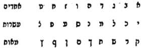

  
 And behold, when the hundreds are completed, the number of the thousands is equal to the units; and the Alef is what embeds its end in its beginning; for אל"ף [Alef] is אלף [*elef*, thousand], is פלא [*pele*, wonder]; and it is the Supernal Keter, which embeds its end in its beginning and its beginning in its end, in the secret of אי"ן / אנ"י [*ayin*, Nothing / *ani*, I], which we explained in Gate Three, and likewise we shall explain it in the Gate "From Below to Above." And for this reason the Alef is called a complete number; and it is the drawing forth of Tiferet from Keter, for the inclusion of the sefirot of ten is through Chokhmah, and all the more in its ascent from ten to ten, as we explained. "And seven hundred, which is a complete secret": he was precise not to say "complete number," as he said above, because it is not complete for all of them; but he said "a complete secret," because the seven sefirot are full and complete in the whole inclusion of ten (a word is missing) of ten, in the way of the preceding ten; except that the foundation of the preceding ones is ten, and therefore they rose to a thousand, and the foundation of these is seven, and therefore they rose only to seven hundred. And therefore he did not say "complete number," because the number ten was not completed. And it is called complete for the reason of the completeness of each one of its sefirot in a hundred gates; and for this he said "a complete secret." "And five likewise": explanation: for five too are in the secret of the Vav, as the number of the sefirot, in the secret of the inclusion of the seven in five, as we explained in the gates. And likewise when we remove from the count of the seven the pillar and the socket, five remain. "And seventy, all one secret": explanation: for the seventy too is in the secret of seven hundred, except that these are included in a great inclusion, and those are included in one inclusion only, that is, each one of the seven is included of ten: the seven turn out to rise to seventy. "And therefore from this secret and this reckoning he made hooks": explanation: to hint at this great secret, that Tiferet be included of all these aspects. "And all in the secret of Vav," etc.: it was difficult for him: for the Alef is a hint in all ten, and the seven hundred and seventy are in the seven, and the five likewise; and if so, what relates this number to Tiferet? And to this he answered, "and all in the secret of Vav"; and a proof for this is their form, for they were made like a Vav; except that it is Tiferet when it is included of all these manifestations. And so these [hooks] turn out to be in the secret of the upper ones in their form, their hinting, their place, and their reckoning: in their form, that they were in the form of Vav; in their hinting, for so they were hinting at Tiferet; in their place, that they stood upon the pillars, in the secret of the Vav upon the continuation of the Vav, which is Tiferet upon the Righteous One; and in their reckoning, in the secret of the thousand, and the seven hundred, and the five, and the seventy. And now there is no escaping saying that the seven hundred are not part of the thousand; rather it is a manifestation by itself, for the manifestation of the thousand is choicer than the manifestation of the seven hundred; and likewise for the seventy, and likewise for the five: each one is a manifestation by itself. And it was necessary for the matter of the Tabernacle that the Vav be included of all the manifestations, for the reason that Malkhut too should be included of all the manifestation. And the illustration of this: when we take a stone from the stones, or a piece of wood from the woods, and divide it in two, behold, of necessity those parts will be found, from the side of their unity, equal in their fibers and their figure, and this figure will not differ from that figure, for both were one piece, and one manifestation is necessary for them. And so is the matter in the emanation of Tiferet and Malkhut, since they were double-faced, as we shall explain in the Gate of the Diminishment of the Moon.

> ועוד נוכל לפרשו על דרך זה כי האלפא ביתא ימצא בה המספר עד ט' מאות, ומשם יחזיר האלפים לאחדים. נמצא לפי זה האלף הוא מספר השלם הנועץ סוף המספר בתחלתו ונצייר הנה צורה יפה שבה יתבאר כונתינו בקוצר כזו:
>
>  והנה בהשלים המאות ישוה מספר האלפים אל האחדים והאל"ף הוא הנועץ סופו בתחלתו כי אל"ף הוא אלף הוא פלא והוא כ"ע הנועץ סופו בתחלתו ותחלתו בסופו בסוד אי"ן אנ"י שפי' בשער ג' וכן נבארו בשער ממטה למעלה. ולסבה זו נקרא האל"ף מספר שלם והוא המשכת הת"ת מהכתר כי כללות הספירות מי' הוא ע"י חכמה ומה גם בעלותה מי' לי' כדפי'. ושבע המאות דאיהו רזא שלים דקדק שלא אמר מספר שלם כדקאמר לעיל, מפני שאינו שלם לכלהו, פי' אבל אמר רזא שלים כי הז' ספירות הם מלאות ושלימות בכל כללות העשר (חסרה מלה) מעשר ע"ד העשר הקודמות אלא שהקודמות יסודן עשר ולכן עלו לאל"ף ואלו יסודן שבע ולכן לא עלו כ"א לשבע מאות. ולכן לא אמר מספר שלם מפני שלא נשלם מספר העשר. ונקרא שלם מטעם שלימות כל אחד מספירותיה במאה שערים ולזה אמר רזא שלים. וחמשה הכי נמי. פי' כי ה' ג"כ הם בסוד הוא"ו כמנין הספירות בסוד כללות השבעה בה' כדפי' בשערי'. וכן כשנסיר ממנין השבעה העמו"ד והאד"ן נשארו ה'. וע' כלא רזא חדא. פי' כי הע' ג"כ בסוד שבע מאות אלא שאלו כלולים בכללות גדול ואלו נכללים בכללות א' לבד דהיינו כל אחד מז' כלולה מעשר נמצאו הז' עולים ע'. ועל דא מרזא דא וחושבן דא עשה ווים. פי' לרמוז הסוד הגדול הזה שיהיה הת"ת כלול מכל הבחי' הללו. וכלא ברזא דוא"ו כו'. הוקשה לו כי האל"ף הוא רמז בכל העשר וז' מאות ושבעים הם בשבעה וה' ג"כ, וא"כ מה ייחס מספר זה לת"ת. ועל זה השיב וכלא ברזא דוא"ו, וראיה על זה צורתם שהיו עשוין כמין וא"ו אלא שהוא הת"ת בהיותו כלול מכל המציאיות האלה. ונמצאו הוויית האלה בצורת"ם ורמיזת"ם ומקומ"ם וחשבונ"ם בסוד העליונים. בצורת"ם שהיו בצורת ו', ברמיזת"ם שכן היו רומזים לת"ת, במקומ"ם שהיו עומדים על העמודים בסוד הוא"ו על משך הוא"ו שהוא ת"ת על צדיק. וחשבונ"ם בסוד האל"ף ושבע המא"ות וחמש"ה ושבעי"ם. ועתה אין להמלט שלא נאמר שאין הז' מאות מכלל האל"ף. אבל הוא מציאות בפ"ע שמציאות האל"ף נבחר ממציאות הז' מאות וכן לע' וכן לחמשה כל א' היא מציאות בפ"ע. והוכרח לענין המשכן להיות הוא"ו כלול מכל המציאיות מטעם שתהיה ג"כ המלכות כלולה מכל המציאות. והמשל בזה כשנקח אבן מהאבנים או עץ מהעצים ונחלקנו לשנים הנה בהכרח ימצאו אותם החלקים מפאת יחודם שוים בחוטיהם וציורהם ולא ישתנו ציור זה מציור זה כי חתיכה אחת היו שניהם ויוכרח להם מציאות א'. וכן הדבר באצילות הת"ת והמלכות אחר שהיו ד"ו פרצופין כאשר נבאר בשער המעוט.

**14:2:7** And behold, although the Holy One, blessed be He, sawed them apart, nevertheless they are equal, like the parable we gave. And therefore, when the male is unified with the female in all his limbs with a complete and whole union, it is necessary that they be equal with a complete equality, the female receiving to the male and the male to the female, for they are like receiver and giver. And all the more since we have seen the matter of the channels, which we explained in chapter 1 of the gate we devoted to them. And therefore in the Tabernacle, to hint at all the divisions of their division, so that the union be complete, it was necessary that they be according to that number, so that the Vav be included of all the parts and aspects by which it can be considered, so that the female too may be considered in all those aspects, to receive from him. And from this reason the necessity will be understood why all that happened to Jacob happened to Joseph (Bereshit Rabbah 84:6): because Yesod unites Tiferet and Malkhut in all the parts and aspects of the two of them; and if so, it is necessary according to this that there be in it an aspect equal to the aspect of Malkhut and Tiferet, so that "the loops may be opposite" (Exod. 26:5), "and together they shall be whole at its head" (Exod. 26:24).

> והנה עם היות שנסרם הקב"ה עכ"ז הם שוים כדמיון המשל שהמשלנו, ולכן בהיות הזכר מתיחד עם הנקבה בכל אבריו יחוד גמור ושלם יוכרח היותן משתווים שווי גמור מקבל הנקבה לזכר והזכר לנקבה שהם כדמות מקבל ומשפיע. ומה גם ראותינו ענין הצנורות שפי' בפ"א מהשער שיחדנו להם. ולכן במשכן לרמוז אל כל חלוקי חלוקם להיות היחוד שלם הוכרח להיותם על צד המספר ההוא כדי שתהיה הוא"ו כלולה מכל החלקים והבחינות שאפשר שתבחן כדי שהנקבה ג"כ תבחן בכל הבחינות ההם לקבל ממנו. ומזה הטעם יובן הכרח למה כל מה שאירע ליעקב אירע ליוסף (ב"ר פד ו), מפני שיסוד הוא מיחד הת"ת והמלכות בכל החלקים והבחינות של שניהם וא"כ יוכרח לפי זה היות בו בחינה שוה אל בחינת המלכות והת"ת כדי שיהיו מקבילות הלולאות ויחדיו יהיו תמים על ראשו:

### Chapter 14:3. Explanation of known manifestations explained in the Zohar — a manifestation of Binah, of Tiferet, and of Malkhut; and a passage from the Zohar, "and it shall be on that day, living waters shall go out," concerning the child (*yenuka*), etc.

**14:3:1** Our intent in this chapter is to explain manifestations that are explained in some of the passages of the Zohar, which are very much needed for contemplation in this wisdom. And it is the manifestation of Binah, the manifestation of Tiferet, and the manifestation of Malkhut. As for the manifestation of Binah, there are two manifestations in her. The first, a manifestation that has no relation with the Emanation at all; and it is hinted in the manifestations of Yod, the subtle point that is in Binah. And the second, a manifestation that is related to the Emanation, from the side of the manifestation that she has. And one cannot say that the manifestation of the Yod is only in Chokhmah, and that the letter of Binah is Heh; for the letter of Binah is also Yod. And so it is explained in the words of Rashbi, that three Yods are the first three; and that is the aspect of Binah with the two upper ones, and she is hinted in Yod, like each one of the other upper ones. But when she emanates the Emanation in their place, then she has the aspect of the Heh.

> כונתינו בפרק זה לבאר מציאיות מתבארים בקצת ממאמרי הזהר והם צריכין אל העיון בחכמה הזאת ביותר. והוא במציאות הבינה ובמציאות הת"ת ובמציאות המלכות. במציאות הבינה, בה שני מציאות. ראשונה מציאות שאין לו יחס עם האצילות כלל, ונרמזת במציאיות יו"ד נקודה דקה שבבינה. והשניה מציאות המתייחס עם האצי' מצד המציאות אשר לה. ואין לומר שאין מציאות היו"ד אלא בחכמה, ושאות הבינה היא ה"א. שגם אות הבינה היא יו"ד. וכן מבואר בדברי הרשב"י שג' יודין הם ג' ראשונות והיינו בחינת הבינה עם ב' העליונות והיא נרמזת ביו"ד ככל אחת משאר העליונות. אבל כאשר תאציל האצילות במקומם, אז יש לה בחינת הה"א.

**14:3:2** And behold, the aspect of the Yod is called *Mi* [who], which is a question without an answer, because of her great concealment. And the aspect of Heh is hinted in *Eleh* [these], which are the three fathers, that is, the three Vavs that are in the form of the Heh, thus: ה; and the right Vav is Chesed, and its roof is Gevurah, and the hanging leg is Tiferet; and they are called *Eleh*. And to understand this matter well, one must contemplate what we shall write in the Gate of Names, chapters 8 and 9, and in the Gate "From Below to Above," chapter 5, on the name אלדי"ם [Elohim], which is the permutation of מ"י אל"ה [*Mi Eleh*]: Heh upon Yod, as explained in the Tikkunim many times. He means the Heh, which is a garment to the Yod, thus:  

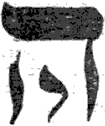

  
 And therefore she is female, for the aspect of revealing caused her to be female. But before, she is Yod alone, in the secret of a point equal to the two points. But by reason of her emanation, to emanate the Emanation, the manifestation of three lines was formed in her. For when she oversees in Chesed, to pour them forth, it is necessary that there be in her the aspect of Chesed; and when she oversees in compassion, it is necessary that there be in her the aspect of compassion; and when she oversees in judgment, it is necessary that there be in her the aspect of judgment. And these three aspects that were formed in her are certainly the manifestation of the source of the three lines, which remained there in subtlety, which are root and source to the revealed ones. And there is no question to say that the fathers are not Vavs, but only Tiferet; for so they explained in the Tikkunim, apart from this inquiry, and said that the three verses ו*ayyissa*, ו*ayyavo*, ו*ayyet* (Exod. 14:19–21) are three Vavs in three fathers. And after we have explained these two manifestations in Binah, we say that both of them are also in Malkhut. And they are hinted in these two letters literally, in Heh and Yod: for her principal is Yod, and her manifestation that is emanated to her receives the three lines [which are Netzach, Hod, Yesod] and becomes Heh. And close to this matter it is explained in the Zohar (Shelach, folio 171a), and these are its words: "That child [*yenuka*] opened and said (Zech. 14:8): 'And it shall be on that day' [*ba-yom ha-hu*]: it is not known who it is. But everywhere 'on that day' is the last day. Why is it called 'that day'? But this is the secret: it is the day that holds the end to the beginning. The beginning is called *hu* ['he,' 'that'], as it is written (Num. 18:23), 'And the Levite, he [*hu*], shall do the service': the service of the Levite is to the grade called *hu*, concealed and stored away. And it is called *hahu* ['that'] to show the end of all the grades, which is the beginning, and all is one; and because it is the end, Heh was added to it. Jerusalem is destined to bring forth waters and to make springs flow. Here there is [room] to say: the end of all the grades is not Jerusalem. But certainly Jerusalem and that day are all one. What is [the difference] between this and that? But Jerusalem: all her holy grades, when they go around, are called Jerusalem, and so they are bounded. There are grades that go around and are called courts, these inner and these outer; and there are grades that, when they go around, are called chambers; and there are grades that, when they go around, are called Heikhal and Devir. Within all those grades there is one point: 'All glorious is the king's daughter within' (Ps. 45:14). This point is called 'that day'; and your sign: 'that too is reckoned a land of Rephaim' (Deut. 2:20). And when this day rises from within the (vaults) (lattices) of the court, the flow of waters will rise; and this flow [goes] to the former sea [*ha-yam ha-kadmoni*], to be like a mother whose son is between her arms, and the milk increases, and the suckling's mouth is filled, and it grows by it, and it pours the milk out into its mother's mouth. So 'half of them to the former sea'" (Zech. 14:8), etc. Thus far its words.

> והנה בחינת היו"ד נקרא מ"י שהוא שאלה בלא תשובה מרוב העלמה. ובחינת ה"א הוא נרמזת באלה שהם ג' אבות דהיינו ג' ווי"ן שבצורת הה"א כזה ה', והוא"ו הימיני הוא חסד, והגג שלה הוא גבורה, והרגל התלוי הוא ת"ת. והם נקראים אלה. ולעמוד על ענין זה היטיב, צריך לעיין במה שנכתוב בשער השמות פ"ח ט' ובשער ממטה למעלה פ"ה בשם אלדי"ם שהוא צרוף מ"י אל"ה, ה' על י' כמבואר בתקונים פעמים הרבה. ירצה ה' שהוא לבוש אל היו"ד כזה
>
>  ולכן היא נקבה כי בחינת הגילוי גרמה לה היותה נקבה. אבל קודם היא י' לבד בסוד נקודה שוה אל שתי הנקודות. אבל בסבת אצילותה להאציל האצילות נצטייר בה מציאות ג' קווים. כי בהיותה משגחת בחסד להשפיעם יוכרח היות בה בחינת החסד, ובהיותה משגחת ברחמים יוכרח היות בה בחינת הרחמים, ובהיותה משגחת בדין יוכרח היות בה בחינת הדין. וג' בחינות האלה שנצטייר בה זה ודאי מציאות מקור ג' קווין שנשארו שם בדקות שהם שרש ומקור אל המתגלים. ואין שאלה לומר שהאבות אינם ווין אלא הת"ת לבד. כי כן פי' בתיקונים בזולת הדרוש ואמרו שג' פסוקים ו"יסע ו"יבא ו"יט הם ג' ווי"ם בג' אבות. ואחר שבארנו שני המציאות האלה בבינה נאמר כי גם שתיהם במלכות. והם נרמזים בשתי אותיות אלה ממש בה' וי' כי עיקרה היא יו"ד ומציאותה המתאצל אליה מקבלת הג' קווים [שהם נה"י] ונעשית ה'. וקרוב לענין זה נתבאר בזהר (שלח דף קע"א.) וז"ל פתח ההוא ינוקא ואמר, והיה ביום ההוא, לא ידיע מאן הוא. אלא בכל אתר ביום ההוא יומא בתראה איהו. אמאי איקרי יום ההוא. אלא רזא דא הוא יומא דאחיד סופא בשירותא. שירותא אקרי הוא כמה דכתיב ועבד הלוי הוא. פולחנא דלוי לדרגא דאקרי הוא טמיר וגניז ואקרי ההוא לאחזאה סופא דכל דרגין דאיהו שירותא וכלא חד ובגין דאיהו סופא איתוסף ביה ה'. זמינא ירושלם לאפקא מיין ולנבעא נביעי. הכא אית למימר סופא דכל דרגין לאו איהו ירושלם אלא ודאי ירושלם ויומא ההוא כלא חד. מה בין האי להאי, אלא ירושלם כל דרגין קדישין דילה כד אסתחרן אקרון ירושלים והכי אתתחמן אית דרגין דסחרן ואקרון עזרות אילין פנימאן ואילין לבר ואית דרגין דאקרון כד אסתחרן לשכות ואית דרגין דאיקרון כד אסתתחרן היכל ודביר. לגו מכל אינון דרגין, אית נקודה חדא כבודה בת מלך פנימה. נקודה דא אקרי יום ההוא וסימנך ההוא יקרא ארץ רפאים. וכד יקום יומא דא מגו (כיפין) (שבכין) דעזרה יקום נביעו דמיין והאי נביעו מן הים הקדמוני ליהוו כגוונא דאמא דברה בין דרועהא ומסגיאו חלבא דיניק אתמלי פומיה ואתרבי ביה אריק חלבא לפומא דאימיה. כך חציים אל הים הקדמוני וכו' עכ"ל.

**14:3:3** And behold, this passage is long in its place, and we have abridged it and copied from it what we need. And the matter in brief: this *yenuka* was a child who departed from the world for a reason known to Him, blessed be He; and when his soul ascended to the entrance of the gates of the Garden of Eden, the cherubim, the guardians of the Garden, held him, so as not to let him enter, for a reason stated there. And meanwhile the head of the academy of the righteous was expounding on this verse, "And it shall be on that day"; and the child, from outside, objected, and these are his words: "Waters that are below: how do they rise from it to a place higher than it by many grades? And what need have those [above] of those waters? And a place from which all the springs and streams go out, and there is no ceasing to its springs and streams, is watered from a dry place? Who has seen the digging of a well give water to the spring that flows? And does Jerusalem give water to the former sea, the place from which all the waters of the world go out?" Thus far its words.

> והנה המאמר הזה רב במקומו ואנו קצרנוהו והעתקנוהו ממנו הצורך אלינו. והענין בקצרה, זה הינוקא היה תנוק א' שנסתלק מן העולם לסבה ידועה אליו יתברך וכאשר עלתה נשמתו אל פתח שערי ג"ע אחזו בו הכרובים שומרי הגן לבלתי תתו להכנס לסבה שנאמרה שם ובין כך ובין כך היה ראש ישיבת הצדיקים דורש בפסוק זה והיה ביום ההוא והתינוק מבחוץ הקשה וז"ל מיין דאינון מלרע היך סלקין לעילא מיניה לאתר עילאה יתיר מיניה בכמה דרגין ומה איצטרך לון לאינון מיין. ומה אתר דכל מבועין ונחלין נפקין מיניה ולית פסיקו למבועי ונחלוי אשתקייא מאתר נגוב מאן חמא חפירא דבירא יהיב מייא למבועא דנביע. וכי ירושלם יהיב מים אל הים הקדמוני אתר דכל מימין דעלמא נפקי מתמן עכ"ל.

**14:3:4** And it is a strong difficulty: for Jerusalem is Malkhut, and the former sea is Binah, and therefore it is called "former"; and how is it possible that Binah should be watered from Malkhut? And to answer this difficulty, after they brought him into the academy, he opened and said: "And it shall be on that day: it is not known," etc. For the word *hu* indicates the hidden [third person], and it is a title for concealment, as we shall explain in the Gate of the Glossary of Titles; and the Heh of knowledge [the definite article] indicates the revealed, as is well known. And behold, they are two opposites in one word. And this is what he intended in saying "*hahu*: it is not known who [*hu*] it is": explanation: *hu* indicates concealment, and *hahu* indicates revealing, and they are two opposites. And he answered: "But everywhere 'on that day'" is Malkhut, which is the last day. And although she is the attribute of night, she is also day, for there are seven days, and the name "day" is already related to her. And since she is Malkhut, it is fitting that it come with the Heh of knowledge, because she is revealed and known; but the word *hu* cannot properly be said, for it indicates concealment, as we explained. And he answered: "But this is the secret: it is the day," etc. Explanation: to indicate the manifestation of the Yod, which is a concealed manifestation that is in her. For Malkhut is beginning and ending, which is beginning and end, as we say, "the beginning of thought is the end of action": for she is above in Chokhmah, in the manifestation of Yod, and she is the end of action in Malkhut, in the manifestation of Heh. And he said that the concealed manifestation, which is the beginning, is called *hu*, which indicates beginning. And a proof is from what is written, "And the Levite, he [*hu*], shall do the service"; and the service of the Levite is to Binah, as we explained in the Gate of Essence and Governance, chapter 10.

> והיא קושיא חזקה, כי ירושלם היא המלכות והים הקדמוני היא בינה ולפיכך נקרא קדמוני וכיצד אפשר שישוקה הבינה מהמלכות. ולהשיב על הקושיא הזאת אחר שהכניסוהו לישיבה פתח ואמר והיה ביום ההוא לא ידיע וכו' כי מלת הוא מורה על הנסתר והיא כנוי אל ההעלם כאשר נבאר בשער ערכי הכנויים וה"א הידיעה מורה על הנגלה כמפורסם. והנה הם ב' הפכים במלה אחת. וזה כיוון באמרו ההוא לא ידיע מאן הוא. פי' הוא מורה העלם, וההוא מורה התגלות, והם ב' הפכים. והשיב אלא בכל אתר ביום ההוא, הוא המלכות, שהוא יום האחרון. ואע"פ שהיא מדת לילה ג"כ הוא יום, שהרי ז' ימים הם, וכבר יתייחס אליה שם יום. ומאחר שהיא המלכות ראוי לבא בה' הידיעה מפני שהיא גלויה וידועה. אבל תיבת הוא לא יצדק שהוא מורה על ההעלם כדפי'. והשיב אלא רזא דא הוא יומא כו'. פי' להורות על מציאות היו"ד שהוא מציאות נעלם שיש בה. כי המלכות היא שירותא וסיומא שהוא תחלה וסוף כדאמרי' תחלת המחשבה סוף המעשה שהיא למעלה בחכמה במציאות יו"ד והיא סוף המעשה במלכות במציאות ה'. ואמר שהמציאות הנעלם שהוא התחלה נקרא הוא, שמורה על התחלה. וראייה ממאי דכתיב ועבד הלוי הוא, ועבודת הלוי היא אל הבינה כדפי' בשער מהות והנהגה בפ"י.

**14:3:5** And behold, *hu* indicates the beginning, which is first and earliest; for Binah is called "the beginning that stands to be asked about," as we explained there in chapter 15. And the aspect of the revealed manifestation, which is the end of all the grades, is called *hahu*, with the Heh of knowledge. So the word *hahu* turns out to indicate the two manifestations together. And behold, the *yenuka* explained her two manifestations, in the Heh that surrounds the Yod, in the matter of *hahu*.

> והנה הוא, מורה על שירותא שהוא תחלה וראשון כי הבינה נקרא שירותא דקיימא לשאלתא כדפי' שם בפט"ו. ובחי' המציאות המתגלה שהוא סוף כל דרגין נקרא ההוא בה' הידיעה. נמצא תיבת ההוא מורה על שני המציאיות יחד. והנה ביאר הינוקא ב' המציאיות שלה בה' שסביב לי' בענין ההוא.

**14:3:6** And behold, the middle point is called "All glorious is the king's daughter within." And likewise it is called "the apple of the eye" [*bat ayin*], for it is like the pupil of the eye, a tiny, fine point, and around it three colors, which are the colors of the rainbow; they are the three fathers.

> והנה הנקודה האמצעית נקרא כבודה בת מלך פנימה. וכן נקרא בת עין שהוא כבבת עין נקודה זעירא דקיקא וסביבה ג' גוונים שהם גווני הקשת הם ג' אבות.

**14:3:7** And behold, this point ascends to its place, its height, to her father's house, Chokhmah, by means of the effluence of Binah, which is the mother who nurses her with the milk; and through her she is exalted, until she ascends and pours effluence even into Binah herself, as he said, "like a mother whose son," etc. And likewise she pours effluence into her literal lower manifestation (which is the Heh, to feed the lower ones by it); and this is "and half of them to the latter sea." And the sum of the matters: Binah has Heh, and her manifestation is the three fathers; and Malkhut has Heh, and her manifestation is Netzach, Hod, and Yesod. And these two preliminaries are explained in the Ra'aya Meheimna (Terumah, folio 158), and these are its words: "The vessel of the Holy One, blessed be He, is the Shekhinah, which is a vessel to serve her husband. She is His candelabrum, of which it is said (Ps. 119:164), 'Seven times a day I praise You,' which are Gedulah, Gevurah, Tiferet, Netzach, Hod, Yesod, and Malkhut, seven included. Of these seven grades, three branches of the candelabrum from its one side: the body and the two arms of the King; she is a lamp of commandment to illumine by them. And three branches of the candelabrum from its second side: they are the two thighs and the covenant; and she is the western lamp to illumine by them. She is called the King's candelabrum, and she is a lamp to illumine by it, the lamp of commandment, of which it is said (Ps. 19:9), 'The commandment of the Lord is pure, enlightening the eyes.' And who is the head of the candelabrum? Binah, the upper Heh, which has three branches, in this image, ה: three Vavs, which are the three fathers. The second Heh: three second branches, in this image, ה: three Vavs, which are Netzach, Hod, Yesod. Vav: the middle candelabrum, son [*ben*] of Yah; after his name Binah [*bin-Yah*] is called; he includes six branches below, in the reckoning of Vav, in his six branches. Yod: 'a woman of valor is the diadem of her husband' (Prov. 12:4), the crown of the Torah scroll, in the form of Zayin. From the side of the World to Come she is not a vessel for Him, and does not serve Him, but a diadem on His head. But in this world she is like this, הוה"י: she is a vessel beneath Him, His service," etc. Thus far its words. And in it, explicitly, that each of the two Hehs is three Vavs. And also the manifestation of Malkhut, that she is sometimes Yod, when she ascends above; and then she is called "a woman of valor, the diadem of her husband," for she is Yod, a diadem upon Vav, and becomes Zayin; and she is the diadem of Tiferet. And this is when she ascends to Binah to be unified with Chokhmah, from which is her manifestation, as we explained above. And now we come in a further chapter to explain further the matter of the manifestations of the Yod to Malkhut in the Heh, although it will be explained in the Gate of the Diminishment of the Moon.

> והנה בעלות הנקודה הזאת אל מקומה הרמתה אל בית אביה חכמה באמצעות שפע הבינה שהיא האם המניק לה החלב וע"י תתעלה עד שהיא עולה והיא משפעת אפי' בבינה עצמה כדקאמר כגוונא דאימא דברה וכו', וכן תשפיע אל מציאותה התחתון שבה ממש (שהיא הה' לזון בו התחתונים) וזהו וחצים אל הים האחרון. וכלל הדברים, כי הבינה לה ה' ומציאותה ג' אבות. ולמלכות ה' ומציאותה נצח והוד ויסוד. ושתי הקדמות אלו נתבארו ברעיא מהימנא (תרומה דקנ"ח) וז"ל מאנא דקב"ה איהי שכינתא דאיהו מאנא לשמשא לבעלה איהי מנרתא דיליה דאתמר בה שבע ביום הללתיך דאינון הגדולה והגבורה והת"ת והנצח וההוד יסוד ומלכות. ז' כלילן. מז' דרגין אלין ג' קני מנורה מצדה האחד, גופא ותרין דרועי דמלכא איהו נר מצוה לאנהרא בהון. וג' קני מנורה מצדה השני, אינון תרין שוקין וברית ואיהו נר מערבית לאנהרא בהון. מנרתא דמלכא אתקריאת ואיהי נר לאנהרא ביה נר מצוה דאתמר ביה מצות ה' ברה מאירת עינים ומאן רישא דמנרתא בינה ה' עילאה דאית לה תלת קנים בדיוקנא דא ה' תלת ווי"ן דאינון תלת אבהן. ה' תניינא ג' קנים תניינין בדיוקנא דא ה' תלת ווי"ן דאינון נצח הוד יסוד. ו' מנרתא דאמצעיתא ב"ן י"ה על שמיה אתקרי בינה איהו כליל שית קנים לתתא בחשבון ו' בו' קנים דיליה. י אשת חיל עטרת בעלה תגא דס"ת בצורת זיין. מסטרא דעלמא דאתי לאו איהי מאנא לגביה ולאו משמשא לגביה אלא עטרה על רישיה אבל בעלמא דין איהי כגוונא דא הוה"י איהי מאנא תחותיה שמושא דיליה וכו' עכ"ל. ובו בפירוש כי ב' ההי"ן הם ג' ווי"ן כל אחד מהם. וגם מציאות המלכות שהיא לפעמים יו"ד בעלותה למעלה ואז היא נקראת אשת חיל עטרת בעלה שהיא י' עטרה על ו' ונעשית ז' ואיהי עטרת תפארת וזו כאשר היא עולה לבינה להתייחד עם החכמה שמשם מציאותה כדפי' לעיל. ועתה נבא בפ' זה לבאר עוד ענין מציאיות היו"ד אל המלכות בה"א עם היות שיתבאר בשער המיעוט:

### Chapter 14:4. On the necessity of the manifestations of Malkhut; and a passage from Sefer ha-Bahir, "the earth was created before the heavens."

**14:4:1** Since above we said incidentally that the manifestation of Malkhut is from Chokhmah, we come in this chapter to decide concerning some passages of the Tikkunim, and these are their words (in Tikkun 69, folio 103): "And further, 'I am asleep [*yeshenah*]': second [*sheniyah*], certainly, to Chokhmah, which is Yod, when my beloved, who is Vav, is far from me. And the secret of the matter: Heh: 'The Lord founded the earth by wisdom; He established the heavens by understanding [*tevunah*]' (Prov. 3:19). Chokhmah, which is Abba, Yod, founded the daughter, who is earth, small Heh: 'the earth,' certainly. 'He established the heavens': this is Vav. 'By understanding': this is the supernal Imma. For she is called Binah above, when she is with her husband; she is called Tevunah below, when she is with Vav below; and it is ב"ן ו' [*ben*, Vav], and Tav, which is Tiferet; she remains Heh with him. And at that time, when the letter Vav is with Imma and he is far from her, it is said of her, 'I am asleep' in exile, and she is second to him." And the intent is that when Malkhut is above she is second to Chokhmah, and she is literally Yod, like it, as he explained in many places. And this is what he was precise about in saying "second, certainly, to Chokhmah, which is Yod": in the secret of the manifestation of the Yod, in which the two of them are equal: this is the Yod of the four-letter name, and this is the Yod of Adonai. (And in the Sifra di-Tzeni'uta, Parashat Terumah, folio 176) among the *havayot* he brings a *havayah* like this, יהו"י, and it indicates the secret of the matter mentioned; and these are its words: "יהו"י: the last Yod is the Shekhinah (below), just as the Heh is found [to be] the Shekhinah; and they are weighed on one scale." Thus far its words.

> אחר שלמעלה אמרנו אגב גררא היות מציאות המלכות מהחכמה, נבא בפרק זה להכריע בקצת מאמרי התקונים וז"ל (בתקונא ס"ט דף ק"ג) ועוד אני ישנה שניה ודאי לחכמה דאיהו י' כד אתרחק מיני רחימאי דאיהו ו', ורזא דמלה ה' בחכמה יסד ארץ כונן שמים בתבונה, חכמה דאיהו אבא י', יסד ברתא דאיהי ארץ ה' זעירא הארץ ודאי. כונן שמים דא וא"ו. בתבונה דא אימא עלאה. דבינה אתקריאת לעילא כד איהי עם בעלה. תבונה אתקריאת לתתא כד איהי עם ו' לתתא ואיהו ב"ן ו', ות' דאיהו ת"ת אשתארת איהי ה' עמיה. ובההוא זמנא דאת ו' איהו עם אימא ואיהו מרחק מינה, אתמר בה אני ישנה בגלותא, ואיהי שניה ליה. והכוונה כי בהיות המלכות למעלה היא שניה לחכמה ואיהי יו"ד ממש כמותה כמו שביאר במקומות רבים. וזה דקדק באמרו שניה ודאי לחכמה דאיהו יו"ד. בסוד מציאות היו"ד אשר בה משתוים שניהם. זו י' של שם בן ד', וזו י' של אדני. (ובספרא דצניעותא פ' תרומה דף קע"ו) בכלל ההויות מביא הוי"ה כזו יהו"י והוא המורה על סוד הענין הנזכר. וז"ל יהו"י. י' בתראה שכינתא (לתתא) כמה דה"א שכינתא אשתכח. ובחד מתקלא אתקלו עכ"ל.

**14:4:2** And they said "when my beloved is far from me," etc.: explanation: Malkhut says that she is second to Chokhmah at the time that she has been distanced from her husband. And the matter is that in the four-letter name, whose letters are ידו"ד in their order, they are sometimes permuted to ידד"ו; and he means that Malkhut has ascended to Chokhmah, to her father's house, and Tiferet is unified with Binah. And this is what he explained: "And the secret of the matter: Heh: 'The Lord founded the earth by wisdom,'" etc. Explanation: by Chokhmah, which is Yod, was the foundation of the earth; for the earth is Malkhut in the manifestation of Heh, and the foundation of the Heh is Yod, which is the manifestation of the rib that was taken from the man. And Rashbi, peace be upon him, explained in the Tikkunim (Tikkun 12, folio 27a), and these are his words: "And it is said there concerning Adam (Gen. 2:22): 'And the Lord God built the rib that He had taken from the man': this is Chokhmah. 'And He brought her to the man': this is the central pillar," etc. He taught that the manifestation of the Yod is the manifestation of the rib, and she was taken from Chokhmah, which is the upper Adam, and was built in the building of the Heh, as we shall explain; and then He unified her with Tiferet.

> ואמרו כד אתרחק מני רחימאי וכו' פי' המלכות אומרת שהיא שנייה לחכמה בעת שנתרחקה מבעלה. והענין כי בשם בן ד' אותיות והם ידו"ד כסדרן לפעמים יצטרפו אל ידד"ו, וירצה שהמלכות עלתה אל החכמה לבית אביה והת"ת מתיחד עם הבינה. וזה שביאר ורזא דמלה ה' בחכמה יסד ארץ וכו'. פי' בחכמה שהוא יו"ד היה יסוד הארץ כי הארץ היא המלכות במציאות ה' ויסוד הה"א הוא יו"ד שהוא מציאות הצלע אשר נלקח מן האדם. ופי' הרשב"י ע"ה בתקונים (תקונא י"ב דף כ"ז.) וז"ל ואתמר התם לגבי אדם ויבן ה' אלדים את הצלע אשר לקח מן האדם, דא חכמה. ויביאה אל האדם, דא עמודא דאמצעיתא כו'. הורה כי מציאות היו"ד הוא מציאות הצלע ונלקחה מהחכמה שהוא אדם העליון, ונבנתה בבנין הה"א כאשר נבאר ואז ייחדה עם התפארת.

**14:4:3** And behold, the foundation of the building, which is Heh, is thus:  

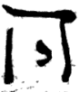

  
 And this is what he said: "Chokhmah, which is Abba, Yod, founded the daughter, who is earth, small Heh: 'the earth,' certainly." Explanation: the manifestation called "earth," that is, her lower aspect, the matter of the earth, which is below all: the foundation of this earth was in Chokhmah, as we explained. "He established the heavens by understanding": and likewise the establishing and building of the heavens was by Tevunah. For their principal is from Chokhmah, as we explained in the Gate "Ten and Not Nine," chapter 2; for the manifestation of the firmament is from Chokhmah; but its establishment, that is, its building, and the aspect that surrounds and clothes the firmament, that is, the aspect called "heavens," was by Tevunah, which is Binah when she is unified with Tiferet, as he concludes. This matter is further explained in the Tikkunim (Tikkun 29, folio 73a), and these are its words: "And the lower Shekhinah, commandment, is included of four letters: she is called Yod from the side of Chokhmah, Heh from the side of the supernal Imma," etc. Thus far its words.

> והנה יסוד הבנין שהוא ה"א הוא כזה
>
>  וז"ש חכמה דאיהו אבא י', יסד ברתא דאיהי ארץ ה' זעירא הארץ ודאי. פי' כי מציאות הנקרא ארץ דהיינו בחינתה התחתונה ענין הארץ שהיא למטה מן הכל ויסוד הארץ הזאת היתה בחכמה כדפי'. כונן שמים בתבונה, וכן התכוננות ובנין השמים היה בתבונה. כי עקרם הם מחכמה כמו שפי' בשער י' ולא ט' בפ"ב. כי מציאות רקיע הוא מחכמה אמנם כוננותו דהיינו בניינו ובחי' הסובבת ומלבשת הרקיע דהיינו בחינה הנקרא שמים זה היה בתבונה שהוא הבינה בהיותה מתייחדת עם הת"ת כדמסיק. עוד נתבאר הענין הזה בתיקונים (תקונא כ"ט דף ע"ג.) ז"ל ושכינתא תתאה מצוה כלילא מארבע אתוון איהי אתקריאת י' מסטרא דחכמה ה' מסטרא דאימא עילאה וכו' עכ"ל.

**14:4:4** Behold, explicitly, that the manifestation of Yod is from the side of Chokhmah, and then she is called after Chokhmah; and so it is explained elsewhere (in the Introduction, folio 10): "When she is taken from Chokhmah, she is called *Reshit* [beginning] after it." Thus far. And likewise she is Heh from the side of Binah, that is, the building, as is written (Gen. 2:22), "And the Lord God built the rib"; and these two names indicate Binah. And so Rashbi explained in the commentary on the Song of Songs (in Zohar Chadash, folio 83), on the verse "like the curtains of Solomon" (Song 1:5); and there he explained that sometimes her building will be from Binah in the manifestation of Tet, which covers over the Yod. For Binah is Lamed; and when a building is built around the Yod of Malkhut, it is formed in the form of Tet, that is, a Lamed in a circle, thus:  

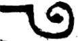

  
 And likewise the matter of this manifestation is explained in the episode of the *yenuka*; and for love of brevity we shall not dwell on bringing their wording here. And likewise they explained the matter in the Zohar (Parashat Vayechi, folio 246), and these are its words: "The holy Kingship does not receive complete kingship until it is joined with the fathers; and when it is joined with them it is built into a complete building from the upper world." Thus far its words. (And so it is in the Zohar, Va'era, folio 31.)

> הרי בפי' כי מציאות יו"ד מצד החכמה וכן אז נקראת ע"ש החכמה וכן פי' במ"א (בהקדמה ד"י) כד אתנטילת מחכמה אתקריאת ראשית על שמה ע"כ. וכן היא ה' מצד הבינה דהיינו הבנין דכתיב (בראשית ב) ויבן ה' אלדים את הצלע. ושני שמות האלו מורים על הבינה. וכן ביאר הרשב"י בפי' שה"ש (בז"ח דף פ"ג) בפסוק כיריעות שלמה, ושם פירש כי לפעמים יהיה בניינה מן הבינה במציאות ט' דחפי על י'. כי הבינה למ"ד וכאשר יבנה בנין סביב הי' של מלכות יצטייר בצורת ט' דהיינו למ"ד בעגול כזה
>
>  וכן נתבאר ענין המציאות הזה בעובדא דינוקא. ולאהבה הקצור לא נאריך בהבאת לשונם הנה. וכן ביארו הענין בזהר (פ' ויחי דף רמ"ו) וז"ל מלכותא קדישא לא קביל מלכותא שלימתא עד דאתחבר באבהן, וכד אתחבר בהו אתבני בניינא שלים מעלמא עילאה עכ"ל. (וכ"ה בזהר וארא דף ל"א).

**14:4:5** Behold, explicitly, that the principal of her building, that is, Heh, is through the three fathers, which are three Vavs, as explained in the preceding chapter. And likewise by their power she is built in three Vavs, that is, Heh; and the principal of the building is from the upper world, that is, the secret of Binah, as we explained. And likewise this inquiry is also explained in Sefer ha-Bahir; these are its words: "Rabbi Yannai said: The earth was created before the heavens, as it is said (Gen. 2:4), 'earth and heavens.' They said to him: But behold, it is written (Gen. 1:1), 'the heavens and the earth.' He said to them: A parable: to what is the matter like? To a king who acquired a fine object; it was not complete, and he did not call a name upon it, and said: I will complete it, and set right its base and its joining, and then I will call it a name. This is what is written (Ps. 102:26): 'Of old You founded the earth, and the heavens are the work of Your hands.' And it says (Ps. 104:2–5): 'Who wraps Himself in light as a garment, who stretches out the heavens like a curtain, who lays the beams of His upper chambers in the waters'; and it says, 'who makes His angels winds, His ministers a flaming fire'; and afterwards, 'He founded the earth upon its bases, that it should not be moved, forever and ever [*olam va-ed*].' When He set right a place for her, then she was strengthened in it, as it is said, 'that it should not be moved.' And what is her name? *Va-ed*. And her base is *olam*; and this is *olam va-ed*." Thus far its words.

> הנה בפי' כי עיקר בנין שלה דהיינו ה' היא ע"י הג' אבות שהם ג' ווי"ן כמבואר בפרק הקודם. וכן מכחם נבנית היא בג' ווי"ן דהיינו ה' ועקר הבנין מעלמא עילאה דהיינו סוד הבינה כדפי'. וכן נתבאר הדרוש הזה ג"כ בספר הבהיר ז"ל א"ר ינאי הארץ נבראת קודם השמים שנאמר ארץ ושמים. א"ל והא כתיב את השמים ואת הארץ. א"ל משל לה"ד למלך שקנה חפץ נאה לא היה שלם ולא קרא עליו שם ואמר אשלימנו ואתקן לו כנו וחבורו ואז אקרא לו שם. הה"ד לפנים הארץ יסדת ומעשה ידיך שמים, ואומר עוטה אור כשלמה נוטה שמים כיריעה המקרה במים עליותיו, ואומר עושה מלאכיו רוחות משרתיו אש לוהט ואח"כ יסד ארץ על מכוניה בל תמוט עולם ועד. כשתיקן לה מקום אז תאמץ בה שנאמר בל תמוט, ומה שמה, ועד, ומכונה עולם והיינו עולם ועד עכ"ל.

**14:4:6** And the explanation: "the earth was created": the intent is that Malkhut preceded Tiferet in the manifestation of the revealing of her emanation, as will be explained in the Gate of the Diminishment of the Moon, chapter 3. And he brought a proof for this from the verse (Gen. 2:4) "on the day that the Lord God made earth and heavens," which shows that the earth preceded the heavens. And they objected to him from the verse "the heavens and the earth," for the heavens were created first, as is evident from the plain sense of the verse. And he answered them by way of a fine parable: to a king who acquired a fine object, which is Malkhut; and the matter of this acquisition is the beginning of her emanation in Chokhmah, and it too is called king; and because it was not complete, for she was in the manifestation of a rib, lacking the building. And they said "and he did not call a name upon it": the intent is, he did not emanate it and did not reveal it so as to be bounded and titled with a name, but kept it standing until its preparation and until the preparation of its place, which is the Chariot upon which the glory of Malkhut stands: it is her base. And the completion is the building, the building of the rib, which is the manifestation of the Heh that is in her, as we explained. And he brought a proof for this from the verse "Of old You founded the earth": explanation: before the heavens, You founded the earth, which is Malkhut.

> ופי' הארץ נבראת, הכוונה כי המלכות קדמה לת"ת במציאות גילוי אצילותה כאשר יתבאר בשער המיעוט בפ"ג. והביא ראיה לזה מפסוק ביום עשות ה' אלקים ארץ ושמים, כנראה שהארץ קדמה לשמים. והקשו לו מפסוק את השמים ואת הארץ כי שמים נבראו תחלה כדמוכח מפשט הפסוק. והשיב להם בדרך משל נאה למלך שקנה חפץ נאה שהיא המלכות וענין הקנין הזה הוא תחילת אצילותה בחכמה והוא ג"כ נקרא מלך ומפני שלא היה שלם כי היתה במציאות צלע חסרת הבנין. ואמרו ולא קרא עליו שם. הכוונה לא האצילוהו ולא גילהו להיות נגבל ומכונה בשם אלא העמידו עד הכנותו ועד הכנת מקומו שהוא המרכבה שעליה עומדת כבוד המלכות הוא המכון שלה. וההשלמה הוא הבנין בנין הצלע שהוא מציאות הה"א שבה כדפי'. והביא ראיה לזה מפסוק לפנים הארץ יסדת פי' קודם השמים הארץ שהיא המלכות יסדת.

**14:4:7** And the matter of "You founded" is the foundation founded in Chokhmah, as he said, "Abba founded the daughter," as we explained. And from this verse is a proof for the matter of the foundation of the earth, that it precedes the work of the heavens, that is, the establishing of the heavens; for its work is through Binah, as will be explained in the Gate of the Glossary of Titles. And this is "and he said, I will complete it," which intended the building mentioned above. And for the matter of the base he proved from the verse "Who wraps Himself in light as a garment." And to understand the matter of this proof we must copy here what the Elder explained on it (in Parashat Mishpatim, folio 98), and these are its words: "'Who wraps Himself in light as a garment': this is the beginning of the first day. 'Who stretches out the heavens': here the left is included; and he did not say 'very'; the left is included in the right, to shine in the totality of heavens. 'Who lays the beams of His upper chambers in the waters': here there goes out in joy that tree of life, the river that goes out of Eden; and in its waters were rooted those two willows of the brook, which grow in its waters; this is what is written, 'who lays the beams of His upper chambers in the waters.' What are 'His upper chambers'? These are the willows of the brook. And this is what is written (Jer. 17:8), 'and spreads out its roots by the stream.' And this is the secret of what is written (Ps. 46:5), 'There is a river whose streams make glad the city of God.' What are 'its streams'? They are these, its roots. And so they are called: its upper chambers, its roots, its streams; all of them were rooted in those waters of that river. 'Who makes the clouds His chariot' (Ps. 104:3): this is Michael and Gabriel; these are clouds. 'Who walks upon the wings of the wind': to give healing to the world, and this is Raphael. From here on, 'who makes His angels winds,'" etc. Thus far its words.

> וענין יסדת הוא היסוד המוסד בחכמה כאמרו אבא יסד ברתא כדפי'. ומזה הכתוב ראייה על ענין יסוד הארץ שהוא קודם למעשה שמים דהיינו כוננות השמים. כי מעשהו הוא על ידי הבינה כמו שיתבאר בשער ערכי הכנויים. וזהו ואמר אשלימנו שכוון אל הבנין הנזכר לעיל. ולענין המכון הכריח מפסוק עוטה אור כשלמה. ולהבין ענין ראייה זו צריך שנעתיק הנה מה שביאר בזה הסבא (בפ' משפטים דף צ"ח) וז"ל עוטה אור כשלמה, דא שירותא דיומא קדמאה. נוטה שמים, הכא אתכליל שמאלא ולא אמר מאד אתכליל שמאלא בימינא למהוי נהיר בכללא דשמים. המקרה במים עליותיו, הכא נפיק בחדווה ההוא אילנא דחיי נהר דנפיק מעדן ואשתרשו ביה במימוי אינון תרין בדי ערבות דאינון גדלין במימוי הה"ד המקרה במים עליותיו. מאן עליותיו, אלין בדי ערבות. ודא איהו דכתיב ועל יובל ישלח שרשיו. ודא הוא רזא דכתיב נהר פלגיו ישמחו עיר אלקים. מאן פלגיו, אינון אלין שרשיו, והכי אקרון עליותיו, שרשיו, פלגיו. כלהו אשתרשו באינון מים דההוא נהר. השם עבים רכובו, דא מיכאל וגבריאל אלין הם עבים. המהלך על כנפי רוח, למיהב אסוותא לעלמא, ודא איהו רפאל. מכאן ולהלאה עושה מלאכיו רוחות וכו' עכ"ל.

**14:4:8** And although this passage needs explanation, nevertheless for our intent we learned that the order of the Emanation is mentioned in this verse: Gedulah, Gevurah included in Tiferet, and the two Netzachs, which are Netzach and Hod, and likewise the continuation of the river. But Malkhut was not yet mentioned. And therefore he mentioned the lower Chariot, which is Michael, Gabriel, and Raphael; and there is no doubt that Uriel is mentioned there, for this is the intent of "wings of the wind," in the plural; and likewise the other angels are mentioned. Behold, explicitly, that the chariots are mentioned, which are her base; and then he said "He founded the earth upon its bases." And this is what he meant in saying "When He set right a place for her, then she was strengthened in it": explanation: after He created the chariots, then she is strengthened and firm, and then "she shall not be moved." And he was precise in saying "And what is her name? *Va-ed*": explanation: the name of Malkhut, which is (her) foundation, the manifestation of the Yod, called *va-ed*. And perhaps the reason is that the Emanation reached up to her [*adeha*]; and we shall explain it in the Glossary of Titles (in the entry *ad*). "And her base is *olam*": for the base is from the side of Binah, for the building is built in Binah; and it is the manifestation of the Heh, which are from the side of Chesed, Gevurah, and Tiferet; and from there are Michael, Gabriel, Raphael, or Uriel, as we shall explain in the Gate of Palaces, chapter 7. And for the reason that the principal of the base is after Binah, he said "and her base is *olam*," after Binah, which is called *olam* [world]. And this is "that it should not be moved, forever and ever [*olam va-ed*]." And the matter of "that it should not be moved": through her pouring effluence and receiving, she will endure, in the way of the Shekhinah in the lower ones, which we explained in the Gate of Essence and Governance.

> ועם היות שהמאמר הזה צריך ביאור עכ"ז אל כוונתינו למדנו שנזכר בפסוק זה סדר האצילות גדולה גבורה כלולה בת"ת ושתי הנצחים שהם נצח והוד וכן משך הנהר. אמנם המלכות לא נזכרה עדיין. ולכן הזכיר המרכבה התחתונה שהוא מיכא"ל וגבריא"ל ורפא"ל. ואין ספק ששם נזכר אוריא"ל שזהו כוונת כנפי רוח לשון רבים וכן נזכרו שאר המלאכים הרי בפי' שנזכרו המרכבות שהם המכון שלה ואז אמר יסד ארץ על מכוניה. וזה רצה באמרו כשתיקן לה מקום אז תאמץ בה פי' אחר שברא המרכבות אז היא מאומצת וחזקה ואז בל תמוט. ודקדק באמרו ומה שמה ועד. פי' שם המלכות שהוא היסוד (שלה) מציאות הי' הנקרא ועד. ואפשר הטעם מפני שעדיה הגיע האצילות, ונבאר בערכי הכנויים (בע' עד). ומכונה עולם כי המכון הוא מצד הבינה כי הבנין נבנה בבינה והוא מציאות הה"א שהם מצד החסד והגבורה והת"ת ומשם מיכאל גבריאל רפאל או אוריאל כמו שנבאר בשער ההיכלות פ"ז. ומטעם שעיקר המכון על שם הבינה אמר ומכונה עולם, ע"ש הבינה הנקרא עולם. וזהו בל תמוט עולם ועד. וענין בל תמוט, ע"י שתשפיע ותקבל תתקיים ע"ד שכינה בתחתונים שבארנו בשער מהות וההנהגה.

**14:4:9** And behold, the explanation of the passage is completed; and from within it the principal of the preliminary that we are explaining has been explained. And with the matter of the preliminaries of the manifestations mentioned in this Gate, a very difficult matter will be explained, concerning the intention in the Shema, in the first paragraph of the Shema, at the word *echad* [one]: for we raise the sefirot to Binah and from there upward. For is this not the matter of the Jubilee, that the branches return to their root, and all returns to Binah, and the world is laid waste and lost? And if so, what is the *tikkun* that we bring about with this intention? And with this preliminary the matter will be understood: when we raise (when you raise) an attribute or attributes above, nevertheless their manifestation remains in its place. And this is not the matter of the Jubilee; for in the Jubilee the manifestations and the branches too return to their source. And so Rashbi explained concerning the commandment of the Kedushah (in the Zohar, Emor, folio 93), and these are his words: "And since Israel sanctify, the supernal Glory rises from below to above, until Vav, the secret of the upper heavens, ascends above. Since those heavens have ascended above, that holy [*kodesh*] shines in them, and then it is called above 'holy' [*kadosh*]. And afterwards that supernal light shines upon the Throne, which is heavens; and those heavens return to their place and are settled in that light, and then it is called 'holy.' Afterwards that light descends until the supernal Righteous One, the precious supernal grade, takes all as one, to sanctify all below. Since he takes all, then it is called 'holy,'" etc. Thus far its words.

> והנה נשלם ביאור המאמר. ומתוכו נתבאר עקר ההקדמה שאנו בביאורם. ועם ענין הקדמות המציאיות הנזכר בשער הזה יתבאר ענין קשה מאד בענין הכוונה בק"ש בפרק א' של ק"ש במלת אחד. שאנו מעלים הספי' אל הבינה ומשם ולמעלה. כי הלא זהו ענין היובל שישובו הענפים אל שרשם ויחזור הכל אל הבינה והעולם חרב ואבד, וא"כ מהו התיקון שאנו מתקנין בכוונה זו. ועם ההקדמה הזאת יובן הענין כשנעלה (כשתעלה) מדה או מדות למעלה עכ"ז מציאותם נשאר במקומן. ואין זה ענין היובל כי ביובל יחזרו גם המציאיות והענפים אל מקורם. וכן ביאר הרשב"י בפקודא דקדושה (בזהר אמור דף צ"ג) וז"ל וכיון דישראל קא מקדשי סלקא מתתא לעילא יקרא עילאה עד דאסתלק וא"ו רזא דשמים עלאין לעילא. כיון דאינון שמים אסתלקו לעילא נהיר ההוא קדש בהו וכדין אקרי לעילא קדוש. ולבתר נהיר ההוא נהירו עילאה על כורסייא דאיהו שמים. ואינון שמים תייבין לדוכתייהו ומתיישבן ביה בההוא נהירו וכדין אקרי קדוש. לבתר נחית ההוא נהירו עד דנטיל כלא חד צדיק עלאה דרגא יקירא עלאה לקדשא כלא לתתא. כיון דאיהו נטיל כלא כדין אקרי קדוש וכו' עכ"ל.

**14:4:10** And we shall explain it in brief. Above this, Rashbi explained that [there are] three "holy": one in Keter, one in Tiferet, one in Yesod; and all these three grades receive holiness from the supernal holy [*kodesh*], which is Keter. And it was difficult for Rashbi that in Keter there is no *kadosh* with Vav, but *kodesh*. And he answered this: that the heavens, which are Tiferet, called Vav, ascend above; and when the Vav ascends to Keter, called *kodesh*, what was *kodesh* becomes *kadosh*. And he went back and said, "afterwards that supernal light shines upon the Throne, which is heavens": explanation: the manifestation of Tiferet that remains in its place, which is a throne to the subtle manifestation, which is the secret of the firmament, as explained in the Gate "Ten and Not Nine," chapter 2. And the revealed manifestation is called a throne to the manifestation that ascends; and as in this case of Tiferet, so from his words we learn concerning the manifestation of the other sefirot, that their manifestation remains in their place. And from there the second "holy" spreads, and the third, in Yesod, which is the continuation of the Vav. And incidentally we have learned the matter of the three Vavs: one in Keter, through the subtle Da'at that ascends there, as explained; and the second literally in Tiferet; and the third in Yesod. Thus far.

> ונבאר אותו בקיצור. למעלה מזה פי' הרשב"י כי ג' קדוש אחד בכתר אחד בת"ת אחד ביסוד, וכל ג' מדרגות האלה מקבלים קדושה מהקדש העליון שהוא הכתר. והוקשה להרשב"י כי בכתר אין קדוש בוא"ו אלא קדש. ותירץ לזה דשמים שהוא ת"ת הנקרא וא"ו מסתלק לעילא ובעלות הוא"ו אל הכתר הנקרא קדש מה שהיה קדש נעשה קדוש. וחזר ואמר לבתר נהיר ההיא נהירו עילאה על כורסיי"א דאיהו שמים פי' מציאות הת"ת הנשאר במקומו שהוא כסא אל מציאות הדק שהוא סוד הרקיע כמבואר בשער י' ולא ט' פ"ב. ומציאות המתגלה נקרא כסא אל מציאות העולה וכמקרה הזה אל הת"ת, כן מדבריו נלמד אל מציאות שאר הספי' שמציאותם נשאר במקומם. ומשם מתפשט קדוש שני וג' ביסוד שהוא משך וא"ו. ואגב אורחין למדנו ענין הג' ווי"ן. א' הכתר ע"י הדעת הדק העולה שם כמבואר, ושני בת"ת ממש, ושלישי ביסוד. ע"כ.

**14:4:11** And behold, this chapter is completed, and this Gate is concluded.

> והנה נשלם הפ' הזה ונכלל השער הזה:

---

## Gate 15: From Below to Above

We named it **"From Below to Above"** because in it is explained the matter, well-known in Rashbi's words in the Tikkunim, that the sefirot are ten from above to below and ten from below to above. Its chapters number five.

### Chapter 15:1. Explanation of the manifestations of "ten from above to below" and "ten from below to above," and the matter of "their end is fixed in their beginning" (*na'utz sofan be-techillatan*) — a fine explanation.

**15:1:1** **The Fifteenth Gate: The Gate From Below to Above.**

> **שער ט"ו הוא שער ממטה למעלה:**

**15:1:2** What is intended in this Gate is to explain the matter mentioned concerning the sefirot in the Tikkunim and in the Zohar, "from below to above" and "from above to below." For at first glance the matter is difficult: for what is from below to above is the same as what is from above to below, and he counts them twice, as will be explained.

> הנרצה בשער זה לבאר ענין הנזכר בספירות בתיקונים ובזוהר ממטה למעלה וממעלה למטה, כי לכאורה הדבר קשה כי מה שהם ממטה למעלה היינו ממעלה למטה והוא מונה אותם ב"פ כאשר יתבאר:

**15:1:3** **Chapter One:**

> **פרק ראשון:**

**15:1:4** The matter is that the sefirot, just as they are from above to below in their order, Keter, Chokhmah, Binah, Gedulah, Gevurah, Tiferet, Netzach, Hod, Yesod, and Malkhut, so they are from below to above, Keter, Chokhmah, etc. How? Keter in Malkhut, and Chokhmah in Yesod, and Binah in Hod, and Gedulah in Netzach, and Gevurah in Tiferet, and Tiferet in Gevurah, and Netzach in Gedulah, and Hod in Binah, and Yesod in Chokhmah, and Malkhut in Keter. And so that this matter may not be difficult in the eyes of the discerning, we shall give him a fine parable: it is like the ray of the sun that spreads from its source and strikes the polished mirror; then its light reverses and returns to its source; and this is what is called among the investigators "the reversing light." And likewise we, when we wished to hint at this secret in these our gates, called it by the name "the reversing light" or "the returning light," for all is one matter. And let us return to the intent: that literally like the light mentioned, so is the likeness of the Emanation. For the sefirot, which are the Emanation, spread from above to below in the direct order of the sefirot; this is what we have sometimes called in these gates "direct light," and it is that they spread in this order. And so the light does: its station is in Malkhut, and it returns to its source, up to Keter, and there is its station. And this is "their end is embedded in their beginning and their beginning in their end": for Keter abides in Malkhut and Malkhut in Keter. And not this alone, but even the Malkhut that is in Keter returns and descends below; and its conduct is in the way of the first light, until it becomes light for light and light for light without end; and all is embedded, end in head and head in end. And this is the secret of the *havayah* in directness and the secret of the *havayah* in reversal: this in the secret of the direct light, and this in the secret of the reversing light, thus:  

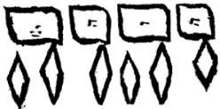

> הענין כי הספירות כמו שהם ממעלה למטה כסדרן כתר חכמה בינה גדולה גבורה תפארת נצח הוד יסוד ומלכות כך הם ממטה למעלה כתר חכמה וכו' כיצד כתר במלכות וחכמה ביסוד ובינה בהוד וגדולה בנצח וגבורה בת"ת ות"ת בגבורה ונצח בגדולה והוד בבינה ויסוד בחכמה ומלכות בכתר. וכדי שלא יקשה ענין זה בעיני המשכיל נמשיל לו משל נאה והוא כדמיון נצוץ השמש המתפשט ממקורו ומכה במראה הלטושה אז אורו מתהפך וחוזר אל מקורו וזהו הנקרא בין החוקרים אור המתהפך. וכן אנחנו כאשר רצינו לרמוז בשערינו אלה אל הסוד הזה קראנוהו בשם אור המתהפך או אור החוזר שהכל ענין אחד. ונחזור אל הכוונה שממש כדמיון האור הנז' כן דמיון האצילות כי הספי' שהם האצילות ומתפשטות ממעלה למטה כסדר הישר בספי' זהו שקראנוהו לפעמים בשערים אלה אור הישר והוא שהם מתפשטות כסדר הזה. וכן האור עושה, מצבו במלכות וחוזר אל מקורו עד הכתר ושם מצבו. וזהו נעוץ סופן בתחלתן ותחלתן בסופן כי כתר שורה במלכות ומלכות בכתר ולא זה בלבד אלא אף המלכות שבכתר חוזר ויורד למטה. ומנהגה כדרך האור הראשון עד שנעשה אור לאור ואור לאור עד אין תכלית והכל נעוץ סוף בראש וראש בסוף וזהו סוד ההויה ביושר וסוד ההויה בהפוך זה בסוד האור הישר וזה בסוד האור המתהפך כזה:

**15:1:5** The matter is hinted in the secret of Alef, which is Yod at the head and Yod at the end, thus:  

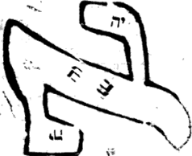

  
 And the secret is Yod at the head and Yod at the end, for the source of the light is always Yod. And from there the light flows: sometimes the Yod is above, and it is direct light, and source, and head; and sometimes the Yod is below, and it is reversing light, and the source of the returning light. And so their end turns out to be embedded in their beginning and their beginning in their end. And so Rashbi explained in the explanation of this *mishnah* of Sefer Yetzirah, and these are his words in the Tikkunim (Tikkun 21, folio 60a): "And this stone is Yod at the head of Alef, and it is Yod at its end; of it is said (Isa. 46:10), 'declaring the end from the beginning'; and it is יו"ד ה"י וא"ו ה"י, including ten sefirot, for their end is embedded in their beginning and their beginning in their end." Thus far its words.

> הענין נרמז בסוד א' שהוא יו"ד בראש ויוד בסוף כזה:
>
>  והסוד הוא יוד בראש ויו"ד בסוף כי מקור האור לעולם הוא יו"ד. ומשם האור נשפע פעמים היו"ד למעלה והוא אור ישר ומקור וראש. ופעמים היו"ד למטה והוא אור מתהפך ומקור אל האור החוזר. ונמצא נעוץ סופן בתחלתן ותתלתן בסופן. וכן פירש הרשב"י בפי' משנת ס"י זו וז"ל בתיקונים (תקונא כ"א ד"ס.) והאי אבנא איהו י' בריש א' ואיהו י' בסופה, עלה אתמר מגיד מראשית אחרית, ואיהי יו"ד ה"י וא"ו ה"י כליל עשר ספירן דאיהו נעוץ סופן בתחלתן ותחלתן בסופן עכ"ל.

**15:1:6** He intended in the name mentioned that the letters of the name are direct, יהו"ה, and the name reversed, הוה"י, and all is included in the ten letters that are in the filling of the name; and this is the matter of Alef, which is Yod at the head and Yod at the end. And it is "declaring from the beginning," which is Yod, in the secret of Chokhmah, and its tip, which is Keter; "the end," which is likewise Yod; and it is Chokhmah at the head and Chokhmah at the end. And after the matter has been explained in general and in brief, we come to decide the words of Rashbi, peace be upon him, in the Tikkunim [in the Introduction, folio 6a]: "'There is none holy like the Lord' (1 Sam. 2:2): the Cause over all, concealed and stored away in Keter; and from it the light spreads upon יהו"ה, which is: Yod, Chokhmah; Heh, Binah; Vav, including six sefirot; Heh, Malkhut. And this is the spreading from above to below. And likewise its light spreads upon [the Yod of Adonai], from below to above, up to Ein Sof, which is hinted in אדנ"י: אי"ן, אנ"י. And therefore the two Yods of יאהדונה"י: ten, ten; the Kaf [of 'like the Lord']: this is the Kaf of Keter." Thus far its words. He taught explicitly our intent: that the direct light goes out and spreads from the source, which is Yod, to the end, which is Heh; and returns from the Yod of Adonai, which is Malkhut (for Adonai is a garment to YHVH, thus: יאהדונה"י, as we shall explain in the Gate of Names, chapter 13); and the name Adonai is the secret of the reversing light; for the name Adonai and the name הוה"י are all one matter and one hint. And this is the secret of אנ"י / אי"ן [*ani*, I / *ayin*, Nothing]: that is, *ani* is Adonai, in Malkhut, and *ayin* is in Keter; and all hints at "its end embedded in its beginning and its beginning in its end." And just as in the secret of Keter the Yod is over the Heh, so in *ayin* the Yod is over the Nun; for all is one hint and one matter. And just as in Malkhut the Yod is under the Heh, so in *ani* the Nun is over the Yod. And all is one: this in Chokhmah, which is Yod; Nun in Binah, which is Heh. And because two lights are unified in Keter, two measures in the sefirah, ten from above to below and ten from below to above, therefore it is called Kaf [twenty], Keter. And this is "There is none holy like [*ka-*] the Lord," whose explanation is: Kaf, Keter, which is the spreading of the light from above to below and from below to above, as we explained.

> כיון בשם הנזכר היות האותיות השם ביושר יהו"ה והשם בהפוך הוה"י והכל נכלל בעשר אותיות שבמלוי השם והיינו ענין א' שהוא יו"ד בראש ויו"ד בסוף. והוא מגיד מראשית, שהוא יו"ד בסוד החכמה וקוצה שהוא הכתר. אחרית, שהיא יו"ד ג"כ. והוא חכמה בראש וחכמה בסוף. ואחר שנתבאר הענין בכלל ובקיצור נבא להכריע בדברי הרשב"י ע"ה בתיקונים [בהקדמה ד"ו.] אין קדוש כה' עלת על כלא טמיר וגניז בכתר ומניה אתפשט נהורא על יהו"ה דאיהו י' חכמה ה' בינה ו' כליל שית ספירן ה' מלכות. והאי איהו אתפשטותא מעילא לתתא ואוף הכי אתפשט נהוריה על [י' מן אדני] מתתא לעילא עד אין סוף דאתרמז באדנ"י אי"ן אנ"י. ובג"ד י"י מן יאהדונה"י עשרה עשרה הכ"ף דא כ' מן כתר עכ"ל. הורה בפי' על כוונתינו כי האור הישר יוצא ומתפשט מן המקור שהוא יו"ד עד הסוף שהוא ה'. וחוזר מי' של אדנ"י שהיא המלכות כי אדנ"י לבוש אל יהו"ה כזה יאהדונה"י כמו שנבאר בשער השמות בפ' י"ג ושם אדנ"י הוא סוד אור המתהפך כי שם אדנ"י ושם הוה"י הכל ענין אחד ורמז א'. וזהו סוד אנ"י אי"ן שהוא אני אדנ"י במלכות ואי"ן בכתר והכל רומז נעוץ סופו בתחלתו ותחלתו בסופו. וכמו שבסוד הכתר הי' על ה', כן באי"ן הי' על הן' כי הכל רמז אחד וענין א'. וכמו שבמלכות י' תחת ה', כן באנ"י נ' על היו"ד. והכל אחד זו בחכמה שהיא י' נ' בבינה שהיא ה'. ולהיות ששתי אורות מתייחדים בכתר ב' מדות שבספיר' י' מלמעלה למטה וי' ממטה למעלה לכן נקרא כ' כתר והיינו אין קדוש כה' שפירושו כ"ף כת"ר שהוא התפשטות האור ממעלה למטה וממטה למעלה כדפי'.

**15:1:7** And behold, in this much is included in little: that the sefirot are ten from above to below, in the secret of the direct light, and likewise ten from below to above, in the secret of the reversing light, the returning light. And now we come in [the next] chapter to explain this matter even in some of the sefirot.

> והנה בזה נכלל המרובה במיעוט, שהספי' הם עשר ממעלה למטה בסוד האור הישר וכן עשר ממטה למעלה בסוד האור המתהפך אור החוזר. ועתה נבא בפרק זה לבאר ענין זה אפי' בקצת הספי':

### Chapter 15:2. Explanation that "from above to below" befalls not only the ten sefirot in their totality, but also some of them relative to others.

**15:2:1** The intent in this chapter is to explain that the matter of this order is not only for all ten sefirot in their totality, but also for some of them. How? If we wish to say nine from Keter to Yesod and nine from Yesod to Keter; and likewise eight from Hod to Keter and eight from Keter to Hod; and likewise seven from Chesed to Malkhut and seven from Malkhut to Chesed. And not this alone, but even in one sefirah, as we shall explain. And all these aspects are explained in the Tikkunim, as we shall explain. And the reason for them is that just as there is the shining of the return of the light from Malkhut, so there is the return of the light from Yesod, and likewise from Hod, and likewise for all of them. And just as there is direct light from Keter, so from Chokhmah, so from Binah, so from Chesed; for each sefirah is a source for all that is beneath it, and each sefirah is a mirror in which the light of the upper one strikes and the light returns; until in this way the luminaries rise, direct and returning, without number, as the inquirer will understand with his intellect when he sets his heart to what is hinted. And now we come to explain this matter from within the words of Rashbi in the Tikkunim (Tikkun 18, folio 31b), and these are his words: "These go out, and Sagron closes the gate after them. Behold, the masters of the signs knock at the entrance and say (Ps. 51:17), 'Adonai, open my lips.' 'Open': this is Petachon. And these are the masters of the eighteen [*chai*] blessings of prayer, from the side of the Life [*Chai*] of the worlds, who unite the Holy One, blessed be He, and His Shekhinah there; for the Righteous One is ninth from above to below and from below to above: nine vowel-points, nine cantillation marks. And of them is said, 'And God set them in the firmament of the heaven' (Gen. 1:17): and this is the Righteous One, in which are all the vowel-points; 'to give light upon the earth': this is the Shekhinah, which is included of all the letters." Thus far its words.

> הכונה בפרק זה לבאר כי לא יהיה ענין סדר זה אל הספירות כל העשר בכללם לבד אלא גם אל קצתם. כיצד אם נרצה לומר תשע מכתר עד היסוד ותשע מיסוד עד הכתר וכן ח' מהוד עד כתר וח' מכתר עד הוד וכן ז' מחסד עד מלכות וז' ממלכות עד חסד ולא זו בלבד אלא אפי' בספירה אחת כאשר נבאר. וכל הבחינות האלה נתבארו בתקונים כאשר נבאר. והטעם אליהם הוא כי כמו שיש הארת חזרת האור מהמלכות, כן חזרת האור מהיסוד וכן מההוד וכן לכלם. וכמו שיש אור ישר מכתר כן מחכמה כן מבינה כן מחסד כי כל ספירה מקור לכל אשר תחתיה וכל ספירה היא מראה שבה מכה אור העליונה והאור חוזר עד שבדרך זה יעלו המאורות ישרים וחוזרים עד אין מספר כאשר יבין המעיין בשכלו כאשר יתן אל לבו אל הנרמז. ועתה נבא לבאר הענין הזה מתוך דברי הרשב"י בתיקו' (תקונא י"ח דף ל"א ע"ב) וז"ל אילין נפקין. וסגרו"ן סגר תרעא אבתרייהו הא מארי דאותות קא דפקין לפתחא ואמרין אדנ"י שפתי תפתח תפתח דא פתחו"ן ואלין אינון מארי דח"י ברכאן דצלותא מסטרא דח"י עלמין דמייחדין לקב"ה ושכינתיה תמן דצדיק תשיעאה איהו מעילא לתתא ומתתא לעילא ט' נקודין ט' טעמי. ועלייהו אתמר ויתן אותם אלקים ברקיע השמים ודא צדיק דביה כל נקודין, להאיר על הארץ דא שכינתא דאיהי כלילא מכל אתוון עכ"ל.

**15:2:2** And the explanation: there are righteous ones who depend [above], each one according to his deeds, according to the emanation of his soul from the sefirot. How? Those whose Torah is their craft are called masters of Torah, and they are in Tiferet; and he who guards his covenant is called righteous; and those who stand in prayer in the Amidah are called masters of the legs. And they depend above, each one according to his place and the order of his service in this world, as he said above in the matter, that the righteous enter above in their prayer according to their deeds. And he said that at their going out the angel appointed over the closing and locking of the gates of the palace closes the doors, until the masters of the signs come to pray. This name is in the Righteous One, called "sign." And he called them masters of the signs because the Righteous One is called "sign," and now the intent is to explain the matter of Yesod; therefore he called them masters of the signs. And the angel appointed over the opening, called Petachon, opens the palace of the King for them. And he said that they are the masters of the eighteen blessings, which are in the Righteous One, called "the Life of the worlds," after the eighteen [lives] that depend on it. And he said that in the Amidah they unite the Holy One, blessed be He, and His Shekhinah through the Righteous One, which unites them and binds them, as is known. "For the Righteous One is ninth": explanation: how are there eighteen in the Righteous One? And he says that they are nine from below to above and nine from above to below. And one cannot say that the matter is that when we reckon and count the sefirah from above to below it will be nine, and when we count from below to above it will be nine; for if so they would never amount to more than nine; and how does he count eighteen? Rather, certainly Yesod is in the secret of the direct light and the returning light. And like the matter of Malkhut for the count of ten, so Yesod for the count of nine, and likewise Hod for the count of eight. And these do not resemble those; for each and every number is a secret by itself and an aspect by itself, just as the direct light and the returning light are not one matter. And the reason is that the direct light is the secret of the principal light, a foundation established in the Emanation; but the secret of the reversing light does not shine in the secret of the direct light. Like the ray of the sun: what returns from its power does not resemble its own self; for the returning one is one of its offshoots, by reason of one of the receivers, and the direct ray is the very self of the ray itself; and in this way we compare it in the Emanation. And just as the light in its return from within lanterns and the mirror that does not shine does not resemble its return from within a bright mirror, "whose form is sapphire" (Lam. 4:7), so is the matter in the secret of the return of the light from Malkhut or from Yesod and the like. And likewise the change of the light according to the change of the colors in the mirror that receives the ray and returns its light to its original source. And these are distinctions in the aspects of the lights, besides another distinction that there is between the direct and the returning, as we shall explain.

> ופי' כי יש צדיקים תלויים כל א' וא' לפי מעשיו לפי אצילת נשמתו מהספירות. כיצד, מי שתורתן אומנתן קרוין מארי תורה והם בת"ת, והשומר בריתו קרוי צדיק, והעומדים בתפלה בעמידה קרוין מארי דרגלין. והם תלויין למעלה כל א' לפי מקומו וסדר עבודתו בעוה"ז כאמרו למעלה מן הענין כי הצדיקים נכנסים למעלה בתפילתם לפי מעשיהם. ואמר שביציאתן המלאך הממונה על סגירת ונעילת שערי היכל סוגר הדלתות עד אשר באים להתפלל מארי דאותות השם הזה הוא בצדיק הנקרא אות. וקראם מארי דאותות כי הצדיק נקרא אות ועתה הכונה לבאר בענין היסוד לכן קראם מארי דאותות. ומלאך הממונה על הפתיחה הנקרא פתחו"ן פותח להם היכל מלך. ואמר שהם בעלי ח"י ברכות שהם בצדיק הנקרא ח"י העולמים ע"ש ח"י [החיים] התלוים בו. ואמר כי בעמידה מייחדים קב"ה ושכינתיה ע"י הצדיק המיחד אותן וקושר אותם כנודע. דצדיק ט' איהו. פי' כיצד בצדיק הם ח"י, ואומר כי הם ט' ממטה למעלה וט' ממעלה למטה. ואין לומר שהענין הוא כשנחשוב ונמנה הספירה ממעלה למטה יהיו ט' וכשנמנה ממטה למעלה יהיו ט' שא"כ לעולם אינם עולים יותר מתשע וכיצד מונה י"ח. אלא ודאי היסוד הוא בסוד אור היש"ר ואור החוזר. וכענין המלכות למנין עשר כן היסוד למנין ט', וכן ההוד למנין ח'. ואינם דומים אלה לאלה כי כל מספר ומספר הוא סוד בפני עצמו ובחינה בפ"ע. כמו שאין האור הישר ואור החוזר ענין א'. והטעם כי האור הישר הוא סוד האור העיקר יסוד מוסד באצילות אמנם סוד אור המתהפך אינו מאיר בסוד אור הישר. כדמיון נצוץ השמש שלא ידמה החוזר מכחו אל עצמותו, כי החוזר תולדה אחת מתולדותיו בסבת אחד מהמקבלים, וניצוץ הישר הוא עצם הנצוץ בעצמו, ועד"ז נקיש באצילות. וכמו שלא ידמה האור בחזרתו מתוך העששיות והמראה שאינה מאירה אל חזרתו מתוך מראה בהירה ספיר גזרתה, כן הענין בסוד חזרת האור מהמלכות או מהיסוד וכיוצא בו. וכן שנוי האור לפי שנוי הגוונים במראה המקבלת הניצוץ וחוזרת אורה אל מקורה הקדמון. ואלה הם חלוקים בבחינות האורות בזולת חילוק אחר שיש בין הישר והחוזר כאשר נבאר.

**15:2:3** And a further proof for the matter in the Tikkunim (Tikkun 18, folio 34), and these are its words: "And six constellations are from above to below, from Chesed to Yesod, and six from below to above, from Yesod to Chesed. From the side of Malkhut they are called the seven planets," etc. Thus far its words.

> ועוד ראיה אל הענין בתקונים (תקונא י"ח דף ל"ד) וז"ל, ושית מזלות אינון מעילא לתתא מחסד עד יסוד, ושית מתתא לעילא מיסוד ועד חסד. מסטרא דמלכות אתקריאו ז' כוכבי לכת וכו' עכ"ל.

**15:2:4** And behold, in this passage Rashbi counted six from Chesed to Yesod and six from Yesod to Chesed. And if it is not as we said, how are they twelve? They are only six. Rather, certainly as we explained; and that is in the secret of the direct light and the returning light, whose matter is not one, as we explained. And in this way also he further counted seven from Chesed to Malkhut; and if not in the way we explained, that "from the side of Malkhut" is the light returning from Malkhut up to Chesed, then the seven planets would turn out to be the six constellations, and all one. Rather, certainly as we explained. And because the light returning from Malkhut is not of the rank of the light returning from Yesod, therefore they are seven planets, which receive from the twelve constellations, as is known; and likewise Yesod pours effluence into Malkhut, and Malkhut receives from it. And with this preliminary what is explained in the Tikkunim (Tikkun 18, folio 33) concerning the union will be understood, and these are its words: "Come and see: יהו"ה אדנ"י: they are the Holy One, blessed be He, and His Shekhinah, in the two thighs: YHVH to the right, Adonai to the left; and they are the speculum that shines and the speculum that does not shine. In the Righteous One the two of them are one, יאהדונה"י. [And so in the two arms: YHVH to the right, Adonai to the left; in the central pillar יאהדונה"י.] The two of them in one union, in the secret of אמ"ן [Amen]; and therefore greater is the one who answers Amen than the one who blesses. Behold, this is from below to above. From above to below: יהו"ה אהי"ה, the two of them as one in the Supernal Keter, in this way: יאההויה"ה; in Chokhmah and Binah, YHVH, Ehyeh; in the two arms, YHVH, Ehyeh; in the central pillar the two of them as one; in Netzach and Hod, YHVH, Ehyeh, this to the right and this to the left; in the Righteous One the two of them in union as one; and likewise in Malkhut," etc. Thus far its words. And he dwelt at length there on things like this a great deal. And the intent is as we explained in the Gate of Essence and Governance, chapter 23: that the matter of coupling, as it is in Tiferet and Malkhut, so it is in Chokhmah and Binah, as explained there. And from the side of the coupling of Chokhmah and Binah the effluence flows to Tiferet and Malkhut, and the ray rises up above. And therefore, from above to below, to the right is the four-letter name, which is Chokhmah, and the name Ehyeh, which is Binah, to the left; and by way of the middle line they are unified; for Binah pours effluence by way of the left and Chokhmah by way of the right, and the middle is what makes the two extremes equal, as explained. But in the ascent, by way of the returning line, a ray rises from Tiferet and Malkhut by way of the grades: Tiferet to the right and Malkhut to the left, for this is the way of their ascent; and in the middle they are all unified in union. And we have already dwelt there on the explanation of this passage, in brief. And with the preliminary of the returning light that we have explained, further words of Rashbi in the Tikkunim will be understood, which at first glance contradict one another. In one place (in Tikkun 49, folio 83) he said that Shin is in Binah, the root of the tree; and elsewhere (in Tikkun 69, folio 107) he said that Shin below is the root of the tree in Malkhut, and likewise the lower Heh. And now it is difficult: if Shin, the root of the tree, is above in Binah, it is not below in Malkhut; and if it is below in Malkhut, it is not above in Binah. Rather, certainly, although the whole Emanation is one, unified, nevertheless in the aspect of the two lights mentioned they are two. There is a tree whose roots are above, in the upper source, and that is direct light, whose six branches spread out below; and there is a tree whose root is below, in the secret of the reversing, returning light, and whose six branches spread out above.

> והנה במאמר הזה מנה רשב"י שש מחסד עד יסוד ושש מיסוד עד חסד. ואם אינו כמו שאמרנו, כיצד הם י"ב אינם אלא שית. א"ו כדפרישית, והיינו בסוד אור הישר ואור החוזר שאין עניינם אחד כדפי'. ועד"ז ג"כ מנה עוד ז' מחסד עד מלכות ואם לא על דרך שפי' דמסטרא דמלכות היינו אור החוזר ממלכות עד החסד א"כ נמצאו כי ז' כוכבי לכת הם שש מזלות והכל אחד א"ו כדפי'. ולהיות כי האור החוזר ממלכות אינו כמעלת האור החוזר מהיסוד לכן הם ז' ככבי לכת שהם מקבלים מי"ב מזלות כנודע. וכן היסוד משפיע במלכות והמלכות מקבלת ממנו. ובהקדמה זו יובן מה שנתבאר בתיקונים (תקונא י"ח דף ל"ג) בענין היחוד וז"ל ת"ח יהו"ה אדנ"י אינון קב"ה ושכינתיה בתרין שוקין יהו"ה לימינא אדנ"י לשמאלא ואינון אספקלריא המאירה ואספקלריא שאינה מאי' בצדיק תרווייהו חד יאהדונה"י [והכי בתרין דרועין. הוי"ה לימינא אד' לשמאלא בעמודא דאמצעיתא יאהדונה"י] תרווייהו ביחודא חדא בסוד אמ"ן, ובג"ד גדול העונה אמ"ן יותר מן המברך. הא איהו מתתא לעילא. מעילא לתתא, יהו"ה אהי"ה תרווייהו כחדא בכ"ע כגוונא דא יאההויה"ה בחכמה ובינה יהו"ה אהי"ה. בתרין דרועין יהו"ה אהי"ה בעמודא דאמצעיתא תרווייהו כחדא. בנצח והוד יהו'ה אהי"ה דא לימינא ודא לשמאלא. בצדיק תרוייהו ביחודא כחדא וכן במלכות וכו' עכ"ל. וכיוצא בזה האריך שם הרבה. והכונה כמו שבארנו בשער מהות והנהגה פכ"ג כי ענין הזווג כמו שהוא בת"ת ומלכות כן הוא בחכמה ובינה כמבואר שם. ומצד זווג החכמה ובינה שופע השפע אל תפארת ומלכות. והניצוץ עולה עד למעלה ולפיכך ממעלה למטה אל הימין שם בן ד' שהוא חכמה ושם אהיה שהוא בינה אל השמאל ודרך קו האמצעי מתיחדים כי הבינה משפעת דרך השמאל והחכמה דרך הימין והאמצע היא המשוה שני קצוות כמבואר. אמנם בעליה דרך הקו החוזר יעלה מת"ת ומלכות ניצוץ דרך המדרגות, הת"ת אל הימין והמלכות אל השמאל כי זה דרך עלייתם. ואל האמצעי מתיחדים כלם ביחוד. וכבר הארכנו שם בביאור המאמר הזה בקצרה. ועם הקדמת האור החוזר שביארנו יובנו עוד דברי הרשב"י בתקונים שהם לכאורה סותרים אלו לאלו, במקום אחד (בתקונא מ"ט דף פ"ג) אמר כי ש' הוא בבינה שרש האילן, ובמ"א אמר (בתקונא ס"ט דף ק"ז) כי ש' לתתא שורש האילן במלכות וכן ה' תתאה. ועתה קשה אם ש' שרש האילן למעלה בבינה אינו למטה במלכות ואם הוא למטה במלכות אינו למעלה בבינה. א"ו עם היות שכל האצילות אחד מיוחד עכ"ז בבחינת שתי האורות הנזכר הם שנים. יש אילן ששרשיו למעלה במקור העליון והיינו אור ישר שענפיו שית מתפרדין למטה, ויש אילן ששרשו למטה בסוד אור המתהפך החוזר וענפיו שית מתפרדין לעילא.

**15:2:5** And the matter of his saying "Shin, the root of the tree": for Shin has in it three branches, in the secret of three lines, the line of Din, the line of Rachamim, the line of Chesed; and this is literally Heh, which is three Vavs, as we explained in the preceding gate. And after we have included much in little in this chapter, we come to explain the matter of the returning light itself and the need for it:

> וענין אמרו ש' שרש האילן, שכן ש' בה ג' ענפים בסוד ג' קווים קו הדין קו הרחמים קו החסד, והיינו ממש ה' שהיא ג' ווים כדפי' בשער הקודם. ואחר שכללנו המרובה במעט בפ"ז, נבא לבאר ענין אור החוזר בעצמו והצורך אליו:

### Chapter 15:3. Explanation of the essence apprehended in "returning light" (*or chozer*) or "the reversing light" (*mit'hapekh*), and its cause; and there, the *mishnah* of Sefer Yetzirah, "male in Aleph-Mem-Shin, female in Aleph-Shin-Mem."

**15:3:1** Now this is our intent: to explain the secret of the returning light from the side of its essence and its cause. And the matter is that the male, upper, always pours forth compassion, and the female, lower, receives judgment. And these four things are held to one another, that is to say: first, male or female; second, judgment or compassion; third, upper or lower; fourth, giving effluence or receiving effluence. And this thing will be understood in the secret that we explained in the Gate of Channels, chapter 1: that the light that rises, etc., is like the light that goes out from the eye, as explained there at length. And therefore, when Malkhut receives from the ten, behold, her face is turned to receive from all of them in the secret of their direct light; and she turns her face upward, and the name becomes ההו"י. And the upper male pours forth in order and in directness: it is the name יהו"ה. And this is the reason that the name in directness is compassion: because it is male, giving effluence in the order of the grades as they should be, this giving effluence to this. And Malkhut is the name in reversal of letters, thus: הוה"י, female, receiving. And therefore Rashbi, peace be upon him, said (in the Introduction, folio 3a): "Every *havayah* in which Heh rules over Vav, Heh over Yod, is female and is judgment": because the males are below the females; for the two Hehs are females, Vav and Yod are males.

> עתה זה כונתנו לבאר סוד האור החוזר מצד מהותו וסבתו. והענין הוא כי לעולם הזכר עליון משפיע רחמים והנקבה תחתון מושפעת דין. וד' דברים אלה הם אחוזים זה בזה. ר"ל א' זכר או נקבה, ב' דין או רחמים, ג' עליון או תחתון, ד' משפיע או מושפע. והדבר הזה יובן בסוד שפי' בשער הצינורות פ"א היות אור העולה וכו' כדמיון האור היוצא מן העין כמבואר שם בארוכה. ולכן בהיות המלכות מקבלת מהעשר הנה פניה מועדות לקבל מכלם בסוד אורם הישר והיא הופכת פניה כלפי מעלה ונעשה שם ההו"י. והזכר העליון משפיע בסדר וביושר הוא שם יהו"ה. וזה טעם שהשם ביושר רחמים מפני שהוא זכר משפיע בסדר המדרגות כהלכתן זו משפעת לזו. והמלכות השם בהפוך האותיות כזה הוה"י נקבה מקבלת. ולכן אמר הרשב"י ע"ה (בהקדמה דף ג'.) כל הוי"ה דשלטא ה' על ו' ה' על י' נוקבא איהי ודינא איהי. מפני שהזכרים למטה מהנקיבות כי ה"ה הם נקבות ו"י הם זכרים.

**15:3:2** And behold, when the female turns her face to receive, she certainly does not pour forth; and when the male pours forth, he does not receive. And so they said in the book of the Zohar and in Sefer ha-Bahir that a man is forbidden to remain with his hands raised in prayer more than three hours. And the reason is that the raising of the hands indicates pouring forth, as in the matter (Lev. 9:22) "And Aaron lifted up his hands toward the people and blessed them," as explained in the Zohar, Parashat Yitro (folio 67). And because Malkhut is called "hour," and she receives from three lines [in three hours], behold, her pouring forth is three hours only; and if a man raises his hands longer, he is endangered. Because while the ten sefirot pour forth they do not receive; and if so, one must wait until they receive, so that they may pour forth. And this is the reason for (Exod. 17:11) "and when he let down his hand, Amalek prevailed."

> והנה בהיות הנקבה חוזרת פניה לקבל אינה משפעת ודאי ובהיות הזכר משפיע אינו מקבל. וכן אמרו בספר הזהר ובספר הבהיר שאסור אדם להתעכב בנשיאות ידיו בתפלה יותר מג' שעות. והטעם כי נשיאות הידים מורה על ההשפעה כענין וישא אהרן את ידיו אל העם ויברכם כמבואר בזוהר פ' יתרו (ד"סז). ומפני שהמלכות נקרא שעה והיא מקבלת מג' קוים [בג' שעות] הנה השפעתה ג' שעות בלבד ואם ירים אדם ידיו יותר יסתכן. מפני שבעוד שעשר ספי' משפיעות אינם מקבלות וא"כ צריך להתעכב עד שיקבלו כדי שישפיעו וזהו סבה (שמות יז יא) וכאשר יניח ידו וגבר עמלק [לד].

**15:3:3** Behold, a clear proof that while the sefirot pour forth they do not receive, and while the sefirot receive they do not pour forth. And even if somewhat to the contrary of this is found in the Zohar, in its saying "the Shekhinah in the lower ones," and all the details of this inquiry found in the Zohar, it is possible to say that this is specifically near its pouring forth, not while it is pouring forth. However it may be: because the secret of the *havayah* in reversal is the secret of the turning of the face from below to above, to receive, and it does not pour forth, this is the reason that it is judgment and it is female; and likewise the male who pours forth is compassion. And indeed, concerning the four-letter name in reversal, something close to this is found in one of the writers of secrets, of blessed memory: "Know that just as there are ten inner sefirot, from which the good comes to Israel, so there are ten outer sefirot that stand against them; and when Israel commit transgressions, they act according to the evil that Israel do, God forbid. And you, son of man, see also with the eye of your intellect: you already know that the Unique Name stands in four sefirot: for the Yod stands in the sefirah of Chokhmah, and Heh in Binah, Vav in Tiferet, Heh in Malkhut. And when Israel do the will of the Omnipresent and His commandments, then the attribute of compassion is clothed over the attribute of judgment: for the Yod that is in Chokhmah indicates compassion, and it is clothed over the Heh that is in Binah, which indicates the attribute of judgment; and likewise the Vav that is in Tiferet, indicating the attribute of compassion, is clothed over the Heh that is in Malkhut; and then the whole world is in peace, and He has compassion on His children as a father has compassion on his children. And if, God forbid, Israel do the opposite, then the attribute of compassion turns into the attribute of judgment: for the Heh that is in Malkhut is clothed over the Vav of Tiferet, and likewise the Heh that is in Binah is clothed over the Yod that is in Chokhmah, which indicates the attribute of judgment. And know that when the Yod begins the name, and afterwards Heh, Heh, then it indicates the attribute of compassion; and likewise the Vav, when it begins and afterwards Heh, Heh, it indicates compassion; and when one of the two Hehs begins, then they indicate judgment." Thus far his words.

> הנה ראיה מבוררת כי בעוד שהספירות משפיעות אינם מקבלות ובעוד שהספירות מקבלות אינם משפיעות. ואף אם ימצא מנגד לזה קצת בזהר באמרו שכינה בתחתונים וכל פרטי הדרוש הזה הנמצא בזהר, אפשר לומר כי זה דוקא סמוך להשפעתו לא בעוד שהיא משפעת. איך שיהיה מפני שסוד ההויה בהפוך הוא סוד חזרת הפנים ממטה למעלה לקבל ואינה משפעת זו היא סבה שהיא דין והיא נקבה וכן הזכר המשפיע הוא רחמים. ואולם בשם בן ד' בהפוך נמצא קרוב לזה לאחד מכותבי סודות ז"ל דע כי כמו שיש ע"ס פנימיות אשר הטוב בא מהם לישראל ג"כ יש י"ס חיצונות שעומדין כנגדם וכשישראל עושין עברות הם פועלות כפי הרע שישראל עושין ח"ו. ואתה בן אדם ראה גם בעין שכלך כבר ידעת כי בד' ספירות עומד השם המיוחד כי הי' עומדת בספי' חכמה וה' בבינה ו' בת"ת ה' במלכות. וכשישראל עושין רצונו של מקום ומצותיו אז מתלבשת מדת רחמים על מדת הדין כי היו"ד שבחכמה מורה על הרחמים ומתלבש על הה' שבבינה שמורה על מדת הדין וכן ו' שבת"ת מורה על מדת הרחמים מתלבש על ה' שבמלכות ואז העולם כלו בשלום ומרחם על בניו כרחם אב על בנים. ואם ח"ו ישראל עושין להיפך אז מתהפך מדת רחמים למדת הדין כי ה' שבמלכות מתלבשת על הו' של הת"ת וכן ה' שבבינה מתלבש על היוד שבחכמה שמורה על מדת הדין. ודע לך כי כשהיו"ד מתחלת השם ואח"כ ה"ה אז מורה מדת רחמים וכן הו' כשמתחלת ואחר כך ה"ה הוא מורה על רחמים, וכשמתחלת אחת מן הב' ההין אז מורות על הדין עכ"ל.

**15:3:4** And there is no doubt that in what he said at the beginning of his words, "just as there are inner sefirot," etc., "so there are outer sefirot," his intent is not the husks, since he concludes with the name in reversal of letters. Rather, certainly, the intent is the returning light, which raises the compassion in the secret of receiving; and this is the secret of the reversal in the letters. And needless to say [it holds] in the letters of the whole name, that this matter is so, as explained above; but even in two letters, such as Yod-Heh or Heh-Yod, and likewise Vav-Heh or Heh-Vav, as that young scholar explained. And so it is explained in the Tikkunim, as we shall explain in chapter 5. And likewise this principle is explained in Sefer Yetzirah, the last *mishnah* of chapter 3, and these are its words: "He made Alef king over air [*ruach*], and bound a crown to it, and combined them one with another, and formed with them the air [*avir*] in the world, moisture in the year, and the body in the soul: male in Alef-Mem-Shin and female in Alef-Shin-Mem. He made Mem king over water, and bound a crown to it, and combined them one with another, and formed with them earth in the world, cold in the year, and the belly in the soul, male and female: male in Mem-Alef-Shin, female in Mem-Shin-Alef. He made Shin king over fire, and bound a crown to it, and combined them one with another, and formed and sealed with them heaven in the world, heat in the year, and the head in the soul, male and female: male in Shin-Mem-Alef and female in Shin-Alef-Mem." Thus far its words.

> ואין ספק שמה שאמר בתחלת דבריו באמרו כמו שיש ספי' פנימיות וכו' כן יש ספירות חיצוניות, שאין כונתו בקליפות משום דמסיק בהשם בהפוך אתוון. אלא ודאי הכונה על האור החוזר המעלים הרחמים בסוד הקבלה וזהו הסוד ההפוך באותיות. ואין צריך לומר באותיות השם כלו שיהיה הענין הזה כמבואר לעיל, אלא אפי' בב' אותיות כגון י"ה או ה"י וכן ו"ה או ה"ו כמו שפי' האי צורבא מרבנן. וכן מבואר בתקונים כמו שנבאר בפ"ה. וכן נתבאר העיקר הזה בס"י משנה אחרונה שבפ"ג וז"ל המליך א' ברוח וקשר לו כתר וצרפן זה בזה וצר מהן אויר בעולם רויה בשנה וגוייה בנפש זכר באמש ונקבה באש"ם. המליך מ' במים וקשר לו כתר וצרפן זה בזה וצר בהן ארץ בעולם קור בשנה ובטן בנפש זכר ונקבה זכר במא"ש נקבה במש"א. המליך ש' באש וקשר לו כתר וצרפן זה עם זה וצר וחתם בהם שמים בעולם חום בשנה וראש בנפש זכר ונקבה זכר בשמ"א ונקבה בשא"ם עכ"ל.

**15:3:5** And behold, in this *mishnah* all our intent is explained, and this is its explanation. And before all else it is fitting for the inquirer to understand what we shall write in the Gate of Particulars of Names concerning the matter of the formation of man by means of the rolling of the letters and their permutation; and there we shall explain at length the matter of "He made such-and-such a letter king and bound a crown to it." And nevertheless we shall not withhold our hands from explaining here what suffices for the understanding of the *mishnah*. And the matter is that the letters are branches branching out from the names, that is to say, powers emanated from the very self of the sefirot, like those who dwell "in the clefts of the rock, the height of their dwelling" (Obad. 1:3), as we shall dwell at length in the Gate of Letters. And because the powers do not perform their action except through their combination with their sources, and in their return and binding to their source much effluence flows upon them to perform their action with strength, as we shall dwell at length in explaining them in the Gate of Particulars of Names, therefore it was necessary for the formation that it be through the branches unified with their sources, that is, the sefirot. And the letters, which are branches branching out from them: when they are unified with the root and the powers return to their source, then their action is complete and good. And because the sources of the letters include ten sefirot, as we shall dwell at length in the Gate of Letters, therefore, to strengthen their power for creation, each and every branch was unified with its source. And this is what he meant in saying "He made the letter Alef king," or Mem, or Shin; and likewise for the seven doubles, Bet, Gimel, Dalet, Kaf, Peh, Resh, Tav; and likewise for the twelve simples, Heh, Vav, Zayin, Chet, Tet, Yod, Lamed, Nun, Samekh, Ayin, Tzadi, Kof. And the explanation of "He made king": He unified that letter and that spiritual branch with Malkhut; and afterwards "He bound a crown to it." And "bound" [קש"ר]: explanation: *teki'ah*, *shevarim*, *teru'ah*, which are the three fathers, Chesed, Gevurah, Tiferet, with their branches, Netzach, Hod, Yesod, and with their fathers, which are Chokhmah, Binah, Keter. And this is the "crown" explicitly mentioned in the *mishnah*; for the first three are included in the name Keter, as they are included in the name Nothing; and likewise the three of them are a crown to the three lines, Chesed, Din, and Rachamim. And according to all the explanations, the intent is to unify the letter in its root, which is the sefirot. And he said Alef with air, and Shin with fire, and Mem with water: the intent is that Alef-Mem-Shin hints at Yod-Heh-Vav. For the Yod is Chokhmah, for Chokhmah is the root of the waters of Chesed; and likewise Heh is in Binah, and likewise Shin is in Binah, the root of fire, which is the root of judgment, in the way we explained in the Gate of Essence and Governance, chapter 25; and the Vav is in Keter, in the secret of Da'at, as we explained in the Gate of Manifestations, chapter 6; and likewise the Alef, for Keter is the root of the air that arbitrates between the extremes, as we explained in the Gate of Arbiters. And therefore, when we wish to unify the branch, we unify it in its root, unified in its ten sefirot. And this is what he meant in saying "He made Alef king over air, Mem over water, and Shin over fire": for the union and the binding is to unify the branch in the root particular to it, whether Chesed, whether Din, whether Rachamim, and in its ten sefirot that are found for it according to its nature. And after the union in the branches, it needs further to receive from the other sources themselves, so as to be included of Chesed, Din, and Rachamim; and for this he said "and combined them one with another," which refers back to the letters Alef-Mem-Shin mentioned from the beginning of the chapter until here. And through the combination the powers are unified with a true and complete union, and the lower rolls and rises, and the upper descends, until the thing becomes an inclusive *havayah*. And for this, after the union of the branch in its root with its ten sefirot, it had to be unified in three powers, which are Alef-Mem-Shin, which include the whole Emanation; and this is "and combined them one with another"; and then that manifestation was formed and emanated and brought into being in three places, which are world, year, soul [עש"ן], as we shall explain them at length in the Gate of Particulars of Names, on the name of seventy-two. And through their spiritual formation they were formed in the corporeality of these worlds. And because the Alef is head to the *havayah* and the principal of the form that is formed (for the principal of the manifestation is from the air, and the fire and the water are mere assistance, like the likeness of a composition, but the prevailing is from the air), therefore, both in the male and in the female, the Alef comes at the head of the combination, and the water and the fire are lower. And for the reason that the male is from above to below, the Mem, which is the water, comes over the Shin, which is the fire, as is their way, for the right is always over the left; and this is אמ"ש, which is וי"ה: Vav [and] Yod over Heh. And when the female comes, she comes from below to above, which is אש"ם: the Shin, which is the fire, over the Mem, which is the water; and this is אש"ם, fire over water, the left over the right, as is the way of the female, which is וה"י, which is Heh above Yod. The female is always the opposite of the male, for the male pours forth and the female receives; and therefore the female is judgment. And when He made the letter Mem king, which is the principal of the water, therefore both in the male and in the female the Mem comes first, and it is what prevails in the composition; for the attribute of (the day) [the water] is always determinative, and therefore the principal of the attribute prevails; and of the two attributes, which are the air and the fire, either this prevails or that. The male in מא"ש: the Alef, which is the air, over the Shin, which is the fire; and he made compassion prevail over judgment, as is the way of the male, to incline it to the right in compassion: Alef over Shin, which is Vav over Heh, male over female. And the female comes from below to above: the female in מש"א made the fire prevail over the air, the judgment over the compassion, Heh over Vav, making judgment prevail over compassion and turning upward; for the male pours forth and the female receives. And when He made the letter Shin king, which is the fire in the strength of judgment, the male came in שמ"א; for the principal always prevails, according to what is the principal element, both in the male and in the female. And therefore the Shin prevails both in the male and in the female; but the other letters of the composition were divided in disagreement: for the male made the element of water, which is the Mem, prevail over the element of air, which is the Alef, that is, הי"ו; for the Heh prevails, because it is the element of fire, as explained; but it is Yod over Vav. And the reason is that although the Vav, which is the air, which is the Alef, is compassion, nevertheless it is mediated compassion, and the compassion of Chesed is complete compassion; and therefore he chose the right for himself and made it prevail over the mediation, as is the way of the Yod, which is always over Vav. But the female comes in שא"ם: she made the element of air prevail over the water, and inclined it toward the fire; and so the letters are found in her from below to above, as is her way, the opposite of the male; for the female makes the air prevail over the water and turns upward, and the male pours forth and turns downward; and therefore the female comes in שא"ם, which is הו"י: the letters reversed, turning upward to receive. Thus far reaches the explanation of the *mishnah*; and from within it is explained the matter of the reversal even in two letters, as explained above.

> והנה במשנה זו מבוארת כל כונתינו. וזה פירושו. וקודם כל דבר ראוי אל המעיין להשכיל במה שנכתוב בשער פרטי השמות מענין יצירת האדם על ידי גלגול האותיות וצירופם ושם נבאר בארוכה ענין המליך אות פלונית וקשר לו כתר. ועכ"ז לא נשיב ידינו מלבאר הנה מה שיספיק אל הבנת המשנה. והענין כי אותיות הם ענפים מסתעפים מהשמות ר"ל כחות אצולים מעצמות הספירות כשוכנים בחגוי סלע מרום שבתם כמו שנאריך בשער האותיות. ולהיות כי הכחות אינם פועלים פעולתם אלא ע"י צירופם אל מקוריהם ובחזרתם והתקשרם אל מקורם יושפע עליהם רב שפע לפעול פעולתם בחוזק כאשר נאריך ביאורם בשער פרטי השמות. לפיכך הוצרך אל היצירה שיהיה על ידי הענפים המתיחדים אל מקוריהם דהיינו הספירות. והאותיות שהם ענפים המסתעפים מהם בהתיחדם עם השרש וחזרת הכחות אל מקורם אז פעולתם שלימה וטובה. ולהיות מקורי האותיות כוללים י"ס כאשר נאריך בשער האותיות, לזה לחזק כחם אל הבריאה נתיחד כל ענף וענף אל מקורו. וזה רצה באמרו המליך אות א' או מ' או ש', וכן לז' כפולים בג"ד כפר"ת, וכן לי"ב פשוטות הו"ז חט"י לנ"ס עצ"ק. ופי' המליך, ייחד אותה האות ואותה הענף הרוחני אל המלכות ואח"כ וקשר לו כתר. וקשר פי' תקיעה שברים תרועה שהם ג' אבות חג"ת עם ענפיהם נצח הוד יסוד ועם אבותיהם שהם חכמה בינה כתר. והיינו כתר הנזכר בפי' במשנה כי ג"ר כלולות בשם כתר כענין שכלולות בשם אי"ן וכן שלשתם כתר לג' קוין חסד דין ורחמים. ולכולהו פי' הכונה ליחד האות בשרשו שהם הספי'. ואמר א' ברוח וש' באש ומ' במים, הכונה כי אמ"ש רמיזת' יה"ו כי היוד הוא חכמה כי החכמה שורש למימי חסד. וכן ה' היא בבינה וכן ש' הוא בבינה שרש האש שהוא שורש הדין ע"ד שפי' בשער מהות והנהגה פכ"ה. והוא"ו הוא בכתר בסוד הדעת כדפי' בשער המציאות פ"ו. וכן האל"ף, כי הכתר שרש לאויר המכריע בין הקצוות כמו שפי' בשער המכריעין. ולכן כאשר נרצה ליחד הענף נייחד אותו בשרשו המיוחד בעשר ספירותיו. וזה רצה באמרו המליך א' ברוח מ' במים וש' באש, כי היחוד והקשר הוא לייחד הענף בשרשו המיוחד לו אם חסד אם דין אם רחמים ובעשר ספירותיו הנמצאים לו לפי טבעו. ואחר היחוד בענפים צריך עוד לקבל משאר המקורות עצמן להיותו כלול מחסד דין ורחמים ולזה אמר וצרפן זה בזה שהוא חוזר אל האותיות אמ"ש הנז' מראש הפרק עד כאן. וע"י הצירוף יתייחדו הכחות יחוד אמיתי ושלם ויתגלגל ויעלה התחתון וירד העליון עד ישוב הדבר הוייה כוללת. ולזה אחר היחוד של הענף בשרשו עם עשר ספירותיו הוצרך להיות מתיחד בג' כחות שהם אמ"ש הכוללים כל האצילות וזהו צרפן זה בזה, ואז היה נוצר ומתאצל ומתהווה המציאות ההוא בג' מקומות שהם עש"ן כאשר נבארם בארוכה בשער פרטי השמות בשם ע"ב. וע"י ציורם ברוחניות היו מצטיירים בגשמות העולמים הזה. ומפני שהא' הוא ראש להויה ועיקר לצורה המצטיירית, כי עיקר המציאות הוא מהרוח, והאש והמים סיוע בעלמא כדמות הרכבה, אבל התגבורת הוא מהרוח, לכן בין בזכר בין בנקבה בא הא' בראש הצרוף והמים והאש תחתונים. ומטעם היות הזכר ממעלה למטה באה המ' שהם המים על הש' שהוא האש כדרכם כי הימין לעולם על השמאל וזהו אמ"ש שהוא וי"ה ו"י על ה'. וכשבאה הנקבה באה ממטה למעלה שהוא אש"ם, הש' שהיא האש על המ"ם שהוא המים וזהו אש"ם אש על המים השמאל על הימין כדרך הנקבה שהוא וה"י שהוא ה' למעלה מי'. לעולם הנקבה הפך הזכר כי הזכר משפיע והנקבה מקבלת ולכן הנקבה דין. וכאשר המליך אות מ' שהוא עיקר המים לכן בין בזכר בין בנקבה המ' קודמת והיא הגוברת בהרכבה כי לעולם מדת (היום) [המים] גורמת ולכן גוברת עיקר המדה ושתי המדות שהם האויר והאש או זה יגבר או זה הזכר במא"ש שהיא הא' שהוא האויר על הש' שהוא האש והגביר הרחמים על הדין כדרך הזכר לנטותו אל הימין ברחמים א' על ש' שהוא ו' על ה"א זכר על נקבה. והנקבה באה ממטה למעלה הנקבה במש"א הגבירה האש על האויר. הדין על הרחמים ה"א על וא"ו מגברת הדין על הרחמים ופונה למעלה כי הזכר משפיע והנקבה מקבלת. וכאשר המליך אות ש' שהוא האש בתוקף הדין בא הזכר בשמ"א שלעולם גוברת העיקר כפי מה שהוא עקר היסוד בין בזכר בין בנקבה. ולכן הש' גובר בין בזכר בין בנקבה אבל שאר אותיות ההרכבה נחלקו למחלוקת כי הזכר הגביר יסוד המים שהיא המ' על יסוד האויר שהוא הא' דהיינו הי"ו כי הה' גוברת מפני שהוא יסוד האש כמבואר אבל הוא י' על ו'. והטעם שעם היות שהוא"ו שהוא האויר שהוא האל"ף הוא רחמים, עכ"ז הם רחמים ממוצעים ורחמי החסד הן רחמים גמורים, ולכן בחר לו הימין והגבירו על המיצוע כדרך היו"ד שהיא לעולם על ו'. אבל הנקבה באה בשא"ם שהגבירה יסוד האויר על המים. והטה אותו כלפי האש ונמצאו בה האותיות ממטה למעלה כדרכה הפך הזכר כי הנקבה מגברת האויר על המים ופונה למעלה והזכר משפיע ופונה למטה ולכן באה הנקבה בשא"ם שהוא הו"י האותיות מהופכות פונות למעלה לקבל. ע"כ הגיע ביאור המשנה, ומתוכה נתבאר ענין ההפוך אפי' בשתי אותיות כמבואר לעיל:

### Chapter 15:4. Explanation of the reversing light from a passage of Sefer ha-Bahir, "from above to below we know," etc.; and there it is explained that this matter is found not only in some sefirot but even within a single sefirah.

**15:4:1** This inquiry is further explained in a fine light in Sefer ha-Bahir; these are its words: "His disciples said to him: Our master, from above to below we know; from below to above we do not know. And he answered: But are not from below to above and from above to below one? [They said:] Our master, the one who ascends is not like the one who descends; for the one who descends descends at a run, and the one who ascends is not so. And not only that, but the one who ascends can ascend by another way, by which he did not descend. He said to them: Go out and see. He sat and expounded to them: The Shekhinah is below just as the Shekhinah is above. And what is Shekhinah? This is the light emanated from the first light, which is Chokhmah; it too surrounds all, as it is said (Isa. 6:3), 'The whole earth is full of His glory.' What is its work here? A parable: to what is the matter like? To a king who had seven sons, and he set each one in his place, and said to them: Sit one upon another. And the lowest said: I am below; I will not be far from you. He said to them: Behold, I surround and see you. That is, 'The whole earth is full of His glory.' And why is He among them? In order to establish them and sustain them. And what are the sons? I have already told you: the Holy One, blessed be He, has seven holy forms," etc. Thus far its words.

> עוד נתבאר הדרוש הזה באור יפה בספר הבהיר. ז"ל אמרו לו תלמידיו רבינו מלמעלה למטה ידעינן מלמטה למעלה לא ידעינן והשיב ולאו חד הוי ממטה למעלה ומלמעלה למטה. רבינו אינו דומה העולה ליורד. שהיורד יורד במרוצה והעולה אינו כן. ולא עוד אלא העולה אפשר לו לעלות דרך אחרת שלא ירד. אמר להם צאו וראו. ישב ודרש להם שכינה למטה כשם ששכינה למעלה ומאי שכינה זה האור הנאצל מן האור הראשון שהוא חכמה גם כן הוא מסבב את הכל שנא' מלא כל הארץ כבודו מאי עבידתיה הכא. מלה"ד למלך שהיו לו ז' בנים ושם לכל אחד מקומו ואמר להם שבו זה על גב זה. ואמר התחתון אני למטה לא אתרחק ממך. אמר להם הריני מסבב ורואה אתכם היינו מלא כל הארץ כבודו. ולמה הוא ביניהם כדי להעמידם ולקיימם. ומה הם הבנים כבר אמרתי לכם ז' צורות קדושות יש לו להקב"ה וכו' עכ"ל.

**15:4:2** And the explanation: above in the matter, the master explained to his disciples the ten utterances one by one, to find a reckoning from above to below. And when he completed explaining them, his pleasant disciples asked: "Our master, from above to below we know," as you have explained to us; "from below to above we do not know." And the reason is that the disciples had already heard "from below to above" from the mouth of the master many times; and because of their great humility they did not see fit to press the hour, and did not ask their master, until they saw that the time was a time of favor, for the master had explained to them "from above to below" with a broad explanation; and for this they asked that he likewise explain to them "from below to above." And the master, in order to sharpen them and to see whether they had stood in the counsel of the Lord and gone down to the end of his knowledge, asked them: "But are not from above to below and from below to above one?" For all is one, and there is no distinction between them; and since he had explained to them "from above to below," they already know "from below to above," for all is one. And they, being "taught of the Lord" (Isa. 54:13), answered: "Our master, the one who ascends is not like the one who descends; for the one who descends descends at a run, and the one who ascends is not so." Explanation: from above to below, which is the giver of effluence, pours forth in the strength of compassion, and the effluence is not delayed but comes at a run. But the one who ascends is not so, for it is judgment, which is the side of the female, and it is not compassion, in the way of the male, as we explained. And they further stated another distinction: that the one who ascends can ascend by a way by which he did not descend. For the descent is by way of the right, for the right prevails over the left, because the right comes first, and afterwards it comes to the left; for first the effluence descends to Chesed and afterwards comes to Gevurah, and so in this way. But the one who ascends ascends from the left to the right, for the left comes first, and from the left he ascends to the right.

> והפי', למעלה מן הענין ביאר הרב לתלמידיו הי' מאמרות א' לא' למצוא חשבון ממעלה למטה. ובהשלימו לבארם שאלו תלמידיו הנעימים רבינו ממעלה למטה ידעינן כמו שביארת לנו, ממטה למעלה לא ידעינן. והטעם לפי שכבר פעמים רבות שמעו התלמידים מפי הרב ממטה למעלה ומפני רוב ענותנותן לא ראו לדחוק השעה ולא שאלו את פי רבם עד אשר ראו כי העת עת רצון שהרב ביאר להם ממעלה למטה ביאור רחב ולזה שאלו שג"כ יבאר להם ממטה למעלה. והרב כדי לחדדם ולראות אם עמדו בסוד ה' וירדו לסוף דעתו שאל להם ולאו חד הוי ממעלה למטה וממטה למעלה כי הכל אחד ואין חילוק ביניהם וכיון שביאר להם ממעלה למטה כבר הם יודעים ממטה למעלה כי הכל אחד. והם להיותם בנים לימודי ה' השיבו רבינו אינו דומה העולה להיורד שהיורד יורד במרוצה והעולה אינו כן. פי' ממעלה למטה שהוא המשפיע הוא משפיע בתוקף הרחמים ואין השפע מתעכב אלא בא במרוצה. אבל העולה אינו כן, שהוא דין שהוא צד הנקבה ואינו רחמים כדרך הזכר כמו שפי'. ואמרו עוד חלוק אחר. כי העולה אפשר לו לעלות על דרך שלא ירד כי הירידה הוא דרך הימין כי יגבר הימין על השמאל מפני שיקדים הימין לבא ואח"כ יבא אל השמאל כי קודם יורד השפע אל החסד ואח"כ בא אל הגבורה וכן על זה הדרך, אבל העולה עולה מהשמאל אל הימין כי תחלה מקדים השמאל ומן השמאל יעלה אל הימין.

**15:4:3** And behold, the ascent is by another way, which is not so with the descent. And they said "can," for it is already possible that the ascent be wholly by way of the right; for it is possible that it ascend by way of Yesod to Netzach, to Chesed, to Chokhmah; and behold, in this way the whole ascent will be wholly by way of the right. But [it is possible] that the ascent be by way of the grades: from Yesod to Hod, and from Hod to Netzach, and from Netzach to Tiferet, and from Tiferet to Gevurah, and from Gevurah to Chesed, and from Chesed to Binah, and from Binah to Chokhmah; and behold, the left always comes before the right, for it makes judgment prevail over compassion. And when the great master saw the answer of his disciples by a short way, and that they had gone down to the depth of the thought and knew the distinction between "from below to above" and "from above to below," and they had no doubt except about the way of the powers and the manner of the secret, he answered them with a good answer: "Go out and see. He sat and expounded: The Shekhinah is below just as the Shekhinah is above. And what is Shekhinah? This is the light emanated": from the direct light and the returning light; and the two lights are the two Yods, as explained above. And this is "the light emanated from the first light, which is Chokhmah," emanated from Keter, from which its light spreads from above to below, in the secret that it is the Yod of the Name. And there is no wonder at the expression "Shekhinah," for it is a borrowed expression, for the concealment of the figure of speech. And moreover, the whole Emanation and every revealing of the King of the world is called Shekhinah.

> והנה העלייה על דרך אחרת שאין כן הירידה. ואמרו אפשריות, כי כבר אפשר שיהיה העליה דרך ימין כלו כי אפשר שיעלה דרך היסוד אל הנצח אל החסד אל החכמה, והנה על דרך זה יהיה כל העלייה דרך ימין כלו. אמנם [אפשר] שיהיה העלייה דרך המדרגות מן היסוד אל ההוד ומן ההוד אל הנצח ומן הנצח אל התפארת ומן הת"ת אל הגבורה ומן הגבורה אל החסד ומן החסד אל הבינה ומן הבינה אל החכמה, והנה לעולם יקדים השמאל אל הימין כי מגביר הדין על הרחמים. ובראות הרב הגדול מענה תלמידיו דרך קצרה וירדו לעומק המחשבה וידעו החילוק שבין ממטה למעלה ובין מלמעלה למטה ולא נסתפק להם אלא דרך הכחות ואופן הסוד. השיב להם בטוב מענה צאו וראו ישב ודרש שכינה למטה כשם ששכינה למעלה ומאי שכינה זה האור הנאצל מהאור הישר ואור החוזר ושני האורות הם שני היודי"ן כמבואר לעיל. וזהו האור הנאצל מהאור ראשון שהוא חכמה הנאצלת מהכתר שממנה אורה מתפשטת ממעלה למטה בסוד שהיא יו"ד של שם. ואין תימה על לשון שכינה, כי הוא לשון מושאל להעלם המליצה. ועוד כי כל האצילות וכל גילוי מלכו של עולם נק' שכינה.

**15:4:4** And moreover, the principal revealing and spreading of Chokhmah is through Binah, who is called Shekhinah; and likewise the name יאהדונה"י has in it eight letters, which is from Binah downward. And there is support for this in the words of Rashbi in the Tikkunim on the verse "You shall surely send away" (Deut. 22:7), and there it is said that this name is eight sefirot, that is, from Binah downward. And the matter is that the Yod is a point in her palaces. "It too surrounds all, as it is said, 'The whole earth is full of His glory.'" Explanation: for the principal "from below to above" and "from above to below" is from the head of the Emanation, the Supernal Keter, downward, until it rises to the number ten, and ten from below to above, which are twenty, which are "ten, ten," the Kaf of Keter, as explained in the first chapter. And nevertheless, in the way that it is in Keter, it is in all the sefirot, for in each and every sefirah there is direct and returning light, as we explained in chapter 3. And therefore here, so as not to ascend into Keter and touch speech upon it, he said "the light emanated from the first light": Keter is by way of the cause; and he said of Chokhmah, "it too surrounds all." That is to say: as is the way of Keter, whose light spreads and returns to it above, its face toward its source, so is the way of Chokhmah. So according to his words the matter of Keter is explained in a concealed way, and Chokhmah in revealing. And they said "surrounds all": this is the light that descends below by way of the grades, and returns and ascends. And so according to this, "the whole earth is full of His glory," the whole Emanation equally; for Keter is in Malkhut and Malkhut in Keter, אי"ן / אנ"י; and Chokhmah is below in Yesod and Yesod in Chokhmah; and all the grades are held to one another. And this is what he meant in saying "the whole earth is full of His glory": for according to this, some revealing that is revealed below is equal to the way of what is revealed above. And to explain the matter well he said, "a parable: to a king who had seven sons," etc.; and he was precise that the lower ones who were below complained, until because of this he had to make them equal, in the secret of the returning light, by way of the grades from below to above and from above to below; and so their end is embedded in their beginning and their beginning in their end, and their middle embedded in each of the two extremes; and the whole matter is clear. Thus far reaches our intent in the explanation of the passage. And not this matter alone, but even in one sefirah it will be found that its light is from below to above and from above to below. The illustration of this: Yesod, which is between Tiferet and Malkhut, so that there are two: one Yesod that goes out from Tiferet to Malkhut, and one Yesod that goes out from Malkhut to Tiferet. And they explained this matter in the Zohar, Parashat Vayetze (folio 155a), and these are its words: "Rabbi Chizkiyah said: If so, behold, it has been said that all that the lower world begets is in separation, for it is written (Gen. 2:10), 'and from there it was parted.' What will you say of Joseph and Benjamin? If you say that the world is one in these, it is not so, for they did not come out from the upper world; and the lower world, what it begot it begot below and not above; and if so, it is separation. Rabbi Abba came and kissed him. He said to him: This matter is obscure; for the upper world was set right in twelve, which are its own. But come and see the secret of the matter: we see that at all times the Righteous One goes out from the lower world and enters it; enters it and goes out from it. And therefore he was built in this place; and his root is above and his root is below; and in the lower world he is always, forever. It is written (Gen. 35:18), 'And it came to pass, as her soul was departing, for she died' (another version: Come and see: in this lower world the Righteous One enters it and goes out from it. When he enters, he is in the secret of Joseph the righteous; when he goes out, in the secret of Benjamin; this is what is written, 'And it came to pass, as her soul was departing, for she died'). Who is 'her soul'? This is the Righteous One who goes out from her, and this is Benjamin. 'And she called his name Ben-Oni,' for she thought that she had begotten below, in the world of separation, and remained twelve (another version: eleven) in those above. What is written? 'But his father called him Benjamin': Ben-Yamin [son of the right], for he ascended above, into the upper world. For when Joseph was lost, Benjamin completed his place. And therefore the Righteous One enters and goes out in the lower world. And therefore Joseph and Benjamin, and all twelve, are like those above, in one union." Thus far its words.

> ועוד כי עיקר גלוי והתפשטות החכמה ע"י הבינה שנקראת שכינה, וכן שם יאהדונה"י בו שמונה אותיות שהיא מבינה ולמטה. ויש לזה סמך בדברי הרשב"י בתקונים בפסוק שלח תשלח, והתם נאמר כי שם זה הוא תמניא ספי' דהיינו מבינה ולמטה. והענין כי היו"ד היא נקודה בהיכליה. ג"כ הוא מסבב את הכל שנאמר מלא כל הארץ כבודו. פי' כי העיקר ממטה למעלה וממעלה למטה הוא מראש אצילות כ"ע ולמטה עד שיעלה למספר עשר ועשר ממטה למעלה שהם עשרים שהם עשרה עשרה הכ"ף מן כתר כמבואר בפ"ק. ועכ"ז עפ"י הדרך שהוא בכתר הוא בכל הספירות כי בכל ספירה וספירה יש אור ישר וחוזר כדפי' בפ"ג, ולכן כאן לבלתי עלות בכתר ונגוע הדיבור בו אמר אור הנאצל מאור ראשון. הכתר הוא בדרך העל' ואמר בחכמה ג"כ הוא מסבב הכל. ר"ל כי כדרך הכתר שמתפשט אורו וחוזר אליו למעלה פניו דרך מקורו, כן דרך החכמה. נמצא עפ"י דבריו מבואר ענין הכתר בדרך נעלם והחכמה בגלוי. ואמרו מסבב את הכל, הוא האור היורד למטה דרך המדרגות וחוזר ומתעלה. ונמצא לפ"ז מלא כל הארץ כבודו כל האצילות בשוה כי הכתר במלכות ומלכות בכתר אי"ן אנ"י והחכמה למטה ביסוד והיסוד בחכמה וכל המדרגות אחוזות זו בזו. וזה רצה באמרו מלא כל הארץ כבודו כי שוה לפ"ז קצת גילוי המתגלה למטה כדרך המתגלה למעלה. ולבאר הענין הטיב אמר משל למלך שהיו לו ז' בנים וכו' ודקדק כי נתרעמו התחתונים שהיו למטה עד שהוצרך מפני זה להשוותם בסוד האור החוזר על דרך המדרגות ממטה למעלה וממעלה למטה ונמצא נעוץ סופן בתחלתן ותחלתן בסופן ואמצעותן נעוץ בכל אחד משני קצוות, וכל הענין מבואר. ע"כ הגיע כוונתנו בביאור המאמר. ולא כל זה הענין בלבד אלא אפי' בספירה אחת ימצא בה שיהיה אורה ממטה למעלה וממעלה למטה. המשל בזה היסוד שבין הת"ת והמלכות שיהיו שנים א' יסוד היוצא מהת"ת אל המ' וא' יסוד היוצא מהמלכות אל הת"ת. והענין הזה בארו בזהר פ' ויצא (דף קנ"ה.) וז"ל ר' חזקיה אמר אי הכי הא אתמר כל מה דאוליד עלמא תתאה איהו בפרודא דהא כתיב ומשם יפרד. מה תימא ביוסף ובנימין, אי תימא דעלמא חד בהני, לאו איהו דהא לא נפקו מעלמא עלאה, ועלמא תתאה מה דאולידת אולידת לתתא ולא לעילא, ואי הכי פרודא איהו. אתא ר' אבא ונשקיה. א"ל מלה דא סתים איהו, דהא עלמא עילאה אתתקן בתריסר דאינון מדיליה. אבל ת"ח רזא דמלה, חזינא בכל זמנא צדיק מעלמא תתאה נפיק ועייל ביה עייל ומיניה נפיק. ובג"כ אתבני באתר דא ועקרא הוא לעילא ועקרא הוא לתתא ובעלמא תתאה איהו תדיר לעלם. כתיב ויהי בצאת נפשה כי מתה (נ"א ת"ח, בהאי עלמא תתאה צדיק ביה עייל ומניה נפיק. כד עייל איהו ברזא דיוסף הצדיק כד נפיק ברזא דבנימין, הה"ד ויהי בצאת נפשה כי מתה). מאן נפשה, דא צדיק דנפיק מנה, ודא בנימין. ותקרא שמו בן אוני דחשיבת דאולידת לתתא בעלמא דפרודא ואשתארת תריסר (נ"א חד סרי) באינון לעילא. מה כתיב ואביו קרא לו בנימין, בן ימין, דהא אסתלק לעילא בעלמא עלאה. דכד אתאביד יוסף בנימין אשלים אתריה. ועל דא צדיק בעלמא תתאה עייל ונפיק. ובג"כ יוסף ובנימין וכלהו תריסר כגוונא דלעילא ביחודא חד עכ"ל.

**15:4:5** And the explanation: above this passage, Rabbi Abba explained the matter of the sons of Leah, as is well known that Leah is a hint to Binah and Rachel to Malkhut. And the sum of his words: he said concerning the matter "and she ceased bearing" (Gen. 29:35), "because here the four supports were included." The intent is that until now there were four sons, a hint to the four legs of the Chariot: they are Reuben, Chesed; Simeon, Din; Levi, Tiferet; Judah, Malkhut. He further said afterwards, "and she ceased, for until here [they were] in one union; from here downward it is the world of separation." He taught that all that is from Malkhut, that is, Judah, downward is the world of separation, for "from there it was parted." And it was difficult for him in this: for if so, those born after Judah turn out to be from the world of separation, God forbid. And he answered: No, "for these two sons whom she bore afterwards were joined with these": explanation: they were unified with the four, in the secret of the two thighs unified with the four legs of the Chariot. And afterwards it was difficult for him concerning the sons of the handmaids; and he answered that they are four bonds, etc., as explained there. And now, in the passage before us, Rabbi Chizkiyah objected to him: "If so, behold, it has been said," etc. Explanation: since you have set right all the tribes, and about Joseph and Benjamin you did not speak, it appears that nothing is difficult for you about them; and it is very difficult. In particular in what you explained, that from Malkhut downward is the world of separation: if so, since Joseph and Benjamin are the sons of Rachel, who is Malkhut, her sons turn out to be below her, in the world of separation; and according to this it is difficult that Joseph and Benjamin should be from the world of separation, below the sons of the handmaids. For to say that they are in the upper world is impossible, since their mother is below, in the secret of Malkhut, and their birth is in the world of separation, as we explained. And he answered him: "This matter is obscure, for the upper world," etc. Explanation: one cannot say that they are all *tikkunim* of Binah, who is Leah, and she needs twelve sons, each one included in his fellow, etc., as is well known; because if so it would have been fitting that they all go out from Binah; and this is what he said, "in twelve, which are its own"; if so, this is no answer. But the principal answer is: "at all times the Righteous One goes out from the lower world and enters; enters it," etc. Explanation: Yesod has two aspects. The first aspect, and it is what precedes the union, is that Malkhut pours forth lower waters by way of it, in the secret of returning light, by way of arousal, as explained in the Gate of Essence and Governance, chapters 17, 18, and 19.

> ופי' כי למעלה מן המאמר הזה פי' רבי אבא ענין בני לאה כמו שמפורסם היות לאה רמז אל הבינה, ורחל אל המלכות. וכלל דבריו אמר בענין ותעמוד מלדת, בגין דהכא אתכלילו ארבעה סמכין. הכונה כי עד עתה היו ד' בנים רמז לד' רגלי המרכבה הם ראובן חס"ד שמעו"ן דין לוי ת"ת יהודה מלכות. עוד אמר אח"כ ותעמוד דעד הכא ביחודא חד, מכאן ולתתא עלמא דפירודא איהו. הורה כי כל מה שממלכות דהיינו יהודה ולמטה הוא עולם הפירוד כי משם יפרד. והוקשה לו לזה כי א"כ נמצא שהנולדים אחר יהודה מעולם הפירוד ח"ו. ותירץ לא, דהא אינון תרין בנין דאולידת לבתר באילין אתחברו פי' נתייחדו עם הד' בסוד ב' שוקים מיוחדים עם ד' רגלי המרכבה. והוקשה לו אח"כ בבני השפחות, ותירץ שהם ד' קשרים וכו' כמבואר שם. ועתה במאמר שלפנינו הקשה לו ר' חזקיה אי הכי הא אתמר וכו' פי' מאחר שתקנת כל השבטים וביוסף ובנימין לא דברת, כנראה דלא קשה לך מידי בהו, וקשיא טובא. בפרט במה שפירשת כי ממלכות ולמטה היא עולם הפירוד, א"כ מאחר דיוסף ובנימין הם בני רחל שהיא המלכות נמצאו בני' למטה ממנה בעולם הפירוד, וקשה לפ"ז היות יוסף ובנימין מעולם הפירוד למטה מבני השפחות. כי שנאמר שיהיו בעולם העליון א"א שהרי אמם היא למטה בסוד המלכות ולידתם בעולם הפירוד כדפי'. והשיבו מלה דא סתים איהו דהא עלמא וכו' פי' אין לומר שיהיו כלם תקוני הבינה שהיא לאה והיא צריכה י"ב בנין דכל חד כליל בחבריה וכו' כמפורסם, מפני שא"כ היה ראוי שיהיו כלם יוצאים מהבינה. וזה שאמר בתריסר דאינון מדילה, א"כ אין זו תשובה. אבל עיקר התשובה הוא בכל זמנא צדיק מעלמא תתאה נפיק ועייל. ביה כו'. פי' כל אל היסוד ב' בחינות. הבחינה הא' והיא הקודמת אל היחוד, הוא שהמלכות שופעת מיין תתאין דרך בו בסוד אור החוזר דרך התעוררות, כמבואר בשער מהות והנהגה פי"ז י"ח י"ט.

**15:4:6** And behold, according to this, "from her goes out": from within Malkhut this light goes out. "And enters": explanation: and afterwards enters it, in the secret of the direct light, for by way of it the effluence of the coupling flows to Malkhut. And this is why he put "goes out" before "enters": because such is the way of the aspects for the coupling, as we explained. And because such is not the order of the way of the aspects for the Emanation (for first is the aspect of the direct light, and by its power the returning light is emanated), he went back and said "enters it," that is, direct light, "and goes out from it," that is, the reversing light. And so in truth these two aspects turn out to be from the side of Malkhut: the one from the side of the arousal; and by the power of the arousal is the power of the effluence, and if there is no arousal there is no effluence. So Malkhut turns out to be the cause of both aspects; if so, it is fitting that Yesod be related to Malkhut alone, not to any other. And this is what he said: "And therefore he was built in this place": explanation: because of these two aspects mentioned, he was built in Malkhut, that is, Joseph and Benjamin, who were born from Rachel and not from Leah, because it befits her for the reasons mentioned. And he said "and his root is above, and his root is below": explanation: Yesod has a root above, that is, its aspect in the secret of the direct light; and it has a root below, that is, its aspect in the secret of the returning light. And Joseph was the secret of direct light, and Benjamin the secret of returning light, and both of them are in Yesod. And this is what he said: "and in the lower world he is [always, forever]": for Yesod is always related to Malkhut, for it is always unified with her. "It is written, 'And it came to pass, as her soul was departing'": in the way of (Ps. 25:1) "To You, O Lord, I lift up my soul." "'And she called his name Ben-Oni,' for she thought," etc.: explanation: because he was in the secret of the light that is renewed and emanated from her, she thought him to be in the world of separation; which she did not think concerning Joseph, but on the contrary she hoped for another son. And the reason is that it was "as her soul was departing," and he was from her power (therefore she thought as mentioned above); which was not so with Joseph, but he came from the power of Jacob, as is written (Gen. 37:2), "These are the generations of Jacob: Joseph." "'But his father called him Benjamin,' Ben-Yamin, for he ascended," etc.: it was difficult for him why Jacob called him "son of the right," for he is not so, but son of the left, for the secret of the returning light is in the secret of the left; and if so, why Benjamin? And he answered, "for he ascended": explanation: for Benjamin too served in the secret of direct light, that is, his ascending to the upper root, and returning and spreading from there downward. And this was "when Joseph was lost": it was necessary that he be in the secret of Yesod in the direct light, serving in the place of Joseph in the secret of Yesod. "And therefore the Righteous One enters and goes out in the lower world," in the secret of direct light and reversing light. "And all twelve," etc.: that all of them are above, as we explained.

> והנה לפ"ז מינה נפיק מתוך המלכות יוצא האור הזה. ועייל פי' ואח"כ נכנס בו בסוד האור הישר שדרך בו נשפע שפע הזווג אל המלכות. והיינו שהקדים נפיק לעייל, מפני שכן דרך הבחינות אל הזווג כדפי'. ומפני שאינו כן סדר דרך הבחינות אל האצילות שתחלה הוא בחינת האור הישר ומכחו מתאצל האור החוזר, חזר ואמר ביה עייל דהיינו אור הישר. ומניה נפיק דהיינו אור המתהפך. ונמצא לפי האמת שתי הבחינות האלה מצד המלכות. הא' מצד ההתעוררות ובכח ההתעוררות הוא כח השפעה, ואם אין ההתעוררות אין השפעה. נמצאת המלכות סבה אל שתי הבחינות א"כ ראוי שיתיחס היסוד אל המלכות לבדה לא אל זולתה. וז"ש ובג"כ אתבני באתר דא. פי' מצד ב' בחינות האלה הנזכרות מפני כך נבנה במלכות דהיינו יוסף ובנימין שנולדו מרחל ולא מלאה, מפני שלה נאות לסבות הנזכר. ואמר ועקרא הוא לעילא, ועקרא הוא לתתא. פי' היסוד יש לו שרש למעלה דהיינו בחינתו בסוד אור הישר, ויש לו שרש למטה דהיינו בחינתו בסוד אור החוזר. ויוסף היה סוד אור ישר, ובנימין סוד אור החוזר, ושניהם ביסוד. וז"ש ובעלמא תתאה איהו [תדיר לעלם] כי לעולם היסוד מתייחס אל המלכות שכן הוא לעולם מתייחד עמה. כתיב ויהי בצאת נפשה. על דרך (תהלים כה א) אליך ה' נפשי אשא. ותקרא שמו בן אוני דחשיבת וכו'. פי' מפני היותו בסוד אור המתחדש ומתאצל ממנה חשבה היותו בעולם הפירוד, מה שלא חשבה כן ביוסף אלא אדרבה קותה לבן אחר. והטעם מפני שהיה בצאת נפשה והיה מכחה (לכן חשבה כנ"ל), מה שלא היה כן יוסף אלא מכח יעקב בא, כדכתיב (בראשית לז ב) אלה תולדות יעקב יוסף. ואביו קרא לו בנימין בן ימין דהא אסתלק וכו'. הוקשה לו למה קראו יעקב בן ימין שאינו כן אלא בן שמאל כי סוד אור החוזר הוא בסוד השמאל וא"כ מאי בנימין. ותירץ דהא אסתלק פי' כי ג"כ שמש בנימין בסוד אור ישר דהיינו היותו מסתלק בשרש העליון וחוזר ומתפשט משם ולמטה. וזה היה כד אתאביד יוסף, הוכרח שהיה בסוד היסוד באור הישר ששמש במקום יוסף בסוד היסוד. ועל דא צדיק בעלמא תתאה עייל ונפיק בסוד אור ישר ואור מתהפך. וכלהו תריסר וגו' שכולם למעלה כדפי'.

**15:4:7** And behold, it has been explained that the matter of the reversing light is even in one attribute, like this that is mentioned; and the explanation of the passage will be broadened in the book Or Yakar on this portion.

> והנה נתבאר היות ענין אור המתהפך אפי' במדה אחת כעין זה הנזכר, ויתרחב ביאור המאמר בס' אור יקר בפ' זו:

### Chapter 15:5. Explanation of the name filled with yods (*milui yudin*) in Keter and the filling with alephs (*milui alefin*); and that even within a single sefirah the secret of returning light is found, even from one part of it to another.

**15:5:1** After we have explained in the preceding chapters the matter of "from below to above" at length, as Heaven taught us, until we came to say that even in one of the attributes it can properly be said that there is in it the aspect of "from below to above" and "from above to below," we come in this chapter to explain still more than this: that even in one attribute in itself it can properly be said that part of it is from above to below and part of it from below to above, from it and in it, without its being considered relative to another. And the matter is that there is room to object to the words of Rashbi in the Tikkunim, for his own words contradict one another: in one place he said that the four-letter name in the filling of Yods, thus, יו"ד ה"י וא"ו ה"י, is female, judgment; and these are his words in the Tikkunim (Tikkun 56, folio 89b): "'In the beginning Elohim created': Elohim: they have established that there is fear there, from the side of the letter Heh-Yod, which is to the left; for although the letter Yod is compassion, in a place where Heh rules over it, it is called female, like this: Heh-Yod. And this secret is revealed in יו"ד ה"י וא"ו ה"י: for there is no creature without male and female; for they are two partners, son and daughter, father and mother: one gives the male drop and one gives the female; and when the male rules over the female, it is male, and when the female rules over the male, it is female; and they have established it in the secret of (Lev. 12:2) 'If a woman conceives and bears a male.'" Thus far its words.

> אחר שבפרקים הקודמים ביארנו ענין ממטה למעלה בארוכה כפי אשר הורונו משמים, עד שבאנו לומר כי אפי' במדה אחת מן המדות יצדק היות בה בחינת ממטה למעלה וממעלה למטה. נבא בפ' זה לבאר יותר ויותר מזה כי גם במדה א' בעצמה יצדק היות קצתה ממעלה למטה וקצתה ממטה למעלה מינה ובה בלתי שתבחן אל זולתה. והענין שיש להקשות לדברי הרשב"י בתיקונים דקשה מדידיה אדידיה, כי במקום א' אמר ששם בן ד' במילוי יודין כזה יו"ד ה"י וא"ו ה"י שהוא נקבה דין. וז"ל בתיקונים (תקונא נ"ו דף פ"ט ע"ב) בראשית ברא אלקים. אלקים הא אוקמוה דתמן דחילו מסטרא דאת ה"י דאיהי לשמאלא דאע"ג דאת י' איהי רחמי באתר דשלטא ה' עלה נוקבא אתקריאת כגוונא דא ה"י והאי רזא מתגליא ביו"ד ה"י וא"ו ה"י דלית בריה בלא דכר ונוקבא דתרין שותפין אינון ברא וברתא אבא ואימא חד יהיב טפה דכורא וחד יהיב נוקבא וכד שליט דכורא על נוקבא איהו דכר וכד שליט נוק' על דכורא איהי נוקבא והא אוקמוה ברזא דאשה כי תזריע וילדה זכר עכ"ל.

**15:5:2** And how shall we keep silent and restrain ourselves, seeing that he said that the name in the filling of Yods is female and judgment, and not cry out "violence"? Alas, for there is no escape: for Rashbi, peace be upon him, explained the opposite in the Ra'aya Meheimna (Pinchas, folio 246), when he was praising Moses our teacher, peace be upon him. He said to him: "[Just as Lamed is exalted over all the letters,] so you are destined to be exalted over all creatures, because you have ascended to the name יו"ד ה"י וא"ו ה"י, in which are three Yods, whose reckoning is thirty. For at first you were in the name יו"ד ה"א וא"ו ה"א, which is יאא"א, thirteen attributes of compassion, which are אח"ד [*echad*, one]; now you shall ascend in the name א"ל [El], which is ייא"י; for two names testify," etc.: "Have we not all one [*echad*] father? Has not one God [El] created us?" (Mal. 2:10).

> ואיך נחריש ונתאפק בראותנו כי אמר שהשם במלוי יודין שיהיה נקבה ודין ולא נזעק חמס אהה כי אין מנוסה כי הרשב"י ע"ה פי' להפך בס' ר"מ (פינחס דף רמ"ו) בהיותו משבח למרע"ה א"ל [מה ל' אסתלק על כל אתוון הכי] אתה עתיד לאסתלקא על כל בריין בגין דאסתלק לשמא דיו"ד ה"י וא"ו ה"י דביה ייי דחושבניה ל'. דבקדמיתא הוית בשם יו"ד הא וא"ו ה"א דאיהו יאא"א י"ג מכילאן דרחמי דאינון אח"ד, כען תסתלק בשם אל דאיהו ייא"י דתרין שמהן סהדין כו' הלא אב אח"ד לכלנו הלא א"ל אחד בראנו.

**15:5:3** And behold, the intent of the passage is clear: that the filling of Yods is above the filling of Alefs.

> והנה כונת המאמר מבוארת, כי מילוי יודין הוא למעלה ממילוי אלפין.

**15:5:4** And behold, the filling of Alefs is known and famous in the words of Rashbi in countless places: that the filling of Alefs is in Chokhmah, and it is כ"ח מ"ה [*ko'ach mah*, 45], which is the reckoning of the filling of Alefs. And behold, in this way the filling of Yods will be found to be at least in the Supernal Keter; and how shall we restrain ourselves from saying that it is female? And moreover, the name in the filling of Yods is the brain, and in the filling of Alefs it is the air, and the Yods are clothed and concealed within the airs: all this Rashbi explained in the Tikkunim (Tikkun 70, folio 118). And it is difficult: for since the name in the filling of Alefs is in Chokhmah, which is Abba, male, certainly compassion, how shall we say that the name in the filling of Yods, which is above, is female? This is certainly difficult. And the matter is that, since we have said that the matter of the aspects in the secret of direct light and reversing light is the secret of giver and receiver of effluence, if so it is necessary that each sefirah pour forth by itself, from the Keter that is in it to the Malkhut that is in it, and the light returns in its own self and reverses from the Malkhut that is in it to the Keter that is in it.

> והנה נודע ומפורסם מלוי אלפין בדברי הרשב"י במקומות אין מספר כי מלוי אלפין הוא בחכמה והוא כ"ח מ"ה שהוא חשבון מלוי אלפין. והנה ע"ד זה ימצא היות מלוי יודין לכל הפחות בכ"ע ואיך נתאפק לומר שיהיה נוקבא. ועוד כי השם במלוי יודין הוא מוחא ובמלוי אלפין הוא אוירא והיודין מתלבשין ומתעלמים בתוך האוירין, כל זה ביאר הרשב"י בתיקונים (תקונא ע' דף קי"ח). וקשה כי אחר שהשם במלוי האלפין היא בחכמה שהוא אבא דכורא רחמי ודאי, איך נאמר שהשם במלוי יודין שהוא למעלה שיהיה נוקבא הא ודאי קשיא. והענין הוא שאחר שאמרנו כי הענין הבחינות בסוד אור ישר ואור מתהפך הוא סוד משפיע ומושפע א"כ יוכרח היות שכל ספירה משפעת בפני עצמה מכתר שבה למלכות שבה והאור חוזר בעצמותה ומתהפך ממלכות שבה אל הכתר שבה.

**15:5:5** And behold, in this way there will be in the Supernal Keter one aspect, which is that aspect that draws near to the upper root, and it pours forth and does not receive effluence; that is to say, the effluence is never lacking in it, but it is always flowing and coming. And this aspect does not rise in a name at all, because of its nearness to its source; just as in its source neither name nor point is attributed, as we explained in the Gate of Whether the Ein Sof is the Keter, so in it no name is attributed, because of the concealment of its cause in it, as he, peace be upon him, said (in the Introduction to the Tikkunei Zohar, folio 6a): "The Cause of causes, concealed and stored away in Keter," etc. And therefore neither name nor point is attributed to it. But there is in it another aspect, which receives from this aspect, which is receiving, and it is the recipient of effluence, the female aspect. And so Rashbi explained explicitly (in Tikkun 56, folio 90b), and these are his words: "The black color of the eye, and its black hairs, and all the beautiful black colors were given to it from the side of Imma. The white of the eye and the whiteness of the face," etc., "were given to it from the side of Abba," etc. "And whiteness and blackness are both found from the Supernal Keter: blackness outside and whiteness inside. And of it is said (Job 37:21), 'And now they do not see the bright light; it is in the skies,' etc.; (Ps. 18:12) 'He made darkness His hiding place.' And the Companions have established: blackness is female to whiteness." Behold, Rashbi explicitly intended that in the Supernal Keter itself there is giver and receiver of effluence, as we have said.

> והנה על הדרך זה יהי' בכ"ע בחי' אחת שהיא אותה הבחי' המתקרבת אל השרש העליון והיא משפעת ולא מושפעת ר"ל מעולם לא תחסר בה השפע אלא לעולם נשפע ובא. והבחי' הזאת אינה עולה בשם כלל ביען קורבתה אל מקורה, כמו שבמקורה לא יתייחס שם ונקודה כדפירשנו בשער אם הא"ס הוא הכתר, כן בו לא יתייחס שם מפני העלם סבתו בו כאומרו ע"ה (בהקדמת ת"ז דף ו'.) עלת העלות טמיר וגניז בכתר כו'. ולכן לא יתייחס בו לא שם ולא נקודה אמנם בו בחינה אחרת המקבלת מבחינה זו שהיא מקבלת והיא מושפעת בחי' נוקבא. וכן באר הרשב"י בפי' (בתיקונא נ"ו דף צ ע"ב) וז"ל גוון אוכמא דעינא ושערוי אוכמין וכל גוונין אוכמין שפירין אתייהיבן ביה מסטרא דאימא. חוורי דעינא וחוורו דאנפין וכו' אתייהיבת בי' מסטרא דאבא וכו'. וחוורו ואוכמו תרווייהו אשתכחו מכתרא עילאה. אוכמא מלבר וחוורו מלגאו. ועליה אתמר ועתה לא ראו אור בהיר הוא בשחקים כו', ישת חשך סתרו. והא אוקמוה חברייא, אוכמא נוקבא לחוורא. הנה בפי' כוון הרשב"י שבכ"ע עצמו משפיע ומושפע כאשר נאמר.

**15:5:6** And behold, since the aspect that receives effluence is female, it was necessary that she turn her face to receive from the giver; and therefore it is Heh over Yod, to indicate the secret of the returning light, whose root is below and whose branches spread out upward, which is Heh, as we explained. And now with this the language of Rashbi that we set out above will be explained with a fine explanation. And this is its explanation: "for there is fear there, from the side," etc. Explanation: in the name אלהים, which is Heh over Yod; for it was not written אליה"ם, which indicates male, compassion, and love, but אלהים, which is Heh over Yod, which indicates female, judgment, and fear. "For although the letter Yod," etc.: explanation: it was difficult for him: on the contrary, because there is Yod in the name Elohim, it should indicate that there is some compassion in it, for the Yod is a letter of compassion. To this he answered that although there is Yod in it, since the Heh rules over the Yod, it must be judgment; and he said that this secret is revealed in the name in the filling of Yods, in which the Hehs rule over the Yods. "For there is no creature," etc.: it was difficult for him: since the name in the filling of Yods is in Keter, how then can it properly be said that it is female and receiving? To this he answered: "for there is no creature without male," etc. Explanation: since the beginning of the Emanation is Keter, and Chokhmah and Binah are emanated from it, and they are father and mother to all that is beneath them: granted for them, for since they are male and female they can emanate all that is beneath them; but Keter, which is one alone, how is it possible for it to emanate Chokhmah and Binah? Is it not that "there is no creature without male and female"? And the reason for this we explained in the Gate of Essence and Governance, chapter 17, with a long explanation and a fine reason. Rather, certainly it must be that in Keter itself there are the power of male and the power of female, explanation: giver and receiver of effluence, as we explained. And the matter of the passage has been explained, and the Gate is concluded, with the help of Heaven. Blessed be the Lord forever, Amen and Amen.

> והנה בהיות הבחי' המושפעת נקבה הוכרח להיות חזרת פניה לקבל מהמשפיע ולכן הוא ה' על יו"ד להורות סוד האור החוזר ושרשה למטה וענפיה מתפרדין כלפי מעלה שהוא ה' כדפי'. ועתה בזה יתבאר לשון הרשב"י שהקדמנו ביאור יפה. וזה פי', דתמן דחילו מסטרא וכו' פי' בשם אלהים שהוא ה' על יוד. שלא נכתב אליה"ם שמורה זכר ורחמים ואהבה אלא אלהים שהוא ה' על י' שמורה נקבה ודין ויראה. דאע"ג דאת י' וכו'. פי' הוקשה לו אדרבה מפני שיש י' בשם אלהים יורה היות בו קצת רחמים כי היו"ד אות של רחמים היא. לזה השיב כי עם היות שיש בו י' כיון שהה' שולטת על הי' יחוייב היותו דין, ואמר שסוד זה יגלה בשם מלוי יודי"ן שההי"ן שולטין על יודי"ן. דלית בריה וכו'. הוקשה לו כיון שהשם במילוי יודין הוא בכתר א"כ איך יצדק אמרנו שהוא נוקב' ומושפע. לזה השיב דלית בריה בלא דכר וכו' פי' כיון שתחלת האצילות הוא הכתר, וחכמה בינה נאצלים ממנה והם אב ואם לכל אשר תחתם. תינח הם, כי מאחר שהם זכר ונקבה יכולים להאציל כל אשר תחתם. אלא הכתר שהוא אחד לבדו האיך אפשר לו להאציל חו"ב הלא לית בריה בלא דכר ונוקבא. והטעם לזה פי' בשער מהות והנהג' פ' י"ז ביאור ארוך וטעם יפה. אלא ודאי הוכרח שבכתר עצמו הם כח דכר וכח נוק', פי' משפיע ומושפע כדפי'. ונתבאר ענין המאמר ונכלל השער בע"ה. ברוך ה' לעולם אמן ואמן:

---

## Gate 16: ABYA

We named it **"ABYA"** because it is an acronym for Atzilut (Nearness), Beriah (Creation), Yetzirah (Formation), Asiyah (Action/Making); and in it is explained the matter well-known in the Tikkunim — ten sefirot of Atzilut, ten of Beriah, ten of Yetzirah, ten of Asiyah. Its chapters number nine.

### Chapter 16:1. Explanation of the terms Atzilut, Beriah, Yetzirah, Asiyah and their relation to one another, in both the plain and the inner sense.

**16:1:1** **The Sixteenth Gate: The Gate of ABYA.**

> **שער ט"ז הוא שער אבי"ע:**

**16:1:2** What is intended in this Gate is to explain a delightful inquiry found many times in the words of Rashbi, peace be upon him, who said: ten sefirot of Atzilut, and ten sefirot of Beriah, and ten sefirot of Yetzirah, and ten sefirot of Asiyah, and their mnemonic is ABYA. And at first glance the matter astonishes the hearts, since it has come before us "ten and not nine, ten and not eleven"; all the more so [is it astonishing] that we should say that they are forty. And this matter will be explained in these chapters, with God's help.

> הנרצה בשער זה הוא לבאר דרוש נחמד נמצא בדברי הרשב"י ע"ה פעמים רבות אמרו י"ס דאצילות וי"ס דבריאה וי"ס דיצירה וי"ס דעשיה וסימנם אבי"ע. ולכאורה הדבר הדבר מבהיל הלבבות בהיות שקדם לנו י' ולא ט' י' ולא י"א, כ"ש שנאמר שיהיו ארבעים וענין זה יתבאר בפרקים אלו בע"ה:

**16:1:3** **Chapter One:**

> **פרק ראשון:**

**16:1:4** What is intended in this chapter is to explain the meaning of the words Atzilut, Beriah, Yetzirah, Asiyah.

> הנרצה בפרק זה לבאר הכונה במלות אצילות בריאה יצירה עשייה.

**16:1:5** Atzilut is derived from the language (Num. 11:17) "and I will draw [*ve-atzalti*] from the spirit," etc. And the explanation of the matter is that the power of the Emanator is in the emanated, and the Emanator lacks nothing; rather, like one who kindles a lamp from a lamp, and the first lacks nothing in the kindling of its fellow, so in the Ein Sof there is no lack after the Emanation, and there is no surplus in it before the Emanation or after the Emanation; but its power spreads within it, as explained in the preceding gates. And the word *atzilut* is derived from the language "beside [*etzel*] the altar," whose explanation is the matter of nearness. And the intent is to indicate the great attachment of the roots to their cause.

> **אצילות** הוא נגזר מלשון (במדבר יא יז) ואצלתי מן הרוח וגו'. ופי' הענין הוא כי כח המאציל בנאצל ואין המאציל חסר דבר אלא כמדליק נר מנר ואין הראשונה חסרה דבר בהדלקת חברתה כן בהא"ס אין חסרון בו אחר אצילות ואין יתרון בו קודם האצילות ולא אחר האצילות. אמנם כחו מתפשט בתוכו כמבואר בשערים הקודמים. ולשון אצילות נגזר מלשון אצל המזבח שפירושו ענין קורבה. והכונה להורות על רוב אדיקות השרשים בסבתם.

**16:1:6** And behold, the sefirot, because of their great attachment to their source and their cause, are called the ten sefirot of Atzilut. And therefore all the very subtle things that multiply from the subtlety of their cause, in their nearness to their cause, are called by the name *atzilut*. And therefore the prophecy of the seventy elders is expressed in the language of *atzilut*, since all of them were drawing the holy spirit from Moses our teacher, peace be upon him, and were attached to him like the attachment of the light of the moon to the ray of the sun, so that all is one, as is known. And therefore it is written, "and I will draw from the spirit."

> והנה הספי' לרוב אדיקתם במקורם וסיבתם יקראו י"ס דאצילות. ולכן כל הדברים הדקים הרבה המתרבים מדקות סבתם בקרבתם עם סבתם יקראו בשם אצילות. ולכן נתייחס נבואת ע' זקנים בלשון אצילות להיות כי כלם היו שואבים רוח הקדש ממרע"ה והיו אדוקים בו כאדיקות אור הלבנה עם נצוץ השמש עד שהכל אחד כנודע. ולכן כתיב ואצלתי מן הרוח:

**16:1:7** Beriah: behold, *beriah* is derived from the language (Num. 16:30) "But if the Lord creates a creation [*beri'ah yivra*]," etc., whose intent is the coming-to-be of the thing in a coming-to-be more revealed than the Emanation. And because the density of things is impossible except through their distancing and separation from subtlety and spirituality, therefore, when the matter of coming-to-be spreads, to be created, it is necessary that the beings be separated and distanced from the Cause of causes, concealed at the utmost of concealment and far from density. And although those beings will not be dense with a corporeal density, God forbid, nevertheless they are far from the bounds of divinity, for they are subject to separation, and joining, and change, and limit. Therefore their distancing and separation from the root is necessary. And they are called by the name *beriah* from the word *bar*, with the vowel *patach*, whose meaning is "outside"; or from the language of cutting [as in (Josh. 17:18) "for it is a forest, and you shall cut it down" (*u-veretato*)]; and the intent is to indicate the separation of the thing from the source, although there is no separation, God forbid.

> **בריאה:** הנה בריאה נגזר מלשון (במדבר טז ל) אם בריאה יברא ה' וגו', אשר הכונה בו הויית הדבר בהוייה נגלית יותר מן האצילות. ולהיות כי הועביות הדברים א"א כ"א ע"י הרחקם והבדלם מן הדקות והרוחניות. לכן כאשר יתפשט ענין ההוייה להבראות, יוכרח שיבדלו ויתרחקו ההויות מעילת העלות הנעלם תכלית ההעלם ומרוחק מהעביות. ואע"פ שההויות ההם לא יהיו עבות כעביות גשמי ח"ו, עכ"ז הם רחוקות מגדרי האלהות, שהם בעלי הפרוד והחבור והשנוי והגבול. לכן יוכרח הרחקם והבדלם מן השרש. ויקראו בשם בריאה מלשון ברא בנקודת פתח כי כונתו חוץ. או מלשון כריתה [כמו כי יער הוא ובראתו] (יהושע יז) והכונה להורות על הבדל הדבר מהמקור ואע"פ שלא יהיה הבדל ח"ו:

**16:1:8** Yetzirah is from the language (Isa. 26:3) "the steadfast mind [*yetzer samukh*] You keep," which is denser and more revealed than Beriah. And like (Gen. 2:7) "And the Lord God formed [*va-yitzer*] man of dust from the ground": behold, with dust he used the language of *yetzirah*. And likewise (Isa. 43:21), "This people I formed [*yatzarti*] for Myself"; for the intent is the greater density of things.

> **יצירה** היא מלשון יצר סמוך תצור (ישעי' כו), שהוא יותר עב ומתגלה מבריאה. וכמו (בראשית ב ז) וייצר ה' אלקים את האדם עפר מן האדמה, הנה בעפר לקח לשון יצירה. וכן (ישעיה מג כא) עם זו יצרתי לי, כי הכונה על הועביות הדברים יותר:

**16:1:9** Asiyah is a thing more revealed than the three preceding. And the name testifies to it, for the language of *asiyah* is the greatest density of things. And a proof for the order of the three of them is in one verse (Isa. 43:7): "Everyone that is called by My name, and for My glory I created him, I formed him, yea, I made him."

> **עשיה** הוא דבר יותר מתגלה מן הג' הקודמים. והשם מעיד עליו, כי לשון עשיה הוא עביות הדברים ביותר. וראייה אל סדר שלשתן בפסוק א' (שם שם ז) כל הנקרא בשמי ולכבודי בראתיו יצרתיו אף עשיתיו:

**16:1:10** And after we have explained the meaning of the words in this preliminary, we come further to the explanation of the matter in its upper manifestation. And the matter is that the sefirot in their own self are the first ones, which draw near to the Cause of all causes, with which we have engaged from the beginning of the book until here. And it is the subtle Emanation that was concealed in its source, and after the will arose before Him it was revealed. And they are unified in their root with the utmost union, and they are related by the name Atzilut. And after the pure and holy Emanation, He, blessed be He, wished to create a being second to the Emanation, and it is Beriah; and it is called the Throne of Glory, titled among the sages of the Zohar *kursaya*; and it has ten sefirot. And the reason is that all the matters that are beneath the sefirot, their grades are ten, ten, like the sefirot themselves. For the ten that are in Beriah are a throne and a garment to the ten of Atzilut that are clothed in Beriah; and those branches that are emanated from the ten sefirot and shine in this Throne are called the ten sefirot of Beriah. And let no hearer suspect us that our intent is to say that Beriah, that is, the Throne, is the ten sefirot of Beriah. For this is not our intent; rather, the ten branches of the sefirot that spread in it shine in it, and they are the ten sefirot of Beriah. And according to the truth they are the very ten of Atzilut; but their spreading as far as Beriah, which is the Throne, caused them to be the ten of Beriah. And after this Throne He formed ten classes of angels; and they are related by the name Metatron, since Metatron, the angel, the Prince of the Countenance, is appointed over them, to give each one his allotted bread, his effluence, and his life; and all of them draw from him. And he is over the angels like the likeness of the heart in the body, which is the dwelling of life, and from there all the limbs draw life; therefore we relate all the angels by the name Metatron. And it is what is called the world of Yetzirah; and the branches that spread from the ten grades of Beriah mentioned above shine in it and are clothed in it, and the ten grades that are in it are a garment to them; and they are what are called the ten sefirot of Yetzirah. And after this Yetzirah He further made Asiyah; and they are all the things made from the beginning of the point of Asiyah, that is, all that is mentioned in the particulars of the work of creation, down to the point of the abyss. And the husks are included in it, and all is called by the name Asiyah. When the concealed light that spreads from the world of Yetzirah, the world of the angels, spreads to the world of Asiyah, they are those related to the ten husks, and not in them literally, but through holy powers, as we shall explain. And the reason for the spreading of holiness in them is to subdue them and to humble them, as we shall explain; and this is called the ten sefirot of Asiyah. And our intent is not to say that Asiyah is the ten sefirot of Asiyah, nor Yetzirah the ten sefirot of Yetzirah, nor Beriah the ten sefirot of Beriah, nor [Atzilut] of Atzilut; for if so, forty sefirot would be a difficulty for us, and explicitly it is said in Sefer Yetzirah, "ten and not nine, ten and not eleven," as we explained in the first Gate. Rather, the intent is that the manifestation of Beriah is the Throne, and Yetzirah is the angels, and Asiyah is all that is beneath it, the firmaments, and the constellations, and the husks. And the light that spreads from the very self of the sefirot to oversee the upper ones and the lower ones spreads from the height of the worlds to the last point; and behold, the spark of their light that spreads in Beriah is called the ten sefirot of Beriah, and the spark of their light that spreads in Yetzirah is called the ten sefirot of Yetzirah, and the spark of their light that spreads in Asiyah is called the ten sefirot of Asiyah. And always the branches are from the upper light that spreads, and they are the sefirot themselves. And there is no doubt that in Beriah is the power of the ten, and in Yetzirah the power of the ten, and in Asiyah the power of the ten. And there is no doubt that the ten sefirot of Atzilut are not clothed in the ten of Yetzirah except through the intermediate ten of Beriah; and likewise the ten of Beriah are not clothed in the ten of Asiyah except through the ten of Yetzirah. Behold, we have learned that there is no ten of Asiyah except through the three upper grades, Atzilut, Beriah, Yetzirah; and there is no ten of Yetzirah except through the two upper grades, which are Atzilut and Beriah; and there is no ten of Beriah except through the grade of Atzilut. And now we say that what is in Beriah is not so in Atzilut, and what is in Yetzirah is not in Beriah, and what is in Asiyah is not in Yetzirah. For it is already possible for the world to be revealed and conducted in Yetzirah without Asiyah; so that concerning Asiyah Rashbi explained the reason: "to subdue those husks," to fulfil what is said (Ps. 103:19), "and His kingship rules over all." He taught that there is no delight in it for the governance of this world, except "to subdue," etc., as will be explained. And the ten of Yetzirah is the governance of the world through the Prince of the World, who is called the Prince Metatron.

> ואחר שבארנו ביאור המלות בהקדמה זו, נבא עוד בביאור הענין במציאותו העליון. והענין הוא כי הספירות הם בעצמותם הם הראשונים המתקרבים אל סיבת כל הסיבות אשר נתעסקנו בהם מריש ספרא עד כאן. והוא האצילות הדק שהיה נעלם במקורו ואחר עלות הרצון לפניו נתגלה. והם מתייחדים בשרשם תכלית היחוד ויתייחסו בשם אצילות. ואחר האצילות הטהור והקדוש רצה ית' לברוא הויה שנית לאצילות והיא הבריאה והיא נקראת כסא הכבוד מכונה אצל חכמי הזוהר כורסייא והיא בת י"ס. והטעם כי כל העניינים אשר תחת הספירות מדרגתם עשר עשר כספירות עצמן. כי עשר שבבריאה הם כסא ולבוש לי' דאצילות המתלבשות בבריאה ואותם הענפים המתאצלים מי"ס ומאירים בכסא הזאת יקרא י"ס דבריאה. ואל יחשדנו שומע שכונתינו לומר שהבריאה דהיינו הכסא הם י"ס דבריאה. שאין זה כונתינו, אלא י' ענפי הספי' המתפשטות בה הם מאירים בה והם י"ס דבריאה. ולפי האמת הם הם י' דאצילות אלא התפשטותם עד הבריאה שהיא הכסא גרמה להם שהם י' דבריאה. ואחר הכסא הזאת יצר עשר כתות מלאכים והם מתייחסים בשם מטטרו"ן יען היות מטטרון מלאך שר הפנים ממונה עליהם לתת לאיש לחם חקו ושפעו וחיותו וכלם שואבים ממנו. והוא על המלאכים כדמות הלב בגוף שהוא משכן החיות ומשם שואבים חיות כל האיברים לכן נייחס כל המלאכים בשם מטטרו"ן. והוא הנקרא עולם היצירה והענפים המתפשטים מי' מדרגות דבריאה הנזכר לעיל מאירים בו ומתלבשים בו וי' מדרגות שבו לבוש אליהם והם הנקראים י"ס דיצירה. ואחר היצירה הזאת עשה עוד עשייה והם כל הדברים הנעשים מתחלת נקודת העשייה דהיינו כל הנזכר בפרטי מעשה בראשית עד נקודת התהום. ובו נכללים הקליפות, והכל נקרא בשם עשייה כאשר נתפשט האור הנעלם המתפשט מעולם היצירה עולם המלאכים אל עולם העשייה הם המתיחסים בעשר קליפות ולא בהם ממש אלא ע"י כחות הקדושים כאשר נבאר. וטעם התפשטות הקדושה בהם הוא להכניעם ולהשפילם כאשר נבאר וזה יקרא י"ס דעשייה. ואין כונתינו לומר שתהיה העשיה י"ס דעשיה ולא היצירה י"ס דיצירה ולא הבריאה י"ס דבריאה ולא דאצילות, שא"כ יקשה עלינו מ' ספי' ובפי' נאמר בספר יצירה י' ולא ט' י' ולא י"א כדפי' בשער הראשון. אלא הכונה כי מציאות הבריאה הוא הכסא והיצירה הוא המלאכים והעשייה הוא כל אשר תחתיה הרקיעים והמזלות והקליפות והאור המתפשט מעצם הספירות להשגיח בעליונים ובתחתונים מתפשט מרום העולמות עד הנקודה האחרונה, והנה ניצוץ אורם המתפשט בבריאה נקרא י"ס דבריאה וניצוץ אורם המתפשט ביצירה נקראו י"ס דיצירה וניצוץ אורם המתפשט בעשייה נקרא י"ס דעשייה. ולעולם הענפים הם מאור העליון המתפשט והם הם עצמם הספי'. ואין ספק כי בבריאה כח היוד וביצירה כח הי' ובעשייה כח הי', ואין ספק שלא תתלבש הי"ס דאצילות בי' דיצירה אם לא ע"י י' דבריאה האמצעיים, וכן לא יתלבשו י' דבריאה בי' דעשייה אם לא ע"י י' דיצירה. הא למדנו שאין עשר דעשייה אם לא על ידי ג' מדרגות העליונות אצילות בריאה יצירה, ואין י' דיצירה אם לא על ידי ב' מדרגות העליונות שהם אצילות בריאה, ואין י' דבריאה אם לא על ידי מדרגת האצילות. ועתה נאמר שאין כן באצילות כמו שיש בבריאה ואין בבריאה כמו שהוא ביצירה ואין ביצירה כמו שהוא בעשייה. כי כבר אפשר להתגלות ולהתנהג העולם ביצירה זולת העשייה. עד שאל העשייה פירש הרשב"י הטעם לאכפייא לאינון קליפין לקיים מה שנאמר ומלכותו בכל משלה. הורה שאין חפץ בה להנהגת העולם הזה כ"א לאכפייא וכו' כאשר יתבאר. וי' דיצירה הוא הנהגת העולם על ידי שר העולם שהוא הנקרא שר מטטרו"ן.

**16:1:11** And behold, the governance of the world through him was not necessitated except on weekdays or in the days of exile, as will be explained. But in Beriah it was necessary, so that Rashbi, peace be upon him, said of it: "garments of Sabbaths and festivals." And the matter is that on Sabbaths or festivals the upper light is revealed without a garment, without an intermediary, but itself, by itself, through Beriah; and then it is said of this matter that the Holy One, blessed be He, wears royal garments, garments of Sabbaths and festivals. But when the light of Beriah further needs to be clothed in the light of Yetzirah, then it is said that the King wears weekday garments. And [this is] not to deny that He wears Sabbath garments inside; but as long as the illumination is not through the inner garments but through the outer garments, it is said that He wears weekday garments. The illustration of this: a king who wears garments of freedom and embroidery, and over his robes has put on his linen robe: behold, then it will be said of the king that he wears weekday garments, for his appearance before his servants is in a linen garment, like one of the exiles. But when the light of Atzilut is pure, without the mediation of Yetzirah, but [only] through Beriah, which is necessary for the very self of the light and the weakness of the souls in the lower world, then it is said that the King wears garments of Sabbath and festival, garments of freedom and liberty. And when Beriah is clothed in Yetzirah, which is Metatron and the ten classes of angels, then it is said that He has put on garments of exile and servitude, since the light drawn to us is through the exile and the servant. And this is the summary of the passages that we shall explain further. And now we say that the relation of Beriah to Atzilut is like the relation of Atzilut to the Self that spreads, which we engaged in explaining in the Gate of Self and Vessels; and the relation of Yetzirah to Beriah is like the relation of Beriah to Atzilut; and the relation of Asiyah to Yetzirah is like the relation of Yetzirah to Beriah. And the matter is that changes, punishments, and corporeality are far from the Self, as explained there. But changes are effected through the vessels, which are the sefirot of Atzilut; and nevertheless, because of their nearness to their source, they are far from changes, so that they needed vessels to be clothed in, and they are Beriah. And Beriah is still far from corporeality and changes, so that they needed vessels to be clothed in, and they are Yetzirah. And Yetzirah is still far from changes, so that they needed Asiyah, which are the harmful spirits, who actually do evil. And for the lowly of soul (see Asis Rimmonim, chapter 7, and Pelach ha-Rimmon, chapter 3) they are sometimes their angels for good. And this is outside the Land; for in the Land of Israel Asiyah does not rule at all, for there are no husks, and even the angel of death is not there; and all the changes are effected through the ten of Yetzirah: for example, death is through an angel [of the branches of Yetzirah] clothed in judgment and in the cruelty of fury, not through the impure angel of death, God forbid. And when Israel are in exile, or on the weekdays, then, for our iniquities, they are smitten because of the judgment stretched out, and the world is conducted in Yetzirah, which is more subject to changes. And on the days of Sabbath and festival, when there is no judgment, but the righteous sit with their diadems on their heads, in the addition of their soul, then the world is conducted in Beriah, which is called the Throne. And less than this is impossible, because they would not be reckoned so much; for they have no capacity in this world to enjoy anything but the light of Beriah, which is the Throne, until the soul is stripped from the body; for then it will enjoy Atzilut, which is the sefirot. And after we have explained this matter in the generality of ABYA, we come now in the coming chapters to explain each and every part of these, each one by itself:

> והנה ההנהגה בעולם על ידו לא חוייבה אם לא ביומין דחול או בימי הגלות כאשר יתבאר. אמנם בבריאה הוכרח עד שהרשב"י ע"ה אמר עליה לבושין דשבתות וי"ט. והענין כי בשבתות או בי"ט יתגלה האור העליון בלי לבוש בלי אמצעי אלא הוא הוא בעצמו ע"י הבריאה, ואז נאמר על זה הענין שהקב"ה לבוש בגדי מלכות בגדי שבתות וי"ט. אבל כאשר עוד יצטרך האור של בריאה להתלבש באור של יצירה אז נאמר שהמלך לבוש לבושי חול. ולא לשלול ממנו שאינו לבוש לבושים דשבת מבפנים אלא כל עוד שאין ההארה ע"י לבושים הפנימים אלא ע"י לבושים החצוניים יקרא שהוא לבוש בגדי חול. המשל בזה למלך שלבוש בגדי חופש ורקמה וממעל למדיו לבש מדו בד, הנה אז יאמר על המלך שהוא לבוש בגדי חול שהתראותו לפני עבדיו הוא בלבוש בד כא' הגולים. אבל כאשר האצילות אורו זך בלי אמצעיות היצירה אלא ע"י הבריאה שהוא הכרח לעצמות האור וחולשת הנשמות בעולם השפל, אז נאמר שהמלך לבוש לבושי שבת וי"ט ובגדי חופש וחירות. וכאשר תתלבש הבריאה ביצירה שהוא מטטרו"ן וי' כתות המלאכים אז נאמר שלבש בגדי גלות ועבדות אחר שהאור הנמשך אלינו הוא ע"י הגלות והעבד. וזהו הקיצור להמאמרים שנבאר עוד. ועתה נאמר כי יחס הבריאה אל האצילות כיחס האצילות אל העצמות המתפשט אשר נתעסקנו בביאורו בשער עצמות וכלים, ויחס היצירה אל הבריאה כיחס הבריאה אל האצילות, ויחס העשייה אל היצירה כיחס היצירה אל הבריאה. והענין כי השנויים והעונשים והגשמות הוא רחוקה מהעצמות כמבואר שם. אמנם יפעלו השינוים ע"י הכלים שהם ספי' האצילות, ועכ"ז לקרבתם אל מקורם הם רחוקים מהשנוים עד שנצטרכו אל כלים להתלבש בהם והם הבריאה, והבריאה עדין רחוקה מהגשמות והשנויים עד שנצטרכו אל כלים להתלבש והם היצירה, והיצירה עדיין רחוקה מהשנוים עד שנצטרכו אל העשייה שהם המזיקים הפועלים רע בפועל. ולפחותי הנפש (ע' בעסיס רמונים פ"ז ובפלח פ"ג)לפעמים הם מלאכיהם לטוב. וזה בחוצה לארץ. כי בארץ ישראל אין עשייה שולטת כלל כי אין קליפות ואפי' מלאך המות אין שם, וכל השנויים הם נפעלים ע"י י' דיצירה, כגון המיתה הוא ע"י מלאך [מענפי היצירה] המתלבש בדין ובאכזריות חמה לא ע"י מלאך המות הטמא ח"ו. וכאשר ישראל הם בגלות או בימות החול אז הם מוכים בעונותינו מפני דין המתוח והעולם מתנהג ביצירה בעלי השנויים יותר. ובימות השבת וי"ט שאין דין אלא צדיקים יושבים ועטרותיהם בראשיהם בתוספות נשמתם אז העולם מתנהג בבריאה הנקרא כסא. ולפחות מזה א"א מפני שלא יחשבו כ"כ. כי אין סיפוק בידם בעולם הזה להנות אלא מאור הבריאה שהוא הכסא. עד שתתפשט הנשמה מהגוף כי אז תהנה מהאצילות שהם הספירות. ואחר שבארנו זה הענין בכללות אבי"ע, נבא עתה בפרקים הבאים לבאר כל חלק וחלק מאלו כל א' לעצמו:

### Chapter 16:2. In which the portion of Atzilut is explained, and that the names which may not be erased pertain only to the light of Atzilut.

**16:2:1** On the portion of Atzilut:

> **בחלק האצילות:**

**16:2:2** Behold, Atzilut is the very substance of the sefirot, emanated from the Ein Sof. And their union with the Ein Sof is through the Self that spreads in them; and their union with the Self is explained in Gate Four, chapter 15.

> הנה האצילות הוא עצם הספי' אצילות מהאין סוף. ויחודם בהא"ס הוא ע"י העצמות המתפשט בהם. ויחודם בעצמות פי' בשער ד' פט"ו.

**16:2:3** Behold, there are found in the very substance of Atzilut three aspects: first, the aspect of the Ein Sof; second, the aspect of the Self; third, the aspect of the sefirot themselves. And this is unified with this, and this with this, as we explained in the gate mentioned. And behold, Rashbi intended a hint to these three aspects in the Tikkunim [in the Introduction, folio 3b], and these are his words: "For in the ten sefirot of Atzilut, the King: He and His Self are one in them; He and His life are one in them; which is not so in the ten sefirot of Beriah, for they and their life are not one, they and their self are not one." Thus far its words. Behold, he was explicitly precise in his wording in saying of Atzilut "He and His Self are one in them," to indicate the three aspects mentioned. "The King, He": that is, the Ein Sof in its primordial aspect. "And His Self" [*garmeh*]: that is, in the aspect of the spreading of the Self in the sefirot; and he called it *garmeh*, as if to say "His Self." "One in them": explanation: in the sefirot, which are the third aspect. And because the union of the Ein Sof in the sefirot is through the Self that spreads, he said "He and His Self are one in them." And the word of oneness [stands] between "His Self" and "in them," to indicate that the union of the Ein Sof in the sefirot, although they are not His Self, is through the Self that spreads, and the Self that spreads is unified with the sefirot, as we explained in the gate mentioned. And there is no wonder that he called the Ein Sof "King," for He is the true King, the King of kings of kings. "He and His life are one in them": explanation: "He," who is the Ein Sof; "and His life," that is, the Self, which is His life-force that He sends to the sefirot. And the word "and His life": explanation: life that spreads from Him, and they are the life of the sefirot. And this is necessary because He is not a living being, such that we would say "His life," a life by which He lives in them, God forbid; rather, He is His life and He is His Self. "Which is not so": explanation: in Beriah, and all the more in Yetzirah, it is not so; because the light that spreads and Beriah are not one: for their life, which is the light that spreads, and Beriah itself are not one; for their true union is only above, in the sefirot of Atzilut. And this is the power of the Emanator in the emanated, which is the substance that spreads to the vessels, never separated, even for one moment; but in Beriah, Yetzirah, and Asiyah their union is at intervals, as explained in the preceding chapter. And indeed, to the King who is unified in His emanated ones are our worship, our prayer, our blessing, our praise, the fulfilment of our commandments, our engagement in Torah, our unifications, and our songs: to Him certainly, and not to His attributes, except in conjunction with His Self. And this is so that our prayers may be accepted, and so that we can bound Him in names, words, and things. For the Ein Sof in its own aspect is not bounded by a name, and is not titled either by a title or by a name; and through His emanated attributes we can title Him with names, according to the relation of each and every name to each and every sefirah. And all the holy names and all their titles, and the four-letter name and its fillings, all of them are titles for His Self through His emanated sefirot. But in Beriah, Yetzirah, and Asiyah there is no name among the names of the four-letter name and its fillings, nor a name among the names that are not erased, nor a title among His titles, blessed be He; and they are not related to them, for in these there is neither ability nor might. But when the light spreads within Beriah, then they are titled with the names that are not erased: with the name Adonai, and with the name explained in tractate Berakhot (folio 7a): "Rabbi Ishmael said: Once I entered the Holy of Holies, and I saw Akatriel Yah, YHVH of hosts," etc. And there is no doubt that Akatriel is the name of the prince of Beriah; and nevertheless three names are related to him, Yah, YHVH, of hosts, because of the power of the light of the sefirot that spreads within them. And therefore he said to him, "Ishmael my son, bless me," because it was a time of favor; and therefore he said, "May it be the will," etc., "and may Your compassion roll over Your attributes," that is, the spreading of compassion over the attributes while it is within Beriah, which is Akatriel.

> הנה נמצא בעצם האצילות ג' בחי'. א' בחי' אין סוף, ב' בחינת העצמות, ג' בחינת הספי' עצמם. וזה מיוחד בזה וזה בזה כמו שפי' בשער הנזכר. והנה אל רמז ג' בחינות אלה כיון הרשב"י בתיקונים [בהקדמה ד"ג:] וז"ל די"ס דאצילות מלכא איהו וגרמיה חד בהון, איהו וחייוי חד בהון, מה דלאו הכי בי"ס דבריאה דלאו אינון וחייהון חד, לאו אינון וגרמיהון חד עכ"ל. הרי בפי' דקדק בלשונו באמרו באצילות איהו וגרמיה חד בהון להורות אל ג' בחינות הנזכר. מלכא איהו, היינו הא"ס בבחינתו הקדומה. וגרמיה, היינו בבחינת התפשטות העצמות בספי', וקראו גרמיה כאמרו עצמותו. חד בהון, פי' בהספי' שהם הבחינה השלישית. ומפני שיחוד הא"ס בספי' הוא ע"י עצמות המתפשט אמר איהו וגרמיה חד בהון. ומלת אחדות בין גרמיה אל בהון, להורות שיחוד הא"ס בספי' עם היות שאינם עצמותו הוא ע"י עצמות המתפשט והעצמות המתפשט מתייחד עם הספירות כדפי' בשער הנזכר. ואין תימא במה שקרא לא"ס מלך, שהוא המלך האמיתי מלך מלכי המלכים. איהו וחייו חד בהון. פי' איהו שהוא א"ס, וחייוי היינו העצמות שהוא החיות שלו שהוא שולח אל הספי'. ומלת וחייוי פי' חיים המתפשט ממנו והם חיי הספירות. וזה מוכרח לפי שאינו בעל חיים עד שנאמר חייוי חיים שהוא חי בהם ח"ו. אלא הוא חייו והוא עצמותו. מה דלאו הכי. פי' בבריאה וכ"ש ביצירה אינו כן, לפי שאין האור המתפשט והבריאה חד שאין חייהם שהוא האור המתפשט והבריאה עצמה אחד. שאין יחודם האמיתי אלא למעלה בספי' האצילות. וזה כח המאציל בנאצל שהוא העצם המתפשט להכלים בלתי מתפרד לעולם אפי' רגע אחד, אבל בבריאה יצירה ועשייה יחודם לפרקים כמבואר בפרק הקודם. ואמנם אל המלך המתייחד בנאצליו עבודתנו ותפילתינו וברכתינו ושבחנו וקיום מצוותינו ועסק תורתנו ויחודנו וזמירותינו אליו. אליו ודאי ולא למדותיו אלא בהצטרפות עצמותו. וזהו שיקובלו תפלתינו ושנוכל להגבילו בשמות ומלות ודברים. כי הא"ס בבחינת עצמו לא יוגבל בשם ולא יתכנה לא בכנוי ולא בשם, וע"י מדותיו הנאצלות נוכל לכנותו בשמות כפי יחס כל שם ושם אל כל ספירה וספירה. וכל שמות הקדש וכל כנוייהם ושם בן ד' ומלואיו כלם כנויים לעצמותו ע"י ספירותיו הנאצלות. אבל בבריאה יצירה ועשיה אין שם משמות בן ד' ומלואיו ולא שם משמות שאינם נמחקים ולא כינוי מכינויו יתב' ולא יתייחסו אליהם שאין באלו לא יכולת ולא גבורה אך בהתפשט האור בתוך הבריאה אז יתכנו בשמות שאינו נמחקים בשם אדנ"י ובשם הנתבאר במס' ברכות (ד"ז) א"ר ישמעאל פעם אחת נכנסתי לבית קדשי קדשים וראיתי את אכתריא"ל י"ה יהו"ה צבאות כו'. ואין ספק שאכתריא"ל הוא שם שר הבריאה ועכ"ז נתייחס אליו ג' שמות י"ה ידו"ד צבאות על כח אור הספי' המתפשט בתוכן, ולכן א"ל ישמעאל בני ברכני לפי שהיתה שעת רצון, ולכך אמר יהי רצון כו' ויגולו רחמיך על מדותיך דהיינו פשיטות הרחמים על המדות בהיותו תוך הבריאה שהוא אכתריא"ל.

**16:2:4** And behold, he called him "Yah, YHVH of hosts": for in Yah the first three are included, and in YHVH the three fathers are included, as we explained in the name of Rashbi in the Gate of Names, chapter 1: for Yod-Heh is in Chesed, Vav-Heh in Gevurah, and in the middle Tiferet, YHVH, uniting the right and the left. And in "of hosts" [Tzeva'ot] Netzach and Hod are included, which are called Tzeva'ot, and likewise Yesod, which is a sign [*ot*] in its host [*tzava*]; and it itself is included in Malkhut, which is the name Adonai, at times, as will be explained. And for this reason at times a name among the holy names is related to Beriah. And this is the reason that a hint is found in the words of Rashbi that some of the matters of the sefirot are related to Beriah. And after we have spoken sufficiently on the matter of Atzilut, we come in [the next] chapter to explain the matter of Beriah:

> והנה קראו י"ה יהו"ה צבאות כי בי"ה נכלל ג' ראשונות וביהו"ה נכלל ג' אבות, כדפי' בשם הרשב"י בשער השמות פ"א. כי י"ה בחסד ו"ה בגבורה ובאמצע ת"ת יהו"ה מיחד הימין והשמאל. ובצבאות נכלל נצח והוד שהם נקראים צבאות וכן היסוד שהוא אות בצבא שלו, והיא עצמה נכללת במלכות שהיא שם אדנ"י לפעמים כאשר יתבאר. ולסבה זו לעתים יתייחס שם משמות הקודש אל הבריאה. וזהו סבה כי ימצא רמז בדברי הרשב"י היות קצת מדברי הספי' מתייחס אל הבריאה. ואחר שדברנו בענין האצילות דבר מספיק, נבא בפרק זה לבאר ענין הבריאה:

### Chapter 16:3. On the portion of Beriah; and there, the matter of the Throne — called by the Kabbalists "the Throne of Glory" (*kisei ha-kavod*) and in the Zohar *kursaya*.

**16:3:1** On the portion of Beriah:

> **בחלק הבריאה:**

**16:3:2** Beriah is the Throne, and it is called in the language of the Zohar *kursaya*. And these are the words of Rashbi, peace be upon him [in the Ra'aya Meheimna, Parashat Bo, folio 43a]: "And there is no other god over it who adds to it or takes away from it. Afterwards He made servants for these vessels: a Throne with four supports and six steps for the Throne: behold ten; and all of it is a Throne," etc. And what he said, "And there is no other god over it," etc., is explained in the Gate of Self and Vessels, chapter 8. And our intent in copying it here was to indicate the connection of the passage with the passage that we copied there, where we engaged in explaining the ten emanated sefirot. And he said "afterwards He made": explanation: after He completed the emanation of the ten sefirot, He further wished to create a Throne, which serves with its ten grades the ten sefirot of Atzilut, which are the vessels, as we explained there. And he explained that the servants are the Throne, which has four supports and six steps, which are ten. And because it was difficult for him that if so they would be eleven (the ten, and the Throne that rests on the pillars and the steps, would turn out to be eleven), therefore he said "and all of it is a Throne": explanation: the gathering of all is the Throne. For the Throne is not apart from the matter of the steps and the pillars, but the gathering of the steps and the pillars is the Throne.

> הבריאה הוא הכסא, ונקרא בלשון הזוהר כורסיא. וז"ל הרשב"י ע"ה [בר"מ פ' בא ד"מג.] ולית עליה אלהא אחרא דאוסיף וגרע ביה. לבתר עבד משמשין לאילין מאנין כורסייא בד' סמכין ושית דרגין לכורסייא הא עשר וכולא איהו כורסייא וכו'. ומ"ש ולית עליה אלהא וכו' פי' בשער עצמות וכלים פ"ח. והיתה כוונתינו בהעתקתו הנה להורות על קשר מאמר עם המאמר שהעתקנו שם ונתעסקנו בביאור ע"ס הנאצלות. ואמר לבתר עבד פי' לאחר שהשלים אצילות י' ספי' עוד רצה לברוא כסא שהיא משמשא בי' מדרגותיה לי' ספירות דאצילות שהם המאנין כדפי' שם, ובאר שהמשמשים הם הכסא שיש לה ד' סמכין ושש מדרגות שהם י'. ומפני שהוקשה לו שא"כ יהיו י"א, העשר והכסא הנסמך על העמודים והמדרגות נמצאו י"א, לכן אמר וכולא כורסייא פירוש קיבוץ הכל הוא הכסא. שאין הכסא זולת ענין המדרגות והעמודים, אלא קבוץ המדרגות והעמודים הוא הכסא.

**16:3:3** And the matter of four supports and six steps is because so the sefirot are divided, as it is said in Sefer Yetzirah: one, two, three, four, and afterwards six extremities, as we explained in Gate Three, chapter 4. And they are called servants to the ten sefirot for the reason we explained in the first chapter: for it effects the changes when the light of the ten sefirot is clothed in the ten servants. Further in the Tikkunim (in the Introduction, folio 4), concerning the matter of the Throne, these are its words: "'As for the likeness of the living creatures, their appearance was like burning coals of fire' (Ezek. 1:13): these are the vowel-points of the Torah, which are nine, by which the nine spheres of the Throne were created. The Throne is tenth to the nine spheres, and the ten letters of יו"ד ה"א וא"ו ה"א shine in them, and by them they were created." Thus far its words, for our matter.

> וענין ד' סמכין ושש מעלות, הוא מפני שכן נחלקות הספירות כמו שנאמר בספר יצירה אחת שתים שלש ארבע ואח"כ שש קצוות כדפי' בשער ג' בפ"ד. ונקראים משמשים לי' ספירות, מן הטעם שפי' בפ"ק כי היא פועלת השנויים בהתלבש אור הי' ספירות בי' משמשין. עוד בתיקונים (בהקדמה דף ד') בענין הכסא, וז"ל ודמות החיות מראיהן כגחלי אש. אילין אינון נקודין דאורייתא דאינון תשעה דבהון אתבריאו ט' גלגלים דכורסייא. כורסייא איהו עשיראה לט' גלגלים ונהרין בהון י' אתוון דיו"ד ה"א וא"ו ה"א ובהון אתבריאו עכ"ל לענייננו.

**16:3:4** And behold, he explained that the nine vowel-points are nine sefirot, as is known, and as we shall explain in the Gate of the Four-Letter Name, chapter 4. And he said that through them were created the nine spheres of the Throne, which are themselves the very substance of the Throne, as we explained above concerning the pillars. And he said "the Throne is tenth": he intended to resolve why there are nine spheres and not ten, as is their rule; and he said that the reason is that the Throne itself completes the count, for the Throne is upon the spheres. "And ten letters shine in them": he intended the sparks of the sefirot that spread and shine their light in the Throne; and the ten letters are the ten sefirot themselves, as we shall explain in the gate mentioned. And he was further precise in saying "and by them they were created": explanation: by the power of the ten letters that are clothed in them it was created, "like the grasshopper whose garment is of itself"; for the Throne and its spheres are a garment to the letters, which are the sefirot, and the letters are the cause of the garments; so all turns out to be one. And so it is always fitting not to separate Beriah from Atzilut, for they are the garments of the festival. And Rashbi said in the Tikkunim (there, folio 3): "And happy is he who clothes the King and the Lady in the ten sefirot of Beriah," etc.; and the intent is the light that spreads in them, for the sefirot are the letters. And at the end of this passage Rashbi further explained (there, folio 4) that "In the beginning [*bereshit*] Elohim created" is explained as "with the Shekhinah," who is the Torah of truth, the Torah of Truth, that is, the Shekhinah, who is likewise called "beginning" [*reshit*]; and she is the one who teaches what is concealed in Tiferet, and therefore she is called the Torah of truth, for the word *torah* is the language of teaching. And he said that in Malkhut, which is called *reshit*, "He created" [*bara*], that is, Beriah: אלדי"ם [Elohim], which amounts in reckoning to הכסא [*ha-kisse*, the Throne], which amounts to the number 86. And he dwelt at length there on the matter; and the sum is that the Throne was created from the power of Malkhut, and it is the world of Beriah, a garment to Atzilut. Further in the Tikkunim (there, folio 6), these are its words: "Here the name YHVH: He and His title are one, because from Him His title is found. But from the side of the ten sefirot of Beriah, the name YHVH and His title are not one; this is what is written (Isa. 43:7), 'Everyone that is called by My name, and for My glory I created him,' etc. Behold, sefirot are called by the name YHVH and by the name Adonai; and those of Adonai were created," etc. Thus far its words.

> והנה ביאר כי הט' נקודין הם ט' ספי' כנודע וכמו שנבאר בשע' שם בן ד' פ"ד. ואמר שעל ידיהם נבראו תשע גלגלים של הכסא שהם עצמם עצם הכסא כדפי' לעיל בענין העמודים. ואמר כורסייא איהו עשיראה נתכווין לתרץ למה הם ט' גלגלין ולא י' כמשפטם, ואמר שהטעם מפני שהכסא עצמו משלים המנין כי הכסא הוא על הגלגלים. ונהרין בהון י' אתוון כיון על נצוצות הספי' המתפשטות ומאירות אורם בכסא. וי' אתוון הם עשר ספי' עצמם כמו שנבאר בשער הנז'. ודקדק עוד באמרו ובהון אתבריאו פי' בכח י' אותיות המתלבשות בהן נבראת כהדין קמצא דלבושי' מיניה כי הכסא וגלגליו לבוש אל האותיות שהם הספי'. והאותיות סבה אל הלבושי' נמצאו הכל אחד. וכן ראוי לעולם שלא להפריד בריאה מאצי' שהם לבושי י"ט. ואמר הרשב"י בתיקונים (שם דף ג) וזכאה איהו מאן דלביש מלכא ומטרוניתא בי' ספירן דבריאה כו', והכוונה על האור המתפשט בהם שהספירות הם האותיות. וסוף המאמר הזה באר הרשב"י עוד (שם דף ד') כי בראשית ברא אלדים, פירושו בשכינה שהיא תורת אמת תורתו של אמת דהיינו שכינה הנקראת ג"כ ראשית והוא המורה מה שנעלם בת"ת ולכן נקרא תורת אמת ולשון תורה הוא לשון הוראה, ואמר שבמלכות הנקראת ראשית ברא דהיינו בריאה. אלדי"ם שעול"ה בחשבון הכסא שעולה למנין פ"ו. והאריך שם בענין והכלל כי הכסא נבראת מכח המלכות והיא עולם הבריאה לבוש אל האצילות. עוד בתיקונים (שם ד"ו) וז"ל הכא שם ידו"ד איהו וכנוייה חד בגין דמיניה אשתכח כנוייה אבל מסטרא די"ס דבריאה לאו שם יהו"ה וכנוייה חד הה"ד כל הנקרא בשמי ולכבודי בראתיו וכו' הרי ספירות אתקריאו בשם ידו"ד ובשם אדנ"י ואינון דאדנ"י אתבריאו וכו' עכ"ל.

**16:3:5** And the explanation: above in the matter he explained the four-letter name with its fillings, "each by his own standard," in its letters; and afterwards he said, "Here the name YHVH, He," etc. The intent is the names mentioned, which are in Atzilut: the name YHVH, which is hinted in the whole Emanation in general, as we explained in the Gate of Self and Vessels, and as we shall explain in the Gate of the Four-Letter Name.

> ופי', למעלה מן הענין ביאר שם בן ד' במלואיו איש על דגלו באותיותיו ואח"כ אמר הכא שם הוי"ה איהו וכו'. הכוונה בשמות הנזכר שהם באצילות. שם ידו"ד הנרמז בכל האצילות בכלל כדפי' בשער עצמות וכלים וכמו שנבאר בשער שם בן ד'.

**16:3:6** Behold, in Atzilut "He and His title are one," as we explained in chapter 2, that in Atzilut there is complete union, the true union; but in Beriah the Self and the sefirot are not unified with a complete and true union, as we explained above. "Everyone that is called by My name," etc.: explanation: called by My name, but it is not literally My name; and this is "I created him": explanation: *beriah* from the language of separation, as we explained.

> הנה האצילות איהו וכנוייה חד, כמו שפי' בפ"ב שבאצילות הוא יחוד גמור יחוד האמיתי אבל בבריאה אין העצמות והספירות מתיחדות יחוד גמור ואמיתי כדפי' למעלה. כל הנקרא בשמי וכו' פי' נקרא בשמי אבל אינו שמי ממש, והיינו בראתיו פי' בריאה מלשון הבדל כדפי'.

**16:3:7** Behold, there is not complete union; but on the contrary, [it is] separate from the root. "Behold, sefirot are called by the name YHVH": explanation: Atzilut is called by the four-letter name; but Beriah is called by the name Adonai. And just as the name YHVH includes all ten, so the name Adonai includes all ten; for they are four letters corresponding to four, as we shall explain in the Gate of Names, that these four are a palace to those four; and likewise Beriah is a palace to Atzilut.

> הנה שאין היחוד הגמור אלא אדרבא נבדל מהשורש. הרי ספי' אתקריאו בשם ידו"ד. פי' האצילות נקרא בשם בן ד'. אמנם הבריאה נקרא בשם אדנ"י. וכמו ששם ידו"ד כולל כל העשר כן שם אדנ"י כולל כל עשר כי הם ד' אותיות נגד ד' כמו שנבאר בשער השמות שאלו הד' הם היכל לד' האלו, וכן הבריאה היכל אל האצילות.

**16:3:8** And behold, the matter of Beriah and the matter of the Throne is that when the Shekhinah of His might was driven away and the moon was diminished, He multiplied her hosts, to appease her mind.

> והנה ענין הבריאה וענין הכסא הוא, שכאשר נטרדה שכינת עוזו ונתמעט הירח הרבה את חייליה להפיס את דעתה.

**16:3:9** And the matter of the multiplying of her hosts is that each and every sefirah gave and created from its power one branch; and ten branches were unified below Malkhut and became a Throne for her, and it is the Throne that we mentioned above. And these ten branches are a palace to the ten upper ones, and they pour effluence, each one according to his service, to its lower branch; and because they are below Malkhut, they are called after her name, Adonai. And this is what he said: "and those of Adonai were created." And by this matter it will be understood that in one place Rashbi, peace be upon him, divided ten branches into four supports and six steps, and elsewhere (mentioned above) into nine spheres and a Throne. And the reason is that, since they are branches created from the ten sefirot, therefore they are divided in the divisions of the sefirot, and the two divisions mentioned are divisions customary in the sefirot. And close to this matter we found further in the book of the Zohar, Parashat Mishpatim (folio 126a), and these are its words: "'This is the living creature that I saw under the God of Israel' (Ezek. 10:20), etc. Who is this living creature? Rabbi Yose said, Rabbi Chiyya said: the small living creature. And is there a small living creature? Yes: the small living creature, and the upper living creature, and the smallest small living creature. 'And they saw the God of Israel' (Exod. 24:10), precisely, as I have said." Thus far its words. And his intent is that the living creature that is under the God of Israel is Beriah, and he called it "small" because of the upper living creature, which is Malkhut.

> וענין רבוי חייליה הוא, כי כל ספירה וספירה נתנה ובראה מכחה ענף אחד, ונתייחדו י' ענפים למטה מהמלכות ונעשו לה כסא והוא הכסא שאמרנו לעיל. ואלו הי' ענפים הם היכל לי' עליונים והם משפיעים איש איש על עבודתו ואל ענפו התחתון, ולפי שהם למטה מהמלכות הם נקראים על שמה אדנ"י וז"ש ואלין דאדנ"י אתבריאו. ובענין זה יובן כי במקום א' חלק הרשב"י ע"ה י' ענפים לד' סמכין ושית דרגין, ובמ"א (הנ"ל) לט' גלגלין וכורסייא. והטעם, כי מאחר שהם ענפים נבראו מי"ס לכן נחלקים בחלקי הספירות ושני החלקים הנזכר הם חלקים מורגלים בספי'. וקרוב אל ענין זה מצאנו עוד בס' הזהר פ' משפטים (דף קכ"ו.) וז"ל היא החיה אשר ראיתי תחת אלקי ישראל כו'. מאן חיה דא. אמר רבי יוסי א"ר חייא חיה זוטרתי. וכי אית חיה זוטרתי. אין. חיה זוטרתי, וחיה עלאה, וחיה זוטרתי דזוטרתי. ויראו את אלהי ישראל דייקא כמה דאמינא עכ"ל. וכונתו כי חיה שתחת אלהי ישראל היא הבריאה, וקראה זוטרתי מפני החיה עלאה שהיא המלכות.

**16:3:10** And behold, Malkhut is called "the God of Israel," explanation: the Shekhinah of Tiferet. And he objected, "And is there a small living creature?" For until now we have heard only of Malkhut being called "living creature." And he answered: "Yes: the small living creature," which is Beriah; "and the upper living creature," which is Malkhut; "and the smallest small living creature," which is Yetzirah. Or he means that he called Malkhut "the small living creature." And as to his asking "And is there," it is because it never seemed to us that there is a living creature above Malkhut, such that Malkhut would be called, relative to it, "the small living creature." And he answered: "Yes: the small living creature," which is Malkhut; "and the upper living creature," which is Tiferet, so that relative to it Malkhut is called small; "and the smallest small living creature," that is, Beriah, which is below Malkhut. And with us the first is the principal, and it is necessitated from within the passage in its place. And likewise further, close to our intent, we found in Rabbi Yitzchak ha-Kohen bar Ya'akov, of blessed memory, and these are his words: "You have already understood the roots of the emanation of the degrees, from the head of the Supernal Keter down to 'the blessing, life forever.' Now one must arouse the secret of the emanation emanated from them: an emanation of degrees like bodies for souls, designated by names, as we received them from the ancient sages and from the books of Rav Chamai. I have not seen them in all of Provence except with three pious men. The first was in Narbonne, an outstanding sage, a Kabbalist, from the mouth of an elder and master; and of his master too, that holy elder, they used to testify that Elijah was revealed to him from Yom Kippur to Yom Kippur; and the two [others] in Arles, which is the great city. The first emanation, which is like a spiritual body to the primordial emanation: his name is Sabi'el, and they call him the prince of the height of the degrees. The second to him is the emanation of Chokhmah, whose name is Peli'el; he is the prince of the wonders of Chokhmah; and we have received that his name in which his emanation was revealed is Zekuni'el, and his name is Sagsaga'el, in reckoning [as] 'and honor the face of the elder' (Lev. 19:32); and he is the planting of Chokhmah, 'the planting of the Lord, that He might be glorified' (Isa. 61:3); and the sign is 'on the day of your planting you make it grow' [*tesagsegi*] (Isa. 17:11), for Samekh and Shin interchange with one another and have one place of articulation. The third prince is the prince emanated from the emanation of Teshuvah, which is a treasury for all who know understanding and those of great fear; and his name is Yero'i'el. And the verse in the Torah hints at the three of them in one verse: 'Before the hoary head [*seivah*] you shall rise up, and honor the face of the elder [*zaken*], and fear [*ve-yareta*] your God' (Lev. 19:32). These three are called bodies for souls, bound to one another, like the flame bound to the coal, inwardness to inwardness. My help is from the Lord," etc. "The seven degrees: further, from them likewise seven degrees are emanated, in the likeness of bodies for souls, though they are spiritual. The name of the first degree is Miharon, the prince of Chesed, particular to water; the second to him is Gevirurun, he is the prince of the strong and awesome Gevurah; the third, his name is Yedidirirun, he is the prince of compassion, who is the beloved of the Lord; the fourth, his name is Setirirun, he is the prince of the foundation of the world, stored away and hidden in the middle line, called the supernal hiding place; and this is 'He who dwells in the hiding place of the Most High shall abide in the shadow of Shaddai' (Ps. 91:1); and enough for the discerning. The fifth, his name is Nitzchirirun, he is the prince of victory, he is the Eternal [*Netzach*] of Israel; the sixth, Hodirirun, he is a prince emanated from the emanation of Hod; the seventh, his name is Sefirirun, he is a prince emanated from the emanation of the end of all the degrees. 'These are the mighty men that were of old' (Gen. 6:4). And we have received in this that the first three are sealed at the end with the name El, and the seven with -run at their end. For the three are powers from the powers emanated by the power of the great, mighty, supernal Delight, over them all, Cause over all causes and Cause of all causes; and the seven are like burning candles, each one shining his lamp from the seven inner ones, which are like inner souls, and they are like spiritual bodies." Thus far the words of the sage, may his rest be glorious. And he said that these ten crowns are a garment to the ten crowns of the sefirot, and that they are a garment to the spirituality, like bodies for souls; and there is no doubt that this matter is the Throne mentioned above, which is Beriah. And afterwards the master added an explanation of three pillars emanated from the attribute of Malkhut. And their names: Malkhi'el, after the attribute of Malkhut; and the second Aturi'el, after the golden diadem, Binah; and the third Nashri'el, after Tiferet. And he said that all of them are emanated from Malkhut, and they carry her and do her service, and raise the Throne from emanation to emanation, up to the beloved of the Lord, who embraces her and kisses her by means of the foundation of the world. And he said that these thirteen branches are the thirteen attributes. And he gave a sign for these three pillars: נע"מ חרו"ן; and he explained regarding this name, which includes the three of them, that *run* hints at Tiferet, as it is written (Jer. 31:7), "Sing [*ronnu*] with gladness for Jacob," and Ayin-Mem, "the diadem [*ateret*] of their king [*malkam*]" (2 Sam. 12:30), which are their three sources, all of which are in Malkhut; and these are the last three attributes. And as an acronym, נע"מ חרו"ן: *nose avon, mored, chet* [bearing iniquity, rebellion, sin], so that He may turn from the fierceness [*charon*] of His anger and spare and have compassion. Thus far the sum of his words, in extreme brevity. And because it does not relate to our matter, we have abbreviated it as much as possible. And after the matter of Beriah has been explained in this chapter, we come to explain the matter of Yetzirah in other chapters:

> והנה המלכות נק' אלהי ישראל, פי' שכינתא של הת"ת. והקשה וכי אית חיה זוטרתי, כי עד עתה לא שמענו אלא המלכות הנקרא חיה. והשיב אין, חיה זוטרתי שהיא הבריאה, וחיה עלאה שהיא המלכות, וחיה זוטרתי דזוטרתי שהיא היצירה. או ירצה כי קרא חיה זוטרתי למלכות. ומה ששאל וכי אית, מפני שלא נדמה אלינו לעולם היות חיה למעלה ממלכות עד שנקרא המלכות בערכה חיה זוטרתי. ותירץ אין, חיה זוטרתי שהיא המלכות, וחיה עלאה שהוא הת"ת עד שבערכו נקרא המלכות זוטרתי, וחיה זוטרתי דזוטרתי היינו הבריאה שהיא למטה מהמלכות. ואצלנו הראשון עקר ומוכרח מתוך המאמר במקומו. וכן עוד קרוב לכונתינו מצאנו לר' יצחק הכהן בר יעקב ז"ל, וז"ל כבר עמדתם על שרשי אצילות המעלות מראש כ"ע עד הברכה חיים עד העולם. עכשיו יש להתעורר סוד האצילות הנאצל מהם אצילות מעלות כדמות גויות לנשמות נקובים בשמות כאשר קבלנום מחכמי קדם ומספרים דרב חמאי, לא ראיתיו בכל פרינציאה כ"א לג' חסידים. הא' היה בנרבונה חכם מופלג מקובל מפי זקן ורב וגם רבו הזקן הקדוש ההוא היו מעידים עליו כי אליהו היה נגלה אליו מיום הכפורים ליוה"כ, והשנים באדלי היא העיר הגדולה. האצילות הראשון שהוא כדמות גוף רוחני לאצילות הקדמון שמו סביא"ל וקוראים אותו שר רום המעלות. השני לו היא אצילות חכמה ששמו פליא"ל הוא שר פלאות החכמה וקבלנו ששמו אשר בו נגלה אצילותו הוא זקוניא"ל ושמו סגסגא"ל בחשבון והדרת פני זק"ן (ויקרא יט) והוא מטע החכמה מטע ה' להתפאר והסימן ביום נטעך תשגשגי (ישעיה יז יא) כי הסמך והשין מתחלפים זה לזה ומוצא אחד להם. השר השלישי הוא השר הנאצל מאצילות התשובה שהוא אוצר לכל יודעי בינה ובעלי יראה גדולה ושמו ירואיא"ל. ושלשתם רמזם הכתוב בתורה בפסוק א' מפני שיב"ה תקום והדרת פני זק"ן וירא"ת מאלהיך. אלה השלשה נקראים גויות לנשמות קשורים זה בזה כדמות השלהבת הקשורה בגחלת פנימות לפנימיות עזרי מעם ה' וכו'. הז' מעלות, עוד מהם ג"כ ז' מעלות נאצלות בדמות גויות לנשמות ואם הנה רוחניות. שם המעלה הראשונה מיהרו"ן שר החסד המיוחד למים, השני לו גבירורו"ן הוא שר של גבורה החזקה והנוראה, הג' שמו ידידרירו"ן הוא שר הרחמים שהוא ידיד ה', הד' שמו סתירירו"ן הוא שר יסוד עולם הגנוז והנסתר בקו האמצעי הנקרא סתר עליון וזהו יושב בסתר עליון בצל שדי יתלונן (תהלים צא א) ודי למשכיל, הה' שמו נצחירירו"ן הוא שר הנצחון הוא נצח ישראל. הו' הודירירו"ן הוא שר נאצל מאצילות ההוד. הז' שמו ספירירו"ן הוא שר נאצל מאצילות סוף כל המעלות. ואלה שמות הגבורים אשר מעולם. וקבלנו בזה כי הג' ראשונות נחתמים בסוף בשם א"ל, והז' רו"ן בסופם. כי הג' הם כחות מכחות הנאצלות בכח החפץ הגדול האדיר העליון על כלם עלות על כל העלות וסיבת כל הסבות. והז' כדמות נרות דולקים ומאירים כל אחד ואחד נר"ו מהשבעה פנימיים, שהם כדמיון נשמות פנימיות והם כדמיון גויות רוחנית. עכ"ל החכם מנוחתו כבוד. ואמר שי' כתרים אלה הם לבוש אל י' כתרי הספי' ושהם לבוש אל הרוחניות כדמיון גויות לנשמות, ואין ספק היות הענין הזה הכסא הנזכר לעילא הוא הבריאה. ואח"כ הוסיף הרב בביאור ג' עמודים נאצלים ממדת המלכות. ושמם מלכיא"ל על שם מדת המלכות, והשני עטוריא"ל ע"ש עטרת זהב הבינה, והג' נשריאל ע"ש הת"ת. ואמר כי כלם נאצלים מהמלכות והם נושאים אותה ועובדים עבודתה ומעלים הכסא מאצילות לאצילות עד ידיד ה' המחבק אותה ומנשקה באמצעות יסוד עולם. ואמר כי י"ג ענפים אלו הם י"ג מדות. ושם סימן אל שלשה עמודים אלה נע"מ חרו"ן, ופי' בשם זה הכולל שלשתן, כי רו"ן רמז בת"ת דכתיב (ירמיה לא) רנו ליעקב שמחה וע"מ (מ"ב יב ל) עטרת מלכם, שהם ג' מקורותם שכלם במלכות, וג' מדות אחרונות הם אלו. ונוטריקון נע"מ חרו"ן, נוש"א עו"ן מר"ד חט"א, למען ישוב מחרון אפו ויחמול וירחם. ע"כ כלל דבריו בקיצור נמרץ. ומפני שאינו מתיחס אל עניננו קצרנו בו בכל האפשר. ואחר שנתבאר בפ"ז ענין הבריאה, נבא לבאר בפרקים אחרים ענין היצירה:

### Chapter 16:4. On the portion of Yetzirah; and there, the matter of Metatron and "Mitatron," and the passage "and this was formerly in Israel."

**16:4:1** On the portion of Yetzirah:

> **בחלק היצירה:**

**16:4:2** We have already explained that Yetzirah is Metatron; and not literally Metatron, but in the way we shall explain. And the matter is that this angel is called by two names: sometimes he is called Metatron, and sometimes he is called Mitatron, with Yod. And the intent is: when this angel is a garment to the Shekhinah, and the Shekhinah is concealed within him and shows her actions through him, then he is called Mitatron with Yod, a hint to the Shekhinah, included of ten, who descends and is concealed and hidden within him; and not the Shekhinah literally, but a spark and the light emanated from the Shekhinah, and it is a spark and light included of ten sparks. And, as it were, this thing is called the exile of the Shekhinah. And this is explained in the Tikkunim [Tikkun 21, folio 61a], and these are its words: "'And further, a man drew off his shoe' (Ruth 4:7): this is the body, which is a woman, his vessel; and this is Metatron. 'And gave it to his fellow': for sometimes the central pillar is found in him, and sometimes the Righteous One. And sometimes the upper Shekhinah is 'attestation' [*te'udah*] in him, and sometimes the lower Shekhinah is 'exchange' [*temurah*] in him. And this is 'a garden locked' [text: *gal*, 'a spring locked'] (Song 4:12), and in him 'a spring sealed,' which is the Shekhinah, Yod, included of ten sefirot: the Yod of Mitatron. All the sefirot act through him in this low world; and through him are levirate marriage, and *chalitzah*, and the bill of divorce. And all the letters in him are substitutions, such as מצפ"ץ; and he is the locking of festivals, and times, and holy days, the locking of the door before the borrowers. On Yom Kippur, which is the World to Come, YHVH is not called with Adonai, which is judgment [and is a shoe, the locking of the door]; and the door is not locked, but it is open to receive those who return. And therefore on Yom Kippur the wearing of the shoe is forbidden, for there is no union in it for the Holy One, blessed be He, and the Shekhinah: for sometimes it is the Shekhinah, and the Holy One, blessed be He, withdraws, and sometimes the Holy One, blessed be He, and the Shekhinah withdraws. And therefore the time of Torah scholars is on the Sabbath: for on the weekdays, when Metatron rules, it is said of him (Ezek. 46:1), 'it shall be shut the six working days': through him the gate is shut. 'And on the Sabbath day it shall be opened': the gate shall be opened, and the Shekhinah will go out from him, to be unified with her husband." Thus far its words. And this is its explanation: "a man drew off his shoe: this is the body": explanation: Tiferet, which is called body, and is called man, as is known.

> כבר בארנו כי היצירה הוא מטטרו"ן. ולא מטטרו"ן ממש אלא על דרך אשר נבאר. והענין הוא כי המלאך הזה נקרא בשני שמות פעמים נקרא מטטרו"ן ופעמים נקרא מיטטרו"ן בי'. והכונה כאשר המלאך הזה לבוש השכינה והשכינה מתעלמת בתוכו והיא מראה פעולתיה על ידו אז נקרא מיטטרו"ן ביו"ד רמז אל השכינ' הכלולה מעשר היורדת ומתעלמת ומסתתרת בתוכו, ולא השכינה ממש אלא ניצוץ והאור המתאצל מהשכינה והוא ניצוץ ואור כלול מי' נציצות. וכביכול הדבר הזה נקרא גלות השכינה וזה נתבאר בתיקונים [תקונא כ"א דף סא.] וז"ל ועוד שלף איש נעלו, דא גופא דאיהו אתתא כלי דיליה ודא מטטרו"ן. ונתן לרעהו, דלזמנין אשתכח ביה עמודא דאמצעיתא ולזמנין צדיק. ולזמנין שכינתא עלאה איהי תעודה ביה, ולזמנין שכינתא תתאה איהי תמורה ביה. ודא איהו גל נעול וביה מעיין חתום דאיהי שכינתא י' כלילא מי"ס י' מן מיטטרו"ן כל ספירן פועלין ביה בהאי עלמא שפלה וביה יבום וחליצה וגט פטורין. וכל אתוון ביה אינון תמורות כגון מצפ"ץ ואיהו נעילת חגין וזמנין וי"ט נעילת דלת בפני לווין. ביום הכפורים דאיהו עלמא דאתי לא איתקרי ידו"ד באדנ"י דאיהו דין [ואיהו נעל נעילת דלת] ואינו נועל הדלת אלא איהי פתיחא לקבל שבים. ובג"ד יום הכפורים אסור בנעילת הסנדל, דלית יחודא ביה לקב"ה ושכינתא דלזמנין איהי שכינתא ואסתלק קב"ה ולזמנין קב"ה ואסתלק שכינתא. ובג"ד עונת ת"ח בשבת, דביומין דחול דשליט מטטרו"ן אתמר ביה יהיה סגור ששת ימי המעשה, ביה איהי סגירא תרעא. וביום השבת יפתח, יפתח תרעא ותיפוק מיניה שכינתא לאתייחדא עם בעלה עכ"ל. וזה פירושו שלף איש נעלו דא גופא פי' ת"ת הנקרא גוף ונק' איש כנודע.

**16:4:3** And behold, Tiferet draws off the shoe, which is Malkhut, when she is in Metatron, who is likewise called "shoe," as we explained above. And it is already known that a shoe is a vessel; for so they decided in tractate [Bava] Metzia (folio 47a) concerning acquisition, which requires a vessel; and therefore Malkhut, which is called "vessel," is hinted in the word "his shoe." And this is why he doubled "a woman, his vessel": explanation: she is his wife, and therefore she is called "vessel"; and this is her relation in the word "shoe." "And gave it to his fellow": it has already been explained in the preceding gates that Tiferet and Yesod are two fellows with regard to Malkhut, for both serve with her: for sometimes Malkhut is unified with Tiferet itself through the Righteous One, and sometimes with the Righteous One alone. And as for his now calling Tiferet "body," it is for the reason that he calls Malkhut "woman, vessel," etc.

> והנה ת"ת שולף הנעל שהיא המלכות בהיותה במטטרון הנק' ג"כ נעל כדפי' לעיל. וכבר נודע כי נעל הוא כלי כי כן הכריעו במסכת מציעא (דמ"ז.) בענין הקנין שצריך כלי, ולכן מלכות שנקראת כלי נרמז במלת נעלו. וזהו שכפל אתתא כלי דיליה. פי' היא אשתו ולכן נק' כלי וזה היחס שלה במלת נעל. ונתן לרעהו. כבר נתבאר בשערים הקודמים כי ת"ת ויסוד הם ב' רעים בבחינת המלכות ששניהם משמשים עמה כי פעמים תתייחד המלכות עם הת"ת עצמו וע"י צדיק ופעמים בצדיק לבדו. ומה שקרא עתה לת"ת גוף מטעם שקורא למלכות אתתא כלי וכו'.

**16:4:4** And the matter of drawing off is only of the foot; therefore he calls Tiferet "body," so that the expression "drawing off" may be related to it. "And sometimes the upper Shekhinah," etc.: the intent is to explain the language of the verse (Ruth 4:7), "Now this was formerly in Israel, concerning [redeeming and concerning exchanging (*temurah*) … and this was the attestation (*te'udah*) in Israel]"; and he dwelt on this at length to prove that Malkhut is within Metatron, as he goes on to explain. And Binah is called "attestation," and Malkhut "exchange." And he said "and sometimes the lower Shekhinah is exchange": explanation: she is called "exchange" in him, explanation: in Metatron; and this will be according as the governance of the world is through her, sometimes through Binah, sometimes through Malkhut, as we shall explain. And all this will be in the union of Tiferet and Yesod with both of them, as we explained. And the reason that Binah is called *te'udah* is that in her all the attributes assemble [*mitva'adim*], that is to say, the six extremities; or in the secret of the Jubilee. And Malkhut is called *temurah* because in her are the counterparts of all that is in the upper ones: its likeness and its counterpart is in her, like the sea, in which there is all that there is on dry land (see Zohar, Beshalach, 48b). "And this is a garden locked": according to what appears at first glance, the garden is Binah, which is locked in him, and the spring is Malkhut, which is sealed in him. But it is forced to explain so; rather, both refer to Malkhut, who is garden and spring, and there are two aspects in her: garden, relative to her aspect called the lower Shekhinah, that is, the manifestation of Heh; and relative to [the aspect] called Yod, that is, spring: explanation: the point of the spring and the source, that is, [the Yod]. And this is what he said: "which is the Shekhinah, Yod, included of ten sefirot"; and she is sealed within Metatron. And to this he hinted in saying "the Yod of Mitatron," which is the Shekhinah stored away within him; and the Shekhinah is called Yod to hint that she is included of ten when she is stored away within Metatron. And for this he said of necessity: "all the sefirot act through him in this low world": explanation: all the sefirot are clothed in Metatron to act through Metatron in this world; and for this it was necessary that the Shekhinah be included within him, as we shall explain further. "And through him are levirate marriage and *chalitzah*": explanation: in him is the matter of the drawing off of the sandal, which hints there at the stripping off of the shoe, as we explained; or levirate marriage, which is "and gave it to his fellow," that is, the Righteous One, who is a fellow to Tiferet and marries his wife in levirate marriage; and all through Metatron, as he said above, "and sometimes the Righteous One," etc. And likewise "the bill of divorce," which is the matter of divorce; and the divorce of the Shekhinah from her husband is when she is in exile in Metatron, as we shall explain. "And all the letters in him are substitutions": explanation: every change of names in the 231 gates is through Metatron, as will be explained there; and the substitution of YHVH by Adonai is in Malkhut. And [if] every substitution is in Metatron, how is this? Rather, it is that Malkhut is within Metatron.

> וענין שליפה אינה אלא ברגל, לכן קורא לת"ת גוף כדי שתתיחס אליו לשון שליפה. ולזמנין שכינתא עילאה כו'. הכונה לבאר לשון הכתוב (רות ד) וזאת לפנים בישראל על [הגאולה ועל התמורה כו' וזאת התעודה בישראל], והאריך בזה להכריח שהמלכות היא בתוך מטטרו"ן כדמפרש ואזיל. ובינה נקרא תעודה והמלכות תמורה. ואמר ולזמנין שכינתא תתאה איהי תמורה פי' נקראת תמורה ביה, פי' במטטרו"ן, וזה יהיה לפי היות הנהגת העולם על ידה פעמי' ע"י הבינה פעמי' ע"י המלכות כאשר נבאר. וכל זה יהיה ביחוד תפארת ויסוד עם שתיהם כדפי'. והטעם שנק' הבינה תעודה, מפני שבה מתוועדים כל המדות ר"ל שש קצוות, או בסוד היובל. והמלכות נקרא תמורה, מפני שבה תמורות כל מה שבעליונים דוגמתו ותמורתו בה, כעין הים שיש בה כל שיש ביבשה (ע' זהר בשלח מ"ח ב'). ודא איהו גן נעול. לפי הנראה לכאורה דגן היינו בינה דאיהי נעולה ביה ומעין היא מלכות דאיהי חתומה ביה. ודוחק לפרש כן. אלא תרווייהו אמלכות קא מהדר דאיהי גן ומעיין. ושתי בחינות הם בה. גן בערך בחינתה הנקראת שכינה תתאה דהיינו מציאות ה. ובערך הנקראת יו"ד היינו מעיין פי' נקודת המעיין והמקור היינו ו. והיינו דקאמר דאיהי שכינתא י' כלולה מי"ס, והיא חתומה בתוך מטטרו"ן, ולזה רמז באמרו י' מן מיטטרו"ן שהיא השכינה הגנוזה בתוכו, ונקרא השכינה י' לרמוז שהיא כלולה מי' כאשר היא גנוזה בתוך מט"ט. ולזה אמר בהכרח, כל ספירן פועלין בי' בהאי עלמא שפלה. פי' כל הספי' מתלבשות במטטרו"ן לפעול ע"י מטטרו"ן בעה"ז, ולזה הוכרח היות השכינה כלולה בתוכו כמו שנבאר עוד. וביה יבום וחליצה. פי' בו ענין חליצת סנדל שרומז שם להפשטת הנעל כדפי', או יבום שהוא ונתן לרעהו, דהיינו הצדיק שהוא ריע אל הת"ת ומיבם אשתו, והכל ע"י מטטרו"ן כמו שאמר למעלה ולזמנין צדיק וכו'. וכן גט פטורין שהוא ענין גרושין וגרושי השכינה מבעלה הוא בהיותה בגלות במטטרו"ן כמו שנבאר. וכל אתוון ביה אינון תמורות. פי' כל שנוי שמות ברל"א שערים הם ע"י מטטרו"ן כאשר יתבאר שם, ותמורות יהו"ה באדנ"י הוא במלכות. וכל תמורה הוא במטטרו"ן הא כיצד, אלא שהמלכות היא בתוך מטטרו"ן.

**16:4:5** And the matter of substitution will be explained in the Gate of Permutation.

> וענין התמורה יתבאר בשער הצירוף.

**16:4:6** And the matter of "the locking of festivals," etc.: it is known that festival and holy day without qualification are in Malkhut, and she does not receive while she is locked within Metatron; so Metatron turns out to be "the locking of festivals," etc. "The locking of the door before the borrowers": for he locks the door of the effluence before Malkhut, so that she does not receive from her husband; for on the weekdays they are not unified except through him.

> וענין נעילת חגין וכו', נודע כי סתם חג וי"ט הוא במלכות ולא תקבל בהיותה נעולה בתוך מטטרו"ן נמצא מטטרו"ן הוא נעילת חגין וכו'. נעילת דלת בפני לווין. כי הוא נועל דלת השפע בפני המלכות שלא תקבל מבעלה, כי לא יתיחדו בימות החול אלא על ידה.

**16:4:7** And the matter of "borrowers": explanation: for the moon borrows from the sun, as in the matter that is said (Prov. 19:17), "He who is gracious to the poor lends to the Lord." Explanation: for Tiferet lends and pours forth its light and its effluence to Malkhut and her hosts, like the sun with the moon and the other stars. And Metatron locks the door: for when it is the weekdays, then she is locked and does not receive except through him. And not literally through him, but as we explained, that "the Shekhinah in the lower ones is a need on high": for when the mother nurses her children with milk, the milk increases in her breasts; and likewise, when Malkhut conducts the world, she herself distributes food abundantly to all her hosts and to the lower ones, and then the effluence and the good increase in her. And when it is the weekdays and the exile, then she pours forth only with contraction, and then she does not receive effluence abundantly. And this is what is sometimes found in the words of Rashbi, in the Tikkunim and in his other books, that Malkhut receives food through the messenger Metatron; and these words are impossible according to their plain sense, for who would put a formed angel within the Emanation? But [it is] as we explained; and we shall add further teaching on the matter in the next chapter. And on the weekdays and in the exile the door is shut and locked, conducted through this prince. And on the days of Sabbaths and festivals, then it is freedom and Jubilee. And with this matter the rest of the passage is explained. But to hint that the exile is the concealment of the Shekhinah within Metatron, it is further hinted in the Tikkunim (Tikkun 56, folio 90a), and these are its words: "When the Shekhinah was exiled, all the sefirot descended with her, and there is no separation between her and the ten sefirot; and when they descended, they were clothed in the six weekdays, six branches: Chesed on the first day, Gevurah on the second day, the central pillar on the third day, the three second sefirot on the three other days, which are the fourth, fifth, and sixth day," etc. Thus far its words.

> וענין לווין, פי' כי הירח לווה מן השמש כענין שנאמר (משלי יט יז) מלוה ה' חונן דל. פי' כי הת"ת מלוה ומשפיע אורו ושפעו למלכות וחייליה כדמיון השמש עם הירח ושאר הכוכבים. ומטטרו"ן נועל הדלת, כי בהיות ימות החול אז היא נעולה ולא תקבל כי אם ע"י. ולא ע"י ממש אלא כמו שפי' כי שכינה בתחתונים צורך גבוה, כי בהיות האם מניקה חלב לילדיה יתרבה החלב בדדיה וכן בהיות המלכות מנהגת העולם היא בעצמה מחלקת מזון בשופע לכל חייליה והתחתונים ואז יתרבה בה השפע והטוב. ובהיות ימות החול והגלות אז לא תשפיע כ"א בצמצום ואז אינה מקבלת שפע בשופע. וזה מה שפעמים נמצא בדברי הרשב"י בתיקונים ובשאר ספריו שמלכות מקבלת מזון ע"י שליח מטטרו"ן, וזה א"א דברים כפשוטן כי מי נתן מלאך נוצר בתוך האצילות, אלא כדפי', ועוד נוסיף לקח בענין בפרק הבא. ובימות החול והגלות הדלת סגור ונעול מתנהג ע"י השר הזה. ובימות השבתות וי"ה אז הוא חירות ויובל. ועם הענין הזה נתבאר שאר המאמר. אמנם לרמוז אל שהגלות היא העלם שכינה בתוך מטטרון נרמז עוד בתיקונים (תקונא נו דף צ.) וז"ל כד גלת שכינתא כל ספירן נחתו עמה ולית פרודא בה ובין י' ספירן וכד נחתו אתלבשו בשית יומין דחול שית ענפין. חסד ביומא קדמאה גבורה ביומא תניינא עמודא דאמצעיתא ביומא תליתאה תלת ספירן תניינין בתלת יומין אחרנין דאינון יומא רביעאה חמישאה שתיתאה וכו' עכ"ל.

**16:4:8** Behold, explicitly, that the Shekhinah went into exile in the weekdays, which is Metatron. And as Rashbi explained elsewhere (in the Introduction, folio 2b), and these are his words: "And so מלאך [*malakh*, angel] amounts to the reckoning of the two names together; and therefore he is called the angel, the Prince of the Countenance, for through this messenger they are unified on the six weekdays." Thus far its words. And this is the matter of the coupling on the weekdays, which is through Metatron, as is found in the words of Rashbi. And further, like this matter, Rashbi explained in the Ra'aya Meheimna (in Parashat Tetze, folio 281a), and these are his words: "'And concerning exchange': the lower Shekhinah, in what place is she concealed? In her youth, Metatron." Thus far its words.

> הנה בפי' שהשכינה גלתה ביומין דחול שהוא מטטרון. וכדפי' הרשב"י במ"א (בהקדמה ד"ב ע"ב) וז"ל והכי סליק מלאך כחושבן תרין שמהן כחדא, ובג"ד אתקרי מלאך שר הפנים דע"י שליח דא מתייחדים בשית יומי דחול עכ"ל. וזהו ענין הזוג בימי החול שהוא ע"י מטטרו"ן כאשר נמצא בדברי הרשב"י. ועוד כענין הזה פי' הרשב"י בר"מ (בפ' תצא דף רפ"א.) וז"ל ועל התמורה, שכינתא תתאה באן אתר אתטמרת בעולימא דילה מטטרון עכ"ל.

**16:4:9** And further in the Tikkunim (Tikkunei Zohar Chadash, folio 119a): "And the holy dove, all the six weekdays, goes wandering from place to place. And if she finds a righteous one in the world, she cleaves to him; and if not, she returns to her nest, in that place that is called 'the bird's nest.' And what is her nest? Metatron, whose name is [like] Shaddai, who guards the gate, of which it is said (Ps. 118:20), 'This is the gate of the Lord,'" etc. Thus far its words, for our matter. And above this passage he told of the praises of Malkhut on the Sabbath day and festivals, in her union with her husband above; and now he comes to explain that on the weekdays the matter is not so.

> ועוד בתיקוני' (תז"ח דף קי"ט.) ויונה קדישא כל שית יומין דחול אזלא מנדדא מדוך לדוך. ואם אשכחת צדיק בעלמא אתדבקת ביה ואם לאו אתחזרת לקינהא בההוא אתר דאקרי ק"ן צפור. ומאי ניהו קן דילה מטטרו"ן די שמיה שדי דאיהו נטיר תרעא דאתמר ביה זה השער לה' כו' עכ"ל לעניינו. ולמעלה מהמאמר הזה ספר בשבחי המלכות ביום השבת וי"ט ביחודה עם בעלה למעלה, ועתה בא לבאר כי בימי החול אין הדבר כן.

**16:4:10** And the matter of these weekdays is in truth hard to grasp; for at first glance the discerning will be astonished. For, God forbid, it appears [to be] some withdrawal of providence, for He has handed over His providence to the lower ones. And it is likewise difficult that we should say that even when Israel are in their dominion, on the weekdays they are conducted according to this angel whom we mentioned; and behold, we were warned concerning him (Exod. 23:21), "do not rebel against him," and our Sages, of blessed memory, expounded: "do not exchange Me for him." And the resolution of these doubts will be explained in [the next] chapter:

> וענין ימי החול האלה לפי האמת קשה להולמם כי לכאורה ישתומם המשכיל. כי ח"ו נראה סלוק השגחה קצת כי מסר השגחתו לתחתונים, וכן קשה שנאמר כי גם בהיות ישראל על ממשלתם בהיות ימי החול שיהיו מונהגים על פי המלאך הזה שזכרנו והרי הוזהרנו בו (שמות כג כא) אל תמר בו ודרז"ל אל תמירני בו. וביאור התר ספקות אלו יתבאר בפ' זה:

### Chapter 16:5. Explanation of a passage from Parashat Noach, "the gate of the inner court," etc.; and there, the union through Yesod on the Sabbath, or through Metatron on weekdays; and there it is explained that there is no withdrawal of providence in the world being sustained through the Prince of the World (*sar ha-olam*).

**16:5:1** The resolution of the doubts that we raised in the preceding chapter is explained in a passage of the Zohar, Parashat Noach (folio 75), and these are its words: "Rabbi Shimon opened: 'Thus says the Lord God: The gate of the inner court that faces east shall be shut the six working days; and on the Sabbath day it shall be opened, and on the day of the new moon it shall be opened' (Ezek. 46:1). This verse is to be looked into, for it is a secret, as it is said: 'it shall be shut the six working days, and on the Sabbath day it shall be opened, and on the day of the new moon it shall be opened,' etc. Why shall it be shut all those days of the six working days? But these are profane days, for this gate shall be shut so that the profane may not make use of the holy. 'And on the Sabbath day it shall be opened, and on the day of the new moon it shall be opened': for then is the service of the Holy One, blessed be He, and then the moon is illumined to be joined with the sun. Come and see: this gate is not opened in those six weekdays, because in those weekdays the lower world is fed, and all those six weekdays rule over the world, except in the Land of Israel. And those that rule [do not rule in the Holy Land], because this gate shall be shut. But on the Sabbath day and on the day of the new moon they all pass away and do not rule, because this gate is open, and the world is in joy and is fed from there, and the world is not given to another authority. And if you say that all those six days they rule by themselves, come and see: 'that faces east': before they rise to rule, it looks constantly at the world; but it is not opened to feed the world from holiness except on the Sabbath day and on the day of the new moon. And all the days, all of them cleave to the Sabbath day and are fed from there; for then, on the Sabbath day, all the gates are open, and rest is found for all, for the upper ones and the lower ones. Come and see: 'And the Lord came down to see' (Gen. 11:5): He came down from the holy to the profane, and spread out a covering, to oversee what they built and established as an establishment, to arouse over the world, to make them fear." Thus far its words. And behold, Rashbi explained explicitly in this passage that the governance is not through this angel in the Land of Israel, in saying "and all those six weekdays rule over the world, except in the Land of Israel."

> בענין התר ספקות שנסתפקנו בפ' הקודם נתבארו במאמר מזהר פ' נח (דף ע"ה), ז"ל ר' שמעון פתח כה אמר ה' אלקים שער החצר הפנימית הפונ' קדים יהי' סגור ששת ימי המעש' וביום השביעי יפתח וביום החדש יפתח. האי קרא אית לאסתכלא ביה דאיהו רזא כמה דאתמר יהיה סגור ששת ימי המעשה וביום השבת יפתח וביום החדש יפתח וגו' אמאי יהיה סגור כל אינון יומין דששת ימי המעשה. אלא אילין ימי חול דתרעא דא יהיה סגור דלא לאשתמשא חול בקדושה. וביום השבת יפתח וביום החדש יפתח דהא כדין שמושא דקב"ה וכדין אתנהיר סיהרא לאתחברא בשמשא. ת"ח, תרעא דא לא אתפתח באינון שית יומי דחול בגין דהא באינון יומי דחול עלמא תתאה אתזן ושלטין כל אינון שית יומין דחול על עלמא בר בארעא דישראל. ואינון דשלטי [לא שלטי בארעא קדישא] בגין דהשער הזה יהיה סגור אבל ביום השבת וביום החדש כולהו מתעברן ולא שלטין בגין דהשער הזה איהו פתוח ועלמא איהו בחדוה ואתזן מתמן ולא אתיהיב עלמא לרשו אחרא. ואי תימא דכל אינון שיתא יומין אינון שלטין בלחודייהו. ת"ח, הפונה קדים, עד לא יקומון לשלטאה איהו אסתכל תדיר בעלמא אבל לא אתפתח לאתזנא עלמא מקודשא בר ביומא דשבתא וביומא דחדשא. וכלהו יומין כלהו מתדבקין ביומא דשבתא ואתזנו מתמן דהא כדין ביומא דשבתא כולהון תרעין פתיחן ונייחא אשתכח לכלא לעילאי ותתאי. ת"ח, וירד ה' לראות, נחת מקודשא לחול ורדיד פרישא לאשגחא במה דבנו וקיימו קיומא לאתערא על עלמא לדחלא להון עכ"ל. והנה בפי' ביאר הרשב"י במאמר הזה שאין ההנהגה ע"י המלאך הזה בא"י באמרו ושלטין כל אינון שית יומין דחול על עלמא בר בארעא דישראל.

**16:5:2** Behold, explicitly, that they do not rule in the Land of Israel, because "the Lord's portion is His people" (Deut. 32:9); and it is testified in the Torah (Deut. 11:12), "the eyes of the Lord your God are always upon it, from the beginning of the year to the end of the year." And this matter will be when Israel are in their dominion. And now with this matter a doubt will be explained, with which every inquirer will have difficulty in reading this passage: for in the Land of Israel the weekdays have no dominion, and in the other places, where they rule, it appears explicitly from within it that there is no union and opening of the gate except on the Sabbath and the New Moon. And it is difficult, for we hold that through the messenger they are unified on the weekdays, as explained in the preceding chapter; and it appears clearly from there that on the weekdays this entrance is open to the weekdays, for behold, through him they are unified, as explained there explicitly. Rather, certainly, that is in the weekdays of the Land of Israel, for then certainly in the Land of Israel they are unified. And it is impossible that in the Land of Israel too there should be no union except through the Righteous One; for if so, all the weekdays should be holy in the Land of Israel, and the matter is not so. Rather, certainly the matter is intermediate: that is, that they are unified, and the union is through this angel, and he does not have dominion to feed the Land of Israel, but the feeding is through the Shekhinah; but outside the Land their feeding will be through him. We can further say, to resolve this doubt, that what is expounded in the Tikkunim, that the union is through Metatron, is after the exile, for the Shekhinah went into exile through him, as we explained in the preceding chapter; but at the time of the Temple the union is not through him at all. And this in our eyes is forced. And after the Holy One, blessed be He, has brought us to this inquiry, it is fitting that we explain the matter of this union that is through this angel, what its nature is. For one cannot say that this angel enters within the Emanation to unify the sefirot. For although before he departed from the world he was flesh and blood, and from this side it was necessary that he have a soul emanated from above, like us, nevertheless, in the end, why should this soul be different from the other souls of the righteous and of the good and pleasant prophets, so that the sefirot are unified through it, while they do not rise to this grade in their souls? Since this union is through a soul (so that according to the truth she is unified with her husband through the souls of the righteous, as we shall explain), we do not on that account say that they are the ones who unify. And likewise, this soul, although it merited to unify these two sefirot, why should its rank be nullified on the Sabbath day? For on the contrary, it would be fitting that its power grow on the Sabbath to unify them. And nevertheless we do not on that account say that the union is to be attributed to it, as we explained.

> הנה בפי' שאינם שולטים בא"י לפי שחלק ה' עמו. והועד בתורה (דברים יא יד) תמיד עיני ה' אלקיך בה מראשית השנה ועד אחרית שנה. וענין זה יהיה בהיות ישראל על ממשלתם. ועתה יתבאר עם הענין הזה ספק אשר בו יתקשה כל מעיין בקראו במאמר הזה כי בא"י אין שליטא לימי החול, ובשאר המקומות אשר שולטים בפי' נראה מתוכו שאין יחוד ופתיחת השער אלא בשבת ור"ח. וקשה דקיימינן דע"י שליחא מתייחדים ביומי דחול כמבואר בפ' הקודם, ונראה משם בביאור דבימי החול הפתח הזה פתוח אל ימי החול שהרי ע"י מתיחדים כמבואר שם בפירוש. א"ו היינו בימי החול דא"י דאז ודאי בא"י מתייחדים. וא"א שג"כ בא"י לא יהיה יחודא אלא ע"י הצדיק, שא"כ היה ראוי שיהיו כל ימי החול קדש בא"י ואין הדבר כן. א"ו שהדבר ממוצע. והיינו שיתייחדו והיחוד הוא ע"י המלאך הזה ולא יהיה לו שליטה לזון א"י אלא המזון הוא ע"י השכינה, אבל בח"ל יהיה מזונותם על ידו. עוד נוכל לומר להתר הספק הזה כי מה שנדרש בתיקונים שהיחוד ע"י מטטרון, הוא אחר הגלות שהשכינה גלתה על ידו כדפי' בפ' הקודם. אבל בזמן ב"ה אין היחוד על ידו כלל. וזה בעינינו דוחק. ואחר שהגיענו הקב"ה אל הדרוש הזה ראוי שנבאר ענין היחוד הזה שהוא ע"י המלאך הזה מה טיבו. שאין לומר שיכנס המלאך הזה בתוך האצילות לייחד הספירות שעם היות שקודם הסתלקו מן העולם היה בשר ודם ומצד זה הוכרח היות לו נשמה אצולה מלמעלה כמונו, עכ"ז סוף סוף מפני מה תשתנה נשמה זו שיתייחדו על ידה הספירות משאר נשמת הצדיקים והנביאים הטובים והנעימים שלא יעלו במדרגה הזאת בנשמתם אחר אשר היחוד הזה הוא ע"י נשמה עד שלפי האמת היא מתייחדת בבעלה על ידי נשמת הצדיקים כאשר נבאר ולא מפני זה נאמר שיהיו הם המיחדים. וג"כ זו הנשמה עם היות שזכתה ליחד ב' הספירות האלה למה יתבטל מעלתה ביום השבת, כי אדרבא היה ראוי שיגדל כחה בשבת לייחדם, ואעפ"כ לא מפני זה נאמר שיתייחס היחוד אליה כדפי'.

**16:5:3** And moreover, not because the soul is emanated would this angel merit to enter into Atzilut; for in the end the manifestation of this angel is literally the body of Enoch, as they expounded in the Pirkei Merkavah: "his body was turned into torches of fire," etc. And since this is so, it is not fitting that his body, however purified it may be, should enter the holy within, to unify the two sefirot. And if we say that the union is through the soul that he had, behold, according to this his soul is not literally the angel, for the angel is the body, as we explained; and if so, how did Rashbi say that they are unified through the messenger?

> ועוד כי לא מפני שהנשמה אצולה יזכה המלאך הזה ליכנס אל האצילות, שסוף סוף מציאות המלאך הזה הוא גוף חנוך ממש כמו שדרשו בפרקי מרכבה גופו נהפך ללפידי אש וכו'. וכיון שכן אין ראוי שיכנס גופו ביותר זך שיהיה אל הקודש פנימה ליחד לב' הספירות. ואם נאמר שיהיה היחוד ע"י הנשמה שהיתה לו. הנה לפ"ז נשמתו אינו ממש המלאך שהרי המלאך הוא הגוף כדפירשנא, וא"כ איך אמר הרשב"י שהם מתיחדים על ידי שליחא.

**16:5:4** And further, in addition to all this: how is it possible that husband and wife be unified not through the organ of the holy covenant? And behold, Yesod is the holy covenant for the upper union; and if they are not unified through it, how is it possible that they be unified?

> ועוד נוסף על כל זה איך אפשר שיתיחדו איש ואשתו שלא ע"י אבר ברית הקדש, והרי היסוד הוא ברית הקודש אל היחוד העליון ואם לא יתיחדו על ידו איך אפשר שיתיחדו.

**16:5:5** And further: while they are unified through the angel, where has Yesod, which is between them, gone, and what is its matter then? Therefore it is fitting to investigate first the matter of the union of Yesod, and from it we shall come to the union of the angel. And we say that besides Yesod's being a passage for the effluence, as the organ is a passage for the seed, it further has an action in the union, and it is the aspects of its light from below to above, as we explained in the Gate From Below to Above. And in that aspect Yesod receives the prayers of Israel and raises them above, and likewise the performance of their commandments. And they are the very female waters that the female casts forth to receive the upper waters, as we explained in the Gate of Essence and Governance, chapter 19. And they are the spirituality of the prayers, whose letters are purified and whose light shines; and likewise the light of the commandment, and its spirituality, and their life is the manifestation of the fair and pleasant light that rises up to Yesod. And this is what is expounded in the Tikkunim concerning the union mentioned, where he said there that the receiving of the prayers on the Sabbath is through Yesod. And the reason is that since the breath of a man's mouth is a power emanated from his soul, the measure of his prayer will be according to the measure of his soul.

> ועוד בעוד שמתיחדים ע"י המלאך, יסוד האמצעי ביניהם להיכן הלך ומה עניינו אז. לכן ראוי לחקור קודם על ענין יחוד היסוד וממנו נבא אל יחוד המלאך. ונאמר כי בזולת שהיסוד מעבר אל השפע כדרך שהאבר מעבר אל הזרע, עוד לו פעולה אל היחוד והוא בחינות אורו ממטה למעלה וכדפי' בשער ממטה למעלה. ובאותו בחינה מקבל היסוד תפילתן של ישראל ומעלה אותם למעלה וכן עשיית מצותם. והם הם המיין נוקבין דאושידת נוקבא לקבלא מיין עילאין כדפי' בשער מהות והנהגה פי"ט. והם רוחניות התפלות שמזדככים אותיותיהם ואורם מבהיק וכן אור המצוה ורוחניותיה וחיותם הוא מציאות אור היפה ונעים המתעלה עד היסוד. וזהו הנדרש בתיקונים אצל היחוד הנז' שאמר שם שקבלת התפלות בשבת הוא ע"י היסוד. והטעם כי בהיות הבל פיו של אדם כח מתאצל מנשמתו, כפי שעור נשמתו תהיה שיעור תפילתו.

**16:5:6** And behold, on the Sabbath day, when there is in a man an additional soul from a high place, as we shall explain in the Gate of the Soul, it is necessary that the spirituality of the holy letters rise up to Yesod. And because of this the receiving of the prayer on the Sabbath is through Yesod; for there is power in the spirituality of the letters, in their manifestation one upon one, to rise by way of the ascent of the soul up to the Righteous One, where the soul shines, as explained in the Tikkunim on the verse (Dan. 12:3) "And the wise shall shine like the radiance of the firmament": "that they shine in the firmament," etc.; see there. And although the prayers that a man prayed on the weekdays do not have that power in them, nevertheless they are held back until the Sabbath day, so that by way of the ascent of the Sabbath prayers the other prayers rise with them. And there is support for this in the Zohar, Parashat Pekudei, in the Palaces, in the first palace; see there. And when the spirituality of the commandments and the spirituality of the prayer rise up above, in the secret of the spirituality of Yesod, the effluence that flows because of it is according to the measure of the subtlety of the commandments and the prayer. And therefore the union is in Yesod: explanation: according to the subtlety of Yesod, for so it is the mirror and that which pours forth the arousal. And this is on the Sabbath day. But on the weekdays the receiving of the prayers of Israel is not through Yesod but through an angel, because there is no power in the soul to raise the spirituality of the letters up above; for the prayer does not rise in spirituality except according to the measure of the soul and its power, as we explained. And when the prayer rises only up to this angel, behold, the arousal will be according to the measure of the subtlety of this angel. For when Malkhut gathers the deeds according to the subtlety of the measure of the angel, her husband pours effluence to her only according to the subtlety and spirituality of this angel: an effluence that is not complete and not so spiritual, but an effluence that is not completed, [being] only like the density of the angel. And this is the matter of the union on the weekdays; and not that this angel enters into Atzilut. And we have proofs for all the matters and preliminaries needed for this inquiry, but for love of brevity we did not want to dwell on them. And nevertheless, when the inquirer contemplates in the Gate of Essence and Governance, chapters 19 and 20, and likewise in the Gate of the Soul, our words will be settled more and more, all the more so. And let us return to this passage that we are explaining. For because it appears at first glance that the matter of the weekdays and the shut gate is the withdrawal of providence, Rashbi escaped from it in saying: "And if you say that all those six days they rule by themselves, come and see: 'that faces east': before they rise to rule, it looks constantly at the world; but it is not," etc. Explanation: the intent in our saying "and all rule," etc., is not that the governance is through them, God forbid. For although he said that the gate of the court is shut, the intent is not providence, for in providence He always oversees His world; rather, the intent is the food, which flows only from below, by the upper word. And he said, "Come and see: 'that faces east,'" etc.: explanation: from this the prophet wished to escape, in saying "that faces east" [*kadim*]: explanation: that oversees the weekdays as before [*ke-mi-kodem*]; for that providence which was before is the very self of the providence that oversees now, and there is no dividing in the matter of providence. And the illustration is to the king who stands to judge the land, and inside, in his house, he has storehouses full of silver and gold; and on known days he feeds the members of his household with the inner silver and gold, and on other days he feeds them with the little silver and gold that is before him; and he is always the judge, he is the overseer and the feeder; but the payment and the expenditure have a distinction between the days. And so the matter is literally above. And what he said above, "and then the moon is illumined to be joined with the sun": he was precise in what he said concerning the matter of the union, for the matter of the distinction between profane and holy is the arousal and the illumination from below. And this is what he said: "and then": explanation: at the time of the Sabbath day, "the moon is illumined to be joined"; and he did not say "and then it is joined," etc., but "is illumined to be joined," that is, the upper arousal, in the secret of the subtlety of Yesod, as we explained. And what he said, "Come and see: 'And the Lord came down': He came down," etc., is to explain the matter of "And the Lord came down to see the city and the tower," etc. And he said that this descent was that the Shekhinah descended and was revealed in the profane, that is, Metatron. "And spread out a covering": explanation: for there was a veil between Him and the city and the tower that they built, which is the husk that they held fast to and established for themselves as a god. And let us return now in [the next] chapter to explain the passage of the Tikkunim (Tikkunei Zohar Chadash) that we were dealing with, which says there:

> והנה ביום השבת שיש באדם תוספות נשמה ממקום גבוה כאשר נבאר בשער הנשמה הוכרח היות רוחניות האותיות הקדושות עולות עד היסוד. ומפני זה קבלת התפלה בשבת ע"י היסוד, כי יש כח ברוחניות האותיות במציאותם א' על א' לעלות דרך עליית הנשמה עד הצדיק ששם מאיר הנשמה, כמבואר בתקונים בפסוק (דניאל יב) והמשכילים יזהירו כזהר הרקיע, דנהרין ברקיע וכו' ע"ש. ועם היות שהתפלות שהתפלל אדם בימי החול לא יהיה בהם הכח ההוא, עכ"ז הם מתעכבים עד יום השבת שבדרך עליית תפלות השבת יעלו עמהם שאר התפילות. ויש סמך לזה בזהר פ' פקודי בהיכלות בהיכל ראשון ע"ש. וכאשר רוחניות המצוות ורוחניות התפלה עולין עד למעלה בסוד רוחניות היסוד, היות השפע הנשפע בעבורו כנגד שיעור דקות המצות והתפלה. ולכן היחוד ביסוד, פי' כפי דקות היסוד שכן הוא המראה ושופע ההתעוררות. וזהו ביום השבת. ולאשר בימות החול אין קבלת תפלתן של ישראל ע"י היסוד אלא ע"י מלאך. יען שאין כח בנשמה להעלות רוחניות האותיות עד למעלה מפני שאין התפלה עולה ברוחניות אלא לפי שעור הנשמה וכחה כדפי'. וכאשר התפלה לא תעלה אלא עד המלאך הזה הנה התעוררות יהיה כפי שעור דקות המלאך הזה. שבהיות המלכות לוקטת המעשים כפי דקות שיעור של המלאך לא ישפיע לה בעלה שפע אלא כפי דקות ורוחניות המלאך הזה, שפע שאינו שלם ואינו כל כך רוחני אלא שפע שאינו נשלם אלא כעביות המלאך. וזהו ענין היחוד בימי חול, ולא שיכנס המלאך הזה באצילות. ויש לנו ראיות אל כל העניינים וההקדמות הצריכות אל הדרוש הזה אלא לאהבת הקיצור לא רצינו להאריך בהם. ועכ"ז כאשר יעיין המעיין בשער מהות והנהגה פ' י"ט כ' וכן בשער הנשמה יתיישבו דברינו יותר ויותר עאכ"ו. ונחזור אל מאמר הזה שאנו בביאורו, כי מפני היות נראה לכאורה שענין ימי החול והשער הסגור הוא סלוק ההשגחה, נמלט ממנו הרשב"י באומרו ואי תימא דכל אינון שיתא יומין אינון שלטין בלחודייהו. ת"ח הפונה קדים עד לא יקומין לשלטאה איהו אסתכל תדיר בעלמא אבל לא וכו'. פי' שאין הכוונה באמרנו ושלטין כל וכו' שההנהגה הוא על ידם ח"ו. כי עם היות שאמר שער החצר הוא סגור אין הכונה להשגחה כי בההשגחה לעולם הוא משגיח בעולמו אלא הכונה אל המזון שאינו נשפע אלא מלמטה במאמר העליון. ואמר ת"ח הפונה קדים וכו' פי' כי מזה רצה להמלט הנביא באמרו הפונה קדים, פי' המשגיח כמקודם אל ימות החול כי אותה ההשגחה שהיתה קודם הוא עצם ההשגחה המשגיח עתה ואין לחלק בענין ההשגחה. והמשל אל המלך העומד לדון את הארץ ולפנים בביתו יש לו אוצרות מליאים כסף זהב ובימים ידועים זן בני ביתו בכסף ובזהב הפנימים ובימים אחרים זן אותם בכסף ובזהב המעט אשר לפניו ולעולם הוא הדיין הוא המשגיח והזן אלא הפרעון וההוצאה יש בה חלוק בין הימים, וכן הדבר למעלה ממש. ומה שאמר לעיל וכדין אתנהיר סיהרא לאתחברא בשמשא. דקדק במ"ש בענין היחוד כי ענין החילוק שבין חול לקדש הוא ההתעוררות וההארה מלמטה. וז"ש וכדין, פי' בעת יום השבת אתנהיר סיהרא לאתחברא, ולא אמר וכדין אתחברא וכו' אלא אתנהיר לאתחברא, דהיינו ההתעוררות העליון בסוד דקות היסוד כדפי'. ומה שאמר ת"ח וירד ה' נחת וכו' הוא לבאר ענין וירד ה' לראות את העיר ואת המגדל וגו', ואמר שהירידה הזאת היתה שירדה השכינה ונתגלתה בחול דהיינו מטטרו"ן. ורדיד פרישא פי' כי הי' פרוכת בינו ובין העיר והמגדל אשר בנו שהיא הקליפה שהחזיקו וקיימו להם לאלוה. ונחזור עתה בפ"ז לבאר מאמר התקונים (תז"ח) שהיינו בו שאמר שם:

### Chapter 16:6. Explanation of the benefit of the Shekhinah coming through the righteous one (*tzaddik*) in this world and its union with him; and there, the matter of Yetzirah — a further completion of the interpretation of the passage.

**16:6:1** "And the holy dove, all those six days, goes wandering from place to place," etc. Explanation: the Shekhinah wanders from place to place to oversee the masters of service and the men of deeds, to make her Shekhinah dwell in them; because through them her husband is unified with her: for they engage in Torah, which is Tiferet, and when she rests upon them she is found unified with her husband; and therefore she cleaves to the righteous one. And like this matter it is expounded in the Zohar, Parashat Noach (folio 66), on "And I will establish My covenant" (Gen. 6:18): "Rabbi Shimon said: This matter is obscure, in the arousal of the male toward his female when he is jealous for her. Come and see the secret of the matter: when a righteous one is in the world, immediately the Shekhinah does not move from him, and her craving is for him. Then the craving above toward her is in love, like the craving of the male toward his female when he is jealous for her. And therefore, 'And I will establish My covenant with you': craving is aroused on your account. Like this: 'But My covenant I will establish with Isaac' (Gen. 17:21). 'And I will establish My covenant with you': that My covenant may be in the world." Thus far its words.

> ויונה קדישא כל אינון ו' יומין אזלא מנדדא מדוך לדוך כו' פי' שכינתא נודדת ממקום למקום להשגיח בבעלי העבודה ואנשי מעשה להשכין שכינתה בהם מפני שעל ידיהם יתייחד עמה בעלה שהם עוסקים בתורה שהוא הת"ת השורה עליהם נמצאת מתיחדת עם בעלה ולכן היא מתדבקת עם הצדיק. וכענין זה נדרש בזהר פ' נח (דף ס"ו) ע"פ והקימותי את בריתי. אמר רבי שמעון מלה סתים איהו באתערותא דדכורא לגבי נוקביה כד איהו מקני לה. ת"ח רזא דמלה כד צדיקא איהו בעלמא מיד שכינתא לא אתעדיעת מיניה ותיאובתא דילה ביה. כדין תיאובתא דלעילא לגבה ברחימו כתיאובתא דדכורא לגבי נוקביה כד איהו מקני לה, וע"ד והקימותי את בריתי אתך, אתער תיאובתא בגינך. כגוונא דא ואת בריתי אקים את יצחק. והקימותי את בריתי אתך, למהוי את בריתי בעלמא עכ"ל.

**16:6:2** And the matter is that the Shekhinah pursues the performance of the commandments, so that through them she may have union with her husband; and when a man is righteous in the world, she pursues him and is unified with him, so that through his good deeds she may arouse the union with her husband; and therefore she comes first. And since the matter is so, the righteous one comes first and is unified with her through those deeds; so the arousal of that righteous one turns out to cause the upper Righteous One to be unified with the Shekhinah. And the illustration of this: a woman who pursues a strange man; and from the greatness of her husband's love for her he is aroused, and is jealous for her, and is unified with her, so as not to remove his hand from her hand for a moment. So the upper Righteous One: since by the merit of the lower righteous one the Shekhinah rests upon him because of his deeds, the upper Righteous One hastens to be unified with her. And this is the matter of "the female between two righteous ones," mentioned in the Zohar in many places. And this is what he said: "And therefore, 'And I will establish,'" etc. And it is already known in this wisdom that "from my flesh I shall see God" (Job 19:26), and there is no union without erection; and this is והקימותי [*ve-hakimoti*, "and I will establish"], a literal raising, indicating the arousal of the Righteous One toward the Shekhinah; and this is the matter of his proof from the verse "But My covenant I will establish with Isaac." And this is "craving is aroused": literal craving, as we explained. And the matter is that through the deeds of the righteous one are the female waters, which she needs for the coupling, as we explained in the Gate of Essence and Governance, chapter 19. And after there are female waters, it is necessary that there be male waters; for He will not restrain [His] power, since there is merit, and He must remember the eternal covenant, as expounded in many places in the Zohar. And because this matter is on the six weekdays, when she has no coupling, she pursues and seeks rest for herself with the righteous one. And, God forbid, when she found no rest for the sole of her foot, he said, "she returns to her nest and is concealed there": explanation: she is concealed and hidden in that hiding place. And the matter is that when the righteous one is in the world, he will be a base and a foundation for the Shekhinah, and the Shekhinah dwells in the lower ones for the reasons we said; and the light of the Shekhinah will be revealed through the righteous one, the light of the Shekhinah literally, without intermediary. And since there is no righteous one in the land who would be fit for this matter, behold, that light is concealed and comes by way of the angel, which is the weekdays; and if she is unified, she is unified through him, in the way we explained in the preceding chapter. And let the inquirer not hasten to reply: since there are no deeds of the righteous, by what is she unified? For our intent is not to say that there are no good deeds at all, God forbid, for it is impossible to say [that the world is] without righteous ones; rather our intent is that there is no righteous one who so purifies himself that he would be a base and a watchtower for the light of the Shekhinah, as expounded above. And then she returns and is concealed in her nest. And he said that at that time this angel is called "the bird's nest," because he is a nest for the bird that wanders from her nest, which is the Shekhinah, as is known. "Metatron, whose name is [like] Shaddai," etc.: it is known that this name is related to the union of Tiferet and Malkhut, whether in Yesod or in the angel; and then his name is called Shaddai, like the name of his master; and likewise מטטרו"ן [Metatron] amounts to שד"י [Shaddai, 314]. And he brought a further proof: "for he guards the gate": explanation: the guardian of the upper entrance, and it is the veil of the screen before the Shekhinah, which is called "the gate of the Lord."

> והענין הוא כי בהיות שהשכינה רודפת אחר מעשה המצות כדי שעל ידיהם יהי' לה יחוד בבעלה ובהיות האדם צדיק בעולם רודפת אחריו ומתייחדת עמו כדי שע"י מעשיו הטובים תעורר היחוד לבעלה ולכן היא קודמת. ובהיות הענין כן מקדים הצדיק ומתייחד עמה ע"י המעשים ההם נמצא התעוררות הצדיק ההוא גורם לצדיק העליון להתייחד עם השכינה. והמשל בזה אל האשה הרודפת אחר איש זר ומרוב אהבת בעלה אליה מתעורר ומקנא אותה ומתייחד עמה שלא לזוז ידו מתוך ידה רגע. כן הצדיק העליון כיון שבזכות הצדיק התחתון שכינה שורה עליו לסבת מעשיו מהר ימהר הצדיק העליון להתייחד עמה. וזה ענין נקבה בין ב' צדיקים הנזכר בזוהר במקומות רבים וז"ש וע"ד והקימותי כו'. וכבר נודע בחכמה הזאת כי מבשרי אחזה אלוה ואין יחוד בלי קישוי, וזהו והקימותי קימה ממש מורה על התעוררות הצדיק אל השכינה, וזה ענין ראייתו מפסוק ואת בריתי אקים את יצחק, וזהו אתער תיאובתא תאוה ממש כדפי'. והענין כי ע"י מעשה הצדיק הם המים נוקבין שהיא צריכה אל הזיווג כדפי' בשער מהות והנהגה בפי"ט. ואחר שיש מיין נוקבין הכרח הוא שיהיו מיין דכורין כי לא יעצור כח אחר שיש זכות והוכרח לזכור ברית עולם כנדרש במקומות רבים מהזוהר. ולהיות הענין הזה בו' ימי חול שאין לה זווג היא רודפת ומבקשת לה מנוחה עם הצדיק. וח"ו כשלא מצאה מנוח לכף רגלה אמר דאתחזרת לקינא דילה ואתטמרת תמן פי' היא מתעלמת ומסתתרת בסתר ההוא. והענין כי בהיות הצדיק בעולם יהיה מכון ובסיס לשכינה והשכינה משכנה בתחתונים לסבות שאמרנו ויתגלה אור השכינה ע"י הצדיק אור השכינה ממש בלי אמצעי. ואחר שאין צדיק בארץ שיהיה ראוי לענין הזה הנה האור ההוא מתעלם ובא דרך המלאך שהוא ימי החול ואם תתייחד תתייחד על ידו על הדרך שפי' בפרק הקודם. ואל יתבהל המעיין להשיב שאחר שאין מעשה הצדיקים במה יתייחד, שאין כוונתינו לומר שאין מעשים טובים כלל ח"ו שא"א לומר בלי צדיקים [לה], אלא כונתינו שאין צדיק שיזכך עצמו כ"כ כדי שיהיה הוא מכון וצפוי [לו] לאור השכינה כנדרש לעיל. ואז היא חוזרת ומתעלמת בקינה. ואמר שבזמן ההוא נקרא המלאך הזה ק"ן צפו"ר לפי שהוא קן אל הצפור הנודדת מקינה שהיא השכינה כנודע. מט"ט די שמיה שדי כו'. נודע כי השם הזה מיוחס אל יחוד ת"ת ומלכות בין ביסו"ד בין במלאך ואז נקרא שמו שד"י כשם רבו וכן עולה מטטרו"ן שד"י. והביא עוד ראייה דאיהו נטיר תרעא פי' שומר הפתח העליון והיא פרכת המסך לפני השכינה הנק' שער ה'.

**16:6:3** Behold, all that we have gone around in all this is to indicate the matter of the concealment of the Shekhinah in Metatron in the exile and on weekdays. And there are many more proofs in the words of Rashbi; and because the preceding ones suffice us, and for love of brevity, we shall not dwell further on this. And we say that this matter is called Yetzirah. And a proof is from the Tikkunim (in the Introduction, folio 3), and these are its words: "And if you say that Ezekiel saw this secret: he saw only the likeness of these living creatures, and not that he saw the living creatures; but like a king who sent a document with his seal, and the image of the king is impressed on wax from his seal. For in the sefirot [of Atzilut] is the literal image of the King; and in the sefirot of Beriah, the seal of the King; and in the sefirot of Yetzirah, and in the angels, which are living creatures, the form of the seal in wax," etc.

> הנה כל מה שסבבנו בכל זה להורות ענין העלם השכינה במטטרון בגלות ובחול. ויש עוד כמה ראיות בדברי הרשב"י ומפני שדי לנו בהקודמות ולאהבת הקצור לא נאריך עוד בזה. ונאמר כי ענין הזה נקרא יציר"ה. וראיה מהתקונים (בהקדמה דף ג) וז"ל ואי תימא דרזא דא חזא יחזקאל, לא חזא אלא דמות דאלין חיון ולא דחזא חיון אלא כמלכא דשלח שטר בחותמיה ודיוקנא דמלכא רשימא על שעוה מחותמיה. דבספירן [דאצילות] איהו דיוקנא דמלכא ממש ובספירן דבריאה חותמא דמלכא ובספירן דיצירה ובמלאכין דאינון חיון ציורא דחותמא בשעוה וכו'.

**16:6:4** And behold, he revealed to us explicitly that Yetzirah is the seal of wax, and they are those that Ezekiel saw. And he said "and in the sefirot of Yetzirah, and in the angels": he taught that Yetzirah is the angels, which are all included in Metatron. And besides this, further on in the matter he said (there, folio 6a): "And from the side of the forms of wax Ezekiel saw [those appearances that he saw]."

> והנה גילה לנו בפי' כי יציר"ה הוא חותם דשעוה והם אותם שראה יחזקאל. ואמר ובספי' דיצירה ובמלאכין. הורה שהיצירה הוא המלאכין שכלם נכללים במטטרון. ובזולת זה לפנים מן הענין אמר (שם ד"ו ע"א) ומסטרא דציורין דשעוה חזא יחזקאל [אילן מראות דחמא].

**16:6:5** Behold, explicitly, that the appearances were in Yetzirah, and not in Beriah, and not in Atzilut. And further on in the matter he said (there, folio 6b): "'The seventh: as the appearance of the bow' (Ezek. 1:28). The bow: this is the Righteous One, the foundation of the world; 'as the appearance' of it below: Metatron; this Ezekiel saw, for he includes all the appearances." Thus far its words. Do you not see that all the appearances that Ezekiel saw, which we said were in Yetzirah, are Metatron? Further in the Tikkunim elsewhere (in Tikkunei Zohar Chadash, folio 112), when he was engaged with the appearances of Ezekiel, these are his words: "The second vision: 'And upon the likeness of the throne was a likeness as the appearance of a man upon it above' (Ezek. 1:26): here he saw the central pillar resting on the Shekhinah, and he saw it from within Metatron, who is Shaddai." Thus far its words.

> הנה בפי' כי המראות היו ביציר"ה ולא בבריא"ה ולא באצילות. ולפנים מן הענין אמר (שם ד"ו ע"ב) שביעאה כמראה הקשת. הקשת דא צדיק יסוד עלמא, כמראה דיליה לתתא מטטרון דא חזא יחזקאל דאיהו כליל כל מראות עכ"ל. הלא תראה כי כל המראות שראה יחזקאל שאמרנו שהיו ביצירה היינו מטטרון. עוד בתקונים במ"א (בתז"ח דף קי"ב) בהיותו מתעסק במראות יחזקאל, וז"ל חיזו תניינא ועל דמות הכסא דמות כמראה אדם עליו מלמעלה, הכא חזא עמודא דאמצעיתא סמיך לשכינתא וחזא ליה מגו מטטרו"ן דאיהו שד"י עכ"ל.

**16:6:6** And he was precise in the extra wording of saying "who is Shaddai": the intent is that this angel is what unifies these sefirot, which are Tiferet and Malkhut; and from the side of this aspect the name Shaddai is related to him, as we explained above; and therefore it is fitting to relate to him that in him Ezekiel saw the two attributes together, as we explained at the beginning of his words. And this is what the verse says: "And upon the likeness of the throne," that is, Malkhut; "a likeness as the appearance of a man," etc., that is, Tiferet; unified together, without our arranging that this is fifth and this last; rather, he saw them unified, this last and this second to her, because it is the way of the angel in whom the appearances were seen to unify these two attributes. Behold, explicitly from within this passage, that the appearances that Ezekiel saw, which he said elsewhere were in Yetzirah, were in Metatron, which are forms of wax, as we explained.

> ודקדק ביתור לשונו באמרו דאיהי שדי הכונה כי המלאך הזה הוא המייחד הספירות האלה שהם ת"ת ומלכות ומפאת בחינה זו יתייחס אליו שם שדי כדפי' לעיל ולכן ראוי ליחס בו שבו ראה יחזקאל ב' המדות יחד כדפי' בתחלת דבריו. והיינו דקאמר קרא ועל דמות הכסא דהיינו המלכות, דמות כמראה אדם וכו' דהיינו תפארת, מיוחדים יחד בלתי שנעריך שזה חמישי וזו אחרונה אלא ראם מיוחדים זו אחרונה וזה שני לה מפני שמדרך המלאך שבו נראו המראות לייחד ב' מדות אלו. הנה בפי' מתוך המאמר הזה כי המראות שראה יחזקאל שאמר במ"א שהיו ביצירה היו במטטרון שהם ציורין דשעוה כדפי'.

**16:6:7** And further there (in Tikkunei Zohar Chadash), these are its words: "And the Righteous One is Chashmal, the sum of these two names, which are יאהדונה"י; and he saw it from within the Prince of the Countenance." Thus far its words. And we shall not trouble ourselves to explain it here, because we shall explain it in the Glossary of Titles; and in any case we learned from within it that Ezekiel saw the Righteous One, the foundation of the world, from within the Prince of the Countenance, that is, Metatron, as is well known: his name is Metatron, the Prince of the Countenance. And he called him here "the Prince of the Countenance" [*sar ha-panim*] to show that just as the Righteous One is the prince of two faces, which are YHVH [and] Adonai, that is, Chashmal, so this angel is the prince of these faces; and therefore he saw the Prince of the Countenance from within the Prince of the Countenance.

> ועוד שם (בתז"ח) וז"ל וצדיק איהו חשמל כללא דתרין שמהן אילין דאינון יאהדונה"י וחזא ליה מגו שר הפנים עכ"ל. ולא נטריח עצמנו בבאורו הנה מפני שנבארהו בערך הכנויים, ועכ"פ מתוכו למדנו שראה יחזקאל לצדיק יסוד עולם מתוך שר הפנים דהיינו מטטרון כמפורסם שמו מטטרו"ן שר הפנים. וקראו הנה שר הפנים, להראות שכמו שצדיק שר ב' פנים שהם ידו"ד אדנ"י דהיינו חשמ"ל כן המלאך הזה שר הפנים האלו, ולכן ראה שר הפנים מתוך שר הפנים.

**16:6:8** And further in the Ra'aya Meheimna (Parashat Bo, folio 43), these are its words: "And He arranged for the Throne classes to serve it, which are: Mal'akhim, Erelim, Seraphim, Chayyot, Ofannim, Chashmalim, Elim, Elohim, Benei Elohim, Ishim." Thus far its words. And behold, he taught explicitly that the ten powers of the angels are the servants of the ten of Beriah, that is, the Throne, as we explained in chapter 3. And there is no doubt that they are Yetzirah, for Yetzirah is a garment to Beriah, as we explained in chapter 1. And after we have proved this part, we come in [the next] chapter to explain the part of Asiyah:

> ועוד בס' רעיא מהימנא (פ' בא דף מ"ג) וז"ל ותקין לכורסייא כתות לשמשא ליה, דאינון מלאכים אראלים שרפים חיות אופנים חשמלים אלים אלהים בני אלהים אישים עכ"ל. והנה הורה בפי' עשר כחות המלאכים הם המשמשים לעשר דבריאה דהיינו כורסייא כדפי' בפ"ג. ואין ספק היות הם היצירה כי היצירה לבוש אל הבריאה כדפירשנו בפ"א ואחר שהכרחנו החלק הזה נבא בפרק זה לבאר חלק העשיי"ה:

### Chapter 16:7. Explanation of the portion of Asiyah; and there, the subjugation of the husks as they draw near to holiness.

**16:7:1** What it is fitting to know is that the breaking of the husks and their abolishing is in their entering within holiness, that is to say, in their drawing near to holiness. And this is our prayer that we say: "Let all who come into the world recognize and know that You are God alone." For in their drawing near to the service of God, this is their subjugation. And this too is "And let all that has breath in its nostrils say: the Lord, God of Israel, is King." For those that have breath in their nostrils are from the side of the husk, as explained in the Zohar (Tetzaveh, folio 182) on "Cease from man, who has breath in his nostrils" (Isa. 2:22). And this is the matter of "and all the works shall fear You, and all the creatures shall bow before You," etc. And likewise this is the cause of their subjugation and their abolishing: for they draw sustenance from the side of holiness, and are purified, and all their side of impurity is nullified; and when the dross is refined, it is burned in the fire. And this was the reason for the bulls of the Festival, which were seventy, as the number of the princes who pour forth outward; and concerning them it is expounded in the book of the Zohar (in Parashat Pinchas, folio 259) on "And the waters decreased continually" (Gen. 8:5): for they diminish because of their nearness to holiness. And there is a revealing of this matter there, and we shall not dwell on copying it here. And for this reason, when it is the will of holiness to subdue the husks, it is clothed in them in order to subdue them. And the matter is that of such it is said (Eccl. 8:9), "a time when man ruled over man to his hurt." And they expounded in the Zohar (Mishpatim, folio 95b): "'a time when man ruled': this is the man of Belial, the man of iniquity; 'over man': this is the man of holiness; 'to his hurt': of the man of Belial." For although he rules over holiness, that is, the effluence flows into him, and some profit would appear to him from this, it is to his hurt, for he will be nullified and subdued. And a proof is from the converts, who are souls snatched to them from the side of holiness; and through them the Holy One, blessed be He, is sanctified, as in the matter of Jethro, who was the priest of On, and the Holy One, blessed be He, was sanctified through him, in his saying, "Now I know that the Lord is greater than all gods" (Exod. 18:11), as expounded there in the Zohar (Yitro, folio 67). And likewise the Shekhinah, in ten sparks of the ten sefirot, spreads to be clothed in ten husks, to subdue them and humble them, to fulfil what is said (Ps. 103:19), "and His kingship rules over all." And the matter is that if the husks were found without holiness within them, then it would be necessary that there already be a place of which we would say: this is not in the manifestation of divinity, God forbid. And this is impossible, because He gives life to all of them, and all the manifestation in the world has no manifestation and subsistence apart from Him, as we explained in the Gate of the Order of Their Standing, chapter 8. And therefore the clothing of holiness in the husks is necessary; and not that benefit should be drawn from this to the husk, but on the contrary, "to its hurt," as we explained. And Rashbi revealed this inquiry to us in the Tikkunim [Tikkun 69, folio 105a]: after he explained the ten husks by their names, he said: "And these lower crowns are husks to the ten sefirot, and the ten sefirot are kernel within them. And these husks are a partition between Israel and their Father in heaven. In these husks the Holy One, blessed be He, and His Shekhinah are clothed, to fulfil in the Shekhinah 'and His kingship rules over all,' and to fulfil in Him 'for God is King of all the earth' (Ps. 47:8). But above, in His place, it is said, 'evil shall not sojourn with You' (Ps. 5:5)," etc. Thus far its words. Behold, explicitly, that the ten sefirot are clothed in ten husks. And he explained that the clothing in them is in two ways. The first, in the way of (Lam. 3:44) "You have covered Yourself with a cloud, so that no prayer can pass through," and to effect judgment through it in a time of emergency. And the second, to subdue them. And this is why he went back and said, "In these husks the Holy One, blessed be He, and His Shekhinah are clothed," etc.

> מה שראוי לדעת כי שבירת הקליפות והשבתתם הוא בהכנסתם בתוך הקדושה ר"ל בהתקרבם אל הקדושה. וזו היא תפלתינו שאנו אומרים יכירו וידעו כל באי עולם כי אתה הוא האלדים לבדך. כי בהתקרבם אל עבודת השם זו היא הכנעתם. וזהו ג"כ ויאמר כל אשר נשמה באפו ידוד אלהי ישראל מלך. שאותם אשר נשמה באפם הם מצד הקליפה כדפי' בזוהר (תצוה דף קפ"ב) ע"פ חדלו לכם מן האדם אשר נשמה באפו. וזה הענין ויראוך כל המעשים וישתחוו לפניך כל הברואים וכו'. וכן זה הוא סבת הכנעתם והשבתתם כי ינקו מצד הקדושה ויטהרו ויתבטלו כל צד טומאתם וכאשר יתצרפו הסיגים נשרפים באש. וזו היתה סבה אל פרי החג שהיו ע' למספר השרים המשפיעים לחוץ ועליהם נדרש בס' הזוהר (בפ' פינחס דרנ"ט) ע"פ והמים היו הלוך וחסור כי הם מתמעטים בסבת קורבתם אל הקדושה. ויש גילוי להענין הזה שם ולא נאריך בהעתקתו הנה. ומטעם זה כאשר ברצון הקדושה להכניע הקליפות תתלבש בהם כדי להכניעם. והענין כי על כזה נאמר עת אשר שלט האדם באדם לרע לו. ודרשו בזוהר (משפטים דף צ"ה ע"ב) כי עת אשר שלט האדם, דא אדם בליעל איש און. באדם, דא אדם דקדושה. לרע לו, דאדם בליעל. כי עם היות שהוא שולט בקדושה דהיינו היות השפע נשפע בו ויראה מזה אליו איזה ריוח, לרע לו הוא כי יתבטל ויוכנע. וראייה מהגרים שהם נשמות חטופות אליהם מצד הקדושה, ועל ידם הקב"ה מתקדש כענין יתרו שהיה כהן און ונתקדש הקב"ה על ידו באמרו עתה ידעתי כי גדול ה' מכל האלדים כנדרש שם בזוהר (יתרו דס"ז). וכן השכינה בי' ניצוצות של הי"ס מתפשטת להתלבש בי' קליפות להכניעם ולהשפילם לקיים מה שנאמר (תהלים קג יט) ומלכותו בכל משלה. והענין שאם היו הקליפות נמצאות בזולת הקדושה בתוכם א"כ חוייב שכבר ימצא מקום שנאמר עליו אין זה במציאות האלהות ח"ו וזה א"א מפני שהוא מחייה את כולם ואין לכל המציאות שבעולם מציאות וקיום זולתו כדפירשנו בשער סדר עמידתן פ"ח ולכן חוייב התלבשות הקדושה בהקליפות ולא שיומשך מזה תועלת אל הקליפה אלא אדרבה לרע לו כדפי'. וגילה לנו הרשב"י הדרוש הזה בתיקונים [תקונא ס"ט דף ק"ה.) אחר שבאר הי' קליפות בשמם אמר ואינון כתרין תתאין אינון קליפין לי"ס, וי"ס מוחא בגווייהו. ואינון קליפין אינון מחיצה בין ישראל לאביהם שבשמים. באילין קליפין מתלבש קב"ה ושכינתיה לקיים בשכינתא ומלכותו בכל משלה ולקיימא ביה כי מלך כל הארץ אלדים. אבל לעילא באתריה אתמר לא יגורך רע כו' עכ"ל. הרי בפי' שהעשר ספירות מתלבשות בעשר קליפות. וביאר כי ההתלבשות בהם יהיה על ב' פנים. הא' על דרך (איכה ג מד) סכות בענן לך מעבור תפלה ולפעול הדין על ידו בשעת חירום. והב' להכניעם. והיינו דהדר ואמר באלין קליפין מתלבש קב"ה ושכינתיה וכו'.

**16:7:2** And further in the Tikkunim (Tikkun 10, folio 24), these are its words: "For this corresponding to that the Holy One, blessed be He, created. But the lower crowns are husks relative to the upper crowns, in which ten letters are clothed in exile, that they may be subdued beneath Him," etc. Thus far its words. And behold, he explained that because Israel are in exile, and the husks rule over Israel, and it is possible that they might perish in their exile, God forbid, therefore the Holy One, blessed be He, is clothed in ten sparks, and is clothed in them in order to subdue them. And one is not to believe that holiness is literally clothed in the husk, God forbid, for "evil shall not sojourn with You" is said; rather, the intent is through intermediate powers between it and holiness, as we shall explain in the Gate of Substitutes, chapters 6 and 7.

> ועוד בתקונים (תקונא י' דף כ"ד) וז"ל דהא דא לקבל דא ברא קב"ה. אבל כתרין תתאין אינון קליפין לגבי כתרין עלאין דמתלבשין בהון י' אתוון בגלותא למהוי כפוין תחותוי כו' עכ"ל. והנה באר כי להיות שישראל בגלות והקליפות שולטים על ישראל ואפשר שיאבדו בגלותם ח"ו לכן הקב"ה מתלבש בי' נצוצות ומתלבש בהן כדי להכניעם. ואין להאמין שיהיה הקדושה מתלבשת ממש בקליפה ח"ו דלא יגורך רע אתמר. אלא הכונה ע"י כחות האמצעיים בינה ובין הקדושה כמו שנבאר בשער התמורות פ"ו ז'.

**16:7:3** And the matter of the clothing of the Shekhinah is through known powers, which are called Ofannim, as has been explained. However it may be, we have learned that the sparks of holiness are clothed in ten husks. And this matter is called the ten sefirot of Asiyah; and so it is explained in the Tikkunim (Tikkun 69, folio 112b): "And what is said, that Adam the first man drew his foreskin: this is the Adam of Asiyah. And what is it? This is the husk in which he is clothed, to rule over all; this is what is written, 'and His kingship rules over all.'" Thus far its words. He taught explicitly that the matter of Asiyah is ten sparks clothed in ten husks, of which it is said "and His kingship rules over all," as above.

> וענין התלבשות השכינה הוא ע"י כחות הידועים שנקרא אופנים כאשר נתבאר. איך שיהיה למדנו היות נצוצות הקדושה מתלבשים בי' קלפות. וענין זה נקרא י"ס דעשיה וכן ביאר בתיקונים (תקונא ס"ט דף קי"ב ע"ב) והא דאתמר אדה"ר מושך בערלתו הוה, דא אדם דעשיה, ומאי ניהו דא קליפה דאתלבשת בה לשלטאה על כלא הה"ד ומלכותו בכל משלה עכ"ל. הורה בפי' היות ענין העשייה שהיא י' נצוצות המתלבשות בי' קליפות, שעליהם נאמר ומלכותו בכל משלה כדלעיל.

**16:7:4** And this matter is further explained in the Ra'aya Meheimna (Parashat Bo), and these are its words: "And He arranged for the Throne classes," etc.: "Mal'akhim, Erelim, Seraphim, Chayyot, Ofannim, Chashmalim, Elim, Elohim, Benei Elohim, Ishim. And for these He made servants: Samael and all his classes, which are like clouds to ride upon them to descend to the earth, and they are like horses for them," etc. Thus far its words. He taught that the ten husks are servants and garments to the ten classes of the angels, which are servants and garments to the ten grades of the Throne, which are servants and garments to the literal ten sefirot, as explained in the preceding chapters. And after we have proved these four parts, each one by itself, we come in [the next] chapter to prove them together, according to what is found in the words of Rashbi, with the help of Heaven.

> ועוד פי' הענין הזה בר"מ (פ' בא) וז"ל ותקון לכרסייא כתות כו' מלאכים אראלים שרפים חיות אופנים חשמלים אלים אלדים בני אלדים אישים. ולאילין עבוד שמשין סמאל וכל כתות דיליה, דאינון כעננין למרכב בהון לנחתא בארעא ואינון כסוסוון לון וכו' עכ"ל. הורה היות י' קליפות משמשין ולבושים לי' כתות המלאכים, שהם משמשין ולבושים לי' דרגין דכורסייא, שהם שמשין ולבושים לי"ס ממש כמבואר בפרקים הקודמים. ואחר שהכרחנו ד' חלקים אלה כאו"א לבדו נבא בפרק זה להכריחם יחד כפי מה שנמצא בדברי הרשב"י בס"ד:

### Chapter 16:8. Citation of passages from which the four portions together, or three together, are explained; and there, the matter of "sun, stand still in Gibeon."

**16:8:1** The intent in this chapter is to bring proofs that were not written in the preceding chapters, because they deal with the four divisions together, or with three of them, while our engagement was with each one alone. And therefore we bring them here, to decide the four aspects that we mentioned, which are the aspect of Atzilut, the aspect of Beriah, the aspect of Yetzirah, the aspect of Asiyah. And these are the words in the Tikkunim [Tikkun 6, folio 21]: "'You shall not take the mother with the young' (Deut. 22:6). The eggs are from the side of the Ofannim; the fledglings from the side of the youth, Metatron; the young from the side of the Throne. And she is the tabernacle of peace, which is the nest of the Shekhinah. For the supernal Imma nests in the Throne, in three upper sefirot; the central pillar, including six sefirot, nests in Metatron; the lower Imma nests in the Ofan, of which it is said (Ezek. 1:15), 'and behold, one wheel [*ofan*] upon the earth.'"

> הכונה בפרק זה להביא בו ראיות שלא נכתבו בפרקים הקודמים לסבת עסקם בד' חלוקות יחד או שלשתן ועסקנו היה בכל א' לבדה. ולכן נביאם הנה להכריע הד' בחי' שאמרנו שהם בחי' האצי' בחי' הבריאה בחי' היצירה בחינת העשייה. וז"ל בתקונים [תקונא ו' דף כ"א) לא תקח האם על הבנים ביצים אינון מסטרא דאופנים אפרוחים מסטרא דנער מטטרו"ן בנים מסטרא דכורסייא ואיהי סכת שלום דאיהי קינא דשכינתא. דאימא עלאה מקננא בכורסייא בתלת ספירן עלאין. עמודא דאמצעיתא כליל שית ספירן מקננן במטטרו"ן. אימא תתאה מקננא באופן דאתמר ביה והנה אופן אחד בארץ.

**16:8:2** "And further, the Shekhinah from the side of the Throne is called eagle, and from the side of the youth dove, and from the side of the Ofan bird; and the Shekhinah [is] the likeness of a man to them."

> ועוד שכינתא מסטרא דכורסייא אתקריאת נשר ומסטרא דנער יונה ומסטרא דאופן צפור, ושכינתא דמות אדם להנה.

**16:8:3** "And further, 'You shall surely send away.' Come and see: there is an angel appointed over birds, from those souls that are called birds, and Sandalfon is his name. And at the time that Israel fulfil this commandment, and the mother goes driven away and the young cry out, he pleads merit for his birds and says to the Holy One, blessed be He: But behold, it is written of You, 'and His compassion is over all His works' (Ps. 145:9); why have You decreed against this bird, that she is driven from her nest? And likewise Metatron pleads merit for his birds, which are the spirits [that fly in human beings]. From the Throne they are souls, and from this living creature they are spirits, and from the Ofan vital souls; and they are in Beriah, Yetzirah, Asiyah. On Sabbaths and festivals souls, spirits, and vital souls descend upon them by way of Atzilut, which are the holy spirit from the ten sefirot; and every appointed one pleads merit for his birds," etc. Thus far its words.

> ועוד שלח תשלח. ת"ח, מלאכא אית דממונא על עופין מאינון נשמתין דאתקריאו צפרין וסנדלפו"ן שמיה, ובזמנא דישראל מקיימין האי פקודא ואזלת אימא מתתרכא ובנין צווחין איהו אוליף זכו על עופין דיליה ויימא לקב"ה והא כתיב בך ורחמיו על כל מעשיו אמאי גזרת על האי עופא דאיהי מתתרכא מקינהא וכן מטטרו"ן אוליף זכו על עופין דיליה דאינון רוחין [דפרחין בבני נשא דמכרסייא] אינון נשמתין ומהאי חיה אינון רוחין ומאופן נפשין ואינון בבריא"ה יציר"ה עשי"ה. בשבתות וי"ט נחתין עלייהו נשמתין ורוחין ונפשין באורח אצילות דאינון רוחא דקודשא מי"ס וכל ממנא אוליף זכו על עופין דיליה וכו' עכ"ל.

**16:8:4** And although it is true that this passage needs a broad explanation, nevertheless for our matter we have learned clearly what was sought. For it is known that soul, spirit, and vital soul are from Binah, Tiferet, and Malkhut; and we shall broaden the explanation in the Gate of the Soul. And he said that Binah nests in the *kursaya*, which is the Throne that we explained in chapter 3; and Tiferet nests in Metatron; and Malkhut nests in the Ofan: this is the matter we explained in the preceding chapter, that the Holy One, blessed be He, rules over the husks through the angels called Ofannim, which are what pour effluence into the spheres. So that there is one who said, according to a *maggid*, that if a man mentions the name Ofannim over some matter, that thing will rise between heaven and earth into the air of the world and revolve for so-and-so many hours.

> ועם היות אמת שהמאמר הזה צריך ביאור רחב עכ"ז לענייננו למדנו בביאור החפץ המבוקש. כי נודע כי נשמה ורו"ח ונפש הם מבינ"ה ות"ת ומלכו"ת. ונרחיב בו הביאור בשער הנשמה. ואמר כי בינ"ה מקננת בכורסייא הוא הכסא שפירשנו בפ"ג, ות"ת מקנן במטטרון, ומלכות מקננת באופן הוא הענין שפי' בפרק הקודם שהקב"ה מושל על הקליפות ע"י המלאכים הנקראים אופנים הם המשפיעים בגלגלים. עד שיש מי שאמר על פי מגיד שאם יזכיר האדם שם אופנים על איזה ענין יעלה הדבר ההוא בין השמים והארץ באויר העולם ויתגלגל עד כדי כך וכך שעות.

**16:8:5** Behold, it appears that the Ofannim are what pour effluence into the spheres and give them the power of their revolution. So that now what Joshua said (Josh. 10:12), "Sun, stand still at Gibeon," and the spheres stood still from their revolution, will not seem far-fetched; because he commanded the powers that pour effluence upon them not to act in the spheres. And the reason is that the Ofannim have two actions. The first, that they turn and revolve the spheres, as explained above. Second, that they subdue the husks through the Shekhinah that rests upon them, as we explained. And because there was then need for the subjugation of the husks with strength and speed, he commanded that they not perform their other action, which is the turning of the spheres, but that their action be in the subjugation of the husks. And this is what it says: "Sun, stand still at Gibeon, and moon, in the valley of Ayalon, until the nation avenged itself on its enemies" (Josh. 10:12–13). And let us return to our matter: for the spheres and the Ofannim are all one matter, except that this gives effluence and this receives effluence.

> הנה נראה היות האופנים הם השופעים בגלגלים ונותנים בהם כח גילגולם. עד שעתה לא יתרחק מה שאמר יהושע (י יב) שמש בגבעון דום ועמדו הגלגלים מגילגולם, מפני שצוה להכחות המשפיעים עליהם לבלתי יפעלו בגלגלים. והטעם כי אל האופנים ב' פעולות. הא' שמסבבים ומגלגלים הגלגלים כמבואר לעיל. שנית היות מכניעים הקליפות ע"י השכינה השורה עליהם כדפי'. ומפני היות אז צורך הכנעת הקליפות בחוזק ובמהירות, צוה לבלתי יפעלו פעולתם האחרת שהיא סבוב הגלגלים אלא יהיה פעולתם בהכנעת הקליפות וז"ש שמש בגבעון דום וירח בעמק אילון עד יקום גוי אויביו. ונחזור אל ענייננו כי הגלגלים והאופנים הכל ענין אחד אלא שזה משפיע וזה מושפע.

**16:8:6** And the matter of the Shekhinah in them is to subdue the husks; for these heavens and spheres are related to them, as is evident in the words of Rashbi (in Tikkun 8) concerning the matter of "for the heavens shall vanish away like smoke, and the earth shall wax old like a garment" (Isa. 51:6); and likewise in a passage that we shall copy in the Gate of Substitutes, chapter 2, where he said that the Land of Israel is not conducted through the princes but through the Holy One, blessed be He, he said: "And if you say, how does the firmament rest for nothing over the Land of Israel," etc.; see there. And likewise in the book Ra'aya Meheimna (Pinchas, folio 251), and these are its words: "The Faithful Shepherd said: Why did He command not to eat leaven seven days, and to eat *matzah* in them? And why 'it shall not be eaten,' and why 'you shall not eat'? But the seven planets are שצ"ם חנכ"ל [Saturn, Jupiter, Mars, Sun, Venus, Mercury, Moon], and they are from the side of good and evil: the light that is inside, *matzah*; the husk that is outside, leaven," etc. Thus far its words, for our matter. And from within it is explained that שצ"ם חנכ"ל are the powers of the leaven and the husk, and within them is clothed the light, which is *matzah*. And this is what is written (Jer. 10:2): "and be not dismayed at the signs of the heavens, for the nations are dismayed at them." However it may be, you turn out to say that the *kursaya* is a nest for Binah. And he said that from there it is Beriah, Yetzirah, Asiyah; but on the Sabbath the soul, the spirit, and the vital soul come from Atzilut, the very substance of the sefirot.

> וענין השכינה בהם הוא להכניע הקליפות שהשמים והגלגלים האלה מיוחסים אליהם כדמוכח בדברי הרשב"י (בתקונא ח') בענין כי שמים כעשן נמלחו והארץ כבגד תבלה, וכן במאמר א' שנעתיקהו בשער התמורות פ"ב, כאשר אמר שאין ארץ ישראל מתנהג ע"י השרים אלא ע"י הקב"ה אמר ואי תימא היך שריא למגנא רקיעא בארעא דישראל וכו' יעו"ש. וכן בספר ר"מ (פנחס דף רנ"א) וז"ל אר"מ, אמאי מני דלא למיכל חמץ שבעה יומין ולמיכל בהון מצה ואמאי לא יאכל ואמאי לא תאכלו. אלא שבעה כוכבי לכת אינון שצ"ם חנכ"ל. ואינון מסטרא דטוב ורע. נהורא דלגו מצה, קליפה דלבר חמץ וכו' עכ"ל לעניננו. ומתוכו מתבאר היות שצ"ם חנכ"ל כחות החמץ והקליפה, ובתוכם מתלבש האור שהוא מצה. והיינו דכתיב (ירמיה י') ומאותות השמים אל תחתו כי יחתו הגוים מהמה. איך שיהיה נמצאת אומר כי הכורסייא קן לבינה. ואמר שמשם הוא בריא"ה יצירה עשייה. אבל בשבת הנשמה והרוח והנפש הם באים מן האצילות עצם הספירות.

**16:8:7** And behold, this is a complete proof for our intent in this inquiry, as expounded in the preceding chapters. Further, Rashbi explained them in the Tikkunim (in the Introduction, folio 3), and these are his words: "And happy is he who clothes the King and the Lady in the ten sefirot of Beriah, which are included in the name יאהדונה"י: as His name, so His garments; and he who prepares for Him the horse, of which it is said (Song 1:9), 'to my mare among Pharaoh's chariots,' etc., which is His chariot. For on the days of Sabbaths and festivals He wears the garments of royalty, which are the ten sefirot of Beriah; and on weekdays He wears ten classes of angels, which serve the ten sefirot of Beriah. For in the ten sefirot of Atzilut, the King: He and His Self are one in them, He and His life are one in them; which is not so in the ten sefirot of Beriah, for they and their life are not one, they and their self are not one. And the Cause over all shines in the ten sefirot of Atzilut and in the ten sefirot of Beriah, and shines in the ten classes of angels and in the ten spheres of the firmament; and He does not change in any place." Thus far its words.

> והנה זה הכרח גמור אל כוונתנו בדרוש הזה כנדרש בפרקים הקודמים. עוד ביארם הרשב"י בתיקונים (בהקדמה ד"ג) וז"ל וזכאה איהו מאן דלביש מלכא ומטרוניתא בי"ס דבריאה דכלילן בשם יאהדונה"י כשמיה כן לבושוהי, ומאן דתקין ליה סוסיא דאתמר ביה לסוסתי ברכבי פרעה וכו' דאיהו מרכבה דיליה. דביומי שבתות וי"ט איהו לביש לבושי מלכותא דאינון י"ס דבריאה, ובימי דחול לביש עשר כתות דמלאכיא דמשמשין לון לי"ס דבריאה. די"ס דאצילות מלכא בהון איהו וגרמיה חד בהון איהו וחייוי חד בהון. מה דלאו הכי בי"ס דבריאה דלאו אינון וחייהון חד, לאו אינון וגרמיהון חד. ועלת על כלא הוא נהיר בי"ס דאצילות ובי"ס דבריאה ונהיר בעשר כתות דמלאכיא ובי' גלגלי דרקיעא. ולא אשתני בכל אתר עכ"ל.

**16:8:8** And this is the explanation of the passage in brief, although our intent is clear. He said that the ten sefirot of Beriah are included in the name יאהדונה"י, which is eight letters, and two names: they are ten. And because it was difficult for him that this name is literally in Atzilut, and now he relates it to Beriah, which is the Throne mentioned, to this he said "as His name, so His garments": explanation: as the name that is clothed in them, so is the name of the garments; for the name of Atzilut is related to the garments when Atzilut is clothed in them. And therefore, since the sparks that are clothed are sparks of the union of the Holy One, blessed be He, and His Shekhinah, which are Tiferet and Malkhut, the name of the union too is related to them. And because Beriah has two aspects relative to Atzilut (first, its being a chariot to it, and Atzilut dwelling upon it; and second, its spreading within it like a garment), therefore he compared them to two things: the first, in the parable of the garments; and the second, in the parable of the horse, which is its being only a chariot to Atzilut. And because it was difficult for him what superiority there is in this (for since Beriah is not of the very substance of Atzilut, what is it to us whether He is clothed in it or in another, for we are obligated in the matter of the union only in Atzilut), he answered that they are garments to Atzilut on the days of Sabbaths and festivals. The intent is that on holy days such as these the Holy One, blessed be He, reveals His light in the world through them, as we explained. And they are called garments of royalty, because they are not literally Malkhut, but they are garments of Malkhut, garments in which Malkhut is clothed. And what is renewed on the Sabbath day is that the light is (of male and female) (perhaps it should read: the aspect of the union of male and female through her), which is not so on the other days, when the light of the union is revealed only through Metatron, which are the weekdays. And this is what he said: "and on weekdays He wears ten classes of angels," who are all included in Metatron, as we explained above in chapters 4, 5, and 6. And he said "which serve the ten sefirot of Beriah," so that we should not believe that the light of Atzilut is literally clothed in Yetzirah, which is Metatron, the ten classes of angels; rather, it is clothed in them through the ten of Beriah, and the ten of Beriah are clothed in the ten classes of angels. And it is said of them that they are weekday garments because of the revealing of the light to the low world through him. And it was difficult for him: if so, it turns out that the lower ones never draw from the light of the very substance of Atzilut. To this he said that so it is: for it is impossible for the world that its governance be through it, just as it is impossible that its governance be through the Emanator, except after the light of the Emanator is clothed in the emanated ones and the emanated ones in the created entities, because of the need for changes, judgment, and compassion. And this is what he said: "for in the ten sefirot of Atzilut, the King," etc., as explained above in chapter 2. And since the ten sefirot of Beriah are not one with their life, it turns out that it is already possible for changes to be effected through them. "And the Cause over all shines in the ten of Atzilut, and in the ten of Beriah," which is the Throne, "and in the ten classes of angels," which is Yetzirah, "and in the ten spheres," that is, Asiyah, as explained above. And the end of this passage is explained at length in the Gate of the Order of Their Standing, chapter 8. "And He does not change in any place": for the change is in the vessels and not in their soul, as we dwelt at length in the Gate of Self and Vessels. Thus far the explanation of the passage. And from within it is a proof of the four aspects mentioned, ABYA. And likewise all four of them are found (in the Ra'aya Meheimna, Parashat Bo, folio 43), and these are its words: "Afterwards He made servants for these vessels: a Throne with four supports, and six steps for the Throne: behold ten; and all of it is a Throne. Like the cup of blessing, for which they ordained ten things; like the Torah, which was given in ten words; like the world, which is the work of creation, which was created with ten utterances. And He arranged for the Throne classes to serve it, which are: Mal'akhim, Erelim, Seraphim, Chayyot, Ofannim, Chashmalim, Elim, Elohim, Benei Elohim, Ishim. And for these He made servants: Samael and all his classes, which are like clouds to ride upon them, to descend to the earth, and they are like horses for them. And whence do we know that clouds are called a chariot? This is what is written (Isa. 19:1), 'Behold, the Lord rides upon a swift cloud, and comes to Egypt'; and this is the appointed one of Egypt. And immediately, when they saw that their appointed one, who is their god, they saw him like a horse beneath the chariot of the Holy One, blessed be He, immediately 'the idols of Egypt trembled before Him,'" etc. Thus far its words.

> וזהו פי' המאמר בקיצור עם היות שכונתנו מבוארת. אמר שי"ס דבריאה כלולות בשם יאהדונה"י שהם ח' אותיות וב' שמות הם י'. ומפני שהוקשה לו כי שם זה הוא ממש באצילות ועתה הוא מייחס אותו בבריאה שהוא הכסא הנזכר. לז"א כשמיה כן לבושוהי. פי' כשם המתלבש בהן, כן שם הלבושים. כי יתייחס אל הלבושים שם האצילות בהיות האצילות מתלבש בהם. ולכן בהיות שהנצוצות המתלבשות הם ניצוצות מיחוד הקב"ה ושכינתיה שהם ת"ת ומלכות, לכן יתייחס אליהם שם היחוד ג"כ. ומפני שיש בבריאה אל האצילות ב' בחינות. א' היותה מרכבה אליה והיות האצילות שוכן עליו. והשנית היותה מתפשטת בתוכה כדמות לבוש. לכן המשילם בשתי דברים הא' במשל הלבושים, והב' במשל הסוס שהוא היותה מרכבה אל האצילות לבד. ומפני שהוקשה לו כי מה מעלתו בזה כי אחר שהבריאה אינה מעצם האצי' מה לנו אם יתלבש בה או בזולתה כי לא חוייבנו בענין היחוד אלא באצילות לבד. ותירץ כי הם לבושין אל האצילות בימי שבתות וימים טובים. הכונה כי בימים קדושים כאלה הקב"ה מגלה אורו בעולם על ידם כדפי'. והם נקראים לבושי מלכות, מפני שאינם המלכות ממש אבל הם לבושי מלכות לבושים שמתלבש המלכות בהם. ומה שמתחדש ביום השבת הוא היות האור (בת זכר ונקבה) (אולי צ"ל בחי' יחוד זו"נ על ידה), משא"כ בשאר הימים שאין אור היחוד מתגלה אלא ע"י מטטרון שהם ימי החול וז"ש וביומי דחול לביש עשר כתות דמלאכייא שכלם נכללים במטטרון כדפי' לעיל בפרק ד' ה"ו. ואמר דמשמשי לי"ס דבריאה כדי שלא נאמין שיהיה אור האצילות מתלבש ממש ביצירה שהוא מטטרון י' כתות דמלאכים אלא הוא מתלבש בהם ע"י י' דבריאה וי' דבריאה מתלבשים בי' כתות דמלאכים. ונאמר בהם שהם לבושי חול מפני היות גלוי האור לעולם השפל על ידו. והוקשה לו א"כ נמצא שאין התחתונים שואבים מאור עצם האצילות לעולם. לזה אמר כי כן הוא שא"א לעולם להיות הנהגתו על ידו כמו שא"א להיות הנהגתו ע"י המאציל אלא אחר התלבש האור המאציל בנאצלים והנאצלים בנבראים מפני צורך השנויים הדין הרחמים וז"ש די"ס דאצילות מלכא וכו' כמבואר לעיל בפ"ב, ואחר שי"ס דבריאה לא אינון וחייהון חד נמצא שכבר אפשר לשנויים להיות נפעלים על ידם. ועלת על כלא נהיר בי' דאצילות ובי' דבריאה שהיא הכסא, ובי' כתות דמלאכיא שהיא היצירה, ובי' גלגלים היינו העשייה כמבואר לעיל. וסוף המאמר הזה מתבאר באור ארוך בשער סדר עמידתן פ"ח. ולא אשתני בכל אתר כי השנוי הוא בכלים ולא בנשמתן כאשר הארכנו בשער עצמות וכלים. ע"כ פי' המאמר. ומתוכו הכרח אל ד' בחינות הנזכר אבי"ע. וכן ארבעתן נמצאו (בר"מ בפ' בא דף מ"ג) וז"ל לבתר עבד משמשין לאילין מאנין, כורסייא בד' סמכין ושית דרגין לכורסייא הא עשר, וכלא איהו כורסייא. כגון כוס דברכה דתקינו ביה י' דברים. כגון תורה דאתייהיבת בי' דברים. כגון עלמא דאיהו מעשה בראשית דאתברי בי' מאמרות. ותקין לכרסייא כתות לשמשא ליה דאינון מלאכים אראלים שרפים חיות אופנים חשמלים אלים אלדים בני אלדים אישים. ולאילין עביד שמשין סמא"ל וכל כתות דיליה, דאינון כעננים למרכב בהון לנחתא בארעא, ואינון כסוסוון להון. ומנלן דעננים אתקרי מרכב הה"ד הנה ה' רוכב על עב קל ובא מצרים, ודא ממנא דמצרים, ומיד דחזו דממנא דאיהו אלהא דילהון חזו ליה כסוסיא תחות מרכבתיה דקב"ה, מיד ונעו אלילי מצרים מפניו וגו' עכ"ל.

**16:8:9** And although we have already copied it in the preceding chapters, we have brought it again here, to show a complete proof that this is beneath this, and this a garment to this, and that the husk is a chariot for spirituality to descend to this corporeal world; and that is outside the Land, as in the matter of Egypt; and that this is a subjugation for them, as it is written, "and the idols of Egypt trembled." And after we have explained the inquiry in the preceding chapters in these aspects, and have confirmed and established it as is fitting, it is fitting now to explain in a chapter of its own what is found at first glance to be opposed to this in the words of Rashbi, peace be upon him:

> ועם שכבר העתקנוהו בפרקים הקודמים חזרנו להביאו הנה, להורות הכרח גמור להיות זה תחת זה זה לבוש לזה והיות הקליפה מרכבת לרוחניות לרדת לעולם הגשמי הזה. והיינו בח"ל כענין מצרים. והיות זה להם הכנעה כדכתיב ונעו אלילי מצרים. ואחר שבפרקים הקודמים פי' הדרוש בבחינות אלה ואשרנוהו וקיימנוהו כדחזי. ראוי עתה לבאר בפרק בפ"ע מה שנמצא לכאורה מנגד לזה בדברי הרשב"י ע"ה:

### Chapter 16:9. Emendation of the passages that contradict one another in this inquiry; and there, the matter of inscription (*reshimah*), engraving (*chakikah*), hewing (*chatzivah*), and making (*asiyah*).

**16:9:1** Besides these passages, further passages are found that disagree with one another. In one place they said that Gedulah, Gevurah, Tiferet are Beriah, Yetzirah, Asiyah, and in another place he said that they are Keter, Chokhmah, and Binah; and according to this there is found no Atzilut in all the sefirot, since Keter too is Beriah. And elsewhere he said that Netzach, Hod, Yesod are Beriah, Yetzirah, Asiyah; and elsewhere he said that Tiferet, Yesod, and Malkhut are Beriah, Yetzirah, Asiyah. And we are obligated to reconcile them and explain them properly. And therefore we set out first and say that the whole matter of Atzilut, Beriah, Yetzirah, Asiyah is like the sense of the four things called inscription, engraving, hewing, making. And when we go down to the depth of these four, we shall know those. And the matter is that inscription is like a thing inscribed, in which there is no grasp of anything except that it is a mere inscription, in which there is only the difference between "it is not" and "it is." That is to say: like the difference between the complete Nothing and the subtle Something, the beginning of being Something; for then the being Something is at the utmost of subtlety and nearness to the Nothing, so that there is no difference at all between the Something and the Nothing. And this subtlety is called a mere inscription. But this aspect is the aspect of Atzilut, the very self of the sefirot in their place; for they are not of limit, nor an intrinsic inscription; but they are between the Something and the Nothing, between limit and without limit, as their matter is explained in the preceding gates. And engraving is a thing that is grasped somewhat more than the inscribing; for the inscription is not sensed, and the engraving is sensed, like the scratch of a fingernail. And likewise Beriah is a being more revealed than the beings of Atzilut; and because it is still the subtlest of the subtle, it is titled with the name engraving only. And hewing is a revealing of the thing more than engraving, so that it is called by the language of hewing, which is a parable for one who hews a thing from its source, which is a thing sensed more than mere engraving. And it is a likeness to Yetzirah, which is a being more and more revealed than Beriah. And making is the revealing of things in substance, until they reach the grade of corporeality. And its name, *asiyah*, testifies to it; for this name is related only to the accidents of the body and corporeality.

> בזולת המאמרים האלה נמצאו עוד מאמרים חולקים קצתם על קצתם. במקום א' אמרו שגדול"ה גבור"ה ת"ת הם בריאה יצירה עשיה, ובמקום אחר אמר שהם כת"ר חכמ"ה ובינ"ה. ולפ"ז לא נמצא אצילות בכל הספירות אחר שכתר ג"כ הוא בריאה. ובמ"א אמר שנצ"ח הו"ד יסו"ד הם בריאה יצירה עשיה, ובמ"א אמר שת"ת יסו"ד ומלכו"ת הם בריא"ה יצירה עשיה. וחוייבנו להשלימם ולבארם על נכון. ולכן נקדים ונאמר כי כל ענין האצילו"ת בריא"ה יציר"ה עשיי"ה הם כטעם הד' דברים הנקראים רשימ"ה חקיקה חציבה עשי"ה. וכשנרד לעומק ד' האלו נדע אלו. והענין שהרשימה הוא כדבר הנרשם שאין בו תפיסת דבר מה זולת שהיא רשימה בעלמא, שאין בו כי אם הבדל אשר בין אינו לישנו. ר"ל כהבדל שבין האי"ן הגמור לי"ש הדק תחלת הישות, שהישות אז בתכלית הדקות והקורבה אל האין עד שאין הבדל בין הי"ש והאי"ן כלל. וזה הדקות נקרא רשימה בעלמא. אמנם הבחינה הזאת היא בחינת האצילות עצמות הספירות במקומם שאינם גבוליי ולא רשימה עצמי אמנם הם בין היש והאין בין הגבול לבלי גבול כאשר מבואר עניינם בשערים הקודמים. והחקיקה הוא דבר הנתפש קצת יותר מהרושם, כי הרושם אינו נרגש והחקיקה נרגשת כחגירת הצפורן. וכן הבריאה היא הויה נגלית יותר מהויות האצילות ומפני שעדין היא דקה מן הדקות היא מכונה בשם חקיקה לבד. והחציבה הוא גילוי הדבר יותר מחקיקה עד שיקרא בלשון חציבה שהוא משל אל החוצב דבר ממקורו שהוא דבר הנרגש יותר מחקיקה בעלמא. והוא דמיון אל היצירה שהיא הויה נגלית יותר ויותר מבריאה. והעשיה הוא גלוי הדברים בעצם עד הגיעם אל מדרגת הגשמיות. ושמה מעיד עליה עשיה שלא נתייחס שם זה אלא על מקרי הגוף והגשמות.

**16:9:2** And behold, Sefer Yetzirah used these four definitions for the matter of ABYA, and all is one matter, as we explained. And it is known that the world, from its first point to the point of the abyss, the Holy One, blessed be He, created grade after grade; and the beginning of the manifestation is from His Self, the King of kings of kings, and the manifestation descends wondrously, from cause to effect and from cause to effected. And the whole world, from its beginning to its end, is included in these four parts. And the first part is the part of the sefirot and the necessary Self, as explained in the preceding gates, and it is what is called inscription and Atzilut. And after this part, a second part, and they are the chariots and the thrones, which are subtler, more concealed, and more spiritual than the angels; and they are called by the name Throne. And it is known that there is a throne for a throne; for "how many faces within the faces that are seen, and how many backs behind backs that are not seen"; and so Rashbi explained, "thrones, seven within seven," as we shall copy in the Gate of Palaces, chapter 9. And like the matter of the sefirot, so is the matter of the thrones. And this Throne is called by the name engraving and by the name Beriah. And after this part proceeds the world of Metatron, which is the world of the angels, which are ten classes, and their hosts without end; and they are denser and more revealed than the Throne. And therefore the angels are the bearers of the Throne; and the Throne bears its bearers, for it is what pours effluence to all the angels; and it is what first draws the effluence from Atzilut and pours it to the angels beneath it, which are Metatron and the ten classes of the angels and their hosts; and they are called hewing and Yetzirah. And after this part proceeds the world of the spheres, and the many matters included in them, which is called the work of creation; for although the spheres are included in ten, their particulars are many, as our Sages, of blessed memory, explained in the chapter of the work of creation; and they are called Asiyah. And each and every grade, each and every part of these four parts, is divided into ten parts, this above this: like the part of Atzilut, which are ten; and likewise Beriah, and likewise Yetzirah, and likewise Asiyah. But the tenth that is in Atzilut is near to the first that is in Beriah; and the tenth that is in Beriah is near to the first that is in Yetzirah; and the tenth in Yetzirah is near to the first that is in Asiyah. But there is a great distinction between them: as there is between the sphere of the moon and the point of the earth, so there is a distinction between grade and grade among the ten grades of Asiyah, and from Asiyah to Yetzirah, and between grade and grade in Yetzirah, and likewise between Yetzirah and Beriah, and between grade and grade among the ten grades of Beriah, and Atzilut, etc. For to each and every one, what is below it is reckoned before it like a mustard seed within the great sea; as the astronomers distinguished between the nine spheres and the tenth sphere, for the nine spheres are reckoned within it like a mustard seed; and in this proportion we reckon from it upward and from it downward. And our intent in saying "from it upward" is not superiority of place, God forbid, but superiority of rank and priority of cause, as we explained in the Gate of the Order of Their Standing. And after this preliminary has been engraved in the knowledge of the inquirer, it will not be far from him that there may already be found in Atzilut: Atzilut, Beriah, Yetzirah, Asiyah. For since the explanation of ABYA intends the order of the grades of revealing, then the Supernal Keter is called Beriah relative to the subtlety of the Emanator, and Chokhmah Yetzirah relative to the Supernal Keter, and Binah Asiyah relative to Chokhmah. And not that it is literally Beriah, Yetzirah, Asiyah, but Beriah, Yetzirah, Asiyah of Atzilut, that is to say, and all in Atzilut. And likewise Tiferet is called Beriah, and Yesod Yetzirah, and Malkhut Asiyah: not that they are literally Beriah, Yetzirah, Asiyah, but to indicate the revealing of things grade after grade. And so Rashbi, peace be upon him, explained in the Tikkunim (Tikkun 70, folio 116a): "For just as there is the Adam of Beriah, the Adam of Yetzirah, the Adam of Asiyah, in the image of the Supernal Keter, Chokhmah, and Binah, so it is in the image of the central pillar, and the Righteous One, and the lower Shekhinah; for in the sefirot all is Atzilut." Thus far its words.

> והנה בד' גדרים אלו נשתמש בס"י בענין אבי"ע והכל ענין א' כדפי'. ונודע כי העולם מנקודתו הראשונה עד נקודת התהום בראו הקב"ה מדרגה אחר מדרגה, ותחלת המציאות הוא מעצמותו מלך מלכי המלכים ותרד המציאות פלאים מעלה לעלול ומסבה למסובב. ונכלל העולם כלו מתחלתו ועד סופו בד' חלקים אלה. והחלק הראשון הוא חלק הספירות והעצמות המחוייב כמבואר בשערים הקודמים והוא הנקרא רשימ"ה ואצילות. ואחר החלק הזה חלק שני והם המרכבות והכסאות הם היותר דקים ונעלמים ורוחניים מהמלאכים ונקרא' בשם כסא. וידוע שיש כסא לכסא כי כמה פנים לפנים הניראים וכמה אחוריים לאחוריים דלאו נראים, וכן פי' הרשב"י כורסיין ז' בז' כאשר נעתיק בשער ההיכלות פ"ט. וכענין הספי' כן ענין הכסאות. והכסא הזה נקרא בשם חקיקה ובשם בריא"ה. ואחר החלק הזה נמשך עולם מט"ט הוא עולם המלאכים שהם י' כתות וחייליהון לאין תכלית והם יותר עבים ומתגלים מהכסא. ולכן המלאכים הם נושאי הכסא. והכסא הוא נושא את נושאיו. שהיא המשפעת למלאכים כלם. והיא השואבת ראשונה השפע מהאצילות ומשפיע אל המלאכים אשר תחתיה שהם מטטרון וי' כתות המלאכים וחייליהם והם נקראים חציבה ויציר"ה. ואחר החלק הזה נמשך עולם הגלגלים וכמה ענינים הנכללים בהם הנקרא מעשה בראשית כי עם היות כי הגלגלים נכללים בי', פרטיהם רבים כמו שביארו רז"ל בפרק מעשה בראשית. והם נקראים עשי"ה. וכל מדרגה ומדרגה חלק וחלק מד' חלקים אלה נחלקים לי' חלקים זה למעלה מזה. כמו חלק האצילות שהם עשר, וכן בריא"ה וכן יציר"ה וכן עשי"ה. אמנם העשירית שבאצילות קרובה אל הראשונה שבבריאה, והעשירית שבבריאת קרובה אל הראשונה שביצירה, והעשירית ביצירה קרובה אל הראשונה שבעשיה. אבל יש חלוק גדול ביניהם כאשר יש בין גלגל הירח לנקודת הארץ כן יש חלוק בין מדרגה למדרגה שבעשר מדרגות העשיה ומעשיה ליצירה ובין מדרגה למדרגה שביצירה וכן בין יצירה לבריאה ובין מדרגה למדרגה שבעשרה מדרגות הבריאה והאצילות וכו', כי כאו"א מה שלמטה ממנו חשוב לפניו כגרגיר חרדל בתוך הים הגדול. כמו שחילקו התוכנים בין הט' גלגלים לגלגל העשירי כי הט' גלגלים חשובים בתוכו כגרגיר חרדל ולזה הערך נעריך ממנו ולמעלה, וממנו ולמטה. וכונתנו באמרנו ממנו ולמעלה, לא מעלת מקום חלילה. אלא מעלת מעלה וקדימת סבה כדפי' בשער סדר עמידתן. ואחרי שנחקקה הקדמה זו בדעת המעיין לא ירחק ממנו שכבר ימצא באצילות, אצילו"ת בריא"ה יציר"ה עשי"ה. כי מאחר שפי' אבי"ע הוא הכונה אל סדר מדרגות הגילוי, א"כ כ"ע יקרא בריאה בערך דקות המאציל, וחכמה יצירה בערך כ"ע, ובינה עשיה בערך החכמה. ולא שיהיה ממש בריאה יצירה עשייה אלא בריאה יצירה עשייה דאצילות ר"ל והכל באצילות. וכן ג"כ ת"ת יקרא בריאה ויסוד יצירה ומלכות עשיה, לא שיהיו ממש בי"ע אלא להורות על גילוי הדברים מדרגה אחר מדרגה. וכן ביאר הרשב"י ע"ה בתיקונים (תקונא ע' דף קט"ז.) דכמה דאיהו אדם דבריאה אדם דיצירה אדם דעשייה בדיוקנא דכתר עליון חכמה ובינה הכי איהו בדיוקנא דעמודא דאמצעיתא וצדיק ושכינתא תתאה דבספירן כולא איהו אצילות עכ"ל.

**16:9:3** Behold, he taught explicitly as we explained; and therefore he was precise in his wording, "in the image," etc.: and not Beriah, Yetzirah, Asiyah literally, but Beriah, Yetzirah, Asiyah in the image of Keter, Chokhmah, Binah. And the explanation: just as Keter, Chokhmah, Binah are one above the other, so in their likeness below are Beriah, Yetzirah, Asiyah, three grades; and likewise they are in the likeness of Tiferet, the Righteous One, Malkhut, three grades one above the other, according to Beriah, Yetzirah, Asiyah. And this is what he said: "for in the sefirot all is Atzilut"; for the intent is not Beriah, Yetzirah, Asiyah literally, but all is Atzilut, except that it is divided into these four parts, as we explained. And in this way too we will have no doubt when we see that Rashbi, peace be upon him, said that Keter, Chokhmah, Binah are Beriah, Yetzirah, Asiyah, and likewise Gedulah, Gevurah, Tiferet, and likewise Netzach, Hod, Yesod; for they are three corresponding to three, and in each three there is Beriah, Yetzirah, Asiyah, in the way we explained. And these are the words of Rashbi in the Tikkunim (Tikkun 70, folio 128): "And my son, I found in a *mishnah*, in the secret of tracings and forms and colors, in the hiding place of the secrets, the Concealed of the Concealed: that the Adam of Beriah, who is primordial to all the primordial, rides on the lion, turns to the right, and makes tracings, which are ways and tracks of the sea of the Torah; and of them it is said (Isa. 43:16), 'who makes a way in the sea.' The Adam of Yetzirah rides on the ox, and turns to the left, and takes fire in his mouth, and forms forms. The Adam of Asiyah rides on the eagle [and takes wind in his mouth], and turns to the east, and makes colors in the eyes, in the faces. He said to him: Who is the Adam of Beriah, Yetzirah, Asiyah here? He said to him: My son, this is the one of whom it is said, 'and man is Nothing,' and 'the superiority of man over the beast is Nothing' (Eccl. 3:19). And it is the Adam of Beriah, for by this the Cause of causes created all creatures. The Adam of Yetzirah: Chokhmah; of it is said (Job 28:12), 'And wisdom from Nothing shall be found,' for it is the Yod of Ayin, etc. The Adam of Asiyah: this is the Nun of Ayin, Binah; she is the mother of all living, the work of creation, etc. The lion, by which he makes tracings: this is Chesed, the right. And the ox, by which he forms forms: this is Gevurah. The eagle in the middle, by which all the colors are recognized: and this is Tiferet, the beauty of all, in which all the colors shine. And Netzach, Hod, and Yesod correspond to the three fathers," etc. Thus far its words.

> הנה בפי' הורה כדפי' ולכן דקדק בלשונו בדיוקנא כו' ולא בי"ע ממש אלא בריאה יצירה עשיה בדיוקנא דכח"ב. ופי' כי כמו שכתר חכמה בינה הם זו למעלה מזו כן בדמותם הם למטה בריאה יצירה עשיה ג' מדרגות וכן הם בדמות ת"ת צדיק מלכות ג' מדרגות זו למעלה מזו על בי"ע. וז"ש דבספי' כלא איהו אצילות כי אין הכונה בי"ע ממש אלא כלא הוא אצילות אלא שהוא נחלק לד' חלקים האלה כדפי'. וע"ד זו ג"כ לא יסתפק לנו כשנראה להרשב"י ע"ה שאמר כח"ב בי"ע, וכן גג"ת וכן נה"י, כי הם ג' נגד ג' ובכל ג' בי"ע על הדרך שפי'. וז"ל הרשב"י בתיקונים (תקונא ע' דף קכ"ח) וברי אשכחנת במתניתין ברזא דשרטוטין וציורין וגוונין בסתרא דרזין טמירא דטמירין, דאדם דבריאה דאיהו קדמון לכל קדומים רכיב באריה סטא לימינא ועביד שרטוטין דאינון אורחין ושבילין דימא דאורייתא ועלייהו אתמר הנותן בים דרך. אדם דיצירה רכיב בשור וסטא לשמאלא ונטיל אשא בפומיה וצייר ציורין. אדם דעשייה רכיב בנשר [ונטיל רוחא בפומוי] וסטא למזרח ועביד גוונין בעיינין באנפין. א"ל מאן אדם דבי"ע הכא. א"ל ברי האי דאתמר ביה ואדם אי"ן, ומותר האדם מן הבהמה אי"ן. ואיהו אדם דבריאה, דבהאי ברא עלת העלות כל בריין. אדם דיצירה חכמה עליה אתמר והחכמה מאי"ן תמצא, דאיהו י' מאי"ן וכו'. אדם דעשי"ה דא ן' מאי"ן, בינה, איהי אם כל חי, מעשה בראשית וכו'. אריה דביה עביד שרטוטין דא חסד ימינא. ושור דביה צייר ציורין דא גבורה. נשר באמצעיתא דביה אשתמודעין כל גוונין ודא ת"ת שפירו דכלא דכל גוונין נהירין ביה. ונצח והוד ויסוד לקביל תלת אבהן וכו' עכ"ל.

**16:9:4** Behold, explicitly, that Rabbi Elazar asked, "Who is the Adam of Beriah, Yetzirah, Asiyah here?": to hint that here was his question, for the matter of Beriah, Yetzirah, Asiyah in Atzilut is all according to the place. And he answered him that Beriah, Yetzirah, Asiyah are Keter, Chokhmah, Binah; and Beriah, Yetzirah, Asiyah, Gedulah, Gevurah, Tiferet; and Beriah, Yetzirah, Asiyah, Netzach, Hod, and Yesod. And elsewhere (Tikkunei Zohar Chadash, folio 134) he said: "And further, *bereshit*: *bara shit* [He created six]; and they are the upper Adam of Beriah, Yetzirah, Asiyah and the lower Adam of Beriah, Yetzirah, Asiyah." Thus far. To hint at Chesed, Gevurah, Tiferet, upper, and Netzach, Hod, Yesod, lower; and all in the way we explained. And there is another way, and it is that when the sefirah enters into Asiyah it is called Asiyah, and likewise Yetzirah, and likewise Beriah; in the way that Rashbi, peace be upon him, explained: Binah, soul; Tiferet, spirit; Malkhut, vital soul; Beriah, Yetzirah, Asiyah; and we copied it above, in the preceding chapter. And up to here our poor and weak intellect has reached in the explanation of the inquiry, with the help of Heaven.

> הרי בפי' ששאל רבי אלעזר מאן אדם דבי"ע הכא. לרמוז כי כאן היתה שאלתו כי ענין בי"ע באצילות הכל לפי המקום. והשיב לו כי בי"ע הם כח"ב. ובי"ע גג"ת. ובי"ע נצח הוד ויסוד. ובמ"א (תז"ח ד"קלד) אמר ועוד בראשי"ת ברא שית. ואינון אדם דבי"ע עלאין ואדם דבי"ע תתאין ע"כ. לרמוז אל חג"ת עלאין ונה"י תתאין, והכל ע"ד שפי'. ויש דרך אחרת והוא בהיות הספירה נכנסת בעשיה תקרא עשיה, וכן יצירה וכן בריאה. ע"ד מה שפי' הרשב"י ע"ה בינה נשמה, ת"ת רוח, מלכות נפש. בריאה יצירה עשיה. והעתקנוהו למעלה בפרק הקודם. ועד כאן הגיע שכלנו הדל והחלש בבאור הדרש בסייעתא דשמייא:

---

## Gate 17: The Thigh of Jacob

We named it **"The Thigh of Jacob"** because in it is explained the matter mentioned in the Zohar concerning the sefirah Netzach, which was blemished through the episode of Jacob — "and a man wrestled with him... the sun rose for him and he was limping," etc. Its chapters number four.

### Chapter 17:1. Citation of the words of Rashbi on the aforementioned inquiry, with a note on his words in order to understand its secret.

**17:1:1** **The Seventeenth Gate: The Gate of the Thigh of Jacob.**

> **שער י"ז הוא שער ירך יעקב:**

**17:1:2** What is intended in this Gate is to explain a strange matter found in the Zohar concerning Netzach: that it was on the left, and when he touched the hollow of Jacob's thigh Netzach was blemished, and afterwards it was turned to the right. And the words are strange to the utmost strangeness and need a fine explanation; and this will be the business of this Gate.

> הנרצה בשער הזה לבאר ענין זר הנמצא בזהר בענין הנצח שהיה אל השמאל וכאשר נגע בכף ירך יעקב נפגם הנצח ואח"כ נהפך אל הימין. והדברים זרים תכלית הזרות וצריכים ביאור יפה וזה יהיה העסק בשער הזה:

**17:1:3** **Chapter One:**

> **פרק ראשון:**

**17:1:4** In this chapter we shall set out the words of Rashbi on this inquiry, and remark on what is fitting for the understanding of his words. And these are his words (in Parashat Bereshit, folio 21b): "'And he limped upon his thigh' (Gen. 32:32): this is the Eternal [*Netzach*] of Israel. 'Upon his thigh' is written, and not 'his thighs': this is the fourth grade, from which no person prophesied until Samuel came; and of it is written (1 Sam. 15:29), 'And also the Eternal of Israel will not lie.' Then this grade was set right, which had been weak since Jacob was endangered by the appointed one of Esau, and he touched the hollow of his thigh. When he came to Jacob, he took strength from that 'turning of evening' in harsh judgment; and Jacob was included in it, and he could not prevail against him. 'And when he saw that he could not prevail against him, he touched the hollow of his thigh' (Gen. 32:26), and took the strength of judgment from there, because the thigh is outside the body. For Jacob was the body, and his body was included in the secret of two grades, in the secret that is called Adam. For since he took strength outside the body, immediately 'the hollow of Jacob's thigh was strained.' And no person prophesied from there until Samuel came; and therefore 'the Eternal of Israel' is written of it, 'for He is not a man [*adam*]' (1 Sam. 15:29). Joshua prophesied from the splendor [*hod*] of Moses, as it is said (Num. 27:20), 'And you shall put of your splendor upon him': Hod, this is the fifth grade; Netzach, the left thigh of Jacob. And therefore David came and included it in the right, as it is written (Ps. 16:11), 'pleasures in Your right hand forever [*netzach*]': 'Your right hand is *netzach*' is not written, but 'in Your right hand.' What is the reason the thigh of Jacob was weakened? Because the side of impurity drew near to it and took strength from it; and it was delayed until Samuel. And therefore he came [to recall that this is the thigh of Israel, as it is written, 'And also the Eternal of Israel']. And therefore all his words were in judgment, at the beginning and at the end. And moreover, the Holy One, blessed be He, afterwards included it in Hod. When? After he anointed kings. And therefore Samuel was weighed as Moses and Aaron: just as Moses and Aaron were in the two sides above, so he below, like those two sides. And who are they? Netzach and Hod, like Moses and Aaron above. And all the grades are held to one another, as it is written (Ps. 99:6), 'Moses and Aaron among His priests,' etc.; for the six sides were included and shine one in another." Thus far its words.

> בפרק זה נערוך דברי הרשב"י בדרוש הזה ונעורר עליו מה שיאות להבנת דבריו וז"ל (בפ' בראשית דכ"א ע"ב) והוא צולע על ירכו, דא איהו נצח ישראל. על ירכו כתיב ולא ירכיו, דא דרגא רביעאה דלא אתנבי מתמן ב"נ עד דאתא שמואל ועליה כתיב וגם נצח ישראל לא ישקר, כדין אתתקן דרגא דא דהוה חלשא מכד אסתכן יעקב בממנא דעשו ונגע בכף ירכו. כד אתא לגבי דיעקב נטיל תוקפא מההוא פנות ערב בדינא תקיפא, ויעקב הוה אתכליל ביה ולא יכיל ליה. וירא כי כו' ויגע בכף ירכו, ונטיל תוקפא דדינא מתמן, בגין דירכא איהו לבר מגופא. דיעקב גופא הוה וגופיה הוה כליל ברזא דתרין דרגין ברזא דאתקרי אדם. דכיון דנטיל תוקפא לבר מגופא מיד ותקע כף ירך יעקב. ולא אתנבי בר נש מתמן עד דאתא שמואל ועל דא נצח ישראל כתיב ביה כי לא אדם הוא. יהושע אתנבי מהודו של משה שנאמר ונתת מהודך עליו, הוד דא דרגא חמשאה, נצח ירכא שמאלא דיעקב. ובג"כ אתא דוד וכליל ליה בימינא דכתיב נעימות בימינך נצח, ימינך נצח לא כתיב אלא בימינך. מ"ט אתחלש ירכא דיעקב, בגין דאתקרב ביה סטר מסאבא ונקיט תוקפא מניה ואתעכב עד שמואל. ועל דא אתא [לאדכרא דדא הוא ירכא דישראל דכתיב וגם נצח ישראל). וע"ד כל מלוי הוה בדינא בשירותא ובסופא. ותו קב"ה הוה כליל ליה לבתר בהוד. אימתי, לבתר דמשח מלכין. וע"ד הוה שקיל שמואל כמשה ואהרן, מה משה ואהרן בתרין סטרין דלעילא אוף איהו לתתא כגוונא דאינון תרין סטרי. ומאן אינון נצח והוד, כגוונא דמשה ואהרן דלעילא. וכלהו דרגין אחידן דא בדא דכתיב משה ואהרן בכהניו וכו'. דהא שית סטרין אתכלילו ונהירין דא בדא עכ"ל.

**17:1:5** And there is room to scrutinize this passage. First: he proved that this thigh is Netzach because it is written "his thigh" and not "his thighs"; and this is no proof, except that we cannot say that both of them, Netzach and Hod, [are meant]; but to prove that it is Netzach and not Hod there is no proof here; on the contrary, it may be said of it that it is Hod, for of it too "his thigh" can properly be said.

> ויש לדקדק במאמר הזה: א' כי הכריח כי הירך הזה הוא הנצח לפי שכתיב ירכו ולא ירכיו, ואין זה הכרח אלא שלא נוכל לומר שיהיו שניהם נצח והוד אבל להכריח שיהיה נצח ולא הוד אין כאן ראייה דאדרבה עליו נאמר שיהיה הוד שגם בו יצדק ירכו.

**17:1:6** Second: they said "the fourth grade" needlessly; for since he said that the thigh is Netzach, what need is there to make known to us that it is fourth to Chesed? And who does not know all these things?

> ב' אמרו דרגא רביעאה ללא צורך, כי מאחר שאמר הירך הוא נצח מה צורך להודיענו שהוא רביעאה לחסד ומי לא ידע בכל אלה.

**17:1:7** Third: there is a refutation of the very basis: for it is only fifth, since it is the left thigh, as he concludes; if so, it is fifth and not fourth.

> ג' אעיקרא דדינא פירכא, דאינה אלא חמשית מאחר שהיא ירכא שמאלא כדמסיק א"כ היא חמישית ולא רביעית.

**17:1:8** Fourth: the length of his wording, "no person prophesied from there," etc., "and therefore it is written, 'And also the Eternal of Israel.'" What proof is this? On the contrary, the opposite is implied.

> ד' אריכות לשונו דלא אתנבי מתמן וכו' וע"ד כתיב וגם נצח ישראל. מאי ראיה, דאדרבה איפכא משמע.

**17:1:9** Fifth: what he said, "Joshua prophesied from the splendor of Moses," etc. And what proof is there from Joshua? Perhaps, although Joshua did not prophesy from there, others prophesied. And moreover, the superfluity of his wording in saying "from the splendor of Moses": let him say "from Hod" without qualification.

> ה' מה שאמר יהושע אתנבי מהודו של משה וכו'. ומה הכרח מיהושע דלמא אע"ג דיהושע לא אתנבי מתמן אחרים נתנבאו. ועוד יתור לשונו באמרו מהודו של משה לימא מהוד סתם.

**17:1:10** Sixth: they said "and this is the fifth grade," etc. Did we not know until now that Hod is fifth? And all the more, since he already said above that Netzach is fourth, certainly Hod is fifth.

> ו' אמרו ודא דרגא חמישאה כו'. וכי עד עתה לא ידענא שהוד חמישית, ומה גם אחר שכבר אמר למעלה שנצח רביעית ודאי שהוד חמישית.

**17:1:11** Seventh: his saying "What is the reason it was weakened?" He already explained above, in what he said, "and took the strength of judgment from there," etc.; and so according to this there is room neither for the question nor for the answer.

> ז' אומרו מ"ט אתחלש כבר ביארו למעלה במה שאמר ונטיל תוקפא דדינא מתמן וכו', ונמצא לפ"ז שאין מקום לא לשאלה ולא לתשובה.

**17:1:12** Eighth: they said "And moreover, the Holy One, blessed be He, afterwards included it in Hod." To what does it refer? If to what he said, "and therefore all his words were in judgment," etc., it is difficult, for the word "moreover" is to add; what is "moreover"? This is that.

> ח' אמרו ותו קב"ה הוה כליל ליה לבתר בהוד. אמאן קא מהדר. אי למאי דקאמר וע"ד כל מלוי הוו בדינא וכו', קשייא כי לשון ותו הוא להוסיף מאי ותו היינו הא.

**17:1:13** Ninth: his saying "Moses and Aaron above, Samuel below." What is "above" and what is "below"? For the prophecy of Samuel is from Netzach and Hod, and that is the grade of Moses and Aaron, as is implied at a quick reading of the passage. This is what we saw fit to remark on the wording of the passage. Besides that this matter itself is difficult for two reasons. The first: who put Samael above in holiness, so that he blemished a sefirah? And is not Samael the prince of Esau, and the princes are below Metatron, for the prince of all the hosts above is Metatron? And moreover, he has no connection with the sefirot; for the sefirot are not apprehended even by the holy angels, all the more so by the unholy ones, that we should be able to say that Samael blemished a sefirah; and this thing is certainly unacceptable. And above all: since these sefirot were emanated in the order we wrote above, and it is known that their order is that Chesed is a branch of Chokhmah and Netzach a branch of Chesed, if so, what would make us think of saying that Netzach was on the left? And is it possible to say so? This is certainly a wonder.

> ט' אומרו משה ואהרן לעילא שמואל לתתא. מאי לעילא ומאי לתתא. כי נבואת שמואל מנצח והוד והיינו דרגא דמשה ואהרן כדמשמע לפום ריהטא דשמעתא. זה מה שראינו להתעורר בלשון המאמר. בזולת שהענין הזה בעצמו קשה משתי סבות. הא' כי מי נתן סמאל למעלה בקדושה עד שפגם בספירה, וכי סמאל אינו שרו של עשו והשרים למטה ממט"ט הם כי שר כל צבאות מעלה הוא מט"ט. ועוד בספי' אין לו שייכות, כי הספירות אינם מושגים אפי' למלאכים הקדושים כל שכן לבלתי קדושים לשנוכל לומר שפגם סמאל בספי' ודבר זה ודאי בלתי מתקבל. ועל הכל מאחר שאלו הספירות נאצלו על הסדר שכתבנו למעלה ונודע היות סדרן כי החסד ענף החכמה ונצח ענף החסד, א"כ מאי ס"ד למימר דנצח הוה לשמאלא וכי אפשר לומר כך, הא ודאי תימא.

**17:1:14** And further, Rashbi explained the opposite in the book Ra'aya Meheimna (Pinchas, folio 243a), and these are his words: "'And Abraham rose early in the morning' (Gen. 22:3): at the beginning of the first hour, at the end of the dawn, the Netzach of Jacob; for there is 'for the leader [*la-menatze'ach*], upon the hind of the dawn' (Ps. 22:1), to take vengeance on Samael, who touched the left thigh of Jacob, which is Hod; for of it is said (Lam. 1:13), 'He has made me desolate and faint all the day': דו"ה [*davah*, faint], הו"ד [Hod]," etc. Thus far its words.

> ועוד דאיפכא פי' הרשב"י בספר ר"מ (פינחס דף רמ"ג.) וז"ל וישכם אברהם בבקר בריש שעתא קדמאה בסוף השחר נצח יעקב, דתמן למנצח על אילת השחר, לנטלא נוקמא מסמאל דנגע בירך שמאלא דיעקב דאיהו הוד, דביה אתמר נתנני שוממה כל היום דו"ה, הו"ד כו' עכ"ל.

**17:1:15** And further in the Tikkunim (in Tikkunei Zohar Chadash, folio 115), these are its words: "חק"ב טנ"ע: this is Hod; in it 'there He made for them a statute and an ordinance' (Exod. 15:25); for Hod was bound to Gevurah, and Netzach to Chesed. And it is said of Hod, 'He has made me desolate and faint all the day': in it he looked upon the destruction of the Temple and the many slain who were slain, to take vengeance on the nations of the world; and of it is said, 'and he limped upon his thigh.'" Thus far its words.

> ועוד בתיקונים (בתז"ח דף קט"ו) וז"ל חק"ב טנ"ע דא הוד, ביה שם שם לו חק ומשפט וגו', דהוד אתקשר בגבורה ונצח בחסד, ואתמר בהוד נתנני שוממה כל היום דוה. ביה אסתכל בחורבנא דמקדשא וכמה קטולין דאתקטלו לנטלא נוקמי מאומין דעלמא, וביה אתמר והוא צולע על ירכו עכ"ל.

**17:1:16** And behold, from all these passages it appears explicitly that the principal blemish was in Hod, which became *davah*; and of it it is said "and he limped upon his thigh," and not of Netzach. And in order to explain this inquiry well, we shall devote a chapter of its own to it:

> והנה מכל אלו המאמרים נראה בפי' שעיקר הפגם היה בהוד שנעשה דו"ה, ועליו נאמר והוא צולע על ירכו ולא על הנצח. וכדי לבאר הדרוש הזה היטיב נייחד לו פרק בפ"ע:

### Chapter 17:2. Preliminaries for interpreting the passage: (i) that the husks do not enter within Atzilut, God forbid; (ii) explanation of Netzach toward the left and Hod toward the right.

**17:2:1** To explain the passage well, we must set out two preliminaries.

> לבאר המאמר הטיב צריך שנקדים ב' הקדמות.

**17:2:2** The first: that the inquirer should not think that the husks enter within Atzilut, as many of the Kabbalists of our generation have thought. And although the plain sense of the words would necessitate the matter, one must understand them and direct them. And the matter is that when the cry of the adversaries enters (those called "others," who are outside (the academy) [Yetzirah], and do not enter to behold the pleasantness of the Lord), and they cry out outside concerning the debts and iniquities of Israel, and say: these are idolaters, and these, etc., these uncover nakedness, etc.: behold, then the anger of the Lord and His jealousy smoke, and in the place where it would be said "you are My people," it is said to them "not My people," God forbid, and the anger of the Lord is kindled. And in the place where it would have been fitting that much effluence and compassion flow in the attributes, God forbid, the power of judgment is aroused, and the dross of the gold flows to the outer ones, and the judgment is completed. And this is their entering into holiness: and not that they literally enter, but their demanding and their teaching of debts against "the enemies of Israel," and the entering of their cry there to raise fury and to arouse judgment to take vengeance: this matter is called their entering into holiness. And not only the flowing of judgment; but then, in the place where judgment is aroused, the face of compassion withdraws, and darkness and judgment prevail, and that attribute [on which the iniquities of the lower ones depend; from Asis Rimmonim] is blemished, until vengeance is taken for that matter. And then compassion is revealed and illumines the place of darkness, and with the multitude of waters the fire is extinguished, and the world is not given over to judgment. And besides this, that place is blemished, and it is dark in the hiding of the face of compassion from it, and it effects judgment. And behold, in the action of judgment there is no doubt that that attribute will be "a head to foxes"; for it is compelled to pour judgment to them, to spoil the vineyard of the Lord of hosts, the house of Israel, God forbid; and the judgment that flows to them is their food, which is the dross of gold. And it is the secret of the blood of menstruation [and the filth that the serpent cast into Eve]. And this is the blemish with which the attribute is blemished through the iniquities; and this is the power of the husk to blemish the upper roots, and not that they have entry there; and as we shall dwell further in explaining this matter in the Gate of Substitutes.

> הא' שלא יחשוב המעיין שיהיו הקליפות נכנסות תוך האצילות כאשר חשבו רבים מהמקובלים בדורנו. ואם היות שפשוטי הדברים יחייבו הענין צריך להבינם ולכוננם. והענין הוא כי בהכנס צעקת הצוררים הנקראים אחרים שהם חוץ (לישיבה) [ליצירה] ואינם נכנסים לחזות בנועם ה' ויצעקו בחוץ בחובותם ועונותם של ישראל ואומרים הללו עובדי ע"ז והללו כו' הללו מגלי עריות וכו'. והנה אז יעשן אף ה' וקנאתו ובמקום אשר יאמר עמי אתם יאמר להם לא עמי ח"ו וחרה אף ה'. ובמקום שהיה ראוי שישפע שפע רב ורחמים במדות, ח"ו מתעורר כח הדין וסיגי הזהב יושפעו אל החצונים והדין נגמר. וזהו כניסתם אל תוך הקדושה ולא ממש שיכנסו, אלא תביעתם ולימודם חובות על שונאיהם של ישראל וכניסת צעקתם שם להעלות חמה ולעורר דין לנקום נקם ענין זה נקרא כניסתם אל תוך הקדושה. ולא לבד השפעת הדין, אלא שאז במקום שהדין מתעורר פני הרחמים מסתלקים, והחשך והדין גובר, והמדה ההיא [אשר עונות התחתונים תלוין בה. מעסיס רמונים] נפגמת עד נטילת נקמה מהענין ההיא. ואז יתגלו הרחמים ויאירו מקום החשך וברבוי המים יכבה האש ואין העולם נתון בדין. ובזולת זה המקום ההוא פגום, והוא חשך בהסתר פני הרחמים ממנו, והוא פועל הדין.  והנה בפעולת הדין אין ספק שתהיה המדה ההיא ראש לשועלים כי היא מוכרחת להשפיעם הדין לחבל כרם ה' צבאות בית ישראל ח"ו והדין הנשפע להם הוא מזונם שהוא סיגי זהב. והוא סוד דם הנדות [וזוהמא שהטיל נחש בחוה] וזהו הפגם שנפגמת המדה ע"י העונות וזהו כח הקליפה לפגום בשרשים העליונים, ולא שיהיה להם כניסה לשם. וכמו שעוד נאריך בביאור הענין הזה בשער התמורות:

**17:2:3** Second preliminary: we have already explained in the Gate of Arbiters the greatness of the completeness of arbitration and its superiority. And behold, for this reason, when His wisdom decreed that Tiferet should be the arbiter between Chesed and Gevurah, He further added to increase peace: that Netzach, although it is the branch of Chesed, should draw sustenance from the side of Gevurah, and Hod, although it is the branch of Gevurah, should draw sustenance from the side of Chesed. And by this judgment and Chesed were blended with a strong blending, until judgment and Chesed were one matter for them. How? Gevurah comes to pour forth judgment: it pours into Netzach, and Netzach is the branch of Chesed, and by its nature Chesed blends that judgment with a fine blending, until the judgment is sweetened. Hod comes to effect judgment: Chesed pours its effluence upon it, until its judgment is sweetened and moved to the side of Chesed. And when we wish to estimate the greatness of this blending, we know it from the words of David, peace be upon him, in saying (Ps. 132:9), "Let Your priests be clothed with righteousness, and let Your pious ones sing for joy," as explained in the Gate "Ten and Not Nine," chapter 3.

> הקדמה ב'. כבר בארנו בשער המכריעים גודל שלימות ההכרעה ומעלתה. והנה לסבה זו כאשר גזרה חכמתו שיהיה הת"ת מכריע בין החסד והגבורה. עוד הוסיף להרבות השלום שיהיה הנצח עם היותו ענף החסד יונק מצד הגבורה, וההוד עם היותו ענף הגבורה יהיה יונק מצד החסד. ובזה נמזגו הדין והחסד המזגה חזקה, עד היות הדין והחסד ענין א' להם. כיצד, באה הגבורה להשפיע דין משפעת בנצח והנצח ענף החסד ובטבעו החסד מוזג הדין ההוא מזיגה יפה עד שנמתק הדין. בא ההוד לפעול הדין משפיע עליה החסד שפעו עד שנמתק דינה ונעתק אל צד החסד. וכאשר נרצה להעריך גודל ההמזגה הזאת נדענה מתוך דברי דהמע"ה באמרו (תהלים קלב ט) כהניך ילבשו צדק וחסידיך ירננו כמבואר בשער י' ולא ט' בפ"ג.

**17:2:4** And behold, it is known that the matter of inclining to the right or to the left is through the effluence that flows in the attributes. The illustration of this: when the effluence of judgment prevails in Yesod, it will certainly be called left; and when the effluence of compassion prevails over it, it is called right. For the principal of right and left is the action, for there is no literal right and left in the upper ones, as explained in the Gate of Essence and Governance. And therefore, when Netzach was drawing sustenance from Gevurah, in the secret of the blending mentioned above, it was certainly left; because, although it is the branch of Chesed, the effluence that flowed into it was judgment, and it was sweetening the judgment and weakening it so that it would not act with strength. And likewise, when Hod was drawing sustenance from the right, it was right, since its action was in the secret of Chesed; and although it is the branch of Gevurah, nevertheless it had it in its hand to effect that Chesed in a fine, intermediate blending. And when the effluence prevailed in Hod with the power of judgment, it returned to its element, to be judgment. And therefore before, it was called הו"ד [Hod], whose meaning is Heh, Binah; Vav, Tiferet; Dalet, Malkhut: behold, it indicated the order of the grades, the union in the secret of the *havayah* in directness, the secret of the male and of compassion, because its inclination was to Chesed. But when the Heh came like the likeness of Dalet, [it was] to indicate its manifestation from the side of judgment, for it is the branch of Gevurah, as we explained. And when it inclined to the side of Gevurah completely, it became דו"ה [*davah*], which is the secret of the returning light, the reversing light, which is judgment: Dalet over Vav and both of them over Heh, reversed, to indicate the strength of judgment, and all the more when it is Dalet, poor [*dalah*] and afflicted. And with these two preliminaries there is no doubt that the doubts that we raised at the end of chapter 1 are resolved. For the matter of his saying "Netzach left and Hod right" is in the secret of the blending, as we explained. And what is said, "and he limped upon his thigh," of Hod, is because afterwards the judgment flowed to it according to its way. So according to the truth the limping is found to be in Hod: for Netzach was set right, in that it returned to draw sustenance from the right; but Hod was turned to destruction, since it now receives effluence from judgment after the limping. And after we have explained these preliminaries in this chapter, we come to explain the wording of the passage mentioned:

> והנה נודע כי ענין הנטיה אל הימין או אל השמאל הוא ע"י ההשפעה הנשפע בהמדות. המשל בזה בהיות השפעת הדין גוברת ביסוד יקרא שמאלי ודאי וכאשר יגבר עליו השפעת הרחמים נקרא ימיני. כי עיקר ימין ושמאל הוא הפעולה, שאין ימין ושמאל ממש בעליונים כמבואר בשער מהות והנהגה. ולכן כאשר היה הנצח יונק מן הגבורה בסוד ההמזגה הנז' לעיל היה ודאי שמאלי. מפני שעם היותו ענף החסד, השפע הנשפע בו הוא היה דין, והוא היה ממתיק הדין ומחלשו כדי שלא יפעול בכח. וכן כאשר היתה ההוד יונקת מן הימין היתה ימינית, כיון שפעולתה בסוד החסד. ועם היות שהיא ענף הגבורה עכ"ז היה בידה לפעול החסד ההוא בהמזגה יפה בינונית. וכאשר גברה ההשפעה בהוד בכח הדין חזרה אל יסודה להיותה דין. ולכן קודם היתה נקראת הוד שעניינה ה' בינה ו' ת"ת ד' מלכות, הנה הורה על סדר המדרגות על היחוד בסוד ההויה ביושר סוד הזכר והרחמים לפי שהיתה נטייתה אל החסד. אמנם כאשר באה ה' כדמות ד' להורות על מציאותה מצד הדין שהיא ענף הגבורה כדפי'. וכאשר נטתה אל צד הגבורה מכל וכל, נעשתה דו"ה. שהוא סוד אור החוזר אור המתהפך שהוא דין. ד' על ו' ושתיהם על ה' להפך להורות על תוקף הדין ומה גם בהיותה ד' דלה ועניה. ובשתי הקדמות האלה אין ספק שנתתרצו הספקות שנסתפקנו שלהי פ"ק. כי ענין מה שאמר נצח שמאלי והוד ימיני הוא בסוד המזגה כדפי'. ומה שנאמר והוא צולע על ירכו בהו"ד מפני שאח"כ נשפע הדין אליה כדרכה. עתה נמצאת לפי האמת הצליעה בהוד. שהנצח נתקן במה שחזר להיות יונק מן הימין, אבל ההוד נהפך למשחית מאחר שנשפעת מהדין עתה אחר הצליעה. ואחר שבארנו הקדמות האלה בפרק זה נבא לבאר לשון המאמר הנזכר:

### Chapter 17:3. In parsing the wording of the passage word by word, with an explanation of the blemish of that attribute and its *tikkun*.

**17:3:1** "And he limped upon his thigh: this is the Eternal of Israel." Explanation: Jacob is the aspect of Tiferet, and he is likened to the body; and just as the body has supports, and they are the thighs, so the upper thighs are called the supports of the upper body, as explained in most of the words of Rashbi.

> והוא צולע על ירכו דא איהו נצח ישראל. פי' יעקב הוא בחי' הת"ת והוא נמשל אל הגוף וכמו שהגוף יש לו מעמידים והם השוקים, כן השוקים העליונים נקראים מעמידי הגוף העליון כמבואר ברוב דברי הרשב"י.

**17:3:2** And behold, from the side of the blemish that we shall explain, as it were, Tiferet limps upon its thigh: just as when the thigh is blemished in the lower human body the accident of limping happens to it, so, as it were, limping is related to the upper blemish. And although Netzach and Hod mentioned are "two halves of the body," explanation: equal at first glance, nevertheless Netzach is always above Hod. And although this matter does not settle in the thighs literally, so it is said, "from the appearance of his loins upward" (Ezek. 1:27), and Rashbi explained in the Tikkunim (in the Introduction, folio 6) that it is Netzach, "and from the appearance of his loins downward" is Hod. And we always relate Netzach as over Hod. And therefore, since the verse said "and he limped upon his thigh," it implies literally upon his thigh; and which is the thigh upon which Tiferet literally is? You must say, this is Netzach. For one cannot say that it is Hod, since he said "upon his thigh," literally upon, as we explained. And because it would have been possible to say that it was both ("his thigh," Hod; "upon his thigh," Netzach), for this he said "his thigh" and not "his thighs": as if to say that if it were so, it would have been fitting that it say "his thighs," which is clear and has no length; and since it did not say so, it implies that it was one thigh. And to be precise about the matter of saying "upon," he said "this is the fourth grade." Or it is possible that we are precise thus from his saying "his thigh," with the pronoun suffix referring to him: and which is more related to him? You must say, this is Netzach, because it is the fourth grade, emanated from the third, which is Tiferet; and therefore this is related to it and not Hod. It is further possible that he intended in saying "the fourth grade" that we should not think, although it is said that it was on the left, that perhaps it was then fifth and Hod above it in the fourth grade; to this he said "this is the fourth grade": for although it was on the left, it never ceased being fourth, as we explained. And to prove the manifestation of the blemish in the honored roots, he said "from which no person prophesied until Samuel came." And what reveals this matter is that this is not mentioned in all the books of the Prophets until then. "And of it is written, 'And also the Eternal of Israel,'" etc.: and this is a proof that Netzach was blemished, as we shall explain. "Then it was set right": explanation: when Samuel came, then Netzach was set right, which had been weak through the blemish; and the matter of the blemish will be explained. "When he came to Jacob, he took strength," etc.

> והנה מצד הפגם אשר נבאר כביכול הת"ת צולע על ירכו. כמו שכאשר יפגם הירך בגוף האדם התחתון יקרה לו מקרה הצליעה כן כביכול אל פגם העליון מתייחס לו הצליעה. ועם היות שנצח והוד הנז' תרי פלגי דגופא פי' שוים לכאורה, עכ"ז לעולם הנצח למעלה מהוד. ועם היות שלא יתיישב הענין זה בירכים ממש כן נאמר ממראה מתניו ולמעלה ופי' הרשב"י בתקונים (בהקדמה דף ו') שהוא נצח. וממראה מתניו ולמטה הוא הוד. [לז] ולעולם ניחס הנצח על ההוד. ולכן מאחר שאה"כ והוא צולע על ירכו משמע על ירכו ממש ואיזו היא הירך שהת"ת עליו ממש הוי אומר זה הנצח. שאין לומר שיהיה ההוד מאחר שאמר על ירכו על ממש כדפי'. ומפני שהיה באפשרות לומר שיהיו שתיהם, ירכו הוד, על ירכו הנצח. לזה אמר ירכו ולא ירכיו. כאומר שאם היה כן היה ראוי שיאמר ירכיו שהוא מבואר ואין בו אריכות. ומדלא קאמר הכי משמע דירך חד הוי. ולדקדק ענין אמרו על, אמר דא דרגא רביעאה. או אפשר שנדקדק כן מאמרו ירכו בכנוי אליו ואיזו היא שיתיחס יותר הוי אומר זה נצח מפני שהיא דרגא רביעאה נאצלת מן השלישית שהיא הת"ת ולכן זה יתייחס אליו ולא ההוד. עוד אפשר שכוון באמרו דרגא רביעא, שלא נחשוב עם היות שנאמר שהיה אל השמאל שמא אז היתה חמשית וההוד עליה מדרגה ד', לזה אמר דא דרגא רביעאה כי עם היות שהיתה שמאלית לא סרה מהיות רביעית לעולם כדפי'. ולהכריח מציאות הפגם בשרשים הנכבדים אמר דלא אתנבי מתמן בר נש עד דאתא שמואל. והמגלה אל הענין הזה היא שלא נזכר זה בכל ספרי נביאים עד הנה. ועליה כתיב וגם נצח ישראל כו' וזהו ראיה שהנצח היה נפגם כאשר נבאר. כדין אתתקן. פי' כאשר בא שמואל אז נתקן הנצח שהיה חלוש ע"י הפגם וענין הפגם יתבאר. כד אתא לגבי דיעקב נטל תוקפא וכו'.

**17:3:3** Behold, the prince of Esau wished to provoke Jacob and to pour judgment from Gevurah, to arouse the powers of judgment, for several reasons, whether the neglect of Torah or the marriage of two sisters; and he wished to pour judgment from "the turning of evening," which are the judgment and the darkness that are in Isaac, which is Gevurah, where his holding is; for from there is the nourishment of the fire of Gehinnom, as we explained in the Gate of Colors; and those powers that are in Gevurah are called "the turning of evening," in the secret of the color of darkness. "And Jacob was included in it," etc.: explanation: for Tiferet is the arbiter that tips Gevurah toward the side of Chesed; and therefore he did not succeed in pouring judgment from Gevurah to Tiferet. And therefore "he could not prevail against him [לו]": against Tiferet, against the Vav that is in Jacob. And this is "and Jacob was included," in the secret that it is called שמים [*shamayim*, heavens], fire [*esh*] and water [*mayim*], and it inclines the fire to the side of the water, as we explained in the Gate of Arbiters. "And he touched the hollow of his thigh, and took the strength of judgment from there": explanation: from the side of Netzach he poured the strong power of judgment. And the reason he succeeded is that, although they too are supports of the body, nevertheless he touched them in the aspect in which they are not included in the body; and this is what he said: "for the thigh is outside the body."

> הנה שרו של עשו רצה לקנטר על יעקב ולהשפיע דין מהגבורה לעורר כחות הדין מפני כמה סבות אם בטול תורה אם מנשואי ב' אחיות, ורצה להשפיע הדין מפנות ערב שהם הדין והחושך שביצחק היא הגבורה ששם אחוזתו כי משם יניקת אש של גיהנם כדפי' בשער הגוונים ונקראים הכחות ההם שבגבורה פנות ערב בסוד גוון חושך. ויעקב הוה אתכליל ביה כו'. פי' כי הת"ת הוא המכריע הגבורה לצד החסד ולכן לא עלה בידו להשפיע דין מן הגבורה אל הת"ת. ולכן לא יכול ל"ו לת"ת לוא"ו שביעקב. וזהו ויעקב הוה אתכליל בסוד שנקרא שמים אש ומים והוא מטה האש לצד המים כדפי' בשער המכריעין. ויגע בכף ירכו נטיל תוקפא דדינא מתמן פי' מצד הנצח השפיע כח הדין החזק. והטעם שעלה בידו הוא מפני שעם היות שהם ג"כ מעמידי הגוף עכ"ז הוא נגע בהם בבחי' שאינם נכללים בגוף וז"ש דהא ירכא לבר מגופא.

**17:3:4** And further, in the aspect of the thighs there is nourishment for the outer ones from there; and this is the hint of the knot that goes outward. And although it is said of something like this in the Zohar, Parashat Vayetze (folio 154a), "and all their hinder parts were inward" (1 Kings 7:25), in the end it is the back, and he has some portion in it, and all the more when the iniquity causes it; and therefore he took from it and from there it flowed. And because it is difficult (for in the end Tiferet is included in the six extremities; and if so, just as he could not prevail against him on the side of the arm, it would have been fitting that he could not prevail on the side of the thigh), to this he said that Jacob is not a chariot in the secret of the inclusion of the six extremities: for this is the secret of the chariot in the secret of Da'at, which is Vav including six extremities, and for this matter Moses our teacher, peace be upon him, is the chariot, as explained in the Gate "Ten and Not Nine"; but Jacob is a chariot only in the aspect of Tiferet that is called Adam, which is right and left included in the middle line. And this is Adam, as it says (Ezek. 1:10): "And the likeness of their faces: the face of a man [*adam*], and the face of a lion on the right, and the face of an ox on the left," etc., "and the face of an eagle," etc. So the face of man turns out to include only right and left. And the sense of the wording: "for Jacob was the body": explanation: that he was a chariot to Tiferet in the aspect of the body, and it is the first, outer aspect; for "Moses inside, Jacob outside; this from the body and this from the soul," as explained in the gate mentioned. And the body includes only "two grades, in the secret that is called Adam," as we explained, which is the inclusion of right and left. "Since he took strength," etc., "immediately it was strained," etc.: explanation: he poured judgment, and that place was blemished, as we explained. "And no person prophesied": explanation: because of the blemish it was not set right to show its appearances to the prophets until Samuel came. And not that Samuel set right the whole matter, for the blemish was still standing in its place, for it was not fully set right, as we shall explain; but it was set right somewhat for prophecy. And nevertheless he said, "And also the Eternal of Israel will not lie nor repent" (1 Sam. 15:29): explanation: it does not retract its judgment because of the blemish mentioned; but since it judged Saul, to remove him from being king, with the strength of judgment, it does not again repent, that is, that compassion should flow upon him so as to set right the judgment. And the reason: "for He is not a man": explanation: for it is not a revealed branch of Tiferet, which is called Adam, that it should repent and that compassion should roll over judgment. "Joshua prophesied from the splendor of Moses": he wished to prove from here that it was Netzach that was blemished; and he said: Do you not see that Joshua was beneath Moses in grade? And if so, since Moses was in Tiferet, Joshua, who was below him, [ought to have had] his prophecy from Netzach, the fourth grade, since the grade of Moses our teacher, peace be upon him, was in Tiferet, the third grade; except that it was blemished, as we explained. "Netzach, the left thigh," etc.: it was difficult for him from the verse that said "pleasures in Your right hand forever," which appears [to say] that Netzach is to the right, the opposite of his view. To this he said that on the contrary, from there is a proof that it was to the left, except that David set it right and turned it to the right. And he proved this from what the verse said, "pleasures in Your right hand," and it did not say "Your right hand": it appears that it is a prayer that Netzach be to the right. "What is the reason it was weakened," etc.: it is not a question, for he already explained above; but a repetition of language. "What is the reason it was weakened? Because [the side of impurity] drew near to it," etc., as we explained in the first preliminary; and this is the reason that it was blemished. If so, it came to set itself right and to purify its judgment; and therefore it is impossible for it to repent. "And therefore all his words were in judgment," etc.: explanation: at the beginning, in the episode of Eli and his sons; and at the end, in the matter of Saul. "And moreover, the Holy One, blessed be He," etc.: explanation: besides its being purified through the judgment that it poured upon these righteous ones (that is, the sons of Eli, and Saul and his house) in place of Jacob, also the Holy One, blessed be He, who is Binah, included it in Hod, so that that judgment would be purified and nullified. "And therefore Samuel was weighed," etc.: explanation: since He included Netzach in Hod, Samuel turns out to hold right and left, that is, the two aspects Netzach and Hod; and he is weighed as Moses, who was a Levite, in Gevurah, and Aaron, the priest, the man of Chesed; and that is "above": explanation: above Netzach and Hod; and Samuel "below," in Netzach and Hod themselves. "For the six sides," etc., "shine one in another," etc.: it was difficult for him that this is not equal, but on the contrary beneath them, receiving from both of them; for he is in Hod included in Netzach, and Moses our teacher, peace be upon him, and Aaron in Chesed and Gevurah. To this he said, "for the six sides," etc.; and since these shine in those, if so, what is Netzach to me, and what is Chesed to me, and what is Gevurah to me, and what is Hod to me? All is one, unified. And Samuel, who held Netzach and Hod, turns out to be weighed as Moses and Aaron. Thus far the explanation of the passage, and this matter is resolved in its proper form. And after we have explained this passage, we come now to explain a passage that at first glance is opposed to this:

> ועוד בבחינת הירכיים שיש שם יניקה אל החצונים משם וזהו רמז הקשר היוצא לחוץ. ועם היות שנאמר בכיוצא בזה בזהר פ' ויצא (דף קנ"ד.) וכל אחוריהם ביתה, סוף סוף אחור הוי וליה ביה חולקא קצת ומה גם כשגורם העון ולכן ביה נטיל ומשם נשפע. ומפני שקשה שסוף סוף הרי הת"ת נכלל בשש קצוות וא"כ כמו שלא יכול לו בצד הזרוע היה ראוי שלא יוכל בצד הירך. לזה אמר שאין יעקב מרכבה בסוד כללות הששה קצוות, שזהו סוד המרכבה בסוד הדעת שהוא ו' כולל ו' קצוות. אבל לענין זה מרע"ה הוא מרכבה כמבואר בשער י' ולא ט', אבל יעקב אינו מרכבה כ"א בבחי' הת"ת שנק' אדם שהוא ימין ושמאל כלולים בקו האמצעי. וזהו אד"ם, כאמרו (יחזקאל א) ודמות פניהם פני אדם ופני אריה אל הימין ופני שור מהשמאל כו' ופני נשר כו' [לח]. נמצא שפני אדם אינם כוללים אלא ימין ושמאל. ושעור הלשון דיעקב גופא הוה. פי' שהיה מרכבה אל הת"ת בבחינת הגוף והיא הבחינה הראשונה החצונה, כי משה מלגאו יעקב מלבר דא מגופא ודא מנשמת' כמבואר בשע' הנז'. והגוף אינו כולל אלא תרין דרגין ברזא דאקרי אדם כדפי' שהיא כללות ימין ושמאל. כיון דנטל תוקפא כו' מיד ותקע כו' פי' השפיע דין ונפגם המקום ההוא כדפי'. ולא אתנבי ב"נ. פי' בסבת הפגם לא היתה נתקנת להתראות מראותיה אל הנביאים עד שבא שמואל. ולא ששמואל תקן כל הענין כי עדיין הפגם במקומו היה עומד כי לא נתקן עד כמה כאשר נבאר. אמנם נתקן קצת לנבואה. ועכ"ז אמר וגם נצח ישראל לא ישקר ולא ינחם פי' אינו חוזר בדינו מפני הפגם הנזכר אלא שכיון שדן את שאול להעבירו ממלך בתוקף הדין שוב אינו מתנחם דהיינו שישפע עליו רחמים כדי לתקן הדין. והטעם כי לא אדם הוא פי' שאינו ענף מתגלה מהת"ת הנקרא אדם כדי שיתנחם ויגולו הרחמים על הדין. יהושע אתנבא מהודו של משה. רצה להכריח מכאן שהנצח היא שנפגמה, ואמר הלא תראה שיהושע היה תחת משה במדרגה וא"כ אחר שמשה היה בת"ת יהושע שהוא למטה ממנו היה [ראוי שתהיה] נבואתו מנצח מדרגה ד' מאחר שמדרגת מרע"ה בת"ת מדרגה ג' אלא שהיתה פגומה כדפי'. נצח ירכא שמאלא כו'. הוקשה לו מהפסוק שאמר נעימות בימינך נצח נראה שהנצח אל הימין הפך דעתו. לזה אמר שאדרבא משם ראיה שהיה אל השמאל אלא שדוד תקנו והפכו אל הימין. והכריח כן ממה שאמר הכתוב נעימות בימינך ולא אמר ימינך נראה שהוא תפלה שיהיה נצח אל הימין. מ"ט אתחלש וכו'. אינה שאלה שכבר פירש למעלה, אלא הרדפת לשון. מ"ט אתחלש משום דאתקרב ביה וכו' כדפי' בהקדמה הא', וזו היא סבה שנפגם א"כ בא לתקן עצמו ולטהר דינו ולכן א"א להנחם. וע"ד כל מלוי הוי בדינא כו'. פי' בשירותא בעובדא דעלי ובניו, ובסופו בענין שאול. ותו קב"ה וכו'. פי' בזולת שהיה נטהר ע"י הדין שהיה משפיע על הצדיקים האלה (היינו בני עלי ושאול וביתו) במקום יעקב, גם קב"ה שהוא בינה היה כולל אותו בהוד כדי שיטהר ויתבטל הדין ההוא. ועל דא שקול שמואל וכו' פי' להיות שכלל נצח בהוד נמצא שמואל אוחז בימין ושמאל דהיינו ב' בחינות נצח והוד והוא שקול כמשה שהיה לוי בגבורה ואהרן כהן איש החסד והיינו לעילא פי' למעלה מנצח והוד. ושמואל לתתא בנצח והוד עצמם. דהא שית סטרין כו' נהירין דא בדא וכו'. הוקשה לו שזה אינו שקול אלא אדרבא תחתיהם מקבל משניהם כי הוא בהוד כלול בנצח ומרע"ה ואהרן בחסד וגבורה. לז"א דהא שית סטרין כו', ואחר שאלו מאירות באלו אם כן מה לי נצח ומה לי חסד ומה לי גבורה ומה לי הוד הכל אחד מיוחד. ושמואל שהיה אחוז בנצח והוד נמצא שקול כמשה ואהרן. ע"כ פי' המאמר, ונתתרץ הענין הזה על מתכונותו. ואחר שפי' המאמר הזה נבא עתה לבאר מאמר א' שלכאורה מנגד לזה:

### Chapter 17:4. To reconcile the passages that seemingly contradict one another in this; and there, the passage of Parashat [Teru]*mah*, "an expansion expands, of good," etc.

**17:4:1** What is seen fit in this chapter is to explain a passage found in the Zohar, Parashat Terumah (folio 168b), which at first glance is opposed to this. And these are its words: "The spreading of the good is thanksgiving [*hoda'ah*], which is called Chesed. And therefore one says, 'We give thanks to You' for such-and-such miracles and signs that were done from the side of the good. And if you say: but behold, it is written, 'pleasures in Your right hand forever [*netzach*]'; behold, it is from the side of the right. Not so; but each and every one shows that place from which it goes out. And if you say Netzach is in the right: behold, it is written 'pleasures,' and it is written (2 Sam. 23:1) 'the sweet singer of Israel'; and this is the left; and every left is included in the right; and thanksgiving gives thanks to the right, to show that from it it goes out. And this is the spreading of the good, which spreads in the land of the living. What is the reason there is no left here? Because the Other Side has no portion in the food of Israel. And if the left is aroused, the Other Side is aroused with it; and behold, he sold his birthright and his portion to Jacob our father. And we give a portion to that accuser in the filth of the last waters," etc. Thus far its words, for our matter. And the passage is long in its place. And at first glance it appears to disagree with what came before us in the preceding chapters, in that he objected, "And if you say: but behold, it is written, 'pleasures in Your right hand forever,'" and answered "Not so," etc.; and at a quick reading it implies that Netzach is not to the right. And before we enter into its explanation we shall remark on it somewhat. First: the doubling of his question: "And if you say: but behold, it is written," etc., and he answered "Not so"; and again he went back and said "And if you say Netzach is in the right." What does he say at first, and what does he say at the end? Second: there is a contradiction between his own words: at the beginning of his words it appears that he holds that Netzach is to the left, as we inferred; and at the end of his words he said, "and this is the left, and every left is included in the right, and thanksgiving gives thanks," as it appears that Hod, which is thanksgiving, is to the left, and not Netzach. Third: that he asked, "What is the reason there is no left here?", as it appears that the left is not mentioned in the Grace after Meals; and he explained above that thanksgiving is to the left; and behold, there is left. And now we come to explain the passage. Above in the matter he said that "and in His goodness we live," and likewise in the blessing "who feeds the whole world in His goodness," is in the attribute of Chesed, which is the attribute of good; and it is called "good" when all is included within it, as we copied the beginning of the passage in the Gate of Arbiters, chapter 1. And now he explained that the blessing "We give thanks" is the spreading of Chesed, and that is Hod. "Thanksgiving, which is called Chesed": explanation: for Hod is called Chesed. And although intrinsically it is not Chesed, yet it is called so in a borrowed sense. And because it is strange to the utmost strangeness, for this he went back to prove the matter from the wording of the blessing itself, which says "We give thanks to You for such-and-such," etc.: explanation: for the good things that flow from Him in the inheritance of the land for Israel, and the giving of the Torah and the commandments, and life and food, as mentioned in the blessing itself. "And these are miracles and signs that were done from the side of the good." And it is known that the principal of the miracles is from the side of Chesed; for from the side of judgment and Gevurah all is by way of nature; and likewise the name Elohim amounts in reckoning to הטבע [*ha-teva*, nature], which is 86. And the reason is that the creation of heaven and earth was in the attribute of judgment, and likewise the whole work of creation. And the witness to this is that the thirty-two paths by which the whole creation was created came in the name Elohim, and this is the matter of nature. But afterwards, for the subsistence of the creation, He joined compassion with it, as our Sages, of blessed memory, expounded. And therefore the change of the orders of creation, which is the matter of a miracle, is the opposite of nature and against the attribute of judgment; therefore the miracle is in Chesed, which is good. And this is his saying "miracles and signs that were done from the side of the good"; and not "good" literally, because it is known that the miracles are through Yesod, which is called *nes* [banner, miracle]; and so Rashbi explained in the Tikkunim (in Tikkunei Zohar Chadash, folio 111a). And although Yesod too is called good, now we are dealing with Chesed, which is called good; and therefore "from the side of the good," and not "good" literally, whose explanation is: from the side of the Chesed that flows to Yesod for the action of miracles. Or he means, for the reason that he explained above in the matter, that "good" is Chesed when all is included within it and it does not spread, and then it is called "good," as we explained at length in the Gate of Arbiters; and therefore he said "from the side of the good," and not "the good"; for "the good" pours forth neither miracles nor the change of miracles; but it is from the side of the good, which is the good that flows, that is, complete Chesed; and therefore "from the side of the good," and not the good itself. "And if you say: but behold, it is written," etc.: explanation: for he said that thanksgiving, which is Hod, is the spreading of Chesed; and it would appear that his view is that Hod is to the right, a branch of Chesed; and it would follow from this that Netzach is a branch of the left. To this he said, "And if you say: but behold, it is written": explanation: if it comes up in your mind that our intent is to say that Hod is to the right, and the verse "pleasures in Your right hand forever" is difficult for you, which implies that Netzach is to the right and Hod to the left: "Not so": explanation: let it not come up in your mind that our intent is that Hod is to the right, God forbid, for certainly Netzach is to the right. "But each and every one shows," etc.: explanation: and if so, that it is not drawn from the right and is [not] in the right, as you supposed, then why did you say that it is drawn from Chesed? To this he said, "but each one shows": explanation: it is true that Hod is to the left, drawn from Gevurah, as is well known; but it is known that "the waters conceived and bore darkness," and so Abraham begot Isaac; if so, Hod, which is the branch of Gevurah, turns out to be drawn from Chesed; and therefore the thanksgiving is in Hod, to tell that its emanation is from the right and it is drawn from it, as we explained. "And if you say Netzach is in the right": explanation: and it is impossible that we believe that Netzach and Hod are drawn from the right, as you said; for behold, the verse says "pleasures in Your right hand forever," which implies that Netzach is to the right and not Hod; so it turns out that Hod never has a hold in Chesed. To this he answered, "behold, it is written 'pleasures,'" etc.: explanation: on the contrary, from the very place you came from: for it says "pleasures," two; and Hod is called "pleasant." And a proof for the matter: David is called "the sweet singer"; and it is known that דוד [David] with the word [itself] amounts to הוד [Hod]; and likewise his chariot is in Hod, for so it is explained in the Ra'aya Meheimna (Vayikra, folio 4a). And the matter is that when the Emanation is the seven included in five, as we explained in the Gate of Gates, Malkhut is found in Hod; and likewise, in her ascent to be unified, she is in Hod and Tiferet in Netzach; and this matter is explained in the Gate of Essence and Governance, chapter 23.

> הנראה בפרק זה לבאר מאמר אחד הנמצא בזהר פ' תרומה (דף קס"ח ע"ב) שלכאורה מנגד לזה. וז"ל אתפשטותא דטוב איהו הודאה דאקרי חסד. וע"ד איהו אומר נודה לך על כך ועל כך נסין ואתין דאתעבידו מסטרא דטוב. ואי תימא והא כתיב נעימות בימינך נצח, הא איהו מסטרא דימין. לאו הכי אלא כל חד וחד אחזי על ההוא אתר דנפיק מניה. ואי תימא נצח בימין. הא כתיב נעימות וכתיב נעים זמירות ישראל ודאב שמאלא וכל שמאלא אתכליל בימינא ואודאה אודי על ימינא לאחזאה דהא מניה נפיק ודא פשיטו דטוב דאתפשט בארץ החיים. מ"ט לית הכא שמאלא, בגין דלית חולקא לסטרא אחרא במזונא דישראל. ואי אתער שמאלא סטרא אחרא אתער עמיה והא איהו זבין בכרותיה וחולקיה ליעקב אבונא. ואנן יהבינין ליה חולקא לההוא מקטרגא בזוהמא דמיין בתראין וכו' עכ"ל לעניננו. ועם שהמאמר ארוך במקומו. ולכאורה נראה חולק על מה שקדם אלינו בפרקים הקודמים במה שהקשה ואי תימא והא כתיב נעימות בימינך נצח והשיב לאו הכי וכו', ולפום ריהטא משמע שאין נצח אל הימין. וקודם שנכנס בביאורו נעורר עליו קצת. א' כפל שאלתו ואי תימא והא כתיב כו' והשיב לאו הכי, ושוב חזר ואמר ואי תימא נצח בימין, מעיקרא מאי קאמר ולבסוף מאי קאמר. ב' קשה דידיה אדידיה, בתחלת דבריו נראה דס"ל דנצח אל השמאל כמו שדקדקנו ובסוף דבריו אמר ודא שמאלא וכל שמאלא אתכליל בימינא ואודאה אודי, כנראה שהו"ד שהוא הודאה הוא אל השמאל ולא הנצח. ג' ששאל מ"ט לית הכא שמאלא כנראה שאין נזכר שמאל בברכת המזון והוא פירש לעיל שהודאה אל השמאל והא איכא שמאלא. ועתה נבא לבאר המאמר. למעלה מן הענין אמר כי ובטובו חיינו וכן בברכת הזן את העולם כלו בטובו הוא במדת החסד שהוא מדת טוב ואקרי טוב כד כלא כליל בגווה כמו שהעתקנו ראש המאמר בשער המכריעין פ"א. ועתה פירש כי ברכת נודה הוא פשיטות החסד והיינו הוד. הודאה דאקרי חסד פי' כי ההוד נקרא חסד. ועם היות שבעצם אינו חסד, אלא שהוא נקרא כן על דרך השאלה. ועל שהוא זר תכלית הזרות. לזה חזר להכריח הענין בנוסח הברכה עצמה שהוא אומר נודה לך על כך ועל כך כו' פי' על הטובות הנשפעות מאתו בירושת הארץ לישראל ונתינת התורה והמצות והחיים והמזון כנזכר בברכה עצמה. ואלו הן נסין ואתין דאתעבידו מסטרא דטוב. וידוע כי עיקר הנסים הם מצד החסד, כי מצד הדין והגבורה הכל הוא בדרך הטבע וכן עולה שם אלהים בחשבון הטבע שהוא פ"ו. והטעם לפי שבריאת שמים וארץ הי' במדת הדין וכן כל מעשה בראשית. והעד על זה שבאו ל"ב נתיבות שבהם נבראו כל הבריאה בשם אלהים והוא ענין הטבע. אמנם אח"כ לקיום הבריאה שתף עמו הרחמים כמו שדרשו רז"ל ולכן שנויי סדרי בראשית שהוא ענין הנס הוא הפך הטבע ונגד מדת הדין לכן הנס בחסד שהוא טוב, וזהו אמרו נסין ואתין דאתעבידו מסטרא דטוב, ולא טוב ממש מפני שידוע שהנסים ע"י היסוד הנקרא נס. וכן פי' הרשב"י בתקונים (בתז"ח דקי"א.). ועם היות שגם היסוד יקרא טוב. השתא בחסד הנקרא טוב עסקינן ולכן מסטרא דטוב ולא טוב ממש שפירושו מצד החסד הנשפע אל היסוד לפעולת הנסים. או ירצה מטעם שהוא ביאר למעלה מן הענין כי טוב הוא חסד כד כליל כלא בגויה ולא מתפשט ואז נקרא הוא טוב כדפי' בארוכה בשער המכריעין, ולכן אמר מסטרא דטוב ולא טוב דטוב אינו משפיע לא נסים ולא חילוף הנסים, אמנם הוא מצד הטוב שהוא הטוב הנשפע דהיינו חסד גמור ולכן מצד הטוב ולא הטוב עצמו. וא"ת והא כתיב וכו'. פי' שהוא אמר כי ההודאה שהוא הוד הוא התפשטות החסד והיה נראה שדעתו שהוד אל הימין ענף החסד וימשך מזה שנצח ענף השמאל. לזה אמר ואי תימא והא כתיב. פי' אם תיסק אדעתך שכוונתנו לומר שהוד אל הימין ותקשה לך מפסוק נעימות בימינך נצח דמשמע שנצח אל הימין והוד אל השמאל. לאו הכי פי' לא יעלה על דעתך שכונתנו שהוד אל הימין ח"ו כי ודאי נצח הוא אל הימין. אלא כל חד וחד אחזי כו'. פי' וא"כ שאינו נמשך מהימין ואיהו בימין כדקא ס"ד א"כ מאי קאמרת שהוא נמשך מחסד. לז"א אלא כל חד אחזי. פי' אמת הוא שהוד אל השמאל נמשך מהגבורה כמפורסם, אמנם נודע שהמים הרו וילדו אפילה וכך אברהם הוליד את יצחק א"כ נמצא שהוד שהוא ענף הגבורה נמשך מחסד ולכן ההודאה בהוד להגיד שאצילותו מהימין וממנו נמשך כדפי'. ואי תימא נצח בימין. פי' וא"א שנאמין שנצח והוד נמשכים מהימין כדקא אמרת שהרי הכתוב אומר נעימות בימינך נצח משמע נצח אל הימין ולא ההוד נמצא כי לעולם אין אחיזה להוד בחסד, לזה השיב הא כתיב נעימות וכו'. פי' אדרבה ממקום שבאת דקאמר נעימות תרין והוד נעים אקרי [לט]. וראיה לדבר שדוד נקרא נעים זמירות ונודע שדוד עם המלה עולה הוד וכן מרכבתו בהוד שכן נתבאר בר"מ (ויקרא דף ד' ע"א). והענין כי בהיות האצילות כלולים השבעה בחמש כדפי' בשער השערים נמצא המלכות בהוד. וכן בעלותה להתייחד היא בהוד ותפארת בנצח. ופי' הענין הזה בשער מהות והנהגה פכ"ג.

**17:4:2** And further, the lyre on which David used to play, which played by itself, was by the north wind, which is in Hod. And likewise the wars of David were from the side of Hod. And this is what he said: "and it is written, 'the sweet singer of Israel'; and this is the left," as we explained, that it is to the left. "And every left is included," etc.: it was difficult for him: for above in the matter he said that in the matter of the Grace after Meals the left is not mentioned at all; and he said that even in the taking of the cup, which is to be settled in the right, the left should not assist there, because it is not fitting to include the left in this matter. And it is difficult, for now he explained that the blessing "We give thanks" is the left, and it is Hod; if so, the left is already found mentioned in the Grace after Meals. And to this he answered that the left is included in the secret of the right: for if Hod, which is left, is mentioned, it is mentioned only in the secret of its inclusion in the right. And he brought proof for this: "and thanksgiving gives thanks to the right, to show that from it it goes out." The intent is that the principal of Hod in this is in its being included in the right and drawn from it, to draw to Malkhut; and this is like the right literally; and the thanksgiving over this is the manifestation of the blessing, as we explained above. "And this is the spreading of the good, which spreads": explanation: the drawing forth that spreads from the aspect of Chesed, which is concealed and spreads, which is called "good," as we explained above; and it is to pour forth to Malkhut, which is called "the land of the living." And she is called "the land of the living" in the secret of her receiving from the upper life through the right, as in the matter of the cup of the Grace after Meals, one of whose ten conditions is "living"; and therefore she is called "the land of the living," for she has already received life. "What is the reason there is no left here?" He intended to resolve the matter of the left and Hod mentioned; and he said "what is the reason," etc. And the matter is that in the left there are three aspects. One aspect, the nourishment of the fire of Gehinnom, and it is the black color. Second, the aspect of judgment, the blue [*tekhelet*] color. Third, the red color, and it is the judgment tipped to the pan of Chesed. And he said: if the reason that the left is not mentioned in the Grace after Meals were because of fear of judgment, it would be fitting not to mention it at all, neither included in the right nor otherwise. But the reason is only because of fear of the husks, as he goes on to explain; and if so, even if the aspect of judgment that is unified with Chesed is mentioned, it does not matter to us, for they have no hold in it at all, and there is no fear in it.

> ועוד שכנור שהיה מזמר בו דוד שהיה מנגן מאליו היה ברוח צפונית שהוא בהוד. וכן מלחמות דוד היו מצד ההוד. וז"ש וכתיב ונעים זמירות ישראל ודא שמאלא. כדפי' שהוא אל השמאל. וכל שמאלא אתכליל וכו'. הוקשה לו כי למעלה מן הענין אמר כי בענין ברכת המזון לא נזכר שמאל כלל, ואמר כי אפי' בנקיטת הכוס שיתיישב בימין שמאל לא תסייע תמן מפני שאין ראוי לכלול שמאל בענין זה. וקשה שעתה פי' שברכת נודה הוא שמאל והוא הו"ד, א"כ כבר נמצא שנז' שמאל בברכת המזון. ולזה השיב כי שמאלא אתכלל ברזא דימינא כי אם נזכר הוד שהוא שמאל לא נזכר אלא בסוד כללותו בימין והביא ראייה לזה ואודאה אודי על ימינא לאחזאה דמיניה נפיק הכוונה כי עיקר ההוד בזה הוא בהיותו כלול בימין ונמשך ממנו להמשיך אל המלכות וזהו כמו ימין ממש וההודאה על זה הוא מציאות הברכה כדפי' לעיל. ודא איהו פשיטו דטוב דאתפשט. פי' המשכה המתפשטת מבחינת החסד הנעלמת ומתפשטת שהיא נקרא טוב כדפי' לעיל והוא להשפיע אל המלכות הנקרא ארץ החיים ונקראת ארץ החיים בסוד קבלתה מן החיים העליונים ע"י הימין כענין כוס ברכת המזון שאחד מעשר תנאיו הוא ח"י ולכן היא נקרא ארץ החיים שכבר קבלה החיים. מ"ט לית הכא שמאלא. כיון לתרץ על ענין השמאל וההוד הנזכר, ואמר מ"ט וכו'. והענין שבשמאל ג' בחינות. בחינה אחת יניקת אשו של גיהנם והוא גוון שחור. שנית בחי' הדין גוון תכלת. ג' גוון אדום והוא הדין הנכרע לכף החסד. ואמר אם היה הטעם שלא נזכר השמאל בברכת המזון מפני פחד הדין מן הראוי היה שלא להזכירו כלל לא כלול בימין ולא זולתו. אבל אין הטעם אלא מפני פחד הקליפות כדמפ' ואזיל וא"כ גם אם יזכר בחינת הדין המתיחד עם החסד לית לן בה, שאין להם אחיזה בו כלל ואין בו פחד.

**17:4:3** And further he intended, in saying "for the Other Side has no portion in the food of Israel," to indicate that the whole principal of food is from the side of Gevurah, as in the matter our Sages, of blessed memory, said, "A man's food is hard," hinting at judgment, and that from it it flows; and therefore it is fitting to mention it. But so that we do not come to harm, how do we mention it? When it is included in the right, as we explained.

> ועוד כיון באמרו דלית חולקא לסטרא אחרא במזונא דישראל להורות שכל עיקר המזון מצד הגבורה כענין אז"ל קשין מזונותיו של אדם, רומז על הדין ושממנו נשפע ולכן ראוי להזכירו. אלא שלא נבוא לידי היזק הא כיצד נזכיר אותו, בהיותו כלול בימין כדפי'.

**17:4:4** And behold, the passage has been explained with a fine explanation, and there is no demolition from within it of what is expounded in this Gate at all. For Netzach, after David came, was always included in the right. And so it is evident from the wording of the Tikkunim that we copied in chapter 1, which said "Hod was bound to Gevurah and Netzach to Chesed"; and the word "was bound" indicates that it was bound afterwards because of a deed that was done, which was not so beforehand. And so he was further precise in the Tikkunim elsewhere (Tikkun 30, folio 72a), and these are its words: "He is the right thigh, the priest, of whom it is said, 'pleasures in Your right hand forever'; and just as Netzach was bound to the right, so Hod was bound to the left." Thus far its words.

> והנה נתבאר המאמר ביאור יפה ואין מתוכו הריסה אל הנדרש בשער זה כלל. כי לעולם הנצח אחר שבא דוד כללו בימין. וכן מוכח מתוך לשון התקונים שהעתקנו בפ"א שאמר הוד אתקשר בגבורה ונצח בחסד. ומלת אתקשר מורה על שנתקשר אח"כ משום מעשה שהיה מה דלא הוה הכי מקדמת דנא. וכן דקדק עוד בתקונים במ"א (תקונא ל' דף ע"ב.) וז"ל איהו שוקא ימינא כהנא דאתמר ביה נעימות בימינך נצח, וכמה דנצח אתקשר בימינא הכי הוד אתקשר בשמאלא [מ] עכ"ל.

**17:4:5** And behold, this points with a finger to the matter. And he said that we should not err in saying that Netzach was in the right and Hod stood in its place; but just as this was bound to the right, this was bound to the left; and by this the touching and the blemish are found. And the judgment flows to Hod; and this is what is intended in some places, that "and the hollow of Jacob's thigh was strained" is Hod. And a proof for this is from the verse (Dan. 10:8), "and my splendor [*hodi*] was turned" [into corruption], etc., that is, literally turned: for it was to the right and was turned to the left.

> והנה זה מורה באצבע על הענין. ואמר שלא נטעה לומר שהנצח היה בימין והוד במקומו עומד, אלא כמו שזה נקשר בימין זה נקשר בשמאל ובזה נמצאת הנגיעה והפגם. והדין נשפע אל ההוד והיינו הנרצה במקצת המקומות כי ותקע כף ירך יעקב הוא הוד וראיה לזה מפסוק (דניאל י ח) והודי נהפך כו' דהיינו נהפך ממש שהיה אל הימין ונהפך אל השמאל [מא]:

---

## Gate 18: The Diminishment of the Moon

We named it **"The Diminishment of the Moon"** because in it is explained the diminishing of the supernal Moon, and the existence of the emanation of Tiferet and Malkhut. Its chapters number six.

### Chapter 18:1. Citation of the passage from Tractate Chullin, "Rabbi Shimon said," with all the commentators' views on the matter cited there.

**18:1:1** **The Eighteenth Gate: The Gate of the Diminishment of the Moon.**

> **שער יח הוא שער מיעוט הירח:**

**18:1:2** What is intended in this Gate is the explanation of the matter of Tiferet and Malkhut, which are hinted at in the sun and the moon, and the matter of the moon and its diminishment, according to what is found in the words of Rashbi and the other commentators.

> הנרצה בשער הזה הוא בביאור ענין ת"ת ומלכות הנרמזים בשמש וירח וענין הירח והמעטתו כפי הנמצא בדברי הרשב"י ושאר המפרשים:

**18:1:3** **Chapter One:**

> **פרק ראשון:**

**18:1:4** Since we have seen that this passage is the central point of the inquiry according to the view of Rashbi and the other commentators, we have seen fit to copy it here, for it is the established foundation of this Gate in the business of its explanation. And these are its words, in tractate Chullin (folio 60b): "Rabbi Shimon ben Pazzi pointed out a contradiction: It is written (Gen. 1:16), 'And God made the two great luminaries,' and it is written, 'the great luminary and the small luminary.' The moon said before the Holy One, blessed be He: Master of the world, is it possible for two kings to use one crown? He said to her: Go and diminish yourself. She said before Him: Master of the world, because I said a proper thing before You, shall I diminish myself? He said to her: Go and rule by day and by night. She said to Him: What is the greatness? A lamp at noon, what use is it? He said to her: Go, let Israel count days and years by you. She said to Him: The day too: it is impossible that they not count the seasons by it, as it is written (Gen. 1:14), 'and let them be for signs and for seasons, and for days and years.' He said to her: Go, let the righteous be called by your name: Jacob the small, Samuel the small, David the small. He saw that her mind was not settled. The Holy One, blessed be He, said: Bring an atonement for Me for My having diminished the moon. And this is what Resh Lakish said: Why is the goat of the New Moon different, that 'to the Lord' is said of it (Num. 28:15)? The Holy One, blessed be He, said: Let this goat be an atonement for My having diminished the moon." Thus far its words.

> יען ראינו שהמאמר הזה הוא נקודת מרכז הדרוש כפי דעת הרשב"י ושאר המפרשים ראינו להעתיקו הנה שהוא יסוד מוסד אל השער הזה בעסק ביאורו וז"ל במס' חולין (ד"ס ע"ב) ר' שמעון בן פזי רמי כתיב ויעש אלהים את שני המאורות הגדולים וכתיב את המאור הגדול ואת המאור הקטן. אמרה ירח לפני הקב"ה רבש"ע אפשר לשני מלכים שישתמשו בכתר אחד. אמר לה לכי ומעטי את עצמך. אמרה לפניו רבש"ע הואיל ואמרתי לפניך דבר הגון אמעט את עצמי. אמר לה לכי ומשול ביום ובלילה. אמרה ליה מאי רבותא דשרגא בטיהרא מאי אהני. אמר לה זיל לימנו בך ישראל ימים ושנים. אמרה ליה יומא נמי אי אפשר דלא מנו ביה תקופותא דכתיב והיו לאותות ולמועדים ולימים ושנים. א"ל זיל ליקרו צדיקים על שמך יעקב הקטן שמואל הקטן דוד הקטן. חזייה דלא מיתבא דעתה, אמר הקב"ה הביאו עלי כפרה על שמעטתי את הירח והיינו דאמר ר"ל מה נשתנה שעיר של ר"ח שנאמר בו לה', אמר הקב"ה שעיר זה יהא כפרה על שמעטתי את הירח עכ"ל.

**18:1:5** And in the explanation of this passage we found the author of the book Me'irat Einayim, in his introduction; and these are his words: "Know that Teshuvah [which is Binah] is the King of kings of kings. 'The kings of the everlasting arms' are the double-faced kings, who are the two kings who serve and use one crown; for you already know that the double-faced were equal, this light like that light. And when she accused, that two kings should not use one crown, she was seeking for herself, and her light was diminished, so that she became the speculum that does not shine. For Teshuvah, which is the Holy One, blessed be He, said to her: 'Go and diminish yourself.' And the Holy One, blessed be He, said (which is Tiferet, for it too is called the Holy One, blessed be He): 'Bring an atonement for Me [*alai*],' to Teshuvah, which is over me [*alai*]: 'for My having diminished the moon,' that is to say, because of me she was diminished, for through me Teshuvah said to the Diadem, 'Go and diminish yourself.' And perhaps the intent of this offering, like the other offerings, is to bring her near to Tiferet, so that she may be blessed for us. And the reason for a goat, which is the left side, and not a lamb, which is from the side of compassion, is perhaps because her principal receiving is from there, and the matter was by way of accusation, and from there it comes. And the word *alai* our teacher Mordechai Ashkenazi explained in this way: 'Bring an atonement for Me' is like 'before Me': that the Holy One, blessed be He, says to Israel: It is upon you to bring an atonement for your souls before Me, for My having diminished the moon (a figure for the withdrawal of the light of the Diadem). And because of this the accuser, who is the evil inclination, the darkness in you, was strengthened, and you did not merit that first light, pure and bright; for had you merited it, you would be like gods, children of the Most High. And I found written in the words of the Kabbalists that Teshuvah said 'Bring an atonement' to the one who is over me. But its explanation is the language of the first debt and loan; and if so, his saying 'for My having diminished' is not difficult, for he is the one who says 'Go and diminish yourself.' And in the Kabbalah of Sforta: Know that they were double-faced, and since they acted equally, He feared, since her dominion was equal, lest the world err and say that there are two authorities, God forbid. Thus far. But according to the view of the sage, it is possible to say double-faced from the side that the power of the moon was included in the sun; and also that that power of the moon, twinned at that time in the sun, was not mixed in the power of the sun but was recognizable; as if you were to say, by way of illustration, that milk and wine were in one vessel, and the wine is recognizable by itself, except that they touch one another. And in any case it is possible to say that the power of the moon twinned in the sun at that time was also performing the action of compassion, as appears from the words of Sforta. For how is it possible to say that one attribute performs compassion and judgment as one? Rather, certainly the sun was acting in compassion, and the moon was assisting it in the action of compassion; and therefore the moon said: Is it possible for two kings to use one crown, and to receive equally from one place, and that both of them perform only one action? For what need is there for the moon, since the sun, which is one king, suffices for this action, since the whole action is of one kind; it will not change because it is twinned with the moon. And He said to her, 'Go and diminish yourself': this is the diminishment; for at first she was acting and assisting the attribute of compassion, and now she was diminished from the attribute of compassion and became judgment. And this is what he said: 'Bring an atonement for Me for My having diminished the moon': know that you need to bring an atonement to the one who is over me, for the diminishment of the moon, which was diminished from compassion to judgment; and because of that diminishment, by which she returned to judgment, you need atonement, so that she may always be included, the effluence of compassion flowing upon her." Thus far its words.

> ובבאור המאמר הזה מצאנו בעל ספר מאירת עינים בהקדמתו. וז"ל דע כי התשובה [שהיא הבינה] הוא מלך מלכי המלכים. מלכי זרועות עולם, המלכים ד"ו פרצופין שהם שני המלכים המשרתים ומשתמשים בכתר א' כי כבר ידעת כי ד"ו פרצופין שוין היו אור זה כאור זה. וכאשר קטרגה שלא ישתמשו שני מלכים בכתר א' היתה דורשה לעצמה ונתמעט אורה שנעשית אספקלריא שאינה מאירה. כי התשובה שהוא הקב"ה אמר לה לכי ומעטי את עצמך. ואמר הקב"ה שהוא הת"ת כי גם הוא נקרא הקב"ה, הביאו עלי כפרה, לתשובה שהוא עלי. לפי שמעטתי את הירח, כלומר בסבתי נתמעטה, שעל ידי אמרה התשובה לעטרה, לכי ומעטי את עצמך. ואולי כוונת קרבן הזה כמו שאר הקרבנות לקרב אותה אל הת"ת למען תתברך עלינו. וטעם שעיר שהוא הצד השמאל ולא כבש שהוא מצד הרחמים, אולי מפני שהיא עיקר קבלתה משם והיה הענין ע"ד קטרוג ומשם הוא בא. ולשון עלי, פי' רבינו מרדכי אשכנזי עד"ז הביאו עלי כפרה כמו לפני, שהקב"ה אומר לישראל עליכם להביא כפרה על נפשכם לפני לפי שמעטתי את הירח המשיל על סלוק אור העטרה. ובסבת זה נתחזק המקטרג שהוא יצה"ר חשך בכם ולא זכיתם לאותו אור הראשון הזך והבהיר. שאלו זכיתם בו הייתם כאלהים בני עליון. ומצאתי כתוב בדברי המקובלים כי התשובה היא אמרה הביאו עלי כפרה למי שעלי. אמנם פירושו לשון חוב והלואה הראשונה. וא"כ לא יקשה אמרו על שמעטתי כי הוא האומר לכי ומעטי את עצמך. ובקבלת ספורטא דע כי היו ד"ו פרצופין והיותם פועלים שווים הי' מתיירא אחר שממשלתה שוה שמא יטעו העולם לומר שיש ב' רשויות ח"ו, ע"כ. אבל דעת החכם אפשר לומר ד"ו פרצופין מצד שהיה בחמה כח הלבנה כלולה וגם שאותו כח הלבנה המותאמת באותה שעה בחמה לא היה מעורב בכח החמה אלא שהיה ניכר, כאלו תאמר דרך משל שחלב ויין היו בכלי אחד והיין לבדו ניכר אלא שנוגעין זה בזה. ומ"מ אפשר לומר שכח הלבנה המותאמת בחמה באותה שעה היתה ג"כ פועלת פעולת הרחמים כמו שנראה מדברי ספורטא. כי איך אפשר לומר שמדה א' פועלת רחמים ודין כאחד, אלא ודאי החמה היתה פועלת ברחמים והלבנה היתה מסייעת אותה בפעולת הרחמים ולכן אמרה הלבנה אפשר לשני מלכים שישתמשו בכתר אחד ושיקבלו בשוה ממקום אחד ושלא יפעלו שניהם כי אם פעולה אחת כי מה צריך הלבנה כי די בחמה שהוא מלך אחד לפעולה זו, אחר שכל הפעולה ממין אחד לא ישתנה בעבור היותה מותאמת מן הלבנה. ואמר לה לכי ומעטי את עצמך, זהו מיעוט כי מתחלתה היתה פועלת ומסייעת למדת הרחמים ועתה נתמעטה ממדת הרחמים ונעשה דין, וז"ש הביאו עלי כפרה על שמעטתי את הירח דעו כי אתם צריכים להביא כפרה למי שעלי על מיעוט הירח שנתמעטה מן הרחמים לדין, ומחמת אותו המיעוט שחזרה לדין אתם צריכים כפרה להיות תמיד כלולה משפיע עליה שפע הרחמים עכ"ל.

**18:1:6** And behold, from within his words he appears to waver between the two opinions: whether we say that the moon was literally included in the sun and both of them were one power (and we found that Rabbi Bachya, on Gen. 38:30, inclines somewhat to this, according to what he explained concerning the matter of Perez and Zerah); or whether we say that there were two twinned powers, but each one by itself, like the wine and the milk in one vessel, as he goes on to explain.

> והנה מתוך דבריו נראה פוסח על שתי הסעיפים אם נאמר שהיתה כלולה ממש הלבנה בחמה ושתיהם כח אחד, ומצאנו לר' בחיי (בראשית לח ל) היות דעתו נוטה קצת לזה כפי מה שביאר בענין פרץ וזרח. או אם נאמר שהיו ב' כחות מותאמות אבל היה כל א' וא' לבדו כדמות היין והחלב בכלי אחד כדמפ' ואזיל.

**18:1:7** And behold, these two opinions give us no satisfaction. First, if we say that she was literally included, we would ask: in what were the ten sefirot divided? Behold, they were nine, for Tiferet and Malkhut are as one, unified, whether in their power or in their action. And if we answer that it was because it was included of the power of maleness and the power of femaleness, as our teacher Bachya explained, this does not suffice, for in the end it was one power and one action. And even if it is included of two powers, so too all the sefirot are included of many kinds of powers, according to their aspects and their manifestation, as explained in the preceding gates; and nevertheless we relate to one sefirah each and every power included in all its generalities and particulars. And likewise these: although this power includes male and female, in the end they were one light and one power, and so the sefirot would be nine and not ten, contrary to the tradition. And further, since their matter was a power of equal, unitary light, how then did the verse say "the two great luminaries," which shows that they were two luminaries, except that they were great, that is, equal? And in our opinion this is not difficult for our teacher Bachya, if we say that his intent was not that they were one power except when they were above, concealed, before their emanation to the place fitting for them, that is, on the fourth day, where the place of the moon and the sun is; but when they were emanated to their place they were two. And it is already possible to infer so from within his wording in Parashat Vayeshev, and these are his words: "It is known that the name Elohim mentioned in Bereshit is the King of the world, and it is Teshuvah," etc. "And the verse said, 'And God said, Let there be light, and there was light,' to explain that from the power of the Kingship of Heaven, which is called Elohim, these two lights were emanated; and therefore it said 'and there was light' and did not say 'and it was so,' as in the rest of the work of creation. And you should understand that the intent is not that they were literally two lights; only there were two powers in it, the one a power of maleness and the second a power of femaleness; but the first light was only one. And it is one, including the power of maleness and the power of femaleness; and from this light the sun and the moon were emanated on the fourth day, as I explained there in the order of Bereshit; and the power of maleness was emanated upon the sun and the power of femaleness upon the moon." Thus far its words.

> והנה ב' הדעות האלה אין לנו נחת רוח בהם. ראשונה אם נאמר שהיתה ממש כלולה נשאל במה היו נחלקות י"ס, הא ט' הוו שהרי תפארת ומלכות הם כאחד מיוחד אם בכחם אם בפעולתם. ואם נשיב מפני שהי' כלול מכח הזכרות וכח נקבות כפי מה שביאר רבינו בחיי. זה אינו מספיק כי סוף סוף כח אחד היה ופעולה אחת היתה. ואף אם הוא כלול משתי כחות, כן גם כל הספי' כלולות מכמה מיני כחות לפי בחינותיהם ומציאותם כמבואר בשערים הקודמים ועכ"ז לא ניחס אלא לספי' א' כל כח וכח הכלול בכל כלליו ופרטיו. וכן אלה עם היות הכח הזה כולל זכר ונקבה סוף סוף אור אחד וכח אחד היו ונמצאו הספי' ט' ולא עשרה הפך הקדמת הקבלה. ועוד אחר שהיה עניינם כח אור שוה אחדיי א"כ איך אמר הכתוב את שני המאורות הגדולים כנראה שהיו שני מאורות אלא שהיו גדולים דהיינו שוים. וזה לפי דעתנו לא יקשה לרבינו בחיי אם נאמר שלא היה כוונתו שהיו כח אחד אלא בהיותם למעלה נעלמים קודם אצילותם אל מקום הראוי להם דהיינו ביום ד' ששם מקום הלבנה והחמה, אבל כאשר נאצלו אל מקומם היו שנים. וכבר אפשר לדקדק כן מתוך לשונו בפ' וישב וז"ל ידוע כי שם אלהים הנז' בבראשית הוא מלך העולם והוא התשובה וכו'. ואמר הכתוב ויאמר אלהים יהי אור ויהי אור לבאר כי מכח מלכות שמים הנקרא אלקים נאצלו ב' אורים הללו וע"כ אמר ויהי אור ולא אמר ויהי כן כבשאר מעשה בראשית. ויש לך להתבונן שאין הכונה שהיו שני אורים ממש רק ב' כחות היו בו הא' כח זכרות והב' כח נקבות אבל האור הראשון לא היה אלא אחד. והוא א' כולל כח זכרות וכח נקבות ומן האור הזה נאצלו חמה ולבנה ביום הרביעי וכמו שביארתי שם בסדר בראשית ונאצל כח הזכרות על החמה וכח הנקבות על הלבנה עכ"ל.

**18:1:8** And according to the truth there is no room to object to our teacher Bachya; for it is possible that his intent is that when they were above, in Binah, they were one light and one power, as it is written, "Let there be light, and there was light," which taught that they are one light; but when they were emanated to their place they were two, each one by itself, the moon by itself and the sun by itself, as he said, "and from this light the sun and the moon were emanated on the fourth day, and the power was emanated," etc. But according to the view of the author of the book Me'irat Einayim, who holds that it is possible for there to be one power and action, it is difficult for us: in what were they distinguished so as to be two sefirot? For by way of cause and effect it is impossible: for this is the distinction of the other sefirot, and these two were unified in one light and one power. And since they have no distinction in cause and effect, in what are they distinguished, so as to be reckoned and rise to the count of two sefirot? For in its including two powers there is no proof, for the whole substance of the inclusion is certainly by way of cause and effect; and moreover, this is no distinction according to his explanation, as we explained above. And also to say that both of them were recognizable, each one by itself: the matter of their action is difficult, in her saying "it is impossible for two kings to use one crown": what does she say? For there were two crowns, each one by itself. And this was already difficult for the author of the book Me'irat Einayim according to the view of Sforta, and he intended to strain and settle the matter, and he did not succeed.

> ולפי האמת אין מקום להשיג על רבינו בחיי כי אפשר היות כוונתו כי בהיותם למעלה בבינה היו אור א' וכח א' כדכתיב יהי אור ויהי אור הורה שהם אור אחד אבל כשנאצלו אל מקומם היו ב' כל אחד לעצמה לבנה לעצמה חמה לעצמה כמו שאמר ומן האור הזה נאצלו חמה ולבנה ביום ד' ונאצל כח וכו'. אבל לדעת בעל ספר מאירת עינים דסבירא ליה שאפשר היות כח ופעולה אחת קשיא לן במה היו נבדלים להיותן ב' ספי' כי בדרך עלה ועלול א"א שזה הבדל שאר הספי', ושתים אלו היו מיוחדות באור א' וכח א'. ואחר שאין להם הבדל בעלה ועלול במה נבדלות להיותה נחשבות ועולות למנין ב' ספירות. כי במה שכלל ב' כחות אין ראיה כי כל עצם הכלל הוא בדרך עלה ועלול ודאי, ועוד שאין זה הבדל לפירושו כדפי' לעיל. וגם לומר שהיו שתיהם ניכרות כל א' וא' לבדה קשה ענין פעולתם באמרה א"א לשני מלכים להשתמש בכתר א' מאי קאמר שהרי ב' כתרים היו כאו"א לבדו. וכבר הוקשה זה אל בעל ס' מאירת עינים לדעת ספורטא וכיון לדחוק וליישב הענין ולא עלה בידו.

**18:1:9** And further we saw that the company of the sages that the author of the book Me'irat Einayim brought all said that the matter of the double-faced and the two great luminaries is all one matter; and that the Holy One, blessed be He, sawed her apart, and likewise the diminishment of the moon, is all one matter. And this is the opposite of reason; for the matter of the double-faced, like Adam and Eve, was a lowering and a lack, and the union was not as is fitting; so that Rashbi, peace be upon him, in the Zohar (perhaps he means Bereshit, folio 35a; and see Zohar Pekudei 258b) had to give a reason for the thing: because the upper one was coupled from behind, and was not set right face to face until it was set right in the lower coupling, when the Holy One, blessed be He, sawed Eve apart. And behold, in the lower coupling it was for good, and in the upper coupling for bad, God forbid; this is certainly a difficulty. And besides this, it is difficult for me concerning them: for the double-faced expounded in the Gemara (Berakhot 61a) is that they were literally two bodies, except that they were joined at their backs until the Holy One, blessed be He, sawed them apart; and if so, how would it come up in their minds to say that they were one light? For behold, the language "double-faced" is the opposite, as we explained. And they wished to say that they were one light, so that duality would not be judged in it; and such is not the matter of the double-faced. And a difficulty already follows from this for the view of our teacher Bachya. This is what is difficult for us in the view of the rabbis, besides what is difficult for us in the matter of the inquiry itself, as we shall explain in explaining it. And apart from all this, several passages opposed to this passage at the beginning of our chapter are difficult for us, as we shall explain:

> ועוד ראינו כי להקת החכמים שהביא בעל ס' מ"ע כלם אמרו כי ענין ד"ו פרצופין וב' המאורות הגדולים הכל ענין א' ומה שנסרה הקב"ה וכן מיעוט הירח הכל ענין א'. וזה הפך הסברא כי ענין ד"ו פרצופין כאדם וחוה היה פחיתות וחסרון ולא היה היחוד כראוי עד שהוצרך הרשב"י ע"ה בזהר (אולי ר"ל בראשית דף ל"ה. וע' זהר פקודי רנ"ח ע"ב) לתת טעם לדבר מפני שהיה מזווג העליון מאחורא ולא נתקן פנים אל פנים עד שנתקן בזווג התחתון שנסרה הקב"ה לחוה, והנה בזווג התחתון היה לטוב ובזווג העליון לרע ח"ו, הא ודאי קושיא. ובזולת זה קשה לי עלייהו כי ד"ו פרצופין שנדרש בגמרא (ברכות ס"א) היינו שהיו ב' גופים ממש אלא שהיו דבוקים מגביהם עד שנסרה הקב"ה, וא"כ איך יעלה על דעתם לומר שאור א' היו שהרי לשון ד"ו פרצופין איפכא הוי כדפי'. והם רצו לומר שהיו אור א' עד שלא ישפט בו השניות, ואין כן ענין ד"ו פרצופין. וכבר ימשך מזה קושיא אל דעת רבינו בחיי. זהו מה שקשה לנו אל דעת הרבנים בזולת מאי דק"ל בענין הדרוש בעצמו כמו שנבאר בפי'. ומלבד כל זה קשה לן כמה מאמרים מנגדים לזה המאמר שבריש פרקין כמו שנבאר:

### Chapter 18:2. Citation of two passages that dispute one another, both together disputing the passage of the previous chapter: the passage of Song of Songs, "and God created the two luminaries," etc., and the passage of the Ra'aya Meheimna, "and on your new moons" — without notes on the passage itself.

**18:2:1** We have seen fit in this chapter to bring two passages from the Zohar that disagree with one another in the inquiry, and further disagree with the passage of the Gemara mentioned. The first passage is on the Song of Songs, from the Zohar (Zohar Chadash, folio 84b), and these are its words: "'And God created the two great luminaries,' etc. At first there were two lights [equal, this opposite this, as the Companions have established; and we have established that they were two lights in one secret], joined as one, and they were in one weighing, so that both of them were called 'great,' as we have established. Not that the moon was at first great and supernal; but at every time that the moon stands with the sun in one secret, because of him she is called with him 'great': the tail of a lion is a lion and is called lion. The moon said before the Holy One, blessed be He: Is it possible for one king to use two crowns together? Rather, this by itself and that by itself. He said to her: I see in you that your desire is to be a head to foxes; go and diminish yourself; for although you will be a head to them, you have diminution from what you were. And this is what the moon said (Song 1:7): 'Tell me, you whom my soul loves, where do you pasture': how is it possible for You to conduct the world with two crowns together? 'Where do you make [your flock] lie down at noon': for the moon is not worthy to give light, and it is impossible for You to conduct with two crowns together, with the sun and with the moon; for what light does the moon have at noon? Therefore it is impossible for You to use two crowns together. 'For why should I be as one who veils herself': how shall I be wrapped at noon, when the light and the strength of the sun go on growing strong? Behold, I am wrapped in shame before Him, and I cannot serve before You; and You, how can You conduct and use two crowns together? The Holy One, blessed be He, said to her: Behold, I know you: go and diminish yourself. 'If you do not know, O fairest among women' (Song 1:8): for you said before Me that it is impossible for Me to conduct the world with two crowns together: go and diminish yourself, and be a head to foxes. 'Go forth in the footsteps of the flock': go out and be head to all those multitudes and small hosts below, and pasture them, and conduct them, and be king of all the lower ones, and conduct each one as is fitting for him, and be ruler in the night. Certainly, go out and diminish yourself; and so it is fitting for you." Thus far its words.

> ראינו בפרק זה להביא שני מאמרים מהזהר חולקים זע"ז בדרוש ועוד חולקים עם מאמר הגמ' הנ"ל. מאמר א' הוא בשה"ש מהזהר (ז"ח דף פ"ד ע"ב) וז"ל ויברא אלהים את שני המאורות הגדולים וכו'. בקדמיתא תרין נהורין הוו [שקולין דא לקבל דא כמה דאוקמוה חברין, ואוקימנא דאינון תרין נהורין הוו ברזא חדא] דבוקים כחדא והוה בשקולא חדא לאתקריא תרוייהו גדולים כמה דאוקימנא. לאו דהוה סיהרא בקדמיתא רב ועלאה אלא דבכל זמנא דסיהרא קיימת בשמשא ברזא חדא בגיניה אתקרי איהו בהדיה גדולים, זנבא דאריה אריה איהו ואריה אתקרי. אמרה סיהרא קמיה קב"ה אפשר למלכא חד לאשתמשא בתרין כתרין כחדא אלא דא בלחודוי ודא בלחודוי. א"ל חמינא בך דרעותא דילך למהוי רישא לשועלים זילי ואזעירי גרמך דהא אע"ג דאת תהוי רישא להון אזערו אית לך מכמה דהוית. ודא איהו דאמרת סיהרא הגידה לי שאהבה נפשי איכה תרעה, איכדין אפשר לך לאנהגא עלמא בתרין כתרין כחדא. איכה תרביץ בצהרים, דהא סיהרא לית היא כדאי לאנהרא וא"א לך לאנהגא בתרין כתרין כחדא בשמשא ובסיהרא דהא סיהרא מה נהורא אית לה בצהרים בג"כ א"א לך לאשתמשא בתרין כתרין כחדא. שלמה אהיה כעוטיה, איכדין אהא אנא מתעטפא בצהרים כד נהירו ותוקפא דשמשא למהוי אזיל ואתקיף הא אנא מתעטפא בכסופא קמיה ולא איכול לשמשא קמך ואנת איך תיכול לאנהגא ולאשתמשא בתרין כתרין כחדא. אמר לה הקב"ה הא ידענא ביך זילי ואזעירי גרמך אם לא תדעי לך היפה בנשים דאמרת קמאי דא"א לי לאנהגא עלמא בתרין כתרין כחדא זילי ואזעירי גרמך ותהוי רישא לשועלים. צאי לך בעקבי הצאן, פוקי והוי רישא לכל אינון אוכלוסין וחיילין זעירין דלתתא ורעי לון ואנהיגי לון והוי מלכא דכלהו תתאי ואנהיגי לכל חד כדקא חזי ליה והוי שליטא בליליא ודאי פוקי ואזעירי גרמך והכי אתחזי לך עכ"ל.

**18:2:2** And there is room to scrutinize this passage. First: they said "equal," etc., "so that both of them were called great." For what is the equality in the matter of the name alone? And behold, this greatness and honor is not so much that because of this alone it would be said "Go and diminish yourself"; and what is the diminishment in the absence of the name? Second: granted, if we say that they were literally equal, we can say that the moon's intent was that the sun should descend from its place and she remain in her place, as explained on the verse (Judg. 5:31), "But let those who love Him be as the sun when it goes forth in its might"; except that the judgment turned and she descended from her place of rank; and at this she complained, and was not appeased until He said "Bring an atonement for Me," etc. But according to what Rashbi, peace be upon him, explained in this passage, that the sun was always greater and greater, if so, certainly the moon's intent was not that the sun, which was greater, should descend and she remain great; but certainly her intent was that she descend [to be a head to foxes]. And if so, how did she say "because I said before You," etc.? And likewise "Bring an atonement for Me," etc.: why was she complaining, for this was her intent from before? Third: Rashbi, peace be upon him, explained "it is impossible for one king to use two crowns," as it appears that she was stammering about "is the hand of the Lord too short to save?" (Isa. 59:1); and in the passage of the Gemara mentioned, "is it possible for two kings," etc., implies that she was stammering about the shortness of ability of the two kings, who are the sun and the moon, that they would not have the power to use one crown, which is the power above them. And although all rises to one place, nevertheless the matter is not one. And one cannot say that Rashbi disagrees with the Gemara, for this is forced, since this passage is written in the Gemara anonymously.

> ויש לדקדק במאמר הזה. א' אמרו שקולין כו' לאתקרי תרווייהו גדולים. כי מהו השיקול בענין השם לבד, והנה הגדולה והכבוד הזה אינו כ"כ עד שמפני זה לבד נאמר לכי ומעטי, ומהו המיעוט בהעדר השם. ב' בשלמא אם נאמר שהיו שוים ממש נוכל לומר שהיתה כונת הירח שירד השמש ממקומו ותשאר היא במקומה כדפי' בפסוק (שופטים ה) ואוהביו כצאת השמש בגבורתו, אלא שחזר הדין וירדה היא ממקום מעלתה ועל זה נתרעמה ולא נתפייסה עד שאמר הביאו עלי וכו'. אלא לפי מה שפי' הרשב"י ע"ה במאמר הזה כי לעולם השמש היה גדול יותר ויותר א"כ ודאי שלא היתה כוונת הלבנה שתרד השמש שהיה גדול ותשאר היא גדול אלא ודאי כוונתה הי' שתרד היא [למהוי רישא לשועלים], וא"כ איך אמרה לפי שאמרתי לפניך וכו' וכן הביאו עלי וכו' מה היתה מתרעמת כי זאת היתה כונתה מקודם. ג' שהרשב"י ע"ה פי' א"א למלך אחד להשתמש בשני כתרים כנראה שהיתה מגמגמת בקוצר יד ה' מהושיע, ובמאמר הגמרא הנ"ל אפשר לשני מלכים וכו' משמע שהיתה מגמגמת על קוצר יכולת ב' המלכים שהם השמש והירח שלא יהיה להם כח להשתמש בכתר אחד שהוא הכח אשר למעלה מהם. ועם היות שהכל עולה אל מקום א' עכ"ז אין הענין א'. ואין לומר דפליג הרשב"י אגמרא, שזה דוחק כי מאמר זה נכתב בגמ' בסתם.

**18:2:3** And further, Rashbi explains in many places the matter of "Bring an atonement for Me," as we shall explain. Fourth: from within these two passages it appears that the sun and the moon are two kings, or two crowns; and the one king, or the one crown, is the upper power, which it is impossible to use through them, or [for them] to be used through it; and the one who complained was the moon, who is one of the two crowns or of the two kings, according to the division of the explanations. And in the Ra'aya Meheimna (Pinchas, folio 247b) Rashbi explained a third explanation that disagrees with both of them; and these are his words: "'And on your new moons [*rashei chodsheikhem*, the heads of your months]' (Num. 28:11). And how many heads does the moon have? But these are two points, like this: [ ]; the lower point is the moon. Her two heads are two points, which are a *segol* over her. At first she is a crown over two kings, like this:  

  
 and it was a *segolta*. And after she said 'it is impossible for two kings to use one crown,' the Holy One, blessed be He, said to her: Go and diminish yourself; and she descended to the feet of the two kings, like this:  

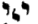

  
 and this is *segol*: what was *segolta* turned into *segol*. And the secret of the matter: corresponding to the two points, which are two kings, it hints 'two young bulls'; and corresponding to the point, a diadem over their heads, he said 'and one ram,' like one crown. After she said 'it is impossible for two kings to use one crown,' she diminished herself; so too 'and one goat of the goats for a sin offering' (Num. 28:15): the ram of Isaac turned into a goat; it was turned from compassion to judgment and was diminished. And therefore 'one goat of the goats for a sin offering,' and he did not say 'for a burnt offering,' to be a crown. And whence do we know that there is descent in the sin offering? This is what is written (Lev. 9:22), 'and he came down from offering the sin offering.' And why did he join the burnt offering with the sin offering in the descent? But to teach that the burnt offering was at first the attribute of compassion, and afterwards it turned to judgment in descent and was called sin offering; and all is one. And therefore 'Bring an atonement for Me [*alai*]': over me [*alai*] the moon was a crown, certainly, like this: וֹ; and afterwards she was diminished and descended to his feet, like this: וּ (in our version it is 'like this:  

  
' etc., 'like this:  

  
'). And at that time, 'Bring an atonement for Me,' it is said of her, 'she is the burnt offering [*ha-olah*]' (Lev. 6:2): she rose from his feet, of which it is said (Isa. 66:1), 'and the earth is My footstool,' to say of her, 'the heavens are My throne.' And this is the secret of 'a righteous one rules, the fear of God' (2 Sam. 23:3), who turns judgment to compassion. And the secret of the matter: 'the stone that the builders rejected has become the head of the corner' (Ps. 118:22), like this: הו"הי יהו"ה." Thus far its words.

> ועוד כי הרשב"י במקומות הרבה מפרש ענין הביאו עלי כפרה כמו שנבאר. ד' שמתוך שני המאמרים האלה נראה כי השמש והירח הם שני מלכים או ב' כתרים והמלך או הכתר האחד הוא הכח העליון אשר א"א להיות שמושו על ידיהם או שמושם על ידו והמתרעם היתה הירח שהיא א' מהשני הכתרים או משני המלכים לפי חילוק הפירושים. וברעיא מהימנא (פנחס דף רמ"ז ע"ב) פי' הרשב"י פי' שלישי חולק על שתיהם וז"ל ובראשי חדשיכם. וכי כמה רישין אית לה לסיהרא, אלא אינון תרין נקודין כגוונא דא [] נקודא תתאה סיהרא. תרין ראשין דילה תרין נקודין דאינון עלה סגול, בקדמיתא הוא כתר על תרין מלכין כגונא דא
>
>  והות סגולתא. ולבתר דאמרת א"א לשני מלכים שישתמשו בכתר אחד אמר לה הקב"ה לכי ומעטי את עצמך ונחיתת לרגלוי דתרין מלכין כגוונא דא
>
>  והיינו סגול, מה דהוה סגולתא אתחזר סגול. ורזא דמלה, לקבל תרין נקודין דאינון תרין מלכין קא רמיז פרים בני בקר שנים, ולקבל נקודה עטרה על רישייהו אמר ואיל אחד כגון כתר א'. בתר דאמרה א"א לשני מלכים שישתמשו בכתר א' אזעירת גרמה אוף הכי ושעיר עזים א' לחטאת, איל דיצחק אתהדר שעיר אתהפך מרחמי' לדינא ואתזעיר. ובג"ד שעיר עזים אחד לחטאת ולא אמר לעולה למהוי כתר. ומנא לן דאית ירידה בחטאת, הה"ד וירד מעשות החטאת. ואמאי שתף עולה עם החטאת בירידה, אלא לאולפא דעולה הוי בקדמיתא מדת הרחמים ולבתר אתהפכת לדינא בירידה ואתקריאת חטאת וכלא חד. ובג"ד הביאו עלי כפרה, עלי הות סיהרא כתר ודאי כגוונא דא וֹ ולבתר אתמעיטת ונחתת לרגלין דיליה כגונא דא וּ (בנוסחתינו איתא כגונא דא
>
>  כו' כגונא דא
>
> ), ובזמנא דא הביאו עלי כפרה, אתמר בה היא העולה, סליקת מרגלוי דאתמר בה והארץ הדום רגלי למימר בה השמים כסאי, והאי איהו רזא צדיק מושל יראת אלדים, דמהפך דינא לרחמי. ורזא דמלא אבן מאסו הבונים היתה לראש פינה, כגונא דא הו"הי יהו"ה עכ"ל.

**18:2:4** And behold, from within it it is explicitly explained that Rashbi's intent in the matter of "it is impossible for two kings" is: it is impossible for Netzach and Hod, which are the heads of the moon, as we have said, to use Malkhut, which is a crown over them. And this explanation certainly disagrees [for according to his explanation] she has no accusation against the sun; and this is forced. And our Sages, of blessed memory [in Chullin and in Zohar Chadash], explained that the moon made her accusation against the sun. And before we explain the settling of these three passages, we must explain the emanation of these two attributes from their beginning, whose matter was not explained in the Gate of the Order of the Emanation, because we designated it for this gate:

> והנה מתוכו מתבאר בפי' היות כוונת הרשב"י בענין א"א לשני מלכים, פי' א"א להנצח וההוד שהם ראשי סיהרא כדקא אמרינן שישתמשו במלכות שהיא כתר על גבייהו. וזה הפירוש חולק [ודאי כי לפירושו] אין לה קטרוג עם השמש, וזה דוחק. ורז"ל [בחולין ובז"ח) פירשו שקיטרגה הלבנה עם החמה. וקודם שנבאר בישוב ג' מאמרים האלה צריכים אנו לבאר אצילות ב' מדות אלה מתחלתם שלא נתבאר ענינם בשער סדר האצילות מפני שיעדנוהו אל השער הזה:

### Chapter 18:3. Explanation of the emanation of Malkhut from Tiferet at the beginning of its emanation; and there, a passage from Sefer ha-Bahir, "the light preceded the world."

**18:3:1** What is intended in this chapter is to explain the matter of the emanation of Tiferet and Malkhut from beginning to end. And the matter is that when it arose in His primordial will, may He be exalted, to emanate His pure and holy Emanation, there was a cause from Him to bring the things into being in an order in which they are not now in their manifestation. For the intent of the Emanation was that through it His greatness would be revealed, and the children of the world, which perishes, comes to be, and passes away, could be conducted through it; and further, for another reason. And this [without it] is impossible, for several reasons: whether because of the great concealment of His holiness, or because of the shortness of the apprehension of the created entities and their being finite, as explained in the Gate of the Reason for the Emanation. And according to this, it turns out that the principal of the arising of the will was Malkhut, which conducts the world.

> המכוון בפרק הזה לבאר ענין אצילות התפארת והמלכות מתחלה ועד סוף. והענין שכאשר עלה ברצונו הקדום יתעלה להאציל אצילותו הטהור והקדוש היה סבה מאתו להוות הדברים בסדר שאינם עתה במציאותם. כי להיות כוונת האצילות היה כדי שעל ידו יתגלה גדולתו ויוכלו בני העולם הכלה ההווה ונפסד להיות מונהגים על ידו, ועוד לסבה אחרת. וזה בלי אפשר לכמה סבות. אם לרוב העלם קדושתו, או לקוצר השגת הנבראים והיותם בעלי תכלית כמבואר בשער טעם האצילות. ולפ"ז נמצא כי עיקר עלות הרצון היה המלכות המנהגת העולם.

**18:3:2** And behold, the greatness of our Former is the opposite of the thought of human beings, who are vanity and whose thoughts are breath. For it is not as when a man thinks of some thing, and the thing does not come to be until he toils over its existence in deed, and then it becomes a revealed being, as explained in the Gate of Tzachtzachot, chapter 3. Not so our Creator, blessed be He: His thoughts are very, very deep and mighty; and when He thought of the beings, behold, the beings, before they came into being, acquired a manifestation choicer and superior to the manifestation of the deed. And it has already been explained that Tiferet and Malkhut are the principal of the Emanation, and all is included in them; as is known that the letters Vav-Heh are the totality of the Emanation from Binah downward, and they are the principal of the governance, and they are the order of time: for time comes to be through the circuit, which is Vav, six extremities, and Malkhut is Heh; the two of them are the attribute of day and the attribute of night. And therefore in the Thought (that is, Chokhmah) that preceded the Emanation were Tiferet and Malkhut. And because Malkhut is a more revealed being, her revealing came to be before Tiferet, and Tiferet was concealed; because Malkhut is a palace to it, and she reveals the glory of the King, and she is the revealed mirror in which Tiferet is revealed. And therefore the being first revealed in the Thought, which is Chokhmah, was Tiferet and Malkhut; and this is what our Sages, of blessed memory, said (in Bereshit Rabbah, section 3, on "And there was evening and there was morning"): "This teaches that there was an order of times before this." And the order of times is Tiferet and Malkhut; and they were before Him in the secret of the incising, when He was incising the world. And because no being is grasped in Chokhmah, because it is the beginning of being Something, as we explained in the gate mentioned, therefore it was necessary to emanate Binah, and from her the beings, which are Tiferet and Malkhut, would be emanated. And with this thing we will understand the matter of "they were created double-faced": that is to say, in Chokhmah, which is Yod. And the Yod: its permutation is the Yod that is in Chokhmah, and its filling is Vav-Dalet; because the Vav, which is Tiferet, and the Dalet, which is Malkhut, were the filling of Chokhmah, and she was pregnant with them like a pregnant woman; and this is the manifestation of the Yod of Malkhut and the manifestation of the Da'at of Tiferet. And for the reason that Tiferet is over Malkhut, Malkhut was in the aspect of Chokhmah itself, and Da'at, which is Tiferet, in the aspect of the Supernal Keter; for it was in the aspect of Chokhmah near to its source, the aspect of Chokhmah that cleaves to Keter. And when the will arose to reveal more, and He saw that the beings are not revealed through Chokhmah, He emanated Binah and placed Da'at within her; and the emanation of Da'at preceded Malkhut, because the cause of the Emanation was the concealment: for because the beings were concealed, they were emanated. Therefore the concealed Tiferet came first, to be revealed in Binah; and therefore the creation of Adam came before, in the parable, that of Eve his wife; and then the double-faced were divided, and Tiferet went out alone. And there is no earlier and later in this matter, for all is in one instant; and all is a parable for priority of rank, and the concealment of the manifestation and their multiplicity, not priority of time, God forbid, for divinity is not under time; and all this is a parable to let the ear hear, as we explained in the preceding gates. And when Tiferet was emanated in Binah, the Holy One, blessed be He, emanated Malkhut from her place that is in Chokhmah, and took her from Adam, which is חכמ"ה [Chokhmah]: אד"ם [Adam] is מ"ה [Mah, 45], the four-letter name filled as יו"ד ה"א וא"ו ה"א, which amounts to Mah. And then she was in the aspect of a rib, from the side of a simple Yod, and she was built through Binah. And this is (Gen. 2:22), "And the Lord God built the rib that He took," etc.; and this name hints at Binah, as is known. "And He brought her to the man": this is Tiferet, in its [particular and revealed] place. And there He unified them with the union of husband and wife, face to face, in a complete union, as we hope it will be speedily in our days, as it is written (Isa. 30:26), "And the light of the moon shall be as the light of the sun." And there the male was above the female, and the female served beneath him, as we shall explain further. And from there she was driven away and descended to be His footstool, until His anger turns and He comforts us. And now, according to this, Malkhut turns out to precede Tiferet, and Tiferet to precede Malkhut. For in Chokhmah, in its first manifestation, Tiferet was very concealed, so that it was not recognizable at all; and the revealing of Malkhut preceded it, because she is the principal of the governance of the world, and therefore her revealing came first. And Tiferet was concealed above, near to Keter, because of its being more concealed than Malkhut, as we explained; therefore its revealing was not made manifest until its revealed place. And in its revealed place the emanation of Tiferet came first, for it went out first, for it was the cause of the revealing, as we explained. And by this the words of the House of Hillel and the House of Shammai in Chagigah (folio 12a) are right: the House of Shammai say the heavens were created first, and the House of Hillel say the earth was created first, and the Sages say heaven and earth were created as one. For all is one, and the words of all of them are true, and they are the words of the living God. For in Chokhmah the revealing of Malkhut came first: behold, the earth was created first; and in their emanation [in Binah] Tiferet came first: behold, the heavens were created first; and in truth they were created as one [as the words of the Sages], except that this was revealed before that. And with this preliminary a passage in Sefer ha-Bahir will be explained, and these are its words: "Rabbi Rechumai said: The light preceded the world, which 'clouds and thick darkness are round about Him' (Ps. 97:2), as it is said, 'And God said, Let there be light, and there was light.' They said to him: Before the forming of your son, you make a diadem? He said to them: Yes. A parable: to what is the matter like? To a king who craved a son, and he found a fine diadem, and praised it and lauded it, and said: Keep this for my son, for his head, for it befits him. They said to him: Does he know that his son is fit for it? He said to them: Be silent; so it arose in thought, and it is known, as it is said, 'and devisers of devices.'" Thus far its words.

> והנה להיות גדולתו של יוצרנו הפך מחשבת בני אדם שהם תהו ומחשבותיהם הבל. ולא כשיחשוב אדם בדבר מהדברים [שלא] יתהווה [הדבר] עד שיטרח במציאותו במעשה ואז יהיה הוייה נגליית כמבואר בשער הצחצחות פ"ג. ולא כן בוראינו ית' מחשבותיו עמקו ועצמו למאד מאד, ובחשבו בהויות הנה ההויות קודם בואם להויה קנו מציאות מבחר ומעולה ממציאות המעשה. וכבר נתבאר כי תפארת ומלכות הם עיקר האצילות ובהם נכלל הכל כמו שנודע כי אותיות ו"ה הם כללות האצילות מבינה ולמטה והם עיקר ההנהגה והם סדר הזמן כי הזמן מתהוה ע"י ההקף שהוא ו' שש קצות, ומלכות ה'. שניהם מדת יום ומדת לילה. ולכן במחשבה (ר"ל החכמה) הקודמת אל האצי' היו הת"ת והמלכות. ומפני היות המלכות הויה יותר מתגלית נתהוה גלויה קודם הת"ת והת"ת היה נעלם מפני שהמלכות היכל אליו והיא מגלה כבוד המלך והיא מראה נגלית שבה מתגלה הת"ת. ולכן ההויה הנגלית ראשונה במחשבה שהוא החכמה היה הת"ת והמלכות, וזהו אמרם ז"ל (בב"ר פ"ג ויהי ערב ויהי בוקר) מלמד שהיה סדר זמנים קודם לכן. וסדר הזמנים הם ת"ת ומלכות. והיו לפניו בסוד החריטה שהיה מחריט העולם. ומפני שאין הויה נתפסת בחכמה מפני שהיא תחלת הישות כדפי' בשער הנזכר, לכן הוצרך להאציל הבינה וממנה יתאצלו ההויות שהם תפארת ומלכות. ועם הדבר הזה נבין ענין ד"ו פרצופין נבראו. ר"ל בחכמה שהיא הי'. והי' צירופה י' שבחכמה ומילואה ו"ד. יען כי הוא"ו שהוא הת"ת והד' שהיא המלכות הם היו מילוי החכמה ובה היתה מעוברת כאשה עוברה וזהו מציאות הי' של מלכות ומציאות הדעת של ת"ת. ומטעם שהת"ת על המלכות היתה המלכות בבחינת החכמה עצמה. והדעת שהוא הת"ת בבחי' כ"ע כי היה בבחי' החכמה הקרובה אל מקורה בחינת החכמה המתדבק בכתר. וכאשר עלה הרצון לגלות יותר וראה שאין ההויות מתגלות ע"י החכמה האציל הבינה והניח הדעת בתוכה וקדם אצילות הדעת אל המלכות מפני שסבת האצילות היה ההעלם, כי מפני שהיו ההויות נעלמות נאצלו. לכן קדם הת"ת הנעלם להתגלות בבינה ולכן קדם בריאת האדם משל חוה אשתו ואזי נחלקו הד"ו פרצופין ויצא הת"ת לבדו. ואין בענין הזה מוקדם ומאוחר כי הכל היא ברגע אחד. והכל משל אל קדימת המעלה והעלם המציאות ורבוים, לא קדימת זמן ח"ו שאין האלהות תחת הזמן. וכל זה משל לשבר את האזן כדפירשנו בשערים הקודמים. וכאשר נתאצל הת"ת בבינה האציל הקב"ה המלכות ממקומה שבחכמה ולקחה מאדם שהיא חכמ"ה אד"ם מ"ה שם בן ד' במלוי יו"ד ה"א וא"ו ה"א שעולה מ"ה ואז היתה בבחי' צלע מצד יו"ד פשוטה ונבנתה ע"י הבינה. וזהו (בראשית ב) ויבן ה' אלדים את הצלע אשר לקח וגו'. ושם זה רומז בבינה כנודע, ויביאה אל האדם זה הת"ת במקומו [המיוחד והמתגלה]. ושם יחדם יחוד איש ואשתו פנים כנגד פנים ביחוד שלם כאשר אנו מקוים שיהיה במהרה בימינו, כדכתיב (ישעיה ל כו) והיה אור הלבנה כאור החמה. ושם היה זכר עליון מהנקבה והנקבה משמשת תחתיו כאשר נבאר עוד. ומשם נטרדה וירדה להיותה הדום רגליו עד ישוב אפו וינחמנו. ועתה נמצא לפ"ז המלכות קודמת אל הת"ת, והת"ת אל המלכות. כי בחכמה במציאותו הראשון הי' הת"ת נעלם הרבה עד שלא היה ניכר כלל וקדמה אליו גלוי המלכות מפני שהיא עיקר הנהגת העולם ולכן קדמה גלויה. והת"ת היה נעלם למעלה קרוב אל הכתר מפני התעלמותו יותר מהמלכות כדפי', לכן לא נתפרסם גלויו עד מקומו הנגלה. ובמקומו הנגלה קדם אצילות הת"ת כי הוא יצא ראשונה כי הוא היה סבת ההתגלות כדפי'. ובזה צדקו דברי ב"ה וב"ש בחגיגה (דף י"ב) בש"א שמים נבראו תחלה ובה"א ארץ נבראת תחלה וחכ"א שמים וארץ כאחד נבראו. כי הכל א' ודברי כלם אמת ודברי אלדים חיים. כי בחכמה קדמה גילוי המלכות הרי ארץ נבראת תחלה, ובאצילותם [בבינה] קדם הת"ת הרי שמים נבראו תחלה, ועל האמת כאחד נבראו [כדברי חכמים] אלא שזה נגלה קודם לזה [מב]. ועם הקדמה הזאת יתבאר מאמר אחד בספר הבהיר וז"ל א"ר רחומאי האורה קדמה לעולם שענן וערפל סביביו שנאמר ויאמר אלדים יהי אור ויהי אור. אמרו לו קודם יצירת בנך תעשה עטרה. אמר להם הן, מלה"ד למלך שהתאוה לבן ומצא עטרה נאה וקלסה ושבחה ואמר שמרו זה לבני לראשו כי לו נאה. אמרו לו יודע הוא שבנו ראוי לה. אמר להם שתוק כך עלה במחשבה, ונודע. שנאמר וחושבי מחשבות עכ"ל.

**18:3:3** And although at first glance his words are hard to understand, with this our preliminary it will be easy and explained. And this is its explanation. Rabbi Rechumai says that "the light" [*ha-orah*], which is Malkhut, as explained in the Gate From Below to Above, chapter 4, in the explanation of a passage of Sefer ha-Bahir; see there. And he called her *orah* and not *or*, to hint at the light of Malkhut, which is called *or*-Heh [the light of Heh]. And he proved the matter from the verse "Let there be light," etc.: for the verse told us of the manifestation of the light before the manifestation of the firmament; for this light is in Malkhut, and the firmament in Tiferet, and the light precedes the firmament. And to this he intended in saying "the light," which is Malkhut, "preceded the world [*olam*]," which "clouds and thick darkness are round about Him," which is Tiferet. And the explanation: it is known that the whole circuit is called *olam*; and for this reason Binah is called *olam*, for in her is the inclusion of the circuit, as we shall explain in the Glossary of Titles; and the principal of the circuit is Tiferet, including six extremities, which are the days of the circuit. And for this he said that "the light preceded the world." And so that we should not err and say that the intent is that her emanation in Thought was before its emanation in the secret of Da'at (for this is not so, as we explained), for this he said "which clouds and thick darkness are round about Him": explanation: [this refers] to the revealed manifestation of Tiferet, which is between Chesed and Gevurah, which are cloud and thick darkness; and they are the aspects that Tiferet has with Chesed and Gevurah, and they are a garment in which Tiferet is clothed. And the disciples of Rabbi Rechumai, because a true tradition was fixed in their hearts that the emanation of Tiferet precedes Malkhut, objected with the force of figurative speech: how is it possible that Malkhut precede Tiferet? For Malkhut is a vessel to Tiferet, and Tiferet is master and ruler over her; and although she is sometimes exalted over it, at the least she will be a diadem on its head; and if so, in the end they asked him: Does a man make a diadem for his son before the forming of the son? And this is what they asked: "Before the forming of your son, you make a diadem for him?" And Rabbi Rechumai, because the tradition of the disciples is correct and true, that the emanation of Tiferet precedes the emanation of Malkhut, did not protest against them; but he answered them according to their way with a fitting and acceptable parable: "to a king who craved a son." And he was precise in using the language of "craved"; for craving is subtler than the thought of action; and likewise the manifestation of Tiferet is subtler and more concealed than the thought of action, and it is in the secret of Da'at, as we explained. "And he found a fine diadem": for the diadem is more revealed; and this is the reason for "and he found," for the language of finding can already properly be said of it somewhat. And he said "Keep this for my son": the intent is the language of "keeping," that it will still be concealed and kept in its concealed manifestation, which is called Yod, the diadem of Tiferet, "for his head, for it befits him"; which is not found in Tiferet, that its manifestation should be revealed below as much as Malkhut, for the reason of its still being concealed. And the modest disciples, because it was still difficult for them, for they had not received the concealed manifestation of Tiferet that is above the diadem, asked as those in doubt about the matter, so that he would explain much to them; and they said to him, "Does he know that his son is fit for it?" And they intended to ask as those in doubt about the tradition of the concealed Da'at. And the delightful master answered: "Be silent; so it arose in thought." And the intent is that it was already in thought, in the secret of Da'at; and this is "and it is known" [*ve-noda*], the language of *da'at*. And the intent is that the concealed manifestation of Tiferet arose in thought and was formed in the secret of Da'at; and this is *ve-noda*. "As it is said, 'and devisers of devices'": some read "and devising devices." And the intent, according to all the explanations, is to prove that Keter too is called thought, although at first glance we have thought only in Chokhmah. And he proved that there is thought in Keter from his saying "devices" [*machashavot*, thoughts], two: thought within thought. And therefore Tiferet was in the upper thought, as we explained above. And after we have explained in this chapter the matter of the emanation of Malkhut from the beginning of the Emanation to the end, we come to explain that the diminishment is not the matter of the sawing apart of Eve from Adam, as the commentators imagined:

> ועם היות שלכאורה דבריו קשי ההבנה, עם הקדמתינו זאת יקל ויתבאר. וזה פי'. ר' רחומאי אומר שהאורה שהוא המלכות כמו שנתבאר בשער ממטה למעלה פ"ד בפי' מאמר א' מספר הבהיר ע"ש. וקראה אורה ולא אור לרמוז אל אור המלכות הנקרא אור ה'. והכריח הענין מפסוק יהיה אור וכו' כי הפסוק אמר לנו מציאות האור קודם מציאות הרקיע. כי האור הזה במלכות, והרקיע בת"ת, והאור קודם אל הרקיע. ולזה כוון באמרו האורה שהיא המלכות קדמה לעול"ם שענן וערפל סביביו שהוא הת"ת. ופי' שנודע כי ההקף כלו נקרא עולם, ומטעם זה נקרא הבינה עולם שבו כללו של היקף כמו שנבאר בערכי הכנויים. ועקר ההקף הוא הת"ת כולל ו' קצוות שהם ימי ההקף. ולזה אמר שהאורה קדמה לעול"ם. ומפני שלא נטעה לומר שהכונה שהיתה אצילותה במחשבה קודם לאצילתו בסוד הדעת, שזה אינו כדפי'. ולז"א שענן וערפל סביבי"ו. פי' למציאות הת"ת המתגלה, שהוא בין החסד והגבורה שהם ענן וערפל והם הבחינות שיש להת"ת עם החסד והגבורה והם לבוש שמתלבש בהם הת"ת. ותלמידי רבי רחומאי מטעם שהיה קבוע בלבם קבלה אמיתית שאצילות הת"ת קודם למלכות הקשו בתוקף המליצה כי איך אפשר שתקדם המלכות לת"ת שהרי המלכות כלי לת"ת והת"ת אדון וקצין עליה ועם היות שפעמים תתעלה עליו לכל הפחות תהיה עטרה על ראשו, וא"כ סוף סוף שאלו לו האם יעשה אדם עטרה לבנו קודם יצירת הבן. וזה ששאלו קודם יצירת בנך תעשה לו עטרה. ור' רחומאי לפי שקבלת התלמידים היא נכונה ואמיתית כי אצילות הת"ת קודם לאצילות המל' לא מיחה בידם, אלא השיב להם ע"פ דרכם במשל נאות ומתקבל למלך שהתאוה לבן. ודקדק באמרו לשון התאוה. כי התאוה היא יותר דקה ממחשבת המעשה, וכן הת"ת מציאותו דק ונעלם יותר ממחשבת המעשה והוא בסוד הדעת כדפי'. ומצא עטרה נאה כי העטרה היא יותר מתגלית, וזהו הטעם ומצ"א כי יצדק עליה כבר לשון מציאה קצת. ואמר שמרו זה לבני, הכוונה אל לשון שמור, שעוד תהיה נעלמת ושמורה במציאותה הנעלם הנקרא י' עטרת תפארת לראשו כי לו נאה מה שלא נמצא בתפארת שיהיה מציאותו מתגלה למטה כ"כ כמו המלכות מטעם העלמו עדין. והתלמידים הצנועים לפי שעדין היה קשה להם לפי שלא קבלו מציאות התפארת הנעלם אשר למעלה מהעטרה, שאלו כמסתפקים בענין כדי שיבאר להם הרבה ואמרו לו יודע שבנו ראוי לה. וכונו לשאול כמסתפקים בקבלת הדעת הנעלם. והרב הנחמד השיב שתוק כך עלה במחשבה. והכונה כי כבר היה במחשבה בסוד הדעת וזהו ונודע לשון דעת. והכונה כי מציאות הת"ת הנעלם עלה במחשבה ונצטייר בסוד הדעת וזהו ונוד"ע. שנאמר וחושבי מחשבות אית דגרסי וחשב מחשבות. והכונה לכלהו פי' להכריח שהכתר ג"כ נקרא מחשבה הגם שאין לנו לכאורה מחשבה אלא בחכמה. והכריח שיש מחשבה בכתר ממה שאמר מחשבות, תרין, מחשבה לפנים ממחשבה. ולכן במחשבה עליונה היה הת"ת כדפי' לעיל. ואחר שבארנו בפרק זה ענין אצילות המלכות מתחלת האצי' ועד סוף. נבא לבאר שאין המיעוט ענין נסירת חוה מאדם כאשר דימו המפרשים:

### Chapter 18:4. Explanation that the "sawing apart" (*nesirah*) of Adam and Eve is not the diminishment, as many have thought; and there, a passage from Parashat Acharei Mot, "she conceived... in love."

**18:4:1** In this chapter we will explain that the sawing apart of Eve from Adam is not the matter of the diminishment; for the sawing apart was for good, for the coupling and for begetting, which is not so of the diminishment. And there is no room to ask: since this is so, how was there begetting before the sawing apart, or why were they created thus, so that they would need the sawing apart? For this matter is explained in the Zohar, and we copied it in the Gate of Essence and Governance, chapter 18. And perhaps the inquirer will imagine [a difficulty] against this from the words of Rashbi in parashat Acharei (77b), and these are its words: "We have learned: the upper Heh conceived in love, in affection, for the Yod never parts from her. She conceived and brought forth Vav; afterwards it stood before her and she nursed it. And this Vav, when it went forth, its mate went forth with it. Chesed came, roused beside it, and separated them; and trunks went forth from below to above, and branches spread out and multiplied, and the lower Heh was made. And she grew with her branches higher and higher, until she coupled with the upper tree, and Vav was joined with Heh. Who caused them? It is Chesed; it is certainly Chesed that joined them as one. Yod with the upper Heh: their joining does not depend on Chesed; rather their joining and their affection depend on *mazal*, that they never part. Yod is bound to Heh, Heh is bound to Vav, Vav is bound to Heh, and Heh is bound to all, and all is one bond and one thing. They never part from one another." Thus far its words.

> בפרק זה נבאר שאין נסירת חוה מאדם ענין המיעוט כי הנסירה היתה לטוב אל הזווג ואל ההולדה משא"כ המיעוט. ואין מקום לשאול כיון שכן, איך היה ההולדה קודם הנסירה או למה נבראו כך כדי שיצטרכו אל הנסירה. כי ענין זה נתבאר בזהר והעתקנוהו בשער מהות והנהגה בפי"ח. ושמא ידמה המעיין לנגד לזה מכח דברי הרשב"י בפ' אחרי (דע"ז ע"ב) וז"ל תאנא, אתעברת ה' עלאה ברחימותא בחביבותא דלא אתפרש מינה יו"ד לעלמין, אתעברת ואפיקת ו', לבתר קאים קמה וינקא ליה, ודא וא"ו כד נפקא בת זוגו נפקת עמיה. אתיא חסד אתער גביה ופריש לון ונפקו גזעין מתחות לעילא ואתפשטו ענפין ואסגיאו ואתעבידת ה"א תתאה. ואתרביאת בענפהא לעילא לעילא עד דאזדווגת באילנא עילאה ואתחברו ו' עם ה', מאן גרים לון, חסד הוא, חסד הוא ודאי דחבר לון כחדא. י' עם ה' עילאה לא תלייא חבורא דלהון בחסד, אלא במזלא תלייא חבורא דילהון וחביבותא דלהון דלא מתפרשין לעלמין. יו"ד אתקשר בה' ה' אתקשר בוא"ו ו' אתקשר בה' וה' אתקשר בכלא וכלא חד קשורא הוא וחד מלה. לא אתפרשו דא מן דא לעלמין עכ"ל.

**18:4:2** At first glance it implies that Tiferet went out double-faced and was divided below in its place, and could not beget except through division, that is, the diminishment of the moon. And it turns out that this passage disputes all that has been explained, in several matters. First, it appears that after it went out, the division and the sawing of the rib came afterward, in saying "Vav, when it went forth," etc.; it appears that they were emanated and afterward sawn apart.

> ולכאורה משמע כי הת"ת יצא ד"ו פרצופין ונתחלק למטה במקומו ולא היה יכול להוליד אלא ע"י חלוקה דהיינו מיעוט הירח. ונמצא המאמר הזה חולק עם כל מה שפי' בכמה ענינים. ראשונה נראה שאחר שיצא אח"כ היה ענין החילוק ונסירת הצלע באמרו ו' כד נפקא וכו' כנראה שנאצלו ואח"כ נסרן.

**18:4:3** Further, we explained above that the division of Tiferet from Malkhut was through Binah, and here it appears that it was through Chesed. Further, it appears that this is the diminishment, in saying "and the lower Heh was made," which means the diminishment, that they lowered her; and so it is implied by the language of the passage. Therefore it seems right to me to explain this passage; and before we enter into its explanation, we will raise some remarks on it, in such a way that through them the intent of the passage will be understood. And what there is to remark: First, their saying "She conceived and brought forth Vav; afterwards it stood," etc.: what is "afterwards," and what is "brought forth," for all is one? "Brought forth" and "afterwards it stood": where did she bring it forth, that it was needed afterwards to stand it up? Second, their saying "Chesed came," etc., "and separated them": could it enter the mind that the diminishment was done by Chesed? But on the side of the diminishment croup takes hold of infants, as we say in the Zohar, parashat Terumah (folio 167), and these are its words: "Once the accuser went out, then it is written, 'Let there be lights' [*me'orot*], lacking Vav; and croup was drawn upon infants, and the light of the moon was lacking." Thus far its words.

> ועוד כי פירשנו למעלה כי חילוק הת"ת מן המלכות היה ע"י הבינה וכאן נראה שהיה ע"י החסד. עוד נראה כי היינו המיעוט באמרו ואתעבידת ה"א תתאה שפי' המיעוט שהורידוה, וכן משמע מתוך לשון המאמר. לכ"נ לבאר המאמר הזה, וקודם שנכנס בביאורו נעורר בו קצת הערות באופן שבהם יובן כונת המאמר. ומה שיש להתעורר. א' אמרו אתעברת ואפיקת ו' לבתר קאים וכו', מאי לבתר ומאי אפיקת דכלא חד. אפיקת ולבתר קאים היכן אפקיה דאצטריך לבתר לאוקמיה. ב' אמרו אתיא חסד כו' ופריש לון, וכי ס"ד דמעוטא בחסד אתעביד, והרי בסטר המיעוט אחיד אסכרא ברביי כדאמרי' בזהר פ' תרומה (דף קס"ז) וז"ל כיון דנפק מקטרגא כדין כתיב יהי מארת חסר ו', ואתמשכא אסכרא ברביי וחסר נהורא דסהרא עכ"ל.

**18:4:4** Behold, it is explicitly implied that the moon was diminished on the side of the accuser. Further, who can say that the moon was diminished by Chesed? For it is understood from there that her diminishment was not done for her good, as she said, "Because I said before You a proper thing," and the matter of "Bring atonement for Me," and all that the Rabbis said there, as we explained in chapter 1.

> הרי בפי' משמע דבסטרא דמקטרג אתזעיר סיהרא. עוד דמי איכא למימר דסיהרא אתזעיר בחסד, והרי מובן מתמן דזעירו דילה לאו לטיבו אתעביד כמה דאמרה בשביל שאמרתי לפניך דבר הגון, וענין הביאו עלי כפרה וכל מאי דקאמרי רבנן התם כדפי' בפ"ק.

**18:4:5** Further, if so, that the union and coupling of the moon is found only through the diminishment of the moon, then in the future, when the light of the moon shall be as the light of the sun, how is it possible? For there will be no union and coupling. Third, what he said, "Yod with the upper Heh does not depend," etc.: what is it doing here, since we are not dealing with this?

> ועוד דא"כ דיחודא דסיהרא וזווגא לא אשתכח אלא ע"י זעירו דסיהרא, א"כ לעתיד שיהיה אור הלבנה כאור החמה איך אפשר והרי לא יהיה היחוד והזווג. ג' מה דקאמר י' עם ה' עלאה לא תליא כו', מאי בעי הכא דלאו בהכי עסקינן.

**18:4:6** Further, he said at the beginning of the teaching, "in love, in affection, that does not part," etc.; and why are both of them needed here? And now we will come to set right the passage from its root. We have already explained above that "the Lord God" is Binah, and the rib Malkhut, and the man Chokhmah. And so Rashbi explained (in Tikkunei Zohar, Tikkun 12, folio 27a) on the verse "And the Lord God built the rib that He took from the man": "This is Chokhmah. 'And brought her to the man': this is the middle pillar, the grade of Moses. And this rib is certainly the bride of Moses." Thus far its words.

> ועוד דהא קאמר ליה בריש שמעתתא ברחימותא בחביבותא דלא אתפרש כו', ותרוייהו למה צריכי הכא. ועתה נבא בתיקון המאמר מעיקרו. כבר בארנו למעלה כי ה' אלדים הוא הבינה, והצלע מלכות, והאדם חכמה. וכן באר הרשב"י (בתקונא י"ב דף כ"ז.) בפסוק ויבן ה' אלדים את הצלע אשר לקח מן האדם, דא חכמה. ויביאה אל האדם, דא עמודא דאמצעיתא, דרגא דמשה. והאי צלע איהי ודאי כלת משה עכ"ל.

**18:4:7** And it is known that "the Lord God" is Binah, as is known. And after this matter has been explained, it is fitting to know further that there is no building except through Chesed, as it is said (Ps. 89:3), "For I said, The world shall be built by Chesed"; and every building depends on it. And now it is necessitated that the building of the rib was through Chesed. Further, it is fitting to know that Binah, hinted at in the form of the first Heh in the Name, is not literally in the form of Heh; rather her principal form is Yod, as explained in the Gate of Manifestations; and the form of Heh that hints at her is a hint of the emanated ones that come from her. And the explanation of Rashbi, peace be upon him, is that the Vav within the Heh is the form of the emanated Tiferet. And now, according to this, it is difficult: just as the form of Vav, which is Tiferet, was formed within her, why was the form of Malkhut not formed within her, so that there would be within her Vav-Dalet, both of them: Dalet, that is, the form of Malkhut in the manifestation of the rib, and Vav, that is, Tiferet? Rather, what must you say? That the two of them were emanated at once. (And so it is proven there: Adam and Eve were double-faced after the creation. And if you say that they were double-faced in Chokhmah: there is no revealed being there, as Adam and Eve were when they were double-faced after their creation.) And Rashbi, peace be upon him, in our teaching explained this matter with a correct compromise, and it is this: that Chokhmah, at the time of the emanation of these, out of its union and its concealment within Binah, [Chokhmah and Binah] were united in love, in such a way that the two of them were one in a complete union. And this is what he said, "We have learned: she conceived," etc.: for they did not part, and their union was in the strength of love, such that there is no separation between them, God forbid.

> וידוע כי ה' אלדים הוא בינה כנודע. ואחר שנתבאר הענין הזה ראוי לדעת עוד כי אין בנין אלא בחסד שנאמר (תהלים פט ג) כי אמרתי עולם חסד יבנה, וכל בנין בו תלוי. ועתה הוכרח כי בנין הצלע היה בחסד. עוד ראוי לדעת כי הבינה הנרמזת בצורת ה' ראשונה שבשם אין צורתה ממש ה' אמנם עיקר צורתה הוא י' כמבואר בשער המציאות וצורת ה' הנרמזת אליה הוא על רמז הנאצלים ממנה, ופירוש הרשב"י ע"ה כי הו' שבתוך הה' היינו צורת תפארת הנאצל. ועתה לפ"ז קשה כי היכי דאצטייר בגווה צורת ו' שהוא הת"ת אמאי לא אצטייר בגווה צורת המלכות ולהוו בגווה ו"ד שתים. ד' דהיינו צורת המלכות במציאות הצלע, וא"ו דהיינו הת"ת. אלא מאי אית לך למימר דתרוייהו בבת אחת נאצלו. [מג] (והכי מוכח התם אדם וחוה ד"ו פרצופין הוו אחר הבריאה. ואי תימא דד"ו היו בחכמה לא אית תמן הויה נגלית כמו שהיה אדם וחוה כי הוו ד"ו פרצופין אחר בריאתם). והרשב"י ע"ה בשמעתין באר הענין הזה בפשרה נכונה, והיא זו, כי החכמה בשעת אצילות של אלו מתוך יחודה והעלמה בתוך הבינה היו מיוחדים באהבה באופן שהיו שתיהם אחד ביחוד גמור. וז"ש תאנא אתעברת וכו' כי לא היו מתפרשות ויחודם בתוקף אהבה שאין ביניהם פירוד ח"ו.

**18:4:8** And the matter of "that do not part" we explained in the Gate of Essence and Governance, chapter 14. And the reason that he called Binah here "the upper Heh" is that it hints at her pregnancy.

> וענין דלא מתפרשין ביארנו עניינו בשער מהות והנהגה בפ' י"ד. והטעם שקראה כאן לבינה ה' עלאה מפני שהוא רומז לעיבורה.

**18:4:9** And the matter of "and brought forth Vav" is not literally the Vav of the Name; rather the intent is the Vav within the Heh itself, as Rashbi, peace be upon him, explained in the passage "Heh was Dalet, once she was joined," etc., which we copied in the Gate of Names, chapters 11 and 13; see there. And what he said, "and brought forth Vav," is the conceiving in the pregnancy, in which she brought out from Chokhmah and emanated within herself the Vav, that is, Tiferet and Malkhut together; but the female is not mentioned, because she was a rib. And what he said, "afterwards it stood," etc.: explanation: after she brought forth this son from within her, as we explained, and the rib was taken from it there, as we shall explain afterward. "It stood before her": explanation: she emanated it in the place particular to it, that is, its emanation below, in the Vav of the Name itself. And after he completed the emanation of Tiferet entirely, in all its manifestations, he returned to explain the difference between Tiferet and Malkhut in the emanation, and said, "when it went forth, its mate," etc., that is, the pregnancy and its conceiving, that is, "and brought forth Vav," which he said above, as we explained. And in that revealing within Binah, the two of them were included together in the secret of double-faced; and behold, in the Heh there is the form of ד"ו [Dalet-Vav] after its kind, except that they were still double-faced there. And this is one of the explanations of the Heh of Binah. "Chesed came," etc.: the matter is as we explained, that Binah and Chokhmah were united, and Chokhmah within Binah, and she is it, all is one. If so, it is already settled that they were still double-faced within Binah, and that the rib was taken from Adam, that is, Chokhmah. And with this the name Yah in Chokhmah will be understood: that Yod is Chokhmah in conjunction with Binah, which is Heh, and its form is ד"ו, that is, double-faced in Chokhmah and Binah. And with this it will now be settled that Binah took the rib, which is Malkhut alone, from Chokhmah, and took it also from Tiferet: for while the two of them were together within Binah, and Chokhmah still within her, the taking happened, in such a way that Tiferet alone was emanated below, and the rib remained in the aspect of Yod above, being progressively built. And because Chesed is the opening of Binah, and this separation and division was there, "for a door of hope" (Hos. 2:17), behold, they were divided through Chesed. And because all building is through Chesed, as we explained, behold, her building, that is, the form of He, as we explained in the Gate of Manifestations, was through Chesed. And this is what Rashbi said in our teaching: "Chesed came," etc., "and separated them." And now all is resolved, and the language of the Tikkunim is set right, that the taking was from Chokhmah. And it is resolved that they were double-faced in their creation, that is, after the pregnancy. And it is resolved why the two of them did not remain in Binah as divided forms. And the matter of double-faced in Binah is resolved as well. And the matter of the building through Chesed is resolved. And above all, a great difficulty is resolved, which is difficult in what he said in the Tikkunim (that the man from whom she was taken is the very one to whom she was brought). And with this it is settled that Adam himself was there at the time of her taking within Binah: when Binah emanated Tiferet, then she took the rib from Chokhmah; it turns out that her taking from Chokhmah and her taking from Tiferet were at once. And let us return to the matter of the passage: "And trunks went forth from below to above": explanation: for before, they were ד"ו [double-faced, Dalet before Vav], that is, Malkhut above Tiferet; and therefore they did not beget. And the reason they were there thus has already been explained above: because Tiferet preceded Malkhut in emanation, and Malkhut remained above it. And this is also their form, as with a seal: for in Keter they were ו"ד [Vav-Dalet], Tiferet above, and this is in the aspect of Keter, and Malkhut in Chokhmah; and at the time of the revealing of Tiferet they became ד"ו [Dalet-Vav], like the reversed impression of a seal. And this is Vav-Dalet in Chokhmah, for Chokhmah is Yod and its filling is Vav-Dalet; and in Binah Dalet-Vav, that is, the Heh: Dalet before the Vav.

> וענין ואפיקת ו' אינו ממש ו' שבשם אלא הכוונה ו' שבתוך הה' עצמה כדפי' הרשב"י ע"ה במאמר ה' ד' הות מדאתחברת כו' והעתקנוהו בשער השמות פי"א י"ג יעו"ש. ומ"ש ואפיקת ו', היינו ההוראה שבעיבור שהוציאה מחכמה והאצילה בעצמה הוא"ו והיינו הת"ת והמלכות יחד אמנם נוקבא לא אדכר דצלע הות. ומ"ש לבתר קאים וכו' פי' לבתר דאפיקת האי בן מגווה כדפי' ונלקח ממנו הצלע שם כמו שנבאר אח"כ. קאים קמה. פי' האצילו במקומו המיוחד לו דהיינו אצילתו למטה בוא"ו שבשם עצמה. ואחר שהשלים אצילות הת"ת מכל וכל בכל מציאותיו חזר לבאר החילוק שבין ת"ת למלכות באצי', ואמר כד נפקא בת זוגו כו' דהיינו העבור והוראתו דהיינו ואפיקת ו' דקאמר לעיל כדפי'. ואותו ההתגלות בתוך הבינה היו נכללים שניהם יחד בסוד ד"ו פרצופין, והנה בה' צורת ד"ו למינו אלא שעדין היו שם ד"ו פרצופין. וזו א' מפירושי ה' של בינה. אתיא חסד וכו'. הענין הוא כמו שפי' שהבינה והחכמה היו מיוחדים והחכמה בתוך הבינה והיא היא הכל א', א"כ כבר יתיישב היותם עדין ד"ו פרצופין בתוך הבינה והיות הצלע נלקח מאדם דהיינו חכמה. ועם זה יובן שם י"ה בחכמה שהוא י' חכמה בחבור הבינה שהיא ה' וצורתה ד"ו והיינו ד"ו פרצופין בחכמה ובינה. ובזה יתישב עתה שלקחה הבינה הצלע שהיא המלכות לבדה מחכמה ולקחה גם מת"ת, כי בהיותם שתיהם יחד בתוך הבינה ועדין החכמה בתוכה היתה הלקיחה, באופן שנאצל למטה הת"ת לבדו ונשארה הצלע בבחי' י' למעלה נבנית והולכת. ומטעם כי החסד פתח הבינה והפירוד והחלוק הזה היה שם לפתח תקוה, הנה נחלקו ע"י החסד. ולהיות כי כל בנין הוא בחסד כדפי' הנה בניינה דהיינו צורת ה' כדפי' בשער המציאות הי' ע"י החסד. וז"ש הרשב"י בשמועתנו אתיא חסד כו' ופריש לון. ועתה נתתרץ הכל ונתקן לשון התיקונים כי הלקיחה הי' מחכמה. ונתתרץ כי ד"ו פרצופין היו בבריאתן דהיינו אחר העבור. ונתתרץ מה שלא נשארו שניהם בבינה צורות נחלקות. ונתתרץ ענין ד"ו פרצופין בבינה ג"כ. ונתתרץ ענין הבנין בחסד. ונתתרץ על הכל קושיה גדולה שקשה במה שאמר בתיקונים [מד] (כי האדם שנלקחה ואליו ממש הובאה). ובזה יתישב כי האדם עצמו היה שם בעת לקיחתה בתוך הבינה כשהבינה האצילה הת"ת אז לקחה הצלע מחכמה נמצאת לקיחתה מחכמה ולקיחתה מת"ת בבת אחת. ונחזור לענין המאמר ונפקו גזעין מתחות לעילא. פי' כי קודם היו ד"ו דהיינו מלכות למעלה מת"ת ולפיכך לא היו מולידים. וטעם היותם שם כן, כבר פי' למעלה מפני שקדם הת"ת באצילות אל המלכות ונשארת המלכות למעלה ממנה. וזהו ג"כ צורתם כחותם. כי בכתר היו ו"ד ת"ת למעלה וזהו בבחינת הכתר. ומלכות בחכמה. ובעת התגלות הת"ת נעשו ד"ו כחותם המתהפך. וזהו ו"ד בחכמה כי החכמה היא י' ומילואו ו"ד ובבינה ד"ו דהיינו **ה'** ד' קודם על הו'.

**18:4:10** And behold, they were divided and separated through Binah; and in order to unite her with her husband, Malkhut was built in the form of Heh; for through this the union comes about, when she is adorned and spreads her branches and her adornments upward, so that He will remember the everlasting covenant and her husband will unite with her, which it was not possible for him to do until now. And the reason they were not divided until they went out below Binah is that the principal purpose of their union is to perform the action of bringing into being; for through the two of them the beings are revealed with an essential revealing. And because there is no essential being until below Binah, as we explained in the Gate of the Order of the Emanation, therefore they were in a state in which they had no union or coupling until they came to the place where the coupling is needed, through which the actions go forth into revealed beings, as we explained in the gate mentioned. And this is what he said in our teaching, "and the lower Heh was made": explanation: through Chesed they were separated and she was built [in the form of Heh], as he said, "and branches spread out," etc.; for through this the Heh was made below Tiferet, that is, the lower Heh. "And she grew," etc.: that is, the branches rising upward, which arouse the male with their beauty to unite. "And Vav was joined with Heh": explanation: in the union in which they united face to face they were united; that is, before the diminishment, for then she was in union with her husband always. "Who caused them," etc.: explanation: he wanted to prove that their separation from one another, and her building, were through Chesed, which is somewhat forced. For this he said: who caused them to unite? It is Chesed. Although the true unifier is only Yesod, nevertheless the principal cause was Chesed. And the proof of this is their saying, "Children, life and sustenance do not depend on merit but on *mazal*." And its explanation: although all the beings come through Tiferet and Malkhut, who unite through merit, that is, Chesed, as we shall explain in the Glossary of Titles, nevertheless children, life and sustenance depend on *mazal*, which is Da'at rising into Keter, which unites Chokhmah and Binah: on it depend children, life and sustenance; for through the union and coupling of Chokhmah and Binah the three of them are bestowed. And this is what he said: Yod with the upper Heh: their joining does not depend on Chesed, as does the union of Tiferet and Malkhut; rather their union depends on Keter, and the matter is through Da'at, as we explained in the Gate of Whether the Ein Sof is the Keter.

> והנה נחלקו ונתפרשו ע"י הבינה וכדי ליחדה עם בעלה נבנית המלכות בצורת ה' דע"י כך הוא היחוד בהיותה מקושטת ופושטת ענפיה וקשוטיה כלפי מעלה כדי שיזכור ברית עולם ויתיחד עמה בעלה מה שלא היה אפשר להתייחד עמה עד עתה. והטעם שלא נחלקו עד צאתם למטה מהבינה מפני שעיקר יחודם הוא לפעול פעולת ההווייה כי ע"י שניהם ההויות מתגלות גלוי עצמי. ומפני שאין הויה עצמיית עד למטה מהבינה כדפי' בשער סדר האצילות לכן היו בענין שלא היה להם יחוד וזווג עד בוא אל מקום צורך הזווג שע"י יצאו הפעולות בהוויות נגליות כדפי' בשער הנזכר. וז"ש בשמעתין ואתעבידת ה' תתאה פי' ע"י החסד שנתפרשו ונבנית [בצורת ה'] כדקאמר ואתפשטו ענפין וכו' שע"י כן נעשית ה' למטה מהת"ת דהיינו ה' תתאה. ואתרביאת וכו'. היינו הענפים המתעלים למעלה המעוררים ביופיים את הזכר להתיחד. ואתחברו ו' עם ה'. פי' היחוד שנתייחדו פא"פ היו מיוחדים דהיינו קודם המיעוט דאז היתה ביחוד עם בעלה תמיד. מאן גרים לון וכו'. פי' רצה להכריח כי פרישתם זו מזו ובנינה היתה ע"י החסד שהוא דוחק קצת. לז"א מי גרם להתייחד הוא החסד, אע"פ שהמיחד האמיתי אינו אלא היסוד אמנם עכ"ז עיקר הסבה היה החסד. וראייה לזה אמרם בני חיי ומזוני לאו בזכותא תליא מלתא אלא במזלא. ופירושו אע"פ שכל ההויות הם ע"י הת"ת והמלכות המתיחדים ע"י הזכות דהיינו חסד כמו שנבאר בערכי הכנויים, עכ"ז בני חיי ומזוני הם תלויים במזל שהוא הדעת המתעלה בכתר המייחד החכמה והבינה בו תלוי בני חיי ומזוני, כי ע"י יחוד וזווג חכמה ובינה יושפעו שלשתן. וז"ש יו"ד בה"א עלאה לא תליא חבורא דלהון בחסד כיחוד ת"ת ומלכות. אמנם יחודם תלוי בכתר, והענין ע"י הדעת כדפי' בשער אם הא"ס הוא הכתר.

**18:4:11** And behold, in a concealed way he explained the saying "children, life and sustenance," etc.; for it is the principal proof: for since we say "not on merit," that is, Chesed, it appears that the other things bestowed from the union of Tiferet and Malkhut come through Chesed. Behold a proof that the cause of their union was through Chesed, as we explained. And Rashbi, peace be upon him, brought all this around in order to settle the explanation of (Lev. 20:17), "And if a man shall take his sister," etc., "it is *chesed*": Chesed certainly; for the union of brother and sister is through Chesed. "Their joining," etc.: the intent is to explain that this is through Chesed, because the union below is at intervals; and it is at intervals for this reason: for when Chesed is present there is union, and when it withdraws there is no union. But the upper union is constant, through the *mazal* that flows [*nozel*] forever and does not cease; and their union is Yod in Heh, Chokhmah in Binah; and Binah, which is Heh, in Vav, which is Tiferet; and the Vav in the Heh, which is Malkhut; and Malkhut unites with all of them, for in her is the manifestation of Chokhmah in the rib, which is the Yod, and the manifestation of Binah in the Heh; and as for Tiferet, there is no need to explain. And this length was needed for the matter of the forbidden unions expounded there [text: מעל"ד, unclear], for whoever separates, his punishment is great; and we have not copied it because it is not relevant to our subject.

> והנה בדרך העלם פירש המאמר בני וחיי ומזוני כו' כי הוא עיקר ההכרח, כי כיון שאנו אומרים דלאו בזכותא דהיינו חסד, כנראה ששאר הדברים הנשפעים מיחוד תפארת ומלכות הם ע"י החסד. הרי הכרח שסבת יחודם היתה ע"י החסד כדפי'. וכל זה גלגל הרשב"י ע"ה לישב פי' (ויקרא כ יז) ואיש אשר יקח את אחותו וגומר חסד הוא, חסד ודאי. כי יחוד אח ואחות הוא ע"י החסד. חבורא דילהון וכו'. הכונה לבאר היות זה בחסד, מפני כי היחוד למטה הוא לפרקים, ומפני כן הוא לפרקים, כי בהיות חסד יש יחוד, ובהסתלקו אין יחוד. אמנם היחוד העליון הוא תמידי ע"י המזל הנוזל לעולם ואינו פוסק, ויחודם הוא יו"ד בה"א חכמה בבינה, ובינה שהוא ה' בו' שהוא הת"ת, והו' בה' שהיא המלכות, והמלכות מתיחדת בכלם כי יש בה מציאות החכמה בצלע שהיא הי' ומציאות הבינה בה'. ובת"ת אין צריך לבאר. וטעם האריכות הזה הוצרך אל ענין העריות הנדרש שם (מעל"ד) כי המפריד גדול ענשו. ולא העתקנוהו מפני שאינו לענייננו.

**18:4:12** And behold, this passage has been finely explained. And from it we have learned the order of the emanation of Tiferet and Malkhut from the head of the grades to the end, and the matter of the sawing apart. And now that the matter has been explained sufficiently, as befits the intent of the inquiry, we will come to the explanation of the matter of the diminishment and to setting right the preceding passages:

> והנה נתבאר המאמר הזה ביאור יפה. ומתוכה למדנו סדר אצילות הת"ת והמלכות מראש המדרגות עד סוף וענין הנסירה. ואחר שנתבאר הענין ביאור מספיק מה שיאות אל כונת הדרוש, נבא עתה בביאור ענין המיעוט ותקון המאמרים הקודמים:

### Chapter 18:5. Explanation of the diminishment of the Moon, from within which the preceding passages are explained; and there, the first passage of the first chapter.

**18:5:1** The intent in this chapter is to turn our hand to the three passages mentioned above and to explain them with a strong hand. And first we will explain the passage of the Ra'aya Meheimna, because it is like one who stings with the sting of a scorpion.

> הכונה בפרק זה הוא להשיב ידינו על ג' המאמרים הנ"ל ולבארם בחזקת יד. ובראשונה נבאר מאמר הרע"מ משום דהוא כמאן דעקץ לון עקיצת עקרב.

**18:5:2** First, he said that "the two heads of the moon" are Netzach and Hod, as he explained within his words; and they are two equal points, over which Malkhut was a point, so that it was a *segolta*; and she was above them and bestowed upon them. And when the moon accused, for the reason that we shall explain, she descended to beneath their feet. And her accusation was that she said: It is impossible for two kings, who are Netzach and Hod, to make use of her, who is one crown. And the matter is that Tiferet is male, and by its nature and essence inclines after compassion, to the right side; and Malkhut is female, and her nature and essence is to incline to the left side, to the side of judgment, as is explained in the Zohar, parashat Bo (folio 37), and these are its words: "'In the beginning God created [*et* the heavens *ve-et* the earth]': *et*: this is the right hand of the Holy One, blessed be He; *ve-et*: this is the left. We have learned that the Holy One, blessed be He, extended His right and created the heavens, and extended His left and created the earth; this is what is written (Isa. 48:13), 'My hand also has laid the foundation of the earth, and My right hand has spread out the heavens.'" Thus far its words.

> ראשונה אמר תרין רישין דסהרא הם נצח והוד כאשר ביאר בתוך דבריו והם ב' נקודות שוים אשר היתה המלכות נקודה עליהם והיתה סגולתא והיתה עליהם ומשפיעם. וכאשר קיטרגה הלבנה מן הטעם אשר נבאר, ירדה אל תחת רגליהם. וקיטרוגה היה שאמרה א"א לשני מלכים הם נו"ה להשתמש עמה שהיא כתר א'. והענין כי הת"ת הוא זכר ובטבעו ומהותו לנטות אחר הרחמים לצד ימין, ומלכות נקבה וטבעה ומהותה לנטות לצד שמאל לצד הדין, כמבואר בזוהר פ' בא (דף ל"ז) וז"ל בראשית ברא אלדים וגו'. את דא ימינא דקב"ה ואת דא שמאלא. אוליפנא שסטא הקב"ה ימיניה וברא ית שמיא וסטא שמאלא וברא ית ארעא, הה"ד אף ידי יסדה ארץ וימיני טפחה שמים עכ"ל.

**18:5:3** He taught explicitly that the emanation of the heavens and their essence is toward compassion, so that because of this it was necessary to include Chesed by the word *et* and Gevurah by the word *ve-et*, because the one is adjacent to "the heavens" and the other to "the earth." They explained this matter further in the Zohar, parashat Vayikra (folio 14a), and these are its words: "Rabbi Shimon said: We have learned, two crowns are joined as one, and they are the opening of all the other crowns. And we have learned: one is judgment and one is compassion, and they are sweetened one by the other, male and female. On the side of the male dwells Chesed; on the side of the female dwells judgment. [One white and one red, etc.] And therefore they are bound to one another. And this covenant holds onto them, day and night, in judgment and in Chesed: at first in judgment, and afterwards Chesed dwells in it, and it is sweetened by all. And this is the covenant that is called day and night, which holds onto both." Thus far its words.

> הורה בפי' היות אצילות השמים ומהותם אל הרחמים עד שמפני זה הוכרח להרבות במלת את החסד ובמלת ואת הגבורה מפני שזה נסמך לשמים וזה נסמך לארץ. עוד ביארו הענין הזה בזהר פ' ויקרא (דף י"ד.) ז"ל אמר ר' שמעון, תנינן, תרין כתרין אתאחדן כחדא ואינון פתחא דכל שאר כתרין. ותאנא, חד דינא וחד רחמי ומתבסמין דא בדא דכר ונוקבא. בסטרא דדכורא שריא חסד, בסטרא דנוקבא שריא דינא. [חד חוורא וחד סומקא כו']. ובג"כ מתקשרין דא בדא. והאי ברית אחיד בהו ביומם ולילה בדינא וחסד. בקדמיתא בדינא ולבתר שריא ביה בחסד ואתבסם בכלא, ודא הוא ברית דאקרי יומם ולילה דאחיד בתרווייהו עכ"ל.

**18:5:4** And he said that they are the opening to all those crowns: explanation: through the apprehension of these two all is apprehended, for all of them are included in these. "One judgment and one compassion": as we explained, the male inclines to the side of compassion and Chesed, and Malkhut, judgment, inclines to the side of judgment and Gevurah; and in their color one is red and one white; and they are sweetened, red in white, judgment in compassion; for through the union of the male and the female judgment and compassion are united. And this is what he said, "And therefore they are bound," etc. But their binding and their union is through Yesod, the covenant that unites the attribute of day and the attribute of night; and on this the verse said (Jer. 33:25), "If not My covenant of day and night, the ordinances of heaven and earth," etc.: explanation: the covenant that unites day and night. And this is what he said, "And this covenant holds onto them, day and night, in judgment and in Chesed": explanation: the union of judgment and compassion is through the union of the attribute of day and the attribute of night. "At first in judgment": explanation: for Yesod is *chai* [18], and it inclines to the left side; and this is Yitzchak [208]: *ketz* [190] *chai* [18], as I explained in Gate 1, chapter 2. And therefore "at first in judgment": by its nature it inclines to the left, for its union with the female is constant; and afterwards it turns back and holds onto the male and inclines to Chesed, and through it judgment and compassion are united, "and it is sweetened by all." And therefore Yesod was required to include judgment and compassion. And this is why the covenant of Yesod is called "day and night": the attribute of day and the attribute of night are themselves included in it, so that through this it can unite the two attributes. And this is what he said, "which holds onto both": explanation: through this it holds onto two attributes, for it includes both of them, so that it can tip the balance, as we explained in the Gate of Arbiters.

> ואמר שהם פתח לכל אותם הכתרים, פי' בהשגת השנים אלה יושג הכל שכלם נכללים באלה. חד דינא וחד רחמי. כדפי' כי הזכר נוטה לצד הרחמים והחסד, והמלכות דין נוטה לצד הדין והגבורה והם בגוונם הא' אדום והא' לבן, ומתמתקים אדום בלבן דין ברחמים כי ע"י יחוד הזכר והנקבה מתייחדים הדין והרחמים. וז"ש ובג"כ מתקשרין כו'. ואמנם קשורם ויחודם הוא ע"י היסוד הברית המיחד מדת יום ומדת לילה ועי"ז אמר הכתוב (ירמיה לג) אם לא בריתי יומם ולילה חקות שמים וארץ כו' פי' ברית המיחד יום ולילה. וז"ש והאי ברית אחיד בהו ביום ולילה בדינא ובחסד. פי' יחוד הדין והרחמים הוא ע"י יחוד מדת יום ומדת לילה. בקדמיתא בדינא פי' כי היסוד הוא ח"י והוא נוטה לצד השמאל וזהו יצחק ק"ץ ח"י כמו שבארתי בשער א' פ"ב. ולכן בקדמיתא בדינא נוטה אל השמאל מטבעו שיחודו תמידי בנקבה, ואח"כ חזר ואוחז בזכר ונוטה אל החסד ומתיחדים על ידו הדין והרחמים ואתבסם בכלא. ומפני כן חוייב היות היסוד כלול מדין ורחמים. וזהו שברית יסוד נקרא יומם ולילה, מדת יום ומדת לילה בעצמו נכללים בו. כדי שעי"כ יוכל ליחד ב' המדות. וז"ש דאחיד בתרווייהו פי' עי"כ אוחז בשתי מדות שהוא כלול משתיהם כדי שיוכל להכריע כמו שבארנו בשער המכריעים.

**18:5:5** And behold, from the words of these passages it is explained that the principal of Tiferet is compassion and Chesed, and the principal of Malkhut is judgment and Gevurah.

> והנה מתוך דברי המאמרים האלה מתבאר היות התפארת עקרו רחמים וחסד, והמלכות עקרה דין וגבורה.

**18:5:6** And behold, before the accusation she was united with her husband in an essential union. Not that they were two powers included in one power; rather they were always two sefirot uniting in their action: for although the male inclines to compassion and the female inclines to judgment, the actions of judgment and of compassion were performed through them together. If judgment was bestowed, it was through Tiferet and Malkhut, but with the prevailing of Malkhut, whose action is the opposite of the action of the male; and if compassion was bestowed, it was through both of them, but with the prevailing of Tiferet, whose action is compassion. And we will give a fine physical parable for this matter, to let the ear hear: a parable of two halves of a sphere, like this:  

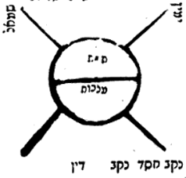

  
 which match each other, and through them pass two holes, one to the right and one to the left; and through them is the passage of the effluence, the right one for compassion and the left one for judgment. And there is no doubt that it is the nature of the upper one to prevail; and since Tiferet was above, it prevailed with its action, toward Chesed. Therefore her intent was that the two of them should each be in its place, each one performing its own action, like this:  

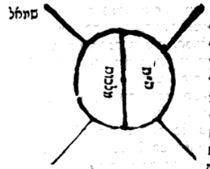

  
 Malkhut, which is the female and whose nature is judgment, would act and bestow the effluence of Gevurah and judgment; and Tiferet, which is male, compassion, would act and bestow Chesed, and so the action of compassion would be according to its nature. And although she was small then, and also now (for the right always prevails over the left), she did not intend by her request that Tiferet should descend, but that they should be equal: not performing one action, but each one performing its own action. And from this matter there appears to come benefit, or harm, to three aspects: in relation to what they receive, or in relation to themselves, or in relation to what they bestow. The first aspect, in relation to what they bestow, is that Netzach and Hod do not act properly; for the nature of Netzach is Chesed and the nature of Hod is judgment, and it is fitting for each of them to receive according to its action and nature. And this is what she said: It is impossible for two kings, who are Netzach and Hod, the one right and the other left, to make use of one crown, so that they receive from only one action, either judgment or compassion. But if Tiferet and Malkhut were equal, Malkhut would bestow upon Hod and Tiferet upon Netzach; and this is what befits them and what they can bear, for that uniform action is impossible. This is one aspect, and it is the one that Rashbi, peace be upon him, explained in the Ra'aya Meheimna that we are explaining. And the second aspect is in relation to themselves: for since Tiferet is compassion, the action of compassion befits it, and since Malkhut is judgment, the action of judgment befits her; and if their actions are exchanged upon them, their service will be heavy. And it is not the way of the world to change attributes thus; and therefore she said: It is impossible for two kings, who are Tiferet and Malkhut, sun compassion and moon judgment, to make use of one crown. And this Rabbi Shimon ben Pazzi revealed to us in tractate Chullin. And the third is in relation to the place from which they receive, which is Binah. And behold, the explanation is: it is impossible for one king, who is Binah, to make use of two crowns, for her service would be heavy, and it is almost impossible to bestow judgment to the place of compassion and compassion to the place of judgment. And behold, Binah was compelled, before the bestowal, to impress that imprint [*teva*] upon the effluence, so that the receiving attribute could bear it.

> והנה כאשר קודם הקטרוג היתה מתיחדת עם בעלה ייחוד עצמי. ולא שהיו ב' כוחות נכללים בכח א' אלא לעולם היו ב' ספירות מתייחדות בפעולתם, שעם היות שנטיית הזכר אל הרחמים ונטיית הנקבה אל הדין היו פעולות הדין והרחמים נפעלים על ידיהם יחד. אם דין היה נשפע ע"י ת"ת והמלכות אלא שהיה בתגבורת המלכות שהיא פעולתה הפך פעולת הזכר, ואם רחמים נשפע ע"י שניהם אלא שהיה בתגבורת הת"ת שפעולתו רחמים. ונמשיל משל נאה גשמי אל הענין הזה כדי לשבר את האזן והוא משל אל שני חצאי הכדור כזה
>
>  שהם שניהם מתאימות ודרך בהם ב' נקבים האחד אל הימין וא' אל השמאל, ובהם מעבר השפע, הימיני אל הרחמים והשמאלי אל הדין. ואין ספק כי מטבע העליון להגביר וכיון שהתפארת למעלה היה גובר בפעולתו על החסד. לכן בכוונתה היה שיהיו שניהם במקומם כל אחד ואחד מהם פועל פעולתו כזה
>
>  המלכות שהיא הנקבה ומטבעה הדין תפעל ותשפיע שפע הגבורה ודין. ות"ת שהוא זכר רחמים יפעול וישפיע החסד, והנה יהיה בטבעו פעולת הרחמים. ועם היות שהיתה היא קטנה אז וגם עתה, כי לעולם הימין גובר על השמאל. לא כוונה בשאלתה שירד הת"ת אלא להיותם שוים, לא להיות פועלים פעולה א' אלא כאו"א יפעול פעולתו. ומפני שמענין הזה נמצא לפי הנראה תועלת אל ג' בחי' או היזק להם. והם בערך מה שמקבלים, או בערך עצמם, או בערך מה שמשפיעים. בחינה א' בערך מה שמשפיעים הוא היות הנצח וההוד בלתי פועלות כראוי כי מטבע הנצח הוא החסד ומטבע ההוד הוא הדין מהראוי להם לקבל כאו"א מהם כפי פעולתו וטבעו, וז"ש א"א לשני מלכים שהם נצח והוד שהאחד ימיני והשני שמאלי להשתמש בכתר א' שלא יקבלו אלא מפעולה אחת או דין או רחמים. אבל אם היו הת"ת והמלכות שוים היתה המלכות משפעת בהוד והת"ת בנצח וזהו מה שיאות להם ויוכלון שאת, כי אותה הפעולה השוה א"א. זהו בחינה אחת והיא אותה שפי' הרשב"י ע"ה בר"מ שאנו בביאורו. והבחינה השניה בערך עצמם כי אחר שהת"ת רחמים יאות לו פעולת הרחמים ואחר שהמלכות דין יאות לה פעולת הדין ואם יתחלפו פעולתם עליהם יכבד עבודתם. ולאו אורח ארעא לשנוי מדות הכי, ולכן אמר א"א לשני מלכים שהם תפארת ומלכות שמש רחמים וירח דין להשתמש בכתר אחד. וזה גילה לנו ר"ש בן פזי במסכת חולין. והשלישית בערך המקום שהם מקבלים ממנו שהוא הבינה. והנה הפירוש א"א למלך א' שהוא הבינה להשתמש בשני כתרים כי יכבד עבודתו וכמעט מן הנמנע להשפיע הדין אל מקום הרחמים והרחמים אל מקום הדין. והנה הוכרחה הבינה קודם ההשפעה להטביע הטבע ההוא אל השפע כדי שהמדה המקבלת תוכל שאתו.

**18:5:7** And behold, the two preceding claims the moon stated in the force of her rhetoric, saying: It is impossible for two kings to make use of one crown. But this third claim she did not want to explain so much, because of the honor of Binah, which hovers over them [therefore she said: Is it possible for one king to make use of two crowns, etc.]. And this third aspect Rashbi revealed to us in the Song of Songs passage mentioned above. And for this reason it was said to her from a high place, from the Glory hovering over them, which is Binah, called the Holy One, blessed be He: "Go and diminish yourself," etc. The intent is: since it is not her will thus, and she was hurling words upward, she shall descend below the two kings, who are Netzach and Hod; and not merely below them, but beneath their feet: that is, the kings are Netzach and Hod, and their feet are Yesod, and beneath their feet means below Yesod. And there she performs the action of judgment; for so she is called "a sword avenging the vengeance of the covenant" (Lev. 26:25), and other titles indicating judgment, as we shall explain in the Gate of the Glossary of Titles. And this is her being turned from compassion to judgment: for in her place she sometimes performed the action of compassion, or mostly so, through the arbitration of Tiferet, and now she is mostly judgment. (He returns to explain the language of the Ra'aya Meheimna in chapter 2.) "The ram of Isaac turned into a goat," etc.: explanation: for above, her inclination was slightly to the left, although her principal action was compassion and Chesed, because of the compelling of Tiferet, which tips the balance to the right; and therefore above she was called "the ram of Isaac." But when she descended below, she drew sustenance from the force of the strength of judgment, and is called "goat," for this name is a hint of judgment. And this is the difference between the burnt offering and the sin offering: the burnt offering [*olah*] hints at her ascent [*aliyah*] to her place and to her husband, and then she is a ram of compassion, as we explained; and the goat for a sin offering hints at her descent to beneath the feet of the kings, performing judgment, head to the foxes that spoil the vineyards. "Goat" certainly, on account of her nourishing the goats [*se'irim*] with the strength of judgment. "And therefore they brought, Atonement for Me; for Me the moon was a crown," etc. Before we explain this language we must recall a small preliminary that we hinted at in the Gate of Manifestations, and it is this: that Malkhut, when she is a king's daughter married to her husband and united with him, most of the time is above him, and she is in the effluence of compassion, "a woman of valor, the diadem of her husband" (Prov. 12:4); and he did not cease to cherish her until he called her "my mother." And when, through our iniquities, she descended from her grade, she lost this honored grade along with the other things that were lost. And when we come and offer the goat for a sin offering, then we bring her distress to her husband's remembrance, and he will raise her to her first place, "for it was better for her then than now" (Hos. 2:9). And this is "Bring atonement for Me": explanation: the goat, which comes to atone for the strength of judgment: in its slaughter and its binding the judgment is bound and burned on the altar, for the destruction of the husk is in its drawing near to purity. And so that they do not defile, so that the wife will be purified for her husband, they offered the goat, like the offering of the seventy bullocks of the Festival, as we explained in the Gate of ABYA, chapter 7. And this matter is explained at length in the Zohar (parashat Noach) (Pinchas 256; see there) and in other places in the Zohar. And this is "Bring atonement for Me": to atone for judgment and to purify it, and to raise her to her place, to be the diadem of her husband, in the effluence of compassion, receiving from the sun as before her descent. And what he said, "for My having diminished the moon": the intent is, on my account and by my cause, that is to say, by the cause of Tiferet, the moon was diminished; for it was the cause of her accusing and saying, "It is impossible for two kings," etc. And in the Zohar, parashat Acharei (folio 79b), Rashbi explained the matter of "for Me" [*alai*]: it hints that on the New Moon Binah is revealed in her effluence, like the effluence on the Sabbath; and therefore he said, "Bring for Me": explanation: bring atonement, so that judgment may be purified, because the light of Binah flows upon Me, and the Shekhinah too will receive light from her; and because Binah is revealed, it is a time of favor for her to be purified and to receive the effluence from her, and for them to unite. And "for My having diminished the moon" is explained there as we explained. "She ascends from His feet," etc.: explanation: she ascends from beneath Yesod, which is her ascent; of whom it is said, "and the earth" (which is Malkhut) "is the footstool" and seat for the feet of Tiferet, which is Yesod; "to say of her, 'The heavens are My throne'": explanation: she is My throne; that is to say, Malkhut, who is the throne, ascended to the heavens, which is Tiferet. Or it may mean: the heavens, which is Tiferet, is a throne for Malkhut, in the secret of "the diadem of her husband"; and the sense of the verse is: the heavens are My throne, although you see that the earth is My footstool. And according to the explanation that we gave above, that her ascent or her descent is through Yesod, this is what he said: "And this is the secret of 'a righteous one rules,'" etc. The righteous one, Yesod, rules over Malkhut from the side of judgment, called Elohim; and through her ascent above she is turned to compassion; and it is in his hand to stand her in her place, to turn judgment to compassion through the coupling. "And the secret of the thing: 'The stone that the builders rejected,'" etc.: in the aspect of her being the diadem of her husband she is Yod above, second to Chokhmah. And I have expounded this matter at length in the Gate of Manifestations, chapters 3 and 4.

> והנה הב' טענות הקודמות אמרה הירח בתוקף מליצתה באמרה א"א לשני מלכים להשתמש בכתר א', אבל זאת הטענה השלישית לא רצתה לבאר כ"כ מפני כבוד הבינה החופף עליהם [לכן אמרה אפשר למלכא חד לאשתמשא בתרין כתרין כו']. ובחינה הזאת הג' גילה לנו הרשב"י בשה"ש הנ"ל. ולטעם זה נאמר לה ממקום גבוה מאת הכבוד החופף עליהם שהיא הבינה הנק' קב"ה לכי ומעטי וכו' הכונה כיון שאין ברצונה כך והיתה מטחת דברים כלפי מעלה תרד למטה מב' המלכים שהם נצח והוד ולא למטה מהם אלא תחת רגליהם, דהיינו המלכים נו"ה ורגליהם יסוד ותחת רגליהם היינו למטה מהיסוד, ושם היא פועלת פעולת הדין שכן נקראת חרב נוקמת נקם ברית ועוד כנויים אחרים המורים על הדין כאשר נבאר בשער ערכי הכנוים. וזהו שנתהפכה מרחמים לדינא, כי במקומה היתה לפעמים פועלת פעולת הרחמים או רובם בהכרעת הת"ת ועתה רובה דין. (חוזר לבאר לשון הרע"מ שבפ"ב) איל דיצחק אתהדר שעיר וכו' פי' כי למעלה היתה היא נטייתה מעט אל השמאל עם היות עקר פעולתה רחמים וחסד מפני הכרח הת"ת המכריעה לימין ולפיכך הי' נקראת למעלה איל דיצחק. אבל כשירדה למטה ינקה כח תוקף הדין ונקראת שעיר ששם הזה הרמז לדין. וזהו החילוק שבין עולה לחטאת, עולה רומז לעלייתה למקומה ואל אישה ואז היא איל רחמים כדפי', והשעיר לחטאת הרמז אל ירידתה אל תחת רגלי המלכים פועלת הדין ראש אל השועלים המחבלים את הכרמים. שעיר ודאי ע"ש שהיא מיינקת את השעירים בתוקף הדין. ובג"ד הביאו עלי כפרה עלי הות סיהרא כתר וכו'. קודם שנבאר לשון הזה צריכין אנו לזכור הקדמה קטנה רמזנוה בשער המציאות. והיא זו. כי המלכות בהיותה בת מלך נשואה לבעלה ומתיחדת עמו לרוב הפעמים תהיה למעלה ממנו והיא בשופע הרחמים אשת חיל עטרת בעלה ולא זז מחבבה עד שקראה אמי. וכאשר בעונותינו ירדה ממדרגתה אבדה המדרגה הזאת הנכבדת בכלל שאר הדברים אשר נאבדו. וכאשר נבא ונקריב השעיר לחטאת אז נזכור צערה אל בעלה ויעלה אותה אל מקומה הראשון כי טוב לה אז מעתה. וזהו הביאו עלי כפרה, פי' השעיר אשר הוא בא לכפר תוקף הדין, בשחיטתו ובקשירתו נעקד הדין ונשרף על המזבח כי אבוד הקליפה הוא בקורבתה אל הטהרה. וכדי שלא יטמאו אשה תטוהר לבעלה הקריבו השעיר כעין קרבן ע' פרי החג כדפי' בשער אבי"ע בפ"ז. והענין הזה מתבאר בארוכה בזהר (פ' נח) (פנחס רנ"ו ע"ש) וזולתו מהמקומות בהזהר. וזהו הביאו עלי כפרה לכפר הדין ולטהר אותו ולהעלותה אל מקומה להיותה עטרת בעלה בהשפעת הרחמים וקבלתה מהשמש כקודם רדתה. ומה שאמר על שמעטתי את הירח הכוונה שבעבורי ובסבתי ר"ל בסבת הת"ת נתמעטה הירח כי הוא היה הסבה שקטרגה ואמרה א"א לשני מלכים כו'. ובזהר פ' אחרי (דף ע"ט ע"ב) פי' הרשב"י בענין עלי, כי הוא לרמוז כי בר"ח מתגלה הבינה בשפעה כענין השפע בשבת, ולכן אמר הביאו עלי, פי' הביאו כפרה שיטהר הדין מפני שעלי שופע אור הבינה ותקבל גם השכינה אור ממנה ומפני שהבינה מתגלית היא שעת הרצון לשתטהר ותקבל השפע ממנה ויתייחדו. והפי' שמעטתי את הירח פי' שם כדפי'. סליקת מרגלוי כו'. פי' עולה מתחת היסוד שהוא עליה. דאתמר בה והארץ שהיא המלכות הדום ומושב לרגלי ת"ת שהוא היסוד. למימר בה השמים כסאי. פי' היא כסאי, שר"ל שהמלכות שהיא כסא עלתה השמים שהוא הת"ת. או ירצה השמים שהוא ת"ת הוא כסא למלכות בסוד עטרת בעלה, ושעור הכתוב השמים הם כסאי אע"פ שאתם רואים שהארץ הדום רגלי. ולפי הפי' שפירשנו למעלה שעלייתה או ירידתה הוא על ידי היסוד. ז"ש והאי איהו רזא צדיק מושל וכו'. צדיק יסוד הוא מושל במלכות מצד הדין הנקרא אלדים ועל ידי עלייתה למעלה נהפכה לרחמים ובידו להעמידה במקומה להפך דין לרחמים על ידי הזווג. ורזא דמלה אבן מאסו הבונים וכו' בבחינת היותה עטרת בעלה היא י' למעלה שניה לחכמה. והארכתי בענין זה בשער המציאיות בפ' ג' ד'.

**18:5:8** And behold, the explanation of this passage is complete. And now we will come, in a chapter of its own, to the explanation of the two remaining passages:

> והנה נשלם פי' המאמר הזה. ועתה נבא בפרק בפ"ע בביאור שני המאמרים הנשארים:

### Chapter 18:6. Explanation and *tikkun* of the two passages of the second chapter; and there, further, the diminishment, the reason for it, the matter of the accusation (*kitrug*) within Atzilut, the matter of Malkhut's union — through whom — and who will be with it after its ascent on high.

**18:6:1** Although the principal of these passages has already been explained through the preliminary of the preceding chapter, nevertheless we will not withdraw our hand from them, with the help of Heaven. The second passage, from the Zohar on the Song of Songs, which said "At first," etc., "cleaving as one," etc.: explanation: as we explained in the preceding chapter, the two of them together performed judgment and compassion together, and she was beneath him, subordinate to him, and was always half the body; except that she was not equal to him, for Tiferet is sixth in the Emanation and Malkhut seventh, caused by it, and it is her cause; and likewise Tiferet is compassion, right, and Malkhut judgment and Gevurah, left, and the right always conquers the left. And her degree was then certainly always more praiseworthy than now, many times over, for she was always in her fullness and her light shone, although she was not equal to him. "Is it possible for one king to make use," etc.: Rashbi revealed to us this reason, the more concealed one; and it relates to the verse "If you know not," etc. (Song 1:8). "I see in you that your desire is to be head to the foxes": it is known that foxes are a hint of angels of judgment and fury, as in the matter of (Song 2:15), "Catch us the foxes, the little foxes that spoil the vineyards," which hints at the angels of ruin. And she asked this because in her place she inclines to the side of Gevurah, as we explained in the preceding chapter, and the intent was that the angels of judgment should be bestowed from her. Therefore it was said to her, "Go and diminish yourself": the intent is that she should descend from her degree and her place and be head to them, and there perform her action; and this is the diminishment, that she descended further from her degree and was diminished more than she had been. "For why should I be as one who is veiled" (Song 1:7); "how shall I be," etc.: the intent is that when Tiferet acts with the power of compassion and compels her to the side of compassion, then in any case her action is annulled, and she will not perform judgment and will not be able to serve, and she will be wrapped as to the power of judgment, when the power of compassion prevails. And Rashbi, peace be upon him, was precise in saying "and be ruler in the night," etc., for then judgment rules, and this is the dominion of the foxes hinted at above; and this is "and feed your kids" (Song 1:8), which are the goats, which are the strength of judgment, as is known. And now that we have explained the two preceding passages, we wish to explain the first passage, from the Gemara, on which the gate was founded. "The moon said," etc.: "Master of the world" is Binah, who is master and lord of the seven days of the circuit, which are called world; and she is the mother crouching over the children. "Is it possible for two kings," etc.: this was explained in the preceding chapter; and it is the middle aspect, in relation to themselves: that it was not possible for them to perform one action, but each would act according to its nature, Tiferet compassion and the Diadem judgment. "Because I said before You a proper thing": explanation: for such is the way of judgment, to seek after the strength of judgment and Gevurah. "He said to her: Go and rule by day and by night": explanation: that the effluence of compassion, which is day, and the effluence of judgment, which is night, should be bestowed to this world through her; and this is something of an elevation for her, that her degree below in the diminishment should be like her degree above, in the secret of her first place. And she answered, "What greatness is this," etc.: the intent is that this thing is of no benefit to her, for this was the cause for which she accused before, for this blending was not her will. And this is what she said, "A candle at noon, what use is it?" For when she is below, performing the compassion bestowed upon her from above, then too her action is annulled. And then He answered her, "Let Israel count by you," etc.: the intent is that Tiferet, which is Israel, will not be able to perform its actions below except through her; and accordingly all her lord's goodness is in her hand. And she answered this: "The day too, it is impossible," etc.: the intent is that there will be no *tikkun* for the loss that she lost. For granted, if the action were entirely through her, it would be well; but she too cannot act except through Tiferet, and this is no greatness, for Tiferet already prevailed over her in this, and she had this before too. And this is what she said, "It is impossible, for they do not count the seasons by it": explanation: the decree of things and the actions performed through the seasons and the revolution of the twelve boundaries, which are the twelve *havayot* in it, every three of which are one season, as will be explained in the Gate of Particulars of Names. And to this He answered her, "Let the righteous be called by your name," etc.: the intent is that through the cleaving of the righteous her husband will always unite with her. "And nevertheless her mind [*da'atah*] was not settled": explanation: her union, as in (Gen. 4:1), "And the man knew," etc.; for the intent is that with this she does not return in her very self to her first place where she was, at times rising over her husband to be for him a diadem of glory [*ateret tiferet*]. And to this He answered her, "Bring atonement for Me," etc., as explained in the preceding chapter.

> עם היות שכבר נתבאר עיקר המאמרים האלה מתוך הקדמת הפרק הקודם עכ"ז לא נשיב ידינו מהם בע"ה. המאמר השני מהזהר בשיר השירים. שאמר בקדמיתא כו' דבוקין כחדא כו'. פי' כמו שבארנו בפרק הקודם כי שניהם יחד היו פועלים הדין והרחמים ביחד והיא היתה תחתיו טפלה אליו ולעולם פלגא דגופא הוה. אלא שלא היתה שוה אליו כי הת"ת ששי לאצילות והמלכות שביעית עלולה ממנו והוא עילתה וכן הת"ת רחמים ימיני והמלכות דין וגבורה שמאלית ולעולם הימין כובש אל השמאל. ולעולם היתה מעלתה משובחת ודאי אז מעתה כמה וכמה פעמים כי היתה לעולם במלואה ואורה מבהקת עם היות שאינה שוה אליו. אפשר למלכא חד לאשתמשא וכו'. גילה לנו הרשב"י הטעם הזה היותר נעלם והוא מתייחס אל פסוק אם לא תדעי וכו', חמינא בך דרעותיך למהוי ראש לשועלים. נודע כי השועלים רמז אל מלאכי דין וחמה כענין (שה"ש ב טו) אחזו לנו שועלים שועלים קטנים מחבלים כרמים שהרמז אל מלאכי החבלה. והיא שאלה להיותה נוטה במקומה אל צד הגבורה כדפי' בפרק הקודם, והכונה להיות מלאכי הדין נשפעים ממנה, לכן נאמר לה זילי ואזעירי גרמך הכונה שתרד ממעלתה וממקומה ותהיה ראש להם ושם תעשה פעולתה וזהו המיעוט שירדה ממעלתה עוד ונתמעטה יותר ממה שהיתה. שלמה אהיה כעוטיה, אכדין אהא אנא וכו' הכונה כי בהיות הת"ת פועל בכח הרחמים ויכריח אותה לצד הרחמים הנה אז עכ"פ תתבטל פעולתה והדין לא תפעול ולא תוכל לשמש ותהיה מתעטפת כח הדין בהיות כח הרחמים גובר. ודקדק הרשב"י ע"ה באמרו והוי שליטא בליליא כו' שאז שולט הדין והוא ממשלות השועלים הנרמזים לעיל וזהו ורעי את גדיותיך שהם השעירים שהם תוקף הדין כנודע. ואחר שכבר בארנו שני המאמרים הקודמים רצוננו לבאר המאמר הראשון מהגמרא שבו היה יסוד השער. אמרה ירח כו' רשב"ע הוא הבינה שהוא רבון ואדון לשבעת ימי ההקף שהם נקראים עולם והיא האם הרובצת על הבנים. אפשר לשני מלכים וכו' נתבאר בפ' הקודם. והיא הבחינה האמצעית שהיא מצד ערך עצמם שלא היה אפשר להם לפעול פעולה א' אלא שכל אחד יפעל כפי טבעו הת"ת רחמים והעטרת דין. לפי שאמרתי לפניך דבר הגון. פי' כי כן דרך הדין לחפש אחר תוקף הדין והגבורה. אמר לה לכי ומשול ביום ובלילה. פי' שיהיה שפע הרחמים שהוא היום ושפע הדין שהוא הלילה נשפע אל העוה"ז על ידה, וזהו קצת מעלה אליה שתהיה מעלתה למטה במיעוט כמעלתה למעלה בסוד מקומה הראשון. והיא השיבה מאי רבותא כו' הכונה כי אין הדבר הזה תועלת אליה כי זה היתה הסבה שקטרגה מקודם כי לא היתה רצונה במזיגה הזאת. וזהו שאמרה שרגא בטיהרא מאי אהני. כי בהיותה למטה פועלת הרחמים הנשפעים לה מלמעלה אז ג"כ תתבטל פעולתה. ואז השיב לה לימנו בך ישראל וכו' הכונה כי לא יוכל ת"ת שהוא ישראל לפעול פעולותיו למטה אלא על ידה ונמצא לפי זה כל טוב אדוניה בידה. והיא השיבה לזה. יומא נמי א"א וכו'. הכונה כי לא יהיה תקון אל האבדה אשר אבדה. כי בשלמא אם היה הפעולה כולה על ידה ניחא. אמנם היא ג"כ א"א לה לפעול אם לא ע"י הת"ת. וזו אינה רבותא. שכבר היה הת"ת גובר עליה בזה. וזה היה לה מקודם ג"כ. וזה שאמרה א"א דלא מנו ביה תקופותא פי' גזרת הדברים והפעולות הנפעלות ע"י התקופות וסבוב הי"ב גבולים שהם י"ב הויות אשר בו, שכל ג' מהם תקופה אחת כאשר יתבאר בשער פרטי השמות. ולזה השיב לה, ליקרו צדיקיא על שמך כו' והכונה כי ע"י דבקות הצדיקים תמיד יתיחד עמה בעלה. ולא היה עכ"ז מתישבת דעת"ה. פי' יחודה, כמו (בראשית ד א) והאדם ידע וכו'. כי הכונה שעם זה אינה חוזרת בעצם למקומה הראשון שהיתה. לפעמים עולה על בעלה להיות לו עטרת תפארת. ולזה השיב לה הביאו עלי כפרה וכו' כמבואר בפ' הקודם.

**18:6:2** And behold, these three passages have been fully explained. And what remains for us to explain is a mighty question that falls in this inquiry, so that the discerning one is almost astonished; and it is this: how is it possible that in the place of spirituality, the holiness of the pure and holy Emanation, the matter of accusation and provocation should occur? For this thing is among the disgraceful traits even in human beings; all the more so, by a fortiori of a fortiori, in the pure and holy Emanation; for who has put forth his hand to speak even a light word and been clean?

> והנה נתבארו ג' המאמרים האלה ביאור שלם. ומה שנשאר לנו לבאר הוא שאלה עצומה הנופלת בדרוש הזה עד שכמעט ישתומם המשכיל, והוא זה, כי איך אפשר כי במקום הרוחניות הקודש האצילות הטהור והקדוש יפול בו ענין הקטרוג והקנטור ודבר זה הוא מהמדות המגונות בב"א כ"ש וק"ו בן בנו של ק"ו באצילות הטהור והקדוש כי מי שלח ידו לדבר אפי' דבור הקל ונקה.

**18:6:3** And further, second: since she said, "Because I said before You a proper thing," and He wished to appease her, it appears that her words were good and right. If so, how was she diminished for it, God forbid? It would have been fitting that she not be diminished.

> ועוד שנית שאחר שהיא אמרה מפני שאמרתי לפניך דבר הגון, ורצה להפיס דעתה. כנראה שהיו דבריה טובים ונכוחים. א"כ איך נתמעטה על כך ח"ו והיה ראוי שלא תתמעט.

**18:6:4** And behold, these doubts are hard, and the discerning one is almost astonished in thinking of them. And we will answer that in the matter of judgment there are three aspects, and we explained them in the Gate of Colors, chapter 3. The first is the evil judgment, that is to say, the strength of the husk, which is judgment that does not accept arbitration, the fire of Gehinnom, of which separation is said (Gen. 1:4): "And God separated between the light and the darkness"; and the darkness is the fire of Gehinnom, which is separated from the light of holiness, for it does not accept the arbitration of compassion because of its hardness and its strength, as we explained in the Gate of Arbiters. And there is a second aspect, and it is that which delights in arbitration, inclining toward Chesed. And there is a third judgment, and it is intermediate between the judgment arbitrated to the side of Chesed and the separated judgment.

> והנה ספקות אלה קשות וכמעט ישתומם המשכיל בחשבו בהם. ונשיב כי בענין הדין הם ג' בחינות ובארנום בשער הגוונים בפ"ג. הא' הוא הדין הרע ר"ל תוקף הקליפה אשר הוא דין שאינו מקבל הכרעה אשו של גיהנם שנאמר בו הבדלה (בראשית א) ויבדל אלהים בין האור ובין החשך, והחשך הוא אשו של גיהנם שנבדל מאור הקדושה כי לא מקבל הכרעת הרחמים מפני קשיותו ותוקפו וכדפי' בשער המכריעים. ויש בחינה שנית והיא החפץ בהכרעה הנוטה אל החסד. ויש דין ג' והוא ממוצע בין הדין המוכרע לצד החסד ובין הדין הנבדל.

**18:6:5** And behold, Malkhut is bestowed and emanated from the side of the strong judgment, which is the blue [*tekhelet*] that consumes [*mekhalah*] all, as we explained in the Gate of Colors. Therefore, from the side of the strength of judgment, [she wanted] to perform the action of the strong judgment, and to incline to the side of her root, which is judgment, and not to perform compassion, as we explained in the preceding chapter. And for this she accused, and wished to go out from under the hand of Tiferet and to perform judgment by herself, because Tiferet annuls her action and tips her toward the side of compassion, as is its way with Gevurah. And because she did not want arbitration, and this resembles somewhat the matter of the fire of Gehinnom and the strength of the strong judgment, therefore she descended from her degree and was placed (in the green color, as explained in the Gate of Colors, chapter 4; and see the Gate of Paths, folio 67, at the end of the second path) in the greenness of holiness within the Emanation, to be head to the foxes who rule in the fire of Gehinnom, who are those that do not want arbitration. And because her demand was a proper thing from the side of her drawing sustenance from the strong judgment, nevertheless they acted for her from the side of compassion, so that "her feet go down to death" (Prov. 5:5), until the husk is annulled and "death is swallowed up forever" (Isa. 25:8): the husk will draw near to the kernel, and all the created entities will know that He alone is God. And the swine will turn out to be purified (that is, the husk of Esau, who is likened to "the boar from the forest" (Ps. 80:14)), and the fire of Gehinnom annulled. And Malkhut will return to her first strength, to the house of her husband as at first; and then will be fulfilled in her (Isa. 30:26), "And the light of the moon shall be as the light of the sun," etc. And what is fitting to investigate is this: since before her diminishment her emanation was above, in the place of Tiferet, and the Righteous One was the last attribute, it is fitting to know how the coupling of Tiferet and Malkhut took place, and through whom they coupled, and who was the intermediary groomsman. For if we say that they coupled without this intermediary, this is impossible: for it does not differ from the creation of man, and "from my flesh I shall see God" (Job 19:26); and in the creation of man, the union is through Yesod, the everlasting covenant. And further, several righteous ones served to unite and couple, such as Joseph the Righteous, and likewise Boaz and Palti son of Laish: their degree would then be annulled; and it is not fitting for us to say this.

> והנה המלכות נשפעת ונאצלת מצד הדין החזק שהוא תכלת המכלה הכל כדפי' בשער הגוונים לכן מצד תוקף הדין [רצתה] לפעול פעולת הדין החזק ולהיות נוטה לצד שרשה שהוא הדין ולבלתי היותה פועלת הרחמים כדפי' בפ' הקודם. ולזה קטרגה ורצתה לצאת מתחת יד תפארת ולהיות פועלת הדין בעצמה מפני שהתפארת מבטל פעולתה ומכריעה לצד הרחמים כדרכו אל הגבורה. ולהיות שהיא לא רצתה בהכרעה וזה נדמה קצת אל ענין אשו של גהינם ותוקף הדין החזק ע"כ ירדה ממעלתה והושמה (בגוון ירוק כמבואר בשער הגוונין פ"ד. וע' בשער הנתיבות דס"ז בסוף נתיב הב') בירקות הקדושה בתוך האצילות להיותה ראש לשועלים המושלים באשו של גהינם שהם אותם שאינם רוצים בהכרעה. ומפני שתביעתה הי' דבר הגון מצד יניקתה בדין החזק. אמנם פעלו לה מצד הרחמים להיותה רגליה יורדות מות עד יתבטל הקליפה ובלע המות לנצח יתקרב הקליפה אל המוח ויהיו יודעים כל הברואים כי הוא אלהים לבדו. ונמצא החזיר נטהר (היינו קליפת עשו שנמשל לחזיר מיער) ואשו של גיהנם מתבטל. ותשוב המלכות לאיתנה הראשון של בית בעלה כקדמיתא ואז יתקיים בה (ישעיה ל כו) והיה אור הלבנה כאור החמה כו'. ומה שראוי לחקור הוא כי אחרי שקודם מיעוטה היתה אצילותה למעלה במקום התפארת והצדיק היה מדה אחרונה א"כ ראוי לדעת איך היה הזווג לתפארת ומלכות וע"י מי היו מזדווגים ומי היה השושבין האמצעי. שאם נאמר שיזדווגו שלא ע"י אמצעי זה אי אפשר, כי לא ישתנה מבריאת אדם, ומבשרי אחזה אלוה ובריאת האדם יחודו ע"י יסוד ברית עולם. ועוד כמה צדיקים שהיו משמשים ליחד ולזווג כמו יוסף הצדיק וכן בועז ופלטי בן ליש הנה יתבטלו אז מעלתם, וזה אין ראוי שנאמר.

**18:6:6** And further, several things in the Torah and in the performance of the commandments indicate the union of Tiferet with Malkhut through Yesod; if so, shall we say, God forbid, that the fulfillment of that commandment or that verse is annulled? And to this we answer that the union never changed and will never change, forever and ever. For before the diminishment their union was through Yesod, and in the time of the diminishment too their union is thus, and so will their union be after she ascends to her exalted place with her husband as in days of old, her former state. And there is no wonder in Yesod's being the tenth grade; for we have already explained that at the time of the emanation of Tiferet, Yesod was emanated with it, for "body and covenant are reckoned as one." And it has two aspects, that is to say, two manifestations: a subtle and concealed manifestation, which is the extension of the Vav that precedes Netzach and Hod, and a revealed manifestation, which is after Netzach and Hod, as we explained in the Gate of the Order of the Emanation, chapter 8. And just as the union of Chokhmah and Binah is through Tiferet, in its concealed manifestation, that is, Da'at, as we explained in the Gate of Essence and Governance, chapter 17, and also in Gate 3, chapter 1, so too the union of Tiferet and Malkhut is through Yesod, in the subtle manifestation that it has, which is above, uniting with them. And this thing is necessitated by itself: for when Tiferet and Malkhut ascend higher and higher, united, Yesod too will ascend with them, and this certainly in the subtle manifestation that it has; and their union is always through Yesod. And the passage "The Sabbath said before the Holy One, blessed be He" we explained in the Gate of Arbiters, chapter 4.

> ועוד כי כמה דברים הם בתורה ובמעשה המצות המורים יחוד התפארת עם המלכות ע"י היסוד, א"כ נאמר ח"ו שיתבטל קיום המצוה ההיא או הפסוק ההוא. ולזה נשיב כי מעולם לא נשתנה היחוד ולא ישתנה לעולם ועד. כי קודם המיעוט יחודם היה ע"י יסוד וגם בזמן מיעוט כן יחודם וכן יהיה יחודם אחר שתעלה אל מקומה הרמתה אל אישה כימי קדם קדמתה. ואין תימה לזה היות היסוד מדרגה עשירית כי כבר ביארנו כי בעת אצילות הת"ת היסוד נאצל עמו כי גוף וברית חשבינן חד. ולו ב' בחינות ר"ל ב' מציאיות מציאות דק ונעלם שהוא משך הוא"ו הקודמת אל הנצח וההוד, ומציאות מתגלה שהוא אחר הנצח וההוד כדפי' בשער סדר האצילות פ"ח. וכמו שיחוד חכמה ובינה ע"י הת"ת שהוא מציאותו הנעלם דהיינו הדעת כדפי' בשער מהות והנהגה בפי"ז וכן בשער ג' פ"א. וכן ג"כ יחוד התפארת והמלכות הוא ע"י היסוד במציאות דק אשר לו שהוא למעלה מתייחד עמהם. והדבר הזה מוכרח בעצמו שהרי כאשר יעלו הת"ת והמלכות מעלה מעלה מיוחדים יעלה ג"כ יסוד עמהם וזה ודאי במציאות הדק אשר לו ולעולם יחודם ע"י היסוד. ומאמר אמרה שבת לפני הקב"ה בארנוה בשער המכריעים פ"ד.

**18:6:7** And behold, this chapter is complete, and this gate is concluded, with the help of the Rock, the true Helper:

> והנה נשלם הפרק הזה ונכלל השער הזה בעזרת הצור העוזר האמיתי:

---

## Gate 19: The Four-Letter Name

We named it **"The Four-Letter Name"** because in it is explained the four-letter name, which the Kabbalists hold to be the proper name (*shem ha-etzem*), whose sanctity is distinct from that of the other names. Its chapters number four.

### Chapter 19:1. Explanation of the superiority of the four-letter name over the other names, for three reasons; and there, the matter of pronouncing the name as written, in the Temple.

**19:1:1** **The Nineteenth Gate: The Gate of the Four-Letter Name.**

> **שער י"ט הוא שער שם בן ד':**

**19:1:2** What is intended in this Gate is to explain something of the explanation of the four-letter name, so that its holiness, and its being distinct from the other holy names, may be explained, as we shall explain:

> הנרצה בשער הזה הוא לבאר קצת מפירוש שם בן ד', להיות קדושתו מתבארת והיותו נבדל משאר השמות הקדושים כאשר נבאר:

**19:1:3** **Chapter One:**

> **פרק ראשון:**

**19:1:4** After our Maker has helped us, and we have included in the preceding gates all that the inquirer needs in the matter of the inquiries concerning the manifestation of the Emanation, we now come in this gate to explain the name that relates to the totality of the entire Emanation, according to the explanation found in the words of Rashbi. And let the inquirer not expect of us that we include here, in this gate, all the explanations found concerning the Name in the words of Rashbi, for this is impossible; and further, the matter would weigh very heavily upon us, and the reading would not be easy for the inquirer. But we will write in it here as much as is needed to enter through it into the gates of the Zohar, so that study may be easy for the discerning; and behold, we enter into its explanation. All the expounders of inscriptions [*dorshei reshumot*] of our holy Torah, whether of the masters of the Kabbalah, or of the masters of the plain sense, or of the investigators of the roots of our Torah, all agreed with one mouth that this name is the proper name [*shem ha-etzem*] and no other. And they singled it out among the other holy names that may not be erased, to the point that they said that even the name Ehyeh, although it is a very awesome name, is not equal to this name. And concerning this name there are many reasons, and the most compelling of all of them is this: that from all the names that may not be erased some verb is derived, except the four-letter name, whose letters do not entail any verb at all by any reckoning. And this is because the names Elohim, Eloah, El are derived from the language of greatness, might and strength; as in (Ezek. 17:13) "and he took the mighty [*eilei*] of the land," and in (Ps. 36:7) "Your righteousness is like the mountains of God [El]," which are language of greatness and might. And the name Shaddai indicates that He overpowers [*shoded*] the configurations [of the heavens]. And the name Tzeva'ot indicates His being master of the hosts on high, and it is derived from the language of "the host [*tzeva*] of heaven." And the name Adonai indicates lordship, His being Lord of all the earth, and it is derived from the language of lordship. And Ehyeh indicates the matter of being, in the future tense, first person, in the simple conjugation; and so our Rabbis, of blessed memory, expounded (Berakhot 9b): "I was with them in the exile of Egypt; I will be with them in other exiles," etc. But the four-letter name, very awesome: who can contain an explanation of it? For it has no explanation at all. The second reason: all these names we may use in profane speech if we wish, which is not so with the letters of the four-letter name. How so? El: Scripture uses it in profane speech, "another god [*el*]" (Ex. 34:14), and likewise "like the mountains of God," and many like it. And likewise Elohim, as "See, I have made you a god [*elohim*] to Pharaoh" (Ex. 7:1), and likewise "You shall not revile the judges [*elohim*]" (Ex. 22:27), and much like it. And Shaddai, as "and the creatures of the field [*sadai*] are with me" (Ps. 50:11), "he shall lodge between my breasts [*shadai*]" (Song 1:13): behold its letters, and they are only profane. And the name Tzeva'ot, as "all the hosts of the Lord went out" (Ex. 12:41), and the like. Adonai, as (Gen. 18:3) "And he said, My lords [*adonai*], if now I have found favor in your sight, do not pass away," etc.; and some of our Rabbis say that he said it to the greatest of them; and although there are those who disagree on this and say that it is holy, nevertheless the practical upshot according to all of them is that if one wishes to say to his master "Adoni," that is to say, "my lord," it is permitted to use it in profane speech. Ehyeh, as "for why should I be [*ehyeh*] as one who is veiled" (Song 1:7), "I will not be [*ehyeh*] a healer" (Isa. 3:7), and much like them. Which is not so with these four holy letters, YHVH: for although three of them are found, all four are not found in another, profane matter; as it is written (Eccl. 11:3), "In the place where the tree falls, there it shall be [*yehu*]"; but the four-letter name as a whole is not found. And this reason is somewhat close to the first reason. Further, the third reason: all the names are pronounced as they are written, except this holy name, for it was not pronounced by its letters except in the Temple, in the priestly blessing, and likewise by the high priest on the Day of Atonement. And the reason is that the other names are those that conduct the world, as is proven from their explanation; and the four-letter name has no explanation, and its action does not spread into this world except by being clothed in the other names, as we shall explain. And therefore it is permitted to mention the other names: for when the spirituality of those letters comes into being in the soul of the person [who mentions them, in the articulation of their letters], they are clothed in the air of this world to perform their action. But the four-letter name, because of its great holiness, is not clothed in the air of this world except in the Temple, in particular in the priestly blessing, as it is said (Ex. 20:21), "In every place where I cause My name to be mentioned I will come to you and bless you"; and the air is pure and clear, and it can be clothed, for it is clothed in the air of the Temple, that is, the Shekhinah, the name Adonai; and this is (Hab. 2:20), "But the Lord is in His holy palace." And let this preliminary not be light in the eyes of the inquirer, for it is of precious worth. And with it the reason will be explained why it is forbidden to speak words of Torah in a filthy place, in a bathhouse, and in a privy: for it is a place of the air of the husk and of filth; and words of Torah are the spirituality of holiness, and if one mentions them in a place of filthy air, it turns out that he combines pure with impure, and holiness is clothed in the air of the husk. And nevertheless, to keep someone away from a prohibition it is permitted; for then the words of Torah serve to tip the balance against the husk, to fulfill (Ps. 103:19), "and His kingship rules over all," as we explained in the Gate of ABYA, chapter 7.

> אחרי שעזרנו קוננו וכללנו בשערים הקודמים כל הצורך אל המעיין בענין הדרושים במציאות האצילות. נבא עתה בשער הזה לבאר השם המתייחס אל כללות האצילות כלו בפי' הנמצא בדברי הרשב"י. ואל יקוה ממנו המעיין שנכלול הנה בשער זה כל מציאות הפירושים הנמצאים בענין השם בדברי הרשב"י כי זה בלתי אפשר. ועוד יכבד הענין אלינו מאד והמעיין לא יקל עליו קריאתו. אבל נכתוב בו הנה די הצורך לבא בו אל שערי הזהר. כדי שיקל עיונו אל המשכיל והננו נכנסים בביאורו. כל דורשי רשומות מתורתינו הקדושה אם מבעלי הקבלה ואם מבעלי הפשט אם מחוקרי שרשי תורתינו כלם הסכימו פה אחד היות שם זה שם העצם ולא זולתו. ויחדוהו בין שאר השמות הקדושים שאינם נמחקין. עד שאמרו כי אפי' שם אהיה עם היותו שם נורא מאד לא ישתוה אל השם הזה. ובהשם הזה יש סבות רבות. והיותר מכרחת שבכלם הוא. להיות שכל השמות שאינם נמחקים יגזור מהם פעל קצת, זולתו שם בן ד' שאין אותיותיו מחייבות בשום הגיון פעל כלל. וזה כי שם אלדי"ם אלו"ה א"ל הוא נגזר מלשון גדולה וחוזק ותוקף, וכן (יחזקאל יז יט) ואת אילי הארץ לקח, וכן (תהלים לו ז) צדקתך כהררי אל, שהם לשון גדולה וחוזק. ושם שד"י מורה על שהוא שודד המערכות. ושם צבאו"ת מורה על היותו בעל צבאות מעלה, והוא נגזר מלשון צב"א השמים. ושם אדנ"י מורה לשון אדנות על היותו אדון כל הארץ, והוא נגזר מלשון אדנות. ואהיה מורה על ענין הויה בלשון עתיד המדבר בעדו מבנין הקל, וכן דרז"ל (ברכות ד"ט) אני הייתי עמהם בגלות מצרים אהיה עמהם בגליות אחרות וכו'. אמנם שם בן ד' נורא מאד מי יכילנו ביאור כי אין לו ביאור כלל. סבה השניה כי כל השמות האלה נשמש בהם לשון חול אם נרצה, משא"כ באותיות שם בן ד'. כיצד. אל, נשתמש בו הכתוב בלשון חול אל אחר, וכן כהררי אל וכיוצא בו רבים. וכן אלדים, כמו ראה נתתיך אלהים לפרעה, וכן אלדים לא תקלל וכיוצא בו הרבה. ושדי, כמו וזיז שדי עמדי, בין שדי ילין, הרי אותיוו ואינם אלא חול. ושם צבאות, כמו יצאו כל צבאות ה' וכיוצא בו. אדנ"י, כמו (בראשית יח ג) ויאמר אדני אל נא תעבור מעל וכו' ויש מרבותינו אומרים לגדול שבהם אמר, ועם היות שיש חולקים בזה ואומרים שהוא קדש עכ"ז נ"מ דאליבא דכלהו אם ירצה לדבר לאדונו אדני ר"ל אדון שלי מותר להשתמש בו בלשון חול. אהי"ה, כמו שלמה אהיה כעוטיה, לא אהיה חובש וכיוצא בהם הרבה. משא"כ בד' אותיות קדושות האלה ידו"ד. כי עם היות ששלשה מהם ימצא. ארבעתם לא ימצאו בענין אחר חול. כמה דכתיב (קהלת יא ג) במקום שיפול העץ שם יה"ו. אבל שם בן ד' כלו לא נמצא. וסבה זו קרובה אל סבה הראשונה בקצת. עוד סבה הג' כי כל השמות נהגין ככתבן. זולת השם הקדוש הזה כי לא היה נהגה באותיותיו זולתי במקדש בברכת כהנים, וכן כ"ג ביה"כ. והטעם הוא כי שאר השמות הם המנהיגים העולם כדמוכח מתוך ביאורם, ושם בן ד' אין לו ביאור ופעולה אליו מתפשטת בעולם הזה זולתי בהתלבשו בשאר השמות כמו שנבאר. ולכן שאר השמות מותר להזכירם כי כאשר אותם האותיות יתהוה רוחניותם בנשמת האדם [המזכירם בחיתוך אותיותיהם] ויתלבשו באויר העולם הזה לפעול פעולתם [מה], אבל שם בן ד' מרוב קדושתו אינו מתלבש באויר העוה"ז זולתי בבית המקדש בפרט בברכת כהנים שנאמר (שמות כ כא) בכל המקום אשר אזכיר את שמי אבוא אליך וברכתיך והאויר טהור וזך ויכול להתלבש כי הוא מתלבש באויר בית המקדש דהיינו השכינה שם אדנ"י. והיינו (חבקוק ב) וה' בהיכל קדשו. ואל יקל בעיני המעיין הקדמה זו כי היא יקרת הערך. ועמה יתבאר הטעם למה אסור לדבר בתורה במקום המטונף ובמרחץ ובבית הכסא, כי הוא מקום אויר הקליפה והטנופת. ודברי תורה הם רוחניות הקדושה ואם יזכירם במקום אויר מטונף נמצא מרכיב טהור בטמא, וקדושה מתלבשת באויר הקליפה. ועכ"ז לאפרושי מאסורא מותר, כי אז הדברי תורה הם להכריע הקליפה לקיים (תהלים קג יט) ומלכותו בכל משלה כדפי' בשער אבי"ע פ"ז.

**19:1:5** And behold, they gave the four-letter name the title "the explicit name" [*shem ha-meforash*], and several explanations of this are possible: either from the language of explanation [*perush*], or from the language of setting apart and separation. From the language of explanation, it would mean that it was pronounced explicitly and uttered by its letters on the Day of Atonement, or in the priestly blessing in the Temple; or it would mean explicit, known. And from the language of setting apart, it would mean set apart from the thoughts of understanding, or set apart from mention and utterance. All this can properly be said of it. And let it not enter the mind of the inquirer to say that by our saying "the proper name" [*shem ha-etzem*, literally "the name of the self"] we mean the Self of the Emanator, the Ein Sof, God forbid; for this is an improper thing, as we explained at length in Gate 3, chapter 1. Rather the intent in our saying "the proper name" is that it is the self of the sefirot; explanation: the name that includes the whole self of the sefirot. And it is known that the matter of the Emanation as a whole is the name of the Ein Sof; explanation: it indicates His Self. The parable for this: as the name Isaac is a handle for that man, by which speech can take hold [of him]; and if we did not attach a name to him, we could not speak of him, for we would not know him. So the Ein Sof, through the Emanation, will have a handle and a name indicating His Self, so that we can speak of Him. And therefore the four-letter name is a name including all the Emanation, in general and in particular, etc.; and therefore we attribute it [the proper name] to Him, and His name, explanation: the Emanation. And the four-letter name, or the other names, are not to Him, may He be exalted, as proper names [*shemot ha-etzem*] are to people. For their names are conventional, and not such that the name indicates the character of the man at all, nor such that his name indicates his self. Not so His names, may He be blessed, for all of them indicate the character of the thing called by them. And therefore we said that the proper name does not indicate the Self of the Emanator, for there is nothing that can bound His Self and His unity and His manifestation, God forbid. And because this is true, the sages of Israel and their prophets agreed to title Him with names indicating the concealment of His holiness from the thoughts of the heart. And this is His name by which they call Him in the heights of heaven, all the hosts on high, rank facing rank [*ma'arakhah mul ma'arakhah*]: "Where [*ayeh*] is the place of His glory, to revere Him?" For they do not know a place for Him, nor understand an understanding of Him. But those that reveal to us His divinity and something of His exaltedness are His emanated ones. And according to the truth, it can accordingly properly be said that the Emanation is His name, which indicates something of His hiddenness and His concealment; and the proper name, which is the four-letter name, is what indicates the self of His emanated ones, in general and in particular, as was revealed, in the will of His compassion to grant us merit, [in His Torah given] to Moses our teacher, peace be upon him. And as for the manifestation that includes all the emanated ones, the explanations of it are many, as we shall explain in a chapter of its own, with the help of Heaven:

> והנה כינו שם בן ד' בלשון שם המפורש וזה אפשר בו פי' שונים. אם לשון פירוש, או מלשון הפרשה והבדלה. מלשון פי' ירצה כי הוא היה מתפרש ונהגה באותיותיו ביה"כ או בברכת כהנים במקדש, או ירצה מפורש ידוע. ומלשון הפרשה ירצה מופרש מרעיוני ההבנה, או מופרש מההזכרה וההגיון. כל זה יוצדק בו. ואל יעלה בדעת המעיין לומר כי מה שאנו אומרים שם העצם ר"ל עצמות המאציל א"ס חלילה, כי זה דבר בלתי הגון כמו שבארנו והארכנו בשער ג' פ"א. אלא הכוונה באמרנו שם העצם, שהוא עצם הספירות פי' שם הכולל כל עצמות הספירות. ונודע שענין האצילות כולו הוא שמו של הא"ס פי' מורה על עצמותו. המשל בזה כמו ששם יצחק הוא בית יד אל האיש ההוא שבו תהיה תפיסת הדיבור, ואם לא נייחסהו בשם לא נוכל לדבר בו כי לא נדעהו. כן הא"ס ע"י האצילות יהיה בית יד ושם המורה על עצמותו כדי שנוכל לדבר בו. ולכן שם בן ד' הוא שם כולל כל האצילות בכללם ופרטם כו' ולכן נייחס אותו [שם העצם אליו] ושמו פי' האצילות. ואין שם בן ד' או שאר השמות אליו ית' כשמות העצם אל האנשים. כי שמם הסכמיים אבל לא שיורה השם על תכונת האיש כלל, ולא שיורה שמו על עצמותו. ואין כן שמותיו יתברך כי כלם מורים על תכונת הדבר הנקרא בו. ולפיכך אמרנו כי אין שם העצם מורה על עצמות המאציל כי אין דבר שיגביל עצמותו ואחדותו ומציאותו חלילה. ולהיות זה אמת הסכימו חכמי ישראל ונביאיהם לכנותו בשמות מורים על ההעלם קדושתו מרעיוני הלבבות. וזה שמו אשר יקראו לו בשמי מרום כל צבאי מעלה מערכה מול מערכה אי"ה מקום כבודו להעריצו כי לא ידעו לו מקום ולא יבינו לו תבונה. אמנם המגלה לנו אלהותו וקצת מרוממתו הם נאצליו. וע"ד האמת יצדק לפ"ז כי האצילות הוא שמו המורה קצת מהסתרו והעלמו ושם העצם שהוא שם בן ד' הוא המורה על עצמות נאצליו כללם ופרטם, כפי אשר נגלה ברצון רחמיו לזכותנו [בתורתו הנתונה] למרע"ה. ומציאות כוללת כל הנאצלים רבו בו הפירושים כמו שנבאר בפרק בפ"ע בע"ה:

### Chapter 19:2. Explanation that the four-letter name comprises all of Atzilut; and there, the name in its progressive ascent — Yod; Yod-Heh; Yod-Heh-Vav; Yod-Heh-Vav-Heh — comprising Atzilut; the name filled with yods, with alephs, with hehs, and in the very forms of the letters; and there, the matter of the four configurations of the four letters.

**19:2:1** Concerning the holiness of the four-letter name, its including the whole Emanation, the explanations are many. There are those who explained: "Yod is the image of the head of the Holy One, blessed be He. Heh is the right arm and the side of the body. Vav is the whole body, and thighs and legs and knees and the holy covenant. Heh is the left arm, and the Shekhinah of God. And this is its order: YHVH. And now it is to be explained, in each and every letter, how many sefirot go out from them in the vision of the eye; and this is their order, and all is one word:  

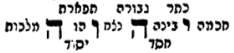

  
 And now we have to speak of where, from these images of these four holy letters, the *tikkun* of the body goes out," etc. Thus far its words, as relevant to our subject.

> בענין קדושת שם בן ד' היותו כולל כל האצילות רבו בו הפירושים יש שפי' יו"ד איהו דיוקנא דרישא דקב"ה. ה' איהו דרועא ימינא וסטר גופא. ו' איהו כל גופא, ושוקין ורגלים וברכים וברית קדישא. ה' דרועא שמאלא ושכינת אל. והכי סדרוי יהו"ה. וכען אית לפרשא בכל את ואת כמה ספירן נפקין מנוי בחיזו עינא, והכין סדרוי, וכלא פתגם חד הוא
>
>  וכען אית לון למללא היכא נפיק מהני דיוקני דהני ד' אתוון קדישין נפיק תיקון גופא וכו' עכ"ל לעניינו.

**19:2:2** And behold, he has another way with the four-letter name: that Yod includes four sefirot, Keter, Chokhmah, Binah, Chesed; Heh, Gevurah; Vav, Tiferet, Netzach, Hod, Yesod; Heh, Malkhut. And he wished to explain that the Vav within the Heh is Metatron; and in our view it is not fitting to say this. And there are those who wish to say that in the Yod are two sefirot and the Ein Sof. This is the opinion of some commentators on the responsum of Rabbenu Hai Gaon that we wrote in the Gate of Tzachtzachot, chapters 1 and 2. And this is not the opinion of all the Kabbalists, for all of them agreed with one mouth that the four-letter name is in the sefirot, not above them, God forbid. And what most of them explained and agreed upon is that the Yod is in Chokhmah, and its upper thorn in Keter; the first Heh, Binah; Vav is the six extremities, as its name [six], which are Chesed, Gevurah, Tiferet, Netzach, Hod, Yesod; the last Heh, Malkhut. And close to this matter Rashbi explained in many places, and these are his words (in the Introduction to the Tikkunei Zohar, folio 5): "YHVH is: Yod, Chokhmah; Heh, Binah; Vav includes six sides; Heh, Malkhut." Thus far his words.

> והנה לו דרך אחר בשם בן ד'. כי י' כוללת ד' ספירות כתר חכמה בינה חסד, ה' גבורה, ו' ת"ת נצח הוד יסוד, ה' מלכות. ורצה לבאר כי הו' שבתוך הה' שהוא מטטרון, ובעיננו ראינו שאין ראוי לומר זה. ויש שרוצים לומר כי ביו"ד ב' ספירות ואין סוף. זהו דעת קצת מפרשים בתשובת רבינו האי גאון שכתבנו בשער הצחצחות פ"א ב', ולא כן דעת כל המקובלים כי כלם הסכימו פה אחד היות שם בן ד' בספירות לא למעלה מהם ח"ו. ומה שרובם פירשו והסכימו הוא כי הי' היא בחכמה, וקוצו העליון בכתר. ה' ראשונה בינה. ו' הוא ו' קצוות כשמה, שהם חסד גבורה ת"ת נצח הוד יסוד. ה' אחרונה מלכות. וקרוב לענין זה באר הרשב"י במקומות רבים וז"ל (בהקדמת ת"ז ד"ה) ידו"ד איהו, י' חכמה ה' בינה ו' כליל שית סטרין ה' מלכות עכ"ל.

**19:2:3** And we have not found Rashbi saying that the thorn of the Yod hints at Keter; but elsewhere (Tikkun 5, folio 19b) there is some revealing, for he explained: "Yod: an upper thorn, a lower thorn, and its body in the middle; they are in the secret of letters, vowel points and cantillation marks." And the explanation: the letters are in Binah, and its lower thorn is in Binah; and the vowel points are in the middle body, in Chokhmah; and its upper thorn is in Keter, which are the cantillation marks. And likewise in parashat Acharei (folio 65b), and these are its words: "The upper thorn of the Yod hints at Nothing [Ayin]." Thus far its words. (And likewise in parashat Vayikra, folio 10b, that the upper thorn hints at the Supernal Keter; see there.) And Nothing is Keter, as is known. But we should be precise in his language, in saying "the upper thorn," etc.: explanation: the upper thorn is a hint of Keter in its lower aspect, which is the aspect that unites with Chokhmah and Binah; for this is the explanation of Ayin: Alef, Keter; Yod, Chokhmah; Nun, Binah, as we shall explain in the Glossary of Titles. And the reason is that in the aspect of itself above, in relation to its aspect that unites with its simple root, it has no name and no point, as we explained in the Gate From Below to Above, chapter 5; and the thorn of the Yod there is in its aspect that unites with Chokhmah and Binah, as we explained. And this is what is found in the Zohar in the explication of the Name, without specifying it (in its fillings) in all the sefirot. And for this reason they called it "the unique name," for it is the name in which all ten sefirot are united, unified as one. This is one way of the four-letter name in the sefirot. Further, Rashbi wrote in the Tikkunim (in the Introduction, folio 3a) another way in this: Yod, Keter; Yod-Heh, Chokhmah and Binah; Yod-Heh-Vav, Chesed, Gevurah, Tiferet; Yod-Heh-Vav-Heh, Netzach, Hod, Yesod, Malkhut. And these are his words: "'And I heard the sound of their wings' (Ezek. 1:24): with ten kinds of praises: with a simple song, which is Yod, Keter; a double song, which is Yod-Heh, Chokhmah and Binah; a triple, Yod-Heh-Vav, which is Chesed, Gevurah, Tiferet; a quadruple, with YHVH, which is Netzach, Hod, Yesod, Malkhut." Thus far. And the relation of these letters to the sefirot is as we explained in Gate 8: that the sefirot are divided into these three lines: first, the line of Chesed; second, the line of judgment; third, the middle one, the line of Rachamim. And to these three lines belong three letters, which are Yod-Heh-Vav: Yod, the root of the line of Chesed; Vav, the root of the line of Rachamim; Heh, the root of the line of judgment.

> ולא מצינו להרשב"י שיאמר שקוצו של יו"ד רמוז בכתר, אבל במ"א (תקונא ה' דף י"ט ע"ב) יש גילוי קצת שפירש יו"ד קוצא דלעילא קוצא דלתתא וגיו באמצעיתא אינון ברזא דאתוון נקודי וטעמי. ופי', כי האותיות הם בבינה וקוצו התחתון בבינה, ונקודין בגיו האמצעי בחכמה, וקוצו העליון בכתר שהם הטעמים. וכן בפ' אחרי (דס"ה ע"ב) וז"ל קוצא דיו"ד לעילא רמיזא לאי"ן עכ"ל (וכן בפ' ויקרא ד"י ע"ב דקוצא דלעילא מרמז לכתרא עילאה ע"ש) ואי"ן הוא הכתר כנודע. אבל ראוי שנדקדק לשונו דאמר קוצא דלעיל' וכו' פי' הקוץ העליון הרמז לכתר בבחינתו התחתונה שהיא הבחי' המתיחד עם החכמה והבינה, שזהו פי' אי"ן א' כתר י' חכמה ן' בינה כמו שנבאר בערכי הכנויים. והטעם מפני שבבחינת עצמו למעלה בערך בחינתו המתייחד בשרשו הפשוט אין לו שם ונקודה כדפי' בשער ממטה למעלה פ"ה, ושם קוצו של יו"ד הוא בבחינתו המתייחד עם החכמה והבינה כדפי'. וזהו הנמצא בזוהר בפרישת השם בלי שיפרטהו (במילואיו) בכל הספירות. ולטעם זה קראוהו שם המיוחד שהוא שם המתייחדים בו כל הי"ס מיוחדים כאחד. זהו דרך א' בשם בן ד' בספירות. עוד כתב הרשב"י בתיקונים (בהקדמה ד"ג.) דרך אחרת בזה. י' כתר, י"ה חכמה ובינה, יה"ו חסד גבורה תפארת, יהו"ה נצח הוד יסוד מלכות. וז"ל ואשמע את קול כנפיהם, בעשר מיני תהלים. בשיר פשוט דאיהו י' כתר, שיר כפול דאיהו י"ה חכמה ובינה, משולש יה"ו דאיהו חסד גבורה תפארת, מרובע ביהו"ה דאיהו נצח הוד יסוד מלכות ע"כ. והיחס אל האותיות האלה בספירות הוא כמו שבארנו בשער ח' שהספירות הם מתחלקות לאלו הג' קוים. א' קו החסד, ב' קו הדין, ג' אמצעי קו הרחמים. ולג' קוים אלו ג' אותיות שהם יה"ו. י' שרש לקו החסד ו' שרש לקו הרחמים ה' שרש לקו הדין.

**19:2:4** And behold, Keter, although Vav can also properly be said of it, as explained at the end of the Gate of Manifestations, nevertheless the Vav is in a borrowed sense, because the root of compassion is from Da'at, as explained in Gate 8, chapter 25. And the Yod is hinted at in it because of its smallness and its subtlety and its concealment, to indicate the concealment of Keter and the little apprehension of it, just as the thorn of the Yod, that is, a small Yod, is related to it. Afterwards there is Yod in Chokhmah, which is the root of Chesed; Heh in Binah, which is the root of judgment. Afterwards there is Yod in Chesed, because it is a branch of Chokhmah; and further, because at times Chokhmah dwells upon it, as is known, in the secret of "whoever wishes to become wise should turn southward" (Bava Batra 25b). And Heh in Gevurah, for the same reason as the Yod in Chesed. And the Vav in Tiferet. Afterwards Yod in Netzach, for the reason that it is in Chesed; Heh in Hod, for the reason that it is in Gevurah; and Vav in Yesod, as is known, for it is the extension of the Vav, and likewise the small Vav, for the reason that it is in Tiferet; Heh in Malkhut, for there is its principal place, for it is the last Heh of the Name. And this is the relation of the ten letters, Yod, Yod-Heh, Yod-Heh-Vav, Yod-Heh-Vav-Heh, to the ten sefirot. Further, Rashbi explained that the four-letter name in its filling with Alefs is, in Chokhmah, ten sefirot, which are יו"ד ה"א וא"ו ה"א. And Rashbi, peace be upon him, explained in the Tikkunim that it includes the Name in ten sefirot, a revealed inclusion; from this, that it is the totality of the existents, revealed in four configurations, as we shall explain in chapter 3. But from the side of Binah they are included only in the four letters YHVH alone. And the reason: when the light of Chokhmah prevails and shines in the sefirot, then כ"ח מ"ה [the power of Mah] shines, which amounts to Adam [45]; and this name, which amounts to Adam, indicates that the light is a bright and clear light, sparkling in ten sparks. But when the light is from Binah alone, the sefirot are revealed only in general, not in particular. How so? Yod-Heh in Binah (which is the totality of the first three); and so Tiferet is called "son of Yah" [*ben Yah*], that is, Binah, the letters of the one being the letters of the other; Vav includes six sefirot; Heh in Malkhut. It turns out that the sefirot are not revealed by themselves; rather the light of the sefirot is included within the totality of Binah, Tiferet and Malkhut; and this is YHVH in general. But יו"ד ה"א וא"ו ה"א is from the side of the light of Chokhmah, and it reveals all ten sefirot together, without any generality; rather all of them are seen. And all this Rashbi explained in the Tikkunim; and so as not to lengthen by copying his language, which is scattered and dispersed, we will not lengthen. Further, Rashbi explained the four-letter name in the filling of Yods, יו"ד ה"י וא"ו ה"י, and it indicates more concealment than its filling with Alefs, as we shall explain in chapter 3. And the reason is that this is the light revealed from Keter, and it shows all the sefirot, but not with an essential revealing, as we shall explain. And although they are enclosed and concealed, they did not come included [in general letters], so as not to show poverty in the place of wealth. And this name is certainly in Keter, and not in the aspect of itself but in its aspect with Chokhmah and Binah; and therefore in this name there are three Yods, which are a *segolta* in Keter, the first three: that is, in the aspect of Chokhmah within it, the right Yod; and in the aspect of Binah within it, the left Yod; and the aspect above them, that is, the first Yod. And the Alef in the middle of וא"ו is the skull [*karkafta*] that covers the three brains, like this: י. And this is the secret of the name El, as they transcribe it thus; and Rashbi has already explained that it amounts to the number of El; for in Keter too there is the name El, which is supernal Chesed. Thus far reaches what we saw fit to say about the four-letter name including ten sefirot. But as for the four-letter name itself, in the explanation of its four letters, we shall explain in the Gate of Names:

> והנה הכתר עם היות שג"כ יצדק בו ו' כמבואר בשלהי שער המציאיות, עכ"ז הוא"ו הוא בהשאלה, לפי ששורש הרחמים הוא מהדעת, כמבואר בשער ח' פכ"ה. והי' נרמזת בו מפני קטנותה ודקותה והעלמה להורות על העלם הכתר ומעט ההשגה בו כמו שמתייחס אליו קוצו של יו"ד היינו יו"ד קטנה. אח"כ הוא יו"ד בחכמה שהוא שורש החסד. ה' בבינה שהוא שורש הדין. אח"כ הוא יו"ד בחסד מפני שהיא ענף מהחכמה, ועוד שלעיתים החכמה שוכנת עליו כנודע בסוד הרוצה להחכים ידרים. וה' בגבורה מהטעם שהיו"ד בחסד. והוא"ו בתפארת. אח"כ י' בנצח מן הטעם שהיא בחסד. ה' בהוד מן הטעם שהיא בגבורה. וא"ו ביסוד כנודע שהוא משך הוא"ו וכן ו' זעירא מן הטעם שהוא בת"ת. ה' במלכות כי שם עיקרה שהיא ה' האחרונה של שם וזהו יחס בי' אותיותיו י' י"ה יה"ו יהו"ה אל הי"ס. עוד פי' הרשב"י כי שם בן ד' במלוי אלפין בחכמה הם י"ס שהם יו"ד ה"א וא"ו ה"א. ופי' הרשב"י ע"ה בתקונים שכולל השם בי"ס כללות נגלה מזה שהוא כלל הנמצאות נגלה בד' מערכות כמו שנבאר בפ"ג. אבל מצד הבינה אינם נכללות אלא בד' אותיות יהו"ה לבד. והטעם כי כאשר יגביר ויאיר אור החכמה בספי' הנה יאיר כ"ח מ"ה שעולה אדם ושם זה העולה אד"ם הורה היות האור אור בהיר וזך ומתנוצץ בי' נצוצות. אבל כשהאור מבינה לבד אין הספי' מתגלות אלא בכללות לא בפרט. כיצד י"ה בבינה (שהיא כלל הג' ראשונות) וכן נקרא הת"ת בן י"ה בינה אותיות דדין כאותיות דדין. ו' כולל שש ספירות. ה' במלכות. נמצאו שאין הספירות מתגלות מעצמן אלא אור הספי' נכללות בכלל הבינה והתפארת והמלכות וזה יהו"ה בכללות אבל יו"ד ה"א וא"ו ה"א הוא מצד אור החכמה ומגלה כל י"ס יחד בלא כללות כלל אלא הם מתראות כלם. וכ"ז ביאר הרשב"י בתקונים ושלא להאריך בהעתק לשונו שהוא מפוזר ומפורד לא נאריך. עוד ביאר הרשב"י בשם בן ד' במלוי יודי"ן יו"ד ה"י וא"ו ה"י, והוא מורה העלם יותר ממלואו באלפין כמו שנבאר בפ"ג. והטעם כי זהו אור המתגלה מכתר והוא מראה הספי' כלם אך לא גילוי עצמי כאשר נבאר. ועם היותם סתומות ונעלמות לא באו נכללות שלא להראות עניות במקום עשירות. והשם הזה ודאי בכתר ולא בבחינת עצמו אלא בבחינתו עם החכמה והבינה, ולכן בשם זה ג' יודין שהם סגולתא בכתר ג' ראשונות. והיינו בבחינת החכמה שבו יו"ד ימינית, ובבחינת הבינה שבו י' שמאלית, ובחינה למעלה מהם היינו היו"ד הראשונה. ואלף שבאמצע וא"ו היא קרקפתא המכסה על ג' מוחות כזה י. וזהו סוד שם א"ל המעתיקים אותו כך, וכבר פי' הרשב"י שעולה כמנין א"ל. שבכתר ג"כ אית שם א"ל שהוא חסד עליון. ע"כ הגיע מה שראינו לדבר בשם בן ד' הכולל י"ס. ואולם בשם בן ד' עצמו בביאור ד' אותיותיו נבאר בשער השמות:

### Chapter 19:3. On the filling (*milui*) of the letters of the four-letter name with yods, alephs, and hehs, and in the very forms of the letters; and there, the matter of the four configurations of the four letters.

**19:3:1** Concerning the four-letter name in its filling, which we explained in the preceding chapter, Rashbi gave an explanation in parashat Emor (folio 92); and we will not copy his language, lest the labor weigh upon us, but we will write their essence, with additions, [in] a place that he left for us to distinguish ourselves in. And the matter is that, besides the four-letter name indicating the whole totality of the entire Emanation, as we explained, it further indicates [it] in four letters, each and every letter of them indicating the totality of the whole Name, that is to say, also including the whole Emanation. And this is that the Yod in its filling is יו"ד, Yod-Vav-Dalet: the Yod is in Chokhmah, and the Vav in Tiferet, and the Dalet in Malkhut; behold, the totality of the whole Emanation from beginning to end. For in the Yod the first three are included, as we explained in chapter 2, and the Vav in Tiferet includes six extremities, and the Dalet in Malkhut: these are ten sefirot included in the Yod in its filling. And to indicate the matter of the true union, the Yod in its filling is the form of Alef. How so? The Yod above the diagonal line, and the diagonal line is Vav, and the lower Yod in the form of Dalet: behold, Yod in its filling and Alef are all one. And now there is no wonder about the name Ehyeh, that its beginning is Alef while the head of the four-letter name is Yod; for Yod and Alef are all one, as we shall explain in the Gate of Names, on the name Ehyeh, with the help of Heaven. And the Hehs too are all one, and in them the Emanation is included, like the manifestation of the Yod itself. How so? The middle thorn between the two sides of the Dalet, that is, the thorn of the Dalet, is Yod (and so Rashbi explained in the Zohar, in a passage that we shall copy in the Gate of Names, chapter 11; see there); and the Dalet itself, behold Dalet; and the Vav within the Dalet: behold יו"ד. And in this way for the last Heh. And sometimes the particularity of the Heh is revealed essentially in its filling, which is the filling of Alef, like this: ה"א, indicating the revealing of the totality essentially. And the Vav too is filled with Alef: behold the totality of the Emanation. It turns out that the four letters reveal four configurations, four totalities, so that the part is in the whole and the whole in the part, for the multiplication of [the indication of] the unity. And the reason for these four totalities, which in their particulars are Yod Chokhmah, Heh Binah, Vav Tiferet, Heh Malkhut, is to hint at the four configurations in which we configure the Emanation, as we explained in the Gate of the Order of the Emanation, chapter 5, with the help of Heaven. And there we explained that the Emanation is four configurations: the first configuration Chokhmah, the second configuration Binah, the third configuration Tiferet, the fourth configuration Malkhut. And therefore these four letters are inscribed and marked in these four configurations in particular, and their principal is in the whole Emanation; and their concealment, which is their filling, indicates the totality of the Emanation concealed within them. And what we should further know is that these letters are not equal in their configurations: for the Alef indicates the concealed Emanation with a more revealed revealing than the Yod; for the Yod indicates it in its filling, and this indicates it in its simple form, for the Yod in its filling is a simple Alef, as we explained. And because Chokhmah is more concealed than the other configurations, the revealing of the configuration that is in it came in great concealment, that is, the concealment of the filling of the Yod. But the Heh indicates the principal of the configuration itself, in the revealing of its very self, as we explained: for a simple Heh, without any filling, indicates the configuration within it; and when it is filled, the configuration is revealed more, to crown the delightful son, who is Vav.

> בשם בן ד' במלואו שפי' בפ' הקודם ביאר הרשב"י פ' אמור (דף צ"ב) ולא נעתיק לשונו לבל תכבד עלינו העבודה אבל נכתוב מהותם בתוספות מקום שהניח לנו להתגדר בו. והענין כי בזולת ששם בן ד' מורה כל כללות האצילות כלו כדפי'. עוד מורה בד' אותיות, כל אות ואות מהם מורה על כללות השם כלו ר"ל כולל ג"כ כל האצילות. והיינו שיו"ד במלואה הוא יו"ד וא"ו דל"ת. היו"ד הוא בחכמה והוא"ו בת"ת והד' במלכות הנה כללות האצילות כלו מראש ועד סוף. כי ביו"ד נכללות ג' ראשונות כמו שפי' בפ"ב, והוא"ו בת"ת כולל שש קצוות, והד' במלכות הם עשר ספירות נכללות ביו"ד במלואה. ולהורות ענין היחוד האמיתי יו"ד במלואה הוא צורת א. כיצד היו"ד שלמעלה מהקו האלכסוני, והקו האלכסוני הוא ו', והיו"ד התחתונה בצורת ד'. הרי י' במלואה ואלף הכל א'. ועתה אין תימה בשם אהי"ה כי תחלתו א' ושם בן ד' ראשו יו"ד, כי יו"ד ואלף הכל אחד, כמו שנבאר בשער השמות בשם אהי"ה בע"ה. וההי"ן ג"כ הכל אחד, ובהם נכלל האצילות כמציאות היו"ד בעצמה. כיצד העוקץ האמצעי שבין שני צדי הד' דהיינו קוצו של ד' היא י', וכן פי' הרשב"י בזהר במאמר שנעתיקהו בשער השמות פי"א יעויין שם. והד' עצמה הרי ד'. והו' שבתוך הד' הרי יו"ד. ובדרך זה לה' אחרונה. ולפעמים מתגלה פרטיות הה"א בעצם במלואה שהיא במלוי אלף, כזה ה"א. מורה על גילוי הכללות בעצם. והוא"ו הוא ג"כ מתמלא באל"ף הרי כללות האצילות. נמצאו הד' אותיות מגלים ד' מערכות ד' כלליות. להיות החלק בכל והכל בחלק לרבוי [הוראת] האחדות. וטעם ד' כללים אלו שהם בפרטיותיהם י' חכמה ה' בינה ו' תפארת ה' מלכות, לרמוז אל ד' מערכות שנעריך האצילות כדפי' בשער סדר האצילות פ"ה בס"ד. ושם ביארנו שהאצי' ד' מערכות, מערכה ראשונה חכמה מערכה שניה בינה מערכת שלישית תפארת מערכה רביעית מלכות. ולכן ד' אותיות אלו נרשמות ומסומנות בד' מערכות אלו בפרט. ועיקרן בכל האצי'. והעלמם שהוא מילואם מורה על כללות האצילות הנעלם בתוכם. ומה שנדע עוד הוא שהאותיות האלה במערכותם אינו שוה כי האלף מורה על האצי' הנעלם גילוי יותר מתגלה מהיו"ד כי היו"ד מורה עליו במלואו וזה מורה עליו בפשיטתו כי יו"ד במלואה הוא א' פשוטה כדפי'. ולהיות כי החכמה נעלמה יותר משאר המערכות בא גילוי המערכת שבה בהעלם גדול דהיינו העלם מלוי היו"ד. אמנם ה' מורה עיקר המערכת בעצמה בגילוי עצמותה כדפי'. כי ה' פשוטה בלי מלוי כלל מורה על המערכת שבה ובהיותה מתמלאת מתגלה המערכת יותר להעטיר הבן הנחמד שהוא וא"ו.

**19:3:2** Further, Heh and Vav are filled in two ways, either with Alef or with Yod. For when the configuration in Binah is revealed with an essential revealing, with Alef, then Tiferet, the delightful son, reveals the configuration in the manifestation of Alef, according to its drawing sustenance from its mother. But when the Heh is filled with Yod, like this, ה"י, then it indicates concealment, as we explained that Yod is more concealed than Alef; and then the Vav is filled with Yod, like this, וי"ו, indicating the concealment of the configuration, which was not revealed to it more than to the mother. And according to the filling of the Vav that is in Tiferet, so is the Heh that is in Malkhut filled, because she receives from it alone. And sometimes, although the filling of the Vav is with Alef, the filling of the Heh with Yod indicates that it was revealed and concealed; for such is the way of Malkhut, which is a veil, a screen, concealing and hiding the whole Emanation. And with this preliminary it will be understood that sometimes the Heh is filled with Heh, like this: ה"ה. And according to what we have explained, it turns out that the revealing of the configurations came in three kinds, either with Yod, or with Alef, or with Heh, and each one more concealed than its fellow. Yod is the most concealed of all, for the totality of the Emanation is not revealed in it except by way of filling. And when the Vav is filled with Yod, then the matter turns out to be concealed within concealed; for the simple Yod is concealed in וי"ו, and the Yod itself needs filling. And the reason is that the configuration revealed in the filling of the Yod is the configuration of the Emanation concealed in Chokhmah, and it is concealed with the utmost concealment. And when it is revealed in Binah, which is Heh, or in Tiferet, which is Vav, or in Malkhut, which is the last Heh, it is not revealed essentially except with great difficulty, according to the depth of the grades, by the power of the effluence of the light of Keter, as befits the subtlety that is in Chokhmah. And because Chokhmah is concealed, it is not fitting that the configuration be revealed except in the very concealment, that is to say, in the form of Yod, and not in the other letters. And therefore Yod has no filling but Yod, and is filled neither with Alef nor with Heh, unless it is a complete word, that is, Yah, where the Heh is a name and a palace to the Yod within it, and like a title to it and to the name within the sefirah, as will be explained in the next gate, with the help of Heaven. But the Heh is filled with Alef and with Yod, and in the opinion of some also with another Heh; and likewise the last Heh, and likewise the Vav. But the configuration is revealed in the very body of the Hehs without (revealing) [filling], as we explained. And they are excluded from the rule of the other letters: for Yod and Vav have in themselves no revealing of a configuration at all, except in their filling; which is not so with the Hehs, for the Hehs themselves are revealed in the form of the configurations, as we explained; for in the form of ה"א itself there is the form of יו"ד, that is, the form of Alef. And the reason is that Yod and Vav, which are Chokhmah and Tiferet, are males, for so they are called Father and Son; and Binah and Malkhut are females, for so they are called Mother and Daughter. And it is known that the generations and the beings are in the male in great concealment, for the children depend on the brain of the male; as is known from the parable of the seed, concealed in the male and revealed in the full womb through the union of the male and the female; and she reveals the actions essentially. And therefore in Chokhmah and Tiferet the beings, that is, the configurations that include the Emanation, are concealed, and they are not revealed in them except in great concealment, through the fillings; that is, after the actions go out from them, and they go out from them like the filling of a letter, which goes out from the letter and is outside the letter, as is known. But the females, which are the Hehs, show the actions in pregnancy within them, that is, the manifestation of the form of the Heh itself, and show more when they go out from before them, that is, the fillings. And one should not ask: but Binah is more concealed than Tiferet; if so, why did the revealing of the configuration come in Binah more than in Tiferet? This is no question: for Binah in relation to Chokhmah is female, and Tiferet in relation to Malkhut is male, and therefore each one is judged according to its relation. And now that the matter of the difference between Alef and Yod has been explained, that Alef reveals more than Yod, and Alef is female in relation to Yod, the reason for the four-letter name filled with Yods in Keter and filled with Alefs in Chokhmah will not be far from us: for this one reveals more than that. Thus far reaches the filling of the letters of the four-letter name, as far as is apprehended by us from the words of Rashbi in parashat Emor mentioned above:

> ועוד ה"א וא"ו מתמלאים על שני פנים אם באלף אם ביו"ד. מטעם כי כאשר יתגלה המערכת בבינה גילוי עצמי באל"ף אז יתגלה התפארת הבן הנחמד גילוי המערכת במציאות אל"ף כפי יניקתו מאמו. אמנם כאשר הה"א תתמלא ביו"ד כזה ה"י אז מורה העלם כמו שבארנו שיו"ד היא נעלמת יותר מאלף ואז תתמלא הוא"ו ביו"ד כזה וי"ו מורה על העלם המערכת שלא נתגלה אליו יותר מהאם. ולפי היות מלוי ו' שבתפארת כן תתמלא ה' שבמלכות לפי שקבלתה ממנו לבד. ולפעמים אע"פ שמלוי הוא"ו באל"ף, מלוי הה' ביו"ד מורה על שנתגלה ונתעלם כי כן דרך המלכות שהיא פרוכת מסך מעלים ומסתיר האצילות כולו. ובהקדמה זו יובן כי לפעמים תתמלא הה' בה' כזה ה"ה. ולפי מה שפי' נמצא שבאו גלוי המערכות בג' מינים אם ביו"ד אם בא' אם בה' וכל א' נעלם יותר מחבירו. י' נעלמת מכלם שלא יתגלה בה כללות האצילות אלא ע"ד המלוי. וכשיתמלא הוא"ו ביו"ד אז נמצאו הענין נעלם מנעלם כי יו"ד פשוטה נעלמת בוי"ו ויו"ד עצמה צריכה אל מלוי. והטעם לפי שהמערכה המתגלית במלוי היו"ד הוא מערכת האצילות הנעלם בחכמה והוא נעלם תכלית ההעלם. וכאשר יתגלה בבינה שהוא ה' או בתפארת שהוא ו' או במלכות שהיא ה' אחרונה לא יתגלה בעצם אלא בדוחק גדול, לפי עומק המדרגות מכח שפע אור הכתר כמו שראוי אל הדקות שהוא בחכמה. ולהיות שהחכמה נעלמת ואין ראוי שיתגלה המערכה אלא בעצם ההעלם ר"ל בצורת י' ולא בשאר האותיות. ולכן אין ליו"ד מלוי בלתי היו"ד ולא תתמלא לא באל"ף ולא בה', בלתי אם תהיה תיבה שלימה דהיינו י"ה שהה' הוא שם והיכל אל הי' שבתוכה וכמו כנוי אליו ואל השם שבתוך הספירה כאשר יתבאר בשער הבא בע"ה. אמנם הה"א תתמלא באלף ויו"ד, ולדעת קצת גם בה"א אחרת. וכן ה' אחרונה וכן הוא"ו. אמנם נגלה המערכת בעצם גוף ההי"ן בלי (גילוי) [מילוי] כדפי'. ויצאו מכלל שאר האותיות כי יו"ד וא"ו אין בעצמותם גלוי מערכת כלל אלא במילואם. משא"כ בההי"ן שההי"ן עצמה מתגלים בצורת המערכות כדפי'. שבצורת ה"א עצמה יש צורת יו"ד דהיינו צורת א'. והטעם כי היו"ד והוא"ו שהם חכמה ותפארת הם זכרים שכן נקראים אב בן, והבינה והמלכות הם נקבות שכן נקראים אם בת. וידוע כי התולדות וההויות הם בזכר בהעלם גדול כי במוח הזכר תלוים הבנים. כנודע משל הזרע הנעלם בזכר ומתגלה בבטן המלאה ע"י יחוד הזכר והנקבה והיא מגלה הפעולות בעצם. ולכן החכמה והתפארת נעלמות בהם ההויות דהיינו המערכות הכוללות האצילות ואין מתגלה בהם בלתי בהעלם גדול ע"י המילואים היינו אחרי צאת הפעולות מאתם ויוצאין מהם כדמיון מלוי האות שהוא יוצא מן האות וחוץ מן האות כנודע. אמנם הנקבות שהם ההי"ן מראים הפעולות בעיבור בתוכם דהיינו מציאות צורת ה' עצמה ומראים יותר בצאתם מאת פניהם דהיינו המילואים. ואין שאלה שהרי הבינה היא נעלמת יותר מהת"ת, וא"כ למה באו בגילוי המערכת בבינה יותר מהת"ת. זו אינה שאלה, כי הבינה בערך החכמה הוא נקבה והתפארת בערך המלכות זכר ולכן נדון כל א' לפי ערכו. ואחר שנתבאר ענין החילוק שבין א' ליו"ד כי אלף מגלה יותר מיו"ד וא' נקבה בערך יו"ד לא ירחק ממנו הטעם של שם בן ד' מלוי יודי"ן בכתר ומלוי אלפי"ן בחכמה כי זה מגלה יותר מזה. ע"כ הגיע מילוי האותיות שם בן ד' כפי המושג אלינו מתוך דברי הרשב"י פ' אמור הנ"ל:

### Chapter 19:4. Explanation of the four-letter name in each and every sefirah, and their distinction according to their vocalization; and there, a fine passage from the Tikkunim, "Come and see: nine times."

**19:4:1** Having explained in the preceding chapters the opinion of Rashbi, peace be upon him, that the four-letter name includes the whole Emanation, we will now explain another matter that he explained to us concerning this: that the four-letter name is in each and every sefirah. And these are his words in the Tikkunim (Tikkun 42, folio 82a): "There is no sefirah in which there is not YHVH, יו"ד ה"א וא"ו ה"א."

> אחר שבפרקים הקודמים ביארנו דעת הרשב"י ע"ה ששם בן ד' כולל כל האצילות. נבאר עתה ענין אחר שביאר לנו בזה ששם בן ד' הוא בכל ספירה וספירה. וז"ל בתיקונים (תקונא מ"ב דפ"ב.) לאו ספי' דלית תמן ידו"ד יו"ד ה"א וא"ו ה"א.

**19:4:2** And behold, he doubled the Name, in its simple form and in its filling, to reveal to us that just as the Name in its simple form relates to each and every sefirah, so the Name in its filling is in each and every sefirah, all according to the aspects that we explained in the preceding chapters. But it is fitting to investigate: if it is true that the four-letter name is in each and every sefirah, then in what are the sefirot distinguished in their names? And Rashbi, peace be upon him, explained this matter elsewhere in the Tikkunim (Tikkun 70, folio 124), and these are his words: "Come and see: nine times He is YHVH, in each and every sefirah its own vowel point; and He is YHVH in Malkhut without a vowel point. And these are the vowel points that are obligatory for each and every sefirah. Nine vowel points they are: the first YHVH, the second YHVH, the third YHVH, the fourth YHVH, the fifth YHVH, the sixth YHVH, the seventh YHVH, the eighth YHVH, the ninth YHVH [with *shuruk* (which is *melupim*); Malkhut, YHVH, includes all of them] [the vowels written under each Name are not reproduced in this text]. It is called *kamatz* with this vowel point, YHVH, from the side of the Supernal Keter, which is closed like a clenched fist [*kometz*], which is enclosed in thought, so that a person does not know what is inside. And whoever is inside is enclosed in thought; we call him the Cause of Causes. And it is called *patach* with this vowel point, YHVH, from the side of Chokhmah, for in it the enclosed thought is opened [*itpatchat*] and revealed, in this manner: above, in this likeness, א; below, in this likeness, א. And these two vowel points are revealed in Imma [in the Supernal Keter they are enclosed], and they became *tzeirei*, YHVH; of them it is said, 'And the Lord God formed [*va-yyitzer*]' (Gen. 2:7), 'for in Yah the Lord is the Rock of worlds [*tzur olamim*]' (Isa. 26:4): He formed [*tzayar*] two worlds, this world and the world to come. *Segol*: this is Chesed, in which the Shekhinah is a *segolta* above and a *segol* below, YHVH; treasure [*segulah*] and love from the right side. *Sheva*, in this manner, YHVH, from the left side: 'For by fire [*ba-esh*] will the Lord judge' (Isa. 66:16); 'and Sheba [*sheva*] fell upon them and took them' (Job 1:15); 'It is better that I give her to you… abide [*shevah*] with me' (Gen. 29:19): for she is the Shekhinah, who is called *sheva* from the left side. And it is called *cholam*, in this manner, YHVH, from the side of the middle pillar: 'From there is the shepherd, the stone of Israel' (Gen. 49:24); 'the stone that the builders rejected has become the head of the corner' (Ps. 118:22). Every precious pearl is in *cholam*; this is what is written, 'a *leshem*, a *shevo*, and an *achlamah*' (Ex. 28:19); and by it, 'and we dreamed [*va-nachalmah*] a dream' (Gen. 41:11). It is called *chirik* from the side of the right thigh, in this manner, YHVH; in it is investigation [*chakirah*]: 'Can you find out God by searching [*ha-chekker*]?' (Job 11:7); and it is 'the terrible ice [*kerach*]' (Ezek. 1:22): ice from that terrible one, which is the middle pillar. *Shurek* is called Hod, in this manner, YHVH; from there the Shekhinah is called *shurek*, the knot [*kesher*] of the chariot; and it is the Hod of Moses, in which they were completed: 'And five bars for the boards of the second side [*tzela*] of the Tabernacle' (Ex. 26:27): as the number of its Heh [5]; there remains Vav-Dalet, double-faced; of it is said, 'Ten cubits the length of the board [*keresh*]' (Ex. 26:16): *keresh*, *kesher*. *Shuruk*, YHVH [written יההיווהו]: this is the Righteous One, who binds [*kosher*] the chariot, which is the Shekhinah, with the Holy One, blessed be He; this is what is written, 'for all that is in heaven and on earth' (1 Chr. 29:11), which we translate, 'who holds onto heaven and earth.' And of it is said, 'Yet I had planted you a noble vine [*sorek*], wholly a seed of truth' (Jer. 2:21): it is certainly a seed of truth, of which it is said, 'You will give truth to Jacob, Chesed to Abraham' (Mic. 7:20). He is seed, and the Shekhinah is help; this is what is written, 'I will make him a help meet for him' (Gen. 2:18). All these vowel points are obligatory in the holy Name from the side of nine sefirot; and Malkhut is the inclusion of all of them: 'the love of your espousals [*kelulotayikh*]' (Jer. 2:2)." Thus far its words.

> והנה כפל השם בפשיטותו ובמילואו לגלות לנו כי כמו שיתיחס השם בפשיטות בכל ספי' וספירה כן השם במלוי בכל ספירה וספירה הכל לפי הבחינות שפי' בפרקים הקודמים. אבל ראוי לחקור אם אמת ששם בן ד' בכל ספירה וספירה. א"כ במה יתחלקו הספירות בשמותם. והענין הזה בארו הרשב"י ע"ה בתיקונים במ"א (תקונא ע' דקכ"ד) וז"ל ת"ח תשע זמנין איהו יהו"ה בכל ספירה וספירה נקודה דיליה ואיהו יהו"ה במלכות בלא נקודה. ואילין אינון נקודין דמחייבין כל ספירה וספירה. ט' נקודין אינון. חד יהוה, תנינא יהוה, תליתאה יהוה, רביעאה יהוה, חמישאה יהוה שתיתאה יהוה, שביעאה יהוה, תמינאה יהוה, תשיעאה יהוה [בשורק (דהוא מלופים). מלכות יהו"ה כלילא מכלהו]. קמץ אתקריאת בנקודה דא יהוה מסטרא דכתרא עלאה דאיהו סתים כקומץ דאיהו סתים במחשבה דלא ידע ב"נ מה דאית לגו. ומאן דאיהו לגו איהו סתים במחשבה עלת העילת קרינן ליה. ואתקריאת פתח כנקודה דא יהוה מסטרא דחכמה דבה אתפתחת ואתגליא מחשבה סתימא כגוונא דא לעילא כדיוקנא דא א לתתא כדיוקנא דא א. ותרין נקודין אלין אתגליאו באימא. [בכתרא עלאה סתימין אינון] ואתעבידו צירי יהוה עלייהו אתמר וייצר ה' אלדים, כי ביה ה' צור עולמים. צייר תרין עלמין עלמא דין ועלמא דאתי. סגו"ל דא חס"ד דביה שכינתא איהי סגולתא לעילא סגול לתתא יהוה סגולתא ורחימא מסטרא דימינא. שבא כגוונא דא יהוה מסטרא דשמאלא. כי באש ה' נשפט, ותפול שב"א ותקחם. טוב תתי וגו' שבה עמדי. דאיהי שכינתא דאתקריאת שבא מסטרא דשמאלא. ואתקריאת חולם כג"ד יהוה מסטרא דעמודא דאמצעיתא. משם רועה אבן ישראל, אבן מאסו הבונים היתה לראש פינה. כל מרגליתא יקירא היא בחולם הה"ד לשם שבו ואחלמה וביה ונחלמה חלום. חיריק אתקרי' מסטרא דשוקא ימינא כגוונא דא יהוה ביה חקירה. החקר אלוה תמצא. ואיהו הקרח הנורא קרח מההוא נורא דאיהו עמודא דאמצעיתא. שרק הוד אתקרי כג"ד יהוה מתמן אתקריאת שכינתא שרק קשר המרכבה ואיהו הוד דמשה דביה אשתלימו. וחמשה בריחים לקרשי צלע המשכן השנית. כחושבן ה' דילה אשתאר ו"ד ד"ו פרצופין עליה אתמר י' אמות אורך הקרש, קרש קשר. שרק יההיווהו דא צדיק דאיהו קושר המרכבה דאיהו שכינתא עם קב"ה הדא דכתיב כי כל בשמים ובארץ ודא דמתרגמינן דאחיד בשמיא ובארעא. ועליה אתמר ואנכי נטעתיך שורק כלו זרע אמת, זרע אמת הוא ודאי דאתמר ביה תתן אמת ליעקב חסד לאברהם. איהו זרע ושכינתא עזר הה"ד אעשה לו עזר כנגדו. כל אלין נקודין אתחייבו בשמא קדישא מסטרא דתשע ספירן. ומלכות כללא דכלהו, אהבת כלולותיך עכ"ל.

**19:4:3** And our intent in it is clear: that the sefirot are distinguished by their vowel points, as Rashbi, peace be upon him, set out. And nevertheless we will not withdraw our hands from explaining it somewhat. He said, "And He is YHVH in Malkhut without a vowel point": we have already explained in the Gate of Essence and Governance and in the Gate of Colors that all the sefirot bestow upon Malkhut, and through her they show their actions; and so is the matter with the vowel points: she receives all the vowel points from the sefirot to show their actions; and according to her receiving from above, so is her action, (to return) [for good] or for ill. "And these are the vowel points that are obligatory": the matter of the vowel points in the sefirot is not literal vowel points; rather the intent is that the spirituality of the sefirot is not bounded except by these vowel points; and this is what he said, "And these are the vowel points that are obligatory," etc. "From the side of the Supernal Keter": we have already explained this passage a little in Gate 8, chapter 2, with the help of Heaven; and nevertheless we will explain it here briefly. *Kamatz* is from the language of concealment, from the language of (Lev. 2:2) "And the priest shall take a fistful [*ve-kamatz*]"; and the intent is that just as with the fist that a person closes, no one knows what is inside it, so the Supernal Keter is clenched and closed, and there is none who apprehends what is inside it. "And whoever is inside": explanation: the parable is not like the thing it illustrates; for a clenched fist sometimes has nothing inside it, for the intellect cannot judge whether there is something in it or nothing at all. For this he said that it is not so in the thing illustrated, that is, Keter: for a person will not deny His manifestation, God forbid, because of the concealment of the Ein Sof within it. And this is what he said, "And whoever is inside is enclosed in thought": explanation: His manifestation is not denied at all; rather, the one who is within Keter is enclosed in Keter, which is called thought. "The Cause of Causes," etc.: explanation: that He is a cause for all the sefirot, which are causes for all that is caused by them; and the intent is the Emanator of the sefirot. And he said, "we call him": explanation: for this name does not indicate His Self, God forbid, for there is no name that bounds Him, as we explained; but it is a borrowed name, by which we title Him so, to distinguish when we speak of the cause or of the effects. "And it is called *patach*," etc.: the intent is that Chokhmah opens and reveals the fist. Not that [Keter] is revealed in Chokhmah, God forbid, for there too there is no apprehension; but the intent is that Chokhmah reveals Keter by having emanated Binah. And this he intended by the form of Alef: the upper thorn Keter, the middle line Chokhmah, and the lower thorn Binah; and in Binah they are revealed. "And these two vowel points," etc.: explanation: *kamatz* and *patach* became *tzeirei* in Binah; for she reveals all that is above, and therefore she is called Shekhinah, as we shall explain in the Gate of the Glossary of Titles. And he proved from the verses that the *tzeirei* is by the power of Keter and Chokhmah, as we shall explain. For in the one verse he said "and He formed [*va-yyitzer*]," which is *tzeirei*: it would mean that in that *tzeirei* was the emanation of "the Lord God," which is Binah, called YHVH with the vowels of Elohim; and the two Yods in *va-yyitzer* also indicate the *tzeirei*. And because this verse is not a complete proof (for on the contrary, from there it appears that Binah formed, in its plain sense; and also we might explain *tzeirei* in Binah and say "and the Lord God formed," that the *tzeirei* that is in Binah formed; and there is no proof, for they have already explained it in the Idra in the secret of *va-yyitzer*, that is, He formed a form within a form, as is explained in the book Or Yakar, with the help of Heaven), therefore he proved the matter from the verse "for in Yah the Lord is the Rock of worlds." And the intent is that in Yah, which is Chokhmah, YHVH formed, which is necessarily Keter. And the explanation of "worlds" is to hint at this world, Malkhut, which receives the vowel points, as we explained, and the world to come, Binah, for she received the two upper vowel points and they became *tzeirei*. And from this it is proven that the intent of the verse "and He formed" is as we explained: that *tzeirei* is the two upper vowel points, Keter and Chokhmah. And from the matter of the Idra there is no difficulty at all; for the Yod of the four-letter name that is in Keter is one Yod, and the second Yod, of Ze'ir [Anpin], is the Yod of Chokhmah, that is, the head of Ze'ir; and see there. And in all these names the intent of Rashbi is also to prove that Malkhut too is called so, after that attribute; and this is what he said: this world, that is, Malkhut; and the world to come, that is, Binah.

> וכוונתינו בו מבוארת היות הספי' נחלקות בנקודתן כמו שסדר הרשב"י ע"ה. ועכ"ז לא נאסוף ידינו מלבאר בו קצת. אמר ואיהו יהו"ה במלכות בלא נקודה כבר פי' בשער מהות והנהגה ובשער הגוונים, שכל הספי' משפיעים במלכות ועל ידה הם מראות פעולותיהן, וכן הענין בנקודות שהיא מקבלת כל הנקודות מהספירות להראות פעולותיהן. וכפי קבלתה מלמעלה כן פעולתה (לשוב) [לטוב] או למוטב. ואלין אינון נקודין דמחייבין. אין ענין הנקודות בספירות נקודות ממש, אלא הכוונה שאין רוחניות הספי' נגבלת אם לא בנקודות האלה, וז"ש ואלין אינון נקודין דמחייבין וכו'. מסטרא דכתרא עילאה. כבר ביארנו מעט המאמר הזה בשער ח' פ"ב בס"ד ועכ"ז נבאר אותו הנה בקצרה. קמץ מלשון העלם מלשון (ויקרא היב) וקמץ הכהן והכוונה כי כמו הקומץ שהאדם סותמו אין מי שידע מה שבתוכו כן כ"ע הוא קמוץ וסתום ואין מי שמשיג מה שבתוכו. ומאן דאיהו לגו. פי' אין המשל דומה לנמשל, כי הקומץ הסתום פעמים שלא יהיה בתוכו דבר כי השכל לא ישפוט אם יש בו או אין בו כלל. לז"א שאין כן בנמשל דהיינו הכתר. כי לא מפני העלם האין סוף שבתוכו יכחיש האדם מציאותו ח"ו, וז"ש ומאן דאיהו לגו סתום במחשבה. פי' מציאותו לא יוכחש כלל ועיקר. אלא מי שהוא בתוך הכתר הוא סתום בכתר שנקרא מחשבה. עלת העלות כו' פי' שהוא עילה לכל הספי' שהם עילות לכל העלולים מהם, והכוונה מאציל הספירות. ואמר קרינן ליה. פי' כי אין השם הזה מורה על עצמותו ח"ו כי אין שם שיגבילהו כדפי', אבל הוא שם מושאל שאנו מכנים אותו כן להבחין כשאנו מדברים בעילה או בעלולים. ואתקריא פתח וכו' הכוונה כי חכמה פותח ומגלה הקומץ. ולא שיתגלה בחכמה ח"ו כי שם ג"כ אין השגה, אבל הכוונה שהחכמה מגלה הכתר במה שהאציל הבינה. וזה כיון בצורת א' וקוץ עליון כתר וקו האמצעי חכמה וקוץ תחתון בינה ובבינה הם מתגלים. ותרין נקודין אלין וכו' פי' קמץ ופתח נעשו צירי בבינה, כי היא המגלה את כל העליון ולכן נקראת שכינה כאשר נבאר בשער ערכי הכנויים. והכריח כי הציר"י בכח כתר וחכמה מן הפסוקים כאשר נבאר. שבפסוק א' אמר וייצר שהוא ציר"י. ירצה כי באותו הציר"י היה אצילות ה' אלדים שהוא בינה שנקרא ה' בנקודות אלדים. ויורה ג"כ אל הצירי שתי יודי"ן שבוייצר. ומפני שפסוק זה אינו הכרח גמור כי אדרבה משם נראה שהבינה יצר כפשוטו. וגם נפרש צירי בבינה ונאמר וייצר ה' אלדים כי ציר"י שבבינה יצר. ואין הכרח כי כבר פירשו באדרא בסוד וייצר דהיינו צר צורה גו צורה כמבואר בספר אור יקר בס"ד. לכן הכריח הענין מן הפסוק כי ביה ה' צור עולמים. והכוונה כי בי"ה שהוא חכמה צייר ה' שבהכרח הוא כתר. ופי' עולמים, לרמוז עלמא דין מלכות היא המקבלת הנקודות כדפי', ועלמא דאתי בינה כי היא קבלה שני נקודות עליונות ואתעבידו ציר"י. ומזה יוכרח כי פסוק וייצר כוונתו כדפי' היות ציר"י שתי נקודות עליונות כתר וחכמה. ומענין האידרא אין קושיא כלל כי יו"ד של שם בן ד' שבכתר יו"ד אחת ויו"ד שניה של זעיר היא יו"ד של חכמה דהיינו רישא דזעיר, ויעויין שם. ובכל השמות האלו כוונת הרשב"י גם להכריח היות המלכות ג"כ נקראת כן על שם אותה המדה וז"ש עלמא דין דהיינו מלכות, ועלמא דאתי דהיינו בינה.

**19:4:4** Behold, it is proven from this that Malkhut, from the side of Binah, is called by the vowel point *tzeirei*. And *tzeirei* is *kamatz* and *patach*, and the two are proven from it, as is known; for she receives the first three through Binah, and therefore through the *tzeirei* she receives the *kamatz* and the *patach*. And this is his intent in all the vowel points, to explain Malkhut; as in his saying of *segol*, "a *segolta* above, a *segol* below," and likewise with *sheva*, and likewise with all of them, as we shall explain. "*Segol*: this is Chesed," etc.: *segol* is from the language of *segulah*, treasure, as it is written (Ex. 19:5), "and you shall be My treasure," etc. And treasure indicates love, as a person treasures the thing he longs for and conceals it, so that it will be his treasure; and love is in Chesed. "A *segolta* above," etc.: it is clear that Malkhut has a manifestation above, a crown over two heads, or below the two heads, which are Gedulah and Gevurah. "*Sheva*, in this manner," etc.: for *ba-esh* [by fire] has the letters of *sheva*, and fire indicates judgment; and likewise "and Sheba fell upon them and took them" indicates the strength of judgment. And the explanation of "It is better that I give her," etc.: and there it was said concerning Rachel, to hint that they too are in Malkhut. "*Cholam*, from the side of the middle pillar": it has already been explained that sometimes Malkhut is a diadem upon Tiferet, and then she is called "the diadem of Tiferet," and then she is a *cholam* over the Vav; and then it is said of her, "The stone that the builders rejected has become the head of the corner." And when she is a diadem upon his head, "from there is the shepherd, the stone of Israel": explanation: the sustainer of fathers and sons (Targum Onkelos, Gen. 49:24); for even Jacob draws sustenance from her, as we explained in the Gate of Manifestations. And then she is a precious pearl. And he brought a proof from the verse "a *leshem*, a *shevo*, and an *achlamah*": we have already explained in the Gate of Colors that all the stones are threefold in Malkhut, from the joining of the Patriarchs; and behold, according to this, *leshem* is from the side of Chesed, *shevo* from the side of Gevurah, and *achlamah* from the side of Tiferet.

> הנה יוכרח מזה היות המלכות מצד הבינה נקראת בנקודת ציר"י. וציר"י היינו קמץ ופתח וממנו יוכרחו השתים כנודע כי היא מקבלת ג' ראשונות ע"י הבינה ולכן ע"י הציר"י מקבלת הקמץ והפתח. וזה כוונתו בכל הנקודות לבאר המלכות, כענין אמרו בסגול סגולתא לעילא סגול לתתא, וכן בשבא וכן בכולם כאשר נבאר. סגול דא חסד כו' סגול הוא מלשון סגולה כדכתיב (שמות יט) והייתם לי סגולה וכו'. והסגולה מורה על האהבה כמו האדם שהדבר החשוק לו מסגלו ומעלימו להיות לו סגולה. ואהבה הוא בחסד. סגולתא לעילא כו', מבואר כי המלכות יש לה מציאות למעלה כתר על שני ראשים, או למטה משני ראשים שהם גדולה וגבורה. שבא כג"ד כו' כי בא"ש אותיות שבא ואש מורה דין, וכן ותפול שבא ותקחם מורה על תוקף הדין. ופי' טוב תתי וכו' ושם היה בענין רחל לרמוז כי הם ג"כ במלכות. חולם מסטרא דעמודא דאמצעיתא. כבר נתבאר כי לפעמים המלכות הוא עטרה על הת"ת ואז נק' עטרת תפארת ואז היא חולם על וא"ו ואז נאמר עליה אבן מאסו הבונים היתה לראש פנה. וכשהיא עטרה על ראשו משם רועה אבן ישראל פי' זן אבהן ובנין (ת"א בראשית מ"ט כד). כי אפילו יעקב יונק ממנה כדפי' בשער המציאיות. ואז היא מרגליתא יקירא. והביא ראייה מפסוק לשם שבו ואחלמה. כבר בארנו בשער הגוונים כי כל האבנים הם משולשות במלכות מחיבורא דאבהן. והנה לפ"ז לשם מצד החסד, שבו מצד הגבורה, ואחלמה מצד הת"ת.

**19:4:5** And further he brought a proof from "and we dreamed," etc.; and the dream is from the side of Malkhut, as we explained in the Gate of Arbiters, chapter 5. "*Chirik*," etc., "in it is investigation," etc.: its explanation in Netzach we have not found, and it is strange to us; and there is no proof from this passage, for it is possible to say that the intent is Malkhut, and she is intrinsically investigation, for there all things are investigated; and likewise "the terrible ice," for she is ice from the terrible one, who is Tiferet. And if it is explained as Netzach, it will be for the reason that in it is counsel, and the way of counsel is to investigate things. "*Shurek*," etc.: five bars out of the ten bars, which are Gedulah, Gevurah, Tiferet, Netzach, Hod [and Yesod is included with Tiferet]; and they are divided, five for the right side and five for the left side. How so? Gevurah, and in it the power of Gedulah; Hod, and in it the power of Netzach included with it: behold four. And Tiferet sometimes inclines to judgment, or at least part of it, which is Yesod: behold five, for the second side of the Tabernacle.

> ועוד הביא ראייה מונחלמה כו', והחלום מצד המלכות כדפי' בשער המכריעים פ"ה. חירק כו' ביה חקירה כו' פירושו בנצח לא מצאנוהו והוא זר אצלנו ואין מזה המאמר הכרח כי אפשר לומר בו הכונה על המלכות והיא בעצם חקירה כי שם נחקרים כל הדברים וכן קרח הנורא שהיא קרח מנורא שהוא הת"ת. ואם יתפרש בנצח יהיה מטעם שבו העצה ודרך העצה לחקור הדברים. שרק כו' ה' בריחים מהי' בריחים שהם גדולה גבורה ת"ת נצח הוד [ויסוד נכלל עם הת"ת]. והם נחלקים ה' לצלע הימין, וה' לצלע השמאל. כיצד גבורה ובה כח גדולה, הוד ובה כח הנצח נכלל עמה הרי ד'. ות"ת לפעמים מטה לדין או לפחות קצתו שהוא היסוד הרי ה' לצלע המשכן השנית.

**19:4:6** And behold, they are completed through Hod, for it is the last of the five bars that are "for the boards," etc.; and likewise the Heh of Hod amounts to [five]; there remains of Hod ו"ד [Vav-Dalet], which are double-faced, and they are Tiferet and Malkhut. And Hod itself is in the Heh, which is the fifth of the bars; and this is three points, one upon another, bound together. Of it is said, "Ten cubits the length of the board," which is ד"ו, ten. *Keresh*, *kesher*: for Hod is the knot and the end of the bars, as we explained. And the Shekhinah is called "the knot of the chariot" because Malkhut binds the chariot and unites it. If so, it turns out in this that *kesher*, *keresh*, *sharak* are all one. *Shuruk* with Vav, and it is in the Righteous One: for the first, without Vav, comes to *kesher*, and this, with Vav, comes to *kosher* [binds]; and he is the one who binds Malkhut with Tiferet; and this is "who holds onto," etc. And likewise he is called seed, for he is the passage of the seed to the bride; and likewise the bride is called "a help meet for him." And all this is through the binder [*kosher*], which is the *shuruk*. "The love of your espousals [*kelulotayikh*]": explanation: the inclusion made in Malkhut by the sefirot, for she is included of all of them, as we explained. Thus far the explanation of this passage.

> והנה נשלמו ע"י ההו"ד כי הוא האחרון מחמשה בריחים שהם לקרשי וכו' וכן עולה ה' של הוד, נשאר מהוד ו"ד שהם ד"ו פרצופין והם ת"ת ומלכות. והוד בעצמו בה' שהיא חמישית לבריחים והיינו שלשה נקודות זו על גב זו מקושרות. עליה אתמר י' אמות אורך הקרש שהוא ד"ו עשר. הקרש הקשר שהוא ההוד קשר וסוף הבריחים כדפי'. ונקראת השכינה קשר המרכבה על שמה שהמלכות קושרת המרכבה ומייחדת אותה א"כ נמצא בזה קש"ר קר"ש שרק הכל א'. שורק בוא"ו והוא בצדיק כי הראשון בלא וא"ו עולה קשר וזה עם וא"ו עולה קושר והוא הקושר מלכות עם ת"ת והיינו דאחיד וכו'. וכן נקרא זרע כי הוא מעבר הזרע להכלה וכן נקראת הכלה עזר כנגדו. וכ"ז ע"י הקוש"ר שהוא השור"ק. אהבת כלולותיך פי' הכללות הנעשה במלכות ע"י הספירות כי נכללת מכלם כדפי'. ע"כ פי' המאמר הזה.

**19:4:7** And behold, it has been explained from his words that the four-letter name is in each and every sefirah, and the names are distinguished according to their vowel points, as explained. And now let us settle this matter for the intellect, saying: all the sefirot are included in the four-letter name, and it is the proper name, as we explained. And because each sefirah includes ten, therefore in each and every sefirah there are ten sefirot. And the truth is that the ten sefirot in Keter are not equal to the ten in Chokhmah, and likewise for all the other sefirot; rather they vary according to the aspect of their action. And likewise Malkhut: just as her actions are hylic, according to her receiving, so her ten sefirot will have unmarked actions. And likewise each and every sefirah has a vowel point indicating the difference of its ten sefirot from those of its fellow, as is proven above. And let the inquirer not imagine that there are literal letters in the sefirot, God forbid; for one who thinks so corporealizes, God forbid and God forbid. But the intent is that there is no vessel that bounds the spirituality of the sefirot except this name. And not that the sefirot are bounded, God forbid, for they are not bounded things, as we expounded at length in the preceding gates; but the intent is that we have no place and no name to title them by, such that that name relates to their spirituality, except these names, one name including all of them. And the holy spirit revealed this name to us: that there is nothing that bounds that spirituality for us except the ten names of the four-letter name, divided according to their vowel points. And there is no doubt that these names are a palace and a vessel receiving and drawing the spirituality of the sefirot, as the Temple was a palace for the Shekhinah. And when we mention one of the titles related to the sefirot and intend the name of their vowel point, that is, the *havayah* mentioned, one arouses the upper power [text: כת, "class"], unless there is some preventing cause, as will be explained in the Gate of Intention, with the help of Heaven. And by this a person is saved from iniquity, and his heart is steadfast, trusting in the Lord.

> והנה נתבאר מתוך דבריו היות שם בן ד' בכל ספירה וספירה ויבחנו השמות לפי נקודתם כמבואר. ועתה נתיישב הענין הזה אל השכל לאמר שכל הספירות הם נכללות בשם בן ד' והוא שם העצם כדפי'. ולפי שכל ספירה כלולה מי' לכן בכל ספי' וספי' הם י' ספירות. והאמת שלא ישתוו י' ספירות שבכתר עם י' שבחכמה וכן לכל שאר הספירות אלא ישתנו לפי בחינת פעולתם וכן המלכות כמו שפעולותיה היולית לפי קבלתה כן י' ספירותיה יהיו פעולותם בלתי מסומנות. וכן לכל ספירה וספירה נקודה המורה שנוי י' ספירותיה מחברתה כדמוכח לעיל. ואל ידמה המעיין היות ממש אותיות בספי' ח"ו כי החושב כן מגשים חלילה וחלילה. אבל הכונה כי אין כלי שיגביל רוחניות הספירות אם לא שם זה. ולא שהספי' נגבלות ח"ו שאינם דברים נגבלים כאשר הארכנו בשערים הקודמין, אבל הכונה כי אין לנו מקום ושם לכנותם שיתייחס השם ההוא אל רוחניותם אלא השמות האלה שם אחד כולל לכלם. ושם זה וגילה לנו רוח הקדש שאין דבר שיגביל אלינו הרותניות ההוא אם לא בעשר שמות שם בן ד' הנחלקים לפי נקודתם. ואין ספק ששמות אלו הם היכל וכלי מקבל ושואב רוחניות הספירות כמו שהיה ב"ה היכל אל השכינה. וכאשר נזכיר כנוי מהכנוים המתייחסים אל הספי' ונכוין אל שם נקודתם דהיינו הוייה הנז' מעורר הכת העליון, אם לא יהיה איזו סבה מונעת כאשר יתבאר בשער הכונה בס"ד. ובזה ניצול האדם מעון ונכון לבו בטוח בה'.

**19:4:8** And behold, the chapter is complete, and this gate is concluded, with the help of Heaven. Blessed be the Lord forever, amen and amen:

> והנה נשלם הפרק ונכלל השער הזה בס"ד בילא"ו:

---

## Gate 20: The Gate of Names

We named it **"The Gate of Names"** because in it is explained the remainder of the names that may not be erased. Its chapters number thirteen.

### Chapter 20:1. The difference between the four-letter name in Tiferet and the four-letter name that is the proper name; and there, four-letter names for each sefirah, one name for them all, and the names that may not be erased; the name Ehyeh in Keter and the four-letter name in Tiferet, with Keter ascending over Tiferet; and there we cite the words of Sha'arei Orah, explain them, and object to them.

**20:1:1** **The Twentieth Gate: The Gate of Names.**

> **שער עשרים הוא שער השמות:**

**20:1:2** What is intended in this Gate is to explain the ten names that may not be erased, which we attributed to the ten sefirot in Gate 1, chapter 10. And we have devoted a gate of its own to them because this inquiry does not relate to the preceding one; for in the preceding gate our concern was the proper name [*shem ha-etzem*], and now our concern will be the other names that may not be erased:

> הנרצה בשער זה הוא לבאר י' שמות שאינם נמחקים שייחסנום בי"ס בשער א' פ"י. ויחדנו להם שער בפ"ע מפני שהדרוש הוה אינו מתיחס עם הקודם, שבשער הקודם היה עסקנו בשם העצם ועתה יהיה עסקנו בשאר השמות שאינם נמחקים:

**20:1:3** **Chapter One:**

> **פרק ראשון:**

**20:1:4** The ten names particular to the ten sefirot are: Ehyeh for Keter; Yah for Chokhmah; the four-letter name with the vowels of Elohim, like this, יֱהֹוִה, for Binah; El for Chesed; Elohim for Gevurah; YHVH for Tiferet; and according to the opinion of the commentators, YHVH Tzeva'ot in Netzach and Elohim Tzeva'ot in Hod, but according to the opinion of Rashbi, peace be upon him, Tzeva'ot in Netzach and Hod, as we shall explain; El Chai in Yesod, according to the opinion of some, though what is agreed in the Zohar is that the name of Yesod is Shaddai, as we explained in Gate 1, chapter 6; Adonai in Malkhut.

> העשר שמות המיוחדים לי"ס הם אהי"ה לכתר. י"ה לחכמה. שם בן ד' בנקודת אלדים כזה **יֱהֹוִה** לבינה. אל לחסד. אלדים לגבורה. יהו"ה לת"ת. ולדעת המפרשים ידו"ד צבאות בנצח, אלדים צבאות בהוד. ולדעת הרשב"י ע"ה צבאות בנצח והוד כמו שנבאר. א"ל ח"י ביסוד לדעת קצת. והמוסכם בזהר ששם היסו"ד שד"י כדפי' בשער א' פ"ו. אדנ"י במלכות.

**20:1:5** And behold, these names are palaces to the four-letter names that are in each and every sefirah, as we explained in the preceding gate; as if we were to say that the spirituality bounded or inscribed in the name Ehyeh is a palace to the spirituality inscribed in the name YHVH with the vowel *kamatz*, and both are in Keter. And so with each and every name: they are like the body to the soul, in relation to the four-letter names that are in each and every sefirah. For these names that may not be erased are a garment to the four-letter names. And there is no wonder at this thing; for in the book Berit Menuchah he explained ten names of the four-letter name with known vowel points, and for each and every vowel point explained known lights, explained and specified, each one by a known name; and certainly all the words of that delightful book are words of the living God, said by the holy spirit or received from the mouths of great men.

> והנה השמות האלה הם היכלות אל שמות בן ד' שהם בכל ספי' וספירה כדפי' בשער הקודם כאלו נאמר כי הרוחניות הנגבל או הנרשם בשם אהי"ה הוא היכל אל רוחניות הנרשם בשם ידו"ד בנקודת קמץ ושניהם בכתר. וכן בכל שם ושם הם כדמות הגוף אל הנשמה בערך שמות בן ד' שבכל ספי' וספי'. כי השמות שאינם נמחקים האלה הם לבוש אל שמות בן ד'. ואין לתמוה על הדבר הזה שהרי בספר ברית מנוחה ביאר י' שמות שם בן ד' בנקודות ידועות ופירש לכל נקודה ונקודה אורות ידועים מבוארים ומפורטים בשם ידוע כאו"א, ובודאי כל דברי הספר הנחמד ההוא דברי אלדים חיים נאמרים ברה"ק או מקובלים מפי אנשים גדולים.

**20:1:6** And behold, those luminaries explained in each and every one of the names are a garment to that source. And likewise the matter is that the subtle self of the sefirah is a portion of the four-letter name that is unified in all ten sefirot.

> והנה אותם המאורות המבוארים בכל שם ושם מהשמות הם לבוש אל המקור ההוא. וכן הענין כי עצם הספי' הדקה הוא חלק שם בן ד' המיוחד בעשר הספירות כלם.

**20:1:7** Further, the ten sefirot branch out into a hundred branches, ten branches for each one of the sefirot; and those branches that branch out are a garment in which the principal sefirah, the spirituality, is clothed. And what branches out further from the ten branches is a garment to the self, the ten branches.

> ועוד מסתעפים י' ספי' אל ק' ענפים י' ענפים לכאו"א מהספי', ואותם הענפים המסתעפים הם לבוש א' שמתלבש הספירה העקרית הרוחניות. ומה שמסתעפים עוד העשרה ענפים הם לבוש אל העצם העשרה ענפים.

**20:1:8** And behold, the ten branches are titled by the four-letter name with a known vowel point. And the branches that branch out further are a palace to their source, and they are titled by a name that may not be erased; and because of its distance from the source it is bounded by the derivation of an action, for whatever is nearer than its fellow is holier than it. And therefore the four-letter proper name has no vowel point at all, but is simple, having no derivation in it. And when it is filled, its vowel points will be like this: יוד הא ואו הא [the vowels are not reproduced in this text]; and they are nine vowel points, nine sefirot: four on the side of the Vav from here and four on the side of the Vav from there, which are Keter, Chokhmah, Binah, Chesed; Tiferet, the firmament, the Vav that separates between water and water, between judgment and compassion; and beneath it Gevurah, Netzach, Hod, Yesod. And the letters themselves [without the vowel points] are hinted at in Malkhut, which is the one that receives the vowel points, as we explained in the preceding gate. It turns out that the derivation of these vowel points is not a derivation; rather, on the contrary, it added concealment upon concealment, and indicated by its vowel points that they are more concealed than the letters; for the letters are judged by their form, which is not so with the vowel points, but they are concealed, and they are like the manifestation of Yods.

> והנה העשרה ענפים מכונים בשם בן ד' בנקודה ידועה. והענפים המסתעפים עוד הם היכל אל מקורם והם מכונים בשם שאינו נמחק. ומפני הרחקו מן המקור נגבל בגיזרת פעולה כי כל הקרוב מחבירו מקודש ממנו. ולכן שם בן ד' העצמי אין לו נקודה כלל אלא הוא פשוט שאין בו גיזרה. וכאשר יתמלא יהיה נקודתו כזה יוד הא ואו הא והם ט' נקודות ט' ספי' ד' מצד הוא"ו מפה וד' מצד הוא"ו מפה. שהם כתר חכמה בינה חס"ד, ת"ת רקיע וא"ו המבדיל בין מים למים בין דין לרחמים. ותחתיו גבורה נצח הוד יסוד. והאותיות בעצמם [בלי הנקודות] נרמזים במלכות שהיא המקבלת הנקודות כדפי' בשער הקודם. נמצאת שגיזרת הנקודות האלה אינה גיזרה, אלא אדרבה הוסיף העלם על העלם והורה בנקודתו שהם נעלמות יותר מהאותיות שהאותיות ישפטו בצורתם לא כן הנקודות אלא נעלמות והם כמציאות יודי"ן.

**20:1:9** And behold, when we vowelled the proper name, it indicated more concealment; but we learned from this the vowelling of the proper name, like this: יהוה [the vowels are not reproduced in this text], to indicate a concealed secret, but one that spread out in measure; and from its spreading out it produced for itself a palace, by branching into its branches, and its branches were related to names indicating actions, which are the vowel points, as we explained. And nevertheless they are not composite vowel points that would indicate the pronunciation of the word, because of their great concealment still; rather they are names vowelled with equal vowel points (that is to say, the ten names of the preceding gate), to indicate a unity that is uniform and far from change, but not like the preceding source. And when it branches further into third branches and is clothed in them, like the snail whose garment is of itself, then it is pronounced in letters, which are Ehyeh, Yah, etc. But excluded from this rule is the name of Tiferet, which in all its garments is clothed in the four-letter name that hints at Tiferet among the names that we are explaining in this gate, the name mentioned in the passage of Rashbi from the Tikkunim in the preceding gate. For that name is a palace to the self of the Name, and it is a soul to this name that we shall explain. And therefore the four-letter name did not come in the Torah vowelled all with *cholam*, for this indicates subtlety and great concealment; but it came with the vowels of Tzeva'ot, like this: יהוה [the vowels are not reproduced in this text], for this name hints at Tiferet, which is a palace to the name vowelled all with *cholam*; and by its composition (that is to say, with vowel points that are not equal) it indicates that it branches out from its source. And although Rashbi, peace be upon him, explained in the Tikkunim that this name is called *chashak*, *cholam sheva kamatz*, the hint is to Malkhut, which receives from the three Patriarchs; and these are his words in the Tikkunim (Tikkun 19, folio 41): "When she is vowelled from the side of *kamatz*, she takes from Chesed; and when vowelled from the side of *sheva*, she takes from Gevurah; and when vowelled with *cholam*, she is from the side of the middle pillar." Thus far its words.

> והנה כשנקדנו שם העצם הורה על העלם יותר אבל למדנו מתוך כך נקודת שם העצם כזה יהוה להורות על סוד נעלם אבל בשעור נתפשט ומתוך פשיטותו המציא לעצמו היכל בהסתעפו אל ענפיו ונתייחסו ענפיו בשמות מורים פעולות שהם הנקודות כדפי'. ועכ"ז אינם נקודות מורכבות שיורו על הגיון המלה לרוב העלמם עדין אלא הם שמות מנוקדים בנקודות שות (ר"ל היוד שמות שבשער הקודם) להורות על אחדות המשתוה ורחוק מהשנוי, אבל לא כמקור הקודם. וכאשר עוד נסתעף אל ענפים שלישים ונתלבש בהם כהדין קמצא דלבושיה מיניה אז נהגה באותיות שהם אהי"ה י"ה וכו'. אמנם יצא מכלל זה שם התפארת שבכל לבושיו נתלבש בשם בן ארבע הרומז בתפארת בשמות שאנו בביאורם בשער זה השם הנזכר במאמר הרשב"י מהתקונים בשער הקודם. כי אותו השם הוא היכל לעצם השם והוא נשמה לשם זה שנבאר. ולכן לא בא בתורה שם בן ד' בנקודות חולם כולו כי זה מורה על דקות והעלם גדול אבל בא בנקודת צבאות כזה יהוה שהשם הזה רומז בת"ת שהוא היכל אל שם נקוד כולו חולם, ומתוך הרכבתו (ר"ל בנקודות שאינם שוות) מורה על שהוא מסתעף ממקורו. ועם היות שביאר הרשב"י ע"ה בתיקונים ששם זה נקרא חש"ק חול"ם שב"א קמ"ץ. הרמז אל המלכות המקבלת מג' אבות. וז"ל בתיקונים (תקונא י"ט דמ"א) כד איהי נקודה מסטרא דקמץ, נטלא מחסד. וכד נקודה מסטרא דשבא, נטלא מגבורה. וכד נקודה מחולם, איהי מסטרא דעמודא דאמצעיתא. עכ"ל.

**20:1:10** This is no wonder; for we are compelled to say that he explained Tiferet in Malkhut. For this is his way throughout the Zohar: that the four-letter name written throughout the Torah hints at Tiferet; and he does not contradict himself. Rather, what must you say? That it is called [so] in Malkhut, in the union of Tiferet, "And the Lord is in His holy palace." And the hint of this is that Malkhut receives from her husband, whether from the side of Gedulah, or from the side of Gevurah, or from the side of himself. And the witness to this is that the name Adonai has exactly these vowels, and the four-letter name too is called by the name Adonai. And although in the name Adonai he added, for in place of the *sheva* there comes *sheva-patach*, on the contrary, from there is a proof: for in the addition of the *patach*, which is like a Vav, a Vav is hinted at in it, which is Tiferet, in place of the four-letter name itself; and this is true and correct, and there is no doubt in it. And the reason why the *sheva* precedes the *kamatz* in the vowelling of the Name, since the *sheva* is in Gevurah and the *kamatz* in Chesed, Rashbi, peace be upon him, explained elsewhere in the Tikkunim (in the Introduction, folio 4), on the matter of "anyone whose fear of sin precedes his wisdom"; and these are his words: "And so too he put first the *sheva*, which is fear, in the name YHVH, before love, which is *kamatz*, compassion. *Sheva* is from the side of Gevurah: 'For by fire will the Lord judge.' *Kamatz* is from the right: 'and the priest shall take a fistful [*ve-kamatz*].' Because one ascends in holiness and does not descend; and because of this they put the 365 negative commandments, which are fear, before the 248 positive commandments, which are love. This is what is written, 'This is My name forever, and this is My remembrance' (Ex. 3:15): 'My name' [*shemi*, 350] with Yah [15] is 365; 'My remembrance' [*zikhri*, 237] with Vav-Heh [11] is 248." Thus far its words.

> אין זה תימא כי מוכרחים אנו לומר שפי' התפארת במלכות. כי זה דרכו בכל הזהר ששם בן ד' הנכתב בכל התורה שהרמז שלו בתפארת, ולא קשיא מדידיה אדידיה. אלא מאי אית לך למימר דהיינו דנקרא במלכות ביחוד התפארת וה' בהיכל קדשו. והרמז לזה כי המלכות מקבל מבעלה אם מצד הגדולה אם מצד הגבורה אם מצד עצמו. והעד על זה כי שם אדנ"י זהו ממש נקודתו. ושם בן ד' ג"כ נקרא בשם אדנ"י. ועם היות שהוסיף בשם אדנ"י כי במקום שב"א בא שב"א פת"ח. אדרבה משם ראייה כי בתוספת הפתח שהוא כמו ו' נרמז בו ו' שהוא תפארת במקום שם בן ד' עצמו וזה אמת ונכון ואין בו פקפוק. וטעם קדימת השב"א בנקודת השם אל הקמ"ץ אחר שהשב"א הוא בגבורה והקמץ בחסד. ביאר הרשב"י ע"ה במ"א בתיקונים (בהקדמה דף ד') בענין כל שיראת חטאו קודמת לחכמתו וז"ל ואוף הכי אקדים שב"א דאיהי יראה בשם יהוה לאהבה דאיהי קמץ רחמי שב"א מסטרא דגבורה כי באש ה' נשפט. קמץ מימינא וקמץ הכהן בגין דמעלין בקדש ולא מורידין ובגין דא אקדימו שס"ה לא תעשה דאינון דחילו לרמ"ח פקודין דאינון רחימו הדא הוא דכתיב זה שמי לעולם שמי עם י"ה שס"ה זכרי עם ו"ה רמ"ח עכ"ל.

**20:1:11** And the explanation: judgment everywhere is bestowed upon by, and receives from, compassion; for the female is judgment and the male compassion, as explained in the Gate From Below to Above. And because of this it is necessary to put fear, which is from the side of the female, judgment, before love, which is compassion. And likewise the Yod of Adonai comes before the Yod of YHVH: for the one is at the end of the word, below, at the beginning of the entry, and the other above, at the end of the ascent; and the reason is that one ascends in holiness and does not descend. And therefore one must put fear, which is the negative commandments, before the positive commandments, as it is said (Ps. 34:15), "Depart from evil and do good"; for the 365 negative commandments are from the side of the female, and the 248 positive commandments from the side of the male. And this is what the Torah said, "This is My name forever [written *le-'alem*, 'to conceal']," etc. And there it speaks of the unique name: "My name" with Yah, which are the letters of the male, amounts to 365.

> ופי' כי הדין בכל מקום מושפע ומקבל מן הרחמים כי הנקבה דין והזכר רחמים כמבואר בשער ממטה למעלה. ומפני זה צריך להקדים יראה שהוא מצד הנקבה דין לאהבה שהיא רחמים. וכן יו"ד מאדנ"י קודם לי' מיהו"ה כי זה בסוף תיבה למטה בתחלת הכניסה וזה למעלה בסוף העלייה והטעם כי מעלין בקודש ולא מורידין. ולפיכך צריך להקדים יראה שהוא לא תעשה למצות עשה, שנא' (תהלים לד טו) סור מרע ועשה טוב. כי שס"ה לא תעשה מצד הנקבה, ורמ"ח מ"ע מצד הזכר. וזה שאמרה התורה זה שמי לעלם וכו' ושם מדבר בשם המיוחד ושמי עם י"ה שהם אותיות הזכר עולה שס"ה.

**20:1:12** And behold, "My name" is in Malkhut, and to mention the attribute of day at night it is necessary to mix Yah with her. And "My remembrance" [*zikhri*], which is the male [*zakhar*], with Vav-Heh, which are the letters of the female, amounts to 248; and we unite "My remembrance" with Vav-Heh to mention the attribute of night in the day. And the four-letter name is divided into two parts, Yah and Vav-Heh, the one male and the other female. And so Rashbi, peace be upon him, explained in the Tikkunim (Tikkun 51, folio 86b), and these are his words: "For all was created and set right by the name YHVH, which is *et ha-shamayim*, 'the heavens.' And the secret of the thing: Yah in the heavens; this is what is written, '*Yismechu Ha-shamayim*, Let the heavens rejoice' (Ps. 96:11); Vav-Heh in the earth, '*Ve-tagel Ha-aretz*, and let the earth be glad' [the initial letters spelling YHVH]." Thus far its words.

> והנה שמי הוא במלכות ולהזכיר מדת יום בלילה צריך לערב עמה י"ה. וזכרי שהוא הזכר עם ו"ה שהם אותיות הנקבה עולה רמ"ח. ואנו מיחדים זכרי עם ו"ה להזכיר מדת לילה ביום. ושם בן ד' מתחלק אל שני חלקים י"ה ו"ה זה זכר וזה נקבה. וכן פי' הרשב"י ע"ה בתיקו' [תקונא נ"א דף פ"ו ע"ב) וז"ל דכלא אתברי ואתתקן בשמא דיהו"ה דאינון את השמים. ורזא דמלה י"ה בשמי"ם, הה"ד "ישמחו "השמים. ו"ה בארץ, "ותגל "הארץ עכ"ל.

**20:1:13** Explanation: *et ha-shamayim* are Tiferet, which is called heavens, and Malkhut, which is called *et*, as we shall explain in the Gate of the Glossary of Titles, with the help of Heaven. And there is no wonder at Vav-Heh being in the earth and Yah in the heavens; for the intent is that in the heavens is the effluence of Chokhmah and Binah, which are Yah, and it receives from them and bestows upon the earth its own effluence and the effluence of the receiver that is fitting for her, and these are Vav-Heh. And close to this matter is in the tradition of the Gaonim on the secret of the writing of the four-letter name and its engraving, and these are its words: "The instruction of the Gaon to his disciples: that the writing of each and every letter is in the form of three points; and he divides it into three heads, and divides each and every head into three points, until the whole number of the points amounts to twenty-four, in the number of twenty-four inner forms, to the number of the twenty-four books of prophecy: twelve bestowing and twelve bestowed upon, twelve giving and twelve receiving; and they are in the secret of 'the tribes of Yah, a testimony to Israel' (Ps. 122:4). And this is its drawing:  

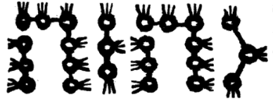

  
 And each and every point has three heads. And the three holy letters with their crowns amount to the number of the hidden name, which is Mah [45]; and with the last letter, all of them amount to the number of the honored name designated seventy-two." Thus far its words.

> פי' את השמים הם תפארת הנקרא שמים. ומלכות הנקראת את. כאשר נבאר בשער ערכי הכנוים בע"ה. ואין תימא על היות ו"ה בארץ י"ה בשמים, כי הכונה היא כי בשמים הוא שפע חכמה ובינה שהם י"ה והוא מקבל מהם ומשפיע בארץ שפעו ושפע המקבל הראוי לה והם ו"ה. וקרוב לענין זה בקבלת הגאונים בסוד כתיבת שם בן ד' וחקיקתו וז"ל הוראת הגאון לתלמידיו כי כתיבת כל אות ואות בצורת שלשה נקודות ומחלקו לשלש ראשים וחלק כל ראש וראש לשלשה נקודות עד אשר יעלה כל מספר הנקודות לכ"ד במספר כ"ד צוריות פנימיות למספר כ"ד ספרי הנבואה י"ב משפיעים וי"ב מושפעים י"ב נותנים י"ב מקבלים והם בסוד שבטי יה עדות לישראל וזה ציורו
>
> וכל נקודה ונקודה יש לה שלשה ראשים. ושלש אותיות הקדש בכתריהם עולה למס' השם הנסתר שהוא מ"ה ועם האות האחרון עולים כלם למס' השם הנכבד הנקוב ע"ב עכ"ל.

**20:1:14** Behold, from their words it is certainly implied that half of the Name receives effluence from its other half, in the manner of male and female. And the rest of their words will be explained from what we shall explain in the Gate of Particulars of Names, on the name of seventy-two, with the help of Heaven. And let us return to our subject: that the name written in the Torah is Tiferet, but not the self of the four-letter name mentioned in the preceding gate, chapter 4. For that name is vowelled with *cholam*, and the name of its garment is the four-letter name mentioned in the Torah, whose vowelling is *chashak*; and this name is a garment to it, just as the other names are garments to the four-letter name. And a proof of this is found in the Tikkunim (Tikkun 42, folio 79), and these are its words: "There is no sefirah in which there is not YHVH, יו"ד ה"א וא"ו ה"א. And so all must be gathered into it in every place, for all the names are titles of it." Thus far its words.

> הנה מתוך דבריהם משמע ודאי שחצי השם מקבל שפע מחציו כדרך זכר ונקבה. ושאר דבריהם יתבארו מתוך מה שנבאר בשער פרטי השמות בשם ע"ב בס"ד. ונחזור אל ענייננו כי שם הכתוב בתורה הוא הת"ת אך לא עצם השם בן ד' הנז' בשער הקודם בפ"ד. כי אותו השם נקוד בחולם ושם הלבוש שלו הוא שם בן ד' הנז' בתורה ונקודתו חש"ק והשם הזה לבוש אליו כמו ששאר השמות לבושים אל שם בן ד'. ונמצא ראיה לזה בתיקונים (תקונא מ"ב דף ע"ט) וז"ל לית ספירה דלא אית תמן יהו"ה יו"ד ה"א וא"ו ה"א. והכי צריך לאתכנשא כלא ביה בכל אתר, דכל שמהן אינון כנויין ליה עכ"ל.

**20:1:15** And the explanation: there is no sefirah in which there is not the four-letter name, and also in its filling, to hint at the general and the particular, as we explained in the preceding gate, chapter 4. And therefore the one who directs his intention is obliged to bring his intention, in all the words of the prayer, to the four-letter name, as we shall explain in the Gate of Intention, with the help of Heaven. And this he meant in saying "And so all must be gathered," etc.; and he gave a reason for the thing: for even the other names are titles of the four-letter name. And likewise the four-letter name that is in Tiferet is clothed in the four-letter name with the vowels *chashak*, and that is a title to it. And there is no wonder how it is possible for a four-letter name to be a title to a four-letter name when their letters are equal. The parable: just as we do not wonder at two human beings, equal in beauty and in strength and in splendor and in glory, that the one's wisdom is greater than his fellow's, for all is according to the drawing down of spirituality that his father drew upon him at the time of the coupling, more than his fellow; so the letters: upon this one more spirituality was obliged than upon its fellow, from the Master of the will, may He be blessed. And just as intention is needed to draw down the soul for the newborn at the time of the coupling, so the writer needs intention in the writing of the letters. And so our Rabbis, of blessed memory, said in tractate Gittin (folio 54) that any Torah scroll in which the mentions [of the Name] are not written for their own sake is worth nothing. And likewise our Rabbis, of blessed memory, said (in tractate Kallah, chapter 5): at the time that he writes the Name, even if the king greets him he should not answer him. And all this is so as not to cut the holy channels and the spirituality drawn by way of the writing of the letters; and all is according to the drawing down fitting for it. And all this will be explained in the Gate of Intention. And therefore it is already possible, and not far-fetched, that letters may be alike and equal, and these be holy and those not holy. And our Rabbis, of blessed memory, have already said (ibid.) that if he needed to write the Name and intended and wrote Yehudah, and did not put the Dalet in it, he erases it; and even though it would be fit to write the Name there, since the intention was to write Yehudah, it was not sanctified. And all the more so may we say that there are letters whose holiness exceeds letters like them; and all the more so when they are distinguished by their vowel points, for the vowel points of the inner name are *cholam*, and of the name of the garment *chashak*. And the explanation is that it corresponds to the three Patriarchs, Gedulah, Gevurah, Tiferet, which is an aspect in Tiferet, which includes the three Patriarchs in itself. And likewise the hint in its vowel points is "was, is, and will be," and this is "[the Lord] reigns, [the Lord] reigned, [the Lord] will reign," which are the three Patriarchs, as explained in the Tikkunim many times. And all this is in the four-letter name that is a palace to the inner one, as we explained.

> ופי' שאין ספירה שאין בה שם בן ד' וגם במילואו לרמוז אל הכלל ואל הפרט כמו שביארנו בשער הקודם בפ"ד. ולפיכך חוייב המכוין להביא כוונתו בכל מלות התפלה אל שם בן ד' כאשר נבאר בשער הכונה בס"ד. וזה רצה באמרו והכי צריך לאתכנשא וכו' ונתן טעם לדבר כי אפילו שאר השמות הם כנויים אל שם בן ד'. וכן שם בן ד' שבתפארת מתלבש בשם בן ד' בנקודת חש"ק והוא כנוי אליו. ואין תימה איך אפשר שיהיה שם בן ד' כנוי אל שם בן ד' בהיות אותיותיהם שוות. המשל כמו שלא נתמה על שני ב"א שווים בנוי ובכח ובהדר ובתפארת היות הא' חכמתו מרובה מחבירו, כי הכל לפי המשכת הרוחניות שהמשיך אביו עליו בעת הזווג יותר מחבירו. כן האותיות זה חוייב עליה רוחניות יותר מחברתה מאת בעל הרצון יתברך וכמו שצריך כונה להמשיך הנשמה להוולד בשעת הזווג, כן צריך הכותב כוונה בכתיבות האותיות. וכן ארז"ל במס' גיטין (דף נ"ד) שכל ס"ת שאין האזכרות שבו כתובין לשמן אינו שוה כלום. וכן אחז"ל (במס' כלה פ"ה) בשעה שכותב את השם אפי' המלך שואל בשלומו לא ישיבנו. וכל זה שלא לקצץ צנורות הקדושות והרוחניות הנמשך בדרך כתיבת האותיות. והכל לפי המשכה הראויה אליו. וכל זה יתבאר בשער הכונה. ולכן כבר אפשר ולא ירחק היות אותיות דומות שוות והיות אלו קדושות ואלו אינם קדושות. וכבר אחז"ל (שם) שאם היה צריך לכתוב את השם ונתכוון וכתב יהודא ולא נתן בו ד' מוחקו, ואף אם היה ראוי לכתוב שם השם כיון שהכוונה היתה לכתוב יהודא לא נתקדש. וכ"ש שנאמר שיהיו אותיות שקדושתן עולות על אותיות כהם, וכ"ש כשיתחלקו בנקודתן שנקודות שם הפנימי חולם ושם הלבוש חש"ק. והפירוש שהוא כנגד ג' אבות גדול"ה גבורה ת"ת, שהיא בחינה בת"ת שכולל ג' אבות בעצמו. וכן הרמז בנקדותיו היה הוה ויהיה והיינו מלך מלך ימלוך שהם הג' אבות כמבואר בתיקונים פעמים רבות. וכל זה בשם בן ד' שהוא היכל אל הפנימי כדפי'.

**20:1:16** And behold, there are found in the sefirot, besides the proper name that we explained, three further divisions, and they are: *havayot*, names, titles. And the *havayot* are the ten *havayot* mentioned in the Gate of the Four-Letter Name. And the first to reveal this is the author of Sefer ha-Orah, in his introduction, and these are his words: "Know that all His holy names mentioned in the Torah all depend on the four-letter name, which is YHVH, may He be blessed. And if you say: but is not the name Ehyeh the root and the source? Know that the four-letter name is like the trunk [*nof*] of the tree, and the name Ehyeh is the root of this tree, and from it roots take root and branches spread out to every side; and all the other holy names are like branches and twigs drawn from the trunk of the tree, and each one of the branches makes fruit after its kind." Thus far its words.

> והנה נמצא בספי' זולת שם העצם שפי', עוד ג' חלוקות והם הוויו"ת שמות כנויים. וההויות הם י' ההוויו"ת הנזכר בשער שם בן ד'. והמגלה הראשון אליו הוא בעל ספר האורה בהקדמתו וז"ל דע כי כל שמותיו הקדושים הנזכר בתורה כלם תלוים בשם בן ד' שהוא יהו"ה ית'. וא"ת והלא שם אהיה הוא העיקר והמקור. דע כי שם בן ד' אותיות הוא כדמיון נוף האילן, ושם אהיה הוא עיקר האילן הזה וממנו ישתרשו שרשים ויתפשטו ענפים לכל צד, ושאר כל השמות הקדש כולם כדמיון ענפים וסנסנים נמשכים מנוף האילן וכל אחד מהענפים עושה פרי למינהו עכ"ל.

**20:1:17** And the explanation of his words: all the names that may not be erased depend on the four-letter name, and from it they spread out, and from it they draw sustenance. And according to his words he raised a difficulty: why should they not depend on the name Ehyeh, which is in Keter, which is the root and the stock, as they depend on the four-letter name, which is not so [exalted], for it is in Tiferet? And on the basis of this question of his he gave a fine answer: that the name Ehyeh is the stock of the tree and its root, and the name YHVH is the trunk of the tree.

> ופי' דבריו כי כל שמות שאינם נמחקים הם תלוים בשם בן ד', וממנו מתפשטים וממנו יונקים. והקשה לפי דבריו כי למה לא יהיו תלוים בשם אהיה שהיא בכתר שהוא העיקר והשרש כמו שהם תלוים בשם בן ד' שאינו כ"כ שהוא בת"ת. ועל פי שאלתו זאת תירץ תירוץ נאה. כי שם אהיה הוא עיקר האילן ושרשו, ושם יהו"ה הוא נוף האילן.

**20:1:18** And behold, according to his words, the branches spread out from the trunk, not from the root, as is known: for Keter is the root, and because of its great concealment the branches do not spread out from it; and Tiferet is the trunk, from which the branches spread out; and likewise Tiferet is from the language of *porot*, branches; and likewise the six extremities branch out from it. And indeed his words are the words of the living God. But for us the difficulty still stands in its place, put in another way, and it is this: even according to his words, it does not prevent the name Ehyeh from being greater and more praised than the four-letter name, except that the branches do not branch out from it; and the four-letter name is in Tiferet, and although its praise is great, it is not like the name Ehyeh, which is the root of the tree. If so, why is the four-letter name, which is in Tiferet, not pronounced by its letters? (And may the Compassionate One save us from the opinion of those who say that Keter is a branch of Tiferet; for in our eyes this belongs only to those who lay hands on the very self of the Emanation, who overturn the bowl on its mouth and cut among the saplings, God forbid.) But when we recall what we set out in the Gate of the Four-Letter Name, at the beginning of chapter 1, the matter will be well settled for us. For in Keter too the four-letter name is concealed with the utmost concealment. And these names, although their holiness is great and they may not be erased, are nevertheless palaces to the *havayot*, as we explained. And because of the concealment of Keter, no name at all is revealed in it that bounds and defines its spirituality by its pronunciation, as do the four-letter name and the other names. But the pronunciation of the name Ehyeh indicates concealment, for its explanation is "behold, I stand ready to be [and to be revealed]." And the intent is that although we say "the sefirah Keter," it is not because there is any apprehension in it at all, but because it is to be revealed below, in Chokhmah and Binah. And so the Gaonim explained that the meaning of Keter is the language of waiting, from the language of (Job 36:2) "Wait [*katar*] for me a little, and I will show you." And the intent is: do not delve into it, for there is no apprehension in it, and its apprehension is in the other sefirot. If so, it turns out that its pronunciation is the cause of its exaltedness and its concealment, as we explained. But if the four-letter name were pronounced by its letters, it would show that the Emanation is apprehended, and this is not fitting because of its great concealment. And therefore we pronounce it by its palace; for the apprehension of Tiferet is in Malkhut, as in the matter of (Hab. 2:20) "And the Lord is in His holy palace; hush [*has*]," the number of *heikhal*, the number of Adonai [65] (see in Asis Rimmonim and in Pelach [ha-Rimmon]).

> והנה לפד"ז הענפים מתפשטים מן הנוף לא מן העיקר כנודע, כי הכתר הוא העיקר ומרוב העלמו אין הענפים מתפשטים ממנו והת"ת הוא הנוף אשר משם מתפשטים הענפים, וכן תפאר"ת מלשון פארות פי' ענפים. וכן השש קצוות מסתעפים ממנו. והן אמת דבריו דברי אלהים חיים. ולנו עדיין הקושיא במקומה עומדת שננקטה באופן אחר והוא זה שאפילו לפי דבריו לא יבצר היות שם אהי"ה גדול ומשובח משם בן ד' אלא שאין הענפים מסתעפים ממנו ושם בן ד' הוא בת"ת ואע"פ ששבחו גדול אך לא כשם אהי"ה שהוא עיקר האילן, וא"כ למה שם בן ד' שהוא בת"ת אינו נהגה באותיותיו. ורחמנא ליצלן מדעת האומרים שכתר ענף לת"ת, כי אין זה בעינינו כ"א מהנוגעים בעצם האצילות שהם מהפכין הקערה על פיה וקוצצין בנטיעות ח"ו. אבל כאשר נזכור מה שהקדמנו בשער שם בן ד' בריש פ"א יתיישב אלינו הדבר מאוד. כי גם בכתר שם בן ד' נעלם תכלית ההעלם. והשמות האלה עם היות קדושתן גדולה ואינם נמחקים, עכ"ז הם היכלות להויו"ת כדפי'. ומטעם העלם הכתר אינו מתגלה בו שם כלל המגביל ומגדיר רוחניותו בהגיונו כשם בן ד' ושאר השמות. אבל שם אהיה הגיונו מורה העלם שפירושו הא אנא קאים למהוי [ולהתגלות]. והכונה כי עם היות שנאמר ספירת כתר אינו מפני שיש בו השגה כלל אלא מפני שעתיד להתגלות למטה בחכמה ובבינה, וכן פירשו הגאונים כי פי' כתר לשון המתן, מלשון (איוב לו ב) כתר לי זעיר ואחוך. והכונה אל תעמיק בו שאין בו השגה, והשגתו הוא בשאר הספי'. וא"כ נמצא כי הגיונו הוא סבת רוממותו והעלמו כדפי'. אבל אם היה שם בן ד' נהגה באותיותיו היה מראה כי האצילות מושג, וזה אין ראוי לרוב העלמו. ולכן אנו הוגים אותו בהיכלו, כי השגת הת"ת הוא במלכות כעניין (חבקוק ב) וה' בהיכל קדשו ה"ס כמנין היכל כמנין אדנ"י (ע' בעסיס רמונים ובפלח).

**20:1:19** And this preliminary will be further explained in chapter 2, with the help of the Rock. And now that we have set out this matter concerning the essence of the names, we come to the explanation of each and every name by itself, with the help of Heaven:

> ועוד יתבאר הקדמה זו בפ"ב בעזרת הצור. ואחר שהקדמנו הענין הזה במהות השמות, נבא עתה בביאור כל שם ושם בפ"ע בע"ה:

### Chapter 20:2. Explanation of the name Ehyeh in Keter; and there, a passage from the Zohar, Parashat Acharei Mot, "Said... if it pleases my Father."

**20:2:1** On the name Ehyeh. This name they related to the sefirah Keter. And Rabbi Moshe [de León] explained its meaning in Sefer ha-Shem, and these are his words: "The word Ehyeh indicates head and end. The Alef indicates His precedence, and there is no Alef without the concealed Heh; and Yod-Heh indicates the wisdom of Solomon. Further he said [that the principal of the Name] is Alef-Heh, and it is concealed; and therefore it is not mentioned in any blessing, for Moses did not reveal it to the elders." Thus far its words (see in Pelach [ha-Rimmon]).

> בשם אהי"ה. השם הזה יחסו אותו לספירת הכתר. וביאר פירושו רבי משה בספר השם, וז"ל מלת אהיה מורה על ראש וסוף. האל"ף מורה על קדמותו, ואין א' בלא ה' הנעלם, וי"ה מורה על חכמת שלמה. עוד אמר [שעיקר השם) הוא א"ה והוא נעלם, ולכן אין מזכירין אותו בשום ברכה כי לא גילהו משה לזקנים. עכ"ל (ע' בפלח).

**20:2:2** And behold, his words are clear: that the name Ehyeh indicates "I am the first and I am the last" (Isa. 44:6); for the Alef, in the Supernal Keter, indicates His precedence and His being first to the Emanation. And the first Heh is concealed in the Alef, for there is no pronouncing of Alef without Heh. But Yod-Heh indicates Malkhut, for she is last of all the sefirot and she is the end of the Emanation.

> והנה דבריו מבוארים כי שם אהי"ה מורה אני ראשון ואני אחרון, כי א' בכ"ע מורה על קדמותו והיותו ראשון לאצילות. וה' ראשונה הוא נעלם באל"ף, כי אין הזכרות אל"ף בלא ה', אמנם י"ה מורה על המלכות כי היא אחרונה לכל הספי' והיא תכלית האצילות.

**20:2:3** And behold, the principal of the Name, which indicates Keter, is Alef-Heh, and it is concealed, etc. Further, the one who speaks by the mouth of a *maggid* wrote that its four letters correspond to the four letters of the four-letter name. For the Alef corresponds to Yod. How so? The thorn of the Yod of the Alef is in Keter, indicating its subtlety and its concealment; and the body of the Yod indicates its own self and the pure thought that spreads out; and the middle Vav of the Alef indicates the spreading of the channels from Chokhmah to Binah; and the lower Yod of the Alef is the manifestation of Binah cleaving to Chokhmah. And the Heh hints at Binah in her place, for it is open below, to bestow upon the rest of the Emanation beneath her, and it is open above with a subtle opening, to receive from Keter, and wide below, to bestow upon the whole spreading out. And the Yod in the middle corresponds to the Vav in the four-letter name; and behold, it is the beginning of the four-letter name that is in Tiferet, as is known. And the last Heh corresponds to Malkhut, for it is open below to bestow and open above to receive the upper subtlety, and wide below as well, to receive all the prayers and to raise them up by the subtle side, in subtlety. Thus far the words of the *maggid*, and we have abridged his language. And concerning this name we have found in the Zohar, parashat Acharei (folio 65a), and these are its words: "He said to him: If it pleases my Father, behold, I have heard concerning what is written, 'I will be that which I will be' (Ex. 3:14), and I have not grasped it. He said to him: Elazar my son, the companions have already established it; and now all is bound up in one word. And the secret of the thing is thus: Ehyeh: this is the inclusion of all. For when the tracks are enclosed and not separated, and are included in one place, then it is called Ehyeh, an inclusion, for all is enclosed within it and not revealed. After the beginning has gone out from it, and that river has become pregnant to draw all forth, then it is called *asher ehyeh*, that is to say, 'therefore I will be': Ehyeh is ready to draw forth and to beget all. Ehyeh, that is to say: now I am the inclusion of all, the inclusion of all the particulars. *Asher ehyeh*: that the Mother has conceived and is ready to bring forth all the particulars and to reveal the supernal Name. Afterwards Moses wished to know the particular of the matter, what it is, until he explicated and said Ehyeh: this is the particular, and here it is not written *asher ehyeh*. And we have found in the book of King Solomon: *asher*: in the binding of bliss, with the supernal palace, companionship is found; as it is said, 'Happy am I [*be-oshri*], for the daughters will call me happy [*ishruni*]' (Gen. 30:13). Ehyeh: that she is ready to beget. Come and see how it descends from grade to grade, etc., so that the Holy One, blessed be He, might show Moses the knot of faith. At first, Ehyeh, the inclusion of all, enclosed and not revealed at all, as I have said; and your sign is 'And I was [*va-ehyeh*] beside Him as a nursling [*amon*]' (Prov. 8:30), and it is written, 'Man does not know its value' (Job 28:13). Afterwards He brought forth, etc., and that river, which is the supernal Mother, conceived and is ready to beget. And He said *asher ehyeh*: ready to beget and to set all right. Afterwards it began to beget, and it is not written *asher*, but Ehyeh, that is to say: now all will go forth and be set right. After all went forth and each and every one was set right in its place, He left all and said YHVH: this is the particular, and this is the sustaining. And at that hour Moses knew the secret of the holy Name, enclosed and revealed, and cleaved to it as other human beings did not cleave. Happy is his portion. Rabbi Elazar came and kissed his hands." Thus far its words.

> והנה עיקר השם שמורה על הכתר הוא א"ה והוא נעלם וכו'. עוד כתב המדבר על פי מגיד כי ד' אותיותיו הם נגד ד' אותיות של שם בן ד'. כי הא' נגד י'. כיצד, קוצו של יו"ד של האל"ף הוא בכתר מורה על דקותו והעלמו, וגוף היו"ד מורה על עצמותו והמחשבה הטהורה המתפשטות. והוא"ו האמצעי של הא' מורה על ההפשטות הצנורות מחכמה אל הבינה. והיו"ד התחתונה של האל"ף הוא מציאות הבינה המתדבק בחכמה. והה' רומזת בבינה במקומה, כי היא פתוחה מלמטה להשפיע אל שאר האצילות אשר תחתיה והיא פתוחה מלמעלה פתיחה דקה לקבל מהכתר ורחבה מלמטה להשפיע להתפשטות כלו. והיו"ד באמצע נגד הוא"ו בשם בן ד', והנה היא התחלת שם בן ד' אשר בתפארת כנודע. והה' אחרונה נגד המלכות כי היא פתוחה מלמטה להשפיע ופתוחה מלמעלה לקבל הדקות העליון ורחבה למטה ג"כ לקבל התפלות כלם ולהעלות בצד הדק למעלה בדקות. ע"כ דברי המגיד וקצרנו לשונו. ובשם זה מצאנו בס' הזוהר פ' אחרי (דף ס"ה.) וז"ל א"ל, אי ניחא קמיה דאבא הא שמענא בהאי דכתיב אהיה אשר אהיה ולא קאימנא ביה. א"ל אלעזר ברי הא אוקמוה חברייא, והשתא בחד מלה אתקשר כלא. ורזא דמלה הכי הוא. אהיה דא כללא דכלא. דכד שבילין סתימין ולא מתפרשן וכלילן בחד אתר, כדין אקרי אהי"ה כללא, דכלא סתים בגוויה ולא אתגלייא. בתר דנפיק מיניה שירותא וההוא נהר אתעבר לאמשכא כלא, כדין אקרי אשר אהיה, כלומר על כן אהיה, אהיה זמין לאמשכא ולאולדא כלא. אהיה, כלומר השתא אנא הוא כלל כלא כללא דכל פרטיא. אשר אהיה, דאתעברת אימא וזמינא לאפקא פרטין כלהו ולאתגלייא שמא עילאה. לבתר בעא משה למנדע פרטא דמלה מאן הוא, עד דפריש ואמר אהיה דא הוא פרטא והכא לא כתיב אשר אהיה. ואשכחנא בספרא דשלמה מלכא, אשר בקיטורא דעדונא קסטירא עילאה חברותא אשתכח כד"א באשרי כי אשרוני בנות, אהיה דזמינא לאולדא. ת"ח היך נחית מדרגא לדרגא כו' לאחזאה קב"ה למשה קשרא דמהימנותא. בקדמיתא אהיה כללא דכלא סתים ולא אתגלייא כלל כמה דאמינא, וסימנך ואהיה אצלו אמון וגו' וכתיב לא ידע אנוש ערכה וגו' לבתר אפיק וכו' וההוא נהרא דאיהו אימא עלאה אתעברת וזמינא לאולדא. ואמר אשר אהיה, זמינא לאולדא ולתקנא כלא. לבתר שארי לאולדא ולא כתיב אשר, אלא אהיה, כלומר השתא יפוק ויתתקן כלא. בתר דנפיק כלא ואתתקן כל חד וחד באתריה, שבק כלא ואמר יהו"ה. דא פרטא ודא קיומא. ובההיא שעתא ידע משה רזא דשמא קדישא סתים וגלייא ואתדבק ביה במה דלא אתדבקו שאר בני עלמא. זכאה חולקיה. אתא רבי אלעזר ונשיק ידוי עכ"ל.

**20:2:4** And the explanation: Rabbi Elazar heard the words of the delightful companions explaining the name Ehyeh asher ehyeh as being in Keter, Chokhmah, Binah: explanation: the first Ehyeh in Keter, *asher* in Chokhmah, Ehyeh in Binah. And it was not settled with him; for it is forced to say that the name Ehyeh should be equally for Binah and for Keter, and besides this, that the word *asher* should be in Chokhmah. And therefore he asked his father and said, "I have not grasped it": explanation: that it was not settled with him. And his father, Rashbi, peace be upon him, answered him, "all is bound up in one word." And the explanation: do not wonder that the name Ehyeh is related also to Binah, for all is one matter and one way, as will be explained. "Ehyeh: this is the inclusion of all": explanation: at the beginning of the Emanation, before the spreading out of the sefirot, the Emanation was included in Keter, and there, in the manifestation of Keter, Chokhmah and Binah were revealed, that is, "a point that includes three drops," as explained in the Zohar and as we explained in the Gate of the Order of the Emanation. And when we said that the first three were revealed, the intent is not an essential revealing; but the intent is some revealing, explanation: they came into being there in a concealed manifestation.

> ופי' כי ר"א שמע דברי החברים הנחמדים בפי' שם אהיה אשר אהיה היותו בכתר חכמה בינה. פי' אהיה הראשון בכתר, אש"ר בחכמה, אהיה בבינה. ולא היה מתישב אצלו. שדוחק הוא לומר ששם אהיה יהיה שוה לבינה ולכתר. ובזולת זה מלת אש"ר היותו בחכמה. ולזה שאל את אביו ואמר לא קאימנא ביה פי' שלא היה מתישב אצלו. והשיבו אביו הרשב"י ע"ה בחד מלה אתקשר כלא. ופי' אל תתמה היות שם אהיה מתייחס גם בבינה כי הכל ענין א' ודרך א' כמו שיתבאר. אהיה דא כללא דכלא. פי' בתחלת האצילות קודם ההתפשטות הספי' היה האצי' נכלל בכתר ושם במציאות הכתר מתגלים החכמה והבינה דהיינו נקודה דכליל ג' טיפין כמבואר בזוהר ובארנו בשער סדר האצילות. ואמנם אמרנו שהיו הג' ראשונות מתגלות, אין הכונה גילוי עצמי. אבל הכוונה קצת גילוי, פי' נתהוו שם במציאות נעלם.

**20:2:5** And behold, while Keter is included in this inclusion it is called the first Ehyeh in the verse. And this is what he said, "Ehyeh: this is the inclusion of all": explanation: the inclusion of the Emanation before the spreading out, in the concealment of the first three, somewhat revealed, in a complete union. And this is what he said, "for when the tracks are enclosed": for this is the concealment of Chokhmah in Keter, and there the paths [*netivot*] are concealed. And he called them tracks [*shevilin*] because tracks are narrower and subtler than paths; and while they are in Keter, not only were they not in the category of paths, but only of tracks, but even as tracks they were concealed and enclosed. "And not separated": it is known that the paths are called "wonders [*pel'ot*] of wisdom." And one of the explanations of the word *pel'ot* is from the language of (Deut. 17:8) "If a matter be too hard [*yipale*]," whose sense is distinction and separation; and the reason is that the paths are distinct, each one from its fellow, and are divided into thirty-two in Chokhmah. And therefore he said that because Chokhmah is concealed in Keter, the paths were not distinct from one another; and this is "and not separated." And it has already been explained that the revealing of the paths that are in Chokhmah is through Binah; and because of the concealment of Binah in Keter, since she had not yet been emanated, therefore they did not spread out into Binah, but were included in one place, that is, in the Chokhmah within Keter; and this is what he said, "and are included in one place." And it is possible to explain "and not separated" [*itparshan*] from the language of explanation [*perush*]: and the intent is that they were not explained, that is, by their spreading out into Binah; for Binah is the explanation and elucidation of Chokhmah, as is known. And all this inclusion, which is the inclusion of the entire Emanation while it is included in Keter, is called by the name Ehyeh. And the name Ehyeh, according to this, is in Keter, inasmuch as it hints at the whole Emanation included within it before its spreading out hither and thither; and this is what he said, "then it is called Ehyeh, an inclusion, for all is enclosed within it and not revealed." Explanation: "then it is called Ehyeh," that is to say, Keter, which is an inclusion, as we explained, for in it the whole Emanation is included; and this inclusion, "all is enclosed and not revealed": explanation: enclosed and concealed in relation to Keter, which is always enclosed, even after the Emanation; and in relation to the rest of the Emanation concealed in it they said "and not revealed," explanation: its manifestation was not revealed at all. "After the beginning has gone out from it": explanation: after the emanation of Chokhmah and its spreading out; and Chokhmah is called "beginning" [*shiruta*], as we explained in Gate 3, chapter 7, with the help of Heaven. "And that river became pregnant": explanation: Binah, which is called river. And behold, after the emanation of Chokhmah, Binah; and Binah is pregnant with all the sefirot of the circuit within her, for in her was the order of the Emanation: for Keter emanated Chokhmah, and within her all the eight remaining sefirot; and Chokhmah emanated Binah, and within her all the seven remaining sefirot, as we explained in the Gate of the Order of the Emanation. And the seven sefirot within Binah are called her pregnancy; and now her emanation and her pregnancy are all one. And therefore he said, "And that river became pregnant to draw forth": explanation: she was filled with the sefirot, to emanate them and draw them to their place. And he called Binah "river" to indicate the will to draw forth, as we explained. "Then it is called *asher ehyeh*": it is known that the pregnancy of Binah and her filling are through Chokhmah; and Chokhmah and Binah are included in *asher ehyeh*, as he goes on to explain. "That is to say, therefore," etc.: it was difficult for him that, according to his words, the first Ehyeh indicates inclusion and concealment, as we explained, and the second Ehyeh indicates revealing and drawing forth; and how is it possible that equal words should indicate opposite matters? To this he came to settle each and every word according to its matter and its measure. And this is what he said, "that is to say, therefore, Ehyeh": explanation: the first Ehyeh, "therefore Ehyeh": explanation: "Ehyeh is ready to draw forth and to beget all." The intent is that the first Ehyeh is to be explained as the first person of the future: I will reveal and draw forth the matter in the Emanation, but I do not yet begin to be drawn forth. And although the word Ehyeh indicates future being, the intent is not that it is destined to be revealed; rather the intent of the word is to indicate to us that it is full of, and includes, the whole Emanation that is destined to be revealed. And this is why it is impossible to say this matter except by the word Ehyeh, which indicates: I am included with the whole Emanation that is destined to be revealed. And the intent is not that it is literally destined to be revealed; but the intent is: I am full of the whole Emanation that is destined [to be revealed]; and this is the word Ehyeh. And this is why he went on to say: "Ehyeh, that is to say: now I am the inclusion of all, the inclusion of all the particulars": explanation: the inclusion of the whole Emanation, which is the particulars of the sefirot.

> והנה בהיות הכתר נכלל בכללות הזה נקרא אהי' הראשון שבפסוק. וז"ש אהיה דא כללא דכלא, פי' כללות האצילות קודם ההתפשטות בהעלם ג' ראשונות ומתגלות קצת ביחוד גמור. וזהו אמרו דכד שבילין סתימין. שזהו העלם החכמה בכתר ושם הנתיבות הם נעלמות, וקראם שבילין לפי ששבילין הם צרים ודקים מן הנתיבות ובהיותם בכתר לא די שלא היו בכלל נתיבות אלא שבילין ואפי' בהיותם שבילים היו נעלמים וסתומים. ולא מתפרשן נודע כי הנתיבות הם נקראים פליאות חכמה. ואחד מן הפירושים שבמלת פליאות הוא מלשון (דברים יז ח) כי יפלא שענינו הבדלה והפרשה. והטעם שהנתיבות הם נבדלות כל אחת מחברתה ומתחלקים אל ל"ב בחכמה. ולפיכך אמר כי לפי שהחכמה נעלמת בכתר הנתיבות לא היו נבדלות א' מחבירו, וזהו ולא מתפרשן. וכבר נתבאר כי גלוי הנתיבות שבחכמה הוא ע"י הבינה ומפני העלם הבינה בכתר שעדין לא נאצלה לפיכך לא היו מתפשטים אל הבינה אבל היו כלולים במקום א' דהיינו בחכמה שבתוך הכתר, וז"ש וכלילן בחד אתר. ואפשר לפרש ולא אתפרשן, מלשון פי'. והכוונה שלא היו מתבארים, דהיינו התפשטותם אל הבינה כי הבינה היא פירוש וביאור אל החכמה כנודע. וכל הכללות הזה שהיא כללות האצילות כלו בהיותו נכלל בכתר נקרא בשם אהי"ה. ושם אהיה לפ"ז הוא בכתר בהיותו רומז אל האצי' כלו נכלל בתוכו קודם התפשטותו אנה ואנה, וז"ש כדין אקרי אהיה כללא, דכלא סתים בגוויה ולא אתגלייא. פי' כדין איקרי אהיה ר"ל הכתר שהוא כלל כדפי' שבו נכלל כל האצילות והכלל הזה כלא סתים ולא אתגלייא. פי' סתים ונעלם בערך הכתר שלעולם הוא סתום אפי' אחר האצילות. ובערך שאר האצילות הנעלם בו אמרו ולא אתגלייא, פי' לא נתגלה מציאותה כלל. בתר דנפק מיניה שירותא פי' אחר אצילות החכמה והתפשטותה. והחכמה נקרא שירותא כדפי' בשער ג' פ"ז בס"ד. וההוא נהר אתעבר פי' הבינה הנקרא נהר. והרי אחר אצילות החכמה, הבינה. והבינה מעוברת בכל הספי' של ההקף בתוכה כי בה היה הסדר האצילות. כי הכתר האציל החכמה ובתוכה כל ח' ספירות הנשארות, והחכמה האציל הבינה ובתוכה כל ז' ספירות הנשארות כדפי' בשער סדר האצילות. וז' ספי' שבתוך הבינה נקראים עיבורה ועתה אצילות' ועיבורה הכל א'. ולפיכך אמר וההוא נהר אתעבר לאמשכא. פירוש נתמלא מהספירות להאצילם ולהמשיכם אל מקומם. וקרא לבינה נהר להורות על רצון ההמשכה כדפי'. כדין אקרי אשר אהי"ה. נודע כי עיבור הבינה ומילואה הוא ע"י החכמה והחכמה והבינה נכללים באש"ר אהי"ה כדמפרש ואזיל. כלומר על כן וכו' הוקשה לו כי לפי דבריו אהי"ה הראשון מורה על כללות והעלם כדפי', ואהיה השני מורה גלוי והמשכה, ואיך אפשר שתיבות שוות יורו עניינים הפכיים. לזה בא ליישב כל תיבה ותיבה לפי ענינה ומתכונתה. וז"ש כלומר ע"כ אהי"ה. פי' אהי"ה הא' ע"כ אהי"ה פי' אהיה זמין לאמשכא ולאולדא כלא. הכונה כי פי' אהי"ה הא' כמו אפעל. והכונה אני אגלה ואמשיך הענין באצילות אבל עדין איני מתחיל לימשך. ואע"פ שמלת אהיה מורה על ההויה העתידה אין הכונה שהוא מעותד להגלות, אמנם כוונת המלה להורות לנו כי הוא מלא ומוכלל בכל האצי' המעותד להגלות. וזהו שא"א לומר הענין הזה אם לא בתיבת אהיה המורה אני נכלל בכל האצילות המעותד להגלות. ואין הכונה שהוא מעותד להגלות ממש אמנם הכונה אני מלא בכל האצילות העתיד [להתגלות] וזהו תיבת אהיה. וזהו שחזר ואמר אהי"ה כלומר השתא אנא הוא כלל כלא כללא דכל פרטא. פי' כלל כל האצילות שהוא פרטי הספירות.

**20:2:6** And behold, he intended two things in his language by "that is to say." The one is the explanation of the word, whose intent is to say that it is destined to be revealed; and this is what he said, "Ehyeh is ready to draw forth and to beget all." And because the intent is not that it wishes to draw it forth, but the intent of this word is to tell us that in it is included the Emanation destined to be revealed, and there is no word that would include this except this word, this is what he said: "now I am the inclusion of all, the inclusion of all the particulars": explanation: the intent is only to make known that it is the inclusion of the Emanation that is destined to be revealed through Binah, not through it. But *asher ehyeh* is the spreading out of Chokhmah and Binah to emanate; and the explanation of "that the Mother has conceived and is ready to bring forth all the particulars and to reveal the supernal Name": explanation: *asher* is a language of preparing and readying, and so our Rabbis, of blessed memory, explained. And the intent is that the upper Ehyeh was readied and prepared to be revealed; and this is what he said, "and is ready to bring forth all the particulars," that is, the particularity of the sefirot, the world of the circuit, which are revealed through Binah, as is known; "and to reveal the supernal Name": explanation: the concealed Ehyeh. And this is *asher ehyeh*: explanation: the concealed Ehyeh, ready to be revealed.

> והנה כיון בלשונו שני פעמים, כלומר האחד ביאור המלה שכונתו לומר שהוא עתיד להגלות, וז"ש אהיה זמין לאמשכא ולאולדא כלא. ולפי שאין הכונה שרוצה הוא להמשיכו אלא הכונה בתיבה זו לומר לנו שבו נכלל האצילות העתיד להתגלות ואין מלה שתכלול זה אלא תיבה זו, וז"ש השתא אנא הוא כלל כולא כללא דכל פרטא, פי' אין הכונה אלא להודיעו שהוא כללות האצילות העתיד להגלות ע"י הבינה לא על ידו. אמנם אש"ר אהי"ה שהוא התפשטות החכמה והבינה להאציל, ופי' דאתעברת אימא וזמינא לאפקא פרטין כלהו לאתגליא שמא עילאה. פי' אשר הוא לשון הכנה והזמנה, וכ"פ רז"ל. והכונה הוא שאהיה העליון נזדמן והוכן להתגלות, וז"ש וזמינא לאפקא פרטין כלהו דהיינו פרטות הספירות עולם ההיקף המתגלים ע"י הבינה כנודע. ולאתגליא שמא עילאה פירוש אהיה הנעלם. וזהו אשר אהיה, פי' אהיה הנעלם מזומן להגלות.

**20:2:7** And behold, *asher ehyeh* is Chokhmah and Binah, for both of them are included in the word *asher*, as we shall explain, with the help of the Name. "Afterwards Moses wished," etc.: explanation: he wished to know the Emanation itself, in its place below, in the place of its particularity; and Ehyeh was said to him a third time, indicating the Emanation in its place. And this is what he said, "the particular of the matter, what it is": explanation: the Emanation itself; and Ehyeh was said to him a third time; and this is "until he explicated and said Ehyeh." And because it was difficult for him that Ehyeh is not the particular but, on the contrary, is the inclusion of the Emanation, as we explained above, therefore he answered and said: since *asher ehyeh* is not said here (for it would have been fit to say "Ehyeh asher ehyeh has sent me," and he says only "Ehyeh"), learn from this that he said a new word; and this is the spreading out of the Emanation and its particularity. For if you do not say so, he should have said "Ehyeh asher ehyeh has sent me to you"; rather, learn from this, as we have said. "And we have found in the book of King Solomon," etc.: he brought a proof for the explanation of *asher ehyeh*, that is, Chokhmah and Binah, from Solomon, who explained the words in the Aramaic language. And *kitura*, explanation: knot and union; and *kastira*, explanation: palace; and so is its translation in the Jerusalem [Targum] (Gen. 25:16), "These are the sons of Ishmael… by their courts and by their encampments [*u-ve-tirotam*]": *u-ve-kastrotehon*. And now he came to explain the word *asher*, and said, "in the binding of bliss": explanation: in the union and binding of Eden, which is Chokhmah, with Binah, which is the supernal palace, that is, the supernal *kastira*; "companionship," explanation: complete union, "is found." It turns out that the word *asher*, and its matter, is that the aspect that Chokhmah has, to bestow upon Binah, is called *asher*; and Binah too is called *asher* in her first aspect, which cleaves to Chokhmah. And this is what Leah, who is Binah, said: "Happy am I [*be-oshri*], for the daughters will call me happy [*ishruni*]": explanation: the effluence bestowed upon her from Chokhmah, by which she is made happy among the daughters, that is to say, among the other sefirot. And Ehyeh is an aspect of Binah that is destined to be revealed and to beget the sefirot. "Come and see how it descends from grade to grade," etc.: he now comes to prove the matter of Ehyeh: that although they are three equal names, they indicate different matters. And he proved this from the verses: for the Name, may He be blessed, intended to make known to Moses our teacher, peace be upon him, to understand and to contemplate the order of the Emanation, grade after grade; and therefore it is proven that the three Ehyehs are not equal, but each one is a grade below its fellow. "At first, Ehyeh," etc.: explanation: the first Ehyeh, its intent is Keter; and the reason is that it is the inclusion of all, as we explained above. "And your sign: 'And I was [*va-ehyeh*] beside Him as a nursling [*amon*]'": explanation: Ehyeh is beside Him, that is to say, beside Keter; there all is nursed, and grows, and is blessed, and is watered, and is raised up. "And likewise it is written, 'Man does not know its value'": explanation: there is none who knows the value of Chokhmah, and it is not apprehended even "in the land of the living" (Job 28:13), which is Binah; and the reason is that the emanation of Binah had not yet been, for all was included in the concealed Keter, as we explained above. "Afterwards He brought forth," etc.: explanation: after the emanation [of Chokhmah], Chokhmah emanated Binah; and this is the explanation of "afterwards." "He brought forth that river, which is the supernal Mother," etc.: he called her river and mother. He was compelled to say river to hint at the drawing that is drawn forth like a river; and he called her mother to hint that she is full and pregnant, like a mother who is pregnant and full of embryos. "And He said *asher ehyeh*: ready to beget," etc.: as we explained *asher*. The intent is that she is ready to beget the concealed Emanation, and this is Ehyeh. And we have already found that the prefixes Alef-Yod-Tav-Nun serve for the infinitive and the imperative; and likewise Ehyeh, although these prefixes are future, serves as an infinitive, which is the beginning of the beings, which are not yet completed. And this is "afterwards it began to beget": explanation: the beginning of the revealing, before the revealing is entire, is also called Ehyeh. And because this is very forced, for the principal explanation of Ehyeh is "ready to beget," as we explained above, for this he proved the matter from his saying Ehyeh, and not saying Ehyeh asher ehyeh. And what he said, "that is to say: now all will go forth," etc.: explanation: a partial revealing, as one who says of the part: now the matter will be completed entirely. And this is what he said, "and all will be set right": explanation: will be set right entirely; for it had already begun to go forth and was not yet completed, and therefore was not set right; and at its completion all will be set right, the inner as well. And the explanation of "will go forth": that is to say, something of the concealed will go forth. "After all went forth and each and every one was set right in its place": that is to say, while the Emanation and the order of the grades was not yet completed, it was included in the name Ehyeh; and after the *tikkun* of all the grades was completed, then it was included in the four-letter name. And this is what he said: "After all went forth and each and every one was set right in its place, He left all": explanation: He left the names Ehyeh and said YHVH. And therefore the name Ehyeh is no longer mentioned in the Torah, for it indicates a lack of completion and of *tikkun* and of the emanation of the grades; and therefore it is not fitting that the name Ehyeh be mentioned any more, but only the four-letter name; for the name Ehyeh was mentioned in the Torah only to teach the order of the grades and the order of their emanation. But afterward He said (Ex. 3:16), "Go and gather the elders of Israel and say to them: Thus says YHVH"; for it is not fitting that any but the four-letter name be mentioned, which indicates the bond of the worlds and their emanation from above to below, from beginning to end, as we explained in the preceding gate, in the explanation of the four-letter name, which includes all the grades in its four letters. And although the name Ehyeh indicates ten sefirot, as we explained above, nevertheless this is only while they are included above, before their emanation, as we explained; and the four-letter name indicates the spreading out of the branches and the twigs, as is proven. And therefore the name Ehyeh relates to Keter, not to show the revealing of something but to indicate the concealment; and the four-letter name does not relate to it, because it indicates the spreading out of the branches and the twigs. And therefore the four-letter name is not pronounced: because its pronunciation indicates revealing, and whoever does so outside the King's palace, "that soul shall utterly be cut off" (Num. 15:31). But the name Ehyeh, on the contrary, indicates concealment by its pronunciation. And we have already expounded this matter at length in the preceding chapter. And he said, "YHVH: this is the particular," etc., as we explained. "Moses knew the secret of the holy Name, enclosed and revealed": explanation: before the Emanation, when it was concealed, and also after the Emanation, after the revealing; and he apprehended the concealed and the revealed grades, which no one born of woman apprehended. Thus far the explanation of the passage. And from it the explanation of the name Ehyeh has been explained to us, each one according to its place and its matter. And although it emerges from this passage, and from the rest of the words of the commentators, that the name Ehyeh is in Keter, and so we explained above, in the preceding gate, that the four-letter name is concealed in it, this is according to the words of Rashbi, peace be upon him, in the Idra of Naso. But at the time of his passing he agreed that there is no name at all in Keter, and the four-letter name is from Chokhmah downward. And in the Tikkunim he explained the matter and said that no name can properly be said of Keter; but it is called by the four-letter name from the side of Chokhmah, and by the name Ehyeh from the side of Binah. And the thing itself is explained from his words: for Chokhmah has a manifestation above, in Keter, and likewise Binah; and this is the revealed part of Keter, not Keter itself; and therefore, if a name is titled to it, it is what is revealed of it. And the reason that Chokhmah is in the name YHVH, which is the particular, and Binah in the name Ehyeh, which is the inclusion, whereas it would have been fitting to be the reverse: that matter is explained by what he explained in the Idra, that Chokhmah is the brain and Binah the membrane that covers the brain. It turns out that Binah conceals and hides Chokhmah; and therefore Chokhmah is in revealing and Binah in concealment (that is to say, in the name Ehyeh, which conceals the light of Chokhmah; see Asis Rimmonim). And along the way we have gained that two names Ehyeh are in Binah, except that this one is her manifestation in Keter and that one is her manifestation in Binah itself; and the third name is her manifestation after the beginning of the Emanation. And we know that the inquirer will not be able to grasp our words in truth except from what we explained in the book Or Yakar, in Gate 5, on the Idra, in the matter of brain and membrane:

> והנה אשר אהיה הוא חכמה ובינה כי שתיהם נכללות במלת אשר כמו שנבאר ב"ה. לבתר בעא משה וכו'. פי' רצה לדעת האצילות בעצמו במקומו למטה במקום פרטיותו, ונאמר לו אהיה פעם ג' המורה על האצילות במקומו. וזהו שאמר פרטא דמלה מאן הוא. פי' האצילות בעצמו, ונאמר לו אהיה פעם ג', וזהו עד דפריש ואמר אהיה. ומשום דקשיא ליה דאהיה לאו איהו פרטא אלא אדרבה הוא כללות האצילות כדפי' לעיל. לכן השיב ואמר כי כיון שלא נאמר כאן אשר אהיה דהוה חזי למימר אהיה אשר אהיה שלחני ולא קאמר אלא אהיה ש"מ מלה חדתא אמר. והיינו התפשטות האצילות ופרטיותו, דאי לא תימא הכי לבעי ליה למימר אהיה אשר אהיה שלחני אליכם אלא ש"מ כדאמרן. ואשכחנא בספרא דשלמה מלכא וכו'. הביא ראיה לפי' אש"ר אהי"ה דהיינו חכמה ובינה, משלמה שפירש המלות בלשון ארמי. וקיטורא, פי' קשר ויחוד. וקסטירא, פי' היכל, וכן תרגומו בירושלמי (בראשית כה טו) אלה הם בני ישמעאל וגו' בחצריהם ובטירותם, ובקסטרותהון. ועתה בא לבאר תיבת אשר, ואמר בקשורא דעדונא, פי' ביחוד וקשר העדן שהוא החכמה עם הבינה שהיא ההיכל העליון דהיינו קסטירא עילאה. חברותא, פי' יחוד גמור אשתכח. נמצא תיבת אשר ועניינו הוא שהבחינה אשר לחכמה להשפיע לבינה נקרא אשר. והבינה ג"כ נקרא אשר בבחינתה הראשונה המתדבקת בחכמה. וזה שאמרה לאה שהיא הבינה באשרי כי אשרוני בנות פי' השפע הנשפע אליה מהחכמה שבה היא מתאשרת בין הבנות ר"ל בין שאר הספירות. ואהיה היא בחינה של בינה העתידה להתגלות וללדת הספירות. ת"ח היך נחית מדרגא לדרגא וכו'. בא עתה להכריח ענין אהיה כי עם היות שהם שלשה שמות שוות יורו על עניינים מחולפים. וזה הכריח מהפסוקים שכיון השם ית' להודיע למרע"ה להבין ולהסתכל בסדר האצילות מדרגה אחר מדרגה ולכן מוכרח שאין ג' אהי"ה שוים אלא כל אחד מדרגה למטה מחבירו. בקדמיתא אהי"ה וכו' פי' אהי"ה הראשון כונתו בכתר, והטעם שהוא כלל הכל כמו שפי' למעלה. וסימן ואהי"ה אצלו אמון וכו'. פי' אהי"ה הוא אצלו כלומר אצל הכתר, שם הכל אמון ומתגדל ומתברך ומתרווה ומתעלה. וכן כתיב לא ידע אנוש ערכה. פי' אין מי שידע ערך החכמה ואינה מושגת אפילו בארץ החיים שהיא הבינה, והטעם מפני שעדין לא היה אצילות הבינה כי הכל היה כלול בכתר הנעלם כדפי' לעיל. לבתר אפיק כו' פי' לאחר אצילות. החכמה האציל הבינה, והיינו פי' לבתר. אפיק ההוא נהרא דאיהי אימא עילאה כו' קראה נהר ואם. הוכרח לומר נהר לרמוז אל ההמשכה הנמשכת כנהר, וקרא אם לרמוז שהיא מליאה ומתעברת כאם המתעברת ומלאה בעוברין. ואמר אשר אהי"ה זמינא לאולדא כו' כדפי' אשר. הכונה שמזומנת להוליד האצילות הנעלם והיינו אהי"ה. וכבר נמצא האית"ן משמשת פעולת המקור והצווי. וכן אהי"ה עם היות אית"ן עתיד משמש במקור שהוא תחלת ההויות ועדיין לא נשלמו. וזהו לבתר שארי לאולדא פי' תחלת ההתגלות וקודם הגלוי מכל וכל נקרא ג"כ אהי"ה. ומפני שזה דוחק גדול כי עקר אהי"ה פירושו זמין לאולדא כדפי' לעיל. לזה הכריח הענין שאמר אהי"ה, ולא אמר אהי"ה אשר אהי"ה. ומ"ש כלומר השתא יפוק וכו'. פי' קצת ההתגלות כאומר על קצתו עתה יושלם הענין מכל וכל. וז"ש ויתתקן כלא פי' יתתקן מכל וכל. כי כבר התחיל לצאת ועדין לא נשלם ולפיכך לא נתתקן ובתשלומו יהיה נתקן הכל גם הפנימי. ופי' יפוק, ר"ל יפוק קצת הנעלם. בתר דנפיק כלא ואתתקן כל חד וחד באתריה. כלומר בעוד שלא נשלם האצילות וסדר המדרגות היה נכלל בשם אהיה. ואחר השתלם התיקון מכל המדרגות אז נכלל בשם בן ד'. וז"ש בתר דנפק כלא ואתתקן כל חד וחד באתריה שבק כלא. פי' הניח שמות אהי"ה ואמר יהו"ה. ולפיכך לא נזכר עוד בתורה שם אהיה כי מורה על חוסר שלימות ותיקון ואצילות המדרגות ולכן אין ראוי שיזכר שם אהי"ה עוד אלא שם בן ד' כי לא הוזכר בתורה שם אהיה אלא ללמוד סדר המדרגות וסדר אצילותן. אמנם אח"כ אמר (שמות ג טז) לך ואספת את זקני ישראל ואמרת אליהם כה אמר יהו"ה. כי אין ראוי שיזכר אלא שם בן ד' המורה על קשר העולמות ואצילותם ממעלה למטה מראש ועד סוף, כמו שפי' בשער הקודם בביאור שם בן ד' שהוא כולל כל המדרגות בד' אותיותיו. ואעפ"י ששם אהיה מורה על י"ס כדפי' לעיל, עכ"ז אינו אלא בהיותם כלולות למעלה קודם אצילותן כדפי'. ושם בן ד' מורה על התפשטות הענפים והסנסנים כדמוכח. ולכן יתייחס שם אהיה בכתר ולא להראות גילוי דבר מה אלא להורות על ההעלם. ולא יתייחס אליו שם בן ד' מפני שהוא מורה על התפשטות הענפים והסנסנים. ולכן שם בן ד' אינו נהגה מפני שבהגיונו מורה גלוי והעושה כן חוץ מהיכל מלך הכרת תכרת הנפש ההיא. אבל שם אהי"ה אדרבה בהגיונו מורה העלם. וכבר הארכנו בענין הזה בפרק הקודם. ואמר יהו"ה דא פרטא כו' כדפי'. ידע משה רז"א דשמא קדישא סתים וגליא. פי' קודם האצילות בהיותו נעלם וגם אחר האצילות אחר ההתגלות. והשיג המדרגות הנעלמות והנגלות מה שלא השיג ילוד אשה. ע"כ פי' המאמר. ומתוכו נתבאר לנו פי' שם אהיה כל א' לפי מקומו ועניינו. ועם היות שעלה מתוך המאמר הזה ושאר דברי המפרשים היות שם אהיה בכתר, וכן פי' לעיל בשער הקודם כי בו שם בן ד' נעלם. זהו לפי דברי הרשב"י ע"ה באידרא דנשא. אמנם בשעת פטירתו הסכים כי אין בכתר שם כלל ועיקר. ושם בן ד' הוא מחכמה ולמטה. ובתיקונים פי' הענין ואמר שהכתר לא יצדק בו שם כלל. אמנם נקרא בשם בן ד' מצד החכמה ובשם אהי"ה מצד הבינה. והדבר בעצמו מתבאר מתוך דבריו כי החכמה מציאותה למעלה בכתר וכן הבינה וזהו חלק המתגלה מהכתר לא הכתר עצמו. ולכן אם יכונה בו שם היינו מה שיתגלה ממנו. והטעם שהחכמה בשם יהו"ה שהוא פרטא והבינה בשם אהיה שהוא כללא, והיה ראוי להיות בהפך. הענין ההוא מתבאר במה שפירש באדרא כי החכמה מוחא והבינה קרומא דחפי על מוחא. נמצא היות הבינה מעלמת ומסתרת החכמה ולכן החכמה בגלוי והבינה בהעלם (ר"ל בשם אהיה המעלים אור החכמה. ע' עסיס רמונים). ואגב אורחין הרווחנו כי ב' שמות אהיה הם בבינה אלא שזה מציאותה בכתר וזה מציאותה בבינה עצמה, ושם ג' הוא מציאותה אחר תחלת האצי'. וידענו כי לא יוכל המעיין לעמוד על דברינו באמתות אם לא מתוך מה שפי' בס' אור יקר בשער ה' באידרא בענין מוחא וקרומא:

### Chapter 20:3. Explanation of the name Yah in Chokhmah; and there, the matter of the Shin-Dalet of "Shaddai" and the Tzadi-Bet of "Tzeva'ot," which may be erased, etc.

**20:3:1** The name related to Chokhmah is the name Yah. The explanation of this name is a language of strength, as in (Song 8:6) "a flame of Yah [*shalhevet-yah*]," whose explanation is "strong." And the hint in this name is to Chokhmah, and it would mean the strength of the concealment of this attribute. And she is hinted at in the Yod of this name, and its Heh is a hint of Binah. And so it is explained in the Zohar (Vayikra, folio 11a), and these are its words: "The second, Yah: because Chokhmah brought forth Heh, and it is enclosed in it, and it never separates from it; and this has been established, as it is written, 'And a river goes forth from Eden,'" etc. And the explanation: for two reasons the Heh is related to the name of Chokhmah, although only the Yod hints at Chokhmah. The first, because the emanation of the Heh, which is Binah, is from Chokhmah. And because this would not suffice (for even while she was within Chokhmah she was not united with her in the letter Heh, because of her concealment, but in Yod; and according to this reason it would have been fitting for the name of Chokhmah to be two Yods, the one of Chokhmah and the second of Binah concealed in her), for this he said that even after her emanation she never separates from her, for Chokhmah and Binah are always united and do not separate. And the proof is from the verse "And a river goes forth from Eden"; and Eden is Chokhmah, and the river is Binah. And the verse said "goes forth" and not "went forth": the intent is that it is always going forth and is always with her. And so he also explained there (folio 10b), and these are its words: "The first, Yah: because Yod includes Heh, and Heh goes forth from Yod; because of this Chokhmah is called Yah." Thus far its words.

> השם המתייחס לחכמה הוא שם י"ה. השם הזה פירושו לשון חוזק. כמו (שה"ש ח ו) שלהבת י"ה, שפי' חזקה. והרמז בשם זה אל החכמה, וירצה לחוזק ההעלם של המדה הזו. והיא נרמזת בי' של שם זה. וה' שבו רמז אל הבינה. וכן פי' בזוהר (ויקרא דף י"א.) וז"ל תניינא י"ה, בגין דחכמה אפיק ה' וסתים ביה ולא אתפרשא מיניה לעלמין והא אוקמוה דכתיב ונהר יוצא מעדן כו'. ופי' כי משתי סבות יתיחס הה' בשם החכמה עם היות שאין רומז בה' אל החכמה כי אם הי' לבד. הא' מפני שאצילות הה' שהיא הבינה הוא מחכמה. ומפני שזה לא יספיק כי גם בהיותה בתוך החכמה לא היתה מתיחדת עמה באות ה' מפני העלמה אלא בי', ולפי טעם זה היה ראוי שיהיה שם החכמה שני יודי"ן הא' של החכמה והשני של הבינה הנעלמת בה. לז"א כי אפילו אחר אצילותה אינה נבדלת ממנה לעולם כי לעולם חכמה ובינה מיוחדות ואינם מתפרשות, והראיה מהפסוק ונהר יוצא מעדן ועדן היינו חכמה ונהר הוא בינה. ואמר הכתוב יוצא ולא יצא, הכונה שלעולם יוצא ולעולם הוא עמה. וכן פי' ג"כ שם (דף י' ע"ב) וז"ל קדמאה י"ה, בגין דיו"ד כליל ה"א וה"א נפקא מיו"ד, בגין כן חכמה י"ה אקרי עכ"ל.

**20:3:2** And it is clear. And just as Binah is included in Chokhmah for this reason, so Chokhmah is concealed in Binah; except that in Chokhmah it is Yah, that is, Yod over Heh (explanation: Yod, and within it Heh is included), but in Binah they are Heh-Yod, from below to above (explanation: Heh, which is Binah, is the principal, and within it Chokhmah, which is Yod, is included). And it is clear.

> ומבואר הוא. וכמו שבינה כלולה בחכמה מטעם זה, כן חכמה נעלמת בבינה. אלא שבחכמה הוא י"ה דהיינו י' על ה' פירוש יו"ד ובתוכה נכללת ה', אבל בבינה הם ה"י מלמטה למעלה פי' ה' שהיא הבינה הוא העיקר ובתוכה נכללת החכמה שהיא י', ומבואר.

**20:3:3** And behold, according to this, it will be found that when we unify Chokhmah in the name Yah, it indicates her being unified with Binah, as we explained, and Binah included with her. And there is no doubt that, since this name indicates the union, Keter too is included in it, that is, the true unifier, as we explained in the preceding gates; it turns out that this name includes the first three. And we wish to copy a question that the Rav asked in Sefer ha-Orah, Gate 9, concerning this name, and these are his words: "And now we need to make known to you why the first two letters of the Name are read by themselves, and the last two letters are not read by themselves. You already know what we explained concerning the secret of the union of the two Hehs of the Name: the first Heh, which is Binah, is united with the seven lower ones, and the last Heh, which is Malkhut, is united with the nine upper sefirot through Yesod. The upshot: the principal of all ten sefirot is the first three, from which all the seven lower ones are bestowed; and if, God forbid, the drawings of the three are cut off, then there is the destruction of the House and the burning of the Temple and the exile of the children among the nations. And therefore half the Name, which is Yah, can be read by itself; and half the Name, which is Vav-Heh, cannot be read by itself, for it is cutting among the saplings, etc. And when you read Yah, the last half of the Name is also included in it, and there is no cutting there. And likewise the secret of Yah, יו"ד ה"א, in its filling amounts to the whole [26], and its half is like its whole. And this is in the first half of the Name; but the last half of the Name, its standing and its sustenance is in the secret of Yah." Thus far its words.

> והנה לפ"ז ימצא כי כאשר נייחד החכמה בשם י"ה מורה על היותה מתייחדת עם הבינה כדפי' והבינה נכללת עמה. ואין ספק שאחר ששם זה יורה על היחוד שגם בו נכלל הכתר דהיינו המיחד האמיתי כדפי' בשערים הקודמים נמצא שם זה כולל שלשה ראשונות. ורצוננו להעתיק שאלה ששאל הרב בספר האורה שער ט' בשם זה, וז"ל ועתה צריכים אנו להודיעך מ"ט שתי האותיות הראשונות של שם נקראות בפ"ע ואין שתי אותיות אחרונות נקראות בפ"ע. כבר ידעת מה שפי' בסוד יחוד שני ההי"ן של שם. ה"א ראשונה שהיא הבינה מתיחדת עם שבע תחתונות, וה' אחרונה שהיא מלכות היא מתייחדת עם ט' ספירות עליונות ע"י היסוד. סוף דבר עיקר כל הע"ס הוא ג' ראשונות אשר מהם נשפעות כל שבע התחתונות ואם ח"ו יפסקו המשכות הג' אז נמצא חורבן הבית ושריפת ההיכל וגלות הבנים בין האומות. ולפיכך חצי השם שהוא י"ה אפשר לו להקראות בפ"ע, וחצי השם שהוא ו"ה א"א לו להקרא בפ"ע שהוא קציצה בנטיעות כו'. וכשאת' קורא י"ה גם חצי השם האחרון נכלל בו ואין שם קציצה. וכן סוד י"ה יו"ד ה"א במילואו עולה ככלו וחציו ככולו. וזה בחצי השם הא', אבל חצי השם האחרון עמידתו וקיומו בסוד י"ה הוא עכ"ל.

**20:3:4** And it is a correct reason, and his words are clear. And what he wrote, "And when you read Yah, the last half of the Name is included in it": explanation: for Heh is the likeness of ד"ו, and it is double-faced, which are Vav-Heh. And likewise they are included in יו"ד ה"א in their filling, which amount to 26; it turns out that all is included in the concealment of Yah. Thus far. And with this pleasant preliminary you will understand the matter of (what our Rabbis, of blessed memory, said, Shevuot folio 35) [Hebrew: "wrote"]: El of Elohim and Yah of YHVH are among the names that may not be erased, but Shin-Dalet of Shaddai and Tzadi-Bet of Tzeva'ot may be erased: for the reason that the letters hint at the joints of the chariot, as the four letters of the four-letter name hint at the known joints; and in this way all the names in their letters.

> והוא טעם נכון ודבריו מבוארים. ומה שכתב וכשאתה קורא י"ה חצי השם האחרון נכלל בו פי' כי ה' דמות ד"ו והוא ד"ו פרצופין שהם ו"ה. וכן נכללים ביו"ד ה"א במילואם שעולים כ"ו נמצא הכל נכלל בהעלם י"ה. ע"כ. ועם ההקדמה הנעימה הזאת תבין ענין (אז"ל שבועות דף ל"ה) כתב א"ל מאלקים וי"ה מיהו"ה הם משמות שאינם נמחקים, וש"ד משד"י וצ"ב מצבאות נמחקים. מטעם שהאותיות הם רומזין פרקי המרכבה כמו ד' אותיות שם בן ד' שהוא רומז אל הפרקים הידועים ועד"ז כל השמות באותיותיהם.

**20:3:5** And behold, when he wrote Yah and El, there is nothing cut off there, and the spirituality can cause its Shekhinah to dwell, for it is a vessel receiving the spirituality without cutting; therefore it is sanctified and may not be erased. But one who wrote part of the other names, it is not sanctified, for it is not a complete vessel in which the spirituality may dwell, because of the cutting; since the vessel does not hold the whole, the spirituality does not dwell in it; and therefore they may be erased:

> והנה כשכתב י"ה וא"ל, אין שם קצוץ ויכול הרוחניות להשכין שכינתו כי היא כלי המקבל הרוחניות בלי קיצוץ לפיכך נתקדש ואינו נמחק. אבל כתב קצת משאר השמות אינו מתקדש כי אינו כלי שלם שישרה בו הרוחניות מפני הקיצוץ כיון שהכלי אינו מחזיק כולו אינו שורה בו הרוחניות ולפיכך נמחקים:

### Chapter 20:4. Explanation of the four-letter name with the vocalization of "Elohim"; and there, the two sheaths of the name — one Heh for judgment, one Heh for compassion — and why the judgment-sheath is in Binah and the compassion-sheath in Malkhut.

**20:4:1** The third name, related to Binah, is YHVH with the vowels of Elohim. And there is one who explained the reason for this name and its vowels: because from Binah the double-faced ones, Tiferet and Malkhut, were emanated; and Tiferet is called YHVH and Malkhut is called Elohim; and to indicate the emanation of both of them it is written in this way and read in that way. But in the Zohar, in many places, another explanation of it is found, and these are its words (Vayikra, folio 10): "The second, YHVH that is called Elohim: because that river is compassion, and because judgments are aroused from it, the letters of compassion are written and the vowels are Elohim." And its explanation is clear: that her principal is compassion, but nevertheless from her the judgments of Gevurah are aroused, as explained in the Gate of Essence and Governance, chapters 8 and 9, with the help of Heaven. And because of this YHVH is written, which is the name of compassion; and because through her bestowal judgments are aroused, it is read with the vowels of Elohim, in Gevurah. And for us these two explanations do not disagree, and all is one matter. For it is known that Malkhut is female, and her principal is judgment and her inclination is to judgment; and Tiferet is male, its principal compassion and its inclination to the side of compassion. And judgment and compassion are exactly male and female, and that is right and left. And when we come to be precise in the matter of the four-letter name, we find for it in the Torah two vowellings and two titles: the first, the vowels of Tzeva'ot, and its title Adonai [and so its vowels are like the vowels of Adonai] (and although in the name Adonai a *patach* is added with the *sheva*, we have already resolved this in chapter 1); and the second is the vowels of Elohim, and so is its title. And in the Tikkunim he said: a sword in its sheath. For YHVH is a sword, as he explained in the Tikkunim (Tikkun 21, folio 43): "Yod is the head of the sword; Heh-Heh, the two edges of the sword; Vav, the body of the sword; Elohim, the sheath of the sword." And what is to be examined is that when its sheath is in Binah, which is Elohim, then it is judgment, and when its sheath is in Malkhut, then it is compassion, as he concludes there; and this is certainly a wonder, for the reverse would be reasonable. And likewise there is a further difficulty: for we have seen that Rashbi, peace be upon him, relates the name Ehyeh to this attribute in most places, and not the name YHVH with the vowels of Elohim, and elsewhere it appears the reverse. And it seems that this can be resolved, and the matter will be understood thus. When the name YHVH is unified with Malkhut, in the secret of (Hab. 2:20) "And the Lord is in His holy palace; hush," then it is certainly complete compassion, and its vowels and the vowels of its palace are all one matter. And it indicates its receiving from Gevurah and from Gedulah, in the secret of the embrace, which we explained in the Gate of Essence and Governance (chapter 21), and afterwards it indicates its bestowal: and this is *sheva* from the side of Gevurah, and *kamatz* from the side of Chesed, and *cholam*, that is, its bestowal, the secret of the complete union. And because this union is through Netzach and Hod, for there is the union of Tiferet and Malkhut, as explained in the gate mentioned, therefore its vowels are also in the secret of Tzeva'ot, to indicate one union and one bond; and then it is complete compassion. But when it withdraws to Binah, in the secret of "Woe!" [*hoy*], explained in the Glossary of Titles (see there), and then judgment is performed, and the world is destroyed and judgment comes to be, then its sheath is Malkhut, which is called Elohim, in the secret of the strong judgment bestowed upon her to take vengeance; and therefore it is not in the secret of union but in the secret of withdrawal. And because of its withdrawal to Binah in the secret of "Woe!", as we explained, the name Ehyeh relates to Binah, to indicate Tiferet withdrawing and being clothed in the secret of this palace and being inflamed in the secret of judgment. And concerning the vowels of the name YHVH, we have found that one of the pious ones who speak by the mouth of a *maggid* explained in the name that its vowels are *sheva*, *segol*, *cholam*, *chirik*. And the reason: the *sheva*, it is already known that it is the secret of judgment, as we shall explain in the Gate of Vowel Points; and the Yod is the secret of Keter and Chokhmah; and because through the compassion of both of them judgment is subdued, therefore the Yod is with *sheva* and *segol*, to hint at the first three in the secret of compassion. And the Heh, which is Binah, is with *cholam*, to hint at her drawing sustenance from the upper source, which is Keter. And the Vav is with *chirik*, although it is judgment, hinting at the bestowal of the effluence below according to judgment, in the secret of the Vav. Thus far his words, though not exactly his language, for the love of brevity. And what is found in the Zohar on something like this, that the reason the last Heh has no vowel point is that it has no known action, but according to her receiving so her action changes: this turns out to be a fine reason for most of the *havayot*, which have no vowel point at all on the last Heh. And concerning the matter of the reading being by the name Elohim and the writing by the four-letter name, and not the reverse: besides what is explained from his words, that it is a sword in a sheath, and we have never seen a sheath inside a sword, Rashbi, peace be upon him, nevertheless has a very honorable reason, explained in the Gate of Essence and Governance, chapters 8 and 9; for there we expounded at length on the explanation of this name, with the help of Heaven, for there it fell to our lot:

> השם הג' המתייחס אל הבינה הוא יהו"ה בנקודה אלהים. ויש מי שפי' הטעם לשם זה ונקודתו מפני כי מהבינה נאצלו ד"ו פרצופין ת"ת ומלכות והת"ת נקרא יהו"ה ומלכות נקרא אלהים ולהורות על אצילות שניהם נכתב בזה ונקרא בזה. אבל בזהר במקומות רבים נמצא בו פי' אחר וז"ל (ויקרא ד"י) תניינא יהו"ה דאקרי אלהים. בגין דההוא נהר רחמי ובגין דדינין מתערין מינה אתוון דרחמי כתיב ונקוד אלהים. ופירושו מבואר כי עיקרה רחמים אבל עכ"ז ממנה מתערין דיני הגבורה כמבואר בשער מהות וההנהגה פ"ח ט' בס"ד. ומפני כך נכתב יהו"ה שהוא שם הרחמים, ומפני שע"י השפעתה דינין מתערין נקרא בנקודת אלהים בגבורה. ואצלינו ב' הפירושים האלה אינם חולקים והכל ענין א'. כי ידוע שהמלכות שהיא נקבה ועיקרה דין ונטייתה אל הדין, והת"ת זכר עיקרו רחמים ונטייתו אל צד הרחמים. ודין ורחמים היינו ממש זכר ונקבה והיינו ימין ושמאל. וכאשר נבא לדקדק בענין שם בן ד' נמצא לו בתורה שני נקודות ושני כנויים. הא' נקודת צבאות וכינויו אדני [וכ"ה נקודתו כנקו' אדני] ועם היות שנוסף בשם אדני פתח עם השבא כבר תרצנוה בפ"ק. והב' הוא נקודת אלהים וכן הוא כנוייו. ובתקונים אמר חרבא בנרתקא דיליה. כי יהו"ה הוא חרבא כדפי' בתקונים (תקונא כ"א דף מ"ג) י' רישא דחרבא, ה"ה תרין פיפיות דחרבא, ו' גופא דחרבא, אלהים נרתיקא דחרבא [מו]. ומה שיש לדקדק הוא כי בהיות נרתק שלו בבינה שהוא אלקים אז הוא דין ובהיות נרתק שלו במלכות אז הוא רחמים כדמסיק שם, וזה ודאי תימה דאיפכא מסתברא. וכן יש להקשות עוד כי ראינו הרשב"י ע"ה מייחס אל המדה הזאת ברוב המקומות שם אהי"ה ולא שם יהו"ה בנקודת אלהים, ובמ"א נראה להיפך. ונראה לתרץ כי ענין זה יובן כי בהיות ששם יהו"ה מתייחד עם המלכות בסוד (חבקוק ב) וה' בהיכל קדשו הס. אז ודאי הוא רחמים גמורים ונקודתו ונקודת היכלו הכל ענין א'. ויורה על קבלתו מן הגבורה ומן הגדולה בסוד החיבוק שפי' בשער מהות והנהגה (פ"כא) ואח"כ יורה על השפעתו. וזהו שב"א מצד הגבורה, וקמ"ץ מצד החסד, וחול"ם היינו השפעתו סוד היחוד הגמור. ומפני שיחוד זה הוא ע"י נצח והוד כי שם יחוד הת"ת והמלכות כמבואר בשער הנזכר לכן נקודותו ג"כ בסוד צבאו"ת להורות על יחוד א' וקשר א' ואז היא רחמים גמורים. אבל כאשר הוא מסתלק אל הבינה בסוד הו"י המבואר בערכי הכנויים ע"ש ואז הדין נפעל והעולם חרב והדין הווה, אז נרתיקו המלכות הנקרא אלהים בסוד הדין החזק הנשפע אליה לנקום נקם, ולכן אינו בסוד היחוד אלא בסוד ההסתלקות, ומפני הסתלקותו אל הבינה בסוד הו"י כדפי' יתייחס השם אהיה אל הבינה להורות על הת"ת המסתלק ומתלבש בסוד ההיכל הזה ומתלהב בסוד הדין. ובנקוד שם יהו"ה מצאנו לא' מן החסידים המדברים ע"פ מגיד פי' בשם כי נקודו הוא שב"א סגו"ל חול"ם חירק. והטעם כי השב"א כבר נודע שהוא סוד הדין כאשר נבאר בשער הנקוד, והיו"ד הוא סוד כתר חכמה. ומטעם כי ע"י רחמי שניהם יכנע הדין לכן היו"ד בשב"א וסגו"ל לרמוז אל ג' ראשונות בסוד הרחמים. והה"א שהיא הבינה בחול"ם לרמוז אל יניקתה מהמקור העליון שהוא הכתר. והוא"ו בחירק אעפ"י שהוא דין רמז אל השפעת השפע למטה על פי הדין בסוד הוא"ו. ע"כ דבריו, ואם אינו לשונו ממש מפני אהבת הקיצור. ומה שנמצא בזהר על כיוצא בזה כי הטעם שהה"א אחרונה אין לה נקודה מפני שאין לה פעולה ידועה אלא הכל לפי קבלתה כן תשתנה פעולתה, ונמצא זה טעם יפה אל רוב ההויות שאין להם נקודה בה' אחרונה כלל. ובענין היות הקריאה בשם אלהים והכתיבה בשם בן ד' ולא בהיפוך. בזולת שנתבאר מתוך דבריו שהוא חרבא בנרתקא ומעולם לא ראינו נרתקא בתוך חרבא. עכ"ז להרשב"י ע"ה טעם נכבד מאד נתבאר בשער מהות והנהגה בפ"ח ט' כי שם הארכנו בפי' שם זה בס"ד כי שם נפל לגורלינו:

### Chapter 20:5. Explanation of the name El in Chesed; and there, the matter of "the great, the mighty God."

**20:5:1** The fourth name is related to Chesed, and it is El. And we wish to copy here the words of Sefer ha-Orah, Gate 7, on this name, to show that his words on this are certainly words of tradition. And these are his words: "For three hundred and ten camps of the attribute of judgment spread out in the world, all of them drawing sustenance from the side of the great judgment, full of wealth and possessions to pay out to all who are worthy, and full of good reward to pay the righteous; and of this it is said (Prov. 8:21), 'to cause those who love Me to inherit substance [*yesh*, 310],' which are three hundred and ten. And all these camps spread out in the world to complete judgment upon the sinners: some of them plunder, some of them despoil, some of them wound, some of them uproot, some of them afflict with plagues, and some of them make ill; and they are those who complete judgment upon each and every creature according to what was decreed in the court on high, not less and not more. And above these, from the attribute of judgment and Gevurah, there is the attribute of compassion and Chesed, El, and it is a tenth of the camps called *yesh*. And if there is a righteous one in the world who knows how to direct his intention to this attribute called El, then it goes out from its place, and all the 310 camps flee and are scattered, and the whole world is in compassion, and judgment has no power to act. And for this reason we say 'God, King, who sits,' etc., to quiet the power of judgment," etc. Thus far the abridgment of his words.

> השם הד' הוא מתיחס אל החסד והוא א"ל. ורצוננו להעתיק הנה דברי ס' האורה בשער ז' בשם זה להורות שדבריו בזה ודאי דברי קבלה הוא. וז"ל כי שלש מאות ועשר מחנות של מדת הדין מתפשטות בעולם כלם יונקים מצד הדין הגדול מלאים עושר ונכסים להשכיר לכל אשר יהיה ראוי. ומלאים שכר טוב להשכיר לצדיקים. ועל זה נאמר (משלי ח כא) להנחיל אוהב"י י"ש, שהם שלש מאות ועשר. וכל אלו המחנות מתפשטים בעולם לגמור הדין בחוטאים. מהם שוללים ומהם בוזזים מהם פוצעין מהם עוקרין מהם מנגעין ומהם מחליאים, והם הגומרים דין על כל בריה ובריה כפי מה שנפסק בב"ד של מעלה לא פחות ולא יותר. ולמעלה מאלו ממדת הדין וגבורה, יש מדת רחמים וחסד א"ל והוא מעשר של המחנות הנקראים י"ש. ואם יש צדיק בעולם שידע לכוין אל המדה הזאת הנקראת א"ל אז היא יוצאת ממקומה וכל י"ש מחנות בורחים ומתפזרין וכל העולם ברחמים ואין בכח הדין לפעול. ומטעם זה אומרים א"ל מלך יושב וכו' להשקיט כח הדין וכו'. עד כאן קצור דבריו.

**20:5:2** And behold, the reason is found why it is called El [31]: corresponding to thirty-one camps of compassion. And in the Zohar, parashat Terumah (folio 166), it is explained there that there are 310 kinds of lights, of which it is said, "to cause those who love Me to inherit *yesh*": two hundred and seven of them are in Chesed, and they are the number of *or* [light, 207], and one hundred and three are in Gevurah. And the language of the passage and its explanation we shall explain in the Gate of the Glossary of Titles, under the entry *or*. And it is possible that it disagrees with the words of Sefer ha-Orah; and it is possible that both this and that exist, for "there is no number to His troops" (Job 25:3). And as for what he explained, that Chesed is indignant at and rebukes the camps of Gevurah, so Rashbi, peace be upon him, explained in the Zohar, parashat Tzav (folio 31a), and these are his words: "El, everywhere, is the light of supernal Chokhmah, and it stands in its sustaining, etc. And were it not that this El is aroused in the world, the world could not stand one hour before the mighty judgments that are aroused in the world every day. This is what is written, 'These are the generations of the heavens and the earth when they were created [*be-hibar'am*]' (Gen. 2:4): do not read *be-hibar'am* but *be-Avraham*; by the arousal of Abraham they stand. And when Abraham is aroused in the world, all those judgments that are found every single day, he thrusts them outside, and they do not stand before him. This is what is written, 'And God [El] is indignant every day' (Ps. 7:12): it is not written 'is met with indignation' or 'is the object of indignation' every day, but 'is indignant': every single day, when judgment is found, he thrusts them outside, and he stands and sweetens the world; this is what is written, 'By day the Lord commands His Chesed' (Ps. 42:9). And were it not for this, the world could not stand even one moment. And therefore all stand in the protection of Abraham," etc. Thus far its words.

> והנה נמצא הטעם שנקרא א"ל נגד שלשים ואחד מחנות של רחמים. ובזהר פ' תרומה (דף קס"ו) מבואר שם כי ש"י מיני אורות הם שעליהם נאמר להנחיל אוהב"י י"ש. מאתים ושבע מהם בחסד והם כמנין או"ר, ומאה ושלשה הם בגבורה. ולשון המאמר ופירושו נבאר בשער ערכי הכנויים בערך אור. ואפשר היותו חולק על דברי ספר האורה. ואפשר דדא ודא איתנהו כי אין מספר לגדודיו. ולמה שפי' שהחסד זועם וגוער במחנות הגבורה, כן ביאר הרשב"י ע"ה בזהר פ' צו (דף ל"א.) וז"ל א"ל בכל אתר נהירו דחכמתא עילאה הוא וקיימא בקיומיה כו'. ואלמלא דהאי אל אתער בעלמא לא יכיל עלמא למיקם שעתא חדא קמי דינין תקיפין דמתערין בעלמא בכל יומא. הה"ד אלה תולדות השמים והארץ בהבראם, אל תקרי בהבראם אלא באברהם, באתערותא דאברהם קיימי, וכד אתער אברהם בעלמא כל אינון דינין דמשתכחין בכל יומא ויומא דחי להו לבר ולא קיימין קמיה. הה"ד ואל זועם בכל יום, נזעם או זעום בכל יום לא כתיב אלא זועם. בכל יומא ויומא דדינא אשתכח דחי לון לבר וקיימא הוא ומבסם עלמא הה"ד יומם יצוה ה' חסדו, ואלמלא האי לא יכיל עלמא למיקם אפי' רגעא חדא. וע"ד כלא קיימין בגניניה דאברהם כו' עכ"ל.

**20:5:3** And what he said, "El, everywhere, is the light of Chokhmah": explanation: even in the place where it is written (Isa. 9:5) "*El gibbor*," the explanation is not "God who is mighty"; for since El is Chesed, there is no might and indignation in Chesed, which is El. But the intent is El, which is Chesed, and likewise Gibbor, which is an attribute by itself. And so Rashbi, peace be upon him, explained there explicitly, and we have abridged the passage so as not to lengthen. And in this way will be understood what we say in the standing prayer, "the great, the mighty God [*ha-El ha-gadol ha-gibbor*]": the intent is not God who is great and God who is mighty, but the intent is "the great God," and likewise "the mighty," and the word "mighty" returns to what he opened with, "our God and God of our fathers." And now the language will be understood that is found in the Zohar (there, folio 30b) and in many places in the Tikkunim (Tikkun 22, folios 65, 66): when he explains the name El as being in Chesed, he proves the matter from the saying "the great God" as a proof. And if the explanation of the matter were "the great God" and likewise "the mighty God," what does he prove from "the great God," which is Chesed? It is also in Gevurah, for it says "the mighty"! Rather it is certainly as we explained. And it turns out, according to this, that the words of Rabbi Moshe [de León] are rejected, who wrote that *El gibbor* is in Gevurah, as we shall write, with the help of Heaven. And Rashbi, peace be upon him, said explicitly there, concerning *El gibbor*, that they are two attributes, as we explained. But concerning the name El, it is fitting that we explain that Chesed is not called El except in the secret of the first aspect, which is illumined by and receives from Chokhmah. And this is what he said, "El is the light of Chokhmah": explanation: the first aspect, which shines from Chokhmah. And so he explained in parashat Acharei (folio 65b), and these are his words: "El: this is the light of supernal Chokhmah, and it is called Chesed." Thus far its words.

> ומה שאמר א"ל בכל אתר נהירו דחכמתא פי' כי אפי' במקום שכתוב (ישעיה ט) אל גבור, אין הפי' אל שהוא גבור, כי מאחר שא"ל הוא חסד אין גבורה וזעם בחסד שהוא אל. אבל הכונה אל שהוא חסד, וכן גבור שהוא מדה בפ"ע. וכן ביאר שם הרשב"י ע"ה בפירוש ואני קצרנו המאמר שלא להאריך. ועד"ז יובן מה שאנו אומרים בתפלת העמידה האל הגדול הגבור שאין הכונה אל שהוא גדול ואל שהוא גבור. אלא הכונה האל הגדול וכן גבור וחוזר לשון גבור על מאי דפתח אלקינו ואלקי אבותינו. ועתה יובן לשון שנמצא בזוהר (שם ד"ל ע"ב) ומקומות רבים בתקונים (תקונא כ"ב דף ס"ה ס"ו) כשהוא מבאר שם אל שהוא בחסד מכריח הענין ממאי דקאמר האל הגדול לראייה. ואם פי' הענין הוא האל הגדול וכן הוא אל גבור מאי קא מכריח מאל הגדול שהוא החסד הרי הוא ג"כ בגבורה שהרי אומר הגבור, אלא ודאי כדפי'. ונמצא לפ"ז נדחו דברי ר' משה שכתב שאל גבור בגבורה כמו שנכתוב בע"ה. ובפי' אמר הרשב"י ע"ה שם באל גבור שהם שתי מדות כדפי'. אמנם בשם אל ראוי שנבאר כי לא נקרא חסד אל אלא בסוד בחי' הראשונה המתנהיר ומקבל מחכמה. וז"ש אל נהירו דחכמתא, פי' בחינה הראשונה המאיר מחכמה. וכן פי' בפ' אחרי (דף ס"ה ע"ב) וז"ל אל דא נהירו דחכמתא עילאה ואקרי חסד עכ"ל.

**20:5:4** Further, in parashat Lekh (folio 94): "And what is Chesed? Chesed is El, which comes and goes forth from Chokhmah," etc.; "El is the light of Chokhmah," etc. And it is clear. And now it is implied of itself that it is impossible that Gevurah should be called *El gibbor*. Although in other places Chesed is called by the name of judgment and judgment by the name of compassion, judgment is not related at all to the name El; for Chesed is called El in the secret of the aspect that cleaves to Chokhmah, as we explained, and in this aspect only complete Chesed applies. And this is what he said in the passage mentioned above, "El is the light of supernal Chokhmah." And why did he call it "supernal"? Did we not know that it is the supernal Chokhmah? Rather, to hint that in the aspect that cleaves to Chokhmah judgment does not apply, because Chokhmah is supernal, and it is one of the three upper ones, where there is no judging of judgment at all, as we explained in the Gate of Essence and Governance, chapters 8, 9 and 16, with the help of Heaven. And concerning this name Rabbi Moshe [de León] wrote in Sefer ha-Shem, and these are his words: "This name is adjoined to many titles and many predicates; [I note this] because my intent in this book is to arouse our hearts. This name is called El Elyon [God Most High], and it is for Keter and also for Chokhmah and Binah, which are supernal. And it is called *El melekh yoshev* [God, King, who sits], and it hints at Binah, which is the king of the whole Structure. And therefore we say in our prayer, at the time of asking for forgiveness and compassion, 'God, King, who sits on the throne of compassion'; and the explanation is that He sits upon Tiferet, which is the attribute of compassion, and conducts Himself with piety, inclining toward Chesed, although we are not worthy of compassion. And when He acts with the attribute of Chesed He is called *El gadol* [the great God]; with the attribute of Gevurah He is called *El gibbor* [the mighty God]; and when He performs awesome deeds He is called *El nora* [the awesome God]; and He is called *El olam* [the everlasting God], for He is the master of the attributes that are called *olam*. And El hints at Yesod and at Malkhut, as will be explained. And when it says El without qualification, it hints at this attribute; explanation: strong, as (Ezek. 17:13) 'and he took the mighty [*eilei*] of the land'; and the verse said (Ps. 22:20), 'O my strength [*eyaluti*], hasten to my help.' And He is strong in His Chesed and makes His Chesed prevail over judgment and retribution; and He is strong and rules over the height of the attribute of judgment, and holds it back, and is long-suffering, and has compassion. And He is called El Elyon, for He is supreme over the whole Structure in His Chesed and His compassion; and Binah is called Elyon. And the verse said (Gen. 14:19), 'Blessed be Abram of God Most High, Maker of heaven and earth'; and the explanation: blessed be Abram, [who belongs] to Chesed, of God Most High, who bestows good and great kindnesses, and Maker of heaven and earth, Tiferet and Malkhut. *El gadol*, in pardon and forgiveness, from the side of the greatness of His Chesed." Thus far its words.

> עוד בפ' לך (דף צ"ד) ומאן חסד, חס"ד א"ל דאתי ונפיק מחכמה כו', אל נהירו דחכמתא כו'. [הוא מבואר. ועתה ממילא משמע שא"א שיקרא אל גבור הגבורה. עם היות שבמקומות אחרים נקרא החסד בשם הדין והדין בשם הרחמים, בשם אל לא יתייחס דין כלל. כי החסד נקרא אל בסוד הבחינה המתדבקת בחכמה כדפי', ובבחינה הזאת לא שייך אלא חסד גמור. וז"ש במאמר הנ"ל אל נהירו דחכמתא עילאה. ולמה קראה עילאה וכי לא ידענו שהיא חכמה העליונה. אלא לרמוז שבבחינה המתדבקה בחכמה לא שייך דין מפני שהחכמה היא עליונה והיא א' מהג' עליונות שאין שם שפיטת הדין כלל כדפי' בשער מהות וההנהגה פ"ח ט' י"ו בס"ד. ובשם זה כתב ר' משה בספר השם וז"ל השם הזה הוא סמוך לכנויים רבים ותארים רבים לפי שכוונתי בספר הזה לעורר לבנו. השם הזה נקרא אל עליון והוא לכתר וגם לחכמה ולבינה שהם עליונים. ויקרא אל מלך יושב והוא רומז לבינה שהוא מלך הבנין כלו. ולכן אנו אומרים בתפילתינו בעת בקשת סליחות ורחמים אל מלך יושב על כסא רחמים ופי' שיושב על הת"ת שהוא מדת רחמים, ומתנהג בחסידות שמטה כלפי חסד אע"פ שאין אנו ראוין לרחמים. וכשפועל במדת החסד יקרא אל גדול, במדת הגבורה יקרא אל גבור, וכשפועל נוראות יקרא אל נורא, ויקרא אל עולם שהוא בעל המדות הקרויות עולם. ואל רומז ליסוד ולמלכות כאשר יתבאר. וכשהוא אומר אל סתם הוא רומז למדה זו פי' תקיף, כמו (יחזקאל יז יג) ואת אילי הארץ לקח. ואמר הכתוב (תהלים כב כ) אילותי לעזרתי חושה. והוא תקיף בחסדיו ומגביר חסדיו על הדין והפורעניות והוא תקיף ומושל על גובה מדת הדין ותוקף ומאריך אפו ומרחם. ונקרא אל עליון שהוא עליון על כל הבנין בחסדיו וברחמיו והבינה נקרא עליון, ואמר הכתוב (בראשית יד יט) ברוך אברם לאל עליון קונה שמים וארץ ופי' ברוך אברם אל החסד לאל עליון הגומל חסדים טובים הגדולים וקונה שמים וארץ ת"ת ומלכות. אל גדול במחילה וסליחה מצד גודל חסדיו עכ"ל.

**20:5:5** And behold, the sage, because he saw sometimes *El gibbor* and sometimes *El olam*, and likewise *El melekh*, etc., found it difficult that these titles should be in Chesed, and said that the word El, when it is in titles, hints many times at Binah. And his words are astonishing; and his difficulties are not so pressing at all that for their sake he should overturn the verses for us. Rather we say that Chesed is what is called El everywhere, whether alone or when it is joined to other titles; as in the matter of *El gibbor*, where the intent is not "God who is mighty," but the matter is as we explained above in the name of the Zohar. And know that El Shaddai (it is written in the Zohar, parashat Va'era) is in Malkhut; and it is called Shaddai, explanation: that it suffices [*she-dai*] for the world, enough for their sustenance. And all this is by the power of Chesed, which couples with Malkhut to bestow upon her. And when Chesed attends to Malkhut, the language "And God is indignant" fits in its plain sense, for such is its explanation without qualification. Further, it is possible to explain the verses and the titles in another way: that Chesed itself is called *El gibbor* when the power of Gevurah prevails over and subdues Chesed and tips the scale-pan of liability against the scale-pan of merit. Or sometimes there will be judgment, and that judgment the cause of compassion, like the plagues of Egypt, which were judgment for Egypt and compassion for Israel; and then *El gibbor* is called El from one side and Gibbor from the other side. And it is called *El olam* when it enters Binah; it would mean the El of the upper world. And *El melekh yoshev*: in the Zohar it explains that "*El melekh yoshev*," etc., intends Binah, which sits and dwells upon the throne of compassion; and from there is a proof that, because her action and her power are in compassion, the name of Chesed is related to her, because of the joining of Chesed. And the other aspects of the name El that accompany others of the titles and names will be explained in the Gate of the Glossary of Titles, with the help of Heaven:

> והנה החכם לפי שראה פעמים אל גבור ופעמים אל עולם וכן אל מלך וכו' הוקשה לו להיות הכנויים האלה בחסד, ואמר כי מלת אל כשהוא בכנויים הוא רומז פעמים הרבה אל הבינה. ודבריו תמוהים. ואין דוחקיו דוחקים כלל לשבסבת זה יהפך לנו את המקראות. אלא נאמר כי החסד הוא הנקרא אל בכל מקום הן לבדו הן כשיתחבר אל כנויים אחרים, כענין אל גבור שאין הכונה אל שהוא גבור אלא הענין כדפי' למעלה בשם הזוהר. ודע כי באל שד"י (כתב בזוהר) פ' וארא שהוא במלכות. ונק' שד"י פי' שמספיק לעולם די ספוקם. וכ"ז בכח החסד המזדווג אל המלכות להשפיעה ובהיות החסד נזקק אל המלכות צודק לשון אל זועם בפשוט כי כן ביאורו סתם. עוד אפשר לבאר הפסוקים והכנויים על דרך אחרת, כי חסד ממש נקרא אל גבור בהיות כח הגבורה [מז] גובר וכובש אל החסד ומכריע כף חובה לכף זכות. או לפעמים יהיה דין והדין ההוא סבת הרחמים כמו מכות מצרים שהיו דין למצרים ורחמים לישראל, ואז אל גבור יקרא אל מצד א' וגבור מצד א'. ויקרא אל עולם בהיותו נכנס בבינה ירצה אל מעולם העליון. ואל מלך יושב, בזוהר פי' כי אל מלך יושב וכו' הכוונה אל הבינה שהיא יושבת ושוכנת על כסא רחמים, ומשם ראיה כי להיות פעולתה ברחמים וכוחה ייוחס אליה שם החסד מפני התחברות החסד. ושאר בחי' שם א"ל המתלוה אל זולתו מהכנויים והשמות יתבאר בשער ערכי הכנויים בס"ד:

### Chapter 20:6. Explanation of the name itself; and there, a passage from Song of Songs, "the second chamber, El," etc.

**20:6:1** And concerning this name Rashbi explained in the Song of Songs (in the Zohar Chadash, folio 78), and these are his words: "The second chamber, El: this is the chamber and the hall of the right, in which there is a vision that is concealed and stored away; as soon as it goes out and shines for a moment, immediately it is stored away. El: why is it so called? Alef is the secret of the first light, which includes two lights; and therefore Alef is one. From there is the beginning, to shine and to spread lights to every side; and therefore it is first of all the letters, the beginning of all of them, the inclusion of three that are one. Three lights are included in the letter Alef: one arm on one side and one arm on the other side, Vav in the middle, which includes the two arms of the two sides; and the measure of the middle had to be [that of] the two arms of the two sides, because it takes them, and it alone is in both of them. Alef: fire from this side, water from that side, air [*ruach*] cuts through in the middle and takes from both sides; and all of them are one. And further: this Alef spreads out and is included in the inclusion of all of them. And since it is included in the completeness of the two sides, by the arousal from below its female is aroused toward it, and the Alef is turned over in another secret, and takes its female below it, and they are joined as one; and then the upper point rests upon it, to show that the upper light, the first point, in the secret of the supernal Shekhinah, rests only in the place where male and female are joined as one. Come and see: 'In the beginning God created *et*' [*Bereshit bara Elohim et*]: behold, here four Alefs are joined as one, male and female, in four words: in each and every word an Alef, which is male, and in each and every word one letter, which is female. And in the book of Rav Hamnuna Sava: *Bereshit*, Adam and his wife; *bara*, Abraham and his female; Elohim, Isaac and his female; *et*, Jacob and his female. And if you say, *et* is the female everywhere: come and see, Alef is male, Tav is female; both are included as one, and the female is seen in completeness, included in the secret of all the letters. And therefore *et*, although it is female, is in the secret of the inclusion of the male. And therefore there are four couplings here, and everywhere an Alef that is male, which is joined with the female in another letter. Kiryat Arba, because four great appointed ones of the world were buried [joined] there. Lamed: this is the tower that flies in the air, which is a great king; and therefore it is called El. The upper and the middle as one; the upper, and the head of providence, the head of all the letters, as one. El: Alef takes the support of that tower that flies in the air toward it, and with it rises in the Name. Thirty-two tracks there are that go forth from the Torah; they are the secret of ten utterances and twenty-two letters of the Torah; and all of them go forth from the secret of the upper point. The ten utterances are all included in the secrets of the Torah, which is the supernal King, the secret of the Written Torah, the world to come. And twenty-two letters spread out and begin to shine from the head of the first light, in the secret of the union, from which the letters are to be revealed; and from there the letters shine, and Alef rises, the secret of all the letters, in the secret of One." Thus far its words.

> ובשם זה פי' הרשב"י בשה"ש (בז"ח דף ע"ח) וז"ל חדרא תניינא א"ל, דא חדרא ואדרא דימינא דאית ביה חיזו דאתטמר ואתגנז. כיון דנפיק ונהיר לפום שעתא מיד אתגניז. אל אמאי אקרי הכי. א' איהו רזא דנהורא קדמאה דכליל בתרין נהורין. ועל דא א' איהו חד. מתמן שירותא לאתנהרא ולאתפשטא נהורין לכל סטר וע"ד איהו קדמאה לכל אתוון שירותא דכלהו כללא דתלת דאינון חד. תלת נהורין אינון כלילין באת א' דרועא חד בחד סטרא ודרועא חד בחד סטרא ו' באמצעיתא דכליל תרין דרועין דתרין סטרין ואצטרך שיעורא דאמצעיתא בתרין דרועין דתרין סטרין בגין דאיהו נטיל לון ואיהו בלחודוי בתרווייהו א' אש מסטרא דא מים מסטרא דא רוח פסיק באמצעיתא ונטיל בתרין סטרין וכולהו איהו חד. ותו א' דא אתפשט ואתכליל בכללא דכלהו. וכיון דאיהו כליל בשלימו דתרין סטרין באתערו דלתתא אתער לגביה נוקביה ואתהפך א' ברזא אוחרא ונטיל נוקביה לתתא מיניה ומתחברן כחדא וכדין נקודה עילאה שריא עליה לאחזאה דנהורא עילאה נקודה קמייתא ברזא דשכינתא עילאה לא שריא אלא באתר דאיהו דכר ונוקבא מתחבראן כחדא. ת"ח בראשית ברא אלהים את הא הכא ד' אלפין מתחברן כחדא דכר ונוקבא בד' תיבין, בכל תיבה ותיבה א' דאיהו דכר ובכל תיבה ותיבה את חד דאיהו נוקבא. ובספרא דרב הממונא סבא, בראשית אדם ואתתיה, ברא אברהם ונוקביה, אלקים יצחק ונוקביה, את יעקב ונוקביה. ואי תימא את הא נוקבא בכל אתר. ת"ח א' דכר ת' נוקבא. כלילין תרוייהו כחדא ונוקבא אתחזי בשלימו כלילא ברזא דכל אתוון. ובגין כן א"ת אע"ג דנוקבא איהי, אבל ברזא דכללא דדכורא. ועל דא ארבע זווגין אינון הכא, ובכל אתר א' דכר דמתחברא בנוקבא באת אחרא. קרית ארבע על דאתקברו [דאתחברו] ארבע רברבן ממנן דעלמא תמן. ל' דא מגדל דפרח באוירא דאיהו מלך גדול ובג"כ איקרי אל. עילא ואמצעיתא כחדא עילא ורישא דאשגחותא רישא דכל אתוון כחדא. א"ל נטיל אל"ף סיוע דההוא מגדלא דפרח באוירא לגביה ועליה סליק בשמא. תלתין ותרין שבילין אינון דנפקי מאורייתא אינון רזא דעשר אמירן ועשרין ותרין אתוון דאורייתא וכלהו נפקי מרזא דנקודה עילאה. עשר אמירן כולהו כלילן ברזי דאורייתא דאיהי מלך עילאה רזא דתורה שבכתב עלמא דאתי. ועשרין ותרין אתוון מתפשטן ושריין לאתנהרא מרישא דנהורא קדמאה ברזא דיחודא דמתמן אתוון לאתגלייא, ומתמן נהרן אתוון וסלקא א' רזא דכל אתוון ברזא דאחד עכ"ל.

**20:6:2** "El: this is the chamber and the hall of the right": explanation: that it corresponds to Chesed, which is toward the right, as is known. "In which there is a vision": explanation: because there is no comprehension and apprehension except from Chesed downward; and from Chesed upward, that is, in the first three, there is no apprehension at all, as it is written (Deut. 4:32), "For ask now of the first days," and it is written (Deut. 22:7), "You shall surely let the mother go," as explained in the Zohar (Yitro, folio 93) and as we explained in Gate 8, chapter 15, with the help of Heaven. And because above he spoke of a first hall, which corresponds to the first three, where there is no apprehension at all, he said now of this hall, which corresponds to Chesed, "in which there is a vision": explanation: there is in it comprehension and apprehension. "That is concealed," etc.: explanation: a comprehension that is stored away; for the apprehension of it does not stand, but is revealed and returns and is concealed; and this is what he said, "as soon as it goes out," etc.: explanation: the apprehension of it is like the lightning, shining for a moment and returning to be stored away, in "running and returning" (Ezek. 1:14), as we explained. "El: why is it so called?": the intent is to explain the relation of this name, in its letters, to Chesed. "Alef is the secret," etc.: explanation: the principal of the Alef is in Chesed, and it indicates its union with two sefirot and its inclusion of them, which are Gevurah and Tiferet. "And therefore Alef is one": it was difficult for him that we should say that Alef is the three Patriarchs, since such is its hint. For this he said that the principal of the Alef is in Chesed alone, except that Chesed includes the two, as we explained; and therefore the Alef is related to the matter of one, and this name cannot properly be said of the three. "From there is the beginning," etc.: it was difficult: since the Alef by its explanation entails that it be one and not three, it would have been fitting that we explain that the Alef is in Tiferet, for it itself includes the three Patriarchs, and this matter does not relate well to Chesed. And for this he proved and said, "from there is the beginning"; for Chesed is called *reshit* [beginning], as we shall explain in the Gate of the Glossary of Titles. And the reason is that from there is the beginning of the spreading out and the revealing: not of the Emanation, for the Emanation begins from Keter, but the beginning of the branching of the branches and of the spreading out of its boughs to every side; as is known, the first three do not spread out and are not revealed. And if we say that the Alef is in Tiferet, it turns out that the spreading out of the letters begins from Tiferet, not from Chesed, and this is not correct. Therefore the Alef must be in Chesed. And now it is correct: the head of the letters, which are the upper branches that spread out, and the head of the spreading out of the branches, are all one and unified. And this is what he said, "and therefore it is first," etc., "the inclusion of three," that is, Chesed, Gevurah, Tiferet, "that are one": explanation: while they are one, that is, precisely before their spreading out, while they are included in the Alef. And the intent of Rashbi, peace be upon him, in this passage is that the twenty-two letters are all branches from seven sefirot; and when we come to divide them, we find three times seven, which are twenty-one, and one more. This indicates the union of three lines, which are Gedulah, the line of Chesed; Gevurah, the line of judgment; Tiferet, the line of Rachamim; and in each one of them seven branches, which are twenty-one letters; and the Alef, which is head to them, indicates their union in complete oneness in Chesed, which is the beginning of the spreading out.

> א"ל דא חדרא ואדרא דימינא. פי' שהוא כנגד החסד שהוא אל הימין כנודע. דאית ביה חיזו. פי' לפי שאין השכלה והשגה אלא מחסד ולמטה. ומחסד ולמעלה דהיינו בג' ראשונות אין השגה כלל כדכתיב (דברים ד לב) כי שאל נא לימים ראשונים, וכתיב (שם כב ז) שלח תשלח את האם וכדפי' בזהר (יתרו דצ"ג) ופי' בשער ח' פט"ו בס"ד. ומפני שלמעלה אמר אידרא קדמאה שהיא נגד ג' ראשונות שאין שם השגה כלל, אמר עתה באידרא זו שהיא נגד החסד דאית ביה חיזו. פי' יש בו השכלה והשגה. דאתטמר וכו'. פי' השכלה הנגנזת כי אין ההשגה בו עומדת אלא מתגלה וחוזר ומתעלם, וז"ש כיון דנפק וכו'. פי' ההשגה בו כענין הברק מאיר לפי שעה וחוזר ונגנז ברצוא ושוב כדפי'. א"ל אמאי אקרי הכי. הכוונה לבאר ייחס השם הזה באותיותיו אל החסד. א' איהו רזא וכו'. פי' עיקר הא' בחסד ומורה יחודו עם שני ספירות וכללותיה מהם גבורה ות"ת. וע"ד א' איהו חד. הוקשה לו דנימא דאלף איהו תלת אבהן בתר דהכי רמז דיליה. לז"א כי מפני שעיקר הא' הוא בחסד לבדו אלא שהחסד הוא כלול מהב' כדפי'. ולכן יתייחס היות הא' עניינו אחד ולא יצדק שם זה על הג'. מתמן שרותא וכו'. הוקשה שכיון שהא' בפי' יחייב שיהיה א' ולא שלש מן הראוי היה שנבאר שהא' הוא בת"ת כי הוא בעצ' כולל הג' אבות ואין זה הענין מתייחס היטב בחסד. ולזה הכריח ואמר מתמן שירותא, כי החסד נקרא ראשית וכמו שנבאר בשער ערכי הכנויים. והטעם כי משם תחלת ההתפשטות וההתגלות. לא אל האצי' כי האצי' תחלתו מכתר. אלא תחלת הסתעף הענפים וההתפשטות דליותיו לכל עיבר כנודע שג"ר אינם מתפשטות ולא מתגלות. ואם נאמר שיהיה הא' בת"ת נמצא שהתפשטות האותיות תחלתן מהת"ת לא מהחסד וזה אינו צודק. לכן הוכרח היות הא' בחסד. ועתה יצדק ראש האותיות שהם הענפים העליונים המתפשטים וראש התפשטות הענפים הכל אחד ומיוחד. וז"ש וע"ד איהו קדמאה וכו' כללא דתלת. היינו חג"ת. דאינון חד. פי' בהיותם אחד דהיינו דוקא קודם התפשטותם בהיותם נכללים בא'. וכוונת הרשב"י ע"ה במאמר זה כי הכ"ב אותיות הם כלם ענפים משבע ספירות, וכאשר נבא לחלקם נמצא ג' פעמים ז' הם כ"א, וא' יותר זהו המורה על יחוד ג' קוים שהם גדולה קו החסד גבורה קו הדין תפארת קו הרחמים, ובכל אחד מהם ז' ענפים הם כ"א אותיות, והא' שהיא ראש להם הוא המורה על יחודם באחדות שלימה בחסד שהוא תחלה להתפשטות.

**20:6:3** And the matter of the letters and the branches we will explain at the end of the passage, with the help of the Name. "Three lights are," etc.: he returns to explain the manifestation of the three lines unified in the form of Alef: for the Yod on the right side is Chesed, and the Yod on the left side is Gevurah, and the diagonal line is Tiferet. "And the measure of the middle had to be," etc.: it was difficult for him: granted, according to what he explains further on, that the upper Yod is in Binah, the lower Yod in Malkhut, and the Vav literally in Tiferet, it is well that the two Yods should be related to two points, and Tiferet the Vav that unites them. But according to this explanation, that the one Yod is in Gedulah and the second in Gevurah, what relates to Tiferet in relation to them is only a third Yod; for such is their way: either all three are three Vavs or all three are three Yods. To this he answered that so it was needed: for Chesed is alone, and therefore its measure is a Yod; and Gevurah is alone, and therefore its measure is a Yod; but Tiferet, which unites them, is needed in both of them, and therefore it is hinted at in the diagonal line, in which is the measure of two Yods, to hint that it includes both of them, and in its manifestation is the manifestation of Chesed and the manifestation of Gevurah, so that it can make peace between them. And to prove this matter he explained their matter, that they are likened to fire, water, air. And the matter is that water is cold and moist, and fire hot and dry [and air is hot and moist, therefore it tips the balance], as we explained in the Gate of Arbiters, chapter 3. And he said, "and all of them are one": explanation: in the form of Alef, to indicate its oneness, a unitary manifestation besides their arbitration. Or it would mean that the two manifestations that he has explained until now in the letter Alef are both one, although he explained them in different words, as we explained. "And further: this Alef spreads out," etc.: he has already explained above that the Alef includes all the letters and the branches; and therefore he returns to explain it in a way that it should include in it the whole Emanation, and further, that it should hint at the coupling, so that the matter of the Lamed in the name El may be explained. And this is "And further, this Alef spreads out and is included in the inclusion of all of them": for until now we said that the Alef includes the three of them in the secret of Chesed; afterwards it spreads out further and includes them in their very manifestation. "And since it is included in the completeness of the two sides": explanation: since the male, which is the body of the Alef, is included in completeness, essentially drawing sustenance from Chesed and afterwards from Gevurah; and therefore the beginning of its spreading out is from Chesed, and further it spreads out and is included also in Gevurah; for such is the way of the male, to begin from the right and finish on the left, as we explained in the Gate of Essence and Governance, chapter 21, with the help of Heaven. "Then by the arousal from below," etc.: that is, the arousal of Malkhut to the coupling and the union, as we explained there, in chapter 18, with the help of Heaven. "And the Alef is turned over in another secret," etc.: and this is the third manifestation of the Alef, that is, the middle Vav, Tiferet; the upper Yod, Binah; the lower Yod, Malkhut. "And takes its female below it": that is, Malkhut, "leaning upon her beloved" (Song 8:5). "And then the upper point rests": explanation: since it unites with Malkhut, then the upper point rests upon it; and the explanation of "upper point" is Binah; "to show that the upper light," etc., that is, Chokhmah; "the first point," in Keter. And the matter is that in the Yod the first three are included, for it has a thorn above, a thorn below, and its body in its middle, as we explained; and he said that the revealing of all the first three is through Binah, which is called Shekhinah because she causes all the manifestation of the first three to dwell [*mashkenet*] upon the Structure. And he said that she rests only if Tiferet and Malkhut are unified; and therefore the union must come first, and afterwards "the upper point rests." "Come and see: In the beginning He created," etc.: all this length is because his intent is to say that the Lamed of El is Binah; and against this there is a difficulty, for Binah is included in the upper Yod of the Alef; if so, what further need is there for the Lamed? To this he proved that the Alef, although the female, which is the lower point, is included with it, nevertheless needed another letter to hint at the female, as in the matter of *et*, etc., as we shall explain; if so, for the matter of Binah too another letter is needed to hint at her. And the matter is that the Alef, in its manifestation, shows all these unions in the secret of Chesed, and it is the secret of the male; afterwards the manifestation of the female needs to be unified, besides the union included in its branches. And close to this is the matter of *et*, which will be explained further on, with the help of the Name. And in this way it is also resolved concerning the Lamed, and it is clear. "Behold, here four Alefs," etc.: for in each one of the four words there is the letter Alef, which hints at the male, and one letter that is female. How so? *Bereshit* has in it Alef, male, and Tav, female. *Bara* has in it Alef, male, Bet, female. Elohim has in it Alef, male, Heh, female. *Et*: Alef male, Tav female. "And in the book of Rav Hamnuna Sava: *Bereshit*, Adam and his wife": Adam is Chokhmah, which unites with Malkhut in the secret of (Isa. 44:6) "I am the first and I am the last": Chokhmah at the head and Chokhmah at the end; the Yod of YHVH male, the Yod of Adonai female. And one cannot say that "his wife" is Binah, for then "Kiryat Arba," which will be explained further on as being in Malkhut, would not fit. Abraham and his female, in the secret of the Heh that was added to Sarah. And Isaac and his female, in the secret of (Gen. 24:67) "And Isaac brought her into the tent of Sarah his mother." *Et*: Jacob and Rachel, as is known. "And if you say, *et* is the female everywhere," etc.: explanation: for *et* is related to Malkhut everywhere, as is known and as will be explained in the Glossary of Titles; and if so, how do we relate it to the male and the female together? And to this he answered, "Come and see: Alef is male, Tav is female," etc.: explanation: I will always tell you that the Tav alone is the female in the word *et*, and the Alef is the male; and as for what you say from the word *et*, the intent is the female in her completeness, that is, in the secret of the male included with her, through whom she shows all the letters. And this is what he explains elsewhere: *et* is the Torah, included from Alef to Tav; explanation: Malkhut is included in all the letters of the Torah, that is, the powers of the male; for through the male she reveals all the letters. And always *et* hints: Alef male, Tav female. "And therefore there are four couplings here": explanation: therefore there are found four couples, for otherwise there would be only three; and in the book of Rav Hamnuna Sava he said that they are four.

> וענין האותיות והענפים נבאר בסוף המאמר ב"ה. תלת נהורין אינון כו' שב לבאר מציאות הג' קוין מיוחדים בצורת א' כי יו"ד שמצד ימין הוא חסד וי' שמצד שמאל הוא גבורה והקו האלכסוני הוא הת"ת. ואצטריך שיעורא דאמצעיתא וכו'. הוקשה לו בשלמא למאי דפריש להלן כי י' עלאה בבינה י' תתאה במלכות ו' ממש בת"ת ניחא שיתייחסו ב' יודי"ן ב' נקודות והת"ת ו' המיחדם. אבל לפי פי' זה שהי' הא' בגדולה והב' בגבורה אינו מתייחס אל הת"ת בערכם אלא י' שלישית. כי כן דרכם או שלשתם ג' ווי"ם או שלשתן ג' יודי"ן. לזה השיב כי כן הוצרך כי החסד היא לבדו ולכן שיעורו י' והגבורה לבדה ולכן שיעורה י' אבל התפארת שהוא המייחדם צריך בשניהם ולכן הוא נרמז בקו האלכסוני שבו שיעור שני יודי"ן לרמוז שהוא כלול משניהם ובמציאותו יש מציאת החסד ומציאות הגבורה כדי שיוכל להשלים ביניהם. ולהכריח הענין הזה ביאר עניינם שהם נמשלים אל אש מים רוח. והענין כי המים קרים ולחים והאש חם ויבש [ורוח הוא אויר חם ולח לכך הוא מכריע] כדפי' בשער המכריעים פ"ג. ואמר וכלא הוא חד פי' בצורת א' להורות על אחדותו מציאות אחדיי בזולת הכרעתם. או ירצה כי שני המציאיות שפי' עד עתה באות א' שתיהם אחד עם היות שפי' במלות שונות וכדפי'. ותו א' דא אתפשט וכו'. כבר פי' לעיל היות הא' כולל כל האותיות והענפים ולכן חוזר לבארו בענין יכלול בו כל האצילות ועוד שירמוז אל הזווג כדי שיתבאר ענין הל' שבשם א"ל. והיינו, ותו א' דא אתפשט ואתכליל בכללא דכלהו. כי עד עתה אמרנו שהא' הוא כולל שלשתן בסוד החסד. אחר כך מתפשט עוד וכולל אותם במציאות' ממש. וכיון דאיהו כליל בשלימו דתרין סטרין. פי' מאחר שהזכר שהוא גוף הא' הוא כלול בשלימות בעצם יונק מחסד ואח"כ מגבורה, ולכן תחלת התפשטותו מחסד ותו אתפשט ואתכליל ג"כ בגבורה כי כן דרך הזכר מתחיל מימין ומסיים בשמאל כדפי' בשער מהות וההנהג' פכ"א בס"ד. ואז באתערו דלתתא כו' היינו התעוררות המלכות אל הזיווג והיחוד כדפי' שם בפי"ח בס"ד. ואתהפך א' ברזא אחרא כו'. וזהו מציאות ג' אל הא' דהיינו ו' אמצעית תפארת, י' עלאה בינה, יו"ד תתאה מלכות. ונטיל נוקביה לתתא מניה דהיינו המלכות המתרפקת על דודה. וכדין נקודה עלאה שריא. פי' מאחר שמתייחד עם המלכות אז שורה עליו נקודה עלאה. ופי' נקודה עלאה היינו הבינה. לאחזאה דנהור"א עלאה כו' היינו חכמה. נקודה קמייתא בכתר. והענין כי ביו"ד כלולות שלש ראשונות כי יש לה עוקץ למעלה עוקץ למטה וגיו באמצעיתה כדפי', ואמר כי גלוי כל ג"ר הוא על ידי הבינה שהיא נקראת שכינה על שם שמשכנת כל מציאות ג"ר על הבנין. ואמר כי אינה שורה אלא אם נתייחדו תפארת ומלכות, ולכן צריך להקדים היחוד ואח"כ נקודה עלאה שריא. ת"ח בראשית ברא וכו' כל האריכות הזה הוא מפני שכוונתו לומר שהל' של א"ל הוא בינה ולזה קשה שהרי הבינה נכללת ביו"ד עליונה של א' א"כ מה צורך עוד אל למ"ד. לזה הכריח שהרי א' עם היות שהנקבה שהיא נקודה תחתונה נכללת עמו עכ"ז הוצרכו אל אות אחרת שירמוז אל הנקבה כענין א"ת וכו' כאשר נבאר, א"כ גם לענין הבינה צריך לאות אחרת שירמוז עליה. והענין הוא שהא' במציאותו מראה כל היחודים האלה בסוד החסד והוא סוד הזכר אח"כ צריכה להתייחד מציאות הנקבה בזולת היחוד הנכלל בענפיו. וקרוב לזה בענין א"ת שיתבאר לפנים ב"ה. ועד"ז נתרץ ג"כ לענין הל' ומבואר הוא. הא הכא ד' אלפין וכו'. כי בכל אחד מהד' תיבות יש אות א' שהרמז אל הזכר ואות א' שהיא נקבה. כיצד בראשית יש בו א' זכר, ונקבה ת'. ברא יש בו א' זכר ב' נקבה. אלהים יש בו א' זכר ה' נקבה. א"ת א' זכר ת' נקבה. ובספרא דרב המנונא סבא בראשית אדם ואתתיה. אדם חכמה שהוא מתייחד עם המלכות בסוד (ישעיה מד ו) אני ראשון ואני אחרון חכמה בראש וחכמה בסוף. י' של יהו"ה זכר י' של אדנ"י נקבה. ואין לומר ואתתיה בינה שאינו מתיישב קריית ארבע שיתבאר לפנים שהוא במלכות. אברהם ונוקביה בסוד ה' שנתוסף לשרה. ויצחק ונוקביה בסוד (בראשית כד סז) ויביאה יצחק האהלה שרה אמו. א"ת יעקב ורחל כנודע. ואי תימא את הא נוקבא בכל אתר וכו'. פי' כי א"ת הוא מיוחס אל המלכות בכל מקום כאשר נודע ויתבאר בערכי הכנוים. וא"כ איך אנו מייחסים אותו אל הזכר והנקבה יחד. ולזה תירץ ת"ח א' דכר ת' נוקבא וכו'. פי' לעולם אימא לך כי ת' לבד הנקבה בתיבת את והא' הוא דכורא, ומה שתאמר מתיבת את, הכוונה אל הנקבה בשלימות דהיינו בסוד הזכר הנכלל עמה, וע"י היא מראה כל האותיות, והיינו דמפרש במקום אחר, א"ת אורייתא כלולה מא' ועד ת', פי' המלכות נכללת בכל אותיות התורה דהיינו כחות הזכר כי ע"י הזכר היא מגלה כל האותיות. ולעולם א"ת הרמז א' זכר ת' נקבה. וע"ד ארבע זוגין אינון הכא. פי' לפיכך נמצא ד' זוגות שאל"כ לא יהיו אלא ג'. ובספרא דרב המנונא סבא אמר שהם ד'.

**20:6:4** And further, from the first three it is learned that the males are Alef; if so, how is the Alef of *et* less than the Alef of *bereshit*, and likewise that of *bara*? Rather, what must you say? As I have said, etc. And this is what he said, "and everywhere an Alef that is male," etc. "Kiryat Arba, because they were buried [joined]," etc.: explanation: Malkhut is called Kiryat Arba because she is united in these four places. And the intent is not that Malkhut couples with other than Tiferet; but all is according to the place in which she couples with her husband: sometimes she couples with him in the secret of the union of the coupling of Adam and his wife, which is his hint in the secret of Chokhmah, and sometimes on the side of Chesed, etc.; and it is clear. And so Rashbi, peace be upon him, explained in the Tikkunim.

> ועוד כי מג' הראשונים נלמד שהרי הזכרים הם א'. א"כ מה גרע א' של א"ת מא' של בראשית וכן של בר"א. א"ו מאי אית לך למימר כדקאמינא וכו'. וז"ש ובכל אתר א' דכד כו'. קרית ארבע על דאתקברו [דאתחברו] כו'. פי' המלכות נקרא קרית ארבע על שם שהיא מתיחדת בד' מקומות אלה. ואין הכונה שמזדווג המלכות אל זולת התפארת, אלא הכל לפי המקום שהיא מזדווגת עם בעלה. לפעמים מזדווגת עמו בסוד יחוד זיווג אדם ואשתו שהיא הרמז שלו בסוד חכמה, ולפעמים בצד החסד וכו', ומבואר. וכן ביאר הרשב"י ע"ה בתקונים [מח].

**20:6:5** Behold, it turns out according to this that the manifestation of the Alef is in Chesed; and it has three manifestations. The first, the inclusion of the three Patriarchs in Chesed in complete union; afterwards a second manifestation, in the secret of its receiving from right and left; afterwards a third manifestation, that is, union with its female, which is Malkhut, the lower point, and Binah resting upon it, which is the upper Yod, in the secret of the first three, as we explained. And along the way we have learned that Abraham and his female are Alef and one female letter. Behold, Alef is related to Chesed, and this is the Alef of El. And now he returns to explain the Lamed of El; and this is what he said, "Lamed: this is the tower that flies in the air," that is, Binah, which flies and hovers over Tiferet, which is called air, as will be explained in the Glossary of Titles. And he called it "a great king": explanation: a king, which is Binah, and it hovers over Chesed, which is Gedulah [greatness], and because of it [Binah] is called "a great king." And that is the Lamed hovering over the Alef, which is in the air and in the manifestation of Chesed. And therefore this attribute is called El, to indicate this deep secret. "The upper and the middle as one": explanation: Binah, which is the upper, [as explained] above in the matter of Binah [dwelling] upon the union, and it is the Lamed, as we explained; and "the middle," that is, Tiferet, which is the middle of the Structure, as we explained. And one cannot explain "the upper" as the Alef and "the middle" as the Lamed, which is the middle of the letters; for according to this, what he says afterwards would not fit, "the upper, and the head of providence, the head of all the letters, as one"; for perforce the "upper" that he speaks of is Binah. Rather it is certainly as we explained. And the reason he said again "the upper, and the head of providence" is to indicate that although he said "the upper" is Binah and "the middle" is Tiferet, nevertheless we shall not deny that the matter of the Alef is precisely in Chesed, because it was the beginning of comprehension, the beginning of all the letters. "El: Alef takes the support," etc.: explanation: because the Alef, which is the union, as we explained, needs the help of Binah, which is the Lamed, therefore Chesed is called by the name El. "Thirty-two tracks there are that go forth," etc.: the intent is to explain two things: first, what he explained above, that the beginning of the revealing of the letters is from Chesed; second, what he said, that the Alef takes support from Binah, as we explained. For this he said: behold, the thirty-two paths are known to be in Chokhmah, and from her outward they spread out; and she is called Torah, as we shall explain in the Glossary of Titles.

> הנה נמצא לפ"ז שמציאות הא' הוא בחסד. ולה ג' מציאות. ראשון כללות ג' אבות בחסד ביחוד גמור, אח"כ מציאות שני בסוד קבלתה מימין ושמאל, אח"כ מציאות ג' דהיינו יחוד עם נקבתו שהיא המלכות נקודה התחתונה והבינה השורה עליו שהיא יו"ד העליונה בסוד ג' ראשונות כדפי'. ואגב אורחין למדנו כי אברהם ונוקביה הם א' ואות אחת נקבה. הרי שיתיחס א' בחסד והיינו א' של א"ל. ועתה שב לבאר ל' של א"ל. וז"ש ל' דא מגדל דפרח באוירא. היינו הבינה שהיא פורחת וחופפת על התפארת שנקרא אויר כאשר יתבאר בערכי הכנויים. וקראו מלך גדול פי' מלך שהוא בינה והוא חופף על החסד שהיא גדולה ובסיבתו נקרא הוא מלך גדול. והיינו ל' חופפת על א' שהוא באויר ובמציאות חסד. ולכן נק' המדה הזאת א"ל להורות על סוד העמוק הזה. עילא ואמצעיתא כחדא פי' בינה שהיא עילא [כמבואר] למעלה בענין הבינה [השוכנת] על היחוד והיא ל' כדפי'. ואמצעיתא היינו התפארת שהוא אמצעית הבנין כדפי'. ואין לפרש עילא היינו א' ואמצעיתא ל' שהיא אמצעות האותיות. שאינו מתישב לפד"ז מאי דקאמר בתר הכי עילא ורישא דאשגחותא רישא דכל אתוון כחדא. דעל כרחין עילא דקאמר היינו בינה. אלא ודאי כדפי'. והאי דהדר קאמר עילא ורישא דאשגחותא להורות כי גם היות שאמר עילא בינה ואמצעיתא שהוא הת"ת, עכ"ז לא נכחיש היות הענין של הא' דוקא בחסד מפני שהיתה תחלת ההשכלה תחלה לכל האותיות. א"ל נטיל אל"ף סיוע וכו'. פי' כי מפני שהא' שהוא היחוד כדפי' צריך אל עזרת הבינה שהיא הל' לכן החסד נקרא בשם אל. ל"ב שבילין אינון דנפקין וכו'. הכונה לבאר ב' דברים. הא' מה שפי' למעלה כי תחלת גלוי האותיות הוא מחסד. ב' מה שאמר כי הא' נוטל סיוע מהבינה כדפי' לז"א הנה ל"ב נתיבות נודע היותם בחכמה וממנה ולחוץ הם מתפשטות והיא נקרא אורייתא וכמו שנבאר בערכי הכנויים.

**20:6:6** And behold, it is known that these paths are thirty-two, and their details are ten sefirot and twenty-two letters, as explained in Sefer Yetzirah and as we explained in the Gate of Paths, chapter 1; and we copied the *mishnah* in the Gate of Manifestations, chapter 2, with the help of Heaven. And this is what he said, "which are the secret of ten utterances," that is, the ten sefirot, "and twenty-two letters of the Torah." "And all of them go forth," etc.: explanation: their matter is not in Chokhmah, but they spread out from Chokhmah, which is the upper point; it turns out that their principal is from Chokhmah outward. If so, it turns out that when we come to divide them, behold, their beginning is in Binah, and there are ten paths there, for one may not add to her more than ten; and they are the ten utterances. And this is what he said, "in the secret of the Torah, which is the supernal King," that is, Binah; and she too is called Torah, as it is written (Prov. 1:8), "And forsake not the Torah of your mother," "if you call to understanding [*la-binah*]" (Prov. 2:3). And because it is forced to say that the ten utterances are in her who is called Torah (for, on the contrary, Chokhmah has in it ten utterances and is called Torah, as we explained above), therefore he said "the secret of the Written Torah": explanation: the Torah is not Tiferet but Binah, and she is concealed in the Written, which is Tiferet, as we shall explain in the Glossary of Titles, chapter 22. And this is what he said, "the secret of the Written Torah"; and in this aspect she is called "the world to come," that is, she is bestowed and comes to Tiferet, that is, the Written. And now that we have proven that the ten utterances, which are the first ten paths, are in Binah, if so, the twenty-two letters begin their spreading out from Chesed, and that is the Alef in Chesed. And this is what he said, "and twenty-two letters spread out and begin to shine from the head of the first light," which is Chesed, the first day, "Let there be light," one, as is known. And now, since the head of the paths and their principal are in Binah, if so, the rest of the paths need to receive effluence from their cause; and this is "Alef takes support," etc., which he said above. "In the secret of the union, from which the letters are to be revealed": now he intended to explain the secret of the division of the twenty-two letters among the sefirot. For granted, the ten utterances are in Binah, and it is well, since she includes ten; but the twenty-two, how shall they be divided among seven sefirot, when they have no relation and connection [to them]? For this he said that the Alef is the secret of the union and head to the revealing, as explained above at the head of the passage; for it is not in the category of the letters, since it is the one that unites, and from it the letters shine. It turns out that the Alef is the secret of the oneness of all the letters; and this is what he said, "in the secret of the union, from which the letters are to be revealed": explanation: from the Alef downward is the beginning of the revealing of the letters. "And from there the letters shine": explanation: from it effluence and light flow to shine, because in the Alef the manifestation of all twenty-one letters is concealed, and the Alef is the source for the other letters, as in the matter of the sefirot, as explained in the preceding gates. "And Alef rises, the secret of all the letters," etc.: explanation: Alef rises as the secret of the union of all the letters; as if we were to say that the letters are only twenty-one, and their union and their upper manifestation is the Alef, that is, the gathering of their source; and this is what he said, "in the secret of One": explanation: the Alef testifies of itself that it is the one that unites all the letters; and this is the explanation of Alef, that is, One, unified. And this is what he said above, "and begin to shine from the head of the first light"; and "the head of the light" is the Alef, and from there they shine. And they are divided: seven letters for Chesed, and seven for Gevurah, and seven for Tiferet; and the Alef too is in Chesed, at the head of all of them, shining for all of them, the gathering of all the sources of the letters, as we explained. And there is no doubt that three are in Chesed and three in Netzach and one in Malkhut from the side of Chesed; and likewise three in Gevurah and three in Hod and one in Malkhut from the side of Gevurah; and likewise three in Tiferet and three in Yesod and one in Malkhut from the side of Tiferet. And the reason for three in each and every sefirah is that in it are three lines: the secret of its drawing sustenance from Chesed, and the secret of its drawing sustenance from judgment, and the secret of its drawing sustenance from compassion. And therefore they are also in Malkhut, in the secret of the three lines mentioned. And it turns out in this that they are seven in Chesed and seven in Gevurah and seven in Tiferet, and all is one matter. And the explanation of this passage is complete, and from within it the explanation of the name El is explained:

> והנה נודע היות הנתיבות האלה ל"ב ופרטם י' ספי' וכ"ב אותיות כמבואר בס"י וביארנו בשער הנתיבות פ"א והעתקנו המשנה בשער המציאיות פ"ב בס"ד. וז"ש דאינון רזא די' אמירן דהיינו ע"ס וכ"ב אותיות דאורייתא. וכולהו נפקי כו' פי' אין עניינם בחכמה אלא הם מתפשטות מחכמה שהיא נקודה עילאה נמצא עיקרם מחכמה ולחוץ. א"כ נמצא שכאשר נבא לחלקם הנה תחלתם בבינה ושם י' נתיבות שאין להוסיף בה יותר מעשר והם עשר מאמרות. וז"ש ברזא דאורייתא דאיהי מלך עילאה היינו הבינה והיא ג"כ נקראת תורה כדכתיב (משלי א ח) ואל תטוש תורת אמך, כי אם לבינה תקרא (שם ב ב). ומפני שהוא דוחק שנאמר שעשר מאמרות הם בה שהיא נקר' תורה שאדרבא חכמה בה י' מאמרות והיא נקראת תורה כדפי' לעיל. לכן אמר רזא דתורה שבכתב פי' אין התורה הת"ת אלא הבינה והיא נעלמת בכתב שהוא הת"ת כמו שנבאר בערכי הכנויים פכ"ב. וז"ש רזא דתורה שבכתב, ובבחינה זאת היא נקראת עלמא דאתי דהיינו שהוא נשפע ובא אל הת"ת דהיינו כתב. ואחר שהכרחנו היות י' מאמרות שהם עשר נתיבות הקודמים היותם בבינה, א"כ כ"ב אותיות תחלת התפשטותם מהחסד והיינו א' בחסד. וז"ש וכ"ב אתוון מתפשטין ושריין לאתנהרא מרישא דנהורא קדמאה. שהוא חסד יום ראשון יהי אור א' כנודע. ועתה אחר שראש הנתיבות ועיקרם הם בבינה א"כ שאר הנתיבות צריכים לקבל שפע מעילתם. והיינו דא' נטיל סיועא וכו' דקאמר לעיל. ברזא דיחודא דמתמן אתוון לאתגלייא. השתא כוון לבאר סוד חילוק הכ"ב אותיות בספי'. כי בשלמא עשר אמירן הם בבינה ניחא דכלילא מי' אבל כ"ב איך יתחלקו לז' ספירות ואין להם ייחס ועניין. לזה אמר כי הא' הוא סוד היחוד וראש אל הגלוי כמבואר לעיל בראש המאמר, שאינה בכלל האותיות שהיא המתייחדת וממנה מאירות האותיות, נמצא הא' סוד אחדות כל האותיות וז"ש ברזא דיחודא דמתמן אתוון לאתגלייא, פי' מא' ולמטה הוא תחלת גלוי האותיות. ומתמן נהרן אתוון פי' ממנה שופעת שפע ואור להאיר מפני שבא' נעלמות מציאות כל הכ"א אותיות והאלף מקור לשאר האותיות כענין הספירות כמבואר בשערים הקודמים. וסלקא א' רזא דכל אתוון כו' פי' א' עולה סוד יחוד כל האותיות, כאלו נאמר שהאותיות אינם אלא כ"א ויחודם ומציאותם העליון הוא הא' דהיינו קבוץ מקורם, וז"ש ברזא דאחד פי' הא' מעיד על עצמה שהיא המייחדת כל האותיות. וזהו פי' א' דהיינו אחד מיוחד. וז"ש למעלה ושריין לאתנהרא מרישא דנהורא קדמאה, ורישא דנהורא היינו הא' ומשם מאירות. והם מתחלקות ז' אותיות לחסד, וז' לגבורה, וז' לתפארת. וא' ג"כ בחסד בראש כלם מאירה לכלם קיבוץ כל מקורי האותיות כדפי'. ואין ספק שג' הם בחסד וג' בנצח ואחד במלכות מצד החסד, וכן ג' בגבורה וג' בהוד וא' במלכות מצד הגבורה, וכן ג' בת"ת וג' ביסוד וא' במלכות מצד הת"ת. וטעם ג' בכל ספירה וספירה מפני שבה ג' קוים סוד יניקתה מן החסד וסוד יניקתה מן הדין וסוד יניקתה מן הרחמים. ולכן הם גם כן במלכות בסוד ג' קוים הנזכר. ונמצא בזה כי הם ז' בחסד וז' בגבורה וז' בתפארת והכל ענין אחד. ונשלם פי' המאמר הזה, ומתוכו מתבאר פי' שם א"ל:

### Chapter 20:7. Explanation of the name Elohim in Gevurah; and there, a passage of Song of Songs, "the third chamber, Elohim," etc.

**20:7:1** The fifth name is related to Gevurah: it is the name Elohim. And Rabbi Moshe [de León] explained concerning it in Sefer ha-Shem, and these are his words: "Elohim is after the name of judgment; for this name is applied to every judge and leader and magistrate; therefore God, may He be blessed, shares in it, and the angels, and the judges, and the leaders of the nations, and the messengers sent to complete the judgment for every judgment and for all that is created and done in judgment: to put to death and to give life, to impoverish and to enrich, to raise and to lower," etc. Thus far its words.

> השם החמישי מתייחס אל הגבורה. הוא שם אלקים. וביאר בו רבי משה בספר השם וז"ל אלקים על שם הדין כי שם זה יקרא לכל שופט ומנהיג ודיין לכן משותף בו האל יתברך, והמלאכים והדיינים ומנהיגי העמים והשלוחים להשלים הדין לכל דין ולכל הנברא ונעשה בדין להמית ולהחיות ולהוריש ולהעשיר להרים ולהשפיל וכו' עכ"ל.

**20:7:2** And the explanation: Elohim is a language of judges, as in (Ex. 22:27) "You shall not revile the judges [*elohim*]," and likewise (Ex. 22:8) "the cause of both parties shall come before the judges [*ha-elohim*]." And concerning this name Rashbi, peace be upon him, explained in the Song of Songs, from the Zohar (Chadash, folio 78), and these are his words: "The third chamber, Elohim: this is a red radiance that sparkles like gold, a radiance that at times (craves) [shines] and is good, and at times is darkened in a darkness that has no sparkle like (that which was) [gold]. Elohim is the secret of arousal toward the female on that side. This name is in the secret of secrets, for those who know wisdom: for this name is male, and arousal toward the female. By this name all is aroused; and were it not for the arousal of this name, the Righteous One would not be aroused. And although all is judgment, and the Righteous One is from the side of the right, nevertheless his arousal is only from the side of the left. Adam left that side and was aroused by that dross of gold, which goes out from the filth of its smelting. Elohim: Alef is male; *lehim* is the arousal of the Righteous One, and it is *milah* [circumcision] with uncovering, without any side of foreskin at all. And this is when this name is mentioned for good, as in 'And God remembered His covenant' (Ex. 2:24), for the covenant is aroused in this secret, and 'God will surely visit you' (Gen. 50:24). On the Other Side, the Torah testified concerning its judgments, for from there the foreskin went forth. At times the female inherits this name, in order to judge the world by that name, the secret of the foreskin, when this Elohim is strengthened above, and that foreskin hardens, and uncovering is not found. And therefore it is for good in the uncovering of the foreskin, for the foreskin is uncovered and passes away, and the secret of the holy covenant is revealed. And all is in the secret of Elohim: for this color turns into several colors, at times thus and at times thus; and this is in the secret of Elohim. Elohim: there are three names. One, the living God, who is the everlasting King; the Elohim of the Fear of Isaac; the last Elohim, and from there they spread out. The Elohim of the Fear of Isaac: its providence is half toward the former sea and half toward the latter sea [Zech. 14:8; *el ha-yam*, 'toward the sea,' sounding as Elohim]. 'Toward the latter sea': precisely, to be called by this name. And therefore, what it takes from above, it has permission to include the right within it; and when the right is included within it, then it is in joy, and holds onto the lower sea, beneath the head, as it is written, 'His left hand is under my head' (Song 2:6); and then it is called Elohim, for it goes toward the latter sea [*el ha-yam*]. And this is the third chamber of that supernal King." Thus far its words.

> ופי' כי אלדים לשון דיינים כמו (שמות כב כז) אלדים לא תקלל. וכן (שם שם ח) עד האלדים יבא דבר שניהם. ובשם זה ביאר הרשב"י ע"ה בשה"ש מהזוהר (חדש דף ע"ח) וז"ל חדרא תליתאה אלדים דא איהו זוהרא סומקא נציץ כדהבא זהרא דלזימנין (תאיב) [נהיר] וטב ולזמנין אתחשך בחשוכא דלית לה נציצו כמה (דהוה) [דהבא]. אלדים רזא דאתערו' לגבי נוקבא בההוא סטרא. שמא דא איהו ברזא דרזין לידעי חכמתא, דשמא דא איהו דכר ואתערו לגבי נוקבא. בשמא דא כלא אתער ואלמלא אתערו דשמא דא צדי"ק לא אתער. ואע"ג דכלא איהו דינא, וצדיק מסטרא דימינא איהו. אבל אתערו דיליה לאו איהו אלא מסטרא דשמאלא. אדם שבק ההוא סטרא ואתער בההוא טופסרא דדהבא מה דנפק מלכלוכא דהיתוכא דיליה. אלדים א' דכר להי"ם אתערותא דצדיק ואיהו מיל"ה בפריעה בלא סטר ערלה כלל ודא איהו כד אדכר שמא דא לטב כגון ויזכור אלקים את בריתו דאתער ברית ברזא דא ואלדים פקוד יפקוד. בסטרא אחרא אורייתא אסהידת על דינוי דהא מתמן ערלה נפקת. לזמנין שמא דא נוקבא ירתא ליה בגין לאתדנא עלמא בההוא שמא רזא דערלה כד אתתקף האי אלדים לעילא ואתקשי ההוא ערלה ופריעה לא אשתכח. וע"ד לטב בפריעו דערלה איהו, דהא אתפרע ערלה ואתעבר, ואתגלייא רזא דברית קדישא. וכלא ברזא דאלדים הוא, דהא גוון דא אההפך לכמה גוונין לזמנין הכי ולזמנין הכי ודא איהו ברזא דאלדים. אלדים תלת שמהן אינון. חדא אלדים חיים דאיהו מלך עולם, אלדים דפחד יצחק, אלדים בתראה ומתמן מתפשטין. אלדים דפחד יצחק אשגחותא דיליה חציו אל הי"ם הקדמוני וחציו אל הי"ם האחרון. אל הים האחרון דייקא לאתקרי בשמא דא. ובג"כ מה דנטיל מלעילא אית ליה רשו לאכללא ימינא בגויה. וכד אתכליל ימינא בגויה כדין איהו בחדוה ואחיד בגו ימא תתאה תחות רישא דכתיב שמאלו תחת לראשי וכדין אתקרי אלדים דהא אזיל אל הים האחרון. ודא איהו חדרא תליתאי מההוא מלך עילאה עכ"ל.

**20:7:3** And its explanation: we have already explained in the Gate of Colors, chapter 3, that in Gevurah there are three colors: the one red, or like gold, which is better than red, as explained there. And this judgment is beautiful, like the wine that gladdens and does not intoxicate. And there is wine that intoxicates, in the secret of the strong judgment, and in this there is blackness. And for this he said, "a red radiance that sparkles like gold": that is, the two colors of judgment, which is the beautiful one, which is tipped toward the scale of Chesed. "A radiance that at times shines," in the secret of Chesed and compassion, "and is good." "And at times is darkened": that is, the secret of the dark judgment, which has no beautiful sparkle but burns in the secret of judgment; and not literally black, God forbid, that is, the husk; but its light is not healthy "like gold," explanation: like gold, or like red; but it blackens somewhat, in the secret of the nearness of judgment to the husk. "Elohim is the secret of arousal toward," etc.: explanation: the name Elohim is in the secret of the gladdening wine, in the secret of the judgment that arouses the female to the coupling, as we explained in the Gate of Essence and Governance, chapter 21, with the help of Heaven.

> ופירושו, כבר פי' בשער הגוונים פ"ג שבגבורה הם ג' גוונים האחד אדום, או כזהב שהוא יותר טוב מהאדום כמבואר שם. והדין הזה הוא יפה כיין המשמח ולא המשכר. ויש יין המשכר בסוד הדין החזק ובזה יש בו שחרות. ולזה אמר זוהרא סומקא נציץ כדהבא. היינו הב' גווני הדין שהוא היפה שהוא המוכרע לכף החסד. זהרא דלזמנין נהיר בסוד החסד והרחמים והוא טוב. ולזמנין אתחשך היינו סוד הדין החשוך שאין בו התנוצצות יפה אלא הוא מתלהט בסוד הדין. ולא ממש שחור ח"ו דהיינו הקליפה. אלא שאין אורו בריא כמה דהבא פי' כזהב, או כסומקא. אלא משחיר קצת בסוד קירוב הדין אל הקליפה. אלהי"ם רזא דאתערותא לגבי וכו'. פי' שם אלדי"ם הוא בסוד היין המשמח בסוד הדין המעורר הנקבה אל הזווג כדפי' בשער מהות וההנהגה בפכ"א בס"ד.

**20:7:4** And behold, the male too needs it, for the male too receives from the right and the left for the embrace and the craving; except that the male puts the right first, which is not so with the female, who puts first her receiving for the embrace from the side of the left; therefore her arousal from Gevurah, the name Elohim, is related to her. And for this he said, "the secret of arousal toward the female on that side," that is to say, on the side of the aspect of this name. "This name is in the secret of secrets, for those who know wisdom": explanation: although at first glance it seems that there is no matter of compassion in this name but judgment, nevertheless there are awesome secrets in it for those who know wisdom, as will be explained. "This name is male," as he concludes: Alef is certainly male; nevertheless it is arousal toward the female, as we explained, for by the power of this name is the arousal of the female. "By this name all is aroused": explanation: whether Tiferet, or Malkhut, as we explained, or Yesod, as he concludes. "And were it not for the arousal of this name, the Righteous One," etc.: explanation: the arousal of Tiferet, although it is in Gevurah, is nevertheless also in Chesed, which arouses it; and likewise Malkhut is aroused by the power of Chesed; but the Righteous One is not so: for were it not for this name it would not be aroused at all, for all its arousal is in this. And it turns out now that those aroused are three, Tiferet, Malkhut, Yesod, and they are in gradation: the first, Tiferet, but the principal of its arousal is from Chesed; and Malkhut, the principal of her arousal is from Gevurah, and nevertheless the arousal of Chesed is mixed with her; but Yesod, all its arousal is in Gevurah; and this is the order of their gradations. "And although all is judgment," etc.: explanation: he said that its arousal is in Gevurah and it has no arousal from Chesed; and against this there would be a difficulty, for on the contrary, its principal is toward the right more than Malkhut, and so it would be required that, just as the arousal of Malkhut is also from Chesed, so the arousal of Yesod should be with the help of Chesed; nevertheless, as to the matter of arousal, it has only the arousal of Gevurah alone; and there is a difference between the matter of its essence and its arousal. And there is no difficulty from here against what we explained in Gate 1, chapter 2, in the name of Rashbi, peace be upon him, that Yesod is toward the left; for Rashbi, peace be upon him, was precise there and said "the Righteous One takes to the left," and did not say "the Righteous One is left," but "takes," that is, its arousal. Further, it is possible to say that both this and that exist; and what he says here, that it is right, is in relation to Malkhut, as we have explained. And what he said, "nevertheless his arousal is not," etc.: he returns to explain the matter of the two colors mentioned above, and said that the first Adam, at the time that he came upon Eve, did not "know" with that knowing from the side of the beautiful color, the color of gold and of redness, but from the side of the blackening, that is, the dross of the gold, as he concludes. "Elohim: Alef is male": explanation: male from the side of Gevurah, as we explained in the preceding chapter, that Alef too is male from the side of Isaac and his female. "*Lehim* is the arousal of the Righteous One": the intent is that Alef is the secret of the male, that is, the manifestation of the body; and *lehim* means *milah* [both 85], that is, the covenant drawn from the body, that is, the arousal drawn from this name to the Righteous One. "And it is *milah* with uncovering, without any side of foreskin": for behold, the husks and the foreskins are three; and when one cuts the first, which is doubled into two, the third is folded inward; and it is the third husk of the nut, which is almost eaten; and this is called *chazir* [swine], because He is destined to restore it [*le-hachaziro*], as we shall explain in the Gate of Substitutes. And he said, "with uncovering, without any side of foreskin," that is to say, even this thin foreskin will not be mixed into the joy of this name; rather, on the contrary, it is diminished by its power. And he needed this length because he said *lehim*, which means *milah*, and that implies without uncovering; for this he said "with uncovering, without any side of foreskin," even the thin husk, as we explained. "And this is when," etc.: explanation: when there is the redness and the gladdening wine, then it is "And God remembered," etc., and likewise "God will surely visit," etc.; for all this indicates compassion. But when this name is in the secret of the blackening judgment, then the Torah testified explicitly concerning its judgment, as "and the anger of God was kindled against them," and the like. "For from there the foreskin went forth": explanation: from the side of this aspect is the source of the beings of the husks. "At times the female inherits this name": explanation: Malkhut is at times called Elohim; and he said that when Malkhut is called Elohim, then it indicates the strong judgment, to judge the world. For when this name is the male, it is compassion most of the time, but when it is female, then it is judgment. And it is not required that the name in the female always be judgment, but most of the time; for sometimes too, when it is in the female, it is compassion, as will be explained. "For this color turns into several colors": explanation: either Elohim meaning judges, that is, harsh judgment, or the explanation of Elohim as Alef-*milah*, which is arousal to compassion, as we explained. And all depends on the matter of the husk: if there is a husk, it is judgment and there is no *milah*, because the judgment is performed through the spoiling angels; and when there is no foreskin and husk, then Elohim, which is Alef-*milah*, is compassion. "There are three names": he wished to explain the secret of the matter of judgment and compassion briefly. And it is that the source is Binah, and she is "the living God" and "the everlasting King," in the secret that she hovers over and reigns over the world, which is the days of the circuit, etc. "The last Elohim": explanation: Malkhut. "And from there they spread out": explanation: from there is the spreading out of the judgments and of the powers that rule over judgment, good and evil. "And therefore, what it takes from above": explanation: when half of it is "toward the former sea," which is Binah, through her bestowal upon it it becomes Elohim, a complete name: for when Gevurah draws sustenance from Binah, Chesed, which is El, is included with it, and it bestows upon Malkhut, that is, *ha-yam* [the sea]; and through this Gevurah acquires the name Elohim: El from Chesed, and *-him* [the letters of *ha-yam*] from Malkhut. As it is written, "His left hand is under my head": that is, the arousal of Malkhut, as explained above. And we have expounded at length in the Gate of Essence and Governance, chapter 21.

> והנה הזכר ג"כ צריך אליו כי גם הזכר מקבל מהימין והשמאל אל החיבוק והתאוה אלא שהזכר מקדים אל הימין. משא"כ הנקבה שמקדמת קבלתה אל החיבוק מצד השמאל לכן יתייחס אליה התעוררותה מן הגבורה שם אלדים. ולז"א רזא דאתערותא לגבי נוקבא בההוא סטרא. ר"ל בצד בחינת השם הזה. שמא דא הוא ברזא דרזין ליודעי חכמתא. פי' עם היות דלכאורה משמע שאין בשם זה ענין רחמים אלא דין, עכ"ז יש בו סודות נוראים ליודעי חכמה כמו שיתבאר. שמא דא איהו דכר כדמסיק א' ודאי שהוא זכר עכ"ז הוא התעוררות אל הנקבה כדפי'. כי מכח שם זה התעוררות הנקבה. בשמא דא כלא אתער. פי' בין הת"ת, בין המלכות כדפי', בין היסוד כדמסיק. ואלמלא אתערו דשמא דא צדיק וכו'. פי' התעוררות הת"ת עם היותו בגבורה עכ"ז הוא ג"כ בחסד המעוררו, וכן המלכות מתעוררת בכח החסד. אבל הצדיק אינו כן כי אם לא הוי שם זה לא היה מתעורר כלל כי כל התעוררותו בזה. ונמצאו עתה שהמתעוררים הם ג', תפארת מלכות יסוד. והם בהדרגה. הא' ת"ת אבל עיקר התעוררתו מהחסד. והמלכות עיקר התעוררותה מהגבורה ועכ"ז מתערב עמה התעוררות החסד. אבל היסוד כל התעוררותו הוא בגבורה וזהו סדר הדרגותיו. ואע"ג דכלא איהו דינא וכו' פי' עם היות שאמר שהתעוררתו הוא בגבורה ואין לו התעוררות מחסד. ולזה יקשה כי אדרבה עקרו הוא אל הימין יותר ממלכות, ולזה חוייב כי כמו שגם התעוררות מלכות מחסד כן יהיה ההתעוררות היסוד בסיוע החסד. עכ"ז לענין התעוררות אין לו אלא התעוררות הגבורה לבד. ויש חלוק בין ענין מהותו להתעוררותו. ואין להקשות מכאן למה שפי' בשער א' פ"ב בשם הרשב"י ע"ה שהיסוד אל השמאל. שהרי דקדק הרשב"י ע"ה התם ואמר צדיק נטיל לשמאלא ולא קאמר צדיק איהו שמאלא אלא נטיל. דהיינו התעוררותו. עוד אפשר לומר דהא והא איתנהו. ומה דקאמר הכא דאיהו ימינא היינו בערך המלכות וכדפירשנא. ומ"ש אבל אתערו דיליה לאו איהו וכו' שב לבאר ענין ב' הגוונים הנזכר לעיל. ואמר שאדם הראשון בעת שבא על חוה לא נוד"ע אל הידיעה ההוא מצד הגוון היפה גוון הזהב והאדמימות אלא מצד המשחיר דהיינו סיגי הזהב כדמסיק. אלקים א' דכר פי' זכר מצד הגבורה כדפי' בפרק הקודם כי גם א' זכר מצד יצחק ונוקביה. להי"ם אתערותא דצדיק. הכונה כי א' הוא סוד הזכר דהיינו מציאות הגוף, ולהי"ם פי' מיל"ה דהיינו ברית הנמשך מהגוף דהיינו התעוררות הנמשך משם זה אל הצדיק. ואיהו מילה בפריעו בלא סטר ערלה. דהנה הקליפות והערלות הם שלשה וכשחותכים א' שהוא כפול לשנים והג' נכפל כלפי פנים והיא קליפה ג' של האגוז שהיא כמעט נאכלת וזה נקרא חזיר על שם שעתיד להחזירו כמו שנבאר בשער התמורות. ואמר בפריעו בלא סטר ערלה, כלומר אפי' הערלה הדקה הזאת לא יתערב בשמחת השם הזה אלא אדרבא היא נגרעת מכוחו. והוצרך אל האריכות הזה, מפני שאמר להי"ם שפי' מיל"ה ומשמע בלא פריעה, לזה אמר בפריעו בלא סטר ערלה אפי' הקליפה הדקה כדפי'. ודא איהו כד וכו' פי' בהיות האדמימות ויין המשמח ואז הוא ויזכור וכו', וכן ואלדים פקוד וכו'. כי כל זה מורה על הרחמים. אבל כאשר שם זה הוא בסוד הדין המשחיר אז התורה העידה בפי' על דינו כמו ואף אלדים חרה בהם [מט] וכיוצא בהם. דהא מתמן ערלה נפקת פי' מצד בחינה זו הוא מוצא הויות הקליפות. לזמנין שמא דא נוקבא ירתא ליה פי' המלכות לעתים נקראת אלדים, ואמר כי כאשר המלכות נקראת אלדים אז מורה על הדין החזק לדון את העולם. כי בהיות השם הזה הזכר הוא רחמים רוב הפעמים, אבל בהיותו נקבה אז הוא דין. ולא יחוייב שיהיה השם בנקבה לעולם דין אלא רוב פעמים שגם לפעמים בהיותו בנקבה הוא רחמים כאשר יתבאר. דהא גוון דא אתהפך לכמה גוונים. פי' או אלדים פי' דיינים דהיינו דין קשה, או פי' אלהים א' מיל"ה שהתעוררות אל הרחמים כדפי'. והכל תלוי בענין הקליפה אם יש קליפה הוא דין ואין מילה מפני שהדין נפעל ע"י המלאכים המחבלים, וכשאין ערלה וקליפה אז אלקים שהוא א' מיל"ה הוא רחמים. תלתא שמהן אינון רצה לבאר סוד ענין הדין והרחמים בקצרה. והוא כי המקור הוא בינה והוא אלדים חיים ומלך עולם. בסוד שהוא חופפת ומולכת על העולם שהם ימי ההקף כו'. אלדים בתראה פי' מלכות. ומתמן מתפשטן פי' משם התפשטות הדינים והכוחות השולטים על הדין טובים ורעים. ובג"כ מה דנטיל מלעילא. פי' כאשר חציו אל הים הקדמוני שהוא הבינה ע"י השפעתה בו הוא נעשה אלדים שם שלם כי כאשר הגבורה יונק מבינה נכלל עמו החסד שהוא א"ל ומשפיע אל המלכות דהיינו הי"ם וע"י כך קונה הגבורה שם אלדים אל מחסד והי"ם ממלכות. דכתיב שמאלו תחת לראשי היינו התעוררות המלכות כמבואר לעיל. והארכנו בשער מהות והנהגה בפ' כ"א.

**20:7:5** And behold, the explanation of the passage is complete, and from it the explanation of the name Elohim in Gevurah is explained:

> והנה נשלם פירוש המאמר, ומתוכו נתבאר פי' שם אלדים בגבורה:

### Chapter 20:8. Explanation of the name Elohim in Binah as well; and there, a passage of Bereshit, "at the time that the Enclosure," etc.

**20:8:1** Because we have seen that this name hints at Binah, as in the matter of the thirty-two [mentions of] Elohim in the Work of Creation, and further, as explained in the preceding chapter, we have seen fit to copy here a passage from the Zohar (in the Introduction, Bereshit, folio 2a), in which Elijah, of blessed memory, explained to Rashbi, peace be upon him, the matter of this name in Binah, and he explained it to the companions. And these are its words: "At the time that the Enclosure of all enclosures wished to be revealed, He made at the head one point, and this rose to be thought. He formed in it all forms, He engraved in it all engravings. And He engraved within the holy enclosed lamp the engraving of one enclosed form, holy of holies, a deep structure that goes forth from within thought, and it is called *Mi* [Who], the beginning of the structure. It stands and does not stand, deep and enclosed in the name; it is called only *Mi*. It wished to be revealed and to be called by a name, and it clothed itself in a precious garment that shines, and created *eleh* [these], and *eleh* rose in the name. These letters joined with those, and it was completed, and it rose in the name Elohim. And until it created *eleh*, it did not rise in the name Elohim. And those who sinned with the calf said, concerning this secret, 'These are your gods, O Israel' (Ex. 32:4) (etc.). And just as *Mi* is joined with *eleh*, so is the name, which is always joined; and by this secret the world is sustained." Thus far its words.

> מפני שראינו שם זה רומז בבינה כענין ל"ב אלקי"ם שבמעשה בראשית ועוד כמבואר בפרק הקודם ראינו להעתיק הנה מאמר מהזהר (בהקדמת בראשית ד"ב.) שבו ביאר אליהו ז"ל להרשב"י ע"ה ענין השם הזה בבינה והוא ביארו אל החברים. וז"ל בשעתא דסתימו דכל סתימין בעא לאתגלייא עבד ברישא נקודה חדא ודא סליק למהוי מחשבה. צייר בה כל ציורין חקק בה כל גליפין. ואגליף גו בוצינא קדישא סתימא גליפו דחד ציורא סתימאה קדש קדשים בניינא עמיקא דנפיק מגו מחשבה ואקרי מ"י שירותא לבניינא. קיימא ולא קיימא עמיק וסתים בשמא. לא אקרי אלא מ"י. בעי לאתגליא ולאתקרי בשמא ואתלבש בלבוש דיקר דנהיר וברא אלה וסליק אל"ה בשמא. אתחברו אתוון אילין באילין ואשתלים וסליק בשמא אלקים. ועד דלא ברא אלה, לא סליק בשמא אלדים. ואינון דחבו בעגלא על רזא דנא אמרו אלה אלדיך ישראל (וכו'). וכמה דאשתתף מ"י באל"ה הכי הוא שמא דאשתתף תדיר. וברזא דא אתקיים עלמא עכ"ל.

**20:8:2** And the words of this passage are concealed, great in quality and small in quantity, according to the one who said them and according to the measure of the hearer. And this is its explanation. "At the time that the Enclosure of all enclosures": the Ein Sof is called "the Enclosure of all enclosures," and is concealed with the utmost concealment. For the sefirot are enclosed and concealed, but they are revealed, each one, to the attribute beneath it; as if we were to say that Chokhmah apprehends Keter, and all the more so Keter apprehends Chokhmah, although both of them are concealed with the utmost concealment; and likewise for the other sefirot. It turns out according to this that, although the sefirot are enclosed and concealed, they are apprehended by the concealed ones like them; which is not so with the Ein Sof, for it is concealed with the utmost concealment, until it is concealed even to the concealed ones; that is to say, even in relation to the subtle and concealed ones near to it, it is concealed. And this is the explanation of "the Enclosure of all enclosures": explanation: enclosed and concealed from apprehension even to the subtle ones that are enclosed and concealed. And let this rule be handed to the discerning also where "the Concealed of the Concealed" is found; for "the Enclosure of enclosures" and "the Concealed of the Concealed" are all one matter. And although in some places it is found that he gives these titles to Keter, this is no wonder, because at times the Ein Sof is concealed within it; it would mean that it is at times unified with its root, until it is fitting, because of its concealment, that these titles be related to it. And since it has come to our hands, we will explain it, with the help of Heaven. "Wished to be revealed": explanation: at the time that the will arose before Him to emanate His Emanation; for the Emanation is the revealing of the Emanator, as we explained in the preceding gates. "He made at the head one point": explanation: Yod. The head is Keter, for it is head to the whole Emanation, and within Keter was the matter of the emanation of Chokhmah. And this is "He made at the head," which is Keter, "one point," which is Chokhmah. And even if we explain the word "head" according to its plain sense, that is, "at first," we are compelled to this explanation; for always the beginning before the point is Keter, since above Keter "beginning" does not apply, for the reason that a beginning has an end. "And this rose to be thought": it has already been explained in the preceding gates that the nature of the word "thought" in divine things is the manifestation in which all the emanated ones are formed; that is to say, just as thought is that in which a person judges the matters and actions that he wishes to perform, so in divinity, the place in which the beings that went forth into actuality, as a revealed manifestation, were formed before their emanation is called thought.

> ודברי המאמר הזה נעלמים רב האיכות ומיעוט הכמות כפי האומרם וכפי שיעור השומע. וזה פירושו. בשעתא דסתימא דכל סתימין. אין סוף נקרא סתימא דכל סתימין ונעלם בתכלית ההעלם. כי הספי' הם סתומים ונעלמים אבל הם נגלות כל אחת למדה שתחתיה כאלו נאמר שהחכמה משגת את הכתר ומכ"ש שהכתר משיג את החכמה ועם היות ששתיהם נעלמות תכלית ההעלם וכן אל שאר הספי'. נמצא לפ"ז כי עם היות הספי' סתומות ונעלמות הם מושגות אל הנעלמות שכמותם. מש"כ בא"ס כי הוא נעלם תכלית ההעלם עד שהוא נעלם גם אל הנעלמים, ר"ל כי אפי' בערך הדקים והנעלמים הקרובים אליו הוא נעלם. וזהו פי' סתימא דכל סתימין, פי' סתום ונעלם מהשגה אפי' לדקים הסתומים והנעלמים. וזה הכלל יהיה מסור ביד המשכיל גם במקום שימצא טמירא דטמירין, כי סתימא דסתימין וטמירא דטמירין הכל ענין א'. ועם היות שבקצת מקומות ימצא שמכנה כנויים אלה אל הכתר אין זה מן התימה מפני שלפעמים מתעלם בתוכו הא"ס, ירצה שהוא מתאחד לעיתים בשרשו עד שראוי להעלמו להתייחס אליו כנויים אלה. ומאשר שבא לידינו נבאר אותו בס"ד. בעא לאתגלייא, פי' בעת שעלה הרצון לפניו להאציל אצילותו, כי האצילות היא גילוי המאציל כדפי' בשערים הקודמים. עבד ברישא נקודה חדא פי' י'. הראש הוא הכתר כי הוא ראש לכל האצילות ובתוך הכתר היה ענין אצילות החכמה. וזהו עבד ברישא, שהוא הכתר. נקודה חדא, שהיא חכמה. ואף אם נפרש לישנא דרישא כפשוטו דהיינו בתחילה מוכרחים אנו בפי' זה, כי לעולם התחלה קודם הנקודה היא הכתר, דלעילא מכתר לא שייך תחילה מטעם כי תחלה יש לה סוף. ודא סליק למהוי מחשבה. כבר נתבאר בשערים הקודמים כי טבע לשון מחשבה בדברים האלקיים היא המציאות שבו יצטיירו הנאצלים כלם. ר"ל כי כמו שהמחשבה בה ישפוט האדם העניינים והפעולות אשר ירצה לפעול. כן באלקות, המקום אשר בו נצטיירו ההוויות אשר יצאו אל הפועל מציאות מתגלה, קודם אצילותם נקרא מחשבה.

**20:8:3** And behold, this matter does not relate to the Supernal Keter, because of its great concealment; for no form of a being at all can properly be said of it, although they are included in it, but they are concealed with the utmost concealment, so that we cannot title that matter with the word "thought" at all. But of Chokhmah the word "thought" can properly be said in this way, for the reason that it is the first configuration of the four configurations that we configured in the Order of the Emanation, chapter 5, with the help of Heaven. And this is his saying here in this passage, "and this rose to be thought": explanation: this and not Keter, for of Keter it cannot properly be said, for the reason we explained. And although it is found that Keter is sometimes called thought, this is for the reason that the thorn of the Yod can properly be said of it, which is a small Yod, to indicate the concealed subtlety, included in the name of a configuration that is subtler than the configuration of the Yod, which is in Chokhmah, as we explained the matter of the configurations in the letters of the Name in the Gate of the Four-Letter Name; or because of the manifestation of Chokhmah within it, for it is the inclusion of the Emanation in great subtlety; for of Keter itself it cannot properly be said, as Rashbi, peace be upon him, explained in the Idra, and as we explained in the book Or Yakar, in Gate 5, with the help of Heaven. And above Keter it is called, remotely, "the Thought of all thoughts," because there the thoughts are [only] in relation to thought, as their concealment there is known, as we explained in the Gate of Tzachtzachot. And now the matter is correct for us, that Keter is the head, and Chokhmah the brain and the thought, for this reason: for in the brain the forms of thoughts are formed, but in the head nothing is formed within it; for there the Emanation is not revealed at all, even as a kind of thought; but Keter surrounds and includes Chokhmah, like the skull that surrounds and crowns the brain. And he said, "and this rose to be thought," whereas it would have been fitting to say "and this is thought": the reason is that first Chokhmah was emanated without the Emanation being revealed in it, and afterwards she needed to be raised up to receive power from the One who gives power to all, so that all the formed things and the Emanation might be revealed within her. And this is "and this rose": explanation: it was raised above, in the aspect of Keter itself, to its aspect that is unified with the Emanator, so that it would be related to thought, that is, the forming of the Emanation in its own self. "He formed in it all forms, He engraved in it all engravings": explanation: we have already expounded at length in the Gate of Self and Vessels on the matter of the sefirot and the self that spreads within them; for two things were emanated, the sefirah and the soul within the sefirah, as explained there. And therefore in relation to the soul he used the language of "forming," that is, the language of form, related to the soul of the sefirot and their light and their Self that spreads out; and the language of engraving, which is the densifying of things and their being more revealed, he used in relation to the vessels, which are like a body to the self of the sefirah. And this thing cannot be grasped except by much and subtle study in the gate mentioned. "And He engraved within the holy lamp," etc.: explanation: the language of carving and engraving refers to the vessels, and "form" to the form and the soul, as we explained. And the sense of the language is thus: and He engraved an engraving, which is a garment to the soul and the concealed form. And the matter is that the holy lamp is the Supernal Keter, and in it Binah is engraved; and she is called "holy of holies" for the reason that she is holy even in relation to the seven sefirot, which are holy ones; explanation: even to the holy ones she is holy by comparison, in the way that we explained "the Enclosure of enclosures." And the reason he called her here "holy of holies": the intent is that she is full of the lower holy ones; explanation: for she includes all the lower holy ones and sefirot, as is known; for in her the whole Emanation is included, for she is the second configuration of the Emanation, for she is exalted and concealed above all of them, and surrounds all of them, and is their cause. "A deep structure," etc.: explanation: although we said "And He engraved within the lamp," etc., the intent is not that she is literally in Keter, but the intent is within the thought that is in Keter. And so that we should not err and say that the form of Binah was within Chokhmah alone, for this he said "within the holy lamp": the intent is within Keter, explanation: within the thought that is in Keter. And so that we should not err that she is literally in Keter, he said "a structure that goes forth from within thought": how so? Within the Chokhmah that is within Keter. And he called her "a deep structure," etc., for the reason that Binah is the second configuration, which reveals the first configuration; for this he said "a deep structure," for in her the whole Structure is included, but nevertheless she is in depth and in concealment. "That goes forth from within thought": explanation: for the name *Mi* cannot properly be said of Binah while she is still concealed in Chokhmah; for *Mi* is the comprehension of something about which the question can fall, to say "Who is this?"; and this is the matter of *Mi*, even though there will be no answer to this question. And this is to say that the name *Mi* can properly be said only of Binah as she goes out from the inner aspect that is in thought. And this is the language of "that goes forth from within thought." And the explanation of "from within": the intent is that it goes out from the inner, essential aspect of thought to the outer aspect, at the junction of Chokhmah with Binah, and there it is called *Mi*; for when it is revealed essentially, to her own self, the name *Mi* cannot properly be said of her. And this is what he said, "the beginning of the structure; it stands and does not stand," etc. The intent: "it stands," for it is the beginning of the Structure, which is the circuit from Chesed downward; and not essentially, as when she is the beginning of the Structure, but while she is not yet revealed; and this is what he said, "and does not stand": explanation: revealed, and not essentially, as a matter that is already near to emanating the Structure but is concealed. And this is what he said, "deep and enclosed": for it has already come into being, but the being is deep, in the aspect of Chokhmah, which is called "depths"; for then she is enclosed, and it is not fitting that she be called by a name that entails any affirmation, bounding the thing within the definition of some matter; but rather *Mi*, whose explanation is: although it has already been emanated and has gone out from the depths of thought to a revealed aspect, the affirmation of a name still cannot properly be said of it, but only *Mi*, a question without an answer. "It wished to be revealed": explanation: it wished to be revealed through the emanation of the days of the circuit; for they are the revealing of Binah, as is known, for the seven days are those that reveal the things concealed in Binah. "And to be called by a name": explanation: for he already said that while she is concealed she has no name at all, and *Mi* is not a name but concealment; but when she is revealed, a name defining the thing with some definition can properly be said of her. "It clothed itself in a precious garment that shines": explanation: this is the manifestation of the upper Heh and its form, as we shall explain in this gate; and it is her garment in relation to Chesed and judgment and compassion; and she clothed herself in this garment to emanate Chesed and judgment and compassion, which are the totality of the whole circuit. And he said "that shines" because this is the revealed aspect that bestows upon the six extremities; and this is the language of "that shines": explanation: shining for the seven lamps that are beneath her. And this aspect is called Imma, explanation: mother of all the lower ones. Therefore now, when he comes to explain the matter of her aspect in relation to the Emanation, he said, "that shines, and created *eleh*": explanation: the circuit included in Chesed and judgment and compassion. And they are called *eleh* [these] because they are more revealed than her aspect called *Mi*, which is a question without an answer; but now, in *eleh*, they are an essential revealing, like a man who points with his finger and says "these." "And it rose in the name Elohim": explanation: for the aspect of *Mi* is not like the aspects of "head" and "point" mentioned above; for above, although it is revealed more, the concealed aspect is not revealed, but another manifestation, denser and more revealed than the preceding, becomes dense and is revealed. Which is not so in the aspect of *Mi*; for the aspect of *Mi* itself is revealed through *eleh*. And this is "and it was completed, and it rose in the name Elohim." And how is this name? For through the word *Mi* being unified with *eleh*, and with them, the name was completed and rose in the name Elohim. And this is "and it rose in the name Elohim." And he was precise in saying "and it rose in the name," explanation: it rose into a name; and he proved the matter, that until now there was no name. For the aspect of *Mi* itself rose in the name Elohim and is revealed; that is, the letters of *Mi* were joined with *eleh* in the name Elohim. For otherwise it would have been fitting that it be called *eleh* alone; but because the letters of *Mi* were joined with *eleh* in the name Elohim, *Mi* itself was revealed through *eleh*, and through this the name Elohim was completed, *Mi* in *eleh*. "And until it created *eleh*, it did not rise in the name": it was difficult for him: granted, if we say that the aspect of *Mi* was never revealed, in the manner of the other aspects that the Emanation has before its revealing, which are always concealed, it is well; for in relation to the concealed aspect we find *Mi* in Scripture throughout the Torah. But according to what he explained, that the aspect of *Mi* itself was revealed through *eleh*, it turns out that now, according to the truth, the aspect of *Mi* is before the Emanation and is not now, after the Emanation; and it is difficult, for we find it in the Torah. And it is forced to say that what was and is not now in manifestation, what was, was, like the name Ehyeh, which is mentioned only three times because what was, was, as we explained in chapter 2. And to this he answered, "And until it created *eleh*," etc.: explanation: for now too, at times, the aspect of *Mi* is examined in relation to what it was before *eleh* was in manifestation. And this was the iniquity of the makers of the calf: for they separated between *Mi* and *eleh*, and did not wish to join them and unite them and to reveal *Mi* upon *eleh*; if so, in this respect *Mi* is examined alone and *eleh* alone. And this is a criminal iniquity; for after they were unified they never separated, for the aspect of *Mi* is always unified and revealed through *eleh*, and there is never a time when they separate. "And just as *Mi* is joined with *eleh*," etc.: explanation: for it was difficult for him that the proof from the iniquity of the calf is no proof; for it is possible that *Mi* may be found without *eleh* (and then the language of the many verses in which we find *Mi* is well), and the iniquity of the makers of the calf was that they separated between *eleh* and *Mi*, for *eleh* without *Mi* is never found in any way, and this was their iniquity, that they separated *eleh* from *Mi*; but *Mi* without *eleh* may indeed be examined as found. For this he proved the reverse and said that just as *eleh* is impossible without *Mi*, so *Mi* is impossible without *eleh*. And this is "just as *Mi* is joined with *eleh*, so is the name," etc.: explanation: just as at the time of the arising of the will it was that *Mi* should be joined with *eleh*, so it is necessary that it be always. "And by this secret the world is sustained": he intended the sweetness of the honeycomb, pleasant words. For if *eleh* were required to be with *Mi*, and *Mi* not required to be with *eleh*, the world would turn out to be destroyed: for *Mi* would withdraw above, and at times *eleh* would be found without *Mi*, and the world destroyed; for *eleh* is not able to rise to *Mi* beyond its measure. Therefore the Emanator impressed [this], that *Mi* be joined to *eleh* in such a way that it will not be raised up [away from it], for [then] *eleh* would lose its degree; and therefore in the secret of *Mi* unified with *eleh* the world is sustained. And the reason of this matter is that "the Shekhinah among the lower ones is a need on high," as is explained in many places in the preceding gates. Thus far the explanation of the passage. And the upshot of the passage is that the name Elohim in Binah hints at two aspects, unified, revealed the one through the other. The first aspect is called *Mi*, and it is her aspect in relation to her standing in the last aspect that is in Chokhmah, at the time when His simple will arose to emanate her. And the second aspect is her aspect at the time when it arose before Him that Binah should emanate Chesed and judgment and compassion (see Asis Rimmonim); and this aspect is called *eleh*, as we explained.

> והנה בכ"ע לא יתייחס הענין הזה לרוב העלמו כי לא יצדק בו ציור הויה כלל עם היות שבו הם כלולים, אמנם הם נעלמים תכלית ההעלם שלא נוכל לכנות בענין ההוא לשון מחשבה כלל. אמנם בחכמה יצדק לשון מחשבה עד"ז מטעם כי היא מערכה הראשונה מהד' מערכות שערכנו בסדר האצילות בפ"ה בס"ד. וזהו אומרו הנה במאמר הזה ודא סליק למהוי מחשבה, פי' זו ולא הכתר, כי בכתר לא יצדק מן הטעם שפי'. ואעפ"י שנמצא כי הכתר לפעמים נקרא מחשבה זהו מן הטעם שיצדק בו קוצו של יו"ד שהוא י' קטנה להורות אל הדקות הנעלם נכללות בשם מערכת שהוא יותר דקה ממערכת הי' שהיא בחכמה כדפי' ענין המערכות באותיות השם בשער שם בן ד'. או מפני מציאות החכמה שבו כי היא כוללות האצילות בדקות הגדול, כי בכתר עצמו לא יצדק כדפי' הרשב"י ע"ה באידרא וכדפי' בס' אור יקר בשער ה' בס"ד. ולמעלה מהכתר נקרא ברחוק מחשבה דכל מחשבתין, מפני ששם המחשבות הם בערך מחשבה כאשר נודע העלמם שם, כדפי' בשער הצחצחות. ועתה יצדק לנו ענין היות הכתר הראש, והחכמה המוח והמחשבה, מן הטעם הזה כי המוח בו יצטיירו צורות מחשבות אבל בראש לא יצטיירו בתוכה דבר כי שם לא יתגלה האצילות כלל אפי' כעין מחשבה אבל הכתר סובב וכולל החכמה כעין הגלגלת הסובב וכותר המוח. ואמר ודא סליק למהוי מחשבה, כי היה ראוי שיאמר ודא היא מחשבה, הטעם כי קודם נאצלה החכמה בלי שיתגלה בה האצילות ואחר כך הוצרך שתתעלה למעלה לקבל כח מהנותן כח לכל כדי שיתגלו בתוכה כל היצורים והאצילות. וזהו ודא סליק, פי' נתעלה למעלה בבחינת הכתר עצמו אל בחינתו המתייחדת במאציל להיותה מתייחסת במחשבה דהיינו ציור האצילות בעצמותה. צייר בה כל ציורין חקק בה כל גליפין. פי' כבר הארכנו בשער עצמות וכלים בענין הספירות והעצם המתפשט בתוכן כי נאצלו ב' דברים הספירה והנשמה שבתוך הספירה כמבואר שם. ולכן בערך הנשמה נקט לישנא דצייר, דהיינו ציור לשון צורה מתייחסת אל נשמת הספירות ואורם ועצמותם המתפשט. ולשון חקיקה שהוא העבות הדברים וגלויים יותר נקט בערך הכלים שהם כענין גוף אל עצם הספי'. ודבר זה א"א לעמוד עליו אם לא בעיון רב ודק בשער הנזכר. ואגליף גו בוצינא קדישא וכו'. פי' לשון גליפו וחקיקה אל הכלים, וציורא אל הצורה והנשמה כדפי'. והתכת הלשון כך הוא, וחקק חקיקה אשר הוא לבוש אל הנשמה והצורה הנעלמת. והענין הוא כי בוצינא קדישא הוא כתר עליון. ובו נחקקת הבינה והיא הנקראת קדש קדשים מטעם שהיא קדש אפי' בערך הז' ספירות שהם קדשים, פי' אפי' לקדשים היא בערך קדש ע"ד שפי' בסתימו דסתימין. והטעם שקראה כאן קדש קדשים הכוונה כי היא מלאה מן הקדשים התחתונים, פי' כי היא כוללת כל הקדשים והספי' התחתונים כנודע כי בה הוא כלול כל האצילות כי היא מערכה שנייה אל האצילות כי היא מעולה ונעלמת מכלם ומקפת את כלם והיא סיבתם. בניינא עמיקא וכו'. פי' עם היות שאמרנו ואגליף גו בוצינא וכו'. אין הכונה שהיא ממש בכתר. אלא הכונה בתוך המחשבה שבכתר. ולפי שלא נטעה לומר כי היה ציור בינה בתוך החכמה לבד, לז"א גו בוצינא קדישא. הכונה בתוך הכתר, פי' בתוך המחשבה שבכתר. וכדי שלא נטעה שהיא בכתר ממש אמר בניינא דנפיק מגו מחשבה, הא כיצד בתוך החכמה שבתוך הכתר. וקראה בניינא עמיקא וכו', מטעם כי הבינה היא מערכה שנייה המגלה מערכה הראשונה. לזה אמר בניינא עמיקא. כי בה כלול כל הבנין, אמנם אעפ"כ היא בעומק ובהעלם. דנפק מגו מחשבה. פי' כי לא יצדק שם מ"י בבינה בעת היותה עדיין נעלמת בחכמה. כי מי הוא השכלת דבר מה שיפול בו השאלה לומר מי הוא זה וזהו ענין מ"י. ואעפ"י שלא יהיה תשובה לשאלה זו. וז"ש כי לא יצדק שם מ"י אלא בבינה בהיותה יוצאות מהבחינה הפנימיות שבמחשבה. וזהו לשון דנפיק מגו מחשבה. ופי' מגו, הכונה שיוצא מהבחינה הפנימית העצמית של המחשבה אל הבחי' הקיצונה במחברת של חכמה עם הבינה, ושם נקרא מ"י כי כאשר יתגלה בעצם אל עצמותה לא יצדק אליה שם מ"י. וז"ש שירותא לבניינא קיימא ולא קיימא וכו'. הכונה קיימא, כי הוא תחלה לבנין שהוא ההקף מחסד ולמטה. ולא בעצם כאשר היא תחלה לבנין אלא כאשר עדיין אינה מתגלית, וז"ש ולא קיימא. פי' גלוי ולא בעצם כענין שכבר היא קרובה להאציל הבנין אמנם מתעלמת, וז"ש עמיק וסתים כי כבר נתהווה. אמנם ההויה היא עמוקה בבחי' החכמה הנקרא עמקים שאז היא סתומה אין ראוי שיקרא בשם המחייב בענין חיוב כלל המגביל הדבר בגדר ענין מה. אלא מ"י שפי' אע"פ שכבר נאצל ויצא מעמקי המחשבה אל בחינה מתגלית עדיין לא יוצדק בו חיוב שם אלא מ"י שאלה בלא תשובה. בעא לאתגלייא. פי' רצה להתגלות ע"י אצילות ימי ההקף כי הם גלוי הבינה כנודע כי ז' הימים הם המגלים הדברים הנעלמים בבינה. ולאתקרי בשמא. פי' כי כבר אמר כי בהיותה נעלמת אין לה שם כלל ומ"י אינו שם אלא העלם. אמנם כאשר יתגלה יצדק בו שם מגדיר הדבר בגדר קצת. אתלביש בלבוש יקר דנהיר. פי' זהו מציאות הה"א העליונה וצורתה כאשר נבאר בשער זה והיא לבושה בערך החסד והדין והרחמים. והלבוש הזה נתלבשה להאציל החסד והדין והרחמים שהם כלל כל ההיקף. ואמר דנהיר, מפני שזו היא הבחינה המתגלה המשפעת לשש קצוות. וזהו לישנא דנהיר, פי' מאיר לשבעת הנרות אשר תחתיה. ובחינה זו נקרא אימא, פי' אם לכל התחתונים. לכן עתה שבא לבאר בענין בחינתה אצל האצילות, אמר דנהיר וברא אל"ה. פי' ההקף הנכלל בחסד ודין ורחמים. ונקראות אלה מטעם כי הם מתגלים יותר מבחינתה הנקרא מ"י שהוא שאלה בלא תשובה. אבל עתה באלה הם גלוי עצמי כאדם המורה באצבע ואומר אלה. וסליק בשמא אלדים פי' כי לא בבחינות רישא ונקודה האמורות למעלה היא בחינת מ"י. כי למעלה אע"פ שמתגלה יותר אינה מתגלית הבחינה הנעלמת. אמנם יתעבה ויתגלה מציאות אחר יותר עב ומתגלה מהקודם. משא"כ בבחי' מ"י, כי בחי' מ"י עצמה היא מתגלית ע"י אלה. וזהו ואשתלים וסליק בשמא אלהים. וכיצד הוא זה השם. כי ע"י שיתייחד תיבת מ"י עם אלה ועמם נשתלם השם ועלה בשם אלהים. וזהו וסליק בשמא אלדים. ודקדק באמרו וסליק בשמא, פי' עלה בשם. והכריח הענין שעד עתה לא היה שם. כי בחי' מ"י עצמה עלה בשם אלדים ומתגלה היינו שנתחברו אותיות מ"י עם אלה בשם אלדים. שאל"כ היה ראוי שיקרא אלה לבד אלא כי נתחברו אותיות מ"י עם אלה בשם אלדים מ"י עצמה נתגלה ע"י אלה ועי"ז נשתלם שם אלדים מ"י באלה. ועד לא ברא אלה לא סליק בשמא. הוקשה לו בשלמא אם נאמר שבחי' מ"י לא נתגלה לעולם כדרך שאר הבחינות אשר לאצילות קודם גלויו כי לעולם הם נעלמות ניחא, כי בערך הבחינה הנעלמת אשכחן בקרא מ"י בכל אורייתא. אמנם לפום מאי דפי' דבחינת מ"י עצמה נתגלה ע"י אלה נמצא כי עתה לפי האמת בחינת מ"י היא קודם האצילות ואינה עתה אחר האצי', וקשה דאשכחן באורייתא. ודוחק לומר מאי דהוה ואינו עתה במציאות מה דהוה הוה דומיא דשם אהיה שלא נזכר כ"א ג' פעמים משום מאי דהוה הוה כדפי' בפ"ב. ולזה השיב ועד לא ברא אלה וכו', פי' כי כבר תבחן עתה ג"כ לעיתים בחינת מ"י בערך מה שהיה אל קודם היות אל"ה במציאות. וזה היה עון בעלי העגל כי הפרידו בין מ"י לאל"ה ולא רצו לחברם ולייחדם ולהגלות מ"י על אל"ה אם כן בערך זו תבחן מ"י לבדה ואל"ה לבדה. וזה עון פלילי כי אחר שנתייחדו מעולם לא נפרדו כי לעולם מ"י בחינתו מיוחד ומתגלה ע"י אלה ואין זמן לעולם שיפרדו. וכמה דאשתתף מ"י באלה וכו'. פי' שהוקשה לו כי הראייה מעון העגל אינה ראייה כי אפשר שימצא מ"י בלא אלה, והשתא ניחא לישנא דקראי טובא דאשכחן בהו מ"י. ועון בעלי העגל היה שהפרידו בין אלה למי כי אלה בלא מ"י לא ימצא לעולם בשום אופן וזה היה עונם שהפרידו אל"ה ממ"י. אמנם מ"י בלא אל"ה כבר יבחן שימצא. לזה הכריח להפך ואמר כי כמו שא"א לאל"ה בלא מי כן א"א למי בלא אלה. וזהו כמה דאשתתף מי באלה הכי הוא שמא כו'. פי' כמו שבעת עלות הרצון היה שישתתף מי עם אלה, כן הוא ההכרח שיהיה לעולם. וברזא דא אתקיים עלמא כוון אל מתק צוף דבש אמרי נועם, כי אם היה שאל"ה יוכרח היות עם מ"י ומ"י לא יוכרח היות עם אלה נמצא העולם חרב כי יסתלק מ"י למעלה ונמצאו לפעמים אלה בלא מי והעולם חרב כי אין ביכולת אלה לעלות אל מי יותר ממדתה. לכן הטביע המאציל כי מי יצטרף לאלה באופן שלא יתעלה כי אלה יאבד מעלתו ולכן בסוד מי המתייחד עם אלה העולם מתקיים. וטעם הענין הזה, כי שכינה בתחתונים צורך גבוה כדמפרש במקומות רבים בשערים הקודמים. ע"כ פי' המאמר. והכלל העולה מן המאמר היות שם אלדים בבינה רומז אל ב' בחינות מתיחדות מתגלות האחת ע"י האחרת. בחינה ראשונה היא נקראת מי, והיא בחינתה בערך עמידתה בבחינה אחרונה שבחכמה בעת שעלה רצונו הפשוט להאצילה. ובחינה שני' והיא בחינתה בעת שעלה לפניו שתאציל הבינה החסד והדין והרחמים (ע' עסיס רמונים), והבחינה הזאת נקראת אלה כדפי'.

**20:8:4** And behold, when the Structure, which is the seven days of the circuit, is unified with Binah, that is, the union of the two aspects, Binah is called Elohim, whose explanation is *Mi eleh* in union. This is what we have drawn up concerning the explanation of the name Elohim in Binah from this delightful passage. But concerning the name Elohim in Malkhut, it is further hinted at there in the passage mentioned, and we will copy it here, with the help of the Name:

> והנה בהתייחד הבנין שהם ז' ימי ההקף עם הבינה דהיינו יחוד ב' הבחינות נקרא הבינה אלדים שפירשו מי אלה ביחוד. זהו אשר העלינו בפי' שם אלדים בבינה מתוך המאמר הנחמד הזה. אבל לענין שם אלדים במלכות נרמז עוד שם במאמר הנז' ונעתיקהו הנה בה"ו:

### Chapter 20:9. Explanation of the name Elohim in Malkhut as well; and there, a passage from Parashat Bereshit close to the preceding, "Rabbi Shimon said: 'By the word of the Lord the heavens were made and all their host'."

**20:9:1** Further, on the name Elohim, there is a passage there (in the Introduction, folio 2a), and these are its words: "Rabbi Shimon said: Accordingly the heavens and their hosts were created by *Mah* [What], as it is written, 'When I behold Your heavens, the work of Your fingers,' etc. (Ps. 8:4), and it is written, '*Mah* [How] majestic is Your name in all the earth, who has set Your glory upon the heavens' (Ps. 8:2): 'upon the heavens': it is so as to rise in the name. For He created a light for His light, and this was clothed in that, and it rose in the holy name, the supernal Heh. And therefore 'In the beginning God created': this is the supernal Elohim. For *Mah* was not so, and was not built; but at the time that these letters *eleh* are drawn from above to below, and the Mother lends the Daughter her garments and adorns her with her adornments. And when does she adorn her with her adornments as is fitting? At the time that all the males appear before her, as it is written, 'before the face of the Lord [*ha-adon*] YHVH' (Ex. 23:17). And this is called Adon, as it is said, 'Behold, the ark of the covenant of the Lord [*adon*] of all the earth' (Josh. 3:11). Then the Heh goes out and the Yod enters, and she adorns herself in the garments of the male, facing every male in Israel. And the other letters Israel draws from above toward this place: 'These [*eleh*] I remember' (Ps. 42:5): I mention them with my mouth and pour out my tears in the desire of my soul, in order to draw these letters; and then 'I would lead them [*eddadem*]' from above 'to the house of God [Elohim],' to be Elohim like it. And with what? 'With the voice of joy and thanksgiving, a multitude keeping festival.'" Thus far its words.

> עוד בשם אלדים שם (בהקדמה ד"ב.) מאמר א' וז"ל א"ר שמעון על דא שמייא וחיליהון במ"ה אתבריאו דכתיב כי אראה שמיך מעשה אצבעותיך וגו' וכתיב מה אדיר שמך בכל הארץ אשר תנה הודך על השמים על השמים איהו לסלקא בשמא. בגין דברא נהורא לנהוריה ואתלבש דא בדא וסליק בשמא קדישא ה' עילאה. וע"ד בראשית ברא אלהים דא אלהים עילאה. דהא מ"ה לא הוי הכי ולא אתבני. אלא בשעתא דאתמשכן אתוון אילין אל"ה מעילא לתתא ואימה אוזיפת לברתא מאנהא וקשיטת לה בקישוטהא. ואימתי קשיט לה בקישוטהא כדקא יאות, בשעתא דאתחזן קמה כל דכורא דכתיב אל פני האדון ה'. ודא אקרי אדון כד"א הנה ארון הברית אדון כל הארץ. כדין נפקת ה' ואעילת יו"ד ואתקשטת במאני דכורא לקבליהון דכל דכר בישראל. ואתוון אחרנין משכין לון ישראל מלעילא לגבי אתר דא. אלה אזכרה. אדכרנא בפומאי ושפיכנא דמעאי ברעות נפשא בגין לאמשכא אתוון אלין וכדין אדדם מעילא עד בית אלהים למהוי אלהים כגוונא דיליה. ובמה, בקול רינה ותודה המון חוגג עכ"ל.

**20:9:2** And the explanation: "Accordingly the heavens," etc.: according to what had come to our mind in the Zohar in explaining the matter of *Mi eleh*, explained in the preceding chapter, it was difficult why the heavens and their hosts were created by *Mah*, as it is written, "When I behold," etc.; for what relation has the title *Mah*, Malkhut, to the matter of the creation of heaven and their hosts? But according to what Elijah explained to Rashbi, peace be upon him, on the name Elohim, whose explanation is *Mi eleh*, as we explained in the preceding chapter concerning the matter of *Mi* and *eleh*, the reason of *Mah* for the creation of the heavens and their hosts will be settled, as will be explained, with the help of Heaven. And this passage is the end of the preceding passage, in the preceding chapter. And before giving a reason for the word *Mah* for the creation, he proved the matter from the verse. For the verse said, "When I behold Your heavens, the work of Your fingers," and this refers back to the name *Mah* mentioned; and it says that they are the work of Your fingers, *Mah*. And this is what it said before this, "*Mah* majestic is Your name": that is to say, *Mah* is Your majestic name, in Malkhut, which is called earth. And this he intended in saying, "as it is written, 'When I behold Your heavens,' etc., and it is written, '*Mah* majestic,'" etc. And because the end of the verse, "who has set Your glory," seems difficult according to this explanation, and in truth it is a necessity for the matter, for this he finished the explanation of the verse and said, "'upon the heavens': it is so as to rise in the name": explanation: the glory of Your complete name is not in Malkhut, for Malkhut is *Mah* alone; but "Your glory" is "upon the heavens": its intent is Tiferet, which is called heavens; and [the glory] is Binah, which is upon the heavens, Tiferet. "For He created a light for His light": the intent is that He emanated *eleh*, in which *Mi* is clothed, as we explained in the preceding chapter; and they are luminaries in which the light of the concealed Binah, called *Mi*, is clothed. "And it rose in the holy name," etc.: explanation: then the name was completed, and the emanation of Binah was raised up in the name Elohim. "And therefore 'In the beginning,'" etc.: explanation: he proved the matter, as is agreed by the mouths of all, that this Elohim is Binah; for otherwise, who would tell us that it is in Binah? Let us say it is in Malkhut. Rather it is certainly for the reason we explained: that the name Elohim does not apply in Malkhut except through the ascent of the pilgrimage festivals, as he goes on to explain. And this is what he said, "for *Mah* is not so": for in the attribute of Malkhut *Mi* does not apply, but *Mah*. And since this is so, although she is unified with *eleh*, she will not rise in the full name Elohim, but only (as *-hem*, which are she, *Mah*) [as *Eleh* with *Mah*, for Malkhut is *Mah*], with Heh and not with Yod. And this is what he said, "for *Mah* is not so": explanation: it is not with Yod but with Heh.

> ופי' ע"ד שמייא וכו' למאי דהוה סליק אדעתין בזהר בביאור ענין מי אלה שנתבאר בפרק הקודם היה קשה למה נבראו שמים וחיליהון במ"ה כדכתיב כי אראה וכו'. כי מה יחס כינוי מ"ה אל המלכות לענין בריאת שמים וחיליהון. אמנם לפי מה שפירש אליהו להרשב"י ע"ה בשם אלהים שפי' מי אלה כמו שבארנו בפ' הקודם מענין מ"י ואל"ה, יתישב טעם מ"ה לבריאת שמים וחיליהון כאשר יתבאר בע"ה. וזה המאמר הוא סוף מאמר הקודם בפרק הקודם. וקודם נתינת טעם למלת מ"ה לבריאה הכריח הענין מהפסוק. כי הפסוק אמר כי אראה שמיך מעשה אצבעותיך וזה חוזר אל שם מ"ה הנז'. ואמר שהם מעשה אצבעותיך מה. וז"ש קודם לזה מה אדיר שמך. ר"ל מ"ה הוא שמך האדיר במלכות הנקרא ארץ. וזה כוון באמרו דכתיב כי אראה שמיך וכו' וכתיב מה אדיר וכו'. ומפני כי סוף הפסוק אשר תנה הודך קשה לכאורה לפי' זה. ולפי האמת הוא הכרח אל העניין. לזה סיים פי' הפסוק ואמר על השמים איהו לסלקא בשמא. פי' הוד שמך השלם אינו במלכות כי מלכות הוא מ"ה לבד. אמנם הודך הוא על השמים שכוונתו על תפארת הנקרא שמים, והיא הבינה שהיא על השמים ת"ת. בגין דברא נהורא לנהוריה הכונה שהאציל אל"ה שבהם מתלבש מ"י כדפי' בפרק הקודם. והם מאורות שבהם נתלבש אור הבינה הנעלמת הנקראת מי. וסליק בשמא קדישא כו' פי' אז נשתלם השם ונתעלה האצילות של הבינה בשם אלהים. וע"ד בראשית וכו'. פי' הכריח הענין כמוסכם בפי הכל כי אלהים זהי בינה, דאל"כ מאן לימא לן שהוא בבינה נימא שהוא במלכות. אלא ודאי מן הטעם שפי' דלא שייך שם אלהים במלכות אלא ע"י עליית רגלים כדמפרש ואזיל. וז"ש דהא מה לאו הכי שהרי מדת המלכות לא שייך בה מ"י אלא מה. וכיון שכן אע"פ שתתייחד עם אלה לא תעלה בשם אלהים מלא אלא (ה"ם שהם היא מה) [אלה"ם שהמלכות היא מ"ה] בה' ולא בי'. וז"ש דהא מ"ה לאו הכי, פי' אינה בי' אלא בה'.

**20:9:3** And further, "and was not built" so as to be called (by them, *eleh*) [by the name Elohim] except through the drawing down of the letters *eleh*; and this is impossible except through the power of human beings, as will be explained. And this is why he returned to explain the first point first. First, why she is called *Mah*: he said, "and the Mother lends to the Daughter," etc.: explanation: to understand this matter one needs what we explained in the Gate of Manifestations concerning the matter of Malkhut, that she has two manifestations. The first is the manifestation in which she is called Yod, and it is very subtle; and this is from the side of Chokhmah, the male; therefore then she is in the form of a male, and she is the sign of the covenant of circumcision, in the secret of the Yod within her. And from the side of Binah she has the manifestation of the Heh, which is the building with which she was built at her taking from Adam, as it is written (Gen. 2:22), "And the Lord God built the rib": Binah (Binah) [built] the rib, which is Malkhut in the secret of the Yod, and the Heh was built. And the reason that the Heh was built in her from the side of Binah is that Binah too has the form of Heh. And the Heh is three Vavs, in the secret of Chesed, judgment and compassion, as we explained in the gate mentioned.

> ועוד דלא אתבני להיותה נקראת (בהם אלה) [בשם אלהים] אלא ע"י המשכת אל"ה אלה וזה א"א אלא ע"י כח בני אדם כאשר יתבאר. וזה שחזר לבאר על ראשון ראשון. ראשונה למה נקראת מ"ה. אמר ואימא אוזיפת לברתא וכו' פי' להבין הענין הזה צריך אל מה שבארנו בשער המציאיות מענין המלכות שיש לה שני מציאיות. הא' מציאות שבו נקראת י' והיא דקה ביותר וזהו מצד החכמה זכר, לכן אז היא בצורת זכר והיא אות ברית מילה בסוד היו"ד שבה. ומצד הבינה יש לה מציאות הה"א שהיא הבנין אשר נבנתה בלקיחתה מן האדם דכתיב (בראשית ב) ויבן ה' אלדים את הצלע. הבינה (הבינה) [בנה] את הצלע שהיא המלכות בסוד היו"ד ונבנתה הה"א. וטעם שנבנתה הה' בה מצד הבינה, הוא כי לבינה ג"כ צורת הה"א. והה"א ג' ווי"ן בסוד חסד דין ורחמים כאשר ביארנו בשער הנזכר.

**20:9:4** And behold, Malkhut is not built from Binah with her delightful adornments, which are the manifestation of the Yod that is in Binah, hinted at in the Yod of *Mi*; but she lends to her from the building of the Heh, which is the aspect of Heh within her, for it is an aspect near to the word *eleh* mentioned. And behold, the Mem of *Mi* and the Mem of *Mah* are equal, for the reason that it hints at their inclusion from four sides, which are the four elements: Binah inasmuch as she bestows upon them, and Malkhut inasmuch as she receives from them; and in this, because it is a revealed aspect, they came out equal. But the adornments of Binah with which she adorns herself, which is the manifestation of the Yod, she does not have from the side of Binah at all times, but only when every male appears "before the face of the Lord YHVH," which is Malkhut in the aspect of the Yod, as he proved from the verse "the ark of the covenant of the Lord of all the earth."

> והנה המלכות אינה נבנית מהבינה בקישוטיה הנחמדים שהם מציאות היו"ד אשר בבינה הנרמזת ביו"ד של מ"י. אמנם אוזיפת לה מבניין הה"א שהיא בחינת ה"א שבה כי היא בחינה קרובה אל מלת אלה הנזכר והנה המ"ם של מ"י והמ"ם של מה הם שוים מטעם שהוא רומז אל כללותם מד' סטרין שהם ד' יסודות. הבינה מצד היותה משפעת בהם, והמלכות מצד קבלתה מהם. ובזה לפי שהיא בחינה מתגלית יצאו שוים. אמנם קשוטי הבינה שבהם היא מתקשטת שהיא מציאות היו"ד אין לה מצד הבינה בכל הזמן בלתי בהראות כל זכר אל פני האדון ה' שהיא המלכות בבחינת היו"ד כמו שהכריח מפסוק ארון הברית אדון כל הארץ.

**20:9:5** Behold, Malkhut is called Adon in the aspect of the Yod, and before her the males appear, as it is written, "before the face of the Lord." "Then the Heh goes out," etc.: explanation: because then the males appear before her; and not precisely the males, but the very maleness, the sign of the covenant, would appear for each one, if he had kept it in purity. And this is the language of *zekhurekha* [your males] (Deut. 16:16); and it is not written *zakharekha*, meaning that the male himself is seen, but *zekhurekha*, which is the holy organ, the sign of the covenant, Yod; and so he was precise in the Zohar elsewhere (Mishpatim, folio 124a, and parashat Shelach, folio 165b). And because the males would appear, therefore she would adorn herself with the adornments of Binah herself, which are from the side of Chokhmah, that is, Yod. And this is what he said, "and she adorns herself in the garments of the male," etc.: explanation: in the vessels of the male, that is, from the side of Chokhmah, and it is the sign of the covenant, as we explained.

> הנה כי המלכות נקרא אדון בבחינת היו"ד ולפניה נראין הזכרים כדכתיב אל פני האדון. כדין נפקת ה"א וכו'. פי' כי לפי שאז מתראים לפניה הזכרים ולאו דווקא הזכרים אלא הזכרות ממש אות ברית היה מתראה לכל א' אם היה שומרו בטהרה. וזהו לשון זכורך ולא כתיב זכרך שנראה הזכר עצמו אלא זכורך שהוא האבר הקדוש אות ברית יו"ד וכן דקדק בזוהר במ"א (משפטים דף קכ"ד. ובפ' שלח דף קס"ה ע"ב). ומפני שהיו מתראים הזכרים. לכן היא היתה מתקשטת בקשוטי הבינה עצמה שהם מצד החכמה דהיינו יו"ד. וז"ש אתקשטת במאני דכורא וכו' פי' בכלי הזכר דהיינו מצד החכמה והיא אות ברית כדפי'.

**20:9:6** And behold, then, through the males, there was the aspect of *Mi*. "And the other letters," etc.: explanation: the letters *eleh*, needed to complete the name Elohim, Israel would draw from above to below; the intent: they would unite Malkhut, called *Mi*, with the Patriarchs, which are Chesed and judgment and compassion, called *eleh*. And to indicate that the matter of this union and drawing down was a great toil and strain, he proved the matter from the verse "These I remember." And the explanation: the intent of "I remember" is not according to its plain sense, which is a remembering after the exile, but the very remembrance at the time of the pilgrimage festivals; for Israel would pray for their union in the letters *eleh*, with tears of the heart and with prayer and supplications; and this is that they would remember *eleh* in their prayer and would pour out tears, in order to draw down and unite the letters *eleh* to *Mi*. And this is *eddadem* [*eddadem* with the *kolel* is the number of *Mi*]: the intent: I would bring them down and move them and bestow them upon Malkhut, so that there would be the complete name Elohim. "And with what? With the voice of joy and thanksgiving," etc.: explanation: crying out. Or the explanation may be the song of the Levites, as it is written (Num. 18:23), "But the Levite shall do," etc.; and "the multitude keeping festival" are Israel, who go up for the pilgrimage festivals. And the explanation of this passage is complete; praise to God. And the upshot is that the Elohim that is in Malkhut intends *Mi*: explanation: the Mem of *Mah*, which is itself the Mem of *Mi* mentioned in Binah; and the Yod is the manifestation of her Yod, and it is bestowed from the side of *Mi*, which is the Yod of Binah from the side of Chokhmah, in the secret of the thorn of the first Heh, as we shall explain in chapter 11, with the help of Heaven; and *eleh* too is the *eleh* mentioned in Binah. The rule of this matter: (in Binah the Mem hints) in the secret that she bestows upon the four extremities, which are the four elements, and the Yod according to the secret hinted at; and in Malkhut the Mem is in the secret that she receives from the four elements, which are the four legs of the chariot. And there is no wonder that, since Malkhut is one of the four legs of the chariot, she receives only from three, for she herself is the fourth; for we have already explained in several places that the power of an aspect receives from itself and from the other sefirot above it. And *eleh* in Binah is in the secret that she bestows upon *eleh*, and in Malkhut in the secret that she receives from *eleh*. And now that we have been aroused to the explanation of this holy name in all its matters and its manifestations, we have found them to be three: the principal is in Gevurah, and that is its particular place; the second, Binah; the third, Malkhut. And it is fitting that we investigate how this name indicates judgment; for according to what we explained, on the contrary, its principal is compassion, and so is indicated by what we explained in each one of the three passages mentioned in chapters 7, 8 and 9. And to this we will answer by the preliminary that we explained in Gate 15, chapter 3: that everywhere that the grades are from below to above, it indicates judgment, and they are judgment; and therefore, because in this name the grades are from below to above, they are judgment. How so? For according to what we explained concerning *Mi* and *eleh*, it would have been fitting that the order of the name be *Mi-eleh*; for *Mi* is in the secret of the concealed, in the concealed aspect, as we explained, and *eleh* is in the revealed aspect. And therefore it came reversed, from below to above, in three ways. First, that *eleh* precedes *Mi*, as is plain.

> והנה אז ע"י הזכרים היתה בחי' מ"י. ואתוון אחרנין כו' פי' אותיות אל"ה הצריכים להשלים שם אלדים היו מושכים אותם ישראל מלמעלה למטה, הכוונה היו מייחדים את המלכות הנקראת מי עם האבות שהם החסד והדין והרחמים הנקראים אלה. ולהורות כי ענין היחוד וההמשכה הזאת היתה טורח ודוחק גדול. הכריח הענין מפסוק אלה אזכרה. ופי' כי אין הכוונה אזכרה כפשוטו שהוא זכרון אחר הגלות אלא הזכרון ממש בזמן הרגלים כי היו ישראל מתפללים על יחודם באותיות אלה בדמע הלב ובתפלה ובתחנונים וזהו שהיו זוכרים אל"ה בתפלתם והיו שופכים דמעות כדי להמשיך ולייחד אותיות אל"ה אל מ"י. וזהו אדדם [אדדם עם הכולל בגי' מ"י], הכוונה אורידם ואניעם ואשפיעם אל המלכות כדי שיהיה שם אלדים שלם. ובמאי בקול רינה ותודה וכו' פי' צעקה. או יהיה פי' רנת הלוים כדכתיב (במדבר יח כג) ועבד הלוי הוא וכו', והמון חוגג הם ישראל העולים לרגלים. ונשלם ביאור המאמר הזה שבח לאל. והכלל העולה הוא כי אלדים שבמלכות הכוונה אל מ"י, פי' מ"ם של מ"ה והיא עצמה מ' של מי הנזכר בבינה, וי' הוא מציאות היו"ד שלה והיא נשפעת מצד מ"י שהוא י' של בינה מצד החכמה בסוד קוצו של ה' ראשונה, כאשר נבאר בפ' י"א בע"ה, ואלה הוא ג"כ אל"ה הנזכר בבינה. כלל זה הענין (בבינה המ' רומזת) בסוד שהוא משפעת בד' קצוות הם ד' יסודות והיו"ד על הסוד הנרמז. ובמלכות המ' הוא בסוד שהיא מקבלת מד' יסודות שהם ד' רגלי המרכבה. ואין לתמוה שאחר שהמלכות היא א' מד' רגלי המרכבה שאינה מקבלת אלא מג' שהיא עצמה הד'. כי כבר ביארנו בזה בכמה מקומות היות כח בחינה מקבלת מעצמה ומשאר הספירות שלמעלה ממנה. ואלה בבינה בסוד שהיא משפעת באלה. ובמלכות בסוד שהיא מקבלת מאל"ה. ואחר שנתעוררנו בפי' השם הקדוש הזה בכל ענייניו ומציאותיו מצאנום ג'. העקרי הוא בגבורה והוא מקומו המיוחד, הב' הבינה, הג' המלכות. וראוי שנחקור האיך השם הזה מורה דין, שהרי לפי מה שפי', אדרבה עקרו רחמים וכן מורה מה שפי' בכל א' משלשת המאמרים הנז' בפ"ז ח' ט'. ולזה נשיב בהקדמה מה שפי' בשער ט"ו פ"ג שבכל מקום שהמדרגות ממטה למעלה מורה דין והם דין, ולכן להיות כי בשם זה הם המדרגות ממטה למעלה הם דין. כיצד כי לפי מה שפי' בענין מ"י ואל"ה מן הראוי היה שיהיה סדר השם מי"אלה. כי מ"י הוא בסוד הנעלם בבחינה הנעלמת כדפי'. ואל"ה הוא בבחינה המתגלית. ולכן בא בהיפוך ממטה למעלה בג' פנים. ראשונה היות אלה קודם למי כמפורסם.

**20:9:7** And further, the Yod precedes the Mem: although in *Mi* the Mem precedes the Yod, the measure was reversed, and in the Name the Yod precedes the Mem. And although it is possible to reject this, for on the contrary, this is its principal order, that the Yod precede the Mem, this is no proof; for the principal in the Name is the meaning of *Mi*, which indicates the concealment of the thing; and if it were the word *yam* [sea], it would indicate revealing and a revealed aspect, as we shall explain in the Glossary of Titles, chapter 4. And the reason: when the word is *yam*, it indicates revealing; for the Yod, which is concealed, spreads out to four sides, which is the Mem; and it turns out that the Yod, which is a point without breadth, widens into a Mem and spreads out to four extremities, like the sea, which keeps widening. But when the Mem precedes the Yod, it indicates, on the contrary, concealment; for the four sides, although they are wide and stretched out in the secret of Chokhmah, are nevertheless concealed and gathered in the secret of the Yod, for the Yod is a concealed point; and this is *Mi*, which indicates concealment. And therefore in Malkhut the Mem precedes the Heh, which indicates, on the contrary, more revealing; for the Mem is somewhat open but is not opened to all sides, and the Heh is a more revealed aspect. But as *Mi* it indicates that she is concealed, in the secret of the concealed aspects. And let us return to the matter: that *Mi* too came reversed, as *yam*. Further, it came reversed in a third way, and it is well known in the words of Rashbi, peace be upon him, in many places in the Tikkunim: the Heh of the Name preceding the Yod and prevailing over it; and we explained it in the preceding gates. And behold, in these aspects, although the matter of the letters indicates compassion, judgment is judged in them because of these reversals. Thus far reaches what we saw fit to explain concerning this name:

> ועוד קדם יו"ד למ"ם עם היות כי במ"י קודם מ' לי' נתהפכה המדה וקדם בהשם י' למ'. ואע"פ שאפשר לדחות כי אדרבה זו היא עקר סדרו שהיו"ד תקדם למ'. זו אינה ראייה, כי העקר שבשם הוא משמעות מ"י המורה על העלם הדבר ואם היה לשון ים היה מורה גלוי ובחינה מתגלית כמו שנבאר בערכי הכנויים בפ"ד. והטעם כי בהיות המלה י"ם מור"ה גלוי כי יו"ד שהיא נעלמת מתפשטת אל ד' סטרין שהיא מ' ונמצאת היו"ד שהוא נקודה בלי הרחבה מתרחבת אל מ' ומתפשטת אל ד' קצוות כי"ם המתרחב והולך. אמנם בהיות מ' קודמת אל י' מורה אדרבה העלם כי ד' סטרין אע"פ שהם רחבים ונמתחים בסוד החכמה עכ"ז הם נעלמים ומתקבצים בסוד היו"ד. שהיו"ד נקודה נעלמת וזהו מ"י המורה העלם. ולכן במלכות מ' קודם ה' המורה אדרבה יותר גלוי, שהמ"ם היא פתוחה קצת ואינה מתפתחת לכל הצדדים וה"א בחינה יותר מתגלית. אבל בהיותה מ"י מורה על כי היא מתעלמת בסוד הבחינות הנעלמות. ונחזור אל הענין כי מ"י ג"כ בא בהיפוך י"ם. עוד בא בהיפוך ג' והוא מפורסם בדברי הרשב"י ע"ה במקומות רבים בתיקונים ה' של שם הקודם לי' וגובר עליו ובארנוהו בשערים הקודמים. והרי בבחינות אלה עם היות שענין האותיות מורות רחמים ישפוט בהם הדין מפני הפוכים האלה. ע"כ הגיע מה שראינו לבאר בשם זה:

### Chapter 20:10. Explanation of the four-letter name in Tiferet; and there, a passage from the Tikkunim, "the head of the sword is Yod."

**20:10:1** The sixth name is YHVH, and it is attributed to Tiferet. And all agreed concerning it that it is complete compassion. But in the Tikkunim (Tikkun 21, folio 44b) the opposite of this is found, and these are its words: "For the head of the sword is Yod; the body of the sword, Vav; the two edges of the sword, the two Hehs; its sheath, Adonai [and the sword, YHVH]. And when it is YHVH outside its Shekhinah, it is judgment that cuts on every side; when it enters the sheath, it becomes compassion and does not cut judgments. And the secret of this, the sword in the sheath, is יאהדונה"י; so it certainly is. And at the time that YHVH is outside its Shekhinah, it is said of it, 'For the Lord your God is a consuming fire' (Deut. 4:24), for it takes from Gevurah to burn the world." Thus far its words.

> השם הששי יהו"ה והוא מיוחס אל הת"ת. וכלם הסכימו בו שהוא רחמים גמורים. אמנם נמצא בתקונים (תקונא כ"א דף מ"ד ע"ב) הפך זה. וז"ל דרישא דחרבא איהו י', גופא דחרבא ו', תרין פיפיות דחרבא תרין ההי"ן, נרתקא דילה אדנ"י [וחרבא הוי"ה]. וכד איהי יהו"ה בר משכינתיה איהו דין דחתך מכל סטרא. כד עאל בנרתקא אתעביד רחמי ולא חתוך דינין. ורזא דא דחרבא בנרתקא יאהדונה"י הכי הוא ודאי. ובזמנא דיהו"ה בר משכינתיה אתמר ביה כי יהו"ה אלהיך אש אכלה הוא, דנטיל מגבורה לאוקדא עלמא עכ"ל.

**20:10:2** Behold, it is explicit that the four-letter name is judgment, a consuming fire. And when we examine the language of this passage well, we find it at peace with us, and it does not disagree at all with the consensus of the commentators. And he was precise in saying that Yod is the head of the sword: because it is Chokhmah, at the head, and because it is compassion it has no part in the body of the judgment, except as with the back of the hand, in the hiding of the face; and it is the head of the sword. And the body of the sword is the Vav, Tiferet. But those that cut are its two edges: the one is Binah, which bestows judgment upon Gevurah, and from there Tiferet draws sustenance so as to be judgment, outside its nature and its attribute; and this is what he said, "for it takes from Gevurah," etc.; for without its drawing sustenance from there it is compassion on every side and in every aspect. And the other edge is Malkhut, which cuts and acts in judgment; but when it is in union with Malkhut, it is compassion. And the name that indicates the union is the eight-letter name, and it is a wondrous and holy name. And Rashbi also said explicitly that it is compassion, in the Tikkunim (Tikkun 70, folio 118), and these are his words: "And there is a limb in which YHVH is called compassion," etc. Rather, it is certainly as we explained, and it is correct and clear. And concerning the hint of this name, in the Zohar on the Song of Songs (Zohar Chadash, folio 79), Rashbi, peace be upon him, explained: "The fourth chamber: the image of Jacob the elder, in the secret of Yod-Heh-Vav, who takes the inheritance of Father and Mother, and he grew up among them, and goes before them in the way of modesty. For the whole world, so it is seen, after the manner of the order of the letters of the Master of all, as they are ordered, YHVH: the ways of the male, to set his female always before him, to watch over her, and to remove from her suspicion and jealousy, and he does not set his eyes on another woman. Yod male, Heh female: Yod-Heh: behold, the female before the male, to look at her always. The son goes before his mother, to cover her from the eye, for the sake of her honor and the honor of his father, etc. [Jacob] takes (another version: guards) his female (and sets her before him), to watch over her always and not another; this is what is written, 'the eyes of the Lord your God are always upon it' (Deut. 11:12), that she not depart from the eye one moment. And this is the order of the holy letters, that this order be above and below." Thus far its words.

> הרי בביאור כי השם בן ד' הוא דין אש אכלה. וכשנדקדק היטב בלשון המאמר הזה נמצא איש שלומינו ואינו חולק כלל עם הסכמת המפרשים, ודקדק שאמר י' רישא דחרבא להיות שהיא חכמה בראש ולהיותה רחמים אין לה חלק בגוף הדין אלא כלאחר יד בהסתר פנים והוא ראש החרב. וגוף החרב שהוא הוא"ו תפארת. אבל החותכים הם הב' פיות שלה שהם הבינה המשפעת דין אל הגבורה ומשם יונק הת"ת להיותו דין חוץ מטבעו ומדתו. וז"ש דנטיל מגבורה וכו' כי בלי יניקתו משם הוא רחמים מכל צד ובחי'. והפה האחרת היא המלכות שהיא חותכת ופועלת בדין, אמנם כאשר הוא ביחוד עם המלכות הוא רחמים. והשם המורה על היחוד הוא שם בן ח' אותיות והוא שם נפלא וקדוש. והרשב"י אמר ג"כ בפי' שהוא רחמים בתקונים (תקונא ע' דף קי"ח) וז"ל ואית אבר דאתקרי ביה יהו"ה רחמי וכו'. אלא ודאי כדפי' והוא נכון וברור. וברמז שם זה בזהר שה"ש (ז"ח דף ע"ט) פי' הרשב"י ע"ה. חדרא רביעאה דיוקנא דיעקב סבא ברזא יה"ו דנטיל ירותא דאבא ואמא ואיהו אתרבי בגווייהו ואזל לקמייהו בארח דצניעו דכל עלמא הכי אתחזי כגוונא דסדורא דאתוון דמארי כלא כמה דאינון מסודרן יהו"ה אורחי דדכורא לשוואה תדיר נוקביה לקמיה לאשגחא בה ולאסתלקא מינה חשדא וקנאה ולא יהיב עינוי באנתו אחרא. י' דכר ה' נוקבא י"ה הא נוקבא לקמי דדכורא ולאסתכלא בה תדיר. ברא אזיל לקמי אמיה לחפיא לה מעינא בגין יקרא דילה ויקרא דאבוי כו' [יעקב] נטיל (ס"א נטיר) נוקביה (ושוי לה לקמיה) לאשגחא בה תדיר ולא באחרא הה"ד תמיד עיני ה' אלהיך בה דלא תסתלק מעינא רגעא חדא ודא איהו סדורא דאתוון קדישין למהוי סדורא דא עילא ותתא עכ"ל.

**20:10:3** And at first glance the manifestation of this passage as a whole is very far-fetched; for there is no jealousy and hatred above, nor setting of one's eyes on another woman. But [it is said] so as to give, by this means, a reason for the order of the letters of the holy Name.

> ולכאורה מציאות המאמר הזה בכללו רחוק מאד כי אין קנאה ושנאה למעלה וכן נתינת עיניו באשה אחרת. אלא כדי לתת טעם ע"י כן אל סדר האותיות השם הקדוש.

**20:10:4** Further, one must be precise in his words. In saying "in the secret of Yod-Heh-Vav, who takes the inheritance," etc., it appears from his words that the reason the letters Yod-Heh are in Tiferet is because it receives from them the inheritance of Father and Mother; and it is a correct reason. And afterwards, in the same breath, he said that the reason is "and he grew up among them," and this is a second reason. Afterwards, in the same breath, he said "and goes before them in the way of modesty." If so, it appears that Rashbi, peace be upon him, God forbid, is not settled in the matter as is fitting, for he turns from matter to matter. Further, one must be precise: what is "the inheritance of Father and Mother," and what is its matter, and likewise their saying "he grew up among them." (And the matter is) that Rashbi, peace be upon him, explained the fourth chamber and said that it is Tiferet, in the secret of Yod-Heh-Vav; that is to say, the principal letters of the Name in Tiferet are the letters Yod-Heh-Vav. And to this it was difficult for him: granted, if we say that the principal of the Name is all four letters, according to its plain sense, it is well, for he explains the reason: because it is the trunk of the tree, including all the branches, and from it they spread out; therefore a name including the whole Emanation, which is the four-letter name, is related to it. But according to what he explained now, that the principal of the Name in it is Yod-Heh-Vav, three letters alone, it is difficult: what reason is there for these letters? Either it should include all, or it should include only the Vav, which hints at it alone. To this he answered that the reason is "that it takes the inheritance of Father and Mother." And its explanation Rashbi, peace be upon him, explained at the time of his passing, as we explained in the book Or Yakar, with the help of Heaven. And this is the gist of his words: when Chesed was emanated from Chokhmah, the manifestation of Chesed remained there; and when Gevurah was emanated from Binah, the manifestation of Gevurah remained there. And when Tiferet rises in the secret of Da'at, just as the way of Tiferet is to arbitrate between Gedulah and Gevurah and include them in their place, as is known, so when it rises it inherits these two manifestations and includes them. And just as Tiferet prevails over Chesed and Gevurah emanated in their place, in the secret of its arbitration, so it arbitrates between those manifestations and prevails over them. And this is what he said, "that it takes the inheritance of Father and Mother," that is, the two concealed manifestations; and through this it is called by the name Yah. And because "he grew up among them," that is, a third manifestation, the arbiter, therefore Vav is formed in it. And this is the secret of Yod-Heh-Vav, which are the secret of three lines: the line of the right, Chesed; the line of the left, Gevurah; the middle line, Rachamim, Tiferet; and this is the secret of the Yod-Heh-Vav that is in it. And they are manifestations included in the very self of Tiferet, as we explained. "And goes before them," etc.: it was difficult for him that, according to these manifestations, it would have been fitting that the order of the Name be Yod-Vav-Heh, that is, the manifestation of the line of compassion between the right and the left, as we explained, and as he said, "and he grew up among them." And to this he answered that the reason for the order of the letters is that, since the letters of the four-letter name include the whole Emanation, and it is the concealed name that we explained in the preceding gate, their order is necessarily thus: YHVH; and also everywhere that these letters are found, it is fitting that they be only in this order. And this is what he said, "and goes before them": explanation: the reason the letter Vav is the outer one and not the middle one is "the way of modesty," as will be explained. "For the whole world, so it is seen, after the manner," etc.: explanation: everywhere that these letters are, it is fitting that they be ordered according to the order of the letters of the concealed Name that includes the whole Emanation. And therefore he said "of the Master of all," that is, the manifestation of the self of the Name, as we explained. And afterwards he gave a reason for the letters and their order, and said "the ways of the male," that is, Chokhmah, which is Yod, and it bestows upon Binah, and this is "his female before him." For from the side of the male, which is the side of compassion, compassion always prevails over judgment; and therefore from its side it is Yod over Heh, compassion over judgment; the right always prevails over the left. And this is what he said, "the ways of the male": explanation: this matter and this order of the letters is from the side of the male; for from the side of the female, Heh always prevails over Yod, judgment over compassion, as we explained in the Gate From Below to Above. And this is what he said, "to watch over her," as we explained: to bestow upon her, so that the light be direct, the male bestowing and the female receiving, and not the reverse, in the secret of the returning light, in which there is judgment and jealousy. And this is what he said, "and to remove from her suspicion," etc.: explanation: the husks. And although there are no husks above, behold, when the effluence withdraws in the secret of the returning light, husks certainly spread out below, because of the abundance of the judgment that is bestowed. And jealousy is a title for judgment, as we explained. And their saying "and he does not set his eyes," etc.: it is possible to say that when the effluence withdraws and it is returning light, the male turns out to withdraw his effluence and to bestow upward, to the place above him; and it turns out that "he sets his eyes on another woman." Or it is possible to explain: when the effluence withdraws to the outer ones; and even if this does not apply above, God forbid, nevertheless when its effluence withdraws this matter necessarily follows, as is known. And for the order of the letters, male over female, bestower over bestowed upon, compassion prevailing over judgment, he said, "Yod male, Heh female: Yod-Heh: behold," etc., as we explained. "The son goes before his mother": Rashbi, peace be upon him, explained in the Tikkunim that the name Yod-Vav-Heh-Heh is Vav with Yod, two bestowers together, and the two Hehs are the secret of "and the two of them went" (Ruth 1:19), for the two of them go in exile, the supernal Mother and the lower Mother; and we explained the matter in the Gate of Essence and Governance, chapter 13. And if so, it turns out that the son must be before the mother, "to cover her from the eye," so that the evil eye not rule over her; and the reason how this matter can properly be said of Binah has been explained in the gate mentioned. "For the sake of her honor and the honor of his father": for this thing touches principally on Binah, from whom the effluence withdraws, and therefore he put her first; "and the honor of his father," for above too there is a stirring of this: "the Shekhinah among the lower ones is a need on high." "Jacob takes his female": that is, Malkhut, which is the last Heh. And so that the light be direct, compassion, and the dregs of the husks not take hold of the wings of the Tabernacle, the Vav must be over the Heh, compassion prevailing over judgment. "That she not depart from the eye one moment": for Malkhut needs more guarding, because of her nearness to the husks. "That this order be above," etc.: explanation: everywhere that the letters of the Name are, even if they are not hinting in these places, nevertheless it is fitting that compassion always prevail over judgment, as we explained. Thus far the explanation of the passage.

> ועוד יש לדקדק בדבריו באמרו ברזא יה"ו דנטיל ירותא וכו', נראה מתוך דבריו כי טעם היות בת"ת אותיות י"ה הוא מפני שמקבל מהם ירושת אב ואם והוא טעם נכון. ואח"כ בתוך כדי דבור אמר כי הטעם הוא ואיהו אתרבי בגווייהו, וזהו טעם שני. אח"כ בתכ"ד אמר ואזל לקמייהו ארח דצניעותא א"כ נראה שהרשב"י ע"ה ח"ו אינו מתיישב בענין כראוי כי הוא מתהפך מענין לענין. עוד צריך לדקדק מהו ירותא דאבא ואמא ועניינו, וכן אמרו אתרבי בגווייהו. (והענין הוא) שהרשב"י ע"ה פי' חדרא רביעאה ואמר שהוא ת"ת ברזא יה"ו. ר"ל כי עיקר האותיות של השם בת"ת הם אותיות יה"ו. ולזה הוקשה לו כי בשלמא אם נאמר שיהיה עיקר השם כל ד' האותיות כפשוטו ניחא שמפרש הטעם מפני שהוא נוף האילן כולל כל הענפים וממנו מתפשטים לכן נתייחס לו שם כולל כל האצילות שהוא שם בן ד'. אלא לפי מה שפי' עתה שעיקר השם בו הוא יה"ו ג' אותיות לבד, קשה מה טעם אל האותיות האלה או יכלול הכל או לא יכלול אלא הוא"ו הרומז בו לבד. לזה תירץ כי הטעם הוא דנטיל ירותא דאבא ואמא. ופירושו ביאר הרשב"י ע"ה בשעת פטירתו כדפי' בספר אור יקר בס"ד. וזהו כלל דבריו. כי כאשר נאצל חסד מחכמה מציאות החסד נשאר שם, וכאשר נאצלה הגבורה מהבינה מציאות הגבורה נשאר שם. ובהיות שהתפארת מתעלה בסוד הדעת. כמו שהת"ת דרכו להכריע בין הגדולה וגבורה וכולל אותם במקומם כנודע, כן בהיותו מתעלה יורש שתי מציאיות אלו וכולל אותם. וכמו שגובר התפארת על החסד וגבורה הנאצלים במקומם בסוד הכרעתו, כן הוא מכריע בין אותם המציאיות וגובר עליהם. וז"ש הנה דנטיל ירותא דאבא ואמא, דהיינו שתי המציאיות הנעלמים וע"י הוא נקרא בשם י"ה. ומפני שהוא אתרבי בגווייהו, דהיינו מציאות שלישי המכריע, לכן יצוייר בו ו'. והיינו סוד יה"ו שהם סוד ג' קווין קו הימין חסד קו שמאל גבורה קו האמצעי רחמים ת"ת וזהו סוד יה"ו אשר בו. והם מציאיות נכללים בעצם הת"ת כדפי'. ואזל לקמיהו וכו'. הוקשה לו כי לפי המציאיות האלה היה ראוי שיהיה סדר השם יו"ה דהיינו מציאות קו הרחמים בין הימין והשמאל כדפי' ואמר ואתרבי בגווייהו. ולזה תירץ כי טעם סדר האותיות הוא כי אחר שאותיות שם בן ד' כולל כל האצילות והוא שם הנעלם שפי' בשער הקודם יוכרח היותם סידורם כזה יהו"ה. גם בכל מקום אשר ימצאו אותיות אלה אין ראוי שיהיו אלא כסדר הזה. וז"ש ואזל לקמייהו. פי' טעם היות אות ו' הקצונה ולא האמצעית, הוא מפני אורח דצניעו כאשר יתבאר. דכל עלמא הכי אתחזי כגוונא וכו'. פי' בכל מקום שיהיו האותיות האלו ראוי שיהיו מסודרות כסדר האותיות השם הנעלם הכולל כל האצי'. ולכן אמר דמארי כולא, דהיינו מציאות עצם השם כדפי'. ואח"כ נתן טעם אל האותיות וסידורם, ואמר אורחיה דדכורא היינו חכמה שהוא יו"ד והוא משפיע בבינה וזהו נוקביה לקמיה. כי מצד הזכר שהוא צד הרחמים מגביר הרחמים על הדין לעולם. ולכן מצדו הוא יו"ד על ה"א רחמים על הדין, לעולם ימין גובר על השמאל. וז"ש ארחיה דדכורא, פי' ענין זה וסדר זה אל האותיות הוא מצד הזכר, כי מצד הנקבה לעולם מגברת ה' על י' דין על הרחמים כדפי' בשער ממטה למעלה. וז"ש לאשגחא בה כדפי', להשפיע בה שיהיה האור ישר זכר משפיע ונקבה מקבלת, ולא בהפך בסוד אור החוזר שיש בו דין וקנאה. וז"ש לאסתלקא מינה חשדא כו', פי' הקליפות. ואע"פ שאין הקליפות למעלה הנה בהסתלק השפע בסוד אור החוזר ודאי קליפות מתפשטות למטה מפני רבוי הדין הנשפע. וקנאה הוא כינוי אל הדין כדפי'. ואמרו ולא יהיב עינוי וכו' אפשר לומר כי בהסתלק השפע והיותו אור חוזר, נמצא הזכר מסלק שפעו ומשפיע כלפי מעלה במקום אשר למעלה ממנו. ונמצא יהיב עינוי באנתו אחרא. או אפשר לפרש בהסתלק השפע אל החיצונים ואף אם לא שייך זה למעלה ח"ו, עכ"ז בהסתלק שפעו יחוייב הענין הזה כנודע. ולסדר האותיות זכר על נקבה משפיע על המושפע, רחמים גוברים על הדין, אמר י' דכר ה' נוקבא י"ה הא כו' כדפי'. ברא אזיל לקמי אמיה. פי' הרשב"י ע"ה בתקונים כי השם יוה"ה שהוא ו' עם י' שני משפיעים יחד. ושתי ההי"ן הוא סוד ותלכן שתיהם (רות א יט) כי שתיהן הולכות בגלות אמא עלאה ואמא תתאה. ופי' הענין בשער מהות והנהגה בפי"ג. וא"כ נמצא כי צריך היות הבן לפני האם לחפייא לה מעינא שלא ישלוט בה עין הרע. והטעם איך יצדק ענין זה בבינה, נתבאר בשער הנזכר. בגין יקרא דילה ויקרא דאבוי. כי דבר זה נוגע עיקר אל הבינה שמסתלק ממנה השפע ולכן הקדימה. ויקרא דאבוי, כי גם למעלה יש בזה נדנוד שכינה בתחתונים צורך גבוה. יעקב נטיל נוקביה היינו המלכות שהיא ה' אחרונה. ולהיות האור ישר רחמים ולא יאחזו סרכי הקליפות בכנפי המשכן, צריך להיות ו' על ה' רחמים גוברים על הדין. דלא תסתלק מעינא רגעא חדא. כי המלכות צריכה יותר שמירה מפני קורבתה אל הקליפות. למהוי סדורא דא עילא וכו' פי' בכל מקום שיהיו אותיות השם גם אם לא יהיו רומזים במקומות אלו, עכ"ז ראוי שלעולם יהיו הרחמים גוברים על הדין כדפי'. ע"כ פי' המאמר.

**20:10:5** And behold, it has been explained from it that the four-letter name that is in Tiferet does not hint at ten sefirot in these letters, as is its way in most places, because this name is not the proper name, as we explained in chapter 1. But he intended to explain the order of the letters in it, because it includes those diadems that are the secret of Father and Mother; and therefore three letters are included in it, in the secret of Yod-Heh-Vav, and the Heh is the Shekhinah that is united with it. And this name has many manifestations in the Tikkunim, such as: Yod, the head of the Leviathan; Heh-Heh, its fins; Vav, the body of the Leviathan. And likewise Yod, the head of the bird; Vav, the body of the bird; Heh-Heh, its wings (in Tikkun 45b). And likewise Vav, the stem of the rose; Heh-Heh, two fives: five leaves within, five leaves without; Yod, its bud (Tikkun 38b). And likewise Vav, the trunk of the tree; Heh, the branches of the tree; Heh, the root of the tree; Yod, the fruit of the tree. And there are many matters like these, the explanation of which would lengthen the matter for us without necessary need; therefore we will not lengthen. And whoever wishes [to know] their matter will find them scattered through the Tikkunim:

> והנה נתבאר מתוכו שאין שם בן ד' אשר בת"ת רומז אל עשר ספירות באותיות אלו כדרכו ברוב המקומות, מפני כי אין שם הזה שם העצם כדפי' בפ"א. אבל כיון לפרש סדר האותיות בו להיות שהוא כולל אותם העטרות שהם סוד אב ואם ולכן נכללות בו ג' אותיות בסוד יה"ו. וה"א היינו שכינה המתייחדת עמו. ואל השם הזה מציאיות רבים בתקונים. כמו י' רישא דלויתן, ה"ה סנפיריו, ו' גופא דלויתן. וכן י' רישא דעופא, ו' גופא דעופא, ה"ה הם כנפיו (בתקונא מ"ה ע"ב). וכן ו' שרביטא דשושנה, ה"ה תרין זמנין, ה' עלין מלגאו ה' עלין מלבר, י' תפוח דילה (תקונא ל"ח ע"ב). וכן ו' גופא דאילנא, ה' ענפין דאילנא, ה' שורשא דאילנא, י' איבא דאילנא. וכיוצא באלו עניינים רבים בביאורם יאריך הענין לנו לבלי צורך מצטרך לכן לא נאריך. והרוצה לעניינם ימצאם בתיקונים במפוזר:

### Chapter 20:11. On the forms of the letters of the four-letter name; and there, a passage from Parashat Mishpatim, "Come and see, I saw it in a dream."

**20:11:1** On the form of the letters of the Name and their relation to these attributes, besides what has been explained in these chapters, we have found in the Zohar, parashat Mishpatim (folio 123b), and these are its words: "Come and see: I saw him in my dream and asked before Rabbi Shimon: Yod, behold, I have learned before the master that it is Chokhmah, and so it certainly is. Heh: why is it Binah? He said to me: Come and see, behold, it is written, 'And a river goes forth from Eden to water the garden' (Gen. 2:10). Who is the river that goes forth from Eden? This is Binah. And therefore that river: Yod is enclosed within it, and Yod spreads this river out on all its sides, and it brought forth a son beneath it, which is Vav, in this manner: ה. Afterwards it gave birth and brought forth this son and set him before it. And therefore Yod-Heh-Vav: for the Vav sits before it, to nurse from it. And therefore we have learned in our *mishnah*: the Heh was a Dalet; once the male was joined with it, it conceived one son and was called Heh. Afterwards it gave birth and brought forth Vav, that son, and he stands before it. And of this it is written, 'And a river goes forth from Eden': from it it certainly goes forth; 'to water the garden': to nurse it." Thus far its words.

> בצורת אותיות השם והתיחסו במדות אלו בזולת מה שנתבאר בפרקים אלו, מצאנו בזוהר פ' משפטים (דקכ"ג ע"ב) וז"ל ת"ח, אנא חזינא ליה בחלמאי ושאילנא קמיה דר' שמעון, י' הא אוליפנא קמיה דמר דאיהו חכמה והכי הוא ודאי. ה' אמאי איהי בינה. אמר לי ת"ח הא כתיב ונהר יוצא מעדן להשקות את הגן, מאן הוא נהר דיוצא מעדן דא בינה. ובג"כ ההוא נהר יו"ד סתים בגויה, ויו"ד פשיט נהרא דא מכל סטרוי ואפיקת בן תחותה דהוא ו'. כגוונא דא ה. לבתר אולידת ואפיקת האי בן ושויה לקמה. ובג"כ יה"ו, דהא וא"ו לקמה יתיב לינקא ליה. וע"ד תנינן במתניתא דילן, ה' ד' הות. מדאתחבר דכורא עמה אתעברת מחד בן ואיקרי ה'. לבתר אולידת ואפיקת ו' ההוא בן וקאים לקמה. ועל האי כתיב ונהר יוצא מעדן, מיניה נפק ודאי, להשקות את הגן, לינקא ליה עכ"ל.

**20:11:2** And these words are the words of Rabbi Abba to Rabbi Elazar son of Rabbi Shimon; and he was recounting to him this matter, that he saw Rashbi, peace be upon him, in a dream and asked him this question, and he answered him the words mentioned above. And it is fitting to be precise in the words of this passage: why was Rabbi Abba in doubt about the Heh, why it is Binah, and was not in doubt about the Yod, why it is Chokhmah, so that he said, "Yod, behold, I have learned," etc., "and so it certainly is," as it appears that there is no question there, and the principal question is about the Heh? And it is fitting to know this. Further, why did he not ask likewise about the Vav, why it is in Tiferet, and the last Heh, why it is in Malkhut? And we will say in explanation of this: the sefirot, being concealed, according to their nearness to their cause so is their concealment and their hiddenness. And for this reason they said that Keter, because of its great concealment, was revealed only in the thorn of the Yod, to hint at its subtlety and its concealment and its hiddenness, as this thorn is subtle and there is no judging of a letter and form in it at all; and some say that there is in it neither a letter nor a thorn at all, as we explained in the preceding gate. And Chokhmah, because it is the second effect, became distant by a second grade from its cause (not distant in place, God forbid, but that is to say, it is the second grade of the effects and the emanated ones); and therefore the hint to it is the Yod, since it is greater than the thorn hinted at in Keter. And because it is still concealed, this letter has no manifestation except in a black body, like matter [*golem*] without form; and it is also subtle, to indicate that because of its subtlety apprehension of it is withheld from us. And this is what Rabbi Abba said in his question to Rashbi, peace be upon him: "Yod, behold, I have learned before the master that it is Chokhmah, and so it certainly is": for so the form of the letter indicates in its manifestation, that it is certainly in Chokhmah, since its form is subtle and it has almost no form, but simple matter like a point that has no body, as we explained. "And if so, Heh: why is it Binah?" And he was precise: since in Chokhmah the form of a letter cannot properly be said at all, but a simple point, as we explained, if so Binah, which is its effect and is also concealed, as we explained in the Gate of Essence and Governance, chapters 6, 7 and 8, with the help of Heaven, it would be fitting that the letter hinting at her be an intermediate form between the Yod that is in Chokhmah and the Vav that is in Tiferet. For the Vav in Tiferet is settled, and likewise the Heh in Malkhut is related to the Vav in Tiferet, and for this reason he did not ask about it, since it is the lower grade; but the principal question is about the Heh in Binah, which does not relate to the Yod in Chokhmah nor to the measure of the Vav in Tiferet. And Rashbi, peace be upon him, shone upon him from his good effluence and answered him: "'And a river goes forth from Eden,' etc. Who is the river that goes forth from Eden? This is Binah." Explanation: on this verse the explanations in the Zohar are many, in many places; and among them it is explained that the river is Tiferet and Eden is Binah, and so we copied his language in the Gate of Arbiters, chapter 5, with the help of Heaven. And if we explain this explanation in this verse, it turns out that there is no proof at all for Rashbi's explanation in this passage, because his principal intent depends on the explanation of the verse, as we shall explain. For this he said, "Who is the river that goes forth from Eden? This is Binah": explanation: the principal of Eden is in Keter; and even if it is found sometimes in Chokhmah and sometimes in Binah, it is in a borrowed sense. And so Rashbi, peace be upon him, explained in the Tikkunim (in the Introduction, folio 11b), and these are his words: "And Eden is only the Supernal Keter, which is wondrous and covered; and because of this it is said of Eden, 'No eye has seen, O God, besides You' (Isa. 64:3)." Thus far. Behold, the opinion of Rashbi, peace be upon him, is explicitly that Eden's principal is in Keter, and so he proved it from the verse. And if so, Eden can properly be said of Binah only remotely, and it can more properly be said of Chokhmah, because of its nearness to Keter. And if we explain that the river is Tiferet and goes forth from Keter, which is the true Eden, the word "goes forth" cannot properly be said of it literally from Keter; for it goes forth only from Binah, as is known and as is explained from the passage further on. And if we wish to explain the river as Chokhmah and Eden as Keter, as Rashbi, peace be upon him, explained in other places, behold, "river" cannot properly be said of Chokhmah. For this he said, "Who is the river," so that the language of "goes forth" and the language of "Eden" may be precise? Only in Binah, as we proved above. And now "goes forth" is correct, for it literally goes forth from Chokhmah; and the language of "river" is correct, for she is called river; and the language of "Eden" is correct of Chokhmah, in a borrowed sense. "And therefore that river: Yod is enclosed within it": explanation: to hint at the place of its going forth and the place of its emanation, it was necessary that the manifestation of its source, which is Chokhmah, be formed in its own self; and therefore there is found in the form of the Heh, in its Dalet, in its middle thorn, a (cloud) [crownlet] in the form of a Yod, to hint at its source, which is Chokhmah, as we explained. "And Yod spreads this river out on all its sides": it is known that the emanation of Chesed, judgment and compassion is from Binah; and although Binah is not their principal, nevertheless they were emanated through her and by way of her, as we explained in the Gate of the Order of the Emanation, chapter 6, with the help of Heaven. If so, it turns out according to this that the sources of Chesed and judgment and compassion are necessarily concealed within her, and she is opened in the secret of these three lines. And this is what he said, "Yod spreads the river," etc.: that is, she spread out in a first manifestation to two directions, one to the right and one to the left, the one judgment and the other Chesed; and this spreading and its emanation is through Chokhmah, for Binah is emanated from Chokhmah. And this is "spreads this river out on all its sides," that is, the form of the Dalet within the Heh; "and it brought forth a son beneath it": it is the form of the Vav within the Dalet, through a second coupling and joining, as will be explained further on [in what he wrote], "the Heh was a Dalet." But it is fitting to know why the three spreadings, Chesed and judgment and compassion, were not emanated together, and why compassion was delayed until the second joining of Chokhmah in Binah, as will be explained. But the matter is that first there were the two extremes, which are judgment and Chesed, and afterwards they needed an arbiter between them; and it is fitting that the disputants come first and afterwards the arbiter. And our intent in saying "precedence" is not precedence of time, God forbid, but precedence of rank. And he said "a son beneath it, which is Vav," to indicate its concealed manifestation in the secret of Da'at, where its manifestation is a simple firmament in the form of Vav, as we explained in Gate 1, chapter 2. And he intended, in saying "beneath it," that it is only below her, and not yet between Gedulah and Gevurah; for it is in the secret of simple Da'at, without the aspect of judgment and Chesed, but below Binah, second to her. For when it is between Gedulah and Gevurah, it is below both of them, or between them at the least, and not directly beneath Binah, as now, in the first manifestation, when it is a firmament alone. "Afterwards it brought forth this son," etc.: explanation: this is the emanation by which she emanated it and brought it out between Chesed and Gevurah. And their saying "and set him before it": for all of them are before her, but not essentially beneath her. Or the intent may be the order of the standing of the letters: for when it is emanated from her outward and becomes Tiferet, in the secret of the boughs [*porot*] and the colors, which are Chesed and judgment and compassion, then it is before its mother, to cover her, as Rashbi, peace be upon him, explained in the passage in the preceding chapter. And this is "before it": explanation: in front of her, to conceal her from the eyes of the onlookers; for concealment is the cause of revealing, and revealing the cause of concealment; and it is clear that through the revealing of Tiferet Binah was concealed. "And therefore we have learned," etc., "the Heh was a Dalet," etc.: for it is known that the union of Yod in Heh is like the union of Vav in Heh, as we explained in Gate 8, chapter 13, with the help of Heaven. And because the manifestation of Tiferet is a firmament spreading out from the side of Chokhmah, in the secret of Da'at, as we explained in Gate 1 and in other gates, therefore Binah was a Dalet; for the emanation of the middle, intermediate line had not yet been, until Chokhmah emanated it in Binah, and from there it went forth to its place. And this is "was a Dalet": that is, the power of judgment and Chesed in Binah alone, until Tiferet went forth in the subtle manifestation that is within Chokhmah; and through it a Heh was made in Binah, and from there it was emanated below, to between the extremities, and became a garden [*gan*, 53], for it is the master of six plantings, as is known. "And of this it is written, 'And a river goes forth,'" etc.: it is clear, as we explained above. And this is his saying, "from it it certainly goes forth": the intent: it goes forth essentially from Eden; from it it goes forth immediately, as we explained above. It turns out that "river," "goes forth" and "Eden" are precise. But according to this, "to water the garden" is somewhat forced. For granted, according to the explanation Eden Keter, river Chokhmah, garden Binah, and likewise according to the explanation Eden Binah, river Tiferet, garden Malkhut, it is well; for the language "garden" is correct, since the principal plantings are in Binah or in Malkhut. But according to this explanation, that the garden is Tiferet, the language "garden" is not correct of it. For this he said, as one forced in this matter, "to nurse it": explanation: Tiferet; for the language "garden" can indeed properly be said of it, for it is the master of six plantings, etc. And because of this strain he said first, "from it it certainly goes forth"; for although the language "garden" is not correct, it is better that we be precise in the beginning of the verse, which is "And a river goes forth from Eden" (and further, these are three words), than that we be precise in one word. And for this he said, "from it it goes forth," that is, "And a river goes forth from Eden." And "to water the garden," "to nurse it," is also somewhat settled, for in it too there are plantings. Thus far what we saw fit to explain of this passage on the explanation of the four-letter name. And by what Rashbi explained in this passage concerning the matter of the Heh, that it is three lines (the right line drawn downward, with the roof drawn above, Chesed; the left line, Gevurah; and the middle Vav, Tiferet), what we explained in the Gate of Manifestations, chapter 3, will be settled: that every Heh is three Vavs, which are the three Patriarchs; see in its place:

> ודברים האלה הם דברי ר' אבא לר' אלעזר בן ר' שמעון. והיה מספר לו ענין הזה שראה להרשב"י ע"ה בחלום ושאלו השאלה הזאת והשיב לו הדברים הנז' למעלה. וראוי לדקדק בדברי המאמר הזה למה נסתפק רבי אבא בה' למה היא בינה ולא נסתפק בי' למה היא חכמה עד שאמר י' הא אוליפנא וכו', והכי הוא ודאי כנראה שאין שם שאלה, ועקר השאלה הוא בה', וראוי לדעת זה. עוד למה לא שאל כן בוא"ו למה בת"ת, וה' אחרונה למה במלכות. ונאמר בביאור זה כי הספירות להיותם נעלמות, לפי קרבתם אל סבתם כן העלמם והסתרם. ומטעם זה אמרו כי הכתר לרוב העלמו לא נתגלה כי אם בקוצו של יו"ד, לרמוז אל דקותו והעלמו והסתרתו כמו שהקוץ הזה דק ואין בו שפיטת אות וציור כלל. וי"א שאין בו אות ולא קוץ כלל כדפי' בשער הקודם. והחכמה להיות שהיא עלול שני, נתרחקה מדרגה שנית מסבתה, לא הרחק מקום ח"ו, אלא ר"ל היא מדרגה שנית מהעלולים והנאצלים. ולכן הרמז אליה ביו"ד. להיותה גדולה מהקוץ הנרמז בכתר. ולהיות כי היא נעלמת עדיין, האות הזה אין בה מציאות כ"א בגוף שחור כענין גולם בלי צורה והיא דקה ג"כ להורות שלסבת דקותה נמנע לנו ההשגה בה. וז"ש ר"א בשאלתו להרשב"י ע"ה י' הא אוליפנא קמיה דמר דאיהי חכמה והכי הוא ודאי שכן מורה צורת האות במציאותה ודאי שהיא בחכמה להיות צורתה דק ואין לה כמעט צורה אלא גולם פשוט כנקודה שאין לה גוף כדפי'. וא"כ ה' אמאי בינה. ודייק כיון שבחכמה לא תצדק צורת אות כלל אלא נקודה פשוטה כדפי', א"כ בינה שהיא עלולה ממנה והיא ג"כ נעלמת כמו שביארנו בשער מהות והנהגה בפרק ו' ז"ח בס"ד, ג"כ ראוי להיות האות הרומזת בה צורה בינונית בין י' שבחכמה ובין ו' שבת"ת, כי ו' שבת"ת מתיישב וכן הה' שבמלכות היא מתיחסת לו' שבת"ת ומטעם זה לא שאל בה להיותה מדרגה התחתונה, אמנם עיקר שאלה בה' שבבינה שאינה מתייחסת אל י' שבחכמה ואל ערך ו' שבת"ת. והרשב"י ע"ה הופיע עליו משפעו הטוב והשיב לו. ונהר יוצא מעדן וכו' מאן הוא נהר דיוצא מעדן דא בינה. פי' בפסוק זה רבו הפירושים בזוהר במקומת רבים ובכללם פי' כי הנהר הוא הת"ת והעדן הוא הבינה וכן העתקנו לשונו בשער המכריעים פ"ה בס"ד. ואם נפרש הפי' הזה בפסוק זה נמצא שאין הכרח לפי' הרשב"י ע"ה במאמר הזה כלל, מפני שעיקר כוונתו תלוי בפי' הפסוק כאשר נבאר. לז"א מאן הוא נהר דיוצא מעדן דא הוא בינה, פי' עיקר עדן הוא בכתר. ואף אם ימצא פעמים בחכמה ופעמים בבינה הוא ע"ד השאלה. וכן ביאר הרשב"י ע"ה בתיקונים (בהקדמה דף י"א ע"ב) וז"ל ולית עדן אלא כתר עליון דאיהו מופלא ומכוסה. ובג"ד אתמר בעדן עין לא ראתה אלדים זולתך ע"כ. הרי בפי' דעת הרשב"י ע"ה שעדן עיקרו בכתר, וכן הכריח מן הפסוק. וא"כ לא יצדק עדן בבינה אלא בריחוק. ויותר יצדק בחכמה לקורבתה אל הכתר. ואם נפרש שהנהר הוא הת"ת ויוצא מהכתר שהוא העדן האמתי. לא יצדק מלת יוצא ממש מהכתר. כי אינו יוצא אלא מהבינה כנודע. ומתבאר מתוך המאמר לפנים. ואם נרצה לבאר נהר חכמה ועדן כתר כמו שפי' הרשב"י ע"ה במקומות אחרים, הנה לא יצדק נהר בחכמה. לזה אמר מאן הוא נהר, שיהיה מדוקדק לשון יוצא ולשון עדן אלא בבינה כמו שהכרחנו לעיל. ועתה יצדק יוצא שהוא ממש יוצא מחכמה, ויצדק לשון נהר שהיא נקראת נהר, ויצדק לשון עדן בחכמה על צד ההשאלה. ובג"ד ההוא נהר י' סתים בגוויה. פי' לרמוז אל מקום מוצאו ומקום אצילותו הוכרח היות מצוייר בעצמותה מציאות מקורה שהיא החכמה. ולכן נמצא בצורת ה' בדל"ת שלה בקוצה האמצעית (עב) [תג] בצורת יו"ד לרמוז אל מקורה שהיא חכמה כדפי'. ויו"ד פשיט נהרא דא מכל סטרוי. ידוע שאצילות חסד דין ורחמים הוא מהבינה. ועם היות שאין הבינה עיקרם, עכ"ז נאצלו על ידה ודרך בה נאצלו, כדפי' בשער סדר האצי' פ"ו בס"ד. א"כ נמצא לפ"ז יוכרח היות מקורי החסד והדין והרחמים נעלמים בתוכה והיא מפותחת בסוד ג' קוים אלה. והיינו דקאמר י' פשיט נהרא כו', דהיינו שנתפשטה במציאות ראשונה לשתי רוחות, א' אל הימין וא' אל השמאל, זה דין וזה חסד. והפשיטות הזה ואצילותו, הוא ע"י החכמה. כי הבינה מחכמה נאצלת. וזה פשיט נהרא מכל סטרוי דהיינו צורת הד' שבה', ואפיקת בן תחותה, הוא צורת ו' שבתוך הד' ע"י זווג וחיבור שני כמו שיתבאר לפנים [במש"כ] ה' ד' הות. אמנם ראוי לדעת למה לא נאצלו ג' הפשיטות יחד החסד והדי"ן והרחמי"ם, ולמה נתעכב הרחמים בחיבור שני חכמה בבינה כמו שיתבאר. אלא הענין הוא כי היו השני הקצוות שהם הדין והחסד, ואח"כ הוצרכו למכריע ביניהם. וקודם ראוי שיקדמו החולקים ואח"כ המכריע. ואין הכוונה באמרנו קדימה קדימת זמן ח"ו, אבל כוונתינו קדימת מעלה. ואמר בן תחותה דאיהו ו'. להורות על מציאותו הנעלם בסוד הדעת ששם מציאותו רקיע פשוט בצורת ו' כמו שפי' בשער א' פ"ב. וכוון באמרו תחותה. הכונה שהוא למטה ממנה בלבד ועדין אינו בין גדולה וגבורה. שהוא בסוד הדעת הפשוט בלי בחינת הדין והחסד. אלא למטה מבינה שני לה. שכאשר הוא בין גדולה לגבורה הוא למטה משניהם או ביניהם לכל הפחות. ולא תחת הבינה ממש כמו עתה במציאות ראשון בהיותו רקיע לבד. ואפיקת האי בן וכו' פי' זה אצילות שהאצילו והוציאו בין חסד וגבורה. ואמרו ושויה לקמה כי כלם הם לפניה אבל לא תחתיה בעצם. או יהיה הכונה על סדר עמידת האותיות, כי כאשר יתאצל ממנה ולחוץ ויעשה תפארת בסוד הפארות והגוונים שהם החסד והדין והרחמים, אז הוא לפני אמו לכסות עליה כמו שביאר הרשב"י ע"ה במאמר שבפרק הקודם. וזהו לקמה פי' לפניה להעלימה מעיני המביטים. כי ההעלם סבת ההתגלות והגילוי סבת ההעלם. ומבואר הוא כי ע"י גילוי הת"ת נעלמה הבינה. וע"ד תנינן וכו' ה' ד' הות וכו'. כי נודע היות יחוד י' בה' כדרך יחוד ו' בה' כדפי' בשער ח' פי"ג בס"ד. ולהיות מציאות הת"ת רקיע מתפשט מצד החכמה בסוד הדעת כדפי' בשער א' ובשערים אחרים. לכן היתה הבינה ד' כי לא הי' עדיין אצילות הקו האמצעי הממוצע עד שהאצילו החכמה בבינה ומשם יצא למקומו. וזהו ד' הות, שהוא כח הדין והחסד בבינה לבד עד שיצא התפארת במציאות הדק שבתוך החכמה וע"י נעשה ה' בבינה ומשם נאצל למטה אל בין הקצוות ונעשה ג"ן כי הוא בעל שש נטיעות כנודע. ועל האי כתיב ונהר יוצא וכו'. מבואר כמו שפי' למעלה וזהו אמרו מיניה נפיק ודאי. הכונה בעצם יוצא מעדן מיניה נפיק תכף כדפי' לעיל. נמצא נהר יוצא ועדן שהוא מדוקדק. אך לפ"ז להשקות את הגן קצת דוחק. כי בשלמא לפי' עדן כתר נהר חכמה גן בינה, וכן לפי' עדן בינה נהר תפארת גן מלכות, ניחא, דלשון גן צודק כי עיקר נטיעות הם בבינה או במלכות. אבל לפי הפי' הזה כי גן הוא הת"ת אינו צודק בו לשון גן. לזה אמר כנדחק בענין זה. לינקא לי'. פי' לת"ת. כי כבר יצדק בו לשון גן. כי הוא בעל ו' נטיעות וכו'. ומטעם הדוחק הזה הקדים ואמר מיניה נפיק ודאי. כי אע"פ שלא יצדק לשון גן, יותר טוב שנדקדק ראש הפסוק שהוא ונהר יוצא מעדן ועוד שהם ג' תיבות משנדקדק תיבה אחת. ולזה אמר מיניה נפיק, דהיינו ונהר יוצא מעדן. וגם יתיישב קצת להשקות את הגן לינקא ליה, שגם בו יש נטיעות. ע"כ מה שראינו לבאר המאמר הזה בפי' שם בן ד'. ובמה שפי' הרשב"י במאמר הזה מענין ה' שהוא ג' קוים הקו הימיני המשוך למטה חסד והגג המשוך למעלה קו השמאלי גבורה והוא"ו האמצעי הת"ת, יתיישב מה שפי' בשער המציאיות בפ"ג שכל ה' היא ג' ווים, שהם ג' אבות, יעויין במקומו:

### Chapter 20:12. Explanation of the name Tzeva'ot in Netzach and Hod; and there, the necessity that there is no single name "Elohim Tzeva'ot" or "YHVH Tzeva'ot," contrary to the reason the commentators wrote.

**20:12:1** The seventh and eighth name: Tzeva'ot.

> השם השביעי והשמיני צבאות.

**20:12:2** And behold, it is attributed to Netzach and Hod. But this name is found joined to the name YHVH and to the name Elohim, as in YHVH Tzeva'ot, Elohim Tzeva'ot. And they explained concerning it that Netzach is called YHVH Tzeva'ot, and the reason is that Netzach is a branch of compassion; and Hod is called Elohim Tzeva'ot, and the reason is that Hod is a branch of judgment. And they are called Tzeva'ot for the reason that upper and lower hosts [*tzeva'ot*] are drawn and bestowed from there. So all the commentators explained. And it is very difficult: for just as Hod, because it is a branch of Gevurah, is called Elohim Tzeva'ot after Gevurah, which is so called, it would have been fitting that Netzach, because it is a branch of Chesed, be called El Tzeva'ot. And one cannot say that because it is not complete compassion like Chesed it is not fitting to call it El, but it is called YHVH because it is intermediate, like the middle line. This is no answer; for Hod too is not complete judgment, and is called Elohim in a borrowed sense; so Netzach should have been called El in a borrowed sense. And one cannot escape by saying that El is always complete compassion, which is not so with the name Elohim (for sometimes Malkhut is called by the name Elohim, and likewise Binah is called by the name Elohim); for two reasons: first, that it has been said (Ps. 7:12), "And God [El] is indignant every day," and its plain sense is that He has some indignation; second, that the angel of Gevurah is Gabriel, and he is the prince of fire, as is known, and nevertheless the name El is fixed in his name. And if so, we return to our question: it would have been fitting that Netzach be called El Tzeva'ot. And one cannot answer that it is called YHVH Tzeva'ot because it is second to Tiferet (for the one is sixth to the Emanation and the other seventh, as is known), and for this reason it acquired the name of Tiferet. For behold, Tiferet and Netzach intervene between Hod and Gevurah, and nevertheless [Hod] is called by the name Elohim, by the name of Gevurah, and is not called by the name YHVH, which is Tiferet, which is nearer to it than Elohim, which is in Gevurah; for the one is second and the other third.

> והנה הוא מיוחס אל הנצח וההוד ואולם נמצא השם הזה מצטרף אל שם יהו"ה ואל שם אלדים כגון ידו"ד צבאות אלדים צבאות. ופירשו בו כי הנצח נקרא ידו"ד צבאות, והטעם כי הנצח הוא ענף הרחמים. וההוד נקרא אלדים צבאות, והטעם כי ההוד הוא ענף הדין. ונקראו צבאות מטעם כי צבאות עליונים ותחתונים נמשכים ונשפעים משם. כ"פ כל המפרשים. וקשה טובא, כי כמו שהוד מטעם שהוא ענף הגבורה נקרא אלדים צבאות על שם הגבורה שנקרא כן, היה ראוי שנצח מטעם שהוא ענף החסד יקרא א"ל צבאות. ואין לומר לפי שאינו רחמים גמורים כמו החסד אין ראוי לקרותו א"ל, אמנם נקרא ידו"ד כי הוא בינוני כמו הקו האמצעי. זו אינה תשובה, כי ג"כ הו"ד אינו דין גמור ונקרא אלדים על צד השאלה, כן הנצח היה ראוי שיקרא א"ל על צד השאלה. ואין להמלט ולומר כי א"ל לעולם רחמים גמורים, משא"כ בשם אלדים כי לפעמים המלכות נקרא בשם אלדים וכן הבינה נקרא בשם אלדים. מב' טעמים א' שכבר נאמר (תהלים ז יב) ואל זועם בכל יום ופשוטו שיש לו זעם קצת. ב' שהרי מלאך הגבורה גבריאל והוא שר האש כנודע, ועכ"ז נקבע בשמו שם א"ל. וא"כ נחזור לשאלתנו כי היה ראוי שיקרא נצח א"ל צבאות. ואין להשיב שנקרא יהו"ה צבאות מטעם שהוא שני לת"ת. כי זה ו' לאצילות, וזה ז' כנודע. ומטעם זה קנה לו שם הת"ת. שהרי הת"ת והנצח מפסיקין בין הוד לגבורה. ועכ"ז נקרא בשם אלדים בשם הגבורה ולא נקרא בשם יהו"ה שהוא תפארת שהוא קרוב לו יותר מאלדים שהוא בגבורה כי זה ב' וזה ג'.

**20:12:3** And further, although Netzach is second to Tiferet, its principal is Chesed, as we explained in the Order of the Emanation, chapter 6, with the help of Heaven. Therefore it seems right to answer that Netzach and Hod are two attributes united in all their actions, brothers, and they do not separate; and therefore most of their titles are theirs together, such as "channels of water," "troughs of water," and the like, as will be explained in the Gate of the Glossary of Titles; and we explained the reason in Gate 8, chapter 24. And therefore the name including both of them together is the name Tzeva'ot. And besides this name, common to both of them, they have no other name among the names that may not be erased; and this name can properly be said only of both of them together, as the name "host" can properly be said only of a gathering of people. And likewise both of them together are called Tzeva'ot. And so Rashbi explained in the Tikkunim: Netzach and Hod, Tzeva'ot. And likewise in the Zohar, parashat Vayikra (folio 11), and these are its words: "The seventh and the eighth are called Tzeva'ot"; and likewise in many places. But the names YHVH and Elohim are borrowed for them, for a reason that we shall explain. And the matter is that these two attributes, one right and one left, are both a dwelling and a seat for Tiferet and Malkhut, and there, through Yesod, they are united; for Netzach is a throne for Tiferet and Hod a throne for Malkhut. And Rashbi, peace be upon him, explained this in the Tikkunim (Tikkun 18, folio 33), and these are his words: "Come and see: YHVH, Adonai: they are the Holy One, blessed be He, and His Shekhinah, in the two thighs: YHVH on the right, Adonai on the left; and they are the shining mirror and the mirror that does not shine. In the Righteous One both of them are one: יאהדונה"י." Thus far its words.

> ועוד כי אע"פ שהנצח שני לת"ת, עקרו החסד כדפי' בסדר האצילות בפ"ו בס"ד. לכן נראה להשיב כי נצח והוד הם שני מדות מיוחדות בכל פעולותיהם אחים ולא יתפרדו ולכן רוב כינוייהם הם להם ביחד כמו אפיקי מים, שקתות המים, וכיוצא בהם, כאשר יתבאר בשער ערכי הכנויים. והטעם ביארנו בשער ח' פכ"ד. ולכן השם הכולל אל שניהם יחד הוא שם צבאות. וזולת שם זה השוה אל שניהם אין להם שם אחר בשמות שאינם נמחקים ולא יצדק שם זה אלא אל שניהם יחד. כמו שלא יצדק שם צבא אלא על קבוץ עם. וכן שניהם יחד נקראו צבאות. וכן פי' הרשב"י בתיקונים נצח והוד צבאות. וכן בזהר פ' ויקרא (די"א) וז"ל שביעאה ותמינאה צבאות איקרון. וכן במקומות רבים. אמנם שם יהו"ה ואלהים הוא מושאל אליהם לסבה אשר נבאר. והענין כי שני מדות אלו זו ימין וזו שמאל שניהם משכן ומושב לת"ת ומלכות. ושם ע"י היסוד מתיחדים. כי הנצח כסא לת"ת וההוד כסא למלכות. וזהו ביאר הרשב"י ע"ה בתיקונים (תקונא י"ח דף ל"ג) וז"ל ת"ח יהו"ה אדנ"י אינון קב"ה ושכינת' בתרין שוקין. יהו"ה לימינא, אדנ"י לשמאלא. ואינון אספקלריא המאירה, ואספקלריא שאינה מאירה. בצדיק תרווייהו חד יאהדונה"י עכ"ל.

**20:12:4** And Rashbi, peace be upon him, proved the matter in his language, in what he lengthened and said, "and they are the mirror," etc. For it is already known that the shining mirror is Tiferet, and it is the grade of Moses our teacher, peace be upon him; and the other prophets are in Malkhut, which is like a mirror that does not shine. And so our Sages, of blessed memory, said (Bava Batra 75): "The face of Moses was like the face of the sun, and the face of Joshua like the face of the moon." And the intent is that Moses our teacher, peace be upon him, prophesied by the power of Tiferet, and it is the face of the sun; but Joshua, the face of the moon, which is Malkhut. And since this is so, how do they say elsewhere that prophecy is through Netzach and Hod, which are "two prophets of truth," as is frequent in the words of Rashbi, peace be upon him, in numberless places? Rather, perforce, what must you say? That Tiferet is toward Netzach, for such is the way of Tiferet, toward the right, and this is the attribute of Moses; and Malkhut toward Hod, for such is her way, toward the left, as we explained in the preceding gates; and in Yesod they are united, as is known. And after this preliminary: it is already known that the name of Tiferet is YHVH and the name of Malkhut Elohim; and in most places where YHVH Elohim comes it is Tiferet and Malkhut, or, remotely, Chokhmah and Binah, which are called after Tiferet and Malkhut; and likewise Binah alone is called with the vowels of Elohim and written YHVH, to indicate them, as we explained in chapter 4, with the help of Heaven. If so, it is fitting that Netzach and Hod be called by their names, YHVH, Elohim. And there is no difficulty that according to this Hod should have been called by the name Adonai and not by the name Elohim, according to the words of Rashbi, peace be upon him. This is no question: for Malkhut, when she inclines to the left, all the more so when she is in Hod, is called Elohim, as we explained above in chapters 7, 8 and 9. And Rashbi, peace be upon him, in this passage used Adonai to hint at the union by way of the rungs of the ladder, up to the highest rung, as he goes on to explain, "in Chesed and Gevurah," etc., "in the middle," etc., as we copied his language in Gate 15, chapter 2. And so Rashbi, peace be upon him, explained in the Zohar, parashat Vayikra (folio 11b), and these are his words: "The seventh and eighth: this is Tzeva'ot. And therefore YHVH is near in all, holding onto all sides: at times YHVH Elohim, for they are near, Tiferet to Gevurah; and at times YHVH Tzeva'ot, for they are near, Tiferet to Netzach and Hod, which are called Tzeva'ot. And it has been said that the words of the faithful prophets were recognized from their mouths, when they said 'Thus says YHVH Elohim' and when they said 'Thus says YHVH Tzeva'ot,' and they would know from what place the words came." Thus far its words.

> והכריח הענין הרשב"י ע"ה בלשונו במה שהאריך ואמר ואינון אספקלריא וכו'. כי כבר נודע כי אספקלריא המאירה הוא תפארת והוא מדרגת מרע"ה. ושאר הנביאים במלכות שהיא כאספקלריא שאינה מאירה. וכן אמרו (חז"ל ב"ב ע"ה) פני משה כפני חמה ופני יהושע כפני לבנה. והכונה מרע"ה היה מתנבא בכח התפארת והוא פני חמה, אבל יהושע פני לבנה שהוא המלכות. ואחר שכן איך אומרים במקום אחר שהנבואה הוא ע"י נצח והוד שהם תרי נביאי קשוט כמורגל בדברי הרשב"י ע"ה מקומות רבים אין מספר. אלא ע"כ מאי אית לך למימר שהת"ת הוא אל הנצח שכן דרך הת"ת אל הימין וזו היא מדתו של משה, והמלכות אל ההוד שכן דרכה אל השמאל כאשר ביארנו בשערים הקודמים, וביסוד הם מתיחדים כנודע. ואחר הקדמה זו כבר נודע היות הת"ת שמו יהו"ה ושם המלכות אלהים. וברוב המקומות שבא ה' אלהים הוא ת"ת ומלכות. או ברחוק על החכמה והבינה שנקראו ע"ש הת"ת והמלכות. וכן הבינה לבדה נקראת בניקוד אלהים ונכתב יהו"ה להורות עליהם כדפי' בפ"ד בס"ד. א"כ ראוי שיקראו הנצח וההו"ד על שמם יהו"ה אלהי"ם. ואין להקשות כי לפ"ז היה ראוי שיקרא ההוד בשם אדנ"י ולא בשם אלהים כדברי הרשב"י ע"ה. זו אינו שאלה, כי המלכות כשהיא נוטה אל השמאל כ"ש בהיותה בהוד נקראת אלדים כדפי' לעיל בפ"ז ח"ט. והרשב"י ע"ה במאמר הזה נקט אדני לרמוז על היחוד דרך מעלות הסולם עד המעלה העליונה כדמפרש ואזיל בחסד וגבורה וכו' באמצעית וכו' כמו שהעתקנו לשונו בשער ט"ו פ"ב. וכן ביאר הרשב"י ע"ה בזהר פ' ויקרא (דף י"א ע"ב) ז"ל שביעאה ותמינאה דא צבאות. וע"ד יהו"ה קריבא בכלא אחיד לכל סטרין. לזמנין יהו"ה אלהים דהא קריבין אינון ת"ת לגבי גבורה. ולזמנין יהו"ה צבאות דהא קריבין אינון ת"ת לגבי נצח והוד דאקרון צבאות. והא אתמר דאשתמודעין מילי נביאי מהימני מפומיהו כד אמרי כה אמר יהו"ה אלהים וכד אמרי כה אמר יהו"ה צבאות, והוו ידעי מאן אתר קא אתיין מילין עכ"ל.

**20:12:5** And behold, he taught explicitly that, because Tiferet is near to Gevurah (which is fifth, and Tiferet sixth), and likewise it is near to Netzach and Hod, therefore it is fitting that the name YHVH be united either with the name Elohim, which is above it, or with Tzeva'ot, which is beneath it; and therefore YHVH Elohim is found, and YHVH Tzeva'ot. And from it it is explained explicitly that YHVH Tzeva'ot is Tiferet united with Netzach and Hod. And from this we may infer to Elohim Tzeva'ot, which is Malkhut: when she is above them, she is called Elohim Tzeva'ot. And likewise from it it is explained that Netzach and Hod are called only Tzeva'ot.

> והנה הורה בפירוש כי בסבת שהת"ת קרוב אל הגבורה שהיא חמישי והת"ת ששי. וכן הוא קרוב אל נצח והוד ולכן ראוי שיהיה שם יהו"ה מתיחד או עם שם אלדים שעליו, או עם צבאות שתחתיו. ולכן נמצא יהו"ה אלדים, ויהו"ה צבאות. ומתוכו מתבאר בפי' כי יהו"ה צבאות היינו ת"ת מתיחד עם הנצח והוד. ומזה נקיש אל אלדים צבאות שהוא המלכות בהיותה למעלה עליהם נקרא אלדים צבאות. וכן מתוכו מתבאר כי נצח והוד אינם נקראים אלא צבאות.

**20:12:6** And further, there is a proof for this matter from the Zohar (Ha'azinu, folio 296), and we copied it in Gate 8, chapter 24. And one cannot tear down from this passage something of the building that we have built, and say that Elohim Tzeva'ot would be Gevurah over Netzach and Hod; for this has no reason, for one cannot say "for they are near," etc., and Malkhut is nearer, as we explained, with the help of Heaven. And this name is found sometimes in a borrowed sense for Tiferet; and he explained in the Zohar (there) the reason: that the souls and the bestowals go out from Tiferet to Netzach and Hod, which are called Tzeva'ot, their own name. And likewise Yesod is called Tzeva'ot in a borrowed sense, for the reason that the souls and the hosts bestowed from Netzach and Hod go out by way of Yesod. And so Rashbi, peace be upon him, explained in the Zohar on the Song of Songs (at its beginning): "And because it brings forth sparkling radiances and makes fruit after its kind, this radiance is called Tzeva'ot." And there the concern is with the union; and he explained the reason: because it bestows souls of the righteous, that is, "fruit after its kind," it too is called Tzeva'ot. And he was precise in his language, and said "brings forth" and did not say "makes," as in the language of the verse, which says "making fruit after its kind" (Gen. 1:11); because the souls and the hosts are not in its hand, but they are bestowed from above it through it, and it is only the one that brings them out, like the organ of seed, in whose hand the seed is not, and which has no power to withhold it or to increase it, but is only a passage. Which is not so with Netzach and Hod, which are the testicles of the male, and they are those that ripen the seed bestowed upon them from Tiferet. And this is "the millstones [*shechakim*] that grind manna for the righteous"; and the manna is "from the heavens," as it is written (Ex. 16:4), "Behold, I will rain bread for you from the heavens"; and the manna is the effluence bestowed from the heavens, Tiferet; and Netzach and Hod are the millstones, the testicles that ripen the seed, which grind manna for the righteous, who are Tzaddik and Tzedek:

> ועוד יש הכרח לענין זה מהזהר (האזינו דף רצ"ו) והעתקנוהו בשער ח' פכ"ד. ואין להרוס מתוך המאמר הזה קצת מהבנין אשר בנינו ולומר כי אלדים צבאות יהיה בגבורה על נצח והוד. כי זה אין לו טעם דלא שייך לומר דהא קריבין אינון וכו' ויותר קרובה היא המלכות כדפי' בס"ד. ונמצא שם זה לפעמים בהשאלה אל הת"ת, ופי' בזהר (שם) הטעם כי הנשמות וההשפעות הם יוצאים מהת"ת אל נצח והוד הנקרא צבאות שמם העצמי. וכן היסוד נקרא בהשאלה צבאות, מטעם כי הנשמות והצבאות הנשפעים מהנצח וההוד יוצאים דרך היסוד. וכן ביאר הרשב"י ע"ה בזהר שה"ש (בתחלתו) ועל דאפיק זהרין נציצין ועביד איבין לזיניה, אקרי האי זהר צבאות. ושם העסק על היחוד, ופי' הטעם שמשפיע נשמות של צדיקים דהיינו פרי למינהו, ג"כ נקרא צבאות. ודקדק בלשונו, ואמר דאפיק ולא אמר דעביד כלישנא דקרא דאמר עושה פרי למינו. להיות כי אין הנשמות והצבאות בידו אלא מלמעלה ממנו הם נשפעים על ידו והוא המוציא בלבד כמו אבר הזרע שאין הזרע בידו ואין בידו לעכב ולא להרבות אלא הוא מעבר בלבד. משא"כ הנצח והוד שהם ביעין דדכורא והם המבשלים הזרע הנשפע להם מהת"ת. וזהו שחקים ששוחקין מן לצדיקים, והמן הוא מן השמים כדכתיב (שמות טז) הנני ממטיר לכם לחם מן השמים. והמן הוא השפע הנשפע מן השמים תפארת. והנצח וההוד הם השחקים הביצים המבשלים הזרע השוחקים מן לצדיקים שהם צדיק וצדק:

### Chapter 20:13. Explanation of the name El Chai in Yesod, the name Shaddai in Yesod, in Malkhut, and in Metatron, and likewise the name Adonai in Malkhut.

**20:13:1** The ninth name: El Chai and Shaddai; for these names are attributed to Yesod. And the author of Sefer ha-Orah wrote the reason that Yesod is called El Chai: "because it is the end of the nine sefirot, which are called nine mirrors, and it is the one that draws from all the sefirot the attribute of Chesed and life to the attribute of Adonai, as I have made known to you. Because it draws the attribute of Chesed it is called El, and because it draws the attribute of life it is called Chai [living]; and when Chesed and life are joined together, it is called El Chai." Thus far its words.

> השם התשיעי א"ל ח"י ושד"י, שהשמות הללו מיוחסים אל היסוד. וכתב בעל ספר האורה הטעם שנקרא יסוד א"ל ח"י לפי שהוא סוף תשע ספי' הנקראים ט' אספקלריאות והוא המושך מכל הספירות מדת החסד והחיים למדת אדנ"י כמו שהודעתיך. לפי שמושך מדת החסד נקרא אל, ולפי שמושך מדת חיים נקרא ח"י, וכאשר נתחברו יחד החסד והחיים נקרא אל ח"י עכ"ל.

**20:13:2** And the explanation: the attribute of life is from Binah. And something close to this matter was explained in Gate 1, chapter 10; and there we expounded at length that the principal name of Yesod is Shaddai, from two passages of the Zohar. And likewise we have further found Rashbi, peace be upon him, in many places, [relating] the name Shaddai to Yesod. And these are his words in the Ra'aya Meheimna (Tetze, folio 283): "[But] from the side of the Tree of Life, Shaddai is Yesod." Thus far its words.

> ופי' מדת החיים היא מן הבינה. וקרוב לענין זה נתבאר בשער א' פ"י ושם הארכנו כי עיקר שם היסוד הוא שד"י משני מאמרים מהזהר. [ג]. וכן מצאנו עוד להרשב"י ע"ה מקומות רבים שם שד"י אל היסוד. וז"ל ברעיא מהימנא (תצא דף רפ"ג) [אבל] מסטרא דאילנא דחיי שדי איהו יסוד עכ"ל.

**20:13:3** And he said "from the side" for the reason that there he explained that Shaddai is Metatron, and it serves below like Yesod, as we explained in the Gate of ABYA, chapter 4; and now he said that above, from the side of the sefirot of the Tree of Life, this name is in Yesod. Further, this name is found in Malkhut, but from the side of the Righteous One. And these are his words (in the Ra'aya Meheimna, Pinchas, folio 257): "The Shekhinah is called *mezuzah* from the side of the middle pillar, of the letters of YHVH; and from the side of the Righteous One, the secret of the covenant, she is called Shaddai. Shaddai is the seal of the King, who is YHVH." Thus far its words.

> ואמר מסטרא, מטעם כי שם פי' כי שדי הוא מטטרון והוא משמש למטה כיסוד כדפי' בשער אבי"ע בפ"ד, ועתה אמר כי למעלה מצד הספירות דאילנא דחיי השם הזה הוא ביסוד. עוד נמצא שם זה במלכות אבל מצד הצדיק. וז"ל (ברע"מ פינחס דף רנ"ז) שכינתא אתקריאת מזוזה מסטרא דעמודא דאמצעיתא דאתוון דיהו"ה. ומסטרא דצדיק רזא דברית אתקריאת שדי. שדי חותמא דמלכא דאיהו יהו"ה עכ"ל.

**20:13:4** And the explanation: from the side of the four-letter name she is called *mezuzah*, explanation: doorpost; for Malkhut is the doorpost and the gate by which to enter to the four-letter name. And from the side of the Righteous One, explanation: Yesod, the Righteous One, which is the covenant of circumcision, she is called Shaddai; explanation: the seal sealed from the Righteous One upon Malkhut, in the secret of the union, is Shaddai.

> ופי' מצד שם בן ד' נקראת מזוזה, פי' שער, כי המזוזה והשער להכנס לשם בן ד' היא המלכות. ומצד הצדיק, פי' יסוד צדיק שהוא ברית מילה, נקראת שד"י, פי' חותם הנחתם מצדיק אל המלכות בסוד היחוד הוא שד"י.

**20:13:5** And behold, the Righteous One draws upon her the power of Tiferet, and it is called Shaddai, the seal of YHVH. Further, we have found in the Tikkunim (in the Zohar Chadash, folio 119) that Rashbi, peace be upon him, attributed this name also to Metatron: for since his craft is to unite on the weekdays, in the manner of Yesod on festivals, as we explained in the Gate of ABYA, chapters 4 and 5, therefore this name is related to him, for it is related to the union, as explained above:

> והנה צדיק מושך עליה כח הת"ת ונקרא שד"י חות"ם יהו"ה. עוד מצאנו בתקונים (בז"ח דף קי"ט) שיחס הרשב"י ע"ה שם זה ג"כ למטטרו"ן. כי מאחר שאומנותו ליחד בימות החול כדרך היסוד בימים טובים כמו שבארנו בשער אבי"ע בפרק ד"ה, לכן יתיחס אליו השם הזה שהוא מתיחס אל היחוד כמבואר לעיל:

**20:13:6** The tenth name: Adonai. This name is related to Malkhut, and she is called "the outer keys" in the words of Rashbi, peace be upon him, many times. And the reason is that this name is the entrance to the other sefirot. And concerning this name Sefer ha-Orah explained it from the language of the sockets [*adnei*] of the Tabernacle, a language of [a house of] receiving; for she is the treasury (and house) of receiving for the four-letter name and for all the sefirot, as is known. Further he wrote there, and these are his words: "The letters of the name Adonai indicate its dominion and its matter. How so? Its Alef is the secret of Ehyeh, which is above; its Yod is the secret of YHVH, which dwells in it; its Dalet-Nun is the secret of the fifty-four [Nun-Dalet] names of the *havayah*, which are the secret of all kinds of effluence and emanation and sustenance for all the created entities in the world. You learn, then, that all the dominion and the rule is in the hand of Adonai; and therefore it indicates the language of lordship, for this name is Lord of all the earth by the power of YHVH, which dwells in it." Thus far its words.

> השם העשירי אדנ"י. שם זה מתיחס אל המלכות והיא נקראת מפתחות החצוניות בדברי הרשב"י ע"ה פעמים רבות. והטעם כי שם הזה הוא פתח הכניסה אל שאר הספירות. ובשם זה ביאר בספר האורה מלשון אדנ"י המשכן לשון [בית] קבול כי שם אוצר (ובית) קבול לשם בן ד' ולכל הספי' כנודע. עוד כתב שם וז"ל ששם אדנ"י אותיותיו מורות על ממשלתו ועניינו. כיצד, א' שבו שהוא סוד אהי"ה שהוא למעלה. יו"ד שבו הוא סוד יהו"ה שהוא שוכן בו. ד"נ שבו הוא סוד נ"ד שמות ההוי"ה שהם סוד כל מיני שפע ואצילות וקיום לכל הנבראים שבעולם. נמצאת למד, כי כל הממשלה והשלטנות ביד אדנ"י. ולפיכך הוא מורה לשון אדנות שזה השם אדון כל הארץ בכח יהו"ה השוכן בו עכ"ל.

**20:13:7** And the matter of the fifty-four *havayot* that he spoke of we shall explain in the Gate of Particulars of Names, chapter 11, with the help of Heaven. And Rabbi Moshe [de León] in Sefer ha-Shem explained it in another way, and these are his words: "This name is the first, and the gatehouse to the union, to enter through it from below to above; and it is the end of the union from above to below. Therefore it is reckoned first and tenth; and therefore its beginning is Alef and its end Yod, and its end is wedged in its beginning, and it is first and it is last. And the letters of judgment [*dan*] are included in it, to say that all is in it; and therefore it is called Adonai." Thus far its words.

> וענין נ"ד הויות שאמר נבאר אותם בשער פרטי השמות פי"א בס"ד. ור' משה בספר השם פי' בענין אחר וז"ל השם הזה הוא ראשון ובית שער ליחוד ליכנס בו ממטה למעלה. והוא סוף היחוד מלמעלה למטה. לכן נחשב ראשון ועשירי. ולכן תחלתו א' וסופו י', ונעוץ סופו בתחלתו. והוא ראשון והוא אחרון. והאותיות הדין כלולות בו. לומר שהכל בו. ולפיכך נקרא אדני עכ"ל.

**20:13:8** And in the Tikkunim (Tikkun 21, folio 43) there is a fine matter on this name, and these are its words: "When she ascends, she ascends [by Imma, who is the Alef of Adonai, Ehyeh. And upon what does she ascend?] upon the middle pillar, which is Vav, wrapped about it like a ring on a finger; and she ascends by the Dalet of Adonai, which are two arms and two thighs, until she ascends to the letter Yod, which is Abba, Chokhmah, the upper Yod; for from there she was taken. This is what is written, 'The Lord by wisdom founded the earth' (Prov. 3:19)." Thus far its words.

> ובתקונים (תקונא כ"א דף מ"ג) ענין נא"ה בשם זה וז"ל. כד סליקת סליקת [באימא דאיהי א' מן אדנ"י אהיה, ועל מאן סליקת) על עמודא דאמצעיתא דאיהו ו'. כריכא ביה כעזקתא באצבעא. וסליקת בד' מאדנ"י דאינון תרין דרועין ותרין שוקין. עד דסליקת לאת יו"ד דאיהו אבא חכמה י' עלאה. בגין דמתמן אתנטילת. הה"ד יהו"ה בחכמה יסד ארץ עכ"ל.

**20:13:9** And his intent is that the Yod at her end is related to this attribute, and it indicates her own self; but she ascends by way of the rungs, up to above, to receive effluence, and her degree there is supreme, without limit and end. And the way of her ascent is by way of the house of Imma; and because the general principle of her ascent is principally Binah, who is Imma, and by her power is the beginning of her arousal to ascend, therefore Alef comes first in her name, to indicate the Alef of Ehyeh that is in Binah; for so Rashbi, peace be upon him, explained in the Zohar on the Song of Songs, and we copied it in chapter 2. "And upon what does she ascend?": explanation: the way of her ascent, by which way is it? By way of the middle. And this he meant in saying "upon the middle pillar, which is Vav." "Which is wrapped," etc.: for her ascent to her father's house is in the secret of (Prov. 12:4) "A woman of valor is the diadem of her husband"; and this is that she is like a ring at the tip of the finger, Yod over Vav; and likewise her hint upon it when she ascends, as explained in the Tikkunim there. "And she ascends by the Dalet": that is, she ascends over Netzach and Hod by way of her husband, and over Chesed and Gevurah by way of her husband, until her ascent to the Yod, which is Abba. This is the (division) [ascent] of the letters of the name Adonai. Further, we have found concerning this name and the four-letter name that the one is a palace to the other, after the likeness of Tiferet and Malkhut. For the names are the sefirot and the sefirot are the names, and there is no difference between them at all; and it is known that Malkhut is a palace and dwelling for Tiferet, in which it appears and shows its hosts, as is known. And the letters of the one are like the letters of the other, four corresponding to four, four faces and four wings. And this thing is explained in the Zohar, parashat Pekudei (folio 235b), and these are its words: "Adonai: this is the secret of the Tabernacle, after the manner of the supernal secret, the secret of the Ark, as it is written, 'Behold, the ark of the covenant of the Lord of all the earth.' 'The Lord of all the earth': this is the holy secret of the name Alef-Dalet-Nun-Yod; and this is after the manner of the secret of the supernal holy name YHVH, and these letters are after the manner of those. Alef is the secret of Yod, in this manner: א; this has been established. Dalet is the secret [of Heh], and this is after the manner of that, and all is one secret and one manner. Nun is the secret of the letter Vav; and although this is male and that female, this is included in that, and this has been established. Nun-Vav is in the middle, because it is one inclusion. Heh is the secret of the letter Yod, because here this Yod is the secret of the small wisdom, which is called the wisdom of Solomon. And these letters are included in those, etc., and all is one, and all is one secret in the holy letters." Thus far its words.

> וכוונתו כי המדה הזאת מתייחס אליה י' בסופה, והוא המורה על עצמותה. אמנם תעלה דרך המעלות עד למעלה לקבל שפע. ומעלתה שם עליונה עד אין תכלית וסוף. ודרך עלייתה הוא דרך בית אימא. ולפי היות כללי עלייתה עיקר הבינה שהיא אמא ומכחה הוא תחלת התעוררותה לעלות, לכן בא בשמה בראשונה א' להורות על אלף מאהיה שבבינה, כי כן ביאר הרשב"י ע"ה בזהר שה"ש והעתקנהו בפ"ב. ועל מאן סליקת. פי' דרך עלייתה באיזו דרך הוא. דרך האמצעי. וזה רצה באמרו על עמודא דאמצעיתא דאיהו ו'. דאיהו כריכא וכו'. כי עלייתה לבית אביה בסוד (משלי יב ד) אשת חיל עטרת בעלה. והיינו שהיא כטבעת בראש האצבע י' על ו'. וכן רמז שלה עליו בהיותה עולה כמבואר בתקונים שם. וסליקא בד'. דהיינו שהיא עולה על נצח והוד דרך בעלה, ועל חסד וגבורה דרך בעלה. עד עלותה אל הי' שהוא אבא. זהו (חילוק) [סילוק] אותיות השם אדני. עוד מצאנו [נא] בשם זה, ובשם בן ד'. היות זה היכל לזה. כדמיון ת"ת ומלכות. כי השמות הם הספי', והספי' הם השמות, ואין חלוק ביניהם כלל. ונודע כי המלכות היכל ומעון לת"ת, שבה מתראה ומראה חייליו כנודע. ואותיותיו של זה כאותיוו של זה. ד' כנגד ד'. ד' פנים וד' כנפים. ודבר זה נתבאר בזהר פ' פקודי (דף רל"ה ע"ב) וז"ל. אדנ"י האי איהו רזא דמשכנא גוונא דרזא עלאה רזא דארונא כמה דכתיב הנה ארון הברית אדון כל הארץ. אדון כל הארץ, דא איהו רזא קדישא דשמא דאל"ף דל"ת נו"ן יו"ד, ודא איהו כגוונא דרזא דשמא קדישא עלאה יהו"ה, ואתוון אלין כגוונא דאלין. א' איהו רזא דיו"ד כגוונא דא א' הא אוקמוה. ד' איהו רזא ודא כגוונא דדא. וכלא רזא חדא וגוונא חדא. נ' איהו רזא דאת ו'. ואע"ג דדא דכר ודא נוקבא, אבל דא אתכליל בדא והא אוקמוה. נ' ו' איהו באמצעיתא, בגין דאיהו כללא חדא. ה' איהו רזא דאת יו"ד, בגין דהכא יו"ד דא איהו רזא דחכמה זעירא דאקרי חכמת שלמה. ואתכלילו אתוון אלין באלין כו'. וכלא חד. וכלא איהו רזא חדא באתוון קדישין עכ"ל.

**20:13:10** And Rashbi, peace be upon him, intended in this to relate the four letters of the garment to the four letters that are clothed in them. How so? Alef is a garment to the Yod, for all is one matter; for the Alef (begins) [is related] in the Yod: that is, the upper thorn of the Yod is a Yod, and afterwards the body of the Yod widens, which is like the Vav in the middle of the Alef, and afterwards the lower thorn of the Yod, which is a Yod, like the lower Yod in the Alef. And just as these three matters in the Yod hint at the first three, as we explained in the Gate of the Four-Letter Name, chapter 1, so the Alef hints at the first three, as we explained there in chapter 4, with the help of Heaven.

> וכוון הרשב"י ע"ה בזה, ליחס ד' אותיות הלבוש אל ד' אותיות המתלבש בהם. כיצד א' לבוש אל היוד כי כלם ענין א', כי א' (מתחיל) [מתייחס] ביו"ד. דהיינו עוקץ העליון של הי' הוא י', ואח"כ מתרחב גוף היוד שהוא כמו ו' שבאמצע האלף, ואח"כ עוקץ התחתון של הי' שהוא י' כמו י' תחתונה שבאלף. וכמו ששלשה עניינים האלה בי' רומזים אל ג' ראשונות כדפי' בשער שם בן ד' פ"א, כן הא' רומזת לג"ר כדפי' שם בפ"ד בס"ד.

**20:13:11** Behold, Yod is related to Alef. Further, Heh is clothed in Dalet. It is known that Dalet and Heh are all one, except that the one indicates the small Vav within it and the other indicates the self of Binah; as he said, "the Heh was a Dalet," as we explained in chapter 11. Further, Vav is clothed in Nun. And it was difficult for him, for Nun is in Malkhut and the Vav in Tiferet; and he answered that the Nun, that part of it which is straight, hints at the Vav. Further, Yod is clothed in Heh. And this is clear, for Heh and Yod in Malkhut are all one; and therefore he said "it is the small wisdom," etc., for Yod is clothed in Heh, and it is called the small wisdom. And although the way of Yod is to be clothed in Heh, and here Heh is clothed in Yod, there is nothing in this; for how many faces upon [awesome] faces, and how many backs upon backs, that are not seen! And therefore what is back for this matter is face for that, and what is garment for this is brain for that. Thus far reaches what was intended in this gate concerning the explanation of the names that may not be erased. But as for what is found, the joining of two or three names together, such as El Elohim YHVH, and such as Elohim El Chai, and likewise El Shaddai, and likewise Elohim Adonai, and the like, it is to indicate the joining of the attributes according to their action, and the coupling and the bestowals of the attributes upon the thing intended there; and some of them will be explained in the Glossary of Titles, with the help of the Name.

> הנה מתייחס י' בא'. עוד מתלבש ה בד'. ידוע כי ד' וה' הכל אחד, אלא שזה מורה הוא"ו קטנה שבתוכה וזה מורה עצם הבינה. כאמרו ה' ד' הות כדפי' בפי"א. עוד מתלבש ו' בנ'. והוקשה לו כי נ' במלכות והוא"ו בת"ת, ותירץ כי הנו"ן אותו הקצת הפשוט שבה הוא רמז אל הוא"ו. עוד מתלבש יו"ד בה'. וזה מבואר כי ה' וי' במלכות הכל א', ולכן אמר איהו חכמה זעירא וכו' כי י' מתלבשת בה' והיא נקראת חכמה זעירא. ועם היות שדרך היו"ד להתלבש בה', וכאן ה' מתלבשת בי'. אין בזה דבר כי כמה פנים לפנים [הנוראים] וכמה אחוריים לאחוריים דלאו נראין. ולכן מה שהוא אחור לענין זה הוא פנים לזה, ומה שהוא לבוש לזה הוא מוח לזה. ע"כ הגיע הנרצה בשער זה בענין פי' השמות שאינם נמחקים. אמנם מה שנמצא התחברות ב' או ג' שמות יחד כגון אל אלהים יהו"ה, וכגון אלהים אל חי, וכן א"ל שד"י, וכן אלהים אדנ"י, וכיוצא בהן, הוא להורות על חבור המדות לפי פעולתם וההזדווגות והשפעות המדות אל הדבר הנרצה שם. וקצת מהם יתבאר בערכי הכנויים ב"ה.

**20:13:12** And behold, the chapter is complete, and this gate is concluded. Praise to God alone:

> והנה נשלם הפרק ונכלל השער הזה תלו"ל:

---

## Gate 21: Particulars of Names

We named it **"Particulars of Names"** because in it is explained the names assigned to the sefirot — the 72-name, the 42-name, the 22-name, the 12-name, the four-letter name, and the twelve *havayot*. Its chapters number sixteen.

### Chapter 21:1. Introducing the matter of the names and their spirituality; and there we cite the words of Sefer Or ha-Sekhel on the cycling (*gilgul*) of the four-letter name with the alphabet; and there, an explanation of the four-letter name.

**21:1:1** **The Twenty-First Gate: The Gate of Particulars of Names.**

> **שער כא הוא שער פרטי השמות:**

**21:1:2** What is intended in this Gate is to explain a great and wondrous matter found in most of the words of the commentators, and in particular in the prayer of Rabbi Nechunya ben ha-Kanah, which attributed particular and explicit names to the sefirot, such as the name of seventy-two and the name of forty-two and the name of twelve, and the like. And we wish to explain each one of them, its sources and its character, as far as our hand can reach to find anyone who speaks of them, whether much or little; for these things are handed down in tradition, and it is not permitted to add to them or to subtract:

> הנרצה בשער הזה הוא לבאר ענין גדול ונפלא שנמצא ברוב דברי המפרשים ובפרט בתפלת ר' נחוניא בן הקנה ייחס שם שמות מיוחדים ומפורשים אל הספירות כמו שם ע"ב ושם מ"ב ושם י"ב וכיוצא בהן. ורצוננו לבאר אותם כל אחד ואחד מוצאיו ותכונתו לכל אשר תשיג ידינו למצוא בהן מי שידבר בהם בין רב למעט, כי דברים אלו הם מסורים בקבלה ולא ניתן להוסיף בהם ולא לגרוע:

**21:1:3** **Chapter One:**

> **פרק ראשון:**

**21:1:4** Before we enter into the explanation of the particulars of the names, we will set out in these chapters [matters] whose understanding is not apprehended. And when the discerning one sees this matter, let him consider it a preliminary of precious worth concerning these names in general. For when he considers in his mind that these names are remote from knowledge and understanding, and in them are found almost words that are not understood and not bounded in the utterance of the mouth, so that he might imagine them to be child's play or words of nonsense, God forbid, we were obliged to warn that he not be as one who thinks evil, and that he know in truth that, on the contrary, their degree is great and supreme, and all of them are engraved in the supreme place; and their source rises by way of the rungs of the ladder, higher and higher, until it reaches the source that indicates the sefirot themselves and their spirituality. And the soul of these letters is the sefirot themselves in their inwardness; and the names given to them, explained in the preceding gate, are a garment to them, as explained there in chapter 1; and therefore they are holy, not to be erased. But these names and the like are such as were revealed to the holy ones who served the Most High, and to the prophets who spoke by the holy spirit; and from them the Tannaim and the Amoraim received them, a tradition from mouth to mouth back to Moses our teacher, peace be upon him, from Sinai, from the mouth of the Almighty. And the prophets, peace be upon them, by way of those letters, in great seclusion and by the merit of the pure soul, would apprehend that spirituality which is clothed in the letters, and the order of the union of the grades one with another, "the loops opposite one another" (Ex. 26:5), joined "each to its sister" (Ex. 26:3), "each one cleaving to his brother" (Job 41:9); and through them they recognized the bond of the worlds and added knowledge upon their knowledge, and they knew their power and their use: not to make use of them, God forbid, but to know the ability of their Maker. And because of the many troubles, the eyes of the sages were closed and the hearts diminished, and the strength of the expounders of the Torah was weakened from apprehending the plain sense of things, all the more so in the knowledge of speculative Kabbalah, the sefirot, all the more so practical Kabbalah; until there remained among them none with strength against the troubles except Rashbi, peace be upon him, and his companions, who stood and revealed the mysteries of the world. And even his words we do not apprehend, "from shortness of spirit and from hard labor" (Ex. 6:9); for we know clearly that our poor intellect does not reach even a little of the little of the depths of his passages in this wisdom, and all his words are concealed with the utmost separation and concealment. However, by striking with the hammer of the intellect upon the difficulties and the husks that are upon the teachings, light comes out to us from apertures as thin as the cracks of a needle. There was a further cause concerning practical Kabbalah, which was revealed in the days of Nachmanides, peace be upon him, and of Rabbi Elazar of Worms, his master, and Rabbi Joseph Gikatilla, and pillars of the world like them, and likewise in the days of the Gaonim, who made use of the Great Usage and the Small Usage [Shimmusha Rabba and Shimmusha Zuta]. And all this (they caused) [we lost] through our iniquities; for they themselves did not wish to reveal them, because they saw the men of piety being gathered in and the men of deeds diminished, and they feared lest a person who is not worthy make use of them, as we have seen in many of those who came after them, and near to us, such as Joseph della Reina and the like, who destroy the house of our God and multiply our breaches. And for this reason we will not inquire into the uses of the names, although they are found in the books of the ancients, beyond explaining them as far as will be useful to study. And what is fitting to know is that all the letters depend on the four-letter name, so that some of the letters almost acquire a manifestation like it: as the Alef, whose form is two Yods and a Vav, which amount to 26, the number of the Name; and likewise Lamed hints at 26, and likewise Tet, and likewise Kof. And to this matter the combining of the alphabets with the four-letter name hints, and the combining of the vowels: to return things to their source and to bestow upon them from the supreme source. And because the spiritual things and the flaming threads are divided according to their source, and this the vowelling indicates, as hinted above in the Gate of the Four-Letter Name, chapter 4, therefore it is necessary that a letter of the Name be combined with a letter of the alphabet, and both of them with all the vowels that they can bear, so as to hint at all the sources, particular and general, so that they may be bestowed upon from the supreme source. And concerning the way of their combination the Kabbalists disagreed. Some of them did not wish to rotate its combination except through the five motions of utterance, which are [given by the mnemonic] *notarikon*; and if so, its combination comes, for each and every letter, to twenty-five words front and twenty-five words back. And the holder of this view is the author of Sefer ha-Nikkud, where he mentioned the order of the invocation of the four-letter name. And we have seen fit to copy his language here, even though it is long, because it is useful for the knowledge of its invocation, in the knowledge of the greatness of our Former. And these are his words: "It is known that the letters have no motion in themselves; and therefore the Name, may He be blessed, put into nature, according to the intellect, powers in the whole of the mouth to bring out the letters in utterance after the likeness of their existence that is found in the book. And vowel points were placed for the letters, indicating the motion of the utterance in their transfer from the book to the mouth. And if so, those that move essentially are the letters of the mouth, and accidentally the letters of the book. And there is joined to this a necessity from the place of the partial motions; for nothing that moves moves without place and without time; and the parts of place are the distances, and the parts of time are the revolutions reckoned in the counts of years and months and days and the like. And because of the distances a person needs to know how long to extend the utterance of each and every letter. And this is the secret of the invocation. At the time that you wish to mention this honored Name, adorn yourself and seclude yourself in a particular place, so that your voice not be heard by others; and purify your heart and your soul of all the thoughts of this world, and think that at that hour your soul will be separated from your body and you will depart from this world and live in the world to come, which is the source of the life that is found scattered in every living thing; and that is the intellect, which is the source of all wisdom and understanding and knowledge, from the King of the kings of kings, the Holy One, blessed be He, of whom all are in great fear; and it is the fear of the one who apprehends, and it is a double fear, the fear of love and the fear of exaltedness. And when your mind comes to cleave to His mind, which gives you mind, your mind must remove from upon it all foreign minds except His mind, which is shared between you and Him through His honored and awesome Name. And therefore you need to know the likeness of its utterance; and this is its drawing:  

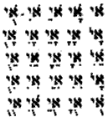

  
 Behold twenty-five front.

> קודם שנכנס בביאור פרטי השמות נקדים בפרקים אלו בלתי מושגת הבנתם. וכאשר יראה המשכיל ענין זה יחשוב הקדמה יקרת הערך בכלל השמות האלה כי בהשכיל בדעתו היות השמות אלה רתוקים מהמדע והתבונה וכמעט בהם ימצא תיבות בלתי מובנות בלתי מוגבלים בהוצאת הפה שידמה אותם היות מעשה נערות או דברי הבאי ת"ו. חוייבנו להזהיר לבל יהיה כחושב רע וידע באמיתות כי אדרבה מעלתם גדולה ועליונה וחקוקים כלם במקום העליון. ומקורם עולה דרך מעלות הסולם מעלה מעלה עד הגיע אל המקור המורה על עצמות הספי' ורוחניותם. ונשמת האותיות האלה הם עצמות הספי' בפנימיותם ושמות המונחים אליהם המבוארים בשער הקודם שהם לבוש אליהם כמבואר שם פ"א. ולפיכך הם קדושים שאינם נמחקים. אמנם שמות האלה וכיוצא אשר יש שיהיו גלויים אל הקדושים משרתי עליון והנביאים המדברים ברוח הקודש ומהם קבלוה התנאים והאמוראים וקבלת איש מפי איש עד למרע"ה מסיני מפי הגבורה. והנביאים ע"ה היו משיגים דרך אותם האותיות בהתבודדות גדול וזכות הנשמה הטהורה אותו הרוחניות המתלבש באותיות וסדר יחוד המדרגות אחת אל אחת מקבילות הלולאות משולבות אשה אל אחותה ואיש באחיהו ידובקו ובם מכירים קשר העולמות ומוסיפים ידיעה על ידיעתם והיו יודעים כחם ושמושם, לא להשתמש בהם ח"ו אלא לדעת יכולת קונם. ומרוב הצרות נסתמו עיני חכמים ונתמעטו הלבבות ודורשי התורה נחלש כחם מהשיג פשטי הדברים, כ"ש בידיעת הקבלה העיונית הספי', כ"ש קבלה המעשית, עד שלא נשאר בהם עוצר כח נגד הצרות כ"א הרשב"י ע"ה וחביריו שעמדו וגילו כבשונו של עולם. וגם דבריו אין אנו משיגים מקוצר רוח ומעבודה קשה כי יודעים אנו בבירור כי אין שכלנו הדל מגיע לקצת מן הקצת בעמקי מאמריו בחכמה הזאת, וכל דבריו נעלמים תכלית ההבדל וההעלם. אכן ע"י הכאת פטיש השכל בקושיות וקליפות שעל ההלכות יצא לנו אור מארובות דקות כסדקי המחט. עוד היתה סבה אל קבלה המעשיית אשר היתה גלויה בימי הרמב"ן ע"ה והרב ר' אלעזר מגרמיזא רבו והרב ר' יוסף גיקאטלייא ועמודי עולם כמותם וכן בימי הגאונים שהיו משתמשים בשימושא רבא ושימושא זוטא. וכל זה (גרמו) [אבדנו] בעונותינו, כי הם בעצמם לא רצו לגלותם לפי שראו אנשי חסד נאספים ונתמעטו אנשי מעשה וחששו שמא ישתמש בהם אדם שאינו הגון, כמו שראינו באותם שהיו אחריהם הרבה וקרובים אלינו כמו יוסף דיליריינא וכיוצא בו המחריבים בית אלהינו ומרבים את פרצותינו. ולטעם זה לא נחקור אחר שמושי השמות עם היותם נמצאים בספרי הקדמונים זולת בביאורם ממה שיועיל אל העיון. וממה שראוי לדעת כי כל האותיות הם תלוים בשם בן ד' עד שכמעט קצת האותיות קונה מציאות דומה לו כמו הא' שצורתה שני יודי"ן וא"ו שעולה כ"ו כמספר השם. וכן ל' רומז כ"ו וכן ט' וכן ק'. ואל זה הענין ירמוז צרוף האלפא ביתות עם שם בן ד' וצרוף הנקוד להחזיר הדברים אל מקורם ולהשפיע עליהם מהמקור העליון. ולהיות כי הדברים הרוחניים והחוטים השלהביות יתחלקו לפי מקורם. וזה יורה הנקוד כנרמז לעיל בשער שם בן ד' פ"ד. לכן יוכרח שיצטרף אות השם עם אות האלפא ביתא ושתיהם עם כל הנקודים אשר יוכלון שאת להיות רומזים אל כל המקורות פרטיים וכללים להיותם נשפעים מהמקור העליון. ובדרך צרופם נחלקו המקובלים. קצתם לא רצו לגלגל צירופו אלא ע"י ה' תנועות המבטא שהם נטיריקון וא"כ יעלה צרופו בכל אות ואות כ"ה תיבות פנים וכ"ה תיבות אחור. ובעל הסברא הזאת הוא מחבר ספר הניקוד כשהזכיר סדר הזכרת שם בן ד'. וראינו להעתיק לשונו הנה ואף אם הוא ארוך להיות כי הוא מועיל לידיעת אזכרתו בידיעת גדולת יוצרנו. וז"ל ידוע שהאותיות אין להם תנועה בעצמם וע"כ נתן השי"ת בהטבע ע"פ השכל כוחות בכלל הפה להוציא האותיות במבטא כדמות מציאותם הנמצא בספר. והושמו להאותיות נקודות מורות על תנועת המבטא בהעתקתם מן הספר אל הפה. וא"כ המתנועעים בעצם הם אותיות הפה ובמקרה הם אותיות הספר. והשתתף אל זה הכרח ממקום התנועות החלקיות כי לא יתנועע שום מתנועע בלתי מקום ובלתי זמן. וחלקי המקום הם הרחוקים. וחלקי הזמן הסובבים הנחשבים בפקודים בשנים ובחדשים ובימים והדומים להם. ומפני הרחוקים צריך אדם לדעת כמה יאריך במבטא כל אות ואות. וזהו סוד ההזכרה. בשעה שתרצה להזכיר את השם הנכבד הזה קשט את עצמך והתבודד במקום מיוחד שלא ישמע קולך לזולתיך וטהר לבבך ונפשך מכל מחשבות העולם הזה וחשוב שבאותה שעה תפרד נפשך מגופך ותפטר מן העוה"ז ותחיה לעולם הבא אשר הוא מקור החיים הנמצאים המפוזרים בכל חי והוא השכל שהוא מקור כל חכמה ובינה ודעת (אינו כדמות) ממ"ה הקב"ה אשר הכל יראים ממנו יראה גדולה והיא יראת המשיג היא יראה כפולה יראת אהבה ויראת מעלה. וכשבאה דעתך להדבק בדעתו הנותנת בך דעת, צריכה דעתך להסיר מעליה כל הדעות הזרות זולת דעתו המשותפת בינך ובינו על פי שמו הנכבד והנורא ועל כן צריך אתה לדעת דמות מבטאו וזה ציורו
>
>  הנה כ"ה פנים.

**21:1:5** "And further, twenty-five back, and they are these:  

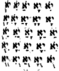

  
" And in this way with the Heh, and likewise with the Vav, and likewise with the last Heh. And we have abridged it, and further set it right according to its measure; for the author of Sefer ha-Nikkud jumbled them by way of a poem, to conceal, and revealed it at the end of his words; and we have arranged it as is fitting and proper. And let us return to his words: "This is its drawing. When you begin to mention the Alef, in whatever form you mention it, because it indicates the secret of the union, do not extend it except to the measure of one breath, and do not make any break at all in that breath until you complete its pronunciation. And extend that particular breath according to the measure of the strength of the length of your breath, as one, as much as you can extend it. And chant with the Alef, and with each and every letter that is in the likeness of the vowel, which is the *cholam*, upward. And when you begin to mention it, direct your face toward the face of the east, not upward and not downward; and you sit wrapped in white garments, washed and pure, over all your garments, or your *tallit* on your head, crowned with tefillin, facing the east, for from there the light goes forth to the world; and you have five extremities toward which to move your head. And with the *cholam* begin from the middle of the east, and purify your thought, and raise your head with the breath little by little until you complete it with your head above; and after you complete it, bow down to the ground once. And do not separate between the breath of the Alef and the breath of the letter joined to it, except by one breath, short or long. Between one letter of the Name and the next, in the straight or in the reversed, you may take two breaths without utterance, and not more; but fewer is within your discretion. And when you complete each and every row, you have permission to take five breaths alone and not more; but fewer is within your discretion. And if you changed or erred in a row of this order, return to the head of that row until you say it properly. And like the *cholam*, drawn upward, chant with the *chirik*, drawn downward, drawing the upper power to cleave to you. And with the *shuruk* do not raise your head up or down, but a middle drawing, facing the middle face. And with the *tzeirei* draw your head from left to right, and with the *kamatz* from right to left. And in all of them, after you complete, if you see a form before you, bow down immediately before it; and if you hear a voice, small or great, and wish to understand what it says, answer it immediately and say, 'Speak, my lord, for your servant hears'; and do not speak at all, but incline your ears to hear what it will say to you. And if you fear a great fear that you cannot bear, even in the middle of the invocation, bow down immediately. And if you neither see nor hear, leave the matter for that whole week. And it is good further to mention it once a week, in the likeness of 'running and returning,' for concerning this thing a covenant was made. And what more shall I add to make known to you? For it is already known that, if you are wise, from the hint you will understand the whole order. And if you feel that your intellect is weak in wisdom or in tradition, or your thought strong in the vanities of the time, do not mention the Name, lest you then add to sin. And know that between the page of Yod and the page of Heh you may take twenty-five breaths and not more, provided that you do not interrupt in between, neither in speech nor in thought; and likewise between Heh and Vav, and between Vav and Heh; only fewer than twenty-five you may breathe." Thus far the words of the Rav, the author of Sefer ha-Nikkud. And his words are words of tradition from mouth to mouth, or words of a *maggid*; and we have lengthened in them because they are of much benefit for the knowledge of the greatness of the glory of our Former, blessed be He. And in any case, a proof has come out to us for the rotation of the Name with the letters of the alphabet with five vowels alone, in the manner of combination in words and in vowels, as we shall lengthen and explain their matter further in the Gate of Permutation, with the help of God. But the other Kabbalists, seeing that the *sheva* is a motion by itself besides the five motions, for it is intermediate between the *patach* and the *segol*, as the grammarians explained (even if its motion is hidden from us), added its motion in the combination of the Name; and there turned out to be six motions, and they came to thirty-six, which are six times six, in the manner of combination, as is known. And from the motions and their reckoning came out delicacies and gematrias for wisdom. And because they lengthened in the matter much, we have seen fit to devote a chapter by itself to their words:

> ועוד כ"ה אחור והם אלו
>
>  ועד"ז בה' וכן בו' וכן בה' אחרונה. ואנחנו קצרנוהו ועוד תקננו אותו על מתכונתו כי בעל הספר הניקוד בילבלם בדרך שירה להעלים וגילהו בסוף דבריו ואנחנו ישבנו אותו כראוי וכשורה. ונחזור לדבריו זהו ציורו כשתתחיל להזכיר א' באיזה ציור שתזכירהו מפני שהוא מורה על סוד היחוד אל תאריך בו כי אם לפי שיעור נשימה אחת ולא תפסיק בנשימה ההיא שום הפסק בעולם עד שתשלים כנויו. ותאריך בנשימה ההיא המיוחדת כפי שיעור כח אריכות נשימתך כאחת בכל מה שתוכל להאריך בה ונגן בא' ובכל אות ואות שתהיה בדמות הניקוד והוא החולם למעלה וכשתתחיל בהזכרתו תכוין פניך אל פני המזרח לא למעלה ולא למטה ואתה שב מעוטף בבגדים לבנים מכובסים טהורים על כל בגדיך או טליתך לראשך מוכתר בתפילין לפני המזרח שמשם האור יוצא לעולם ולך"ה קצוות להניע בם ראשך. ובחולם תתחיל מאמצע המזרח וזכך רעיונך ותעלה ראשך עם הנשימה מעט מעט עד שתשלים וראשך למעלה ואחר שתשלים תשתחוה עד הארץ פעם אחת ולא תבדיל (בין) נשימת האלף לנשימת האות הדבק בו כי אם נשימה אחת קצרה או ארוכה או בין אות של שם בישרים או בהפוכים יש לך יכולת להנשים ב' נשימות בלי מבטא ולא יותר אבל פחות הרשות בידך. וכשתשלים כל טור וטור יש לך רשות להנשים ה' נשימות לבד ולא יותר אבל פחות הרשות בידך ואם שנית או טעית בטור מזה הסדר שוב אל ראש הטור ההוא עד שתאמרהו כראוי וכדמות החולם הנמשך למעלה נגן בחיר"ק הנמשך למטה ומושך כח העליון להדבקו בך. ובשורק לא תעלה ראשך לא למעלה ולא למטה אלא משיכה אמצעית כנגד הפנים האמצעיים ובציר"י תמשיך ראשך מהשמאל אל הימין, ובקמץ מהימין אל השמאל. ובכולם אחר שתשלים אם תראה צורה לפניך תשתחוה מיד כנגדה ואם תשמע קול קטן או גדול ותרצה להבין מה שאומר ענהו מיד ואמר דבר אדוני כי שומע עבדך ואתה לא תדבר כלל אלא הט אזניך לשמוע מה שיאמר לך. ואם תפחד פחד גדול שלא תוכל לסובלו ואפי' באמצע האזכרה תשתחוה מיד. ואם לא תראה ולא תשמע עזוב הדבר בכל אותו השבוע. וטוב עוד להזכיר פעם אחת בשבוע כדמות רצוא ושוב שעל דבר זה נכרת ברית. ומה אוסיף עוד להודיעך שכבר ידוע הוא שאם חכם אתה מן הרמוז תבין הסדר כלו ואם תרגיש ששכלך חלוש בחכמה או בקבלה או רעיונך חזקה בהבלי זמן לא תזכיר (אם) [את] השם פן תוסיף אז לחטוא. ודע שבין דף של יו"ד לדף של ה"א תוכל להנשים כ"ה נשימות ולא יותר ובלבד שלא תפסיק בנתיים לא בדיבור ולא במחשבה וכן בין ה"א לו' ובין ו' לה' רק פחות מכ"ה תוכל להנשים. עכ"ל דברי הרב בעל הספר הניקוד. ודבריו דברי קבלה מפה אל פה או דברי מגיד. והארכנו בהם להיותם רבי התועלת בידיעת גדולת כבודו של יוצרנו ב"ה. ומ"מ יצא לנו ראייה לגלגול השם באותיות האלפא ביתא עם ה' נקודות לבד ע"ד הצירוף בתיבות ובנקודות כאשר נאריך ונבאר עניינם עוד בשער הצרוף בעה"י. ואמנם המקובלים האחרים בראותם השב"א כי היא תנועה בפני עצמה זולת ה' תנועות כי היא בינונית בין הפתח והסגול כאשר ביארו המדקדקים ואם תנועתה נעלמת אצלינו, הוסיפו בצירוף השם תנועתה ונמצאו שש תנועות ועלו אל ל"ו שהם ששה פעמים ששה ע"ד הצירוף כנודע. ויצא מהתנועות וחשבונם פרפראות וגימטריאות לחכמה. ולהיות שהם האריכו בענין הרבה ראינו ליחד לדבריהם פרק בפני עצמו:

### Chapter 21:2. Citation of the words of the author of Ma'arakhot Elohim Chayyim on the cycling of the name with the alphabet, and what we noted upon them.

**21:2:1** The author of the book Ma'arakhot Elohim Chayyim expounded the opinion mentioned at length, and these are his words: "And to cleave to Him with a wondrous cleaving, which is called oneness, it is fitting to bring Him to mind in each and every part of the hour, which is 1,080 parts; as the rotation of His Name, may He be blessed, with each and every letter, with the vowels whose sign is *notarikon*, and with the letter unvowelled, will be 144; and your sign: 'The eternal God [*Elohei kedem*, *kedem* = 144] is a dwelling place' (Deut. 33:27); you will see further on, with the help of the Name. And let us reckon to know this: that He is the God of old, Former and Creator and Maker and Emanator of all; and He is from the letters, for the word of the Lord goes out from its place, from which all speech goes out; and in the general category of speech is every name of every kind of the kinds of existents; and all the formed go out from one name, that is to say, the name YHVH, which is combined with each and every letter that is in the 231 gates, thirty-six times. And we have combined one letter, and so it will be with all the other twenty-two letters: this is the combination of Alef with Yod and with Heh and with Vav and with Heh; and understand this. And the reason for the going out of every thing and every language from the 231 gates in the rotation of the alphabet is that if you make, by way of example, twenty-two circles one within another, and in each one of them twenty-two letters, then you will see with your eyes how all the things and the languages are combined from their rotation in 231 gates; and it returns around, and the wheel returns front and back, 231 gates; that is to say, 231 gates of front and 231 gates of back. And behold, each and every letter of the 231 gates is combined with the four letters of the name YHVH 144 times. How so? The Alef is combined with the Yod and with the six vowels thirty-six times, and likewise with the Heh, with those same vowels, thirty-six times, and likewise with the Vav, with those same vowels, thirty-six times, and likewise with the last Heh, with those same vowels, thirty-six times: behold, 144 times with the Alef. And likewise with each and every one of the twenty-two letters; it turns out that 144 times 22 amounts to 3,168 words, in the twenty-two letters alone.

> האריך בביאור הדעת הנז' בעל ס' מערכות אלדים חיים וז"ל ולדבקה בו דבוק נפלא נקרא אחדות. ראוי להעלותו על לב בכל חלק וחלק מן השעה שהיא תתר"ף חלקים כאשר גלגול שמו יתברך עם כל אות ואות עם הניקוד שסימנו נטריקון ועם האות בלתי נקוד יהי' קמ"ד וסימנך מעונה אלדי קד"ם תראה לפנים בע"ה ונחשבה לדעת זאת שהוא אלדי קדם יוצ"ר ובור"א ועוש"ה ומאצי"ל כל והוא מהאותיות אשר הוא דבר ה' יוצא ממקומו אשר כל הדיבור יוצא מהם ובכלל הדיבור הוא כל שם של כל מין ומין ממיני הנמצאות וכל היצור יוצא משם א' ר"ל השם יהו"ה המצטרף עם כל אות ואות שיש ברל"א שערים ל"ו פעמים ונצרף אות אחת והוא הדין יהיה עם כל שאר הכ"ב אותיות זהו צרוף א' עם י' ועם ה' ועם ו' ועם ה' והבן זה. וטעם יציאת כל דבר וכל לשון מהרל"א שערים בגלגול אלפא ביתא לפי שאם תעשה על דרך משל כ"ב עגולים זה בתוך זה ויהיה בכל א' מהם כ"ב אותיות אז תראה בעיניך איך כל הדברים והלשונות יצטרפו מתוך גילגולם ברל"א שערים וחוזרת חלילה וחוזר הגלגל פנים ואחור רל"א שערים ר"ל רל"א שערים של פנים ורל"א שערים של אחור. והרי שמצטרף כל אות ואות מרל"א שערים עם ד' אותיות של שם ידו"ד קמ"ד פעמים כיצד האל"ף מצטרפת עם היו"ד ועם הנקודים ששה ל"ו פעמים וכן עם הה"א באותם נקודות עצמם ל"ו פעמים וכן עם הוא"ו באותם הנקודות עצמם ל"ו פעמים וכן עם ה"א אחרונה באותם הנקודות עצמם ל"ו פעמים הרי קמ"ד פעמים עם הא'. וכן עם כל אחת ואחת מכ"ב אותיות נמצא קמ"ד פעמים כ"ב יעלו ג' אלפים וקס"ח תיבות בכ"ב אותיות בלבד.

**21:2:2** "And further, reckon 3,168 times 231 gates: their number amounts to 731,808. And all these are His names indeed, that is to say, the substance of the formation; for He clothed the formless thing with form, and made that which is not into that which is, and the emanation drawn from Nothing, which has no form or likeness or intellect, except that all the wisdom of the creatures is withheld from knowing them; and behold, through these *havayot* He brought out all the existents from nothing to something:

> ועוד חשוב ג' אלפים וקס"ח פעמים ברל"א שערים יעלו מספרם תשל"א אלפים ותת"ח. וכל אלו שמותיו ממש ר"ל ממשית היצירה כי הלביש הצורה לדבר תהו ועשה את אשר אינו ישנו ואצילות הנמשך מאי"ן שאין לו צורה ודמיון והשכל אלא שכל חכמת הבריות נאספות מלידע מהן והנה ע"י אלה ההויית הוציא מאין ליש כל הנמצאות:

**21:2:3** 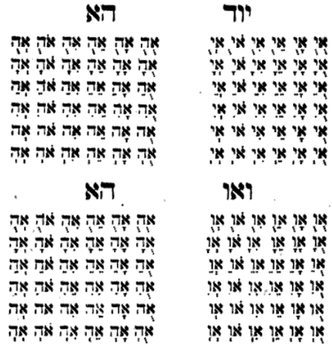

**21:2:4** "Your eyes will look straight ahead [and see] how the rotation of the letters of the name YHVH with each and every letter, with the six known vowels, amounts to 1,080; therefore there are 1,080 parts to the hour. And likewise the rotation of the name YHVH with the Alef and the vowels is 1,080; and likewise with Bet, and likewise with Gimel, and likewise with all of them:

> עיניך לנוכח יביטו איך גלגול אותיות השם יהוה עם כל אות ואות עם הנקודים ידועים הששה עולים אלף ושמונים לכך תתר"ף חלקים לשעה. וכן גלגול השם יהוה עם האלף והנקודים תתר"ף. וכן עם בי"ת וכן עם גימל וכן עם כולם:

**21:2:5** "See and understand the wonder of counsels: how in each and every part of the hour it is fitting for us to think of His awe. And this is 'Do not turn to the idols' (Lev. 19:4): 'do not turn to [what comes] from your own mind' (Shabbat 149a), for all the day you shall think of the love of Heaven. Therefore it is forbidden to speak idle words; for His Name, may He be blessed, is in the rotation of 1,080, and it is fitting to think of the glory of His Name 'when you sit, and when you walk, and when you lie down, and when you rise' (Deut. 6:7), in the four letters of the honored and awesome Name YHVH, which is with all; and therefore His Name is YHVH. And they are: the rotation of Yod with Alef, thirty-six words; and likewise the rotation of Alef with Heh, thirty-six words; and likewise the rotation of Vav with Alef, thirty-six words; and likewise the rotation of Alef with the second Heh: behold 144 [*kedem*] times with Alef, as we said above once; and they amount to 1,080 by *gematria*, for those who understand combination. Therefore there are 1,080 parts to each hour, for there are 1,080 parts for each and every letter in the rotation of YHVH: in the rotation of Alef-Yod, thirty-six words, amounting to 396; and the rotation of Alef-Heh, thirty-six words, amounting to 216; and the rotation of Alef-Vav, thirty-six words, amounting to 252; and the rotation of Alef-Heh, thirty-six words, amounting to 216. The sum total: 396, 216, 252, 216, which are 1,080 parts. And understand another secret, and it is this: if you combine and rotate all the twelve diagonal boundaries of the name YHVH, and Alef with all of them, they will be 1,080; therefore the day is twelve hours.

> ראה והבן פלא עצות איך בכל חלק וחלק מהשעה ראוי לנו לחשוב על מוראו. וזהו אל תפנו אל האלילים (ויקרא יט ד) אל תפנו אל מדעתכם (שבת קמ"ג.) שכל היום תחשוב באהבת שמים ע"כ אסור לדבר דברים בטלים כי שמו ית' בגלגול תתר"ף וראוי לחשוב כבוד שמו בשבת"ך ובלכת"ך ובשכב"ך ובקומ"ך בארבע אותיות של השם הנכבד והנורא ידו"ד שהוא עם הכל וע"כ שמו ידו"ד והם גלגול יו"ד עם א' הם ל"ו תיבות וכן גלגול א' עם ה' הם ל"ו תיבות וכן גלגול ו' עם א' הם ל"ו תיבות וכן גלגול א' עם ה' שניה הרי קד"ם פעמים עם א' כמו שאמרנו למעלה פעם אחת והם בגי' תתר"ף למביני הצירוף לכן תתר"ף חלקים לכל שעה כי תתר"ף חלקים לכל אות ואות בגלגול ידו"ד. בגלגול א"י הם ל"ו תיבות בגי' שצ"ו, וגלגול א"ה והם ל"ו תיבות בגי' רי"ו, וגלגול א"ו הם ל"ו תיבות בגי' רנ"ב, וגלגול א"ה הם ל"ו תיבות בגי' רי"ו. סך הכל שצ"ו רי"ו רנ"ב רי"ו הם תתר"ף חלקים. והבן סוד אחר והוא זה אם תצרף ותגלגל כל הי"ב גבולי אלכסון של שם יוד"ד וא' עם כלם יהיו תתר"ף לכך היום י"ב שעות.

**21:2:6** "And further, open the eyes of your intellect to see: if the name YHVH is at the head of the wheel and the Alef at the end (for the wheel turns front and back), it will also be 1,080; and behold two 1,080s, two hours for each constellation, that is to say, for each one of the twelve diagonal boundaries of the name YHVH, for which the divine constellations have the right [of the firstborn] over the constellations that are in the spheres, and 'at their command they encamp and at their command they journey' (Num. 9:20). And there turn out to be twenty-four hours and twenty-four 1,080s for the divine constellations mentioned, between the front and the back: twelve 1,080s for the back and twelve 1,080s for the front; and likewise twenty-four hours for one day, between the day and the night, twelve hours for the day and twelve hours for the night. Therefore in each part of the hour one should think of His awe and plant His love and His fear in our hearts, since He brought every thing into being, and within the heart the mouth of each and every man was emanated. And from Him are the twenty-eight times mentioned in the book of Ecclesiastes (chapter 3), fourteen of them one thing and fourteen others their substitutes, corresponding to the twenty-eight camps of the moon, which are twenty-eight camps of the Shekhinah. By the twelve divine constellations that we spoke of He changes the times, and 'to everything there is a season, and a time for every purpose' (Eccl. 3:1), from His ability and His being." Thus far its words.

> ועוד פקח עיני שכלך לראות אם שם ידו"ד בראש גלגל והא' בסוף כי הגלגל חוזר פנים ואחור יהיה ג"כ תתר"ף והרי ב' תתרפי"ם ב' שעות לכל מזל ר"ל לכל אחד מהי"ב גבולי אלכסון של שם ידו"ד אשר המזלות האלהיות להם משפט [הבכורה] על המזלות שבגלגלים ועל פיהם יחנו ועל פיהם יסעו ונמצאו כ"ד שעות וכ"ד תתרפי"ם למזלות האלהיית הנזכר בין הפנים והאחור י"ב תתרפ"ים לאחור י"ב תתרפי"ם לפנים וכן כ"ד שעות ליום א' בין היום והלילה י"ב שעות ליום וי"ב שעות ללילה על כן בכל חלק לשעה יש לחשוב במוראו וליטע אהבתו ויראתו בלבבנו אחרי שהוא היוה כל דבר ובתוך הלב נאצל פיו של כל איש ואיש. וממנו הכ"ח העתים הנזכר בספר קהלת (ג) י"ד מהם דבר אחד וי"ד אחרות תמורתם כנגד כ"ח מחנות ללבנה הם כ"ח מחנות שכינה. בי"ב מזלות אלהיית שאמרנו מחליף את הזמנים ולכל זמן ועת לכל חפץ מיכולתו והוייתו עכ"ל.

**21:2:7** And its fruits are sweeter than honey and the honeycomb. However, since it is clear and well known that the powers of the vowels are ten, even if their actions are five, then just as the *sheva* enters into the reckoning of the motions, so it is fitting that all the other motions enter; for in truth there is a great difference between the kings and the servants [the long and the short vowels], whether in their motion, that is to say, their sound, or in their action, that is to say, their power and their hint, as will be explained, with the help of the Name, in the Gate of Vowel Points. And if so, it is fitting that we combine the name YHVH with all the vowels, with the letters; and then the combination of all the powers with their source will necessarily follow, as we explained at the beginning of chapter 1. And behold, its combination will be in this way. When we search for the totality of the motions, they are found to be twelve, and they are: *kamatz*, *patach*, *tzeirei*, *segol*, *shuruk*, *shurek*, *cholam*, *chirik*, *sheva*, *chataf kamatz*, *chataf patach*, and *chataf segol*; and each one of them has a hint by itself; and although they were not counted in the vowels of the sefirot that we explained above, they will be explained in the Gate of Vowel Points, with the help of the Name. It turns out that the combination of the Name in the vowels with the letters is 144 [*kedem*] words; for they are twelve times twelve, which are 144, and they are "the eternal God [*Elohei kedem*] is a dwelling place," as explained above. And this is the order of their combination, with the help of Heaven:

> ופריו מתוקים מדבש ונופת צופים. האמנם אחרי אשר ברור ומפורסם כי כחות הנקודות הם עשר ואם פעולתם חמש א"כ כמו שנכנס השבא בחשבון התנועות כן ראוי שיכנסו כל שאר התנועות כי לפי האמת יש חלוק גדול בין המלכים ובין העבדים אם בתנועתם ר"ל בהברתם ואם בפעולתם ר"ל בכחם ורמיזתם כאשר יתבאר בע"ה בשער הנקודות. וא"כ ראוי שנצרף שם ידו"ד בכל הנקודות עם האותיות ואז יוכרח צרוף כל הכחות אל מקורם כדפי' בריש פ"ק והנה יהיה צרופו עד"ז וכאשר נחפש אחר כלל התנועות נמצאות י"ב והם קמ"ץ פת"ח ציר"י סגו"ל שור"ק שר"ק חול"ם חיר"ק שב"א חטף קמץ וחטף פתח וחטף סגול, ולכל א' מהם רמז בפני עצמו ואם לא נמנו בנקודת הספירות אשר בארנו למעלה יתבארו בשער הנקודות בע"ה. נמצא היות צרוף השם בנקודות עם האותיות קד"ם תיבו"ת כי הם י"ב פעמים י"ב הם קמ"ד והם מעונה אלדי קדם כמבואר לעיל. וזה סדר צרופם בס"ד:

**21:2:8** 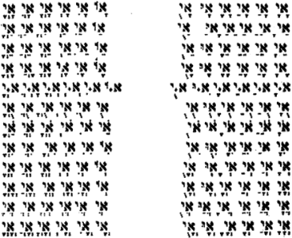

**21:2:9** And likewise for each and every letter of the four-letter name, front and back, and likewise for all the letters of the alphabet, until all of them are combined with their source and receive a great abundance of good effluence from the supreme source, as we shall lengthen on the matter of the letters in the Gate of Letters, with the help of Heaven. But we have seen some of the Kabbalists agreeing with the opinion of the author of Sefer ha-Nikkud; and so they wrote the name *Koh* [25], which goes out from the verse (Ex. 2:12) "And he turned this way and that way [*koh va-khoh*]"; and it is that they combine the word *Koh* twenty-five times front and twenty-five times back, such as *Koh*, *Hokh*, in the way that the author of Sefer ha-Nikkud wrote above. And likewise all who write the combination of the vowels wrote only the combination of five vowels alone. And likewise Rashbi, peace be upon him, concerning the vowels, gave the sign "engravings of a signet" [*pittuchei chotam*], and indicated that they are five emanated sefirot, which are Gedulah, Gevurah, Tiferet (and in it are included Yesod and Malkhut, as we explained in the preceding gates), and Netzach and Hod. But in the commentary on Sefer Yetzirah, on the matter of the [creation of] man, they wrote like the words of the author of Ma'arakhot Elohim Chayyim, that they are six times six, which amount to thirty-six, and they wrote it in his language word for word; and it seems that the thing is necessary there, for there they spoke of the Work of Creation, in the mention of the alphabets, in the crowning of the letters in the creation of each and every limb. And likewise the author of the book Or Zarua wrote on the matter of the motions of the *lulav* that they are thirty-six; and he said: "Why thirty-six? To hint to you at the holy letters that are joined and combined in their motions and their rotations, thirty-six motions; and this is the order of their motions according to *notarikon*: Alef-Yod, etc.; and likewise Alef rotates with Heh, and likewise afterwards with Vav, and afterwards with Heh." Thus far its words.

> וכן לכל אות ואות משם בן ד' פנים ואחור וכן לכל אותיות אלפ"א בית"א עד שנצטרפו כלם אל מקורם ויקבלו שפע רב טוב מהמקור העליון כאשר נאריך בענין האותיות בשער האותיות בס"ד. אבל ראינו קצת המקובלים מסכימים אל דעת בעל ספר הנקוד וכן כתבו שם כ"ה היוצא מפסוק (שמות ב יב) ויפן כה וכה והוא שהם מצרפים תיבת כ"ה חמשה ועשרים פעמים פנים וחמשה ועשרים פעמים אחור כגון כ"ה ה"כ על דרך שכתב בעל ס' הנקוד בשם י"א לעיל. וכן כל כותבי צרוף הנקוד לא כתבו כ"א צרוף ה' נקודות לבד. וכן הרשב"י ע"ה בענין הנקודות נתן הסימן פתוחי חותם. והורה היותם ה' ספירות נאצלות שהם גדולה גבורה תפארת ובו נכלל יסוד ומלכות כדפי' בשערים הקודמים ונצח והוד. אבל בפי' ספר יצירה בענין [בריאת] האדם כתבו כדברי בעל מערכות אלדים חיים שהם ששה פעמים ששה שעולים ל"ו וכתבו כלשונו מלה במלה ונראה היות הדבר מוכרח כי שם דברו לענין מעשה בראשית בהזכרת האלפא ביתות בהמלכת האותיות בבריאת כל אבר ואבר. וכן כתב בעל ספר אור זרוע בענין תנועות הלולב שכתב שהם ל"ו. ואמר למה ששה ושלשים כדי לרמוז לך לאותיות הקדושות המתחברות ומצטרפות בתנועותיהן ובגלגוליהון ל"ו תנועות וזה סדר תנועותיהם על פי נוטריקון א"י וכו' וכן א' יתגלגל עם ה' וכן אח"כ עם וא"ו ואח"כ עם ה' עכ"ל.

**21:2:10** And since this matter is a dispute of the great ones, and we have no revealing in it at all from Rashbi, peace be upon him, the thing remains pending until a teacher of righteousness comes. However it may be, from it it is explained what the matter of this need is, for the creation of man, of the combination of the alphabet, in crowning the letter by which the limb would be created, and its union with the four-letter name and its being combined with it. The reason is that, because the character of man (that is to say, his body and his veins and his sinews and the lines of his limbs and the measures of his limbs, all in measure and in weight) all hints at the upper limbs, his creation must necessarily include all the spiritual things, all of them; for so he is the mold of all the existents, as we shall explain in the Gate of the Soul, chapter 8. And because the intellect and speech are a power given in him to hint at the Ein Sof, the Cause of Causes, who gives life to and conducts all things, corporeal and spiritual, and causes them to ascend until they reach His Self, so the intellect and speech conduct all the things that are included in the body, such as the powers of the soul and its matters. And a proof of this: did not [our Sages] of blessed memory say that the soul is found in the body of a person after his death, and prove it from the verse (Job 14:22), "and his soul mourns over him"? And nevertheless, although it is within the body, it does not perform its actions, because the effluence of the intellect is withheld from it, and because there is no word and language and letter and speech that includes it. Therefore those sages who engaged in the work of formation in the order of the alphabet, although they would create men, these did not speak, because of the absence of the power that resembles the Ein Sof, as we said, which was not bestowed upon him according to the order of the alphabets. And in this way will be understood what some write: the name of forty-two and the name of seventy-two and the other names, combined with their sources, like this: יאהבוג"ה, which is the name Abag combined with its source YHVH, and so the whole of it. And there are those who write it in another way, like this: אב"גיהוהית"ץ, and so the whole of it. And likewise there are those who write the name of seventy-two like this: יו"ה הוו"ה ייה"ל וי"ה, and so the whole of it: the name *Vehu* with its source YHVH, and the name *Yeli* with its source YHVH, to the end. And there are those who combine it with the name Ehyeh, for it too is its source, though not so supreme as the first, as we shall explain on the name of forty-two. And the reason for all this is that in the return of the thing to its source, or in its joining with it, it will bestow upon its particulars a great abundance of good effluence, like the combined name יאהדונה"י and the name יאההוי"הה, as we explained in the Gate of Essence and Governance, chapter 24. And with this the *mishnayot* of Sefer Yetzirah will be explained: "He crowned such-and-such a letter and bound a crown to it," etc. And the intent: "He crowned" [*himlikh*] hints at Malkhut; and "bound" [KeSheR] means *teKi'ah*, *Shevarim*, *teRu'ah*, which are Gedulah, Gevurah, Tiferet, as explained in the words of Rashbi, peace be upon him, in the Tikkunim and the Ra'aya Meheimna in numberless places; and in the three of them their branches are included, Netzach, Hod and Yesod, and likewise their heads, Keter, Chokhmah and Binah. "Crown" [*keter*] hints at the Supernal Keter; or it may hint at the first three, which are a crown to the Patriarchs. And then a great effluence was bestowed upon that letter, and it had in it power to create that limb and that constellation and that thing intended by it. And now that we have set out this matter in these chapters, we come to the explanation of the names one by one, with the help of the Living One:

> ואחר שענין הזה מחלוקת הגדולים ואין לנו בו גלוי כלל מהרשב"י ע"ה הדבר תלוי ועומד עד יבא מורה צדק. איך שיהיה מתוכו מתבאר כי ענין הצורך הזה אל בריאת האדם בצרוף האלפא ביתא בהמלכת האות שבה יברא האבר ויחודה אל שם בן ד' והצטרפה עמו. הסיבה היא להיות כי תכונת האדם ר"ל גופו ועורקיו וגידיו ושרטוטי אבריו ושעורי אבריו ושיעורי האברים הכל במדה ובמשקל כלם נרמזים אל האברים העליונים, יוכרח בריאותו היותה כוללת כל הדברים הרוחניים כולם כי כן הוא דפוס כל הנמצאים כולם כאשר נבאר בשער הנשמה בפ"ח. ולהיות שהשכל והדיבור הוא כח נתון בו לרמוז אל הא"ס עילת העילות המחייה ומנהיג כל הדברים גשמים ורוחניים ועולות עד הגיעם אל עצמותו, כן השכל והדיבור מנהיג כל הדברים אשר נכללים בגוף כמו כחות הנפש ועניינה. והכרח לזה הלא אמרו ז"ל שהנפש נמצאת בגוף האדם אחר פטירתו והכריחו כן מפסוק (איוב יד כב) ונפשו עליו תאבל. ועכ"ז שהיא בתוך הגוף אינה פועלת פעולותיה לפי שנמנע ממנה שפע השכל ולפי שאין מלה ולשון ואות ודיבור כולל אותו. לכן אותם החכמים שהיו עוסקים במעשה יצירה בסדר האלפא ביתא עם היות שהיו בוראים אנשים. לא היו מדברים להעדר הכח הנדמה לא"ס כמו שאמרנו שלא היה מושפע עליו לפי סדר האלפ"א ביתו"ת. וע"ד זה יובן מה שיש כותבים שם מ"ב ושם ע"ב ושאר השמות מצורפים אל מקוריהם כזה יאהבוג"ה והוא שם אב"ג מצורף עם מקורו ידו"ד וכן כולו. ויש שכותבין אותו בפנים אחרות כזה אב"גיהוהית"ץ וכן כולו. וכן יש שכותבין שם בן ע"ב כזה יו"ה הוו"ה ייה"ל וי"ה וכן כולו. שם וה"ו עם מקורו ידו"ד, ושם יל"י עם מקורו ידו"ד עד כולו. ויש מצרפים אותו אל שם אהי"ה כי ג"כ הוא מקורו ולא עליון כראשון כאשר נבאר בשם מ"ב. וטעם כל זה כי בחזרת הדבר אל מקורו או בהתחברו אליו ישפיע אל פרטיו שפע רב טוב כדמות הצטרף שם יאהדונה"י ושם יאההוי"הה כאשר בארנו בשער מהות והנהגה בפכ"ד. ובזה יתבאר המשניות שבס"י המליך אות פלונית וקשר לה כתר כו'. והכונה כי המליך רומז אל המלכות. וקש"ר ר"ל תקיע"ה שברי"ם תרוע"ה, שהם גדולה גבורה תפארת כמבואר בדברי הרשב"י ע"ה בתיקונים ור"מ מקומות רבו מספר. ובשלשתם כלולים ענפיהם נצ"ח הו"ד ויסו"ד וכן ראשיהם כתר חכמ"ה ובינה. כת"ר רומז אל כת"ר עליון או ירמוז לג' ראשונות שהם כתר אל האבות ואז היה נשפע שפע רב על האות ההיא והיה בה כח לברוא אותו אבר ואותו מזל ואותו דבר הנרצה בו. ואחר שהקדמנו הענין הזה בפרקים האלה, נבא עתה בביאור השמות אחד לאחד בעה"ו:

### Chapter 21:3. Explanation of Araritha (אררית"א) and the name  A H V Y  (אה"וי); and there, the matter of "one, unique, unified" (*echad, yachid, meyuchad*); and there, the Baraita of Rabbi Yishmael.

**21:3:1** Behold, in the prayer of Rabbi Nechunya ben ha-Kanah, peace be upon him, he attributed to Keter this name, which is Araritha [ארארית"א], and gave it a sign in the initials: "*Echad Rosh Achduto Rosh Yichudo Temurato Echad*" [One, head of His oneness, head of His union, His substitution One]. Thus far. And concerning this name Rav Hamai Gaon wrote in Sefer ha-Iyyun, and in his commentary he brought a *baraita*, and these are its words: "We have learned: Rabbi Yishmael said: That day I and Akiva ben Yosef were finishing [our studies] with Rabbi Nechunya ben ha-Kanah, and Rabbi Chanina ben Teradyon was there. And I asked Rabbi Nechunya and said to him: Show me the glory of the King of the world, so that the knowledge of Him may be explained in my heart through His other works. He said to me: Son of the proud, come, let us engage with the great ring with which the heavens are sealed, whose name is Araritha, and with the ring of the earth, whose name is  A H V Y  [אהו"י], and I will show you all. I entered into the innermost part of the outer holy palace and brought out from there the book of Rabbi Nechunya ben ha-Kanah, which is called Sefer Heikhalot; and I found written at the beginning of the book thus: Mighty in the chambers of greatness, who sits on the wheels of His chariot, in the seals of Ehyeh asher Ehyeh, and in the great ring with which the heavens are sealed, whose name is Araritha; its sign: One, head of His oneness, head of His union, His substitution One; single and unified, One. And in the ring of the earth, whose name is  A H V Y; its sign: One, Was, and Will Be, Union; and the intermediate between the two of them is Is." Thus far the words of the *baraita*. And we wish to explain it according to the explanations that we shall explain in the Gate of the Glossary of Titles.

> הנה בתפלת רבי נחוניא בן הקנה ע"ה יחס בכתר זה השם שהוא ארארית"א ושם לו סימן בר"ת "אחד "ראש "אחדותו "ראש "יחודו "תמורתו "אחד. ע"כ. ובשם זה כתב רב חמאי גאון בספר העיון, והביא בפירושו ברייתא אחת וז"ל תנן א"ר ישמעאל אותו היום היינו מסיים אני ועקיבא בן יוסף אצל רבי נחוניא בן הקנה והיה שם רבי חנינא בן תרדיון ושאלתי לרבי נחוניא ואמרתי לו הראני כבוד מלכו של עולם כדי שיתבאר ידיעתו בלבי בשאר פעליו. אמר לי בן גאים תא ונעסוק בעזקתא רבתא דחתימין ביה שמיא וארארירת"א שמיה ובעזקתא דארעא דאיהי אהו"י שמי"ה ואראה לך הכל. נכנסתי לפני לפנים בהיכל הקדש החיצון והוצאתי משם ספרו של ר' נחוניא בן הקנה הנקרא ספר היכלות ומצאתי כתוב בתחלת הספר כך אדיר בחדרי גדולה היושב על גלגלי מרכבתו בחתימות אהי"ה אשר אהי"ה ובעזקתא רבתא דחתימין ביה שמייא ארארית"א שמיה. סי' אחד ראש אחדותו ראש יחודו תמורתו אחד יחיד ומיוחד אחד. ובעזקתא דארעא דאהו"י שמיה סי' "אחד "היה' "ויהי' "יחוד והמתמצע בין שניהם הוה עכ"ל הברייתא. וע"פ הפירושים אשר נבאר בשער ערכי הכנויים אנו רוצים לבאר.

**21:3:2** And behold, Keter is mighty over them; for even in those chambers there is no complete and correct apprehension, for it is mighty and concealed from those chambers. But it sits on the wheels of the chariot, which are "the networks that are upon the capitals that are upon the heads of the pillars" (1 Kings 7:17), which are Chokhmah and Binah, which are over Gedulah and Gevurah, which are over the two pillars Netzach and Hod, Yachin and Boaz. And Chokhmah and Binah are a chariot to Keter, and to them it is more revealed, in that they are concealed in themselves, not on the side of Gedulah and Gevurah, which are drawn from Chokhmah and Binah. And it is further possible to explain: for in the Zohar Rashbi, peace be upon him, explained that in Keter the manifestation of the Emanation is not revealed in its own self because of its great concealment, and all the manifestation of the branches that branch out from its own self are only Chokhmah and Binah, and they are those that spread out in the very Keter, to reveal and to emanate the Emanation in it itself; and nevertheless there is no emanation there except through the Chesed concealed there, and its branches spread out in the very Keter; and likewise Keter is called supernal Chesed. And this matter has been explained at length by us in the book Or Yakar, in the first part, in our commentary on the Idra, with the help of Heaven. However it may be, from there it is learned that the inner Chesed is Binah, and Keter branches out essentially from Chokhmah to Binah and not further. And it is possible that concerning this he said "mighty," and concealed; and the manifestation of its might is revealed "in the chambers of greatness" [*gedulah*], that is, Binah and Chokhmah concealed in it, and Gedulah branches out and builds between these two concealed chambers. And he said "who sits on the wheels of His chariot": it would mean that He sits upon Ze'ir Anpin, as Rashbi, peace be upon him, said in the Idra, that He sits upon "a throne of sparks of fire, to subdue them," and as we explained in the book mentioned, with the help of Heaven; and he used the language of the verse, "its wheels burning fire" (Dan. 7:9). And he said that the seal of Ehyeh asher Ehyeh is the first three, as we explained in the preceding gate; for these two names indicate the concealment of the Emanation in Keter and the paucity of apprehension of it, and likewise in Chokhmah and Binah; and this is the language "mighty," and likewise the language "in the seals," explanation: in concealment, for the seal is what conceals the thing sealed. "And in the great ring," etc.: concerning this name we have seen commentators who explained it from the language of *ari* [lion]; and the intent is the abundance of might and strength and majesty; and for this the mightiest in the world is called by the name lion, etc. And it is possible that because this name is the seal of the heavens, whose explanation is the sustaining of the world, made strong in His great compassion so as not to totter, it is called by the name of the lion, which indicates compassion, as it is written (Ezek. 1:10), "and the face of a lion on the right," etc. And it is known that above, in Keter, is the prevailing of simple compassion; and therefore the name was doubled, for the strength of the action. And it is possible that it is the language of *arita de-dalayei* mentioned in the Gemara (Chullin 107a), whose matter is the trough from which they water the plantings; and because Keter is the source to water all the upper plantings, therefore it is called by this name; and the letters Alef-Resh were doubled in it to indicate that it is the source of sources. Further, it is possible that its explanation is from the language of *or* [light], for it is light to all the lights. And nevertheless it is very difficult for us, for this name is a feminine form, and it is fitting to keep the matter of femininity far from Keter. But from this we can say that it is a title for the Binah that is in Keter, as we explained this matter at length in the Gate From Below to Above, chapter 5. And now with this his saying "and in the great ring" is correct; for he did not say *rabba* but *rabbeta*, a feminine form. And the explanation of his words: the ring is Binah, and in it Tiferet, which is called heavens, was sealed and found and emanated. Or it would mean "with which the heavens are sealed": explanation: the ring is Binah, in the secret of *avir*, *or* with Yod, "Let there be light," as we explained in the book Or Yakar, in Gate 3.

> והנה הכתר אדיר עליהם כי אפי' בחדרים ההם אין השגה שלימה ונכונה להשיג כי מן החדרים ההם הוא אדיר ונעלם אמנם יושב בגלגלי המרכבה שהם השבכות אשר על הכותרות שהם על ראש העמודים שהם חכמה ובינה שהם על גדולה וגבורה שהם על ב' עמודים נצח והוד יכין ובועז. וחכמה ובינה מרכבה אל הכתר ולהם הוא גלוייו יותר במה שהם נעלמים מצד עצמם לא מצד הגדולה והגבורה שנמשכים מחכמה ובינה. ואפשר עוד לפרש כי בזוהר פי' הרשב"י ע"ה כי בכתר אין מציאות האצילות מתגלה בעצמותו מרוב העלמו וכל מציאות הענפים המסתעפים מעצמותו אינם אלא חו"ב והם המתפשטות בעצם הכתר לגלות ולהאציל בו בעצמו האצילות ועכ"ז אין שם אצילות אלא ע"י החסד הנעלם שם וענפיו מתפשטים בעצם הכתר. וכן הכתר נקרא חסד עילאה ונתבאר ענין זה בארוכה אצלינו בספר אור יקר בחלק ראשון בפירושנו להאדרא בס"ד. איך שיהיה משם נלמד כי החסד הפנימי הוא הבינה ומסתעף הכתר בעצם מחכמה אל הבינה ולא יותר. ואפשר כי על זה אמר אדיר ונעלם ומתגלה מציאות אדירותו בחדרי גדולה דהיינו בינה וחכמה הנעלמים בו והגדולה מסתעפת ובונה בין שתי אלו החדרים הנעלמים. ואמר היושב על גלגלי מרכבתו ירצה שהוא יושב על זעיר אנפין כמו שאמר הרשב"י ע"ה באדרא כי הוא יושב על כורסייא דשביבין דנור לאכפיא לון וכדפי' בספר הנז' בס"ד. ולישנא דקרא נקט גלגלוהי נור דלק (דניאל ז'). ואמר כי חתימת אהי"ה אשר אהי"ה הם ג' ראשונות כדפי' בשער הקודם כי שתי שמות אלו מורים על העלם האצילות בכתר ומיעוט ההשגה בו וכן בחכמה ובינה וזהו לשון אדיר, וכן לשון בחתימת פי' בהעלם כי החותם הוא המעלים הדבר החתום. ובעזקתא רבתא וכו' בשם זה ראינו למפרשים שפי' אותו מלשון ארי. והכונה על רוב הגבורה והחוזק והאדירות ולזה נקרא בשם הגבור שבעולם אריה וכו'. ואפשר שמפני ששם זה חותם השמים שפי' קיום העולם חזקו ברחמיו הגדולים לבלתי יתמוטט נקרא בשם אריה המורה על הרחמים כדכתיב (יחזקאל א) ופני אריה אל הימין וכו'. וידוע כי למעלה בכתר תגבורת הרחמים הפשוטים ולכן נכפל השם לחוזק הפעולה. ואפשר היותו לשון אריתא דדלאי הנז' בגמ' (חולין דק"ז.) שעניינו השוקת שממנו משקין הנטיעות. ומפני שהכתר מקור להשקות כל הנטיעות העליונות לכן נקרא בשם זה. ונכפלו בו אותיות א"ר להורות שהוא מקור המקורות. עוד אפשר היות פירושו מלשון אור כי הוא אור לכל האורות. ועכ"ז קשיא לן טובא כי שם זה הוא לשון נקבה ומן הראוי להרחיק ענין הנקביות מן הכתר. אלא שמתוך כך נוכל לומר כי הוא כינוי אל הבינה שבכתר כדפי' ענין זה בארוכה בשער ממטה למעלה בפ"ה. ועתה בזה יצדק אומרו ובעזקתא רבתא, דלא קאמר רבא אלא רבתא לישנא דנוקבא. ופי' דבריו עזקתא היא בינה ובה נחתם ונמצא ונאצל הת"ת הנק' שמים. או ירצה דחתומין ביה שמייא פי' הטבעת היא הבינה בסוד אויר אור י' יהי אור שפי' בספר אור יקר בשער ג'.

**21:3:3** And behold, the heavens, which is Tiferet with the six extremities, are sealed in the very ring.

> והנה השמים שהוא הת"ת עם השש קצוות חתומים בעצם הטבעת.

**21:3:4** And behold, the ring is Binah, in the inclusion of Keter and Chokhmah; and the seal is Tiferet, which is the manifestation of the Da'at concealed in her. And it is possible in this way to explain that *ar* is *ari*, male, and *arita* female, to indicate the union of Chokhmah and Binah together within Keter. This is when we explain it as the language of lion, compassion, as we explained above. And likewise we can also explain it in the language of light: that they are two lights together, as we explained. "One, head," etc.: explanation: it is known that *echad* [one] is the manifestation of oneness itself, but the word *meyuchad* [unified] is the joining of a thing that has been joined, a unified union. And now it is known that the union of Chokhmah and Binah is in two ways. Either the manifestation of their union in the secret of *avir*, that is, Yod, Chokhmah, *or*, Binah, unified as *avir*; and this is their manifestation before their emanation, while they are in Keter itself, Chokhmah within Binah and both of them in Keter; and this union is called by the name oneness [*achdut*], for they are not separate ones that were unified, but they were always one from their beginning. But the second union that Chokhmah and Binah have is their union after their emanation, in their place, as Abba and Imma; this union is called by the name union [*yichud*], for after they were not unified, they were unified. It turns out according to this that Chokhmah and Binah with Keter have three aspects: either their union before their emanation, or the manifestation of their emanation without union, or their union after their emanation. And because there is never separation between them, for the first three are always reckoned as one, he said "One, head of His oneness": explanation: One is their true title at the beginning of their oneness together, that is, before their emanation. And likewise it is One also as "head of His union," that is, their union after their emanation. And also when this is changed, that is, when they are separate, God forbid, they are One; and this is what he said, "His substitution One": explanation: also when there are substitutions of the union, their true title is One; for it never changes, it does not lack and does not exceed. And after [he had spoken of] the union of the first three on all their sides, and also the union of the manifestation of Keter in the whole Emanation, he said "single and unified, One." And in Sefer ha-Bahir too something like this matter is found concerning Keter, and these are its words: "Alef: the Supernal Keter; blessed and blessed be His name and His people. And who are His people? Israel, as it is written, 'Know that the Lord, He is God; it is He who made us, and not we [*ve-lo anachnu*]' (Ps. 100:3): and to the Alef we are, to recognize and to know One, oneness, and unified, etc.; for He is one and unified in all His names." Thus far. "The Supernal Keter, blessed and blessed be His name": the intent is that the Supernal Keter is bestowed upon from the source of all the beings, and this is "blessed"; or it would mean the source of blessings, as we explained in Gate 23. And likewise "blessed be His name": explanation: the other sefirot, which are a garment to it, that is, the matter of "name," as we explained in the Gate of the Glossary of Titles, under the entry *shem*. "And who are His people?": it was difficult for him that the matter of a people does not apply to Keter, that a people or the like should be related to it. And to this he answered: Israel; for the souls of Israel have their hold in Keter, for so Tiferet rises to it by way of the middle line. And for this he brought a proof from the verse: "and not we" is written with Alef and read with Vav ["and His we are"], and its explanation is "and to the Alef we are," that is, Keter; and so it is explained in the Zohar (Vayera, folio 120b). And now there is authority for the reading and there is authority for the written tradition: for because "His we are," "to the Alef we are."

> והנה הטבעת הוא הבינה בכללות כתר וחכמה. והחותם הוא הת"ת שהוא מציאות הדעת הנעלם בה. ואפשר על דרך זה לבאר כי א"ר הוא ארי זכר ואריתא נקבה להורות על יחוד החכמה והבינה יחד בתוך הכתר. זהו כשנבאר אותו לשון אריה רחמים כדפי' לעיל. וכן נוכל ג"כ לבארו בלשון אור שהם שתי אורות יחד כדפי'. אחד ראש וכו' פי' ידוע כי אחד הוא מציאות האחדות בעצמו, אמנם מלת מיוחד הוא התחברות הדבר שנתחבר יחוד מיוחד. ועתה נודע היות יחוד חכמה ובינה בב' פנים אם מציאות יחודם בסוד אויר דהיינו י' חכמה אור בינה מיוחדים אויר. וזהו מציאותם קודם אצילותם בהיותם בכתר עצמו חכמה בתוך הבינה ושתיהם בכתר וזה היחוד יקרא בשם אחדות כי אינם נפרדים שנתייחדו אלא לעולם היו אחדים מתחלתם. אמנם יחוד שני אשר לחכמה ולבינה והוא יחודם אחר אצילותם במקומם אבא ואימא, יחוד זה יקרא בשם יחוד כי אחר שלא היו מיוחדים נתייחדו. נמצא לפ"ז אל החכמה ואל הבינה עם הכתר ג' בחינות, או יחודם קודם אצילותם או מציאות אצילותם בלי יחוד או יחודם אחר אצילותם. ולהיות כי אין ביניהם פירוד לעולם כי לעולם ג"ר חשובות כאחד אמר "אחד "ראש "אחדותו. פי' אחד הוא כינויים האמתי בתחלת אחדותם יחד דהיינו קודם אצילותם. וכן הוא אחד ג"כ "ראש "יחודו דהיינו יחודם אחר אצילותם. וגם בהיות חלוף זה דהיינו בהיותם נפרדות ח"ו הם אחד וז"ש "תמורתו "אחד פי' גם בהיות תמורות הייחוד כינויים האמתי הוא אחד כי לעולם לא ישתנה לא יחסר ולא יעדיף. ואחר [שאמר] שיחוד ג' ראשונות בכל פאותיהם וגם יחוד מציאות הכתר בכל האצילות, אמר יחיד ומיוחד אחד. וגם בס' הבהיר נמצא כענין הזה בכתר. וז"ל אל"ף כ"ע ברוך ומבורך שמו ועמו ומי עמו ישראל דכתיב כי ה' הוא האלהים הוא עשנו ולא אנחנו עמו ולאלף אנחנו להכיר ולידע אחד אחדות ומיוחד כו' כי הוא א' ומיוחד בכל שמותיו ע"כ. כ"ע ברוך ומבורך שמו הכונה כ"ע הוא נשפע ממקור ההויות כלם וזהו ברוך. או ירצה מקור הברכות כדפי' בשער כ"ג. וכן מבורך שמ"ו, פי' שאר הספירות שהם לבוש אליו דהיינו ענין ש"ם כדפי' בשער ערכי הכנויים בערך שם. ומי עמו. הוקשה לו דלא שייך ענין עם אצל הכתר לשיתייחסו אליו העם או כיוצא בו. ולזה השיב ישראל. כי בהיות נשמת ישראל אחיזתם בכתר שכן הת"ת עולה אליו דרך קו האמצעי. ולזה הביא ראיה מפסוק ולא אנחנו כתיב בא' וקרי בוא"ו ופירושו ולאל"ף אנחנו דהיינו כתר, וכן פי' בזהר (וירא דף ק"כ ע"ב). ועתה יש אם למקרא ויש אם למסורת כי בסבת ולו"א אנחנו לאלף אנחנו.

**21:3:5** And the matter of "One, oneness, and unified": explanation: One in relation to itself, for it has no second; and further, that it is the first that enters within the bounds of number, for before it there is no number, "and before one what do you count?" For "one" in itself does not apply to the necessarily existent, for the reason that the oneness of the one is apprehended, bounded on all its sides, and this is impossible in the Emanator, in whom there is no apprehension except that He is necessarily existent, as we explained in the Gate of Whether the Ein Sof is the Keter, chapter 1. For this he said that it is one and before it there is no number. "Oneness": explanation: unified in its branches and its aspects, so that there is no separation in it at all, but one that is unified in its own self. And the explanation of "and unified" would be: unified in the lower sefirot, and it unifies itself with them. And in this way we will explain "one, single, and unified": "one," as we explained; "single," explanation: unified in its branches; "and unified," explanation: unified in all the sefirot in complete union. And he said "single and unified, One," and did not arrange them in the order "one, single and unified": the intent is that also when Keter is single, that is, the manifestation of the union of its branches with its own self, as we explained, and likewise when it is unified, that is, its union in the emanated sefirot, it is always One; and it turns out that in all its aspects it is always One. And there are those who explained One, Single and Unified as Keter, Chokhmah and Binah: for Keter is called One, and Chokhmah Single, and Binah Unified; and they would be hard put to find a relation for them:

> וענין אחד אחדות ומיוחד. פי' אחד בערך עצמו שאין לו שניות, ועוד שהוא הראשון הנכנס בגדר המספר כי לפניו אין מספר ולפני אחד מה אתה סופר דלא שייך אחד בעצם במחוייב [המציאות] מטעם כי האחד מושג אחדותו מוגבל מכל צדדיו וזה א"א במאציל שאין בו השגה זולת שהוא מחוייב המציאות כדפי' בשער אם הא"ס הוא הכתר בפ"א. לזה אמר שהוא אחד ולפניו אין מספר. אחדות, פי' מתייחד בענפיו ובחינותיו שאין בו פרוד כלל אלא אחד המתייחד בעצמותו. ופי' ומיוחד ירצה מיוחד בספי' התחתונות והוא מתייחד עמהם. וע"ד זה נבאר אחד יחיד ומיוחד. אחד כדפרי'. ויחיד, פי' מתייחד בענפיו. ומיוחד, פי' מיוחד בספי' כלם בייחוד גמור. ואמר יחיד ומיוחד אחד ולא סדרם על הסדר שהוא אחד יחיד ומיוחד, הכונה כי גם בהיות הכתר יחיד דהיינו מציאות ייחוד ענפיו אל עצמותו כדפי' וכן בהיותו מיוחד דהיינו יחידו בספי' הנאצלים, לעולם הוא אחד, ונמצא כי בכל בחינותיו לעולם הוא אחד. ויש שפירשו אח"ד יחי"ד ומיוח"ד כתר חכמה ובינה. כי כתר נקרא אחד וחכמה יחיד, ובינה מיוחד. וזר להם למצוא להם ייחס:

**21:3:6** "And in the ring of the earth, whose name is  A H V Y": concerning this name some commentators said that this is the principal name of the Holy One, blessed be He, and it is  A H V Y; and the Holy One, blessed be He, hid His name for the discerning in the name Ehyeh and in the name YHVH, for from between the two of them the name  A H V Y  comes out, and it is the principal name, and these names, in which the letters are doubled, were given to the common people, etc.; and in this they lengthened with their mouths to deepen their traditions. And may the Compassionate One save us from this opinion; we will not consent to it nor listen to it; for the principal names are those that came in the mouth of the Torah. And although this name may be holy like the other names, the names that may not be erased are certainly holier than it, without doubt.

> ובעזקתא דארעא דאהו"י שמי"ה. בשם זה אמרו קצת המפרשים כי זה עיקר שמו של הקב"ה והוא אהו"י, והקב"ה הסתיר שמו למשכילים בשם אהי"ה ובשם יהו"ה כי מבין שניהם יוצא שם אהו"י והוא עקר השם והשמות האלה שבהם נכפלו האותיות נתנו להמון העם וכו', ובזה האריכו בפיהם להעמיק בקבלותיהם. ורחמנא ליצלן מהאי דעתא לא נאבה לו ולא נשמע אליו כי עיקר השמות הם אותם אשר באו בפי התורה. ועם היות ששם זה יהיה קדוש כשאר השמות בזולת שמות שאינם נמחקים שהם ודאי יותר קדושים ממנו בלי ספק.

**21:3:7** And further, from the words of Rabbi Nechunya we can object to them: for he said that the seal of the heavens is Araritha, and the name of the seal of the earth he said is  A H V Y; it turns out that the name Araritha is more concealed and exalted than the name  A H V Y, and there is no doubt about this. And we have lengthened in this to benefit the discerning, so that they not be enticed after that opinion. And Rabbi Nechunya was precise: for in the initials of Araritha, the seal of the heavens, he said "One, head of His oneness, head of His union, His substitution One"; because this name is in the Supernal Keter, the first effect, which draws near to its source, and whoever touches it is as one who touches the glory of the King of the world, he did not wish to derive any word from it at all, but language indicating oneness. And he said "His substitution One": the intent is that it is never exchanged as one for another, God forbid, whether before being and emanation or after being and emanation, as we explained. But in the name  A H V Y, which is below the sefirah Keter, which is the spreading out to Malkhut, he said Was, Is and Will Be, so that we may know that the language of being [*havayah*] is not derived from Keter upward at all, and not even in Keter, because every being has a beginning, before which it was not. And even if we say "Was, Is, and Will Be," explanation: "Was," that before that being it also was, nevertheless this is nothing; for whatever enters under being has an end and has a beginning; and the language "was, is, and will be" is derived only from Binah downward, and Binah is not included, because Chokhmah and Binah are the bound of being, that is, beginning and end, as we explained in the Gate of the Order of the Emanation.

> ועוד מתוך דברי רבי נחוניא אנו יכולין להשיג עליהם שאמר שחותם השמים הוא ארארית"א ושם חותם הארץ אמר שהוא אהו"י, נמצא שיותר נעלם ומתעלה שם ארארית"א משם אהו"י ואין ספק בזה. והארכנו בזה להועיל למשכילים שלא יתפתו אחר אותו הדעת. ודקדק ר' נחוניא כי בר"ת של ארארית"א חותם השמים, אמר אחד ראש אחדותו ראש יחודו תמורתו אחד. מפני היות שם זה בכתר עליון העלול הראשון המתקרב אל מקורו והנוגע בו כנוגע בכבוד מלכו של עולם לא רצה לגזור בו מאמר כלל אלא לשון מורה על אחדות. ואמר תמורתו א', הכונה כי לעולם אינו מתחלף בא' לזולתו ח"ו בין קודם הויה ואצילות בין אחר הויה ואצילות כדפי'. אולם בשם אהו"י שהוא למטה מספירת הכתר שהוא ההתפשטות עד המלכות, אמר הי"ה הו"ה ויהי"ה, למען נדע כי אין נגזר לשון הויה מכת"ר ולמעלה כלל ואפי' בכתר לפי שכל הויה יש לה ראשית שמקודם לא הי'. ואפי' נאמר הי"ה והו"ה ויהי"ה פי' הי"ה שקודם אותה הויה היה ג"כ. עכ"ז אינו דבר, כי כל הנכנס תחת הויה יש לו סוף ויש לו ראש ואין נגזר לשון היה והוה ויהיה אלא מבינה ולמטה ואין הבינה בכלל מפני שהחכמה והבינה הם גדר ההוייה דהיינו ראשית ואחרית כדפי' בשער סדר האצילות.

**21:3:8** And behold, Rabbi Yishmael asked Rabbi Nechunya ben ha-Kanah, "Show me the glory of the King of the world," whose intent was that he should teach him the manifestation of the Emanation. And behold, by these two seals he taught him the manifestation of the Emanation before its emanation and its manifestation after its emanation: for in the name Araritha, which is the seal of the heavens, he taught him the manifestation of Keter, Arikh Anpin, revealed through Binah, as we expounded at length above; and the seal  A H V Y  indicates the spreading out.

> והנה ר' ישמעאל שאל לר' נחוניא בן הקנה הראני כבוד מלכו של עולם שכוונתו שיורהו מציאות האצילות, והנה בשתי חותמות אלו הורה לו מציאות האצילות קודם אצילותו ומציאותו אחר אצילותו, כי בשם ארארית"א שהוא חותם השמים הורה לו מציאות הכתר ארך אנפין המתגלה ע"י הבינה וכמו שהארכנו לעיל, ובחותם אהו"י מורה על ההתפשטות.

**21:3:9** And behold, this name differs from the name Ehyeh in two ways. For the name Ehyeh indicates concealment, as we explained above, and this indicates some revealing. And likewise the Yod in Ehyeh, Vav in  A H V Y, concerning the secret of the Vav, the six extremities that spread out; and because it is not a complete spreading out, the last Heh comes in the secret of Yod, to indicate the concealment; for Malkhut is not yet built in the secret of Heh, so as to be revealed below. And this is the secret of  A H V Y, whose explanation is "One, Was, and Will Be; and the intermediate between the two of them, Is." And these three are "[the Lord] reigns, [the Lord] reigned, [the Lord] will reign," for all is in Tiferet; and it is: "Was" in Gedulah, "Is" in Gevurah, "and Will Be" in Tiferet.

> והנה שם זה נבדל משם אהי"ה בשתי פנים, כי שם אהי"ה מורה על העלם כדפי' לעיל וזה מורה התגלות קצת. וכן יו"ד באהי"ה וא"ו באהו"י על סוד הוא"ו שש קצוות המתפשטות ומפני שאינו התפשטות גמור באה הה"א אחרונה בסוד י' להורות על ההעלם כי אין המלכות עדיין נבנית בסוד ה"א כדי שיתגלה למטה. וזהו סוד אהו"י שפי' אחד היה ויהיה והמתמצע בין שניהם הוה. וג' אלה הם מלך מלך ימלוך שהכל בת"ת. והוא. היה בגדולה, הוה בגבורה, ויהיה בת"ת.

**21:3:10** And this matter is bound up with the secret of the *shemitot* [cosmic cycles]: the preceding one Chesed, the future one Tiferet, and the present one Gevurah. And to the sefirah Chokhmah he further attributed a name like this: Ayah Beyah Geyah Deyah, etc., to the end of all the letters. And the reason is that the letters and the ten sefirot are thirty-two paths; the source is the name Yah, Chokhmah; and the twenty-two letters hint at twenty-two paths, and the source itself is the ten utterances; they are thirty-two paths, as explained in Sefer Yetzirah. And its vowelling is *sheva* and *kamatz*, to hint at (Lev. 5:12) "and the priest shall take a fistful [*ve-kamatz*]," in Chesed, and (Isa. 66:16) "by fire [*ba-esh*] will the Lord judge," (Job 1:15) "and Sheba [*sheva*] fell upon them and took them," in Gevurah; to hint at the spreading out of the paths in the secret of judgment and compassion in the sefirot below. And at its end there are further other *havayot* like these:

> וענין זה אחוז בסוד השמיטות שהקודמת חסד, והעתידה ת"ת, וההו"ה גבורה. ובספי' חכמה יחס עוד שם כזה איה ביה גיה דיה וכו' עד תום כל האותיות. והטעם כי האותיות וע"ס הם ל"ב נתיבות. המקור שם י"ה חכמה. וכ"ב אותיות רמז לכ"ב נתיבות והמקור עצמו עשר מאמרות הם ל"ב נתיבות כדפי' בספר יצירה וניקודו שב"א קמ"ץ לרמוז על (ויקרא ה יב) וקמץ הכהן בחסד. (ישעיה סו טז) בא"ש ה' נשפט, (איוב א) ותפול שב"א ותקחם בגבורה. לרמוז אל התפשטות הנתיבות בסוד הדין והרחמים בספירות למטה ובסופו עוד הויות אחרות כאלו:

### Chapter 21:4. Explanation of the four-letter name in the first three sefirot; and there, the matter of "the strong hand," "the great hand," "the lifted hand," "the faint hand" (*yad chazakah, yad gedolah, yad ramah, yad kehah*).

**21:4:1** Further, Rabbi Nechunya ben ha-Kanah attributes to the first three these names: כוז"ו במוכס"ז כוז"ו [Kuzu Bemukhsaz Kuzu]. And these are his words in his prayer, after he mentioned three sefirot; at the end of the third sefirah he said: "And all became one head; and these are the names that make all of them equal: Kuzu Bemukhsaz Kuzu; and they are unified, YHVH our God YHVH is one." Thus far its words. (And in another book we have found other vowels for this name.)

> עוד מיחס רבי נחוניא בן הקנה להג"ר, אלו השמות כוז"ו במוכס"ז כוז"ו. וז"ל בתפלתו אחר שהזכיר ג' ספירות בסוף ספירה הג' אמר ונעשו הכל ראש אחד ואלו הם השמות המשווה לכלם כוז"ו במוכס"ז כוז"ו ומיוחדים יהו"ה אלהינו יהו"ה אחד עכ"ל. (ובספר אחר מצאנו לשם זה נקודות אחרות).

**21:4:2** And there is one who explained this name, and these are his words: "These three names, YHVH Eloheinu YHVH, are in the reckoning of the following letters; that is to say, you take the letters second to them in the alphabet: Yod-Kaf, Heh-Vav, Vav-Zayin, Heh-Vav; Alef-Bet, Lamed-Mem, Heh-Vav, Yod-Kaf, Nun-Samekh, Vav-Zayin; Yod-Kaf, Heh-Vav, Vav-Zayin, Heh-Vav. And its vowelling is like the vowelling of the written text. 'And they are unified,' etc.: explanation: although these names came in the reckoning of the following letters, and therefore would not indicate this oneness so much, for this he said: nevertheless they are unified, 'the Lord our God, the Lord is one.'" Thus far its words.

> ויש שפי' בשם זה וז"ל אלו הג' שמות יהו"ה אלהינו יהו"ה הם בחשבון האחוריים. כלומר לקחת האותיות השניות להם באלפ"א ביתא י"כ ה"ו ו"ז ה"ו, א"ב ל"מ ה"ו י"כ נ"ס ו"ז, י"כ ה"ו ו"ז ה"ו. ונקודו כנקוד הכתוב. ומיוחדים וכו', פי' עם היות שאלו השמות באו בחשבון האחוריים ולכן לא יורו כ"כ על האחדות הזה, לז"א עכ"ז הם מיוחדים ה' אלהינו ה' אחד עכ"ל.

**21:4:3** And we wish to explain what we have drawn up from the words of Rashbi, peace be upon him, in the Tikkunim (Tikkun 55, folio 86), "a little here, a little there"; and we cannot copy his language because of its length. And the matter is that these two hands [*yad*, 14] are fourteen letters: a right hand, "the great hand," and they are YHVH Eloheinu YHVH, and they are right-sided; and further a left hand, "the strong hand," and they are Kuzu Bemukhsaz Kuzu, and they are left-sided, fourteen letters; and they are twenty-eight [*koach*, strength]. And corresponding to these hands there is further "a lifted hand," and it is YHVH, יוד ה"א וא"ו ה"א; and it is the lifted hand. And corresponding to it there is another hand, and it is Ehyeh, אל"ף ה"א יו"ד ה"א. And these two hands are twenty-eight, which are clothed in the twenty-eight letters of the Work of Creation. And of this it is said (Lam. 1:6), "and they went without strength [*koach*] before the pursuer," because that strength was withheld through iniquities. And of this Moses our teacher, peace be upon him, said (Num. 14:17), "And now, let the strength [*koach*] of Adonai be great," which are the twenty-eight times of the moon, which are twenty-eight days, fourteen full and fourteen lacking, fourteen right and fourteen left; and therefore he said "let the strength of Adonai be great," which are twenty-eight. And the two hands, the great and the strong, are Chesed and Gevurah, and they are bestowed from Chokhmah and Binah. And it is known that one opens with merit first; therefore the great hand precedes the strong hand in its letters. And this strength is in Binah; and this is Chokhmah, *koach mah*: *mah* [45] is in Chokhmah, and so the four-letter name in its filling amounts; and *koach* [28] is in Binah. And of this it is said (Ps. 111:6), "The strength [*koach*] of His works He has declared to His people": the "work" is in Binah, and there is the *koach*; and "declared" means drew down. And it is known that the four-letter name is also twenty-eight in the filling of its filling. And this is Chokhmah, *koach mah*: for their totality is *mah*, which is in Chokhmah, and their particulars *koach*, which are in Binah. And these are: יו"ד ה"א is compassion, the world of the male; וא"ו ה"א is judgment, the world of the female, as we explained in the Gate of Names, chapter 1. And the female is always toward the left and the male toward the right; and although we said that Yah is compassion and Vav-Heh is judgment, nevertheless we shall not deny that the Yod is more compassion than the Heh, and the Vav more compassion than the second Heh.

> ורצוננו לבאר מה שהעלינו מתוך דברי הרשב"י ע"ה בתיקונים (תקונא נ"ה דפ"ו) זעיר שם זעיר שם ולשונו לא נוכל להעתיק מפני האריכות. והענין כי שתי הידות האלה שהם י"ד אותיות י"ד ימין י"ד הגדולה והם ה' אלהינו ה' והם ימיניות ועוד י"ד שמאל י"ד החזקה והם כוז"ו במוכס"ז כוז"ו והם שמאליות י"ד אותיות והם כ"ח. ויש כנגד אלו הידות עוד י"ד רמ"ה והוא יהו"ה יוד ה"א וא"ו ה"א והיא י"ד רמה. ויש כנגד' י"ד אחרות והיא אהיה אל"ף ה"א יו"ד ה"א. ושתי הידות האלה הם כ"ח שהם מתלבשות בכ"ח אותיות של מעשה בראשית. וע"ז נאמר (איכה א ו) וילכו בלא כ"ח לפני רודף. להיות שנמנע הכח ההוא בעונות. וע"ז אמר מרע"ה (במדבר יד יז) ועתה יגדל נא כ"ח אדנ"י. שהם כ"ח עתים של לבנה שהם כ"ח ימים, י"ד מלאים וי"ד חסרים, י"ד ימיניים וי"ד שמאליים, ולכן אמר יגדל נא כ"ח אדנ"י שהם כ"ח. ושתי הידות הגדולה והחזקה הם חסד וגבורה ומושפעים מחכמה ובינה. ונודע שפותחין בזכות תחלה לפיכך י"ד הגדולה קודמת באותיותיה לי"ד החזקה והכח הזה הוא בבינה וזהו חכמה כ"ח מ"ה, מה הוא בחכמה. וכן עולה שם בן ד' במילוי. וכח הוא בבינה. וע"ז נאמר (תהלים קיא ו) כח מעשיו הגיד לעמו מעשה הוא בבינה ושם הכ"ח. והגיד ר"ל המשיך. ונודע ששם בן ד' הוא ג"כ כ"ח במילוי דמילוי. והיינו חכמ"ה כ"ח מ"ה כי כללותם מ"ה שהם בחכמה ופרטם כ"ח שהם בבינה. ואלו הם יו"ד ה"א הוא רחמים עולם הזכר וא"ו ה"א הוא דין עולם הנקבה כדפי' בשער השמות בפ"א. והנקבה לעולם אל השמאל והזכר אל הימין ועם היות שאמרנו שי"ה הוא רחמים ו"ה הוא דין. עכ"ז לא נכחיש שהיו"ד יותר רחמים מהה"א והוא"ו יותר רחמים מה"א שנייה.

**21:4:4** And behold now, יו"ד ה"א are the five fingers of the right hand, and וא"ו ה"א the five fingers of the left hand. And it is known that in the fingers there are twenty-eight joints, fourteen for each hand. And likewise the five letters יו"ד ה"א have fourteen letters in the filling of their filling: יו"ד וא"ו דל"ת ה"א אל"ף: behold fourteen. In four letters, which are four fingers, there are three joints in each finger, three letters in each and every letter; and in the fifth letter, which is the thumb, there are two joints, two letters, as is known. And likewise in וא"ו ה"א, which are the five fingers of the left hand: in these five letters there are fourteen joints, like this: וא"ו אל"ף וא"ו ה"א אל"ף: behold fourteen. In four letters, which are four fingers, there are three joints in each finger, three letters in each and every letter; and in the fifth letter, which is the thumb, there are two letters, two joints, as is known. And we have already explained that the Heh always has judgment in it; therefore the masters of the lot, who cast lots with the fingers, say that one should not cast lots with the thumb, because the princes of judgment depend on it. Behold, these letters are hinted at in the lifted hand mentioned above, which is in Tiferet, as is known; and it includes two hands, as we explained above.

> והנה עתה יו"ד ה"א הם ה' אצבעות שביד ימין, וא"ו ה"א חמש אצבעות שביד שמאל. ונודע שבהאצבעות כ"ח פרקים י"ד לכל יד. וכן החמש אותיות יו"ד ה"א, להם י"ד אותיות אל מילוי מלואם, יו"ד וא"ו דל"ת ה"א אל"ף, הרי י"ד. בד' אותיות שהם ד' אצבעות יש ג' פרקים בכל אצבע, ג' אותיות בכל אות ואות, ובאות החמישי שהוא האגודל יש ב' פרקים ב' אותיות כנודע. וכן בוא"ו ה"א שהם ה' אצבעות שביד שמאל ובחמשה אותיות האלה י"ד פרקים. כזה וא"ו אל"ף וא"ו ה"א אל"ף, הרי י"ד. בד' אותיות שהם ד' אצבעות יש ג' פרקים בכל אצבע, ג' אותיות בכל אות ואות, ובאות החמישית שהוא האגודל יש בו ב' אותיות ב' פרקים כנודע. וכבר בארנו שהה"א לעולם יש בה דין. לכן אומרים בעלי הגורל המפיסים באצבעות כי אין להפיס באגודל מפני שבו תלויין שרי הדין [נב]. הנה האותיות האלה רמוזים בי"ד רמ"ה הנז' לעיל שהוא בת"ת כנודע. והוא כולל ב' ידות כדפי' לעיל.

**21:4:5** And behold, the hand bestowed in Tiferet is drawn from Keter, which is above it; and the root of all this is YHVH Eloheinu YHVH; and they are: YHVH in Keter, YHVH in Chokhmah, Eloheinu in Binah, and she is in the middle, just as judgment, which is Isaac, is between Abraham and Jacob, which are two *teki'ot*, as Rashbi, peace be upon him, explained in the Zohar. And although in chapter 2 we explained it in another way in the name of Rashbi, peace be upon him, nevertheless these and those are the words of the living God. And let us return to our subject: that Binah is between Keter and Chokhmah, so as to be sweetened into compassion, to bestow compassion upon Gevurah; and all the hands are unified in YHVH Eloheinu YHVH. And this is what Rabbi Nechunya explained in his prayer: "and they are unified in YHVH Eloheinu YHVH." Thus far. Further, we have found in the tradition of our Rabbis, of blessed memory, that from this name branches chain down, and they are in the number of its letters; and these are its words: "Keruvi'el the great, Vakhri'el the great, Za'ani'el the great (missing); Ba'arni'el the great, Mali'el the great, Va'ani'el the great, Kokhvi'el the great, Suri'el the great, Z"K the great; Kaspi'el the great, Velili'el the great, Zutri'el the great, and Mali'el the great." Thus far [the initials of the names spell Kuzu Bemukhsaz Kuzu]. And there is no doubt that these are sparks emanated from this name; certainly each and every letter emanates one power, as in the matter that happened with the name of forty-two, as we shall explain in chapter 12:

> והנה הי"ד הנשפע בת"ת הוא נמשכת מהכתר שהוא למעלה ממנו. ושורש כל זה הוא ידו"ד אלדינ"ו ידו"ד. והם יהו"ה בכתר ידו"ד בחכמה אלדינ"ו בבינה והיא באמצע, כמו שהדין שהוא יצחק בין אברהם ויעקב שהם שתי תקיעות כדפי' הרשב"י ע"ה בס' הזהר. ועם היות שבפרק ב' פירשנו בענין אחר בשם הרשב"י ע"ה עכ"ז אלו ואלו דברי אלדים חיים. ונחזור לענייננו כי בין הכתר והחכמה היא הבינה להיותה נמתקת אל הרחמים להשפיע רחמים אל הגבורה וכל הידות מתיחדות בה' אלדינו ה'. וזהו שפי' ר' נחוניא בתפלתו ומיוחדים בה' אלהינ"ו ה' ע"כ. עוד מצאנו בקבלת רז"ל כי מן השם הזה משתלשלים ענפים והם במנין אותיותיו וז"ל "כרוביא"ל רבא "וכריא"ל רבא "זעניא"ל רבא (חסר). "בערניא"ל רבא "מאליא"ל רבא "ועניא"ל רבא "כוכביא"ל רבא "סוריא"ל רבא ז"כ רבא. "כספיא"ל רבא "וליליא"ל רבא "זוטריא"ל רבא "ומליא"ל רבא ע"כ. ואין ספק היות אלו נציצות מתאצלות משם הזה ודאי כל אות ואות מאציל כח א' כענין אשר קרה לשם בן מ"ב כאשר נבאר בפרק י"ב:

### Chapter 21:5. Explanation of the 72-name — its citation, vocalization, and derivation from the verses; and there, the 72-name in Chesed and the 216 ( R Y V ) letters in Gevurah.

**21:5:1** On the name of seventy-two. And it is related to Chesed, for so the holy Rabbi Nechunya explained, as we shall explain, with the help of the Name. And this is the whole of it:

> בשם בן ע"ב והוא מיוחס אל החסד, כי כן ביאר הקדוש רבי נחוניא כאשר נבאר בע"ה. וזה כללו:

**21:5:2** והו ילי סיט עלם מהש ללה אכא כהת הזי אלד לאו ההע יזל מבה הרי הקם לאו כלי לוו פהל נלך ייי מלה חהו נתה האא ירת שאה ריי אום לכב ושר יחו להח כוק מנד אני חעם רהע ייז ההה מיב וול ילה סאל ערי עשל מיה והו דני החש עמם ננא נית מבה פוי נמם ייל הרח מצר ומב יהה ענו מחי דמב מנק איע חבו ראה יבם היי מום:

> והו ילי סיט עלם מהש ללה אכא כהת הזי אלד לאו ההע יזל מבה הרי הקם לאו כלי לוו פהל נלך ייי מלה חהו נתה האא ירת שאה ריי אום לכב ושר יחו להח כוק מנד אני חעם רהע ייז ההה מיב וול ילה סאל ערי עשל מיה והו דני החש עמם ננא נית מבה פוי נמם ייל הרח מצר ומב יהה ענו מחי דמב מנק איע חבו ראה יבם היי מום:

**21:5:3** And it is called by the name seventy-two because there are seventy-two words in it. And there are those who call it *Aryeh* [lion], because its letters are in the number of *aryeh*, which amounts to 216. And Rabbi Nechunya related this name to Chesed and vowelled it as marked. But in the book of the one who speaks by the mouth of a *maggid* he said that its vowelling is with the name Ehyeh, in this way: *segol*, *sheva*, *segol*, and the last Heh has no vowel; "and with the vowels this great name acts with strength. And the secret of the *segol* is the secret of the whole spirituality, the secret of the white fire, and it is in three points to hint at this secret. And the secret of the *sheva* is the secret of the attribute of judgment; and in order to act with strength it was mixed with the *segol*, for it is wholly a piece of judgment, and the *segol* is complete compassion. And this is the secret of Ehyeh in its vowelling and in its combination and in its simple form." Thus far its words.

> ונקרא בשם ע"ב מפני שבו ע"ב תיבות. ויש שקוראים אותו אריה מפני שאותיותיו בחשבון ארי"ה שעולה רי"ו. ויחס ר' נחוניא שם זה אל החסד וניקד אותו כמסוים (כמסומן). אמנם בספר מדבר על פי מגיד אמר שנקודו בשם אהי"ה על הדרך הזה סגו"ל שב"א סגו"ל. והה' אחרונה אין לה נקודה. ועם הנקודות השם הגדול הזה פועל בחזקה. וסוד הסגול הוא סוד הרוחניות כלו סוד האש הלבן והוא בג' נקודות לרמוז אל זה הסוד. וסוד השבא הוא סוד מדת הדין וכדי לפעול בחזקה נתערב עם הסגול כי כלו חתיך דין והסגול הוא רחמים גמורים וזהו סוד אהיה בנקודו ובצירופו ובפשוטו עכ"ל.

**21:5:4** Further, Rabbi Nechunya wrote that it is a name for Chesed, which is divided into seventy-two bridges, and each and every bridge has one of these names. And he called them bridges as a parable for the crossing of the waters of Chesed. And this name goes out from the verses "*Vayyisa*," "*Vayyavo*," "*Vayyet*" (Ex. 14:19–21): two of the verses in their order, and the second from end to beginning. How so? "*Vayyisa*" is the secret of Chesed, in straight order; "*Vayyavo*" the reverse, in the secret of Gevurah; "*Vayyet*" in straight order, toward Tiferet. And so they explained the thing and its reason in the Zohar, and these are its words in parashat Beshalach (folio 51b): "The combination of these letters: the first letters are inscribed in their order, in a straight way, because all the first letters are found in Chesed, to go in a straight way, in an ordered arrangement. The second letters are inscribed in a rotation backwards, because all the second letters are found in Gevurah, to reveal judgments and weapons that come from the side of the left. The third letters are letters inscribed in their order, to show a hue, to be crowned in the holy King; and all is joined and bound in Him, and He is crowned with His diadems in a straight way, and inscribed on this side and on that side, as a king who is crowned with all. Here is inscribed the holy Name engraved in seventy-two words, which are crowned in the Patriarchs, the supernal holy chariot. And if you say: these third letters, why are they not written, some of them in a straight way in their order and some of them backwards, to make straight for this side and for that side? For we have learned, 'You have established equity [*meisharim*]' (Ps. 99:4): the Holy One, blessed be He, makes equity for two sides; and it is written, 'And the middle bar in the midst of the boards shall pass through from end to end' (Ex. 26:28): this is the Holy One, blessed be He; Rabbi Yitzchak said: this is Jacob; and all is one. But [it is like] a king who is complete in all, whose mind is complete in all. What is the way of that king? His face shines like the sun always, because he is complete; and when he judges, he judges for good and judges for ill; and therefore one must be on guard before him. He who is a fool sees the king's face shining and smiling and is not on guard before him; and he who is wise sees the king's face shining and says: The king is certainly complete; he is complete in all; his mind is complete; I see that in that shining judgment sits and is covered, although it is not seen, for otherwise he would not be a complete king; and therefore one must be on guard. So the Holy One, blessed be He, is complete always, in this manner and in that manner; but He is seen only in the shining of the face; and therefore the wicked fools are not on guard before Him, and the righteous wise say: The King is complete; although His face appears shining, judgment is covered within it; therefore one must be on guard before Him. Rabbi Yehudah said: From here: 'I the Lord have not changed' (Mal. 3:6): I have not leapt to another place; in Me all is included; these two hues are included in Me; therefore all is seen in a straight way. And although the letters hold onto this side and that side, they are written in their order." Thus far its words.

> עוד כתב רבי נחוניא שהוא שם לחסד המתחלקת לע"ב גשרים וכל גשר וגשר יש לו שם א' מאלו. וקראם גשרים משל אל מעבר מימי החסד ושם זה יוצא מפסוק ויס"ע ויב"א וי"ט שני הפסוקים כסדרן והשני ממטה למעלה. כיצד ויס"ע הוא סוד החס"ד ביושר, ויב"א להפך בסוד הגבורה, וי"ט ביושר אל הת"ת. וכן ביארו בזהר מלתא וטעמא. וז"ל בפ' בשלח (דף נ"א ע"ב) צרופא דאתוון אילין, אתוון קדמאי רשימין כסדרן באורח מישר. בגין דכלהו אתוון קדמאי אשתכחו בחסד למהך באורח מישר בסדורא מתתקן. אתוון תניינין רשימין בגלגולא למפרע. בגין דכלהו אתוון תניינין משתכחי בגבורה לגלאה דינין וזינין דאתיין מסטרא דשמאלא. אתוון תליתאי אינון אתוון רשימין כסדרן לאחזאה גוונא לאתעטרא במלכא קדישא. וכלא ביה מתחברן ומתקשרן והוא מתעטר בעטרוי באורח מישר ורשים להאי סיטרא ולהאי סיטרא כמלכא דמתעטר בכלא. הכא אתרשים שמא קדישא גליפא בע"ב תיבין דמתעטרי באבהתא רתיכא קדישא עילאה. ואי תימא הני אתוון תליתאי מ"ט לאו אינון כתיבין מנהון לאורח מישר כסדרן, ומנהון למפרע, לישרא להאי סטרא ולהאי סטרא, דהא תנינן אתה כוננת מישרים קב"ה עביד מישרים לתרי סטרי, וכתיב והבריח התיכון בתוך הקרשים מבריח מן הקצה וגו' דא קב"ה. רבי יצחק אמר דא יעקב וכלא חד. אלא למלכא דאיהו שלים מכלא דעתיה שלים מכלא. מאי אורחיה דההוא מלכא, אנפוי נהירין כשמשא תדיר בגין דאיהו שלים. וכד דאין, דאין לטב ודאין לביש. ועל דא בעי לאסתמרא מניה. מאן דאיהו טפשא חמי אנפי מלכא נהירין וחייכן ולא אסתמר מיניה. ומאן דאיהו חכימא חמי אנפוי דמלכא נהירין אמר מלכא ודאי שלים הוא, שלים הוא בכלא, דעתיה שלים, אנא חמי דבההוא נהירו דינא יתיב ואתכסייא, אע"ג דלא אתחזייא, דאל"ה לא יהא מלכא שלים, וע"ד בעי לאסתמרא. כך קב"ה הוא שלים תדיר בהאי גוונא ובהאי גוונא אבל לא אתחזייא אלא בנהירו דאנפין. ובג"כ אינון טפשין חייבין לא אסתמרן מניה. אינון חכימין זכאין אמרין מלכא שלים הוא אע"ג דאנפוי אתחזיין נהירין דינא אתכסייא בגויה בג"כ בעי לאסתמרא מיניה. א"ר יהודא מהכא אני ה' לא שניתי לא דליגנא לאתר אחרא. בי אתכליל כלא. הני תרי גווני בי אתכלילן, בג"כ כלא באורח מישר אתחזייא. ואע"ג דאתוון אחידן להאי סטרא ולהאי סטרא כסדרן כתיבין. עכ"ל.

**21:5:5** And his words are sweeter than honey and the honeycomb, clear and refined. And from it it is explained that the verse *Vayyet* is in Tiferet, and so it is proven from within the passage there; and the combination of the Name from the verse *Vayyavo* is in Gevurah. And in the Tikkunim (Tikkunei Zohar Chadash, folio 112b) it is the reverse, and these are its words: "'And Moses stretched out his hand over the sea,' etc., 'and made the sea dry land [*charavah*]' (Ex. 14:21): by the strength of Gabriel, the messenger of Gevurah, who is appointed over the sword [*charba*]; and therefore it is said of it, 'and made the sea dry land.' From the side of Uriel, the messenger of the middle pillar, he separated between water and fire; this is what is written, 'And it came between the camp of Egypt,' which is a foreign fire, 'and the camp of Israel,'" etc. Thus far its words.

> ודבריו מתוקים מדבש ונופת צופים ומבוארים ומבוררים. ומתוכו מתבאר היות פסוק וי"ט בתפארת וכן מוכח מתוך המאמר שם. וצרוף השם מפסוק ויבא הוא בגבורה. ובתקונים (תקוני ז"ח דף קי"ב ע"ב) הוא להפך וז"ל ויט משה את ידו על הים וגו' וישם את הים לחרבה בתוקפא דגבריאל שליחא דגבורה דממנא על חרבה, ובג"כ אתמר ביה וישם את הים לחרבה. מסטרא דאוריאל שליחא דעמודא דאמצעיתא אפריש בין מייא ואשא, הה"ד ויבא בין מחנה מצרים דאיהו אשא נוכראה, ובין מחנה ישראל וכו' עכ"ל.

**21:5:6** He taught explicitly that the verse *Vayyet* is in Gevurah and the verse *Vayyavo* in Tiferet, the reverse of the combination of the Name: for the verse *Vayyavo* is reversed, that is, the judgment of Gevurah, and the verse *Vayyet* straight, from the side of the compassion of Tiferet. And it is difficult. And it is possible to say that when we examine his language well, in that he said "from the side of Uriel," and likewise said "by the strength of Gabriel," it implies that "and made the sea dry land" was always in Tiferet and through Uriel its angel; but it was "by the strength of Gabriel" because the dry land (that is to say, the power to dry) is from the side of Gevurah; therefore it was done by the power of its angel, although it is an action done from the side of Tiferet. And likewise he said "from the side of Uriel he separated," etc.: that is, although that action was by the power of Gevurah; for the one who stands between the water and the fire is Tiferet; therefore it was necessarily in Gevurah from the side of its aspect with Tiferet; and this is what he said, "from the side of Uriel," etc. And likewise he was precise in saying "the middle pillar," for it is the man in between. This is what seems to resolve it at a time such as this; and in our commentary Or Yakar the matter will be lengthened, with the help of Heaven. And although these three verses hint at the three Patriarchs, nevertheless the totality of this name is in Chesed, as hinted in the prayer of Rabbi Nechunya; and likewise *chesed* amounts to seventy-two; and so are the words of Rashbi, peace be upon him, in countless places. And there is no wonder in the thing; as is known, the essence of the particular is not like its whole, for each one is a manifestation by itself, as we expounded at length in the Gate of Manifestations.

> הורה בפי' כי פסוק וי"ט הוא בגבורה, ופסוק ויבא בת"ת הפך צרוף השם כי פסוק ויבא הוא מהופך דהיינו דין הגבורה, ופסוק וי"ט ביושר מצד רחמי הת"ת. וקשה. ואפ"ל כי כשנדקדק לשונו היטב שאמר מסטרא דאוריאל וכן אמר בתוקפא דגבריאל משמע כי וישם את הים לחרבה לעולם היה בת"ת וע"י אוריאל מלאכו. אמנם היה בתוקפא דגבריאל מפני כי החרבה (ר"ל הכח ליבש) הוא מצד הגבורה, לכן נפעל בכח מלאכו עם היות שהיא פעולה נפעלת מצד הת"ת. וכן אמר מסטרא דאוריאל אפריש וכו'. היינו עם היות שהיה הפעולה ההיא בכח הגבורה. כי העומד בין המים והאש הוא הת"ת לכן הוכרח היותה בגבורה מצד בחינתה עם הת"ת, וז"ש מסטרא דאוריאל וכו'. וכן דקדק באמרו עמודא דאמצעיתא כי הוא האיש הבינים זה נראה לתרץ לעת כזו. ובפרושנו אור יקר יתארך הענין בס"ד. ועם היות ששלשה הפסוקים אלה רומזים בג' אבות עכ"ז כלל השם הזה הוא בחסד כאשר נרמז בתפלת רבי נחוניא, וכן עולה חס"ד ע"ב וכן דברי הרשב"י ע"ה במקומות רבים לאין חקר. ואין תימה בדבר, כנודע שאין מהות הפרט ככללו, כי כל אחד מציאות בפני עצמו כאשר הארכנו בשער המציאיות.

**21:5:7** And behold, its particulars are in the three Patriarchs, which are Gedulah, Gevurah, Tiferet, and the whole of it together is in Chesed. And according to the way of the combination of the Name marked above, *Vayyavo*, which is Gevurah, is found between *Vayyisa* and *Vayyet*, which are Gedulah and Tiferet, to hint at the arbitration of judgment toward compassion, in the secret of the *teki'ot*, as we hinted at the end of the preceding chapter. And for this reason its totality is Chesed; but its particulars are Gevurah, and so its letters amount to the number of *gevurah*, 216; and so it is well known in the words of Rashbi, peace be upon him, in many places. And something like this is found in the Zohar (in the Introduction, folio 7b), on the matter of Habakkuk, the son of the Shunammite, whom Elisha revived. It is explained there that through the letters of the seventy-two names, which are 216, his body was sustained, and through this his name was called Habakkuk, which amounts to 216, the number of the letters in the name of seventy-two; and through the seventy-two words Elisha was clothed, to return his spirit to him. And from what he said, that the sustaining of the body was through the letters and the returning of the spirit was through the words, it appears explicitly from here that the seventy-two words are like a spirit and soul to the letters. And the matter is that the words are the gathering of the letters, like the great branches, which are the gathering of the nourishments of the small branches and the twigs and the leaves.

> והנה פרטיו בג' אבות שהם גדול"ה גבור"ה ת"ת וכלו יחד הוא בחסד. ולפי הדרך בצירוף השם המסומן לעיל נמצא ויבא שהוא גבורה בין ויס"ע לוי"ט שהם גדול"ה ת"ת, לרמז על הכרעת הדין אל הרחמים בסוד התקיעות כאשר רמזנו שלהי הפרק הקודם. ובסבת זו כללו חסד. אמנם פרטיו גבורה, וכן עולים אותיות כמנין גבורה רי"ו. וכן מפורסם בדברי הרשב"י ע"ה מקומות רבים. וכענין זה נמצא בזוהר (בהקדמה ד"ז ע"ב) בענין חבקוק בן השונמית שהחיה אלישע. נתבאר שם, כי ע"י האותיות מהע"ב שמות שהם רי"ו נתקיים גופו ועי"ז נקרא שמו חבקו"ק שעולה רי"ו כמנין האותיות שבשם ע"ב. וע"י הע"ב תיבות נתלבש אלישע להחזיר רוחו אליו. וממה שאמר שקיום הגוף היה ע"י אותיות והשבת הרוח היתה על ידי התיבות, כנראה מכאן בפי' שהע"ב תיבות הם כדמות רוח ונשמה להאותיות. והענין הוא כי התיבות הם קיבוץ האותיות כדמות הענפים הגדולים שהם קיבוץ היניקות הענפים הקטנים והאמירים והעלים.

**21:5:8** And behold, according to this, the Name as a whole, in its totality, which is the gathering of the verses, is like the whole tree; and the verse, which is the gathering of the words, is like the great branch that spreads out from the body of the tree; and from this great branch so-and-so many branches spread out, which are words; and from a word further thin branches and leaves spread out, which are so-and-so many letters. And it turns out according to this that the section, which is the gathering of the verses, is a soul to the branches, which are the verses; and the verses draw nourishment and effluence from their source, which is the section; and likewise the words draw from the verses, and the letters from the words; and this is a soul to that, and that a soul to this, and this a garment to that. And the matter is that the upper spirituality is in this way: for from the supreme source, necessarily existent, ten branches spread out, spiritual forms, drawing effluence from it; and it is root and stock to them, and on it all depends, like grapes in a cluster.

> והנה לפ"ז השם כלו בכללו שהוא קבוץ הפסוקים הוא כדמות האילן כלו. והפסוק שהוא קבוץ התיבות הוא כדמות הענף הגדול המתפשט מתוך עצם האילן. ומהענף הגדול הזה יתפשטו כך וכך ענפים שהם תיבות ומתיבה זו יתפשטו עוד ענפים דקים ועלים שהם כך וכך אותיות. ונמצא לפ"ז כי הפרשה שהוא קיבוץ הפסוקים נשמה לענפים שהם הפסוקים והפסוקים יונקים ושואבים שפע ממקוריהם שהוא הפרשה וכן התיבות יונקים מהפסוקים והאותיות מהתיבות וזה נשמה לזה וזה נשמה לזה וזה לבוש לזה. והענין כי הרוחניות העליון הוא עד"ז כי מן המקור העליון מחוייב המציאות יתפשטו י' ענפים צורות רוחניות שואבים שפע ממנו. והוא להם עיקר ושרש ובו תלוי הכל כענבים באשכול.

**21:5:9** And behold, He performs through them the change, and the judgment and the compassion, as we explained. And for this the Emanation needed that many more branches branch out from them, through which they would perform the more particular changes; and likewise from the branches further small branches, until they multiply without number and without reckoning. And the reason for all this is that the nearer the thing is to the simple source, the more it must be devoid and abstracted from changes, for the simple does not change. Therefore it is clothed in the sparks that spread out from it, and performs change through them according to its will, as has been further explained in the preceding gates. And therefore it follows from this that the words are a soul and a source to the letters. And it turns out according to this that it is quite possible that the words indicate compassion and the letters judgment, because the spreading out of Chesed is a cause to Gevurah, and Gevurah is its effect; for Chesed is fourth in the Emanation and Gevurah fifth; and this is a husk to that, and that a kernel to this. Further, on the matter of this name, a certain author wrote concerning this sefirah, and these are his words: "Behold, I have taught you that in Chesed is the building of the world; and if so, you have to consider that it is its sustaining and it is what stands it up. And the world is divided into four parts, which are north and south and east and west, and they correspond to the four letters of the four-letter name, which is YHVH. And in each part you have to consider that there is in it height and depth and middle; if so, all the extremities will be twelve. And you need to consider that at each [extremity] there is one power holding it; and those powers are called the pillars of the world. And every pillar necessarily has six extremities, which are four sides, and above and below; and in all those extremities they have a power holding it. And when you reckon the extremities of the world, which are six times twelve, they will be seventy-two; and if so there will be seventy-two powers called names; and this is the name of seventy-two names that go out from the verses in the section Beshalach." Besides this he lengthened on the division of the names among the pillars, and there is no need to lengthen on it. But the root of this matter is in Sefer ha-Bahir:

> והנה הוא פועל על ידם השינוי והדין והרחמים כדפי'. והוצרך לזה האצילות שיסתעפו מהם עוד ענפים הרבה שבהם יפעלו הם השנויים היותר פרטיים וכן מן הענפים עוד ענפים קטנים עד יתרבו לאין מספר ולאין חשבון. וטעם כל זה מפני כי כל עוד שיתקרב הדבר אל המקור הפשוט יחוייב היותו משולל ומופשט מהשנויים כי הפשוט לא ישתנה. לכן יתלבש בנצוצות המתפשטים ממנו ויפעל בהם השינוי כרצונו כאשר נתבאר עוד בשערים הקודמים. ולכן חוייב מזה היות התיבות נשמה ומקור להאותיות. ונמצא לפ"ז כי כבר אפשר היות התיבות מורות רחמים והאותיות דין, מפני שהתפשטות החסד עילה להגבורה והגבורה עלולה ממנו, כי החסד רביעי לאצילות והגבורה ה' לאצילות, ודא קליפה לדא ודא מוחא לדא. עוד בענין השם הזה למחבר א' בספירה הזאת וז"ל הנה הוריתיך שבחסד הוא בנין העולם, וא"כ יש לך להתבונן שהוא קיומו והוא המעמידו. והעולם מתחלק לד' חלקים שהם צפון ודרום ומזרח ומערב, והם כנגד ד' אותיות שם בן ד' שהוא ידו"ד. ובכל חלק יש לך להתבונן כי יש בו רום ושפל ומיצוע, א"כ יהיו כל הקצוות י"ב. וצריך לך להתבונן שבכל קנה יש כח אחד מחזיקו, והכחות ההם יקראו עמודי עולם. וכל עמוד בהכרח יש לו ו' קצוות שהם ד' צדדים ורום ותחת ובכל אותם הקצוות יש להם כח מחזיקו. ובחשבך קצוי עולם שהם ו' פעמים י"ב יהיו ע"ב, ואם כן יהיו ע"ב כוחות יקראו שמות, וזה שם של ע"ב שמות היוצאים מן הפסוקים בפר' ויהי בשלח. בזולת שהאריך בחלוק השמות אל העמודים, ואין צורך להאריך בו. אמנם שורש ענין זה הוא בספר הבהיר:

### Chapter 21:6. Citation of a passage from Sefer ha-Bahir on the twelve boundaries (*gevulin*) included within the 72-name, with some explanation of it.

**21:6:1** In this chapter we wish to copy the words of Sefer ha-Bahir on this name and to explain it with a strong hand. For it is [written] there: "Rabbi Amorai sat and expounded: What is it that is written, 'The heavens and the heaven of heavens cannot contain You' (1 Kings 8:27)? It teaches that the Holy One, blessed be He, has seventy-two names, and all of them are fixed in the tribes, as it is written, 'six of their names on the one stone, and the names of the six that remain on the second stone' (Ex. 28:10); and it is written, 'and twelve stones he set up,' etc. (Josh. 4:20) (another version: 'And the stones shall be according to the names of the children of Israel,' Ex. 28:21). He compared them: just as these are stones of remembrance, so those are stones of remembrance; twelve stones are seventy-two, corresponding to the seventy-two names of the Holy One, blessed be He. And why did he begin with twelve? To teach you that the Holy One, blessed be He, has twelve leaders, and in each and every one six powers; and what are they? Seventy-two names. The Holy One, blessed be He, has one tree, and in it twelve diagonal boundaries: the north-east boundary, the south-east boundary, the upper-east boundary, the lower-east boundary; the north-west boundary, the south-west boundary, the upper-west boundary, the lower-west boundary; the upper-north boundary, the lower-north boundary; the upper-south boundary, the lower-south boundary. And they keep widening forever and ever, and they are the arms of the world, and within them is the tree. And corresponding to all these diagonals there are officers, and they are twelve; and also within, in the sphere, twelve officers; and likewise in the heart, twelve officers. These are thirty-six officers with the diagonals; and each one has one power, as it is written, 'for one higher than the high watches' (Eccl. 5:7). It turns out that for the east direction there are nine, and for the west direction nine, and for the north direction nine, and for the south direction nine; and that is twelve and twelve and twelve, which are officers in the Teli and the sphere and the heart; and they are thirty-six; and their totality is thirty-six of thirty-six, for one power is included in its fellow. And although there are twelve in each one of the three, all of them cleave to one another; and all the thirty-six powers that are found in the first, which is the Teli, if you seek them in the sphere you will find them themselves, and likewise if you seek them in the heart you will find them themselves. Therefore each one has twelve; it turns out that for the three they are thirty-six; and they return around; it turns out that each power is in its fellow; therefore each one has thirty-six. And all of them are no more than thirty-six forms. And all of them are completed in the heart [*lev*], given over to thirty-two [Lamed-Bet], and there remained sixty-four; and they are sixty-four forms. And whence do we know that heart is given over to heart? As it is written, 'for one higher than the high watches.' And if so, these are sixty-four, lacking eight of the seventy-two names of the Holy One, blessed be He; and this is what is written, 'and there are higher ones over them' (Eccl. 5:7); and they are the (seven) days of the week; and one is lacking; and this is 'And the advantage of the land is in all' (Eccl. 5:8). And what is the advantage? The place from which the earth was hewn; and it is an advantage over what was. And what is it? An advantage of everything in the world: when the people of the world are worthy to take of its splendor, then it is an advantage. And what is the earth? (A stone) from which the heavens were hewn; and it is the throne of the Holy One, blessed be He; it is a precious stone; it is the sea of wisdom; and corresponding to it is the blue [*tekhelet*] of the *tallit*, in the *tzitzit*. For Rabbi Meir said: Why is blue different from all kinds of colors? Because blue resembles the sea, and the sea resembles the firmament, and the firmament resembles the throne of glory, as it is said, 'And they saw the God of Israel, and under His feet as it were a work of sapphire brick, and as it were the very heaven for clearness' (Ex. 24:10); and it says, 'as the appearance of a sapphire stone, the likeness of a throne' (Ezek. 1:26)." Thus far its words.

> רצוננו בפרק זה להעתיק דברי הספר הבהיר בשם הזה ולבארו בחזקת היד. דאיתא התם ישב רבי אמוראי ודרש מאי דכתיב השמים ושמי השמים לא יכלכלוך, מלמד שע"ב שמות יש לו להקב"ה וכלם קבועים בשבטים דכתיב ששה משמותם על האבן האחת ואת שמות הששה הנותרים על האבן השנית וכתיב ושתים עשרה אבנים הקים וגו' (נ"א והאבנים תהיין על שמות בנ"י) הקישן מה אלה אבני זכרון אף אלה אבני זכרון לשתים עשרה אבנים הם ע"ב כנגד ע"ב שמות של הקב"ה. ומ"ט התחיל בי"ב, ללמדך שי"ב מנהיגים יש לו להקב"ה ובכל א' וא' ששה כוחות ומאי הם ע"ב שמות. אילן א' יש לו להקב"ה ובו י"ב גבולי אלכסון, גבול מזרחית צפונית, גבול מזרחית דרומית, גבול מזרחית רומית, גבול מזרחית תחתית, גבול מערבית צפונית, גבול מערבית דרומית, גבול מערבית רומית, גבול מערבית תחתית, גבול צפונית רומית, גבול צפונית תחתית, גבול דרומית רומית, גבול דרומית תחתית. ומרחיבין והולכין עד עדי עד והם זרועות עולם ומבפנים בהם הוא האילן. ובכל אלה האלכסונין יש כנגדן פקידים והם י"ב וגם בפנים בגלגל י"ב פקידים וכן בלב י"ב פקידים אלה ל"ו פקידים עם האלכסונין ולכ"א יש כח א' כדכתיב כי גבוה מעל גבוה שומר. נמצא לרוח מזרחית ט', ולרוח מערבית ט', ולרוח צפונית ט', ולרוח דרומית ט', והיינו י"ב וי"ב וי"ב שהם פקידים בתלי וגלג"ל ול"ב והם ל"ו וכללם ל"ו מל"ו שכח אחד כלול מחבירו. ואע"פ שי"ב בכאו"א מן השלשה. כלם אדוקים זה בזה, וכל הל"ו כוחות הנמצאות בראשון שהוא תלי אם תדרשם בגלגל תמצאם הם עצמם וכן אם תדרשם בל"ב תמצאם בעצמם. הלכך לכאו"א י"ב. נמצא לשלשה הם ל"ו, וחוזרים חלילה, נמצא כל כח א' בחבירו. הלכך לכל אחד ל"ו. וכלם אינם יותר מל"ו צורות. וכולם נשלמות בלב מסור לל"ב ונשארו ס"ד. והם ס"ד צורות. ומנלן דנמסר לב ללב דכתיב כי גבוה מעל גבוה שומר. וא"כ היינו ס"ד חסר שמנה לע"ב שמותיו של הקב"ה, והיינו דכתיב וגבוהים עליהם. והם (ז') ימי השבוע וחסר א' והיינו ויתרון ארץ בכל היא. ומאי יתרון, מקום שמשם נחצבה הארץ והוא יתרון ממה שהיה ומאי ניהו יתרון כל דבר שבעולם. כשאנשי העולם ראויים לקחת מזיוו אז הוא יתרון ומאי ניהו ארץ (אבן) דנחצב ממנו שמים והוא כסאו של הקב"ה הוא אבן יקרה הוא ים חכמה וכנגדה תכלת טלית בציצית. דאמר ר' מאיר מה נשתנה תכלת מכל מיני צבעונין, מפני שתכלת דומה לים וים דומה לרקיע ורקיע דומה לכסא הכבוד שנאמר ויראו את אלדי ישראל ותחת רגליו כמעשה לבנת הספיר וכעצם השמים לטוהר. ואומר כמראה אבן ספיר דמות כסא עכ"ל.

**21:6:2** And behold, the words of this book are bright and dazzling, and from the abundance of their brightness and their dazzle they close the eyes of the inquirer; for their intent in all their matter is to reveal a finger's breadth and to cover two thousand cubits around. However, let what our hand can reach be revealed from it, and may God keep us from errors. He began with "the heavens and the heaven of heavens" for several reasons. Either because he wishes to expound something of the greatness of our Former, as he goes on to explain, and therefore he began with the praise and glory of "the heavens and the heaven of heavens," etc.; or perhaps the reason is that in this verse there are three grades of heavens: "the heavens," one; "and the heaven," two; "of heavens," three; and they correspond to three grades, which are the Teli, the sphere, the heart [*teli, galgal, lev*]; and their sign is "*tagel* [my soul shall rejoice]," etc. (Isa. 61:10), as we shall explain, with the help of the Name. And he said that the Holy One, blessed be He, has seventy-two names, as we explained above in the preceding chapter. "And all of them are fixed in the tribes": the intent is that the twelve tribes of Israel are a chariot to twelve supernal forms, which are in the sefirot themselves through the manifestations, as we shall explain. And those twelve supernal, concealed forms he called here tribes; and the language "tribes" [*shevatim*] is explained in Sefer ha-Bahir itself, as we shall explain. And corresponding to these supernal forms were the twelve oxen beneath the sea that Solomon made; and likewise Jacob took twelve stones under his head, and they became one, for they were unified in one union, since they hint at the place of the union; for although they are twelve, all is one. And corresponding to them are the twelve simple letters, and likewise the twelve constellations in the world, and likewise the twelve months in the year, and likewise the twelve powers in the soul; and they are world, year, soul; and your sign is *ashan* [smoke]: "and Mount Sinai was altogether on smoke" (Ex. 19:18); and they are explained in Sefer Yetzirah. And let us return to the explanation of the passage: that the seventy-two names are fixed in twelve forms, which are those called tribes; and he brought a proof for this from the verse that says, "six of their names on the one stone."

> והנה דברי הספר הזה בהירים ומבהיקים ומרוב בהירותם ובהיקותם מעצמין עיני המעיין. כי כוונתם בכל עניינם לגלות אצבע ולכסות אלפיים אמה סביב. האמנם נגלה ממנו מאשר תשיג ידינו והאל יחשכנו משגיאות. התחיל השמים ושמי השמים, לכמה סבות. אם לפי שהוא רוצה לדרוש מגדולת יוצרנו כדמפרש ואזיל ולכן התחיל בשבח וכבוד השמים ושמי השמים וכו'. או אפשר הטעם כי בפסוק הזה שלשה מדרגות של שמים השמים א', ושמי ב', השמים ג'. והם נגד ג' מדרגות שהם תל"י גלג"ל ל"ב וסימנם תג"ל נפשי וכו' כאשר נבאר ב"ה. ואמר שע"ב שמות יש לו להקב"ה כאשר בארנו למעלה בפרק הקודם וכלם קבועים בשבטים הכוונה כי י"ב שבטי ישראל הם מרכבה אל י"ב צורות עליונות אשר הם בספירות עצמם ע"י המציאיות כאשר נבאר. ואל אותם הי"ב צורות עליונות נעלמות אמר כאן שהם שבטים. ולשון שבטים פי' בספר הבהיר עצמו כאשר נבאר. וכנגד אלו הצורות העליונות היו י"ב בקר תחת הים שעשה שלמה. וכן יעקב נטל י"ב אבנים תחת מראשותיו ונעשו אחד שנתייחדו יחוד א' להיותם רומזים אל מקום היחוד. כי אע"פ שהם י"ב הכל א'. וכנגדן י"ב אותיות פשוטות. וכן י"ב מזלות בעולם, וכן י"ב חדשים בשנה, וכן י"ב כוחות בנפש. והם עול"ם שנ"ה נפ"ש. וסימנך עש"ן, והר סיני עשן כולו. והם מפורשים בספר יצירה. ונחזור אל ביאור המאמר כי ע"ב שמות הם קבועים בי"ב צורות שהם הנקראים שבטים והביא ראייה לזה מן הכתוב שאמר ששה משמותם על האבן האחת.

**21:6:3** Behold a proof that six were on one stone. And concerning the breastplate the verse said, "And the stones shall be according to the names of the children of Israel."

> הנה ראיה כי ששה היו על אבן אחת. ובחושן אמר הכתוב והאבנים תהיינה על שמות בני ישראל.

**21:6:4** Behold twelve, which are twelve stones; and six names on each and every stone are six times twelve, which are seventy-two. And this proof is by way of analogy: for since the verse compared them, it appears that just as on these stones there are six names on each one, so on the twelve stones of the tribes there are six names on each one; for they are the seventy-two names of the Holy One, blessed be He. "And why did he begin with twelve?": it was difficult for him: if the intent is to tell us the secret of the seventy-two names that the Holy One, blessed be He, has, what is the point of saying that they are twelve stones, and these divisions? To this he answered that it is to teach us that there are six forms in each one of the twelve forms; for they are twelve heads, and under each one of them six others. And likewise there is a proof from the masters of practical Kabbalah, who divide this name into names of six and six, and for each six a separate action; and the seal of the six, at their head Agla [אגל"א], and likewise at their end. And I have found a support for them for the seal of this name: for the name Agla amounts to thirty-five, and with the word itself it amounts to thirty-six; and this is the thirty-six that he mentioned in the passage. And there are versions that add a Yod to this name, and it is Agila, and then it amounts to forty-five, the number of the four-letter name [in its filling]. And it is possible that this is another name; for the name Agla must necessarily lack the Yod, for it goes out from "*Atah Gibbor Le-olam Adonai*" [You are mighty forever, O Lord]; unless we say that this name is like the angel Metatron: just as sometimes he is called Mitatron and sometimes Metatron, so with the name Agla. And it is possible that the combination of this name is Aga'el, and it is the language of redemption, and it is in Chesed, as in the matter of (Ps. 60:7) "Save with Your right hand," etc., and likewise (Ps. 98:1) "His right hand has saved him." And according to this it will rise up to Binah, as the verse said (Ruth 4:4), "I [*anokhi*] will redeem [*eg'al*]," and it is Binah, which is called *Anokhi*. And now with this it is not far-fetched that it be the seal of the name of seventy-two. And because sometimes the right is in exile through iniquities, as it is written, "Save with Your right hand," therefore this name is combined with the language of exile [*galut*]: Agla. And nevertheless we hope for the mighty acts and the salvation of the Holy One, blessed be He; and therefore we say, through this name, "You are mighty forever, O Lord," etc., when He subdues His attributes against those who irritate Him. And likewise there is an important name, whose matter is in this name, and it is the name *Aled* [אל"ד], three letters. And it is possible that the El in the name Aled is the name El that is in Chesed, and all is one matter; and this name is the tenth in the name of seventy-two, and its actions are awesome. And now we enter into the explanation of this matter and of the boundaries, with a strong hand. And before anything: we have already explained in Gate 3, chapters 4 and 5, that the extremities are six, and they are those that the author of Sefer Yetzirah counted in that *mishnah*, "He turned upward," etc., as explained there; and they are Gedulah, Gevurah, Tiferet, Netzach, Hod, Yesod.

> הנה י"ב שהם י"ב אבנים. וששה שמות על כל אבן ואבן הם ששה פעמים י"ב הם ע"ב. והראייה הזאת היא בדרך היקש. כי כיון שהקישן הכתוב כנראה כמו שבאבנים האלה בכ"א יש ששה שמות, כן בי"ב אבני השבטים בכ"א ששה שמות כי הם ע"ב שמותיו של הקב"ה. ומאי טעמא התחיל בי"ב, הוקשה לו שאם הכוונה לומר לנו סוד ע"ב שמות שיש לו להקב"ה, מהו לומר שהם י"ב אבנים ואלה החלוקים. לזה השיב שהוא ללמדנו שהם ששה צורות בכל אחד מהי"ב צורות, כי הם י"ב ראשים, ותחת כל א' מהם ששה אחרים. וכן ראייה מבעלי הקבלה המעשיית מחלקים שם זה לששה ששה שמות. ובכל ששה פעולה בפ"ע. וחותם הששה, בראשם אגל"א וכן בסופם. ומצאתי להם סמך אל חותם שם זה כי שם אגל"א עולה חמשה ושלשים, ועם המלה עצמה עולה ל"ו, והיינו ל"ו שהזכיר במאמר. ויש נסחאות מוסיפין בשם זה יו"ד והוא אגיל"א ואז עולה מ"ה כמנין שם בן ד'. ואפשר היות זה שם אחר כי שם אגל"א הוא מוכרח היותו חסר י' כי הוא יוצא מן "אתה "גבור "לעולם "אדני. אם לא שנאמר כי שם זה אל מלאך מטטרו"ן וכמו שפעמים נקרא מיטטרון ופעמים מטטרון כן בשם אגל"א. ואפשר היות צרוף השם הזה אגא"ל והוא לשון גאולה והוא בחסד כענין (תהלים ס ז) הושיעה ימינך וכו' וכן (שם צח א) הושיעה לו ימינו. ולפ"ז יהיה עולה עד הבינה כמו שאמר הכתוב (רות ד ד) אנכ"י אגאל והוא הבינה הנקרא אנכי. ועתה בזה לא ירחק היותו חותם שם ע"ב. ומפני היות שפעמים הימין בגלות בעונות כדכתיב הושיעה ימינך. לכן שם זה מצורף אל לשון גלות אגל"א. ועכ"ז אנו מקוים אל גבורותיו וישועתו של הקב"ה. ולכן אנו אומרים ע"י שם זה את"ה גבו"ר לעול"ם אדנ"י וכו' בהיותו כובש מדותיו נגד המכעיסים. וכן יש שם חשוב ועניינו בשם הזה והוא שם אל"ד ג' אותיות. ואפשר כי א"ל בשם אל"ד הוא שם אל שבחסד והכל ענין אחד ושם זה הוא עשירי שבשם ע"ב, ופעולותיו נוראות. ועתה נכנס בביאור הענין הזה והגבולים כפי חזקת היד. וקודם כל דבר כבר ביארנו בשער ג' פ"ד ה', שהקצוות הם ששה, והם אותם שמנה בעל ספר יצירה באותה המשנה פנה למעלה וכו' כמבואר שם, והם גדולה גבורה תפארת נצח הוד יסוד.

**21:6:5** And behold, Tiferet always includes the six extremities, for it is the power of Binah and the seal; for it includes Yod-Heh-Vav, as is known; and this is not the place to lengthen on its matter.

> והנה התפארת הוא כלול לעולם מהשש קצוות כי הוא כח הבינה והחותם כי הוא כלול מיה"ו כנודע, ואין זה מקום להאריך בעניינו.

**21:6:6** Behold, it will be the tree between the six extremities. And likewise it is called Tiferet, the language of *porot*, whose explanation is branches; and the intent is that it holds and glories and branches out and intertwines in these sefirot. And therefore their manifestation is necessarily such that Tiferet is within them like a bridegroom within his canopy; and this is to settle the ear. And one should not ask: how is it possible to say that it is the tree within the extremities, when it itself is one of the extremities? For this is no question; for all is settled by way of the manifestations and the aspects, as we explained in many places in the preceding gates. And let us return to our subject: that the height of the canopy is Netzach, and the bottom of the canopy Hod, and the east of the canopy Tiferet, and the west of the canopy Yesod, and the south of the canopy Gedulah, and the north of the canopy Gevurah. And this order is necessary, and we explained it in Gate 3, with the help of Heaven. And the thing is near: for these six sefirot are three opposite three, in the manner of the extremities, which are three opposite three. How so? East opposite west: so Tiferet opposite Yesod. And Tiferet is called east [*mizrach*], for in it is the rising [*zerichah*] of the sun, and it shines light to all the extremities; and Yesod is west [*ma'arav*], for in it all the powers are mixed [*yit'arvu*]. And just as light goes out from the east and enters into the west, so effluence goes out from Tiferet and enters into Yesod. And just as north is opposite south, so Gevurah is opposite Chesed; and they have other relations, which we explained in the Gate of Essence and Governance, chapter 16, with the help of Heaven. And height and below are Netzach and Hod; so Rashbi, peace be upon him, explained: "from the appearance of his loins upward" (Ezek. 1:27), Netzach, "and from the appearance of his loins downward," Hod. And now that the matter of the spiritual extremities has been summed up, we will now explain the boundaries in the corporeal, and from there enter into the spiritual:

> הנה יהיה הוא האילן בין השש קצוות. וכן נקרא תפארת לשון פארות ופי' ענפים. והכוונה כי הוא אוחז ומתפאר ומסתעף ומסתבך בספירות אלו. ולכן יוכרח מציאותם היות התפארת בתוכם כחתן בתוך חופתו, וזהו לשכך את האוזן. ואין לשאול כי איך אפשר לומר שהוא האילן בתוך הקצוות, והוא עצמו אחד מהקצוות. כי זו אינה שאלה כי הכל יתיישב על דרך המציאות והבחינות כדפי' במקומות רבים מהשערים הקודמים. ונחזור אל ענייננו. כי רום החופה הוא נצח, ותחתית החופה הוד, ומזרח החופה תפארת, ומערב החופה יסוד, ודרום החופה גדולה, וצפון החופה גבורה. וסדר זה מוכרח ובארנו בשער ג' בס"ד. וקרוב הדבר כי שש ספירות אלה הם ג' נגד ג' בדרך הקצוות שהם שלשה נגד ג'. כיצד מזרח נגד מערב, כן ת"ת נגד היסוד. והתפארת נקרא מזרח כי בו זריחת השמש והוא זורח אור לכל הקצוות. ומערב יסוד שבו יתערבו כל הכחות. וכמו שאור יוצא מן המזרח ונכנס במערב כן שפע יוצא מן התפארת ונכנס ביסוד. וכמו שצפין נגד הדרום כן הגבורה נגד החסד. ולהם יחוסים אחרים ביארנום בשער מהות והנהגה פי"ו בס"ד. ורום ותחת הם נצח והוד, כן ביאר הרשב"י ע"ה, ממראה מתניו ולמעלה נצח, וממראה מתניו ולמטה הוד. ואחר שנכללו ענין הקצוות הרוחניות, נבאר עתה לבאר הגבולים בגשמי ומשם נכנס אל הרוחני:

### Chapter 21:7. Explanation of the twelve diagonal boundaries (*gevulei alakhson*) in the body and in the world, and why they are called diagonal boundaries.

**21:7:1** Every corporeal thing that has six extremities necessarily has twelve diagonal boundaries. How so? Let us picture in our mind a house with four walls and a floor and a ceiling, which are six extremities.

> כל דבר גשמי שיהיה לו שש קצוות יחוייב היות לו י"ב גבולים באלכסון. הא כיצד, נצייר בדעתינו בית אחד בד' כתלים וקרקעית ותקרה שהם שש קצות.

**21:7:2** Behold, there must be twelve diagonal boundaries, which are twelve beings [*havayot*]. How so? The boundary in which the east wall joins the ceiling, which is the upper-east boundary; and likewise for the four walls: the upper-north boundary, the upper-west boundary, the upper-south boundary: these are four boundaries. And four other boundaries below: the lower-east boundary, the lower-north boundary, the lower-west boundary, the lower-south boundary: these are four other boundaries below; and they are eight. And four corners, the places where the walls join one another. How so? The east-north boundary, which is the north-east: behold one; and likewise the east-south boundary, which is the south-east: they are two; and likewise the west-south boundary, which is the south-west: they are three; and likewise the west-north boundary, which is the north-west: they are four. And they are called diagonal boundaries because they are on the diagonal, and they are not in the order of the six extremities, which are straight, east opposite west, north opposite south, above opposite below; but these are opposite one another diagonally: the upper-east boundary opposite the lower-west, and the upper-west boundary opposite the lower-east, and the upper-north boundary opposite the lower-south, and the upper-south boundary opposite the lower-north, and the east-north boundary opposite the west-south, and the east-south boundary opposite the west-north; and all of them are opposite one another diagonally. And when these things are settled, they are near to the intellect, in a very easy picture, as we explained. And like this matter is it with the sefirot (to distinguish with many distinctions, for all is by way of parable, to settle the ear). How so? Tiferet, which is the east, is unified with the north, which is Gevurah, and with the south, which is Chesed, and with Netzach, which is above, and with Hod, which is below. And just as the south is not equal to the north, that is, Chesed to Gevurah (for they are two sefirot, each of which has a separate action), so the union of Tiferet with Chesed is not equal to its union with Gevurah; and likewise the aspect of its union with Netzach is not equal to the aspect of its union with Hod. It turns out according to this that one aspect comes into being from the union of Tiferet with Chesed, and it is called the east-south boundary; and certainly from the union of these two attributes an aspect of compassion would come into being: behold one boundary. And opposite this boundary, which is east-south, is the west-north boundary, and that is the union of Yesod with Gevurah.

> הנה יחוייב י"ב גבולים באלכסון שהם י"ב הוויות. הא כיצד, גבול שבו יתדבק כותל מזרח עם התקרה שהוא גבול מזרחית רומית. וכן לד' כתלים, גבול צפונית רומית, גבול מערבית רומית, גבול דרומית רומית. הם ד' גבולים. וד' גבולים אחרים למטה. גבול מזרחית תחתית, גבול צפונית תחתית, גבול מערבית תחתית, גבול דרומית תחתית. הם ד' גבולים אחרים למטה. והם ח'. וד' זוויות מקום דבוק הכתלים זו בזו. כיצד, גבול מזרחית צפונית והיינו צפונית מזרחית הרי א', וכן גבול מזרחית דרומית והיינו דרומית מזרחית הם ב', וכן גבול מערבית דרומית והיינו דרומית מערבית הם ג', וכן גבול מערבית צפונית והיינו צפונית מערבית הם ד'. ונקראים גבולי אלכסון מפני שהם באלכסון. ואינם כסדר הו' קצוות שהם ביושר מזרח נגד מערב צפון נגד דרום מעלה נגד מטה. אבל אלה הם נגדיים זה לזה באלכסון. גבול מזרחית רומית נגד מערבית תחתית, וגבול מערבית רומית נגד מזרחית תחתית, וגבול צפונית רומית נגד דרומית תחתית, וגבול דרומית רומית נגד צפונית תחתית, וגבול מזרחית צפונית נגד מערבית דרומית, וגבול מזרחית דרומית נגד מערבית צפונית. וכלם נגדיים באלכסון. ובישוב דברים האלה הם קרובים אל השכל בציור נקל מאד כדפי'. וכענין הזה אל הספירות להבדיל כמה הבדלות. כי הכל ע"ד משל ולשכך את האזן. כיצד ת"ת שהוא המזרח יתיחד עם הצפון שהוא הגבורה ועם הדרום שהוא החסד ועם הנצח שהוא המעלה ועם ההוד שהוא המטה. וכמו שלא ישתוה הדרום עם הצפון דהיינו החסד עם הגבורה, שהרי הם שתי ספירות, לכל אחד מהם פעולה בפני עצמה. כן לא ישתוה יחוד הת"ת עם החסד עם יחודו עם הגבורה. וכן לא ישתוה בחינת יחודו עם הנצח עם בחינת יחודו עם ההוד. נמצא לפי זה יתהוה בחינה אחת מיחוד התפארת עם החסד והיא תקרא גבול מזרחית דרומית. ובודאי שהיה מתהווה מיחוד שתי מדות בחינה של רחמים. הרי גבול אחד. ונגד הגבול זה שהוא מזרחית דרומית היא גבול מערבית צפונית. והיינו יחוד יסוד עם הגבורה.

**21:7:3** And behold, this union is judgment, for Yesod itself is judgment and Gevurah judgment, and from their union judgment comes into being; and this is the second boundary. Further, Tiferet is unified with Gevurah, and this will necessarily incline to judgment, for Gevurah is judgment; and this is called the east-north boundary: behold the third boundary. And opposite this boundary, which is east-north, is the west-south boundary, and that is the union of Yesod with Chesed; and this is certainly compassion, the reverse of the preceding boundary: behold the fourth boundary. And they are two opposite two, Tiferet opposite Yesod. Further, the south is unified with the height, and that is the union of Chesed with Netzach; and then it is certainly an aspect of compassion, for both of them are compassion; and that is the upper-south boundary: behold the fifth boundary. And opposite this boundary is the lower-north boundary, and that is the union of Gevurah with Hod; and this is certainly complete judgment, for both of them are judgment; and this is the union of the north with the below: behold the sixth boundary. Further, the south is unified with the below, and that is the union of Chesed with Hod, and it is an aspect of compassion; and that is the lower-south boundary: behold the seventh boundary. And opposite this boundary is the upper-north boundary, and that is the union of Netzach with Gevurah, and it is the reverse of the preceding boundary: behold the eighth boundary; they are two opposite two. Further, the height is unified with the east, and that is the union of Netzach with Tiferet, and it is an aspect of compassion; and that is the upper-east boundary: behold the ninth boundary. And opposite this boundary is the lower-west boundary, and that is the union of Hod with Yesod, and it is an aspect of judgment: behold the tenth boundary. Further, Netzach is unified with Yesod, and that is the upper-west boundary, and it is an aspect of compassion; and that is the eleventh boundary. And opposite this boundary is the lower-east boundary, and that is the union of Tiferet with Hod, and it is an aspect of judgment; and that is the twelfth boundary: behold two opposite two, Netzach opposite Hod. It turns out that the totality of these boundaries is six for judgment and six for compassion; and therefore their aspects are twelve, as we explained. And when we examine them in relation to the four extremities, which are east and west, north and south (which are the principal ones, and which rise also in the spiritual to the four legs of the chariot; and above and below are not reckoned by themselves but are subordinate to the four mentioned, as is known and well known in the words of Rashbi, peace be upon him, on the matter of the four legs of the chariot, Abraham, Isaac, Jacob, David; for Yesod and Malkhut are all one as regards the west, as is well known), they are twelve divided into four. How so? Three for each one of the four directions; and they are four times three, amounting to twelve.

> והנה היחוד הזה הוא דין, כי היסוד בעצמו דין והגבורה דין, ויחודם יתהוה ממנו דין. והיינו גבול ב'. עוד יתייחד הת"ת עם הגבורה, וזה יהיה בהכרח נוטה אל הדין כי הגבורה דין, וזה נקרא גבול מזרחית צפונית. הרי גבול ג'. ונגד הגבול הזה שהוא מזרחית צפונית הוא גבול מערבית דרומית, והיינו יחוד היסוד עם החסד. וזהו ודאי רחמים הפך הגבול הקודם. הרי גבול ד'. והם שנים נגד שנים תפארת נגד היסוד. עוד יתייחד הדרום עם המעלה. והיינו יחוד החסד עם הנצח. ואז ודאי היא בחינת רחמים, שכן שניהם רחמים. והיינו גבול דרומית רומית. הרי גבול ה'. ונגד זה הגבול גבול צפונית תחתית והיינו יחוד הגבורה בהוד, וזה ודאי דין גמור, שכן שניהם דין, וזהו יחוד הצפון עם התחת. והרי גבול ששי. עוד יתיחד הדרום עם התחת, והיינו יחוד החסד עם ההוד, והיא בחינת רחמים, והיינו גבול דרומית תחתית. הרי גבול ז'. ונגד הגבול הזה הוא גבול צפונית רומית, והיינו יחוד הנצח עם הגבורה, והוא הפך הגבול הקודם. הרי גבול ח', הם שנים נגד שנים. עוד יתייחד הרום עם המזרח, והיינו יחוד הנצח בת"ת, והיא בחינת רחמים, והיינו גבול מזרחית רומית. הרי גבול ט'. ונגד גבול זה גבול מערבית תחתית, והיינו יחוד הוד ביסוד, והיא בחינת דין. הרי גבול י'. עוד יתיחד הנצח עם היסוד, והיינו גבול מערבית רומית, והיא בחינת רחמים. והיינו גבול אחד עשר. ונגד גבול זה גבול מזרחית תחתית, והיינו יחוד התפארת עם ההוד, והיא בחינת דין. והיינו גבול י"ב. הרי שנים נגד שנים נצח נגד הוד. נמצא כלל הגבולים האלה ששה לדין וששה לרחמים ולכן בחינתם י"ב כדפי'. וכאשר נבחינם בערך ד' קצוות שהם מזרח ומערב צפון ודרום שהם עיקר ועולים ג"כ ברוחניות אל ד' רגלי המרכבה ואין מעלה ומטה נחשבים לעצמם אלא נטפלים אל הד' הנזכר כנודע ומפורסם בדברי הרשב"י ע"ה בענין ד' רגלי המרכבה אברהם יצחק יעקב דוד כי יסוד ומלכות הכל אחד לענין מערב כמפורסם הם י"ב נחלקים אל ד'. כיצד, ג' לכל אחד מהד' רוחות והם ד' פעמים ג' יעלו י"ב.

**21:7:4** Behold, the east-north boundary is drawn along the whole face of the east, and the upper-east boundary and the lower-east boundary: these are three boundaries for the east; and it stretches on until the south-east boundary, and from there is the beginning of the boundaries of the south. How so? The south-east boundary, and the upper-south boundary, and the lower-south boundary: behold three boundaries for the south; and it stretches on until the west-south boundary, and from there is the beginning of the boundaries of the west. How so? The west-south boundary, and the upper-west boundary, and the lower-west boundary: behold three boundaries for the west; and it stretches on until the west-north boundary, and from there is the beginning of the boundaries of the north. How so? The west-north boundary, and the upper-north boundary, and the lower-north boundary: behold three boundaries for the north; and it stretches on until the north-east boundary, which is among the boundaries of the east, as we explained. It turns out according to this: three boundaries for the east, three boundaries for the west, three boundaries for the south, three boundaries for the north; and all of them are boundaries to the middle tree, which is Tiferet, as we explained in the preceding chapter. And this is "The Holy One, blessed be He, has one tree, and in it twelve boundaries," and the tree is in the middle. And it is fitting now to devote a chapter by itself to the matter of the Teli, the sphere, and the heart, so as to put space between the joined things, to give room to the intellect to understand:

> הנה גבול מזרחית צפונית משוך כל פני המזרח וגבול מזרחית רומית וגבול מזרחית תחתית הם ג' גבולים למזרח ומתמתח והולך עד גבול דרומית מזרחית ומשם תחלת גבולי דרום. כיצד גבול דרומית מזרחית וגבול דרומית רומית וגבול דרומית תחתית הרי ג' גבולים לדרום ומתמתח והולך עד גבול מערבית דרומית ומשם תחלת גבולי המערב כיצד גבול מערבית דרומית וגבול מערבית רומית וגבול מערבית תחתית. הרי ג' גבולים למערב ומתמתח והולך עד גבול מערבית צפונית ומשם תחלת גבולי הצפון כיצד גבול מערבית צפונית וגבול צפונית רומית וגבול צפונית תחתית הרי ג' גבולים לצפון ומתמתח והולך עד גבול צפונית מזרחית שהוא מכלל גבולי המזרח כדפי'. נמצאו לפ"ז שלשה גבולים למזרח שלשה גבולים למערב שלשה גבולים לדרום שלשה גבולים לצפון וכלם גבולים לאילן האמצעי שהוא הת"ת כדפירשנו בפ' הקודם. וזהו אילן אחד יש לו להקב"ה ובו י"ב גבולים והאילן באמצע. וראוי עתה ליחד פרק בפ"ע לענין תלי גלגל ול"ב כדי ליתן ריוח בין הדבקים לתת מקום אל השכל להבין:

### Chapter 21:8. Explanation of *Teli, Galgal*, and *Lev* expounded in Sefer Yetzirah — its matter in the plain and the hidden sense; and there, the twelve boundaries in Binah, twelve in Tiferet, and twelve in Malkhut.

**21:8:1** And behold, the author of Sefer Yetzirah summed up the matter of creation in world, year, soul [*olam, shanah, nefesh*]. And these are his words, in chapter 6: "The Teli in the world is like a king on his throne; the sphere in the year is like a king in a province; the heart in the soul is like a king in war." Thus far his words, as relevant to our subject. And according to the plain sense, his words "the Teli in the world is like a king on his throne" mean a king over the stars and the constellations; and the Teli is a body of fire and air and water, and is not seen by the eye; and according to the truth it is the straight line about which the spheres revolve, for that point never moves from its place, as if we said that it was a body of fire, air, etc. By way of parable: the line that passes from north to south between the fire that surrounds the world and the water and the air and the element of earth, upon which point is the revolution of all the spheres, and they do not miss by a hair, neither rising nor descending: this is called the Teli, and some of the astronomers call it the Dragon. And it is like a king on his throne, through the conducting of the spheres, as we explained. "The sphere in the year": explanation: the sphere of the sun, by which the matters of the year are ordered, in the seasons and in all the matters; and it is king in the matters of the year. "The heart in the soul": the intent is that in the cavity of the heart is the principal dwelling of the vital soul, and from there it spreads into the other limbs of the body; it turns out that the principal of the soul is in the heart, and it reigns over the other powers that spread from it, and it conducts the body and contends with the enemies of life, as is known to the masters of medicine; and this is "like a king in war." This is the way of its plain sense. And although the plain sense of the words is true, their hint is in the heights of the Exalted; for such is the way of the book: it speaks of this world, and its words stand in the height of the world. And the matter is that "world" means Binah, which is called world [*olam*] after the days of the circuit, which are the world in truth; and they are called *olam* because they are concealed [*ne'lamim*] in her, as will be explained in the Gate of the Glossary of Titles, with the help of the Name. And it is not needed now to lengthen on the proof that the six days of the circuit are within her, for it is known that she is the second configuration of the Emanation, as we explained in the preceding gates. And he said "the Teli in the world," from the language of (Song 5:11) "his locks are curled [*taltalim*]," that is, the manifestation of Tiferet stored away in Binah in the secret of Da'at; and this is the mound [*tel*] that gathers the six extremities concealed in Binah, as is known. "And it is like a king on his throne": for in the place of Binah it is called king, and its throne is its boughs, which are its six extremities, concealed; and because while they are there it lacks no effluence and blessing, therefore it is called "a king on his throne," in quiet and in security. And it is on its throne, united with Malkhut, a king, Tiferet, on the throne of Malkhut; for in her concealed manifestation there is no diminishment, as we explained in the Gate of the Diminishment, chapter 4. "The sphere in the year": "year" is the seasons of the six days in their place, in Tiferet; that is to say, the place of their emanation and their gathering and their manifestation there is called year, and Tiferet in its strength with them is called sphere. And because there is not there the quiet and the security from judgment, therefore he said "like a king in a province," a language of judgment; for there is certainly judgment, but he reigns over it; and this is that he is "a king in a province." And this is also its union with its mate, who is a city and a province; and she is so called when she is clothed in judgment because of her drawing sustenance from Gevurah, and the diminishment. "The heart in the soul": these two titles are in Malkhut. But "in the heart" would mean in the innermost of the manifestation of the self of the middle point; and "soul" is her own aspect in relation to the aspects of the six extremities that are in her; and she is a point in the middle, the manifestation of the point of Zion, opposite Tiferet. And now that the manifestation of six extremities in these three configurations has come before us, they are called world, year, soul; and the middle point, that is, the middle tree mentioned in the passage, is called Teli, sphere and heart; and the sign is *ashan*, *tagel*.

> והנה בעל ספר יצירה כלל ענין הבריאה בעול"ם שנ"ה נפ"ש. וז"ל בפ"ו תלי בעולם כמלך על כסאו. גלגל בשנה כמלך במדינה, לב בנפש כמלך במלחמה עכ"ל לעניינו. ועם היות דבריו אל הפשט באמרו תלי בעולם כמלך על כסאו ופי' מלך על הכוכבים ומזלות. ותל"י הוא גשם מאש ואויר ומים ואינו נראה לעין. ולפי האמת הוא הקו הישר שעליו תסובנה הגלגלים כי אותה הנקודה לא תזוז לעולם ממקומה כאלו נאמר שהוא היה גשם מאש אויר וכו'. ע"ד משל הקו שמצפון לדרום עובר בין האש הסובב העולם ובין המים והאויר ויסוד הארץ שעל אותה נקודה סיבוב כל הגלגלים ולא יחטיאו השערה לא יעלה ולא ירד זה יקרא תל"י, ולקצת התוכניים נקרא תנין. והוא כמלך על כסאו ע"י הנהגת הגלגלים כדפי'. גלגל בשנה פי' גלגל השמש שבו יתסדרו ענייני השנה בתקופות וכל העניינים והוא מלך בענייני השנה. לב בנפש הכוונה כי בחלל הלב עקר משכן הנפש החיונית ומשם מתפשטת בשאר איברי הגוף, נמצא עיקר הנפש בלב והוא מולך על שאר הכוחות המתפשטים ממנו והוא מנהיג הגוף ומתקוטט עם אויבי החיות כנודע לבעלי הרפואה והיינו כמלך במלחמה. זהו דרך פשוטו. ועם היות פשוטן של דברים אמת רמיזתן במרומי ערץ. שכן דרך הספר מדבר בעולם הזה ודבריו עומדים ברומו של עולם. והענין הוא כי עולם ר"ל בינה הנקרא עולם ע"ש ימי ההקף שהיא העולם באמיתות. ונקרא עולם על שם שהם נעלמים בה, כאשר יתבאר בשער ערכי הכנויים ב"ה. והאריכות עתה בהכרח שששת ימי ההקף הם בתוכה אין צריך, כי נודע היותה מערכה שניה אל האצילות כדפי' בשערים הקודמי'. ואמר תל"י בעול"ם מלשון (שה"ש ה יא) קווצותיו תלתלים דהיינו מציאות הת"ת הגנוז בבינה בסוד הדעת. והיינו התל המקבץ השש קצוות הנעלמות בבינה כנודע. והוא כמלך על כסאו. שבמקום הבינה נקרא מלך. וכסאו הוא פארותיו שהם ששת קצוותיו. הנעלמים ומפני שבהיותן שם אינו חסר שפע וברכה לכן נקרא מלך על כסאו בהשקט ובבטחה. והוא על כסאו מיוחד במלכות מלך תפארת על כסא מלכות כי במציאותה הנעלם אין מיעוט כדפי' בשער המיעוט בפ"ד. גלג"ל בשנ"ה. שנה היינו תקופות הששה ימים במקומם בתפארת. ר"ל מקום אצילותם וקיבוצם ומציאותם שם יקרא שנה והתפארת בתקפו עמהם יקרא גלגל. ומפני שאין שם שקט ובטחון הדין, לכן אמר כמלך במדינה לשון דין, דדין ודאי איכא, אבל מולך עליו, והיינו שהוא מלך במדינה. והיינו יחודו נמי עם בת זוגו שהיא עיר ומדינה. ונקראת כן כשהיא מתלבשת בדין מפני היניקה מהגבורה והמיעוט. ל"ב בנפ"ש שני כנויים אלה הם במלכות. אמנם ירצה בלב בתוכיות מציאות עצמות הנקודה האמצעית. ונפש היא בחינת עצמה אל בחינות הו' קצוות שבה והיא נקודה באמצע מציאות נקודת ציון נגד הת"ת. ואחר שקודם אלינו מציאות ששה קצות בשלשה מערכות אלה והם נקראים עולם שנה נפש. והנקודה האמצעית היינו האילן האמצעי הנזכר במאמר נקרא תלי גלגל ולב וסי' עש"ן תג"ל.

**21:8:2** Behold, through it there will be the governance, in the rotation of the extremities in the configurations, which are configuration facing configuration, this drawing from that and that bestowing upon this; and by its power the corporeal world, year, soul were created, by way of the configurations, which are Atzilut, Beriah, Yetzirah, Asiyah. And in all of them there is world, year, soul: as the order of Atzilut, so the order of Beriah, so the order of Yetzirah, so the order of Asiyah. And since it is known that twelve boundaries come by the power of six extremities, behold, there are found to be twelve boundaries in Binah, and twelve in Tiferet, and twelve in Malkhut. And we explained that they are divided into four, three boundaries for each direction, like this:

> הנה ע"י תהיה ההנהגה בגלגול הקצוות במערכות שהם מערכה מול מערכה זו שואבת מזו וזו משפעת לזו ומכחה נברא עולם שנה נפש הגשמיות דרך המערכות שהם אצילות בריאה יצירה עשיה. ובכולם עולם שנה נפש כסדר אצילות כן סדר הבריאה כן סדר היצירה כן סדר העשייה. ואחר שנודע כי י"ב גבולים הם מכח ו' קצוות הנה נמצא היות י"ב גבולים בבינה וי"ב בת"ת וי"ב במלכות. וביארנום כי הם נחלקים לד' ג' גבולים לכל רוח כזה:

**21:8:3** [The Hebrew text has no table here.]

**21:8:4** Behold twelve for Binah and twelve for Tiferet.

> הרי י"ב לבינה וי"ב לתפארת.

**21:8:5** Now we will write twenty-four combinations for Malkhut:

> עתה נכתב כ"ד צירופים למלכות:

**21:8:6** א דני אדיג אניד אנדי אינד אידג — south:

> **א**דני אדיג אניד אנדי אינד אידג דרום:

**21:8:7** ד אני דאיג דינא דיאג דנאי דניא — north:

> **ד**אני דאיג דינא דיאג דנאי דניא צפון:

**21:8:8** נ אדי נאיד ניאד נידא נדיא נדאי — east:

> **נ**אדי נאיד ניאד נידא נדיא נדאי מזרח:

**21:8:9** יאדג יאנד ינדא ינאד ידאג ידנא — west:

> **יאדג יאנד ינדא ינאד ידאג ידנא מערב:**

**21:8:10** And behold, three times for the south, which is the Yod in Chokhmah, which is in Chesed, the south; and that is also the Alef of Ehyeh and the Alef of Adonai, for all is one, as explained in Rashbi, peace be upon him, where he speaks of the matter of the union of these three names, like this: יאהדונה"י יאההויה"ה. And they are three times for the north, which is the Heh, which is in Binah, which is in Gevurah, the north; and they are three times for the east, which is the Vav, which is in Tiferet (and they are three times for the west, etc., as is known). But as to relating the *havayot*, and likewise the names, to the boundaries, we have no power in this until a teacher of righteousness comes.

> והנה שלשה פעמים לדרום שהוא הי' בחכמה שהוא בחסד דרום והיינו ג"כ א' של אהי"ה וא' של אדנ"י כי הכל א' כמבואר בהרשב"י ע"ה באמרו ענין יחוד ג' שמות אלו כזה יאהדונה"י יאההויה"ה והם ג' פעמים לצפון שהוא הה"א שהיא בבינה שהיא בגבורה צפון והם ג"פ למזרח שהוא הוא"ו שהוא בת"ת (והם ג"פ למערב כו' כנודע) אמנם ביחס ההויות וכן השמות אל הגבולים זה אין בנו כח עד יבא מורה צדק.

**21:8:11** And behold, the Teli is the name Ehyeh, and the sphere is the name YHVH, and the heart is the name Adonai. And the four directions are the four letters of the Name, one letter for each direction; and the boundary is the combination of one name, as we have drawn.

> והנה תל"י הוא שם אהי"ה, וגלג"ל הוא שם יהו"ה, ול"ב הוא שם אדנ"י. והד' רוחות הם ד' אותיות השם, אות אחת לכל רוח. והגבול הוא צרוף שם אחד כמו שציירנו.

**21:8:12** And behold, each name of the twelve has six names of the seventy-two names; and this is what he said, "six of their names on the one stone." And the reason is that each boundary will include six extremities, for the power of all of them is in each one, in the way that we explained concerning the inclusion of the sefirot in the preceding gates. And each name is of three letters, which correspond to Chesed, judgment, compassion, in which the whole Emanation is included, as we explained in the Gate of Essence and Governance, chapter 25, with the help of Heaven; and likewise they are three letters, one letter from each verse, hinting at the three lines, as we explained above.

> והנה לכל שם מהי"ב ששה שמות מהע"ב שמות והיינו דקאמר ששה משמותם על האבן האחת. והטעם כי כל גבול יהיה כלול מששה קצוות. כי כח כלם בכל אחד. ע"ד שבארנו בענין כללות הספירות בשערים הקודמים. וכל שם הוא מג' אותיות שהם נגד חסד דין רחמים. שבזה נכלל כל האצילות כדפי' בשער מהות וההנהגה פכ"ה בס"ד. וכן הם ג' אותיות אות א' בכל פסוק שהרמז בהם אל ג' קוים כדפי' לעיל.

**21:8:13** And behold, each one is included of its fellow, and all is to indicate the union and the governance. For just as the nature of the constellations varies, so is the thing with the *havayot* and the combinations, "each man to his service and to his burden" (Num. 4:19), "each man in his work that they do" (Ex. 36:4). And it has already been explained that these three attributes are the governance of the world, upper and lower, and they are included in the secret of YHVH, as is known; and from them all the *havayot* spread out in all the worlds, in world, year, soul (according to the plain sense), which are twelve [and] twelve, in the secret of the twelve boundaries, as explained in Sefer Yetzirah. And the upper forms spread out until they are twenty-four in Malkhut. For the reason that Malkhut is Yod and Tiferet Vav, and the measure of Vav is two Yods, as Rashbi, peace be upon him, explained, and we copied it above in the Gate of Names, chapter 6, with the help of the Name; and likewise the measure of Malkhut is a span, as we shall explain in the Glossary of Titles, and the measure of Tiferet a cubit, as will be explained there, and the measure of the cubit is two spans, as is known; and likewise Tiferet, "the *shekel* is ten" (Num. 7:86), and Malkhut is five, half of the ten, as we explained in Gate 1, chapter 2, with the help of Heaven (so it should read, according to the Pelach); and likewise Malkhut is Heh, and that is, she is three Vavs, which are Netzach, Hod, Yesod, as we explained in the Gate of Manifestations, and the measure of Tiferet is double, for it is six extremities: it is necessitated from all this that the measure of Tiferet is double the measure of Malkhut. If so, it is necessitated for this that, whereas six names of the seventy-two were included in the combination of the Alef of Ehyeh or the Yod of YHVH, two are needed in the name Adonai, because she includes of the extremities only three, as we explained; and therefore the combinations of Adonai came to twenty-four, which, three times twenty-four, are seventy-two. And so it is explained in Sefer ha-Bahir elsewhere.

> והנה כל אחד כלול מחבירו והכל להורות על היחוד ועל ההנהגה. כי כשם שטבע המזלות מתחלפים כן הדבר בהויות ובצירופים איש על עבודתו ועל משאו, ואיש במלאכתו אשר המה עושים. וכבר נתבאר כי הג' מדות האלה הוא הנהגת העולם עליונים ותחתונים והם נכללים בסוד יהו"ה כנודע ומהם נתפשטו ההויות כלם בכל העולמות בעולם שנ"ה נפ"ש (ע"ד הפשט) שהם י"ב י"ב בסוד י"ב גבולים כאשר נתבאר בספר יצירה. ונתפשטו הצורות העליונות עד היותם במלכות כ"ד. לסבה כי המלכות היא י' והת"ת ו' ושיעור ו' שני יודי"ן כדפי' הרשב"י ע"ה והעתקנוה לעיל בשער השמות בפ"ו בע"ה וכן שיעור המלכות זרת כמו שנבאר בערכי הכנויים ושיעור הת"ת אמה כאשר יתבאר שם ושיעור האמה ב' זרתות כנודע. וכן הת"ת החוצה השקל עשר הוא. ומלכות היא ה' מחצית העשר כדפירשנו בשער א' פ"ב בס"ד (כצ"ל ע"פ הפלח) וכן המלכות ה' והיינו שהיא ג' ווי"ם שהם נצח הוד יסוד כדפי' בשער המציאיות. ושיעור הת"ת כפלים שהוא ו' קצוות. הוכרח מכל זה ששיעור הת"ת כפל לשיעור המלכות, א"כ הוכרח לזה שמה שנכללו ו' שמות של הע"ב בצרוף הא' של אהי"ה או הי' של יהו"ה צריך שנים בשם אדנ"י מפני שאינה כוללת מהקצוות כ"א ג' כדפי' ולכן באו צרופי אדנ"י כ"ד שהם ג"פ כ"ד הם ע"ב, וכן פי' בספר הבהיר במ"א.

**21:8:14** And further he explained there that even in the four-letter name there are twenty-four forms, twenty-four combinations. And there is no wonder at this; for even if the *havayot* are equal in their letters, they are not equal in their hint. And the proof is from the letters Heh-Heh in the Name, which are equal in their form and different in their hint, as we explained in the Gate of Names, chapter 1, with the help of Heaven. And therefore we will reckon as if the second Heh's form were different from its fellow's, and twenty-four combinations, twenty-four forms, come out to us. And although the twelve resemble the twelve, they are like male and female, receiver and bestower; and likewise they are twelve hours in the day and twelve hours in the night: those of the night receive from the day, and those of the day bestow upon the night, in the secret of the attribute of day and the attribute of night.

> ועוד פירש שם כי אפי' בשם בן ד' הם כ"ד צורות כ"ד צירופים. ואין לתמוה על זה, כי אם היותו שישתוו ההוויות באותיותיהם לא ישתוו ברמיזתם. וראייה מאותיות ה"ה שבשם ששוים בצורתם ומשונות ברמיזתם כמו שביארנו בשער השמות בפ"א בס"ד. ולכן נחשוב כאלו ה' שניה הי' צורתה משונה מחברתה, ויצא לנו כ"ד צירופים כ"ד צורות. ועם היות שידמו הי"ב אל הי"ב הם כדמות זכר ונקבה מקבל ומשפיע וכן הם י"ב שעות ביום וי"ב שעות בלילה, של הלילה מקבלות מהיום ושל יום משפיעות בלילה בסוד מדת יום ומדת לילה.

**21:8:15** And further it is fitting that we set out that Tiferet and Malkhut are united and cleave in all the sefirot and in all the upper limbs, sometimes in all of them together and sometimes in a particular place, as is explained from the secret of the prayers. For the morning prayer is attributed to Abraham, and there she leans upon her beloved through Chesed; and the afternoon prayer to Isaac, and there her union with him is through Gevurah; and the evening prayer to Jacob, etc. And as the order of the prayers, so the order of the festivals: for Passover is Chesed, and Shavuot Tiferet, and Rosh Hashanah Gevurah, and Sukkot Yesod, and Shemini Atzeret Malkhut, and Chanukah and Purim Netzach and Hod; for so Rashbi explained in the Tikkunim (Tikkunei Zohar Chadash, folio 111). And the intent is her union with her husband in these branches; and this is not the place for this inquiry, for we shall explain it in the book Or Yakar, with the help of Heaven. But the aspect changes according to the change of the place; and this thing will be revealed in the secret of the combination of the vowels, for the number rises without limit, as we shall explain in the Gate of Permutation, chapter 4, with the help of Heaven.

> ועוד ראוי שנקדים כי תפארת ומלכות מתייחדים ומתדבקים בכל הספירות ובכל האברים העליונים פעמים כלם יחד ופעמים במקום מיוחד כאשר מתבאר מסוד התפילות. כי תפלת השחר מכונה לאברהם ושם מתרפקת על דודה ע"י החסד, ותפלת המנחה יצחק ושם יחודה עמו ע"י גבורה, ותפלת ערבית יעקב וכו'. וכסדר התפלות כן סדר המועדים כי פסח הוא חסד ושבועות ת"ת ור"ה גבורה וסוכות יסוד וש"ע מלכות וחנוכה ופורים נצח והוד כי כן ביאר הרשב"י בתיקונים (תקוני ז"ח דף קי"א). והכונה על יחודה עם בעלה, בעוד הענפים האלה ואין זה מקום הדרוש הזה כי נבאר אותו בס' אור יקר בס"ד. אמנם תשתנה הבחינה לפי השתנות המקום ויתגלה הדבר הזה בסוד צרוף הניקוד כי יעלה המספר לאין תכלית כאשר נבאר בשער הצירוף פ"ד בס"ד.

**21:8:16** Behold, it is found now to be true that they are twenty-four forms, twenty-four combinations, and they are the very twelve forms, twelve combinations; for all is one, and all rises to one place. And with this the words of Sefer ha-Bahir in another place will be set right; for so he explained explicitly, as we shall explain, that twelve males and twelve females resemble one another, and they amount to twenty-four.

> הנה נמצא עתה היות אמת שהם כ"ד צורות כ"ד צירופים והם הם י"ב צורות י"ב צרופים שהכל א' והכל עולה אל מקום א'. ובזה יתוקן דברי ספר הבהיר במקום אחר, כי כן ביאר הוא בפי' כאשר נבאר כי י"ב זכרים וי"ב נקבות דומים אלו לאלו והם עולים כ"ד.

**21:8:17** And behold, it is known that the male is the reverse of the female, as explained in Sefer Yetzirah: male with Alef-Mem-Shin, female with Alef-Shin-Mem. And we have two ways in this. Either we say that the arrangement of the males and the females is like Alef-Mem-Shin and Alef-Shin-Mem, and we always crown one letter at the head of the male and the female, that is, the letter of the direction in which the male is and in which the female is. For example, if we are in the east direction, which is the Yod of the name [text: Ehyeh], as explained above, behold, the male will be יאה"ה and its female יהה"א; and likewise if the male is יהא"ה, the female will be like it, יהא"ה, except that the male crowned the first Heh and the female reversed and crowned the second Heh. And likewise in Adonai: for example, the letter of the south direction is Alef, and the male will be אדנ"י and the female אינ"ד; and if the male is אדי"נ the female will be אני"ד; and if the male is אנד"י the female will be איד"נ. This is one way. Or we say twelve combinations, literally females, like the twelve males, and always the male and the female equal, like this: the male יהו"ה and the female יהו"ה, the male הוה"י and the female הוה"י, this one bestowing and that one receiving. And the two ways are equally weighted for us until a teacher of righteousness comes. And we have seen fit to divide this matter further into a chapter by itself, to put space between section and section:

> והנה נודע היות הזכר הפך הנקבה כמו שנתבאר בספר יצירה זכר באמ"ש נקבה באש"ם. ולנו בזה שני דרכים. או אם נאמר שיהיו תיקון הזכרים והנקבות כמו אמ"ש ואש"ם ונמליך לעולם אות אחת בראש הזכר והנקבה דהיינו אות מהרוח שבו הזכר ובו הנקבה. כגון אם אנו ברוח מזרחי שהוא י' משם אהיה כמבואר לעיל הנה יהיה הזכר יאה"ה ונקבתו יהה"א. וכן אם יהיה הזכר יהא"ה יהיה הנקבה כמוהו יהא"ה אלא שהוא המליך אות ה"א ראשונה והנקבה הפכה והמליכה אות ה' השניה. וכן באדנ"י המשל אות רוח דרומי הוא א' ויהיה הזכר אדנ"י והנקבה אינ"ד, ואם יהיה הזכר אדי"נ יהיה הנקבה אני"ד, ואם יהיה הזכר אנד"י יהיה הנקבה איד"נ. זהו דרך א'. או אם נאמר י"ב צרופים ממש נקבות כי"ב הזכרים ולעולם הזכר והנקבה שוים כזה הזכר יהו"ה והנקבה יהו"ה, הזכר הוה"י והנקבה הוה"י, זה משפיע וזה מקבל. והב' דרכים שקולים אצלנו עד יבא מורה צדק. וראינו לחלק העניין הזה עוד לפרק בפ"ע לתת ריוח בין פרשה לפרשה:

### Chapter 21:9. With additional explanation of the aforementioned twelve boundaries; and there, the 12-name and its vocalization, issuing from "may He bless you, may He shine, may He lift up" (*yevarekhekha, ya'er, yisa*); and there, a proper diagram for understanding the boundaries, and the sources of the 22-name, the twenty-four four-letter names, and the names of the twelve boundaries.

**21:9:1** And behold, with the matter of the twenty-four combinations, twelve and twelve, which we set out, what is written in Sefer ha-Bahir (section 46) will be explained; and these are its words: "The name that goes out from three verses, *Vayyisa*, *Vayyavo*, *Vayyet*: the letters of the first verse in order, etc. It turns out that in each and every name of the seventy-two names that go out from these three verses, etc.; and they are divided into three parts, twenty-four for each part; and over each part of the three parts there is a high prince over them; and each part has four directions to guard, east and west and north and south; and they are divided, six for each direction; it turns out that for the four directions there are twenty-four forms; and likewise for the second, and likewise for the third. And all of them are sealed with YHVH, God of Israel, the living God, Shaddai, high and exalted, who dwells eternally, and holy is His name, YHVH; blessed be the name of the glory of His kingdom forever and ever." Thus far its words.

> והנה בענין כ"ד צרופים י"ב וי"ב שהקדמנו, יתבאר מה שכתב בספר הבהיר (סי' מו) וז"ל השם היוצא מג' פסוקים ויס"ע ויב"א וי"ט אותיות פסוק ראשון כסדר וכו' נמצא שבכל שם ושם מע"ב שמות היוצאים מאלו הג' פסוקים כו' ומתחלקים לשלשה חלקים כ"ד לכל חלק ועל כל חלק מג' חלקים שר גבוה עליהם ועל כל חלק יש לו ד' רוחות לשמור מזרח ומערב וצפון ודרום ומתחלקים ששה לכל רוח נמצאו לד' רוחות כ"ד צורות. וכן לשני וכן לג' וכלם חתומים ביהו"ה אלהי ישראל אלהים חיים שדי רם ונשא שוכן עד וקדוש שמו יהו"ה בשכמל"ו עכ"ל.

**21:9:2** And his intent is that the name of seventy-two is sealed with seventy-two names of the *havayah*. And he explained this there, above, and these are his words: "What is that which is written, 'The Lord bless you … the Lord make His face shine … the Lord lift up' (Num. 6:24–26)? This is the explicit name of the Holy One, blessed be He, and it is the name of twelve letters, as it is written, YHVH, YHVH, YHVH. It teaches that the names of the Holy One, blessed be He, are three hosts, and each name is of a host, and host resembles host, and its name is like its name; and all of them are sealed with יו"ד ה"א וא"ו ה"א. And how? You combine YHVH twenty-four times: that is one host, 'The Lord bless you'; and likewise the second, and they are twenty-four names of the Holy One, blessed be He; and also the third, and they are twenty-four. It teaches that each host, their heads and their princes, are twenty-four. And now you combine twenty-four three times, and they will be the seventy-two names of the Holy One, blessed be He; and that is the seventy-two names that go out from *Vayyisa*, *Vayyavo*, *Vayyet*." Thus far its words.

> וכוונתו כי שם בן ע"ב חותם בע"ב שמות של הוי"ה. וביאר זה שם למעלה וז"ל מאי דכתיב יברכך ה' ישא ה' וגו' יאר ה' פניו וגו' זה שמו של הקב"ה המפורש והוא שם של י"ב אותיות דכתיב יהו"ה יהו"ה יהו"ה מלמד ששמותיו של הקב"ה שלשה חיילים וכל שם מחיל וחיל דומה לחבירו ושמו כשמו וכולם חתומים ביו"ד ה"א וא"ו ה"א והיאך תצרף יהו"ה כ"ד פעמים היינו חיל אחד יברכך ה' וכן השני והם כ"ד שמותיו של הקב"ה וגם הג' והם כ"ד מלמד שכל חיל ראשיהם ושריהם הם כ"ד ועתה תצרף כ"ד ג' פעמים ויהי וע"ב שמותיו של הקב"ה והיינו ע"ב שמות היוצאים מן ויס"ע ויב"א וי"ט עכ"ל.

**21:9:3** And behold, it is necessitated from this passage that the four-letter name is combined in twenty-four combinations; and it will be explained in the way that we explained above. And thus is its explanation: although each and every host resembles its fellow, nevertheless it is a host by itself. And now we will enter into the explanation of all these passages properly, and from it the name of seventy-two will be explained according to its measure. It has already been explained in the preceding gates that the whole Emanation is included in Alef-Mem-Shin, which are air, water, fire, and that is Chesed, judgment, compassion; and their principal is in Gedulah, Gevurah, Tiferet. And to these three the three names in the priestly blessing hint, which are also "[the Lord] reigns, reigned, will reign." And on the vowelling of these three names the explanations are many. There are those who wished to vowel them *yif'al*, *yefu'al*, *yif'ol*: that is, the first all *patach*; the second *patach*, *cholam*, *tzeirei*; and the third *chirik*, *sheva*, *cholam*. And there are those who wrote that its vowels are *yif'al*, *yif'el*, *yif'ol*: that is, the first all *kamatz*, the second all *segol*, and the third *chirik*, *sheva*, *cholam*. And in the Tikkunim (in the Introduction, folio 10a, and Tikkun 70, folio 134b) Rashbi, peace be upon him, explained that its vowels are like the words that follow it, which are "reigns, reigned, will reign": that is, the first all *segol*, the second *kamatz*, *patach*, and the third *chirik*, *sheva*, *cholam*. And so he explained in the Ra'aya Meheimna (Pinchas, folio 217a), and these are his words: "Michael, lion: its four faces are YHVH; the four faces of the ox, and it is Gabriel, and they are YHVH; the four faces of the eagle, and it is Nuriel, and they are YHVH. And they are appointed under Chesed, Fear, Truth, the grades of the three Patriarchs; and the Rabbis established, the Patriarchs are the chariot; and the lights rise to the number of YaBaK [112]. And they are 'reigns, reigned, will reign.'" Behold, the three names are called the name of twelve; and of it they said, "whoever knows it and is careful with it," etc.; and it is good to direct one's intention to it at the seal of each and every blessing, in the secret of "was, is, and will be," that is, "reigns, reigned, will reign." And let us return to our subject: just as these three names are in the three Patriarchs, so the name of seventy-two from the three verses is in the three Patriarchs, as he explained in the Zohar (Beshalach, folio 51). It turns out that, after we combine the name of seventy-two and divide it into three parts, a part for each one of these three names mentioned, it amounts to twenty-four names for each name. Further, we will combine the four-letter name into twenty-four combinations; behold, there will be twenty-four names corresponding to the twenty-four that it has from the name of seventy-two; and there will be twenty-four *havayot*, sources for twenty-four names of the name of seventy-two. And these three *havayot*, from which the seventy-two combinations are combined: behold, each one of them will be prince over the twenty-four that are combined from it. And this is what he said above, "three hosts, and each name of a host," etc., and likewise in the preceding passage, "and over each part a high prince," etc. And when we divide twenty-four into four directions, which are four boundaries of the twelve mentioned above, behold, there will be six under one. For there will be four boundaries, and for each twenty-four names there will be six names of the name of seventy-two under six names of the four-letter name, these under one name of the twelve boundaries; and the twelve boundaries are combined from the four-letter name, as we explained. And we wish to draw a proper figure, by which all these things will be settled in the heart of the discerning; and the figure will be found on page 486 [of the printed edition; it is not in this text]:

> והנה הוכרח מתוך המאמר הזה ששם בן ד' מצטרף כ"ד צרופים ויתבאר על שדרך שפי' למעלה. וכך פירושו, כי עם היות כל חיל וחיל דומה לחבירו עכ"ז הוא חיל בפ"ע. ועתה נכנס בביאור כל המאמרים האלה על נכון ומתוכו יתבאר שם בן ע"ב על מתכונתו. כבר נתבאר בשערים הקודמים כי כל האצילות נכלל באמ"ש שהם אוי"ר מי"ם א"ש והיינו חס"ד די"ן רחמים והם עיקרם בגדול"ה גבורה ת"ת. ולג' אלה רומזים ג' שמות שבברכת כהנים שהם ג"כ מלך מלך ימלוך. ובניקוד ג' שמות אלה רבו בו הפרושים יש שרצו לנקדם יפעל יפועל יפעול והוא הראשון כלו פתח, והשני פתח חולם צירי, והשלישי חיריק שבא חולם. ויש שכתבו שנקודו יפעל יפעל יפעול והוא שראשון כלו קמץ, והשני כלו סגול, והג' חירק שוא חולם. ובתיקונים (בהקדמה ד"י. ותקונא ע' דקל"ד ע"ב) פי' הרשב"י ע"ה שנקודו כתיבות שלאחריו שהיא מלך מלך ימלוך שהם יפעל יפעל יפעול והוא הראשון כלו סגול, והשני קמץ פתח, והשלישי חיריק שבא חולם. וכן פי' בר"מ (פינחס דרי"ז.) וז"ל מיכא"ל ארי"ה ד' אנפין דיליה יהוה. ד' אנפי דשור ואיהו גבריאל ואינון יהוה. ד' אנפין דנשר ואיהו נוריאל ואינון יהוה. ואינון ממנן תחות חס"ד פח"ד אמ"ת דרגין דג' אבהן, ואוקמוה רבנן האבות הן הן המרכבה, וסלקין נהורין לחושבן יב"ק. ואינון מלך מלך ימלוך הנה ג' שמות נקראים שם בן י"ב ועליו אמרו כל היודעו והזהיר בו וכו' והוא טוב לכוין בו בחתימת כל ברכה וברכה בסוד היה הוה ויהיה דהיינו מלך ימלוך. ונחזור לענייננו כמו שג' שמות אלה בג' אבות כן שם בן ע"ב מהג' פסוקים בג' אבות כדפירש בזהר (בשלח דף נ"א). נמצא שאחר שנצרף השם ע"ב ונחלקהו לג' חלקים חלק לכל שם ושם מאלו הג' שמות הנזכרים יעלה כ"ד שמות לכל שם. עוד נצרף שם בן ד' לכ"ד צרופים הנה יהיו כ"ד שמות נגד כ"ד אשר לו משם ע"ב. ויהיו כ"ד הויות מקורות לכ"ד שמות משם ע"ב. וג' הויות אלו שמהם יצטרפו הע"ב צרופים הנה יהיה כל א' מהם שר לכ"ד המצטרפים ממנו. והיינו דקאמר לעיל ג' חיילים וכל שם מחיל וחיל וכו' וכן במאמר הקודם ועל כל כ"ד שר גבוה וכו'. וכשנחלק כ"ד לד' רוחות שהם ד' גבולים מי"ב הנזכר לעיל הנה יהיו ששה תחת א'. כי יהיו ד' גבולים ולכל כ"ד שמות יהיו ו' שמות משם ע"ב תחת ו' שמות משם בן ד' אלו תחת שם א' שבי"ב גבולין. וי"ב גבולים מצטרפים משם בן ד' כדפי'. ורצוננו לצייר צורה נכונה יתישבו כל אלה הדברים בלב המשכיל על ידה. והצורה תמצא בעמוד תפ"ו:

**21:9:4** Thus far reached the power of drawing in these matters. And like this figure for the name YHVH, so is the figure for the name Ehyeh, and likewise for the name Adonai. And the upshot is that the twelve boundaries are the combination of the four-letter name that is in Tiferet. And behold, Tiferet includes Chesed and Gevurah and compassion, for it is "a perfect man, dwelling in tents" (Gen. 25:27); and from this three names are entailed in the four-letter name, and one four-letter name includes the three of them; and the one is divided into twelve combinations, which are twelve boundaries, as we explained. And the twelve combinations are divided, each one into two, male and female: they are twenty-four. And the three, each one of them into twenty-four: they are seventy-two; they are six names of them for each one of the twelve, and for each one of [the three] twenty-four. This is their concealed source. But these seventy-two powers are clothed in the seventy-two names of *Vayyisa*, *Vayyavo*, *Vayyet*, each one of which is of three letters, hinting at Chesed and Gevurah and Tiferet, for so the verses hint. And the initial letters of the twelve combinations of the four-letter name that is in Tiferet are Yod-Yod-Yod, Heh-Heh-Heh, Vav-Vav-Vav, Heh-Heh-Heh, which are the three names mentioned; and all is from one place, and all returns to one source. And in this way we may infer to the name Ehyeh, for all is one, this like that; and to hint at the three (that are) [names] Ehyeh, which are Chesed, judgment and compassion, it is mentioned in the whole Torah only three times, that is, the first three. And Adonai too is in this way, for "the Lord is in His holy palace": there is no difference between this and that, except that we do not need to (double) the names. And according to our way we have learned that the source of the name of seventy-two is in the way that we said, and likewise Ehyeh, and likewise Adonai. But in Sefer ha-Orah he explained it in another way, and likewise in the Tikkunim; and we will explain it, with the help of the Name. Again, we have found the name of the twelve boundaries, besides the four-letter name and the name Ehyeh and the name Adonai, [as] one name. And these are its words in Sefer ha-Bahir: "And these are the explicit names, precious and glorious, the name of twelve for the twelve tribes of Israel:

> עד הנה הגיע כח הציור בדברים האלה וכצורה הזאת לשם יהו"ה כן הצורה לשם אהי"ה וכן לשם אדנ"י. והכלל העולה היות הי"ב גבולין צירוף שם בן ד' אשר בתפארת והנה התפארת כולל חסד וגבורה ורחמים כי הוא איש תם יושב אוהלים ומזה חוייב ג' שמות בשם בן ד' ושם בן ד' א' כלול שלשתם והא' נחלק לי"ב צרופים שהם י"ב גבולים כדפי'. והי"ב צרופים נחלקים כאו"א לשנים שנים זכר ונקבה הם כ"ד. והג' כל אחד מהם לכ"ד הם ע"ב הם ו' שמות מהם לכל א' מהם י"ב ולכל א' מהם כ"ד זהו מקורם הנעלם. אמנם יתלבשו הכחות האלה הע"ב בע"ב שמות של ויס"ע ויב"א וי"ט שהם כל א' מג' אותיות רמז אל חסד וגבורה ת"ת שכן רמז הפסוקים וראשי אותיות של י"ב צרופים של שם בן ד' אשר בת"ת הוא יי"י הה"ה וו"ו הה"ה שהם ג' שמות הנזכר והכל ממקום א' והכל שב אל מקור א'. וע"ד זה נקיש לשם אהיה כי הכל אחד זה כזה ולרמוז אל שלשה (שהם) [שמות) אהיה שהם חסד דין ורחמים לא נזכר בתורה כולה כי אם ג' פעמים דהיינו ג' ראשונות. ואדני ג"כ עד"ז כי ה' בהיכל קדשו אין בין זה לזה אלא שאין אנו צריכין (לפעל) (לכפול) השמות. וע"פ דרכנו למדנו כי מקור שם של ע"ב הוא על הדרך שאמרנו וכן אהי"ה וכן אדנ"י. אמנם בס' האורה פי' בענין אחר וכן בתיקונים ונבארהו ב"ה. שוב מצאנו שם הי"ב גבולים זולת שם בן ד' ושם אהי"ה ושם אדנ"י אלא שם אחד. וז"ל בס' הבהיר ואלו הם השמות המפורשות היקרות והמפוארות שם י"ב לי"ב שבטי ישראל:

**21:9:5** אהציצהרון אכליתהרון טמקתון רמוהטרון וצפצפשיתרון יהורמרון ברחיה גאון עדשגדראון כסאות הוהויהה ויהאהאהיה והדמתתיהון, blessed be the name of the glory of His kingdom forever and ever. And all of them are included in the heart of the paths of the heavens, and they are divided into twenty-four names, and in them male and female are included; and its officers are in the Teli, the sphere and the heart; and they are the wellsprings of wisdom." Thus far its words.

> אהציצהרון אכליתהרון טמקתון רמוהטרון וצפצפשיתרון יהורמרון ברחיה גאון עדשגדראון כסאות הוהויהה ויהאהאהיה והדמתתיהון בשכמל"ו [נג]. וכלם נכללים בלב נתיבות השמים ומתחלקים לכ"ד שמות ובהם כלול זכר ונקבה ופקדיו בתל"י גלג"ל ולב והם מעיינות החכמה עכ"ל.

**21:9:6** And he was precise in his words, in that he said "male and female"; and they are a proof of what we wrote above concerning the twelve that are divided into twenty-four, male and female. And there is no doubt that these names are a garment to the twelve *havayot*, and to the twelve [forms of] Ehyeh, and to the twenty-four [of] Adonai, in the way that we explained above concerning the seventy-two themselves. And now that the matter of the twelve boundaries has been explained, according to the bestowal of the Name in His kindness upon us, we will devote this [next] chapter to the completion of the explanation of the passage:

> ודקדק בדבריו שאמר זכר ונקבה והם הכרח אל מה שכתבנו למעלה בענין י"ב הנחלקים לכ"ד זכר ונקבה. ואין ספק שהשמות הללו לבוש אל י"ב הויות ואל י"ב אהי"ה ואל כ"ד אדני ע"ד שפי' למעלה בע"ב עצמם. ואחר שנתבאר ענין הי"ב גבולים כפי השפעת השם בחסדו עלינו, ניחד פרק זה בתשלום ביאור המאמר:

### Chapter 21:10. The completion of the explanation of the passage of Sefer ha-Bahir cited in chapter six.

**21:10:1** He said that they are twelve officers in the Teli, the sphere and the heart, as explained above: that twelve boundaries are in the Teli, which is Binah, and twelve in the sphere, which is Tiferet, and twelve in the heart, which is Malkhut. "And they are thirty-six": three times twelve amounts to thirty-six. It would mean that each one of the Teli, sphere and heart raises the number of twelve that is in it to thirty-six; because Malkhut includes Binah and Tiferet, and Tiferet includes Binah and Malkhut, and Binah includes Tiferet and Malkhut; therefore it is necessary that each one of the twelve include the two others, which makes three, and three times twelve are thirty-six. "If you seek them in the sphere you will find them," etc. And what he said, "and their totality is thirty-six of thirty-six, for one power is included in its fellow": explanation: that each one of the thirty-six forms includes thirty-six forms. And the reason for this is that one power is included in its fellow: explanation: that all of them draw from one another and receive from one another; if so, it is necessary that in each one there be the aspect of all of them, so that they can receive from all of them. And he said further, "And all of them are no more than thirty-six forms": for although he said that they are three times thirty-six, and each one of the thirty-six includes thirty-six forms, nevertheless their true and principal root is only thirty-six, from the three configurations, which are three times twelve; and therefore only twelve [in each] enter into the reckoning, and the rest is the inclusion in which they were included, as we explained. "And all of them are completed in the heart [*lev*]": they are thirty-two. And perhaps the reason is that one must remove four from thirty-six, because the four letters are the foundation of the thirty-six; and therefore when we subtract four from thirty-six they will be completed and included in thirty-two. Afterwards he said, "given over to thirty-two, and thirty-two remain, sixty-four": explanation: when we give over and include the upper thirty-two in the lower thirty-two, they will be sixty-four. And he proved that thirty-two is given over to thirty-two because it is written, "for one higher [than the high watches]": behold, thirty-two are over thirty-two; and therefore they are included in sixty-four. Eight are lacking to complete seventy-two; and this is "and there are higher ones over them," which are the power of the seven sefirot above Malkhut, which is the heart, as explained above.

> אמר שהם י"ב פקידים בתל"י גלגל ול"ב, כמבואר לעיל כי י"ב גבולים הם בתל"י שהיא הבינה וי"ב בגלג"ל שהוא התפארת וי"ב בל"ב שהוא המלכות. והם ל"ו, ג' פעמים י"ב יעלו ל"ו. ירצה שכל אחד מתל"י גלגל ול"ב יעלה מספר י"ב שבו אל ל"ו. מפני שהמלכות כלולה מבינה ות"ת, והתפארת כלול מבינה ומלכות, והבינה כלולה מת"ת ומלכות. לכן חוייב שיהיו כל אחד מהי"ב כלול משתים זולתו שהם ג', וג' פעמים י"ב הם ל"ו. אם תדרשם בגלגל תמצאם וכו'. ומ"ש וכללן ל"ו מל"ו שכח אחד כלול מחבירו פי' שכל אחד מהל"ו צורות היא כלול מל"ו צורות. והטעם לזה שכח אחד כלול מחבירו, פי' שכלם שואבים זה מזה ומקבלין דין מן דין, א"כ יוכרח היות בכל א' בחינת כלם כדי שיוכלו לקבל מכולן. ואמר עוד וכלם אינם יותר מל"ו צורות כי אע"פ שאמר שהם ג"פ ל"ו וכל אחד מל"ו כלול מל"ו צורות עכ"ז שרשם האמיתי העקרי אינם אלא ל"ו מהג' מערכות שהם ג"פ י"ב, ולכן אינם נכנסים לחשבון אלא י"ב והשאר הוא הכללות שנכללו כדפי'. וכולן נשלמות בל"ב הם שלשים ושנים. ואפשר הטעם כי צריך להסיר ד' מל"ו מפני שהד' אותיות הם יסוד הל"ו ולכן כאשר נחסר הד' מל"ו יושלמו ויוכללו בל"ב. אח"כ אמר מסור בל"ב ול"ב נשארו ס"ד. פי' כאשר נמסור ונכלול ל"ב עליונים בל"ב תחתונים יהיו ששים וארבעה. והכריח דנמסר ל"ב לל"ב משום דכתיב כי גבוה כו' הרי של"ב הם על ל"ב ולכן הם נכללים בס"ד. חסרו ח' להשלים ע"ב והיינו וגבוהים עליהם שהם כח שבע ספירות למעלה מהמלכות שהיא הל"ב כמבואר לעיל.

**21:10:2** And behold, they are the seven days of creation, and Binah is the Sabbath day, one of the seven days of creation; and therefore he called them "the seven days of the week," for the week [*shavua*] is Binah. "And one is lacking": and Malkhut does not complete it, for she herself is the heart, as we explained. And he said that the number is completed in "the advantage of the land is in all." And he asked about its matter, and said, "the place from which the earth was hewn": explanation: the manifestation of Malkhut concealed in the secret of her source above, which is the manifestation of her advantage and her degree; and from there the light of the renewal of the moon is bestowed, as explained in the Ra'aya Meheimna, that from the middle point the moon shines; and that is like this: ( . And the middle point is the source of the light, and from there is her renewal; and that is the manifestation of the Yod that is in Malkhut, the middle point. And this is what he said, "And the advantage of the land": an advantage over what was in her, for she was lacking, and she is filled from within her, the pupil of the eye that illumines the whole eye; and from within this advantage she bestows life to the whole world. And this is "and the advantage of the land," which is the point, "is in all": explanation: upon all the children of the world she bestows her effluence. "When the people of the world are worthy to take of its splendor," etc.: explanation: when there is fitness of deeds in this world, then the moon is in her fullness and the light is bestowed. "And what is the earth from which the heavens were hewn?": he was precise in not saying "earth that was hewn from heaven," that is, the diminishment, but "earth from which the heavens were hewn," that is, the matter of the rib: that Tiferet, which is the heavens, was hewn from her, and she remained in Chokhmah, as explained in the Gate of the Diminishment, chapter 4, with the help of Heaven. "And it is His throne": explanation: afterwards she is a throne to Tiferet. "And she is a precious stone," which is "the treasure of kings" (Eccl. 2:8), in the secret of the upper Yod in Chokhmah; and in the secret of that manifestation she is the sea of wisdom; and corresponding to her is the blue, whose color is sapphire. And he brought a proof from the words of Rabbi Meir for the three manifestations that are in Malkhut: and they are her manifestation below, after the diminishment, and her manifestation with Tiferet before the diminishment, and her manifestation in Chokhmah. And this is what he said, "blue resembles the sea": that is, the manifestation of Malkhut in the secret of her lower aspect, and she is called sea, and beneath her is the depth of the sea, in the secret of (Prov. 5:5) "her feet go down to death." "And the sea resembles the firmament": that is, her manifestation with Tiferet, which is called firmament. "And the firmament the throne of glory": that is, Chokhmah, which is a throne to the glory that hovers over it, and it is (far) (Keter). And he proved these three manifestations from the verse "And they saw the God of Israel": "and under His feet" is Malkhut, which is under the feet of the God of Israel, for she is under Netzach and Hod, which are the feet of Tiferet. "As it were a work of sapphire brick": explanation: the matter of her manifestation in Chokhmah, for there is the sapphire. "And as it were the very heaven": that is, her manifestation in Tiferet. And likewise of her it is said "as the appearance of a sapphire stone"; that is, the Shekhinah is as the appearance of a sapphire stone, which is Chokhmah. "The likeness of a throne" [*kisse*]: explanation: that she is covered [*mitkasseh*] and concealed; and so Rashbi, peace be upon him, explained. And this remark at the end of this passage is enough, since it is not of our subject. And from it the matter of the twelve boundaries has been explained, and the seventy-two names for all of them together, as we explained at the end of the passage in this chapter; for they are six extremities, and their head and their end, as above. And enough for us of occupation with this passage and with this matter. And we come to explain in a chapter by itself the matter of the sources of this name, with the help of Heaven:

> והנה ז' ימי בראשית הם והבינה הוא יום השבת א' מהז' ימי בראשית ולכן קראם ז' ימי השבוע כי שבוע היא הבינה. וחסר אחת. והמלכות אינה משלמת שהיא עצמה הלב כדפי'. ואמר כי המנין נשלם ביתרון ארץ בכל היא. ושאל על עניינו ואמר מקום שמשם נחצבה הארץ. פי' מציאות המלכות הנעלם בסוד מקורה למעלה שהוא מציאות יתרונה ומעלתה ומשם נשפע אור חדוש הלבנה כמבואר בר"מ כי מן הנקודה האמצעית מאירה הלבנה והיינו כזה (. והנקודה האמצעית היא מקור האור ומשם חדושה והיינו מציאות הי' שבמלכות נקודה האמצעית וז"ש ויתרון ארץ יתרון ממה שהיה בה כי היתה חסרה והיא מתמלאה מתוכה בת עין המאירה את כל העין ומתוך יתרון זה שופעת חיות לכל העולם וזהו ויתרון ארץ שהיא הנקודה בכל הוא. פי' בכל בני העולם שופע שפעה. כשאנשי העולם ראויים לקחת מזיוו וכו'. פי' כשיש כשרון מעשים בעוה"ז אז היא לבנה במילואה והאור נשפע. ומאי ניהו ארץ שנחצבה ממנה שמים. דקדק שלא אמר ארץ דנחצבה משמים דהיינו המיעוט אלא ארץ שנחצבה ממנה השמים דהיינו ענין הצלע שהתפארת שהוא השמים נחצב ממנה והיא נשארה בחכמה כמבואר בשער המיעוט פרק ד' בס"ד. והיא כסאו. פי' אח"כ הוא כסא לתפארת והיא אבן יקרה שהיא סגולת מלכים בסוד היו"ד העליונה בחכמה ובסוד המציאות ההוא היא ים החכמה, וכנגדה תכלת שגוונו ספיר. והביא ראיה מדברי רבי מאיר לג' מציאיות שבמלכות והיא מציאותה למטה אחר המיעוט ומציאותה עם התפארת קודם המיעוט ומציאותה בחכמה. וז"ש תכלת דומה לים דהיינו מציאות המלכות בסוד בחינתה התחתונה והיא נקראת ים ושם תחתיה מצולת ים בסוד (משלי ה ה) רגליה יורדות מות. וים דומה לרקיע דהיינו מציאתה עם הת"ת הנקרא רקיע. ורקיע לכסא הכבוד דהיינו החכמה שהיא כסא לכבוד החופף עליו והוא (רחוק) (הכתר). והכריח שלשה מציאות אלו מן הפסוק ויראו א"ת אלהי ישראל. ותחת רגליו היא המלכות שהיא תחת רגלי אלהי ישראל שהוא תחת נצח והוד שהם רגליו לתפארת. כמעשה לבנת הספיר פי' ענין מציאותה בחכמה ששם הוא הספיר. וכעצם השמים דהיינו מציאותה בתפארת. וכן עליה נאמר כמראה אבן ספיר והיינו שהשכינה כמראה אבן ספיר שהיא החכמה. דמות כסא פי' דמתכסה ומתעלם, וכן פי' הרשב"י ע"ה. ודי בזה הערה בסוף המאמר הזה כיון שאינו מענייננו. ומתוכו נתבאר ענין הי"ב הגבולים וע"ב שמות לכלם יחד כדפי' שלהי המאמר בפרק הזה כי הם שש קצוות וראשם וסופם כנ"ל. ודי לנו העסק במאמר הזה ובענין הזה. ונבא לבאר בפרק בפ"ע ענין מקורות השם הזה בס"ד:

### Chapter 21:11. Explanation of the 216 *havayot* that are sources for the 72 names according to the author of [Sefer] ha-Orah; the four [forms of] Ehyeh; and the 72 *havayot* issuing from the four-letter name filled with yods, according to Rashbi in the Tikkunim — the source of the 72-name.

**21:11:1** On the matter of the sources of this name, Sefer ha-Orah wrote, and these are its words: "You need to know that the Name, may He be blessed, has fifty-four four-letter names in the combination of YHVH, and they amount to the reckoning of 216 letters. And these fifty-four names are in the secret of the drawing of power into all the existents that are in the world, in the being of all that is; and they are like a soul to the 216 letters, which are *Vayyisa*, *Vayyavo*, *Vayyet*. And within these fifty-four all the things that are in the world are included; and these are what suffice the need of all the created entities through the Lordship [Adonai]." Thus far its words.

> בענין מקורי השם הזה כתב ס' האורה וז"ל צריך אתה לדעת כי השם ית' יש לו נ"ד שמות מרובעים בצרוף יהו"ה והם עולים לחשבון רי"ו אותיות. ואלו הנ"ד שמות הם בסוד המשכת כח בכל הנמצאים אשר בעולם בהויות כל הוה, והם כדמיון נשמה אל רי"ו אותיות שהם ויס"ע ויב"א וי"ט. ובתוך אלו הנ"ד נכללו כל הדברים אשר בעולם ואלו הן המספיקים צורך כל הנבראים ע"י האדנות עכ"ל.

**21:11:2** And as for what he said, that in the name of the *havayah* there are fifty-four names, we have received its combination like this: יהו"ה יוה"ה יהה"ו יוה"ו יהו"ו יוו"ה יוה"י יהו"י יוי"ה. והי"ה ויה"ה והה"י הוי"ו היו"ו הוו"י יוי"ה ויה"ו יהי"ו ההו"י ההי"ו היו"ה ווה"י ויה"ו ויו"ה ויי"ה והי"י ויה"י היו"ה היה"ו הוה"י היו"ו הוי"ו ווי"ה הוי"י היו"י היי"ו ויו"ו יוי"ו יוו"י ייה"ה יהי"ה יהה"י ווה"ה והו"ה והה"ו ווי"י ויי"ו ויו"י ההי"י היי"ה היה"י ההו"ו הוה"ו הוו"ה. These are the fifty-four combinations that are in the name of the *havayah*, as we have received them from men of heart. And in this way we will combine the name Ehyeh, for all is one matter, (to investigate) [as a source for] this name, as we explained:

> ומה שאמר שבשם ההוי"ה יש נ"ד שמות קבלנו צרופו כזה. יהו"ה יוה"ה יהה"ו יוה"ו יהו"ו יוו"ה יוה"י יהו"י יוי"ה. והי"ה ויה"ה והה"י הוי"ו היו"ו הוו"י יוי"ה ויה"ו יהי"ו ההו"י ההי"ו היו"ה ווה"י ויה"ו ויו"ה ויי"ה והי"י ויה"י היו"ה היה"ו הוה"י היו"ו הוי"ו ווי"ה הוי"י היו"י היי"ו ויו"ו יוי"ו יוו"י ייה"ה יהי"ה יהה"י ווה"ה והו"ה והה"ו ווי"י ויי"ו ויו"י ההי"י היי"ה היה"י ההו"ו הוה"ו הוו"ה. אלו הם נ"ד צרופים שבשם הוי"ה כפי אשר קבלנום מאנשי לבב. ועד"ז נצרף שם אהי"ה כי הכל ענין א' (לחקור) (למקור) השם הזה כדפי':

**21:11:3** אהי"ה איה"ה אהה"י אאי"ה אאה"י איא"ה ייא"ה ייה"א יאי"ה יאה"ה יהא"ה יהה"א איה"א אהי"א אהא"י יאה"י יהא"י יהי"א האי"ה האה"י ההי"א האא"י היא"א האי"א איי"ה איה"י אה"יי ההא"י היא"ה היה"א יאא"ה יאה"א יהא"א האי"י היי"א היא"י ההי"י היה"י היי"ה אאה"ה אהא"ה אהה"א ייא"א יאי"א יאא"י ייה"ה יהי"ה יהה"י ההא"א האה"א האא"ה אאי"י איא"י איי"א. Behold fifty-four combinations in the name Ehyeh, as we have received them; and they are a source for the name of seventy-two, according to the opinion of the Rav:

> אהי"ה איה"ה אהה"י אאי"ה אאה"י איא"ה ייא"ה ייה"א יאי"ה יאה"ה יהא"ה יהה"א איה"א אהי"א אהא"י יאה"י יהא"י יהי"א האי"ה האה"י ההי"א האא"י היא"א האי"א איי"ה איה"י אה"יי ההא"י היא"ה היה"א יאא"ה יאה"א יהא"א האי"י היי"א היא"י ההי"י היה"י היי"ה אאה"ה אהא"ה אהה"א ייא"א יאי"א יאא"י ייה"ה יהי"ה יהה"י ההא"א האה"א האא"ה אאי"י איא"י איי"א. הרי נ"ד צרופים בשם אהי"ה כפי אשר קבלנום והם מקור לשם ע"ב לדעת הרב:

**21:11:4** And there are those who divide the name of seventy-two into four letters for each and every name, and we have no concern with this matter at all. And there are some of the Kabbalists of practice who wrote that the source of this name is El, as for example Yeli'el, Sita'el, and so to its end; and it is correct, for so it is in Chesed, and the name El is in Chesed. And we could indeed say that the source El is included with it in another way, like this: יאלל"י, and likewise סאיל"ט; but we have seen El always at the end of the names of all the angels, and likewise in this name it is not changed. And Rashbi, peace be upon him, has another way concerning the source of this name; and these are his words in the Tikkunim (in the Introduction, folio 8a): "And the source of these *havayot* is in the reckoning of *chesed*, for with them one must build this building; they are from Chesed; for the source of the *havayot* is יו"ד ה"י וי"ו ה"י, which rise to seventy-two *havayot*, as the reckoning of *chesed*: all of them stone and beam, and the building that is built with both of them. And these are the seventy-two *havayot* that go out from יו"ד ה"א וא"ו ה"א." Thus far its words.

> ויש מחלקים שם ע"ב לד' אותיות כל שם ושם ואין לנו עסק בעני הזה כלל. ויש מהמקובלים במעשים שכתבו שמקור השם הזה הוא א"ל כמו המשל יליא"ל סיטא"ל וכן עד תומו, ונכון הוא שכן הוא בחסד ושם אל בחסד. וכבר היינו יכולים לומר שיהיה מקור א"ל כלול עמו בדרך אחרת כזה יאלל"י וכן סאיל"ט אלא שראינו לעולם א"ל בסוף שמות כל המלאכים וכן בשם זה לא נשתנה. ולהרשב"י ע"ה במקור השם הזה דרך אחרת וז"ל בתיקונים (בהקדמה ד"ח.) ומקור דאילין הוויין בחשבן חסד דבהון צריך למבני בניינא דא אינון מחסד דמקור ההווייות איהו יו"ד ה"י וי"ו ה"י דסלקין לע"ב הוויין כחושבן חס"ד כולהו אבן וקורה ובניינא דאתבני בתרווייהו. ואילין אינון ע"ב הויין דנפקין מן יו"ד ה"א וא"ו ה"א עכ"ל.

**21:11:5** And he wrote the *havayot*; and in all the books confusion and error fell into them; therefore it is most correct to combine them from within the name יו"ד ה"י וי"ו ה"י.

> וכתב ההויות ובכל הספרים נפל בהם הבלבול והטעות לכן היותר נכון לצרפם מתוך שם יו"ד ה"י וי"ו ה"י.

**21:11:6** And behold, in this name, which is יו"ד ה"י וי"ו ה"י, there are four Yods and three Vavs and two Hehs. When we wish to combine these letters into words, there come out of them first יה"ו יה"ו וי"י: they are three *havayot* from the totality of the letters of the *havayah* that are in this name.

> והנה בשם זה שהוא יו"ד ה"י וי"ו ה"י הם ד' יודי"ן ושלשה ווי"ן ושני ההי"ן, כשנרצה לצרף אותיות אלה אל תיבות יעלה מהם ראשונה יה"ו יה"ו וי"י הם ג' הויות מכלל אותיות ההוי"ה שבשם זה.

**21:11:7** And behold, further we can combine the name יה"ו like this: יה"ו יו"ה הי"ו הו"י וי"ה וה"י: behold six *havayot*; and likewise from the second יה"ו: they are twelve. And the name וי"י bears three combinations, like this: וי"י יו"י וי"י. It turns out that the total of the combinations until now is fifteen. Further, we make [words] from the letters of the Name, which are four Yods, and combine each Yod of them with the two Hehs, and they will be יה"ה יהה"ה יה"ה; and their number will amount to twelve combinations, for we combine each *havayah* of these into three, like this: יה"ה הי"ה הה"י; and they are three times four, twelve; and with fifteen they are twenty-seven. Further, we combine three Vavs with the two Hehs, and it comes to וה"ה וה"ה וה"ה; and their number amounts to nine combinations, for we combine each *havayah* of these into three, like this: וה"ה הו"ה הה"ו; and they are three times three, nine; and with twenty-seven they are thirty-six. Further, we combine four Yods with two Vavs, and they will be יו"ו יו"ו יו"ו יו"ו; and their number amounts to twelve combinations, for we combine each *havayah* of these into three, like this: יו"ו וי"ו וו"י; and they are four times [three], twelve; and with thirty-six they are forty-eight. Further, we combine three Vavs with two Yods, and they will be וי"י וי"י וי"י; and their number amounts to nine combinations, for we combine each *havayah* of them into three, like this: וי"י יו"י וי"ו, which are three times three, nine; and with forty-eight they are fifty-seven. Further, we combine the two Hehs with two Yods, and they will be הי"י הי"י; and the number amounts to six combinations, for we combine each *havayah* of these into three, like this: הי"י יה"י יי"ה: they are six; and with fifty-seven they are sixty-three. Further, we combine two Hehs with two Vavs, and they will be הו"ו הו"ו; and their number amounts to six combinations, for we combine each *havayah* of these into three, like this: הו"ו וה"ו וו"ה: they are six; and with sixty-three they are sixty-nine. And the total of the letters that are the foundation of the combination in the Name are four Yods and three Vavs and two Hehs; we make of them three words, like this: וו"ו יי"י יה"ה: they are three; and with sixty-nine they are seventy-two. This is the way of the derivation of the seventy-two *havayot* that are in the name of seventy-two according to the opinion of Rashbi, peace be upon him; and their foundation is יו"ד ה"י וי"ו ה"י, which amounts to seventy-two. And now that we have summed up the order of its combination, we will draw now in this table the order of the *havayot*: יה"ו יו"ה הי"ו הו"י וי"ה וה"י יה"ו יו"ה הי"ו הו"י וי"ה וה"י יי"ו יו"י וי"י יה"ה הי"ה הה"י יה"ה הי"ה הה"י יה"ה הי"ה הה"י יה"ה הי"ה הה"י וה"ה הו"ה הה"ו וה"ה הו"ה הה"ו וה"ה הו"ה הה"ו. וי"י יו"י יי"ו וי"י יו"י יי"ו וי"י יו"י וי"י יו"ו וי"ו וו"י יו"ו וי"ו וו"י יו"ו וי"ו וו"י יו"ו וי"ו וו"י הי"י יה"י יי"ה הי"י יי"ה הו"ו וה"ו וו"ה הו"ו וה"ו וו"ה וו"ו יי"י יה"ה [the list as printed has seventy-one]: behold seventy-two. And each and every one of these *havayot* is of three letters, like the name of seventy-two, each one of which is of three letters. And there is no wonder at the doubling of the *havayot*, since the doubled letters are not equal, as we explained. And likewise there is no wonder at the *havayah* of three Yods or three Vavs, for the Yods are not equal in their spirituality, and likewise the Vavs.

> והנה עוד נוכל לצרף שם יה"ו כזה יה"ו יו"ה הי"ו הו"י וי"ה וה"י הרי ו' הוויות, וכן מיה"ו השני הם י"ב. ושם וי"י יסבול ג' צרופים כזה וי"י יו"י וי"י. נמצא כלל הצירופים עד עתה ט"ו. עוד נעשה מאותיות השם שהם ד' יודי"ן ונצרף כל י' מהם אל ב' ההי"ן ויהיו יה"ה יהה"ה יה"ה ויעלה מספרם י"ב צרופים, כי נצרף כל הויה מאלו אל ג' כזה יה"ה הי"ה הה"י והם ג' פעמים ד' הם י"ב וט"ו הם כ"ז. עוד נצרף ג' ווי"ן אל שני ההי"ן ויעלה וה"ה וה"ה וה"ה ויעלה מספרם ט' צרופים, כי נצרף כל ההוי"ה מאלו אל ג' כזה וה"ה הו"ה הה"ו והם שלשה פעמים ג' הם ט' וכ"ז הם ל"ו. עוד נצרף ד' יודין אל שני ווי"ן ויהיו יו"ו יו"ו יו"ו יו"ו ויעלה מספרם י"ב צרופים, כי נצרף כל הויה מאלו אל ג' כזה יו"ו וי"ו וו"י והם ד' פעמים הם י"ב ול"ו הם מ"ח. עוד נצרף ג' ווי"ן אל ב' יודי"ן ויהיו וי"י וי"י וי"י ויעלה מספר ט' צרופים, כי נצרף כל הויה מהם אל ג' כזה וי"י יו"י וי"ו שהם ג' פעמים ג' ט' ומ"ח הם נ"ז. עוד נצרף שני ההי"ן אל שני יודין ויהיו הי"י הי"י ויעלה מספר ו' צרופים, כי נצרף כל הויה מאלו אל ג' כזה הי"י יה"י יי"ה הם ששה ונ"ז הם ס"ג. עוד נצרף ב' ההין אל ב' ווין ויהיו הו"ו הו"ו ויעלה מספר' ו' צרופים, כי נצרף כל הויה מאלו אל ג' כזה הו"ו וה"ו וו"ה הם ששה, וס"ג הם ס"ט. וכלל האותיות יסוד הצרוף שבשם הם ד' יודין וג' ווי"ן ושני ההי"ן נעשה מהם ג' תיבות כזה וו"ו יי"י יה"ה הם ג' וס"ט הם ע"ב. זה דרך מוצא ע"ב ההויות שבשם ע"ב לדעת הרשב"י ע"ה ויסודם יו"ד ה"י וי"ו ה"י שעולה ע"ב. ואחר שכללנו סדר צרופו נצייר עתה בלוח זה סדר ההויות. יה"ו יו"ה הי"ו הו"י וי"ה וה"י יה"ו יו"ה הי"ו הו"י וי"ה וה"י יי"ו יו"י וי"י יה"ה הי"ה הה"י יה"ה הי"ה הה"י יה"ה הי"ה הה"י יה"ה הי"ה הה"י וה"ה הו"ה הה"ו וה"ה הו"ה הה"ו וה"ה הו"ה הה"ו. וי"י יו"י יי"ו וי"י יו"י יי"ו וי"י יו"י וי"י יו"ו וי"ו וו"י יו"ו וי"ו וו"י יו"ו וי"ו וו"י יו"ו וי"ו וו"י הי"י יה"י יי"ה הי"י יי"ה הו"ו וה"ו וו"ה הו"ו וה"ו וו"ה וו"ו יי"י יה"ה הרי ע"ב והם כל א' וא' מאלו ההויות של ג' אותיות כעין שם ע"ב שכל א' מהם ג' אותיות. ואין לתמוה על כפל ההויות אחר שאין אותיות הכפל שוות כדפירשנו. וכן ההויה של שלשה יודי"ן או שלשה ווי"ן אין לתמוה עליה שהרי אין היודין ברוחניותיהם שוות וכן הווי"ן.

**21:11:8** And this matter, in the Hehs and in the Yods and in the Vavs that are in the Name: each and every one hints at a matter by itself, as explained in the preceding gates.

> וענין זה בההי"ן וביודי"ן ובווין שבשם כל אחד ואחד רמז אל ענין בפ"ע כמבואר בשערים הקודמים.

**21:11:9** And behold, what is understood by us of the explanation of the name of seventy-two is complete and concluded for a time such as this, and there is no need to lengthen further. And we will journey on to the explanation of the holy name of forty-two, with the help of the Living One:

> והנה נשלם ונכלל המובן אלינו בפירוש שם בן ע"ב לעת כזו ואין להאריך עוד. ונסע אל ביאור שם בן מ"ב הקדוש בעה"ו:

### Chapter 21:12. The 42-name and its vocalization; the 42-name issuing from "Bereshit" and from the verse "for all the strong hand"; and the names formed from the initials of [the prayer of] 42.

**21:12:1** The intent now is to explain the name of forty-two; and it is so called because there are forty-two letters in it, as we shall explain; and this is the Name with its vowels:

> הכוונה עתה לבאר שם מ"ב ונקרא כן לפי שבו מ"ב אותיות כאשר נבאר וזהו השם בנקודו:

**21:12:2** אבגיתץ. קרע שטן. נגדיכש. בטרצתג. חקבטנע. יגלפזק. שקוצית [the vowels are not reproduced in this text]:

> אבגיתץ. קרע שטן. נגדיכש. בטרצתג. חקבטנע. יגלפזק. שקוצית:

**21:12:3** Thus far. As we have vowelled it, so we found it in the prayer of Rabbi Nechunya. And in the words of a Kabbalist [speaking] by the mouth of a *maggid* it is written, and these are his words: "Avgitatz: vowel it with *patach* and with *sheva*: the Alef and the Bet and the Gimel with *patach*, and the Yod with *sheva*, and the Tav with *patach* and with *dagesh*. Kera Satan: the Kof with *sheva*, and the Resh with *patach*, and the Shin with *sheva*, and the Tet with *kamatz*. Neged Yakhash in this way: the Nun with *sheva*, the Gimel with *patach*, and the Dalet with *sheva*, the Yod with *patach*, and the Kaf likewise. Batar Tzatag: the Bet with *sheva*, the Tet with *patach*, the Tzadi with *sheva*, the Tav with *patach*. Chakav Tana: the Chet with *patach*, the Kof with *sheva*, the Bet with *patach* and with *dagesh*, the Tet with *sheva* and with *dagesh*, the Nun with *patach*, and the Ayin without a vowel. Yagal Pazak: the Yod with *sheva* and with *dagesh*, the Gimel with *patach* without *dagesh*, the Peh with *dagesh* and with *sheva*, the Zayin with *patach*, the Kof without any vowel. Shakutzit: vowel it in this way: the Shin with *kamatz*, and the Kof with *sheva*, and the Vav with *kamatz* also, the Tzadi with *chirik*. This is the combination of its vowels. It is known that the secret of the *patach* is a great secret, to open from above upon the openings of complete compassion, since it is complete compassion. And the *kamatz*, its secret is (Ps. 77:10) 'Has He in anger shut up [*kafatz*] His compassion?'; that is to say, if you vowel it with *kamatz*, it shuts up in anger; and take heed that you do not vowel it with *kamatz* except to take vengeance. And in place of the *sheva*, *chirik*; and with it you will do and attain wonders of wonders. And with *patach* you will attain the actions of compassion, and it will open blessings without end; and this is what the verse says (Mal. 3:10), 'if I will not open for you the windows of heaven and pour out,' etc." Thus far its words, as relevant to our subject. And let us return to the matter of the explanation of the Name. It is hinted at in the sefirah Gevurah, and the place of its going out is from the verse "In the beginning" until the Bet of *va-vohu*. And so Rashbi, peace be upon him, explained in the Tikkunim, in Tikkun 4, and these are his words: "Rabbi Shimon rose to his feet and said: Master of the worlds, 'open my eyes, that I may behold' (Ps. 119:18) them above; 'I will enter into them' [*avo vam*; *bam* = 42] (Ps. 118:19), into the forty-two letters of the explicit Name, to know each and every letter in its *tikkun*. And they are: 'In the beginning God created the heavens and the earth, and the earth was formless and void': בראשית ברא אלה ימאת הש מימואת הארצוה ארצהית התהווב; and they are אבגיתץ קרע שטן נגדיכש בטרצתג חקבטנע יגלפזק שקוצית. Each and every letter has an utterance and has a path: ten utterances are they, and thirty-two tracks; and all of them depend on *Ayeh*; and this is 'I will enter into them, I will thank Yah' (Ps. 118:19): *Ayeh* is in the reckoning of 'I will thank Yah' (Yah: Chokhmah and Binah; Alef: the Supernal Keter). And they are seven sefirot included in seven names, and Bat Sheva includes them all." Thus far its words.

> ע"כ. כמו שנקדנו אותו מצאנוהו בתפלת ר' נחוניא. ובדברי מקובל ע"פ מגיד כתוב וז"ל. אבגיתץ תנקדהו בפת"ח ובשב"א, האל"ף והבי"ת והגימ"ל בפת"ח והיו"ד בשב"א והתי"ו בפתח ובדגש. קרע שטן הקוף בשב"א והרי"ש בפת"ח והשי"ן בשב"א והט' בקמץ. נגד יכש על הדרך הזה הנו"ן בשב"א הג' בפתח והד' בשב"א היו"ד בפתח והכ"ף ג"כ. בטר צתג הבי"ת בשב"א הטי"ת בפת"ח הצד"י בשב"א התי"ו בפתח. חקבטנע החי"ת בפתח הקוף בשב"א הבי"ת בפת"ח ובדגש הטי"ת בשב"א ובדגש הנו"ן בפתח ועי"ן בלי נקודה. יגל פזק היו"ד בשב"א ובדגש הגימ"ל בפת"ח בלי דגש הפ"א דגושה ובשב"א הזי"ן בפתח הקוף בלי שום נקודה. שקוצית תנקדהו על הדרך הזה השי"ן בקמ"ץ והקו"ף בשב"א והוא"ו בקמץ ג"כ הצד"י בחיר"ק. זהו צירוף נקודו. ידוע כי סוד הפת"ח הוא סוד גדול לפתוח מלמעלה על פתחי הרחמים הגמורים יען כי הוא רחמים גמורים. וקמץ סודו (תהלים פז י) קפץ באף רחמיו. ר"ל אם תנקדהו בקמץ הוא קופץ באף והשמר לך שלא תנקדהו בקמץ אלא לנקום נקם. ובמקום השב"א חירי"ק ועמו תעשה ותשיג פלאי פלאות. ובפת"ח תשיג פעולות הרחמים ויפתח ברכות עד בלי די וזש"ה (מלאכי ג') אם לא אפת"ח לכם את ארובות השמים והריקותי וגו' עכ"ל לענייננו. ונחזור לענין פירוש השם והוא נרמז בספי' הגבורה ומקום מוצאו מפסוק בראשית עד ב' ובה"ו וכן פי' הרשב"י ע"ה בתיקונים בתקון ד' וז"ל קם ר' שמעון על רגלוי ואמר רבון עלמין אפתח עיני לאסתכלא בהון לעילא אבא ב"ם במ"ב אתוון דשמא מפרש למנדע כל את ואת על תקוניה ואינון בראשית ברא אלדים את השמים ואת הארץ והארץ היתה תהו ובוהו. בראשית ברא אלה ימאת הש מימואת הארצוה ארצהית התהווב. ואינון אבגיתץ קרע שטן נגדיכש בטרצתג חקבטנע יגלפזק שקוצית. כל את ואת אית ליה מאמר ואית ליה נתיב י' אמירן אינון ול"ב שבילין וכולהו תליין מן אי"ה ודא איהו אבא ב"ם אודה י"ה אי"ה בחשבן אודה י"ה (י"ה חכמה ובינה א' כתר עלאה). ואינון ז' ספירן כלילן בז' שמהן וכולהו כלילת לון בת שבע עכ"ל.

**21:12:4** And the sense of the verse is: "Open for me the gates of righteousness [*tzedek*]" (Ps. 118:19); and it is the Shekhinah, when she is called Bat Sheva [daughter of seven], because she includes these seven names, which are the seven sefirot; and then she is called Tzedek, the passage of the paths and the utterances. Afterwards, "I will enter into them [*bam*]," which are seven names, seven sefirot; and in them are included forty-two letters, which are ten utterances and thirty-two paths; and each and every letter has one power of the utterances or the paths. "I will thank Yah": they are the first three that remain.

> ושיעור הכתוב הוא פתחו לי שערי צדק והיא השכינה כשהיא נקרא בת שבע על שהיא כלולה משבע שמות אלו שהם שבע הספירות ואז היא נקראת צדק מעבר הנתיבות והמאמרים. אח"כ אבוא ב"ם שהם שבע שמות שבע ספירות ובהם נכללות מ"ב אותיות שהם י' מאמרים ול"ב נתיבות וכל אות ואות יש לה כח א' מהמאמרים או ההנתיבות. אודה י"ה הם ג' ראשונות הנשארות.

**21:12:5** Behold, it is explicit that the source of this name is from the verse "In the beginning" until the Bet of *va-vohu*; and there is some confusion in this, as we shall write. And there is one who divided these letters into three parts, which are three hands, the right hand, the lifted hand, and the strong hand; and this is its arrangement, with its vowels: בראשית ברא אלה ימ: thus far the great hand, the right. אתהש. מימואתהא. רצ: thus far the lifted hand, compassion. והארצה יתהתהו. וב: thus far the strong hand:

> הנה בפירוש שמוצא השם הזה הוא מפסוק בראשית עד ב' של ובה"ו, ויש בזה קצת בלבול כאשר נכתוב. ויש מי שחלק האותיות האלה לג' חלקים שהם ג' ידות יד ימין יד רמה ויד החזקה וזה סדורו עם נקודו בראשית ברא אלה ימ. ע"כ יד הגדולה ימין. אתהש. מימואתהא. רצ. ע"כ יד רמה הרחמים. והארצה יתהתהו. וב. ע"כ יד החזקה:

**21:12:6** And he wrote further that these forty-two letters are at the end of the Torah, in the verse "and in all the strong hand and in all the great terror," etc. (Deut. 34:12); and there too are three hands, and they are these: ולכלהי דהחזקה ול: thus far the one hand. כל המוראה גדול אש: thus far the second hand. רעשה משה לעיני כל: thus far the third hand. So I found. And it is possible that these vowels are like the vowels of the letters in it, the vowelling of the letters from "In the beginning," as we hinted above. And we have heard it said that these words are the words of the pious sage Rabbi Shlomo Molkho, of blessed memory. And concerning this name we have found in Sefer ha-Kanah names whose initials are the name of forty-two; it appears from there that they are a garment to this name; and these are the names as he wrote them in his book:

> וכתב עוד כי מ"ב אותיות אלה בסוף התורה בפסוק ולכל היד החזקה ולכל המורא וגו'. ושם ג"כ ג' ידות והם אלו ולכלהי דהחזקה ול ע"כ היד האחת. כל המוראה גדול אש ע"כ היד השנית. רעשה משה לעיני כל. ע"כ היד הג'. כן מצאתי. ואפשר היות נקודות אלו כנקודות האותיות שבו נקוד האותיות שמבראשית כאשר רמזנום לעיל ושמענו אומרים שדברים אלו הם דברי החסיד החכם ר' שלמה מלכו ז"ל. ובשם זה מצאנו בס' הקנה שמות שראשי תיבותם הוא שם בן מ"ב נראה משם שהם לבוש אל זה השם ואלו הן השמות כאשר כתב הוא בספרו:

**21:12:7** אדירירוץ בהירירוץ גבירירון יגבהיה תלמיה צתניא קדמיה רגריה עריריה שנעיה טלטיה נהריה נשמריה געריה דהריה יעליה כסיה שניוניה בועליה טורריה רמיה צצציה תחבהיה גלגליה חנניה קתקיה בהבחביה טוהויה נתניה עממיה יהלשריה גורריה לממריה פקורקריה זהרזהר זהריה קמליה שתהודדיה קדושיה והאלאליה צעדיה יתהרריה תמתליה. Thus far:

> אדירירוץ בהירירוץ גבירירון יגבהיה תלמיה צתניא קדמיה רגריה עריריה שנעיה טלטיה נהריה נשמריה געריה דהריה יעליה כסיה שניוניה בועליה טורריה רמיה צצציה תחבהיה גלגליה חנניה קתקיה בהבחביה טוהויה נתניה עממיה יהלשריה גורריה לממריה פקורקריה זהרזהר זהריה קמליה שתהודדיה קדושיה והאלאליה צעדיה יתהרריה תמתליה. ע"כ:

**21:12:8** And the intent is that the forty-two letters of the Name are forty-two luminaries, shining spiritual forms, and the name of each one is as mentioned above; and to hint at the letter of the Name, which is its source, the sign of the letter comes at the head of its name, to hint that the branch is wedged in the root and the root in the branch, and to indicate that it is an emanation emanated from that source. Further, I have found in the bag of the sages a second way: forty-two names whose initials are the holy Name, and these are they: Arpani'el, Bo'el, Gavri'el, Yofi'el, Tumi'el, Tzadki'el. The second name: Kavtzi'el, Ravchi'el, Azuzi'el, Shimshi'el, Tufi'el, Nagdi'el. The third name: Nachli'el, Gevuri'el, Dani'el, Yehudi'el, Kivshi'el, Shifri'el. The fourth name: Berakhi'el, Tifti'el, Rachmi'el, Tzefuni'el, Terumi'el, Gerud'el. The fifth name: Chaza'el, Kumi'el, Barki'el, Tahari'el, Nuri'el, Ami'el. The sixth name: Yisra'el, Gadi'el, Lahavi'el, Penu'el, Zekhari'el, Kedushi'el. The seventh name: Shalgi'el, Karvi'el, Vavi'el, Tzuri'el, Yalfi'el, Tavri'el. Thus far. And there is no doubt that the earlier names are concealed and exalted above these by a great deal. And there is a further, third way in this, according to what is found in the books of the ancients:

> והכוונה כי מ"ב אותיות השם הם מ"ב מאורות מאירות צורות רוחניות ושם כל א' כפי הנזכר לעיל ולרמוז אל אות השם שהוא מקורו בא בראש שמו סימן האות לרמוז כי הענף נעוץ בשרש והשרש בענף ולהורות שהוא אצילות נאצל מן המקור ההוא. עוד מצאתי באמתחת החכמים דרך שני מ"ב שמות ראשי שמותם השם הקדוש ואלו הם. ארפניא"ל בוא"ל גבריא"ל יופיא"ל תומיא"ל צדקיא"ל. השם השני קבציא"ל רבחיא"ל עזוזיא"ל שמשיא"ל טופיא"ל נגדיא"ל. השם הג' נחליא"ל גבוריא"ל דניא"ל יהודיא"ל כבשיא"ל שפריא"ל. השם הד' ברכיא"ל טפטיא"ל רחמיא"ל צפוניא"ל תרומיא"ל גרודא"ל. השם הה' חזא"ל קומיא"ל ברקיא"ל טהריא"ל נוריא"ל עמיא"ל. השם הששי ישרא"ל גדיא"ל להביא"ל פנוא"ל זכריא"ל קדושיא"ל. השם השביעי שלגיא"ל קרביא"ל וויא"ל צוריא"ל ילפיא"ל תבריא"ל ע"כ. ואין ספק היות שמות הקדומים מתעלמים ומתעלים על אלו חלק רב. ויש עוד דרך ג' בזה כפי הנמצא בספרי הקדמונים:

### Chapter 21:13. The order of combining the 42-name from the verse "Bereshit," some particulars of the interpretation found in Rashbi's words, and the explanation of its sources.

**21:13:1** Now that we have written this name in the preceding chapter, we will now explain in this chapter, writing the manner of its derivation from the verses:

> אחר שכתבנו זה השם בפרק הקודם נבאר עתה בפרק זה לכתוב אופן מוצאו מהפסוקים:

**21:13:2** Bet: its substitute is Alef by Avgad: Alef. Resh: its substitute is Tet by Albam, and under Tet, Bet by Achas Beta: Bet. Alef: its substitute is Yod by Ayak, and under Yod, Gimel by Achas Beta: Gimel. Shin [text: Gimel]: its substitute is Yod by Albam: Yod. Yod: its substitute is Alef by Ayak, and under Alef, Tav by Atbash: Tav. Tav: its substitute is Kaf by Albam, and under Kaf, Tzadi by Achas Beta: Tzadi (this is the first name):

> ב תמורתה א מאבג"ד א ר תמורתה ט מאלב"ם ותחת ט' ב' מאח"ס בט"ע ב א תמורתה י מאי"ק ותחת י' ג' מאח"ס בט"ע ג תמורתה י מאלב"ם י י תמורתה א מאי"ק ותחת א' ת' בא"ת ב"ש ת תתמורתה כ מאלב"ם ותחת כ' צ' מאחס בטע ץ (זהו השם הראשון):

**21:13:3** Bet: its substitute is Chet by Atbach, and under Chet, Kof by Albam: Kof. Resh: its substitute is Tet by Albam, and under Tet, Nun by Atbash, and under Nun, Resh by Albam: Resh. Alef: its substitute is Lamed by Albam, and under Lamed, Ayin by Atbach: Ayin. Alef: its substitute is Tav by Atbash, and under Tav, Shin by Avgad: Shin. Lamed: its substitute is Ayin by Atbach, and under Ayin, Tet by Achas Beta: Tet. Heh: its substitute is Nun by Atbach: Nun (this is the second name):

> ב תמורתה ח בא"ט ב"ח ותחת ח' ק' באלב"ם ק ר תמורתה ט בא"ל ב"ם ותחת ט' נ' מא"ת ב"ש ותחת נ' ר' [נד] מאלב"ם ר א תמורתה ל באלב"ם ותחת ל' ע' באטבח ע א תמורתה ת בא"ת ב"ש ותחת ת' ש' מאבג"ד ש ל תמורתה ע באטב"ח ותחת ע' ט' באח"ס בטע ט ה תמורתה נ מאטב"ח ן (זהו השם השני):

**21:13:4** Yod: its substitute is Tet by Avgad, and under Tet, Nun by Atbash: Nun. Mem: its substitute is Bet by Albam, and under Bet, Gimel by Avgad: Gimel. Alef: its substitute is Tav by Atbash, and under Tav, Kof by Atbach, and under Kof, Dalet by Atbash: Dalet. Tav: its substitute is Alef by Atbash, and under Alef, Yod by Ayak: Yod. Heh: its substitute is Lamed by Achas Beta, and under Lamed, Kaf by Atbash: Kaf. Shin: its substitute is Resh by Atbach, and under Resh, Shin by Avgad: Shin (this is the third name):

> י תמורתה ט מאבג"ד ותחת ט' נ' בא"ת ב"ש נ מ תמורתה ב מאלב"ם ותחת ב' ג' באבג"ד ג א תמורתה ת בא"ת ב"ש ותחת ת' ק' באטב"ח ותחת ק' ד' באתב"ש ד ת תמורתה א באתב"ש ותחת א' י' מאי"ק י ה תמורתה ל מאח"ס בט"ע ותחת ל' כ' באתב"ש כ ש תמורתה ר מאטב"ח ותחת ר' ש' מאבג"ד ש (זהו השם השלישי):

**21:13:5** Mem: its substitute is Bet by Albam: Bet. Yod: its substitute is Tet by Avgad: Tet. Mem: its substitute is Resh by Achas Beta: Resh. Vav: its substitute is Peh by Atbash, and under Peh, Tzadi by Avgad: Tzadi. Alef: its substitute is Tav by Atbash: Tav. Tav: its substitute is Kof by Atbach, and under Kof, Resh by Avgad, and under Resh, Gimel by Atbash: Gimel (this is the fourth name):

> מ תמורתה ב מאלב"ם ב י תמורתה ט מאבג"ד ט מ תמורתה ר מאחס בטע ר ו תמורתה פ באתב"ש ותחת פ' צ' באבג"ד צ א תמורתה ת באתב"ש ת ת תמורתה ק באטב"ח ותחת ק' ר' באבג"ד ותחת ר' ג' באתב"ש ג (זהו השם הרביעי):

**21:13:6** [Editor's note to the second name:] Perhaps something is missing, and it should read: "and under Nun, Tet by Atbash, and under Tet, Resh," etc.:

> נד. ואולי חסר וצ"ל ותחת נ' ט' באתב"ש ותחת ט' ר' וכו':

**21:13:7** Heh: its substitute is Ayin by Albam, and under Ayin, Tet by Achas Beta, and under Tet, by Avgad [Chet; the letter is missing in the text]. Alef: its substitute is Tav by Atbash, and under Tav, Kof by Atbach. Resh: its substitute is Gimel by Atbash, and under Gimel, Bet by Avgad. Tzadi: its substitute is Yod by Atbach, and under Yod, Tet by Avgad. Vav: its substitute is Dalet by Atbach, and under Dalet, Nun by Avgad, and under Nun, Nun by Albam [this clause is garbled in the text]. Heh: its substitute is Ayin by Albam (this is the fifth name):

> ה תמורתה ע באלב"ם ותחת ע' ט' באחס בטע ותחת ט באבג"ד א תמורתה ת באתב"ש ותחת ת' ק' באטב"ח ר תמורתה ג באתב"ש ותחת ג' ב' באבג"ד צ תמורתה י באטב"ח ותחת י' ט' באבג"ד ו תמורתה ד כאסכ"ח ומחת ו" נ' כאכג"ד ומחח נ' נ' כאלכ"ס ה תמורתה ע באלב"ם (זהו השם החמישי):

**21:13:8** Alef: its substitute is Yod by Ayak. Resh: its substitute is Gimel by Atbash. Tzadi: its substitute is Kaf by Achas Beta, and under Kaf, Lamed by Atbash. Heh: its substitute is Tzadi by Atbash, and under Tzadi, Peh by Avgad. Yod: its substitute is Tzadi by Atbach, and under Tzadi, Zayin by Albam. Tav: its substitute is Kof by Atbach (this is the sixth name):

> א תמורתה י באי"ק ר תמורתה ג באתב"ש ץ תמורתה כ באחס בטע ותחת כ' ל' באתב"ש ה תמורתה ץ באתב"ש ותחת צ' פ' באבג"ד י תמורתה צ באטב"ח ותחת צ' ז' באלב"ם ת תמורתה ק באטב"ח (זהו השם הששי):

**21:13:9** Heh: its substitute is Lamed by Achas Beta, and under Lamed, Alef by Albam, and under Alef, Tav by Atbash, and under Tav, Shin by Avgad: Shin. Tav: its substitute is Kof by Atbach: Kof. Heh: its substitute is Vav by Avgad: Vav. Vav: its substitute is Heh by Avgad, and under Heh, Tzadi by Atbash: Tzadi. Bet: its substitute is Kaf by Ayak Bakhar, and under Kaf, Yod by Avgad: Yod. Heh: its substitute is Lamed by Achas Beta, and under Lamed, Alef by Albam, and under Alef, Tav by Atbash: Tav (this is the seventh name):

> ה תמורתה ל באחס בטע ותחת ל' א' באלב"ם ותחת א' ת' באתב"ש ותחת ת' ש' באבג"ד ש ת תמורתה ק באטב"ח ק ה תמורתה ו באבג"ד ו ו תמורתה ה באבג"ד ותחת ה' צ' באתב"ש צ ב תמורתה כ באי"ק בכר ותחת כ' י' באבג"ד י ה תמורתה ל באח"ס בט"ע ותחת ל' א' באלב"ם ותחת א' ת' באתב"ש ת (זהו השם השביעי):

**21:13:10** This is the derivation of the name of forty-two according to recorded alphabets; for it was not permitted to produce it except through Atbash and Achas Beta and Albam and Avgad, Ayak and Atbach; for otherwise it would easily have been combined through the twenty-two alphabets. And as for what is found, that sometimes the letter of the Name is the letter of the verse, such as the Resh of *bara*, which is itself the Resh of Kera, and likewise the Shin of *ha-shamayim*, which is also the Shin of Yakhash, and nevertheless we derive it through the substitutions of the alphabets: it is not for nothing. For the Name had to be combined and to pass by way of the alphabets time after time; and if it descended and passed by way of the descending alphabets, it would return and ascend by way of the ascending alphabets; for all this is a hint at the ascent of the ascending grades, and of the combination in which the Name was combined and clothed until its coming into the verse "In the beginning." And all these things were received by the ancients, a true tradition in which there is no doubt. But as for their skipping the Vav of *va-vohu* and combining the Heh of *va-vohu*, it is against the opinion of Rashbi, peace be upon him, as explained above; and they themselves said that it is a doubt for them, and the tradition of the matter was forgotten; and all the copyists copied it with this combination. And concerning the source of this name: it has a source, and a source upon a source; and these are the words of Rashbi, peace be upon him, in the Tikkunim (Tikkun 69, folio 103b): "(And there is a name of forty-two written in the form of a wax seal.) And there is a name of forty-two in the drawing of the image of the King, engraved on the seal. And there is a name of forty-two that is the image (itself. The name of forty-two that is the image) is YHVH, יו"ד ה"א וא"ו ה"א, יו"ד וא"ו דל"ת ה"א אל"ף וא"ו אלף וא"ו ה"א אלף. The name of forty-two that is the seal is Ehyeh asher Ehyeh. The drawing of forty-two in wax: this is אבגית"ץ." Thus far its words.

> זהו מוצא שם מ"ב ע"פ אלפא ביתות רשומות כי לא הותר להמציאו אם לא ע"י א"ת ב"ש ואח"ס בט"ע ואלב"ם ואבג"ד אי"ק ואטב"ח, שאל"כ בקל היה מצטרף ע"י כ"ב אלפא ביתות. ומה שנמצא כי פעמים אות השם הוא אות הפסוק כגון ר' של ברא שהיא בעצמה ר' של קר"ע וכן ש' של השמים היא ג"כ ש' של יכ"ש, ועכ"ז אנו מוציאין אותה ע"י תמורות אלפא ביתות. לא על חנם הוא, כי הוצרך השם להצטרף ולעבור דרך האלפא ביתות פעם אחר פעם ואם ירד ויעבור דרך האלפא ביתות היורד יחזור ויעלה דרך האלפא ביתות העולה כי כל זה רמז לעליית מדרגות העולה. והצרוף שנצטרף ונתלבש השם עד בואו בפסוק בראשית וכל הדברים האלה מקובלים אל הקדמונים קבלה אמיתית אין בה פקפוק. אמנם מה שדלגו על ו' של ובהו וצירוף ה' של ובה"ו הוא הפך דעת הרשב"י ע"ה כמבואר לעיל והם עצמם אמרו שספק הוא להם ונשתכח קבלת הענין ובצירוף זה העתיקו כל המעתיקים. ובענין מקור השם הזה יש לו מקור ומקור על גבי מקור וז"ל הרשב"י ע"ה בתקונים [תקונא ס"ט דק"ג ע"ב] (ואית שם בן מ"ב בצורת חותמא דשעוה נכתב). ואית שם מ"ב בציור דיוקנא דמלכא חקוק על חותמא. ואית שם מ"ב דאיהו דיוקנא (ממש. שם מ"ב דאיהו דיוקנא) איהו יהו"ה יו"ד ה"א וא"ו ה"א. יו"ד וא"ו דל"ת ה"א אל"ף וא"ו אלף וא"ו ה"א אלף. שם מ"ב דאיהו חותמא איהי אהי"ה אשר אהי"ה. ציור מ"ב בשעוה דא אבגית"ץ עכ"ל.

**21:13:11** Behold the combination of the name of forty-two with the four-letter name, and it is the supreme source, and from it Ehyeh flows; and likewise twice Ehyeh amounts to forty-two; and likewise the name Ehyeh is combined like the name YHVH, except that one is lacking; and it is possible that the Name itself completes it, like this: אהי"ה אל"ף ה"א יו"ד ה"א. אל"ף למ"ד פ"ה ה"א אל"ף. יו"ד וא"ו דל"ת. ה"א אל"ף: behold forty-one, and the Name itself completes the number. And from it the name of forty-two that goes out from "In the beginning," with which we are occupied, flows and draws nourishment. Further, Rashbi, peace be upon him, has great and awesome matters concerning this name, and whoever wishes to understand their explanation should look in the Tikkunim, in its place. Further (in Tikkun 70, folio 135a), concerning this name: seven names vowelled like these names; and the seven days correspond to seven sefirot, and one name of these is on each day of the six days of creation. Avgitatz on the first day, and its name is YHVH, and its vowelling goes out from the verse "In the beginning God created *et*." The second name corresponds to the second day, and it is Kera Satan, and its name is YHVH, and its vowelling goes out from the verse "And God said, Let there be a firmament." The third name corresponds to the third day, and it is Neged Yakhash, and its name is YHVH, and its vowelling goes out from the verse "And God said, Let the waters be gathered." The fourth name corresponds to the fourth day, and it is Batar Tzatag, and its name is YHVH, and its vowelling goes out from the verse "And God said, Let there be luminaries." The fifth name corresponds to the fifth day, and it is Chakav Tana, and its name is YHVH, and its vowelling goes out from "And God said, Let the waters swarm." The sixth name corresponds to the sixth day, and it is Yagal Pazak, and its name is YHVH, and its vowelling goes out from the verse "And God said, Let the earth bring forth." The seventh name corresponds to the seventh day, and it is Shakutzit, and its name is YHVH, and its vowelling goes out from the verse "And God said, Behold, I have given." Thus far what we have seen fit to copy from the words of the divine Rashbi, peace be upon him. He explained some of them further, and because it is not found complete we have not seen fit to write it. And when we examine the vowels with which the holy one vowelled them, we find that the vowelling of the third, which corresponds to Tiferet, and the vowelling of the seventh, which corresponds to Malkhut, are equal, to hint that the sun shines in the moon. And there is no wonder that this name as a whole is in Gevurah and its particulars in the sefirot, for we have already given the answer to this in chapter 5. Further, Rashbi, peace be upon him, wrote (Tikkun 69, folio 103b) that in each name there are six letters, corresponding to the six wings of the seraphim; and of this it is said (Isa. 6:2), "six wings, six wings to each one." And he said that it is good to mention this name before one's sleep, and likewise for a person near the time of his passing; for through these wings, "with two" (two letters of each name) the soul will cover its face, etc., "and with two" the soul will fly upward, and will merit to be saved from the angels of ruin and from all harmful spirits, and will merit the life of the world to come.

> הנה צירוף שם מ"ב עם שם בן ד' והוא מקור העליון וממנה נובע אהיה וכן שני פעמים אהיה עולה מ"ב וכן ג"כ יצטרף שם אהיה כשם יהו"ה אלא שחסר א'. ואפשר שהשם עצמו משלים כזה אהי"ה אל"ף ה"א יו"ד ה"א. אל"ף למ"ד פ"ה ה"א אל"ף. יו"ד וא"ו דל"ת. ה"א אל"ף. הרי מ"א, והשם עצמו משלים המנין. וממנו נובע ויונק שם מ"ב היוצא מבראשית אשר אנו עוסקים בו. עוד להרשב"י ע"ה בשם זה עניינים גדולים ונוראים והרוצה להבין ביאורם יעיין בתיקונים במקומו. עוד (בתקונא ע' דקל"ה.) בשם זה ז' שמות מנוקדים כשמות האלו והז' ימים הם כנגד ז' ספירות ושם אחד מאלו בכל יום מששת ימי בראשית. אבגית"ץ ביום א' ושמו יהוה ונקודתו יוצא מפסוק בראשית ברא אלקים את. שם השני נגד יום ב' והוא קר"ע שט"ן ושמו יהוה ונקודתו יוצא מפסוק ויאמר אלהים יהי רקיע. שם הג' נגד יום ג' והוא נג"ד יכ"ש ושמו יהוה ונקודתו יוצא מפסוק ויאמר אלהים יקוו המים. שם הד' נגד יום ד' והוא בט"ר צת"ג ושמו יהוה ונקודתו יוצא מפסוק ויאמר אלהים יהי מאורות. שם ה' נגד יום ה' והוא חק"ב טנ"ע ושמו יהוה ונקודתו יוצא ויאמר אלהים ישרצו המים. שם הששי נגד יום ששי והוא יג"ל פז"ק ושמו יהוה ונקודתו יוצא מפסוק ויאמר אלהים תוצא הארץ. שם השביעי נגד יום שביעי והוא שקוצי"ת ושמו יהוה ונקודתו יוצא מפסוק ויאמר אלהים הנה נתתי. ע"כ מה שראינו להעתיק מדברי האלהי רשב"י ע"ה. עוד ביאר קצתם ולפי שלא נמצא כלו לא ראינו לכתבו. וכאשר נדקדק בנקודים שניקד אותם הקדוש נמצא נקוד ג' שהוא נגד ת"ת וניקוד שביעי שהוא נגד המלכות נקודתם שוים לרמוז כי החמה מאירה בלבנה. ואין תימה היות השם הזה כלו בגבורה ופרטיותיו בספירות כי כבר קדם לנו התשובה על זה בפ"ה. עוד כתב הרשב"י ע"ה (תקונא סט דק"ג ע"ב) שבכל שם יש בו ו' אותיות נגד שש כנפים שבשרפים וע"ז נאמר (ישעיה ו) שש כנפים שש כנפים לאחד. ואמר ששם זה טוב להזכירו קודם שינתו וכן האדם סמוך לעת פטירתו כי ע"י כנפים האלה בשתים אתוון מכל שם הנשמה תכסה אנפהא כו' ובשתים תעופף הנשמה למעלה ותזכה להנצל ממלאכי חבלה ומכל מזיקין ותזכה לחיי עה"ב.

**21:13:12** And behold, the explanation of the passage on the name of forty-two is complete:

> והנה נשלם ביאור מאמר שם בן מ"ב:

### Chapter 21:14. Explanation of the combination of the 22-name from the verse of the Priestly Blessing, and the interpretation of the name of Hod, the name of Netzach, and the name of Yesod.

**21:14:1** On the name of twenty-two. And it is so called because there are twenty-two letters in it; and Rabbi Nechunya attributed it to Tiferet, and so the commentators agreed. And this is it:

> בשם בן כ"ב ונקרא כן מפני שיש בו כ"ב אותיות ויחסו רבי נחוניא אל התפארת וכן הסכימו המפרשים וזהו:

**21:14:2** אנקתם פסתם פספסים דיונסים [Anaktam Pastam Paspasim Dyonsim]; and it goes out from the priestly blessing, and this is its arrangement:

> אנקתם פסתם פספסים דיונסים והוא יוצא מברכת כהנים וזהו סדורו:

**21:14:3** Yod: its substitute is Alef by Ayak: Alef. Bet: its substitute is Tet by Achas Beta, and under Tet, Nun by Atbash: Nun. Resh: its substitute is Kof by Avgad: Kof. Kaf: its substitute is Tav by Albam: Tav. Final Kaf: its substitute is Tav by Albam, and under Tav, Mem by Ayak. (The second name.) Yod: its substitute is Peh by Achas Beta. Heh: its substitute is Vav by Avgad, and under Vav, Samekh by Ayak. Vav: its substitute is Mem by Achas Beta, and under Mem, Tav by Ayak. Heh: its substitute is Vav by Avgad, and under Vav, Mem by Achas Beta. (The third name.) Vav: its substitute is Peh by Albam. Yod: its substitute is Mem by Atbash, and under Mem, Samekh by Ayak. Shin: its substitute is Yod by Albam, and under Yod, Peh by Achas Beta. Mem: its substitute is Samekh by Ayak. Resh: its substitute is Mem by Achas Beta, and under Mem, Yod by Atbash. Final Kaf: its substitute is Tav by Albam, and under Tav, Mem by Ayak. (The fourth name.) Yod: its substitute is Mem by Atbash, and under Mem, Dalet by Ayak. Alef: its substitute is Yod by Ayak. Resh: its substitute is Vav by Achas Beta:

> י תמורתה א באי"ק א ב תמורתה ט באחס בטע ותחת ט' נ' באתב"ש נ ר תמורתה ק באבג"ד ק כ תמורתה ת באלב"ם ת ך תמורתה ת באלב"ם ותחת ת' מ' באי"ק (השם השני) י תמורתה פ באח"ס בט"ע ה תמורתה ו באבג"ד ותחת ו' ס' באי"ק ו תמורתה מ באחס בטע ותחת מ' ת' באי"ק ה תמורתה ו באבג"ד ותחת ו' מ' באחס בטע (השם השלישי) ו תמורתה פ באלב"ם י תמורתה מ באתב"ש ותחת מ' ס' באי"ק ש תמורתה י באלב"ם ותחת י' פ' באח"ס בט"ע מ תמורתה ס באי"ק ר תמורתה מ באחס בטע ותחת מ' י' באתב"ש ך תמורתה ת באלב"ם ותחת ת' מ' באי"ק (השם הרביעי) י תמורתה מ באתב"ש ותחת מ' ד' באי"ק א תמורתה י באי"ק ר תמורתה ו באח"ס בט"ע:

**21:14:4** Yod: its substitute is Tet by Avgad, and under Tet, Nun by Atbash. Heh: its substitute is Vav by Avgad, and under Vav, Samekh by Ayak. Vav: its substitute is Peh by Atbash, and under Peh, Yod by Achas Beta. Heh: its substitute is Vav by Avgad, and under Vav, Mem by Achas Beta. And the commentators explained concerning this name that each one of the four names mentioned has a special property by itself. The first, Anaktam, is good for having a prayer heard, and its explanation is "He hears the groan [*enkat*] of the perfect [*tam*]." The second, Pastam, gives "a handful [*pisat*] of grain" to those who need food. The third, Paspasim, from the language of (Gen. 37:3) "and he made him a coat of many colors [*passim*]," gives a garment to wear. The fourth, Dyonsim, works miracles [*nissim*] and wonders. And our father Jacob, peace be upon him, made use of them in saying (Gen. 28:20), "If God will be with me and will keep me," etc., "and will give me bread to eat and a garment to wear." This is the combination of the derivation of the Name from the priestly blessing, and we have not found anyone who speaks of this name further:

> י תמורתה ט באבג"ד ותחת ט' נ' באתב"ש ה תמורתה ו באבג"ד ותחת ו' ס' באי"ק ו תמורתה פ באתב"ש ותחת פ' י' באחס בטע ה תמורתה ו באבג"ד ותחת ו' מ' באחס בטע ופי' המפרשים בשם זה כי לכל א' מהד' שמות הנזכר לו סגולה בפ"ע. הא' אנקת"ם הוא טוב להשמיע תפלה ופירושו שומע אנקת תמים. הב' פסת"ם הוא נותן פסת בר לצריכים מזון. הג' פספסי"ם מלשון (בראשית לז ג) ועשה לו כתונת פסים והוא נותן בגד ללבוש. הד' דיונסי"ם והוא עושה ניסים ונפלאות. ובהם נשתמש יעאע"ה באמרו (שם כח כ) אם יהיה אלקים עמדי ושמרני כו' ונתן לי לחם לאכול ובגד ללבוש. זהו צרוף מוצא השם מברכת כהנים ולא מצאנו מי שידבר בזה השם יותר:

**21:14:5** טוטרוסיא תרכוסיה וצליציה [Tutrusya Tarkusya Vetzlitzya]; and there are those who read (Vetzlitzya) in all of them, with the name Yah at the end. And so it seems: three names thus; and one does not read in the first name *Tutru-*, but without the second Vav, *Tutr-*, etc., so that the name be of twenty-two [letters]; for this name too is of twenty-two letters. And Rabbi Nechunya assigned it to the sefirah Netzach; and its derivation and its source are hidden from us until a teacher of righteousness comes:

> טוטרוסיא תרכוסיה וצליציה ואית דגרסי (וצליציה) בכולם בשם י"ה באחרונה. וכן נראה כי שלשה שמות הכי ולא גריס בשם ראשון טוט"ו אלא חסר ו' שניה טוטר וכו' כדי שיהי' השם בן כ"ב כי זה השם הוא ג"כ של כ"ב אותיות ויחדו רבי נחוניא לספירת נצח ומוצאו ומקורו נעלם ממנו עד יבא מורה צדק:

**21:14:6** אדע תבב לוש העת יבו כתם תוש יוב רתו אתק אדב יהוהא: this name Rabbi Nechunya attributed to the sefirah Hod. And its derivation is from the verse (Deut. 10:20), "You shall fear the Lord your God; Him shall you serve, and to Him shall you cleave, and by His name shall you swear." And now we will arrange its letters: the first letter from the first word, and the second, is *et*; and it skips the name YHVH, and the Alef of *Elohekha*, and it [YHVH-Alef] is the last name. And the first letters of the other words are להי"ך תיר"א, Alef [and afterwards in reverse, skipping a word and reading a word: that is to say, Tav from the tenth word, Vav from the eighth word: behold תו; Tav from the sixth word, Ayin from the fourth word, Bet from the second word, Dalet from the first word: behold תעבד]. And afterwards straight, skipping a word and reading a word, it is וב"ו ת"ד. And afterwards it is in reverse, at the ends of the words: ב"ק ובשמ"ו תשב"ע. And the reason for this matter is that this name hints at three branches, which are Netzach, Hod, Yesod, in the manner of the name of seventy-two. And the first is straight, and it is Netzach, compassion. And the middle, half of it straight and half of it reversed, is in Yesod, which draws sustenance from two sides, half judgment and half compassion. And the reason for skipping a word, etc., is to blend judgment with compassion, so that there be no separation within it between judgment and compassion; and the ends of the words are judgment, and therefore it is in reverse. And this is in the way that Rashbi, peace be upon him, explained concerning the name of seventy-two, as we explained in chapter 5. And the name as a whole hints at Hod. And therefore Yesod comes half of it reversed, and not straight like Tiferet; because the name of seventy-two is in Chesed and compassion, and it inclines toward compassion, according to its name ("and abundant in Chesed": He inclines toward Chesed); and Hod is judgment, and therefore Yesod is intermediate:

> אדע תבב לוש העת יבו כתם תוש יוב רתו אתק אדב יהוהא זה השם יחסו רבי נחוניא לספירת הוד ומוצאו מפסוק (דברים י כ) את ה' אלהיך תירא אתו תעבד ובו תדבק ובשמו תשבע. ועתה נסדר אותיותיו אות ראשון מתיבה ראשונה ושניה היא את. ומדלג שם יהו"ה וא' מאלהיך והוא השם האחרון. ואותיות ראשונות משאר התיבות הוא להי"ך תיר"א א' [ואח"כ בהיפוך בדילוג תיבה וקריאת תיבה ר"ל ת' מתיבה י' ו' מתיבה ח' הרי תו. ת' מתיבה ו', ע' מתיבה ד', ב' מתיבה ב', ד' מתיבה א', הרי תעבד]. ואח"כ ביושר בדילוג תיבה וקריאת תיבה הוא וב"ו ת"ד. ואח"כ הוא בהיפוך בסוף התיבות ב"ק ובשמ"ו תשב"ע. והטעם על זה הענין הוא כי שם זה רמז לג' ענפים שהם נצח הוד יסוד ע"ד שם ע"ב. והא' הוא ביושר והוא נצח רחמים. והאמצע חציו ביושר וחציו מהופך ביסוד היונק מב' צדדים חציו דין וחציו רחמים. וטעם דילוג תיבה וכו', הוא למזג הדין ברחמים שלא יהיה פירוד בינו לבין עצמו בדין וברחמים, וסופי תיבות הוא דין ולפיכך הוא בהיפוך. וזהו על דרך מה שפי' הרשב"י ע"ה בשם ע"ב כדפי' בפ"ה. וכלל השם הוא רומז בהוד. ולכן היסוד בא חציו בהפוך ולא ביושר כתפארת. מפני ששם ע"ב בחסד ורחמים והוא נוטה אל הרחמים כשמו (ורב חסד) מטה כלפי חסד. והוד הוא דין וע"כ יסוד הוא בינוני:

**21:14:7** This name Rabbi Nechunya attributed to the sefirah Yesod. And there are versions in which only nine *havayot* are written, and the three *havayot* at the head of the name are not written in them. And this does not seem to us to be the principal reading, because it is known that twelve *havayot* correspond to the twelve diagonal boundaries, and they are in Tiferet, and they are also in Yesod; for "all that befell Jacob befell Joseph," and Yesod is the mold of Tiferet. And it would have been possible to explain the reason: because the twelve boundaries are the thirteen *tikkunim* of the supernal beard, the beard of Arikh [Anpin], and the beard of Ze'ir [Anpin] is only nine; and therefore it is not fitting to relate to Yesod, which is the beard of Ze'ir, more than nine *havayot*. But against this the relation of the last three *havayot* is somewhat difficult, and in Yah (another version: in the name of the *havayah*). And to grasp the content of this matter one needs to study the book Or Yakar, which we composed. And concerning the vowelling of these *havayot* there are many differences; but Rashbi vowelled them in the Tikkunim (in the Introduction, folio 9b), and his words are always the principal for us; therefore we will write their vowelling according to them:

> השם הזה ייחס אותו ר' נחוניא לספירת היסוד. ויש נוסחאות שהוא כתובה בהן ט' הויות בלבד אמנם ג' הויות שבראש השם אינו כתוב בהם. ואין נראה לנו עיקר לפי שידוע שי"ב הויות הם נגד י"ב גבולי אלכסון והם בת"ת והם ג"כ ביסוד. כי כל מה שאירע ליעקב אירע ליוסף ויסוד דפוס התפארת. והיה באפשר לפרש הטעם מפני כי י"ב גבולים הם י"ג תקוני דיקנא עלאה דיקנא דאריך. ודיקנא דזעיר אינו אלא ט' ולכן אין ראוי ליחס אל היסוד דאיהו דיקנא דזעיר אלא ט' הויות. אלא שלזה קשה קצת יחס ג' הויות אחרונות ובי"ה (נ"א בשם הוי"ה). ולעמוד על תוכן ענין זה צריך לעיין בספר אור יקר שחברנו. ובענין נקוד ההויות האלה יש חלוקים הרבה אבל הרשב"י נקדם בתקונים [בהקדמה ד"ט ע"ב) ולעולם דבריו לנו לעיקר לכן נכתוב נקודו בהם:

**21:14:8** And these are his words: "ישמחו "השמים "ותגל "הארץ. "יתהלל "המתהלל "השכל "וידוע. "ידותיו "ולצלע "המשכן "השנית. וכל זה" איננו" שוה" לי". ולמפרשים ארצ"ה וישליכה"ו ארצ"ה ויה"י לנח"ש. לענין נקוד הכל אחד. "הסכת "ושמע "ישראל "היום. עיר"ה ולשרק"ה בנ"י אתונ"ו. וירא"ו אות"ה שר"י פרע"ה. "ודבש "היום "הזה "יהוה. "וירא "יושב "הארץ "הכנעני. ליהו"ה את"י ונרוממ"ה שמ"ו. "המר ימיר "והיה "הוא. וצדק"ה תהי"ה לנ"ו כ"י [verses whose initial or final letters spell the twelve permutations of the Name, and whose vowels give their vowelling]:

> וז"ל "ישמחו "השמים "ותגל "הארץ. "יתהלל "המתהלל "השכל "וידוע. "ידותיו "ולצלע "המשכן "השנית. וכל זה" איננו" שוה" לי". ולמפרשים ארצ"ה וישליכה"ו ארצ"ה ויה"י לנח"ש. לענין נקוד הכל אחד. "הסכת "ושמע "ישראל "היום. עיר"ה ולשרק"ה בנ"י אתונ"ו. וירא"ו אות"ה שר"י פרע"ה. "ודבש "היום "הזה "יהוה. "וירא "יושב "הארץ "הכנעני. ליהו"ה את"י ונרוממ"ה שמ"ו. "המר ימיר "והיה "הוא. וצדק"ה תהי"ה לנ"ו כ"י:

**21:14:9** And further, the commentators wrote that יהו"ה הוה"י והי"ה היה"ו ההי"ו ההו"י, six, are hidden; יהו"ה הוי"ה היו"ה יוה"ה ויה"ה והה"י, six, are revealed. And we have not reached the depth of their opinion.

> ועוד כתבו המפרשים כי יהו"ה הוה"י והי"ה היה"ו ההי"ו ההו"י ששה הם נסתרים. יהו"ה הוי"ה היו"ה יוה"ה ויה"ה והה"י ששה הם נגלים. ולא ירדנו לסוף דעתם.

**21:14:10** And further they said that there is no secret in these verses for these names, but that they set it as a mere sign. And in this too we are in doubt; for the verse is its secret, in the vowels of the *havayot*. But as to their vowelling, it is possible in two ways: a *havayah* from the initials of the words and its vowelling from the ends of the words, or a *havayah* from the ends of the words and its vowelling from the initials of the words; or a *havayah* and its vowelling [both] from the initials of the words, or from the ends of the words. And now we will devote a chapter by itself to the explanation of these *havayot* according to the secret, in the way that Rashbi, peace be upon him, explained some of them:

> ועוד אמרו שאין בפסוקים האלה סוד לשמות האלה אלא ששמו אותה לסימן בעלמא. וגם בזה אנו מסתפקים שהרי הפסוק הוא סודו בנקודות ההויו"ת. אמנם בנקודתם אפשר על שני פנים הויה מראשי התיבות ונקודתה מסופי התיבות או הויה מסוף התיבות ונקודתה מראש התיבות או הויה ונקודתה מראשי תיבות או מסופי התיבות. ועתה ניחד פרק בפני עצמו בביאור ההויות אלו על פי הסוד על דרך שפי' הרשב"י ע"ה קצתם:

### Chapter 21:15. Explanation of the twelve *havayot* permuted from the four-letter name.

**21:15:1** On the explanation of the *havayot* and the division of their letters we have some revealing in the words of Rashbi, peace be upon him, in the Tikkunim, in scattered places; and we will not copy his language here, so as not to lengthen, and further because it is almost impossible, the matter being scattered, one here and one there. And nevertheless, as it has come to our hands, we will hint at it in brief language, as far as we can:

> בפי' ההויו"ת וחילוק אותיותיו יש לנו גלוי קצת בדברי הרשב"י ע"ה בתיקונים במקומות מפוזרים ולא נעתיק לשונו הנה שלא להאריך ועוד שכמעט הוא נמנע ובלתי אפשר להיות הענין מפוזר אחד הנה ואחד הנה. ועכ"ז כאשר בא לידינו נרמז בו בלשון קצר כפי אשר נוכל:

**21:15:2** יהוה [text: יחוס] is the first *havayah*: the four-letter name in its proper order and form. And this name indicates the complete union and complete compassion; and this is the secret of "an offering [*korban*] to YHVH" (Lev. 1:2), and it did not say "to Elohim." And the explanation of *korban* is drawing near and union: that these four letters are unified, which are two males and two females, male and female, male and female; and that is Yod with Heh, Vav with Heh, as is explained in the Zohar, Vayikra (folio 5), and in the Tikkunim (Tikkun 69, folio 103b). And this is the perfection that is in this name, which indicates the order of the bestowal as is fitting and proper. And there are further many hints in it, which we hinted at in the Gate of the Four-Letter Name and likewise in the Gate of Names, and there is no need to lengthen:

> יחוס הוא הויה הא' שם בן ד' כתיקונו וכהלכתו. והשם הזה מורה על היחוד השלם והרחמים הגמורים וזהו סוד קרבן ליי' ולא אמר לאלהי' ופי' קרב"ן קירוב ויחוד שמתייחדים ד' אותיות האלה שהם ב' זכרים וב' נקבות זכר ונקבה זכר ונקבה והיינו י' עם ה' ו' עם ה' כמו שפי' בזוהר ויקרא (ד"ה) ובתיקונים (תקונא ס"ט דף ק"ג ע"ב) וזהו השלמות שבשם הזה המורה על סדר ההשפעה כהוגן וכשורה. ויש עוד בו רמזים רבים רמזנום בשער שם בן ד' וכן בשער השמות ואין להאריך:

**21:15:3** יההו is the second *havayah*. And Rashbi, peace be upon him, explained it in the Tikkunim, and we copied his language in Gate 8, chapter 13. And the explanation: sometimes Malkhut rises and is unified with Chokhmah, and Binah descends and is unified with Tiferet; as in the matter of (Prov. 3:19) "The Lord by wisdom founded the earth": behold, Malkhut is in the secret of Chokhmah; and likewise "He established the heavens by understanding," for Tiferet is established through Binah. And this is the secret of יהה"ו: that the Heh unified with the Yod is Malkhut, and the Heh over the Vav is Binah. And this is necessitated for two reasons. The first: because it is impossible that the first Heh be Binah; for if so, Chokhmah and Binah would be found unified, and Tiferet and Malkhut would have no union, and this is impossible, as we explained in the gate mentioned; if so, it is necessary that the first Heh is the Daughter, Malkhut, who is toward Abba, and likewise the second Heh is Imma toward the Son. And the second reason: for from the side of the Son, which is Tiferet, Malkhut is always below it; and therefore the Heh that is above the Vav is Binah and not Malkhut. And we expounded at length in the gate mentioned; see there:

> יההו היא הוי"ה הב'. וביאר אותה הרשב"י ע"ה בתיקונים והעתקנו לשונו בשער ח' פרק י"ג. ופי' כי לפעמים תעלה המלכות ותתייחד עם החכמה. והבינה תרד ותתייחד עם הת"ת. כענין (משלי ג יט) יהו"ה בחכמה יסד ארץ הנה שהמלכות היא בסוד החכמה, וכן כונן שמים בתבונה כי הת"ת מתכונן ע"י הבינה. וזהו סוד יהה"ו שהה"א המתיחדת עם היו"ד היא המלכות, והה"א שעל הוא"ו היא הבינה. וזה מוכרח משני טעמים, הא' מפני שא"א להיות ה' הא' בינה שא"כ נמצאו חו"ב מתייחדים ות"ת ומלכות אין להם יחוד וזה א"א כדפי' בשער הנזכר, א"כ מוכרח שה"א ראשונה היא ברתא מלכות דאיהי לגבי אבא וכן ה' שנייה אמא לגבי ברא. והטעם הב' כי מסטרא דברא שהוא הת"ת לעולם המלכות למטה ממנו ולכן ה"א שהיא למעלה מהו' הוא הבינה ולא המלכות. והארכנו בשער הנזכר יעו"ש:

**21:15:4** יוהה is the third *havayah*. And this too is explained in the Tikkunim: because the way of the male is to incline to the right, and the way of the female is to incline to the left, it is necessitated from this that Tiferet rose by way of Chesed up to Chokhmah, and Malkhut by way of Gevurah up to Binah; and it turns out that Tiferet, which is the Vav, is unified with the Yod, which is Chokhmah, and the last Heh, which is Malkhut, is unified with the first Heh, which is Binah; and this is יוה"ה. And he said that concerning the matter of Chokhmah and Tiferet it is said: the son who is drawn from the brain of the father. Further, another explanation: it indicates the matter that we explained in Gate 8, chapter 13, concerning the exile of the supernal Shekhinah and the lower Shekhinah, both of which were driven out of their places, and Chokhmah and Tiferet remained alone; and this is יוה"ה: the two Hehs are driven out, and Tiferet withdraws to Chokhmah, in the secret of (Ps. 10:1) "Why, O Lord, do You stand afar off?"; and in the secret of "Let our prayer come before You," Malkhut, which is before Tiferet, "and do not conceal Yourself [*tit'alam*] from our supplication," that is to say, Binah, that is, concealment in the concealed world:

> יוהה היא הויה הג'. ובזה ג"כ נתבאר בתקונים מפני שדרך הזכר לנטות אל הימין ומדרך הנקבה לנטות אל השמאל הנה הוכרח מזה שהת"ת עלה דרך החסד עד החכמה והמלכות דרך הגבורה עד הבינה ונמצא שהת"ת שהוא הוא"ו מתייחד עם היו"ד שהיא החכמה וה' אחרונה שהיא המלכות מתיחדת עם ה' ראשונה שהיא הבינה וזהו יוה"ה. ואמר כי על ענין החכמה והתפארת אתמר הבן דאתמשך ממוח האב. עוד פ"א מורה על ענין שפי' בשער ח' פי"ג מענין גלות שכינתא עילאה ושכינתא תתאה דתרווייהו אתתרכו מאתרייהו ונשאר חכמה ותפארת לבדם וזהו יוה"ה שני ההי"ן מתגרשות והת"ת מסתלק אל החכמה בסוד (תהלים י א) למה ה' תעמוד ברחוק ובסוד תבא לפני"ך תפלתינ"ו מלכות שהוא לפני הת"ת ואל תתעלם מתחינתנו ר"ל בינה דהיינו העלמה בעולם הנעלם:

**21:15:5** היוה is the fourth *havayah*. It seems that it is Abba descending toward the Son: for when the *havayah* is יוה"ה, it indicates that the Son, Tiferet, withdrew toward Abba, Chokhmah; but when the *havayah* is היו"ה, it indicates the Father, who is Chokhmah, descending toward the Son. Further, another explanation: for Vav-Heh is on the right side, and this is the matter of the name Eloah, El, Vav-Heh; and on the left side, Elohim, where there is Heh-Yod, for the Heh, which is female, rules over the Yod, which is male, indicating judgment. And behold, when the left rules over the right, the *havayah* is found to be היו"ה: Heh-Yod, which is judgment, rules over Vav-Heh, which is from the side of the right.

> היוה היא הוי"ה הד'. נראה שהוא אבא נחית לגבי ברא כי כאשר ההוי"ה הוא יוה"ה מורה שנסתלק ברא ת"ת לגבי אבא חכמה אבל כאשר ההויה היו"ה מורה על האב שהוא חכמה דנחית לגבי ברא. עוד פ"א כי ו"ה איהו בסטרא דימינא וזהו ענין שם אלו"ה א"ל ו"ה ובסטרא דשמאלא אלהים דתמן ה"י דה"א דאיהי נוקבא שלטא על י' דאיהי דכורא מורה על הדין והנה בהיות השמאל שולט על הימין נמצאת ההויה שהיא היו"ה ה"י הוא דין שולט על ו"ה שהוא מצד הימין.

**21:15:6** And the matter of Heh-Yod on the left and Vav-Heh on the right we have expounded at length in the book Or Yakar, in the second part:

> וענין ה"י בשמאל ו"ה בימין הארכנו בביאורו בספר אור יקר בחלק שני:

**21:15:7** הויה is the fifth *havayah*. It indicates the Son rising toward Imma, Tiferet with Binah, which is Heh over Vav, indicating the mother who covers over the son; and Abba descending toward the Daughter, which is Yod over Heh. And behold, this *havayah* is the reverse of the second *havayah* that we explained: for there it is the Daughter toward Abba and Imma toward the Son, and in this *havayah* Abba toward the Daughter and the Son toward Imma, as we explained; and this is הוי"ה. Further, we can explain it in the secret of *hoy* [woe], which Rashbi, peace be upon him, explained in parashat Acharei (folio 75), and we explained it in the Gate of the Glossary of Titles: that the Heh is Binah, the Vav indicates Tiferet, which withdrew to Binah, and with it withdrew the head of the Righteous One, which is the matter of the drawing of the blessings, and this is the Yod; and this is הוי"ה, and its explanation is *hoy*, which withdrew from the Heh. And for this reason, when He wished [to indicate] the strength of judgment, He said (Ex. 9:3), "Behold, the hand of the Lord is [*hoyah*]." And so Rashbi explained (in the Tikkunim, in the Introduction, folio 9a) on the matter of the secret of the tefillin, that this *havayah* indicates the strength of judgment. And the Yod, which is the head of the Righteous One, is the delightful manifestation that comes into being there; and it hints at the manifestation of the Yod of Yesod, which corresponds to the diadem, the head of the Righteous One, and it corresponds to Chokhmah. And we were compelled to turn the matter around so as not to depart from the custom that these four letters indicate four known sefirot, which are Yod Chokhmah, Heh Binah, Vav Tiferet, etc.:

> הויה היא ההוי"ה הה'. מורה על ברא דסליק לגבי אימא ת"ת עם הבינה שהוא ה' על ו' המורה על האם הסוככת על הבן ואבא נחית לגבי ברתא שזהו י' על ה' והנה ההוי"ה הזאת הוא הפך ההוי"ה הב' שפירשנו. כי שם היא ברתא לגבי אבא ואימא לגבי ברא, ובהוי"ה הזאת אבא לגבי ברתא וברא לגבי אימא כדפי' וזהו הוי"ה. עוד נוכל לפרשו בסוד הו"י שפי' הרשב"י ע"ה בפ' אחרי (דף ע"ה) וביארנוה בשער ערכי הכנויים כי ה' היא בינה ו' מורה על הת"ת שנסתלק אל הבינה ונסתלק עמו ראש הצדיק שהוא ענין משך הברכות וזהו י' והיינו הוי"ה ופירושו הו"י שנסתלק מה'. ומטעם זה כאשר רצה על תוקף הדין אמר (שמות ט ג) הנה יד יהו"ה הוי"ה. וכן פי' הרשב"י (בתיקונים בהקדמה ד"ט.) בענין סוד התפילין כי ההוי"ה הזאת מורה על תוקף הדין. וי' שהיא ראש הצדיק היא מציאות הנחמד המתהוה שם והוא רמז אל מציאות היו"ד של היסוד שהוא כנגד העטרה ראש הצדיק והוא כנגד החכמה. והוכרחנו לגלל הענין שלא לצאת מהמנהג שהד' אותיות אלה מורות על ד' ספירות ידועות שהם י' חכמה ה' בינה ו' ת"ת וכו':

**21:15:8** היהו is the sixth *havayah*. And it indicates the Yod, Abba, descending toward the Heh, the Daughter, Malkhut, and the Daughter rising to her former place; and that is Heh-Yod Heh-Vav, for the middle Yod-Heh are Chokhmah and Malkhut, as we explained. And it also indicates judgment, and that there is no union. Or we can say that it indicates that the left rules over the right and tips toward the side of judgment. Explanation: for the Yod is toward the left and the Heh toward the right; and when the left rules over the right, Heh-Yod had to precede Vav-Heh; and because of the strength of its power, it turns Vav-Heh into Heh-Vav; and this is Heh-Yod Heh-Vav. And this *havayah* is near to הוה"י, which indicates complete judgment, as we shall explain. And nevertheless it is not literally like הוה"י; for הוה"י is reversed from its beginning to its end, and this is reversed partially, within itself: what was Yod-Heh became Heh-Yod, and what was Vav-Heh became Heh-Vav; and nevertheless Heh-Yod, which is upper, still rises above Heh-Vav, which is below it. Therefore it indicates judgment, and not judgment entirely, but indicates the returning light from Binah toward Chokhmah and the returning light from Malkhut to Tiferet. But הוה"י indicates the judgment returning from Malkhut up to the head of the grades, as we shall explain:

> היהו היא ההוי"ה הו'. והיא מורה על י' אבא דנחית לגבי ה' ברתא מלכות וברתא סלקא לקדמותיה והיינו ה"י ה"ו כי י"ה האמצעים הם חכמה ומלכות כדפי'. וגם היא מורה על הדין ושאין ייחוד. או נוכל לומר כי היא מורה דשמאלא שליט על ימינא ומכריעה אל צד הדין. פי' כי היו"ד הוא אל השמאל וה' אל הימין ובהיות כי השמאל שולט על הימין הוכרחו להיות ה"י קודם ו"ה ומפני תוקף כחה הופך ו"ה אל ה"ו וזהו ה"י ה"ו. והויה זו קרובה אל הוה"י שהוא מורה דין גמור כמו שנבאר. ועכ"ז אינה ממש כהוה"י כי הוה"י מהופך מראשו לסופו וזה מהופך קצתו בפני עצמו שמה שהיה י"ה נעשה ה"י ומה שהי' ו"ה נעשה ה"ו ועכ"ז עדיין ה"י שהוא עליון עולה על ה"ו שהוא למטה ממנו. לפיכך הוא מורה על הדין ולא על דין מכל וכל אלא מורה על האור החוזר מבינה כלפי חכמה ועל האור החוזר ממלכות לת"ת. אבל הוה"י מורה על הדין החוזר ממלכות עד ראש המעלות כמו שנבאר:

**21:15:9** והיה is the seventh *havayah*; and this *havayah* is the reverse of the preceding one in all its particulars; and it indicates the right ruling over the left and turning the left to be compassion, in straight order. Explanation: in the right is Vav-Heh in its proper form; and behold, the Vav precedes, to indicate that the right is made to rule over the left and turns the left; for what was Heh-Vav became Vav-Heh. And according to the truth, right is found in left and left in right, for good; for Vav-Heh, its matter is receiving, and Yod-Heh, its matter is bestowing.

> והיה היא ההויה הז' וההויה הזאת היא הפך הקודמת בכל פרטיה והיא מורה על ימין שולט על שמאל ומהפך השמאל להיות רחמים ביושר. פי' בימין ו"ה כהלכתו והנה הו' קודם להורות שמשליט הימין על השמאל ומהפך השמאל כי מה שהי' ה"ו נעשה ו"ה. ולפי האמת נמצא ימין בשמאל ושמאל בימין לטוב כי ו"ה עניינו מקבל וי"ה עניינו משפיע.

**21:15:10** And behold, Yod-Heh are compassion and Vav-Heh are judgment, in the secret of bestower and bestowed upon. And behold now, because the right is blended with the left and the left with the right, it is hinted at in the secret of והי"ה. Further, we can explain it in another way: for in the right are Vav-Heh [in the left Heh-Yod], and in the middle is YHVH, for Tiferet is middle, including right and left; and their combination turns out to be והיהוהה"י. And when we combine the right of Tiferet with the right of Chesed, the secret of this *havayah*, והי"ה, comes out; and in the relation of the left of Tiferet to Gevurah, והה"י comes out, which is the ninth *havayah*; and we shall add further in its place, with the help of the Name:

> והנה י"ה הם רחמים ו"ה הם דין בסוד משפיע ומושפע, והנה עתה להיות שהימין נמזג בשמאל והשמאל בימין נרמז בסוד והי"ה. עוד נוכל לפרש אותו בדרך אחרת כי בימין הם ו"ה [בשמאל ה"י ובאמצע הוא יהו"ה כי ת"ת אמצעי כולל ימין ושמאל ונמצא צירופם והיהוהה"י. וכאשר נצרף ימין הת"ת בימין החסד יעלה סוד ההוי"ה הזאת והי"ה. ובהתייחס שמאל הת"ת אל הגבורה יעלה והה"י שהיא ההויה הט' ועוד נוסיף במקומה בע"ה:

**21:15:11** ויהה is the eighth *havayah*. Concerning this *havayah* Rashbi, peace be upon him, explained in the Tikkunim (Tikkun 19, folio 42a) that it indicates the exile of the supernal Shekhinah and the lower Shekhinah, both of which were driven out of their places, and Abba and the Son withdrew. And it was difficult for him that it should properly have been יוה"ה, Abba over the Son; and he resolved the matter there, and so as not to lengthen we will not copy it. Further, we can explain that both of them were driven out, and Abba descended toward them to guard them in exile. And close to this matter Rashbi, peace be upon him, explained in the Ra'aya Meheimna (Tetze, folio 278b), that Abba descends in the Righteous One to guard the Shekhinah in exile, etc. And if so, the Son is found over Abba; and this is ויה"ה:

> ויהה היא ההוי"ה הח'. בהויה הזאת פירוש הרשב"י ע"ה בתיקונים (תקונא י"ט דמ"ב.) שהוא מורה על גלות השכינה עילאה ושכינתא תתאה ותרוייהו אתתרכו מאתריהון ואבא וברא אסתלקו. והוקשה לו שמן הראוי שיהיה יוה"ה אבא על ברא ותירץ שם הענין, ושלא להאריך לא נעתיקהו. עוד נוכל לפרש כי שתיהם נתגרשו ואבא נחית לגבייהו לנטרא להו בגלותא. וקרוב לענין זה פי' הרשב"י ע"ה בס' ר"מ (תצא דף רע"ח ע"ב) דאבא נחית בצדיק לנטרא לשכינתא בגלותא כו'. וא"כ נמצא ברא על אבא וזהו ויה"ה:

**21:15:12** והה"י: we have already explained it with the seventh *havayah*.

> והה"י כבר פי' בה בהוי"ה הז'.

**21:15:13** And further, we will explain it in another way: that it indicates the right ruling over the left, the Vav-Heh that is in the right ruling over the Heh-Yod that is in the left. And nevertheless it is not complete compassion like והי"ה; for there the right rules over the left and also turns it to compassion, but והה"י indicates the right ruling over the left while the left still conducts itself according to its custom, which is Heh over Yod, and there is some judgment in it:

> ועוד נפרש בה פ"א כי הוא מורה על הימין השולט על השמאל ו"ה שבימין שולט על ה"י שבשמאל. ועכ"ז אינו רחמים גמורים כמו והי"ה כי שם ימין שולט על השמאל ומהפך אותו ג"כ לרחמים אבל וההי מורה על ימין שולט על השמאל ועדיין השמאל כמנהגה נוהגת שהיא ה' על י' ויש בה קצת דין:

**21:15:14** ההוי is the tenth *havayah*. This indicates the exile of the supernal Shekhinah and the lower Shekhinah, and the Son who withdrew toward Abba; and that is Heh-Heh, (Ruth 1:19) "and the two of them went," and Vav-Yod remained, as Rashbi, peace be upon him, explained concerning the eighth *havayah*, ויה"ה. Except that the *havayah* ויה"ה indicates some bestowal and compassion in exile, that is, two males over two females, but there is no union, because the first Heh is still over the last Heh. Further, we can explain that Tiferet, which is the Vav, withdrew with the head of the Righteous One, which is the Yod, to Binah; that is, the explanation of *hoy*, as we explained above and as we shall explain in the Glossary of Titles; and the intent is that the Heh remained alone, and her husband withdrew above and became *hoy*; and that is Heh, *hoy*:

> ההוי היא ההוי"ה הי'. זה מורה על גלות שכינה עלאה ושכינה תתאה וברא דאסתלק לגבי אבא והיינו ה"ה (רות א) ותלכנה שתיהם ואשתאר ו"י כדפי' הרשב"י ע"ה בהויה ח' ויה"ה. אלא שהויית ויה"ה מורה על קצת ההשפעה והרחמים בגלות דהיינו שני זכרים על שתי נקבות אלא שאין היחוד מפני שעדיין ה' ראשונה על ה' אחרונה. עוד נוכל לפרש כי נסתלק הת"ת שהוא ו' עם ראש הצדיק שהוא יו"ד אל הבינה דהיינו פי' הו"י כדפי' לעיל וכמו שנבאר בערכי הכנויים והכוונה כי ה' נשארה לבדה ובעלה נסתלק למעלה ונעשה הו"י והיינו ה' הו"י:

**21:15:15** ההיו is the eleventh *havayah*. This too indicates the exile of the two sisters, in the secret of "and the two of them went," the daughter-in-law and her mother-in-law; and Abba and the Son withdrew. But not as Vav-Yod, as in the preceding *havayot*; rather they withdrew in the secret of some regard, and that is Yod-Vav in their order; and nevertheless the two Hehs are still above, to indicate the diminishment of the bestowal:

> ההיו היא ההוי"ה הי"א. זו ג"כ מורה על גלות ב' האחיות בסוד ותלכנה שתיהם כלה וחמותה ואבא וברא אסתלקו. אבל לא ו"י כאשר בהויה הקודמות אמנם נסתלק בסוד קצת הבטה והיינו י"ו כסדרן ועכ"ז עדיין השתי ההי"ן לעילא להורות על מעוט ההשפעה:

**21:15:16** הוהי: this *havayah* indicates the strength of the strong judgment, the females ruling over the males in the secret of the returning light, as we explained in the Gate From Below to Above. And behold, through this *havayah* will be understood the matter of the verse (Amos 5:16), "and in all the streets they shall say, Alas, alas [*ho, ho*]," and the matter of the verse (Ezek. 2:10), "lamentations, and mourning, and woe [*hi*]," to indicate the strength of the judgment and the breaking that comes upon them from Heh-Vav and Heh-Yod, that is, this *havayah*, הוה"י. And when the wheel turns over in the secret of compassion, it is said (Ps. 118:22), "The stone that the builders rejected has become the head of the corner," and what was הוה"י returns to be יהו"ה. And in the totality of these *havayot* there are found at the head of their combination, three *havayot* [to each letter], three Yods and three Hehs and three Vavs and three Hehs, like this: יי"י הה"ה וו"ו הה"ה. And it is explained in the Tikkun (Tikkunei Zohar Chadash, folio 120) that the three Yods are three right ones, in the secret of the line of Chesed, and they are Chokhmah, Chesed, Netzach; and the three Hehs are three left ones, in the secret of the line of judgment, and they are Binah, Gevurah, Hod; and the three Vavs are three middle ones, in the secret of the line of Rachamim, and they are Keter, Tiferet, Yesod; and the [last] three Hehs are the secret of the inclining of the last Heh, Malkhut, toward one of these three lines. And that matter will be sweet to the palate in the study of what we wrote close to this in the Gate of the Four-Letter Name, chapter 4, with the help of Heaven. And this remark on the explanation of the *havayot* in their letters is enough for us:

> הוהי הויה הזאת מורה על תוקף הדין החזק הנוקבין שלטין על דכורין בסוד אור החוזר כדפי' בשער ממטה למעלה והנה ע"י ההויה הזאת יובן ענין הכתוב (עמוס ה') ובכל חוצות יאמרו הוו, ועניין הכתוב (יחזקאל ב') קנים והגה והי, להורות על תוקף הדין והשבר ההווה להם מה"ו וה"י, דהיינו זאת ההוי"ה הוה"י. וכאשר יתהפך הגלגל בסוד הרחמים נאמר (תהלים קיח) אבן מאסו הבונים היתה לראש פינה, ומה שהיה הוה"י חוזר להיות יהו"ה. ובכלל ההויות האלה נמצא בראש צרופם שהם ג' הוויות ג' יודין וג' ההי"ן וג' ווי"ן וג' ההי"ן כזה יי"י הה"ה וו"ו הה"ה. ומבואר בתקונא (תקוני ז"ח דף ק"כ) כי ג' יודין הם ג' ימיניים בסוד קו החסד והם חכמה חסד נצח, וג' ההין הם ג' שמאליים בסוד קו הדין והם בינה גבורה הוד, וג' ווי"ן הם ג' אמצעיים בסוד הקו הרחמים והם כתר ת"ת יסוד, וג' ההין הם סוד נטיית ה' אחרונה מלכות אל א' מהג' קוים האלה. והענין ההוא יומתק לחיך בעיון מה שכתבנו קרוב לזה בשער שם בן ד' בפ"ד בס"ד. ודי לנו הערה בפי' ההויו"ת באותיותיהם:

### Chapter 21:16. Explanation of their matter and function in the twelve months, the twelve constellations, their cycling and connection; and there, the name of Malkhut.

**21:16:1** It has already come before us in the preceding chapters that these twelve *havayot* are the twelve diagonal boundaries, and that they correspond to the twelve hours of the day and the twelve hours of the night, and to the twelve months, three months in each season [*tekufah*] of the four seasons, which are the four letters: Yod is the season of Nisan, Heh the season of Tammuz, Vav the season of Tishrei, Heh the season of Tevet, with three months in each season. That is to say: of these twelve permutations, the initials of the first three permutations are Yod, and they are the season of Nisan; the initials of the second three permutations are Heh, and they are the season of Tammuz; the initials of the third three permutations are Vav, and they are the season of Tishrei; and the initials of the fourth three permutations are Heh, and they are the season of Tevet. And likewise they correspond to the twelve constellations and to the twelve simples, which are ה"ו ז"ח ט"י ל"נ ס"ע צ"ק. And the meaning is that these twelve letters are called simples because they do not receive *dagesh* and *rafeh* like the seven doubles. And one cannot say that they are called simples because there is in them no composition of judgment and compassion, as the commentators explained (see the Gate of Letters, chapter 3). For it has already been explained that every *havayah* in which "Heh rules over Yod, Heh over Vav, is female and is judgment," as we explained in the preceding gates; and likewise all the *havayot* are composite of judgment and compassion, as we explained in the preceding chapter; and likewise the twelve boundaries are in Tiferet, in the composition of the six extremities, and there is no doubt that there is judgment and compassion in it. Rather, it is certainly as we explained. We could further say that they too receive a strong *dagesh*, as the grammarians explained. And they are called simples [*peshutot*] because they are branches spreading out [*mitpashtot*] from the sefirot, and are not the self of the sefirot as AMeSh are, and likewise BeGeD KeFeReT, which are ten, corresponding to the ten sefirot.

> אחר שקדם לנו בפרקים הקודמים כי י"ב ההויו"ת האלה הם י"ב גבולי אלכסון והם נגד י"ב שעות ביום וי"ב שעות בלילה ונגד י"ב חדשים ג' חדשים בכל תקופה מד' תקופות שהם ד' אותיות. י' תקופת ניסן, ה' תקופת תמוז, ו' תקופת תשרי, ה' תקופת טבת. וג' חדשים בכל תקופה. ר"ל שי"ב צרופים אלה הראשי תיבות מג' צרופים הראשונים הם י' והם תקופת ניסן, ור"ת של ג' צרופים השניים הם ה' והם תקופת תמוז, ור"ת של ג' צרופים שלישיים הם ו' והם תקופת תשרי, ור"ת של ג' צרופים רביעיים הם ה' והם תקופת טבת. וכן ג"כ הם נגד י"ב מזלות וי"ב פשוטות שהם ה"ו ז"ח ט"י ל"נ ס"ע צ"ק. והכונה כי י"ב אותיות האלו נקראים פשוטות מטעם שאינם מקבלות דגש ורפה כז' הכפולות. ואין לומר שנקראים פשוטות מטעם שאין בהם הרכבת דין ורחמים כאשר פי' המפרשים (עי' בשער האותיות פ"ג). לפי שכבר נתבאר כי כל הויה דשלטא ה' על י' ה' על ו' נוקבא איהי ודינא איהי כדפי' בשערים הקודמים, וכן ג"כ כל ההויות הם מורכבים מדין ורחמים כדפי' בפרק הקודם, וכן ג"כ הי"ב גבולי הם בת"ת בהרכבת ו' קצוות ואין ספק שיש בו דין ורחמים אלא ודאי כדפי'. עוד נוכל לומר שהם מקבלות ג"כ דגש חזק כדפי' המדקדקים. ומה שנקראו פשוטות מפני שהם ענפים מתפשטות מהספי' ואינם עצם הספירות כמו שהם אמ"ש וכן בג"ד כפר"ת שהם י' נגד י' ספירות.

**21:16:2** And behold, with the twelve letters were created the twelve months, the twelve constellations and the twelve organs. And these are the words of Sefer Yetzirah: "ה"ו ז"ח ט"י לנ"ס עצ"ק: He engraved them, combined them, weighed them, exchanged them, and formed with them the constellations in the world," etc.

> והנה בהי"ב אותיות נבראו י"ב חדשים וי"ב מזלות וי"ב אברים. וז"ל בס"י ה"ו ז"ח ט"י לנ"ס עצ"ק חקקן וצרפן שקלן המירם וצר בהם מזלות בעולם וכו':

**21:16:3** Further there: "He made Heh king, and bound a crown to it, and formed with it Aries in the world, Nisan in the year, and the liver in the soul. He made Vav king, and bound a crown to it, and formed with it Taurus in the world, Iyyar in the year, and the gall in the soul. He made Zayin king, and bound a crown to it, and formed with it Gemini in the world, Sivan in the year, and the spleen in the soul. He made Chet king, and bound a crown to it, and formed with it Cancer in the world, Tammuz in the year, and the omasum in the soul. He made Tet king, and bound a crown to it, and formed with it Leo in the world, Av in the year, and the right kidney in the soul. He made Yod king, and bound a crown [text: קשר, a knot] to it, and formed with it Virgo in the world, Elul in the year, and the left kidney in the soul. He made Lamed king, and bound a crown to it, and formed with it Libra in the world, Tishrei in the year, and the gizzard in the soul. He made Nun king, and bound a crown to it, and formed with it Scorpio in the world, Marcheshvan in the year, and the stomach in the soul. He made Samekh king, and bound a crown to it, and formed with it Sagittarius in the world, Kislev in the year, and the right hand in the soul. He made Ayin king, and bound a crown to it, and formed with it Capricorn in the world, Tevet in the year, and the left hand in the soul. He made Tzadi king, and bound a crown to it, and formed with it Aquarius in the world, Shevat in the year, and the right foot in the soul. He made Kof king, and bound a crown to it, and formed with it Pisces in the world, Adar in the year, and the left foot in the soul." And we thought fit to draw them here in a fine figure, that it may be fixed in the mind of the inquirer; this is according to the version before us. However, the variant readings on this matter in this book are many. And however it may be, we have learned that the twelve simples are the twelve months and the twelve constellations, and they are the twelve organs; and all of it, in world, year and soul, is a hint at great matters, as we explained in the preceding gates. And now we shall know that from the actions the powers are known.

> עוד שם המליך אות ה' וקשר לו כתר וצר בו טלה בעולם וניסן בשנה וכבד בנפש. המליך אות ו' וקשר לו כתר וצר בו שור בעולם אייר בשנה ומרה בנפש. המליך אות ז' וקשר לו כתר וצר בו תאומים בעולם סיון בשנה וטחול בנפש. המליך אות ח' וקשר לו כתר וצר בו סרטן בעולם תמוז בשנה והמסס בנפש. המליך אות ט' וקשר לו כתר וצר בו אריה בעולם אב בשנה וכוליא ימינית בנפש. המליך אות י' וקשר לו קשר וצר בו בתולה בעולם אלול בשנה כוליא שמאלית בנפש. המליך אות ל' וקשר לו כתר וצר בו מאזנים בעולם תשרי בשנה וקרקבן בנפש. המליך אות נ' וקשר בו כתר וצר בו עקרב בעולם מרחשוון בשנה וקיבה בנפש. המליך אות ס' וקשר לו כתר וצר בו קשת בעולם כסליו בשנה ויד ימין בנפש. המליך אות ע' וקשר לו כתר וצר בו גדי בעולם וטבת בשנה ויד שמאל בנפש. המליך אות צ' וקשר לו כתר וצר בו דלי בעולם ושבט בשנה ורגל ימין בנפש. המליך אות ק' וקשר לו כתר וצר בו דגים בעולם ואדר בשנה ורגל שמאל בנפש. וראינו לציירם הנה בציור יפה יקבע בשכל המעיין זהו לפי הנוסחא אשר לפנינו. אמנם רבו חילוקי הגרסאות בענין הזה. בספר הזה. ואיך שיהיה למדנו שי"ב פשוטות הם י"ב חדשים וי"ב מזלות והם י"ב אברים והכל בעולם שנה נפש הם רמז אל עניינים גדולים כדפי' בשערים הקודמים. ועתה נדע כי מהפעולות יוודעו הכחות.

**21:16:4** And behold, those expert in natural science said that the twelve constellations in their order, which are Aries, Taurus, Gemini, Cancer, Leo, Virgo, Libra, Scorpio, Sagittarius, Capricorn, Aquarius, Pisces, are divided into divisions in their action, "each by his own standard, with the ensigns" (Num. 2:2) of his action. And this is their order: the standard of the camp of Aries is fire, and those encamped by it are Leo and Sagittarius. The standard of the camp of Taurus is earth, and those encamped by it are Virgo and Capricorn. The standard of the camp of Gemini is air, and those encamped by it are Libra and Aquarius. The standard of the camp of Cancer is water, and those encamped by it are Scorpio and Pisces. And their order follows their order in the firmament: the first fire, the second after it earth, the third after it air, and the fourth after it water. And the reason for this order is well grounded in what we explained, that the twelve constellations were created by means of the twelve boundaries, and they are the twelve simples. And it is known that the Emanation in the boundaries is divided into east, west, north and south, and these are four, corresponding to air, earth, fire and water, and they are the four letters of the Name, as we explained in the preceding chapters.

> והנה הבקיאים בחכמת הטבע אמרו כי הי"ב מזלות כסדרן שהם טלה שור תאומים סרטן אריה בתולה מאזנים עקרב קשת גדי דלי דגים הם נחלקים למחלקות בפעולתם איש על דגלו באותות פעולתו. וזה סדרן דגל מחנה טלה אש, והחונים עליו אריה קשת. דגל מחנה שור עפר, והחונים עליו בתולה גדי. דגל מחנה תאומים אויר, והחונים עליו מאזנים ודלי. דגל מחנה סרטן מים, והחונים עליו עקרב דגים. וסדרן הוא לפי סדרן ברקיע, הראשון אש והשני אחריו עפר והג' אחריו אויר והד' אחריו מים. והטעם על הסדר זה נכון הוא במה שפירשנו שהי"ב מזלות נבראו ע"י הי"ב גבולים והם הי"ב פשוטות. ונודע היות האצילות בגבולים נחלקים אל מזרח מערב צפון דרום והם ד' נגד אויר עפר אש מים והם ד' אותיות השם כדפי' בפרקים הקודמים.

**21:16:5** And behold, water and the south are the power of Chesed; fire and the north are the power of Gevurah; air and the east are the power of Tiferet; and earth and the west are the power of Malkhut.

> והנה המים והדרום הם כח החסד, והאש והצפון הם כח הגבורה, והאויר והמזרח הם כח התפארת, והעפר והמערב הם כח המלכות.

**21:16:6** And behold, from the binding and union of the constellations, the union and binding of the supernal boundaries may be examined. For fire is hot and dry, and the heat in it gives rise to the nature of dryness through the excess of its heat; and earth is dry and cold; and water is cold and moist; and air is hot and moist.

> והנה מבחינת קשר ויחוד המזלות יבחן יחוד וקשר הגבולים העליונים. כי האש חם ויבש והנה החום בו טבע היובש מרוב חמימותו, והעפר יבש וקר, והמים קרים ולחים, והאויר חם ולח.

**21:16:7** And behold, the extremes are bound and united by means of the intermediates. How so? Fire and water are opposites, contrary in two respects: water is cold and fire is hot, water is moist and fire is dry. They are bound on one side by means of air, and on the other side by means of earth. And likewise air and earth are opposites, contrary in two respects: air is hot and earth is cold, air is moist and earth is dry; and they are bound on one side by means of water, and on the other side by means of fire. How so? Air completes and binds the moist water and the hot fire, for it is hot and moist; so it is equal to fire on the side of its heat and to water on the side of its moisture. And earth completes and binds the cold water and the dry fire, for it is cold and dry; so it is equal to fire on the side of its dryness and to water on the side of its coldness. Thus fire and water are bound and united with a complete binding on all their sides, and there is no dispute between them. And likewise water and fire complete between air and earth. How so? Water is equal to air on the side of its moisture and to earth on the side of its coldness; thus the cold earth and the moist air are united by means of water. And likewise fire is equal to air on the side of its heat and to earth on the side of its dryness; thus the dry earth and air are united by means of fire. And this is the binding of the elements, and likewise the binding of the constellations, and likewise the binding of the boundaries. And likewise the binding of the supernal elements, which are the sefirot. How so? Chesed is the element of water and Gevurah the element of fire, and they are bound by means of Tiferet, the element of air, and by means of Malkhut, the element of earth: by means of Tiferet in one respect, and by means of Malkhut in the other respect. And let there be no wonder at our saying that Malkhut arbitrates between Gedulah and Gevurah; for at first, before the accusation, she served her husband and arbitrated between them. And now, being below, in truth the arbitration is not complete until the will goes up from Him, may He be blessed, and the wife is in her husband's bosom, speedily in our days.

> והנה בעלי הקצות מתקשרים ומתיחדים ע"י בעלי המצוע. כיצד הרי האש ומים הפכיים נגדיים מב' בחינות המים קרים והאש חם המים לחים והאש יבש, נקשרים מפאה אחת ע"י האויר וע"י העפר מפאה אחרת. וכן האויר והעפר הפכיים נגדיים מב' בחינות האויר חם והעפר קר האויר לח והעפר יבש, והם נקשרים מפאה אחת ע"י המים ומפאה אחרת ע"י האש. כיצד האויר משלים וקושר המים הלחים והאש החם שכן הוא חם ולח הרי שהוא שוה אל האש מצד חמימותו ואל המים מצד לחותו והעפר משלים וקושר המים הקרים והאש היבש שהוא קר ויבש הרי שהוא שוה אל האש מצד יבשותו ואל המים מצד קרירותו הרי אש והמים מקושרים ומיוחדים קשר שלם מכל פאותיהם ואין ביניהם מחלוקת. וכן המים והאש משלימים בין האויר והעפר. כיצד המים שוים אל האויר מצד לחותם ואל העפר מצד קרירותם הרי העפר הקר והאויר הלח מיוחדים ע"י המים, וכן האש שוה אל האויר מצד חמימותו ואל העפר מצד יבשותו הרי העפר היבש והאויר הם מיוחדים ע"י האש. וזהו קשר היסודות וכן קשר המזלות וכן קשר הגבולים. וכן קשר היסודות העליונים הם הספי'. כיצד החסד יסוד המים והגבורה יסוד האש והם נקשרים ע"י הת"ת יסוד האויר וע"י המלכות יסוד העפר. ע"י ת"ת מבחינה אחת, וע"י המלכות מבחינת האחרת. ואין תימה באמרנו כי המלכות מכרעת בין הגדולה וגבורה, שהרי בתחלה קודם הקטרוג היתה משמשת לבעלה ומכרעת ביניהם ועתה בהיותה למטה על האמת אין ההכרעה שלימה עד עלות הרצון מאתו יתב' ותהיה האשה בחיק בעלה במהרה בימינו.

**21:16:8** And further, the union of Tiferet and Malkhut is effected through their receiving from the Patriarchs, as we explained in the secret of "he went up by the ramp," in the Gate of Essence and Governance, chapter 21. And now we shall draw a correct figure for this matter here.

> ועוד שיחוד ת"ת ומלכות יחודם הוא ע"י קבלתם מהאבות כדפירשנו בסוד עלה בכבש בשער מהות והנהגה פכ"א. ועתה נצייר צורה נכונה הנה אל הענין הזה.

**21:16:9** And behold, when we consider the matter of the seasons in the elements and the order of the months, we find them somewhat at odds in their matter. For the season of Nisan, which is the three months Nisan, Iyyar and Sivan, is the Yod of the Name, that is, Chesed, the element of water; and the season of Tammuz, Av and Elul, three months, is the Heh of the Name among the elements. Yet the season of Nisan, which is the element of water, is Yod, while the constellations and the months are: Nisan, Aries, fire; Iyyar, Taurus, earth; Sivan, Gemini, air. Thus far one season. And in the season of Tammuz, the element of air, it is Heh; the constellations and the months are: Tammuz, Cancer, water; Av, Leo, fire; Elul, Virgo, earth. Thus far one season. And in the season of Tishrei, the element of earth, it is Vav; the constellations and the months are: Tishrei, Libra, air; Marcheshvan, Scorpio, water; Kislev, Sagittarius, fire. Thus far one season. And in the season of Tevet, the element of fire, it is Heh; the constellations and the months are: Tevet, Capricorn, earth; Shevat, Aquarius, air; Adar, Pisces, water. Thus far one season. And the confusions came in this secret and in this matter to indicate the blending: that earth is included in water, fire and air, and likewise each one of them is included in the other three. And remarks such as these are enough on this.

> והנה כאשר נתבונן בענין התקופות ביסודות וסדר החדשים נמצאם מנגדים קצת בעניינם. שהרי תקופת ניסן והם ג' חדשים ניסן אייר סיון, והם י' שבשם והיינו חסד יסוד המים. ותקופת תמוז אב אלול הם ג' חדשים, והם ה' שבשם ביסודות שהרי תקופת ניסן שהוא יסוד המים היא י' והמזלות והחדשים הם ניסן טלה אש, אייר שור עפר סיון תאומים אויר. ע"כ תקופה אחת. ובתקופת תמוז יסוד האויר הוא ה'. המזלות והחדשים הם תמוז סרטן מים, אב אריה אש, אלול בתולה עפר. ע"כ תקופה אחת. ובתקופת תשרי יסוד העפר היא ו'. המזלות והחדשים הם תשרי מאזנים אויר, מרחשון עקרב מים, כסליו קשת אש. ע"כ תקופה א'. ובתקופת טבת יסוד האש היא ה'. המזלות והחדשים הם טבת גדי עפר, שבט דלי אויר, אדר דגים מים. ע"כ תקופה א'. ובאו הבלבולים בסוד הזה ובענין הזה להורות על ההמזגה שהעפר כלול במים ואש ואויר וכן כל אחד וא' מהם כלול משלשתן. ודי בזה הערות כאלה:

**21:16:10** Metatron. Rabbi Nechunya ascribed this name to Malkhut in his prayer; and the words are ancient, and they are explained in the Gate of ABYA, chapters 4, 5 and 6 [דה"ו], with the help of Heaven. And sometimes it is called Mitatron. And there we spoke at length. And this remark on these names is enough for us.

> מטטרון. זה השם יחסו ר' נחוניא בתפילתו למלכות, והדברים עתיקים ונתבארו בשער אבי"ע בפרק דה"ו בס"ד. ולפעמים נקרא מיטטרון. ושם הארכנו. ודי לנו הערה בזה אל השמות האלה.

**21:16:11** And behold, this chapter is completed, and this gate is concluded, with the help of Heaven.

> והנה נשלם הפרק הזה, ונכלל השער הזה בס"ד:

---

## Gate 22: The Gate of Titles

We named it **"The Gate of Titles"** because in it is explained the matter of the titles (*kinnuyim*), the reason for their multiplicity, what they are and their essence; and further, the matter of the human being as a chariot (*merkavah*) for the sefirot. Its chapters number four.

### Chapter 22:1. Explanation of the matter in saying "eye," "hand," "foot," "ear" with respect to the Godhead — from which aspect each is attributed and in what manner.

**22:1:1** **The Twenty-Second Gate: The Gate of Titles.**

> **שער כב הוא שער הכינויים**

**22:1:2** What is intended in this Gate is to set out the matter of the titles: what they are about, and what they are. And in it will be explained the well-known matter that the human being is a chariot for the sefirot, with the help of Heaven:

> הנרצה בשער הזה הוא לכלול ענין הכנויים מה עניינם ומהותם. ובו יתבאר הענין שהוא מפורסם שהאדם הוא מרכבה אל הספירות בע"ה:

**22:1:3** **Chapter One:**

> **פרק ראשון:**

**22:1:4** Among the astonishing things in the words of our Torah is what is written in the Torah: "and under His feet," etc. (Exod. 24:10); "written with the finger of God," etc. (Exod. 31:18); "the hand of YHVH," "the eyes of YHVH," "the ears of YHVH," and things like these, which are titles drawn from the body. And this cannot be attributed to Him, may He be blessed, for He is neither a body nor a power in a body. Therefore these matters cannot be attributed to His sefirot either, for they too are far from all the dimensions of body. For if not, since it is known that He is the soul of His sefirot and is the power in them, it would follow, God forbid, that He is a power in a body, far be it, far be it. Therefore it is fitting to remove the dimensions of body from the sefirot, and we are bound to this just as we are bound to remove them from the Self of the Ein Sof. If so, when [Scripture] speaks in dimensions drawn from the dimensions of body, such as "and YHVH saw," "and YHVH heard," "and YHVH said," "and YHVH spoke," which are dimensions that can be gauged only in corporeal organs, it is fitting that we believe that they describe a hidden matter, and not literal seeing, hearing or speech. And there is no doubt that in our holy tongue the eye is not called "eye," the ear "ear" and the mouth "mouth" by chance and happenstance, or by convention as in the other languages. And the proof of this is that this tongue of ours is called the holy tongue [*leshon ha-kodesh*], which certainly means that it is a divine invention, and not like the other languages. And there is no doubt that it is the tongue that the Holy One, blessed be He, invented when He brought His world into being; so the tongue certainly preceded the world. And the matter is this: when the Holy One, blessed be He, created Adam, the first man, He created him a holy body and a holy soul, beyond all measure, as his praises are recounted in the Book of the Tikkunim, so that his light shone in the body, and the glorious body dimmed the orb of the sun; so that he certainly did not enjoy an outer light, the light of the luminaries, sun and moon, but a fair and pure light, the light of the radiance of the Shekhinah in the Garden of Eden. And since Adam, the first man, was such a holy body, the Holy One, blessed be He, handed over to him the treasures of wisdom, and the keys of the Torah were given into his hand, and he occupied himself with it. Then He gave him the holy tongue, the glorious tongue, and holy letters were fixed in his mouth. And when he sinned, what had been "garments of light" [*or*] with an Alef, which is the holiness of the union of the world, became, when he abandoned himself to the husk, "[garments of] skin" [*or*] with an Ayin, which is the seventy [the numerical value of Ayin] branches that spread out from the inner to the outer. And there was not yet a portion particular to the Holy One, blessed be He, because the light of Abraham had not yet shone, until after the generation of the Dispersion, as we explained in the Gate of Gates, chapter 3. And when the light of Abraham our father, peace be upon him, shone, the Holy One, blessed be He, divided seventy nations among seventy princes, for seventy tongues; and He chose us and gave speech to us as our portion, which is our lot, a holy lot, and the holy tongue, a divine convention: that the ear should be called "ear" and the mouth "mouth," to indicate the powers that are a shadow over a man's head; and the organ was emanated from its supernal power, which emanates it and bestows upon it. And now, according to the truth, what is meant by "ear" is not the bodily ear but the action performed by means of the ear through the power that bestows upon it. And of this kind it is said (Ps. 94:9), "He that planted the ear, shall He not hear? He that formed the eye, shall He not see?" The explanation: since the creation of the organs of the human being is through the cycling of the holy alphabet, [letters] that draw effluence from the supernal powers, the roots, which are united in the Root of roots, there must necessarily be in that letter the power of the action through which the created organ acts; and likewise in the root that bestows upon the letter; and so from cause to effect down to the bottom. For from the actions the powers are known; and since their power is seeing and hearing, there must be in that root the power of hearing, and likewise of seeing; but not corporeal seeing and hearing, rather something spiritual. The parable: just as people, when they hear the sound of speech with their ears, weigh the matter that they hear, so the supernal power that receives that voice and weighs it, whether it is fit to receive it or not, is called "ear." And of this it is said (Job 34:3), "For the ear tries words." And likewise the matter with the angels, who have no bodily power such as our mouth, with which they would speak this speech of ours, which is bodily. Rather, when an angel looks at an angel they understand each other. For the effluence of the name YHVH [pours] into the selfhood and the spirituality of the letters that are wanted for the matter that he wants [to convey], and by this his fellow understands the thing that he wants; and that is their speech. And they have no eyes like the eyes of human beings, with which they see; but they have the spirituality of the action that brings about sight, and by it they comprehend and look far off. And it is more glorious than our seeing, as the seeing of the intellect is more glorious than the eye. For the eye sees only what is before it, and not all that is before it, but only a limited thing that the corporeal vessel of the eye can encompass. But the intellect sees even what is not before the eye: as a man now sees in his intellect many things that he saw many years ago, or even things that he has never seen, which he devises in his mind as though he were seeing such a matter; until the seeing of the intellect is so fine that it sees subtle matters that the eye cannot look upon. And greater than this is the seeing of the prophets: for the prophet apprehends spiritual things with his intellect, and as the breadth of the intellect, so the breadth of the apprehension. And so Solomon, peace be upon him, said (Prov. 27:19), "As in water face answers to face, so the heart of man to man": for the heart of man to man, they understand each other from self to self; and it is a bodily organ, and it has this power because of the influx of the soul, and likewise of the intellect that dwells upon it. And nevertheless, since it is a limited thing, its apprehension is limited; and according to the measure of the prophet, so is the level of his prophecy. And from this matter we ascend to the understanding of the angels one for another, and from there we attain many and many levels to know the existence of seeing and of the corporeal actions among the spiritual ones. And as the prophet said (Zech. 4:2), "I have seen, and behold, a lampstand all of gold"; and likewise (1 Sam. 9:9), "for he who is now called a prophet was formerly called a seer": the matter will not be a seeing with organs, nor will the word "seeing" be by way of parable; rather it is literally the seeing of apprehension. So it is above: seeing in the angels is that power of apprehension by which they apprehend matters. And this is the matter of Rabbi Eleazar son of Rabbi Shimon, who went to see Rabbi Yose ben Lakunya, his father-in-law (brought in the Addenda to the Zohar, part 3, fol. 304), and on their way they saw that matter of the serpent; Rabbi Eleazar spoke those words, and the companions were astonished, and he told them that he had not apprehended that matter through wisdom but through a seeing that he saw. Now can one say that Rabbi Eleazar saw those matters with eyes of flesh? Rather, this is certainly the seeing of seclusion [*hitbodedut*], by which a person apprehends matters that are to come and matters that have passed, and through the subtlety of the intellect hears the matters.

> מן הדברים המתמיהים בדברי תורתינו הוא מה שכתוב בתורה ותחת רגליו כו', כתובים באצבע אלדים כו', י"ד ה' עיני ה' אזני ה', וכיוצא בדברים האלה אשר הם כנויים אל הגוף. ודבר זה לא יתייחס בו יתברך כי אינו גוף ולא כח בגוף. ולכן לא יתייחסו הענינים האלה גם בספירותיו כי הם ג"כ רחוקים מכל גדרי הגוף. שאל"כ הלא נודע שהוא נשמה אל ספירותיו והוא הכח בהם. נמצא שח"ו יהיה כח בגוף חלילה וחלילה. לכן ראוי להרחיק גדרי הגוף מהספירות וחוייבנו בזה כמו שחוייבנו בהרחקתם מעצם הא"ס. וא"כ באמרו הגדרים מגדרי הגוף כגון וירא ה' וישמע ה' ויאמר ה' וידבר ה' שהם גדרים שלא ישוערו כ"א באברים הגשמיים, ראוי שנאמין שהם תואר אל ענין נסתר לא ממש ראיה שמיעה דבור. ואין ספק כי לא נקרא העין עין והאזן אזן והפה פה בלשוננו הקודש ע"ד מקרה והזדמן או ע"ד הסכמה כשאר הלשונות. והראיה לזה היות לשוננו זה נקרא לשון הקדש ירצה ודאי היותו המצאה אלהיית ולא כשאר הלשונות. ואין ספק שהוא הלשון שהמציא הקב"ה כשהמציא עולמו אז ודאי הלשון קדם אל העולם. והענין הוא כי כאשר ברא הקב"ה את אדה"ר בראו גוף קדוש ונשמה קדושה שאין לערכה גבול כמו שיסופר משבחיו בספר התקונים. עד שהיה אורה מבהיק בגוף והגוף המשובח מכהה גלגל חמה עד שלא היה ודאי נהנה מאור חצון אור השמשים חמה ולבנה אלא מאור יפה וזך אור זיו השכינה בג"ע. ובהיות אדה"ר גוף קדוש כזה מסר לו הקב"ה גנזי חכמה ומפתחות התורה נתונים בידו והוא היה עוסק בה, ואז נתן לו לשון הקדוש לשון המשובח ואותיות קדושות קבועות בפיו. וכאשר חטא מה שהיה כתנות אור בא' שהוא קדושת יחודו של עולם, כשהפקיר עצמו לקליפה נעשה עו"ר שהוא ע' ענפים המתפשטים מהפנימי לחוץ. ולאשר לא היה עדיין חלק מיוחד להקב"ה מפני שעדיין לא זרח אור אברהם עד אחר דור הפלגה כדפי' בשער השערים בפ"ג. וכאשר זרח אור אאע"ה חלק הקב"ה ע' אומות לע' שרים לע' לשון. ובחר בנו ונתן הדיבור לנו בחלקנו שהוא גורלנו גורל הקודש ולשון הקודש הסכמה אלהיית על האזן שיקרא אזן ועל הפה שיקרא פה. להורות על הכחות שהם צל על ראשו של אדם ונאצל האבר מכוחו העליון המאציל ושופע עליו. ועתה לפי האמת אין המכוון באזן אל האזן הגופני אלא על הפעולה הנפעלת ע"י האזן מכח השופע עליו. ועל כזה נאמר (תהלים צד) הנוטע אזן הלא ישמע אם יוצר עין הלא יביט. פי' אחר שבריאת אברי האדם הוא ע"י גלגול האלפ"א ביתו"ת קדושות שואבות שפע מהכוחות העליונים השרשים המתאחדים בשרש השרשים, הוא בהכרח היות באות ההוא כח הפעולה שנפעל על ידו האבר הנברא וכן בהשרש השופע באות. וכן מעילה לעלול עד למטה. כי מהפעולות נודעו הכוחות ואחר שכחם הראיה והשמיעה חוייב היות בשרש ההוא כח השמיעה וכן הראיה. ולא ראיה ושמיעה גופניית אמנם יהיה דבר רוחני. המשל כמו האנשים שכאשר ישמעו קול דבור באזניהם יבחנו הענין הנשמע אליהם, כן הכח העליון המקבל הקול ההוא ובוחן אותו אם ראוי שיקבל אם לא. זה יקרא אזן. ועל זה נאמר (איוב ל"ד) כי אזן מלין תבחן. וכן הענין במלאכים שאין להם כח גופני כמו פה שלנו שבו ידברו הדבור הזה שהוא גופני. אמנם בהביט מלאך אל מלאך יבין זה את זה. כי שפע שם ידו"ד בעצמיות וברוחניות האותיות הנרצות אל הענין הנרצה אליו, ועי"ז יבין חברו הדבר הנרצה אליו, וזהו דבורם. ואין להם עינים כעיני בני אדם שבהם הם רואים. אמנם יש להם רוחניות הפעולה שהיא פועלת הראות ובה ישכיל ויביט עד למרחוק. והוא משובח מראייותנו כשבח ראיית השכל על העין. כי העין לא יראה אלא מה שכנגדו ולא כל שכנגדו אלא דבר מוגבל שיוכל כלי העין הגשמי להגבילו. אבל השכל יראה אפי' מה שאינו כנגד העין. כמו שיראה האדם בשכלו עתה כמה דברים שראה אותם מכמה שנים או אפי' דברים שלא ראה אותם מעולם ימציא בדעתו שהוא רואה ענין כך עד שתהיה ראות השכל דקה שיראה מעניינים הדקים שאין העין יכולה להביט. ויגדל על זה ראות הנביאים שהנביא בשכלו ישיג הרוחניים ולפי רוחב השכל כן רוחב ההשגה. וכן אמר שלמה ע"ה (משלי כ"ז) כמים הפנים לפנים כן לב האדם לאדם. כי לב האדם לאדם יובנו מעצמ' אל עצמ' והוא אבר גופני ויש לו הכח הזה מפני שפעת הנפש וכן השכל השוכנת עליו. ועכ"ז לפי שהוא דבר נגבל תהיה השגתו נגבלת, וכפי שיעור הנביא כך תהיה מדרגת נבואתו. ומן הענין הזה נעלה להשכלת המלאכים אלו לאלו ומשם כמה וכמה מעלות נשיג לדעת מציאות הראות והפעולות הגשמיות ברוחניים. וכמו שאמר הנביא (זכריה ד') ראיתי והנה מנורת זהב, וכן (שמואל א' ט') כי לנביא היום יקרא לפנים הרואה. לא יהיה הענין ראיית אברים ולא יהיה ג"כ לשון ראיה ע"ד משל אלא שממש הוא ראיית השגה. כן הענין למעלה ראייה במלאכים הוא כח ההשגה ההיא שבה משיגים העניינים. וזה ענין ר"א בר"ש דאזיל למחמי לר' יוסי בן לקוניא חמוי (הובא בתוספות הזהר ח"ג דף ד"ש) ואגב אורחייהו ראו ענין ההוא של הנחש שדבר ר' אלעזר הדברים ההם ותמהו החברים והוא אמר להם שלא השיג הענין ההוא בחכמה אלא בראייה שהיה רואה. וכי אפשר לומר שראה ר' אלעזר בעיני בשר העניינים ההם. אלא ודאי זו היא ראיית ההתבודדות שישיג האדם העניינים העתידים ועניינים שעברו ומכח דקות השכל ישמע הענינים.

**22:1:5** Behold, after this manner is the seeing among the upper ones, and among the upper ones above the upper ones, until "one higher than the high watches" (Eccl. 5:7). And this is no wonder, for even among the bodily vessels that are in us, the eye is not called "eye" because of the eye itself but because of the power of sight, which is truly called "eye"; and likewise the hand is not called "hand" because of the hand itself, but the action that issues from the hand is truly called "hand." And the proof of this is their saying, of blessed memory, in Gittin (85b): "Hands [*yadayim*] that are not evident: are they hands or are they not hands?" meaning the matter of taking hold; and so Rashi, of blessed memory, explained: "*yadayim*: a handle and a grip on the matter, to hold on to it and to say that by it," etc. And likewise in the matter of betrothal and divorce: "a minor girl has no hand," or "has a hand"; and the intent is not that she has no hand because she is maimed, but the intent is the power of receiving, to receive betrothal or divorce. And likewise it is customary in the language of our Sages, of blessed memory: "the matter has legs," or "it has no legs"; and the intent is not that it has legs or has no legs, but it is a parable: just as the legs are a person's standing and support, so when a thing has a basis and an existence that settles in the intellect, it is said that the matter has legs; and when the thing does not settle, it is said that it has no legs. And likewise what is written in the Torah (Exod. 21:24), "eye for eye, hand for hand, foot for foot," where we learn "striking" from "striking" from "he who strikes the life of a beast shall make it good, life for life" (Lev. 24:18); and the tradition has come that the intent is not to say that if he cut off his hand they cut off his hand, and likewise the other organs, but the intent is that he pays him the whole value of the hand, and likewise the other organs; and that is what is called "eye," "hand" and "foot," since it is the worth of the power of the eye, the hand and the foot. And so are the matters among the spiritual ones: the power that spreads out from the sefirot to watch over the world, from the power of the Ein Sof, is called "eyes." And so (Zech. 4:10), "these seven are the eyes of YHVH, which range through the whole earth"; and the Kabbalists explained that they are seven powers, and they are called Orpaniel, Tagriel, Danel, Palmiel, Asimon, Safiel, Boel, and they are those that watch over the affairs of human beings. And since they have the power of providence they are called "eyes"; not that they are eyes, but that there is spiritual providence in them, as we explained above. And in them all deeds are inscribed, from good to bad; and through them the two luminaries testify concerning "the doings and the steps of a man," "the thoughts of a man and his schemes," and "the inclinations of a man's deeds" before the seventy judges, as is explained in the Gate of Palaces, in the Palace of Merit, chapter 4. And over these eyes there are yet other eyes, for "one higher than the high watches, and there are higher ones over them" (Eccl. 5:7). (And after this manner too in the verse (Micah 6:2), "Hear, O mountains, the controversy of YHVH": for just as the mountains hold up the world and keep it upright on the pan of a balance, as our Rabbis, of blessed memory, explained, and they are high in the heights of the world, so the Patriarchs hold us up by their merit and keep the world standing in its place, and they stand in the heights of the world.) And likewise what Moses our teacher, peace be upon him, said to Jethro (Num. 10:31), "and you shall be to us as eyes"; and Rashi, of blessed memory, explained: "every single thing that is concealed from our eyes, you shall enlighten our eyes." Thus far his words.

> הנה ע"ד זה יהיה הראות בעליונים ובעליונים מן העליונים עד גבוה מעל גבוה שומר. ואין זה מן התימה כי אפי' בכלים הגופנים אשר בנו לא יקרא העין עין מפני העין ממש אלא מפני כח הראות הנקרא עין באמת, וכן לא תקרא היד יד מפני היד בעצמה אלא הפעולה הנמשכת מהיד היא תקרא יד באמת. וראיה לזה אמרם ז"ל בגיטין (דף פ"ה) ידים שאינן מוכיחות הווין ידים או לא הווין ידים. ר"ל ענין לקיחה, וכן פירש"י ז"ל ידים בית יד ואחיזה לדבר לאחוז בו ולומר שע"י וכו'. וכן לענין קדושין וגרושין קטנה אין לה יד או יש לה יד. ואין הכוונה אין לה יד שהיא גדמת, אלא הכונה כח קבלה לקבל קדושין או גרושין. וכן מורגל בלשון חז"ל רגלים לדבר או אין לו רגלים, ואין הכוונה על שיש לו רגלים או על שאין לו רגלים אלא הוא משל כמו שהרגלים הם עמידת האדם וסמיכות שלו כן כשיש לדבר ישיבה ומציאות מתיישב בשכל יקרא שיש לו רגלים לדבר, וכשאין הדבר מתיישב יקרא שאין לו רגלים. וכן מה שכתוב בתורה (שמות כא) עין תחת עין יד תחת יד רגל תחת רגל דגמרינן הכאה הכאה ממכה נפש בהמה ישלמנה נפש תחת נפש, ובאה הקבלה שאין הכוונה לומר שאם חתך ידו שיחתכו לו ידו וכן שאר האברים אלא הכוונה שישלם לו כל דמי היד וכן שאר האיברים, והוא הנקרא עין יד ורגל להיות שהוא שווי כח העין והיד והרגל. וכן הם הדברים הם ברוחניים הכח אשר יתפשט מהספירות להשגיח על העולם מכח הא"ס הוא יקרא עינים. וכן (זכרי' ד') שבעה אלה עיני ה' המה משוטטים בכל הארץ. ופירשו המקובלים כי הם ז' כוחות ונקראים אורפניא"ל תגריא"ל דנרא"ל פלמיא"ל אסימו"ן ספיא"ל בוא"ל, והם המשגיחים בענייני בני אדם. ולהיות שלהם כח ההשגחה נקראו עינים ולא שהם עינים אלא שיש בהם השגחה רוחניות כדפי' למעלה ובהם נרשמים כל המעשים מטוב ועד רע ועל ידם מעידים הב' מאורות על עלילות מצעדי גבר מחשבות איש ותחבולותיו ויצרי מעללי איש לפני הע' דיינים כאשר נתבאר בשער היכלות בהיכל זכות בפ"ד. ועל העינים האלה עוד עינים אחרים כי גבוה מעל גבוה שומר וגבוהים עליהם. (וע"ד זה ג"כ בפסוק (מיכה ו ב) שמעו הרים את ריב ה'. להיות כי כמו שההרים מחזיקים את העולם ומעמידים אותו על כף מאזנים כדפי' רז"ל והם גבוהים ברומו של עולם כן האבות הם מחזיקים אותנו בזכותם ומעמידים את העולם על עמדו והם עומדים ברומו של עולם). וכן מה שאמר מרע"ה ליתרו (במדבר י לא) והיית לנו לעינים ופי' רש"י ז"ל כל דבר ודבר שיתעלם מעינינו תהיה מאיר עינינו עכ"ל.

**22:1:6** And since, just as the eyes show the body the right way in which it should walk, so the teacher of righteousness is called "eyes." And after this manner we may infer for all the other things that are said by way of title of the sefirot. For example, "father" and "mother": the intent is not, God forbid, that there are a father and a mother there, for that is heresy, God forbid. Rather the intent is that, just as the existence of begetting comes about through the joining of male and female, and through that joining that offspring comes into being, so it is with the sefirot: through the joining of Chokhmah and Binah, and the bestowal of Chokhmah into Binah, was the cause of the whole Emanation. For in Chokhmah the beings were subtle in the extreme, as the son is concealed in the brain of the father; and after they spread out into Binah they took on body and were given form, a more revealed form. And therefore Chokhmah is called "father": for just as the father's sons are in his self and in his brain, subtle in the extreme subtlety, as a drop, and by means of the joining of the male to the female that drop is aroused and comes to be a seminal drop, and he bestows it into the female, and through his effluence in her that offspring comes into being in her womb; so Chokhmah is the father, and Binah is the female, who receives all the forms that are bestowed from Chokhmah, and a more revealed form is formed in her, and she emanates that Emanation. And for this she is called "female" and "mother" of the Emanation, and the Emanation is called by the name "sons" to them, for the reason mentioned. And it is all a parable from the corporeal to the spiritual. And likewise when Tiferet and Malkhut are called "bridegroom" and "bride," and Binah "mother" or "mother-in-law," and Chokhmah "father" or "father-in-law."

> ולהיות כי כמו שהעינים מורים להגוף הדרך הישר אשר ילך בה כן המורה צדק יקרא עינים. ועד"ז נקיש לכל שאר הדברים אשר נאמר בכנוי הספי'. כמו למשל אב ואם. אין הכוונה ח"ו שיהי' שם אב ואם כי זהו כפירה ח"ו. אלא הכוונה כי כמו שמציאות ההולדה באין ע"י חבור זכר ונקבה וע"י החיבור ההוא נתהווה הולד ההוא, כן הדבר בספי' ע"י חבור חכמה ובינה והשפעת החכמה בבינה היה סיבת כל האצילות כי בחכמה היו ההויות דקים בתכלית כמו שהוא העלם הבן במוח האב. ואחר שנתפשטו בבינה נתגלמו ונצטיירו ציור יותר נגלה. ולפיכך יקרא חכמה אב. כי כמו שהאב בניו הם בעצמותו ובמוחו דקים תכלית הדקות כטפה, ובאמצעות התחברות הזכר אל הנקבה תתעורר הטפה ההיא ותתהווה טפה זרעיית וישפיעה אל הנקבה ומצד שפעו בה יתהוה הולד ההוא במעיה. כן החכמה הוא האב והבינה היא הנקבה אשר תקבל כל הציורים הנשפעים מהחכמה ויצויר בה ציור יותר מתגלה ותאציל אותו האצילות ולזה תקרא נקבה ואם אל האצילות. והאצילות יקרא בשם בנים אליהם מן הטעם הנזכר. והכל משל מן הגשמי אל הרוחני. וכן מה שנקראים ת"ת ומלכות חתן וכלה, והבינה אם או חמות, והחכמה אב או חמיה.

**22:1:7** And behold, sometimes the two of them are called bridegroom and bride, and Chokhmah and Binah father and mother; and sometimes son and daughter; and sometimes Malkhut is daughter to Chokhmah and daughter-in-law to Binah; and sometimes daughter-in-law to Chokhmah and daughter to Binah, and the like. And it is fitting to widen the explanation in these matters.

> והנה לפעמים יקראו שתיהם חתן וכלה וחכמה ובינה אב ואם, ולפעמים בן ובת, ולפעמים המלכות בת לחכמה וכלה לבינה, ולפעמים כלה לחכמה ובת לבינה וכיוצא. וראוי להרחיב הביאור בעניינים האלו.

**22:1:8** And behold, Tiferet and Malkhut are emanated from Chokhmah and Binah; and in the manifestation of their simple emanation they have no coupling together, as we explained above in the Gate of the Diminishment [of the Moon]. And they have union only after their *tikkun*, their arming and their adornment. Therefore, from that aspect Tiferet and Malkhut are called son and daughter, and Chokhmah and Binah father and mother. And Chokhmah is called father to Tiferet from the aspect of the concealed Da'at; and Binah is called mother to Tiferet from the side of the establishing by which she establishes him (from the language of "and by understanding [*tevunah*] it is established" [*yitkonan*] (Prov. 24:3)), which is a manifestation added to what is emanated from Chokhmah, as we explained above. For from Chokhmah they have a subtle manifestation, and from the side of Binah a more revealed manifestation. And from the side of the subtle manifestation that they have, which is the manifestation of a Yod for Malkhut and the manifestation of a firmament for Tiferet, as we explained in Gate 1, chapter 2, and in the Gate of Manifestations, chapter 4, they are called sons of Chokhmah; and from the revealed manifestation that they have from Binah they are called her sons. And when they are afterward united in the secret of the diadems with which they are crowned, as it is written (Song 3:11), "Go forth, O daughters of Zion, and behold King Solomon," etc., they are called bridegroom and bride, man and his wife. And there is a difference between them: before their union, when they are prepared and ready for union, they are called bridegroom and bride, and they have adornments like the bridegroom and the bride; and after they are in union they are called man and his wife. And there are in the union many distinctions and aspects, which will be explained in many places in the book Or Yakar, with the help of the Name. And when the revealed manifestation is united with the revealed manifestation, or the hidden manifestation with the hidden manifestation, then they are simply children of Chokhmah and Binah, united together in a complete union; and they are son and daughter, brother and sister, permitted to one another. However, bridegroom and bride, [and] son and daughter, cannot be attributed to them together in relation to Chokhmah and Binah; for if he is son to Chokhmah he is son-in-law to Binah, and then Binah is called his mother-in-law, or Chokhmah his father-in-law if he is son to Binah. And similarly, if the revealed manifestation that is in Tiferet is united with the concealed manifestation that is in Malkhut, then the father of Malkhut is Chokhmah and the mother of Tiferet is Binah; and Malkhut is daughter-in-law to Binah, and Binah mother-in-law to Malkhut; and Tiferet is son-in-law to Chokhmah, and Chokhmah his father-in-law. And if the concealed manifestation that is in Tiferet is coupled with the revealed manifestation that is in Malkhut, then he is son to Chokhmah and she is daughter to Binah; and Malkhut is daughter-in-law to Chokhmah, and Chokhmah her father-in-law; and Tiferet is son-in-law to Binah, and Binah his mother-in-law. And after this manner the inquirer may infer for all the aspects. And after this manner all the other astonishing things in the books of the sages in this wisdom: for permission has been given to draw parables in them, as much as a person needs in order to understand, to comprehend and to reason about them; and of such it is said (Job 19:26), "and from my flesh I shall behold God." Blessed be the name of His glorious kingdom for ever and ever.

> והנה הת"ת והמלכות נאצלים מן החכמה והבינה, ובמציאות אצילותם הפשוט אין להם זווג יחד כדפי' לעיל בשער המיעוט. והיחוד אין להם אלא אחר תיקונם וזיונם וקישוטם. ולפיכך מאותה הבחינה יקראו התפארת והמלכות בן ובת והחכמה והבינה אב ואם. ותקרא החכמה אב לת"ת מצד בחינת הדעת הנעלם. ונקרא הבינה אם לת"ת מצד הכוננת שמכוננת אותו (מלשון (משלי כד ג) ובתבונה יתכונן) שהוא מציאות נוסף על הנאצל מהחכמה כדפי' לעיל, כי מהחכמה להם מציאות דק ומפאת הבינה מציאות יותר מתגלה. ומצד מציאות הדק שיש להם שהוא מציאות י' למלכות ומציאות רקיע לת"ת כדפי' בשער א' פ"ב ובשער המציאות פ"ד, יקראו בנים לחכמה. וממציאות המתגלה שיש להם מהבינה יקראו בנים לה. ובהיותם אח"כ מתייחדים בסוד העטרות שמתעטרים כדכתיב (שה"ש ג יא) צאינה וראינה בנות ציון במלך שלמה וגו', יקראו חתן וכלה, איש ואשתו. ויש חילוק ביניהם כי קודם יחודם והם מוכנים ומזומנים ליחוד יקראו חתן וכלה ויש להם קישוטים כמו החתן והכלה, ואחר שהם ביחוד יקראו איש ואשתו. ויש ביחוד כמה חלוקים ובחינות יתבארו במקומות רבים בספר אור יקר בעה"ו. וכאשר יתייחדו מציאות המתגלה במציאות המתגלה או מציאות נסתר במציאות נסתר אז הם סתם בנים לחכמה ולבינה מיוחדים יחד יחוד גמור והם בן ובת אח ואחות מותרים זה לזה. אמנם לא יתייחס בהם חתן וכלה לחכמה ובינה ובן ובת, כי אם הוא בן לחכמה הוא חתן לבינה. ונקרא אז חמותו הבינה או חמיו החכמה אם הוא בן לבינה. וכיוצא בזה אם יתייחד מציאות מתגלה שבת"ת עם מציאות נעלם שבמלכות, אז אב המלכות הוא חכמה ואם הת"ת בינה, וכלה המלכות לבינה ובינה חמותה למלכות והת"ת חתן לחכמה והחכמה חמיו. ואם יהיה מציאות נעלם שבת"ת מזדווג במציאות מתגלה שבמלכות, אז הוא בן לחכמה והיא בת לבינה והמלכות כלה לחכמה והחכמה חמיה והת"ת חתן לבינה והבינה חמותו. ועד"ז יקיש המעיין לכל הבחי'. ועד"ז כל שאר הדברים המתמיהים שבספרי החכמים בחכמה הזאת, כי ניתן רשות להמשיל בהם משלים ככל אשר יצטרך האדם להבין ולהשכיל ולדון בהם ועל כזה נאמר (איוב יט כו) ומבשרי אחזה אלוה. ובשכמל"ו:

### Chapter 22:2. Citation of the words of Sefer ha-Orah on revealing the reason for the multiplicity of titles according to the multitude of aspects.

**22:2:1** The Rav, the author of Sefer ha-Orah (Gate 1, fol. 2), spoke at length on the titles and their matter, close to what we have dealt with; and therefore we shall copy his language here. And these are his words: "Know that the truth of the Self of the Creator, may He be blessed, is not apprehended by any other than Him; and none of all the multitudes on high know His place, how much less the Self of His truth. Do you not see what the angels on high say: 'Blessed be the glory of YHVH from His place' (Ezek. 3:12), wherever it may be? And if so among the upper ones, how much more so among the lower ones. And those matters that we read in the Torah, such as 'hand' or 'foot,' 'ear,' 'eye,' and all that is like them, what are they? Know and believe that all those matters, although they show and testify to His greatness and His truth, no creature can know and understand the essence of that thing that is called 'hand' or 'foot' or 'eye' or 'ear' and the like. And though we are made in the image and the likeness, let it not enter your mind that the eye is in the literal form of an eye, or the hand in the literal form of a hand, or the foot in the literal form of a foot; rather they are inner matters, and inner within inner, in the truth of the existence of the Name, from which the source and the effluence go out to all that exists (by the decree of the Name, may He be blessed). But the essence of the hand is not like the essence of a hand, nor is its shape like the shape of a hand, as Scripture says (Isa. 40:25), 'To whom then will you liken Me, that I should be equal?' And know and understand that there is no likeness between Him and us on the side of substance and shape; but the intent of the form of the organs that are in us is that they are made in the likeness of signs for inner, closed, supernal matters, which the mind cannot know except as a likeness of remembrance. As when one writes 'Reuben son of Jacob': for these letters and this form are not the self of Reuben son of Jacob, nor his form, his shape or his essence; but a remembrance that this 'Reuben son of Jacob' that is written is a sign corresponding to that known substance and shape that is called Reuben son of Jacob. And because the Name, may He be blessed, wished to give us merit, He created in the body of the human being many organs, hidden and revealed, in the likeness of a sign of the Work of the Chariot. And if a person merits to purify one of his organs, that organ will be like a throne for that supernal inner thing that is called by this name: if eye, eye; if hand, hand; if foot, foot; and so for the rest. How so? For example, if he guards and takes care with the sight of his eyes, that he does not look at forbidden unions or at any other shameful thing, but only at everything that is the holiness of the Name and His service, then that eye becomes as a throne for that thing that is called 'eye' above; and likewise the hand, and likewise the foot, and the other things.

> הרב בעל ספר האורה (בשער א' ד"ב) האריך בכנויים ובעניינם קרוב למה שהתעסקנו בו ולכן נעתיק לשונו הנה. וז"ל דע כי אמיתת עצם הבורא יתברך איננו מושגת לזולתו. ואין בכל המוני מעלה יודעים מקומו כ"ש עצם אמיתתו. הלא תראה מלאכי מעלה מה הם אומרים ברוך כבוד ה' ממקומו (יחזקאל א) בכל מקום שהוא. ואם בעליונים כן בתחתונים עאכ"ו. ואותם העניינים שאנו קוראים בתורה כגון יד או רגל אזן עין וכל כיוצא בהם מהו. דע והאמן כי כל אותם הענינים אע"פ שהם מורים ומעידים על גדולתו ואמיתתו אין כל בריה יכולה לדעת ולהתבונן מהות אותו הדבר הנקרא יד או רגל או עין או אוזן וכיוצא. ואם אנו עשויים בצלם ובדמות אל יעלה בדעתך כי עין כצורת עין ממש או יד כצורת יד ממש או רגל כצורת רגל ממש אבל הם עניינים פנימיים ופנימים לפנימיים באמיתות מציאות השם אשר מהם המקור והשפע יוצא לכל הנמצאים (בגזירת השי"ת). אבל אין מהות יד כמהות יד ולא תבנית כתבנית יד כשה"כ (ישעיה מ כה) ואל מי תדמיוני ואשוה. ודע והבן שאין בינו ובינינו דמיון מצד העצם והתבנית, אלא על כוונת צורת האברים אשר בנו שהן עשוים בדמיון סימנים לעניינים פנימיים סתומים עליונים שאין הדעת יכולה לדעתם אלא כדמיון זכרון. כמו שכותב ראובן בן יעקב שהרי אין אלו האותיות וזו הצורה עצמותו של ראובן בן יעקב וצורתו ותבניתו ומהותו, אלא זכרון שזה ראובן בן יעקב הכתוב הוא סימן כנגד אותו עצם והתבנית הידוע הנקרא ראובן בן יעקב. ולפי שהשי"ת רצה לזכותנו ברא בגוף האדם כמה אברים נסתרים ונגלים בדמיון סימן למעשה מרכבה, ואלו יזכה האדם לטהר אבר מאבריו יהיה אותו האבר כדמיון כסא לאותו דבר העליון הפנימי הנקרא בשם זה אם עין עין אם יד יד אם רגל רגל וכן בשאר. כיצד כגון שנשמר ונזהר במראה עיניו שלא יביט בעריות ולא בשאר דבר של גנאי אלא בכל דבר שהוא קדושת השם ועבודתו אז אותו עין נעשית כמו כסא לאותו דבר הנקרא למעלה עין וכן היד וכן הרגל ושאר הדברים.

**22:2:2** "And further, our Rabbis, of blessed memory, said: 'The Patriarchs, they are the Chariot.' And they did not say 'each one of the Patriarchs is the Chariot,' but 'the Patriarchs, they are the Chariot.' How so? Abraham our father took the right side in purity and inherited the right [side] on high, which is the attribute of Chesed; and of this it is said (Gen. 12:9), 'And Abraham journeyed, going on still toward the south.' And Isaac took in purity the attribute of the left side, which is Fear [*Pachad*]; and of this it is said (Gen. 31:53), 'And Jacob swore by the Fear of his father Isaac.' And Jacob took in purity the middle line; and of this it is said (Gen. 25:27), 'And Jacob was a whole man, dwelling in tents,' etc. Thus the three Patriarchs are found to be a throne for the Chariot." And "the words of a wise man's mouth are gracious" (Eccl. 10:12), even though there is some difference between his way and ours. And now we wish to set out one more premise concerning the titles:

> ועוד אז"ל האבות הן הן המרכבה. ולא אמרו כל אחד מהאבות הוא המרכבה אלא האבות הן הן המרכבה. כיצד אברהם אבינו לקח בטהרה צד הימין וירש ימין של מעלה שהוא מדת החסד וע"ז נאמר (בראשית יב ט) ויסע אברהם הלוך ונסוע הנגבה. ויצחק לקח בטהרה מדת צד השמאל שהוא הפחד וע"ז נאמר (שם לא נג) וישבע יעקב בפחד אביו יצחק. ויעקב לקח בטהרה קו האמצעי וע"ז נאמר (שם כה כז) ויעקב איש תם יושב אהלים כו'. נמצאו השלשה אבות כסא למרכבה. ודברי פי חכם חן, ועם היות שיש חילוק קצת בין דרכו לדרכנו. ועתה רצוננו להקדים בענין הכנויים עוד הקדמה אחת:

**22:2:3** And it is this: at first sight the thoughtful one will be astonished when he sees different titles for the ten sefirot, without number, whether in the Scriptures or in the words of our Rabbis, of blessed memory; so much so that on this account Rabbi Moshe de León wrote in the introduction to Sefer ha-Shem that the reason for the multitude of titles is that the sages intended to hide this wisdom, and each one devised hidden names for himself, to suppress the wisdom under his tongue. "Lo, these are but the edges of his ways" (Job 26:14); and we do not see it so, God forbid. But we will further ask: in the Zohar and in the Tikkunim, on the matter of the Tabernacle, the sefirot are hinted at many times. For the Tabernacle itself is the Shekhinah; the ten curtains are the ten sefirot; the curtains of the hangings, called in the language of the Torah "court," are the Shekhinah; the inner palace is the Shekhinah; one of the cherubim is the Shekhinah; one of the tablets is the Shekhinah; the ark is the Shekhinah, the table the Shekhinah, the lampstand the Shekhinah, the outer altar the Shekhinah, the frankincense the Shekhinah, the sockets the Shekhinah; and more like them, the bread on the table the Shekhinah, and the lamps on the lampstand the Shekhinah, and many matters besides these. Now what is this matter? Would one hint at the Shekhinah from among these things not be enough for us, without all these matters? Rather, the truth of the matter is certainly that the matter of the sefirot is not one substance that is not distinguished into different aspects, so that it would be called by one name alone. Rather, the sefirot are distinguished into many aspects, many matters and many manifestations; and for each and every aspect there is a name and a title; and what this title shows, that title does not show. And now, although this matter has already come before us in the preceding gates, such as the Gate of Channels and the Gate of Manifestations and others, nevertheless we shall not withhold our hands from dealing with it as much as is needed to understand this inquiry well. And we shall illustrate this matter with Malkhut, and from there infer to the other sefirot.

> והיא שלכאורה ישתומם המשכיל בראותו לי' ספירות כנויים שונים עד אין מספר. אם בכתובים אם בדברי רז"ל, עד שמפני זה כתב ר' משה דילאון בהקדמת ספר השם כי טעם רבוי הכנויים הוא שהחכמים כוונו להסתיר החכמה הזאת וכל אחד העלה לעצמו שמות נסתרים להכחיד החכמה תחת לשונו. הן אלה קצות דרכיו. ואנחנו לא נראה כן ח"ו. אבל עוד נוסיף ונשאל כי נמצא בזהר ובתקונים בענין המשכן כמה פעמים נרמזים הספירות. שהרי המשכן עצמו היא השכינה עשר יריעות ע"ס, היריעות של הקלעים הנקראת בלשון התורה חצר היא השכינה, היכל הפנימי היא השכינה, א' מן הכרובים שכינה, א' מן הלוחות שכינה, הארון שכינה השלחן שכינה המנורה שכינה המזבח החיצון שכינה לבונה שכינה האדנים שכינה, ועוד כמוהם הלחם שעל השלחן שכינה ונרות שעל המנורה שכינה, וכמה עניינים זולתן. ועתה מהו הענין הזה וכי לא יספיק לנו ברמז א' מהדברים אל השכינה ולא כל אלו העניינים. אלא ודאי אמיתת הענין הוא כי אין ענין הספירות עצם א' בלתי מתבחן אל בחינות שונות עד שיקרא בשם א' לבד. אמנם הספירות יבחנו אל כמה בחינות ואל כמה עניינים וכמה מציאיות. ולכל בחינה ובחינה שם וכנוי. ומה שיורה הכנוי הזה לא יורה הכנוי הזה. ועתה עם היות שכבר קדם לנו הענין הזה בשערים הקודמים כמו שער הצינורות ושער המציאיות וזולתם, עכ"ז לא נאסוף ידינו מלעסוק בו די צורך להשכיל הדרוש הזה היטב. והענין הזה נמשיל במלכות ומשם נקיש אל שאר הספירות.

**22:2:4** Behold, it was explained in the Gate of Essence and Governance that the sefirot are a power equal to each thing and to its opposite; and accordingly the attribute changes from aspect to aspect, according to the manifestation of its receiving from one of the upper sefirot, to act by the will of the Emanator. And now, when we consider that Malkhut receives from Yesod, there will be distinguished at least ten aspects in Malkhut that receives, and ten in Yesod that bestows. How so? Yesod may bestow on her what it receives from Tiferet and from its own self: that makes two; or it may bestow what it receives from Hod: that makes two. For Malkhut changes according to the effluence that is bestowed, and according to the bestower too. And likewise if it bestows on her from Netzach, and after this manner for the other sefirot. And although we say "changes," the intent is not, God forbid, a literal change; rather the aspect is in her, standing for ever, and the intent is that she shines in that aspect. And likewise she is distinguished into ten aspects with relation to each and every sefirah. And sometimes the aspect is in another manner: for she is distinguished in this aspect at a time when she receives from Tiferet when he is receiving from Gevurah and Tiferet bestows Chesed on her (in the secret of the blending); or she is distinguished in the aspect in which Tiferet receives from Chesed and bestows Chesed. For these aspects are not equal, and each one of them has a title of its own. And this is the reason that the sages of Israel agreed that we have no intention [*kavvanah*] at present: because the one who prays must be expert in the matter of the titles, to say: this aspect is equal to that aspect, and it is called by this name; and after this manner he will draw the effluence by way of the equal aspects, and the prayer will be received. And now that we have no knowledge of these matters, we say that we do not have intention. And this is the matter of the change of the aspects in each and every attribute. And for each and every title there is an aspect, so that this one shows what its fellow does not show, and a manifestation other than the manifestation of its fellow. And this premise is explained from many places in the words of Rashbi, peace be upon him. And these are his words in the Tikkunim (Tikkun 56, fol. 89b): "Heh, Heh: a woman and her daughter, a daughter-in-law and her mother-in-law; according to the branches of the tree, so are they called." Thus far his words.

> הנה נתבאר בשער מהות והנהגה היות הספירות כח שוה לכל דבר ותמורתו, והנה לפ"ז תשתנה המדה מבחינה לבחינה לפי מציאות קבלתה מא' מהספירות העליונות לפעול ברצון המאציל. ועתה כאשר נבחין שהמלכות מקבלת מהיסוד תתבחן לפחות בי' בחינות אל המלכות המקבלת וי' אל היסוד המשפיע. כיצד היסוד ישפיע אליה מה שהוא מקבל מהת"ת ומעצמותו הרי שנים או ישפיע מה שמקבל מהוד הרי ב', כי המלכות תשתנה לפי שפע הנשפע והמשפיע ג"כ. וכן אם ישפיע לה מנצח וע"ד זה לשאר הספירות. ועם היות שאנו אומרים תשתנה, אין הכונה שנוי ממש ח"ו אלא הבחינה היא בה לעולם קיימת אלא הכוונה שתאיר בבחינה ההיא. וכן תתבחן בי' בחינות אל כל ספירה וספי'. ולפעמים תהיה הבחינה בענין אחר, כי תתבחן בבחינה זו בעת שתקבל מהת"ת בהיותו מקבל מהגבורה והת"ת ישפיע לה חסד (בסוד ההמזגה) או תתבחן בבחינת שהתפארת מקבל מהחסד וישפיע חסד. כי בחינות אלה אינם שוות ולכל אחד מהם כנוי לעצמו. וזה הטעם שהסכימו חכמי ישראל שאין לנו כעת כוונה. מפני שצריך המתפלל להיות בקי בענין הכנויים לומר בחינה זו שוה אל בחינה זו ותקרא בשם זה וע"ד זה ישפיע השפע דרך הבחינות השוות ויקובל התפלה. ועכשיו שאין לנו ידיעה בעניינים האלה נאמר שאין אנו מכוונים. וזהו ענין שנוי הבחינות בכל מדה ומדה. ולכל כנוי וכנוי בחינה שיורה זה מה שלא יורה חבירו ומציאות זולת מציאות חבירו. והקדמה זו מתבארת מכמה מקומות מתוך דברי הרשב"י ע"ה. וז"ל בתקונים (תקונא נ"ו דף פ"ט ע"ב) ה"ה אשה ובתה כלה וחמותה, כפום ענפין דאילנא הכי אתקריאו עכ"ל.

**22:2:5** Behold, he explained that the two Hehs are a woman and her daughter, from the side of Malkhut's being daughter to Binah; and afterward he said that they are a daughter-in-law and her mother-in-law, meaning that Malkhut is daughter-in-law to Binah; and these are almost opposite things. And he resolved it: this is no wonder, for "according to the branches of the tree, so are they called," meaning that according to her branches and her aspects she is called, with respect to this aspect and this branch, what she is called. Thus this title shows what its fellow does not show. And the matter of the titles is not by chance, as the commentators thought.

> והנה ביאר ששני ההי"ן הם אשה ובתה מצד היות המלכות בת אל הבינה ואח"כ אמר שהם כלה וחמותה ירצה היות המלכות כלה אל הבינה והם דברים כמעט הפכיים. ותירץ שאין זה מן התימה כי לפום ענפין דאילנא הכי אתקריאו ר"ל לפי ענפיה ובחינותיה היא נקראת בערך בחינה זו וענף זה הנקרא כך. נמצא שיורה כנוי זה מה שלא יורה חבירו. ואין ענין הכנויים ע"ד מקרה כאשר חשבו המפרשים.

**22:2:6** And the matter of the titles, in their matter, is the spreading out of the branches of the sefirot. It is as if we said that the four-letter name that is in each and every sefirah is the self of the sefirah; and each and every one of these ten names is clothed in the ten names that may not be erased. And we do not deny that the four-letter name includes the whole self of the sefirah and its root; and the holy name that may not be erased, which is one branch among the branches, does not include the whole self of the sefirah, as is proved from our explanation in the Gate of Names, chapter 1. And yet these branches have branches further, and they are the titles, which are more particular than the names: they are small branches that spread out from the large branches. Accordingly, the titles are a garment for the names that may not be erased, and the names that may not be erased are a garment for the *havayot*, and the *havayot* are a garment for the four-letter name in itself, which is explained in the Gate of the Four-Letter Name: like the branches of a tree, whose leaves cover its thin twigs, and its thin twigs cover its large branches, and the branches cover its main stem. And exactly so is the matter above. And this is why the Tikkunim many times mentions *havayot*, names and titles: the intent is these aspects. And now it is not far-fetched that one title should be more inward than its fellow, according to the difference of the aspects. And all the particulars of these matters will be explained in the Gate of the Glossary of Titles, with the help of Heaven:

> וענין הכנויים בעניינם הם התפשטות ענפי הספירות כאלו נאמר שם בן ד' שבכל ספירה וספירה הוא עצם הספירה. ואמנם נתלבש כל שם ושם מי' שמות האלה בי' שמות שאינם נמחקים, ולא נכחיש היות שם בן ד' כולל כל עצם הספירה ועיקרה. ואין השם הקדוש שאינו נמחק שהוא ענף מענפים כולל כל עצם הספירה כדמוכח מתוך ביאורנו בשער השמות פ"א. ואולם עוד לענפים האלה ענפים והם הכנויים שהם יותר פרטיים מהשמות שהם ענפים קטנים מתפשטים מהענפים הגדולים. נמצא לפי זה הכנויים לבוש אל השמות שאינם נמחקים, ושמות שאינם נמחקים לבוש אל ההויו"ת, וההויו"ת לבוש אל שם בן ד' העצמי המבואר בשער שם בן ד'. כענפי האילן שעליו חופים את עציו הדקים, ועציו הדקים חופין את ענפיו הגדולים, והענפים הם חופין את עיקרו. וכן ממש הענין למעלה. וזה שנמצא בתקונים פעמים רבות מזכיר הוויו"ת ושמות וכנויים, והכוונה אל הבחינות האלה. ועתה לא יתרחק שיהיה כנוי א' פנימי יותר מחבירו לפי שנוי הבחינות. ויתבארו כל פרטי העניינים האלה בשער ערכי הכנויים בס"ד:

### Chapter 22:3. The matter of the chariot; and there, an explanation of the chariot of David, the chariot of Joseph, the chariot of Abraham, Isaac, and Jacob, and the chariot of Moses our teacher, and their differences from one another.

**22:3:1** The intent in this chapter is to explain the matters of the human being as a chariot, since it is a matter that relates to this inquiry. And before anything we say that any person who is to be a chariot for any sefirah whatever needs two conditions. First, the purity of that organ more than all the rest of his body, until it is like white glass. And one must not think that the purity of that organ is enough even though he sins with the other organs, God forbid. Far be it to believe such a thing; for if he is blemished in any organ whatever, the Shekhinah does not rest upon him, for the Shekhinah does not rest on a blemished soul, God forbid. And so Rashbi, peace be upon him, explained in the Tikkunim (in the Introduction, fol. 3b), and these are his words: "For He does not dwell in a blemished place; as it is written, 'whoever has a blemish shall not draw near' (Lev. 21:18). So too, He does not dwell in a blemished soul. Happy is he who perfects his soul, so that the name YHVH may dwell in it, and makes it a throne for Him." Thus far his words.

> הכונה בפ' זה לבאר ענייני האדם להמרכבה, מפני היותו ענין מתייחס אל הדרוש הזה. וקודם כל דבר נאמר כי כל אדם שיהיה מרכבה לאיזו ספירה שתהיה, צריך שני תנאים. ראשונה טהרת אותו האבר ביותר משאר כל גופו עד שיהיה כזכוכית לבנה. ואין לחשוב כי בטהרת אותו האבר די אע"פ שיחטא בשאר האברים ח"ו. חלילה להאמין כזאת שאם הוא פגום באיזו אבר שיהיה אין השכינה שורה עליו, כי אין השכינה שורה על נשמה פגומה ח"ו. וכן פי' הרשב"י ע"ה בתיקונים (בהקדמה ד"ג ע"ב) וז"ל דאיהו לא שרייא באתר פגום הה"ד כל אשר בו מום לא יקרב. אוף הכי בנשמתא פגימא לא שריא. זכאה איהו מאן דאשלים נשמתיה לשרייא ביה שם יהו"ה ועביד ליה כורסיא לגביה עכ"ל.

**22:3:2** And so it is written, "evil shall not sojourn with You" (Ps. 5:5); and our Rabbis, of blessed memory, expounded (Shabbat 149b): "the one who does evil shall not sojourn in Your dwelling," and that is the transgressor. Rather the matter is this: that he should purify his whole body from every blemish, and afterward be meticulous in some commandment and hold on to it most of all; like one whose Torah is his craft, who becomes a chariot for Tiferet. And so it is said of Jacob (Gen. 25:27), "a whole man, dwelling in tents": its plain sense is a complete man, who was not blemished in any of his organs, God forbid, but complete, without blemish; "dwelling in tents" means the tents of Torah, occupying himself with it. And so our Rabbis, of blessed memory, said in Bereshit Rabbah on "and he lay down in that place" (Gen. 28:11): there he lay down, but for the fourteen years that he was in the house of study of Shem and Eber he did not lie down, for all his occupation was in the Torah. And therefore he became a chariot for Tiferet, in the secret of "dwelling in tents." However, Moses our teacher, peace be upon him, was raised above him, because he occupied himself with the Torah more, and further taught it to sixty myriads; and although Moses our teacher, peace be upon him, is also a chariot for Tiferet, he is more concealed, for he is in the secret of Da'at, as we explained in Gate 1, chapter 2, with the help of the Name. And likewise Abraham became a chariot for Chesed, because in this world he held on to the attribute of Chesed without end, as our Rabbis, of blessed memory, spoke at length; and he bestowed kindnesses on souls and on bodies, as explained by our Rabbis, of blessed memory, on (Gen. 12:5) "and the souls that they had made in Haran": for he would feed them and give them drink and draw them near to the service of YHVH. And therefore he became a chariot for Chesed; and this is the attribute of Chesed of which our Rabbis, of blessed memory, said, "and the right hand draws near." And likewise Isaac became a chariot for Gevurah, because he held on to the attribute of judgment as his portion, and stretched out his neck on the altar, and made known to all who come into the world that the world has a Judge and a God, and there is judgment and there is a judge; and so they expounded in the Zohar. And likewise he would rescue the oppressed from the hand of his oppressor, restore the stolen thing from the hand of the robber, "and pluck the prey out of his teeth" (Job 29:17); and all matters like these are those that depend on the attribute of Gevurah. And this is the first condition. He further needs the second condition: that his soul be emanated from that attribute; for through this that attribute will bestow effluence upon him and do its action through him, until the soul becomes a source for the effluence that is bestowed from it. And therefore the soul of Abraham had to be from Chesed, and the soul of Isaac from Gevurah, and likewise after this manner for the other righteous ones. And behold, the soul of Joseph was from Yesod; and when he gained merit and perfected his soul through that great deed, that he did not defile the sign of the holy covenant and overcame his inclination, he became a chariot for the Righteous One; and from there he fed the world in the days of the famine, and likewise from there he sustained all his father's house all the days of his being. For it is the attribute that gives food for the sustenance of Israel. And likewise David, king, peace be upon him, merited kingship for himself and for his seed after him by the merit of his having set this attribute right and adorned it, in contending with her enemies round about. And this is why he would rise at midnight, and likewise never slept except as the sleep of a horse, and matters like these, of the adornments of the bride, as is known. And when we investigate the manifestations of the chariot, we find them to be three aspects. The first aspect is the aspect of David: that he adorned the bride in the aspect of Malkhut. The second aspect is the aspect of Joseph, that is, the aspect of Yesod, which is the passage of the effluence from all the sefirot to Malkhut. The third aspect is the aspect of the Patriarchs and of Moses our teacher, peace be upon him, though one was raised above his fellows, as we shall explain with the help of Heaven.

> וכן כתיב לא יגורך רע, (ודרז"ל שבת קמ"ט) לא יגור במגורך העושה רע, והוא בעל העבירה. אלא הענין הוא שיטהר כל גופו מכל מום ואח"כ ידקדק באיזו מצוה ויאחז בה ביותר. כמו מי שתורתו אומנתו שנעשה מרכבה לת"ת. וכן נאמר ביעקב (בראשית כה כז) איש תם יושב אוהלים, ופשוטו איש שלם שלא היה פגום באבר מאבריו ח"ו אלא שלם בלא מום. יושב אהלים, ר"ל אהלי התורה ועוסק בה. וכן אמרו רז"ל בב"ר וישכב במקום ההוא (שם כח יא). שם שכב אבל י"ד שנה שהיה בבית מדרשו של שם ועבר לא שכב כי היה כל עסקו בתורה. ולפיכך נעשה מרכבה לת"ת בסוד יושב אהלים. אמנם נתעלה עליו מרע"ה להיות כי הוא עסק בתורה ביותר ועוד שלמדה לששים רבוא, ועם היות שמרע"ה הוא ג"כ מרכבה לת"ת הוא נעלם יותר שהוא בסוד הדעת כמו שפי' בשער א' פ"ב בע"ה. וכן אברהם נעשה מרכבה לחסד להיות שאחז בעה"ז במדת החסד לאין תכלית כאשר האריכו רז"ל והיה גומל חסדים לנשמות ולגופים כמבואר ברז"ל ע"פ (שם יב) ואת הנפש אשר עשו בחרן כי היה מאכילם ומשקם ומקרבם לעבודת ה' ולכן נעשה מרכבה לחסד וזהו מדת החסד שארז"ל וימין מקרבת. וכן יצחק נעשה מרכבה לגבורה, להיות שאחז מדת הדין לחלקו ופשט צוארו על גבי המזבח והיה מודיע לכל באי עולם כי יש לעולם שופט ואלוה ויש דין ויש דיין, וכן דרשו בזהר. וכן היה מציל עשוק מיד עשקו ולהשיב הגזילה מיד הגזלן ומשיניו ישליך טרף. וכל עניינים כאלה הם התלוים במדת הגבורה. וזהו תנאי הראשון. עוד צריך תנאי השני שתהיה נשמתו אצולה מן המדה ההיא, שעי"כ תהיה המדה ההיא משפעת בו שפע ופועלת פעולתה ע"י עד שהנשמה תהיה מקור להשפע הנשפע ממנה. ולכן הוכרח היות נשמת אברהם מחסד ונשמת יצחק מהגבורה וכן עד"ז לשאר הצדיקים והנה נשמת יוסף היתה מהיסוד וכאשר זכה והשלים נשמתו במעשה הרב ההוא שלא טימא אות ברית קדש ונתגבר על יצרו נעשה מרכבה לצדיק ומשם היה זן את העולם בימי הרעב. וכן משם כלכל כל בית אביו כל ימי היותו. כי היא המדה הנותנת מזון לפרנסת ישראל. וכן דהמע"ה זכה למלכות לו ולזרעו אחריו בזכות שתקן המדה הזו וקישטה בהיותו מתגרה עם לוחמיה סביב. וזהו שהיה קם בחצי הלילה וכן מעולם לא ישן אלא כשינת הסוס וכיוצא בעניינים האלה מקישוטי הכלה כנודע. וכאשר נחקור על מציאיות המרכבה נמצאם ג' בחינות. הבחינה האחת היא בחינת דוד והיא שקישט הכלה בבחי' מלכות. הבחינה הב' בחי' יוסף דהיינו בחי' יסוד, והיינו מעבר השפע מכל הספי' אל המלכות. הבחינה הג' היא בחינת האבות ומרע"ה, עם שנתעלה הא' על חביריו כאשר נבאר בס"ד.

**22:3:3** And behold, we do not deny that the whole matter of the chariots is the *tikkunim* of the Shekhinah, that is, of Malkhut. And to this matter there are five aspects. The first is the aspect of Malkhut with respect to her adornments: that is, to bestow effluence from the upper attributes; and not the effluence of food, nor the effluence of the world's needs, but to set the bride right, so that she be adorned with her adornments, as explained in the Gate of Essence and Governance.

> והנה לא נכחיש כי כל ענין המרכבות הם תקוני השכינה ר"ל המלכות. ואל הענין הזה ה' בחינות. הא' היא בחינת המלכות בערך קישוטיה ר"ל להשפיע מהמדות העליונות שפע ולא שפע המזון ולא שפע צורך העולם אלא לתקן הכלה שתהיה מקושטת בקשוטיה כמבואר בשער מהות והנהגה.

**22:3:4** And behold, these adornments are *tikkunim* toward the coupling, not the coupling itself.

> והנה הקישוטים האלה הם תיקונים אל הזווג לא הזווג ממש.

**22:3:5** And behold, from this matter, and from the effluence that is bestowed for this *tikkun*, there is not yet so much benefit, until the coupling comes about; for then she receives the effluence to feed and sustain the upper ones and the lower ones. And this is the reason that David was in poverty, as explained in the Zohar, Parashat Noach (fol. 63), on the verse "Hearken, O Laish" (Isa. 10:30): because all his matters were *tikkunim*, so that she would be adorned. And in the days of Solomon there was the coupling, and the moon was in her fullness; and so they explained in the Zohar on the Song of Songs and in other places. And this is the aspect of David. And this is the reason that "the builders," who are the Patriarchs, "rejected" [her] (Ps. 118:22) in this matter: because they saw that her complete coupling was far from being realized, until Israel should be on their land, quiet and at ease, and YHVH should give them rest round about, with the abolition of the husks and the enemies. And because of the remoteness of the matter they set right another aspect, as we shall explain. The second aspect is the aspect of Joseph, and it is the *tikkun* of Yesod; and it is certainly an honored level, raised above the preceding one, and it is through this matter. But this is not the coupling itself; rather it is a *tikkun* toward the coupling. For when the Righteous One is set right, he bestows effluence into Malkhut from his own aspect; and he is also prepared for more than the bestowal, for this is his *tikkun* toward the coupling, which is an aspect more choice than the bestowal of effluence. And in him both are found: effluence that he bestows, and further that he is set right for the coupling, for he is the holy organ, as is known. And just as the organ is needed for the union of a man and his wife, so Yesod is needed for the union of Tiferet and Malkhut, as explained in the preceding gates. The third aspect is the aspect of Abraham and Isaac, and it is an honored aspect (though it is not raised above the aspect of Joseph). And the reason is that it is an aspect toward the bestowal of effluence itself into Malkhut. For it is known that her nourishment is from the right and from the left: for it is the thread of Chesed that is drawn over her by day, and likewise from Gevurah much effluence and food is bestowed upon her. And there is a further need for them, for they are a preparation for the coupling, for the matter of the embrace, as explained in Gate 8, chapter 21, with the help of Heaven. And nevertheless they are not equal to the eminence of Yesod, because the eminence of Yesod is the more glorious, for it is the principal thing for the coupling, as we explained. The fourth aspect is the aspect of Jacob, who is the husband of the Lady [*ba'alah de-Matronita*]: that is, besides bestowing effluence into the Shekhinah, he further bestows into her the effluence of the coupling; that is, through him Tiferet is aroused to couple literally. And it is an aspect more glorious than the aspect of Yesod: for Yesod is the vessel for the coupling, as the organ is to the male; and there is no doubt that the principal thing is the body, which is Tiferet, which is the principal thing for the coupling, and Yesod is a passage and a channel for the matter that is bestowed. And this was the level of Jacob our father, that he was a chariot for Tiferet in these two ways: both in the bestowal of effluence, in the manner of the other attributes, and in the arousal of the coupling itself, which is an aspect all the more glorious, as is explained in the aforementioned gate, with the help of Heaven. The fifth aspect is the aspect of Moses our teacher, peace be upon him; and he is at the level of Jacob in effluence and in coupling, and beyond him, in that he is from the side of the concealed aspect that is in Tiferet, which is the secret of Da'at, and it is a subtle manifestation, as is explained in Gate 1, chapter 2, with the help of Heaven. And there we spoke at length of his eminence, so that the aspect of Malkhut, his mate, is only in the aspect of the rib, which is the Yod, as explained in the Gate of Manifestations; and she is the one who is called "the bride of Moses," certainly a king's daughter, as explained in the Tikkunim many times. Moses our teacher, peace be upon him, further added an eminence above all eminences: that through his aspect, the aspect of Da'at, there comes about the union of Chokhmah and Binah, as explained in the aforementioned gate. And through knowing these aspects many and many concealed sayings will be explained, over which the eyes of the inquirers in the Zohar have been closed. And now that we have explained the matter of these aspects, we shall further explain in what way this matter is in the upper sefirot, and what is meant by the matter of the chariot. And the matter is that it was already explained in Gate 8, chapter 19, that the matter of the arousal is through the deeds of the righteous. And the Shekhinah receives that spirituality and the matter that comes into being through the Torah or the commandment; and she receives it through a light bestowed from above according to the matter of the commandment: if the commandment is from Chesed, she receives from Chesed; and likewise from Gevurah; and likewise for the other levels. And likewise we explained in the Gate of ABYA, chapters 3 and 4, that the Shekhinah pursues the righteous one, to be united with him, so that through him she may receive that power and that light.

> והנה מזה הענין והשפע הנשפע אל התיקון הזה אין ממנו עדיין תועלת כל כך עד היות הזווג שאז תקבל השפע לזון ולפרנס עליונים ותחתונים. וזהו הטעם שהיה דוד בעניות כמו שפי' בזהר פ' נח (דף ס"ג) בפסוק הקשיבה לישה מפני שהיו כל ענייניו תיקונים כדי שתהיה מקושטת. ובימי שלמה היה הזיווג והיתה הלבנה במילואה. וכן ביארו בזהר שיר השירים ומקומות אחרים. וזו היא בחינת דוד. וזה טעם שמאסו הבונים שהם האבות בענין זה מפני שראו היות זווגה שלם ריחוקי המציאות עד היות ישראל על אדמתם שקטים ושלוים וה' יניח להם מסביב בהשבתת הקליפות והאויבים. ולריחוק הענין תקנו בחינה אחרת כאשר נבאר. הבחינה השנית היא בחינת יוסף והוא תיקון היסוד והיא ודאי מעלה נכבדת מתעלת על הקודמת והיא ע"י הענין הזה. אבל אין זה הזווג ממש אלא הוא תיקון אל הזווג. כי בהיות הצדיק מתוקן משפיע שפע במלכות מבחינתו ואף הוא מזומן אל יותר מההשפעה שהוא תקונו אל הזווג שהיא בחינה יותר נבחרת מהשפעת השפע, ובו נמצאו שתיהן שפע שהוא משפיע ועוד שהוא מתוקן אל הזווג שהוא האבר הקדוש כנודע. וכמו שצורך האבר אל יחוד איש ואשתו כן צורך היסוד אל ייחוד ת"ת ומלכות כמבואר בשערים הקודמים. הבחינה הג' היא בחינת אברהם ויצחק והיא בחינה נכבדת, (עם היות שלא תתעלה בבחינת יוסף). והטעם כי היא בחינה אל השפעת השפע ממש אל המלכות. שכן נודע שיניקתה מן הימין ומן השמאל שהוא חוט של חסד המשוך עליה ביום וכן מהגבורה נשפע עליה כמה שפע ומזון, ויש עוד צורך אליהם שהם הכנה אל הזווג לענין החיבוק כמבואר בשער ח' פכ"א בס"ד. ועכ"ז לא ישתוו למעלת היסוד מפני שמעלת היסוד משובחת שהוא העיקר אל הזווג כדפי'. הבחינה הד' היא בחינת יעקב שהוא בעלה דמטרוניתא, דהיינו כי מלבד שהוא משפיע בשכינה השפע עוד הוא משפיע בה שפע הזווג והיינו שע"י יתעורר הת"ת להזדווג ממש. והיא בחינה משובחת מבחינת היסוד, שהיסוד הוא הכלי אל הזווג כהאבר אל הזכר, ואין ספק שהעיקר הוא הגוף שהוא הת"ת שהוא העיקר אל הזווג והיסוד הוא מעבר וצנור אל הענין הנשפע. וזה היה מדרגת יעקב אבינו שהיה מרכבה לת"ת בשתי פנים אלה. אם בהשפעת השפע כדרך שאר המדות, אם בהתעוררת הזווג ממש שהיא בחינה משובחת עאכ"ו כאשר מבואר בשער הנזכר בס"ד. הבחינה הה' היא בחינת מרע"ה, והוא במעלת יעקב בשפע ובזווג ונוסף עליו שהוא מצד בחינה הנעלמת שבת"ת שהוא סוד הדעת והוא מציאות דק כמבואר בשער א' פ"ב בס"ד. ושם הארכנו במעלתו עד שלא תהיה בחי' מלכות בת זוגו אלא בבחינת הצלע שהוא הי' כמבואר בשער המציאות וזאת היא הנקראת כלת משה בת מלך ודאי כמבואר בתיקונים פעמים רבות. עוד הוסיף מרע"ה מעלה על כל המעלות שע"י בחינתו בחי' הדעת יהיה יחוד החכמה והבינה כמבואר בשער הנזכר. וע"י ידיעת בחינות אלה יתבארו כמה וכמה מאמרים נעלמים שנסתמו בהם עיני המעיינים בזהר. ואחר שביארנו ענין הבחינות האלה עוד נבאר במה יהיה הענין הזה בספירות העליונות ומהו הנרצה בענין מרכבה. והענין הוא כי כבר נתבאר בשער ח' פי"ט כי ענין ההתעוררות היותו ע"י מעשה הצדיקים. והשכינה מקבלת הרוחניות ההוא והענין המתהווה ע"י התורה או המצוה והיא מקבלת ע"י אור נשפע מלמעלה כפי ענין המצוה, אם המצוה היא מחסד מקבלת מחסד וכן מגבורה וכן לשאר המדרגות. וכן ביארנו בשער אבי"ע בפרק ג"ד כי השכינה רודפת אחר הצדיק להתייחד עמו כדי שע"י תקבל הכח ההוא והאור ההוא.

**22:3:6** And behold, since the matter is so, the soul of the righteous one, which performs the commandments, is found to become a chariot and a throne for the Shekhinah; and the Shekhinah is clothed and concealed within that soul. And it is a throne and a source for all the blessings, and from it the whole world is fed, and it is the source for them. And this is what was said to Abraham (Gen. 12:2), "and be a blessing" [*berakhah*], meaning: you shall be a pool [*berekhah*] for the effluence that is bestowed from above. And when the righteous one in this world occupies himself with matters of effluence from the side of Chesed, his level will be at the level of the chariot for Chesed, like Abraham our father, when the Shekhinah was without a palace and was clothed in the bird's nest, until he set right a palace for her in his holy soul. And Isaac set right a palace for her from the side of Gevurah through his deeds, to bestow on her from there; and not literal judgment, God forbid, for many kinds of effluence are bestowed from Gevurah for the benefit of the world, to feed it, etc., as was explained in Gate 8, chapter 16, and as will be explained in the Gate of the Glossary of Titles, with the help of the Name. And Jacob by his Torah merited to bestow into her, and further merited literally to couple with her; and he is called the husband of the Shekhinah in most of the words of Rashbi, of blessed memory. And this is the reason the *mishnah* said (Peah 1:1), "These are the things," etc., "and the study of Torah [*talmud Torah*, abbreviated ת"ת, as is Tiferet] is equal to them all": because it brings about the coupling and the union. And therefore one whose Torah is his craft is exempt from prayer. And Joseph the righteous merited that through his deeds his soul became a palace for her, so that through it Yesod might bestow into her the power to feed and sustain the whole world. And he added to this further that he assists the coupling, for Jacob needs him; and this is (Gen. 37:2), "These are the generations of Jacob: Joseph," as explained in the Zohar; and likewise (Exod. 13:19), "And Moses took the bones of Joseph with him," as explained there. And Moses our teacher, peace be upon him, merited that his soul became a palace for her, so that through him he might bestow abundant effluence into her, as in the matter of (Exod. 16:4) "Behold, I will rain [bread from heaven]," and the other matters of the miracles.

> והנה בהיות הענין כן נמצא נשמת הצדיק שהיא הפועלת המצות נעשה מרכבה וכסא אל השכינה והשכינה מתלבשת ומתעלמת בתוך הנשמה ההוא. והיא כסא ומקור לכל הברכות וממנה נזונים כל העולם והיא המקור להם. והיינו שנאמר לאברהם (בראשית יב) והיה ברכה פי' תהיה בריכה לשפע הנשפע מלמעלה. וכאשר עוסק הצדיק בעה"ז בענייני השפע מצד החסד הנה יהיה מדרגתו במדרגת המרכבה לחסד כאברהם אבינו שהיתה השכינה בלי היכל ומתלבשת בקן צפור עד שתקן לה היכל בנשמתו הקדושה. ויצחק תקן לה היכל מצד הגבורה ע"י מעשיו להשפיע לה משם. ולא דין ממש ח"ו, שהרי כמה מיני שפע נשפע מהגבורה לתועלת העולם לזונו כו' כמו שנתבאר בשער ח' פט"ז וכמו שיתבאר בשער ערכי הכנויים בע"ה. ויעקב בתורתו זכה להשפיע בה ועוד זכה לזווגה ממש, והוא נקרא בעלה דשכינתא ברוב דברי הרשב"י ז"ל. וזהו הטעם שאמרה המשנה (פאה פ"א) אלו דברים וכו' ות"ת כנגד כלם. לפי שהוא גורם הזווג והייחוד. ולכן מי שתורתו אומנתו פטור מן התפלה. ויוסף הצדיק זכה שבמעשיו נעשתה נשמתו היכל אליה כדי שישפיע בה היסוד הכח לזון ולפרנס לכל העולם. וגם הוסיף על זה שהוא מסייע אל הזיווג כי יעקב צריך אליו. וזהו (שם לז ב) אלה תולדות יעקב יוסף כדפי' בזהר. וכן (שמות יג יט) ויקח משה את עצמות יוסף עמו כמבואר שם. ומרע"ה זכה שנעשה נשמתו היכל אליה כדי שע"י ישפיע בה שפע רב כענין (שם טז) הנני ממטיר ושאר ענייני הנסים.

**22:3:7** And further he added that he united her with the supernal Da'at, that is, in the secret of her concealed aspect. And David's soul became a palace for her, to adorn her and to set her right; and through praises and thanksgivings and his good deeds her adornments were bestowed from above (see Zohar Terumah, fol. 145). And behold, it is found that the light bestowed on the Shekhinah bestows on the righteous one; and that light, which shines in the Shekhinah from the power of that sefirah, is concealed in the soul of that righteous one, who is a palace for the Shekhinah; so it is found that he is a palace for the supernal light that is revealed in the Shekhinah. And this is their saying, of blessed memory, "Abraham is a chariot for Chesed," meaning for the light of Chesed that is revealed in the Shekhinah. For the righteous one is never a chariot except for the Shekhinah; and nevertheless it is attributed to him that he is a chariot for the upper attribute, for the reason that we said. And likewise Isaac was a chariot for the light of Gevurah that is revealed in Malkhut; and likewise Jacob for the light that is revealed from Tiferet to Malkhut; and likewise Joseph for the light of Yesod that is revealed in Malkhut; and likewise Moses our teacher, peace be upon him, for the light that is revealed from Da'at in Malkhut; and likewise David for the light of the adornments that is revealed in Malkhut. And by this will be understood many sayings of the Zohar that show that the righteous are never a chariot except for the Shekhinah, as (Gen. 17:22) "And God went up from Abraham": for there our Sages, of blessed memory, proved that the Shekhinah was revealed in him. And by the premise of this chapter, I know that many gates of light will open to the inquirer in the books of the Zohar on these matters; and they need to be fixed in the heart of the inquirers. And we have shortened them with the utmost brevity, so that the inquirer may take them in; "let the wise man hear and increase in learning" (Prov. 1:5):

> ועוד הוסיף שיחדה עם הדעת העליון והיינו בסוד בחינתה הנעלמת. ודוד נעשתה נשמתו היכל אליה לקשטה ולתקנה, ועל ידי תשבחות והודאות ומעשיו הטובים היו נשפעים קשוטיה מלמעלה (ע' זהר תרומה קמ"ה.) והנה נמצא כי האור הנשפע אל השכינה משפעת אל הצדיק. והאור ההוא המאיר בשכינה מכח הספירה ההיא מתעלם בנשמת הצדיק ההוא שהוא היכל להשכינה נמצא שהוא היכל אל האור העליון המתגלה בשכינה. והיינו אמרם ז"ל אברהם מרכבה לחסד, ירצה לאור החסד המתגלה בשכינה, כי הצדיק אינו מרכבה לעולם אלא להשכינה ועכ"ז יתייחס אליו שהוא מרכבה למדה העליונה מן הטעם שאמרנו. וכן יצחק היה מרכבה לאור הגבורה המתגלה במלכות, וכן יעקב לאור המתגלה מן הת"ת אל המלכות, וכן יוסף אל אור היסוד המתגלה במלכות, וכן מרע"ה לאור המתגלה מן הדעת במלכות, וכן דוד אל אור הקישוטין המתגלה במלכות. ובזה יובן כמה מאמרים מהזהר המורים כי לעולם הצדיקים אינם מרכבה אלא להשכינה כמו (בראשית יז כב) ויעל אלדים מעל אברהם כי שם הכריחו חז"ל שהיתה השכינה מתגלה בו. ובהקדמת הפרק הזה ידענא שיפתחו כמה שערי אורה אל המעיין בספרי הזהר בעניינים אלה וצריכים להיות קבועים בלב המעיינים וקצרנום בתכלית הקצור כדי שיוכל המעיין לכוללם וישמע חכם ויוסיף לקח:

### Chapter 22:4. Explanation of a passage from Sefer ha-Bahir indicating that the patriarchs pushed Malkhut away and did not wish to be a chariot for it.

**22:4:1** What is intended in this chapter is to explain a wondrous matter found in Sefer ha-Bahir, where it says that Abraham did not wish to take as his portion anything but Chesed, and likewise Isaac Gevurah, and likewise Jacob Tiferet; and they rejected Malkhut, God forbid. And at first sight these appear to be astonishing words that need explanation. And these are its words: "For Rabbi Meir said: What is it that is written, 'And God said, Let there be light, and there was light' (Gen. 1:3), and it did not say 'and it was so'? This teaches that that light was very great, and no creature could gaze upon it. The Holy One, blessed be He, stored it away for the righteous in the time to come. And it is the measure of all merchandise [*sechorah*] in the world, and it is the power of a precious stone that is called *socheret* and *dar* (Esther 1:6). And on what account is it the measure of *dar*? Rather, this teaches that the Holy One, blessed be He, took from its radiance one out of two thousand, and built from it a precious stone, comely and adorned, and included in it all the commandments. Abraham came and asked for his power, that it be given to him; and they gave him this precious stone, and he did not want it. He gained merit and took his attribute, Chesed, as it is said (Micah 7:20), 'loving-kindness [*chesed*] to Abraham.' Isaac came and asked for his power, and they gave him this attribute, and he did not want it. He gained merit and took the attribute of Gevurah, that is, Fear [*Pachad*], as it is said (Gen. 31:53), 'And Jacob swore by the Fear of his father Isaac.' Jacob came and wanted it, and they did not give it to him. They said to him: Since Abraham is above and Isaac below, you shall be in the middle and take (another version: include) all three. And what is 'the middle'? That is peace. But it is written (Micah 7:20), 'You will give truth to Jacob'! Truth and peace are one, as it is said (Esther 9:30), 'words of peace and truth,' [and] 'Is it not so, if peace and truth shall be in my days?' (2 Kings 20:19). And this is what is written (Isa. 58:14), 'and I will feed you with the heritage of Jacob your father': that is, a complete heritage, which has Chesed and Fear and truth and peace. And therefore it said (Ps. 118:22), 'The stone that the builders rejected has become the head of the corner': the stone that Abraham and Isaac, who built the world, rejected, has now become the head of the corner. And why did they reject it? Is it not said (Gen. 26:5), 'Because Abraham obeyed My voice and kept My charge, My commandments,' etc.? What is 'My charge'? Thus said the attribute of Chesed: All the days that Abraham was in the land, I did not need to do my work, for Abraham stood there in my place. 'And kept My charge': and this is my work, that I acquit the whole world, and even if they have incurred guilt I acquit them.

> הנרצה בפרק זה הוא לבאר ענין נפלא נמצא בס' הבהיר באמרו כי אברהם לא רצה לקחת לחלקו כ"א החסד וכן יצחק הגבורה וכן יעקב הת"ת ומאסו ח"ו המלכות. ולכאורה נראה שהם דברים מתמיהים וצריכים ביאור. וז"ל דא"ר מאיר מאי דכתיב ויאמר אלדים יהי אור ויהי אור ולא אמר ויהי כן, מלמד שהאור ההוא היה גדול מאוד ואין כל בריה יכולה להסתכל בו. גנזו הקב"ה לצדיקים לעתיד לבא, והיא מדת כל סחורה שבעולם, והוא כח אבן יקרה שקורין סוחרת ודר. ועל מה היא מדת דר. אלא מלמד שלקח הקב"ה מזיוה אחת מאלפים ובנה ממנה אבן יקרה נאה ומקושטת וכלל בה כל המצות. בא אברהם ובקש כחו ליתנה לו ונתנו לו אבן יקרה זו ולא רצה בה, זכה ולקח מדתו חסד שנאמר (מיכה ו) חסד לאברהם. בא יצחק ובקש כחו ונתנו לו מדה זו ולא רצה בה. זכה ונטל מדת הגבורה דהיינו הפחד שנא' (בראשית לא) וישבע יעקב בפחד אביו יצחק. בא יעקב ורצה בה ולא נתנוה לו, אמרו לו הואיל ואברהם למעלה ויצחק למטה אתה תהיה אמצעי ותטול (נ"א ותכלול) שלשתן. ומאי אמצעי דהיינו שלום. והא כתיב (מיכה ו) תתן אמת ליעקב. אמת ושלום חד הוי כד"א (אסתר ט) דברי שלום ואמת, הלא אם שלום ואמת יהיה בימי (מ"ב כ'). והיינו דכתיב (ישעיה נח) והאכלתיך נחלת יעקב, דהיינו נחלה גמורה דאית לה החסד והפח"ד והאמת והשלום. ולפיכך אמר (תהלים קיח) אבן מאסו הבונים היתה לראש פנה. אבן שמאסו אברהם ויצחק אשר בנו העולם היתה עתה לראש פנה. ולמה מאסו בה והלא נאמר (בראשית כו) עקב אשר שמע אברהם בקולי וישמר משמרתי מצותי וכו'. מאי משמרתי, כך אמרה מדת החסד כל ימי היות אברהם בארץ לא הוצרכתי אני לעשות מלאכתי שהרי אברהם עמד שם במקומי. וישמר משמרתי, ואני זאת היא מלאכתי שאני מזכה את העולם כלו ואפי' נתחייבו אני מזכה אותם.

**22:4:2** "And further, I bring them back and bring it into their hearts to do the will of their Father in heaven. All this Abraham did; and it is written (Gen. 21:33), 'And he planted a tamarisk in Beersheba, and called there on the name of YHVH, the everlasting God.' He set out his bread and his water for all who came into the world, and acquitted them, and spoke to their hearts: Whom are you serving? Serve YHVH, the God of heaven and earth. And he would expound to them until they repented. And from where do we know that he acquitted even the guilty? For it is said (Gen. 18:17–18), 'And YHVH said, Shall I keep covered from Abraham,' etc., 'seeing that Abraham shall surely become,' etc. Rather: I shall give him merit, for I know that he will ask for compassion for them, and he will gain merit. And can one say that the Holy One, blessed be He, did not know that (they could not be saved)? Rather, it is said to give him merit. From here they said: One who comes to purify himself is helped; one who comes to defile himself, it is opened for him. What is 'opened'? Those that are always open. 'My commandments, My statutes and My teachings': he said, Since I do not delight in it, I shall keep its commandments. And what is 'My teachings'? Rather, even the rulings and the dialectics that are taught above, he knew them, and argued them through, and fulfilled them. And what is (Gen. 49:24), 'from there is the shepherd, the stone of Israel'? From there the stone of Israel is fed. And what is 'from there'? You must say: that is the supernal Righteousness. And what is that? That is the great light that is treasured, and that is *socheret*. And the precious stone that He built (another version: that dwells [*she-darah*]) beneath it is called *dar*." Thus far its words.

> ועוד משיבם ומביא בלבם לעשות רצון אביהם שבשמים. כל זה עשה אברהם וכתיב (שם כא) ויטע אשל בבאר שבע ויקרא שם בשם ה' אל עולם. סדר לחמו ומימיו לכל באי עולם והיה מזכה ומדבר על לבם למי אתם עובדים עבדו את ה' אלהי השמים והארץ, והיה דורש להם עד שהיו שבים. ומנא לן שאף החייבים היה מזכה שנאמר (שם יח) וה' אמר המכסה אני מאברהם וגו' ואברהם היו יהיה וגו', אלא אזכהו שידעתי שיבקש עליהם רחמים ויזכה. וכי אפשר לומר שלא ידע הקב"ה שלא (יוכלו להנצל) אלא לזכותו קאמר. מכאן אמרו הבא לטהר מסייעין לו. בא לטמא פתחין לו מאי פתחין, אותם הפתוחים תמיד. מצותי חקותי ותורתי, אמר הואיל ולא חפצתי בה אשמור מצותיה. ומאי תורתי, אלא אפי' הוראות ופלפולים שמורים למעלה הוא ידעם ופלפל וקיימם. ומאי (בראשית מט) משם רועה אבן ישראל, משם נזון אבן ישראל. ומאי משם, הוי אומר זה צדק עליון. ומאי הוא, היינו האור הגדול הצפון, והיינו סוחרת. ואבן יקרה שבנה (שדרה) למטה ממנה נקרא דר עכ"ל.

**22:4:3** And now we shall enter into the explanation of this saying from its beginning to its end; and along the way everything will be explained:

> ועתה ניכנס בביאור המאמר הזה מראשו ועד סופו. ואגב אורחין יתבאר הכל:

**22:4:4** First, he found difficult the reason for the doubling of the verse, in saying "and there was light," and not saying "and it was so," as its way is in the other matters. And to this he answered that there were two beings [*havayot*]. First, the being of the great light, which the world is not worthy to use; and when He saw in His wisdom that the children of the world would have no benefit from it, as we shall explain, there was need of the second being, the second light. And this is "and there was light," whose explanation is the being of the second light. This is the sum of the verse as to the doubling. And now we shall return to explain his language in detail. These two lights: the first light is the first Chokhmah, and the second light is the last Chokhmah. And it is fitting to know: was His knowledge, may He be blessed, too short, God forbid, in the matter of the light, whether the world could gaze upon it or not, so that He needed to store away the one because of the other? A wonder! And let Him create the second and not the first! And this question was already resolved in the Gate of the Order of the Emanation, chapter 4. And there we said that before all the beings, it arose in His primordial will that the beings should come about through Chokhmah; and because of the slightness of the something-ness in it, for it is very close to Nothing, so that "being" cannot properly be said of it at all, therefore there was need of the beings of the sefirot (the emanation of Binah), as we explained there. And there we explained that our saying "it arose in His will," etc., and likewise "He was incising," etc., is all a parable and a likeness of the decree of His wisdom in the matter of the order of the Emanation. And now our question, that there should be the second light and not the first, is not right. For the first light is the Chokhmah that is at the head, and the second light is the Chokhmah that is at the end. And if we ask: let Him emanate Malkhut and not Chokhmah, we answer that if Malkhut had been the second level, in the place of Chokhmah, then Malkhut would have been the level of Chokhmah, a second effect; and in the end the world could not bear it, and no creature could gaze upon it; that is, the created ones could not draw effluence from it because of its great subtlety and its nearness to its source. Therefore things had of necessity to be level after level: first Nothing [Ayin], and afterward Something [*Yesh*], and likewise from level to level, from inscription to engraving, and from engraving to hewing, and from hewing to making, as we spoke at length in the preceding gates. For while things are close to their source they are at the utmost subtlety; and as they go out from before Him, they come down wondrously by measured measures, from cause to effect, from point to point, from the upper point to the last point. And now we shall return to the language of the saying. He said: "This teaches that that light was very great." It is already known that Chokhmah is above Gedulah [Greatness], and it emanates Gedulah. Therefore he called it "great," in the secret of Gedulah; and he said "very," to show that it is above it, beyond what is beyond. "And no creature could," etc. It was already explained that the reason for the Emanation is to make known His eminence and His exaltedness to what is other than He; for before the Emanation the greatness of the necessarily existent One was not known to any other, since there was none besides Him. And the Emanation was so that creatures could know His power and His exaltedness, as we explained in the Gate of the Reason for the Emanation; and so that existence would cascade down and go out from before Him and descend by way of the levels of the ladder whose head reaches to the God of gods and whose end is set on the earth. And this is what he meant in saying "no creature could gaze upon it": because of the great concealment of Chokhmah, the created ones have no apprehension of the Emanator through it. And for this he used the language of gazing, which shows much contemplation and great understanding. It is further possible to explain, as we explained above, that the created ones could not draw its effluence, because of its subtlety; and that is the gazing, which is the enjoyment of its radiance. "The Holy One, blessed be He, stored it away for the righteous in the time to come." It is already known that the world to come is Binah; and it is called "the world to come" because it is ever coming, for it is a river that never ceases. And "the world to come" and "the time to come" are all one, near enough, as is well known. And there is a difference between them, although both of them are in Binah: for Binah is called "the world to come" in her lower aspect, which bestows, as we explained, for it is "a river that flows and goes out and whose waters never cease for ever"; but "the time to come" is an upper aspect, which has not yet come but is yet to come, that is, the concealment of Binah, which is a palace in which Chokhmah is laid away and stored away. And it is explained in the Zohar, Parashat Yitro (in the Tosefta, fol. 68b), and these are its words in brief: "That inscription [*reshimu*] needed to cover itself, and it made for itself a palace to be concealed in. That palace it brought forth from itself, and stretched it with a great and vast stretching to all sides. It set it up in garments of glory, opened for it fifty gates, within within. That inscription was concealed and stored away; once it was stored away in it and entered within it, it was filled with light." Thus far its words.

> ראשונה הוקשה לו טעם כפל הפסוק באמרו ויהי אור ולא אמר ויהי כן כדרכו בשאר העניינים. ולזה השיב כי שתי הוייות היו. ראשונה הויות האור הגדול אשר אין העולם כדאי להשתמש בו. וכאשר ראה בחכמתו שאין לבני העולם בזה תועלת כמו שנבאר, הוצרך אל הויה השנית אור השני. וזהו ויהי אור, שפירושו הוית האור השני. זהו כללות הכתוב לענין הכפל. ועתה נחזור לבאר התכת לשונו. שני האורות הללו, האור הא' הוא החכמה ראשונה, והאור השני הוא חכמה אחרונה. וראוי לדעת הקצור קצרה ח"ו ידיעתו ית' בענין האור אם היה העולם יכול להסתכל בו אם לא, עד שהוצרך לגנוז האחד מפני חבירו, אתמהא. ויברא השני ולא הראשון. ושאלה זו כבר נתקנה בשער סדר האצילות בפ"ד. ושם אמרנו כי קודם ההויות כלם עלה ברצונו הקדום להיות ההויות ע"י החכמה ומפני המעטת הישות שבה שהיא קרובה אל האין ביותר עד שלא יצדק בה הויה כלל לכן הוצרך אל הויות הספירות (אצילות הבינה) כדפי' שם. ושם ביארנו כי אמרנו עלה ברצונו וכו' וכן היה מחריט וכו' הכל משל ודמיון אל גזרת חכמתו בענין סדר האצילות. ועתה לא יצדק שאלתינו שיהיה האור השני ולא הראשון. כי האור הראשון הוא חכמה שבראש, והאור השני הוא חכמה שבסוף. וכי נשאל יאציל מלכות ולא חכמה. נשיב כי אם היתה המלכות מדרגה שנייה במקום חכמה היתה המלכות מדרגת החכמה עלול שני וסוף סוף לא יכול העולם לסובלו ואין כל בריה יכולה להסתכל בו, פי' לא יוכלו הנבראים לשאוב השפע ממנו לרוב דקותו וקירבתו אל מקורו. לכן הוכרחו הדברים להיותם מדרגה אחר מדרגה. הראשונה אי"ן ואח"כ הי"ש וכן ממדרגה למדרגה מרשימה לחקיקה ומחקיקה לחציבה ומחציבה לעשיה כאשר הארכנו בשערים הקודמים. כי בהיות הדברים קרובים אל מקורם הם תכלית הדקות, ובצאתם מאת פניו ירדו פלאים לשיעורים משוערים מעילה לעלול מנקודה לנקודה מנקודה עליונה עד נקודה אחרונה. ועתה נחזור ללשון המאמר אמר מלמד שהאור ההוא היה גדול מאוד. כבר נודע היות החכמה למעלה מהגדולה והוא מאציל הגדולה. לזה קראה גדול בסוד הגדולה. ואמר מאד, להורות שהיא למעלה ממנה מעל דמעל. ואין כל בריה יכולה וכו'. כבר נתבאר כי טעם האצילות להודיע מעלתו ורוממותו אל זולתו כי קודם האצילות לא הי' גדולת מחוייב המציאות נודע לזולתו לפי שאין בלתו. והאצילות היה כדי שיוכלו הבריות לדעת כחו ורוממותו כדפי' בשער טעם האצי', וכדי שישתלשל המציאות ותצא מאת פניו ותרד דרך מדרגת הסולם אשר ראשו מגיע אל אלדי האלדים וקצהו מוצב ארצה. וזה רצה באמרו אין כל בריה יכולה להסתכל בו, לרוב העלם החכמה אין לנבראים השגה בהמאציל על ידה. ולזה אמר לשון הסתכלות, שמורה על רוב העיון והתבוננות גדול. עוד אפשר לפרש כדפי' לעיל שלא היו יכולים הנבראים לשאוב שפעה מפני דקותה והיינו הסתכלות שהוא ההנאה מזיווה. גנזו הקב"ה לצדיקים לעתיד לבא. כבר נודע כי העולם הבא הוא הבינה ונקרא עולם הבא שלעולם הוא בא שהוא נהר שאינו פוסק לעולם. ועולם הבא ולעתיד לבא הכל אחד בקרוב כמפורסם. ויש חילוק ביניהם עם היות שתיהם בבינה. כי עולם הבא נקראת הבינה בבחינתה התחתונה המשפעת כדפירשנו שהוא נהר דנגיד ונפיק ולא פסיק מימיו לעלמין. אמנם לעתיד לבא היא בחינה עליונה שעדיין לא בא אלא עתידה לבא והיינו התעלמות הבינה שהיא היכל שבו נטמן ונגנז החכמה. ומבואר בזוהר בפ' יתרו (בתוספתא דף ס"ח ע"ב) וז"ל בקיצור ההוא רשימו בעיא לחפיא גרמיה ועביד ליה לגרמיה לאתטמרא ביה חד היכלא. ההוא היכלא אפיק ליה מגרמיה ומתח ליה במתיחו רב וסגיא לכל סטרין. אוקים ליה בלבושי יקר, פתח ליה חמשין תרעין לגו בגו, אתטמר ואתגניז ההוא רשימו, כיון דאתגנז ביה ועאל בגוויה אתמליא נהורא עכ"ל.

**22:4:5** And behold, from this saying it appears explicitly that Chokhmah, which is the aforementioned inscription, called Something [*Yesh*], is stored away and laid away in Binah, which is the palace in which are the fifty gates, etc. And by this is explained what he said, "He stored it away for the righteous": that is, Tiferet and the Righteous One; for Tiferet too is called righteous, as it is said (Ps. 11:7), "For YHVH is righteous." For they draw light and effluence from Chokhmah by means of Binah, that is, "the time to come," as we explained. And he did not say "for the world to come," because Chokhmah is concealed in Binah only in her upper aspect, which has not yet been revealed. "And it is the measure of all merchandise [*sechorah*] in the world." The explanation: Chokhmah is the measure by which all the beings and all the encompassings come into being; that is, *sechorah* from the word *sechor*, the Targum of *saviv* [around]. And they said "in the world" because Binah is called "world," and the beings that are formed within Binah are by the power of Chokhmah, which limits them and gives them a measure without measure, as we explained. "And it is the power of a precious stone that is called *socheret* and *dar*": for Chokhmah [*chokhmah*] is *ko'ach mah* [the power of What], whose explanation is that the aspect of Chokhmah that is united with Binah is called *ko'ach mah*, as we shall explain in the Gate of the Glossary of Titles. And it is also a precious stone, that is, the Yod, which is a point within the palace. "That is called *socheret*": the explanation is the language of going round and encompassing, for it encompasses all the sefirot and gives power and light in them. And it is possible that the explanation of "precious" [*yekarah*] is the language of shining, as in "and the moon walking in brightness" [*yakar*] (Job 31:26). "And on what account is it the measure of *dar*?" Because in the verse both are mentioned together, when it says (Esther 1:6) "and *dar* and *socheret*." And because from the explanation of *dar* the matter of "and there was light" will be explained, he therefore asked, "what is *dar*?" "Rather, this teaches that the Holy One, blessed be He, took from its radiance one out of two thousand." The explanation: *dar* is the manifestation of Malkhut that is taken from Chokhmah, which is the matter of the rib, as we explained in the Gate of Manifestations, chapters 3 and 4, with the help of the Name. And this is what he said, that the Holy One, blessed be He, took "from its radiance," meaning from the radiance of the *socheret*, which is Chokhmah, that is, the first light. And the rib is "one out of two thousand" of its radiance: they are the two thousand years by which the Torah preceded the world, that is, the ten sefirot that are in Chokhmah and the ten that are in Binah; and each ten of them comes to a thousand, for they are ten times ten, which are a hundred, and ten times a hundred are a thousand; that is, ten included of ten, and ten of ten, and they are a thousand. And likewise the thousand that is in Binah: they are two thousand. And one out of these two thousand is Malkhut, which completes the two thousand. And they called them "two thousand" to show that her emanation, and the emanation of the other emanated ones, had not yet come about; for then Chokhmah and Binah are related to the name "two thousand," as they said, of blessed memory: "the Torah preceded the world by two thousand years." "And built from it a precious stone, comely and adorned." The matter of "and YHVH God built the rib" (Gen. 2:22) was already explained in the aforementioned gate, that is, the manifestation of the Yod that is in Malkhut. And he said that the rib is a precious stone, the manifestation of the Yod, a sapphire stone, as explained in the Tikkunim, second to Chokhmah. And it is comely and adorned in the secret of the manifestation of the building of her Heh; and that is "and there was light," which is the being of Malkhut from Chokhmah, which is the first light, as we explained. And it is called "precious" [*yekarah*] from the language of shining, as we explained above. And the explanation of "comely" [*na'ah*] is from the side of the effluence of Tiferet, who is her husband, who is Vav. And this is *na'ah* [נאה]: Nun is Malkhut; Heh-Alef comes to six, which is Tiferet; and since his effluence is bestowed into her to adorn her, he therefore is made [the number six] from Vav [and from] Heh-Alef. And the explanation of "adorned" is the adornments of the bride, which is the manifestation of Heh, which are her adornments, as in the matter of the three colors of the rainbow, which are a red line, a green line and a white line, which are Gedulah, Gevurah and Tiferet; and that is Heh, three Vavs, as explained in the Gate of Manifestations. "And included in it all the commandments": the explanation is that in Malkhut are included all the positive commandments and the negative commandments: the positive commandments from the right side, Chesed; the negative commandments from the left side, Gevurah; and she is included of right and left. And the reason that she is included of all the commandments is that the commandments depend on the ten sefirot, and she is included of ten sefirot; and therefore she is included of all the branches of the sefirot, which are the commandments.

> והנה מן המאמר הזה נראה בפי' שהחכמה שהיא הרשימו הנז' הנקרא יש, היא נגנזת ונטמנת בבינה שהיא ההיכל שבו נ' שערים וכו'. ובזה נתבאר מה שאמר גנזו לצדיקים, היינו ת"ת וצדיק. כי ת"ת ג"כ נקרא צדיק שנאמר (תהלים יא ז) כי צדיק ה'. כי הם שואבים אור ושפע מן החכמה ע"י הבינה דהיינו לעתיד לבא כדפי'. ולא אמר לעולם הבא, מפני שאין החכמה מתעלמת בבינה אלא בבחינתה העליונה שעדיין לא נתגלה. והיא מדת כל סחורה שבעולם. פי' כי החכמה היא מדה שבה מתהוים כל ההויות וכל ההקפים, דהיינו סחורה לשון סחור תרגום של סביב. ואמרו שבעולם, כי הבינה שהיא נקרא עולם וההויות המצטיירות בתוך הבינה הם בכח החכמה המגבילם ונותן להם מדה בלי מדה כדפי'. והיא כח אבן יקרה שקורים סוחרת ודר כי חכמה הוא כ"ח מ"ה שפירושו בחי' החכמה המתייחדת בבינה היא נקראת כ"ח מ"ה כמו שנבאר בשער ערכי הכנויים. והיא ג"כ אבן יקרה דהיינו י' שהיא נקודה בתוך ההיכל. שקורין וסוחרת. פי' לשון סבוב והיקף כי היא המקפת כל הספירות ונותנת בהם כח ואור. ואפשר היות פירוש יקרה לשון מאירה כמו וירח יקר הולך (איוב ל"א). ועל מאי היא מדת ודר. לפי שבפסוק הוזכרו שניהם יחד באמרו (אסתר א) ודר וסוחרת. ומפני שמתוך פי' דר יתבאר ענין ויהי אור, לכן שאל מאי ודר. אלא מלמד שלקח הקב"ה מזיווה א' מאלפים. פי' ד"ר הוא מציאות המלכות הנלקח מחכמה שהוא ענין הצלע כדפי' בשער המציאיות בפ' ג' ד' בע"ה. וז"ש שלקח הקב"ה מזיווה, פי' מזיו הסוחרת שהיא החכמה דהיינו אור הראשון והצלע היא אחת מאלפים מזיווה הם אלפים שנה שקדמה תורה לעולם והיינו עשר ספירות שבחכמה ועשר שבבינה וכל עשר מהן עולה לאלף כי הם י"פ י' שהם ק' וי"פ מאה הם אלף. והיינו עשר כלולה מעשר ועשר מעשר והם אלף. וכן אלף שבבינה הם אלפים, ואחת מאלפים האלה היא המלכות שהיא המשלמת האלפים. וקראום אלפים להורות על שעדיין לא הי' אצילותה ואצילות שאר הנאצלים שאז חכמה ובינה מתייחסים בשם אלפים. כאמרם ז"ל תורה קדמה לעולם אלפים שנה. ובנה ממנה אבן יקרה נאה ומקושטת. כבר נתבאר בשער הנזכר ענין ויבן ה' אלדים את הצלע (בראשית ב) דהיינו מציאות הי' שבמלכות, ואמר שהצלע הוא אבן יקרה מציאות י' אבן ספיריי כדפי' בתקונים שנייה לחכמה. והיא נאה ומקושטת בסוד מציאות בנין ה' שלה והיינו ויהי אור שהוא הויות המלכות מהחכמה שהוא אור הראשון כדפי'. ונקראת יקרה, מלשון הארה כדפי' לעיל. ופי' נאה, היינו מצד שפע תפארת שהוא בעלה שהוא וא"ו. וזהו נאה, נו"ן מלכות, ה"א עולה ו' שהוא ת"ת, ולהיות שפעו נשפע בה לקשטה ולכן הוא נעשה מוא"ו ה"א. ופי' מקושטת, היינו קישוטי הכלה שהוא מציאות ה"א שהם קישוטיה כענין ג' גווני הקשת. שהם קו אדום קו ירוק וקו לבן. שהם גדולה גבורה ות"ת. והיינו ה' ג' ווי"ן כמבואר בשער המציאיות. וכלל בה כל המצות פי' שבמלכות כלולות בה כל מצות עשה ומצות לא תעשה. מ"ע מצד ימין חסד, ל"ת מצד השמאל גבורה. והיא כלולה מימין ושמאל. והטעם שהיא כלולה מכל המצות. מפני שהמצות הם תלויות בע"ס. והיא נכללת מעשר ספירות. ולכן היא נכללת מכל ענפי הספי' שהם המצות.

**22:4:6** And behold, the branches of the sefirot are two hundred and forty-eight from the side of Gedulah, and three hundred and sixty-five from the side of Gevurah; and so it is found that she is included in all the branches of the sefirot, from the right and from the left. And he needed to say this matter for the matter of the chariots, which we shall explain:

> והנה ענפי הספירות הם רמ"ח מצד הגדולה, ושס"ה מצד הגבורה, ונמצאת שהיא נכללת בכל ענפי הספירות מן הימין ומן השמאל. והוצרך לומר ענין זה לענין המרכבות שנבאר:

**22:4:7** "Abraham came and asked," etc. The matter is this: although a person's soul may be emanated from one of the attributes, it is nevertheless possible that through his deeds he may be made a chariot for another attribute. For every soul is included of ten; and when a person exerts himself in Chesed he will be a chariot for the attribute of Chesed, even if his soul is emanated from another attribute, because he makes the side of Chesed prevail over his soul, until the principal shining of it is in Chesed. And likewise for the other sefirot; and we shall speak at length on this matter in the Gate of the Soul, chapter 1, with the help of the Name. And therefore the Holy One, blessed be He, wished that Abraham our father, peace be upon him, should be a chariot for the attribute of Malkhut, that he should make the portion of Malkhut prevail in himself; all the more so with Malkhut, which is included of all the sefirot, as we explained, and in particular from the side of Chesed, as we explained. And the reason that the Holy One, blessed be He, wanted the *tikkun* of this attribute more than all the other attributes is that it is the attribute that needs *tikkun* more than the other attributes, for the reason that it is the last attribute, and "her feet go down to death" (Prov. 5:5), and she needs *tikkun*, to set right her diminishment. And for this it was said to Abraham our father, peace be upon him (Gen. 12:1), "Go forth from your land and from your birthplace," etc.: the intent is that he should remove himself from the husks and from the configurations of the heavens, as they said, of blessed memory, "Go out from your astrology," etc. And this is "to the land that I will show you," that is, Malkhut; and the intent is that he should exert himself to set her right. And he took hold of Chesed as his attribute, in the deeds of piety, as [the saying] concludes. And this is "and he did not want it": the explanation, he did not want Malkhut, and he did fitting deeds to merit Chesed. And this is what he said, "he gained merit and took his attribute." And he said "his attribute" for the reason that the principal sparkling of his soul was from Chesed; and therefore he inclined to the principal [root] of his soul. And likewise when it was said to him, "to the land that I will show you," it is written (Gen. 12:9), "And Abraham journeyed, going on still toward the south": to the side of the south, to the side of the right, that is, Chesed. Behold, he pushed it away with both hands, and wished to cleave to his own attribute, which is Chesed:

> **בא אברהם** ובקש וכו'. הענין הוא כי עם היות שתהיה נשמת האדם אצולה מאיזה מדה מן המדות. עכ"ז הוא אפשר שיעשה מרכבה למדה אחרת ע"י מעשיו. כי כל נשמה היא כלולה מעשר. וכאשר ישתדל אדם בחסד יהיה מרכבה למדת החסד. ואף אם נשמתו אצולה ממדה אחרת מפני שיגביר על נשמתו צד החסד עד שיהיה עיקר הארתה בחסד. וכן לשאר הספירות ונאריך בענין זה בשער הנשמה בפ"א בע"ה. ולפיכך היה הקב"ה רוצה שיהיה אאע"ה מרכבה למדת המלכות שיגביר עליו חלק המלכות. ומה גם במלכות שהיא נכללת מכל הספירות כדפי', ובפרטות מצד החסד כדפי'. והטעם שהיה הקב"ה רוצה בתיקון המדה הזאת יותר מכל שאר המדות לפי שהיא המדה הצריכה תיקון יותר משאר המדות מטעם שהיא מדה האחרונה ורגליה יורדות מות וצריכה תיקון לתקן מיעוטה. ולזה נאמר לאברהם אבינו ע"ה לך לך מארצך וממולדתך וכו' הכונה שיסיר עצמו מהקליפות וממערכות השמים כאמרם ז"ל צא מאצטגנינות שלך וכו' וזהו אל הארץ אשר אראך דהיינו המלכות. והכונה שישתדל לתקנה. והוא תפס למדתו בחסד במעשה החסידות כדמסיק. וזהו ולא רצה. פי' לא רצה במלכות ועשה מעשים הגונים לזכות לחסד. וז"ש זכה ונטל מדתו. ואמר מדתו, מטעם כי עיקר התנוצצות נשמתו מחסד. ולכן נטה לעיקר נשמתו. וכן כשנאמר לו אל הארץ אשר אראך, כתיב ויסע אברהם הלוך ונסוע הנגבה לצד הדרום לצד הימין דהיינו חסד. הנה שדחה ממש בידים ורצה לידבק במדתו שהוא החסד:

**22:4:8** "Isaac came," etc. All the matters of Isaac are from the side of Malkhut. And so it is said (Gen. 21:1), "And YHVH remembered [*pakad*] Sarah," and the language of remembering [*pekidah*] is from the side of Malkhut. And likewise it is said to him (Gen. 26:3), "Sojourn in this land"; and although it was said to him after the binding, nevertheless it is a proof that the Holy One, blessed be He, wished him to be a chariot for Malkhut. And he did not want it, but took the attribute of Fear. And he was precise in saying "and took the attribute of Gevurah," and did not say "his attribute," as he said of Abraham; because it was not truly his attribute, as with Abraham, who was by his nature a man of Chesed. But Isaac's attribute by nature was none other than Malkhut. For so they explained in the Zohar, that before the binding his attribute was Malkhut; and for this reason he made himself liable to death, for he was from the side of the Female, as is explained in the Zohar, for it is written (Gen. 18:14), "and Sarah shall have a son." And therefore he did not say of Isaac "and asked that it be given to him," as he said of Abraham, but "and asked for his power," that is, that he asked for another attribute besides this one, and pushed this one away. "And he gained merit and took the attribute of Gevurah," although it was not his attribute. And with this premise a second saying of Sefer ha-Bahir on this matter will be understood, and these are its words: "And by the merit of Abraham, who merited the attribute of Chesed, Isaac merited the attribute of Fear." And at first sight this is the reverse of the saying before us; for here he said that first they were giving him Malkhut, until he did not want it, etc. But it is as we explained: that he pushed away Malkhut, though it was his attribute, and he merited only Fear specifically and nothing else; but from the side of Abraham, who was in Chesed. And it is known that "the water conceived and bore darkness"; and therefore, since Isaac was the son of Abraham, Fear, the son of Chesed, was given to him. And he merited Fear through his binding, that he was bound on top of the altar. And the matter is that the altar is Malkhut, and the top of the altar is Yesod, and the wood that is on top of the altar is Tiferet, Netzach and Hod; and he was bound on top of the altar, "on top of the wood" (Gen. 22:9). Thus Isaac merited Fear through the binding. And we could further explain that the altar is Malkhut, and the top of the altar is Tiferet, and this top is "on top of the wood," for the wood is Netzach, Hod and Yesod, which are three Vavs, three pieces of wood (see Pelach ha-Rimmon):

> **בא יצחק** וכו'. כל ענייני יצחק הוא מצד המלכות, וכן נאמר (בראשית כא א) וה' פקד את שרה ולשון פקידה הוא מצד המלכות. וכן נאמר לו (שם כו ג) גור בארץ הזאת. ועם היות שנאמר לו אחר העקדה, עכ"ז הוא ראיה שהקב"ה היה רוצה שיהיה מרכבה למלכות. ולא רצה בה אלא לקח מדת הפחד. ודקדק באמרו ונטל מדת הגבורה, ולא אמר מדתו כדקאמר גבי אברהם, מפני שלא היתה מדתו ממש כאברהם שמטבעו היה בעל חסד. אבל יצחק לא היתה מדתו בטבע אלא מלכות. שכן בארו בזהר כי קודם העקדה היתה מדתו המלכות ומטעם זה התחייב א"ע למיתה כי היה מסטרא דנוקבא כמבואר בזהר דכתיב (בראשית יח יד) ולשרה בן. ולכן לא אמר ביצחק ובקש ליתנה לו כדקאמר באברהם אלא ובקש כחו דהיינו שבקש מדה אחרת זולת זה ודחה את זו. וזכה ונטל מדת הגבורה עם היות שלא היתה מדתו. ועם הקדמה זו יובן מאמר שני מספר הבהיר בענין זה וז"ל ובזכות אברהם שזכה למדת חסד זכה יצחק למדת פחד. ולכאורה הוא הפך המאמר שלפנינו שכאן אמר שקודם היו נותנים לו המלכות עד שלא רצה בה וכו'. אלא כדפי' כי הוא דחה המלכות ואע"פ שהיתה מדתו ולא זכה כ"א בפחד דוקא ולא בזולתה. אלא מצד אברהם שהיה בחסד. וידוע כי המים הרו וילדו אפלה. ולכן כיון שיצחק היה בן אברהם ניתן לו הפחד בן החסד. וזכה לפחד בעקידתו שנעקד ע"ג המזבח. והענין כי המזבח הוא המלכות, וגב המזבח היא יסוד, והעצים שעל גבי המזבח היינו ת"ת נצח הוד. והוא נעקד ע"ג המזבח ממעל לעצים. נמצא יצחק זכה בפחד ע"י העקידה. ועוד נוכל לפרש שהמזבח מלכות, וגב המזבח ת"ת, והגב הזה הוא ממעל לעצים שהעצים הם נצח הוד יסוד שהם ג' ווי"ן ג' עצים (ע' בפלח):

**22:4:9** "Jacob came." Behold, Jacob wished to cleave to Malkhut in all his matters. First, that "he went out from Beersheba" (Gen. 28:10), which is Binah, "and went toward Haran," which is Malkhut; and so it is explained in the Zohar. And further, that there "he lighted upon the place" (Gen. 28:11), which is the Shekhinah, and there he set up a pillar; and likewise he said (Gen. 28:22), "And this stone, which I have set up as a pillar, shall be God's house." All his matter was in Malkhut, to cleave to her. And they did not give her to him, but [ruled] that he should be a chariot for Tiferet. And this was said to him in the matter of his marriage to Leah, who is Binah.

> **בא יעקב**. הנה יעקב רצה לידבק במלכות בכל ענייניו. ראשונה שיצא מבאר שבע הוא הבינה וילך חרנה היא המלכות, וכן פי' בזהר. ועוד כי שם פגע במקום שהוא השכינה ושם הקים מצבה. וכן אמר (בראשית כח כב) והאבן הזאת אשר שמתי מצבה יהיה בית אלדים, כל עניינו היה במלכות לידבק בה. ולא נתנוהו לו אלא שיהיה מרכבה לת"ת. וזה נאמר לו בענין נשואי לאה שהיא הבינה.

**22:4:10** And behold, his intent was for Rachel, the mainstay of the house, and he deceived him with Leah; for it was from YHVH, since he is "the man in between," a male between two females. And likewise it is said to him (Gen. 32:29), "Your name shall no longer be called Jacob, but Israel"; and Jacob is in Malkhut and Israel in Tiferet, as will be explained in the Gate of the Glossary of Titles. All this is to show him that he would be a chariot for Tiferet. And the reason is that Abraham and Isaac were two opposites, this one Chesed and that one judgment, this one water and that one fire; and peace between them was needed for the *tikkun* of the world. And this is what he said: "Since Abraham is above and Isaac below (etc.), you shall be in the middle" between them. And such is the way of Tiferet, which is in the middle between Chesed and Fear: this one above and that one below, and Tiferet in the middle. And this is the Vav in the middle of two Yods, like the shape of Alef, as explained in the Gate of Names, chapter 6. "And take all three": the explanation is that Tiferet, on the side of the arbitration, has the power of Gedulah from the side of the right, and Gevurah from the side of the left, and Tiferet in the middle includes all these aspects in the self of Tiferet, as explained in the preceding gates. "And what is 'the middle'? Peace," etc. It was difficult for him, for Tiferet is a middle aspect by itself, which is the line of compassion, and does not include all three. To this he said, "And what is 'the middle'? Peace," etc.: the explanation, the completing side, which unites the extremes, as explained in the Gate of Arbiters. "But it is written, 'You will give truth to Jacob'!" If so, it would follow that Jacob is not a chariot for Tiferet in the manifestation of peace, but in the manifestation of truth, which is an aspect by itself, a middle aspect alone. To this he answered: "Truth and peace are one": the explanation, the aspect that includes three aspects is the one called peace, and it is the one called truth. And he proved that the two titles are one by saying "words of peace and truth," and likewise "Is it not so, if peace and truth," etc. And nevertheless there is a difference between peace and truth: for truth [*emet*] is the Alef, in the secret of a Yod from here upward, Chesed, and a Yod from here downward, Gevurah, and a Vav in the middle, Tiferet, that is, the aspect of peace; and the Mem and Tav that remain are Malkhut, as will be explained in the Gate of the Glossary of Titles, with the help of Heaven. And the root of the word *emet* is Tiferet; and therefore "truth and peace are one," for each one of them includes three aspects. "For it is written, 'and I will feed you with the heritage of Jacob your father,' that is, a heritage," etc. We already explained in the Gate of Arbiters that only Tiferet is truly called peace, because it is the totality of all the extremes; and therefore it is called a complete heritage, which is not so with the two extremes. And this is what he said: "that is, Chesed and Fear and peace and truth," which are three aspects, which are Chesed, judgment and compassion, which is a complete, whole heritage; and "Jacob was a whole man" (Gen. 25:27), "a perfect man" (Targum Onkelos there), as is explained at length in the aforementioned gate. "And therefore it said, 'The stone that the builders rejected'": the explanation, David, whose attribute was Malkhut, said that the stone, which is Malkhut, "that the builders rejected," meaning all those who became a chariot for the Emanation and rejected her because she is last of the whole Emanation, she "has become the head of the corner"; for sometimes she is called "a woman of valor, the diadem of her husband" (Prov. 12:4), that is, that she rises above until she is a diadem over Tiferet; and then she is called "the crown of the Torah scroll," as explained in the preceding gates. "And why did they reject it?" The explanation: why do you say that they rejected it? It is not so, for the verse says, "and kept My charge," that is, Malkhut, who is called "keeping" [*shimmur*]; "My commandments," which are included in Malkhut, as he said above, "and included in it all the commandments." And accordingly it is found that he did not reject her; on the contrary, he perfected her and fulfilled her commandments and set her right. "What is 'My charge'?" The explanation: do not think that these words are the words of Malkhut, saying that Abraham kept the charge of Malkhut; they are only the words of Chesed, which is his attribute. And the intent of his saying "My charge" is Malkhut, who receives the light of Chesed by means of the soul of Abraham, as we explained in chapter 3. And the intent is that this verse showed that Abraham our father was a chariot for Chesed. "All the days that Abraham was in the land," etc. We have already explained in the preceding gates that the matter of the three aspects in which each and every sefirah is distinguished is this: the first aspect is what it receives from the attribute above it, and it is more glorious and subtler than the other aspects of the attribute, for the higher it rises, the subtler and more glorious it is. The second aspect is with respect to its own self, and it is intermediate between the first and the third. And the third is with respect to what it bestows below, and it is the most revealed of the two preceding ones. And likewise these three aspects are in Chesed: three different actions of compassion, with respect to the three aspects.

> והנה כוונתו הי' ברחל עקרת הבית ורימה אותו בלאה כי מאת ה' היתה לו שהוא איש הבינים זכר בין ב' נקבות. וכן נאמר לו (שם לב כח) לא יעקב יאמר עוד שמך כ"א ישראל. ויעקב הוא במלכות וישראל בת"ת כמו שיתבאר בשער ערכי הכנויים. כל זה להורות לו שיהיה מרכבה לת"ת. והטעם מפני שהיו אברהם ויצחק ב' הפכים זה חסד וזה דין זה מים וזה אש, והוצרך השלום ביניהם לתיקון העולם. וזה אמרו הואיל ואברהם למעלה ויצחק למטה (וכו') אתה תהיה אמצעי ביניהם. וכן דרך הת"ת שהוא אמצעי בין החסד והפחד, זה למעלה וזה למטה ות"ת באמצע. וזהו ו' באמצע ב' יודין כצורת א' כמבואר בשער השמות פ"ו. ותטול שלשתן. פי' כי ת"ת בצד ההכרעה יש לו כח גדולה מצד הימין. וגבורה מצד השמאל. ות"ת באמצע כולל כל בחינות האלה בעצמות הת"ת כמבואר בשערים הקודמים. ומאי אמצעי שלום וכו'. הוקשה לו כי התפארת היא בחינה אמצעית בפ"ע שהוא קו הרחמים ואינו כולל שלשתן. לזה אמר ומאי אמצעי שלום וכו', פי' צד המשלים המאחד הקצוות כמבואר בשער המכריעים. והא כתיב תתן אמת ליעקב. וא"כ נמצא שאין יעקב מרכבה לת"ת במציאות השלום, אלא במציאות האמת שהיא בחינה בפני עצמה בחינה אמצעית לבד. לזה השיב אמת ושלום חד הוי. פי' הבחינה הכוללת ג' בחינות הוא הנקרא שלום והוא הנקרא אמת. והכריח היות שני הכנויים אחד באמרו דברי שלום ואמת וכן הלא אם שלום ואמת כו'. ועכ"ז החילוק בין שלום ואמת, כי האמת הוא הא' בסוד י' מכאן למעלה חסד. וי' מכאן למטה גבורה. ו' באמצע ת"ת היינו בחי' השלום. ות' ומ' הנשאר הוא מלכות כאשר יתבאר בשער ערכי הכנויים בס"ד. ועקר מלת אמת הוא הת"ת, ולכן אמת ושלום חד הוי, כי כל אחד מהם כולל ג' בחינות. דכתיב והאכלתיך נחלת יעקב אביך דהיינו נחלה וכו'. כבר ביארנו בשער המכריעים כי לא יקרא שלום באמת אלא הת"ת מפני היותו כלל הקצוות כלם ולכן היא נקראת נחלה גמורה ולא כן שתי הקצוות, וז"ש דהיינו החסד והפחד והשלום והאמת שהם ג' בחינות שהם החסד והדין והרחמים שהיא נחלה גמורה שלימה, ויעקב איש תם (בראשית כה כז), גבר שלים (ת"א שם) כמבואר בארוכה בשער הנזכר. ולפיכך אמר אבן מאסו הבונים פי' דוד שהיתה מדתו המלכות אמר כי האבן שהיא המלכות שמאסו בה הבונים, פי' כל אותם שנעשו מרכבה לאצילות ומאסו בה להיותה אחרונה לכל האצילות. והיא היתה לראש פנה, כי היא לפעמים נקראת אשת חיל עטרת בעלה דהיינו שהיא עולה למעלה עד היותה עטרה על הת"ת ואז היא נקראת תגא דספר תורה כמבואר בשערים הקודמים. ולמה מאסו בה. פי' למה אתה אומר שמאסו בה והרי אינו כן שהרי הכתוב אומר וישמר משמרתי דהיינו המלכות, שהיא נקראת שימור מצותי שהם כלולות במלכות כדאמר לעיל וכלל בה כל המצות. והנה לפ"ז נמצא שלא מאס בה אלא אדרבה השלימה וקיים מצותיה ותיקנה. מאי משמרתי. פי' אל תחשוב היות הדברים האלה דברי המלכות שאמרה ששמר אברהם משמרת המלכות, שאינו אלא דברי החסד שהיא מדתו. וכוונת אמרו משמרתי, היינו המלכות המקבלת אור החסד ע"י נשמת אברהם כדפי' בפרק ג'. והכונה שהפסוק הזה הורה דאברהם אבינו היה מרכבה לחסד. כל ימי היות אברהם בארץ כו'. כבר בארנו בשערים הקודמים שענין ג' בחינות שיתבחנו כל ספירה וספירה הם הבחינה הראשונה מה שמקבלת מהמדה שלמעלה ממנה, והיא משובחת ודקה משאר בחינות המדה, כי כל עוד שתתעלה היא יותר דקה ומשובחת. הבחינה הב' בערך עצמותה והיא אמצעית בין הא' ובין הג'. והג' שהיא בערך מה שמשפעת למטה, והיא היותר מתגלית מהשתים הקודמות. וכן הם ג' בחינות אלה בחסד שלשה פעולות שונות של רחמים בערך השלשה בחינות.

**22:4:11** And behold, with respect to the first aspect, from below upward, he said, "and this is my work, that I acquit the world," and that is compassion. And afterward, corresponding to the second aspect, which is more compassion, he said, "and even if they have incurred guilt I acquit them": and the intent is that even though they are guilty and not fit for compassion, through the strength of the compassion that prevails in this aspect, I have compassion on them. And with respect to the third aspect, which is the one that draws near to Binah in its receiving from her, he said, "and further, I bring them back and bring it into their hearts," etc. And it is already known that repentance is always from the side of the aspect of Binah with Chesed; for Binah is called Repentance [*Teshuvah*], and it is written, "Your right hand is stretched out to receive those who return." "And bring them to do the will of their Owner": the explanation, Binah, who is the Owner [*konah*] of the souls and their source, for she emanates them, as is known. And to these three aspects exactly Abraham directed his deeds. And this is "he set out his bread and his water": behold, the first aspect, from below upward. "And he would expound to them until they repented": behold, the third aspect, which is repentance. "And from where do we know that he acquitted even the guilty?": this is with respect to the middle aspect; and he took it last, though it is the middle one, because for the deeds of human beings the hardest thing is to acquit one who has no merit, and this is almost not in a person's hand, so much so that Abraham our father, peace be upon him, did not succeed in saving the people of Sodom. And this is why the language of the saying was precise in saying "And can one say that He did not know," etc.: for it was already within His knowledge, may He be blessed, that a person has no ability to acquit one who has no merit. And "Shall I keep covered," etc., was said only because Abraham was exerting himself in the perfection of Chesed, and was fulfilling the two aspects in substance; [so] the Holy One, blessed be He, wished that he should exert himself in the third, so that his thought would be joined to deed, and he would be perfected in Chesed in substance. "One who comes to purify himself," etc., "one who comes to defile himself, it is opened for him. What is 'opened'?": the explanation, why did he not say "he is helped," as he said "one who comes to purify himself is helped"? Rather the reason is that when a person comes to purify himself, they open openings for him more than is due; as in the matter of (Gen. 25:21) "and YHVH let Himself be entreated [*vaye'ater*] by him": He dug [*vayachtor*] for him, for He opened an opening for him (see Zohar Toledot, fol. 137). And likewise with Manasseh, for whom the Holy One, blessed be He, dug an opening from beneath the Throne of Glory (in Sanhedrin, fol. 103). And this is "he is helped." But when he comes to defile himself, they do not open for him; rather the openings open by themselves, through which he may go out if he wishes. And this is "it is opened for him": that is, he has open openings through which he may go out. "My commandments, My statutes and My teachings": he comes also to resolve what was difficult for him at the outset, for the commandments are in Malkhut, so it appears that he perfected Malkhut. And now he resolved that the intent is not that he perfected her and cleaved to her, to be truly a chariot for her; rather the intent is that although he did not delight in her, he nevertheless kept her commandments, to bestow into her from his attribute; for this is what is meant by the matter of the chariot, as we explained in chapter 2. "What is 'My teachings'? Even the rulings and the dialectics," etc.: the explanation, even the *eruv tavshilin*. "And what is 'from there is the shepherd, the stone of Israel,'" etc.: it was difficult for him, for from there it appears that "from the hands of the Mighty One of Jacob" (Gen. 49:24) means Yesod, as is known, and "from there is the shepherd" is Malkhut, and "the stone of Israel" means [what is] fed from Yesod, as its Targum has it: "who feeds fathers and sons." And accordingly it would be found that Jacob is a chariot for Malkhut; and his words contradict each other, for he said that he is a chariot for Tiferet. To this he said that "from there" means the supernal Righteousness, that is, Binah, which is the palace in which the first light is stored away for the time to come, as we explained. "And that is *socheret*," etc.: the explanation, we have already explained that the first light is called *socheret* only when it is stored away in Binah, for then from it is "all merchandise in the world," as we explained. And this is what he meant in saying "and that is *socheret*." And the supernal Righteousness is only in Binah; for there is an upper Righteousness and a lower Righteousness: the upper in Binah and the lower in Malkhut. And now the explanation of "from there is the shepherd" will be: from the manifestation of Chokhmah that is concealed in Binah, from there Tiferet is fed, together with the twelve boundaries, for which Jacob and his twelve sons were a chariot. And now the words of the Targum, in explaining "fathers and sons," are right. "And the precious stone that He built beneath it is called *dar*": and he returned to the first matter, for his whole purpose came only to explain the word *dar* and the word *socheret*. Thus far our poor intellect has reached in the explanation of this saying, with the help of the One who graciously gives man knowledge. And the principle that emerges from the words of the saying is that through the deeds of human beings a person is made a chariot for one of the sefirot. And likewise of Enoch-Metatron they said that he merited that level for the reason that he was a stitcher of shoes, and with every single hole that he pierced with the awl he would bless for the need on High, etc.; for he would unite Malkhut, who is called "shoe," with Tiferet through all the channels that he has; and to this he hinted with the holes that he mentioned. And by this explanation it would have been fitting that he be a chariot for Malkhut. However, we have seen one who explained that Sandalfon is called "sandal" and Metatron "shoe," and he would join and bestow upon Metatron, and from there he was a cause that it be bestowed on the Shekhinah; and therefore he merited to be a chariot for Metatron, measure for measure. And this is what he said: he was a stitcher of shoes, and with every single hole he would bless, for he would unite Metatron with the attribute and afterward bestow on Malkhut.

> והנה בערך בחינה ראשונה ממטה למעלה אמר ואני זאת היא מלאכתי שאני מזכה את העולם והיא רחמים. ואחר כך כנגד בחינה שנייה שהיא יותר רחמים אמר ואפי' נתחייבו אני מזכה אותם והכונה כי אפי' שהם חייבים ואינם ראוים לרחמים מצד תוקף הרחמים שגוברת בבחינה זו אני מרחם עליהם. ובערך בחינה הג' שהיא המתקרבת אל הבינה בקבלתה ממנו אמר ועוד אני משיבם ומביא בלבם כו'. וכבר נודע כי התשובה לעולם מצד בחינת הבינה עם החסד. שהבינה נקרא תשובה. וכתיב ימינך פשוטה לקבל שבים. ומביא אותם לעשות רצון קונם. פי' הבינה שהיא קונה הנשמות ומקורם שמאצלת אותם כנודע. ואל ג' הבחינות האלה ממש היה מכוין אברהם במעשיו. וזהו סדר לחמו ומימיו הרי בחינה ראשונה ממטה למעלה. והיה דורש להם עד שהיו שבים הרי בחינה שלישית שהוא התשובה. ומנין שאף החייבים היה מזכה. זהו בערך בחינה האמצעית, ונקטה באחרונה ואם היא אמצעית מפני שלמעשה בני אדם היותר קשה לזכות מי שאין לו זכות וזה כמעט אינו ביד האדם עד שלא עלה ביד אאע"ה להציל אנשי סדום. וזהו שדקדק לשון המאמר שאמר וכי אפשר שלא ידע וכו' כי כבר היה בידיעתו יתברך שאין יכולת באדם לזכות מי שאין לו זכות. ולא נאמר המכסה אני וכו' אלא לפי שהיה אברהם משתדל בשלימות החסד והשתי בחינות הי' מקיים בעצם, רצה הקב"ה שישתדל בשלישית כדי שמחשבתו יצרפה למעשה וישתלם בחסד בעצם. הבא ליטהר וכו' בא לטמא פתחין לו. מאי פתחים פי' למה לא אמר מסייעין כדאמר הבא לטהר מסייעין. אלא הטעם כי כשבא אדם ליטהר אז פותחין לו פתחים יותר מן הראוי כענין (בראשית כה כא) ויעתר לו ה' ויחתור לו שפתח לו פתח. (ע' בזהר תולדות דף קל"ז.) וכן במנשה שחתר לו הקב"ה פתח מתחת כסא הכבוד (בסהדרין דף ק"ג). וזהו מסייעין. אבל כשבא לטמא אין פותחים לו אלא הפתחים נפתחים מעצמם שבהם יצא אם ירצה וזהו פתחים לו. ר"ל יש לו פתחים פתוחות שבהם יצא. מצותי חקותי ותורתי. בא ג"כ לתרץ מאי דהוה קשיא ליה מעיקרא כי המצוות הם במלכות כנראה שהשלים המלכות. ועתה תירץ שאין הכונה שהשלימה ונדבק בה להיותו ממש מרכבה אליה, אלא הכוונה כי אע"פ שלא היה חפץ בה עכ"ז שמר מצותיה להשפיע בה ממדתו כי זהו הנרצה בענין המרכבה כדפי' בפ"ב. מאי תורתי אפי' הוראות ופלפולים וכו'. פי' אפילו עירובי תבשילים. ומאי משם רועה אבן ישראל כו' הוקשה לו כי משם נראה שר"ל מידי אביר יעקב הוא היסוד כנודע, ומשם רועה היא המלכות. ואבן ישראל, ר"ל ניזון מהיסוד כתרגומו זן אבהן ובנין. ונמצא לפ"ז היות יעקב מרכבה אל המלכות. וקשה מדידיה לדידיה, דהוא אמר שהוא מרכבה אל התפארת. לז"א כי משם ר"ל צדק עליון והיינו בינה שהוא היכל שבו נגנז האור הראשון לעתיד לבא כדפי'. והיינו וסוחרת כו'. פי' כבר בארנו כי אין האור הראשון נקרא סוחרת אלא בהיותו גנוז בבינה שאז ממנה כל סחורה שבעולם כדפי'. וזה רצה באמרו והיינו וסוחרת. ואין צדק עליון אלא בבינה. כי יש צדק עליון וצדק תחתון, עליון בבינה ותחתון במלכות. ועתה יהיה פירוש משם רועה ממציאות החכמה הנעלם בבינה, משם ניזון התפארת עם השנים עשר גבולים שאליהם היה מרכבה יעקב ושנים עשר בניו. ועתה צדקו דברי המתרגם בפי' אבהן ובנין. ואבן יקרה שבנה למטה ממנה נקרא ד"ר. וחזר על ענין הראשון שכל עצמו לא בא אלא לפרש מלת ד"ר ומלת סוחר"ת. ע"כ הגיע שכלנו הדל בפי' המאמר הזה בעזר החונן לאדם דעת. והכלל העולה מדברי המאמר הוא שע"י מעשה בני אדם יעשה האדם מרכבה לא' מן הספירות. וכן בחנו"ך מטטרו"ן אמרו שזכה אל המדרגה ההיא מטעם שתופר מנעלים היה ובכל נקיבה ונקיבה שהיה נוקב במרצע היה מברך לצורך גבוה וכו', כי היה מיחד למלכות הנקרא נעל עם הת"ת ע"י כל הצנורו"ת אשר לו ולזה רמז הנקיבו"ת שאמר. ומן הראוי היה שיהיה מרכבה למלכות לפי' זה. אמנם ראינו מי שפירש כי הסנדלפון נקרא סנד"ל ומטטרו"ן מנעל והוא היה מחבר ומשפיע למטטרו"ן ומשם היה סיבה שיושפע אל השכינה ולפיכך זכה להיות מרכבה למטטרון מדה כנגד מדה, וז"ש תופר מנעלים היה ובכל נקיבה ונקיבה היה מברך כי היה מיחד מטטרון עם המדה ואח"כ היה משפיע למלכות.

**22:4:12** And behold, this is a sixth aspect of the chariot, beside the five aspects mentioned above in chapter 3. And on the matter of Enoch and Metatron we shall lengthen the explanation in the Gate of Palaces, with the help of Heaven; and there the matter of Elijah will be explained, and likewise the matter of the angels, at long length, with the help of the Name, may He be blessed.

> והנה זו היא בחינה ששית להמרכבה אל חמשה הבחינות הנזכר לעיל בפ"ג. ובענין חנוך ומטטרון נאריך הביאור בשער ההיכלות בס"ד ושם יתבאר ענין אליהו וכן ענין המלאכים ביאור ארוך בע"ה יתברך.

**22:4:13** And behold, this chapter is completed, and this gate is concluded, with the help of Heaven. Thus far.

> והנה נשלם הפרק הזה, ונכלל השער הזה בס"ד ע"כ:

---

## Gate 23: Glossary of Titles

We named it **"Glossary of Titles"** — a sufficient treatment for explaining most of what is found in the Book of the Zohar, for these are the principal ones. Its chapters number twenty-three. *[The printing lists twenty-two chapters, one per letter Alef through Tav; the stated count of twenty-three appears to be a discrepancy in this edition. Each chapter contains a dictionary-like listing of the Zohar's titles starting with that letter.]*

### Chapter 23:1. Entries for Alef

**23:1:1** **The Gate of the Glossary of Titles is the Twenty-Third Gate.**

> **שער ערכי הכנויים הוא שער כ"ג:**

**23:1:2** What is intended in this Gate is to explain all the titles whose explanation is found in the Zohar. And many commentators who preceded us in this work wrote the titles by way of the sefirot, setting down for each and every sefirah the titles that relate to it. But we, in our own way, [proceed otherwise]: because sometimes it happens that when the inquirer seeks one of the titles, his search is hard for him, because its place is hidden from him. Besides this, sometimes one title is related to several sefirot for known reasons; and sometimes its root is in one attribute, and it is related to another for a known reason, and the inquirer pays no attention to the matter, but only to the sefirah to which it is attributed. Therefore we thought fit to write the titles as entries in the order of the letters, and in each to explain the whole matter and the sefirah that is related to it; and by this the inquirer's search will be made easy for him:

> והנרצה בשער הזה הוא לבאר כל הכנויים שנמצא ביאורם בזהר ושאר מפרשים רבים אשר קדמונו במלאכה הזאת כתבו הכנויים ע"ד הספירות לכל ספי' וספי' הכנויים המתייחסים לה. ואנו לפי דרכנו מפני שפעמים יקרה למעיין בבקשו כנוי מהכנויים יכבד עליו מבוקשו מפני שנעלם ממנו מקומו. בזולת זה פעמים יהיה כנוי אחד מתייחס אל כמה ספי' לסבות ידועות. ולפעמים עקרו במדה זו ויתייחס אל זולתה מפני סבה ידועה ולא יתן המעיין לבו אל הדבר אלא אל הספירה המכונה אליו לבד. לכן ראינו לכתוב הכנויים בערכים לפי סדר האותיות ובו נבאר כל ענין וספירה המתייחסת אליו ובזה יקל על המעיין מבוקשו:

**23:1:3** **Chapter One:**

> **פרק ראשון:**

**23:1:4** **Father** [אב, *av*]. Some explained it as Keter, for it is the father of compassion, and likewise from it Tiferet draws [*sho'ev*] compassion. And some explained it as Chokhmah, which is so called for the reason that it is the father and the source of all the beings, in the way that we explained in the preceding gate, in the first chapter; and this name shows that it bestows, like the father who gives to the sons. And it is near to say that it is in both of them together, and the letters show this, for they are Alef, Keter, and Bet, Chokhmah; and the reason is that the beings are bestowed from Chokhmah, from the source concealed in it, which is Keter, as is known:

> אב יש שפי' בכתר כי הוא אב הרחמים וכן ממנו שואב התפארת הרחמים. ויש שפי' בחכמה כי נקרא כן מטעם כי הוא אב ומוצא כל ההויות על דרך שפי' בשער הקודם בפ"ק ושם זה מורה על היותו משפיע כמו האב הנותן לבנים. וקרוב לומר שהוא בשתיהם יחד והאותיות יורו על זה שהם א' כתר ב' חכמה, והטעם שההויות יושפעו מהחכמה ממקור הנעלם בו שהוא הכתר כנודע:

**23:1:5** **Father of Faith** [אב האמונה, *av ha-emunah*]. Some explained it as Keter, because it is father to Malkhut. And this is far-fetched: for as its relation is with Malkhut, so is its relation with the rest of the Emanation. And it is possible to say, with a strained reading, that sometimes Malkhut rises up to Keter, as is explained in the Gate of Manifestations, and then, when they rise there, she draws nourishment from Keter and bestows on everything; and it is possible that [then] Keter is called "Father of Faith," to hint at the Faith that is there. However, two explanations are attributed to "Faith": either Binah or Malkhut, as we shall explain further, with the help of the Name. And on both of them it would mean that Chokhmah is father to Malkhut, in the secret of "YHVH by wisdom [*be-chokhmah*] founded the earth" (Prov. 3:19), as we explained in the aforementioned gate; and likewise it is father to Binah, for she was emanated from it. And on all the explanations, Keter or Chokhmah is called "Father of Faith" only in the secret of the aspect of its bestowal on the Faiths:

> אב האמונה יש שפי' בכתר מפני שהוא אב אל המלכות. ורחוק כי כיחסו עם המלכות כן יחסו עם שאר האצילות. ואפשר לומר בדוחק, כי לפעמים מתעלה המלכות עד הכתר כמבואר בשער המציאות ואז בעלותם שם יונקת מהכתר ומשפיע על הכל. ואפשר [אז] יקרא הכתר אב האמונה לרמוז אל האמונה אשר שם. אמנם באמונה יתייחסו שני פירו' אם בינה אם מלכות כאשר נבאר עוד בעה"ו. ולשניהם ירצה כי החכמה אב אל המלכות בסוד ה' בחכמה יסד ארץ (משלי ג יט) כדפירשנו בשער הנזכר. וכן הוא אב אל הבינה כי ממנה נאצלה [א]. ולכולהו פי' לא יקרא הכתר או החכמה אב האמונה אלא בסוד בחי' השפעתו באמונות:

**23:1:6** **The Compassionate Father** [אב הרחמן, *av ha-rachaman*]: Tiferet is so called, for he is father to the souls; and he is called "Compassionate" by the power of (Keter) that bestows upon him in compassion, and in this aspect he is called "Compassionate." It follows accordingly that when he has compassion on the souls, in the secret of the compassion of Keter, he is called "the Compassionate Father." And this name has also been related to Keter, in the view of some of the commentators. And some explained it as Chokhmah; and the main thing is that it is called "Father," and it is "Compassionate" in the secret of the great compassion from Keter:

> אב הרחמן נק' הת"ת כי הוא אב לנשמות ונק' רחמן בכח (הכתר) השופע עליו ברחמים ובבחי' זו יקרא רחמן. נמצא לפ"ז כי בהיותו מרחם על הנשמות בסוד רחמי הכתר יקרא אב הרחמן. וכבר יתיחס שם זה בכתר לדעת קצת המפרשים. ויש שפירשו בחכמה ועקר שהוא נקרא אב והוא רחמן בסוד רחמים גדולים מהכתר:

**23:1:7** ***Av*** [אב, *av*], in the sense of a shoot, as in the matter of "while it is yet in its greenness [*be-ibbo*]," etc. (Job 8:12). Certainly it is the matter of the spreading out of the Emanation, and everything according to its context. The example of this is "the shoots [*ibbei*] of the stream" (Song 6:11): the stream is Tiferet, and "the shoots of the stream" are the branches that spread out from it. Or if we explain "stream" as Yesod, it would mean the branching out of Yesod. And likewise if we explain it elsewhere, everything according to its context. And "the month of Aviv" means the month that spreads out and branches out; for Nisan is the head of the months, which is the *havayah* in its order, YHVH, and from it the twelve *havayot*, the twelve months, branch out. And the matter of "fresh ears [*aviv*] parched with fire" (Lev. 2:14) is from this root. And from this the inquirer can judge whatever is like it:

> אב לשון ענף כענין עודנו באבו וכו' (איוב ח'). ודאי שהוא ענין התפשטות האצילות והכל לפי ענינו המשל בזה אבי הנחל. נחל תפארת אבי הנחל הענפים המתפשטים ממנו. או אם נפרש נחל יסוד ירצה הסתעפות היסוד. וכן אם נפרשהו במקום אחר הכל לפי עניינו. וחדש האבי"ב ירצה החדש המתפשט ומסתעף כי ניסן הוא ראש לחדשים שהוא הויה כסדרה יהו"ה וממנו מסתעפים י"ב הויות י"ב חדשים. וענין אבי"ב קלוי באש (ויקרא ב יד) ירצה מגזרה זו ומזה יוכל המעיין לשפוט אל כיוצא בזה:

**23:1:8** **Willing** [אבה, *avah*] is from the language of will, and wherever it is found it means the rising of the will, that is, the bestowal of Keter, which is called Will; and from this one will judge according to its context:

> אבה הוא מלשון רצון ובכ"מ שימצא ירצה אל עלות הרצון דהיינו השפעת הכתר הנקרא רצון ומזה ישפוט לפי עניינו:

**23:1:9** **Perished** [אבד, *avad*], as in the matter of "the righteous one perishes" (Isa. 57:1): it means the withdrawal of his bestowal; and from this the inquirer may infer:

> אבד כענין הצדיק אבד (ישעיה נז) ירצה אל הסתלקות השפעתו ומזה יקיש המעיין:

**23:1:10** **The point of the sword** [אבחת חרב, *ivchat cherev*] (Ezek. 21:20) is the language of the flame of the sword, and it is the husk, as we explained in its place. And likewise some explained it as "the terror of the sword"; and it is all one matter:

> אבחת חרב הוא לשון להט החרב והוא הקליפה כדפירשנו במקומו. וכן יש שפי' בעתה של חרב והכל ענין אחד:

**23:1:11** **The Mighty One** [אביר, *abir*] is Tiferet; and likewise "the Mighty One of Jacob" and likewise "the Mighty One of Israel." And it is possible that he is so called in the secret of his might in tipping judgment toward compassion, as is known. And Yesod is sometimes so called, as is known, for it is the extension of the Vav:

> אביר הוא תפארת וכן אביר יעקב וכן אביר ישראל. ואפשר שנק' כן בסוד אבירותו להכרעת הדין אל הרחמים כנודע. ויסוד נק' כן לעיתים כנודע שהוא משך הו"או:

**23:1:12** **Mourning** [אבל, *avel*]: the language of mourning is a parable for the withdrawal of the effluence and the dominion of the outer ones to destroy, God forbid; and in this is the very secret of mourning, which is seven days of weeping. And it is possible that it is within holiness. ***Aval*** [Indeed] is from the side of the strength of judgment; and it is all one matter, for the effluence withdraws from the side of judgment. And every use of the word *aval*, as in the matter of "Indeed [*aval*], Sarah your wife" (Gen. 17:19), and likewise "We are indeed [*aval*] guilty" (Gen. 42:21), and the like, may be in Malkhut from the side of judgment; and there is evidence for this from the Scriptures:

> אבל לשון אבלות הוא משל אל הסתלקות השפע ושלטנות החצוניים להשמיד חס ושלום ובזה הוא הוא סוד האבלות שהם ז' ימים של בכי. ואפשר היותו בתוך הקדושה. אבל הוא מצד תוקף הדין והכל ענין אחד. כי השפע מסתלק מצד הדין. וכל לשון אבל כענין אבל שרה אשתך (בראשית יז יט) וכן אבל אשמים אנחנו (שם מב כא) וכיוצא אפשר היותו במלכות מצד הדין ויש גילוי לזה מן הכתובים:

**23:1:13** **Stone** [אבן, *even*] is always in the secret of the Yod, and mostly in Malkhut, in the manifestation of the Yod that is in her. And likewise the Yod is a lump in the form of a stone. And likewise Malkhut is a foundation and a stone on which the whole upper building rests; and of her it is said (Zech. 3:9), "upon one stone are seven eyes":

> אבן לעולם הוא בסוד יו"ד ורובה במלכות במציאות היו"ד שבה. וכן גולם הי' בצורת אבן. וכן המלכות היא יסוד ואבן שכל הבנין העליון עליה. ועליה נא' (זכריה ג ט) על אבן אחת שבעה עינים:

**23:1:14** And sometimes this title is accompanied [by another word], and she is called **a tried stone** [אבן בוחן, *even bochan*] (Isa. 28:16). And this is in the secret that she tries and tests the righteous, as in the matter of the ten trials with which Abraham our father, peace be upon him, was tried. And in this aspect there are two aspects: either the aspect of her drawing nourishment from judgment, and from there she tries the righteous; or from the side of her drawing nourishment from compassion, when she rises up to Keter; and she needs purification in order to rise, and then the judgment that is in her is bestowed to try the righteous, and she is purified and withdraws. And this is the secret of the sufferings of love, with which she chastens the righteous:

> ולפעמים יתלווה כנוי זה, ונקראת אבן בוחן [ב] וזהו בסוד שמבחנת ומנסה לצדיקים כענין עשר נסיונות שנתנסה א"א ע"ה. ובבחי' זו שתי בחינות. או בחי' יניקתה מן הדין ומשם בוחנת הצדיקים, או מצד יניקתה מן הרחמים ומתעלית עד הכתר והיא צריכה טהרה כדי להתעלות ואז הדין שבה משפעת לבחון הצדיקים והיא נטהרת ומסתלקת [ג] וזה סוד יסורים של אהבה שהיא מייסרת הצדיקים:

**23:1:15** Further, she is called **the head stone** [אבן הראשה, *even ha-roshah*] (Zech. 4:7), in the aspect in which she is second to Chokhmah, as is explained in the aforementioned gate:

> עוד נקראת אבן הראשה בבחי' שהיא שניה לחכמה כמבואר בשער הנזכר:

**23:1:16** Further, she is called **the stone that the builders rejected** [אבן מאסו הבונים] (Ps. 118:22). And the explanation is that the fathers of the world, who built the Chariot, did not take her as their portion, and took as their portion Gedulah, Gevurah and Tiferet. And sometimes she is head of them all, when she rises up to the Ein Sof; and then she is called the crown of priesthood at the head of Chesed, the crown of Levitehood at the head of Gevurah, and the crown of Torah at the head of Tiferet. And this is "has become the head of the corner" [*pinnah*]. And the commentators explained that she "has become the head of the corner" because everything turns [*ponim*] to her: the upper ones to bestow into her, and the lower ones to draw from her:

> עוד נקראת אבן מאסו הבונים ופירוש שאבות העולם שהם בנו המרכבה לא לקחוה לחלקם ולקחו לחלקם גדולה גבורה ת"ת [ד]. ולפעמים היא ראש לכלם בעלותה עד אין סוף ואז נקראת כתר כהונה בראש החסד, כתר לוי"ה בראש הגבורה, כתר תורה בראש הת"ת. וזהו היתה לראש פינה. והמפרשים פירשו כי היא היתה לראש פינה שהכל פונים אליה. העליונים להשפיע בה, והתחתונים לשאוב ממנה:

**23:1:17** Further, she is called **the stone of Israel** [אבן ישראל], and the reason is "from there is the shepherd, the stone of Israel" (Gen. 49:24): through her even Tiferet is sometimes bestowed upon, and in this aspect she is called "the diadem of Tiferet." And the commentators explained: the provider and shepherd of Israel below:

> עוד נקראת אבן ישראל והטעם כי משם רועה אבן ישראל. על ידה נשפע אפי' הת"ת לפעמים ובבחי' זו נקראת עטרת תפארת. והמפרשים פירשו מפרנסן ורועה של ישראל למטה:

**23:1:18** Further, she is called **the Foundation Stone** [אבן השתיה, *even ha-shetiyah*]. Some explained it from the language of giving drink [*hashka'ah*], for from there all the flocks are given drink; and this is strained. And its principal explanation is the language of foundation, for she is the foundation of all the upper ones, as is known:

> עוד נקראת אבן השתיה יש שפי' מלשון השקאה כי משם ישקו כל העדרים וזה דוחק. ועקר פירושו לשון יסוד כי היא יסוד כל העליונים כנודע [ה]:

**23:1:19** Further, she is called **the sapphire stone** [אבן הספיר, *even ha-sappir*]. And all of them explained the reason: just as the sapphire receives all the colors, so this attribute receives the actions from above, whether for good or for ill. And in the Tikkunim (Introduction, fol. 6) he explained that she is so called when she is like Chokhmah, which is the one called sapphire, as we explained in the Gate of Colors, chapter 2; and then she is called "the sapphire stone." And when we look at the matter of the colors, [we see] that Chokhmah has no color and Malkhut has no color, as we explained there in chapter 5. It all comes to one place:

> עוד נקראת אבן הספיר וכולם פי' הטעם כמו שהספיר מקבל כל הגוונים כן המדה הזאת מקבלת הפעולות מלמעלה בין לטוב בין למוטב. ובתקונים (הקדמה ד"ו) פי' שהיא נק' כן כאשר היא דומה לחכמה שהיא הנקראת ספיר כדפירשנו בשער הגוונים בפרק ב' ואז היא נקראת אבן ספיר. וכשנראה בענין הגוונים שהחכמה אין לה גוון והמלכות אין לה גוון כדפי' שם בפ"ה. הכל עולה אל מקום אחד:

**23:1:20** Further, she is called **a whole stone** [אבן שלימה, *even shelemah*], from the side of Binah. And the matter is that Chokhmah is a Yod and Malkhut is a Yod. And this is what Rabbi Akiva said to his disciples: "When you reach the stones of pure marble, do not say, 'Water, water'": that they are two kinds of water; for it is all one union, as it is said (Isa. 44:6), "I am the first and I am the last." As the verse says (Prov. 3:19), "YHVH by wisdom founded the earth": for the foundation of Malkhut, which is a Yod, is from the side of Chokhmah; and from there she is called simply "stone," the form of a Yod. However, from the side of Binah she is called "a whole stone," for then she is whole in her building; and of them it is said (Deut. 27:6), "You shall build the altar of YHVH your God of whole stones." And when she is whole in her building, then it is said of her (Dan. 2:34–35): "You saw, until a stone was cut out," etc., from Chokhmah; and she takes the power of judgment from the side of Binah; "and it struck the image," to remove the idols from the earth, "and the idols shall be utterly cut off"; and then "it became a great mountain," in her place, "and filled the whole earth," for she fills the whole earth in the secret of the manifestations. All this is learned from the words of Rashbi in the Tikkunim, one here and one there:

> עוד נקראת אבן שלימה מצד הבינה. והענין כי החכמה י' והמלכו' י'. וז"ש רבי עקיבא לתלמידיו כשתגיעו אצל אבני שיש טהור אל תאמרו מים מים. שהם שני מיני מים. שהכל יחוד אחד שנא' (ישעיה מד ו) אני ראשון ואני אחרון. כמו שאמר הכתוב (משלי ג יט) ה' בחכמה יסד ארץ שיסוד המלכות שהיא י' הוא מצד החכמה ומשם נקראת אבן לבד צורת י'. אמנם מצד הבינה נקראת אבן שלימה, כי אז שלימה בבנינה ועליהן נא' (דברים כז ו) אבנים שלמות תבנה את מזבח ה' אלהיך. וכאשר היא שלימה בבניינה אז נאמר עליה (דניאל ב') חזה הוית עד די התגזרת אבן כו', מן החכמה. ונוטלת כח הדין מצד הבינה. ומחת לצלמא, להעביר הגלולים מן הארץ והאלילים כרות יכרתון. ואז הות לטור רב, במקומה. ומלאת כל ארעא, כי היא מלא כל הארץ בסוד המציאיות. כל זה נלמד מתוך דברי הרשב"י בתקונים אחת הנה ואחת הנה:

**23:1:21** And there is **a stone of stumbling and a rock of offense** [אבן נגף וצור מכשול] (Isa. 8:14), and they are the husks. And so Rashbi, peace be upon him, explained in the Zohar, Parashat Vayetze (in the Sitrei Torah, fol. 151) and in Pekudei (fol. 249):

> ויש אבן נגף וצור מכשול והם הקליפות. וכן פי' הרשב"י עליו השלום בזהר פ' ויצא (בס"ת ד' קנ"א ובפקודי ד' רמ"ט):

**23:1:22** Further, there is **a figured stone** [אבן משכית, *even maskit*] (Lev. 26:1), and it is from the side of Beriah: the handmaid of holiness, from the side of Metatron. And it is explained in the Gate of ABYA:

> עוד יש אבן משכית והיא מסטרא דבריאה. שפחה דקדושה מצד מטטרון. ופי' בשער אבי"ע:

**23:1:23** **Slimy stones** [אבנים מפולמות, *avanim mefulamot*] are explained as Chesed. And they said that it is a parable for the source of the waters and their moisture. And in the Zohar is found: "slimy stones that are sunk in the deeps, and from them the waters go out." Further, it explained (in the Ra'aya Meheimna, Pinchas, fol. 227) that there are three husks:

> אבנים מפולמות פי' בחסד. ואמרו כי הוא משל אל מוצא המים ולחלוחיהון. ובזהר נמצא אבנים מפולמין דמשקען גו תהומי ומנייהו נפקין מיין. עוד פי' (בר"מ פינחס ד"רכז) כי יש ג' קליפות:

**23:1:24** The first is a green line, and that is formlessness [*tohu*]; and the second is slimy stones, and that is void [*bohu*], etc.; see there. And according to this they are in the husk. And it is possible to reconcile them: when Chesed is clothed within that husk, it is called "slimy stones"; for the three Patriarchs are clothed in three husks. And this will be explained at length in the Gate of Substitutes, chapter 7, with the help of the Name:

> הראשונה קו ירוק והיא תהו, ושניה אבנים מפולמות והוא בהו כו' ע"ש. ולפי זה הם בקליפה. ואפשר להסכימם כי בהיות החסד מתלבשת בתוך הקליפה ההיא נקרא אבנים מפולמות כי ג' אבות מתלבשות בג' קליפות וזה יתבאר בארוכה בשער התמורות בפ"ז בה"ו:

**23:1:25** **Stones of formlessness** [אבני תהו, *avnei tohu*] (Isa. 34:11) are in Chesed, and they are like "slimy stones," on the two explanations that we explained of them above. And it is also possible that [they are] the husks, which are formlessness, void and darkness, as is known; and it is explained in the Gate of Substitutes, chapter 6:

> אבני תהו הם בחסד והם כמו אבנים מפולמות לשני הפי' שפירשנו בהם לעיל. וכבר אפשר היות הקליפות שהם תה"ו בה"ו חש"ך כנודע ופי' בשער התמורות פ"ו:

**23:1:26** **Dust** [אבק, *avak*]: the husk is so called. And the reason is that it is like the dust, which is the burnt earth under the furnace, which does not make fruit; so too the husk does not make fruit, for it is "burned with fire, cut down" (Ps. 80:17). So it is explained in the Zohar, Parashat Vayishlach (fol. 170):

> אבק נק' הקליפה והטעם כי היא כמו האבק שהוא העפר השרוף תחת הכבשן שאינו עושה פירות וכן הקליפה אינה עושה פירות כי היא שרופה באש כסוחה כן פי' בזהר פ' וישלח (דק"ע):

**23:1:27** **The powders of the merchant** [אבקת רוכל, *avkat rokhel*] (Song 3:6). He explained in the Zohar (Mishpatim, fol. 117) that it is Binah; and it is possible that she is so called for the reason that in her all the forms are included, and in her they are formed, in the secret of "this day the world was conceived." And in the Tikkunim (Tikkun 21, fol. 44) he explained it as Yesod; and it is possible that it is called *rokhel* because it is like the merchant [*rokhel*] who compounds spices. And so he explained (there, fol. 54): "He is the merchant, and she is his powder": the explanation, Yesod is the merchant, and Malkhut is his powder:

> אבקת רוכל פי' בזהר (משפטים קי"ז) שהיא הבינה ואפשר שהיא נקראת כן מטעם שבה כלולות ובה מצטיירות כל הצורות בסוד היום הרת עולם ובתיקונים (תקונא כ"א ד"מד) פי' ביסוד. ואפשר שהוא נקראת רוכל שהוא כמו הרוכל הרוקח מרקחות וכן פי' (שם ד"נד) איהו רוכל ואיהי אבקת דיליה פירוש היסוד הוא הרוכל והמלכות היא אבקת שלו:

**23:1:28** **Pinion** [אבר, *ever*]. Rashbi, peace be upon him, explained in the Tikkunim (at the end of Tikkun 13, fol. 28), on the verse "He will cover you with His pinion [*be-evrato*]" (Ps. 91:4), that *ever* is the Righteous One; and it is called "a limb [*ever*] from the living," which is Yesod; and likewise the word *ever* hints at it, for it is the hidden use. And it is possible that the language of flying is also applied to it as a title, as in "Does the hawk soar [*ya'avar*]?" (Job 39:26); and it is "the bird of the heavens" and "the winged one" on the Sabbath day, as explained in the Tikkunim:

> אבר פי' הרשב"י עליו השלום בתיקונים (בסוף תקונא י"ג ד"כח) בפסוק באברתו יסך לך כי אבר הוא צדיק והוא נק' אבר מן החי שהוא יסוד וכן נרמז בו לשון אבר שהוא תשמיש המוצנע. ואפשר שג"כ בו יכונה לשון התעופפות כענין יאבר נץ (איוב לט כו). והוא עוף השמים ובעל כנפים ביום השבת כדפי' בתיקונים:

**23:1:29** **Abraham** [אברהם, *avraham*]: its explanation is in Chesed; and for the reason that Abraham was made a chariot for Chesed, it is called by his name. And it is possible that it is called by the name Abraham only in the secret of the aspect for which Abraham is a chariot, which is the aspect called "southward" [*negbah*], as will be explained (in the entry "south" [*negev*]); and likewise in that aspect in which it bestows its kindness on human beings: in that aspect he was a chariot for it:

> אברהם פירושו בחסד ומטעם כי אברהם נעשה מרכבה לחסד נקרא על שמו. ואפשר שלא נקראת בשם אברהם אלא בסוד הבחינה שאברהם מרכבה אליה שהיא בחינה הנקרא נגבה כאשר יתבאר (בע' נגב) וכן באותה בחינה שהיא שופע חסדו על בני אדם באותה בחינה הי' מרכבה אליה:

**23:1:30** **Bundle** [אגודה, *aguddah*]: the explanation, the whole Emanation is so called when it is in Malkhut. And it is so called because in her all the sefirot are united and joined, and she binds them all together. And for this reason the *lulav* does not need a binding, because it is united with the *etrog*, and its binding is with it. And in the Zohar, Parashat Tzav (fol. 35), he explained on the verse "and has founded His bundle [*aguddato*] upon the earth" (Amos 9:6) that when the Emanation is united with her in union, she is called "bundle," as we explained:

> אגודה פירוש כן נקרא כל האצילות כשהוא במלכות ונקרא כך מפני שבה מתאחדים ומתחברים כל הספירות והיא הקושרת כלם יחד [ו] ומפני זה לולב אין צריך אגד מפני שהוא מיוחד אל האתרוג ואגדו עמו. ובזוהר פ' צו (ד"לה) פי' בפסוק ואגודתו על ארץ יסדה כי בהיות האצילות מיוחד ביחוד עמה נקראת אגודה כדפירשנו:

**23:1:31** **Drops of dew** [אגלי טל, *eglei tal*] (Job 38:28): its matter is the drops of the effluence and its revelations [*gilluyav*], which are bestowed from Tiferet, where the place of the dew is, in the secret of Yod-Vav-Dalet, Heh-Alef, Vav-Alef-Vav, which equals *tal* [39] in numerical value. And from this one will judge according to its place. And it is possible to explain it from the language of "a spring [*gal*] shut up" (Song 4:12), in Malkhut; see the entry *gal*:

> אגלי טל עניינו טיפות השפע וגלוייו הנשפעים מהתפארת ששם מקום הטל בסוד יו"ד ה"א וא"ו בגימ' טל. ומזה ישפוט לפי מקומו ואפשר לפרשו מלשון גל נעול במלכות יעויין בע' גל:

**23:1:32** **Nut** [אגוז, *egoz*]. Rashbi, peace be upon him, explained in the Tikkunim (Tikkun 24, fol. 67, and Tikkunei Zohar Chadash, fol. 136) that Malkhut is called "nut." And the reason is that she is clothed within the husks, as the kernel of the nut is clothed within its shells, as we shall explain in the Gate of the Substitute Palaces, chapter 7, with the help of the Name. And the kernel is divided into four parts, to show the four letters of the Name, which are the four legs of the Chariot, and all is unified. And this is close to the hand tefillin, whose four passages are the four letters; and they are four within and one without. And accordingly it is found that Malkhut is so called in the secret of her aspect that is clothed within all the husks. And elsewhere in the Tikkunim (Tikkun 26, fol. 69) he explained that Yesod is called "nut" and Malkhut "the garden of nuts." (And see the Zohar, Shemot, fol. 15):

> אגוז פי' הרשב"י ע"ה בתיקונים (תקונא כ"ד ד"סז ותקוני ז"ח ד"קלו) שהמלכות נקרא אגוז והטעם שהיא מתלבשת בתוך הקליפות כמוח האגוז המתלבש בתוך קליפותיו כמו שנבאר בשער היכלי התמורות פרק ז' ב"ה. והמוח נחלק לד' חלקים להראות על ד' אותיות שבשם שהם ד' רגלי המרכבה וכלם מיוחד. וזה קרוב לתפלה של י"ד שד' פרשיות ד' אותיות והם מבפנים ד' ומבחוץ אחד. ונמצא לפי זה שנקראת כן המלכות בסוד בחינתה המתלבשת בתוך כל הקליפות כלם. ובמקום אחר בתיקונים (תקונא כ"ו ד"סט) פי' שהיסוד נקראת אגוז והמלכות גנת אגוז. (וע' זהר שמות ד"טו):

**23:1:33** **Pool** [אגם, *agam*]: the explanation, "a pool of water" (Ps. 107:35) and the like is Malkhut, when she receives the waters of Chesed, and the field becomes a pool of water. And the matter is evident of itself:

> אגם פירוש אגם מי"ם וכיוצא היא המלכות בהיותה מקבלת מימי החסד והשדה נעשית אגם מים והענין מוכרח מעצמו:

**23:1:34** **Basin** [אגן, *aggan*]. He explained in the Zohar, Parashat Mishpatim (fol. 126), on the verse "and put it in basins" (Exod. 24:6), and these are his words: "*Ba-aganot* is written defectively, as it is written, 'Your navel is like a round basin, wherein no mingled wine is wanting' (Song 7:3)." Thus far his words.

> אגן פי' בזהר פרשת משפטים (ד"קכו) בפסוק וישם באגנות וז"ל באגנת חסר כתיב כמה דכתיב שררך אגן הסהר אל יחסר המזג עכ"ל.

**23:1:35** And the intent is that "basin" is Malkhut when she is full and complete in all her circles; and this is the language of *aggan* and the language of circle [*iggul*]. And it shows the language of receiving, like this vessel that has a rim [*ogen*], which receives the thing that is put in it. And this is "wherein no mingled wine [*mezeg*] is wanting": the intent is that her fullness and her completeness, that is, her blending, should not be wanting:

> והכונה כי אגן היא מלכות בהיותה מלאה ושלימה בכל עגוליה וזה לשון אגן ולשון עגול וזה מורה לשון קבול ככלי הזה שיש לו אוגן שמקבל הדבר הנתון בו. וזהו אל יחסר המזג הכונה שלא יחסר מליאות' ושלימותה דהיינו מזיגתה:

**23:1:36** **Wing** [אגף, *agaf*] is the matter of wings, as the Targum renders *gappin*; and it is a title for the gathering of the hosts that accompany the Shekhinah or Tiferet. For the language of wings [*kenafayim*] is also the matter of a company [*kenufya*] and a gathering. And it is a parable for the hosts that gather to the Shekhinah; that is to say, the spreading out of its aspect to take refuge under the wings of the Shekhinah, as in the matter of "under whose wings you have come to take refuge" (Ruth 2:12), which is expounded in the Zohar on the matter of the proselytes. We shall explain it in its entry:

> אגף הוא ענין כנפים כתרגום גפין והוא כנוי אל קבוץ החיילות המתלוים אל השכינה או אל התפארת כי לשון כנפים הוא ג"כ ענין כנופייא וקבוץ. והוא משל אל החיילים המתקבצים אל השכינה. רצה לומר התפשטות בחינתו לחסות תחת כנפי השכינה וכענין אשר באת לחסות תחת כנפיו (רות ב יב) הנדרש בזוהר בענין הגרים נבאר בערכו:

**23:1:37** **Gathering** [אגרת, *agoret*]: the language of gathering, as in "she gathers [*agrah*] in the harvest" (Prov. 6:8), etc. And it is a title for Malkhut, who gathers the effluence within her. And when the effluence is from the side of Chesed, she is called "a piece [*agorat*] of silver" (1 Sam. 2:36). And from this the inquirer may infer to everything found that is like it:

> אגרת לשון קבוץ כענין אגרה בקציר (משלי ו') וכו' והוא כנוי אל המלכות שהיא מקבצת השפע בתוכה. ובהיות השפע מצד החסד נקרא אגורת כסף. ומזה יקיש המעיין אל כל הנמצא כיוצא בו:

**23:1:38** **Mist** [א"ד, *ed*]. He explained in the Tikkunim (Tikkun 52, fol. 84) that it is the last Heh, Malkhut, for *ed* [Alef-Dalet] comes to five, the number of Heh; and it is the Alef-Dalet of Adonai. And it is a hint at the arousal of Malkhut; and of this aspect it is said (Gen. 2:6), "and a mist went up from the earth." And it is an aspect in which she bestows the arousal upward:

> א"ד פירש בתיקונים (תקונא נב ד"פד) כי היא ה' אחרונה המלכות שעולה אד כמנין ה' והוא א"ד מאדנ"י. והוא רמז על התעוררות המלכות ועל בחינה זו נאמר (בראשית ב) ואד יעלה מן הארץ. והיא בחינה שבה היא שופעת ההתעוררות למעלה:

**23:1:39** **Lord** [אדון, *adon*] is Malkhut; and she is so called in her lower aspect, for she is like a lord sitting on the throne to govern the world, the upper ones and the lower ones. And Rashbi, peace be upon him, explained in the Ra'aya Meheimna (Mishpatim, fol. 118) that Tiferet, when he is in Malkhut, is called "Lord," for he is the self of lordship, and by his name she is called Adonai. And the reason is that through his providence over the world he is called "Lord." If so, it is found that when he is in union with her below, in her place, she is called by his name. And so it is also explained in the Zohar, Bereshit (fol. 34). And in the Ra'aya Meheimna (Pinchas, fol. 242) he further explained "lord" as the Righteous One, on the verse "YHVH says to my lord" (Ps. 110:1), that it is in Yesod; and the reason is to bind it to the right, and this is "Sit at My right hand." And it is possible that it is so called for the reason that we explained for Tiferet:

> אדון היא המלכות ונקראת כן בבחינתה התחתונה שהיא כאדון יושבת על הכסא להנהיג העולם עליונים ותחתונים. והרשב"י ע"ה פירש בר"מ (משפטים ד"קיח) כי הת"ת בהיותו במלכות יקרא אדון כי הוא עצם האדנות ועל שמו נקראת היא אדנ"י והטעם שבהשגחתו בעולם נקרא אדון. אם כן נמצא כשהוא ביחוד עמה למטה במקומה נקראת על שמו. וכן נתבאר ג"כ בזהר בראשית (דל"ד). ובר"מ (פינחס ד"רמב) פי' עוד אדון בצדיק בפסוק נאם ה' לאדוני שהוא ביסוד והטעם לקושרו בימין וזהו שב לימיני ואפשר שנקרא כן מטעם שפירשנו בתפארת:

**23:1:40** Further, there is **Lord of wonders** [אדון הנפלאות, *adon ha-nifla'ot*]. And Rabbi Moshe [de León] explained in Sefer ha-Shem that it is in Netzach; and it is so called because it comes from the power of the wonders of Chokhmah, the right; or because it works wonders for the lower powers, to overpower Hod, which is beneath it. And this is strained, for why should it be called "Lord"? Unless we explain it as Tiferet, and it is called "Lord of wonders" in the secret of its receiving from the supernal Wonder; and so he explained in the Tikkunim. And some explained it as Malkhut. And so there are found in the prayer of *Yotzer*, from "On high and Holy" to "Lord of wonders," ten levels corresponding to the ten sefirot: "On high" is Keter, "Holy" Chokhmah, etc., "Lord of wonders" Malkhut. And it is possible that it is called by the language of wonders because she receives the thirty-two wondrous paths of wisdom and reveals them among the lower ones:

> עוד יש אדון הנפלאות ופירש רבי משה בספר השם שהוא בנצח. ונקרא כן מפני שהוא בא מכח פליאות החכמה ימין או מפני שהוא מפליא פלאות לכוחות תחתונות להכריח ההוד שתחתיו. ודוחק הוא כי למה יקרא אדון. אם לא שנפרשהו על התפארת ונקרא אדון הנפלאות בסוד קבלתו מן הפלא העליון וכן פירש בתיקונים. ויש שפירשו במלכות. וכן נמצא בתפלת יוצר ממרום וקדוש עד אדון הנפלאות עשר מדרגות כנגד עשר ספירות, מרום כת"ר, קדו"ש חכמה וכו', אדון הנפלאות מלכות. ואפשר שנק' בלשון נפלאות כי ל"ב נתיבות פליאות חכמה היא מקבלת אותם ומגלה אותם בתחתונים:

**23:1:41** Further, Malkhut is called **Lord of lords** [אדון האדונים], for she is head of all the princes on high. And it is possible that she is so called when she "gives food to her household and a portion to her maidens" (Prov. 31:15), "each to his work that they do": to Michael, Chesed, and to Raphael, healing; all to bestow upon and govern the lower ones. And therefore she is called "Lord," governing the governing lords that are beneath her, which receive from her:

> עוד נקראת מלכות אדון האדונים כי היא ראש לכל שרי מעלה ואפשר שנקרא כן כשהיא נותנת טרף לבית' וחק לנערותיה איש למלאכתו אשר המה עושים. למיכא"ל חסד ולרפא"ל רפואה הכל להשפיע ולהנהיג התחתונים. ולכן היא נקראת אדון מנהיג האדונים המנהיגים אשר תחתיה שמקבלים ממנה:

**23:1:42** **Mighty** [אדיר, *adir*]: some explained it as Binah. And to me it appears that it is a title for the power of Gevurah, from the side of judgment; and such is the sense of the word, for *adir* means strength. And it is possible that from the side of Gevurah Malkhut is called *aderet* [mantle]; all the more so when she is called "a mantle [*aderet*] of Shinar" (Josh. 7:21), for then it shows that she receives from Gevurah and bestows on the storm and tempest that are beneath her:

> אדיר יש שפירשו בבינה. ולי נראה שהוא כנוי לכח הגבורה מצד הדין. וכן משמעות התיבה כי אדיר פירוש חוזק. ואפשר שמצד הגבורה נקראת המלכות אדרת ומה גם בהיותה נקראת אדרת שנער [ז] שאז מורה היותה מקבלת מן הגבורה ומשפעת אל סערה וסופה שתחתיה:

**23:1:43** **Man** [אדם, *adam*]. "Man" without qualification is Chokhmah; and it is *mah* [45], the four-letter name in its filling Yod-Vav-Dalet, Heh-Alef, Vav-Alef-Vav, Heh-Alef, which comes to *mah* [45], the number of *adam*; and it is Chokhmah [*chokhmah*], *ko'ach mah* [the power of What]; so Rashbi, peace be upon him, explained in the Tikkunim. Further, Malkhut is called "man," and she is the lower Man. Further, the supernal Keter is called the Primordial Man [Adam Kadmon]; and so Rashbi, peace be upon him, explained in the Tikkunim (Tikkun 70, fol. 116): "There is no sefirah that is not called *adam*; but the first, supernal Man of them all is the supernal Keter," etc. And they called it there Adam Kadmon; and it is called *kadmon* [primordial] to show that it precedes the whole Emanation. And there is no doubt that it is so called only when it is in the utmost concealment, like the primordial light. Further, Tiferet is called "man" when he rises to Chokhmah; and these are the words of the Ra'aya Meheimna (Pinchas, fol. 255): "And in Chokhmah, which is the life of Tiferet, he rises to be called *adam*; as it is written, 'according to the beauty [*tiferet*] of a man' (Isa. 44:13)." Thus far his words.

> אדם סתם אדם הוא חכמה והוא מ"ה שם בן ד' במלוי יו"ד ה"א וא"ו ה"א עולה מ"ה והוא חכמה כ"ח מ"ה, כ"פ הרשב"י ע"ה בתקונים. עוד נקרא אדם המלכות והוא אדם התחתון. עוד נקרא כ"ע אדם קדמון. וכן פירש הרשב"י עליו השלום בתיקונים (תקונא ע' ד"קטז) לית ספירה דלא אתקרי אדם אבל אדם קדמאה עלאה דכלהו כתר עליון כו'. וקראו שם אדם קדמון. ונקרא קדמון להורות כי הוא קדמון לכל האצילות. ואין ספק שלא יקרא כן אלא בהיות בתכלית ההעלם כמו האור קדמון. עוד נקרא הת"ת אדם בעלותו אל החכמה, וז"ל בספר ר"מ (פנחס ד"רנה) ובחכמה דאיהי חיי תפארת איהו סליק לאתקרי אדם הדא הוא דכתיב כתפארת אדם עכ"ל.

**23:1:44** And elsewhere he said that from the side of the upper Man and the lower Man, who are two Chokhmahs, he is called "man" when he unites the upper Man, Chokhmah, with the lower Man, Malkhut; and this is in the secret of the upper Yod and the lower Yod, with the Vav in the middle uniting them; and this is the secret of the Alef. And Tiferet is called "the stored-away man" because he is stored away and laid away in the secret of Da'at. And it is proved in the Zohar, in Parashat Tazria (fol. 48), that *adam* is more praiseworthy than *ish* [man]; and there he proved the matter at length, that the name *adam* is more praiseworthy than the name *ish*. And the reason is that in *adam* Malkhut is included with Tiferet: "male and female He created them, and called their name *adam*" (Gen. 5:2), the completeness of male and female; and *ish* is the male alone, as will be explained in its entry, with the help of the Name. And in the Zohar, Parashat Bereshit (fol. 34), Rashbi, peace be upon him, explained that the Alef of *adam* hints at the supernal Keter in its upper, concealed aspect; and the closed Mem is in Binah, in the secret of the Mem of "for the increase [*le-marbeh*] of the dominion" (Isa. 9:6); and the Dalet is in Malkhut. Accordingly it is found that Tiferet includes these three attributes, and it is a more praiseworthy description than *ish*; for the word *adam* also shows the union of Malkhut, as we explained. And on the matter of the face of a man [*penei adam*]: many agreed that the face of a man is in Tiferet and the face of an eagle in Malkhut. And in the Tikkunim the reverse of this matter is found: for the principal face of a man is in Chokhmah, and it is the upper Man, and Malkhut is the face of the lower Man; and the face of a man is not in Tiferet at all, but the face of an eagle. And it is already possible that the face of a man should be in Tiferet in the way that we explained of *adam*, that it is by means of Chokhmah. And this matter will be explained more broadly in the book Or Yakar, with the help of Heaven:

> ובמקום אחר אמר כי מסטרא דאדם עליון ואדם תחתון שהם שתי חכמות נקרא אדם כשהוא מיחד אדם עליון חכמה עם אדם תחתון מלכות והוא בסוד י' עלאה וי' תתאה ו' באמצע המייחדם וזהו סוד הא. ונקרא התפארת אדם הגנוז על שם שהוא גנוז ונטמן בסוד הדעת. ומוכח בזהר בפרשת תזריע (ד"מח) כי אדם משובח מאיש והכריח שם הענין בארוכה כי שם אדם משובח משם איש. והטעם כי באדם נכללים המלכות עם התפארת זכר ונקבה בראם ויקרא את שמם אדם (בראשית ה ב) שלימא דדכר ונוקבא. ואיש הוא זכר לבדו כמו שיתבאר בערכו בעזרת השם. ובזוהר פרשת בראשית (דל"ד) פירש הרשב"י ע"ה כי אלף של אדם רמז לכתר עליון בבחינתו העליונה הנעלמת, ומ"ם סתומה בבינה בסוד מ' דלמרבה המשרה (ישעיה ט ו), והד' במלכות. נמצא לפ"ז שהת"ת כולל שלשה מדות אלה והוא תואר משובח מאיש כי תיבת אדם ג"כ מורה על יחוד המלכות כדפירשנו. ובענין פנ"י אדם. רבים הסכימו פנ"י אד"ם בת"ת ופני נשר במלכות. ובתקונים נמצא הפך הענין הזה כי עקר פני אדם הם בחכמה והוא האדם העליון והמלכות פני אדם התחתון. ואין פני אדם בתפארת כלל אלא פני נשר וכבר אפשר שיהיה פני אדם בתפארת על דרך שפירשנו באדם שהוא על ידי חכמה וענין זה יתרחב הביאור בספר אור יקר בס"ד:

**23:1:45** **Earth** [אדמה, *adamah*] is in Malkhut; and she is called *adamah* to hint that she is beneath all the sefirot, like the earth, which is beneath all the children of the world. And she is called *adamah* when she draws nourishment from judgment and becomes red [*adumah*] with the redness of Gevurah. And in the Tikkunim (Tikkun 53, fol. 84) Rashbi, peace be upon him, explained on the verse "And YHVH God formed," etc., "from the earth" (Gen. 2:7), that it is Binah. And it is possible that she is so called in the way that we explained for Malkhut:

> אדמה היא במלכות [ח] ונקראת אדמה לרמוז כי היא תחת כל הספירות כמו האדמה שהיא תחת כל בני העולם ונקראת אדמה כשהיא יונקת מן הדין ונעשית אדומה באדמימות הגבורה. ובתיקונים (תקונא נ"ג דפ"ד) פירש הרשב"י ע"ה בפסוק וייצר ה' אלדים כו' מן האדמה שהיא הבינה [ט] ואפשר שנקרא' כן על דרך שפירשנו במלכות:

**23:1:46** **Ruddy** [אדמוני, *admoni*] is Hod; and it is called "ruddy" and not "red" because there is some whiteness in it; for it draws nourishment from Tiferet too, and therefore there is some whiteness in it, some compassion:

> אדמוני הוד ונקרא אדמוני ולא אדום מפני שיש בו קצת לובן כי הוא יונק מן התפארת גם כן ולכן יש בו קצת לובן קצת רחמים:

**23:1:47** **Adonai** [אדני, *adonai*] is Malkhut; (and she is called) so because she is a receptacle for the effluence that is bestowed on her. And the sockets [*adnei*] of the Tabernacle, which were a hundred sockets, hint at her: that she receives from ten, each one included of ten, and they are a hundred; and that is the hundred gates:

> אדני היא המלכות (ונקראת) כן מפני שהיא בית קיבול לשפע הנשפע אליה ואדני המשכן שהיו מאת אדנים רומזים עליה שהיא מקבלת מעשר כ"א כלולה מי' הם מאה. והיינו מאה שערים:

**23:1:48** **Master builder** [אדריכל, *adrikhal*] is Malkhut. And the intent is: just as the master builder is the great craftsman who commands the craftsmen to make the building properly, by the mind of the owner of the work, so Malkhut is the one who commands in the building all the builders who are beneath her, to give form to the forms of the things that are in the world, by the power of Tiferet, who is above her. And she is so called when she forms what she is commanded by the upper ones:

> אדריכל היא המלכות והכוונה. כי כמו שהאדריכל הוא האומן הגדול המצוה לאומנים לעשות הבנין כראוי מדעת בעל המלאכה, כן המלכות היא המצוה בבנין לכל הבונים אשר תחתיה לצייר צורת הדברים אשר בעולם בכח הת"ת שהוא עליה ונק' כן בהיותה מציירת את אשר תצווה מהעליונים:

**23:1:49** **Love** [אהבה, *ahavah*] is in Chesed; and therefore Abraham is called "My lover" (Isa. 41:8), for he drew upon himself the power of love. And likewise the Shekhinah, when she draws nourishment from the side of Chesed, is called "love"; and so it is in the Tikkunim (Tikkun 29, fol. 71). And she is called "love" when she draws nourishment from the thread of Chesed, to couple with her husband. And this is what Rashbi, peace be upon him, said in the Tikkunim (Tikkun 36, fol. 76): "When she opens toward her husband she is called love." And so they explained in the Zohar, Parashat Miketz (fol. 196), that when she draws nourishment from the thread of Chesed she is called "love." And elsewhere (in the Ra'aya Meheimna, Pinchas, fol. 257) he explained that she is called "love" when she is included of all the Patriarchs. And we can say that she is called "love" from the side of Chesed; but first she draws nourishment from the north, for such is the order of her longing with her husband, as we explained in the Gate of Essence and Governance, chapter 21, with the help of Heaven; and afterward she receives from the south, and afterward she opens by means of the south and is called "love" from its side; and she is included of them all:

> אהבה הוא בחסד ולכן נקרא אברהם אוהבי (ישעיה מא ח) כי המשיך עליו כח האהבה. וכן השכינה כשהיא יונקת מצד החסד נקראת אהבה וכן הוא בתיקונים (תקונא כט ד"עא) ונקראת אהבה כשהיא יונקת חוט של חסד להזדווג עם בעלה. וזה שאמר רשב"י ע"ה בתיקונים (תקונא לו ד"עו) כד אתפתחת לגבי בעלה אתקריאת אהבה. וכן ביארו בזוהר פרשת מקץ (ד"קצו) כי בהיותה יונקת חוט של חסד נקראת אהבה. ובמ"א (בר"מ פנחס ד"רנז) פירש כי אהבה נקראת בהיותה כלולה מכל האבות. ונוכל לומר כי מצד החסד נקרת אהבה אמנם ראשונה יונקת מן הצפון כי כן סדר חשוקה עם בעלה כדפירשנו בשער מהות וההנהגה בפ"כא בס"ד ואח"כ מקבלת מן הדרום ואח"כ נפתחת ע"י הדרום ונקרת אהבה מצדה והיא כלולה מכלם:

**23:1:50** Further, she is called **the love of YHVH** [אהבת ה']. And Rashbi, peace be upon him, explained in the Tikkunim (in the Introduction, fol. 9), and these are his words: "And the love of YHVH is Malkhut, included of all the sefirot." And the reason is that through the joining she becomes included of ten sefirot; and when she is included by means of the bridegroom she is called "the love of YHVH." Further, there is **great love** [אהבה רבה], and it is Chesed; and Rashbi explained the reason in the Commandments (in the Ra'aya Meheimna, Va'etchanan, fol. 263), and these are his words: "With the right of the Holy One, blessed be He, which is great love. Why is it so called? Because whoever stands in this love is bound to the upper world." Thus far his words.

> עוד נקראת אהבת ה' ופירש הרשב"י ע"ה בתיקונים (בהקדמה ד"ט) וז"ל ואהבת ה' היא המלכות כלילא מכל ספירין. והטעם כי על ידי החיבור היא נעשית כלולה מעשר ספירות וכשהיא כלולה על ידי החתן נקראת אהבת ה'. עוד יש אהבה רבה והיא חסד ופירש הרשב"י הטעם בפקודין (בר"מ ואתחנן ד"רסג). וז"ל בימינא דקודשא בריך הוא דאיהו אהבה רבה מאי טעמא איקרי הכי בגין מאן דקאים בהאי אהבה אתקשר בעלמא עלאה עכ"ל.

**23:1:51** Behold, it is explicit that when Chesed is joined with Binah it is called "great love," for it is very great:

> הנה בפירוש כי כאשר יתחבר חסד בבינה יקרא אהבה רבה כי גדולה ביותר:

**23:1:52** Further, there is **everlasting love** [אהבת עולם, *ahavat olam*], and it is Malkhut. And Rashbi, peace be upon him, explained the reason (there), and these are his words: "Everlasting love [*ahavat olam*]: this is the secret of the lower world without separation, to which his love is bound," etc.

> עוד יש אהבת עולם והיא מלכות ופירש הרשב"י ע"ה [שם) הטעם וז"ל אהבת עולם רזא דא בעלמא תתאה בלא פרודא דאתקשר ביה רחימו דידיה וכו'.

**23:1:53** Behold, it is explicit that she is so called in the secret of her union with Tiferet, who is also called "world" [*olam*], as will be explained in its entry. And in the Zohar, Parashat Chayyei (fol. 137), he explained that the arousal of love is from the side of the left; and therefore it is said of Isaac, "And Isaac brought her into the tent of Sarah his mother," etc., "and he loved her" (Gen. 24:67). "And as for what is said of Jacob, 'And Jacob loved Rachel' (Gen. 29:18): the side of Isaac that was in him did it to him." Thus far. It appears explicitly that love is from the side of Gevurah. And the resolution of this matter has been made clear to us from his words in Parashat Vayechi (fol. 245), on the verse "Many waters cannot quench love" (Song 8:7): that first it is from the side of Gevurah, in the secret of "His left hand is under my head" (Song 2:6), and that is the receiving of Malkhut from Gevurah, and through it the love and the embrace are crowned; and afterward Chesed bestows. And it is the way of Chesed to quiet the power of judgment; and therefore it would have been fitting that it quench the love aroused by the power of judgment, by means of the compassion of Chesed. And the verse explained to us the reverse of this, in saying "Many waters cannot," etc.: the explanation, the waters of Chesed that she received from it after she had received from the left; and this is "and his right hand embraces me," as we explained in the Gate of Essence and Governance. This is the sum of the words of the Zohar in its place, and we did not think fit to copy it, for love of brevity; and whoever delights in it will find it there. However it may be, the sum of the words is: the beginning of love is through Fear, in the secret of "His left hand is under my head," and afterward through the right, through Chesed, that is, "and his right hand embraces me." And with this resolution the words of Rashbi, peace be upon him, are right in all their aspects:

> הנה בפי' שתקרא כן בסוד יחודה עם הת"ת שהוא גם כן נקרא עולם כאשר יתבאר בערכו. ובזהר פרשת חיי (ד"קלז) פי' כי ההתעוררות האהבה הוא מצד השמאל ולכן נאמר ביצחק ויביאה יצחק האוהלה שרה אמו כו' ויאהבה. ומה שנאמר ביעקב ויאהב יעקב את רחל סטרא דיצחק דהוה ביה הוה קא עביד ליה ע"כ. נראה בפי' היות האהבה מצד הגבורה. ופשר הענין הזה נתבאר אלינו מתוך דבריו בפרשה ויחי (ד"רמה) בפסוק מים רבים לא יוכלו לכבות את האהבה שתחלה הוא מצד הגבורה בסוד שמאלו תחת לראשי והוא קבלת המלכות מן הגבורה וע"י מתעטרת האהבה והחבוק ואחר כך משפיע החסד. ומדרך החסד להשקיט כח הדין ולכן היה מן הראוי שיכבה את האהבה המתעוררת מכח הדין על ידי רחמי החסד. והכתוב באר לנו הפך זה באמרו מים רבים לא יוכלו וכו' פי' מימי חסד שקבלה ממנו אחר שקבלה מן השמאל וזהו וימינו תחבקני כמו שבארנו בשער מהות והנהגה. זהו כלל דברי הזוהר במקומו ולא ראינו להעתיקו לאהבת הקיצור והחפץ בו ימצאנו שם. איך שיהיה כלל הדברים תחלת האהבה הוא ע"י הפחד בסוד שמאלו תחת לראשי ואח"כ על ידי הימין ע"י החסד דהיינו וימינו תחבקני ועם הפשרה הזאת צדקו דברי הרשב"י ע"ה בכל פנותיו:

**23:1:54** **Ahah** [אהה, *ahah*, Alas]. On the verse "Alas, O Lord God" (Jer. 1:6), Rashbi, peace be upon him, explained in the Zohar, Parashat Acharei (fol. 74), that in *ahah* the Alef is in Keter, and the two Hehs are Binah and Malkhut. And the matter is that the Shekhinah, the last Heh, was cast down from heaven, and the blessings withdrew from Binah too, which is the upper Heh, and were held back in Keter, which is the letter Alef. And therefore one says *ahah*, to lament over these three levels, each one according to its matter; see there:

> אהה בפסוק אהה אלקים פירש הרשב"י ע"ה בזוהר פ' אחרי (ד"עד) כי אהה האלף הוא בכתר ושני ההי"ן בינה ומלכות וענין כי השכינה ה' אחרונה הושלכה משמים ונסתלקו הברכות מבינה ג"כ שהיא ה' עילאה ונתעכבו בכתר שהוא אות א'. ולכן יאמר אהה לקונן על ג' מדרגות אלו כל אחד לפי עניינו ע"ש:

**23:1:55** **The Tent of Meeting** [אוהל מועד, *ohel mo'ed*] is the Shekhinah, Malkhut. And she is so called because she is the house of meeting [*va'ad*] for Tiferet and his appointed place [*mo'ed*]. And likewise the Targum of "tent" is *mashkan* [dwelling], for she is the dwelling of YHVH. And likewise it is written (Exod. 25:22), "And there I will meet with you": Tiferet, who spoke with Moses inside the tent, face to face. And she is so called when she is adorned with her adornments to receive the face of the King, the bridegroom. And these are the words of the Zohar, Parashat Balak (fol. 200b), on the verse "And He called to Moses from the Tent of Meeting" (Lev. 1:1): "From the holy palace, from the palace that is set right, from the precious palace, toward which the upper ones and the lower ones yearn, and they cannot draw near to it." Thus far his words.

> אוהל מועד היא השכינה מלכות ונקר' כן מפני שהיא בית ועד לתפארת ומועד שלו וכן תרגום אהל משכן כי היא משכן ה' וכן כתוב (שמות כה כב) ונועדתי לך שם. התפארת שהי' מדבר עם משה בתוך האהל פנים אל פנים. ונקראת כן כאשר היא מקושטת בקשוטיה לקבל פני המלך החתן. וז"ל בזהר פרשת בלק (ד"ר ע"ב) בפסוק ויקרא אל משה מאהל מועד מהיכלא קדישא מהיכלא מתקנא מהיכלא יקירא דעילאין ותתאין תאיבין לגביה ולא יכלין למקרב לגביה עכ"ל.

**23:1:56** Its matter is when the bride is adorned to receive the face of her husband; and then she is included in herself, in the secret of "Do not look upon me, that I am swarthy" (Song 1:6), which is expounded on the Song of Songs in the Zohar; see there. And therefore she is called "the dwelling of time" [*mashkan zimna*], which means "at times," in which there is not a complete union. And the secret is "and Joshua son of Nun, a youth, did not depart from within" [the tent] (Exod. 33:11), etc.; and he explained in the Zohar, Parashat Terumah (fol. 143), that the Tabernacle was in the secret of the Youth. And then she is called "the dwelling of time," for times. But the principal dwelling is on the holy mountain, for there it is above, in the secret of "an established throne":

> עניינו בהיות הכלה מקושטת לקבל פני בעלה ואז היא נכללה בעצמה בסוד אל תראוני שאני שחרחורת הנדרש בשיר השירים מהזהר עיין שם וע"כ נקראת משכן זמנא שפי' לעיתים שאין בו יחוד גמור. והסוד ויהושע בן נון נער לא ימיש מתוך וכו' ופי' בזהר פרשת תרומה (ד"קמג) כי המשכן היה בסוד הנער. ואז נקראת משכן זמנא לזמנים [י] אבל משכן העקרי הוא בהר הקודש כי שם למעלה בסוד כסא נכון:

**23:1:57** **Or** [או, *o*]: in our view this word hints at the Vav that is drawn from Keter, which is the Alef; and it is the middle line, which is between the right and the left. And therefore, to distinguish between one matter and another, one says this word:

> או מלה לדעתנו ירמוז אל הוא"ו הנמשך מכתר שהוא אל"ף. והוא קו האמצעי שהוא בין הימין והשמאל. ולכן כדי לחלק בין ענין לענין יאמר מלה זו:

**23:1:58** **Goose** [אווז, *avaz*]. We found one of the commentators who explained that "goose" is in Chokhmah; and he found support for this in the words of our Rabbis, of blessed memory (Berakhot 57a): "One who sees a goose in a dream may hope for wisdom," etc. And we have no reason for this hint that would compel it, except that the goose is white and would hint at Chokhmah by its whiteness. And it seems to me that the intent of our Rabbis, of blessed memory, in the Gemara, "may hope for wisdom," is because the goose cries out with voices, in the manner of the sage when he occupies himself with the Torah. Therefore we say that it is in the lower Chokhmah, which is in voices; or in the upper Chokhmah, in the secret of "Wisdom cries aloud in the street" (Prov. 1:20), etc., which is after its revelation to Binah, and from Binah outward, in the secret of "she utters her voice in the squares," as explained in the Zohar (Toledot, fol. 141):

> אווז מצאנו לא' מן המפרשים שפי' כי אווז הוא בחכמה ונסתייע לזה מדברי רז"ל (ברכות נ"ז) הרואה אווז בחלום יצפה לחכמה כו' ואין לנו טעם לרמז זה להכריחה אלא מפני שהאווז לבן וירמוז אל החכמה בלבנינותו. ונ"ל שכוונתם ז"ל בגמרא יצפה לחכמה הוא מפני שהאווז צועק בקולות כדרך החכם בעוסקו בתורה. לכן נאמר שהיא בחכמה תתאה שהיא בקולות, או בחכמה עלאה בסוד חכמות בחוץ תרונה וכו' שזהו אחר גלויה אל הבינה, ומהבינה ולחוץ בסוד ברחובות תתן קולה כמבואר בזוהר (תולדות ד"קמא):

**23:1:59** **Woe** [אוי, *oy*]. On the verse (Jer. 6:4), "Woe to us, for the day has turned away," Rashbi, peace be upon him, explained (in Parashat Acharei, fol. 75) that when Tiferet has withdrawn to Keter, and the effluence is not even in Binah, and repentance does not avail to annul this decree, God forbid, then *oy* is said. And he explained that [the head of] Yesod [is a Yod], and it is the small Vav; and "the head of the righteous one" is the place of the dwelling of the blessings, as it is said (Prov. 10:6), "Blessings are upon the head of the righteous one": that is, the Vav, which is the extension of Tiferet upon Yesod. And when the effluence withdraws from Yesod to Tiferet, the head of the Vav withdraws upward to the Vav that is in Tiferet; and that is *vay* [Vav-Yod] (see below in the entry "letter"). And when Tiferet withdraws further to Keter, which is the Alef, so that it is not bestowed even in Binah (as it is known that the union of Chokhmah with Binah is through the Vav, in the secret of Da'at, as we explained in the Gate of Whether the Ein Sof is the Keter, chapter 8), then *oy* is said, showing the withdrawal of Yesod and Tiferet to Keter; and the channels are broken, and famine comes about, God forbid. All this is explained there at length; and it is a wondrous saying, explained by us in a fair light:

> אוי בפסוק (ירמיה ו ד) אוי לנו כי פנה היום פירש הרשב"י ע"ה (בפ' אחרי ד"עה) כי בהיות שנסתלק התפארת אל הכתר והשפע אינו אפילו בבינה ואין תשובה מועיל לבטל גזרה זו ח"ו אז נאמר אוי. ופי' כי [ראש] היסוד [הוא י'] והוא וא"ו זעירא וראש צדיק היינו מקום משכן הברכות שנאמר (משלי י ו) וברכות לראש צדיק היינו ו' שהוא משך הת"ת על היסוד ובהיות שהשפע מסתלק מן היסוד אל הת"ת נסתלק ראש ו' למעלה אל הוא"ו שבת"ת והיינו וי (ע' לקמן בע' אות). וכאשר מסתלק עוד הת"ת אל הכתר שהוא א' לבלתי יושפע אפי' בבינה כמו שנודע שיחוד החכמה בבינה הוא ע"י הוא"ו בסוד הדעת כדפירשנו בשער אם הא"ס הוא הכתר בפ' ח'. אז נאמר אוי מורה הסתלקות היסוד והת"ת אל הכתר והצנורות הם נשברים והרעב הווה ח"ו כל זה נתבאר שם בארוכה והוא מאמר נפלא מבואר אצלנו באור יפה:

**23:1:60** **Ov** [אוב, *ov*, a ghost]: in the matter of "a ghost [*ov*] or a familiar spirit [*yidd'oni*]" (Lev. 20:27), it is a title for the outer husk, and likewise *yidd'oni*; and they are two husks, and their matter is known. And we know that the inquirer will wonder at the matter of holy letters that show the outer ones, as in the matter of ox and ass and the like. And on the matter of *ov* I spoke at length in the book Or Yakar, with the help of Heaven:

> אוב בענין אוב או ידעוני הוא כנוי אל הקליפה החצוניות וכן ידעוני והם שתי קליפות ועניינם נודע. וידענו כי יתמה המעיין אל ענין אותיות הקודש שיורו על החצונים כענין שור וחמור וכיוצא בזה. ובענין אוב הארכתי בספר אור יקר בס"ד:

**23:1:61** **A brand plucked from the fire** [אוד מוצל מאש, *ud mutzal me-esh*] (Zech. 3:2) and the like is a title for what goes out from the power of judgment; and what is rescued from its fire and its judgment is called *ud*, as is known from its matter. And it is possible that it is a title for Malkhut, who is called *ed* [Alef-Dalet], as explained above; and when she is turned from judgment toward the side of Chesed by means of the Vav that is in her, *ud*, that is, *ed* with a Vav, she is called "a brand plucked":

> אוד מוצל מאש וכיוצא הוא כנוי אל היוצא מכח הדין והניצול מאשו ומדינו יקרא אוד כנודע מעניינו. ואפשר היותו כנוי אל המלכות שהיא נקרא א"ד כמבואר לעיל ובהיותה מטה מן הדין אל צד החסד על ידי הוא"ו שבה, אוד דהיינו אד ו' תקרא אוד מוצל:

**23:1:62** **Craved** [אוה, *ivvah*]: [as in] "He has craved [*ivvah*] it for His dwelling" (Ps. 132:13). He explained in the Tikkunim (perhaps hinting at Tikkun 4, fol. 17) that it is the union of Alef, which is Keter, with Tiferet and Malkhut, which are called Vav-Heh. And the verse does not depart from our matter: for through the will and the effluence that is bestowed from Keter for the adornments of the bridegroom and the bride, they crave one another. And from this the inquirer can infer to the rest:

> אוה [כמו אוה] למושב לו (תהלים קלב יג) פירש בתקונים (אולי רומז לתקונא ד' די"ז.) כי הוא יחוד א' שהוא כתר עם הת"ת והמלכות הנקראים ו"ה ואין המקרא יוצא מענייננו כי ע"י הרצון והשפע הנשפע מהכתר לקשוטי חתן וכלה הם מתאוים זה לזה ומזה יוכל המעיין להקיש אל השאר:

**23:1:63** **Ochim** [אוחים, *ochim*, howling creatures]: the explanation of the verse "and their houses shall be full of howling creatures [*ochim*]" (Isa. 13:21). They are kinds of beasts, and it is a kind among the kinds of husks that dwell in a ruined place, like the matter of *she'iyah* [desolation], which our Rabbis, of blessed memory, explained (Bava Batra 21, and in the Zohar, Shelach, fol. 163), and the like. And it is possible that it is Lilith and Samael, who are brothers [*achim*] in brotherhood:

> אוחים פירוש הכתוב ומלאו בתיהם אוחים (ישעי' יג) הם מיני חיות והוא מין ממיני קליפות השורה במקום חרוב כענין שאי"ה שפי' רז"ל (ב"ב דכ"א ובזהר שלח ד"קסג) וכיוצא ואפשר היות לילית וסמאל שהם אחים באחוה:

**23:1:64** **Enemy** [אויב, *oyev*]: all its matter is from the side of judgment; and sometimes in the outer ones, who are true enemies. And according to the words of Rashbi, peace be upon him, in the Idra (the angels too are called enemies; and this is "a watcher [*ir*] and a holy one came down from heaven" (Dan. 4:10): the explanation, a holy enemy, from the language of "and it was Er"):

> אויב וכל עניינו מצד הדין ופעמים בחיצונים שהם אויבים אמיתים ולפי דברי הרשב"י ע"ה באדרא [יא] (המלאכים גם כן נקראים אויבים וזהו עיר וקדיש מן שמיא נחית פירוש אויב קדיש מלשון ויהי ערך):

**23:1:65** **Fool** [אויל, *evil*]: the language of folly and the like; and it is a parable for the husk; and likewise every term for madness and the like:

> אויל לשון סכלות וכיוצא והוא משל אל הקליפה וכן כל לשון שגעון וכיוצא:

**23:1:66** **Air** [אויר, *avir*]: the name "air" is attributed in the Ra'aya Meheimna (Pinchas, fol. 255) to Tiferet, and these are its words: "Tiferet is air; and therefore they established that the release of vows flies in the air." And the explanation is that the vow is in Binah, and she flies over Tiferet, as is known. And elsewhere he said there, "Uriel, which is air"; and elsewhere (in the Ra'aya Meheimna, Tzav, fol. 28), "And this is the central pillar, which is air."

> אויר שם אויר יחסוהו בספר ר"מ (פנחס ד"רנה) לתפארת וז"ל תפארת אויר ובג"ד אוקמוה התר נדרים פורחים באויר ופי' כי הנדר הוא בבינה והיא פורחת על הת"ת כנודע. ובמ"א אמר שם אוריא"ל דאיהו אויר ובמ"א (בר"מ צו ד"כח) ודא עמודא דאמצעיתא דאיהו אויר.

**23:1:67** Behold, from all these places it appears that air is in Tiferet. And on this matter, elsewhere (Pinchas, fol. 245), [he wrote], and these are his words: "For the letter Yod of YHVH wrapped itself in light [*or*] and became air [*avir*]; and that is: the air of the land of Israel makes wise, because the letter Yod, which is Chokhmah, is in the air. And this is the light in which He wrapped Himself when He created the world; as it is written, 'who wraps Himself in light as with a garment' (Ps. 104:2). And this is 'Let there be light' [*or*]: let there be air [*avir*]. And the masters of the secrets of the Torah established: before anything came into being, the beings came into being; and therefore 'Let there be light, and there was light,' which was there beforehand." Thus far his words.

> הנה מכל המקומות האלה נראה היות האויר בת"ת. ובענין זה במ"א (פנחס ד"רמה). [כתב] ז"ל דאת י' מן יהו"ה איהו אתעטף באור ואתעביד אויר והיינו אוירא דארעא דישראל מחכים בגין דאת י' דאיהי חכמה באויר והאי איהו אור דאתעטף ביה כד ברא עלמא הה"ד עוטה אור כשלמה והאי איהו יהי או"ר יהי אויר ואוקמוה מארי סתרי תורה בטרם נתהווה כל דבר נתהוו ההויות ובג"ד יהי אור ויהי אור דהוה מקדמת דנא עכ"ל.

**23:1:68** And the explanation: the principal light is Binah, and in her are hinted the five lights mentioned in this passage, and they correspond to the upper Heh; and so Rashbi, peace be upon him, explained in the Tikkunim (Tikkun 30, fol. 72, and Tikkun 47, fol. 82). And Chokhmah wraps itself in Binah, and this is "who wraps Himself in light." And this is the cause of the beings, which are drawn from there through the joining of the two of them; and this is "who stretches out the heavens," etc. However, it is impossible for Chokhmah and Binah to be joined except through Da'at, which unites them, as we explained in the Gate of Whether the Ein Sof is the Keter and in the Gate of Essence and Governance. And since Da'at is the joining of the two of them, it is therefore called by their name, *avir* [Yod within *or*], as a likeness of their joining and their union. And only the subtle manifestation in the secret of Da'at is called "air." And with this the saying is explained:

> ופי' עיקר האור הוא הבינה ובה נרמזו ה' אורות הנזכרים בפ' זו והם כנגד ה' עלאה וכ"פ הרשב"י ע"ה בתקונים (תקונא ל' ד"עב ותקונא מ"ז ד"פב) והחכמה מתעטפת בבינה וזהו עוטה אור. וזהו סבת ההויות שמשם נמשכות ע"י חבור שניהם וזהו נוטה שמים וכו' אמנם א"א שיתחברו החכמה והבינה כ"א ע"י הדעת המיחדת אותם כדפי' בשער אם הא"ס הוא הכתר ובשער מהות והנהגה. וכיון שהדעת הוא חיבור שניהם לכן נקרא על שמם אוי"ר כדמיון חבורם ויחודם. ולא יקרא אויר אלא המציאות הדק בסוד הדעת ובזה נתבאר המאמר:

**23:1:69** Further, Keter too is called "air," and there are two aspects in it. The first aspect is called "air that is not grasped," and it is the one that cleaves to and is united with the Emanator. And the second aspect is called "air that is somewhat grasped." And these are the words of Rashbi, peace be upon him, on the Song of Songs (in the Zohar Chadash, fol. 87): "Since that striking settles in the brain, from within the pure air that is grasped; for there is a pure air that is not grasped at all. And this one that is grasped, when that supernal striking settles in that brain, then all the motions of the cantillation marks go out," etc. Thus far. And the cantillation marks are from Keter; and that is "the air that is grasped," its aspect that settles and rides upon Chokhmah, which is called "the brain," as will be explained with the help of the Name. And there is one aspect that is not grasped, and it is sometimes called "the primordial air," for "primordial" is particular to Keter, as we shall explain. And in saying "not grasped," our intent is not a literal grasping, for even Chokhmah is not grasped; but the explanation is that it is not grasped even by the sefirah Chokhmah, for it is subtle, united with the Ein Sof, as was explained in the Gate of Tzachtzachot. And Keter is called "air" when it rides upon Chokhmah and Binah when they are united in the secret of Da'at; for the secret of their union hints at *avir*, *or* with a Yod. And therefore Keter, which gives power to Da'at to unite them, is called "air"; and likewise it is sometimes called "a tower flying in the air," which are Chokhmah and Binah. And in the Tikkunim (22, fol. 62) he called Binah "pure air," and these are his words: "For she is the upper Heh, pure air, the air of the land of Israel, which makes wise from the side of Chokhmah, which is the Yod." Thus far his words. And the matter is not far-fetched, as we explained above:

> עוד הכתר ג"כ נקרא אויר ויש בו ב' בחינות בחינ' ראשונה נקרא אויר שאינו נתפס והיא המתדבקת ומתאחדת במאציל. והבחינה שניה נקרא אויר הנתפס קצת. וז"ל הרשב"י ע"ה בשיר השירים (בז"ח ד"פז) כיון דההוא בטישו אתיישב במוחא מגו אוירא דכיא דאתפס. בגין דאית אוירא דכיא דלא אתפס כלל. והאי דאתפס כד אתישבא בההיא מוחא ההוא בטישא עלאה כדין נפקי כל תנועי דטעמי וכו' ע"כ. והטעמים הם מכתר והיינו אוירא דמתפס בחינתו המתיישב ורוכב על החכמה הנקרא מוחא כאשר יתבאר בע"ה. ויש בחינה אחת שאינה נתפסת והיא נקראת לפעמים אויר קדמון כי קדמון מתיחד אל הכתר כאשר נבאר. ואמרנו שאינו נתפס אין הכונה אצלנו נתפס ממשי כי אפי' החכמה אינ' נתפסת, אמנם פי' הוא שאינו נתפס אפי' לספי' חכמה כי הוא דק מתאחד בא"ס כאשר נתבאר בשער הצחצחות. ויקרא הכתר אויר בהיותו רוכב על החכמה והבינה בהיותם מיוחדים בסוד הדעת שסוד יחודם רומז אויר אור י'. ולכן הכתר הנותן כח בדעת לייחדם יקרא אויר וכן לפעמים יקרא מגדל הפורח באויר שהם חכמה ובינה ובתיקונ' (כב ד"סב) קרא לבינה אוירא דכיא וז"ל דאיהי ה' עלאה אוירא דכיא אוירא דארעא דישראל דאיהו מחכים מסטרא דחכמה דאיהי י' עכ"ל [יב] ואין הענין רחוק כדפי' לעיל:

**23:1:70** **Eater** [אוכל, *okhel*]. On the verse "Out of the eater came forth food" (Judg. 14:14), he explained in the Zohar, Parashat Vayechi (fol. 208), that the eater is the Righteous One, because he eats all the supernal effluence, to bestow it below on Malkhut, as it is written (Prov. 13:25), "The righteous one eats to the satisfying of his soul"; and the food that goes out from him is what is bestowed on the lower ones, which is the food of the Shekhinah:

> אוכל בפסוק (שופטים יד יד) מהאוכל יצא מאכל פי' בזהר פ' ויחי (ד"רח) כי האוכל הוא צדיק מפני שהוא אוכל כל שפע עליון להשפיע למטה למלכות כדכתיב (משלי יג כה) צדיק אוכל לשובע נפשו ומאכל היוצא ממנו הוא הנשפע לתחתונים שהוא מאכל השכינה:

**23:1:71** **Nurturer** [אומן, *omen*]: the explanation, Yesod is called *omen* because he nurtured [*omen*] Hadassah (Esther 2:7), who is the Shekhinah, and bestows on her great good from the upper sefirot that are above him:

> אומן פי' היסוד נקרא אומן על שם שהוא אומן את הדסה היא השכינה ומשפיע לה רב טוב מהספירות העליונות אשר למעלה ממנו:

**23:1:72** **Aven** [און, *aven*, iniquity]. In the Zohar, Parashat (Yitro, fol. 67), Rashbi, peace be upon him, explained that *aven* and *oni* are all a title for the side of the husk. And these are his words: "The priest of On [*Aven*] (Gen. 41:45): the Other Side, which is the side of the left. And this is the secret of what Rachel said when she saw that she was dying, as it is written, 'Ben-oni' (Gen. 35:18). And therefore Jacob hastened and said 'Benjamin' [*Ben-yamin*], and not Ben-oni: the side of the right [*yamin*], and not the side of the left." Thus far his words. And likewise every use of *aven*, as in "for iniquity [*aven*] does not come forth from the dust" (Job 5:6), and likewise every term for fraud [*ona'ah*] and the like. However, when they said "my might and the first of my strength [*oni*]" (Gen. 49:3), it means the language of power, and it is a holy power. And it is possible that it is the union of *ani* [I], which is Malkhut, with the Vav, which is Tiferet; and this *oni* is on the side of holiness:

> און בזוהר פרשת (יתרו ד"סז) פי' הרשב"י ע"ה כי און ואוני הכל כנוי הוא לצד הקליפה. וז"ל כהן און סטרא אחרא דאיהו סטר שמאלא ודא איהו רזא דאמרה רחל כד חמת דמיתת כמה דכתיב בן אוני ובג"ד אוחי יעקב ואמר בן ימין ולא בן אוני סטרא דימינא ולא סטרא דשמאלא עכ"ל וכן כל לשון און כענין כי לא יצא מעפר און (איוב ה') וכן כל לשון אונאה וכיוצא. אמנם אמרו כחי וראשית אוני (בראשית מט) ירצה לשון כח והוא כח קדוש ואפשר שהוא יחוד אני שהוא מלכות עם הוא"ו שהוא התפארת ואוני זה הוא בצד הקדושה ניג]:

**23:1:73** **Darkness** [אופל, *ofel*] is Gevurah, and it is so called on account of judgment. And there is no doubt that it is called *ofel* in the third aspect of Gevurah, which is the aspect of darkness, as explained in the Gate of Colors:

> אופל היא הגבורה ועל שם הדין נקרא כך ואין ספק כי נקראת אופל בבחינה ג' שבגבורה שהיא בחינת החשך כדפירוש בשער הגוונים:

**23:1:74** **Wheel** [אופן, *ofan*]: Gedulah is so called because it is the great guide of the whole Chariot; so Rabbi Moshe [de León] explained in Sefer ha-Shem. And in the Tikkunim (Tikkun 69, fol. 103) Rashbi, peace be upon him, explained that the wheels of the Chariot are Netzach and Hod, and the Righteous One is "one wheel" (Ezek. 1:15). And so the Chariot is found to be four living creatures, which are Gedulah, the face of a lion; Gevurah, the face of an ox; Tiferet, the face of an eagle; Malkhut, the face of a man; and the two wheels of the Chariot, Netzach and Hod; and "one wheel upon the earth" is Yesod, which is upon the earth, which is Malkhut. And in the Zohar Chadash on the Song of Songs (fol. 75; see there) [he explained] that Malkhut has three faces looking toward the three Patriarchs, and they are called El, Elohim, YHVH; and below them is one face that receives from the three faces, and it is called "one wheel upon the earth" [*ofan echad ba-aretz*]: meaning that they ask about it, *o pan*, that is to say, "where [*an*] is the one face [*pan*]?" and they answer, "upon the earth":

> אופן הגדולה נקרא כן מפני שהיא המנהיג הגדול לכל המרכבה כן פי' רבי משה בספר השם. ובתיקונים (תקונא ס"ט ד"קג) פי' הרשב"י ע"ה כי אופני המרכבה הם נצח והוד. וצדיק אופן א' ונמצא המרכבה ד' חיות שהם גדולה פני אריה, גבורה פני שור, תפארת פני נשר, מלכות פני אדם. ושני אופני המרכבה נצח והוד, ואופן א' בארץ הוא היסוד שהוא על הארץ שהיא המלכות. ובזוהר חדש שה"ש (ד"עה ע"ש) כי ג' פנים למלכות. מביטים לג' אבות והם נקראים א"ל אלדי"ם יהו"ה. ולמטה מהם פן אחד המקבלת מג' פנים והיא נקראת אופן א' בארץ, ירצה ששואלים עליה א"ו פ"ן כלומר אן פן אחד, ומשיבים בארץ:

**23:1:75** **Light** [אור, *or*] is attributed to several places. First, in Tiferet, as it is written (Prov. 6:23), "and the Torah is light"; for he bestows light and shines in the pupil of the eye, which is Malkhut. Further, Binah is called "light," for she is the one who shines in five sefirot, which are Gedulah, Gevurah and Tiferet, the three colors of the eye, and the two cherubim of the eye, which are Netzach and Hod. And we have already explained that she is the one who shines in them, in the secret of the fifty gates of Binah. And these are the words of Rashbi, peace be upon him, in the Ra'aya Meheimna (Ki Tetze, fol. 280; see there): "Yod is the pupil of the eye, 'for the commandment is a lamp, and the Torah is light' (Prov. 6:23): Vav, which shines in it. Heh: the three colors of the eye and the two wings of the eye. Light shines in them from within: the upper Heh, which is light," etc. Thus far. However, Tiferet is called "light" when he shines in Malkhut, and Binah is called "light" when she gives light to the five sefirot mentioned, with the light of the fifty gates of Binah. And it is fitting to know that the principal light, although it is in the two places mentioned, has its root in Chesed. And so it is found that on the first day five lights are mentioned, to hint at the five sefirot mentioned, which are five lights; and they are in her from the side of Binah, and they are called lights only from the side of Chesed. And so it is explained in the Zohar, Parashat Terumah (fols. 166–167), in the story of Rabbi Abba and Rabbi Chiyya, who lodged at their inn, and these are his words: "And because these are five levels that were separated and drawn out from this first light, 'light' is written five times; and all of it was from the side of the right, and they were included in it." Thus far his words.

> אור יתייחס אל כמה מקומות. א' בת"ת דכתיב (משלי ו כג) ותורה אור. כי הוא משפיע אור ומאיר בבת עין שהיא המלכות. עוד נקרא הבינה אור כי היא המאירה בה' ספירות שהם הגדולה גבורה ת"ת שהם ג' גווני עינא, ותרין כרובי עינא שהם נצח והוד. וכבר בארנו כי היא המאירה בהם בסוד נ' שערי בינה. וז"ל הרשב"י עליו השלום בספר ר"מ (תצא דר"פ ע"ש) י' איהי בת עינא. כי נר מצוה ותורה אור ו' דנהיר בה. ה' ג' גווני דעינא ותרי כנפי דעינא. אור נהיר בהו מלגאו ה' עלאה דאיהי אור וכו'. ע"כ. אמנם הת"ת נק' אור בהיותו מאיר במל'. והבינה נקרא אור בהיותה מנהרת בה' ספירות הנזכר באור נ' שערי בינה. ומן הראוי לדעת כי עקר האור עם היותו בשני המקומות הנז' עקרו בחסד. וכן נמצא כי ביום א' נזכרו ה' אורות לרמוז אל ה' ספירות הנזכר שהם ה' אורות והם בה מצד הבינה ולא נקראו אורות אלא מצד החסד. וכן מבואר בזוהר פרשת תרומה (ד' קסו קסז) עובדא דר' אבא ור' חייא דשרו בבי אשפזייהו וז"ל ועל דאינון ה' דרגין דאתפרשו ואתמשכו מהאי אור קדמאה כתיב אור ה' זמנין וכלא הוי מסטרא דימינא ואתכלילו ביה עכ"ל.

**23:1:76** And through it they are called lights, for the principal light is in Chesed. And so it is explained there, above the matter, and these are its words: "'And the Torah is light': which shines for that lamp, and [the lamp] was kindled from it, from the side of the first light, which is the right; for the Torah was given from that side of the right, the first light, as it is written, 'from His right hand a fiery law for them' (Deut. 33:2): it was given from the side of the right. Although the left is included in it, for then it is the completeness of them all. This light is included in two hundred and seven worlds, which are stored away on the side of that light, and it spreads out in all of them. Beneath the supernal, concealed Throne these worlds dwell, from the side of that right; they are three hundred and ten. Two hundred and seven are on the side of the right, a hundred and three are on the side of the left, and they are three hundred and ten. And these are the ones that the Holy One, blessed be He, ever prepares for the righteous; and from these spread out many and many treasuries of delight, and all of them are stored away, for the righteous to take pleasure in them in the world to come. And of these it is written, 'to cause those who love me to inherit substance [*yesh*]' (Prov. 8:21), etc.; and of these it is written, 'no eye has seen, O God, besides You' (Isa. 64:3). *Yesh* [310]: these are the three hundred and ten worlds stored away beneath the world to come. And those two hundred and seven, which are from the side of the right, are called the first light; for even the light of the left is called light, but the first light is ready to make offspring for the world to come. And if you say, for the world to come and no more: rather, even on each and every day; for if not for this light the world could not stand, as it is written, 'I have said, The world is built by loving-kindness [*chesed*]' (Ps. 89:3)." Thus far his words.

> ועל ידו נקראו אורות כי עיקר האור בחסד וכן נתבאר שם למעל' מן הענין וז"ל ותורה אור דקא נהיר לההוא נר ואדליקת מניה מסטרא דאור קדמאה דאיהו ימינא דהא אורייתא מההוא סטרא דימינא אור קדמאה אתיהיבת דכתיב מימינו אש דת למו מסטרא דימינא אתיהיבת. אע"ג דאכליל ביה שמאלא דהא כדין איהי שלימא דכלהו. אור דא אתכליל במאתן ושבעה עולמות דאינון גניזין בסטרא דההוא אור ואתפשט בכולהו. תחות כורסייא עלאה טמירא שריין אינון עולמות מסטרא דההוא ימינא תלת מאה ועשר אינון. מאתן ושבע אינון בסטרא דימינא, מאה ותלת אינון בסטרא דשמאלא, ואינון שלש מאה ועשר. ואילין אינון דקב"ה מתקן תדיר לצדיקייא ומאילין מתפשטן כמה וכמה אוצרי חמדה וכלהו גניזין לאתעדנא מנהון צדיקייא לעלמא דאתי ועל אילין כתיב להנחיל אוהבי יש וכו' ועל אילין כתיב עין לא ראתה אלדים זולתך. י"ש אילין תלת מאה ועשר עולמות גניזין תחות עלמא דאתי. ועל אינון מאתן ושבע דאינון מסטרא דימינא איקרון אור קדמאה בגין דאפילו אור שמאלא אור איקרי אבל אור קדמאה איהו זמין למעבד תולדין לעלמא דאתי. ואי תימא לעלמא דאתי ולא יתיר, אלא אפילו בכל יומא ויומא. דאי לא הוה האי אור עלמא לא יכיל למיקם. דכתיב אמרתי עולם חס"ד יבנה עכ"ל.

**23:1:77** And the explanation: before this he explained that "the lamp of the commandment" is Malkhut, and "the Torah is light" is Tiferet, who kindles and bestows to Malkhut; and he is the light that illumines and kindles her. And he said that that light is from the side of Chesed, for from there is the principal nourishment of Tiferet; and he brought a proof of this from the verse "from His right hand," etc. And this is what he said, "for the Torah," etc., "although the left is included," etc.; for it was difficult for him that from the verse it appears that the Torah was given from the right and from the left; and therefore it says, "from His right hand a fiery law [*esh dat*] for them." To this he said that the matter of "a fiery law" is the left that is included in the right; and the right is always the principal, and the inclusion of the left is also for the completeness of Chesed, for its completeness is when the left is included with it. "This light is included," etc.: he proved the matter of light in Chesed from the number of the worlds that are on the right, which is the number of *or* [207]; and from this it is proved that the left is included in the world on the right, and the right always prevails; for all the lights are included in *yesh* [310], as we explained: "they are three hundred and ten," etc., and of them two hundred and seven are on the right. And the reason is that these lights are included in three lines: the right line, Chesed, with a hundred and three in it; and likewise in the middle line, compassion, with a hundred and three in it; and because of its inclining toward Chesed, as is known, therefore, since "the law is from His right hand," there are two hundred and seven on the right, and on the left line there are a hundred and three.

> ופי' כי קודם לזה פי' כי נ"ר מצוה היא המלכות ותורה אור הוא הת"ת שהוא מדליק ומשפיע למלכות והוא אור המאירה ומדליקה. ואמר כי אותו האור הוא מצד החסד כי משם עיקר יניקת הת"ת והביא ראיה לזה מפסוק מימינו וכו'. וזה שאמר דהא אורייתא וכו', אף על גב דאכליל וכו', כי הוקשה לו כי מן הפסוק נראה שהתורה נתנה מן הימין ומן השמאל ולכן אמר מימינו א"ש דת למו. לזה אמר כי ענין אש דת היינו השמאל שנכלל בימין ולעולם ימין עיקר וכללות השמאל לשלימות החסד ג"כ כי שלימותה בהיות השמאל נכלל עמה. אור דא אתכליל וכו', הכריח ענין אור בחסד ממנין העולמות שהם בימין בחשבון או"ר ומתוך כך יוכרח היות השמאל נכלל' בעלמא בימין ולעולם הימין גובר שהרי האורות כלם נכללים בי"ש כדפי' תלת מאה ועשר אינון וכו' ומהם מאתים ושבע אל הימין. והטעם כי האורות האלו הם נכללים בג' קוים, שהם קו הימין חסד ובו מאה ותלת וכן בקו האמצעי רחמים ובו מאה ושלש ומפני נטייתו אל החסד כנודע לכן בהיות דת מימינו הם בימין מאתים ושבע, ובקו שמאל הם מאה וג'.

**23:1:78** And behold, the one left over is the manifestation of their union together. And therefore an Alef comes at the head of the word; and its sign: Alef, *o* [Alef-Vav], *or* [Alef-Vav-Resh]; and it is all one.

> והנה א' המיותר הם מציאות יחודם יחד. ולכן בא א' בראש התיבה וסימנו א' א"ו או"ר והכל אחד.

**23:1:79** And behold, from the matter of these three hundred and ten worlds the name "light" is proved to be in Chesed: for the middle line inclines to the right, toward Chesed, and the number of the lights on the right is found to be the number of *or*, and on the left a hundred and three alone. And it is also proved that the matter of "a fiery law for them" is the inclusion that is included, as the lights are included, and they come to three hundred and ten lights. And the matter of the light is also proved to belong to Tiferet from the side of Chesed, for through it [the number] comes to *or*, in the secret of the right. And because the light is drawn from Binah, he therefore said, "And these are the ones that the Holy One, blessed be He": that is Binah. "Ever prepares," etc.: the explanation, she bestows into them and illumines them, and they are lights for the righteous in the world to come; and likewise of them it is said, "no eye has seen, O God, besides You," which is Binah. "And those two hundred and seven, which are from the side of the right," etc.: he comes to give the reason why Chesed is called "the first light." For "light" has already been explained; but "first" [why? To this he said]: the reason is that they act and bring beings into being in the secret of their receiving from Binah, because they are close to her, in the secret of Chesed, second to Binah; therefore it is called "first," in the secret of this priority. For the name "light" alone is also attributed, with a strained reading, to the hundred and three lights of the left. "And if you say, for the world to come," etc.: it was difficult for him: if so, their principal action is for the world to come, and no benefit is drawn from them in this world; if so, why is it said that the Torah was given from the side of the right, and that the matter of "the Torah is light" is from the side of the right, since those lights are only for the world to come? To this he said, "rather, even on each and every day," etc. And the principle that emerges is that the five lights are five sefirot, and they are called "light" from the side of Chesed, for it is the principal light. However, through the drawing out of Binah and Chesed it is called *or*, a hint at *raz* [207]; and Tiferet is called "light" when he is drawn from the right; and Malkhut is called *orah*, which means *or* Heh [the light of Heh], when she receives from Tiferet from the side of Chesed, as we explained:

> והנה מתוך ענין י"ש עולמות אלה יוכרח שם אור בחסד שנטיית הקו האמצעי אל הימין כלפי חסד ונמצאו מנין האורות בימין כמנין אור ובשמאל ק"ג לבד. והוכרח ג"כ כי ענין אש דת למו היינו כללות שנכלל כענין שנכללים האורות ועלים י"ש אורות. והוכרח ג"כ ענין האור אל הת"ת מצד החסד כי על ידו עולה אור בסוד הימין. ומפני שהאור נמשך מהבינה לכן אמר ואילין אינון דקב"ה, שהיא הבינה. מתקן תדיר כו', פי' משפיע בהם ומאירם והם אורות לצדיקייא לעלמא דאתי וכן עליהם נאמר עין לא ראתה אלהים זולתך שהיא הבינה. ועל אינון מאתן וז' דאינון מסטרא דימינא וכו', בא לתת טעם למה נקרא חסד אור קדמאה כי אור כבר נתבאר אבל קדמאה [למה לז"א] כי הטעם מפני היותם פועלים ומהוים הוויות בסוד קבלתם מן הבינה מפני שהם קרובים אליה בסוד חסד שניה לבינה לכן נק' קדמאה בסוד קדמות זה. כי שם האור לבד ג"כ יתייחס בדוחק אל ק"ג אורות השמאליים. ואי תימא לעלמא דאתי וכו', הוקשה לו שאם כן שעקר פעולתם לעלמא דאתי ואין בעוה"ז נמשך מהם תועלת, אם כן למה נאמר שהתורה נתנה מצד הימין וענין ותורה אור הוא מצד הימין שהרי אותם אורות אינם אלא לעלמא דאתי לבד. לזה אמר אלא אפי' בכל יומא ויומא וכו'. והכלל העולה כי ה' אורות הם ה' ספירות והם נקראים אור מצד החסד כי הוא עיקר האור. אמנם בהמשכת הבינה והחסד נק' אור רמז אל ר"ז, והת"ת נקרא אור בהיותו נמשך מן הימין, והמלכות נקראת אורה שפי' אור ה' בהיותה מקבלת מן התפארת מצד החסד כדפירשנו:

**23:1:80** Further, Tiferet is called **the stored-away light** [אור גנוז, *or ganuz*]. And he is so called when he is stored away and concealed and is revealed only to the Righteous One; and through him it is said, "the light stored away for the righteous"; and his storing away is for the world to come, which is Binah, as is known. And the five lights mentioned are included with him in the secret of the fifty gates that are in Binah, the world to come. And below them there is no light, but a firmament, which is Yesod; and it is the firmament [above] the heads of the living creatures that are in Malkhut. And of it it is said, "And God set them in the firmament of the heavens" (Gen. 1:17), for it is the firmament that stores away all that is above it. All this is explained in the Tikkunim (Tikkun 19, fol. 38), and these are its words: "'The awesome' is the central pillar; and *shurek* is concealed and stored away from the side of the Righteous One, who is the covenant, the stored-away light, which is *raz* [207], the number of *or*; as the masters of the Mishnah established, 'Light is sown [*zarua*] for the righteous one' (Ps. 97:11); and this is the light stored away for the righteous. For the five [mentions of] light above it are all revealed":

> עוד נקרא התפארת אור גנוז ונקרא כן בהיותו נגנז ומתעלם ואינו נגלה אלא לצדיק ועל ידו נאמר אור גנוז לצדיקים וגניזתו לעלמא דאתי שהיא בינה כנודע. וה' אורות הנזכר נכללים עמו בסוד חמישים שערים שבבינה עלמא דאתי. ולמטה מהם אין אור אלא רקיע שהוא היסוד והוא רקיע [על] ראשי החיות שבמלכות ועליו נאמר ויתן אותם אלדים ברקיע השמים כי הוא רקיע הגונז כל מה שלמעלה הימנו. כל זה נתבאר בתיקוני' (תקונא י"ט ד"לח) וז"ל הנורא איהו עמודא דאמצעיתא ושורק איהו טמיר וגניז מסטרא דצדיק דאיהו ברית אור גניז דאיהו ר"ז כחושבן אור כמה דאוקמוה מארי מתניתא אור זרוע לצדיק ודא איהו אור הגנוז לצדיקים. דחמש אור דלעילא מיניה כולהון אינון באתגליא:

**23:1:81** Further, there is **wondrous light** [אור מופלא, *or mufla*], and it is the supernal Keter; and it is so called because it is wondrous and covered from every eye. And some explained that Chokhmah too is called "wondrous light," because it is wondrous and covered from the eye of all that is below it. And it seems to me that when the first three are united and concealed in the secret of Keter, which is called *Pele* [Wonder], then all of them are called "wondrous light," each and every one, for they are concealed and covered from the other sefirot. And Rabbi Moshe [de León] explained in Sefer ha-Shem that Yesod too is called "wondrous light," for it is sometimes concealed from Malkhut. And likewise there are **clear light** [*or tzach*], **sparkling light** [*or mitnotzetz*] and **refined light** [*or metzuchtzach*]; and Rabbi Moshe [de León] explained that they are in Binah; and the matter of these lights we explained in the Gate of Tzachtzachot. And some called Chesed **white light**, in the secret of the whiteness of compassion and Chesed; and Gevurah they called **red light**, in the secret of the redness of judgment; and Binah is called "sparkling light," and likewise Malkhut, because they turn over to judgment and to compassion. And some called Hod **exalted light** [*or me'uleh*], for it is exalted and glorified in its great splendor [*hod*], to do judgment and to fight battles; and they called Netzach **burning light** [*or ha-yakod*], for the reason that its sphere is Venus, which brings burning love into the heart of the one who longs. And likewise he said that Keter is called **inner light** and **shining light**: "inner" for the reason that it is inner and stored away from the light of the sefirot; and "shining" for the reason that it shines and gives light to all the sefirot; and **concealed light**, for the reason that it is concealed in the utmost concealment:

> עוד יש אור מופלא והוא כתר עליון ונק' כן מפני שהוא מופלא ומכוסה מעין כל. ויש שפי' שהחכמה ג"כ נקראת אור מופלא מפני שהוא מופלא ומכוסה מעין כל מה שלמטה ממנה. ונ"ל כי בהיותם שלש ראשונות מתאחדות ומתעלמות בסוד הכתר הנקרא פל"א אז כלם נקראים אור מופלא כל אחד וא' שהם נעלמות ומכוסות משאר הספירות. ור' משה פי' בספר השם שגם היסוד נקרא אור מופלא שהוא נעלם לפעמים מהמלכות. וכן יש אור צח אור מתנוצץ ואור מצוחצח ופי' רבי משה שהם בבינה וענין אורות אלו בארנום בשער הצחצחות. ויש שקראו לחסד אור לבן בסוד לבנינות הרחמים והחסד, ולגבורה קראו אור אדום בסוד אדמימות הדין, והבינה נקראת אור מתנוצץ וכן המלכות מפני שהם מתהפכות לדין ולרחמים. ויש שקראו להוד אור מעולה שהוא מתעלה ומתהדר ברוב ההוד לעשות דין וללחום מלחמות, וקראו לנצח אור היקוד מטעם כי גלגלו נוגה שהוא מכניס אהבה היוקדת בלב החושק. וכן אמר שנקרא הכתר אור פנימי ואור מבהיק מטעם שהוא פנימי וגנוז מאור הספירות, ומבהיק מטעם כי הוא מבהיק ומאיר לכל הספירות, ואור מתעלם מטעם כי הוא נעלם תכלית התעלם:

**23:1:82** **Treasury** [אוצר, *otzar*]: with this word there is **the treasury of life**. And it is possible in many places, and all of them for one reason: either in Binah, and she is the treasury for the life of Chokhmah, as it is written (Eccl. 7:12), "wisdom gives life to those who have it"; and likewise it is possible in Tiferet, and likewise in Yesod, and likewise in Malkhut. And likewise **the treasury of the souls** applies to all of them, and likewise **His good treasury** (Deut. 28:12); and it would mean a treasury for the good, or a treasury that is called good. And the most fitting is in the two Hehs, which are palaces for the two males:

> אוצר במלה זו יש אוצר חיים. ואפשר במקומות רבים וכלם מטעם אחד או בבינה והוא אוצר לחיי החכמה כדכתיב (קהלת ז יב) החכמה תחיה בעליה. וכן אפשר בתפארת וכן ביסוד וכן במלכות. וכן יצדק בכלם אוצר הנשמות וכן אוצרו הטוב. וירצה אוצר לטוב או אוצר שנק' טוב. והיותר צודק הוא בשני ההי"ן שהם שהם היכלות לשני זכרים:

**23:1:83** **Way** [אורח, *orach*]: it is the way that shines into many worlds concealed in Keter; and from it they are emanated into many ways and go out to Tiferet. So it is explained in the Zohar, Parashat Naso, in the Idra. And there are strange ways on the side of the left, and they are called "crooked ways" (Judg. 5:6):

> אורח הוא אורח המתנהר לכמה עולמות נעלמים בכתר וממנו מתאצלים לכמה אורחות ויוצאים לת"ת. כן מבואר בזוהר פ' נשא באדרא. ויש ארחות זרים בסטרא דשמאלא והם נקראים אורחות עקלקלות:

**23:1:84** **Sign** [אות, *ot*]: everywhere, "sign," and likewise "it" [*oto*], is in Yesod, for it is the sign of the covenant. And so it is explained in many places in the Zohar and in the Tikkunim (Tikkun 18, fol. 34). And in Parashat Vayera (fol. 112), these are his words: "[What is] 'and it' [*ve-oto*]? This is the holy sign [*at*] of the covenant, a sign for ever." The explanation of "a sign for ever": a sign from the side of the Vav. And likewise signs are Vavs. And likewise there is a sign for good and a sign for ill: for good from the side of Chesed and compassion, a sign for ill from the side of Gevurah; and from the side of Tiferet it is called "a long sign," for it is the intermediate, the long world. And in the Ra'aya Meheimna (Pinchas, fol. 257): "The Shekhinah is called the sign of the covenant from the side of Yesod, the Righteous One of the world." And there he explained that the sign is a Yod over a Vav; and the Shekhinah is called *ot hi* [she is a sign], and Chokhmah is called *ot hu* [he is a sign], for both of them are called Yods, as we explained in the Gate of Manifestations, chapters 3 and 4. And therefore he said that "sign" is Vav; and therefore the Shekhinah, from the side of the Righteous One, is called *ot hi*, for she is the Yod, a diadem on the head of the Righteous One, who is Vav:

> אות בכל מקום אות וכן אותו הוא ביסוד, כי הוא אות הברית. וכן נתבאר במקומות רבים בזוהר ובתקוני' (תקונא ח"י ד"לד). ובפרשת וירא (ד"קיב וז"ל מאי) ואותו דא את ברית קדישא אות לעלמין. פירוש אות לעלמין אות מסטרא דוא"ו. וכן אותות הם ווי"ן [יד] וכן יש אות לטובה ואות לרעה. אלא לטובה מצד החסד והרחמים, אות לרעה מצד הגבורה. ומצד התפארת נקרא אות ארוך שהוא בינוני עולם ארוך. וברעיא מהימנא [פנחס ד"רנז) שכינתא אתתקריאת אות ברית מסטרא דיסוד צדיקא דעלמא. ושם ביאר כי האות הוא י' על ו', ושכינתא נקראת אות הי"א, וחכמה נקראת אות הו"א, ששניהם נקראים יודין כדפירשנו שבשער המציאות בפרק ג' וד'. ולכן אמר כי אות הוא ו', ולכן השכינה מצד הצדיק נקראת אות היא שהיא י' עטרה בראש צדיק שהוא ו':

**23:1:85** (See the entry Ayin, fol. 72.) **Then** [אז, *az*]: Rabbi Moshe [de León] explained that it is in Chokhmah; and he gave the reason that *az* in its number is eight, as it is one over seven, from Binah to Yesod. And it is a joining of the One up to the union, inclusive; and it is a hint at the Chet of *echad* in the reading of the Shema. And of it it is said (Job 28:27), "Then [*az*] He saw it and declared it," etc.; and that is the seeing of the heart. And it is "the King who alone was exalted from then [*me-az*]." And in the Tikkunim (Tikkun 18, fols. 32 and 33; see there) Rashbi, peace be upon him, explained that *az* hints at the joining of two names, which are YHVH Adonai, which are Tiferet and Malkhut, and the joined form  Y A H D V N H Y, which is eight letters. And to this "Then [*az*] you shall call, and YHVH will answer" (Isa. 58:9) hints. And the explanation of "Then you shall call": when you join the eight [*az*], at once "and YHVH will answer," He and His court. And they are: "He," Chokhmah, and "His court," Binah. And the two of them "will answer," for they do not cause their Shekhinah to dwell below except out of the union.

> (ע' בעס"ר ע"ב) אז פי' רבי משה שהוא בחכמה ונתן טעם כי אז בחשבונו שמנה כמו שהוא א' על ז' מן הבינה עד היסוד. והוא חיבור א' עד היחוד ועד בכלל והוא רמז לח' שבאח"ד שבק"ש. ועליה נאמר (איוב כח כז) אז ראה ויספרה וגו' והוא ראיית הלב. והוא המלך המרומם לבדו מא"ז. ובתיקונים (תקונא י"ח ד"לב וד"לג ע"ש) פי' הרשב"י ע"ה כי אז רומז חיבור שני שמות שהם יהו"ה אדנ"י שהם ת"ת ומל' וחבור יאהדונה"י והוא שמונה אותיות. ולזה רמז א"ז תקרא וה' יענה (ישעיה נח ט). ופי' א"ז תקרא כשתחבר א"ז, מיד וה' יענה הוא ובית דינו. והם חכמה הוא, ובית דינו בינה [טו]. ושניהם יענה שאינם משכינים שכינתם למטה אלא מתוך היחוד.

**23:1:86** And further, there is another *az*, and it is two names, Ehyeh and YHVH, Binah and Chokhmah; and their union is  Y A H H V Y H H, and that is eight letters, the number of *az*:

> ועוד יש א"ז א' והוא שני שמות אה"י ידו"ד בינה וחכמה ויחודם יאהה"ויהה והיינו ח' אותיות כמנין א"ז:

**23:1:87** **Gone** [אזל, *azal*]: the explanation, going; and it is because she goes sometimes upward and sometimes downward, and is not in a fixed place. And sometimes it is for ill, as in the matter of "the waters are gone [*azelu*] from the sea" (Job 14:11), which is a parable for the withdrawal of the effluence:

> אזל פי' הילוך והוא מפני שהיא הולכת פעמים למעלה פעמים למטה ואינה במקום קבוע. ופעמים הוא לרעה כענין אזל"ו מי"ם מנ"י י"ם (איוב יד יא), שהוא משל אל הסתלקות השפע:

**23:1:88** **Ear** [אזן, *ozen*]: the explanation, "ears" is a parable for the powers of Gevurah, and they are called "ears"; and in them is the receiving of prayer and of the outcry, as in the matter of "For the ear tries words" (Job 34:3).

> אזן פירוש אזנים הוא משל אל כחות הגבורה והם נקראים אזנים ובהם קבלת התפלה והצעקה כענין כי אזן מלין תבחן (איוב לד ג).

**23:1:89** And this matter will be explained at length in the book Or Yakar, with the help of Heaven:

> וענין זה יתבאר בארוכה בס' אור יקר בס"ד:

**23:1:90** **Girdle** [אזור, *ezor*] is a parable for Malkhut, who is united with Tiferet above Netzach and Hod: "As the girdle cleaves to the loins of a man," etc. (Jer. 13:11). The loins are Netzach and Hod, the man is Tiferet, the girdle is Malkhut:

> אזור הוא משל אל המלכות המתייחדת בת"ת למעלה מנצח והוד. כאשר ידבק האזור אל מתני איש כו' (ירמי' י"ג). המתנים נצח והוד, איש ת"ת, אזור מלכות:

**23:1:91** **Hyssop** [אזוב, *ezov*]. Rashbi, peace be upon him, explained in the Zohar, Parashat Metzora (fol. 53), and these are his words: "Hyssop is the small Vav, which nourishes the Assembly of Israel." Thus far his words. And he spoke at length there in its explanation. And the intent is that the Righteous One, the foundation of the world, is called "hyssop" when he bestows to Malkhut and is united with her:

> אזוב פי' הרשב"י ע"ה בזהר פ' מצורע (דף נ"ג) ז"ל אזוב דא ו' זעירא דיניק לה לכנסת ישראל עכ"ל והאריך שם בביאורו והכונה כי צדיק יסוד עולם נקרא אזו"ב בהיותו משפיע למלכות ומתייחד עמה:

**23:1:92** **Brother** [אח, *ach*] is Tiferet, for he is brother to Malkhut; and he is called "brother" from the side of Chesed. And so Rashbi, peace be upon him, explained in the Tikkunim (Tikkun 56, fol. 87), and these are his words: "There Vav is called brother."

> אח הוא הת"ת כי הוא אח אל המלכות ונקרא אח מצד החסד. וכן פירש הרשב"י ע"ה בתיקונים (תקונא נ"ו ד"פז). וז"ל תמן אתקרי ו' אח.

**23:1:93** And further, he is called *ach* when he is included of nine sefirot, down to Malkhut; and so he is *ach*: Alef, the supernal Keter; Chet [8], eight sefirot, from Chokhmah to Yesod. All this is explained in the Ra'aya Meheimna and in the Tikkunim. Further, it explained there (in the Ra'aya Meheimna, Mishpatim, fol. 115) that he is "a brother far off" (Prov. 27:10) when he withdraws to Binah, and he is far from Malkhut:

> ועוד הוא נקרא אח בהיותו כלול מט' ספירות עד המלכות [טז] וכן הוא א"ח א' כ"ע ח' שמונה ספירות מחכמה עד היסוד. כ"ז נתבאר בר"מ ובתיקונים. עוד פירוש שם (בר"מ משפטים ד"קטו) כי הוא א"ח רחו"ק בהסתלקו אל הבינה והוא רחוק מהמלכות:

**23:1:94** **One** [אחד, *echad*]: Tiferet and Malkhut are so called when they are together, included of the ten sefirot. For *ach* is nine, as we explained; and the Dalet is the Shekhinah; and the tip of the Dalet is Yesod, which unites them together. And this is "One": Tiferet and Malkhut together; and Tiferet without Malkhut is not called "One." And so they explained in the Zohar, Parashat Vayikra (fol. 7), and these are its words: "We have learned: *echad*, what is *echad*? This is the Assembly of Israel, who holds [*achidat*] to the Holy One, blessed be He. For Rabbi Shimon said: the coupling of male and female is called One. In the place where the female dwells, it is called One. What is the reason? Because a male without a female is called half a body, and a half is not one; and when they are joined together, two halves become one body," etc.

> אחד נקרא הת"ת והמלכות בהיותם יחד כלולים מי"ס כי א"ח הם ט' כדפי' ודל"ת היא שכינה וקוצה של ד' הוא היסוד המיחדם יחד. וזהו אחד ת"ת ומלכות יחד ות"ת בלא מלכות אינו נק' אחד. וכן בארו בזוהר פ' ויקרא (ד"ז) וז"ל תנינן אח"ד מהו אח"ד דא כ"י דאחידת ביה בקב"ה. דאמר ר"ש זווגא דדכר ונוקבא אקרי אחד, באתר דנוקבא שריא אחד אקרי, מ"ט בגין דדכר בלא נוקבא פלג גופא אקרי ופלג לאו הוא חד, וכד מתחברן כחדא תרי פלגי אתעבידו חד גופא כו'.

**23:1:95** And this matter will be explained by what we explained in the Gate of the Diminishment of the Moon, chapters 4 and 5:

> וענין זה יתבאר במה שפי' בשער מיעוט הירח בפרק ד"ה:

**23:1:96** **Behind** and **back parts** [אחור ואחוריים, *achor ve-achorayim*]: all of it is in Malkhut. Indeed, she is called "back parts" because she is the back of the Emanation; so Rabbi Moshe [de León] explained. However, he explained that only her last levels are called "back parts." And likewise he explained "the levels of the Shekhinah," and explained them as the levels that are below the Shekhinah, and they are her hosts. And likewise the word "behind me" [*acharai*], as in "And I heard behind me the voice of a great rushing," etc. (Ezek. 3:12):

> אחור ואחוריים הכל הוא במלכות. אמנם נקראת אחורים מפני שהיא אחור לאצילות כן פי' ר' משה. אמנם פי' שאין נק' אחורים אלא המדרגות האחרונות אשר לה. וכן פי' דרגין דשכינתא ופי' המדרגות אשר למטה מן השכינה והם חייליה וכן לשון אחרי כגון ואשמע אחרי קול רעש וכו' (יחזקאל א) [יז]:

**23:1:97** **Seize** [אחז, *achaz*]: every term of seizing [*achizah*] is the cleaving of the branch that cleaves to what it branches from, as in the matter of "Seize [*echezu*] for us the foxes" (Song 2:15); and this is the cleaving of the left ones to the edges of the Tabernacle:

> אחז כל לשון אחיזה הוא דבקות המתדבק הענף בהמסתעף. כענין אחזו לנו שועלים (שה"ש ב טו) וזהו דבקות השמאליים בכנפות המשכן:

**23:1:98** **After these things** [אחר הדברים, *achar ha-devarim*]: he explained in the Zohar, in the portion of the Binding (fol. 119), that it is a hint at the husk and the accuser. And he explained that "things" [*devarim*] is Malkhut, and what is after her is the husk and Samael. And so he explained in Parashat Vayeshev (fol. 189):

> אחר הדברים פי' בזוהר בפ' העקידה (ד"קיט) כי הוא רמז אל הקליפה והמקטרג. ופי' כי דברים הוא המלכות ומה שאחריה הוא הקליפה וסמאל. וכן פי' בפ' וישב (דקפ"ט):

**23:1:99** **End** [אחרית, *acharit*]: Binah is called so, for she is the end of all, in the secret of the Jubilee; and this is the "end" mentioned in Sefer Yetzirah. And there is another end, and it is "the end of days" [*acharit ha-yamim*], and it is Malkhut, when she is included with all her hosts, bad and good. And so he explained in the Tikkunim that she is the end for the supernal Chokhmah; and this is "declaring the end from the beginning" (Isa. 46:10), for Chokhmah is called "beginning." And likewise in the Zohar (Ki Tetze, fols. 189 and 130) Rabbi Chiyya, of blessed memory, explained: "'The end of days' is the whole tree, from its head to its end, which is the tree of good and evil," etc.; and there the intent is the Shekhinah, as is explained there. And in the Zohar, Parashat Acharei Mot (fol. 65), Rashbi, peace be upon him, explained that the time of the rising of the dawn is called "the end of the sea" [*acharit yam*] (Ps. 139:9): the explanation, after the time of Malkhut, who is called "sea" [*yam*]. And the beginning of her time is from midnight onward, and her end is at the end of the night, as the dawn rises:

> אחרית נקרא הבינה כי היא אחרית הכל בסוד היובל וזו היא אחרית הנז' בספר יצירה. ויש אחרית אחרת והוא אחרי"ת הימי"ם והוא המלכות בהיותה נכללת עם כל חייליה רעים וטובים. וכן פי' בתיקונים שהיא אחרית לחכמה עלאה וזהו מגיד מראשית אחרית (ישעיה מו י) שהחכמה נק' ראשית. וכן בזוהר (תצא ד"קפט וד"קל) פי' ר' חייא ז"ל אחרית הימים איהו אילנא כולא מראשיה ועד סופיה דאיהו אילנא דטוב ורע וכו' ושם הכונה על השכינה כמבואר שם. ובזהר פ' אחרי מות (דס"ה) פי' הרשב"י ע"ה כי עת עלות השחר נק' אחרית ים פי' אחרי זמן המל' הנק' י"ם. ותחלת זמנה הוא מחצות הלילה ואילך, ואחריתה [יח] היא בסוף הלילה כעלות השחר:

**23:1:100** **One** [אחת, *achat*, feminine]: Rabbi Moshe [de León] explained that it is in Binah; and she is called *achat* for the reason that she is one over the seven days of the Structure; and it is the secret of the number of the sprinklings of the Day of Atonement. Thus far his words.

> אחת פי' ר' משה שהוא בבינה. ונק' אחת מטעם כי היא אחת בשבע ימות הבנין והוא סוד מנין הזאות של יום הכפורים עכ"ל.

**23:1:101** And in the Ra'aya Meheimna (Behar, fol. 108b) he explained that each and every one of the first three is called *achat*; and these are his words: "And Binah is one, and the lower Shekhinah seven, and above Binah one and one: behold, ten," etc. Thus far. And so it is proved in the Zohar, Parashat Emor (fol. 102). And the reason is that all three of them are seen in each one of them, in the matter of the aspects, as we explained in the preceding gates. And therefore we relate to each one of them the name *achat*: that is to say, all three that are seen in it are counted as one, and all are united:

> ובר"מ (בהר דק"ח ע"ב) פי' כי כל אחת ואחת מג' ראשונות נקרא אחת. וז"ל ובינה איהי אחת ושכינתא תתאה שבע ולעילא מבינה אחת ואחת הא עשר וכו' ע"כ. וכן מוכח בזוהר פ' אמור (דק"ב). והטעם כי כל שלשתם נראות בכל אחת מהם בענין הבחינות כדפי' בשערים הקודמים. ולכן נייחס לכל א' מהם בשם אחת כלו' כל הג' הנראות בה חשובות הן כאחת וכלם מיוחדות:

**23:1:102** **Gently** [אט, *at*], as in the matter of "and I gently [*ve-at*] fed him" (Hos. 11:4), and likewise "and I will lead on gently [*le-itti*]" (Gen. 33:14), and everything like it, is a title for Malkhut, who is one and receives from nine sefirot; and that is Alef-Tet [1 and 9]:

> אט כענין ואט אליו אוכיל (הושע י"א) וכן ואני אתנהלה לאטי (בראשית לג יד) וכל כיוצא הוא כנוי אל המלכות שהוא אחת ומקבלת מתשע ספי' והיינו א"ט:

**23:1:103** **Bramble** [אטד, *atad*]: it is understood from the words of the Zohar in Parashat Vayechi (fol. 249) that Malkhut, from the side of Gevurah and the harsh judgment, is called *atad*. And likewise *atad* in numerical value is fourteen, *yad* [hand]: that is, the left hand, Malkhut from the side of Gevurah: "Your hand [*yadkhah*]," a hand [*yad*] of *koh* [Heh]. And likewise *dod* comes to fourteen; and it is "a pricking brier" (Ezek. 28:24) for His enemies. And as in the matter (that he explained there): to tell you, what is this bramble? On every side of it there are many thorns and many briers; so the harsh judgment, on every side and quarter, has many harshnesses of judgment, many angels of judgment, and many who go to the left:

> אטד משמע מתוך דברי הזהר בפ' ויחי (דרמ"ט) כי המל' מצד הגבורה והדין הקשה נקרא אט"ד וכן אט"ד בגי' י"ד, והיינו יד שמאל מלכות מצד הגבורה, ידכ"ה י"ד כה"ה. וכן דו"ד עולה י"ד והוא סילון ממאיר לאויביו וכענין (שפי' שם) לומר לך מה אט"ד זה בכל צד ממנו כמה קוצים וכמה סלונים כן הדין הקשה מכל צד ופאה כמה קשי דין וכמה מלאכי דין וכמה משמאילים:

**23:1:104** **Where** [אי, *ei*]. Rashbi explained (in Tikkun 19, fol. 40), on the verse "Where [*ei*] is Abel your brother?" (Gen. 4:9): "Come and see: these two letters withdrew from him, for by them he sinned; they caused him death: Alef, the wondrous and covered Amon; Yod, Thought." To hint that because of the iniquity these two withdrew from bestowing to Binah:

> אי פירש הרשב"י (בתקונא י"ט ד"מ) בפסוק אי הבל אחיך ת"ח תרין אתוון אלין דאסתלקו מיניה דבהון חב גרמו ליה מיתה. א' אמון מופלא ומכוסה, י' מחשבה. לרמוז כי בעבור העון נסתלקו שתים אלה מלהשפיע לבינה:

**23:1:105** **Terrible** [איום, *ayom*], in the matter of "terrible and dreadful" (Hab. 1:7). The commentators explained *ayom* as Malkhut; but it is only in Tiferet, from the side of Gevurah. And Malkhut from the side of Gevurah is called *ayummah* ["terrible as an army with banners," Song 6:4]:

> איום ענין איום ונורא פי' המפר' איום במלכות. ואינו אלא בת"ת מצד הגבורה. והמלכות מצד הגבורה נקראת איומ"ה:

**23:1:106** **How** [איך, *eikh*], and likewise *eikhah*, is a title for Malkhut when she draws nourishment from the side of judgment, where the desolation is; and its matter is "How [*eikhah*] has [the Lord] covered with a cloud" (Lam. 2:1). And so Rashbi, peace be upon him, explained it as *ei koh* [where is Koh?], as one lamenting over her:

> איך וכן איכ"ה הוא כנוי אל המלכות בהיותה יונקת מצד הדין ששם השממון וענינו איכה יעיב. וכן פי' הרשב"י ע"ה א"י כ"ה כמקונן עליה:

**23:1:107** **Tree** [אילן, *ilan*]. In the Tikkunim (Tikkun 49, fol. 83) he explained that Binah is called the root of the tree; and it is plain that she is the root of the direct light, while Malkhut is the root of the returning light. And this is your sign: *ilan* in numerical value is the name YHVH [and] Adonai [91]. Further, the name YHVH combined into the twelve *havayot* comes to a sum of 312; so *ilan* in its filling is twelve letters, Alef-Lamed-Peh, Yod-Vav-Dalet, Lamed-Mem-Dalet, Nun-Vav-Nun, and comes to 312. And "He is not a body, nor a power in a body" [*eino guf ve-lo ko'ach be-guf*] comes to 312, to hint at this true secret. Further, Rashbi explained in Parashat Pinchas: the upper tree is Binah, and the lower Malkhut:

> אילן בתיקונים (תקונא מ"ט דפ"ג) פי' בינה נקרא שורש האילן ופשיטא שהיא שורש אור ישר. אמנם המלכות שורש אור החוזר. וזה לך האות כי איל"ן בגי' שם ידו"ד אדנ"י. עוד שם ידו"ד מצטרף לי"ב הויות עולין לסך שי"ב כך אילן במלואו י"ב אותיות אל"ף יו"ד למ"ד נו"ן ועולה שי"ב. ואינ"ו גו"ף ול"א כ"ח בגו"ף עולה שי"ב לרמו"ז הסוד האמת הזה. עוד פי' הרשב"י בפ' פנחס אילנא עלאה בינה ותתאה מלכות [יט]:

**23:1:108** **A loving hind** [אילת אהבים, *ayelet ahavim*] (Prov. 5:19) is Malkhut; and she is called "hind" in the secret of the renewal of the moon. And the horns are high, and they are the horns of splendor that she has from the side of the renewal, like this [figure not reproduced]; and sometimes one is higher than the other, like this [figure not reproduced]. So Rashbi, peace be upon him, explained in the Ra'aya Meheimna (Pinchas, fol. 248). And the explanation is according to her renewal: if she receives equally from the right as from the left, and her renewal is equal from the two places, then the horns are equally high. And if she receives more from the side of the right, and the right prevails over the left, then one horn is higher than the other; and then she is called "a loving hind," in the secret of the love of Chesed that prevails over her. And when the side of the left prevails more, then she is called "the hind of the dawn" [*ayelet ha-shachar*] (Ps. 22:1), on account of the blackness [*shacharut*] and the sorrow that she has in the exile. And there he further explained the reason she is called "hind": for the reason that the hind distributes food to all her companions; and so it is said, "and gives food to her household and a portion to her maidens" (Prov. 31:15). And likewise it is called *ayyal* [hart]; and so it is explained in the Zohar, Parashat Acharei (fol. 68), on the verse "As the hart pants after the water brooks" (Ps. 42:2). And in the Zohar, Parashat Terumah (fol. 138), Rashbi, peace be upon him, explained, and these are his words: "'My strength [*eyaluti*]' (Ps. 22:20): just as the hart and the gazelle, at the time that they go and go far off, at once return to that place that they left, so the Holy One, blessed be He, although He withdraws on high, on high, to the Ein Sof, at once returns to His place. What is the reason? Because Israel below hold on to Him and do not let Him be forgotten by them or go far from them." Thus far his words. According to the sense of his words, it appears that he said it of Tiferet. But the Tav of *eyaluti* is difficult for us, for it shows a title of the female; and it is possible that it means "his hind." And its explanation would be of Malkhut, as in the saying of the Ra'aya Meheimna and the saying of the Zohar (Parashat Acharei). And there is no wonder at the words "the Holy One, blessed be He," for this name too is related to Malkhut. Also in Parashat Acharei (there) Rashbi, peace be upon him, explained the word *eyalot*: "they are all those hinds that surround the precious, holy Throne; as it is written, 'sixty mighty men are round about it' (Song 3:7)." Thus far. Because of this we did not wish to explain the saying "My strength: just as the hart and the gazelle," etc., so that the intent would be Binah:

> אילת אהבים היא המלכות ונק' אילת בסוד חדוש הלבנה. והקרנים גבוהות והם קרני ההוד אשר לה מצד החדוש כזה [] ולפעמים הא' גבוה מן השני כזה [] כן ביאר הרשב"י ע"ה בר"מ (פנחס דרמ"ח) ופי' לפי חדושה אם תקבל בשוה מן הימין כבשמאל ויהיה חדושה שוה משתי המקומות אז הם הקרנים גבוהות בשוה. ואם תקבל מצד ימין יותר ויגבר הימין על השמאל, אז הקרן האחת גבוה מן השנית ואז נקראת אילת אהבים בסוד אהבת חסד הגוברת עליה. וכאשר יגביר צד השמאל יותר אז נקראת אילת השחר על שם השחרות והצער אשר לה בגלות. ופי' שם עוד הטעם למה נקראת אילת מטעם כי אילת מחלקת מזון לכל חברותיה וכן נא' ותתן טרף לביתה וחק לנערותיה. וכן ג"כ נק' אי"ל וכן פי' בזהר פ' אחרי (ד' ס"ח) בפסוק כאיל תערוג על אפיקי מים. ובזהר פ' תרומה (ד' קלח) פי' הרשב"י ע"ה וז"ל אילותי מה איל וצבי בשעתא דאזלי ומרחקי מיד אהדרן לההוא אתר דשבקו אוף הקב"ה אף על גב דאסתלק לעילא לעילא לא"ס מיד אתהדר לאתריה מ"ט בגין דישראל לתתא אתאחדן ביה ולא שבקן ליה לאתנשיא מיניה ולאתרחקא מנייהו עכ"ל לפי משמעות דבריו כנראה שאמר על הת"ת. אלא דקשיא לן ת' דאילותי שמורה כנוי אל הנקבה ואפשר ר"ל אילת שלו. ויהיה פירושו על המלכות כמאמר הר"מ וכמאמר הזהר (פ' אחרי) ואין תימה על מלת קב"ה שכבר יתייחס שם זה למלכות. גם בפ' אחרי (שם) פי' הרשב"י ע"ה במלת אילו' שהם כל אינון אילתא דסחרני כורסיא יקירא קדישא הה"ד ששים גבורים סביב לה ע"כ. מפני זה לא רצינו לבאר פי' המאמר אילותי מה איל וצבי וכו' שיהיה הכוונה על הבינה:

**23:1:109** **Terror** [אימתה, *eimatah*], and likewise *eimah*: all of it is in Gevurah. And on the words "terror and dread" (Exod. 15:16) he explained in the Zohar, Parashat Beshalach (fol. 59), that *eimatah* is Tiferet; and the proof is the Tav, which is Tiferet. And it cannot be denied that this is Tiferet from the side of Gevurah:

> אימתה וכן אימה הכל בגבורה. ובמלת אימתה ופחד פירש בזהר פ' בשלח (ד"נט) כי אימתה הוא הת"ת וראיה הת' שהיא ת"ת [ב] ואין להכחיש דהיינו הת"ת מצד הגבורה:

**23:1:110** **Nothing** [אין, *Ayin*]: all agreed that this title is in Keter. And it is so called for the reason that there is no apprehension there at all; and to one who asks about it, they will answer him: the apprehension of it is Nothing. And Rabbi Moshe [de León] explained a further reason: in a known language they call the beginning *ayin*, and so it is the beginning of every beginning. However, the author of Sefer ha-Orah explained, and these are his words: "Alef, the secret of the tip of the Yod, the world of compassion, Ehyeh. Yod, the secret of the world of Chokhmah, the spreading out of the Thought, the first letter of the Name. Final Nun, the secret of the drawing out of the effluence of blessing and compassion from sefirah to sefirah until they reach the sefirah of Malkhut." Thus far his words.

> אין כלם הסכימו היות הכנוי הזה בכתר. ונקרא כן מטעם שאין שם השגה כלל. והשואל עליו ישיבו לו ההשגה ביה היא אין. ור' משה פי' עוד טעם אחר כי בלשון ידוע קורין לראשית אין וכן הוא ראשית כל ראשית. אמנם בעל ספר האורה פי' וז"ל א' סוד קוצו של יו"ד עולם הרחמים אהי'. יו"ד סוד עולם החכמה התפשטות המחשבה אות ראשונה של שם. ן' פשוטה סוד המשכת השפע הברכה והרחמים מספי' לספי' עד הגיעם לספי' המלכות עכ"ל.

**23:1:111** And behold, he intended to include all ten sefirot in Ayin. And in the Tikkunim (Tikkun 42, fol. 79), close to this matter, these are its words: "The wondrous and covered Amon, which is Ayin, includes three sefirot: Alef, Keter; Yod, Chokhmah; Nun, Binah." Thus far his words.

> והנה כוון לכלול כל העשר ספירות באין. ובתקונים (תקונא מב ד"עט) קרוב לענין זה ז"ל אמון מופלא ומכוסה דאיהו אי"ן כליל תלת ספירן א' כתר י' חכמה ן' בינה עכ"ל.

**23:1:112** Behold, it is explicit that Ayin is not in Keter alone; rather [it is] as those who say that it is the first three, and those who say that it is in all ten. And there is one who explained that in Ayin the Alef is Ehyeh, the Yod YHVH, and the Nun is in Malkhut, which is Adonai:

> הנה בפי' שאין הוא בכתר לבד אלא כהאומרים שזהו ג' ראשונות והאומרים שהוא בכל העשר. ויש מי שפי' כי אי"ן א' אהי' י' ידו"ד ן' במלכות שהוא אדנ"י:

**23:1:113** **Ein Sof** [אין סוף, *ein sof*] is a hint at the Cause of causes; and the intent is that there is no limit and no end to His exaltedness, and there is nothing that includes Him. And this name is sometimes related to Keter (as is written in the Ra'aya Meheimna, Pinchas, fol. 258); and the reason is that Keter is a throne for the Ein Sof, that is, the first, uppermost throne, above which there is no other throne. And because the Ein Sof rides upon it and is concealed within it, it is called Ein Sof; and it is so called only from the side of the upper aspect, which is united with and cleaves to the Ein Sof. And we have already explained what is sufficient on this name in the Gate of Whether the Ein Sof is the Keter:

> אין סוף הוא רמז לעלת העלות והכונה אין קץ וסוף לרוממותו ואין דבר שיכללהו ויתייחס שם זה בכתר לפעמים (כמש"כ בר"מ פנחס ד"רנח) והטעם כי הכתר הוא כסא לא"ס ר"ל כסא הראשון העליון שאין כסא אחר למעלה ממנו. ולפי שא"ס רוכב עליו ומתעלם בתוכו נקרא א"ס ולא יקרא כן אלא מצד הבחינה העליונה המתאחדת ומדבקת בא"ס. וכבר פי' בשם זה דבר מספיק בשער אם הא"ס הוא הכתר:

**23:1:114** **Ephah** [איפה, *eifah*]: the explanation, the language of a measure; that is, the *ephah* is the husk, as in the matter of "they were carrying the *ephah*" (Zech. 5:10), where it is a title for the husk. And likewise the word *eifo*, as in the matter of "Who then [*eifo*]?" (Gen. 27:33), where our Rabbis, of blessed memory, explained that Gehinnom entered with him. And sometimes it is related to Malkhut, but from the side of anger and judgment. And every matter of *eifah* is derived from this, from the side of judgment and the strong fire [*afiyah*, baking]; and the chief of the bakers [*sar ha-ofim*] is like Samael, the chief of the accusers:

> איפה פי' לשון מדה דהיינו איפה היא הקליפה כענין מוליכות את האיפה (זכריה ה') ששם כנוי אל הקליפה. וכן לשון איפה כענין מי איפה (בראשית כז לג. ושם "איפוא") ופי' רז"ל שנכנס עמו גהינם. ופעמים יתייחס אל המלכות אבל מצד האף והדין. וכל ענין איפה נגזר מזה מצד הדין והאש החק. ושר האופים הוא כענין סמאל שר המקטרגים:

**23:1:115** **Alef-Yod-Kof** [אי"ק, *ik*]. The commentators explained: if there is no Alef there is no Yod, and if there is no Yod there is no Kof; and this is in the secret of Kohen, Levi and Yisrael. Keter is the Kohen, Chokhmah the Levi, and Binah Yisrael. If so, Israel are obliged to complete a hundred blessings each day; and of the hundred they give ten to the Levite, which is the first tithe; and the Levite gives one to the Kohen, the tithe of the tithe. And if so, if they do not complete a hundred blessings each day, Keter, which is the Kohen, will not give effluence to the Levite, which is Chokhmah; and if there is no effluence for Chokhmah there is no effluence for Binah, from which Israel draws nourishment. And this is the secret of Alef-Yod-Kof: if there is no Kof there is no Yod, and if there is no Yod there is no Alef. Another explanation: if there is no Kof (the explanation, Kof in its filling [Kof-Vav-Peh] comes to 186, the number of *makom*), for she is called *Makom* [Place]; that is to say, if Israel do not keep the Oral Torah, which is a hint at *Makom*, effluence will not come from the supernal Chokhmah, which is called Yod, and it is the Written Torah; and if there is no Written Torah there is no Alef, which is the supernal Keter. And this is the secret of Alef-Yod-Kof: for the Alef hints at the self of the attribute in its root, in its oneness, which is one equal point in which there is no revealing. And from the self of its truth spread out ten points, for it is included of ten; and these ten points are a garment for the middle point, like this (the figure is missing). And further these ten points spread out, and each one is included of ten, and they are a hundred; and those hundred are a garment for the ten points, in the form drawn above. For the relation of the one to the ten is as the relation of the ten to the hundred; and just as the ten are branches covering the root, so the hundred are branches covering their root, for they are a garment for the root. And this is the secret of Kohen, Levi, Yisrael, in the secret of the camp of Israel being a garment for the camp of the Levites, and the camp of the Levites a garment for the camp of the priesthood, that is, the camp of the Shekhinah. And this is the secret of "the priests at their service, the Levites at their song and their music, and Israel at their station." And that is the secret of Keter, the middle point, revealed in Chokhmah, and Chokhmah revealed in Binah; so Binah is found to be a garment for Chokhmah, and Chokhmah a garment for Keter. And this relation [holds for] Gedulah, Gevurah, Tiferet; and this relation for Netzach, Hod, Yesod; and this relation for Keter, Tiferet and Malkhut:

> אי"ק פי' המפרשים [כא] אם אין א' אין י' ואם אין י' אין ק' וזה בסוד כהן לוי וישראל. כתר הוא כהן חכמה לוי ובינה ישראל. א"כ ישראל חייבים להשלים בכל יום מאה ברכות ומן המאה יתן עשרה ללוי שהוא מעשר ראשון והלוי יתן א' לכהן תרומת מעשר. וא"כ אם אינם משלימים ק' ברכות בכל יום, הכתר שהוא הכהן לא יתן שפע ללוי הוא החכמה ואם אין שפע לחכמה אין שפע לבינה שמשם יונקים ישראל. וזהו סוד אי"ק אם אין ק' אין יו"ד ואם אין יו"ד אין א'. פי' אחר אם אין ק' (פי' קו"ף במלואה עולה מקום) כי היא נקראת מקום כלומר אם אין ישראל שומרים תורה שבעל פה שהוא רמז למקום לא יבא שפע מהחכמה העליונה שנקרא י' והיא תורה שבכתב ואם אין תורה שבכתב אין א' שהוא כ"ע. וזהו סוד אי"ק כי א' רמז אל עצם המדה בשרשה באחדותה שהוא א' נקודה שוה שאין בה גילוי. ומתפשט מעצם אמתתו י' נקודות שהיא נכללת מעשר ועשר נקודות אלו הם לבוש אל הנקודה האמצעית כזה (חסר הציור) ועוד עשר נקודות אלה מתפשטות ונכללות כל אחת מעשר והם מאה ואותם המאה הם לבוש אל העשר נקודות בצורה המצוירת למעלה כי ערך הא' אל העשר כערך העשר אל המאה וכמו שהעשר הם ענפים מכסים על השורש כן המאה הם ענפים מכסים את שרשם שהם לבוש אל השרש וזהו סוד כהן לוי ישראל בסוד מחנה ישראל לבוש אל מחנה לויה, מחנה לויה לבוש אל מחנה כהונה דהיינו מחנה שכינה, וזהו סוד כהנים בעבודתם ולוים לשירם ולזמרם וישראל למעמדם. והיינו סוד כתר נקודה אמצעית מתגלה בחכמה וחכמה מתגלית בבינה נמצאת הבינה לבוש אל החכמה וחכמה לבוש אל הכתר. וערך זה גדולה גבורה ת"ת. וערך זה אל נצח הוד יסוד וערך זה אל כתר תפארת ומלכות:

**23:1:116** **Man** [איש, *ish*]: this name is in Tiferet, as is usual, as it is written, "YHVH is a man [*ish*] of war" (Exod. 15:3), etc., and YHVH is in Tiferet. And in the Tikkunim (Tikkun 49, fol. 85b), these are its words: "'By the greatness of might [*onim*]' (Isa. 40:26): this is the supernal Keter. 'And because He is strong [*ammitz*] in power [*ko'ach*]': this is Chokhmah. What is its power? The supernal Mother. 'Not one [*ish*] is missing': it is the totality of three sefirot. What is *ish*? 'YHVH is a man [*ish*] of war, YHVH is His name.' *Ish*: Alef, the supernal Keter; Yod, Chokhmah; Shin, the root of the tree, which is the supernal Mother, Repentance [*Teshuvah*] certainly." And at first sight it is understood that he disagrees with what was explained, that *ish* is in Tiferet, and his view is that it is in the first three. And one must be precise: he had already explained the first three in the earlier verse, so why should he expound them again in the name?

> איש השם הזה הוא בת"ת בהרגל כדכתיב ה' איש מלחמה וגו' וה' הוא בת"ת. ובתקונים (תיקון מ"ט ד' פ"ה ע"ב) וז"ל מרוב אונים דא כתר עלאה. ואמיץ כח דא חכמה. מאי כח דיליה אמא עלאה. איש לא נעדר, איהו כללא דתלת ספירן. מאי איש, ה' איש מלחמה ה' שמו. איש, א' כתר עלאה, י' חכמה, ש' שרשא דאילנא דאיהי אמא עלאה תשובה ודאי. ולכאורה משמע שהוא חולק על מה שפי' איש בת"ת ודעתו שהוא בג' ראשונות. ויש לדקדק כבר פי' בפסוק מקודם ג' ראשונות ומה לו לדרשם עוד בשם.

**23:1:117** And further, in saying "What is *ish*? 'YHVH is a man of war,'" etc., it appears that his intent is to say that "YHVH is a man of war" is in its plain sense in Tiferet, as he explained in many places of the Zohar. Further, why did he double his language, saying "the root of the tree," and afterward "Mother," and afterward "Repentance"? And the matter is that first he expounded in the verse the first three in themselves, and said "'By the greatness of might': this is the supernal Keter"; for *onim* means powers, the language of strength, and it is the greatest of the powers of the emanated powers. "'And because He is strong in power': this is Chokhmah": the explanation, the one that strengthens and makes strong the power, which is Binah, as will be explained in its entry; and this is what he said, "What is its power?": the explanation, the power that receives from its strength. Or it may mean that Chokhmah is the strong hero, that is, strength in potential and not in act; and its power, which is the act that goes out from the strong one, is Binah; and this is what he said, "What is its power?" etc. "'Not one [*ish*] is missing': it is the totality," etc.: the explanation, for it is not literally the first three, which have already been expounded; but they are a manifestation included in the first three, and it is called *ish*, as we shall explain. "What is *ish*?" etc.: the intent is that since *ish* is not literally the first three, but a totality included of them, if so, what is *ish*? The explanation: where is it, in which of the attributes? And he explained it from the verse that said "YHVH is His name," that is, Tiferet, which is the four-letter name, as is well known. "*Ish*: Alef, the supernal Keter," etc.: he comes to explain how the first three are included in the word *ish*. "Shin, the root of the tree": it was difficult for him that Shin does not hint at Binah but at the three Patriarchs, that is, three Vavs. To this he says that Binah is the root of the tree: the explanation, the root and source of the three Patriarchs, which are the branches of the tree. And if so, it is possible that Shin hints at Binah, to show the place of the emanation of the extremities from within Binah, and their root, their manifestation and their subtle source concealed in her, as explained in the preceding gates. And because the root of the tree is also in Yesod or in Malkhut, as we explained in the Gate From Below to Above, he therefore said "the supernal Mother": for Binah is called Mother with respect to the fact that in her all the emanated ones from her downward came into being, and she is the mother and their true root. And because the word "Mother" does not prove this matter well, he said "Repentance," to show that she is the root of the branches, and there is the return [*teshuvah*] of things to their root, in the secret of the Jubilee; and likewise *teshuvah* shows that she returns [*shavah*] over the children to suckle them and bestow on them, as we shall explain in its entry:

> ועוד דקאמר מאי איש ה' איש מלחמה וכו', נראה שכוונתו לומר ה' איש מלחמה כמשמעו בת"ת וכמו שפי' בכמה מקומות מהזהר. עוד למה כפל לשונו באמרו שרשא דאילנא ואח"כ אמא ואח"כ תשובה. והענין כי קודם דרש בפסוק ג' ראשונות בעצמם ואמר מרוב אונים דא כתר עלאה כי אונים ר"ל כחות לשון חוזק והוא גדול כחות הכחות הנאצלים. ואמיץ כח דא חכמה פי' המחזק ומאמץ לכח שהיא הבינה כאשר יתבאר בערכו, וז"ש ומאי כח דיליה פי' הכח המקבל מאומץ שלו. או ירצה שהחכמה הוא הגבור האמיץ דהיינו אומץ בכח ולא בפועל והכח שלו שהוא הפועל היוצא מהאמיץ הוא בינה, וז"ש מאי כ"ח דיליה וכו'. איש לא נעדר איהו כללא כו' פי' כי אינו ממש ג' ראשונות שכבר נדרשו אמנם הם מציאות הנכלל בג' ראשונות ונקרא איש כאשר נבאר. מאי איש וכו', הכונה שאחר שאיש אינו ממש ג' ראשונות שכבר נדרשו אמנם הם מציאות הנכלל בג' ראשונות ונקרא איש כאשר נבאר. מאי איש וכו', הכונה שאחר שאיש אינו ממש ג' ראשונות אלא כללות הנכלל מהם אם כן מאי איש פירוש היכן הוא באיזו מדה מן המדות. ופירש מן הכתוב שאמר ה' שמו דהיינו הת"ת שהוא שם בן ד' כמפורסם. איש א' כ"ע וכו', בא לבאר כיצד ג' ראשונות נכללות במלת איש. ש' שרשא דאילנא, הוקשה לו שאין שי"ן רומזת בבינה אלא בג' אבות דהיינו ג' ווי"ן. לזה אומר שהבינה היא שרש האילן פי' שרש ומקור אל ג' אבות שהם ענפי האילן. וא"כ אפשר ירמוז ש' בבינה להורות אל מקום האצילות הקצוות מתוך הבינה ושרשם ומציאותם ומקורם הדק הנעלם בה כמבואר בשערים הקודמים. ומפני כי שורש האילן נמי ביסוד או במלכות כאשר בארנו בשער ממטה למעלה, לכן אמר אמא עלאה שהבינה נקראת אם בערך שבה נתהוו כל הנאצלים שממנה ולמטה והיא אם ושרשם האמיתי. ומפני שאין מלת אם מכריח הדבר הזה היטב אמר תשובה, להורות כי שרש הענפים היא ושם תשובת הדברים אל שרשם בסוד היובל וכן ג"כ תשובה מורה שהיא שבה על הבנים להניקם ולהשפיעם כאשר נבאר בערכו:

**23:1:118** The sum of the matter is that the hint is in Tiferet, when he includes the first three. And so this matter is explained in Sefer ha-Bahir, and these are its words: "Rabbi Amorai said: What is it that is written, 'YHVH is a man of war'? Rabbi Rechumai bar Bivi said to him: Do not ask about it; the matter is simple. Listen to me and I will counsel you. A parable: to what is the matter like? To a king who had fine dwellings, and he set a name for each one of them, etc., this one better than that one. He said: I will give to my son this dwelling, whose name is Alef; and also this one is good, whose name is Yod. What did he do? He gathered all three of them together, and made of them one name, and made of them one house. He said to him: How long will you close up your words? He said to him: My son, Alef is the head; Yod is second to it; Shin includes the whole world, because repentance [*teshuvah*] is written in it." Thus far its words.

> כלל הדברים הוא הרמז בת"ת בהיותו כולל ג' ראשונות וכן נתבאר הענין הזה בס' הבהיר ז"ל א"ר אמוראי מאי דכתיב ה' איש מלחמה א"ר רחומאי בר ביבי לא תבעי לו מלתא פשיטא שמע לי ואמלכינך. משל למה"ד למלך שהי' לו דירות נאות, שם לכל א' מהם שם וכו' זו טובה מזו אמר אתן לבני דירה זו ששמה א', גם זו טובה ששמה יו"ד מה עשה אספם כלם השלשה יחד ועשה מהם שם אחד ועשה מהם בית אחד. אמר לו עד מתי תסתום דבריך אמר לו בני אל"ף ראש. י' שני לו. ש' כולל כל העולם, מפני שכתוב בו תשובה עכ"ל.

**23:1:119** And the explanation: for Rabbi Amorai the whole verse was difficult, in saying "YHVH is a man of war"; for YHVH is Tiferet, and it is a doubling; and further, the reason why Tiferet is called *ish*. And Rabbi Rechumai answered with a fine parable, of a king who had fine dwellings: the intent is the Emanation, which is a dwelling in which its Emanator dwells; and he called them "fine" to hint at the highest ones, which precede all that is emanated from Him, may He be blessed, and they are the ones that go out first from before Him. "And he set a name for each one of them": the explanation, "name" is a garment and a palace, as we shall explain in its entry; and the intent is that He made a palace for the spirituality of that attribute, as we explained in the Gate of Self and Vessels.

> ופי' כי ר' אמוראי הוקשה לו בכל המקרא באומרו ה' איש מלחמה כי ה' הוא ת"ת והוא כפל, ועוד טעם למה הת"ת נקרא איש. ור' רחומאי השיב במשל נאות למלך שהי' לו דירות נאות הכוונה על האצילות שהוא דירה שבו דר מאצילם, וקר' נאות לרמוז אל עלויים שהם קודמות לכל הנאצלים ממנו יתברך, והם היוצאות מאת פניו ראשונה. ושם לכל א' מהם שם, פי' שם הוא לבוש והיכל כאשר נבאר בערכו. והכוונה כי עשה היכל לרוחניות המדה ההיא כדפי' בשער עצמות וכלים.

**23:1:120** And behold, the self is called "dwelling," and the vessels are called "name," and throne, and garment for the aforementioned dwelling. "And all of them, this one better than that one": the explanation, although the three sefirot are concealed, nevertheless each one rises above its fellow; for the three of them are not equal, but rise in level each one above its fellow, from effect to cause, as is known. "He said: I will give to my son": the explanation, the son is Tiferet, called *ben* [son], meaning a branch; and "to my son" means the branches that branch out from the Ein Sof and are emanated from Him; for all ten names are emanated from Him, and the names and the sefirot are all one, as is explained. And the intent is that He emanated three manifestations from the three upper sefirot, Keter, Alef, Chokhmah, Yod, and Binah, Shin, and brought into being from them one name and one garment; for these three manifestations He included together and made a garment for Tiferet, and that is *shem* [name], as we explained; and that is the "one house" that he spoke of. And because of the force of the figure of this parable, he asked him to explain his words. And he explained that Alef is the head, which is Keter, which is the head of all heads; Yod is second to it, which is Chokhmah; and the Shin is Binah. And he said "includes the whole world," as it is known that Binah is the secret of everything concealed, for in her all the sefirot are included, the six extremities, in the secret of the whole circuit, which is what is called "world" [*olam*], as will be explained in its entry. And this is "and he shall serve him for ever [*le-olam*]" (Exod. 21:6): the *olam* of the Jubilee. And he asked: and why does Shin include the whole world, which means the whole circuit, more than the two preceding sefirot? And he answered, "because repentance [*teshuvah*] is written in it": it means, because there is the root of all six extremities, and there is the return, in the secret of the Jubilee, as we explained. And this is the reason for relating Shin to this attribute, as we explained above.

> והנה העצמות יקרא דירה והכלים איקרי שם וכסא ולבוש לדירה הנזכר וכלן זו טובה מזו פי' כי השלשה ספי' הם נעלמות עכ"ז כל א' מתעלה על חברתה, כי אין שלשתן שוות אלא עולות בדרגה כל אחת על חברתה מעילה לעלול כנודע. אמר אתן לבני, פי' הבן הוא הת"ת הנק' ב"ן פי' ענף ולבני פי' ענפי המסתעף מא"ס ומתאצל ממנו כי כל הי' שמות אצולים מאתו והשמות והספי' הכל אחד כמבואר. והכוונה כי האציל ג' מציאיות מג' ספירות עליונות כתר א' וחכמה י' ובינה ש', והמציא מהם שם א' ולבוש א' כי ג' מציאיות אלה כללם יחד ועשה לבוש אל הת"ת והיינו ש"ם כדפי'. והיינו בית א' דקאמר. ומפני תוקף מליצת המשל הזה שאל לו שיבאר דבריו. ופי' כי א' הוא ראש שהוא כתר שהוא ראש לכל הראשים. י' הוא שני לו שהוא חכמה. והשי"ן הוא הבינה. ואמר כולל כל העולם, כמו שנודע כי הבינה הוא סוד כל הנעלם, שבה נכללות כל הספירות שש קצוות בסוד כל ההיקף שהוא הנק' עולם כאשר יתבאר בערכו. וזהו ועבדו לעולם (שמות כא), עולמו של יובל. ושאל ולמה כולל ש' כל העולם שפי' כל ההיקף יותר משני ספירות הקודמות והשיב מפני שכתוב בו תשוב', ירצה מפני ששם שורש כל שש הקצוות ושם תשובה בסוד היובל כדפי'. וזה טעם יחס ש' אל המדה הזו כדפי' לעיל.

**23:1:121** And behold, we have learned from this that Tiferet, when he includes the first three, is called *ish*; and so it is explained in the Tikkunim in many places. And so he explained in the book Me'irat Einayim, Parashat Miketz: "*Ish* is the hint of Keter, Chokhmah and Binah; and Tiferet is called *ish* by their name, for all his actions are by the power of the Thought." Thus far his words. And there is no doubt that he is called *ish* in the secret of his drawing nourishment from judgment, as it is written, "YHVH is a man of war," as we explained in the entry *adam*. And Rabbi Moshe [de León] explained "a man of war" as Gevurah. And it is possible that the intent is *ish* in Tiferet when he draws nourishment from Gevurah, and therefore he is called "a man of war," as we explained. And in the Zohar, Parashat Noach (fol. 59), he explained that Yesod is called "the man of the earth" (Gen. 9:20), which is Malkhut. And it is explained: all that happened to Jacob happened to Joseph:

> והנה למדנו מזה כי הת"ת בהיותו כולל ג' ראשונות נקרא איש וכן נתבאר בתיקונים במקומות רבים וכן פי' בספר מאירת העינים פרשת מקץ איש הרמז כח"ב ונקרא התפארת איש על שמם כי כל פעולותיו בכח המחשבה עכ"ל ואין ספק כי נקרא איש בסוד יניקתו מן הדין דכתיב ה' איש מלחמה כדפי' בערך אדם. ור' משה פי' איש מלחמה בגבורה. ואפשר כי הכוונה איש בת"ת בהיותו יונק מן הגבורה ולכן נקרא איש מלחמה וכדפי'. ובזהר פרשת נח (ד' נ"ט) פי' כי יסוד נקרא איש האדמה שהיא המלכות. ומבואר כל מה שאירע ליעקב אירע ליוסף:

**23:1:122** **Enduring** [איתן, *eitan*] is a title for the strength of Gevurah, as in the matter of "an enduring stream" (Deut. 21:4). And according to what appears from the words of Rashbi, peace be upon him, *eitan* is a title for Moses our teacher, peace be upon him, in his attribute, as in the matter of "And he looked on the Kenite and said, Enduring [*eitan*] is your dwelling place" (Num. 24:21) (as is written in the Ra'aya Meheimna, Pinchas, fol. 238b):

> איתן הוא כנוי חוזק הגבורה כענין נחל איתן ולפי הנראה מתוך דברי הרשב"י ע"ה כי איתן כנוי אל מרע"ה במדתו כענין וירא את הקני ויאמר איתן מושבך (כמש"כ בר"מ פנחס ד' רל"ח ע"ב):

**23:1:123** **Only** [אך, *akh*] is explained as Malkhut. And it is right on a condition: that is, when her nourishment is either from the right alone or from the left alone, everything according to the context; for *akh* is half of the name of forty-two [Alef-Kaf = 21]. And therefore our Rabbis, of blessed memory, explained (Pesachim 5a): "*akh* divides." And it is possible that it is so from the side of Keter, for it comes to twenty-one, the name Ehyeh; and the name of the long final Kaf is from the side of Binah:

> אך פי' במלכות. וצודק הוא בתנאי דהיינו כשיניקתה או מן הימין לבד או מן השמאל לבד הכל לפי העניין כי אך הוא חצי שם מ"ב. ולכן פי' רז"ל (פסחים ה') אך חלק. ואפשר היותה כן מצד הכתר שעולה כ"א שם אהי"ה ושם ך' ארוכה מצד הבינה:

**23:1:124** **Akhtariel** [אכתריאל, *akhtari'el*]: Rabbi Moshe [de León] gives this name as a title to Malkhut, and he said that this is the one (mentioned in Berakhot 7a) who said to Rabbi Ishmael, "Ishmael, my son, bless Me." And he meant: bless me from the source of the blessings; and therefore he said "from before You" and did not say "before You." And for us it is a hint at Beriah, as we explained in the Gate of ABYA, chapter 2; and it is called Akhtariel, the language of *keter* [crown], because it binds crowns for its Master, in the way we explained there (see there); and further, it is a crown for all that are formed and made:

> אכתריאל ר' משה מכנה שם זה למלכות ואמר כי זהו (הנז' בברכות ד"ז) שאמר לר' ישמעאל ישמעאל בני ברכני. ור"ל ברכני ממקור הברכות ולכן אמר מלפניך ולא אמר לפניך. ולנו רמז אל הבריאה כדפ' בשער אבי"ע בפ"ב ונקרא אכתריא"ל לשון כתר מפני שהוא קושר כתרים לרבו ע"ד שפי' שם ע"ש ועוד הוא כתר לכל הנוצרים ונעשים:

**23:1:125** **To** [אל, *el*]: the explanation, the *el* that is not holy, as in "and he went for [*el*] his life" (1 Kings 19:3), and "and to [*el*] Moses He said" (Exod. 24:1), and many like it: all of them are in the world of the male. And this is the difference between *el* and *et*: that *el* is in the world of the male, and *et* is in the world of the female. And so it is explained in the Zohar, Parashat Vayigash (fol. 209), on the verse "and he went for his life"; see there:

> אל פי' אל שאינו קודש כמו וילך אל נפשו (מ"א יט), ואל משה אמר (שמות כד א) וכמוהו רבים. כלם בעולם הזכר. וזה חילוק שבין אל לאת. שאל הוא בעולם הזכר, ואת הוא בעולם הנקבה. וכן מבואר בזהר פ' ויגש (דר"ט) בפסוק וילך אל נפשו ע"ש:

**23:1:126** **God of thanksgivings** [אל ההודאות, *El ha-hoda'ot*]: the commentators explained it as Hod; and every place where the language of thanksgiving [*hoda'ah*] is found, it is a hint at this attribute. And likewise **God Most High** [א"ל עליון, El Elyon]: Rabbi Moshe [de León] explained that Keter is called El Elyon because it is uppermost [*elyon*] over the whole Emanation; and certainly it is so called only when it acts in Chesed; and likewise it is called "supernal Chesed," as will be explained in its entry. And we have already explained in the Gate of Names, chapter 5, the name El Elyon and El Melekh; and there we explained that the name El is always in Chesed. And in the Zohar, Parashat Lekh (fol. 87), on the verse "And Melchizedek king of Salem" (Gen. 14:18), he explained El Elyon as Binah. And it is possible that the word is well known: the one uppermost over El, and that is Binah, which is uppermost over Chesed, which is called El. Further, there is **El Shaddai** [א"ל שדי]: it is a hint at the joining of Yesod and Malkhut; and the matter of Shaddai in Malkhut has already been explained in the Gate of Names. And El is the language of strength; and the explanation: it bestows with the strength of its compassion, compassion on Malkhut, until their lips wear out from saying "Enough" [*dai*]; so the commentators explained. And it seems to me that El Shaddai is the union of Keter and Malkhut, for Keter is sometimes called El; and there is some support for this from the Zohar (Lekh, fol. 88), and these are its words: "Rabbi Shimon said: Come and see: before Abraham was circumcised, there was one level speaking with him; and which is it? This is the Vision [*machazeh*], as it is written, 'who sees the vision of Shaddai' (Num. 24:4). Once he was circumcised, all the levels rested upon this level, and then it spoke with him; as it is written, 'And I appeared to Abraham, to Isaac and to Jacob, as El Shaddai' (Exod. 6:3). And before he was circumcised, those levels did not rest upon it to speak." Thus far his words. And he spoke further at length there on the matter, and this will suffice for our purpose. And the intent is that while Abraham was not yet circumcised, the level of his prophecy was only from Malkhut alone, without the joining of another attribute; and this aspect is called *machazeh*; and this is what he said, "and which is it? This is the Vision." And he proved the matter from the verse "who sees the vision of Shaddai." And one must not say that Balaam attained in his prophecy the level of holiness, God forbid; and although he said "who sees the vision of Shaddai," the intent is the vision of [the side of] Shaddai, and not that the Vision of Shaddai appeared to him, God forbid. And likewise with respect to Abraham: the vision of the upper ones, and not the upper ones themselves. And there is a great difference between them, for they have no joining together, God forbid: for Abraham's prophecy was in Malkhut, which is the Vision of the upper sefirot; but in Balaam it is the vision of Shaddai, that is, the husks, which are beneath Malkhut, who is called Shaddai, for she overpowers [*meshadded*] them. And one must not object from the verse "the saying of him who hears the words of El" (Num. 24:4), for it is explained in the Zohar that this is another El. And we return to our matter: after he was circumcised, he attained to look in his prophecy from the side of Malkhut, in her aspect when all the attributes are seen in her; and then she is called El Shaddai: El in Keter, and Shaddai in Malkhut. And this is "I am the first and I am the last" (Isa. 44:6), from the head to the end. The principle is that Malkhut is called El Shaddai when she is included of all the upper attributes. And it is possible to explain that, since this binding and this inclusion are by means of Yesod, Malkhut is called Shaddai by the name of Yesod, which is the principal one in the name Shaddai, as explained in the Gate of Names, chapter 13. And there is support for this explanation from the Zohar there, in saying: "the covenant, the binding of all, is bound in it; and therefore," etc.; see there. And it is explained in Parashat Vayechi (fol. 247) that *et Shaddai* (Gen. 49:25) is more praise and compassion than saying El Shaddai. Because Malkhut is called *et* when she receives from Tiferet, who is called the Written Torah; and she is included from Alef to Tav. And Tiferet receives from Chokhmah; so Malkhut is found to receive the thirty-two paths from Chokhmah by means of Tiferet. And this is certainly more praise than saying "and El Shaddai," even though El is a holy name and *et* is a particle; and even though the name El Shaddai includes from beginning to end, as we explained. Nevertheless *et Shaddai* is more praiseworthy, because it is in itself the thirty-two paths that she receives from Tiferet by means of Chokhmah; and the Torah is included from Alef to Tav, and in it the ten sefirot are also included:

> אל ההודאות פירשו המפרשים בהוד. וכל מקום שנמצא לשון הודאה הוא רמז למדה זו. וכן א"ל עליון פי' ר' משה כי הכתר נק' אל עליון מפני שהוא עליון על כל האצילות. ובודאי שלא יקרא כן אלא בהיותו פועל בחסד. וכן נק' חסד עליון כאשר יתבאר בערכו. וכבר בארנו בשער השמות פ"ה שם א"ל עליון ואל מלך. ושם בארנו שלעולם שם אל בחסד. ובזהר פרשת לך (דפ"ז) בפסוק ומלכי צדק מלך שלם פירש א"ל עליו"ן בבינה. ואפשר היות המלה מפורסמת העליון על א"ל והיא הבינה שהיא עליונה על החסד הנקרא א"ל. עוד יש א"ל שדי הוא רמז חבור יסוד ומלכות. וכבר נתבאר ענין שדי במלכות בשער השמות. וא"ל לשון תוקף ופי' משפיע בתוקף רחמיו רחמים אל המלכות עד שיבלו שפתותיהם מלומר די, כן פי' המפרשי'. ונ"ל כי א"ל שד"י הוא יחוד כתר ומלכות כי כתר נקרא לפעמים א"ל ויש לזה קצת סמך מן הזהר (לך דפ"ח) וז"ל א"ר שמעון תא חזי עד לא אתגזר אברהם הוה חד דרגא ממלל עמיה ומאן איהו דא מחז"ה דכתיב מחזה שד"י יחזה. כיון דאתגזר הוו כולהו דרגין שראן על האי דרגא וכדין ממלל עמיה הה"ד וארא אל אברהם אל יצחק ואל יעקב באל שד"י. ועד לא אתגזר לא הוו אינון דרגין שראן עלוי למללא עכ"ל ועוד האריך שם בענין וזה יספיק אל מבוקשנו. והכונה כי בעוד שלא נימול אברהם לא היתה מדרגת נבואתו כי אם ממלכות לבד בלי הצטרפות מדה אחרת והבחינה הזאת נקרא מחזה וז"ש ומאן איהו דא מחזה. והכריח הענין מפסוק אשר מחזה שדי יחזה. ול"ל דבלעם השיג בנבואתו במדרגת הקדושה ח"ו. ועם היות שאמר מחזה שדי יחזה הכונה מחזה של שדי ולא שיתראה לו מחזה שד"י ח"ו. וג"כ לגבי אברהם מחזה של העליונות ולא העליונות ממש. ויש חלוק גדול ביניהם כי אין להם הצטרפות ח"ו. כי אברהם היתה נבואתו במלכות שהוא מחזה הספי' העליונות. אבל בבלעם הוא מחזה של שד"י דהיינו הקליפות שהם תחת המלכות הנקראת שדי שהיא משדדתם. ואין להקשות מפסוק נאם שומע אמרי אל. שהרי פירש בזהר שהוא אל אחר. ונחזור לענייננו כי אחר שנימול השיג להביט בנבואתו מצד המלכות מבחינתה בהיות כל המדות מתראים בה ואז היא נקרא אל שד"י. א"ל בכתר, ושד"י במלכות. והיינו אני ראשון ואני אחרון מראש ועד סוף. הכלל כי המלכות נק' אל שד"י בהיותה כלולה מכל המדות העליונות. ואפשר לפרש כי ע"י שהקשר הזה והכללות הזה הוא ע"י היסוד נקרא המלכות שדי בשם היסוד שהוא העיקר בשם שדי כמבו' בשער השמות קי"ג ויש סמך לפירוש זה מהזהר שם באמרו ברית קשורא דכלא אתקשר ביה ובג"כ וכו' יעויין שם. ונתבאר בפ' ויחי (דרמ"ז) כי א"ת שד"י הוא שבח ורחמים יותר מאמרו א"ל שד"י. מפני שא"ת נק' מלכות בהיותה מקבלת מהת"ת הנק' תורה שבכתב והיא כלולה מא' ועד ת'. והת"ת מקבל מחכמה נמצאת המלכות מקבלת הל"ב נתיבות מהחכמה ע"י הת"ת. וזה ודאי יותר שבח מאומרו ואל שד"י עם היות שא"ל הוא שם קדוש וא"ת הוא מלה. ועם היות ששם א"ל שד"י הוא כולל מתחלה ועד סוף כדפירשנו. עכ"ז ישובח את שד"י יותר מפני שהוא בעצמו ל"ב נתיבות שמקבלת מן הת"ת ע"י החכמה ואוריי' כלול' מא' ועד תי"ו ובו נכללים ג"כ י' ספירות:

**23:1:127** Further, **a jealous God** [אל קנא, *El kanna*]: and he explained that it is Hod; and all jealousy is from the side of the strength of the heart and its might, to be jealous over sins. And it is possible that it is so called when it is filled from Gevurah; and therefore it is possible to explain it in the ways that we explained for "the mighty God" [*ha-El ha-gibbor*] in the Gate of Names:

> עוד אל קנא ופי' שהוא ההו"ד וכל קנאה הוא מצד תוקף הלב וגבורתו לקנא בחטאים. ואפשר שנק' כן כשהוא מתמלא מהגבורה ולכן אפשר לפרשו על הדרכים שפי' בהא"ל הגבו"ר בשער השמות:

**23:1:128** **Curse** [אלה, *alah*], as in the matter of "for because of the curse [*alah*] the land mourns" (Jer. 23:10), that is, the matter of the oath through the curse, as in the matter of "the curses of the covenant" (Deut. 29:20); and there is no doubt that it is in Malkhut from the side of judgment and Gevurah. And there is *elah*, the language of a tree [terebinth], and it too is in Malkhut. And it is possible that it is from the side of the strong judgment, and therefore the terebinth does not make fruit. And for this Jacob our father, peace be upon him, hid the foreign gods under the terebinth that was by Shechem (Gen. 35:4). And *allon* [oak] is the masculine of *elah*, as he said, "as a terebinth and as an oak" (Isa. 6:13). And it is possible to explain it in the matter of *elleh* [these], which are the three Patriarchs (see below in the entry *elleh*):

> אלה כענין כי מפני אלה אבלה הארץ (ירמי' כ"ג) דהיינו ענין השבועה על ידי הקללה כענין אלות הברית (דברים כט כ) ואין ספק שהיא במלכות מצד הדין והגבורה. ויש אלה לשון אילן והיא ג"כ במלכות. ואפשר שהוא מצד הדין החזק ולכן האלה אינה עושה פירות. ולזה יעקב אבינו ע"ה טמן אלהי נכר תחת האלה אשר עם שכם (בראשית לה ד). ואלון לשון זכר [עם] האלה כאמרו כאלה וכאלון (ישעי' ו') ואפשר לפרש בו כענין אלה שהם ג' אבות (ע' לקמן בערך אלה):

**23:1:129** **Idol** [אליל, *elil*], as in the matter of "Do not turn to the idols [*elilim*]" (Lev. 19:4), and likewise "physicians of no value [*elil*]" (Job 13:4), and the like: all of it is a parable for the husks, which are "another god" [*el acher*], as is known. And likewise there is an *el* that is such, as "who hears the words of El" (Num. 24:4), that is, another *el*; and likewise "to El I have spoken." And likewise there is the name Eloah in this way, as he said, "to him who brings his god [*eloah*] in his hand" (Job 12:6); and so it is explained in the Zohar: that is, the spirit of impurity that rests on the hands:

> אליל כענין אל תפנו אל האלילים (ויקרא יט ד), וכן רופאי אליל (איוב יג ד), וכיוצא. הכל משל אל הקליפות שהם אל אחר כנודע. וכן יש אל שהוא כן כמו שומע אמרי אל (במדבר כד) דהיינו אל אחר, וכן לאל דברתי [כב]. וכן יש שם אלוה כן כאמרו לאשר הביא אלוה בידו (איוב יב) וכן פי' בזהר דהיינו רוח הטומאה השורה בידים:

**23:1:130** **These** [אלה, *elleh*]. In the Zohar, Parashat Pekudei (fol. 236), he explained on the verse "These [*elleh*] are your gods, O Israel" (Exod. 32:4), and these are his words: "And this impure spirit is the evil serpent; and there is one who rides upon it; and they are male and female, and they are called *elleh*, for they are ready in the world on all their sides." Thus far his words. He spoke further at length there on their blemish, and we have shortened it, for the little holds the much. And the explanation of his words is that for the reason that they make themselves ready of themselves to do evil, they are called *elleh*; for the word *elleh* shows that they are always ready, male and female, in their bands and evil companies, to do evil, may the Compassionate One save us. And just as there is *elleh* on the side of the husk, so there is *elleh* on the side of holiness; and they are the three Patriarchs: Chesed, Din, Rachamim, [that is,] Gedulah, Gevurah, Tiferet. And of them it is said (Isa. 40:26), "Who created these [*mi bara elleh*]?", as explained in the Gate of Names.

> [כג] אלה בזוהר פ' פקודי (ד"רלו) פי' בפסוק (שמות לב) אלה אלהיך ישראל וז"ל והאי רוח מסאבא איהו חויא בישא ואית מאן דרכיב עלה ואינון דכר ונוקבא ואיקרון אלה דאינון מזדמנין בעלמא בכל אינון סטרין דילהון עכ"ל עוד האריך שם בדופיו ואנו קצרנוהו כי המעט יכיל את המרובה. ופי' דבריו כי מטעם שהם מזדמנים מעצמם לעשות רע נק' אל"ה כי תיבות אל"ה מורה שלעולם הם מזומנים זכר ונקבה בסיעותם וכיתותם הרעות להרע רחמנא ליצלן. וכמו שיש אלה בצד הקליפה כן יש אלה בצד הקדושה והם ג' אבות חב"ד די"ן רחמי"ם, גדול"ה גבור"ה ת"ת. ועליהם נאמר (ישעיה מ כו) מ"י בר"א אל"ה כמבואר בשער השמות.

**23:1:131** And further, there is in holiness a second *elleh*, and they are Netzach, Hod, Yesod; and they are branches of the supernal Chesed, judgment and compassion, as explained in the preceding gates. And this is the secret: "These [*elleh*] are your gods, O Israel" is husk; "These [*elleh*] are the accounts of the Tabernacle" (Exod. 38:21) is holiness; though in Parashat Pekudei it is expounded the other way round. So Rashbi, peace be upon him, explained elsewhere (perhaps hinting at what is written in Parashat Pekudei, fol. 221a); and there are seventy faces to the Torah:

> ועוד יש בקדושה אלה שניים, והם נצ"ח הו"ד יסו"ד והם ענפים לחס"ד דין ורחמים העליונים כמבואר בשערים הקודמים. וזהו הסוד אל"ה אלהיך ישראל קליפה, אל"ה פקודי המשכן קדושה. עם שנדרש להפך בפ' פקודי, כן פי' הרשב"י עליו השלום במקום אחר (אולי רומז למש"כ בפ' פקודי ד"רכא ע"א) וע' פנים לתורה:

**23:1:132** **Eloah** [אלוה, *eloah*]: he explained in the Zohar, in Parashat Vayikra (fol. 23), and these are his words: "Eloah: El, this is Abraham, of whom it is written 'the great God [*ha-El*]'; Vav, this is the Holy One, blessed be He; Heh, this is the Assembly of Israel. And this is Eloah." Thus far his words.

> אלוה פי' בזוהר בפ' ויקרא (דף כ"ג וז"ל) אלוה. א"ל דא אברהם דכתיב ביה האל הגדול. וא"ו דא קב"ה. ה' דא כנס"י. ודא הוא אלוה עכ"ל.

**23:1:133** And this is the intent: that in this name Gedulah, Tiferet and Malkhut are included; and accordingly this name is simple compassion. And likewise it is expounded in Parashat Lekh (fol. 94), and these are its words: "Eloah is thus: El is the light of Chokhmah; Vav, male; Heh, female. They are joined together and it is called Eloah." And in the Tikkunim (Tikkunei Zohar Chadash, fol. 120b) he wrote that the name Eloah is in Chesed, and proved the matter from the verse "Eloah comes from Teman" (Hab. 3:3). And the commentators said that it is in Tiferet. And who will speak after the lion?

> והזה הכונה שבשם זה נכלל הגדולה והת"ת והמלכות. ולפי"ז השם הזה רחמים פשוטים. וכן נדרש פ' לך (דף צ"ד וז"ל) אלוה הכי הוא. א"ל נהירו דחכמתא. ו' דכר. ה' נוקבא. אשתתפו כחדא אלוה אקרי. ובתיקונים (תקוני ז"ח דף ק"כ ע"ב) כתב ששם אלוה בחסד והכריח הענין מפסוק אלוה מתימן יבא. והמפרשים אמרו שהוא בת"ת. ומי ידבר אחר הארי:

**23:1:134** **Eli** [אלי, *eli*, My God] is everywhere Binah, and likewise it comes to *em* [mother, 41]. And she is so called when she is included of the first three: Alef, Keter; Yod, Chokhmah; Lamed, Binah. And the reason for the Lamed in the middle is that the Alef corresponds to the aspect that she has from the side of Keter, and the Yod corresponds to the aspect that she has from the side of Chokhmah, and the Lamed is included in the middle, from the aspect of herself. And we have already spoken at length on this in the Gate of Arbiters. And the explanation of this word Rashbi, peace be upon him, explained in the Tikkunim (Tikkun 55, fol. 86b). And there is no doubt that when there are two times "*Eli, Eli*" (Ps. 22:2), it hints at the two mothers, upper and lower, in the secret of Ayin [Nothing] and *Ani* [I]; so it seems to me:

> אלי בכל מקום הוא הבינה וכן עולה א"ם. ונק' כן בהיותה כלולה מג' ראשונות א' כתר י' חכמ' ל' בינה. וטעם אל הל' באמצע מפני שהוא נגד הבחינה אשר לה מצד הא' שהוא הכתר והי' נגד הבחי' אשר לה מצד החכמה והל' כלולה באמצע מבחינת עצמה. וכבר הארכנו בזה בשער המכריעין. ופירוש תיבה זו ביאר אותו הרשב"י ע"ה בתיקונים (תקונא נ"ה ד"פו ע"ב) ואין ספק כי כאשר יהיו שני פעמים אלי אלי ירמוז על שני אמות עלאה ותתאה בסוד אי"ן אנ"י כך נ"ל:

**23:1:135** **Elisheva** [אלישבע, *elisheva*]: he explained in the Zohar, Parashat Shemini (fol. 38), that Malkhut is called Elisheva because she draws nourishment from seven [*sheva*] upper attributes. And there is a great difference between Bat Sheva and Elisheva: for she is called Elisheva from the side of Chesed, and Bat Sheva from the side of Gevurah. And so they explained there; and likewise it is understood that *Eli* is from the side of Chesed, which is called El:

> אלישבע פי' בזוהר פ' שמיני (דל"ח) שהמלכות נק' אלישבע כי היא יונקת משבע מדות עליונות. ויש חלוק גדול בין ב"ת שב"ע לאלישבע. כי אלישבע נק' מצד החסד [כד] ובת שבע מצד הגבורה. וכן בארו שם וכן משמע אלי מצד החסד הנק' א"ל:

**23:1:136** **Chief** [אלוף, *alluf*]: Tiferet is so called because he is the chief [*alluf*] and the husband of the youth of Malkhut (Jer. 3:4); and he is so called when he is in union with her, as it appears. And it is possible that he is so called because he bears the burden of the blessing, from the language of "our oxen [*allufenu*] are laden" (Ps. 144:14). And it is possible that he is so called when he draws nourishment from the side of Gevurah, which is called by the name "ox." Or it is possible that he is so called from the language of greatness and mastery; and he is so called when he draws nourishment from the side of Keter, which is Alef [*alef*]. And all these explanations settle well on him, and all of them when he is united with Malkhut; for then he draws nourishment from Gevurah and from Chesed, abundance of blessing, in the secret of "His left hand is under my head," etc., and from Keter, for from there is his principal drawing:

> אלוף נקרא הת"ת לפי שהוא אלוף ובעל נעורים למלכות. ונקרא כן כשהוא ביחוד עמה לפי הנראה. ואפשר שיקרא כן שהוא נושא משאת הברכה מלשון אלופינו מסובלים (תהלים קמד יד). ואפשר שיקרא כן כשהוא יונק מצד הגבורה שנקראת בשם השור. או אפשר שיקרא כן מלשון גדולה ורבנות ונק' כן בהיותו יונק מצד הכתר שהוא אלף. וכל הפירושים האלה מתישב' בו והכל בהיותו מתייחד עם המלכות שאז יונק מן הגבורה ומן החסד רוב ברכה בסוד שמאלו תחת לראשי כו'. ומן הכתר כי משם עיקר המשכתו:

**23:1:137** **Our God who is in heaven** [אלהינו שבשמים, *eloheinu she-ba-shamayim*] is Binah; and she is so called because her place is in the heavens [*shamayim*], which are Gedulah, Gevurah, Tiferet, which are fire [*esh*] and water [*mayim*] and their composition together. And after this manner she is also called "our God who is in heaven." And she is called by this name when she bestows into them in particular.

> אלהינו שבשמים הוא הבינ"ה ונק' כן מפני שמקומה בשמים שהם גדולה גבורה ת"ת שהם אש ומים והרכבתם יחד. וע"ד זה גם כן נק' אלהינו שבשמים. ותקרא בשם זה בהיותה משפעת בהם בפרטות.

**23:1:138** And it is further possible that "heaven" is Tiferet; and it is all one:

> ועוד אפשר שמים ת"ת והכל אחד:

**23:1:139** **The living God** [אלהים חיים, *Elohim chayyim*] is sometimes related to Binah, for the reason that she bestows life on all the sefirot. And life too is from the power of judgment, as the men of the Great Assembly ordained in the blessing of Mighty Deeds, "who revives the dead," and further in the blessing "who formed you in judgment and will in the future revive you in judgment"; and for this reason the resurrection of the dead is with a quaking. And likewise Yesod is called by this name when it receives life from Binah. And when Malkhut receives life from Yesod, she too is called *Elohim chayyim*.

> אלהים חיים יתייחס לפעמים אל הבינה מטעם שהיא משפעת חיים לכל הספירות. והחיים הם ג"כ מכח הדין כמו שתקנו אנשי כנסת גדולה בברכת גבורות מח' המתים, ועוד בברכת אשר יצר אתכם בדין ועתיד להחיותכם בדין. ומפני כן תחיית המתים ברעש. וכן היסוד נק' בשם זה בהיותו מקבל החיים מהבינה. וכאשר תקבל המלכות החיים מהיסוד תקרא ג"כ אלהי"ם חיים.

**23:1:140** And further, because she gives life to all that is beneath her. And there is a great difference with Yesod, when it is called El Chai [the living God] or *Elohim chayyim*: for the one is the secret of life from the side of Chesed, which is called El, and the other from the side of Gevurah, which is called Elohim; though both of them are by means of Binah:

> ועוד שהיא מחיה לכל אשר תחתיה. ויש חילוק גדול אל היסוד כשהוא נק' א"ל ח"י, או אלדי"ם חיי"ם. שזה סוד החיים מצד החסד הנק' א"ל, וזה מצד הגבורה הנק' אלדי"ם עם ששניהם ע"י הבינה:

**23:1:141** **To you** [אליך, *elekha*]: it seems to me that it is the first three: for Alef is Keter, as is known; Yod, Chokhmah; *lekha* [to you], Binah, as we explained in the entry [*Eli*] and in the entry *li* and in the entry *lekha*:

> אליך נ"ל כי הוא ג' ראשונות. כי א' כתר כנודע. י' חכמה. לך בינה כדפי' בערך [אלי] ובערך ל"י ובערך ל"ך:

**23:1:142** **Your God** [אלהיך, *Elohekha*]: all explain it as Malkhut. And it can already properly be said of Binah or of Gevurah, everything according to its place, for all three of them are called Elohim, certainly, as we explained in the Gate of Names. And some explained it as the whole Emanation; and it is not so:

> אלהיך פירוש כולם במלכות. וכבר יצדק בבינה או בגבורה הכל לפי מקומו ששלשתם נק' אלדים וודאי כדפירשנו בשער השמות. ויש שפירשו בכל האצילות ואינו כן:

**23:1:143** **God of gods** [אלהי האלהים, *Elohei ha-elohim*]: Rabbi Moshe [de León] explained that it is Tiferet; and it is so called because it is the prince of the seventy princes who surround His throne, and it governs them. And some explained that it includes the whole Emanation: how so? *Elohei* is Chokhmah and Binah; *ha-elohim*, the seven days of the Structure. And some explained it as the first three: Keter, *Elohei*; Chokhmah and Binah, *ha-elohim*. And above all, what seems to me is that Binah is called "God of gods"; for three Elohim are: the first in Binah, the second in Gevurah, and the third in Malkhut; and the last two depend on Binah, and therefore Binah is called "God of gods." And every name *Elohei* [God of] is to be explained according to its place: "the God of Abraham," Chesed; "the God of Isaac," Gevurah; "the God of Jacob," Tiferet. And it seems to me that *Elohei* is the aspect of Malkhut; and sometimes her aspect is from the side of Chesed, and she is called "the God of Abraham"; and so it is said (Gen. 17:22), "And God went up from Abraham." And likewise she was united with him in Gevurah from the side of Isaac, and this is "the God of Isaac"; and likewise everything similar. And some explained "the God of Abraham" as Chokhmah, "the God of Isaac" as Binah: that is, that they were Godhead and soul for Chesed and Gevurah, which are Abraham and Isaac; and likewise "the God of Jacob" Keter and Tiferet. And this suits the order of the blessing, although the title does not settle well:

> אלהי האלהים פי' רבי משה שהוא התפארת. ונק' כן מפני שהוא שר של שבעים שרים הסובבים כסאו והוא מנהיגם. ויש שפיר' שהוא כולל כל האצילות כיצד אלד"י חכמה ובינה האלדי"ם שבע ימי הבנין. ויש שפירשו בג' ראשונות כתר אלהי, חכמה ובינה האלהי"ם. ועל הכל הנ"ל הוא כי הבינה נקר' אלדי האלדי"ם כי ג' אלדי"ם הם הא' בבינה, והב' בגבורה, והג' במלכות. ושנים האחרונ' תלויים מן הבינה ולכן נקרא הבינה אלדי האלדי"ם. וכל שם אלדי יש לפרשו לפי מקומו. אלדי אברהם חסד, אלדי יצחק גבורה, אלדי יעקב תפארת. ונ"ל כי אלדי היינו בחינת המלכות ולפעמים בחינתה מצד חסד ונקרא אלדי אברהם, וכן נא' (בראשית יז כב) ויעל אלדים מעל אברהם. וכן היתה מיוחדת עמו בגבורה מצד יצחק, וזהו אלדי יצחק. וכן כל כיוצא בזה. ויש שפי' אלדי אברהם חכמה, אלדי יצחק בינה. דהיינו שהי' אלהות ונשמה לחסד וגבורה שהם אברהם ויצחק. וכן אלדי יעקב כתר ותפארת. ונאות לענין סדר הברכה עם היות שאינו מתיישב הכנוי:

**23:1:144** **God of hosts** [אלהי הצבאות, *Elohei ha-tzeva'ot*] means Tiferet, who is over the hosts, which are Netzach and Hod. Or it is possible that it is Malkhut, who draws nourishment from the hosts, Netzach and Hod; and she is sometimes above, in her true place:

> אלהי הצבאות ירצה ת"ת שהוא על הצבאות שהם נצח והוד. או אפשר מלכות יונקת מן הצבאות נצח והוד. והיא לפעמים למעלה במקומה האמתי:

**23:1:145** **A thousand generations** [אלף דור, *elef dor*] is Malkhut; and she is so called because she comes to a thousand, in the secret of the inclusion of the tens. How so? She is included of ten, and each one of the ten is included of ten: they are a hundred; and each one of those hundred is included of ten: they are a thousand. For she is for the generations of the cycle, as in the matter of "a generation goes and a generation comes, and the earth," etc. (Eccl. 1:4). And when she is called "generation" alone will be explained in its entry, with the help of the Name:

> אלף דור היא המלכות ונקראת כן מפני שהיא עולה לאלף בסוד כללות העשריות כיצד היא כלולה מעשר וכל אחד מעשר הוא כלול מעשר הם ק'. וכל אחד מאותם הק' הוא כלול מעשר הם אלף כי הוא לדורות הגלגול כענין דור הולך ודור בא והארץ וכו' (קהלת א). ובאשר היא נקראת דור לבד יתבאר בערכו ב"ה:

**23:1:146** **Widow** [אלמנה, *almanah*] is Malkhut when Tiferet is not with her. And the intent is that her hundred gates are in darkness, in exile; and that is *al maneh*, meaning there are not a hundred [*maneh*] gates. And likewise when she is married her *ketubbah* is a *maneh* [a hundred]: that is, the return of the light to the hundred gates (see the entry Adonai above):

> אלמנה היא המלכות כאשר אין הת"ת עמה. והכונה כי מאה שעריה הם בחשך בגלות והיינו א"ל מנ"ה פירוש אין מאה שערים וכן כשנשאת כתובתה מנה דהיינו חזרת האור אל מאה שערים (ע' בע' אדני לעיל):

**23:1:147** **Mother** [אם, *em*]: there are two mothers, the upper Mother and the lower Mother. The upper Mother is Binah, and she receives from the Father, who is Chokhmah, and bestows below; and from her all the lower sefirot are emanated, and in her they came into being, like the fetus that comes into being in its mother's womb, as we explained in the Gate of Titles, chapter 3. And when she is called "mother" it shows that she is female and is judgment; for the female without qualification receives, in the secret of the returning light. And sometimes it shows compassion, for she is like the mother who suckles her children with the milk of compassion:

> אם שני אמהות הם א"ם עלאה וא"ם תתאה. א"ם עילאה היא הבינה והיא מקבלת מן האב שהוא חכמה ומשפיע למטה. וממנה נאצלות כל הספירות התחתונות ובה נתהוו כעובר המתהווה בבטן אמו כדפי' בשער הכנויים בפ"ג. וכאשר נק' אם מורה שהיא נקבה והיא דין כי סתם נקבה היא מקבלת בסוד אור החוזר. ולפעמים יורה על הרחמים שהיא כאם המניקה חלב הרחמים לוולדיה:

**23:1:148** And sometimes she is called **the mother of the children** [אם הבנים, *em ha-banim*] (Ps. 113:9); and two explanations are possible in it. The mother of all the children, as in the matter of Leah, who corresponds to Binah and bore six sons and one daughter; and that is the seven sefirot that go out from her and draw nourishment from her. Or possibly two children, son and daughter, Tiferet and Malkhut. And it is all one matter, for Tiferet includes the six extremities; and both these explanations are possible for "the mother of the children." And these are the words of the Zohar, Parashat Vayechi (fol. 219): "It was taught: Rabbi Isaac said: It is written, 'the joyful mother of the children, Halleluyah' (Ps. 113:9). The Mother is known; the children, who are they? Rabbi Shimon said: We have learned, the Holy One, blessed be He, has two children, one male and one female," etc. And he proved there that it is fitting to explain as the principal [sense] that Tiferet and Malkhut are the children. And perhaps the reason is that when they are in Binah they are all included in the son, who is Tiferet, including the six extremities, and the daughter, who is Malkhut; and that is the Dalet and the Vav in the form of the Heh, Dalet-Vav. And Malkhut too is called "mother," because she is mother to all things that are beneath her, to the end of all the deep; for all of them were created through her, and she is mother to them all, and she brings them into being through Tiferet, who is her husband [*ba'al*], who is the father [*av*]. And she is also called "mother" from the side of the souls, for they are all emanated from her through the union, as explained in the Gate of Essence and Governance. And in the Tikkunim he explained that Malkhut is called "mother" from the side of Binah, who is called Mother; and the reason is that through her is the building of the rib, as explained in the Gate of Manifestations. But Binah is called **the mother of the souls** for the reason that she is the source of the souls, as it is written (Job 32:8), "and the breath [*nishmat*] of Shaddai gives them understanding [*tevinem*]," as we explained in the Gate of the Soul. And each one of them is called "the mother of Solomon," as explained in Parashat Vayechi (fol. 248):

> ולפעמים נקראת אם הבנים ואפשר בו שני פירושים. אם כל הבנים כענין לאה שהוא כנגד בינה וילדה ו' בנים ובת אחת והיינו שבע ספירות היוצאים ממנה ויונק' ממנה. או אפשר שני בנים בן ובת תפארת ומלכות. והכל ענין אחד כי ת"ת כולל שש קצוות ושתי הפירושים האלה אפשר באם הבנים. וז"ל הזוהר פרשת ויחי (ד"ריט) תניא אמר רבי יצחק כתיב אם הבנים שמחה הללויה. אימא ידיעא, הבנים מאן אינון. אר"ש הא תנינן תרין בנין אית לקב"ה חד דכר וחד נוקבא וכו'. והכריח שם כי ראוי לפרש לעיקר כי ת"ת ומלכות הם בנים ואפשר הטעם כי בהיותם בבינה נכללים כלם בבן שהוא התפארת כולל שש קצוות ובת שהיא המלכות. והיינו ד"ו שבצורת ה' ד"ו. ואם נקראת המלכות ג"כ, מפני שהיא אם לכל הדברים שתחתיה עד סוף כל התהום, כי כלם נבראו על ידה והיא אם לכלם והיא המהוה אותם על ידי הת"ת שהוא בעל הוא הא"ב. וג"כ נקראת אם מצד הנשמות כי כלם אצולות ממנה על ידי הייחוד כמבואר בשער מהות והנהגה. ובתיקונים פי' שהמלכות נק' אם מצד הבינה הנק' אם. והטעם שעל ידה בנין הצלע כמבואר בשער המציאיות. ואולם הבינה נק' אם הנשמות מטעם שהיא מקור הנשמות כדכתיב (איוב לב ח) ונשמת שדי תבינ"ם כדפי' בשער נשמה וכל א' מהם נק' אם שלמה כמבואר בפרשת ויחי (ד"רמח):

**23:1:149** **Cubit** [אמה, *ammah*] is Tiferet; for every cubit is of six handbreadths, and likewise he is Vav, including the six extremities. And the half cubit is Malkhut, in the secret of the manifestation of the Heh, which is three Vavs, the three colors of the eye, three sefirot, three handbreadths, half a cubit. And she is also a Yod, and two Yods are the measure of a Vav. And by this two sayings of Rashbi, peace be upon him, in the Tikkunim are reconciled; and these are his words (Tikkun 19, fol. 39b): "Everywhere, cubit is Vav; and therefore a cubit is of six handbreadths; and the half cubit is Yod. For two Yods are the measure of the cubit, and the letter Yod, its measure is three handbreadths."

> אמה הוא התפארת כי כל אמה בת ששה טפחים וכן הוא ו' כולל שש קצוות. וחצי האמה היא המלכות בסוד מציאות ה שהיא ג' ווי"ן ג' גונין דעינא ג' ספירות ג' טפחים חצי אמה. והיא ג"כ י' ושני יודי"ן שיעור ו'. ובזה יתיישבו שני מאמרים להרשב"י ע"ה בתיקונים וז"ל (תקונא י"ט ד"לט ע"ב) בכל אתר אמה הוא ו'. ובגין דא אמה בת ו' טפחים וחצי אמה דא י'. דתרין יודין אינון שיעורא דאמה. ואת י' שיעורא דיליה ג' טפחים.

**23:1:150** Behold, it is explicit that the Heh is the half cubit. And elsewhere (in Tikkun 5, fol. 18) he said, and these are his words: "The cubit is the upper Heh, and the half cubit the lower Heh; 'the length of one curtain' (Exod. 26:2), this is Vav. And why is the lower Heh called the half cubit? Because it is called a broken *matzah*," etc. And by what we explained, that Yod and Heh are all one matter, it is reconciled: for in the Yod there are three Yods, which are three handbreadths, and likewise in the Heh three sefirot, which are three handbreadths. And therefore she is broken, for she lacks the mingled wine [*mezeg*], for she is not complete in all her circuit, like this [figure not reproduced], which is the secret of the upper Heh, which is six handbreadths, the six extremities, which are the six days surrounding the middle point, as explained in the preceding gates. However, she is a broken *matzah*, like this [figure not reproduced], that is, the secret of the half moon. And this will be understood by what we explained in the Gate of Manifestations:

> הנה בפי' כי ה' הוא חצי האמה. ובמ"א (בתקונא ה' ד"יח) אמר וז"ל, אמה ה' עילאה, וחצי האמה ה' תתאה. אורך היריעה האחת דא ו'. ואמאי אתקרי ה' תהאה חצי האמה, בגין דאתקרי מצה פרוסה וכו'. ובמה שפי' כי יו"ד וה"א הכל ענין א' יתישב כי י' בה ג' יודי"ן [כה] שהם ג' טפחים וכן בה' ג' ספירות הם ג' טפחים. ולכן היא פרוסה כי היא חסרת המזג שאינה שלימה בכל הקפה כזה [] שהיא סוד ה' עליאה שהיא ששה טפחים ו' קצוות שהם ששת ימים המקיפים הנקודה האמצעית כמבואר בשערים הקודמים אמנם היא מצה פרוסה כזה [] דהיינו סוד חצי ירח וזה יובן במה שבארנו בשער המציאיות:

**23:1:151** **Handmaid** [אמה, *amah*]: "And if a man sells his daughter to be a handmaid" (Exod. 21:7). This matter Rashbi, peace be upon him, explained in the Tikkunim (in the Introduction, fol. 13): "The handmaid is the Throne of Beriah, which is a handmaid with respect to the Shekhinah, who is 'the king's daughter within' (Ps. 45:14)." And likewise he explained the matter of the verse "and she sent her handmaid" (Exod. 2:5), etc.:

> אמה וכי ימכור איש את בתו לאמה. ענין זה פי' הרשב"י עליו השלום בתקונים (בהקדמה ד"יג) אמה היא כסא דבריאה דאיהי אמה לגבי שכינתא דאיהי בת מלך פנימה. וכן ג"כ פירש ענין הכתוב (שמות כב) ותשלח את אמתה וגו':

**23:1:152** **Amen** [אמן, *amen*]: explanations of it are many, and the principal is the words of Rashbi, peace be upon him, in the Tikkunim (Tikkun 18, fol. 35): that Amen is in Yesod, which binds and unites the bridegroom with the bride. And likewise the two names together, YHVH Adonai,  Y A H D V N H Y, come to [the number of] Amen [91]. And through Yesod they are united, as it is written (1 Chron. 29:11), "for all that is in heaven and on earth," and its Targum: "which holds on to heaven and to earth."

> אמן רבו בו הפירושים והעקר דברי הרשב"י ע"ה בתיקוני' (תקונא ח"י ד"לה) כי אמן היא ביסוד הקושר והמייחד החתן עם הכלה וכן עולה ב' שמות יחד ידו"ד אדנ"י יאהדונהי סוד אמן. ועל ידי היסוד מתייחדים דכתיב (דה"א כט יא) כי כל בשמים ובארץ ותרגומו דאחיד בשמיא ובארעא.

**23:1:153** And behold, when it does this action it is called Amen, which is a hint at the three of them together: bridegroom and bride and groomsman:

> והנה בהיותו פועל הפעולה הזאת יקרא אמן שהוא רמז אל שלשתן יחד חתן וכלה ושושבין:

**23:1:154** **Amon** [אמון, *amon*]: in Bereshit Rabbah (section 1) four explanations of it are given, and these are its words:

> אמון בבראשית רבה (פ"א) פי' בו ד' פירושים וז"ל:

**23:1:155** "*Amon*, a tutor; *amon*, covered; *amon*, hidden away; *amon*, great." And they proved these four explanations there from the Scriptures. "*Amon*, a tutor": the explanation, from the language of *omen* [nurturer], and it is in Yesod, as we explained above in its entry. "*Amon*, covered" is in Keter; and so Rashbi, peace be upon him, explained in many places that the wondrous and covered Amon is in Keter, because it is concealed. "*Amon*, hidden away" is Tiferet, in the secret of what is called "the stored-away light," as we explained in its entry, for it is concealed in the supernal Keter. "*Amon*, great" is Binah. This is what seems to me in the explanation of this saying:

> אמון פדגוג, אמון מכוסה, אמון מוצנע, אמון רבתי. והכריחו שם ד' פירושים אלו מהכתובים. אמון פדגוג פי' מלשון אומן והוא ביסוד כדפי' לעיל בערכו. ואמון מכוסה הוא בכתר. וכן פירש הרשב"י ע"ה במקומות רבים, שאמון מופלא ומכוסה הוא בכתר לפי שהוא נעלם. ואמון מוצנע הוא התפארת בסוד הנקרא או"ר גנוז כדפי' בערכו כי הוא מתעלם בכ"ע. אמון רבתי היא הבינה. זה נ"ל בפי' המאמר הזה:

**23:1:156** **Faith** [אמונה, *emunah*]: the explanation, this title is in two places, each one according to its matter. The first is in Binah, and it is from the matter of faith; and so Rashbi, peace be upon him, explained in the Tikkunim (in the Introduction, fol. 5), on the verse "And He shall be the faithfulness [*emunat*] of your times" (Isa. 33:6), and these are his words: "Faith is the supernal Mother, from the side of Chesed, for in her is the reading of the Shema, which is faith." Thus far his words.

> אמונה פי' כנוי הזה הוא בשני מקומות וכל אחד לפי ענינו. הא' הוא בבינה והוא מענין האמונה וכן פי' הרשב"י עליו השלום בתקונים (בהקדמה ד"ה) בפסוק והיה אמונת עתך וז"ל אמונה איהי אימא עילאה מסטרא דחסד דבה ק"ש דאיהי אמונה עכ"ל.

**23:1:157** And the intent is that the reading of the Shema means the matter of the union of the sefirot, and it is from the side of Chesed; and that is faith, that we believe in His union; and this is in Binah. And there is Faith in Malkhut, and she is so called from the side of the Righteous One, when she is united with the bridegroom. And these are the words of Rashbi, peace be upon him, there: "The lower Shekhinah is Faith from the side of the Righteous One, in whom two names are included, Amen, which are  Y A H D V N H Y." Thus far his words.

> והכוונה כי ק"ש ר"ל ענין יחוד הספירות והוא מצד החסד והיינו אמונה שאנו מאמינים ביחודו וזה בבינה. ויש אמונה במלכות והיא נקראת כן מצד הצדיק בהתייחדה עם החתן. וז"ל הרשב"י ע"ה שם. שכינתא תתאה איהי אמונה מסטרא דצדיק דביה כלילן תרין שמהן אמן דאינון יאהדונה"י עכ"ל.

**23:1:158** And they said "in whom are included" to hint that she receives the bridegroom upon her by means of Yesod. And these are the words of Rabbi Hezekiah in the Zohar, Parashat Balak (fol. 198b): "At the time that truth [*emet*] is joined with her for joy, and all the faces shine, then she is called Faith." Thus far his words.

> ואמרו דביה כלילן, לרמוז אל היותה מקבלת עליה החתן על ידי היסוד. וז"ל ר' חזקיה בזהר פרשת בלק (ד"קצח ע"ב) בשעתא דאתחבר בה אמ"ת לחדוה וכל אנפין נהירין כדין אקרי אמונה עכ"ל.

**23:1:159** And his words are clear and refined. And in Parashat Pekudei (fol. 223a) he said that the Shekhinah is called Faith for the reason that she receives upon her all the upper streams and brings them out by the number in which she took them in, in faithfulness; and therefore she is called Faith. And it is true that she is called Faith when she is included of them. And this does not disagree with what he explained in Parashat Balak; for through the union of Tiferet with her she receives the upper streams and is included of them, as is known. And in the Tikkunim he explained that from the side of the Cause above all the upper ones she is called the Faith of Israel. And he explained: from the side of her emanation, without the joining of her nourishment from the sefirot, but in the secret of the simplicity of her sefirah, emanated from the Emanator, blessed be He, she is called the Faith of Israel. And the reason appears to be that she is nurtured [*amunah*] and reared by Chokhmah, in the secret of the supernal Da'at, which is called Israel; and that is the one called Yod, as we explained in the Gate of Manifestations. Or it is possible to say that in this aspect of hers, which is her selfhood, the manifestation of the Yod, which shows the oneness of the sefirot in the secret of the Yod, a tip above and a tip below and a body in the middle, which shows "I am the first and I am the last, and besides Me there is no God" (Isa. 44:6) in the middle. And this is the Faith of Israel: to believe in this union and this faith; and this is through the revealing of the Ein Sof in all His attributes through the union (and even on) [of Tiferet with] Malkhut; and through it He watches even over the point of the deep, as explained in the Gate of the Order of Their Standing. And behold, in the secret of this matter she is called the Faith of Israel. And so it is further explained in the Tikkunim (Tikkunei Zohar Chadash, fol. 120b), these are its words: "And therefore he called her the great Faith of Israel; by her the upper ones and the lower ones are known, and the Cause above all the upper ones. And whoever unifies Him in her, it is as if he unifies Him and makes Him king over all the upper ones and the lower ones." Thus far his words.

> ודבריו מתבארים ומזוקקים. ובפרשת פקודי (ד"רכג.) אמר שהשכינה נקראת אמונה מטעם שהיא מקבלת עליה כל הנחלים העליונים ומוציאה אותם במספר שהכניסם באמונה ולכן נקר' אמונה. ואמת שנקראת אמונה בהיותה כלולה מהם. ואין זה חולק עם מה שפי' בפרשת בלק, כי על ידי יחוד התפארת עמה היא מקבלת הנחלים העליונים ונכללת מהם כנודע. ובתיקונים פי' דמסטרא דעלת כל עילאין נקראת אמונה דישראל. ופירש מפאת אצילותיו בלי הצטרף יניקתה מהספי' אלא בסוד פשטיות ספירתה הנאצלת מן המאציל ב"ה נקר' אמונתן של ישראל. ונר' הטעם כי היא אמונה ומגודלת מהחכמה בסוד הדעת העליון הנקרא ישראל והיינו הנקראת י' כדפירשנו בשער המציאיות. או אפשר לומר כי בבחינתה זו שהוא עצמיותה מציאות יו"ד המורה על האחדות של ספירות בסוד יו"ד קוצא לעילא וקוצא לתתא וגיו באמצע [כו] המורה אני ראשון ואני אחרון ומבלעדי אין אלהים באמצע. וזו היא אמונתן של ישראל להאמין ביחוד הזה והאמונה הזאת וזה ע"י התגלות הא"ס בכל מדותיו על ידי היחוד (ואפילו על) [ת"ת עם] המלכות וע"י הוא משגיח אפילו בנקודת התהום כמבואר בשער סדר עמידתן והנה בסוד הענין הזה נקרא אמונה דישראל. וכן נתבאר עוד בתיקונים (תקוני ז"ח ד"קך ע"ב) ז"ל ובג"ד קרא לה אמונה דישראל רבה אשתמודען עלאין ותתאין ועילת על כל עילאין. ומאן דמייחד ליה בה כאלו מייחד ליה ואמליך ליה על כל עילאין ותתאין עכ"ל.

**23:1:160** Behold, it is explicit, as we explained, that on her depends the whole faith of Israel, because on her depends their whole faith, in her union with the Ein Sof; and this is impossible except through the union, for the Ein Sof is not revealed in the sefirot except in the secret of the strong union; and this is one of the special virtues of the union. And the matter is that the Emanation is not complete except in the secret of male and female; and then "male and female He created them, and called their name *adam*" (Gen. 5:2), complete. And the Ein Sof causes His Shekhinah to dwell only in a complete place, not in a blemished place, God forbid. And therefore the principal thing is through the union, as we explained:

> הנה בפי' כדפי' כי בה תלייא כל אמונתם של ישראל מפני שבה תלויה כל אמונתם ביחודה עם הא"ס וזה אי אפשר אם לא על ידי הייחוד שאין הא"ס מתגלה בספירות אם לא בסוד היחוד החזק וזהו אחד מסגולות היחוד. והענין כי אין האצילות שלם אלא בסוד זכר ונקבה ואז זכר ונקבה בראם ויקרא את שמם אדם שלם. ואין הא"ס משכין שכינתו אלא במקום שלם לא במקום פגום ח"ו ולכן העיקר על ידי היחוד כדפירשנו:

**23:1:161** **Nurse** [אומנת, *omenet*]: Rabbi Moshe [de León] explained that Malkhut is called "nurse" when the nurturer [*omen*] is within her, for then she nurses and rears everything. But it seems to me that "nurse" is Binah; for so it is said of Naomi (Ruth 4:16), "and she became his nurse." And it is well known that Naomi is in Binah and Ruth in Malkhut; and she is the nurse of the son, who is Vav, as is known:

> . אומנת פירש ר' משה כי המלכות נקראת אומנת כשהאומן בתוכה כי אז היא אומנת ומגדלת לכל. אמנם נ"ל כי אומנת היא הבינה שכן נאמר בנעמי (רות ד טז) ותהי לו לאומנת. ומפורסם שנעמי בבינה ורות במלכות והיא אומנת הבן שהוא ו' כנודע:

**23:1:162** **Amora'im** [אמוראים, *amora'im*]: Rashbi, peace be upon him, explained in the Tikkunim (Tikkun 21, fol. 42) that the three Patriarchs, Gedulah, Gevurah, Tiferet, are called Amora'im, and Netzach, Hod, Yesod are called Tanna'im. And at first sight it would have been fitting to be the reverse, for the Tanna'im are greater than the Amora'im. But it is possible to say that it is in the manner of "understanding" [*navon*] and "wise" [*chakham*]: for the understanding one is greater than the wise, though understanding is in Binah and the wise is in Chokhmah. Rather, the reason is that the higher something rises, the less the knowledge of it. And likewise the matter: the Tanna'im are greater than the Amora'im, for they go down to the secret of the depth of the matter; and the Amora'im know the matter as by tradition, without so much revealing of the reason, like the actions of Chesed, Gevurah and Tiferet, the knowledge of whose action is concealed:

> אמוראים פי' הרשב"י עליו השלום בתיקונים (תקונא כ"א ד"מב) כי ג' אבות גדולה גבורה תפארת נקראים אמוראים ונצח הוד יסוד נקראים תנאים. ולכאורה היה ראוי שיה' להפך כי תנאים גדולים מאמוראים. אלא שאפשר לומר שהוא על דרך נבון וחכם כי נבון גדול מחכם ונבון בבינה וחכם בחכמה. אלא הטעם כי כל עוד שיתעלה יתמעט הידיעה בו וכן הענין כי תנאים גדולים מאמוראים שהם יורדים לסוד עומק הענין. והאמוראים יודעים הענין כמו בקבלה בלי גילוי טעם כ"כ כפעולות החסד גבורה ת"ת שהידיעה בפעולתם נעלמת:

**23:1:163** **Word** [אמרת, *imrat*] is Malkhut, as in "He has fulfilled [*bitza*] His word [*imrato*]" (Lam. 2:17); and he explained in the Zohar, Parashat Noach (fol. 61): "He tore [*bazza*] His purple robe": the explanation, a garment. And likewise the Shekhinah is a garment and a palace for Tiferet, for the four-letter name may be mentioned only in its palace, that is, Adonai. And she is called by the language of *imra* when she is a diadem on the head of her husband, a hint at her being at the head, a top branch [*amir*], when she draws nourishment from the first three. And the language of *imrato* is the language of height and exaltation, from the root of "Say [*imru*] of the righteous that it shall be well" (Isa. 3:10):

> אמרת הוא המלכות כמו בצע אמרתו (איכה ב יז) ופי' בזהר פרשת נח (ד"סא) בזע פורפירא דיליה פי' לבוש. וכן השכינה לבוש והיכל אל הת"ת כי אין להזכיר שם בן ד' אלא בהיכלו דהיינו אדנ"י. ונקראת לשון אמרא בהיותה עטרה בראש בעלה רמז להיותה בראש אמיר בהיותה יונקת משלש ראשונות. ולשון אמרתו הוא לשון גובה ועלוי מגזרת אמרו צדיק כי טוב (ישעיה ג י):

**23:1:164** **Strong** [אמיץ, *ammitz*], as in the matter of "Be strong, and let your heart take courage [*ve-ya'ametz*]" (Ps. 27:14), and the like: according to what appears from the matter of the verses, it is from the side of the strength of the strong Gevurah, but from the side of Binah, which bestows on it. And the proof is in saying "and strong in power" (Isa. 40:26; Job 9:4), which is the power of Binah (see above in the entry *ish*):

> אמיץ כענין חזק ויאמץ לבך (תהלים כז יד) וכיוצא לפי הנראה מענין הכתובים שהוא מצד אומץ הגבורה החזקה אמנם מצד הבינה השופע עליה. וראיה באמרו ואמיץ כח (ישעיה מ כו. איוב ט ד) שהוא כח הבינה (ע' לעיל בערך איש):

**23:1:165** **Saying** [אמירה, *amirah*]: on this the commentators are many. One explained it as Malkhut, and proved it from the verse (Ps. 68:12), "Adonai gives the word [*omer*]"; and speech [*dibbur*] [he gave] to the attribute of Gevurah, and brought a proof of this from the verse (Exod. 6:2), "And Elohim spoke to Moses": he mentioned the language of speaking with the name Elohim, which is Gevurah; "and said to him, I am YHVH": he mentioned saying with the word *ani* [I]. And others explained the reverse: speech in Malkhut and saying in Tiferet. And in the Zohar, in Parashat Vayikra (fol. 17b), on the verse "and all this land that I have said [*amarti*]" (Exod. 32:13), he explained: "I have willed," that is, the language of will, which is her rising to the Forehead of Will; and he proved this from several verses. And so it is explained in the Zohar, Parashat Noach (fol. 60), these are its words: "*Lemor* [saying]: this is the female." It appears explicitly that saying is in Malkhut; and likewise "Thus says YHVH," certainly. And in Parashat Yitro (fol. 83), on the word *lemor*, Rabbi Isaac explained: "*Lemor*: this is what is written, 'A woman of valor is the diadem of her husband' (Prov. 12:4); for it is written, '*Lemor*: If a man send away [his wife],' etc. (Jer. 3:1)." And this needs explanation; and with precision in his language the explanation of what saying is will emerge for us. And one must be precise: why did he say, "this is what is written, 'A woman of valor,'" etc.? Are the titles of Malkhut too few? Second, what is the matter of his proof from the verse "*Lemor*: If a man send away," etc.? For in Parashat Noach he did not need a proof at all; and further, on the contrary, from there the reverse appears. And to this we say that the intent of Rabbi Isaac is not to prove to us that the word *lemor* is in Malkhut, for this is plain. Rather his intent was to say that she is so called when she rises to be a diadem; and therefore he said, "this is what is written, 'A woman of valor is the diadem of her husband'": the explanation, *lemor* is when she is a diadem on the head of the man. And this is the explanation of *lemor*: that it is from the language of "You have avouched [*he'emarta*] YHVH this day ... and YHVH has avouched you [*he'emirkha*] this day" (Deut. 26:17–18); "Say [*imru*] of the righteous that it shall be well" (Isa. 3:10); and many like it, which are from the language of exaltation. And the intent is that "these words," etc., were to raise Malkhut to be a diadem on the head of her husband. And he brought the verse that said "*Lemor*: If he send away," etc., because it was difficult for him, being contrary to his view, for *lemor* is said of her sending away. And to this he said: on the contrary, from there is a proof that *lemor* means that she is so called when she is the diadem of her husband, and she is sent away, God forbid; for when she is above, before she is sent away, she is called his wife. And this is what he intended in bringing the verse, as he said: when we look into this verse, on the contrary, we find that it proves our intent and is a proof for us. And now by this the words of the commentators are also right, in saying that saying is in Tiferet, since it is in Malkhut from the side of her being the diadem of her husband. And in the Zohar, Parashat Vayera (fol. 102), these are its words: "In every place where it says 'and he said' without qualification, or 'and he called' without qualification, or 'said' without qualification, it is the angel of the covenant and no other. 'And he said,' as it is written, 'And he said, If you will diligently hearken' (Exod. 15:26), and it does not say who it is. 'And he called,' as it is written, 'And he called to Moses' (Lev. 1:1), and it does not say who it is," etc. "So too," etc., "it was the angel of the covenant," etc. Thus far his words.

> אמירה בזה רבו המפרשים יש שפירש במלכות והכריחו כן מן הפסוק (תהלים סח יב) אדנ"י יתן אומ"ר. והדיבור למדת הגבורה והביא ראיה לזה מפסוק (שמות יב) וידבר אלדים אל משה הזכיר לשון דבור בשם אלדים שהוא גבורה ויאמר אליו אני ה' הזכיר אמירה במלת אני. ואחרים פירשו להיפך דיבור במלכות ואמירה בת"ת. ובזהר בפרשת ויקרא (די"ז ע"ב) בפסוק (שמות לב יג) וכל הארץ הזא"ת אשר אמרת"י, פי' רציתי דהיינו לשון רצון שהיא עלותה אל מצח הרצון והכריח כן מכמה פסוקים. וכן נתבאר בזהר פרשת נח (ד"ס) וז"ל. לאמר, דא נוקבא. נראה בפי' כי האמירה במלכות. וכן כה אמר ה' ודאי. ובפרשת יתרו (ד"פג) בתיבת לאמר פי' ר' יצחק לאמר דא הוא דכתיב אשת חיל עטרת בעלה דכתיב לאמר הן ישלח איש וגו'. וצריך ביאור ועם דקדוק לשונו יצא לנו פי' האמירה מהו. ויש לדקדק למה אמר דא הוא דכתיב אשת חיל וגו' הקצור קצרה ידי הכנויים אשר למלכות. ב' מה ענין ראייתו מפסוק לאמר הן ישלח איש והלא בפרשת נח לא הוצרך אל ראייה כלל, ועוד אדרבא משם נרא' הפך. ולזה נאמר כי אין כוונת ר' יצחק להכריחנו כי מלת לאמר הוא במלכות, כי זה פשיטא. אמנם הי' כוונתו לומר כי היא נקראת כן כשהיא מתעלת להיותה עטרת ולכן אמר דא הוא דכתיב אשת חיל עטרת בעלה. פי' לאמר הוא בהיותה עטרה לראש גבר. וזה פי' לאמר שהוא מלשון את ה' האמרת היום וה' האמירך היום (דברים כו יז), אמרו צדיק כי טוב (ישעיה ג י). וכמוהו רבים שהם מלשון עלוי. והכוונה כי הדברים האלה וגו' הי' להעלות המלכות להיותה עטרת לראש בעלה. והביא הכתוב שאמר לאמר הן ישלח וגו', מפני שהוקשה לו ממנו שהוא הפך דעתו כי בשלוחי' נאמר לאמר. ולזה אמר כי אדרבא משם ראיה כי לאמר הפי' שהיא נקראת כן בהיותה עטרת בעלה והיא נשלחת ח"ו. כי בהיותה למעלה קודם היותה נשלחת היא נקראת אשתו. וזהו כוון בהבאת הכתוב כאמרו כשנעיין בפסוק הזה אדרבא נמצאהו מכריח כוונתנו וראיה אלינו. ועתה בזה גם צדקו דברי המפרשים באמרם שאמירה הוא בת"ת מאחר שהיא במלכות מצד היותה עטרת בעלה. ובזהר פ' וירא (ד"קב) וז"ל בכל אתר דקאמר ויאמר סתם או ויקרא סתם או אמר סתם הוא מלאכא דברית ולא אחרא. ויאמר דכתיב ויאמר אם שמוע תשמע ולא קאמר מאן הוא. ויקרא דכתיב ויקרא אל משה ולא קאמר מאן הוא כו'. אוף הכי כו' מלאכא דברית הוה כו' עכ"ל.

**23:1:166** And he also explained there that "And he said, I will surely return" (Gen. 18:10) is also the Shekhinah, who is called "the angel of the covenant." And it is understood from here that the language of saying is in Malkhut only when it is without qualification, and does not say who. And it is possible that when it says "And YHVH said," the saying is in Malkhut, and the intent is that Tiferet speaks by means of Malkhut; and when the saying is without qualification, it means by means of Malkhut alone. And so he was precise in his language in saying "it is the angel of the covenant and no other": for certainly if it is the angel of the covenant it is none other. Rather the intent is certainly that when it states saying or calling explicitly, the intent is by means of Malkhut. And on the matter of speech we shall speak at length in its entry, with the help of the Name:

> ופי' שם ג"כ ויאמר שוב אשוב היא ג"כ השכינה שהיא נקראת מלאך הברית. ומשמע מכאן שאין לשון אמירה במלכות אלא בהיותה סתם ולא אמר מי. ואפשר כשיאמר ויאמר ה' יה' האמירה במלכות והכוונה הת"ת מדבר על ידי המלכות, וכאשר יה' האמירה סתם ירצה על ידי המלכות לבדה. וכן דקדק בלשונו באמרו הוא מלאכא דברית ולא אחרא. כי ודאי שאם הוא מלאך הברית אינו זולתו. אלא ודאי הכוונה, כי כאשר אמר האמירה או קריאה מפורשת הכונה היא על ידי המלכות. ובענין הדבור נאריך בערכו בעה"ו:

**23:1:167** **AMeSh** [אמש, *emesh*, yesterday]: the explanation, air [*avir*], water [*mayim*], fire [*esh*]. And it is explained as Chesed and judgment, with compassion arbitrating between them. And in Sefer Yetzirah: "Shin hisses, Mem is silent, Alef is breath, the law arbitrating between them." And the explanation is that the pronouncing of Shin is with a hiss, with the lowering of the letter downward, and it hints at the power of judgment; and the pronouncing of Mem is in the likeness of a [closed] Mem, hinting at the power of compassion; and the Alef is intermediate between them, hinting at the arbiter. And some read "Shin hisses, Mem is silent, the tongue," etc., and explained the reverse: for Shin is with a hiss, and as long as the breath is drawn out in it the hiss is drawn out; but Mem is silent, for it is not drawn out but falls silent. And the intent: Shin with a hiss, to hint at judgment, as in the matter of "they hiss and gnash the teeth [*shen*]" (Lam. 2:16); but Mem in the secret of Chesed, as in the matter of "a still small voice [*demamah*]" (1 Kings 19:12), from the side of the right and purity. And Alef is always intermediate, arbitrating. And these three letters are hinted at in Keter, Chokhmah, Binah, which are mothers to the whole Emanation; for they are three heads, Chesed, judgment and compassion, and from there three lines spread out, as we spoke at length on this, as much as needed, in the preceding gates. And indeed one says *emesh* of a day that has passed, which is concealed in these three, which were concealed: as if one said, "today" is Gedulah, Gevurah, Tiferet, morning, evening and noon; and the day that has passed is in the three preceding ones, which are Keter, Chokhmah and Binah, the concealed ones:

> אמש פי' אויר מים אש. ופי' בחסד דין, ורחמים מכריעים בנתיים. ובספר יצירה שי"ן שורקת, מ' דוממת, א' רוח חק מכריע בנתיים. ופי' כי הזכרת הש' הוא בשריקה בהשפלת האות למטה והוא רומז אל כח הדין. והזכרת המ"ם הוא בדמות מ' רומז אל כח הרחמים. והא' בינונית בנתיים רומז אל המכריע. ואית דגרסי שי"ן שורקת מ' דוממת לשון וכו' ופי' להפך כי ש' בשריקה וכל עוד שימשך הנשימה בה ימשך השריקה אבל מ' היא דוממת שאינה נמשכת אלא נדממת. והכוונה שי"ן בשריקה לרמוז אל הדין כענין שרקו ויחרקו שן (איכה ב טז). אבל מ"ם בסוד החסד כענין קול דממה דקה (מ"א יט יב) מצד הימין והטהרה. ואלף לעולם בינונית מכרעת וג' אותיות אלה נרמזות בכתר חכמה בינה שהם אמות לכל האצי'. שהם ג' ראשים חסד דין ורחמים ומשם מתפשטים ג' קוים כאשר הארכנו בזה כל הצורך בשערים הקודמים. ואמנם יאמר אמ"ש על יום שעבר שהוא נעלם בשלש אלו שנתעלמו. כאלו נאמר היום שהוא גדולה גבורה תפארת בקר וערב וצהרים. ויום שעבר בג' הקודמות שהם כח"ב הנעלמים:

**23:1:168** **Truth** [אמת, *emet*]: all the commentators agreed that this word hints at Tiferet, and it is an explicit verse (Micah 7:20): "You will give truth to Jacob," and Jacob is a chariot for Tiferet. Except for Nachmanides, peace be upon him, from whose words it appears that Yesod is the attribute of Jacob, and it is the attribute of truth; and this is the reverse of the view of Rashbi, peace be upon him, in several places. And after we went over all the commentators, we found them saying of this word that it is included of beginning, end and middle [the first, last and middle letters of the alphabet], to show that this attribute is so included. Thus far. However, in the book of the Zohar (Parashat Shelach, fol. 163b) he explained that *emet* is a hint at Tiferet, as we explained in many places, and in particular in the Gate of Names, chapter 6, on the word *tam*: what remains of *emet* [Mem-Tav] is a hint at Yesod and Malkhut; for Yesod is called "a whole [*tam*] ox," and by its name Malkhut is called *tam*. But *tam* hints at their upper manifestation, as we shall explain in its entry, with the help of the Name.

> אמת כל המפרשים הסכימו היות התיבה הזו רומז אל הת"ת ופסוק מלא הוא (מיכה ז כ) תתן אמת ליעקב ויעקב מרכבה לת"ת. זולתי הרמב"ן ע"ה שנראה מדבריו כי יסוד מדת יעקב והיא מדת אמת וזה הפך דעת הרשב"י ע"ה בכמה מקומות. ואחרי שחזרנו על כל המפרשים מצאנום אומרים בתיבה זו כי היא כלולה מרא"ש וסו"ף ואמצ"ע. להורות כי המדה הזו כלולה כן ע"כ. אמנם בספר הזהר (פ' שלח ד"קסג ע"ב) פי' כי אמת הוא רמז לת"ת. כדפי' במקומות רבים ובפרט בשער השמות בפ"ו במלת ת"ם מאמת הנשאר הוא רמז ליסוד ומלכות. כי היסוד נקרא שור תם ועל שמו נק' המלכות תם. אמנם תם תרמז למציאותם העליון כאשר נבאר בערכו בעה"ו.

**23:1:169** And behold, when she is united with Tiferet above, then her manifestation is called [as belonging] to him, in the secret of "Set me as a seal [*chotam*]" (Song 8:6); and he is called by her name, *emet*. And because he is like the seal that is reversed, the manifestation that remains in him becomes [the letter Mem before Tav], the reverse of *tam*, in the secret of the combination and the sealing (see the Gate of Titles, at "Jacob came"):

> והנה בהיותה מתייחדת בת"ת למעלה אז נקרא מציאותה אליו בסוד שימני כחותם (שה"ש ח ו) ונקרא הוא על שמה אמ"ת. ומפני שהוא כחותם המתהפך מציאות הנשאר בו נעשה [אות מ' קודם לת'] הפך ת"ם בסוד הצירוף והחתימה (ע' בשער הכנוים בד"ה בא יעקב):

**23:1:170** **Anna** [אנא, *anna*, We beseech]: of this title the commentators explained that it is Binah, included in the first three. And they said that it also comes to [the] fifty gates of Binah [Nun], and two extra [Alefs] to hint at Keter and Chokhmah. And the root of the word is in Binah; and therefore an Alef on one side, which is Keter, and an Alef on the other side, which is Chokhmah, and the Nun in the middle, Binah, as we explained:

> אנא בכנוי זה פי' המפרשים שהוא בינה כלולה בג' ראשונות. ואמרו כי עולה גם כן נ' שערי בינה וב' יתרים לרמז אל כתר והחכמה. ועיקר המלה בבינה ולכן א' מכאן שהיא כתר וא' מכאן שהיא חכמה ונו"ן באמצע בינה כדפי':

**23:1:171** **Sigh** [אנחה, *anachah*]: we have some revealing from the Zohar, Parashat Shemot (fol. 19b), that the sigh is in Tiferet; and the verse "and the children of Israel sighed by reason of the bondage" (Exod. 2:23) [means] not that they sighed; for it did not say *va-yit'anchu* but *va-ye'anchu* [and they were sighed over], as it were, above: that is to say, Tiferet sighs over them, for they had no strength to raise a sigh above. And there is no wonder at this matter, for greater than this our Rabbis, of blessed memory, said on the verse "In all their affliction He was afflicted" (Isa. 63:9), [written] *lo* with an Alef and read with a Vav, in the Zohar at the end of Parashat Vayera, fol. 120:

> אנחה יש לנו קצת גילוי מהזהר פ' שמות (די"ט ע"ב) כי האנחה היא בהת"ת ופסוק ויאנחו בני ישראל מן העבודה (שמות ב כה) לא שהם נאנחו, שלא אמר ויתאנחו אלא ויאנחו כביכול למעלה כלומר שהת"ת מתאנח עליהם שלא היה בהם כח לעלות אנחה למעלה. ואין לתמוה על ענין זה כי גדולה מזו אמרו ז"ל ע"פ (ישעיה סג ט) בכל צרתם לא צר לא באל"ף וקרי בוא"ו בזהר שלהי פ' וירא ד"קך:

**23:1:172** **I** [אני, *ani*]: this word is shared by two attributes, Binah and Malkhut. And he explained in the Tikkunim that of both of them it is said (Deut. 32:39), "See now that I, I am He": one for Malkhut and one for Binah. And in Sefer ha-Orah he explained this word as Malkhut, and said that it shows judgment; and therefore it says, "then I too [*af ani*] will chastise you" (Lev. 26:28), and likewise "I kill and I make alive" (Deut. 32:39), and likewise "and you shall fear your God: I am YHVH" (Lev. 19:14). Thus far. And in Sefer ha-Shem Rabbi Moshe [de León] explained that this attribute speaks to and chastises Israel lest they sin, and sometimes promises and comforts Israel; and the word *ani* is as one speaking face to face with his fellow, and it is a promise for good and also for ill. Thus far. And it is correct that Malkhut is called *ani* in the secret of the upper union, that is, that she receives from what is above. And so it is explained in the Zohar, Parashat Noach (fol. 65), on the verse "And I [*va-ani*], behold, I am bringing" (Gen. 6:17). And what is sometimes found showing judgment, as he said, "then I too will chastise you," is in the way of "Cursed are the wicked, who turn the attribute of compassion into the attribute of judgment"; and this is what he said, *af ani*: the explanation, even in the attribute *ani*, which is not according to its nature. And this is the reason that sometimes it comes for judgment and sometimes it comes for compassion:

> אני מלה זו שתופה לשתי מדות לבינה ומלכות ופי' בתקונים כי על שתיהן נאמר (דברים לב) ראו עתה כי אני אני הוא, אחד למלכות ואחד לבינה. ובספר האורה פי' המלה זו למלכות ואמר כי מורה על הדין ולכך אמר ויסרתי אתכם אף אני (ויקרא כו), וכן אני אמית ואחיה (דברים לב), וכן ויראת מאלהיך אני ה' (ויקרא יט) ע"כ. ובספר השם פי' ר' משה כי המדה הזו מדברת ומיסרת לישראל פן יחטאו ולפעמים מבטחת ומנחמת לישראל ומלת אני כמדבר לנכח עם חברו והיא הבטחה לטובה גם לרעה ע"כ. ומן הנכון כי מלכות תקרא אני בסוד היחוד העליון ר"ל שמקבלת ממה של מעלה. וכן מבואר בזהר פ' נח (ד"סה) בפסוק ואני הנני מביא וגו'. ומה שנמצא לפעמים מורה על הדין כאמרו ויסרתי אתכם אף אני, הוא על דרך ארורים הם הרשעים שמהפכים מדה"ר למדת הדין. וז"ש אף אני פי' אפילו במדת אני שלא מטבעה. וזהו טעם שפעמים בא לדין פעמים בא לרחמים:

**23:1:173** **Ship** [אניה, *oniyyah*]: the explanation, a vessel. And the matter is that the sea is in Malkhut, as will be explained in its entry, with the help of the Name; and the ships within it are her powers that are emanated from her. And so it is explained in the Zohar in many places.

> אניה פי' ספינה. והענין כי הים היא במלכות כאשר יתבאר בערכו בע"ה. והאניות שבתוכו הם כחותיה הנאצלים ממנה. וכן מבואר בזהר במקומות רבים.

**23:1:174** And behold, when Malkhut receives judgment, then the sea grows more and more tempestuous, in the secret of the storm of judgment; and the ships have no quiet and rest, for they too draw nourishment from judgment:

> והנה בהיות המלכות מקבלת דין אז הים הולך וסוער בסוד סערת הדין והאניות אין להם שקט ומנוחה כי הם יונקות ג"כ מן הדין:

**23:1:175** **Plumb line** [אנך, *anakh*] is in Malkhut from the side of judgment; and the proof is from the verse "and behold, the Lord stood upon a wall made by a plumb line" (Amos 7:7). And it is possible to explain it somewhat of the outer ones:

> אנך היא במלכות מצד הדין וראיה מהכתוב (יחזקאל ז ז) והנה ה' נצב על חומת אנך. ואפשר לפרשו על החצונים קצת:

**23:1:176** **Anokhi** [אנכי, *anokhi*, I] is also a word shared by Malkhut and Binah; and it is "I, I am He who comforts you" (Isa. 51:12): one for Malkhut and one for Binah; so he explained in the Tikkunim (Tikkun 30, fol. 72b). And in the Zohar he explained *Anokhi*: "Alef, male, Tiferet; Nun, female, this is certainly the lower Shekhinah." And the male receives from the upper male and female, which are Kaf-Nun: that is, Kaf, Keter, [and] Nun, Binah, female, as will be explained in its entry; Yod, male, Chokhmah. And they, male and female, receive from male and female. And the totality of the word is in the secret of Malkhut or Binah:

> אנכי הוא ג"כ מלה משותפת למלכות ולבינה והוא אנכי אנכי הוא מנחמכם (ישעיה נא יב) א' למלכות וא' לבינה, כן פי' בתקונים (תקונא תלתין ד"עב ע"ב). ובזהר [כז] פי' אנכי א' דכר תפארת נ' נוקבא דא שכינתא תתאה ודאי. והזכר מקבל מזכר ונקבה עליונים. שהם כ"נ דהיינו כ' כתר נ' בינה נקבה כאשר יתבאר בערכו י' זכר חכמה, והם זכר ונק' מקבלים מזכר ונקב'. וכללות המלה בסוד המלכות או בינה:

**23:1:177** **Be angry** [אנף, *anaf*], as "lest He be angry" (Ps. 2:12), "Also with me YHVH was angry" (Deut. 1:37): it is from the side of the very strongest judgment:

> אנף כמו פן יאנף (תהלים ב יב), גם בי התאנף ה' (דברים א לז). הוא מצד הדין החזק ביותר:

**23:1:178** **Great faces, small faces** [אנפי רברבי אנפי זוטרי, *anpei ravrevei, anpei zutrei*]: according to what appears from the words of Rashbi, peace be upon him, in some places in the Tikkunim (in Tikkun 70, fol. 125), the great faces are in the secret of the upper Vav, which has two faces in the secret of its filling, Vav-Alef-Vav: one Vav on the right, one face; the second Vav on the left, the second face. And they are in the secret of *va-yissa*, *va-yavo* [Exod. 14:19–20]: that is, Tiferet sometimes draws nourishment from the right and its inclining is there, and sometimes draws nourishment from the left and its inclining is there. And the two faces are united in the Vav, the long world, Tiferet, which unites them; and that is the Alef in the middle of two Vavs, and this is the secret of *erekh appayim* [long of faces]. And the small faces are in the Vav that is in Yesod, whose filling is also Vav-Alef-Vav; and they too are two faces, which are Netzach and Hod; and as is the way of Tiferet between Gedulah and Gevurah, so is the way of Yesod between Netzach and Hod. This is what appears in one place. And in another place it is understood that the cherubim, the great faces, are Netzach and Hod, in the way expounded above; and they are cherubim through whom the bridegroom and bride are united. And the small faces are Metatron and Sandalfon, who are lower cherubim, and through them too is the union. And the matter is still evenly balanced for us, and needs study:

> אנפי רברבי אנפי זוטרי לפי הנר' מתוך דברי הרשב"י ע"ה בקצת מקומות בתקונים (בתקונא שבעין דקכ"ה) כי אנפי רברבי בסוד וא"ו עלאה שיש לה שתי פנים בסוד מלואה וא"ו. ו' מן הימין פן א', ו' שני מן השמאל פן שני. והם בסוד ויס"ע ויב"א והיינו התפארת לפעמים יונק מן הימין ונטייתו שם ולפעמים יונק מן השמאל ונטייתו שם. ושתי הפנים מתייחדים בוא"ו עולם ארוך ת"ת המייחדם והיינו א' באמצע ב' ווי"ן וזהו סוד ארך אפים. ואנפי זוטרי הם בוא"ו שביסוד שמלואה ג"כ וא"ו והם ג"כ שני פעמים שהם נצח והוד וכדרך התפארת בין גדולה וגבורה כן דרך היסוד בין נצח והוד. זהו הנראה במקום א'. ובמקום אחר משמע כי הכרובים אנפי רברבי הם נצח והוד. ועל הדרך הנדרש למעלה והם כרובים (שעליהם) שעל ידם מתייחדים חתן וכלה. ואנפי זוטרי הם מטטרו"ן וסנדלפו"ן שהם כרובים תחתונים ועל ידיהם גם כן היחוד. ועדיין הדבר שקול אצלינו וצ"ע:

**23:1:179** **Stomach** [אסטומכא, *istomkha*]: Malkhut is called *istomkha*. For just as the stomach is what cooks the food and digests it, and separates the residue to cast it away, and sends the choice part to the place where it will be cooked and sent to the organs of the body; so Malkhut receives in her selfhood spiritual effluence from above, and sets that effluence right, and gives it body and form in coarseness, so that the chariots and her maidens can be sustained from it; for they are not in the subtlety of the Emanation, to receive the effluence according to the measure of its emanation. And the remainder she apportions to the side of the left; and this matter will be explained in the Gate of Substitutes, with the help of Heaven. And likewise the altar, which corresponds to her in this world, is the stomach, and digests the food by means of the lion crouching upon it; and the residue, which is the limbs and the fats, goes on being consumed all night; and to the side of the north, to the side of the husks, its smoke bends, as is explained in the Zohar (Terumah, fol. 130) and in the Gate of Substitutes (chapter 1). And for this reason the Torah said (Lev. 6:5), "and the fire on the altar shall be kept burning on it, it shall not go out," so that it should not hold back the food:

> אסטומכא המלכות נקר' אסטומכא. כי כמו שהאסטומכא היא המבשלת המזון ומעכלת אותו ומבדלת המותר להשליכו, ושולחת המבחר אל המקום שבו יתבשל וישתלח אל אברי הגוף. כן המלכות היא מקבלת שפע רוחני בעצמותה מלמעלה ומתקנת אותו השפע ומגלימו ומציירו בעביות כדי שיוכלו המרכבות ונערותי' להתפרנס ממנו. שאינם בדקות האצילות לקבלת השפע כפי שיעור אצילותו. והנשאר מחלקת לצד השמאל וזה הענין יתבאר בשער התמורות בסייעתא דשמייא. וכן המזבח שהוא כנגדה בעולם הזה הוא האסטומכא ומעכלת המזון ע"י הארי הרבוץ עליו. והמותר שהם אברים ופדרים הולכים ומתעכלים כל הלילה. ולצד צפון לצד הקליפות מתעקם עשנו כמו שנתבאר בזוהר (תרומה ד"קל) ובשער התמורות (פ"א) ומפני זה אמרה תורה (ויקרא ו ה) והאש על המזבח תוקד בו לא תכבה שלא יעכב המזון:

**23:1:180** **Barns** [אסם, *asam*], as in the matter of "YHVH will command the blessing upon you in your barns" (Deut. 28:8): certainly they are treasuries that are in Malkhut, in which she receives the effluence and lays it away:

> אסם כענין יצו ה' אתך את הברכה באסמיך (דברים כח ח) ודאי שהם אוצרות שבמלכות שבם מקבלת השפע והצנעתו:

**23:1:181** **Harm** [אסן, *ason*], as in the matter of "and harm befall him" (Gen. 44:29): it is the hard husk, which accuses in the time of danger:

> אסן כענין וקרהו אסון (בראשית מד כט) הוא הקליפה הקשה שהיא המקטרגת בשעת הסכנה:

**23:1:182** **Mirror** [אספקלריא, *ispaklarya*]: they are two, the one that shines and the one that does not shine. The one that shines is Tiferet, and the one that does not shine is Malkhut. And Rabbi Moshe [de León] explained in Sefer ha-Shem that Tiferet is the shining and clear mirror; and Moses our teacher, peace be upon him, prophesied and saw within it, and saw things clearly, without vision and riddle. But Malkhut is the mirror that does not shine; and one who prophesies by means of it prophesies by riddle and parable; and this is "I make Myself known to him in a vision" (Num. 12:6). Thus far his words.

> אספקלריא הם שנים. מאירה ושאינו מאיריה. המאירה הוא הת"ת ושאינו מאירה הוא מלכות. ופי' ר' משה בספר השם כי הת"ת אספקלריא המאירה וצחה. ומרע"ה היה מתנבא ורואה בתוכה והיה רואה הדברים על בוריין בלי מראה וחידה. אבל מלכות אספקלריא שאינה מאירה ומתנבא על ידה מתנבא ע"י חידה ומשל. וזהו במראה אליו אתודע (במדבר יב ו) עכ"ל.

**23:1:183** And in the Tikkunim (Tikkunei Zohar Chadash, fol. 125b) it seems at first sight to oppose him, and these are its words: "Seven palaces: the palace of love; second, the palace of fear; third, the palace of compassion; fourth, the first palace, the palace of prophecy of the mirror that shines; fifth, the palace of prophecy of the mirror that does not shine," etc.

> ובתקוני' (תקוני ז"ח דקכ"ה ע"ב) לכאור' מנגד ליה וז"ל שבעה היכלין היכלא דאהבה. ב' היכלא דיראה. ג' היכלא דרחמי. ד' היכלא קדמאה היכלא דנבואה דאספקלריא דנהרא. ה' היכלא דנבואה דאספקלריא דלא נהרא וכו'.

**23:1:184** And behold, the palace of love is Chesed, the palace of fear is Gevurah, the palace of compassion is Tiferet, and "shines" and "does not shine" are Netzach and Hod; and this is the reverse of what he explained above. And reason supports it, for the principal [source] of the prophets is Netzach and Hod; and if so, how did he put the mirror that shines and does not shine in Tiferet and Malkhut? And this matter will be understood from a second saying in the Tikkunim (Tikkun 18, fol. 33), these are its words: "Come and see: YHVH and Adonai are the Holy One, blessed be He, and His Shekhinah in the two thighs, YHVH on the right and Adonai on the left; and they are the mirror that shines and the mirror that does not shine." Thus far his words.

> והנה היכל אהבה הוא חסד היכל יראה הוא הגבורה היכל דרחמי הוא הת"ת ונהרא ולא נהרא הם נצח והוד וזה הפך מה שפי' לעיל. והדין נותן כי עקר הנביאים הם נצח והוד וא"כ איך נתן אספקלריא דנהרא ולא נהרא בתפארת ומלכות. ודבר זה יובן במאמר שני בתקונים (תקונא יח ד"לג) ז"ל ת"ח ידו"ד אדנ"י אינון קב"ה ושכינתיה בתרין שוקין ידו"ד לימינא אדנ"י לשמאלא ואינון אספקלריא המאירה ואספקלריא שאינה מאירה עכ"ל.

**23:1:185** And behold, it is explained that Malkhut is the one that does not shine and Tiferet the one that shines. However, this matter is when they are in the place of prophecy, which is Netzach and Hod, "the two prophets of truth," where the nourishment of the prophets is; that is, in the secret of their union, as we spoke at length on this in the Gate of Names, chapter 12. And elsewhere in the Tikkunim (Tikkun 22, fol. 63, and in Tikkunei Zohar Chadash, fol. 129) he explained that Malkhut, when Tiferet is united with her, is called the mirror that shines, and when Tiferet withdraws from her she is called the mirror that does not shine. And this does not disagree with what he explained, that the principal clearness and shining is from the side of Tiferet. And all of it is in the secret of their union in Netzach and Hod, by means of Yesod: YHVH in Netzach, Adonai in Hod, and in Yesod both as one,  Y A H D V N H Y:

> והנה נתבאר שהמלכות היא שאינה מאירה והת"ת מאירה. אמנם הענין הזה הוא בהיותם במקום הנבואה שהם נצח והוד תרי נביאי קשוט ששם יניקת הנביאים והיינו בסוד יחודם וכמו שהארכנו בזה בשער השמות בפ' י"ב. ובתיקונים במקום אחר (תקונא כ"ב ד"סג ובתקוני ז"ח ד"קכט) פי' כי המלכות בהיות תפארת מתייחד עמה נקראת אספקלריא המאירה וכאשר תסתלק תפארת מעליה תקרא אספקלריא שאינה מאירה. ואין זה חולק עם מה שפי' כי עקר הצחות וההארה הוא מצד הת"ת. והכל בסוד יחודם בנצח והוד ע"י היסוד ידו"ד בנצח אדנ"י בהוד [כח] וביסוד שניהם א' יאהדונה"י:

**23:1:186** **Bind** [אסר, *asar*]: there are three matters in it. The matter of a vow, as "and binds herself by a bond" (Num. 30:4): it is in Binah, the place of the vow. And the sense of being bound, as in the matter of "a king held captive [*asur*] in the tresses" (Song 7:6): that is, the binding of Tiferet with Malkhut, and it is their prison house; and the explanation of "who releases the bound" is that both of them are bound.

> אסר יש בו ג' עניינים ענין נדר כמו ואסרה אסר (במדבר ל ד) הוא בבינה מקום הנדר. ומשמעות אסור כענין מלך אסור ברהטים (שה"ש ז ו) היינו קשר הת"ת עם המל' והוא בית אסורים שלהם ופי' מתיר אסורים ששניהם אסורים.

**23:1:187** And the matter of forbidden [*asur*] and permitted: the forbidden is from the side of Gevurah, for there is the standing of the forbidden; and we spoke at length in the book Or Yakar:

> וענין אסור ומותר אסור הוא מצד הגבורה כי שם מעמד האסור והארכנו בס' אור יקר:

**23:1:188** **Anger** [אף, *af*]: this word is attributed to Malkhut, as it is said, "And yet for all that [*ve-af gam zot*]" (Lev. 26:44). But she is so called specifically in receiving strong judgment from Gevurah, which is "the heat of great anger." However, among the Substitutes there is *Af*; and this is "and many a time He turned His anger [*appo*] away" (Ps. 78:38). And it is possible that when she receives from Gevurah and acts by means of the Substitutes, which are called *Af*, then she is called *af*:

> אף התיבה זו מיוחסת למלכות שנא' ואף גם זאת (ויקרא כו מד). אמנם נק' כן דוקא בקבלת דין חזק מן הגבורה שהיא חרי אף הגדול אמנם יש בתמורות אף וזהו והרבה להשיב אפו. ואפשר כשהיא מקבלת מהגבורה ופועלת ע"י התמורות הנק' אף אז תקרא היא אף:

**23:1:189** **Ephod** [אפוד, *efod*]: there are two aspects in it. The first is from the side of the back parts, adorned from the side of Gevurah; and this is the language of adornment, as in the matter of "and gird him [*ve-afadta*] with the band of the ephod" (Exod. 29:5). And there is [an ephod] from the side of the husks, as in the matter of "the ephod and the teraphim" (Judg. 18:20). This one from the side of the wine that gladdens, and that one from the side of the wine that intoxicates, which is poured out for idolatry:

> אפוד יש בו ב' ב' בחינות הא' מצד האחוריים המקושטים מצד הגבורה וזהו לשון קישוט כענין ואפדת לו בחשב האפד (שמות כט ה). ויש מצד הקליפות כענין אפוד ותרפים (שופטים יח כ). זה מצד יין המשמח, וזה מצד יין המשכר המתנסך לע"ז:

**23:1:190** **The ceasing of thought** [אפיסת הרעיון, *afisat ha-ra'ayon*]: the supernal Keter is so called. And Rabbi Moshe [de León] explained the reason: because thought adds nothing in it at all. And it seems to me that the reason is that there thought ceases; for from there upward it is not grasped in reflection and thought; and of it it is said in Sefer Yetzirah, "If your heart runs, return to the place":

> אפיסת הרעיון נק' כ"ע. ופי' ר' משה הטעם לפי שאין המחשבה תוספת בו כלל. ונ"ל הטעם כי שם כלתה המחשבה כי משם ולמעלה אינו נתפס ברעיון ומחשבה ועליו נאמר בספר יצירה אם רץ לבך שוב לאחור:

**23:1:191** **Channels of water** [אפיקי מים, *afikei mayim*] are Netzach and Hod. And the matter is that for the most part their titles are the two of them together, which is not so with the other sefirot. And he said in the Zohar and the Ra'aya Meheimna that they are twins, two halves, both of them together one; and therefore most of their titles are alike. And they are called "channels of water" when both of them together draw the waters of the upper river from Binah by means of Tiferet; for he is the one who gives them drink together, equally. And when they encamp upon Yesod, then they are called "channels of water," for their bestowal is upon it, as explained in the Gate of Channels; and all this is explained in the Zohar (Acharei, fol. 68):

> אפיקי מים הם נצח והוד. והענין שעל פי הרוב הכנוים שלהם הם שניהם ביחד מה שאין כן בשאר הספירות. ואמר בזהר ור"מ כי הם תואמים שני חצאים שניהם יחד אחד, ולפיכך רוב כנוייהם הם משתוים. ונקראים אפיקי מי"ם בהיותם שואבים שניהם יחד מימי הנהר העליון מן הבינה ע"י התפארת כי הוא המשקה אותם יחד בשוה. וכשהם חונים על היסוד אז נקראים אפיקי מים כי השפעתם עליו כמבו' בשער הצנורות וכל זה מבואר בזהר (אחרי דף ס"ח):

**23:1:192** **Thick darkness** [אפלה, *afelah*] is Gevurah; and this is their saying, of blessed memory, "the water conceived and bore thick darkness." And it is a title for judgment close to compassion, like thick darkness, which is the thin cloud close to the waters. And this is their saying, "conceived and bore thick darkness": that is to say, the judgment that goes out from compassion; and it is the side of compassion that draws near to Gevurah and begins to thicken, and it is closer to judgment than to compassion because of its darkness. Therefore Gevurah is called *afelah*:

> אפלה היא הגבורה וזהו אמרם ז"ל המים הרו וילדו אפלה והוא כנוי לדין הקרוב אל הרחמים כמו האפלה שהוא העב הדק הקרוב אל המים וזה אמרם הרו וילדו אפלה כלו' הדין היוצא מן הרחמים והוא צד הרחמים המתקרב אל הגבורה ומתחלת להתעבות והיא קרובה אל הדין יותר מן הרחמים מפי חשכו. לפיכך נקרא הגבורה אפלה:

**23:1:193** **The ends of the earth** [אפסי ארץ, *afsei aretz*]: the explanation, Malkhut from the side of her last aspects; and they are the aspects of Netzach and Hod that are in her. And the witness to this is "waters to the ankles [*afsayim*]" (Ezek. 47:3), which are the lowest part of the legs:

> אפסי ארץ פי' המלכות מצד בחינותיה האחרונות. והם בחינות נצח והוד שבה והעד על זה מי אפסים (יחזקאל מז), שהם היותר למטה שברגלים:

**23:1:194** **Fledgling** [אפרוח, *efroach*]: in the Ra'aya Meheimna (Naso, fol. 121b) Rashbi, peace be upon him, explained that the fledgling is Tiferet, included of [six] extremities, which are six wings, flying [*pore'ach*] upward and downward. However, in the Tikkunim, at the beginning of the book, in the tale of Rabbah bar bar Chanah, he explains that the fledglings are from the side of the Righteous One, in the secret of the returning light, from below to above. And the explanation: the fledglings are like blossoms [*perachim*], which are not the completion of fruit; and they are the sefirot from the side of the tree that turns its face from below to above, from the side of Yesod, which is a more praiseworthy aspect than its return from the side of Malkhut, as we explained in the Gate From Below to Above. And it is possible that Tiferet too is so called from the side of the Righteous One, as we explained this matter in the aforementioned gate:

> אפרוח בר"מ (נשא ד"קכא ע"ב) פי' הרשב"י ע"ה כי האפרוח הוא התפארת כלול (שם) [שש] קצוות שהם שש כנפים פורח למעלה ולמטה. אמנם בתיקונים בריש ספרא בהגדה דרבה בב"ח מפרש בו האפרוחים הם מצד הצדיק בסוד האור החוזר ממטה למעלה. ופי' האפרוחים הם כמו פרחים שאינם גמר פרי והם הספירות מצד האילן ההופך את פניו ממטה למעלה מצד היסוד שהוא בחינה משובחת מחזרת' מצד המלכות כמו שביארנו בשער ממטה למעלה. ואפשר שגם התפארת נקרא כן מצד הצדיק כמו שבארנו ענין זה בשער הנזכר:

**23:1:195** **Cry out** [אפעה, *ef'eh*]: the matter of crying out, as "like a woman in travail will I cry out" (Isa. 42:14).

> אפעה ענין צעקה כמו כיולדה אפעה (ישעיה מב).

**23:1:196** And the matter of "and that which is crushed breaks out into a viper [*ef'eh*]" (Isa. 59:5) is the matter of the power of the husk that is harder than the serpent, as its matter is known:

> וענין תבקע אפעה (שם נ"ט) הוא עניין כח הקליפה הקשה יותר מן הנחש כנודע ענינה:

**23:1:197** **Palanquin** [אפריון, *appiryon*] (Song 3:9): Rashbi, peace be upon him, explained in the Zohar, Parashat Terumah (fol. 127), that *appiryon* is Malkhut when she is included of ten sefirot, and each one of them included of ten, until they come to a hundred; and this is Yod; and she receives them by means of the Righteous One, Yod, the sign of the covenant. And *appiryon* is a palace, and the language of beauty. And Malkhut is so called when she is somewhat like Binah, as will be explained in the entry *afarsemon*, with the help of the Name. And the root of the word is *apiryin*. And this name is also related to Binah; and so Rashbi, peace be upon him, explained in Parashat Bereshit (fol. 29); and it is when Binah too is included of ten by means of Chokhmah, which is Yod:

> אפריון פי' הרשב"י ע"ה בזהר פ' תרומה (ד"קכז) כי אפריון היא המלכות בהיותה נכללת מעשר ספירות וכל אחת מהם כלולה מעשר עד שיעלו למאה. וזהו י' ומקבלת אותם ע"י הצדיק י' אות ברית. ואפריון הוא היכל ולשון יופי. ונקר' המלכו' כן בהיותה דומה קצת לבינה וכמו שנתבאר בערך אפרסמון בע"ה. ועקר התיבה הוא אפרין. וגם יתייחס שם זה לבינה. וכן ביאר הרשב"י ע"ה בפ' בראשית (ד"כט) והוא בהיות בינה נכללת ג"כ מעשר ע"י החכמה שהיא י':

**23:1:198** **Balsam** [אפרסמון, *afarsemon*]: Rashbi, peace be upon him, explained in Parashat Terumah there that it is Binah when she is included of six extremities, and each one of the extremities included of ten, which come to sixty, and this is Samekh [60]; and when she surrounds four extremities, and each one of the extremities is included of ten, it comes to forty [Mem]. And the root of the word is *apiryon*, with Mem and Samekh to hint at the secret expounded: that she is called *afarsemon* when she wishes to surround the children. For before, when she withdraws from over them, she is hinted at by the closed Mem; and when she surrounds them she is called the open Mem. And when she had withdrawn and is returning, and has not yet truly returned but wishes to return, she is hinted at by *afarsemon*:

> אפרסמון פי' הרשב"י ע"ה בפ' תרומה שם שהוא הבינה בהיותה נכללת משש קצות וכל אחד מהקצוות כלול מעשר שעולים ששים וזהו ס'. ובהיותה סובבת על ארבע קצוות וכל א' מהקצוות כלול מעשר עולה מ' ועיקר התיבה הוא אפרון ומ"ם וסמ"ך לרמוז אל הסוד הנדרש שהיא נק' אפרסמון ברצותה להיות סובבת על הבנים כי קודם בהיותה מסתלקת מעליהם נרמזת במ"ם סתומה ובהיותה סובבת עליהם נק' מ"ם פתוחה. ובהיות שהיתה מסולקת והיא שבה ועדיין לא שבה בעצם אלא רוצה לשוב נרמזת באפרסמון:

**23:1:199** **Fingers** [אצבעות, *etzba'ot*] are in two ways. The first: ten fingers hint at the ten sefirot, as we explained their matter in the Gate "Ten and Not Nine," chapter 1.

> אצבעות היא בשתי פנים. הא' הוא י' אצבעות הם רומז' לי' ספירות כמו שפי' עניינם בשער י' ולא ט' בפ' א'.

**23:1:200** And there is a further manifestation, as expounded in the book of the Zohar (Parashat Balak, fol. 186): that the five bars [of the Tabernacle] are five fingers; and the middle bar is the middle line, Tiferet; it is the middle finger, the highest of them all, for its head passes "from end to end" (Exod. 26:28). And the five fingers are Gedulah [and] Gevurah, on one side, two bars, or Gedulah [and] Netzach; and the two that remain are on the other side. And the self of the totality of the right hand is in Chesed, and of the left hand in Gevurah. The fingers are in the hands, for each one is included of ten, as is known. And on the words "the finger of God" Rabbi Moshe [de León] explained in Sefer ha-Shem, these are his words: "For the finger is one of five in the hand, and it is the finger that acts by the power of Elohim"; accordingly they explained it as Malkhut:

> ועוד יש מציאות אחר כנדרש בס' הזהר (פ' בלק ד"קפו) כי חמשה בריחים הם ה' אצבעות והבריח התיכון הוא קו האמצעי ת"ת הוא אצבע אמצעי הגבוה מכלם כי ראשו מבריח מן הקצה אל הקצה והה' אצבעות הם גדולה גבורה מצד א' שני בריחים או גדולה נצח. ושנים הנשארים מצד השני. ועצם כללות יד ימין הוא בחסד ויד שמאל בגבורה. האצבעות הם בידות כי כל א' כלולה מעשר כנודע. ובמלת אצבע אלהים פי' ר' משה בספר השם ז"ל כי האצבע א' מחמשה ביד והוא האצבע הפועל בכח אלדים לפי זה ביארו במלכות:

**23:1:201** **Purple** [ארגמן, *argaman*]: he explained in the Zohar, Parashat Terumah (fol. 139): "Purple: this is the gathering of all the colors," as we explained in the Gate of Colors. And by way of acronym, *argaman* is Uriel, Raphael, Gabriel, Michael, Nuriel. And the explanation: Alef-Resh-Gimel-Mem is Gedulah, Gevurah, Tiferet and Malkhut. And Uriel and Nuriel are all one thing, according to its receiving, whether from the right or from the left, whether *or* [light] or *nur* [fire]; and we explained it in the Gate of Palaces, chapter 6:

> ארגמן פי' בזהר פ' תרומ' (ד"קלט) ארגמן דא כנופיא דכל גוונים כדפי' בשער הגוונים ובדרך נוטריק"ן ארגמן א'וריאל ר'פאל ג'בריאל מ'יכאל נ'וריאל ופי' ארג"מ הוא גדולה גבורה ת"ת ומלכות. ואוריא"ל ונוריא"ל הכל דבר אחד לפי קבלתו אם מהימין אם מהשמאל אם או"ר ואם נו"ר ובארנוהו בשער ההיכלות פרק ו':

**23:1:202** **Long** [ארוך, *arokh*] is Tiferet; and it is called "the long world," for it is the long Vav. So Rashbi, peace be upon him, explained in many places in the Tikkunim and in the Ra'aya Meheimna; and he explained there that "in another length" is from its side; and likewise every place in the Torah where length is found is from its side. And likewise he explained (in the Ra'aya Meheimna, Pinchas, fol. 232) that it is called *erekh appayim* [long-suffering]: Alef, *erekh*; the Vavs, *appayim*, the thirteen attributes of compassion. And they are twelve boundaries, six in Tiferet and six in the Righteous One, this one to the right and that one to the left: they are twelve; and one in the middle unites them, for body and covenant are counted as one. And he explained this in another way in the entry Arikh Anpin. Further, he explained there that what is written, "and you shall prolong your days" (Deut. 22:7), "for the world that is wholly long," is in Tiferet (and it is in the Ra'aya Meheimna, Pinchas, fol. 252):

> ארוך הוא התפארת והוא נק' עולם ארוך שהוא ו' ארוך כן ביאר הרשב"י ע"ה במקומות רבים בתיקונים ובר"מ ופי' שם כי בארכא אחרא הוא מצדו [כט] וכן כל מקום בתורה שנמצא בו אורך הוא מצדו. וכן פי' (בר"מ פנחס דרל"ב) שנק' ארך אפים א' ארך. ו"ו אפים י"ג מדות של רחמים. והם י"ב גבולין ו' בת"ת ו' בצדיק זה לימין זה לשמאל הם י"ב. וא' באמצע הוא מיחד אותם דגוף וברית חשבינן חד. ופי' זה בענין אחר בערך ארך אנפין. עוד פי' שם כי מה שכתוב והארכת ימים,. לעולם שכלו ארוך, הוא בת"ת (והוא בר"מ פנחס ד"רנב):

**23:1:203** **Ark** [ארון, *aron*] is the Shekhinah; and she is called "ark" because she is the ark [coffer] of Tiferet, and he is stored away within his ark; and this is the covenant, and she is the one called "the ark of the covenant." However, when she is called "the ark of the covenant," the Righteous One is in union with her within and without; and so he expounded by way of hint on the verse (Exod. 25:11), "within and without you shall overlay it." And so he explained in Parashat Noach (fol. 59), these are his words: "'And you shall come into the ark [*tevah*]' (Gen. 6:18): and then it is *tevah*, the ark of the covenant." And the explanation: before Noah, who is called "covenant," entered, Malkhut was called only *tevah*; but when Noah entered her, that is, was united with her, then she is called "the ark of the covenant." And in the Zohar, Parashat Vayakhel (fol. 214a): "This ark is the secret for the Written Torah to enter into it and be stored away in it. And they are six boards surrounding [it], and this is called *aron*. When these six surround [it] to be as one, then it is one body, for the secret of the Torah to enter into it in six sides. And these boards are five, and five books enter into it; and these five are six in one level that enters into it in storing away, which is called the secret of all; and this is the secret of the covenant. When this enters within these five boards, then the ark and the Torah stand in the secret of nine levels, which are two names, YHVH Elohim. And afterward one board stands, one secret, a supernal secret, which covers all; and that is the secret of that firmament that surrounds and covers all, and all stand in storing away." Thus far his words.

> ארון היא השכינה ונקראת ארון לפי שהיא ארונו של תפארת והוא נגנז בתוך ארונו וזהו הברית והיא הנקראת ארון הברית. אמנם כאשר היא נקראת ארון הברית הוא ביחוד עמה הצדיק מבית ומבחוץ וכן דרש ברמז בפסוק (שמות כה יא) מבית ומחוץ תצפנו. וכן פי' בפ' נח (ד"נט) וז"ל ובאת אל התיבה וכדין הוא תיבה ארון הברית. ופי' כי קודם שנכנס נח שהוא נק' ברית הי' המלכות נקראת תיבה לבד אמנם כאשר נכנס בה נח שנתייחד בה אז נקראת ארון הברית. ובזוהר פ' ויקהל (ד"ריד.) ארון דא איהו רזא למיעל בה תורה שבכתב ואתגניז ביה ואינון שית לוחין מסחרן ודא אקרי ארון. כד סחרין אינון שית למהוי כחדא כדין איהו גופא חד לעאלא ביה רזא דאורי' בשית סטרין. ואינון לוחין אינון חמש ועאלין ביה חמש ספרים ואינון חמש אינון שית בחד דרגא דעאל בה בגניזו דאקרי רזא דכלא והאי איהו רזא דברית. כד עאל דא גו אינון חמש לוחין כדין קיימא ארונא ואורי' ברזא דתשע דרגין דאינון תרין שמהן יהו"ה אלהי"ם. ולבתר קיימא לוחא חדא רזא חדא רזא עלאה דחפי על כלא. וההוא הוי רזא דההוא רקיעיא דסחרא וחפי על כלא וכלא קיימי בגניזו עכ"ל.

**23:1:204** And the intent in brief is that Malkhut is the ark in which Tiferet, which is the Torah, is stored away. And behold, just as Tiferet is included of six extremities, so Malkhut is included of six extremities; and the six are a palace for the six; and likewise the ark certainly had six sides. Afterward he said that the ark is of five, for Malkhut is called Heh, which comes to five; and they are Gedulah, Gevurah, Tiferet, Netzach, Hod. And likewise Tiferet, which is the Torah, has in it five books, which are the five sefirot mentioned above. And the Shekhinah is completed to six in the secret of the middle groomsman, which is Yesod, who enters into her in concealment, in the secret of the union of male and female; and in him both of them are completed in the secret of six [and] six. And therefore she is called "the ark of the covenant," that is, the master of the Torah. And the cover [*kapporet*] that covers over the whole is Binah. And by this the saying and the matter of the title are explained:

> והכונה בקצור כי המלכות הוא ארון בו נגנז התפארת שהוא התורה והנה כמו שהתפארת כלול משש קצוות כן מלכות כלולה משש קצוות. ושש הם היכל לשש וכן הארון היו בו שש קצוות ודאי. אחר כך אמר כי הארון היא מחמש שכן מלכות נקראת ה' שעולה חמש והם גדולה גבורה תפארת נצח הוד. וכן התפארת שהיא התורה בו חמשה ספרים שהם ה' ספירות הנ"ל ונשלמת השכינה לששה בסוד השושבין האמצעי שהוא היסוד שהוא נכנס בה בהעלם בסוד יחוד זכר ונקבה ובו נשלמים שניהם בסוד ששה ששה ולכן נק' ארון הברית דהיינו אדון התורה. והכפורת חופף על הכלל היא הבינה ובזה מבואר המאמר וענין הכנוי:

**23:1:205** **The cedars of Lebanon** [ארזי לבנון, *arzei levanon*] are the sefirot in their subtle manifestation, of which our Rabbis, of blessed memory, said (in the Zohar, Bereshit, fol. 35, "we have learned"): "they were like the horns of locusts," etc. And that is Lebanon, the place of whiteness [*loven*]; and this is "the cedars of Lebanon, which He planted" (Ps. 104:16). And in Parashat Balak (fol. 203) he explained "the cedars of Lebanon" as the three Patriarchs, Gedulah, Gevurah, Tiferet; and possibly because, being near, they draw nourishment from Lebanon:

> ארזי לבנון הם הספירות במציאותם הדק. אשר עליהם אז"ל (בהר בראשית ד"לה תנן) כקרני חגבים הוו וכו' והיינו לבנון מקום הלובן וזהו ארזי לבנון אשר נטע (תהלים קד). ובפ' בלק (דר"ג) פי' ארזי לבנון ג' אבות גדולה גבורה תפארת. ואפשר מפני שהם קרובים יונקים מן הלבנון:

**23:1:206** **Cedar** [ארז, *erez*] without qualification: he explained in the Zohar, Parashat Vayikra, that it is Tiferet in the secret of Da'at, which rises to draw nourishment from Lebanon, the supernal Keter. And so he explained in Parashat Metzora (fol. 53):

> ארז סתם, פי' בזהר פ' ויקרא שהוא הת"ת בסוד הדעת המתעל' לינק מן הלבנון כ"ע. וכן פי' בפ' מצורע (ד"נג):

**23:1:207** **Lion** [אריה, *aryeh*] is Chesed, in the secret of "and the face of a lion on the right side, the four of them" (Ezek. 1:10), in the secret of the upper Chariot. And likewise the hint to the letters of the name of seventy-two, which come to 216 [the number of *aryeh*]:

> אריה חסד. בסוד ופני ארי"ה אל הימין לארבעתם (יחזקאל א) בסוד המרכבה העליונה. וכן הרמז אל אותיות שם ע"ב שעולים רי"ו:

**23:1:208** **Long-suffering** [ארך אפים, *erekh appayim*] is Tiferet; and in the Tikkunim he explained that it is long-suffering from the side of Chesed.

> ארך אפים הוא התפארת ובתקונים פי' כי הוא ארך אפים מצד החסד.

**23:1:209** And the matter of *erekh appayim* we explained in the entry "long" and in the entry "great faces":

> וענין ארך אפים בארנו בע' ארוך ובע' אנפי רברבי:

**23:1:210** **Palace** [ארמן, *armon*] is certainly Malkhut, as it is written (Jer. 30:18), "and the palace shall be inhabited upon its own plan [*al mishpato*]"; and there is no doubt that she is so called when she is above, as in the matter of "upon its *mishpat*": that is, upon Tiferet, which is called *mishpat* [justice]; that is, when she is in Binah:

> ארמן ודאי שהיא המלכות כדכתיב (ירמיה ל יח) וארמון על משפטו ישב ואין ספק שהיא נק' כך בהיותה למעלה. כענין על משפטו דהיינו על התפארת הנק' משפט דהיינו בהיותה בבינה:

**23:1:211** **Palaces** [ארמנות, *armenot*]: he explained in the Zohar, Parashat Vayikra (fol. 5), on the verse "God in her palaces" (Ps. 48:4), that Netzach and Hod are the palaces of Malkhut, for the reason that at the time of the coupling the effluence is gathered in them, in the likeness of the testicles in the male, in which the seed is gathered, and by means of the covenant it is bestowed into the womb of the female. So the effluence is gathered in Netzach and Hod, "which are the two testicles of the male, and it goes out by means of the Righteous One." And when they are full and ready for this they are called palaces full of effluence:

> ארמנות פי' בזוהר פ' ויקרא (ד"ה) בפסוק אלהים בארמנותיה (תהלים מח ד) כי נצח והוד הם ארמנות המלכות. מטעם כי בשעת הזווג מתקבץ בהם השפע כדמיון הביצים שבזכר שבהם קבוץ הזרע וע"י הברית נשפע למעי הנקבה. כן השפע מתקבץ בנצח והוד דאינון תרין ביעין דדכורא ונפיק על ידא דצדיק. וכאשר הם מלאים ומזומנים לזאת נקראים ארמנות מלאות שפע:

**23:1:212** **Earth** [ארץ, *eretz*] without qualification is the Shekhinah, who is earth from the side of all the sefirot. And so it is explained in the Tikkunim (Tikkun 51, fol. 84): "'*Et ha-shamayim*' (Gen. 1:1): Tiferet and Malkhut; '*ve-et*': Yesod and Malkhut; '*ha-aretz*': this is the vessel of them all": the explanation, the vessel that receives all that is above, like the earth, which receives all that is bestowed from the upper ones. And we explained this saying at length in the Gate of Essence and Governance. Further, in the Ra'aya Meheimna (Pinchas, fol. 243b): "Old man, old man, the Shekhinah is called the earth of the Holy One, blessed be He, as it is said, 'and the earth is My footstool' (Isa. 66:1); from the side of Chesed she is called," etc., "from the side of Gevurah," etc.; "and she is earth, the ground for all of them." Thus far. And it is that lower side in her, which is the last aspect in her selfhood, which receives from all of them together; and therefore she is "the vessel of them all." However, she is called *eretz* from the language of will [*ratzon*], for she has already been made content [*nitratztah*] by the good effluence that she received. And so Rashbi, peace be upon him, explained in the Zohar, Parashat Bereshit (fol. 12), on the verse "And God called the dry land earth" (Gen. 1:10), and these are his words: "And what was dry land was made earth," etc., "*ar'a*, a complete desire [*ra'ava*] as is fitting." Thus far his words.

> ארץ סתם, היא השכינה שהיא ארץ מצד כל הספירות. וכן נתבאר בתקונים (תקונא נ"א ד"פד) את השמים תפארת ומלכות, ואת יסוד ומלכות, הארץ דא מנא דכלהו פי' כלי המקבל כל מה שלמעלה כמו הארץ שהיא מקבלת כל הנשפע מן העליונים ובארנו המאמר הזה בארוכה בשער מהות והנהגה. עוד בר"מ (פנחס ד"רמג ע"ב) סבא סבא שכינתא אתקריאת ארץ דקב"ה שנאמר והארץ הדום רגלי מסטרא דחסד אתקריאת וכו' מסטרא דגבורה כו' ואיהי ארץ קרקע לכלהו ע"כ. והוא אותו הצד התחתון שבה שהיא הבחינה האחרונה שבעצמותה שהיא המקבלת מכלם יחד ולכן היא מנא דכלהו. אמנם נקראת ארץ מלשון רצון שכבר נתרצה מהשפע הטוב שקבלה. וכן פי' הרשב"י ע"ה בזהר פ' בראשית (ד"יב) בפסוק ויקרא אלהים ליבשה ארץ וז"ל ומה דהות יבשה אתעבידת ארץ וכו' ארעא רעוא שלים כדקא יאות עכ"ל.

**23:1:213** And when *eretz* is joined to another word, there are these explanations of them. **The upper earth** is Binah; and she is called "earth" because she is, with respect to the first three, as Malkhut is with respect to what is above her. Or because, just as the earth brings forth all kinds of growth and offspring, so Binah brought forth all the beings and brought them into actuality; and this reason is related to Malkhut too. And she is called "upper" to distinguish between the upper, which is Binah, and the lower, which is Malkhut. And there is **the land of the living** [*eretz ha-chayyim*], and this is related to both of them. And of Malkhut it is written in Sefer ha-Orah that when this attribute draws from the upper pools and kinds of effluence and emanation from the Tree of Life, by means of the attribute called El Chai, she is called "the land of the living." Thus far his words.

> וכאשר יתלווה ארץ אל תיבה אחרת יש בהם פירושים האלו. ארץ עליונה היא הבינה ונקראת ארץ כי היא בערך ג' ראשונות כערך המלכות אל שלמעלה ממנה. או מפני שכמו שהארץ מוציאה כל מיני צמיחה ותולדות כן הבינה הוציאה כל ההויות והמציאם לפועל. ויתייחס טעם זה אל המלכות ג"כ. ונקראת עליונה, לחלק בין העליונה שהיא הבינה, לתחתונה שהיא המלכות. ויש ארץ החיים וזה יתייחס על שתיהן. ובמלכות כתב בספר האורה כי בהיות המדה הזאת שואבת בריכות עליונות ומיני שפע ואצילות מעץ החיים על ידי המדה הנקראת א"ל ח"י, נקראת ארץ החיים עכ"ל.

**23:1:214** And this is not related to Binah. And Rabbi Moshe [de León] explained the reason in Binah: because Chokhmah dwells within her, and Chokhmah is called life, for from there life is drawn, as it is written (Eccl. 7:12), "wisdom gives life to those who have it." And it seems to me that because the life of the sefirot, their food and their effluence, depends on Binah, and likewise the life of the lower ones on Malkhut, therefore they are called "the land of the living": the explanation, their aspect that bestows life on all who draw their life from it. And we found support for this explanation in the Zohar, Parashat Bereshit (fol. 1b), these are its words: "'The land of the living,' which is the world to come." Thus far his words. Behold, it is explicit that the aspect of the world to come, that is, the bestowing side, is called "the land of the living." And in the Tikkunim Rashbi, peace be upon him, explained that because Malkhut is included of seven, all of them in her are called "the lands of the living":

> וזה אינו מתייחס אל הבינה. ור' משה פי' הטעם בבינה מפני שהחכמה שוכנת בתוכה והחכמה נקראת חיים כי משם חיים נמשכים כדכתיב (קהלת ז יב) החכמה תחיה בעליה. ונ"ל מפני שחיי הספירות ומזונם ושפעם תלוי בבינה, וכן חיי התחתונים במלכות, לכן נקראים ארץ החיים פי' בחינת' המשפעת חיים בכל השואבים חייהם ממנה ומצאנו לפי' זה סמך בזהר פ' בראשית (ד"א ע"ב) ז"ל ארץ החיים שהוא העה"ב עכ"ל הנה בפי' כי בחי' העה"ב דהיינו הצד המשפיע היא נקראת ארץ החיים [ל]. ובתקונים פי' הרשב"י ע"ה כי מפני שהמלכות כלולה מז', נקראים כלם בה ארצות החיים:

**23:1:215** Further, each one of them is called **the land of delight** [*eretz chefetz*] (Mal. 3:12). And the correct reason is that the sefirot delight in Binah, to receive from her; and the upper ones [delight in] her, to bestow into her; and all of them, to bestow into Malkhut, for the reason that "the Shekhinah among the lower ones is a need on high," as explained in the preceding gates. And *chefetz* [delight] is the language of bestowal:

> עוד נקרא כל אחת מהן ארץ חפץ והטעם הנכון מפני שהספירות חפצות בהם את הבינה לקבל ממנה והעליונים ממנה להשפיע בה וכלם להשפיע במלכות מטעם כי שכינה בתחתונים צורך גבוה כמבואר בשערים הקודמים וחפץ היינו לשון השפעה:

**23:1:216** Further, Malkhut is called **the pleasant land** [*eretz chemdah*] (Jer. 3:19); and that is when she is included of what is above. For so *chemdah* means included: "and God finished [*va-yekhal*]" (Gen. 2:2), the Jerusalem Targum, "and He desired [*ve-chamid*]." The reason: when she is included in all her adornments she is desired by the upper ones and the lower ones:

> עוד נקראת המלכות ארץ חמדה והיינו כשהיא כלולה ממה שלמעלה. שכן פי' חמדה כלולה. ויכ"ל אלהי"ם תרגום ירושלמי וחמיד. הטעם כי בהיותה כלולה בכל קשוטיה היא חמודה מעליונים ותחתונים:

**23:1:217** Further, she is called **a good land** [*eretz tovah*]; and this is when she draws the light from the side of the good, that is, Chesed. And the explanation is "shining," as in "when he dresses [*be-heitivo*] the lamps" (Exod. 30:7). And "good" will be explained in its entry:

> עוד נקראת ארץ טובה וזה כשהיא יונקת האור מצד הטוב דהיינו החסד ופי' מאירה כמו בהיטיבו את הנרות (שמות ל ז) והטוב יתבאר בערכו:

**23:1:218** Further, she is called **a broad land** [*eretz rechavah*] (Exod. 3:8) when she draws nourishment from Binah, from the lower aspect in her, which is called "the broad places [*rechovot*] of the river," "she utters her voice in the broad places" (Prov. 1:20), as will be explained in its entry, with the help of the Name:

> עוד נקראת ארץ רחבה בהיותה יונקת מהבינה מן הבחינה התחתונה שבה שהיא נקראת רחובות הנהר, ברחובות תתן קולה (משלי א כ). כאשר יתבאר בערכו בעה"ו:

**23:1:219** Further, in the husk there is **a land cut off** [*eretz gezerah*]; and it is "and the goat shall bear upon him all their iniquities to a land cut off" (Lev. 16:22); so he explained in the Tikkunim (Tikkun 21, fol. 50b). And it is possible that it is also "a salt land and not inhabited" (Jer. 17:6). And the word *eretz* is difficult for us, for its explanation is the language of will. But we may say that here the explanation is the language of running [*ratz*], as "for their feet run [*yarutzu*] to evil" (Isa. 59:7):

> עוד יש בקליפה ארץ גזרה והיא ונשא השעיר עליו את כל עונותם אל ארץ גזר"ה (ויקרא טז כב) כן פי' בתקונים (תקונא כ"א ד"ן ע"ב) ואפשר שגם היא ארץ מלחה ולא תשב (ירמיה יז ו). וקשיא לן לשון ארץ כי הפי' לשון רצון. אלא שנאמר שפי' כאן לשון רץ לשון ארץ כי הפי' לשון רצון. אלא שנאמר שפי' כאן לשון רץ כמו כי רגליהם לרע ירוצו (ישעיה נט ז):

**23:1:220** **Fire** [אש, *esh*]: in every place where "fire" is found without qualification, it is in Gevurah; and it is a name that shows judgment, like fire in its strength. However, there are many fires [*ishim*], and they are five; and this is what he said, "and wholly for the fire-offerings [*ishim*]": which are the five fires from the side of Gevurah. And she is called "a devouring fire," which blazes and consumes all:

> אש בכל מקום שנמצא אש סתם הוא בגבורה והוא שם מורה על הדין כאש בחזקו. אמנם יש אישים הרבה והם ה'. וזהו שאמר וכליל לאישים שהם ה' אישים מצד הגבורה והיא נקראת אש אוכלת ומלהטת ומכלה כל:

**23:1:221** And there is **a weak fire** [*esh chalushah*], and it is Binah; and she is so called because from her judgment began, as we explained in the Gate of Essence and Governance. And in the Ra'aya Meheimna (Tzav, fol. 34) he called Binah "a fire that descends, compassion," and Malkhut "a fire that ascends, judgment"; for from the side of her drawing nourishment from Gevurah she is fire. And likewise Gevurah is called **the great fire**, to exclude Malkhut, which is small. And likewise Gedulah, Chesed, is called **white fire**, to hint at the judgment close to compassion, in the secret of whiteness. And some attribute this name to Tiferet, which is fire from the side of Gevurah, white from the side of Chesed. And Gevurah is called **fire from water**, for it is emanated from Chesed, which is water, in the way that we explained in the Gate of the Order of the Emanation. And Tiferet is called **fire [and] water**, as we shall explain in the entry *shamayim*.

> ויש אש חלושה והיא הבינה ונקראת כן מפי שממנה התחיל הדין כדפי' בשער מהות והנהגה. וברע"מ (צו דל"ד) קרא לבינה אש יורד רחמים. ולמלכות אש עולה דין. כי מצד יניקתה מן הגבורה היא אש. וכן הגבורה נקראת אש הגדולה לאפוקי המלכות שהיא קטנה. וכן הגדולה חסד נקראת אש לבנה לרמוז אל הדין הקרוב אל הרחמים בסוד הלבנינות. ויש מיחסים שם זה לתפארת שהוא אש מצד הגבורה, לבנה מצד החסד. ונקראת הגבורה אש ממים כי היא נאצלת מחסד שהוא מים ע"ד שפי' בשער סדר האצילות. ותפארת נק' אש מים כאשר נבאר בערך שמים.

**23:1:222** And further there is **glowing fire** [*esh nogah*]; and Rashbi, peace be upon him, explained in the Ra'aya Meheimna (Ki Tetze, fol. 282a; and also in the Introduction to the Tikkunei Zohar, fol. 6,

> ועוד יש אש נוגה ופי' הרשב"י ע"ה בר"מ (תצא ד"רפב. וגם בהקדמת ת"ז ד"ו:

**23:1:223** he called her glowing fire) that the Shekhinah is called "glowing fire" from the side of Netzach and Hod: fire from the side of Hod, glowing [*nogah*] from the side of Netzach:

> קראה אש נוגה) כי השכינה נקראת אש נוגה מצד נצח והוד. אש מצד הוד. נוגה מצד נצח:

**23:1:224** **Woman** [אשה, *ishah*]: Malkhut is called *ishah*. And there is one who explained the reason: that the fires [*ishim*] that are below receive from her. And this is strained, for all that is beneath her, of the world of the separate ones, is fed from her. Rather, she is called *ishah* because she is the power of the female, which receives bestowal from the whole Emanation and bestows on the chariots; and further, that she is wife [*ishah*] to her husband, the bridegroom, as is known in the gates: Tiferet is her husband. And there is no doubt that the derivation of this word is *esh* [fire] drawing nourishment from the side of Gevurah, and Heh, in the secret of the female; which is not so of *ish* [man], which is *esh* [with] Yod, in the secret of the male; and the two of them together are *esh* [and] Yod-Heh. And there is no doubt that one fire is from the side of the right, white fire, and one fire from the side of the left, red fire; and that is Yod-Heh, Yod on the right, Heh on the left:

> אשה המלכות נקראת אשה. ויש מי שפי' הטעם כי האישים שהם למטה מקבלים ממנה. וזה דוחק כי כל אשר תחתיה מעולם הנפרדים נזונים ממנה. אמנם נקראת אשה מפני שהיא כח הנקבה המקבלת השפעה מכל האצילות ומשפעת במרכבות ועוד שהיא אשה לבעלה החתן כנודע בשערים ת"ת בעלה. ואין ספק כי גזרת המלה הזאת היא אש יונקת מצד הגבורה והיא ה' בסוד הנקבה. מה שאין כן איש שהוא אש י' בסוד הזכר ושתיהם יחד אש י"ה. ואין ספק שאש אחד מצד הימין אש לבנה, ואש אחד מצד שמאל אש אדומה. והיינו י"ה י' בימין ה' בשמאל:

**23:1:225** **Fire-offering** [אשה, *isheh*] is Malkhut from the side of the lower aspect that is in her, for there all the powers of judgment are united with compassion; and when all of them are united and gathered to her, that aspect is called *isheh*. So Rashbi explained on the Song of Songs (in the Zohar Chadash, fol. 73), on the verse "Draw me, we will run after you" (Song 1:4), etc.:

> אשה היא המלכות מצד בחינתה התחתונה אשר בה ששם מתייחדים כל כחות הדין עם הרחמים ובהיות כלם מיוחדים ומקובצים אליה אותה הבחינה תקרא אשה. כן בארו הרשב"י בשה"ש (בז"ח ד"עג) בפסוק משכני אחריך נרוצה וגו':

**23:1:226** **Flagons** [אשישות, *ashishot*]: he explained in the Tikkunim (19, fol. 38) that *ashishot* are two fires: fire [with] Yod and fire [with] Heh. And he explained that the coupling is through the two colors, which are red fire and white fire, in the secret of the embrace through north and south, as we explained in the Gate of Essence and Governance. And when Abba and Imma, that is, Yod-Heh, encamp upon these two fires, Yod, Abba, to the south, to the right, Heh, Imma, to the north, to the left; and this is *ish* and *ishah*. And of this he said, "Sustain me with flagons [*ashishot*]" (Song 2:5): with two fires; and it hints at the embrace, in the secret of "His left hand is under my head, and his right hand embraces me" (Song 2:6); and it is the saying of the Shekhinah. But in the Zohar, Parashat Shemini (fol. 40), he explained, and these are his words: "*Ashishot*: these are the Patriarchs, for these are filled first from that good wine that is preserved." Thus far his words.

> אשישות פי' בתיקונא (י"ט ד"לח) כי אשישות הם תרי אישות אש י' ואש ה'. ופי' כי הזווג הוא ע"י ב' הגוונים שהם אש אדום ואש לבן בסוד החיבוק ע"י צפון ודרום, כדפי' בשער מהות והנהגה. וכאשר חונה על ב' אשות אלה אבא ואימא דהיינו י"ה, י' אבא אל הדרום לימינא, ה' אמא לצפון לשמאלא, וזהו איש ואשה, וע"ז אמר סמכוני באשישות (שה"ש ב ה) בתרי אישות ורמז אל החיבוק. בסוד שמאלו תחת לראשי וימינו תחבקני (שם שם ו) והוא מאמר השכינה. אבל בזהר פ' שמיני (ד"מ) פי' וז"ל אשישות אילין אינון אבהן דאילין אתמליין בקדמיתא מן ההוא חוזר טב דמנטרא עכ"ל.

**23:1:227** It means that the three Patriarchs are called *ashishot* when they are full of the preserved wine, that is, the effluence of Binah. And as [we explained above], it is possible to say that that is *ish* and *ishah*, which are so called in the secret of their standing in Gedulah and Gevurah, which are clothed in fire, that is, the preserved wine, which gladdens and arouses the craving of love:

> ירצה כי ג' אבות נקראים אשישות בהיותם מלאים מיין המשומר דהיינו שפע הבינה. וכאשר [פי' לעיל] אפשר לומר דהיינו איש ואשה שהם נקראים כן בסוד עמידתן בגדולה וגבורה שהם מתלבשין באש דהיינו יין המשומר המשמח ומעורר תאות האהבה:

**23:1:228** **Clusters** [אשכלות, *eshkolot*] are Netzach and Hod, which are clusters for the Righteous One, in which the secret of the preserved wine in its grapes is drawn; and he is the one who treads it in the winepress through the union. They are Netzach and Hod; and they are so called when they are full of new wine and wine, to draw them to the Righteous One in the secret of the union. And over against these holy ones there are two outside, and they are called "clusters of bitterness [they have]" (Deut. 32:32); and they are the language of "bereaved [*shekhulah*] and solitary" (Isa. 49:21), for they are drawn from "a land that bereaves" [*meshakkelet*] (Num. 13:32; Ezek. 36:13), "and the earth shall wear out like a garment" (Isa. 51:6): Lilith the wicked:

> אשכלות הם נצח והוד שהם אשכלות לצדיק שבו הוא נמשך סוד היין המשומר בענביו והוא הדורך אותו בגת ע"י היחוד הם נצח והוד והם נקראים כן בהיותם מלאים תירוש ויין להמשיך לצדיק בסוד היחוד. וכנגד אלו הקדושים, יש שנים מבחוץ והם נקראים אשכלות מרורות למו (דברים ל"ב) [לא] והם לשון שכולה וגלמודה (ישעיה מט כא) שהם נמשכים מארץ משכלת. והארץ כבגד תבלה (שם נ"א ו'). לילית הרשעה:

**23:1:229** **Watch** [אשמורת, *ashmoret*]: he explained in the Zohar, Parashat Beshalach (fol. 54), on the verse "Arise, cry out in the night, at the beginning [*rosh*] of the watches" (Lam. 2:19), that "the head" is Yesod, and "the watches" are Netzach and Hod, for Yesod is head to both of them, as explained in the Gate of the Order of the Emanation. And Rabbi Abba explained there that *ashmoret* is [written] defectively, for it is one watch; and so it is Yesod, the Life of the Worlds [the head of the watch]. And it is possible that Netzach, Hod and Yesod are called by the language of *ashmoret* because they are the language of guarding [*shemirah*], for the night is divided among them, for she draws nourishment from the three of them, sometimes from this one and sometimes from that one:

> אשמורת פי' בזהר פ' בשלח (ד"נד) בפסוק (איכה ב') קומי רוני בלילה לראש אשמורות. כי ראש הוא יסוד ואשמורות הם נצח והוד שיסוד ראש לשניהם כמבואר בשער סדר האצילות. ור' אבא פי' שם אשמורת הוא חסר, שהיא אשמורה אחת וכן הוא יסוד ח"י עלמין [הראש לאשמורה]. ואפשר שנקראים נצח הוד יסוד לשון אשמורת להיות שהם לשון שמירה שהלילה מתחלק' אליהם כי היא יונקת משלשתם פעם מזה פעם מזה:

**23:1:230** **Tamarisk** [אשל, *eshel*]: the verse (Gen. 21:33) "And he planted a tamarisk," etc., is explained as Malkhut. And to me it seems to be Tiferet; and that is in Malkhut, where its planting is, as it is written, "And he planted a tamarisk in Beersheba." And so they explained the word: a great tree. And it is called *eshel* from the side of Binah, for these three letters hint at her, as explained in many places:

> אשל פסוק (בראשית כא לג) ויטע אשל וכו' פי' במלכות. ולי נראה הת"ת והיינו במלכות ששם נטיעתו כדכתיב ויטע אשל בבאר שבע. וכן פי' המלה אילן גדול. ונקרא אשל מצד הבינה כי ג' אותיות אלה הם רומזים בה כמבואר במקומות רבים:

**23:1:231** **Asher** [אשר, *asher*]: on the word *asher*, Rashbi, peace be upon him, gave two explanations in the Tikkunim (Tikkun 39, fol. 77b). One is Binah, as it is said (Gen. 30:13), "Happy am I [*be-oshri*], for the daughters will call me happy [*ishsheruni*]"; and this Leah said. And so he explained in the Zohar, Parashat Vayechi (fol. 246), these are his words: "Come and see: 'Out of Asher' (Gen. 49:20): this is the place that all call happy [*me'ashrin*]. And what is it? The world to come, which the upper ones and the lower ones call happy and long for." Thus far his words.

> אשר במלת אשר פי' הרשב"י ע"ה בתיקונים (תקונא ל"ט ד"עז ע"ב) שני פירושים. א' אל הבינה כד"א (בראשית ל יג) באשרי כי אשרוני בנות וזה אמרה לאה. וכן פי' בזהר פ' ויחי (ד"רמו) וז"ל ת"ח מאשר דא הוא אתר דכולא מאשרין ליה ומאי איהו עלמא דאתי דעילאי ותתאי מאשרין ליה ונכספין ליה עכ"ל.

**23:1:232** And behold, he explained the law and its reason. And afterward in the Tikkunim there he gave another explanation, close to this: that *asher* is in Keter, but from the side of the Mother; and these are his words: "*Asher* is certainly the *asher* of 'Ehyeh asher Ehyeh'; and this supernal Keter, from the side of the female, is called *asher*," etc.:

> והנה פי' הלכתא וטעמא. ואח"כ פי' בתיקונים שם פירוש אחר קרוב לזה שאשר הוא בכתר אמנם מסטרא דאימא. וז"ל אשר איהו אשר אהי"ה ודאי ודא כתר עלאה מסטרא דנוקבא אתקרי אשר וכו':

**23:1:233** And on the Song of Songs (in the Zohar Chadash, fol. 73b), on the verse "which is Solomon's [*asher li-Shelomo*]" (Song 1:1), he explained *asher* as Tiferet, and explained that it is "running and returning" (Ezek. 1:14): it rises to Binah and descends to Malkhut; and this is *asher*, meaning "it stands here and here." And elsewhere in the Tikkunim he explained that *asher* is in Chokhmah, and these are his words: "From the side of the supernal Keter three sefirot are called Ehyeh asher Ehyeh." Behold, accordingly, *asher* is in three places: in Binah, in Chokhmah, in Tiferet. And likewise further in the Tikkunim: "*Asher* is hinted in the word *bereshit*: *asher* is the Mother, which is Ehyeh asher Ehyeh." And to set this matter right we say that *asher* is in the secret of the bestowal of Chokhmah into Binah, in the secret of the union, in the secret of Da'at. And by this it is explained in the Zohar, Parashat Acharei Mot (fol. 65), these are its words: "We found in the book of King Solomon: *asher*: in the binding of bliss, the supernal citadel [*kastira*], companionship is found; as it is said, 'Happy am I, for the daughters will call me happy.'" Thus far his words. And the explanation of the word *kastira* is palace; and so the Jerusalem Targum (Gen. 25:16), "and these are their names, by their villages [and by their encampments]," [renders] "and by their citadels [*kastrohon*]."

> ובשה"ש (בז"ח דף ע"ג ע"ב) בפסוק אשר לשלמה פי' אשר בת"ת ופי' כי הוא רצוא ושוב עולה אל הבינה ויורד אל המלכות וזהו אשר פי' קאים הכא והכא. ובמ"א בתיקונים פי' כי אשר הוא בחכמה וז"ל מסטרא דכתר עלאה אתקריאו תלת ספירן אהי"ה אשר אהי"ה. הרי לפי זה אשר בשלשה מקומות בבינה בחכמה בתפארת. וכן עוד בתיקונים אשר איהו רמיז במלת בראשית אשר דא אימא דאיהו אהי"ה אשר אהי"ה. ולתקן הענין הזה נאמר כי אשר הוא בסוד השפעת החכמה בבינה בסוד היחוד בסוד הדעת. ובזה נתבאר בזהר פ' אחרי מות (דף ס"ה) וז"ל אשכחנא בספרא דשלמה מלכא. אשר בקטורא דעדונא קסטירא עילאה חברותא אשתכח כד"א באשרי כי אשרוני בנות עכ"ל ופי' מלת קסטירא היכל וכן תרגום בירושלמי (בראשית כה טז) ואלה שמותם בחצריהם [ובטירותם] ובקסטרותהון.

**23:1:234** And behold, accordingly, *kastira* means palace, and *kitura* means binding and union. And the explanation of his words: "in the binding of bliss" means in the union and binding of Eden, which is Chokhmah, with Binah, which is the upper palace, that is, "the supernal citadel"; "companionship is found" means in complete union is found, that is, the word *asher* is found. And its matter is that the aspect of Chokhmah that is united with Binah is called *asher*; and so *asher* is found to be the last aspect of Chokhmah and the first of Binah. And this is what Leah said, "Happy am I, for the daughters will call me happy": the explanation, the effluence bestowed on her from Chokhmah, by which she is made happy among the daughters, that is, the other sefirot. Thus far the explanation of the saying. And we find ourselves taught that Chokhmah in the aspect of its union with Binah, and likewise Binah in the aspect of its union with Chokhmah, is called *asher*. And by this it will not be far from us that *asher* is also in Tiferet, for it is what unites them and couples them, in the secret of Da'at, as explained in the Gate of Whether the Ein Sof is the Keter, chapter 8, and likewise in the Gate of Essence and Governance, chapter 17. And because happiness [*osher*] is bestowed through it from Chokhmah to Binah, therefore it is called *asher*. And in the Zohar Chadash on the Song of Songs mentioned above, it appears that it is called *asher* from the language of walking, as "none of his steps [*ashurav*] shall slide" (Ps. 37:31); and this is what he said, "it stands here and here": the explanation, it stands in Binah and it stands in Malkhut, as is proved there. And it is possible to say that it rises to Binah in the secret of Da'at, to be united. And so, along with the one, two are found: the language of walking and the language of happiness itself; that is, it rises and unites Abba and Imma, and descends and is united with Malkhut, and all at once. Further, *asher* is found in Yesod; and so Rashbi explained in Parashat Bereshit (fol. 47b) on the verse "Out of Asher, his bread shall be fat" (Gen. 49:20). And it is possible that it is so called when it draws nourishment from Tiferet at the time of the concealed union; and all the more so by what we explained, that it rises and unites Abba and Imma, and descends and is united with Malkhut by means of Yesod; and through the effluence bestowed from Chokhmah to Binah, and from there it bestows on Yesod, and from there on Malkhut. And therefore she is called *asherah*, as we shall explain with the help of the Rock and His salvation:

> והנה לפי זה קסטירא פי' היכל, קטורא פי' קשור ויחוד. ופי' דבריו בקיטורא דעדונא פי' ביחוד וקשר העדן שהוא החכמה עם הבינה שהוא ההיכל העליון דהיינו קסטירא עלאה, חברותא אשתכח פי' ביחוד גמור אשתכח פי' נמצא תיבת אשר. ועניינו כי הבחינה אשר לחכמה המתייחדת עם הבינה היא נקראת אשר. ונמצא אשר בחינה אחרונה של החכמה וראשונה של הבינה. וזהו שאמרה לאה באשרי כי אשרוני בנות פי' השפע נשפע אליה מהחכמה שבו היא מתאשרת בין הבנות דהיינו שאר הספירות ע"כ פירוש המאמר. ונמצינו למדים שהחכמה בבחי' יחודה עם הבינה, וכן הבינה בבחי' יחודה עם החכמה נקרא אשר. ובזה לא יתרחק אלינו היות גם אשר בת"ת כי הוא המייחדם ומזווגם בסוד הדעת כמבואר בשער אם הא"ס הוא הכתר בפ' ח', וכן בשער מהות והנהגה בפ' י"ז. ומפני היות האושר נשפע ע"י מן החכמה לבינה לכן הוא נקרא אשר. ובז"ח שה"ש הנ"ל נראה שאשר נקרא מלשון הליכה כמו לא תמעד אשוריו (תהלים לז לא) וז"ש קאים הכא והכא פי' עומד בבינה ועומד במלכות כדמוכח התם. ואפשר לומר שהוא עולה אל הבינה בסוד הדעת להתייחד. ונמצא אגב חדא תרתי לשון הליכה ולשון אושר ממש דהיינו עולה ומייחד אבא ואימא ויורד ומתייחד עם המלכות והכל בבת אחת. עוד נמצא אשר ביסוד וכן פי' הרשב"י בפרשת בראשית (דף מ"ז ע"ב) על פסוק מאשר שמנה לחמו ואפשר שנקרא כן בהיותו יונק מן הת"ת בעת היחוד הנעלם ומה גם במה שפיר' כי עולה ומייחד או"א ויורד ומתייחד במלכות ע"י היסוד וע"י השפע נשפע מחכמה אל הבינה ומשם משפיע אל היסוד ומשם אל המלכות ולכן נקראת אשרה כאשר נבאר בעזרת הצור וישועתו:

**23:1:235** **Asherah** [אשרה, *asherah*]: he explained in the Zohar, Bereshit (fol. 49a), that Malkhut is called *asherah* when she draws nourishment from Tiferet, who is her husband, when he is called in the aspect of *asher*: he is *asher* and she is *asherah*. For such is the way of most of their titles, in the pattern of *tzaddik*, *tzedek*, *ofer*, *afar*:

> אשרה פי' בזהר בראשית (דף מ"ט.) כי מלכות נקראת אשרה בהיותה יונקת מן התפארת שהוא בעלה בהיותו נק' בבחי' אשר. הוא אשר והיא אשרה. כי כן דרך רוב כינוייהם במשקל צדיק צדק עופר עפר:

**23:1:236** **Et** [את, *et*]: all the commentators agreed that this word is in Malkhut, for she is female. However, Rashbi (in the Zohar Chadash, fol. 77) explained: "Alef, male; Tav, female." And he said that Malkhut is so called when the power of the male, which she has already received upon her, is drawn within her. And we have already explained the saying itself in the Gate of Names, chapter 6. And likewise he explained elsewhere: "The Torah is included from Alef to Tav"; for through receiving the male the letters were engraved in her, as will be explained in the Gate of Letters. Further, they explained in the Zohar, Parashat Vayechi (fol. 247a), that when the thirty-two paths are bestowed on Tiferet from the upper Torah, "the Torah is the unripe fruit of the wisdom above"; and Tiferet bestows on Malkhut the thirty-two mentioned; then Malkhut is called *et*, because *et* shows that she is included in the twenty-two letters; and the thirty-two paths are twenty-two letters and ten utterances. Accordingly it is found that *et* is in Malkhut and shows the inclusion of the thirty-two by means of Tiferet; that is, the union of Alef, male, with Tav, female, by means of Chokhmah, which bestows the thirty-two paths into Tiferet, as we explained. And in the Tikkunim he explained that Yesod is called *et*, and explained it from the language of *ot* [sign], that is, "sign," as we explained above in its entry:

> את כל המפרשים הסכימו היות התיבה הזאת במלכות כי היא נקבה. אמנם הרשב"י (בז"ח דף ע"ז) פי' א' דכר ת' נוקבא. ואמר שנקראת המלכות כן כאשר מצוייר בתוכה כח הזכר שקבלה עליה כבר. וכבר בארנו המאמר בעצמו בשער השמות בפ"ו. וכן פי' במקום אחר אורייתא כלילא מא' עד ת' כי ע"י קבלת הזכר נתחקקו בה האותיות כאשר יתבאר בשער האותיות. עוד בארו בזוהר פ' ויחי (דף רמ"ז.) כי בהיות הל"ב נתיבות נשפעות לתפארת מהתורה העליונה נובלת חכמה של מעלה תורה, והתפארת משפיע למלכות הל"ב הנזכר. אז נקראת המלכות את. מפני כי את מורה היותה נכללת בכ"ב אותיות. והל"ב נתיבות הם כ"ב אותיות וי' מאמרות. נמצא לפי זה כי את הוא במלכות ומורה על כללות הל"ב ע"י התפארת דהיינו יחוד א' דכר עם ת' נוקבא ע"י החכמה המשפעת הל"ב נתיבות בתפארת כדפי'. ובתיקונים פי' היסוד נקרא א"ת ופי' מלשון אות דהיינו אות כדפי' לעיל בערכו:

**23:1:237** **At** [את, *at*, you, feminine] is explained in the Zohar, Parashat Lekh (fol. 81b), on the verse "Behold now, I know that you [*at*] are a woman fair to look upon" (Gen. 12:11): that this word is the hint at Malkhut. And though she is called *attah*, as we shall explain, it will be in the way of *leil*, *laylah*, *na'ar*, *na'arah*, as we explained in the Gate of the Order of the Emanation, chapter 2:

> את נתבאר בזהר פ' לך (דף פ"א ע"ב) בפסוק הנה נא ידעתי כי אשה יפת מראה את כי המלה הזאת הרמז למלכות. עם היות שנקראת אתה כמו שנבאר, יהיה על דרך ליל לילה נער נערה כדפי' בשער סדר האצילות בפ' שני:

**23:1:238** **Attah** [אתה, *attah*, You]: in Sefer ha-Orah he explained that Tiferet is called *Attah*, and brought a proof: "You, You are awesome" (Ps. 76:8); "awesome" is certainly in Tiferet, as will be explained in its entry. And the reason that he is called *Attah* is that he is the secret of the middle line, Tiferet, from which spread out all the branches and the boughs and the chariots, in the secret of their creation; and through the alphabets they were all created, in the secret of Sefer Yetzirah; and therefore the Alef and the Tav come in this name. And the Heh hints at the five places of articulation of the mouth, which go out from Binah; and therefore he is called *Attah*. This is the gist of his intent in the utmost brevity. And Rabbi Moshe [de León] added to him and said that because he was emanated from Binah, it says (Ps. 93:2), "You are from everlasting [*me-olam*]." And so Rashbi, peace be upon him, agreed in the Tikkunim (Tikkun 19, fol. 38a) that *Attah* is in Tiferet. But we found Rashbi, peace be upon him, in the Commandments, the commandment to bless (in Parashat Ekev, fol. 271), [saying] the reverse of this; and these are his words: "*Attah* is the beginning of being revealed outward; and therefore it is called *Attah*. And which is it? This is the secret of the right."

> אתה בספר האורה פי' כי התפארת נקרא אתה והביא ראיה אתה נורא אתה (תהלים עו ח). נורא ודאי בת"ת, כאשר יתבאר בערכו. והטעם שנקרא אתה מפני שהוא סוד הקו האמצעי תפארת שממנו מתפשטות כל הענפים והפארות והמרכבות בסוד בריאתם וע"י האלפ"א ביתות נבראו כלם בסוד ס"י ולכן בא הא' והת' בשם זה. וה' רמז אל חמשה מוצאות הפה היוצאת מהבינה ולכן נקרא אתה. זה תורף כוונתו בקצור נמרץ. והוסיף עליו ר' משה ואמר כי מפני שנאצלה מהבינה אמר (תהלים צג ב) מעולם אתה. וכן הסכים הרשב"י ע"ה בתקונים (תקונא י"ט דף ל"ח.) כי אתה הוא בתפארת. אבל מצאנו להרשב"י ע"ה בפקודין פקודא לברכא (בפ' עקב דף רע"א) הפך זה. וז"ל אתה שרותא לאתגלייא לבר. ובג"כ אקרי אתה ומאן איהו דא רזא דימינא.

**23:1:239** Behold, he explained that Chesed is called *Attah*, in the second person, to show the beginning of the revealing and the appearing; which is not so in the first three, which are concealed, as we explained in the Gate of Essence and Governance; and likewise there we copied from the Zohar what he explained on this verse, "YHVH, my God, are You [*attah*]." And we can set this right by what he further explained in the Commandments (there, fol. 271b): "Even the light that does not shine, at the time that it cleaves to the right, is called *Attah*."

> הנה פי' כי החסד נק' אתה לנוכח להורות על תחלת הגלוי וההתראות מה שאין כן בשלש ראשונות שהם נעלמות כדפי' בשער מהות והנהגה וכן שם העתקנו מהזהר שפי' בזה הפסוק ה' אלדי אתה. ונוכל לתקן זה במה שבאר עוד בפקודין (שם ע"ב) אפי' לנהורא דלא נהיר בשעתא דאתדבק בימינא איקרי אתה.

**23:1:240** Behold, accordingly, Tiferet, because he inclines to the right, for from there he is called the Written Torah, as will be explained in its entry with the help of the Name, is therefore then called *Attah*; and likewise Malkhut, because she inclines to the right, as in the matter of the cup of blessing, which is in the right hand, is therefore called *Attah*. And in the Sava (of Mishpatim, fol. 104) he explained the reverse: that *Attah* is principally Malkhut, and because Chesed is united with her, Chesed is called *Attah*; and he disagrees explicitly with what Rashbi, peace be upon him, said. And these are his words: "For 'You [*attah*] are a priest for ever,' etc. (Ps. 110:4): here the cup of blessing is bound to the right, as is fitting." Thus far his words.

> הנה לפי זה התפארת מפני היותו מטה אל הימין כי משם נקרא תורה שבכתב כמו שיתבאר בערכו ב"ה לכן אז נקרא אתה וכן המלכות מפני היותה מטה אל הימין כענין כוס של ברכה שהוא בימין לכן נק' אתה. ובסבא (דמשפטים דף ק"ד) פי' איפכא כי עקר אתה הוא המלכות ומפני שמתייחד החסד עמה נקרא החסד אתה ופליג בהדיא למאי דקאמר הרשב"י ע"ה. וז"ל דהא אתה כהן לעולם וגו' הכא אתקשר כוס של ברכה בימינא כדקא יאות עכ"ל.

**23:1:241** And there he says explicitly that he disagrees somewhat with Rabbi Shimon. And in the Zohar (Balak, fol. 193b), on the verse "YHVH, my God, are You" (Ps. 104:1), he explained *Attah* as Chesed, and proved the matter from the verse "You are a priest for ever." However, he said: "And we have established that there are three places, each one of which is called *Attah*." And the intent is that Tiferet is called *Attah*; and likewise Malkhut is called *Attah*; and so he explained in the Zohar, in Parashat Vayetze (fol. 154), that she is the revealed world, and therefore she is called *Attah*. And some explained the reason: *et* [with] Heh. And to me it seems that since she is called *et*, that is, "the Torah," etc., as we explained in its entry, so when she adds good to her good she is called *attah*, in the secret of *na'ar*, *na'arah*, *leil*, *laylah*; and all of it is in the secret of the right, for from there is the beginning of the revealing of the letters, and from there Tiferet is called the Written Torah. And in Parashat Pekudei (fol. 221), these are his words: "*Attah* is the secret of the mirror that does not shine, which shows in it all those images." Thus far. And some say that Chokhmah too is called *Attah*. And some explained that Binah is called *Attah*, and the secret is the language of "and He came [*ve-atah*] from the myriads of holiness" (Deut. 33:2), for so the world to come is called. And we have found no revealing of this in the Zohar:

> והתם קאמר בפי' דפליג בקצת אר"ש. ובזוהר (בלק דף קצ"ג ע"ב) בפסוק ה' אלדי אתה פי' אתה בחסד והכריחו הענין מפסוק אתה כהן לעולם. אמנם אמר והא אוקימנא דתלת דוכתי אינון דכל חד אקרי אתה. והכונה כי התפארת נקרא אתה. וכן המלכות נקרא אתה וכן פי' בזוהר בפ' ויצא (דף קנ"ד) שהוא עולם הנגלה, ולפיכך נקרא אתה. ויש שפי' הטעם את ה'. ולי נראה שכיון שהיא נקראת את דהיינו אורייתא וכו' כדפי' בערכו וכן בהוסיפה טובה על טובתה נקרא אתה בסוד נער נערה ליל לילה והכל בסוד הימין כי משם תחלת התגלות האותיות ומשם נק' התפארת תורה שבכתב. ובפרשת פקודי (דף רכ"א) וז"ל אתה רזא דאספקלריאה דלא נהרא דאחזי ליה בגווה כל אינון דיוקנין ע"כ. וי"א שגם החכמה נקרא אתה. ויש שפי' שהבינה נקרא אתה והסוד לשון ואתה מרבבות קדש (דברים לג) כי כן נקרא עולם הבא. ולא מצינו לזה גילוי בזוהר:

**23:1:242** **Etanim** [אתנים, *eitanim*]: Rashbi, peace be upon him, explained in the Tikkunim (Tikkun 21, fol. 42a) that Netzach, Hod and Yesod are called *etanim*, which means, by permutation, *tanna'im*; and on the matter of the Tanna'im and Amora'im he explained in the entry *Amora'im*. Further, there is *eitan*, which Rashbi, peace be upon him, explained as the permutation *tanya* [it was taught]; and we shall explain it in its entry, with the help of the Name:

> אתנים פי' הרשב"י ע"ה בתיקונים (תקונא כ"א דף מ"ב.) כי נצח הוד יסוד נקראים אתנים שפי' בצירוף תנאים ובענין תנאים ואמוראים פי' בערך אמוראים עוד יש אית"ן פי' הרשב"י ע"ה בצרוף תניא ונבאר בערכו בעה"ו:

**23:1:243** **Itkafta** [אתקפתא, *itkafta*, strengthening]: it is explained in the entry *itkafta* [spelled with Heh]; see there:

> אתקפתא פי' בערך התקפתא יעו"ש:

**23:1:244** **Etrog** [אתרוג, *etrog*] is Malkhut, and it hints at the heart, which is the Shekhinah. And indeed the word *etrog* means, from the language of "and the tree was desirable to make one wise" (Gen. 3:6), whose Targum is *u-meragag* [desirable]. And the intent is that she is desirable, as expounded above; and therefore it must be without blemish, as in the matter of "My dove, my undefiled, is but one; she is the choice one of her that bore her" (Song 6:9). However, she is called *etrog* when she grows over all waters, for she is close to Chokhmah; and so Rashbi, peace be upon him, explained in the Ra'aya Meheimna (Mishpatim, fol. 121). Further, he explained there what we learned (Bikkurim, chapter 2): "The *etrog* is like a tree in three ways"; for she receives from three sides, which are Chesed, judgment and compassion, like the tree, Tiferet. Thus far our faltering and feeble strength has reached in the explanation of the entry Alef, with the help of God; and behold, we are entering to explain the entry Bet, with the help of the Name, may He be blessed:

> אתרוג היא המלכות והיא רמוזה אל הלב שהיא שכינה. ואמנם מלת אתרוג ירצה מלשון ונחמד העץ להשכיל ותרגומו ומרגג. והכוונה כי היא חמודה כנדרש למעלה, ולכן ראוי להיות בלי מום כענין אחת היא יונתי תמתי ברה היא ליולדתה (שה"ש). אמנם נקרא' אתרוג כשהיא גדלה על כל מים שהיא קרובה אל החכמה וכ"פ הרשב"י ע"ה בספר ר"מ (משפטים דף קכ"א). עוד פי' שם מה ששנינו (בכורים פ"ב) אתרוג שוה לאילן בג' דרכים כי היא מקבלת מתלת סטרין שהם חסד דין ורחמים כמו האילן ת"ת. עד הנה הגיע כחינו הכשל והחלש בביאור ערך א' בעזרת אלדים והננו נכנסים לבאר ערך ב' בע"ה ית':

### Chapter 23:2. Entries for Bet

**23:2:1** The letter Bet itself we shall explain in the Gate of Letters; and so we have done for all the letters:

> אות הב' בעצמה נבאר בשער האותיות וכן נהגנו לכל האותיות:

**23:2:2** **Well** [באר, *be'er*] is Malkhut; and the reason is that she is a well springing with living waters, from the side of the spring and the source that is within her. However, sometimes this attribute is called *bor* [pit] and sometimes *be'er* [well]. And the pit is at the time that she has no spring and source within her, but only what she has received, gathered waters, and she is in poverty. And when she is called "well" she springs with water by means of the spring and the source that is within her. And so he explained in the Zohar, Parashat Noach (fol. 60); and we copied it and explained it in the Gate of Essence and Governance, chapter 19. And there it was explained that what springs from within her is the souls of the righteous. And in the Zohar, Parashat Beha'alotekha (fol. 150), on the verse "The well, which the princes dug" (Num. 21:18), it is understood that she is called "well" only at the time that she receives from Binah by means of Gevurah. And it is possible that the source within her is the bestowal of Binah, bestowed by means of the souls of the righteous; and this needs study there in its place, for the matter is evenly balanced. And sometimes the well is called *be'erah*; and he explained in the Zohar, Parashat Chukkat (fol. 183), and these are his words: "'And from there to Be'er, that is the well' (Num. 21:16). Why is it here *be'erah* and afterward *be'er*? Rather, *be'erah* after the waters are gathered into the sea and go down below; *be'er* at the time that Isaac fills it." Thus far his words. And he said explicitly that she is called *be'er* in her receiving from the side of Gevurah, while she does not yet bestow but receives the effluence within her; and she is called *be'erah* when she bestows on the lower ones after she has been filled from the upper ones. And behold, accordingly *be'erah* is found to be Malkhut alone, after the male who bestows has withdrawn from her; and therefore she bestows. For this principle is in our hands: that an attribute does not bestow while it is receiving, but after the completion of its receiving it bestows, as we explained in the preceding gates. And there is no wonder from the matter of "the river that does not cease"; for that is in Binah above, and there is the source of the blessings, in the secret of her union with Eden, and it never ceases. But the sefirot in general do not bestow while they receive. And therefore she is called by the masculine *be'er*, for in the presence of the male the female does not rise in name. But after her receiving, when the effluence has withdrawn, she bestows and is called *be'erah* alone. And by this will be explained what is written there afterward: "Why first *be'erah* and now *be'er*? Rather, at first the female alone; and now that it says it, it is the totality of male and female, [and] it is called *be'er*. And in the place where the male is found, even a feminine word, we call all of it masculine." Thus far his words. And he proved that *be'er* is when she is with the male, who fills the well. And at first sight this appears to disagree with what we copied above; but by what we explained, the words of Rashbi are found to be all one matter, and all of them go up on one stalk. And sometimes she is called **a well of living waters** (Gen. 26:19) when it draws abundantly from the upper waters, or in the way that we explained in *Elohim chayyim*. And she is called **Be'er-lahai-roi** [the well of the Living One who sees me] (Gen. 16:14) when she keeps watch and looks to Yesod, which is called *Chai* [Living], to receive from it in her way. And she is called **Beersheba** [*be'er sheva*, the well of seven] when she is included of seven upper sefirot. And Binah is sometimes called Beersheba because she bestows into seven, and she is the one from whom all draw their effluence. And so he explained in the Zohar, Parashat Vayetze. And in the Zohar, Parashat Toledot (fol. 135b), it appears that Malkhut from the side of Gevurah is called "a well of living waters"; and the reason is that from there are the mighty acts [*gevurot*] of the rains. And there are a pit and a well among the Substitutes; and of this pit it is said (Gen. 37:24), "and the pit was empty, there was no water in it"; and our Rabbis, of blessed memory, explained (Shabbat 22a): "there was no water in it, but there were snakes and scorpions in it." And of it it is said (Exod. 21:33), "And if a man digs a pit, and [an ox] falls into it," etc.; "and He brought me up out of the pit of roaring" (Ps. 40:3). And likewise it is called "a narrow well, the alien woman" (Prov. 23:27); and of it it is said (Ps. 69:16), "and let not the well shut its mouth upon me." And the male among the husks is called *bor*; and from there "the boor [*bor*] does not fear sin" (Avot 2:5). And his female is called *borah*; and of her it is said (Gen. 37:24), "and they cast him into the pit [*ha-borah*]"; may the Compassionate One save us:

> באר הוא המלכות והטעם כי הוא באר נובע מים חיים מצד המעיין והמקור אשר בתוכה. אמנם לפעמים המדה הזאת נקראת בור ולפעמים בא"ר. והבור היא בשעה שאין לה מעיין ומקור בתוכה אלא מה שקבלה מים מכונסים והיא בעניות. וכשהיא נקראת באר היא נובעת מים ע"י המעין והמקור אשר בתוכה. וכ"פ בזוהר פ' נח (ד"ס) והעתקנוהו ופרשנוהו בשער מהות והנהגה בפ' י"ט. ושם נתבאר כי מה שהוא נובע מתוכה היינו נשמתן של צדיקים. ובזוהר פ' בהעלתך (דף ק"ן) בפסוק באר חפרוה שרים משמע שלא נקראת באר אלא בעת שמקבלת מבינה ע"י הגבורה. ואפשר המקור שבתוכה היינו השפעת הבינה הנשפע ע"י נשמתן של צדיקים וצ"ע שם במקומו כי הדבר שקול. ולפעמים הבאר נקרא בארה ופי' בזוהר פרשת חקת (דף קפ"ג) וז"ל ומשם בארה היא הבאר מ"ש הכא בארה ולבתר באר. אלא בארה לבתר דמתכנשי מייא לגו ימא ונחתי לתתא. באר בשעתא דיצחק מליא ליה עכ"ל. ובפי' אמר שנקרא באר בקבלתה מצד הגבורה ועדיין אינה משפעת אלא מקבל השפע בתוכה, ונקרא בארה בהיותה משפעת לתחתונים אחר שנתמלאה מן העליונים. והנה לפי"ז נמצא בארה היא המלכות לבדה אחר שנסתלק ממנה הזכר המשפיע ולכן היא משפעת. כי כלל זה בידינו כי אין מדה משפעת בעוד שהיא מקבלת, אלא אחר תשלום קבלתה תשפיע כדפי' בשערים הקודמים. ואין לתמוה מענין נהר דלא פסיק. כי היא בבינה למעלה ושם הוא מקור הברכות בסוד יחודה עם העדן ולעולם אינה פוסקת. אמנם בספי' סתם אינם משפיעים בעוד שמקבלים ולכן נקרא בלשון זכר באר שבפני הזכר אין הנקבה עולה בשם. אמנם אחר קבלתה והסתלק השפע היא משפעת ונקרא בארה לבדה. ובזה יתבאר מש"כ שם אח"כ מ"ש בקדמיתא בארה והשתא באר אלא בקדמיתא נוקבא בלחודהא והשתא דקאמר הוא כללא דדכר ונוקבא אקרי באר ובאתר דאשתכח דכר אפי' (מאה) מלה נוקבא דכר קרינן לכלא עכ"ל. והכריח שבאר הוא בהיותה עם הזכר שממלא הוא הבאר. ולכאור' הנה נראה חולק עם מה שהעתקנו לעיל. ובמה שפי' נמצאו דברי הרשב"י הכל ענין אחד וכלם עולים בקנה א'. ולפעמים נקרא' באר מים חיים בהיותו יונק בשופע מן המים העליונים, או ע"ד שפי' באלהים חיים. ונקראת באר לחי ראי בהיותה משמרת ורואה ליסוד הנקרא ח"י לקבל ממנו כדרכה. ונקראת באר שבע בהיותה כלולה משבע ספירות העליונות. והבינה לפעמים נקרא באר שבע מפני שהיא משפעת בשבע והיא שממנה דולים כלם שפעם. וכן פי' בזוהר פרשת ויצא. ובזוהר פ' תולדות (דף קל"ה ע"ב) נראה שנקרא באר מים חיים המלכות מצד הגבורה. והטעם כי משם גבורות הגשמים. ויש בור ובאר בתמורות ועל הבור הזה נאמר (בראשית לז כד) והבור רק אין בו מים, ופי' רז"ל (שבת דכ"ב) מים אין בו אבל נחשים ועקרבים יש בו. ועליו נאמר (שמות כא לג) וכי יכרה איש בור ונפל שמה וגו', ויעלני מבור שאון וגו' (תהלים מ ג). וכן נקרא באר צרה נכריה (משלי כג כז). ועליו נא' (תהלים סט טז) ואל תאטר עלי באר פיה. והזכר שבקליפות נקרא בור. ומשם אין בור ירא חטא (אבות פ"ב). ונקבתו נקראת בורה ועליה נאמר (בראשית לז כד) וישליכו אותו הבורה הרחמן יצילנו:

**23:2:3** **Garment** [בגד, *beged*] is the Shekhinah, and she is the garment of the King of the world, as we explained in the entry *imrato*. And likewise it comes to nine, for she is included of nine points:

> בגד היא השכינה והיא לבוש מלכו של עולם כדפי' בערך אמרתו. וכן עולה תשע שכן הוא כלול' מט' נקודות:

**23:2:4** **Void** [בהו, *bohu*] is Gedulah; and our Rabbis, of blessed memory, explained (Hagigah 12a): "slimy stones," etc., "from which water goes out." And it is a hint at the going out of the letters from Binah, which are included in Chesed and bestow water, in the secret of "light, water, firmament," which he explained as the letters. And *bohu* is a thing that has substance, and it clothes the *tohu* [formlessness], which is Binah, a thing that has no substance, for it is not grasped; as in the matter of "you shall surely let the mother go" (Deut. 22:7). And the things go out from Binah, which is called *ko'ach* [power]: from potential [*ko'ach*] to actuality, Chesed (see Tikkun 19, fol. 39):

> בהו היא הגדולה ופירשו רז"ל (חגיגה י"ב) אבנים מפולמות כו' שמהן יוצאין מים. והיא רמז אל מוצא האותיות מבינה ונכללות בחסד ושופעת מים בסוד אור מים רקיע שפי' האותיות. והבהו דבר שיש [בו] ממש והוא המלבש את התהו שהוא הבינה דבר שאין בו ממש שאינה נתפסת. כענין שלח תשלח את האם (דברים כב ז). והדברים יוצאים מהבינה הנקרא כ"ח. מהכ"ח אל הפועל חס"ד (ע' תי' יט ד"לט.):

**23:2:5** **Boaz** [בועז, *bo'az*] is Hod; and corresponding to this attribute was the left pillar that was in the Temple. And it is explained as *bo oz*, "in it is strength" and might, because of its principal nourishment from Gevurah. And it is called by this name when it strengthens the power of craving for the coupling:

> בועז הוא הוד וכנגד המדה הזו היה העמוד השמאלי שהיה במקדש. ופי' ב"ו ע"ז ותעצומות מפני עקר יניקתו מן הגבורה. ויקרא בשם זה כשיחזיק כח התאוה אל הזווג:

**23:2:6** **Morning** [בוקר, *boker*]: there are two mornings, besides dawn [*shachar*], which will be explained in its place with the help of the Name. The first is the morning of Abraham. And the reason may be that, just as the morning is the beginning of light in the world, so Chesed is the beginning of the light that is revealed. And further, the morning is under the rule of Abraham, the attribute of Chesed; and therefore it is written (Gen. 19:27; 22:3), "And Abraham rose early in the morning." And the second morning is the Righteous One, the attribute of Joseph; and of it it is said (Gen. 44:3), "The morning was light," etc. And it is possible that it is so called from the side of Chesed. And these two mornings are explained in the Zohar, Parashat Balak (fol. 204a):

> בוקר שני בקרים הם זולת שחר שיתבאר במקומו ב"ה. הא' הוא בוקר דאברהם. ואפשר הטעם כמו שהבקר תחלת האור בעולם כן חסד תחלת אור המתגלה. ועוד כי הבקר תחת ממשלת אברהם מדת החסד ולכן כתיב (בראשית יט כז. כב ג) וישכם אברהם בבקר. והבקר שני צדיק מדתו של יוסף ועליו נאמר (שם מד ג) הבוקר אור וכו'. ואפשר שנק' כן מצד החסד וב' בקרים אלו נתבארו בזוהר פ' בלק (דף ר"ד.):

**23:2:7** **Womb** [בטן, *beten*] is Binah, as it is said (Job 38:29), "Out of whose [*mi*] womb came the ice?" And *Mi* [Who] is Binah, as will be explained in its entry, with the help of the Name. However, it is not the self of Binah but the womb of Binah; and her womb is Malkhut when she is above, and she is called *beten*. And of her it is said (Song 7:3), "Your belly is a heap of wheat." And there is no belly without a body, for the belly is united with the body, which is Tiferet; and all of it by means of Binah, in the secret of their concealment there. And Rabbi Moshe [de León] explained it as Tiferet, and that is not the principal [view]:

> בטן הוא הבינה [ב] כד"א (איוב לח כט) מבטן מי יצא הקרח. ומי הוא הבינה כאשר יתבאר בערכה בע"ה. אמנם אינה עצם הבינה אלא בטן הבינה ובטנה היא המלכות בהיותה למעלה והיא נקראת בטן. ועליה נאמר (שה"ש ז ג) בטנך ערמת חטים. ואין בטן בלא גוף כי הבטן מתייחד בגוף שהוא הת"ת והכל על ידי הבינה בסוד העלמם שם. ור' משה פי' בת"ת ואינו עקר:

**23:2:8** **Binah** [בינה, *binah*]: Rashbi, peace be upon him, explained in the Tikkunim (Tikkun 69, fol. 103), and these are his words: "For she is called Binah above when she is with her husband." And elsewhere he wrote (there, fol. 108), and these are his words: "Binah: there are Yod-Heh, Abba and Imma, and the son [*ben*] within them, the pillar that supports them," etc. Thus far his words. From all this it will be seen that when Chokhmah is united with Binah by means of Tiferet, in the secret of Da'at, as we explained in the Gate of Essence and Governance, then she is called Binah, to hint at the three of them; and its permutation is *ben Yah* [son of Yod-Heh]:

> בינה פי' הרשב"י ע"ה בתיקוני' (תקונא ס"ט דף ק"ג) וז"ל דבינה אתקריאת לעילא כד איהי עם בעלה. ובמ"א כתב (שם ד"קח) וז"ל בינה תמן י"ה אבא ואימא ובן בגווייהו עמודא דסמך לון וכו' עכ"ל. מכל זה יראה כי כאשר תתייחד חכמה בבינה ע"י הת"ת בסוד הדעת כדפי' בשער מהות והנהגה אז נקראת היא בינה לרמוז אל שלשתן וצרופו בן י"ה:

**23:2:9** **Egg** [ביצה, *beitzah*]: in the matter of "Hamotzi" over the measure of an olive and an egg, Rashbi, peace be upon him, explained in the Ra'aya Meheimna (Pinchas, fol. 244b) that the egg is the Yod of the four-letter name, which is in Chokhmah. However, in the Tikkunim he explained that all the sefirot are called eggs from the side of Malkhut, and these are his words (in the Introduction, fol. 2b): "For the eggs are from the side of the lower Mother, who is an egg." Thus far his words. And the sefirot are called eggs from her side, in the secret of the returning light, from below to above. And it is possible that the Yod for *Hamotzi*, the Yod of the Name, is the lower Yod [the Yod of Adonai], from the side of the returning light that was in Malkhut; and she is certainly an egg (see there in the Ra'aya Meheimna mentioned above):

> ביצה בענין המוציא בשעור כזית וכביצה פי' הרשב"י ע"ה בספר ר"מ (פנחס ד"רמד ב') ביצה הוא י' שבשם בן ד' שהוא בחכמה אמנם בתיקונים פירש כי כל הספי' נקראים ביצים מצד המלכות וז"ל (בהקדמ' דף ב' ע"ב) דהא ביצים מסטרא דאימא תתאה אינון דאיהי ביצה עכ"ל. ונקראי' הספי' ביצים מסטרא דידה בסוד האור החוזר ממטה למעלה. ואפשר היו"ד שהוא להמוציא י' של שם היינו י' התחתונה [יוד של אדני] מצד האור החוזר שהי' במלכות והיא ביצה ודאי (ע"ש בר"מ הנ"ל):

**23:2:10** **House** [בית, *bayit*] is related to Malkhut and to Binah. And the reason is that both of them are houses: Binah is a house for Chokhmah, which is her husband, as is known; and they are father and mother [to all] the lower ones. And further, in another aspect, she is called "house" because Binah is a house for the whole Emanation below her; for in her they were, and from her they went out, and into her they return. And Malkhut is a house for Tiferet [her husband, and she is also a house for the whole Emanation; see the entry "ten"], with respect to the fact that to her they return to go, as is known, for all of them bestow into her and all of them enter into her. And a third reason in Malkhut: just as the house includes many things, and vessels of different kinds, so Malkhut too includes many things and many aspects and powers without end. And this is also related somewhat to Binah.

> בית מתיחס אל המלכות והבינה. והטעם כי שניהם בתים הבינה בית לחכמה שהוא בעלה כנודע. והם אב ואם [לכל] התחתונים ועוד בבחינה אחרת נקרא' בית מפני שהבינה בית לכל האצילות התחתונים ממנה שבה היו וממנה יצאו ובה חוזרים. והמלכות בית לת"ת [בעלה וגם הוא בית לכל האצילות. עס"ר] בערך שאליה שבים ללכת כנודע שכלם משפיעים בה וכלם נכנסים בתוכה. ועוד טעם ג' במלכות כי כמו שהבית כוללת ענינים רבים וכלים מכלים שונים כן המלכות כוללת ג"כ עניינים רבים ובחינות רבות וכחות לאין תכלית. וכבר יתייחס זה קצת אל הבינה.

**23:2:11** And the matter of the two reasons in these houses is two different aspects in each one of them. Binah has an aspect with respect to Chokhmah, for she is a palace for it, or with respect to the whole Emanation stored away within her. And likewise Malkhut has these two aspects: an aspect with respect to the whole upper Emanation, which is hidden in her, or with respect to Tiferet alone. And she has other houses besides these, with respect to her powers, with respect to the lower ones that are created, formed and made through her; and this is the third reason that we explained in her. And sometimes a name is joined to the houses, such as **Beth-el** [the house of El]; and Malkhut is so called when she is bestowed upon from the side of the right, which is called El. And therefore Abraham, the master of the right, made all his journeys "from the east [*mi-kedem*]" (Gen. 12:8), in the secret of Keter and Chokhmah, both of which are primordial [*kedumim*], as will be explained with the help of the Name; "toward Beth-el," in the secret of Malkhut; and likewise "Beth-el on the west [*mi-yam*]," in the secret of the south. And likewise all his matters were to bestow on this attribute and set it right, in the secret of the thread of Chesed. And likewise Isaac bestowed to the left and called her **the house of Elohim**. And when Jacob saw this he said, "This is none other than the house of Elohim" (Gen. 28:17), from the side of Isaac, in the secret of "His left hand is under my head" (Song 2:6); so he explained in the Zohar, Parashat Vayetze (fol. 151a). Further, Rashbi, peace be upon him, explained there that she is so called from the side of Binah, which is also called Elohim, as is known. And in the Zohar, Parashat Vayishlach (fol. 173), it appears that Binah is called Beth-el; and it is possible to say the reason: that from there is the drawing of food and effluence to Chesed, which is called El; and this is Beth-el, meaning the house and treasury from which El, which is Chesed, is sustained; and in this aspect she is so called:

> וענין שני הטעמים בבתים האלה הם שני בחינות שונות שבכל אחת ואחת. הבינה יש לה בחינה בערך החכמה שהיא היכל אליה או בערך כל האצילות הגנוז בתוכה. וכן המלכות יש לה שתי בחינות אלה. אך בחינה בערך האצילות העליון כלו המסתתר בה או בערך התפארת לבד. ויש לה בתים אחרים זולת אלה הוא בערך הכחות שלה בערך התחתונים הנבראים ונוצרים ונעשים ע"י והוא הטעם הג' שפי' בה [ג]. ולפעמים יתלווה אל הבתים שם אחד כמו בית אל ונקראת המלכות כן בהיותה נשפעת מצד הימין הנקרא א"ל. ולכן אברהם בעל הימין כל מסעיו היו מקד"ם (בראשית יב ח) בסוד כתר וחכמה ששניהם קדומים כאשר יתבאר ב"ה. לבי"ת א"ל בסוד המלכות וכן בית אל מים בסוד הדרום. וכן כל עניניו להשפיע ולתקן המדה הזאת בסוד חוט של חסד. וכן יצחק השפיע לשמאל וקראה בית אלהים. ובראות יעקב כך אמר אין זה כי אם בית אלהים (שם כח יז) מצד יצחק בסוד שמאלו תחת לראשי (שה"ש ב) כן פי' בזהר פ' ויצא (דף קנ"א.). עוד פי הרשב"י ע"ה שם כי נקי כך מצד הבינה הנקרא אלהים ג"כ כנודע. ובזהר פ' וישלח (דף קע"ג) נראה שהבינה נקראת בית אל ואפשר לומר הטעם כי משם המשכת מזון ושפע לחסד הנק' א"ל וזהו בית אל פי' בית ואוצר שממנו מתפרנס א"ל שהוא חסד ובבחינה זו נקראת כן:

**23:2:12** Further, Malkhut is called **the house of assembly** [*beit ha-keneset*, the synagogue] when she gathers in and collects blessings and effluence from all the upper attributes that are above her. And these are the words in the Tikkunim (Tikkun 44, fol. 72a): "The house of assembly is the gathering of all blessings." Thus far his words:

> עוד נקראת המלכות בית הכנסת כאשר תכנס ותקבץ ברכות ושפע מכל מדות העליונים אשר למעלה ממנה. וז"ל בתקונים (תקונא מ"ד דף ע"ב.) בית הכנסת איהו כנופיא דכל ברכאן עכ"ל:

**23:2:13** Further, she is called **the house of the Sanctuary** [*beit ha-mikdash*, the Temple]; and the reason is that she is a house for the Sanctuary, which is Tiferet. And this Temple that will be built, speedily in our days, will be in the measures of the Temple above, which is Malkhut, who dwells in it. However, the title "the house of the Sanctuary" is more particular than Jerusalem; and it includes courts and chambers, etc., as we explained in the Gate of Manifestations:

> עוד נקראת בית המקדש והטעם כי היא בית למקדש שהוא הת"ת ובית המקדש הזה שיבנה בב"י יהיה במדות בית המקדש שלמעלה שהוא המלכות השוכנת בו. אמנם כנוי בית המקדש הוא יותר פרטי מירושלים והוא כולל עזרות ולשכות וכו' כאשר בארנו בשער המציאות:

**23:2:14** And she is further called **the house of the King**; and Rabbi Moshe [de León] explained the reason: for she is a house for the supernal King, Binah. And this is not compelling, for it is only "the house of the King," Tiferet; for he too is called King, and she is his house:

> ונקראת עוד בית המלך ופי' ר' משה הטעם כי היא בית למלך העליון בינה. ואינו מוכרח כי אינו אלא בית המלך תפארת כי הוא ג"כ נקרא מלך והיא ביתו [ד]:

**23:2:15** Further, there is **the house of the world** [*beit ha-olam*]; and Rabbi Moshe [de León] explained that it is Chokhmah, for it is a house for all that is emanated and created; and "He is the place of the world, and the world is not His place":

> עוד יש בית העולם ופי' ר' משה שהיא החכמה כי היא בית לכל הנאצל והנברא והוא מקומו של עולם ואין העולם מקומו:

**23:2:16** Further, Malkhut is called **a house of habitation** [*beit zevul*] (1 Kings 8:13); and he explained in the Zohar, Parashat Beha'alotekha (fol. 150), these are his words: "When all the treasures of the King are deposited in her hands and she rules over them, then she is called *beit zevul*." And the reason is that *beit zevul* means a house in which there is a habitation for the Shekhinah and all the household above:

> עוד נקראת המלכות בית זבול ופי' בזהר פרשת בהעלותך (דף ק"ן) ז"ל כד אתפקדין בידתא כל גנזי דמלכא ושלטא בהו כדין אתקרי בית זבול והטעם כי בית זבול ר"ל בית שבו זבול לשכינה וכל פמליא של מעלה:

**23:2:17** Further, there is **a court** [*beit din*] without qualification: it is Malkhut. And she is called a court of three; and so Rashbi explained in the Ra'aya Meheimna (Mishpatim, fol. 117), these are his words: "A court: the Shekhinah with three, the three living creatures of her Chariot." And the intent is that she includes three faces, the face of a lion, the face of an ox, the face of an eagle; for the man is the rider, and she too is herself a man, as we explained in the entry *adam*. And then, when she is included in three faces, she is called a court of three; that is, she receives from the right and from the left and from the middle. Further, there are the court of habitation, the upper court and the lower court; and they are the soft attribute of judgment and the harsh attribute of judgment. And likewise the great court and the small court. However, she is called the great court when Gevurah is full of merits from the side of Gedulah; and this is when Binah goes down to Gevurah and fills it from the side of Gedulah; then she is called the great court. And so it is explained in the words of Rashbi:

> עוד יש בית דין סתם, היא המלכות. ונקראת ב"ד של שלשה וכן פי' הרשב"י בר"מ (משפטים דף קי"ז) וז"ל בית דין שכינתא בג'. תלת חיון דמרכבתא דילה. והכונה כי היא כוללת שלשה פני' פני אריה פני שור פני נשר כי האדם הוא הרוכב וגם אדם היא עצמ' ג"כ כדפי' בערך אדם. ואז בהיותה נכללת בשלשה פנים היא נקראת ב"ד של ג' והיינו שתקבל מן הימין ומן השמאל ומן האמצעי. עוד יש ב"ד זבול ב"ד עליון וב"ד תחתון והם מדה"ד הרפה ומדת הדין הקשה. וכן ב"ד גדול וב"ד קטן אמנם נקרא ב"ד הגדול כאשר הגבורה מלאה זכיות מצד הגדולה. וזה כאשר תרד הבינה אל הגבורה ותמלאה מצד הגדולה אז נקראת ב"ד הגדול וכן נתבאר בדברי הרשב"י [ה]:

**23:2:18** **And so** [בכן, *u-vekhen*] is Chesed; and likewise it comes to it in number [72]. And he explained in the Tikkunim that every use of *u-vekhen* is in Chesed:

> בכן היא חסד וכן עולה במספר ופי' בתקונים כי כל לשון ובכן הוא בחסד:

**23:2:19** **Firstborn** [בכור, *bekhor*]: Rabbi Moshe [de León] wrote that the firstborn is Keter, for it is the firstborn of the whole Emanation, as is known. And some explained it as Chokhmah. However, in the Commandments (in Parashat Bo, fol. 43b) Rashbi, peace be upon him, wrote that the firstborn is Tiferet, for he is the firstborn son, including six extremities. And in the Ra'aya Meheimna (there, fol. 42a) Rashbi, peace be upon him, explained the firstborn as Tiferet from the side of Chesed; and therefore the redemption of the firstborn is with five *sela'im* of silver. And indeed the number five corresponds to the Heh that was added to Abraham, that is, the Heh of Binah. And Rabbi Moshe [de León] also explained "firstborn" as Chokhmah and Malkhut. And the matter is reconciled by what he explained in the Tikkunim (in Tikkun 14, fol. 28b): that of Chokhmah it is said, "Sanctify to Me every firstborn" (Exod. 13:2), and therefore all the firstborn are from the side of Chokhmah. And Malkhut is called *bekhorah* [birthright]. And the first fruits [*bikkurim*] from the side of Chokhmah are called first fruits for Malkhut, as it is written (Exod. 23:19; 34:26), "The first fruits of your land you shall bring," etc. And from the side of Chokhmah they are also called first fruits for Yesod; and of them it is said (Ezek. 44:30), "and the first of all the first fruits of all." And therefore we say that the principal firstborn is Chokhmah, but when it is in the masculine. And Tiferet, if he is called firstborn, is so from the side of Chokhmah, which makes him firstborn; and Malkhut, if she is called by the word *bekhorah*, is so called because of the manifestation of the Yod that she has from its side. And their saying in the Ra'aya Meheimna, "from the side of Chesed," is with respect to the silver; but with respect to the firstborn itself, it is from the side of Chokhmah. And the reason is that it is the firstborn of all that comes within the definition of emanated. And though Keter is before Chokhmah, there is a reason for this, as we explained in the Gate of Whether the Ein Sof is the Keter:

> בכור. רבי משה כתב כי בכור הוא כתר כי הוא בכור לכל האצילות כנודע. ויש שפירשו בחכמה. אמנם בפקודין (בפ' בא דף מ"ג ע"ב) כתב הרשב"י ע"ה כי בכור הוא ת"ת כי הוא בן בכור כולל ו' קצוות. ובר"מ (שם דף מ"ב.) פי' הרשב"י ע"ה כי בכור בתפארת מצד החסד ולכן פדיון בכור הוא בה' סלעים כסף. ואמנם מספר חמשה כנגד ה' שנתוסף באברהם דהיינו ה' של הבינה. ופי' רבי משה ג"כ בכור בחכמה ומלכות. והענין מתיישב במה שפי' בתקונים (בתקונא י"ד דף כ"ח ע"ב) כי בחכמה נאמר קדש לי כל בכור ולכן כל הבכורות מצד החכמה. והמלכות נקראת בכורה. והנצחים מצד החכמה נקראים בכורים למלכות כדכתיב (שמות כג יט. לד כו) בכורי אדמתך תביא וכו'. ומצד החכמה ג"כ נקראים בכורים ליסוד ועליהם נא' (יחזקאל מ"ד) וראשית כל בכורי כל. ולכן נאמר כי עיקר בכור היא החכמה, אבל בהיותו לשון זכר. והתפארת אם נק' בכור הוא מצד החכמה שהוא המבכרו, והמלכות אם נקראת לשון בכורה נקראת מפני מציאות היו"ד אשר לה מצדה. ואמרם בר"מ מצד החסד היינו לענין הכסף, אבל לענין הבכור בעצמו הוא מצד החכמה. והטעם כי הוא הבכור לכל הבא בגדר נאצל. ועם שיש הכתר קודם לחכמה יש לזה סבה כדפי' בשער אם הא"ס הוא הכתר:

**23:2:20** **High places** [במות, *bamot*] are the Patriarchs; and so Rashbi, peace be upon him, explained in the Tikkun (52, fol. 84a), and these are his words: "'And He makes me tread upon my high places' (Hab. 3:19): these are the Patriarchs." And Rabbi Moshe [de León] explained "the high places of the earth" as Binah, which is higher than all the lands. And this does not settle, for *bamotei* is plural. Rather, Binah is called "upon the high places of the earth"; and this is "and I will make you ride upon the high places of the earth" (Isa. 58:14): for the earth is Malkhut, and the high places are the Patriarchs, and "upon the high places" is Binah:

> במות הם האבות וכ"פ הרשב"י ע"ה בתקונא (נ"ב דף פ"ד ע"א) וז"ל ועל במותי ידרכני אלין אבהן. ור' משה פי' במותי ארץ בבינה שהיא גבוה מכל הארצות. ואינו מתישב כי במותי לשון רבים. אמנם נקרא הבינה ע"ל במותי ארץ וזהו והרכבתיך על במותי ארץ (ישעיה נ"ח) כי הארץ מלכות ובמותי הם האבות ועל הבמות הבינה [ו]:

**23:2:21** And there are strange high places; and of them it is said (Deut. 33:29), "and you shall tread upon their high places": they are the husks, which are below holiness:

> ויש במות זרות ועליהם נאמר (דברים לג) ואתה על במותימו תדרוך שהם הקליפות שהם למטה מהקדושה:

**23:2:22** **Son** [בן, *ben*] without qualification is in Tiferet; and so it is explained in the Zohar and in the Tikkunim in places too many to count:

> בן סתם, בתפארת. וכן נתבאר בזהר ובתקונים במקומות רבו מספר:

**23:2:23** Further, he is called **the son of Jesse** [*ben Yishai*]; and it is explained as *ben yesh* Yod [the son of Something, Yod]: for Chokhmah is called *Yesh* [Something], and it is also Yod, as is known; and Tiferet is its son, and it is his father, as we explained:

> עוד נקרא בן ישי. ופי' בן י"ש י' כי החכמה נקרא יש והוא ג"כ י' כנודע. והתפארת בנו והוא אביו כדפי':

**23:2:24** Further, he is called **a son of free men** [*ben chorin*] (Eccl. 10:17); and the reason is explained in the Zohar, in Parashat Lekh (fol. 96): that he draws nourishment from two free ones [*chorin*], Binah and Chokhmah, when they are together. And he is called **a son of freedom** [*ben cherut*], which is singular, when he draws nourishment from Binah alone, in the secret of the Jubilee:

> עוד נקרא בן חורין ופי' הטעם בזהר בפרשת לך (דף צ"ו) שהוא יונק משני חורין הבינ' והחכמ' בהיותם יחד. ונקרא בן חירות שהוא לשון יחיד בהיותו יונק מן הבינ' לבדה בסוד יובל:

**23:2:25** Further, it explained there that he is called **a son of oil** [*ben shemen*] (Isa. 5:1); and it is like "son of free men," for he draws nourishment from the upper oil, which is the effluence bestowed from the right when Chokhmah prevails over Binah. And this is the difference between "son of free men" and "son of oil": the "free men" is when Binah prevails, and therefore all of it is in the secret of the compassion of Binah, which is freedom; and "oil" is when Chokhmah prevails over Binah, for from the right is the secret of the oil:

> עוד פי' שם שנקרא בן שמן והוא כמו בן חורין שהוא יונק מן השמן העליון שהוא השפע הנשפע מן הימין בתגבורות החכמה על הבינה. וזה חילוק שבין בן חורין לבין בן שמן. כי החורין הוא בהיות גוברת הבינה ולכן כלם בסוד רחמי הבינה שהיא חירות. ושמן בהיות גובר החכמה על הבינה כי מן הימין הוא סוד השמן:

**23:2:26** Further, he is called **a son of the house** [*ben bayit*] to Binah, which is a house for Chokhmah. And there Moses was a chariot, and from her side he is called "son of the house"; and this is the aspect of Da'at:

> עוד נקרא בן בית לבינה. שהיא בית לחכמה. ושם היה משה מרכבה ומסטרא דילה נקרא בן בית וזהו בחינת הדעת:

**23:2:27** Further, there is **children** [*banim*], in the plural, and there are two explanations of it: either the six days of the Work, six sons and one daughter; or Tiferet and Malkhut, son and daughter, are called *banim*. And it is explained in the entry "mother"; see there. And some explained *banim* as Netzach and Hod, for two reasons: either because whoever needs children should pray and ask from there first, and from there it rises to *mazal*, as we explained in the Gate of Essence and Governance; or because it is the language of building [*binyan*], for they build the lower ones and emanate the hosts above and below:

> עוד יש בנים לשון רבים ובו שני פירושים. או ששת ימי המעשה ששה בנים ובת אחת. או התפארת ומלכות בן ובת נקראים בנים. ופי' בערך אם יעויין שם. ויש שפי' בנים נצח והוד לשני סבות. אם מפני שמי שצריך בנים יתפלל (ויבקר) [ויבקש] משם תחלה ומשם יעלה אל המזל כדפירשנו בשער מהות והנהגה. ואם מפני שהוא לשון בנין שהם בונים התחתונים ומאצילים צבאות מעלה ומטה:

**23:2:28** Further, Netzach and Hod are called (in Tikkun 48, fol. 82b) **the children of Israel**, for they are children of Tiferet, and from there is their nourishment. And we can say that for this reason they are called "children," and they are so called at the time of their nourishment from there:

> עוד נקראו נו"ה (בתקונא מ"ח דף פ"ב ע"ב) בני ישראל כי הם בנים לתפארת ומשם יניקתם ונוכל לומר כי מן הטעם הזה נקרא בנים ונקראים כן בשעת יניקתם משם:

**23:2:29** **The daughters of Jerusalem** [בנות ירושלים, *benot Yerushalayim*]: he explained in the Zohar, Parashat Vayechi (fol. 242a). One explanation: that they are the souls of the righteous; and they are so called because they are bestowed from the upper Jerusalem, which is Malkhut. And the second explanation is that they are the twelve oxen on which the sea is set (1 Kings 7:25), and they are her twelve lower boundaries, and she crouches upon them; and they are called "the daughters of Jerusalem." And it is difficult for me why he did not explain that they are "the seven maidens fit to be given to her" (Esth. 2:9); and this needs study (see the book Me'orei Or):

> בנות ירושלים פי' בזהר פ' ויחי (דף רמ"ב.) פי' אחד כי הם נשמתן של צדיקים והן נקראים כן מפני שהם נשפעים מירושלים העליונה שהיא המלכות. ופי' שני הוא שהם י"ב בקר שעליהם הים מוצב והם י"ב גבולים תחתונים אשר לה והיא רובצת עליהם והם נקראים בנות ירושלים. וקשיא לי למה לא פי' שהם שבע הנערות הראיות לתת לה וצ"ע (ע' בס' מאורי אור):

**23:2:30** **Son** [בר, *bar*]: in the Tikkunim (Tikkun 21, fol. 44) Rashbi, peace be upon him, explained on the verse "Kiss the son [*bar*]" (Ps. 2:12): that the Righteous One, when he is exiled and goes down from his place, is called *bar*, the language of *baraita*, which is outside, exiled from its place, etc. And it is *baraita*, outerness; for "the righteous one has perished" (Isa. 57:1), "and the river shall be wasted and dried up" (Isa. 19:5), and she has gone into exile:

> בר בתקונים (תי' כא ד"מד) פי' הרשב"י ע"ה בפסוק (תהלים ב) נשקו בר. כי הצדיק כשהוא גולה ויורד ממקומו נקרא בר לשון ברייתא שהוא חצון גולה ממקומו וכו'. והוא ברייתא חצוניות כי הצדיק אבד ונהר יחרב ויבש והיא בגלה הלכה:

**23:2:31** **Hail** [ברד, *barad*]: Rabbi Moshe [de León] explained that hail is in Chesed, and its principal nature is water, and it is the opposite of fire. However, it is explained in the Zohar (Vayetze, fol. 161) that by means of Gevurah the waters of the effluence are frozen and are not bestowed below. And likewise it is found that the nature of the north wind is to cool and to freeze; and by this it is proved that the power of Gedulah that draws near to Gevurah is hail. And this is "and fire flashing in the midst of the hail" (Exod. 9:24); and this is "hail and coals of fire" (Ps. 18:13), close to one another:

> ברד פי' רבי משה כי ברד הוא בחסד ועיקר טבעו מים והוא הפך לאש. אמנם נתבאר בזהר (ויצא דף קס"א) כי ע"י הגבורה נקפאים מימי השפע ואינם נשפעים למטה. וכן נמצא שרוח צפון טבעו לקרר ולקפות ולזה יוכרח היות כח הגדולה המתקרב אל הגבור' ברד. וזהו ואש מתלקחת בתוך הברד [ז]. וזהו ברד וגחלי אש קרובים זה לזה:

**23:2:32** **Blessed** [ברוך, *barukh*]: explanations of it are many, even in the words of Rashbi, peace be upon him. And there is a difference between the blessings of enjoyment and the other blessings, and this is not its place. However, in brief, Rashbi, peace be upon him, explained that *barukh* includes ten sefirot; and these are his words in the Tikkunim (Tikkun 70, fol. 116b): "*Barukh*: Bet shows two, the upper and the lower Shekhinah; Resh, *reshit* [beginning], Chokhmah; Vav shows six sefirot; Kaf shows the supernal Keter." Further, he explained there that the initials of *barukh* are *rosh u-mekor kol berakhot* [head and source of all blessings]: "For this is head and source of all the blessings; and therefore Bet is Chokhmah, and it shows Keter, which is the head and the spring of all blessings." Thus far his words. Behold, in his explanation he meant *barukh* as Chokhmah, showing Keter. And in the Commandments (in Parashat Ekev, fol. 271a) he said that *barukh* is in Binah, and these are his words: "*Barukh*: this is the secret of the source higher than all, to water and to draw out and to light all the lamps; and it is ever blessed, for its waters do not cease. And from there is the beginning of what is called the world to come." Behold, he said explicitly that *barukh* is in Binah. And elsewhere he said, "whoever bows, bows at *barukh*," etc. Behold, he said explicitly that it is in Malkhut; and for this reason one bows at *barukh*. And in the Tikkun (Tikkun 18, fol. 35, and Tikkun 70, fol. 119) he explained *barukh* as Yesod; and likewise "whoever bows, bows at *barukh*," etc., for there the sefirot go down to bestow. And we have already appointed this matter for the commentary on the Tikkunim, if the Name decrees life:

> ברוך רבו בו הפירושים אפי' בדברי הרשב"י ע"ה. ויש חילוק בין ברכת הנהנין לשאר הברכות ואין מקומו הנה. אמנם בקצרה פי' הרשב"י ע"ה כי ברוך כולל עשר ספירות. וז"ל בתיקונים (תקונא ע' דף קט"ז ע"ב) ברוך ב' אחזי תרין, שכינתא עלאה ותתאה. ר' ראשית חכמ'. ו' אחזי שית ספירן. כ' אחזי על כתר עלאה. עוד פי' שם כי ר"ת ברוך ר'אש ו'מקור כ'ל ב'רכות. דדא איהו ראש ומקור לכל הברכות. ובג"כ ב' איהו חכמה ומורה על הכתר דאיהו רישא ומבועא דכל ברכאן עכ"ל. הנה רצה בפי' ברוך בחכמה ומורה על הכתר. ובפקודין (בפ' עקב דף רע"א.) אמר כי ברוך הוא בבינה וז"ל ברוך דא רזא דמקורא עלאה מכלא לארקא ולאמשכא ולאנהרא כל בוצינין ואיהו בריך תדיר דלא פסקין מימוי. ומתמן שרותא דאקרי עלמא דאתי. הנה בפי' אמר כי ברוך הוא בבינה. ובמ"א אמר כל הכורע כורע בברוך וכו'. הנה בפי' אמר כי הוא במלכות. ומטעם זה כורעים בברוך. ובתקונא (תקונא י"ח דף ל"ה ותקונא ע' דף קי"ט) פי' ברוך ביסוד וכן כל הכורע כורע בברוך כו' כי שם יורדים הספי' להשפיע. וכבר יעדנו ענין זה בפירוש התיקונים אם יגזר השם בחיים:

**23:2:33** **Iron** [ברזל, *barzel*]: in the Zohar (Va'era, fol. 24) he explained that it is in Malkhut. And elsewhere it appears that it is in Tiferet. And it is possible that of both of them it is said (Prov. 27:17), "Iron sharpens iron together." And nevertheless it is from the side of judgment and war, and it is plain in the matter. And likewise "nor any tool of iron was heard in the house" (1 Kings 6:7), because the outer ones hold on to it. And so he explained in the Zohar on the Song of Songs:

> ברזל בזהר (וארא דף כ"ד) פי' כי הוא במלכות. ובמקום אחר נראה שהוא בתפארת. ואפשר שעל שניהם נאמר (משלי כז יז) ברזל בברזל יחד. ועכ"ז הוא מצד הדין והמלחמה ופשוט הוא בענין. וכן כל כלי ברזל לא נשמע בבית (מ"א ו ז). על שבו אחוזים החיצונים. וכן פי' בזהר שיר השירים:

**23:2:34** **Bars** [בריחים, *berichim*]: we have already explained somewhat, in the entry "fingers," the matter of the five bars and the middle bar, which is a hint at the middle line. And behold, the bars were five on the right and five on the left; and we explained there that they are Gedulah, Gevurah, Tiferet, Netzach, Hod. And according to what appears from the words of Rashbi, peace be upon him, in the Tikkunim, the five sefirot mentioned are called bars on account of the middle bar, which is Tiferet, which passes from end to end; that is, "from one end of heaven," the upper Heh, "to the other end of heaven" (Deut. 4:32), the lower Heh:

> בריחים כבר פי' קצת בערך אצבעות ענין ה' בריחים ובריח התיכון שהוא רמז אל הקו האמצעי. והנה הבריחים היו ה' מימין וה' משמאל ובארנו שם כי הם גדולה גבורה תפארת נצח הוד. ולפי הנראה מדברי הרשב"י ע"ה בתקונים שה' ספירות הנז' נקר' בריחים על שם הבריח התיכון שהוא התפארת שהוא מבריח מן הקצה אל הקצה דהיינו מקצה השמים ה' עילאה ועד קצה השמים ה' תתאה:

**23:2:35** **Baraita** [ברייתא, *baraita*, the outer]: Malkhut, at the time that she wanders and is exiled from her place because of the exile, is called *baraita*, that is, the outer one, for she is outside her place. And elsewhere he explained in the Tikkunim (Tikkun 21, fol. 44b) that she is so called from the side of Gevurah, for through the strength of judgment she is exiled and wanders:

> ברייתא המלכות בשעה שנודדת וגולה ממקומה בסבת הגלות נקרא ברייתא ר"ל החיצונה שהוא חוץ ממקומה. ובמקום אחר פי' בתיקונים (תקונא כ"א דף מד ע"ב) כי היא נקראת כן מצד הגבורה שמצד תוקף הדין היא גולה ונודדה:

**23:2:36** **Covenant** [ברית, *berit*]: this word, when it is without qualification, is related to three places: to Malkhut, to Yesod and to Tiferet; and all three are found often in the words of the Zohar. However, when it is joined to another word it changes, as we shall explain. And there is **the covenant of the tongue**, and it is in Binah; but the principal is in Tiferet, as we explained in the Gate "Ten and Not Nine." And in Sefer ha-Orah he explained that Binah is called the covenant of the tongue, and the covenant of the mouth, and the covenant of the lips; and in Yesod it is the covenant of the member, the covenant of the Sabbath, the covenant of the rainbow; and Malkhut, when she is bound between Yesod and Binah, is also called covenant. And this is the secret of the uncovering [*peri'ah*]: for circumcision hints at Yesod, and uncovering at Malkhut. And of this it is said, "one who circumcised and did not uncover, it is as though he did not circumcise," because he lacks the gate of entry, which is Malkhut, which is the uncovering. Lo, these are some of the ways of Sefer ha-Orah, though they are not literally his words. Further, Yesod is called **the covenant of peace** (in Tikkunei Zohar Chadash, fol. 132a). And now all the covenants that we mentioned have been explained. The covenant of the tongue was explained above; and by the reason that we explained in the Gate "Ten and Not Nine" it is also settled. And it will be explained that the covenant of the mouth, the covenant of the lips, the covenant of the member, the covenant of the flesh and the covenant of circumcision are all one thing. And "the covenant of peace," to hint that it makes peace [*mashlim*] between Tiferet and Malkhut, in the way of "for all that is in heaven and on earth" (1 Chron. 29:11), and its Targum: "which holds on to heaven and to earth." And "the covenant of circumcision" means that which cuts off the foreskin and abolishes it from the world:

> ברית התיבה הזאת בהיותה סתם, מתייחסת אל ג' מקומות אל המלכות ואל היסוד ואל התפארת. ושלשתם נמצאים הרבה בדברי הזהר. אמנם בהתחברה אל תיבה אחרת תשתנה כאשר נבאר. ויש ברית לשו"ן והוא בבינה והעקר בתפארת כדפי' בשער י' ולא ט'. ובספר האורה פי' כי הבינה נקרא ברית לשון, וברית הפה, וברית השפתים. וביסוד הוא ברית המעור ברית שבת. ברית הקשת והמלכות בהיותה נקשרת בין יסוד ובינה נקראת ג"כ ברית. וזהו סוד הפריעה כי המילה רמז ליסוד ופריעה למלכות. וע"ז נאמר מל ולא פרע כאלו לא מל לפי שהוא חסר שער הכניסה שהוא המלכות שהיא הפריעה. הן אלה קצת דרכי ספר האורה, ואם אינם דבריו ממש. עוד היסוד נקרא ברית שלום (בתקוני ז"ח דף קל"ב.). ועתה נתפרש כל הבריתות אשר אמרנו. ברית לשון פי' לעיל ומן הטעם שפי' בשער עשר ולא תשע יתיישב ג"כ. ויתבאר שנקרא ברית הפה וברית השפתים וברית המעור וברית בשר וברית מילה הכל דבר אחד. וברית שלום לרמוז כי הוא המשלים בין תפארת למלכות ע"ד כי כל בשמים ובארץ (דה"א כט) ותרגומו דאחיד בשמיא ובארעא. וברית מילה פי' הכורת את הערלה והמבטלה מן העולם:

**23:2:37** **Pool** [בריכה, *berekhah*] is Malkhut, for she is the pool that gathers all the effluence from all the upper sources. And sometimes Binah too is called a pool. And the source of the lower pool is Tiferet, by means of the spring, which is Yesod; and the source of the upper pool is Keter, by means of the spring, which is Chokhmah:

> ברכה היא המלכות כי היא הבריכה המקבצת כל השפע מכל המקורות העליונים. ולפעמים הבינה ג"כ תקרא בריכה ומקור בריכה התחתונה הוא התפארת ע"י המעין שהוא היסוד. ומקור הבריכה העליונה הוא הכתר ע"י המעין שהוא החכמה:

**23:2:38** **Blessing** [ברכה, *berakhah*] is also in Malkhut, but at the time that she draws nourishment from the side of the right. And so it is explained in the Ra'aya Meheimna and in other places. And Binah too is called "blessing"; and so he explained in the Tikkunim (Tikkun 55, fol. 86a). And they gave a sign: "The blessing of YHVH, it makes rich" (Prov. 10:22), in the secret of "whoever wishes to become rich, let him turn northward." And there is a difference between *berekhah* and *berakhah*: the pool is from the side of her being a receptacle for the effluence that is bestowed, and the blessing is her bestowing the blessing below:

> ברכה ג"כ היא במלכות אמנם בשעה שהיא יונקת מצד הימין. וכן נתבאר בס' ר"מ ובמקומות אחרים [ח] וג"כ הבינה תקרא ברכה. וכן פי' בתקונים (תקונא נ"ה דף פ"ו.) ונתנו סימן ברכת ה' היא תעשיר (משלי י כב), בסוד הרוצה להעשיר יצפין. ויש חילוק בין בריכה לברכה הבריכה היא מצד היותה בית קבול לשפע הנשפע, וברכה הוא היותה שופעת הברכה למטה:

**23:2:39** **Lightnings** [ברקים, *berakim*]: in the book of the Tikkunim Rashbi, peace be upon him, explained that the lightnings that were at the giving of the Torah are from the side of Yesod, for it is what is called lightning. And these are his words: "Lightnings, from the side of the Righteous One, of whom it is said, 'and His arrow shall go forth as the lightning' (Zech. 9:14)." And he explained that the Righteous One is an arrow, and he is the bow that shoots the seed, which shoots like an arrow:

> ברקים בספר התיקונים פי' הרשב"י ע"ה כי הברקים שהיו במתן תור' הם מצד היסוד כי הוא הנקרא ברק. וז"ל ברקים מסטרא דצדיק דאתמר ביה ויצא כברק חצו. ופי' כי צדיק הוא חץ והוא קשת הזורק הזרע היורה כחץ:

**23:2:40** **Spices** [בשמים, *besamim*] are seven sefirot; and the three Patriarchs are called "chief spices" (Exod. 30:23), and Tiferet, in the secret of Da'at, is called "the chief spice":

> בשמים הם ז' ספי' והג' אבות נקראים ראשי בשמים והת"ת בסוד הדעת נקרא ראש בושם:

**23:2:41** **Flesh** [בשר, *basar*] is for the most part in Malkhut; and this is "and flesh of my flesh" (Gen. 2:23): they are two fleshes (flesh in Tiferet, and in the lesser [sense]) "and He closed up the flesh in its place" (Gen. 2:21); and that is her manifestation in him (and flesh is her manifestation below; and this is "and they shall be one flesh" (Gen. 2:24)). And likewise Moses our teacher, peace be upon him, with respect to his chariot: "for that he also is flesh" (Gen. 6:3): *be-shagam* [for that also] comes to [the number of] Moses. And all this is hinted at in the Tikkunim. And there is flesh from the side of judgment; and this is "the flesh was yet between their teeth" (Num. 11:33). And this is because reversed, *basar* comes to *shever* [breaking]; for the Shekhinah from the side of judgment is called flesh, and she is red; but she blazes with flames from the side of her love for her husband, from the side of the north, to couple. And when there is no completion of blessing and the coupling is not found, because of the iniquity of the generation, then she is *shever*. And in the time of famine, when there is no coupling, it is said (Gen. 42:19), "and carry grain [*shever*] for the famine," etc.; and likewise "there was grain in Egypt" (Gen. 42:1). And this is the iniquity of those who craved, who asked for flesh and pushed away the bread from heaven, which is the coupling: bread, the Shekhinah; heaven, Tiferet; and they wanted flesh. And this is "and the anger of YHVH was kindled against the people" (Num. 11:33). And the flesh in man is from the side of the left, and it rots, as is known; and we shall speak at length in the entry *etzem* [bone]:

> בשר על הרוב היא במלכות וזהו ובשר מבשרי (בראשית ב) שני בשרים הם [ט] (בשר בת"ת ובמיעוט) ויסגר בשר תחתנה והיינו מציאות' בו (ובשר מציאות' למטה וזהו והיו לבשר א') וכן מרע"ה לענין מרכבתו בשגם הוא בשר (שם ו' ג') בשגם עולה משה וכל זה נרמז בתיקונים. ויש בשר מצד הדין וזה הבשר עודנו בין שיניהם (במדבר יא לג). וזה כי בהיפוך בשר עולה שבר כי השכינה מצד הדין נקרא בשר והיא אדומה אמנם היא מלהטת להבות מצד חביבות בעלה מצד הצפון להזדווג. וכאשר אין גמר ברכה והזווג אינו נמצא לעון הדור, אז היא שבר. ובזמן הרעב שאין הזווג נאמר (בראשית מב יט) ושבר רעבון וגו' וכן שבר במצרים (שם שם א), וזהו עון המתאוים ששאלו בשר ודחו לחם מן השמים שהיא הזווג, לחם שכינה, שמים תפארת. ורצו בבשר. וזהו ואף ה' חרה בעם (במדבר יא לג). והבשר באדם הוא מצד השמאל ונרקב כנודע ונאריך בערך עצם:

**23:2:42** **Daughter** [בת, *bat*] without qualification is Malkhut, but in her aspect that is called Yod, as we explained in the Gate of Manifestations. And this aspect is also called **the pupil of the eye** [*bat ayin*, the daughter of the eye]; and when she is called *bat ayin* it means that around her are three colors, which are the Patriarchs, as is known in the matter of the eye, as explained in the aforementioned gate and in the Gate of the Soul. And the Yod is called daughter in relation to Chokhmah; but in relation to Binah, the manifestation of the Heh is called *bat ayin*; and that is "a woman and her daughter," who are the two Hehs: the woman, Binah, and her daughter, Malkhut. And sometimes [a word] is joined, and she is called ***bat kol*** [a heavenly voice, the daughter of a voice]; and Rabbi Moshe [de León] explained the reason: for Binah is the voice and Malkhut the daughter. And though his words are right, nevertheless Rashbi, peace be upon him, did not explain it so (in Tikkunei Zohar Chadash, fol. 133b), and these are his words: "And she is *bat kol* from the side of the central pillar, which is called 'the voice of the shofar,' 'the voice is the voice of Jacob' (Gen. 27:22)," etc. Thus far his words. Behold, it is explicit that she is called *bat kol* on account of Tiferet; but specifically when Tiferet is close to Binah and goes out from her, for then he is called "the voice of the shofar," and she is called daughter to him; in the way our Rabbis, of blessed memory, explained (Megillah 13a): "'and she was to him as a daughter' (2 Sam. 12:3): do not read 'as a daughter' [*le-vat*] but 'as a house' [*le-vayit*]"; and every woman is daughter to her husband. And she is called **a king's daughter**; and Rabbi Moshe [de León] explained the reason: for she is the daughter of the supernal King, Binah. And it is possible to explain it as Chokhmah, which is also called King, as will be explained in its entry; and the manifestation of the Yod from the side of Chokhmah is called "the king's daughter is all glorious within" (Ps. 45:14), for she is concealed in the manifestation of the building, which is the Heh, like this

, as was explained in the Gate of Manifestations (chapter 3). And she is called **mate** [*bat zug*]; and the reason is that she is the mate of Tiferet; and it is possible that she is so called when she is coupling with her husband. And she is called **daughter of waves** [*bat gallim*] (Isa. 10:30); and he explained in the Tikkunim that she is the daughter of ten wheels [*galgallim*], which are the ten sefirot included in her; this name shows the inclusion. And there is another explanation, explained in the entry *gallim*. And she is called **Bath-sheba** [*bat sheva*, daughter of seven] when she is included of seven. And the intent is not "included" in that she receives from seven, for then she is called Beersheba; but she is called Bath-sheba when seven sefirot shine in her selfhood. And in the Zohar, Parashat Shemini (fol. 38), he explained that she is called Bath-sheba from the side of Gevurah; and it is explained in the entry Elisheva. And it is already possible that Binah too is called Beersheba, as we explained in its entry. And she is sometimes called **prince's daughter** [*bat nadiv*] (Song 7:2), in the secret of "Abraham our father, peace be upon him, had a daughter"; for when she is united with him and receives from him the thread of Chesed drawn over her, then she is called *bat nadiv*, for Abraham, Chesed, is called *nadiv* [generous]. And she is further called **daughter of many** [*bat rabbim*] (Song 7:5); and so he explained in Parashat Pinchas (fol. 202b). And the reason may be that she receives from the three Patriarchs, who are called "many," as we shall explain in its entry. And she is called "daughter of waves" when she draws nourishment from Binah or from Chesed, and "waves" according to the explanation that he explained:

> בת סתם, היא המלכות. אמנם בבחינתה הנקרא יו"ד כאשר בארנו בשער המציאיות והבחינה הזאת נקראת ג"כ בת עין וכאשר נק' בת עין ירצה שסביבה ג' גוונים שהם האבות כנודע בענין העין [י] כמבואר בשער הנזכר ובשער הנשמה. וענין הי' נקראת בת לגבי חכמה. אבל לגבי בינה מציאות הה' נקרא בת עין והיינו אשה ובתה שהם שני ההי"ן אשה בינה, ובתה מלכות. ולפעמים תתלוה ותקרא בת קול ופי' ר' משה הטעם כי קול הבינה והמלכות בת. ועם היות שדבריו צודקים הם עכ"ז לא כן באר הרשב"י ע"ה (בתקוני ז"ח דף קל"ג ע"ב) וז"ל ואיהי בת קול מסטרא דעמודא דאמציעתא דאקרי קול השופר הקול קול יעקב וגו' עכ"ל הנה בפי' כי על שם התפארת נקראת בת קול. אמנם דוקא כשהתפארת קרוב אל הבינה ויוצא ממנה שאז נקרא קול השופר ונקראת בת אליו. ע"ד שפי' רז"ל (מגילה דף י"ג.) ותהי לו לבת אל תקרי לבת אלא לבית וכל אשה בת לבעלה. ונקראת בת מלך ופי' ר' משה הטעם כי היא בת מלך העליון בינה. ואפשר לפרשה בחכמה שהוא נקרא ג"כ מלך כאשר יתבאר בערכו ומציאות היוד מצד החכמה נקראת כבודה בת מלך פנימה שהיא מתעלמת במציאות הבנין שהיא הה' כזה
>
>  כמו שנתבאר בשער המציאות (פ"ג) [יא]. ונק' בת זוג והטעם כי היא בת זוג של תפארת ואפשר שקראה כן ביותה מזדווגת עם בעלה. ונק' בת גלים ופי' בתיקונים שהיא בת י' גלגלים שהם י' ספירות הכלולות בה מורה שם זה על הכללות. ויש פי' אחר נתבאר בערך גלים. ונקראת בת שבע כשהיא כלולה משבע ואין הכוונה כלולה שהיא מקבלת משבע שאז נקראת באר שבע אמנם נקראת (בת) שבע בהיות מאירות ז' ספי' בעצמותה. ובזוהר פרשת שמיני (דף ל"ח) פי' שהיא נק' בת שבע מצד הגבורה ופי' בערך אלישבע. וכבר אפשר שתקרא הבינה ג"כ באר שבע כדפי' בערכו. ונקראת לפעמים בת נדיב בסוד בת היתה לאברהם אבינו ע"ה. כי בהיותה מתיחדת ומקבלת ממנו חוט של חסד המשוך עליה אז נקראת בית נדי"ב. כי אברהם חסד נדיב אקרי. ונקראת עוד בת רבים וכן פי' בפ' פינחס (דף רב ע"ב) ואפשר הטעם מפני שהיא מקבלת משלשה אבות שנק' רבים [יב] כאשר נבאר בערכו. ונקראת בת גלים בהיותה יונקת מבינה או מחסד, וגלים לפי הפי' שפי':

**23:2:43** **Inner houses or outer** [בתי גוואי או בראי, *batei gavvai o barai*]: the inner are the first three sefirot, the concealed ones; and the outer are the seven sefirot, which are the seven days of the Structure. And the matter of "sadness in the inner houses and not in the outer houses" is explained in the Gate of Essence and Governance, chapter 12. Thus far our poor strength has reached in the explanation of the Bet, with the divine help that is bestowed upon us; and behold, we are entering into the explanation of the entry Gimel, with the help of the Name:

> בתי גוואי או בראי, הפנימיים הם ג' ספירות ראשונות הנעלמות. והחצוניים הם ז' ספירות הם ז' ימי הבנין. וענין עצבות בבתי גוואי ולא בבתי בראי נתבאר בשער מהות וההנהגה פי"ב [יג]. עד הנה הגיע כחינו הדל בביאור הב'. בעזר אלהי השופע עלינו והננו נכנסים בביאור ערך הג' בעה"ו:

### Chapter 23:3. Entries for Gimel

**23:3:1** **Redemption** [גאולה, *ge'ulah*] is Binah; for the principal redemption is in the secret of "it may be redeemed, and in the Jubilee it shall go out" (Lev. 25:31). For there, that is, in the redemption, is freedom, as is known; for the judgments of the accusers rise only up to Binah, and not up to and including it. And from it Yesod draws the redemption; and it is called "redeemer" from the side of Binah, and it bestows the redemption on Malkhut. And this is "if he will redeem you, good [*tov*]" (Ruth 3:13), as it is said (Isa. 3:10), "Say of the righteous one that it shall be good [*tov*]"; "and if not" [that is,] if he is not able, "then I [*anokhi*] will redeem you": Binah, as we explained in its entry. So Rashbi, peace be upon him, explained in the Tikkunim. And in the Zohar, Parashat Emor (fol. 95b), he explained that Malkhut is called "redeemer" by means of Yesod, which bestows in her by means of Netzach and Hod, which assist the coupling, as it is known that they are the two testicles of the male. And he said there that therefore the four of them together, Netzach, Hod, Yesod and Malkhut, are called "four redemptions":

> גאולה היא הבינה כי עיקר הגאולה בסוד גאולה תהיה לו וביובל יצא (ויקרא כה לא). כי שם ר"ל בגאולה החרות כנודע. כי אין דיני המקטרגים עולים אלא עד הבינה ולא עד בכלל. וממנו שואב היסוד הגאולה. ונקרא גואל מצד הבינה ומשפיע הגאולה אל המלכות. וזהו אם יגאלך טוב (רות ג יג). כד"א (ישעיה ג י) אמרו צדיק כי טוב. ואם לאו שאין יכולת, וגאלתיך אנכי בינה כדפי' בערכה כן פי' הרשב"י ע"ה בתקונים. ובזוהר פרשת אמור (דף צ"ה ע"ב) פי' כי המלכות נקרא גואל ע"י היסוד המשפיע בה ע"י הנצח וההוד שהם מסייעים אל הזווג כמו שנודע שהם שני ביצי הזכר. ואמר שם כי לפיכך ארבעתם יחד נצח הוד יסוד ומלכות נקראים ארבע גאולות:

**23:3:2** **Pride** [גאון, *ga'on*]: Rabbi Moshe [de León] explained it as Tiferet; and these are his words: "the pride of Jacob" (Amos 6:8; Nah. 2:3; Ps. 47:5); "I will sing to YHVH, for He is highly exalted [*ga'oh ga'ah*]" (Exod. 15:1). And they are not a full proof. And it is possible that the matter of pride is according to the manifestation of effluence through which the sefirah is exalted and clothed in exaltation and elevation through it; and there are faint glimmerings of proof for this in the Zohar:

> גאון פי' ר' משה בתפארת. וז"ל גאון יעקב (עמוס ו ח. נחום ב ג, תהלים מז ה) אשירה לה' כי גאה גאה (שמות טו א). ואינם הכרח גמור. ואפשר היות ענין הגאון לפי מציאות שפע שעל ידו מתגאה הספי' ומתלבש בגאות ועלוי על ידו. ויש לזה דמדומי ראיה בזהר:

**23:3:3** **The swelling of the sea** [גאות הים, *ge'ut ha-yam*] (Ps. 89:10): he explained [in the Zohar], in Parashat Noach (fol. 69b), that the thread of Chesed drawn down to Malkhut is called "the swelling of the sea"; and the reason is that through it the sea [which is Malkhut] is raised up, and it lifts her upward to be united with her husband, as in the matter of "and his right hand embraces me" (Song 2:6):

> גאות הים פי' [בזהר] בפ' נח (דף ס"ט ע"ב) כי חוט של חסד המשוך עד המלכות נקראת גאות הים והטעם כי ע"י הוא המתגאה הים [שהיא המלכות] ומעלה אותה למעלה להתייחד עם בעלה כענין וימינו תחבקני (שה"ש ב):

**23:3:4** **High** [גבוה, *gavoha*] without qualification: "high" is the hint at the Ein Sof, for it is higher than all, without end. However, sometimes, incidentally, it is related to other attributes too, as it is said (Eccl. 5:7), "for one higher than the high watches, and there are higher ones over them":

> גבוה סתם, גבוה הרמז לא"ס כי הוא גבוה מהכל עד אין תכלית. אמנם לפעמים על צד המקרה תתיחס גם אל מדות אחרות כד"א (קהלת ה ז) כי גבוה מעל גבוה שומר וגבוהים עליהם:

**23:3:5** **Boundary** [גבול, *gevul*]: he explained in the Tikkunim that Malkhut is called *gevul* for the reason that she is the boundary of the four-letter name; for up to her the Emanation reaches, and no further. And she is the last Heh, and she is the end and limit of the Emanation. And she is so called from the side of Binah and Chokhmah; for from the side of the Emanator she rises without limit, and the Emanator is concealed and united in Keter:

> גבול פי' בתקונים כי המלכות נקרא גבול מטעם שהיא גבול לשם בן ארבע. שעדיה מגיע האצילות ולא תוסיף. והיא ה' אחרונה והיא אחרית וסוף לאצילות. והיא נקראת כן מצד הבינה והחכמה כי מצד המאציל היא עולה לבלי גבול והמאציל מתעלם ומתאחד בכתר:

**23:3:6** **Gevurah** [גבורה, *gevurah*]: the attribute of Isaac, the harsh attribute of judgment, is so called. And in the book Sha'arei Tzedek it is explained [as] the strength of judgment and the power of might; besides [the sense of] "the mighty in strength" who tremble [before God] and conquer their inclination, as it is said (Avot 4:1), "Who is mighty? He who conquers his inclination." And he explained that the mighty one is a chariot for Gevurah, and fit to enter its palace. And the rains, for the reason that they come down by the power of judgment, are called "the might [*gevurot*] of the rains," as our Rabbis, of blessed memory, said (Ta'anit 8b): "a day of rain is as hard as a day of judgment." And in Sefer ha-Shem Rabbi Moshe [de León] explained that it is called Gevurah for the reason that it prevails and grows mighty to do judgment and vengeance, as is fitting for the upper ones and the lower ones. And in Sefer ha-Orah (Gate 6) he wrote fine words on this matter, and this is the summary of his words: "This attribute grows mighty to do judgment on the transgressors, and it is the one that takes vengeance on those who rise up; and it is the court above; and through the power of Gevurah all the judgments are completed; and it is the one that repays all who are fit for repayment. And when Israel sinned, the power of Gevurah is weakened; and this is what the prophet said (Isa. 63:15), 'Where are Your zeal and Your mighty acts [*gevurotekha*]?' And above this Gevurah there is a bestowing power, and it is Binah; [many powers of might spring from her,] and they are called *gevurot*, as it is written (Ps. 106:2), 'Who [*mi*] can utter the mighty acts of YHVH?'; and *Mi* is Binah, as will be explained. And when Israel are good and meritorious, those mighty acts are bestowed on Gevurah, and it takes the vengeance of YHVH; and then Israel prevail over the nations of the world." Thus far from Sefer ha-Orah. And in the book Sha'arei Tzedek, on the matter of the *gevurot*, he explained that Binah is called *gevurot* because her mighty acts annul the power of Gevurah, as it is said (Isa. 14:27), "and His hand is stretched out, and who shall turn it back?" Thus far his words. And of Gevurah Rashbi, peace be upon him, explained in the Tikkunim that Fear [*Pachad*] is called *gibbor* [mighty], in the masculine, and Malkhut *gevurah*, in the feminine, as we shall explain in the entry *gedulah*, with the help of the Name. And Tiferet, from the side of Gevurah, is called *gibbor*. And likewise the angel Gabriel, from the side of his nourishment from there, is called "the doer of mighty acts." And he explained in the Zohar, Parashat Yitro (fol. 83), and these are his words: "'Who can utter [*yemallel*],' etc. 'Who can utter'? It should have said 'Who can speak [*yedabber*]'! Rabbi Chiyya said: As it is said (Deut. 23:26), 'then you may pluck the ears [*melilot*] with your hand.' 'The mighty acts of YHVH,' for they are many, and from one Gevurah they go out. And one taught: the supernal Gevurah, the diadem of diadems [*itra de-itrin*], is crowned [*mit'atra*], and from it go out fifty gates, some of them right and some of them left; and each and every one is called Gevurah, and each and every one is crowned with engraved, shining crowns [*kardetei*]; and all of them are called 'the mighty acts of YHVH.' Rabbi Chiyya said: *gevurot* is written defectively, for all of them are included in this one." Thus far his words. And the explanation: it was difficult for him that it should have said *yedabber*, which is the language of speech; for *yemallel* is the language of the Targum and has no place in the holy tongue. And to this Rabbi Chiyya answered that *yemallel* is not the language of speech but the language of gathering and collecting, from the language of "then you may pluck the ears," which is the matter of binding sheaves and gathering the ears. And the measure of the verse: *Mi*, which is Binah, as will be explained in its entry with the help of the Name, is the one that gathers and includes all the mighty acts. And this is what he meant in saying "for the mighty acts are many, and from one Gevurah," which is *Mi*, "they go out" and are emanated; and his intent in this is that Binah too is called Gevurah. And for this he brought a proof: "one taught: the supernal Gevurah," which is Binah; and he called it "the diadem of diadems" because there is another Gevurah, and it is the attribute of Gevurah without qualification, and it too is called the supernal Gevurah, because there is a lower Gevurah, which is Malkhut; therefore he called it "the diadem of diadems," which is Binah, which is a diadem on the head of the Emanation, which are diadems over all. "Is crowned, and from it go out," etc.: the explanation, it is crowned in the secret of the inclusion of the sefirot in it, so that fifty gates may be included in it, which are five sefirot, each one included of ten, as we explained in the Gate of Gates. "Some of them right and some of them left": as we explained there. "And each and every one is called Gevurah": for since they are the offspring of the great supernal Gevurah, which is Binah, mother of them all, they are called *gevurot* by her name. "And each and every one is crowned with engraved, shining crowns": the explanation, each and every Gevurah of them has powers beneath it without number, into which it spreads; and their gathering together, all of them are called "the mighty acts of YHVH." And therefore of them it is said, *Mi*, which is Binah, "gathers" and collects "the mighty acts of YHVH," for it includes them. "Rabbi Chiyya said," etc., "all of them are included in this one": the explanation, for in the Tosefta it was not mentioned that it itself is called Gevurah, but it is called *Mi* and includes all the sefirot. And Rabbi Chiyya says that the word *gevurot* is written defectively, to show that all of them are included in one Gevurah, which is Binah itself; and of it is written "the might of YHVH" defectively. Behold, we have learned from this the matter that Binah too is called "the might of YHVH," and five *gevurot* are included in it, and each one spreads out into many *gevurot*. And one must not explain in this saying that *yemallel* is the language of *mal* [circumcising] and cutting, for the saying does not settle with this at all; and it is proved as we explained:

> גבורה מדת יצחק מדת הדין הקשה נקרא כך. ופי' בספר שערי צדק תוקף הדין וכח הגבורה בלתי גבורי כח החרדים וכובשים את יצרם כמה דאת אמר (אבות פ"ד מ"א) איזהו גבור הכובש את יצרו. ופי' כי הגבור הוא מרכבה לגבורה וראוי להכנס בהיכלה. והגשמים מטעם שהם יורדים בכח הדין נקראים גבורת גשמים כמ"ש רז"ל (תענית דף ח' ע"ב) קשה יומא דמטרא כיומא דדינא. ובס' השם פי' ר' משה שנקראת גבורה מטעם שהיא גוברת ומתגברת לעשות דין ונקמה כפי הראוי לעליונים ולתחתונים. ובספר האורה (שער ו') כתב בענין זה דברים יפים וזה קיצור דבריו המדה הזאת מתגברת לעשות דין בפושעים והיא הנוקמת ממתקוממים והיא ב"ד שלמעלה וע"י כח הגבורה נגמרים כל הדינין והיא הגומלת לכל הראויים לגמול. וכשחטאו ישראל נחלשת כח הגבורה. וזהו שאמר הנביא (ישעיה סג טו) איה קנאתך וגבורתיך. ולמעלה מהגבורה הזאת יש כח משפיע והיא הבינה [נובעים ממנה כמה כוחות של גבורה] ונקראים גבורות כדכתיב (תהלים קו יב) מ"י ימלל גבורות ה', ומי היא הבינה כאשר יתבאר. ובהיותם ישראל טובים וזכאים אותם הגבורות נשפעים אל הגבורה ונוקמת נקמת ה' ואז ישראל מתגברים על אומות העולם ע"כ בס' האורה. ובס' שערי צדק בענין הגבורות פי' כי הבינה נקראת גבורות לפי שגבורותיה מבטלים כח הגבורה כד"א (ישעיה יד כז) וידו הנטויה ומי ישיבנה עכ"ל. ובגבורה פי' הרשב"י ע"ה בתיקונים כי הפחד נק' גבור ל' זכר והמלכות גבורה ל' נקבה, כמו שנבאר בערך גדולה ב"ה. והתפארת מצד הגבורה נק' גבור. וכן המלאך גבריא"ל מצד יניקתו משם נקרא פועל גבורות. ופי' בזהר פ' יתרו (דף פ"ג) וז"ל מי ימלל כו', מי ימלל, מי ידבר מבעיא לי'. א"ר חייא כד"א (דברים כג) וקטפת מלילות בידך. גבורות יהו"ה דסגיאין אינון ומגבורה חד נפקין. ותנא חד גבורה עלאה עטרא דעטרין מתעטרא ונפקין מינה נ' תרעין, מנהון ימינא ומנהון שמאלא. וכל חד וחד גבורה אקרי וכל חו"ח מתעטרא בקרדיטי גליפין נהורין. וכלהו אקרין גבורות ה'. אמר ר' חייא גבורות ה' חסר כתיב, דהא כלהו בדא כלילן עכ"ל. ופי' הוקשה לו כי היה ראוי שיאמר ידבר שהוא לשון דבור כי ימלל לשון תרגום ואין לו ענין ללשון הקודש. ולזה תירץ ר' חייא כי ימלל אינו לשון דבור אלא לשון קבוץ ואסיפה מלשון וקטפת מלילות שהוא ענין עימור ואסיפת השבלים. ושיעור הכתוב מי שהוא הבינה כאשר יתבאר בערכו בע"ה, הוא המאסף וכולל לכל הגבורות. וזה רצה באמרו דסגיאין אינון גבורות ומגבורה חד שהוא מ"י הם יוצאים ומתאצלים, וכוונתו בזה כי הבינה ג"כ נקראת גבורה. ולזה הביא ראייה תנא חד גבורה עלאה, שהוא הבינה וקראה עטרא דעטרין לפי שיש גבורה אחרת והיא מדת הגבורה סתם והיא ג"כ נקראת גבורה עלאה. לפי שיש גבורה תתאה שהיא המלכות לכן קראה עטרא דעטרין שהיא הבינה שהיא עטרה על ראש האצילות שהם עטרות על כל. מתעטרא ונפקין כו', פי' מתעטרא בסוד כללות הספירות בה כדי שיוכללו בה חמשים שערים שהם ה' ספי' וכל אחת כלולה מעשר כדפי' בשער השערים. מנהון ימינא ומנהון שמאלא, כדפי' שם. וכל חד וחד גבורה אקרי, כי אחר שהם תולדות הגבורה הגדולה העליונה שהיא הבינה אם לכלם, נקראו על שמה גבורות. וכל חד וחד מתעטר בקרדיטי גליפין נהורין, פי' כל גבורה וגבורה מהם יש לה כחות תחתיה עד לאין מספר שהיא מתפשטת בהם. וקבוצם יחד כלהו אתקריאו גבורות ה'. ולכן עליהם נאמר מ"י שהוא הבינה ימלל ויקבץ גבורות ה' שהיא כוללת אותם. א"ר חייא כו' כלהו בדא כלילן, פי' כי בתוספתא לא הוזכר שהיא עצמה נקראת גבורה, אלא היא נקראת מ"י וכוללת כל הספירות. ור' חייא קאמר כי תיבת גבורות כתיב חסר להורות שכלם נכללים בגבורה אחת שהיא ממש הבינה ועליה נכתב גבורת ה' חסר. הנה למדנו מזה ענין הבינה נקראת ג"כ גבורת ה' וחמש גבורות נכללים בה וכל אחת מתפשטת לכמה גבורות. ואין לפרש במאמר הזה כי ימלל לשון מל וכריתה שאין המאמר מתיישב בזה כלל. ומוכרח כדפי':

**23:3:7** **Mistress** [גבירה, *gevirah*]: Malkhut is called so, for she is the mistress. And there is a handmaid, as it is said (Prov. 30:23), "and a handmaid when she is heir to her mistress"; and this is explained in the Gate of Substitutes, with the help of the Name:

> גבירה נקראת המלכות כי היא הגבירה. ויש שפחה כד"א (משלי ל כג) ושפחה כי תירש גבירתה וזה מבואר בשער התמורות בע"ה:

**23:3:8** **Hills** [גבעות, *geva'ot*]: Binah and Malkhut, each one of them is called *giv'ah* [hill]; and so it is explained in the Zohar (Va'era, fol. 52a). However, "hills" are "the virgins her companions that follow her" (Ps. 45:15); and so it is explained in the Zohar (Tissa, fol. 189b), on the verse "and shall be exalted above the hills" (Isa. 2:2): that the hills are "the virgins her companions that follow her," and she is above them. And in the Zohar, Parashat Vayechi (fol. 237b), he explained that Binah and Malkhut are called *geva'ot*, in the plural; and this is the principal explanation of *geva'ot*, because they are hills and high over what is beneath them: Malkhut is high over all her lower hosts, and Binah is high over the whole Structure. And what he explained there, that the hills are "the virgins her companions that follow her," was compelled by the matter; for since "the house of YHVH" is Malkhut, and it says "and shall be exalted above the hills," it is impossible to explain "hills" in its usual way, which is Binah and Malkhut. Therefore he explained "hills" as "the virgins her companions that follow her," which are her seven palaces; and the principal [sense] of "hills" is always Binah and Malkhut. Further, Malkhut is called **the hill of frankincense** [*giv'at ha-levonah*] (Song 4:6), in the secret of the moon [*levanah*], as will be explained in its entry with the help of the Name:

> גבעות בינה ומלכות כל אחד מהם נקרא גבעה וכן מבואר בזהר (וארא דף נ"ב.). אמנם גבעות הם בתולות אחריה רעותיה (תהלים מה טו) וכן מבואר בזהר (תשא דף קפ"ט ע"ב) בפסוק (ישעיה ב ב) ונשא מגבעות דגבעות הם בתולות אחריה רעותיה והיא למעלה מהם. ובזהר פ' ויחי (דף רל"ז ע"ב) פי' כי גבעות לשון רבים נק' הבינה ומלכות. וזה עיקר פי' גבעות. מפני שהם גבעות וגבוהות על מה שלמטה מהם. המלכות גבוה על כל חייליה התחתונים. והבינה היא גבוה על כל הבנין. ומה שפי' שם גבעות שהם בתולות אחריה רעותיה הוכרח מפני הענין כי אחר שבית ה' היא המלכות. ואמר ונשא מגבעות א"א לפרש גבעות כדרכו שהוא בינה ומלכות. לכן פי' גבעות בתולות אחריה רעותיה שהם ז' היכלות שלה ולעולם עיקר גבעות הם בינה ומלכות. עוד המלכות נקראת גבעת הלבונה בסוד הלבנה כמו שיתבאר בערכה בע"ה:

**23:3:9** **The roof of the canopy** [גג החופה, *gag ha-chuppah*]: the supernal Keter is so called; and it is so called because it is high over the whole Emanation like a roof, and it covers over it, in the likeness of a palanquin and a canopy, as we shall explain in the entry *chuppah*:

> גג החופה נקרא כ"ע ונקרא כן מפני שהוא גבוה על כל האצילות כגג והוא החופף עליו כדמיון אפריון וחופה כמו שנבאר בערך חופה:

**23:3:10** **Gad** [גד, *gad*] is the Shekhinah; and she is called Gad, which is from the side of the right; and so he explained in the Tikkunim (Tikkun 19, fol. 39b). Further there: "Why is she called Gad? Because she is included of seven sefirot, which come to the number of *gad* [7]." Thus far his words. Behold, it is explicit that Malkhut, when she is included of seven from the side of Chesed, is called Gad. And in the Zohar, Parashat Vayechi (fol. 244), he explained that Gad means Gimel-Dalet: Gimel is Binah, which gives drink to the Dalet, which is Malkhut, who is poor [*dalah*], as is known. And it is possible that the hint of the word is that the Gimel hints at the three Patriarchs, Gedulah, Gevurah, Tiferet, and the Dalet beneath them, which are Netzach, Hod, Yesod, Malkhut; for by way of these the effluence comes. And the reason that she is called Gad from the side of Chesed is that Binah is called "the one who bestows kindness [*gomelet chesed*]," and this is the explanation of Gimel [*gimel*, *gomel*]; and this is its point [stretching] downward toward the right side. And in the Tikkunim elsewhere (Tikkun 21, fol. 52b): "Gad is right and left: *gomel dallim* [who bestows on the poor]." Thus far his words. And that is: the right is *gomel*, Binah, who bestows, and her inclining is toward the right; and the poor is Malkhut, the place of the poor, and her inclining is toward the left, in the secret of poverty:

> גד הוא השכינה ונקרא ג"ד שהוא מצד הימין וכן פי' בתקונים (תקונא י"ט דף ל"ט ע"ב). עוד שם אמאי אתקריאה ג"ד בגין דאיהי כלילא משבע ספיראן דסלקין לחשבון גד עכ"ל הנה בפי' כי המלכות בהיותה כלולה מז' מצד החסד נקרא ג"ד. ובזהר פ' ויחי (דף רמ"ד) פי' כי ג"ד פי' גימ"ל דלי"ת. גימ"ל הוא בינה משקה לדלת, שהיא מלכות שהיא דלה כנודע. ואפשר שרמז המלה שהג' רומז לג' אבות גדולה גבורה ת"ת. וד' תחתיהם שהם נצח הוד יסוד מלכות כי דרך אלו בא השפע. וטעם שהיא נקראת גד מצד החסד מפני שהבינה נקראת גומלת חסד וזהו פי' גימ"ל. וזהו עוקצה לצד מטה לצד הימין. ובתקונים במ"א (תקונא כ"א דף נ"ב ע"ב) גד איהי ימינא ושמאלא גמו"ל דלי"ם עכ"ל. והיינו כי הימין הוא גמול, בינה הגומלת ונטייתה אל הימין. ודלים היא המלכות אתרא דמסכני ונטייתה אל השמאל בסוד העניות:

**23:3:11** **Gedulah** [גדולה, *gedulah*, Greatness]: Chesed is so called; and the reason is explained by the commentators, and these are their words: "It is called Gedulah because all the sefirot and the powers grow great [*mitgaddelim*] from this sefirah, even the accusers. And this is what the verse says (Ps. 104:21): 'The young lions roar after their prey and seek their food from El.' The young lions are the accusers; 'roar' means to bring out slander and to accuse the lowly world; and although they are emanated from the side of the left, they 'seek their food from El,' for El is the attribute of Chesed, and they seek bestowal. And therefore it is called Gedulah." Thus far his words; and his words are clear. And in the Tikkunim (Tikkunei Zohar Chadash, fol. 118a) it appears that Chesed is called *gadol* [great], and Malkhut from its side is called *gedulah*; and likewise Gevurah, Fear, is called *gibbor*, and Malkhut from its side *gevurah*, etc. And these are the words there: "And from the side of the three Patriarchs, who are called El, Elohim, YHVH, who are 'the great, the mighty and the awesome God' (Deut. 10:17), she is called Gedulah, Gevurah, Tiferet." Thus far his words. And behold, he explained that Malkhut is called Gedulah, Gevurah, Tiferet from the side of the three Patriarchs; and the Patriarchs themselves are called great, mighty and awesome. And the word *gedulah* is in Malkhut: that is, *gadol* [with] Heh; and the explanation: the Heh clothed in the garment of the great one, which is Chesed. And after this manner it appears in Tiferet, which is [glorious, *mefo'ar*], and the Heh is called *tiferet* in the feminine; and it will be explained, with the help of the Name, in the entry *tiferet*:

> גדולה נקרא החסד והטעם נתבאר מן המפרשים וזה לשונם נקרא גדולה מפני כי כל הספירות והכחות כלם מתגדלים מזאת הספירה ואפילו המקטרגים. וזה שאמר הכתוב (תהלים קד) הכפירים שואגים לטרף ולבקש מאל אכלם. הכפירים הם המקטרגים, שואגים ר"ל להוציא דבה ולקטרג על עולם השפל, ואע"פ שהם נאצלים מצד שמאל הם מבקשים מאל אכלם כי אל מדת חסד ומבקשים השפעה ולכן נקרא גדולה עכ"ל ודבריו מבוארים. ובתקונים (תקוני ז"ח דף קי"ח.) נראה שהחסד נקרא גדול ומלכות מצדו נקרא גדולה וכן גבורה הפחד נקרא גבור והמלכות מצדו גבורה כו' וז"ל שם ומסטרא דתלת אבהן דאתקריאו אל אלקים יהו"ה דאינון האל הגדול הגבור והנורא אתקריאת גדולה גבורה ת"ת עכ"ל. והנה פי' כי המלכות נקרא גדולה גבורה ת"ת מצד ג' אבות. והאבות עצמם נקראים גדול גבור ונורא ולשון גדולה היא במלכות דהיינו גדול ה' ופי' הה' מתלבש בלבוש הגדול שהוא חסד וע"ד זה נראה בת"ת שהוא [מפואר] והה' נקראת תפארת לשון נקבה ויתבאר בע"ה בערך תפארת:

**23:3:12** **Body** [גויה, *geviyyah*]: the commentators wrote, and in particular Rabbi Moshe [de León], that it is in Yesod; and it is far-fetched. And it is true that Yesod, the covenant of circumcision, is called "the head of the body" [*rosh ha-geviyyah*] in the language of the Mishnah. And in the Tikkunim he explained that Tiferet is called *geviyyah*, and these are his words: "'And two covered their bodies' (Ezek. 1:11): this is the central pillar, which is the body." Thus far his words. And the matter is clear:

> גויה כתבו המפרשים ובפרט ר' משה שהוא ביסוד ורחוק הוא ואמת שהיסוד ברית מילה נקראת ראש הגויה בלשון המשנה. ובתקונים [יד] פי' כי הת"ת נקרא גויה וז"ל ושתים מכסות את גוויותיהנה (יחזקאל א יא) דא עמודא דאמצעיתא דאיהו גופא עכ"ל. והענין מבואר:

**23:3:13** **Skull** [גלגלת, *gulgolet*] is a title for the first three in general. However, in particular, in the skull there are three airs and three brains; and they are Yod-Vav-Dalet, Heh-Yod, Vav-Alef-Vav, Heh-Yod: three Yods in Keter; and Yod-Vav-Dalet, Heh-Alef, Vav-Alef-Vav, Heh-Alef: three Alefs in Chokhmah. The Alefs are female, and airs in which the Yods, which are the concealed drops of the brains, are concealed. And just as the drops are concealed in the airs that are in them, as mentioned, so Keter is concealed in Chokhmah; and all of it is a title for the head. However, Keter is called *karkafta* [the cranium]: for just as that bone is over the brain and over everything, so Keter is over all the sefirot and crowns them:

> גלגלת הוא כנוי לג' ראשונות בכלל. אמנם בפרטות בגלגלת יש ג' אוירים וג' מוחות. והם יו"ד ה"י וא"ו ה"י. ג' יודי"ן בכתר. ויו"ד ה"א וא"ו ה"א ג' אלפין בחכמה. האלפים נקבות ואוירים שבהם מתעלמים היודי"ן שהם טיפי מוחין המתעלמים [טו]. וכמו שמתעלמים הטיפים באוירים שבהם כנזכר, כן הכתר מתעלם בחכמה והכל כנוי לראש. אמנם קרקפתא נקרא הכתר, כי כמו שהעצם ההוא הוא על המוח ועל הכל, כן הכתר הוא על כל הספירות וכותר אותם:

**23:3:14** **Wheel** [גלגל, *galgal*] is a title for the Shekhinah, through whom the souls are cycled [in reincarnation]; and see the Ra'aya Meheimna (Pinchas, fol. 216b):

> גלגל כנוי הוא אל השכינה שעל ידה מתגלגלים הנפשות ועיין בר"מ (פנחס דף רט"ז ע"ב):

**23:3:15** **The bowls of the capitals** [גולת הכותרות, *gullot ha-koteret*] (1 Kings 7:41): it is already known that they are on the heads of the pillars that Solomon made in the Temple; and he called them Jachin and Boaz, and they correspond to Netzach and Hod. And on their heads are the bowls of the capitals, and they correspond to Gedulah [and] Gevurah, this one to the right and that one to the left. And therefore Gedulah is called the right bowl, and Gevurah the left bowl. However, Yesod is called **the bowl of gold** (Zech. 4:2–3), which empties the good oil into the head of the lampstand; and the pure gold is from the side of judgment, as expounded in the Gate of Particulars of Names, on the name Elohim:

> גולת הכותרות כבר נודע כי הם על ראש העמודים שעשה שלמה בבית המקדש. וקראם יכין ובועז והם נגד נצח והוד ועל ראשם גולת הכותרות והם נגד גדולה גבור"ה זו לימין וזו לשמאל ולכן הגדולה נקרא גולת הימינית וגבורה גולת השמאלית. אמנם היסוד נקרא גולת הזהב היא המריקה השמן הטוב בראש המנורה. והזהב הטהור מצד הדין. כנדרש בשער פרטי השמות בשם אלדים:

**23:3:16** **Body** [גוף, *guf*]: Tiferet is so called. And the reason is that, just as from the body the hands and the feet spread out to four sides, so Tiferet has two arms, which are Gedulah and Gevurah, this one to the right and that one to the left, and two thighs, Netzach and Hod; and it is the extension of the body in the middle. And just as from the body the organ is drawn between the thighs, so from Tiferet Yesod is drawn. And just as the body has the head above it, so Tiferet has the first three above it. And just as the body has a belly, so the Shekhinah is a belly to Tiferet. And so Rashbi, peace be upon him, explained (in Tikkun 18, fol. 35a): "The Shekhinah is the belly, and her body is the central pillar." The intent is her manifestation in the house of her husband before the diminishment. And by this will be understood what Rabbi Moshe [de León] wrote in Sefer ha-Shem, that Tiferet is called "the body of the Shekhinah," although in the reason he goes another way; and these are his words: "The body of the Shekhinah: know that the whole Structure together is called Shekhinah, and Malkhut too is called Shekhinah; and in the matter of the Emanation together, Tiferet is the body and the first three are the head," etc., "and with the helpmate corresponding to him it is a complete man, as it is said, 'male and female He created them,'" etc. Thus far his words. And what I wrote seems to me the principal [explanation], for they are the words of Rashbi, peace be upon him:

> גוף נקרא הת"ת. והטעם כי כמו שהגוף ממנו מתפשט הידים והרגלים לד' צדדים. כן הת"ת יש לו שתי זרועות והם גדולה וגבורה זו אל הימין וזו אל השמאל ושתי שוקים נצח והוד, והוא משך הגוף באמצע. וכמו שהגוף נמשך ממנו האבר לבין השוקים כן הת"ת נמשך ממנו היסוד. וכמו שהגוף יש למעלה ממנו הראש כן הת"ת למעלה ממנו ג' ראשונות. וכמו שהגוף יש לו בטן כן השכינה בטן לת"ת. וכן פי' הרשב"י ע"ה (בתיקונא ח"י דף ל"ה.) שכינ' בטן וגוף דילה עמודא דאמצעיתא. הכונה אל מציאותה בבית בעלה קודם המיעוט. ובזה יובן מה שכתב ר' משה בס' השם כי ת"ת נקרא גוף השכינה, עם היות שהוא דרך בטעם זה דרך אחרת וזה לשונו גוף השכינה דע כי כל הבנין יחד יקרא שכינה וגם המלכות יקרא שכינה ובענין האצילות יחד הת"ת הוא גוף וג' ראשונות היא הראש וגו' ועם העזר כנגדו הוא אדם שלם שנאמר זכר ונקבה בראם וגו' עכ"ל. ומה שכתבתי נ"ל עיקר שהם דברי הרשב"י ע"ה:

**23:3:17** **Gezerah shavah** [גזרה שוה, *gezerah shavah*, an equal cut]: he explained in the Tikkunim that Tiferet is so called for the reason that it cuts [*gozer*] and divides between the husks, so that they are not joined and do not couple, but are kept apart. And it is also called *shavah* [equal] because it makes equal between the two (extremities) [arms] that are in holiness, in the secret of the arbitration:

> גזרה שוה פי' בתקונים כי הת"ת נקרא כן מטעם שהוא גוזר ומחלק בין הקליפות שלא יתחברו ויזדווגו אלא שיהיו מופרשים. ונק' ג"כ שוה מפני שהוא משוה בין שני (קצוות) [זרועות] שבקדושה בסוד ההכרעה:

**23:3:18** **Coal** [גחלת, *gachelet*]: Chokhmah is called "coal" when it is clothed in the secret of Gevurah; and likewise Malkhut is called "coal" in her receiving from there, to show that they are divided in the great fire. And likewise Chokhmah by itself is called "coal"; and this is the matter of "like the flame bound to the coal" [Sefer Yetzirah 1:7]. And the explanation: just as the coal brought out from its potential the flame, and it is not a new thing in it, for the flame was in its potential from the first, and nothing was added to it except bringing the flame out from concealment to revealing; so it is already known that the Yod emanated the letters Heh-Vav-Heh, as is known. And behold, the Yod is the coal and the Vav the flame; and the first Heh is the five lights that shine in the five colors of the last Heh, as is known (from Tikkun 21, fol. 43b), and it is explained in the Gate of Colors. And we have already explained in the Gate From Below to Above that, just as the Yod, Chokhmah, from above to below is coal and flame, so the Yod from below to above is coal and flame, in the secret of "I am the first and I am the last" (Isa. 44:6); and the form of Alef will prove it, as we explained in the preceding gates:

> גחלת החכמה נקרא גחלת כאשר היא מתלבשת בסוד הגבורה וכן המלכות נקרא גחלת בקבלתה משם להראות שהם נחלקות באש הגדולה. וכן נקרא החכמה בפ"ע גחלת וזהו ענין כשלהבת הקשורה בגחלת [טז] ופי' כי כמו שהגחלת הוציאה מכחה השלהבת ואינו דבר מחודש בה כי בכחה היתה השלהבת מעיקרא ולא נתוסף בה כי אם הוצאת השלהבת מהעלם אל התגלות. וכן כבר נודע כי היו"ד האצילה אותיות הו"ה כנודע. והנה היו"ד גחלת והוא"ו שלהבת וה' ראשונה הם ה' אורות המאירות בה' גוונים של ה' אחרונה כנודע (מתקונא כ"א דף מ"ג ע"ב) ומבואר בשער הגוונים. וכבר בארנו בשער ממטה למעלה כי כמו שהיו"ד חכמה מלמעלה למטה גחלת ושלהבת, כן י' ממטה למעלה גחלת ושלהבת בסוד אני ראשון ואני אחרון (ישעיה מד ו). וצורת א יוכיח כדפירשנו בשערים הקודמים:

**23:3:19** **The sinew of the thigh-vein** [גיד הנשה, *gid ha-nasheh*]: Rashbi, peace be upon him, explained (in Tikkun 19, fol. 39, and fol. 52b) that the sinew of the thigh-vein is the Shekhinah with the Righteous One: for the Shekhinah is called Gad, as we explained in its entry, and with the Yod of the Righteous One it becomes *gid* [Gimel-Yod-Dalet]. And we have already explained the matter of Gad above. And indeed the matter of "and the hollow of Jacob's thigh was put out of joint" (Gen. 32:26) does not belong here, but in the Gate of the Thigh of Jacob:

> גיד הנשה פירש הרשב"י ע"ה (בתקונא י"ט דף ל"ט ובדנ"ב ע"ב) כי גיד הנשה הוא השכינה עם הצדיק כי שכינה נקראת ג"ד כדפירשנו בערכו ועם י' דצדיק אתעביד גי"ד. וכבר פי' למעל' ענין גד. ואמנם ענין ותקע כף ירך יעקב (בראשית לב כה) אין זה מקומו אלא בשער ירך יעקב:

**23:3:20** **Gehinnom** [גיהנם, *gehinnom*]: all the commentators agreed that it is in Gevurah. And Rabbi Moshe [de León] explained the reason: "for it is from the side of the accusers, within and without; and it is a fire not blown, and it is a parable for the power of the harsh judgment." Thus far his words. And he explained it well. For this title is for the black color, as we explained in the Gate of Colors. And it is called *gei*, the language of depth, for "the mouth of strange women is a deep pit" (Prov. 22:14):

> גיהנם כל המפרשים הסכימו כי הוא בגבורה. והטעם פי' ר' משה כי היא מצד המקטרגים מבית ומחוץ והוא אש לא נופח והוא משל לכח הדין הקשה עכ"ל ויפה פי' כי כנוי זה לגוון השחור כדפירשנו בשער הגוונים ונקרא ג"י לשון עומק כי שוחה עמוקה פי זרות (משלי כב יד):

**23:3:21** **The valley of vision** [גי חזיון, *gei chizzayon*] (Isa. 22:1): Malkhut is so called; and so he explained in the Zohar, Parashat Miketz (fol. 203a): for she is a mirror into which all the prophets look; and she is so called at the time of her nourishment from the seers, the prophets, Netzach and Hod. And she is called *gei*, the language of depth, as our Rabbis, of blessed memory, said, "he went down to the Chariot," which is the depth of the matters in their hiddenness; and therefore Malkhut is the depth of prophecy:

> גי חזיון נקרא המלכות וכן פי' בזהר פ' מקץ (דף ר"ג.) כי הוא מראה שכל הנביאים צופים בה ונקראת כן בשעת יניקתה מן החוזים הנביאים נצח והוד. ונקרא ג"י לשון עומק כאמרם ז"ל ירד למרכבה [יז] שהוא עומק הדברים בהסתרתם ולכן המלכות עומק הנבואה:

**23:3:22** **A spring shut up** [גל נעול, *gal na'ul*] (Song 4:12): the Shekhinah is so called because she is a virgin, "and no man had known her" (Gen. 24:16), in the secret of the rib, her concealed manifestation; and then "no man had known her" yet, as we explained in the Gate of the Diminishment [of the Moon], chapter 10; and so they explained in the Tikkunim:

> גל נעול נקרא השכינה לפי שהיא בתולה ואיש לא ידעה בסוד הצלע מציאותה הנעלם ואז ואיש לא ידעה עדיין כדפירשנו בשער המיעוט בפרק י' וכן בארו בתקונים:

**23:3:23** **The wheels of the Chariot** [גלגלי המרכבה, *galgalei ha-merkavah*]: Rabbi Moshe [de León] explained that they are Netzach and Hod. And the matter is that the Chariot itself is: the face of a lion, Chesed; the face of an ox, Gevurah; the face of a man or of an eagle, Tiferet; the face of an eagle or of a man, Malkhut. And the wheels of the Chariot are Netzach and Hod (see above in the entry *ofan*):

> גלגלי המרכבה פי' ר' משה שהם נצח והוד. והענין כי המרכבה עצמה הם פני אריה חסד, פני שור גבורה, פני אדם או נשר ת"ת. פני נשר או אדם מלכות. וגלגלי המרכבה הם נצח והוד. (ע' לעיל בע' אופן):

**23:3:24** **Waves** [גלים, *gallim*]: he explained in the Zohar, Parashat Noach (fol. 63a), on the verse "Cry aloud with your voice, O daughter of Gallim" (Isa. 10:30): "The daughter of Gallim: the daughter of Abraham our father; so they established. Daughter of *gallim*, as it is said, 'a spring [*gal*] shut up.' *Gallim* are rivers that gather and go and enter into her and fill her; as it is said, 'Your shoots are an orchard of pomegranates' (Song 4:13)." And the explanation: the daughter of Gallim is Malkhut; and she is called daughter of Abraham our father; and the reason is that through him she draws the thread of Chesed drawn over her. And this is the explanation of *gallim*: they are the sefirot, when they are all united to bestow on Malkhut; and they are called *gallim* by her name, when they enter there; for she is called *gal*, and they are *gallim* by her name. And when she is full of them she reveals [*megallah*] their manifestation; for she is the one full of the waters, "and its waves [*gallav*] roar" (Jer. 31:35). And he brought a proof of what he said, "and enter into her and fill her," from the verse "Your shoots are an orchard of pomegranates": the explanation, "your shoots" [*shelachayikh*], the rivers sent [*sheluchim*] to you, make you "an orchard of pomegranates," for you are full, like an orchard of pomegranates; as they said, of blessed memory, "full of commandments like pomegranates." And accordingly it is found that the seven sefirot, the seven rivers, are called *gallim* when they are in the *gal*, which is Malkhut. And in Parashat Vayechi (fol. 249) Rashbi, peace be upon him, explained that Binah is called *gallim*, and these are his words: "The world to come is called *gallim*, because everything stands in it and is included in it, heaps upon heaps [*tillei tillim*], and it goes out from it to all." Thus far his words. And behold, he explained that Binah is called *gallim* for the reason that the effluence fit for all the sefirot, as what is fit for Gevurah for Gevurah and what is fit for Malkhut for Malkhut, and likewise for the other sefirot, all of it stands there in heaps upon heaps, and from there it is bestowed on all of them. And behold, accordingly, just as Malkhut is called *gallim*, so Binah is called *gallim*: this one from the side of her bestowing and that one from the side of her receiving.

> גלים פי' בזוהר פ' נח (דף ס"ג.) בפסוק (ישעיה ל י) צהלי קולך כו' בת גלים ברתיה דאברהם אבינו הכי אוקמוה בת גלים כד"א גל נעול. גלים אינון נהרין דמתכנשי ואזלי ועאלין לגווה ומליין לה כד"א שלחיך פרדס רמונים. ופי' בת גלים היא המלכות ונקרא בת לאברהם אבינו והטעם כי על ידה היא יונקת חוט של חסד המשוך עליה. וזה פי' גלים פי' הם הספירות בהתייחדם כלם להשפיע אל המלכות ועל שמה נקראים גלים בהכנסתם שם כי היא נקראת גל והם גלים על שמה. וכאשר היא מלאה מהם היא מגלה מציאותם כי היא המלאה מהמים והומים גליה. והביא ראייה למה שאמר ועאלין לגווה ומליין לה מפסוק שלחייך פרדס רמונים. פי' שלחייך הנהרות השלוחים אליך הם עושים אותך פרדס רמונים שאת מלאה כפרדס של רמונים כאמרם ז"ל מלאים מצות כרמונים. ונמצא לפ"ז ששבע הספירות שבע נהרות נקראים גלים בהיותם בגל שהיא המלכות. ובפ' ויחי (דרמ"ט) פי' הרשב"י ע"ה שהבינה נקרא גלים וז"ל עלמא דאתי אקרי גלים בגין דכלא קיימא ביה ואתכליל ביה תלי תלים ונפקא מיניה לכלא עכ"ל. והנה פירש כי הבינה נקרא גלים מטעם כי השפע הראוי לכל הספי' כמו הראוי לגבורה לגבורה והראוי למלכות למלכות וכן לשאר הספירות הכל עומד שם תלי תלים ומשם נשפע לכלם. והנה לפי"ז שגם כן מפאת שתקרא המלכות גלים תקרא הבינה גלים זה מצד השפעתה וזה מצד קבלתה.

**23:3:25** And further he gave there another explanation: that Binah is called *gallim*, and the waves are the seven sefirot, which go out from Binah and come to Malkhut, like the waves of the sea that are never quiet. And on all the explanations, both Binah and Malkhut are called *gallim* on account of the sefirot, which are called *gallim*, as we explained. And in Parashat Noach (fol. 69b) he explained that the waves of the sea are powers that are in Malkhut; they roar and demand to tear prey, and they are the ones that swell in the strength of judgment; and of them it is said (Ps. 104:21), "The young lions roar after their prey." And it is possible to say that they are the waves that are revealed in her from the upper waves; and it is all one matter:

> ועוד פי' שם פי' אחר שהבינה קרא גלים והגלים הם שבע הספירות שהם יוצאים מהבינה ובאים אל המלכות כגלי הים שאינם שקטים לעולם. ולכלהו פירושים בין הבינה בין המלכות נקראו גלים על שם הספירות הנקראים גלים כדפירשנו. ובפרשת נח (דף ס"ט ע"ב) פירש כי גלי הים הם כחות אשר במלכות הם שואגים ותובעים לטרוף טרף והם המתגאים בתוקף הדין ועליהם נאמר (תהלים קד) הכפירים שואגים לטרף. ואפשר לומר שהם הגלים המתגלים בה מגלים העליונים והכל ענין אחד:

**23:3:26** **Camel** [גמל, *gamal*]: he explained in the Zohar, Parashat Pekudei (fol. 236a), and these are his words: "The end of harsh agitation is a camel below; and this is the secret of death," etc. "Come and see: this camel is the secret of what is written, 'and his recompense [*gemulo*] shall be repaid to him' (Prov. 19:17); this is the recompense of the wicked," etc. "And this is the camel that stands to devour all and to destroy all." Thus far his words; see there:

> גמל פירש בזהר פ' פקודי (דף רל"ו.) וז"ל סיום דרוגזא קשיא איהו גמל לתתא ודא איהו רזא דמותא וכו' ת"ח האי גמל היינו רזא דכתיב וגמולו ישלם לו דא גמול דאינון חייביא כו' והאי איהו גמל דקיימא לאכלא כלא ולשצאה כלא עכ"ל ע"ש:

**23:3:27** **The bestowing of kindnesses** [גמילות חסדים, *gemilut chasadim*]: Malkhut is so called from the side of Chesed; so it is explained in the Tikkunim (in Tikkunei Zohar Chadash, fol. 114b, these are his words: "For the Shekhinah from the side of Chesed is called the bestowing of kindnesses"):

> גמילות חסדים המלכות נק' כן מצד החסד כן מבואר בתקונים (בתקוני ז"ח דף קי"ד ע"ב וז"ל דהא שכינתא מסטרא דחסד אתקריאת גמ"ח):

**23:3:28** **Garden** [גן, *gan*]: Binah and Malkhut are so called; and the reason is clear. For Binah is a garden for the plantings that were "like the horns of locusts," as we explained above in the preceding gates. And Malkhut is called "garden" because she is a garden for the lower plantings: for all that is the delight and will of the Emanator to emanate there, all comes to the lower garden. And in the Zohar, Parashat Shemot (fol. 4), he explained, and these are his words: "For Rabbi Eleazar said: Just as this garden needs to be hoed, to be guarded and to be watered," etc.; see there. Thus far his words. And he explained the matter of guarding as "I have set watchmen upon your walls, O Jerusalem" (Isa. 62:6), and likewise "every man has his sword upon his thigh," etc. (Song 3:8). And in the Tikkunim Rashbi, peace be upon him, explained that she is called *gan* because she is included of the fifty-three [*gan*] portions of the Written Torah, to show that she draws nourishment and emanates the plantings of the garden that belong to her husband, as is known; and he is the one who waters them, to make her plantings grow, as is known. Further, there are **gardens**, and they are the five sefirot; for each one of them brings out fruit after its kind; and likewise they have a spring that waters them, and it is the garden, Binah. And after the garden is made a spring, it waters the gardens. And likewise the lower garden, Malkhut, from a garden becomes a spring and waters the gardens that are beneath her, "the virgins her companions that follow her" (Ps. 45:15); and so Rabbi Pinchas ben Yair explained in the Zohar (Parashat Balak, fol. 201b). And likewise Binah and Malkhut, each one of them is called **the Garden of Eden**. And in the Zohar, Parashat Toledot (fol. 141b), he explained that Malkhut is called **a watered garden** (Isa. 58:11) when Yesod is within her and fills her and waters her with the upper waters, in its good custom. Further, she is called **the garden of nuts** (Song 6:11), for she is a garden sown from the nut that is in Yesod:

> גן נקרא הבינה והמלכות והטעם מבואר כי הבינה היא גן לנטיעות שהיו כקרני חגבים כדפירשנו לעיל בשערים הקודמים. ומלכות נקרא גן כי היא גן לנטיעות התחתונות לכל אשר יהיה חפץ ורצון המאציל להאציל שם הכל בא אל הגן התחתון. ובזוהר פ' שמות (דף ד') פי' וז"ל דאמר רבי אלעזר מה הגן הזה צריך לעדור לשמור ולהשקות כו' ע"ש עכ"ל ופי' ענין לשמור כמו על ירושלים הפקדתי שומרים (ישעיה סב ו), וכן איש חרבו על ירכו וכו' (שה"ש ג ח). ובתיקונים פירש הרשב"י ע"ה שנקראת גן שהיא כלולה מג"ן סדרים שבתורה שבכתב. להורות כי היא יונקת ומאצלת נטיעות הגן אשר לבעלה כנודע והוא המשקה אותם להגדיל נטיעותיה כנודע. עוד יש גנים והם חמש הספירות כי כל אחד מהם מוציא פרי למינהו וכן יש להם מעין משקה אותם והוא הגן בינה. ואחר שנעשה מהגן מעין משקה את הגנים. וכן הגן התחתון מלכות מגן נעשה מעין ומשקה את הגנים אשר תחתיה בתולות אחריה רעותיה (תהלים מה טו) וכן פירש רבי פנחס בן יאיר בזוהר (פרשת בלק דף ר"א ע"ב). וכן בינה ומלכות כל אחת מהן נקראת גן עדן. ובזהר פ' תולדות (דף קמ"א ע"ב) פי' כי המלכות נקרא גן רו"ה בהיות היסוד בתוכה וממלא אותה ומרוה אותה מים עליונים כמנהגו הטוב. עוד נקראת גינת אגוז כי היא גן נזרעת מן האגוז אשר ביסוד:

**23:3:29** **Vine** [גפן, *gefen*]: the Shekhinah is so called, for she is "a fruitful vine" (Ps. 128:3); and she is "a vine You brought out of Egypt" (Ps. 80:9), when they went out of the exile. And of her it is said, "Look down from heaven, and behold, and remember this vine" (Ps. 80:15): a vine which is certainly *zot* [this]. And the reason she is called vine is that just as the vine does not receive grafting from another kind, so Malkhut receives only from her husband; so he explained in the Zohar, Parashat Vayechi (fol. 238a). And in her are three branches, which are the clusters that we explained in their entry; and she draws from the wine preserved in its grapes; they are grapes good to dream of, the effluence bestowed from Binah, as we shall explain in the entry *yayin*:

> גפן נקראת השכינה כי היא גפן פוריה (תהלים קכח ג) והיא גפן ממצרים תסיע (שם פ ט) בצאתם מן הגלות. ועליה נאמר הבט משמים וראה ופקוד גפן זאת (שם שם טו) גפן דהיא זאת ודאי. והטעם שנקראת גפן כי כמו שהגפן אינה מקבלת הרכבה ממין אחר כן המלכות אינה מקבלת אלא מבעלה כ"פ בזוהר פ' ויחי (דף רל"ח.). ובה ג' שריגים שהם האשכלות שפירשנו בערכם והיא יונקת מן היין המשומר בענביו הם ענבים יפים לחלום שפע הנשפע מן הבינה כאשר נבאר בערך יין:

**23:3:30** And there is a vine called "the degenerate plant of a strange vine" (Jer. 2:21), "their grapes are grapes of gall, their clusters are bitter" (Deut. 32:32); and they are the husks. And there is an intermediate vine, and it is the vine and the grapes that are not good to dream of, which are from the side of judgment:

> ויש גפן הנקרא סורי גפן נכריה וענביה ענבי ראש אשכלות מרורות למו. והם הקליפות. ויש גפן בינונית והיא הגפן והענבים שאינם יפים לחלום שהם מצד הדין:

**23:3:31** **Stranger** [גר, *ger*]: sometimes Tiferet is outside his place, and he is exiled because of the iniquities, as is known: "As a bird that wanders from her nest, so is a man that wanders," etc. (Prov. 27:8). And, as it were, he bestows on the outer ones; and then he is called *ger*. And of this Moses our teacher, peace be upon him, whose level is Tiferet, said, "for I have been a stranger in a strange land" (Exod. 18:3). And for this reason the one who converts is called *ger*: for until now he was standing in the place of the husk, in a strange land, drinking "the wine of their drink offerings" (Deut. 32:38), the bestowal of the degenerate plant of the strange vine, may the Compassionate One save us. Thus far the poverty of our knowledge has reached in the explanation of the letter Gimel; and behold, we have entered into the explanation of the letter Dalet, with the help of Binah, which bestows understanding [*binah*] on His creatures:

> גר לפעמים הת"ת חוץ ממקומו והוא גולה בסבת העונות כנודע. כצפור נודדת מקנה כן איש נודד וגו' (משלי כז ח). וכביכול משפיע אל החיצונים ואז נקרא ג"ר וע"ז אמר מרע"ה שמדרגתו הת"ת כי גר הייתי בארץ נכריה (שמות יח ג). ומטעם זה נקרא המתגייר גר כי הוא היה עומד עד עתה במקום הקליפ' בארץ נכריה יונק יין נסיכם השפעת סורי הגפן נכריה רחמנא ליצלן. עד הנה הגיע דלות דעתינו בביאור אות גימל. והננו נכנסנו בביאור אות ד' בעזרת הבינה השופע בינה על בריותיו:

### Chapter 23:4. Entries for Dalet

**23:4:1** **Speech** [דבור, *dibbur*] is the Shekhinah, Malkhut; and she is so called for the reason that Tiferet is called voice and Malkhut speech. Just as speech is the dividing of the voices, the movements of the articulation, so Malkhut is the revealing of Tiferet, and shows him in his movements. And she is so called from the side of Gevurah, for every *dibbur* is a language of harshness. And not on this account do we deny that it is found in the other levels, as he explained in the Zohar, Parashat Lekh (fol. 86b), and these are his words: "Rabbi Eleazar said: We have been roused [to note that] *va-yagged* [and he told], *va-yedabber* [and he spoke] and *va-yomer* [and he said] are each explained according to its reason. *Va-yedabber* is in the revealing of the outer level, which is not the inner level like those upper levels; and this is 'I speak righteousness' (Isa. 45:19). *Va-yagged* is a hint at the inner, upper level, which rules over speech; and this is 'I declare [*maggid*] things that are right [*meisharim*]' (there). What is *meisharim*? This is the upper level, in which Jacob dwells, as it is written, 'You have established equity [*meisharim*]' (Ps. 99:4). And therefore *maggid* is written and not *dover*. Rabbi Isaac said: But it is written, 'And He declared [*va-yagged*] to you His covenant' (Deut. 4:13)! He said to him: It is certainly so: it is a level that rules over the lower one, which is 'I speak righteousness'; and in all of it there is [something] to look into. Come and see: although speech is lower, do not say that it is not upper; rather it is certainly full of everything, and it is an upper level. And your sign: 'For it is not an empty thing [*davar*] for you' (Deut. 32:47)." Thus far his words. And the intent is that Rabbi Eleazar explained that the words *va-yagged*, *va-yedabber* and *va-yomer* are different levels: for *va-yagged* is from the side of Chokhmah, as will be explained in the entry *haggadah*; *va-yomer* is Malkhut from the side of Tiferet, as we explained in its entry; and *va-yedabber* is in Malkhut herself. And for this reason the verse did not say "I speak righteousness and equity," [or] "I declare righteousness and equity," but "I speak righteousness, I declare equity": for with *tzedek* [righteousness], which is Malkhut, it used the language of speech, which is right for her; and with *meisharim*, which is Tiferet, it used the language of *haggadah*, which is a language right for the one who emanates the *meisharim*. And by this the words of Rabbi Eleazar are explained. And because Rabbi Eleazar said that *maggid* is found only with *meisharim*, and it was not possible to say "I declare righteousness and equity," for the language of *haggadah* is not right for Malkhut, therefore [Rabbi Isaac] objected to him from the verse "And He declared to you His covenant." And there is no doubt that it was not hidden from him that "covenant" may be in Yesod, as we explained in its entry; and nevertheless it was difficult [for him], for there is no *haggadah* in the place that Rabbi Eleazar assigned to us. And Rabbi Eleazar answered that since it is above Malkhut, it is possible that it is related to Yesod; and this covenant is an upper level relative to *tzedek*, and therefore *maggid* can properly be said of it; but in *tzedek* it is not found in any way, and therefore it did not say "I declare righteousness and equity." And in order to guard against objection, he said that although we assign these places to them, not on this account do we deny that, in a remote way, they are found outside their places. And this is what he said, "and in all of it there is [something] to look into": the explanation, they need looking into, for sometimes it is found outside their places for known reasons, in the matter of the aspects and the manifestations. And this is what he said, "Come and see: although speech is lower, do not say," etc.: for sometimes it too is found related to upper levels. And the reason is that it always means Malkhut, but [sometimes the intent is] the upper level that is revealed in Malkhut. And this is what he said, "rather it is certainly full of everything": for this attribute that is related to speech is an attribute in which all the attributes are seen; and therefore through her it is related also to the upper attributes. "And your sign: 'For it is not an empty thing'": the explanation, the word *dibbur* is only from the attribute *hu* [He], which is Tiferet. Thus far the explanation of the saying. And from it it is explained that the principal [place] of speech is in Malkhut, and it is related also to the upper attributes, remotely and by means of Malkhut:

> דבור הוא השכינה מלכות ונקראת כן מטעם כי הת"ת נקרא קול והמלכות דבור. כמו שהדבור הוא חילוק הקולות תנועות ההברה, כן המלכות גילוי התפארת ומראה בתנועותיו. ונקראת כן מצד הגבורה כי כל דיבור לשון קושי. ולא מפני זה נשלול שלא ימצא בשאר המדרגות כדפי' בזוהר פ' לך (דף פ"ו ע"ב) וז"ל אמר רבי אלעזר הא אתערנא ויגד וידבר ויאמר כלהו לטעמייהו אתפרשן. וידבר איהו באתגליא דרגא דלבר דלאו איהו דרגא פנימאה כאינון דרגין עלאין ודא איהו דובר צדק. ויגד איהו רמז לדרגא פנימאה עלאה דשלטא על דבור ודא איהו מגיד משרים. מאן משרים דא דרגא עילאה דיעקב שארי ביה הה"ד אתה כוננת מישרים ובג"כ מגיד כתיב ולא דובר. אמר רבי יצחק והא כתיב ויגד לכם את בריתו א"ל הכי הוא ודאי איהו דרגא דשלטא על תתאה דאיהו דובר צדק וכלא בה לאסתכלא איכא. ת"ח דאע"ג דדבור איהו תתאה לא תימא דלאו איהו עלאה אלא ודאי מלייא איהו מכלא ודרגא עלאה איהו וסימנך כי לא דבר רק הוא מכם עכ"ל והכונה כי ר' אלעזר פי' כי מלת ויגד וידבר ויאמר הם מדרגות חלוקות. כי ויגד הוא מצד החכמה וכאשר יתבאר בערך הגדה. ויאמר מלכות מצד הת"ת כדפי' בערכו. וידבר במלכות בעצמה. ומפני כך לא אמר הכתוב דובר צדק ומשרים מגיד צדק ומשרים, אלא דובר צדק מגיד מישרים כי צדק שהיא המלכות נקט לישנא דדיבור שהיא צודק בה ובמישרים שהוא הת"ת נקט לישנא דהגדה שהוא לשון צודק במאציל המישרים ובזה נתבאר דברי רבי אלעזר. ומפני שרבי אלעזר אמר כי מגיד לא ימצא אלא לגבי מישרים ולא היה אפשר לומר מגיד צדק ומישרים שאינו צודק לשון הגדה במלכות לכן הקשה עליו מפסוק ויגד לכם את בריתו. ואין ספק שלא נעלם ממנו שברית אפשר היותו ביסוד כדפי' בערכו ועכ"ז הוקשה שהרי אין הגדה במקום שיחס לנו רבי אלעזר ותירץ ר"א כי מאחר שהוא למעלה ממלכות אפשר שיתייחס ביסוד. וברית זה הוא מדרגה עליונה מצדק ולכן יצדק עליו מגיד, אבל בצדק לא ימצא בשום אופן ולכן לא אמר מגיד צדק ומישרים. וכדי להשמר מקושיא אמר כי עם היות שנייחס להם המקומות האלה לא מפני זה נכחיש על דרך הרחוק שימצא בזולת מקומתם. וז"ש וכלא בהו לאסתכלא איכא, פירוש צריך העיון בהם כי פעמים ימצא חוץ למקומותם לסבות ידועות בענין הבחינות והמציאיות. וז"ש ת"ח אע"ג דדבור איהו תתאה לא תימא וגו', כי גם פעמים ימצא מתייחס במדרגות עליונות. והטעם שירצה לעולם במלכות אבל [לפעמים הכונה] במדרגה עליונה המתגלה במלכות. וזהו שאמר אלא ודאי מליא איהו מכלא, כי המדה הזאת המתייחס אל הדבור היא מדה שבה מתראות כל המדות ולכן על ידה יתייחס גם להמדות העליונות וסמניך כי לא דבר רק הוא. פי' אין מלת הדבו"ר רק ממדת הו"א שהוא הת"ת. ע"כ פי' המאמר ומתוכו מתבאר כי עקר הדבור במלכות ויתיחס גם אל המדות העליונות בריחוק ועל ידי המלכות:

**23:4:2** **Word** [דבר, *davar*] is Malkhut; and this is "mighty in strength, that fulfil His word [*devaro*]" (Ps. 103:20); and it is explained in the Zohar (Balak, fol. 191): "who set right this *davar*," etc. And likewise "after the order [*al divrati*] of Melchizedek" (Ps. 110:4), which is the Shekhinah; and he called her *divrati* because she was the attribute of David. And Rabbi Moshe [de León] explained that she is also called *dever* [pestilence], as "Before Him goes the pestilence," etc. (Hab. 3:5); for she is certainly "the hand of YHVH [that] is" (Exod. 9:3). And he said that some say that pestilence comes from Yesod, for pestilence is a mixing of the air, and likewise Yesod is not simple in its compassion, for it is the gathering of all the sefirot, as is known (and God forbid to say so; so it is written in the book Kehillat Ya'akov, entry *dever*):

> דבר היא המלכות וזהו גבורי כח עושי דברו (תהלים קג כ) ופירוש בזהר (בלק דף קצ"א) דמתקנין ליה להאי דבר וכו'. וכן על דברתי מלכי צדק (שם קי ד) שהיא השכינה [יח] וקראה דברתי כי היא היתה מדתו של דוד. ורבי משה פי' כי גם כן נקראת דבר כמו לפניו ילך דבר וכו' (חבקוק ג ה) כי היא יד ה' הויה (שמות ט ג) ודאי. ואמר כי יש אומרים שהדבר בא מיסוד כי הדבר ערוב האויר וכן היסוד אינו פשוט ברחמיו, כי הוא קיבוץ כל הספי' כנודע (וח"ו לומר כן. כן כ' בס' קה"י ערך דבר):

**23:4:3** **Things** [דברים, *devarim*]: he explained in the Zohar (Vayera, fol. 149) that Malkhut is also called *devarim*. And it is possible that she is so called with the joining to her of her seven maidens; for each one of them is called *davar*, and their union is *devarim*. And as proof from there, he called the husk "after the things" [*achar ha-devarim*], which is behind the *devarim*; and that is certainly behind all the maidens, as explained in the Gate of the Substitute Palaces and the Gate of Substitutes:

> דברים פירש בזוהר (וירא דקמ"ט) כי המלכות נקראת ג"כ דברים [יט] ואפשר שנקרא כן בהצטרפות אליה שבעה נערותיה כי כל אחד מהם נקרא דבר ויחודם דברים. ולראיה משם כי קרא לקליפ' אחר הדברים שהוא אחר לדברים [ס] והיינו ודאי אחור לכל [כא] הנערות כמבואר בשערי היכלי התמורות ושער התמורות:

**23:4:4** **Honey** [דבש, *devash*] is from the left side, in the power of Gevurah; and therefore its color is red. And though it is sweet, nevertheless of it it is said (Prov. 25:16), "Have you found honey? Eat as much as is enough for you." And so it is explained in the Tikkunim (Tikkun 19, fol. 39b), and these are his words: "'And its taste was like wafers with honey' (Exod. 16:31): from the side of the left." Thus far his words. And therefore it is said (Lev. 2:11), "for any leaven and any honey"; for honey is close to leaven, except that leaven is on the left altogether, in the secret of the husk, and honey in the secret of the strength of judgment. And in the Zohar, Parashat Vayechi (fol. 240), he explained that Malkhut, the Oral Torah, is called honey; and it is all one matter, for from the side of the left she is called honey:

> דבש היא מצד שמאל בכח הגבורה ולכן גוונו אדום. ואם הוא מתוק על כל זה עליו נאמר (משלי כה טז) דבש מצאת אכול דיך. וכן נתבאר בתיקונים (תקונא י"ט דף ל"ט ע"ב) וז"ל וטעמו כצפיחת בדבש מסטרא דשמאלא עכ"ל ועל כן נאמר (שמות טז לא) כי כל שאור וכל דבש כי הדבש קרוב לשאור היא אלא ששאור הוא בשמאל מכל וכל בסוד הקליפ' והדבש בסוד תוקף הדין. ובזוהר פרשת ויחי (דר"מ) פי' שהמלכות תורה שבעל פה נקרא דבש והכל ענין אחד כי היא מצד שמאל נקרא דבש:

**23:4:5** **Two-faced** [ד"ו פרצופין, *du partzufin*]: they are in Tiferet and Malkhut, for both of them were emanated as one, as in the matter of Adam and Eve, who were two-faced.

> ד"ו פרצופין הם בת"ת ומלכות כי שניהם נאצלים כאחד כענין אדם וחוה שהיו ד"ו פרצופין.

**23:4:6** And this matter I wrote at length in the Gate of the Diminishment of the Moon. However, they are so called when she is in that concealed manifestation that they had before the sawing apart, as will be explained there:

> וענין זה כתבתי בארוכה בשער מיעוט הירח. אמנם נקראים כך בהיותה באותו המציאיות הנעלם שהיו קודם נסירה כאשר יתבאר שם:

**23:4:7** **The faithful beloved** [דוד נאמן, *dod ne'eman*]: he explained in the Zohar (Balak, fol. 189) that the Righteous One is called the faithful beloved; and so he explained there on the words "that goes down sweetly for my beloved [*le-dodi*]" (Song 7:10). And it is possible that he is so called for the reason that he is the beloved of Malkhut, for he is the secret of joining Redemption to Prayer. And in the Zohar, Parashat Vayikra (fol. 4), he said that Tiferet and Malkhut are called *dodim* [lovers]; and we explained it at length in the Gate of Essence and Governance. And accordingly Yesod is called *dod*, for it unites the two lovers, for through it is the union of Tiferet and Malkhut, as is known. And in Parashat Shemini (fol. 39b) he explained that *dod* without qualification is Gevurah; and so he explained on the Song of Songs. And the reason may be that affection and love are aroused by the fire of Gevurah, and for this reason Gevurah is called *dod*. And accordingly it is found that they are three matters: the faithful beloved in Yesod; *dodim*, Tiferet and Malkhut; and *dod*, Gevurah. And it is possible that it is in Yesod from the side of Gevurah:

> דוד נאמן פירש בזוהר (בלק דף קפ"ט) כי צדיק נקרא דוד נאמן וכן פירש שם בתיבת הולך לדוד"י למישרים (שה"ש ז י). ואפשר שנקרא כן מטעם כי הוא דוד המלכות כי הוא סוד סמיכות גאולה לתפלה. ובזוהר פרשת ויקרא (דף ד') אמר כי הת"ת והמלכות נקראים דודים ובארנו בארוכה בשער מהות וההנהגה ולפי זה יקרא היסוד דוד שהוא המיחד שני דודים שעל ידו יחוד הת"ת והמלכות כנודע. ובפ' שמיני (דף ל"ט ע"ב) פי' כי דוד סתם הוא הגבורה וכן פי' בשיר השירים. ואפשר הטעם כי החבה והאהבה מתעוררות ע"י אש הגבורה ומטעם זה נקרא הגבורה דוד. ונמצא לפי זה כי הם ג' ענינים דוד נאמן ביסוד, ודודים ת"ת ומלכות, ודוד הגבורה. ואפשר היותו ביסוד מצד הגבורה:

**23:4:8** **David** [דוד, *david*]: Malkhut is so called for the reason that David, from the side of Malkhut, was made a chariot for this attribute. And likewise it is found that he set her right, when he sought her with his songs and his psalms; for all his praises depend on her, as is known. And indeed it was his attribute from the side of Hod; and therefore [David, with the word counted as one,] comes to the number of *hod* [15]. And so it is explained in the Ra'aya Meheimna (Vayikra, fol. 4a) that the attribute of David is the attribute of Hod; and there are the straits of the husks; and therefore he contended with those who rose up. And from the side of Hod she is called David:

> דוד נקראת המלכות מטעם כי דוד מצד המלכות נעשה מרכבה למדה הזאת וכן נמצא שתקן אותה בהיותו משחר אותה בשירותיו וזמירותיו כי בה תלוים כל הלוליו כנודע. ואמנם היא היתה מדתו מצד ההוד ולכן [דוד עה"כ] עולה כמנין הוד וכן נתבאר בר"מ (ויקרא דף ד'.) כי מדתו של דוד מדת הוד. ושם מצוקות הקליפות ולכן היה מתגרה במתקוממים. ומצד ההוד נקרא דוד:

**23:4:9** **Generation** [דור, *dor*]: the explanation, Tiferet and Yesod. From the side of Yesod they are six extremities; and in Tiferet, which is included more because of its great light, they come to sixty. And this is "All the souls that came with Jacob [into Egypt] ... were sixty-six" (Gen. 46:26): for sixty is from the side of Tiferet, and six from the side of Yesod. And when it rises to the Alef it will be sixty thousand; and when it rises further to the supernal Keter it will be sixty myriads. So Rashbi, peace be upon him, explained in the Tikkunim (Tikkun 69, fol. 37a). And all these generations cycle in Malkhut, for she is the cycle of all. And this is "A generation goes and a generation comes, and the earth stands for ever" (Eccl. 1:4). You learn that Tiferet and Yesod are each called *dor*. And this is "Generation to generation shall praise Your works" (Ps. 145:4): for "work" is Malkhut, and "from generation to generation" they bestow into her; for this is the intent of "praise" everywhere, as will be explained with the help of the Name. However, there is one who explained *dor* as Binah, in the secret of the Jubilee, which is "liberty [*deror*] to all its inhabitants" (Lev. 25:10), for she is the place of freedom; and the second *dor* is Malkhut, in the secret of the two Hehs, for both of them are equal:

> דור פירוש הת"ת והיסוד. מצד היסוד הם שש קצוות ובת"ת שהוא נכלל יותר מפני רוב אורו עולים לששים. וזהו כל הנפש הבאה ליעקב [וגו'] ששים ושש (בראשית מו כו), כי ששים מצד התפארת ושש מצד היסוד. ובעלותו אל הא [כב] יהיה ס' אלף. ובעלותו יותר אל כתר עליון [כג] יהיה ששים רבוא. כ"פ הרשב"י ע"ה בתיקונים (תקונא ס"ט דף דף ל"ז.). וכל הדורות הללו מתגלגלים במלכות כי היא גלגול הכל. וזהו דור הולך ודור בא והארץ לעולם עומדת (קהלת א). נמצאת למד כי התפארת והיסוד כל אחד מהם נקרא דור. וזהו דור לדור ישבח מעשיך (תהלים קמה) כי מעשה הוא המלכות ומדור לדור משפיעים בה כי זה כוונת שבח בכל מקום כאשר יתבאר בעזרת השם. אמנם יש מי שפירש דור הבינה בסוד היובל שהוא דרור לכל יושביה כי היא מקום החירות, ודור שני היא המלכות בסוד שני ההי"ן כי שתיהן שוות:

**23:4:10** **Ink** [דיו, *deyo*] is Binah. And the explanation: just as the ink is black and concealed, so the world to come, Binah, is concealed; and the world to come is attained only by one who blackens himself in this world. And it is one of the permutations of the Yod [Yod-Vav-Dalet], which is in Chokhmah. And these things Rashbi, peace be upon him, explained in the Ra'aya Meheimna [in Parashat Terumah, fol. 159]:

> דיו היא הבינה ופירוש כמו שהדיו שחור ונעלם כך עולם הבא בינה נעלם ואין עולם הבא מושג אלא על ידי שמשחיר אדם עצמו בעולם הזה. והוא אחד מצרופי היו"ד שהיא בחכמה והדברים האלה פי' הרשב"י עליו השלום בספר ר"מ [בפ' תרומה דף קנ"ט]:

**23:4:11** **Judge** [דיין, *dayyan*]: all the commentators explained that *dayyan* is a title for Gevurah. But in the Ra'aya Meheimna, in various places, he explained that Tiferet from the side of Malkhut is called *dayyan*; and this is "the true Judge," for he is called truth. And who is as expert for us in the titles as Rashbi, peace be upon him? And the reason is that Malkhut is judgment [*din*], as they said, of blessed memory, "the law of the kingdom [*malkhuta*] is law [*dina*]"; and likewise a permutation of Adonai is *dina*; and from that side Tiferet is called *dayyan*:

> דיין כל המפרשים פי' כי דיין הוא כנוי לגבורה. אבל בר"מ במקומות שונים פי' כי הת"ת מצד המלכות נקרא דיין וזהו דיין אמת כי הוא נקרא אמת ומי לנו בקי בכנויים כרשב"י ע"ה. והטעם כי המלכות דין כאמרם ז"ל דינא דמלכותא דינא. וכן צרוף אדני דינ"א ומאותו הצד נק' הת"ת דיין:

**23:4:12** **The judgment of Torah** and **the judgment of truth** [דין תורה ודין אמת, *din torah ve-din emet*] is the Shekhinah; and she is called *din* for the reason that we explained. And she is called truth and Torah from the side of Tiferet, in whom are truth and Torah, as was explained; and each one will be explained in its entry. And this matter is explained in the Ra'aya Meheimna (Mishpatim, fol. 117):

> דין תורה ודין אמת היא השכינה והיא נקראת דין מן הטעם שפירשנו. ונק' אמת ותורה מצד הת"ת שבו אמת ותורה כמו שנתבאר. ויתבאר כאו"א בערכו. וענין זה נתבאר בר"מ (משפטים דף קי"ז):

**23:4:13** **Crushed** [דך, *dakh*]: he explained in the Tikkunim (in the Introduction, fol. 13) that Yesod is called *dakh*, for it includes the twenty-four [Kaf-Dalet] letters of "Blessed be the name of His glorious kingdom for ever and ever." And when there is effluence and water of blessing in it, it is called *kad* [pitcher], for it is a pitcher full of water. And when "the river is wasted and dried up" (Isa. 19:5), it is called *dakh*; and of it it is said (Ps. 74:21), "Let not the crushed one [*dakh*] turn back ashamed." And Malkhut is called *dakkah* in the secret of the lack, as she is called *kaddah* [her pitcher] in the secret of the fullness, as we shall explain in its entry:

> דך פי' בתקונים (בהקדמה דף י"ג) כי היסוד נקרא דך שהוא כולל כ"ד אותיות דבשכמל"ו. וכאשר יש בו שפע ומי ברכה נקרא כד שהוא כד מלא מים. וכאשר נהר יחרב ויבש נקרא דך ועליו נאמר (תהלים עד כא) אל ישוב דך נכלם. והמלכות נקרא דכ"ה בסוד החסרון כמו שנקרא כד"ה בסוד המלוי כמו שנבאר בערכו:

**23:4:14** **Dokhyam** [דכים, *dokhyam*, their pounding] (Ps. 93:3): he explained in the Tikkunim (Tikkun 21, fol. 46) that Malkhut from the side of Yesod is called *dokhyam*; and the explanation is *dakh yam* [the sea is crushed]: her sea, which has no effluence. And the reason is that it is below her, and it is not in its hand to bestow plenty of blessings. And further, because she is included of the twenty-four letters of "Blessed be the name of His glorious kingdom for ever and ever," which are in Yesod. And their hint I explained in the Gate of the Fifty Gates:

> דכים פי' בתיקונים (תקונא כ"א דף מ"ו) כי המלכות מצד היסוד נקראת דכים ופי' ד"ך י"ם שלה שאין לה שפע והטעם שהוא למטה ממנה ואין בידו להשפיע שובע ברכות. ועוד מפני שהיא כלולה מכ"ד אותיות דבשכמל"ו שהם ביסוד. והרמז שלהם פירשתי בשער נ' שערים:

**23:4:15** **Poor** [דל, *dal*]: the Righteous One is so called. And the reason is that he is poor in relation to Tiferet, who is rich. Further, he is called *dal* for the reason that "it has nothing of its own [*de-leit leih*]." And so it is explained in the Ra'aya Meheimna (Tissa, fol. 188). And then Malkhut is called *dallah*, as is known, and it will be explained there, with the help of the Name:

> דל נקרא הצדיק. והטעם כי הוא עני בערך אל תפארת שהוא עשיר. עוד נקרא דל מטעם דלית ליה מגרמיה כלום. וכן נתבאר בספר ר"מ (תשא דף קפ"ח). ואז המלכות נקרא דלה כנודע ויתבאר שם בה"ו:

**23:4:16** **Blood** [דם, *dam*]: this is explained in the Zohar Chadash on the Song of Songs (fol. 86b): that the final Mem hints at Binah when she is closed in the closed Mem, so as not to bestow; and then Malkhut is in the form of Dalet. And for this reason *dam* shows judgment, for these two are the causes of judgment, as is known; see there:

> דם זה נתבאר בז"ח שה"ש (דף פ"ו ע"ב) כי ם' רמז על הבינה בהיותה סתומה במ"ם סתומה שלא להשפיע ואז המלכות בצורת ד' ומטעם זה דם מורה דין כי שתים אלה סבות הדין כנודע ע"ש:

**23:4:17** **The twilight of the sun** [דמדומי חמה, *dimdumei chammah*] is explained as Malkhut; and the reason is that she is taken from the sun, which is Tiferet. And it is possible to explain other reasons: that there the sun is concealed and silent [*domem*] and is not heard; or it is possible that it is the coupling of the sun, that is, a coming-in in silence:

> דמדומי חמה פי' במלכות והטעם שלוקחה מן החמה שהוא תפארת. ואפשר לפרש טעמים אחרים ששם נעלם ודומם החמה ואינו נשמע. או אפשר שהוא זווג החמה דהיינו ביאה בחשאי:

**23:4:18** **Likeness** [דמיון, *dimyon*] is Malkhut; and she is so called when she sits on the Throne of Glory, as was explained in the Gate of ABYA. And then, when she is included of all the visions and faces of the prophets, she is called *dimyon*. And so Rashbi, peace be upon him, explained in the Tikkunim (Tikkun 18, fol. 30a), and these are his words: "Because all the faces of the prophets are inscribed in her, she is called *dimyon*." And the intent is that all the matters that are likened [*mitdammim*] in the true prophets, Netzach and Hod, are revealed in her. And Rabbi Moshe [de León] explained this word as Netzach; and the matter is as we explained:

> דמיון הוא המלכות ונקראת כן כאשר היא יושבת בכסא הכבוד כאשר נתבאר בשער אבי"ע. ואז כאשר היא כלולה מכל מראות ופרצופי הנביאים נקראת דמיון. וכן פירש הרשב"י ע"ה בתיקונים (תקונא י"ח דף ל.) וז"ל ע"ש דכל פרצופין דנביאים בה אינון רשימין אתקרי דמיון. והכוונה שמתגלים בה כל העניינים המתדמים בנביאי האמת נצח והוד. ור' משה פי' מלה זו בנצח. והענין כדפי':

**23:4:19** **The likeness of a man** [דמות אדם, *demut adam*] (Ezek. 1:26) is Malkhut. So he explained (in Tikkun 10, fol. 24a), and these are his words: "The small Heh is the likeness of a man; in it YHVH is completed":

> דמות אדם היא המלכות. כך פי' (בתקונא י' דף כ"ד.) וז"ל ה' זעירא דמות אדם בה אשתלים יהו"ה [כד]:

**23:4:20** **Tears** [דמעות, *dema'ot*]: he explained in the Zohar, Parashat Shemot (fol. 19a), on the matter that the Holy One, blessed be He, sheds two tears into the Great Sea, etc. And these are his words: "We have learned: among the ten crowns of the King, the Holy One, blessed be He, has two tears; and they are two attributes of judgment, for judgment comes from the two of them, as it is said, 'These two things have befallen you' (Isa. 51:19). And when the Holy One, blessed be He, remembers His children, He brings them down into the Great Sea, which is the sea of wisdom, to sweeten them; and He turns the attribute of judgment into the attribute of compassion, and has compassion on them. Rabbi Judah said: two tears from which judgment comes, from which the tears come." Thus far his words. And the explanation is clear: there are two attributes of judgment among the ten sefirot. And it is possible that they are Gevurah [and] Hod, both of which are judgment, as we explained in the preceding gates; or Gevurah and Malkhut; and the first is the principal. And when they are clothed in judgment, "the Holy One, blessed be He, remembers His children": the explanation, the suffering that Israel bear for the Torah in exile. "He brings them down into the sea of wisdom": the explanation, He raises them up; as "so-and-so went down to the Chariot" (brought in the Sha'ar, fol. 15b), where, from their subtlety to their depth, the going up to them is called going down. And likewise "the one who goes down before the ark," and likewise "so-and-so went down to the depth of the mind," etc., where the intent is going up; and many like them. "Into the Great Sea, the sea of wisdom": the sea of wisdom, the explanation, Binah is so called, as is known. And she is called "the Great Sea" when she bestows in Gedulah [Greatness]; and she is called "the sea of wisdom" when she is united with Chokhmah and Chokhmah bestows great compassion into her. And then she is filled with milk, in the secret of the upper whiteness; she bestows and suckles these two attributes from that compassion. And then "the blazing eyes are bathed in milk" (Song 5:12), as we explained in the Gate of Essence and Governance, chapter 10. And when the eyes of Gevurah are bathed in the milk of the Mother, it turns to compassion, and the judgment is annulled, as we explained there:

> דמעות פירש בזוהר פ' שמות (דף י"ט.) על הענין שהקב"ה מוריד שתי דמעות לתוך הים הגדול וכו'. וז"ל תנן בעשרה כתרי מלכא יש שתי דמעות להקב"ה והם שתי מדות דין שהדין בא משתיהן כד"א שתים הנה קוראותיך. וכשהב"ה זוכר את בניו מוריד אותם לים הגדול שהוא ים החכמה להמתיקם והופך מדת הדין למדת הרחמים ומרחם עליהם. אמר רבי יהודא שתי דמעות שמהם בא הדין שמהם באים הדמעות עכ"ל. ופי' מבואר כי שתי מדות של דין יש בעשר ספירות. ואפשר היותם גבורה הוד ששתיהם דין כדפירשנו בשערים הקודמים. או גבורה ומלכות וראשון עקר. ובהיותם מתלבשות בדין הקב"ה זוכר את בניו פי' הצער שסובלים ישראל על התורה בגלות. מורידן לים החכמה, פירוש מעלה אותם כמו פלוני ירד למרכבה (המובא בשם דף ט"ו ע"ב) שמתוך דקותן לעומקן יקרא העליה אליהם ירידה. וכן היורד לפני התיבה וכן פלוני ירד לסוף דעת וכו' שהכוונה עליה וכמוהם רבים. לים הגדול ים החכמה, ים החכמה פי' נקראת בינה כנודע. ונקראת ים הגדול בהיות' שופעת בגדולה. ונקראת ים החכמה בהיותה מתייחדת עם החכמה והחכמה משפעת בה רחמים גדולים. ואז היא מתמלאת מחלב בסוד הלובן העליון משפעת ומניקה לשתי מדות אלו מאותם הרחמים. ואז עיינין מלהטן רוחצות בחלב כדפירשנו בשער מהות וההנהגה בפרק עשירי. ובהיות עיני הגבורה רוחצות בחלב האם, נהפכת אל הרחמים והדין יתבטל כדפירשנו שם:

**23:4:21** **Da'at** [דעת, *da'at*, Knowledge] without qualification is Tiferet. And the Righteous One too is called Da'at; and this is "For YHVH is a God of knowledges [*de'ot*]" (1 Sam. 2:3): *de'ot*, two. And in permutation, *edut* [testimony]; and there is no testimony of fewer than two. And it is called *da'at* from the language of "And the man knew [*yada*] Eve his wife" (Gen. 4:1), "who know [*yod'ei*] the joyful shout" (Ps. 89:16), whose explanation is the language of joining. And this is also the reason: for Tiferet unites Chokhmah and Binah in the secret of Da'at, as explained in the Gate of Whether the Ein Sof is the Keter; and likewise Yesod unites and couples Tiferet and Malkhut. And we have already spoken at length on this in the preceding gates. However, each one of them is called Da'at, "each according to his work that they do." And close to this are the words of Rabbi Moshe [de León] and the words of the author of Sha'arei Tzedek:

> דעת סתם, הוא התפארת. ונקרא גם כן הצדיק דעת וזהו כי אל דעות ה' (ש"א ב ג) דעות שנים. ובצירוף עדות ואין עדות פחות משנים. [כה] ונקרא דעת מלשון והאדם ידע את חוה אשתו (בראשית ד א), יודעי תרועה (תהלים פט טז) שפירושם לשון חיבור. וזהו ג"כ הטעם כי התפארת מייחד החכמה והבינה בסוד הדעת כמבואר בשער אם האין סוף הוא הכתר. וכן היסוד מיחד ומזווג התפארת והמלכות. וכבר הארכנו בזה בשערים הקודמים. אמנם נקרא כל אחד מהם דעת איש לפי מלאכתו אשר המה עושים. וקרוב לזה דברי רבי משה ודברי בעל שערי צדק:

**23:4:22** **Dar** [דר, *dar*]: all the commentators agreed that it is Malkhut. And in the book Sha'arei Tzedek he explained the reason: that she is a dwelling [*dirah*] for the four-letter name, which is Tiferet, as is known; and further, that she dwells [*darah*] among us, as it is said (Lev. 16:16), "that dwells with them in the midst of their uncleanness." And Rabbi Moshe [de León] explained that *dar* is the name of a precious stone; and also from the language of "thorns and thistles [*dardar*]" (Gen. 3:18); and likewise this attribute, for from her are good and evil. And he said that every *dar* is the language of liberty [*deror*]; and Rabbi Moshe [de León] himself explained *dar* as Binah; and it will be in Malkhut too, from her side:

> דר כל המפרשים הסכימו שהיא המלכות. ובספר שערי צדק פירש הטעם שהיא דירה לשם בן ד' שהוא הת"ת כנודע. ועוד שהיא דרה בינינו כד"א (ויקרא טז טז) השוכן אתם בתוך טומאותם. ורבי משה פירש כי דר הוא שם לאבן טובה. [כו] וגם מלשון קוץ ודרדר וכן המדה הזאת כי ממנה טוב ורע. ואמר כי כל דר לשון דרור ור' משה עצמו פי' דר בבינה. ויהיה גם במלכות מצדה:

**23:4:23** **South** [דרום, *darom*] is Chesed; and so our Rabbis, of blessed memory, said (Bava Batra 25b): "Whoever wishes to become wise, let him turn southward"; and the explanation of "turn southward" is to direct [his intention] to the south, which is Chesed, for there is the drawing of Chokhmah to Chesed, as is known. And others explained the south as Tiferet, and the reasoning compelled this; and Rabbi Moshe [de León] likewise gave these two explanations. And its principal [place] is in Chesed. But why the south is parched and dry, and it should have been the reverse, we shall explain in the entry *negbah*, with the help of the Name:

> דרום הוא החסד וכן ארז"ל (ב"ב דף כ"ה) הרוצה שיחכים ידרים ופירוש ידרים יכוין אל הדרום שהוא החסד ששם המשכת החכמה לחסד כנודע. ואחרים פירשו דרום בת"ת והכריחו הסברא הזאת וכן פי' ר' משה שני פי' האלה. ועיקרו בחסד אמנם למה הדרום נגוב ויבש והיה ראוי שיהיה להפך נבאר בערך נגבה בעזה"ו:

**23:4:24** **Swallow** [דרור, *deror*]: Rashbi, peace be upon him, explained in the Tikkunim (Tikkun 6, fol. 19b), on the verse "and the swallow [*deror*] a nest for herself" (Ps. 84:4), that Binah is called *deror*, in the secret of the Jubilee, which is called *deror* [liberty]:

> דרור פי' הרשב"י ע"ה בתיקונים (תקונא ו' דף י"ט ע"ב) בפסוק ודרור קן לה (תהלים פד ד) כי הבינה נקראת דרור בסוד היובל שהיא נקראת דרור:

**23:4:25** **Ways** [דרכים, *derakhim*]: he explained in the Zohar, Parashat Miketz (fol. 197b), that the ways are channels through which Gedulah, Gevurah and Tiferet bestow on Malkhut when they receive from Binah. And they are called ways with respect to their being revealed and apprehended by all, like this way, which is an entrance for all; which is not so with the paths, which are concealed, as explained in its place. And in the Tikkunim he explained that "way" without qualification is Tiferet, and proved the matter from the verse (Num. 24:17), "a star shall tread forth [*darakh*] out of Jacob," and likewise "the way of the eagle in the heavens" (Prov. 30:19). And though there are many times that *derekh* is feminine, as "the way of women is upon me" (Gen. 31:35), and likewise those that he explained at the beginning of tractate Kiddushin, that there is a *derekh* that is feminine, the intent is that it is drawn from the males to the females; and that is "the way of a man with a maiden" (Prov. 30:19). Thus far the poverty of our knowledge has reached in the explanation of this entry; and behold, we are entering into the explanation of the entry of the letter Heh, with the help of the One who helps the poor and needy in Torah:

> דרכים פי' בזהר פרשת מקץ (דף קצ"ז ע"ב) כי דרכים הם צנורות שבהם משפיעים הגדולה והגבורה והת"ת אל המלכות כשמקבלים מהבינה והם נקראים דרכים בערך שהם נגלים ומושגים לכל כדרך הזה שהוא מבוא לכל. מה שאין כן בנתיבות שהם נעלמות כמבואר במקומו. ובתקונים פי' כי סתם דרך הוא התפארת והכריח הענין מהכתוב (במדבר כד יז) דרך כוכב מיעקב וכן דרך הנשר בשמים (משלי ל יט). ועם היות שיש פעמים רבות שדרך הוא נקבה כמו דרך נשים לי (בראשית לא לה) וכן הני שפי' ריש מסכת קדושין כי יש דרך שהוא לשון נקבה. הכוונה שהוא נמשך מן הזכרים אל הנקבות והיינו דרך גבר בעלמה (משלי ל יט). עד הנה הגיע עניות דעתנו בביאור ערך הזה והננו נכנסים בביאור ערך אות ה' בעזרת העוזר דלים ואביונים בתורה:

### Chapter 23:5. Entries for Heh

**23:5:1** On the letter Heh: the letter itself is explained in the Gate of Letters. However, there is a difference between its coming at the head of the word and its coming at the end of the word, as in *shim'ah* [hear], *selichah* [forgive], *hakshivah* [hearken] (Dan. 9:19), where it is a hint at the last attribute; and so they explained in the Zohar, Parashat Chayyei (perhaps he means fol. 132a). And a Heh at the head of the word is a hint at Binah, and at the end of the word at Malkhut. And nevertheless this rule does not always hold. And these are the words of the Zohar in Parashat Terumah (fol. 168): "*Ha-motzi* [who brings forth]: why *ha-motzi* and not *motzi*? For it is written, 'who creates [*bore*] the heavens' (Isa. 42:5), and not '*ha-bore* the heavens'; 'who made [*oseh*] the earth' (Isa. 45:18), and not '*ha-oseh* the earth.' Why here *ha-motzi*? Rather, all the words that are from the secret of the upper, hidden world, the Heh is hidden from there, to show that it is from the stored-away and hidden world. And all the words that are from the lower world, which is more revealed, are written with Heh, as it is written, '*ha-motzi* their host by number' (Isa. 40:26), '*ha-kore* [who calls] to the waters of the sea' (Amos 5:8): all of them are from the secret of the lower world. And if it is written in a name, it is with Heh, as '*ha-El* the great.' And here, where it is in an enclosed way, it is from the secret of the lower world." Thus far his words.

> באות ה' האות בעצמה פי' בשער האותיות. אמנם יש חילוק בין בואה בראש התיבה ובין בואה בסוף התיבה. כמו שמעה סלחה הקשיבה שהיא רמז למדה אחרונה וכן בארו בזהר פרשת חיי (אולי כוונתו לדף קל"ב.) וה' בראש התיבה רמז לבינה ובסוף התיבה למלכות. ועכ"ז לא יצדק הכלל הזה לעולם. וז"ל בזהר בפ' תרומה (דף קס"ח) המוציא מ"ט המוציא ולא מוציא, דהא כתיב בורא השמים ולא הבורא שמים, עושה ארץ ולא העושה ארץ, מ"ט הכא המוציא. אלא כל מילין דאינון מרזא דעלמא עילאה סתירא אסתתרא ה' מתמן לאחזאה דהא מעלמא גניזא וסתירא איהו וכל מילין דאינון מעלמא תתאה דאתגליא יתיר כתיב בה' דכתיב המוציא במספר צבאם הקורא למי הים כלהו מרזא דעלמא תתאה איהו. ואי איכתב בשמא איהו בה' כגון האל הגדול. והכא דאיהו באורח סתים מרזא דעלמא תתאה איהו עכ"ל.

**23:5:2** And at first sight this saying appears to oppose what we explained above in the name of Rashbi, peace be upon him. And when we look into it closely, we find it disagreeing with itself in part. For first he said that the Heh of knowledge [the definite article] shows the revealed world, which is Malkhut; and at the end he says, "and here, where it is in a closed way, it is from the secret of the lower world," as though because it is the lower world it must be in a closed way. And besides its disagreeing with itself, the thing itself is contrary to reason. For granted what he said at the beginning, that because it is a revealed world it comes in revealing, and because Binah is a hidden world it comes in concealment and hiddenness, that is well. But on what he says, "and if it is written in a name," it is difficult: is it because she is Binah that it comes with the Heh of knowledge? Therefore we say that the kinds of revealing are two, and the kinds of concealment likewise two. There are two kinds of revealing. The first is the Heh of the revealing of the action: that is, that the action shows what is known, the revealing of an action, as *ha-kore*, *ha-omer* [who says], where the Heh of knowledge in the action shows a prior knowledge of the action; and this shows revealing. And there is a second revealing, and it is the revealing of the name itself with the Heh of knowledge, as *ha-El ha-gadol*; for the Heh shows the revealing of El, as is known, and *ha-gadol*, as is known. And therefore in the first revealing, which is the revealing of the action, there is concealment there, for it does not mention the name of the doer at all, as *ha-kore*, *ha-omer*, *ha-oseh*: for there is no revealing there of who said, who did, who called. And this matter comes for the title of Malkhut: because she is the revealed world, her action comes in revealing, which shows revealing; and because it is not fitting for the female to rise in name, for "the king's daughter is all glorious within" (Ps. 45:14), therefore she is concealed in the aspect of her name, even if the action is in revealing; because revealing and concealment are both related to her: revealing because she is revealed, concealment because it is not fitting to raise her in name, as we explained. And the correct and true reason for the matter is as we shall further explain with the help of the Name. However, Binah, the upper world: when they mention her action, they mention it with a name of concealment, without the Heh of knowledge, to show that she is a concealed world; and therefore it said *bore*, *oseh*. For Binah created the heavens, which are Tiferet, and likewise made the earth, which is Malkhut. And therefore, because she is a concealed world, her actions come in concealment, without the Heh of knowledge. And so he explained in the Zohar, Parashat Vayera, on the verse (Isa. 38:5), "Behold, I will add [*yosif*] to your days": for it said *yosif* [He will add] and did not say "Behold, I will add [*osif*]," as would be fitting; because the adding of years is from Binah, and Binah is concealed, and therefore it said *yosif*.

> ולכאורה נראה כי המאמר הזה מנגד אל מה שפי' בשם הרשב"י ע"ה לעיל. וכאשר נדקדק בו נמצאהו חולק קצתו על קצתו. כי ראשונה אמר כי ה' הידיעה מורה על עלמא מתגלייא שהוא המלכות, ובסיפ' קאמר והכא דאיהו בארח סתים מרזא דעלמא תתאה. כנרא' שמפני היותו עולם תחתון צריך היותו באורח סתום. ובזולת היותו חולק דידיה אדידיה הדבר בעצמו הפך הדעת. כי בשלמא למה שאמר ברישא כי מפני היותו עולם מתגלה בא בגלוי ומפני היות הבינה עולם נסתר בא בהעלם בהסתר ניחא. אלא למאי דקאמר ואי אכתב בשמא, קשה וכי מפני שהיא הבינה יבא בה' הידיעה. לכך נאמר כי מיני הגלוי הם שנים ומיני העלם ג"כ שנים. שני מיני גלוים הם. א' ה' גלוי הפעולה, ר"ל היות הפעולה מורה על הידוע על גלוי פעולה כמו הקורא האומר כי ה' הידיעה שבפעולה מורה על הקדמת ידיעת פעולה וזו מורה גלוי. ויש גלוי שני והוא גלוי השם בעצמו בה' הידיעה כמו האל הגדול כי הה' מורה על גלוי האל כנודע והגדול כנודע. ולכן בגלוי א' שהוא גלוי הפעולה יש שם העלם שאינו מזכיר שם הפועל כלל כמו הקורא האומר העושה, כי אין שם גלוי מי אמר מי עשה מי קרא. והענין הזה בא לכנוי המלכות מפני שהוא עולם נגלה בא פעולתו בגלוי המורה על גלוי. ומפני כי אין ראוי לנקבה לעלות בשם כי כל כבודה בת מלך פנימה לכן היא נעלמת בבחינת שמה. ואף אם הפעולה בגלוי. מפני שיתייחס אליה גלוי והעלם. גלוי לפי שהיא נגלת, העלם לפי שאין ראוי להעלותה בשם כדפי'. והטעם הנכון והאמתי לענין היא כמו שנבאר עוד בע"ה. אמנם בינה עולם עליון כשמזכירים פעולתה מזכירה בשם העלם בלא ה' הידיעה להראות כי היא עולם נעלם ולכן אמר בורא עושה. כי הבינה ברא השמים שהם התפארת, וכן עשה הארץ שהיא המלכות. ולכן להיותה עולם נעלם באו פעולותיה בהעלם בלא ה' הידיעה וכן פי' בזהר [כז] פ' וירא אליו בפסוק (ישעיה לח ה) הנני יוסיף על ימיך כי אמר יוסיף ולא אמר הנני אוסיף כראוי מפני שתוספת שנים מהבינה והבינה נעלמת ולכן אמר יוסיף.

**23:5:3** Behold, her actions are fit to be in concealment, in the way that she is concealed. And so he explained in the Zohar, Parashat Pekudei (fol. 235b), and these are his words: "For it is written, 'was reared up [*hukam*]' (Exod. 40:17), and it did not explain by whose hand; rather, that it was reared up only from the secret of the upper world, which is enclosed and stored away." Thus far. However, in the name itself, on the contrary, this is her eminence: that she rises in name, not in the way of Malkhut. And therefore when the name has the Heh of knowledge it shows Binah, for the Heh hints at her; and not Malkhut, for it is not fitting that she rise in name, and all the more so with the Heh of knowledge in the name, which shows her greatness and her eminence. And with this premise the words of the saying are settled. For he objected: why did it say *ha-motzi*, as though without the Heh it would not suffice? And it is not so, for we find a matter of present action without Heh, as "who made [*oseh*] the earth by His power, who established the world by His wisdom" (Jer. 10:12); and there certainly the principal thing is the present making, which is the sustaining of the world at every hour and every moment. And likewise "who creates the heavens": the principal thing is the matter of their constant existence. If so, why did it say *ha-motzi*, with a superfluous Heh, without need? And he answered, "Rather, all the words," etc.; and he was precise in saying "all the words," meaning matters of actions, and he did not say "all the names and titles," or "words" [*teivin*]: because the intent is the actions that come with the Heh of knowledge or without Heh, as *motzi*, *oseh* or *ha-oseh*, and the like. But in names, such as *ha-harah* [to the mountain], *ha-yom* [the day], and the like, it is a category of its own, as will be explained. And he said "in the world that is more revealed," because, although it is the revealed world, it is in truth also concealed, as we shall explain in the entry *mah* with the help of the Name. "And if it is written in a name," etc.: the explanation, and if the Heh of knowledge is written in the name of the title itself and not in the action, then the rule is the reverse, that it shows Binah, as we explained. "However, here, where it is in an enclosed way": that it said *ha-motzi* and did not say who is the one who brings forth, and likewise *ha-kore*, etc.: all of it is in Malkhut, as "and he called to Moses" (Lev. 1:1), where it does not say who, and it is Malkhut, as is explained in the Zohar in many places; and we shall explain it in the entry "And YHVH: He and His court," in chapter 6. And by this the words of the saying are explained. And the reason for this matter, that Malkhut does not rise in name, is that it is not fitting for the woman to rise in name in the presence of her husband; and therefore she is not so well known. And if so, the Heh of knowledge does not properly apply to her, for she is not known; and likewise it is written of the woman of valor, "Her husband is known in the gates" (Prov. 31:23); but she does not rise in name. But her actions, for her good and for the merit of her matters, are fit to rise in knowledge, with a known name; for her deeds are famous in all the ends of the earth. Or possibly because Binah needs no covering and concealment from the husks; for she is called eagle, for she is like the eagle, which fears none of the birds in the world; and therefore her names are with the Heh of knowledge, to show that she does not fear the husks. However, Malkhut is called dove, and needs covering, as it is written (Ps. 68:14), "the wings of a dove covered with silver." And therefore it is not fitting that her names be with the Heh of knowledge, so as to cover her and conceal her, that the husks may not rule; for she is the dove that fears the pursuing birds. And this premise is explained at length in the Tikkunim (Tikkunei Zohar Chadash, fol. 121), and for love of brevity we have not copied his language here. And the principle: a Heh at the end of a word is always in Malkhut; and a Heh at the head of a word, when it is a hint at the known action, as *ha-motzi*, is then in Malkhut; and when the action is unqualified, as *oseh*, *bore*, they are in Binah. And every Heh of knowledge that is at the head of a name, a literal name that is not an action, is then in Binah and not in Malkhut:

> הנה שפעולותיה ראוים להיות בהעלם כדרך שהיא נעלמת. וכן פי' בזהר פרשת פקודי (דף רל"ה ע"ב) וז"ל דכתיב הוקם ולא פירש על ידא דמאן אלא דלא אתקם אלא מרזא דעלמא עילאה דאיהו סתים וגניז ע"כ. אמנם בשם עצמו אדרבא זו היא מעלתה שתתעלה בשם שלא כדרך המלכות. ולכן כשהשם בה"א הידיעה מורה על הבינה שכן הה' רמוזה אליה ולא במלכות שאין ראוי שתתעלה בשם וכל שכן בה"א הידיעה בשם שמורה על גדולתה ומעלתה. ועם הקדמה זו יתיישבו דברי המאמר כי הוא הקשה למה אמר המוציא כנראה דבלא ה"א לא סגיא. ואינו שהרי מצינו ענין פעולה שהוא הווה בלא ה' כמו עושה ארץ בכחו מכין תבל בחכמתו ושם ודאי העיקר הוא על העשייה ההוה שהוא קיום העולם בכל שעה ובכל רגע. וכן בורא השמים העיקר הוא על ענין חוקם תמיד אם כן למה אמר המוציא בה' מיותרת ללא צורך. והשיב אלא כל מילין וכו', ודקדק באומרו כל מלין שפי' ענייני פעולות. ולא אמר כל שמהן וכנויין או תיבין. לפי שהכונה על הפעולות הבאות בה"א הידיעה או בלא ה' כמו מוציא עושה או העושה ודומיהם. אבל בשמות כמו ההרה, היום, ודומיהם הוא סוג בפני עצמו כמו שיתבאר. ואמר בעלמא דאתגליא יתיר, לפי שאף על פי שהוא עולם הנגלה נעלם הוא גם כן על האמת כמו שנבאר בערך מ"ה בעזרת השם. ואי אכתוב בשמא וכו', פי' ואם ה' הידיעה נכתב בשם הכנוי עצמו ולא בפעולה אז תהיה הגזרה להפך שיורה על הבינה כדפירשנו. אמנם הכא דאיהו בארח סתים שאמר המוציא ולא אמר מי הוא המוציא וכן הקורא וכו' הכל במלכות כמו ויקרא אל משה ולא אמר מי והוא המלכות כמבואר בזהר במקומות רבים. ונבארהו בערך וה' הוא ובית דינו בפרק ו'. ובזה נתבארו דברי המאמר. והטעם אל הענין הזה שאין המלכות עולה בשם, הוא כי אין ראוי לאשה לעלות בשם בפני בעלה ולכן אינה נודעת כל כך. ואם כן לא יצדק בה ה' הידיעה שאינה נודעת וכן כתוב באשת חיל נודע בשערים בעלה, אבל היא אינה עולה בשם. אבל פעולותיה לטובתה ולזכות ענייניה ראוי שיעלו בידיעה בשם נודע שמפורסם מעשיה בכל קצווי ארץ. או אפשר מפני כי הבינה אינה צריכה לכסוי ולהעלם מהקליפות שהיא נקראת נשר שהיא כנשר שאינה מפחדת מכל עופות שבעולם ולכן שמותיה בה' הידיעה להראות שאינה מפחדת מהקליפות. אמנם המלכות נקראת יונ"ה וצריכה כסוי כדכתיב (תהלים סח יד) כנפי יונה נחפה בכסף. ולכן אינה ראויה להיות שמותיה בה' הידיעה לכסותה ולהעלימה שלא ישלטו הקליפות. שהיא היונה המפחדת מן העופות הרודפות. והקדמה זו נתבאר בארוכה בתיקונים (תז"ח דקכ"א) ולאהבת הקיצור לא העתקנו לשונו הנה. והכלל כי ה' בסוף תיבה לעולם במלכות, וה' שבראש התיבה כאשר היא רמז אל הפעולה הידועה כמו המוציא אז היא במלכות. ובהיותה הפעולה סתמיות כמו עושה בורא הם בבינה. וכל ה' הידיעה שהיא בראש השם שם ממש שאינו פעולה אז היא בבינה ולא במלכות:

**23:5:4** And on the matter of the large Heh and the small Heh, he explained in the Zohar, Parashat Lekh (fol. 93), these are his words: that the large Heh is in Binah and the small Heh in Malkhut. And further, he gave there another explanation: that the large Heh is a hint at Malkhut when she draws nourishment from Yesod; and therefore it is large, to show her completeness in her fullness, being filled from the sun. And when she is a small Heh, it hints at her being in the diminishment and lack of the moon, and drawing nourishment from judgment; but not so much as when she is called by the name Dalet, for she is poor [*dalah*] altogether. And they said there that the last explanation is the principal:

> ובענין ה' רבתי וה' זעירא פי' בזהר פ' לך (דף צ"ג) ז"ל כי ה' רבתי בבינה וה' זעירא במלכות. ועוד פי' בו שם פירוש אחר כי ה' רבתי הוא רמז למלכות בהיותה יונקת מן היסוד ולכן היא רבתי להורות שלימתה במילואה מתמלאת מן השמש וכאשר היא ה' זעירא רומזת בהיותה במיעוט וחסרון הלבנה ויונקת מן הדין, אבל לא כ"כ כמו כאשר נקראת בשם ד' שהיא דלה מכל וכל. ואמרו שם כי פי' אחרון עקר:

**23:5:5** **Breath** [הבל, *hevel*]: there are seven breaths, and they are those mentioned in the verse "Vanity [*hevel*] of vanities," etc. (Eccl. 1:2). And they are: *hevel*, one; *havalim*, two: that makes three; *hevel havalim*, three more: that makes six; "all is *hevel*": that makes seven. And they are seven sefirot. And it is explained from the language of the breath of the mouth, which means breath of life [*neshamah*], as it is said, "and all their host by the breath of His mouth" (Ps. 33:6). And likewise there is a breath that rises and a breath that descends, and they are Binah and Malkhut: Binah rises to cleave to Chokhmah, and Malkhut descends to cleave to Tiferet, in the secret of  Y H H V, as we explained in the Gate of Particulars of Names, chapter 15. And in the matter of *hevel* there is a permutation, *lahav* [flame], from the language of "hews out flames [*lahavot*] of fire" (Ps. 29:7); and it is so called from the side of Binah by means of Gevurah:

> הבל שבעה הבלים הם והם הנזכר בפסוק הבל הבלים וכו' (קהלת א) והם, הבל א' הבלים שנים הרי ג', הבל הבלים ג' אחרים הרי ו', הכל הבל הרי שבעה. והם שבעה ספי'. ופי' מלשון הבל פה שפי' נשמה כד"א וברוח פיו כל צבאם. וכן יש הבל עולה והבל יורד והם בינה ומלכות. בינה עולה להתדבק בחכמה. ומלכות יורדת להתדבק בתפארת בסוד יהה"ו כדפירשנו בשער פרטי השמות בפרק ט"ו. ובענין הבל יש צרוף לה"ב מלשון חוצב להבות אש (תהלים כט) ונקרא כן מצד הבינה על ידי הגבורה:

**23:5:6** **Telling** [הגדה, *haggadah*]: its principal [place] is in Chokhmah; and every term such as *va-yagged*, *va-tagged*, and the like, is in Chokhmah. And so it is expounded on the Song of Songs [in the Zohar Chadash, fol. 84a], on the verse "Tell me [*haggidah li*]" (Song 1:7) (and in the Zohar, Vayechi, fol. 234b), and in many places of the Zohar. And in the Tikkunim (Tikkunei Zohar Chadash, fol. 116a) he explained that the lower Chokhmah, from the side of the upper Chokhmah, is called *haggadah*; and likewise every feminine term in *haggadah*, and likewise the Midrash of the Haggadah. And elsewhere (Tikkun 21, fol. 44) he explained that Malkhut is called *haggadah* when YHVH, who is her husband, dwells in her. And the reason may be that the union is impossible except when she receives from Chokhmah, as we explained in the Gate of Essence and Governance:

> הגדה עקרו בחכמה וכל לשון ויגד ותגד וכדומה הוא בחכמה וכן נדרש בשיר השירים [בז"ח דף פ"ד.) בפ' הגידה לי (א ז) (ובזהר ויחי דף רל"ד ע"ב) ובמקומות רבים מהזהר. ובתקונים (תקוני ז"ח דף קט"ז.) פיר' כי חכמה תתאה מצד חכמה עלאה נקראת הגדה וכן כל לשון נקבה שבהגדה וכן מדרש הגדה. ובמ"א (תקון כא דמ"ד) פי' כי המלכות נקר' הגדה כד שרייא בה יהו"ה שהוא בעלה. ואפשר הטעם מפני שאי אפשר הייחוד אלא כשהיא מקבלת מחכמה כדפי' בשער מהות והנהגה:

**23:5:7** **Footstool** [הדום, *hadom*]: these are the words of Rabbi Moshe [de León] on this title: "Footstool: there are some of the Kabbalists who called Hod 'My footstool'; and it seems more right to give this name to the attribute of Malkhut." Thus far his words. And his last words certainly seem so, for it is written (Isa. 66:1), "and the earth is My footstool"; and Rashbi, peace be upon him, explained it in the Tikkunim as Malkhut. And he explained there that she is called "My footstool" when she is included of ten; and then she is a footstool and a seat for all of them. And the explanation of *raglai* [My feet] is settled as in the matter of "I will pass through on my feet [*be-raglai*]" (Num. 20:19), ["the people that follow me [*be-raglai*]" (1 Kings 20:10)], whose explanation is the language of a company:

> הדום אלה הם דברי רבי משה בכנוי זה. הדום יש מן המקובלים שקראו להוד הדום רגלי ויותר נראה לקרות שם זה למדת מלכות עכ"ל. ודבריו האחרונים נראה ודאי שכן כתיב (ישעיה סו א) והארץ הדום רגלי ופי' הרשב"י ע"ה בתקונים במלכות. ופי' שם כי היא נקראת הדום רגלי כאשר היא כלולה מעשר ואז היא הדום ומושב לכלם. ויתיישב פי' רגלי כענין ברגלי אעבורה (במדבר כ יט) [העם אשר ברגלי (מ"א כ) שפי' לשון כנופיא:

**23:5:8** **Myrtle** [הדס, *hadas*]: in all the words of Rashbi, peace be upon him, in the Tikkunim and in the Zohar, it is proved that the three myrtles are the three Patriarchs; and Malkhut from their side is called Hadassah, for it is explained as *hadas* [with] Heh. And it is possible that from this side Esther was greenish [Megillah 13a]. And the myrtle is green and bitter, from the side of judgment, from the side of the crowning of Binah, the green line, as explained in the Gate of Colors:

> הדס בכל דברי הרשב"י ע"ה בתקונים ובזהר. מוכח כי ג' הדסים הם ג' אבות ומלכות מצדם נקראת הדסה כי פי' הד"ס ה'. ואפשר שמצד זה אסתר ירקרקת היתה. וההדס ירוק ומר מצד הדין מצד התעטרות הבינה קו הירוק כמבואר בשער הגוונים:

**23:5:9** **Majesty** [הדר, *hadar*]: according to what appears, *hadar* is in Hod. But in the Tikkunim (in Tikkunei Zohar Chadash, fol. 112b) he explained that *hadar* is in Tiferet, and these are his words: "'The voice of YHVH is in majesty [*be-hadar*]' (Ps. 29:4): honor [*hiddur*] for Israel the Elder; as it is written, 'and you shall honor [*ve-hadarta*] the face of the old man' (Lev. 19:32)." Thus far his words. Behold, it is explicit that *hadar* is in Tiferet. And in the book Or Yakar we explained it as Netzach, and spoke at length with proofs from the verses; and so they explained in the Zohar (in the Sava of Mishpatim, fol. 98a), on the verse "You are clothed with glory [*hod*] and majesty [*hadar*]" (Ps. 104:1), that *hadar* is in Netzach. And possibly this is what he says, "and honor for Israel the Elder": for Netzach is a throne and a base for Tiferet (see the Zohar, Tetzaveh, fol. 186, that Yesod too is sometimes called *hadar*):

> הדר לפי הנראה כי הדר הוא בהוד. אבל בתיקונים (בתקוני ז"ח דף קי"ב ע"ב) פי' כי הדר בתפארת. וז"ל קול ה' בהדר הידור לישראל סבא הה"ד והדרת פני זקן עכ"ל הנה בפי' כי הדר בת"ת. ובס' אור יקר פירשנוהו בנצח והארכנו בראיות על פי הפסוקים וכן בארו בזהר (בסבא דמשפטים דף צ"ח.) בפסוק הוד והדר לבשת (תהלים קד) כי הדר הוא בנצח [כח]. ואפשר דהיינו מאי דקאמר והידור לישראל סבא כי הנצח הוא כסא ומכון לת"ת (ע' זהר תצוה דקפ"ו דגם היסוד נק' הדר לפעמים):

**23:5:10** **He** [הוא, *hu*] is a title for Keter. And the intent is that this sefirah is hidden and concealed from every eye, and therefore they title it in the language of the hidden and the concealed [the third person]. However, in the Zohar, in Parashat Vayera, on the verse "and he [*hu*] was sitting at the door of the tent" (Gen. 18:1), he explained *hu* as Binah. And likewise in Parashat Vayetze (fol. 154b), and these are his words: "And the upper world, which is the Jubilee, we call *hu*, for all its matters are in covering." And likewise above in the Gate of Manifestations, chapter 3, in the saying that we copied on the verse "And it shall come to pass in that day." And the reason may be that she is sometimes concealed, in the secret of her withdrawal to the manifestation of the Yod that is in Chokhmah. And when *ha-hu* has the Heh of knowledge, it is in Malkhut, hinting at her two manifestations: the first, the manifestation of the Yod, *hu*, and concealed; and the second, the manifestation of the Heh, and it is a revealed manifestation, and comes with the Heh of knowledge in the name, the reverse of what we explained at the beginning of the chapter; because *hu* is a concealed name, a concealed aspect, for the manifestation of the Yod. And sometimes Rashbi, peace be upon him, is found relating *hu* to Tiferet; and it is no wonder, for *hu* always shows the concealed, and Tiferet is concealed in relation to what is below. And sometimes Malkhut too is called *hu* when she is concealed, as we explained. And in the places where *hu* is written and *hi* [she] is read, he explained in the Zohar that it is the inclusion of the male with the female. And these are his words in Parashat Chukkat (fol. 183b): "Rabbi Abba said: Everywhere *hu* is written and we read *hi*: male and female as one. And the upper inclusion: Heh, female; Vav, male; Alef, the inclusion of all; for Alef dwells in completeness." Thus far his words. And the intent is that in the places where *hu* is written and *hi* is read, it is to hint at the King in His palace; and likewise the matter in this verse, *hu* is written and *hi* is read. And in *hu* itself there is also an inclusion, in which a great matter is included: that Malkhut is Heh, Tiferet Vav, and Alef above in Keter. For Keter dwells only in a complete place, that is, male and female as one; for this is a complete *adam*, as they said, "male and female He created them, and called their name *adam*" (Gen. 5:2), both of them together. And he said this matter because it was difficult: granted the four-letter name, which is written with Yod-Heh and pronounced with Alef-Dalet, the reason is that in the four-letter name too Malkhut is included, in the secret of the last Heh, and therefore we mention the Heh [Adonai], and there the rest of the Name is included. But in *hu* and *hi*, the female is not mentioned in *hu*; and therefore it should have been written only *hi*; and where *hu* is written, it should be read *hu* and not *hi*. And to this he answered that in *hu* too the female is mentioned; and this is what he said, "and the upper inclusion," etc. And we find ourselves taught the explanation of the word *hu*: that it includes Malkhut, Tiferet and Keter. And a further reason why *hu* is written and *hi* is read: for it hints at both of them together, the King within His canopy and His palace:

> הוא כנוי לכתר. והכונה שהספי' הזאת נסתרת ונעלמת מעין כל ולפי' מכנים אותה בלשון נסתר ונעלם. אמנם בזהר בפרשת וירא אליו בפסוק והוא יושב פתח האהל פי' הוא בבינה. וכן בפ' ויצא (דף קנ"ד ע"ב) וז"ל ועלמא עילאה דאיהו יובלא קרינן הוא דכל מלוי באתכסייא אינון. וכן לעיל בשער המציאיות פ"ג במאמר שהעתקנו בפסוק והיה ביום ההוא. ואפשר הטעם כי הוא לפעמים מתעלמת בסוד הסתלקותה אל מציאות י' שבחכמה. ובהיות ההו"א בה"א הידיעה, הוא במלכות רומז לשני מציאיותיה. האחד מציאות י' הוא ונעלם. ושני מציאות ה"א והיא מציאות מתגלה ובא בה' הידיעה בשם, הפך מה שפי' ריש פרקין. מפני כי הוא שם מתעלם בחינה נעלמת למציאות י'. ופעמים נמצא להרשב"י ע"ה מייחס הוא אל הת"ת. ואין מן התימא כי לעולם הוא מורה הנעלם, והת"ת הוא נעלם בערך מה שלמטה. ולפעמים המלכות גם כן נקרא הוא כשהיא מתעלמת כדפי'. ובמקומות הכתוב הו"א ונקרא הי"א פירוש בזהר שהוא כללות הזכר עם הנקבה וז"ל בפ' חקת (דף קפ"ג ע"ב) ר' אבא אמר בכל אתר כתיב הוא וקרינן היא דכר ונוקבא כחדא. וכללא עלאה, ה' נוקבא, ו' דכר, א' כללא דכלא, דהא א' בשלימו שריא עכ"ל. והכונה כי במקומות הכתוב הוא וקרינן היא הוא לרמוז אל המלך בהיכלו וכן הענין בזה הכתוב הוא וקרינן היא. ובהוא עצמו גם כן יש כללות שנכלל בו ענין גדול שהמלכות ה'. ת"ת ו' וא' למעלה בכתר. כי אין הכתר שורה אלא במקום שלם דהיינו דכר ונוקבא כחדא שזהו אדם שלם כאמרם זכר ונקבה בראם ויקרא את שמם אדם, שניהם יחד. ואמר הענין הזה מפני שהוקשה כי בשלמא שם בן ד' שנכתב בי"ה ונהגה בא"ד, הטעם מפני שגם בשם בן ד' כלולה המלכות בסוד ה' אחרונה ולכן אנו מזכירים הה' ושם נכלל שאר השם. אמנם בהוא והיא לא נזכר בהוא הנקבה ולכן לא היה ראוי שיכתב אלא היא ובמקום שנכתב הוא שנקרא הוא ולא היא. ולזה השיב כי גם בהוא נזכרה הנקבה וזה שאמר וכללא עלאה וגומר. ונמצא למדין פירוש מלת הוא שהיא כולל מלכות ותפארת וכתר. ועוד טעם למה נכתב הוא ונקרא היא כי הוא רומז שתיהם יחד מלך בתוך חופתו והיכלו:

**23:5:11** **Hod** [הוד, *hod*, Splendor]: in the book Sha'arei Tzedek [he gave] the reason that it is called Hod: when it is clothed in the attribute of Gevurah, to humble enemies, to win battles and to rescue the lovers of the Most High; and the secret is "and my splendor [*hodi*] was turned in me to destruction" (Dan. 10:8), etc. "And all the kinds of thanksgivings [*hoda'ot*] that David said in the book of Psalms are this attribute," etc. Thus far his words. And so he explained in the Orah. And in the Shem, Rabbi Moshe [de León] also explained that it is called Hod when it is clothed from Gevurah, and brought a proof from the verse (Ps. 45:4), "Gird your sword upon your thigh, O mighty one, your splendor [*hodkha*] and your majesty." Thus far. And in the Tikkunim (Tikkun 13, fol. 27) Rashbi too explained that every *hodu* [give thanks] is in Hod:

> הוד בספר שערי צדק הטעם שנקרא הוד בהיותו מתלבש במדת גבורה להשפיל אויבים ולנצח מלחמות ולהציל אוהבי עליון והסוד והודי נהפך עלי למשחית וכו' (דניאל י ח). וכל מיני ההודאות שאמר דוד בספר תהלים מדה זו וכו' עכ"ל וכ"פ בפרק האורה. ובפרק השם פי' רבי משה ג"כ שנקרא הוד בהתלבשו מהגבורה והביא ראיה מהפסוק (תהלים מה ד) חגור חרבך על ירך גבור הודך והדרך ע"כ. ובתיקונים (תקונא י"ג דף כ"ז) ג"כ פירש הרשב"י כי כל הודו הוא בהוד:

**23:5:12** **Be** [הוה, *heveh*]: on the verse "Be [*heveh*] lord over your brothers" (Gen. 27:29), he explained in the Zohar, Parashat Toledot (fol. 143b), these are his words: "For these letters are the secrets of faith: Heh above, Vav in the middle, Heh afterward; and therefore he said, '*Heveh* lord over your brothers,'" etc. Thus far his words. And the intent is that in the word *heveh* the secret of Binah and Tiferet and Malkhut is included; and the reason is to make holiness prevail over the husk, to destroy it, as we explained there:

> הוה בפסוק הוה גביר לאחיך (בראשית כז כט) פי' בזהר פ' תולדות (דף קמ"ג ע"ב) וז"ל דאלין אתוון אינון רזי דהימנותא ה' לעילא ו' באמצעיתא ה' לבתר ובגין כך אמר הוה גביר לאחיך וכו' עכ"ל. והכונה כי במלת הו"ה נכללים סוד הבינה והתפארת והמלכות והטעם להגביר הקדושה על הקליפה להאבידה כדפירשנו התם:

**23:5:13** **Hoy** [הוי, *hoy*, Woe]: Rashbi, peace be upon him, explained in Parashat Acharei Mot (fol. 74b) that when Tiferet withdraws, that is, Vav, with the extension of the Vav, that is, the head of the small Vav that is in Yesod, which is a Yod, it becomes *vay* [Vav-Yod]. And when it withdraws further to Binah, and no effluence is bestowed from her below, and the blessings are held back there, and the channel, which is Tiferet, which bestows on the whole Emanation, withdraws there, then *hoy* is said. And there is a difference between *oy* and *hoy*: for in the place where *oy* is said, the decree is not annulled by repentance, for there is no Heh there, which is Repentance; and when *hoy* is said, the matter still depends on repentance, and repentance annuls. And we spoke at length in the entry *oy*:

> הוי פי' הרשב"י עליו השלום פ' אחרי מות (דף ע"ד ע"ב) כי בהסתלק התפארת דהיינו ו' עם משך הו"או דהיינו ראש ו' זעירא שביסוד דהיינו י' נעשה וי. וכאשר תסתלק עוד אל הבינה ולא יושפע ממנה שפע למטה והברכות מתעכבות שם והצינור שהיא התפארת המשפיע לכל האצילות מסתלק שם אז נאמר הוי. ויש חילוק בין אוי להוי כי במקום שנאמר אוי אין הגזירה מתבטלת בתשובה שאין שם ה' שהיא תשובה וכאשר נאמר הוי עדיין הדבר תלוי בתשובה ותשובה מבטלת. והארכנו בערך אוי:

**23:5:14** **She** [היא, *hi*] is a title for Malkhut, but in her hidden manifestation, which is level with Chokhmah, as we explained in the Gate of Manifestations (chapters 3 and 4); and so Rashbi, peace be upon him, explained in the Ra'aya Meheimna (Pinchas, fol. 257a).

> היא כנוי למלכות אמנם במציאותה הנסתרת המשתווה אל החכמה כדפי' בשער המציאות (פרק ג' וד') וכן פי' הרשב"י ע"ה בספר ר"מ (פנחס דף רנ"ז.).

**23:5:15** And the matter of "*hu* is written and *hi* is read" is explained above in the entry *hu*:

> וענין כתיב הוא וקרינן היא פי' לעיל בערך הוא:

**23:5:16** **Palace** [היכל, *heikhal*]: Malkhut is called so, for she is a palace for Tiferet, who is stored away within her; and likewise the name Adonai comes to the number of *heikhal* [65]. And the name Adonai is a palace for the four-letter name, in the manifestation of the sefirot and in the pronunciation of the mentioning, as is known. And Binah is a palace for Chokhmah and for Tiferet, which is stored away within her and goes out from the palace to the tower, which is the ark, which is Malkhut, as we shall explain in its entry with the help of the Name; so he explained in the Zohar (Shelach, fol. 164b). And in Parashat Lekh (fol. 94b) he explained that *heikhal* is Keter, and explained *heikhal* [as *hei kol*]: the intent is the place in which all is included, that is, Keter, which includes the whole Emanation. And in any case "palace" hints at the sefirah in which things are stored away; and therefore this title is related to all the sefirot. And to Keter it is also related, because in it all is stored away, in the secret of the Tzachtzachot, as we explained in the Gate of Tzachtzachot (see the entry "ten"):

> היכל נקרא המלכות כי היא היכל אל הת"ת שהוא גנוז בתוכה וכן עולה שם אדנ"י בחשבון היכ"ל. ושם אדנ"י היכל לשם בן ד' במציאות הספירות וההברת ההזכרה כנודע. והבינה היכל לחכמה ולת"ת שהוא גנוז בתוכה ויוצא מן ההיכל למגדל שהוא התיבה שהיא המלכות כאשר נבאר בערכו בע"ה כן פי' בזהר (שלח דקס"ד ע"ב). ובפ' לך (דף צ"ד ע"ב) פי' כי היכל הוא הכתר ופי' היכל הכונה מקום שבו כולל הכל דהיינו כתר הכולל כל האצילות. ועכ"פ היכל רומז אל הספירה שהדברים נגנזים בה. ולכן ייחס הכנוי הזה לכל הספירות. ובכתר מתייחס ג"כ מפני שבו גנוז הכל בסוד הצחצחות כדפי' בשער הצחצחות (ע' בעס"ר):

**23:5:17** **Halakhah** [הלכה, *halakhah*] is the Shekhinah; and she is so called in her subtle manifestation, which is called the pupil of the eye. And this is "a *halakhah* to Moses from Sinai": for the intent is that she is the bride of Moses, in the secret of the manifestation of the Yod that she has, as explained in the Gate of Manifestations; so he explained in the Tikkunim. And in the Ra'aya Meheimna he explained that from the side of Gevurah she is called *halakhah*; for there is the Heh-Yod of Elohim, the Heh from Abraham, the Yod from Isaac. And she is called "the *halakhah* is according to the many" when she receives from the three Patriarchs, who are called "many," as we shall explain in its entry. And in the Tikkunim (Tikkun 21, fol. 45a) he explained that she is called *halakhah* when she is between Netzach and Hod, going [*holekhet*] to be united with her husband. And it is possible to distinguish between *halakhah* without qualification and "a *halakhah* to Moses from Sinai":

> הלכה היא השכינה ונקראת כך במציאותה הדק הנקרא בת עין. וזהו הלכה למשה מסיני שהכונה שהיא כלת משה בסוד מציאות היו"ד אשר לה כמבואר בשער המציאיות כן פי' בתיקונים. ובר"מ פי' כי מצד הגבורה נקראת הלכה. כי שם ה"י מאלהי' ה' מאברהם י' מיצחק [כט] ונקראת הלכה כרבים בהיותה מקבלת מג' אבות שהם נקראים רבים כמו שנבאר בערכו ובתיקונים (תקונא כ"א דף מ"ה.) פי' שנקראת הלכה כאשר היא בין נצח והוד הולכת להתייחד עם בעלה. ואפשר לחלק בין הלכה סתם ובין הלכה למשה מסיני [ל]:

**23:5:18** **Complete Hallel and incomplete** [הלל גמור ושאינו גמור, *hallel gamur ve-she-eino gamur*]: some explained that the complete is in the secret of Binah, and the incomplete in the secret of Malkhut. And the correct [view] is that the complete is in the secret of the moon in its fullness, and the incomplete in the secret of its defect. (And see Tikkun 13, fol. 27, that the complete Hallel shows a whole *matzah* and the incomplete a broken *matzah*; and therefore on Passover both are said):

> הלל גמור ושאינו גמור יש שפי' כי הגמור הוא בסוד הבינה ושאינו גמור בסוד המלכות. והנכון גמור היא בסוד לבנה במלואה, ושאינו גמור בסוד פגימתה. (וע' תקונא י"ג דף כ"ז דהלל גמור מורה על מצה שלימה ושאינו גמור על מצה פרוסה וע"כ בפסח אומרים שניהם):

**23:5:19** **Halleluyah** [הללויה, *halleluyah*] is one of the ten *tikkunim* that Malkhut has from the ten sefirot; and from the side of Tiferet she has Halleluyah and every matter of praise [*hillul*]; so they explained in the Tikkunim (Tikkun 13, fol. 27). And in the Zohar, Parashat Vayishlach (fol. 178), he explained that Halleluyah is a praise with which the Shekhinah praises Tiferet; and both of them come in this word, and it is *hallel*  Y H V. *Hallel* is the Shekhinah, Malkhut; and she is called *hallel* because she ever praises the Holy One, blessed be He.  Y H V  is Tiferet. And the matter of the order of these letters is Vav, Yod-Heh; and its explanation is that she praises Tiferet, which is Vav, which is included of Chokhmah and Binah and receives from them; and that is Yod-Heh:

> הללויה הוא א' מי' תקונים שיש למלכות מע"ס. ומצד התפארת יש לה הללויה וכל ענין הילול. כן בארו בתיקונים (תקונא י"ג דכ"ז). ובזהר פ' וישלח (דף קע"ח) פי' כי הללויה הוא שבח שהשכינה משבחת לתפארת ובאו שניהם בתיבה זו והוא הלל יה"ו. הלל היא השכינה מלכות ונקראת הלל שהיא משבחת תדיר להקב"ה יה"ו הוא התפארת. וענין סדר אותיות אלה וי"ה. ובאורו שהיא משבחת לתפארת שהוא ו' שהוא כלול מחכמה ומבינה ומקבל מהם והיינו י"ה:

**23:5:20** **Here I am** [הנני, *hineni*] is Malkhut, her aspect alone, without the joining to her of any other aspect of the aspects of the sefirot at all; and it shows judgment, and shows her revealing and her readiness. So they explained in the Zohar, Parashat Noach (fol. 65b); and the commentators explained it in another way:

> הנני היא המלכות בחינתה לבדה בלי הצטרף אליה בחינה אחרת מהבחינה של הספירות כלל והוא מורה על הדין ומורה על גלוי' והזמנת'. כן בארו בזהר פ' נח (דף ס"ה ע"ב) והמפרשים פירשו בענין אחר:

**23:5:21** **Mountain** [הר, *har*]: the mountains are many. However, "mountain" without qualification some explained as Yesod; and they are the author of Sefer ha-Orah; and Rabbi Moshe [de León] in Sefer ha-Shem also explained "mountain" as Yesod. However, in the Zohar (Tissa, fol. 190a), on the verse "the mountain of the house of YHVH shall be established" (Isa. 2:2), Rabbi Chiyya explained, and these are his words: "'The mountain of the house of YHVH': this is good without evil. 'The mountain of the house of YHVH,' certainly, for there is no portion there for the Other Side," etc. Thus far his words. And there the subject is Malkhut, as is proved there. Further, Malkhut is called **Mount Moriah**, and likewise **the mountain of myrrh**, as it is written (Song 4:6), "I will get me to the mountain of myrrh." And Rabbi Moshe [de León] explained that in Moriah there is the name Yah [Yod-Heh], toward the thirty-two paths.

> הר ההרים הם הרבה. אמנם הר סתם יש שפי' אותו ביסוד. והם בעל ספר האורה, ור' משה בספר השם ג"כ פי' הר ביסוד. אמנם בזהר (תשא דף ק"צ.) בפסוק נכון יהיה הר בית ה' (ישעיה ב) פי' רבי חייא וז"ל הר בית ה' דא טב בלא רע. הר בית ה' ודאי דלית תמן חולקא לסטרא אחר' וכו' עכ"ל. ושם העסק במלכות כדמוכח התם. עוד נקראת המלכות הר המוריה וכן הר המור כדכתיב (שה"ש ד ו) אלך לי אל הר המור. ופי' רבי משה כי במוריה יש שם י"ה אל ל"ב נתיבות.

**23:5:22** And further, there is in it the language of teaching [*hora'ah*].

> ועוד בו לשון הוראה.

**23:5:23** And further, the language of myrrh [*mor*], which is the matter of incense.

> ועוד לשון מור שהוא ענין קטרת.

**23:5:24** And behold, Jerusalem is Malkhut, and there are mountains round about her (Ps. 125:2); and among them Mount Seir, and among them the mount of Esau, and among them the mountains of twilight (Jer. 13:16); and they are a title for the husks. And some explained, on Mount Zion, [that] the mountain is Jerusalem and Zion is Yesod. And likewise it is called **the goodly mountain** (Deut. 3:25), because it is good and does good to all, in the way of "Say of the righteous one that it shall be good" (Isa. 3:10). And likewise it is called **the holy mountain**. And likewise there are **the mountains of Zion** (Ps. 133:3); and he explained that they are Netzach and Hod, for they are mountains round about the aforementioned Mount Zion, which bestow on Yesod, as is known. And what appears to us in the matter of the mountain is that "mountain" without qualification is in Malkhut; and so he explained in the Zohar, Parashat Yitro (fol. 69), these are his words: "'To the mountain of YHVH' (Isa. 2:3): this is Abraham, as it is written, 'as it is said to this day, In the mount of YHVH it shall be seen' (Gen. 22:14); for Abraham called it 'mountain.' Just as a mountain is ownerless for anyone in the world who wishes, so too this holy place is ownerless, to receive anyone in the world who wishes." And he explained that Malkhut from the side of Chesed is called "mountain," which is ownerless, from the side in which the proselytes take hold when they enter under the wings of the Shekhinah. And therefore in the days of Abraham she received many souls, as it is written (Gen. 12:5), "and the souls that they had made in Haran." And so he further explained there (fol. 70a), these are his words: "A mountain for the other peoples, when they come to enter under His wings." And he explained there that therefore the proselyte is called "a righteous proselyte" [*ger tzedek*], for he enters under the wings of the Shekhinah, who is called Tzedek; and he is called *ger* because he leaves his place and comes to take refuge. And in the Zohar, Parashat Lekh (fol. 80a), he explained on the verse "And he removed from there to the mountain" (Gen. 12:8), these are his words: "From there he knew the mountain of YHVH, and all the levels that are planted in this place." It appears from his words that Malkhut, with respect to her including all her lower powers, is called "mountain," like the mountain on which there are many plantings. And so it shows in many places.

> והנה ירושלם היא המלכות ויש הרים סביב לה ומהם הר שעיר, ומהם הר עשו, ומהם הרי נשף והם כנוי לקליפות. ויש שפי' בהר ציון הר הוא ירושלים וציון הוא יסוד וכן נקרא ההר הטוב (דברים ד) מפני שהוא טוב ומטיב לכל, על דרך אמרו צדיק כי טוב (ישעיה ג י). וכן נקרא הר הקדש. וכן יש הררי ציון ופי' כי הם נצח והוד כי הם הרים סביב להר ציון הנזכר שהם משפיעי' ליסוד כנודע. והנראה לנו בענין ההר הוא כי סתם הר הוא במלכות וכן פי' בזהר פ' יתרו (דף ס"ט) וז"ל אל הר ה' דא אברהם דכתיב אשר יאמר היום בהר ה' יראה. דהא אברהם קרא לה הר מה הר הפקרא לכל מאן דבעי בעלמא אוף אתר דא קדישא הפקרא לקבלה לכל מאן דבעי בעלמא. ופי' כי המלכות מצד החסד נקרא הר שהוא הפקר מצד שבו תפיסת הגרים בהיותם נכנסים תחת כנפי השכינה ולכן בימי אברהם היה מקבל רוב הנפש כדכתיב (בראשית יב ה) ואת הנפש אשר עשו בחרן. וכן ביאר עוד שם (דף ע'.) וז"ל הר לשאר עמים כד אתיין לעאלא תחות גדפוי. ופירש שם כי לכן הגר נקרא ג"ר צדק שנכנס תחת כנפי השכינה הנקרא צדק. ונקרא ג"ר מפני שעוזב מקומו ובא לחסות. ובזהר פ' לך (דף פ'.) פירש בפסוק ויעתק משם ההרה וז"ל מתמן ידע הר ה' וכלהו דרגין דנטיען בהאי אתר. נראה מדבריו כי המלכות בערך היותה כולל כל כחותיה התחתונים נקראת הר כמו ההר שבו נטיעות הרבה. וכן מורה במקומות הרבה.

**23:5:25** Behold, from all this, Malkhut is called "mountain." And indeed all the sefirot are called "mountains," as he explained in the Tikkun (21, fol. 42): "'Hear, O mountains' (Micah 6:2): these are the Patriarchs." For Gedulah, Gevurah, Tiferet are called mountains; and they are so called by her name, for she is the root of the mountains, as we explained above. And the word "mountain" shows the matter of height, for they are high and supernal:

> הנה מכל זה כי מלכות נקרא הר. ואמנם כל הספירות נקראים הרים כמי שפירש בתיקונא (כ"א דף מ"ב) שמעו הרים אלין אבהן. כי גדולה גבורה תפארת נקראים הרים. ונקראים כן על שמה כי היא עקר אל ההרים כדפירשנו לעיל ולשון הר מורה על ענין גבוה כי הם גבוהים ועליונים:

**23:5:26** All the six upper extremities are called **the mountains of spices** (Song 8:14), for the reason that they are perfumed [*mitbasmim*] each from its fellow. And "the virgins her companions that follow her" are called **the mountains of separation** [*harei vater*] (Song 2:17), for the reason that from there downward it is parted [*yippared*] (Gen. 2:10), and they are the mountain of separation; so it is explained in the Zohar, Parashat Vayetze (fol. 158a). And she is called **Mount Moriah** from the side of Chesed; so Rashbi, peace be upon him, explained on the verse (Song 5:1), "I have gathered my myrrh [*mori*]"; for the myrrh is in Abraham, and we shall explain it in its entry with the help of the Name. And she is called Moriah in the secret of Chesed being united with the first three, which are included in Yod-Heh, as is known. And likewise Keter is called myrrh; and so Rashbi, peace be upon him, explained on the verse (Song 4:6), "I will get me to the mountain of myrrh"; and it is possible that from its side Gedulah is so called. And the four of them together, when they pour out blessing and effluence on this mountain through that deed, that he bound Isaac his son, she is called by their name Mount Moriah. And she is called **the holy mountain** when she draws nourishment from the place of holiness, which is in Chokhmah, as we shall explain in its entry with the help of the Name. And she is called **Mount Zion** in her manifestation when (Yesod) is united with her at the point of Zion, which is the manifestation of the Yod that is in her, a dwelling for Yesod, as we shall explain in the entry Zion with the help of the Name. And by this everything is set right: for in the Tikkunim Rashbi, peace be upon him, explained Mount Zion as Yesod, and elsewhere he explained that Malkhut is called Mount Zion and proved it from the verse. And how is this? Rather, as we explained. And she is called **Mount Gerizim** and **Mount Ebal**: from the right side, where the blessing is, Mount Gerizim; and from the left side, Mount Ebal, where the strength of judgment is. And she is called **the goodly mountain** in her receiving from Chesed, from the side of the aspect called good, as will be explained in its entry with the help of the Name; and the explanation of "good" is shining, in the secret of the light of Chesed. And there is **the mountain of Abarim** (Num. 27:12) (as is written in the Zohar, Chukkat, fol. 183a): "which holds on to two sides [*avarim*]." Thus far. And for this reason too it may be in Yesod. Further, Malkhut is called "mountain" without qualification from the side of her selfhood, as we explained; and **the mountain of YHVH** from the side of her selfhood alone, without the joining of strange mountains with her. And there are called **mountains round about her** from the side of the mountains, some of them good and some of them evil. The good are called "the virgins her companions that follow her," as we explained above, and they will be called "the mountains of Zion." And the evil: some of them are called "the mountains of twilight" and "mountains of darkness," the reverse of "the morning was light"; and Mount Seir and the mount of Esau: all these are from the side of the husk, from the left side. And in the Tikkunim (Zohar Chadash, fol. 131), these are his words: "'And the ark rested' (Gen. 8:4): it dwells on the accursed mountains, to do judgment on them; for they are the mountains of Kardu, the dark mountains in exile, accursed in exile," etc. It will be seen from there explicitly that the husks are called "the mountains of Ararat," the language of curse [*arur*]:

> הרי בשמים נקראת כל שש קצוות עליונות מטעם כי הם מתבשמים כל א' מחבירו. ובתולות אחריה רעותיה נקראים הר"י בת"ר מטעם כי משם ולמטה יפרד והם טורא דפירודא כן נתבאר בזהר פרשת ויצא (דף קנ"ח.). ונקראת הר המוריה מצד החסד כן פי' הרשב"י ע"ה בפסוק (שה"ש ה א) אריתי מורי. כי המור הוא באברהם ונבארהו בערכו ב"ה. ונקרא מוריה בסוד היות החסד מיוחד בג' ראשונות הנכללות בי"ה כנודע. וכן כתר נקרא מור. וכן פי' הרשב"י ע"ה בפסוק (שם ד ו) אלך לי אל הר המור ואפשר שנקרא מצדו הגדולה כן. וארבעתם יחד בהיותם מריקים ברכה ושפע אל ההר הזה ע"י המעשה ההוא שעקד את יצחק בנו נקראת על שמם הר המוריה. ונקראת הר הקדש בהיותה יונקת ממקום הקדש שהוא בחכמה כאשר נבאר בערכה ב"ה. ונקראת הר ציון במציאותה כאשר יתיחד עמה (היסוד) בנקודת ציון שהוא מציאות יו"ד שבה משכן ליסוד כאשר נבאר בערך ציון בע"ה. ובזה יתוקן הכל כי בתיקונים פירש הרשב"י ע"ה הר ציון יסוד. ובמקום אחר פירש כי המלכות נקרא הר ציון והכריח כן מן הכתוב. והא כיצד אלא כדפירשנו. ונקראת הר גריזי"ם והר עיבל, מצד ימין ששם הברכה הר גריזים, ומצד השמאל הר עיבל ששם תוקף הדין. ונקראת הר הטוב בקבלתה מן החסד מצד בחינה הנקרא טוב כאשר יתבאר בערכו ב"ה. ופירוש טוב מאיר בסוד אור החסד. ויש הר העברים (כמש"כ בזהר חוקת דף קפ"ג.) דאחיד לתרין סטרין ע"כ. וגם מן הטעם זה יתכן ביסוד. עוד נקרא המלכות הר סתם מצד עצמותה כדפי', והר ה' מצד עצמותה לבד בלי הצטרפות הרים זרים עמה. ונקרא הרים סביב לה מצד ההרים מהם טובים ומהם רעים. הטובים נקראים, בתולות אחריה רעותיה כדפירשנו לעיל ויקראו הררי ציון. והרעים יש קצתם נקראים הררי נשף והרי חשך הפך הבקר אור. והר שעיר והר עשו כל אלו מצד הקליפה מצד שמאל. ובתיקו' (ז"ח ד"קלא) וז"ל ותנח התיבה שריא בטורי לווטייא למעבד בהון דינא דאינון טורי קרדו טורי חשוכין בגלותא ארירן בגלותא כו' יראה משם בפי' כי הקליפות נקראים הרי אררט לשון קללה:

**23:5:27** **Hatkafta** [התקפתא, *hatkafta*, strength]: Rashbi, peace be upon him, explained in the Tikkunim (Tikkun 21, fol. 44) that Malkhut from the side of Chesed is called *hatkafta*; and he proved it from the verse "Your right hand, O YHVH, glorious in power" (Exod. 15:6), whose Targum is "in strength" [*be-tukfa*]. And the truth is that she is from the side of the Gevurah that is in Gedulah; for so he proved in the Zohar, that the left is included in the right, from this verse. And there is no doubt that *ko'ach* [power] is from the side of Binah, in the secret of judgment toward the left; and from there Chesed is included in Gevurah. Thus far the study of our intellect has reached in the explanation of the entry of the letter Heh; and behold, we are entering into the explanation of the letter Vav, with the help of Heaven:

> התקפתא פי' הרשב"י ע"ה בתקונים (תקונא כ"א דף מ"ד) כי המלכות מצד החסד נקרא התקפתא. והכריח כן מפסוק ימינך ה' נאדרי בכח ותרגום בתוקפא. והאמת שהיא מצד הגבורה שבגדולה שכן הכריח בזהר דשמאלא אתכליל בימינא מן הפסוק הזה. ואין ספק כי כ"ח הוא מצד הבינה בסוד הדין אל השמאל ומשם נכלל החסד בגבורה. עד הנה הגיע עיון שכלנו בביאור ערך אות ה' והננו נכנסים בביאור אות ו' בס"ד:

### Chapter 23:6. Entries for Vav

**23:6:1** The letter Vav we shall explain in the Gate of Letters, with the help of the Name. However, a Vav at the head of a word shows Tiferet; and even though the word itself hints at Malkhut, as *ve-attah* [and now], *ve-attah* [and You], *va-ani* [and I], *ve-zot* [and this], the hint is at Tiferet and Malkhut united. And this is a great principle for everything like it, in the word *va-YHVH*, which we shall explain with the help of the Name:

> אות ו' נבאר בשער האותיות ב"ה. ואולם ו' בראש התיבה מורה על התפארת ואעפ"י שהתיבה עצמה רומזת במלכות כמו ועת"ה ואתה ואנ"י וזאת. הרמז הוא לתפארת ולמלכות מיוחדים וזה כלל גדול לכל כיוצא בזה במלת ויהו"ה שנבאר בעה"ו:

**23:6:2** **And YHVH: He and His court** [ויהו"ה הוא ובית דינו, *va-YHVH hu u-veit dino*]: it has already been explained that the four-letter name is Tiferet, and the court of the Name is Malkhut. And one may ask: for there is no hint here at His court at all, for the Name is in Tiferet and the Vav is a hint at Tiferet. And one may explain that the name of Malkhut is mentioned in completeness because in every place that says "and YHVH," it is He and His court; and there is judgment only in the prevailing of Malkhut, who is the attribute of judgment, over Tiferet, who is the attribute of compassion. And therefore her hand prevailed and her name was mentioned in completeness, and her husband is hinted over her with the Vav, to show the help of his agreement to the judgment. And the reason is that it is judgment mixed with compassion; and in every place where the four-letter name is mentioned in judgment, compassion is certainly mixed with it. And therefore this Name agrees; and this is what they said, "And YHVH: He": for the Vav, which is Tiferet, is called *hu* [He], as we explained in the preceding chapter. "And His court": for when it says an added Vav, the intent is that it adds to the first matter; and that is the female, concealed, to come in concealment, as we explained. And in the Zohar, Parashat Terumah (fol. 138), on the verse "A psalm, a song for the Sabbath day" (Ps. 92:1), these are his words: "We find in many places that the lower world does not rise in name and comes closed, as in this one, and as 'And to Moses He said, Come up to YHVH' (Exod. 24:1), 'And He called to Moses' (Lev. 1:1). All of them close the name, and it does not rise in it; but because there is an upper level in it, and in relation to the upper level she does not rise in name." Thus far his words.

> ויהו"ה הוא ובית דינו כבר נתבאר כי שם בן ד' הוא התפארת ובית דינו של שם הוא המלכות. ויש לשאול כי אין כאן רמז לבית דינו כלל כי השם הוא בתפארת והוא"ו רמז לתפארת. ויש לפרש כי נזכר שם המלכות בשלימות מפני כי כל מקום שאומר וה' הוא ובית דינו. ואין דין כ"א בתגבורות המלכות היא מדת הדין על התפארת שהוא מדת הרחמים. ולכן גבר ידה ונזכרה שמה בשלימות ונרמז בעלה עליה בוא"ו להורות אל סיוע הסכמתו אל הדין והטעם כי הוא דין מעורב עם רחמים ובכל מקום שנזכר שם בן ד' בדין מעורב עמו רחמים ודאי. ולכן שם הזה מסכים וזהו שאמר וה' הוא. כי הוא"ו שהוא התפארת נקרא הוא. כדפי' בפ' הקודם. ובית דינו כי כשאומר וא"ו נוסף הכוונה כי הוא מוסיף על ענין ראשון. והיינו הנקבה הנעלמת לבא בהעלם כדפירשנו. ובזהר פרשת תרומה (דף קל"ח) בפסוק מזמור שיר ליום השבת וז"ל אשכחן בכמה אתר דעלמא תתאה לא סליק בשמא ואתיא סתים כגון האי וכגון ואל משה אמר עלה אל ה', ויקרא אל משה. כלהו סתים שמא ולא סליק ביה אלא בגין דאית ביה דרגא עלאה ולגבי דרגא עילאה איהי לא סליק בשמא עכ"ל.

**23:6:3** Behold, it is explicit that when Malkhut is united with Tiferet, only the male rises in name. And therefore here, where the principal is Tiferet, which is the Name, Malkhut comes in concealment, in the addition of the Vav, which shows that it is as though the male is added to the concealed female. And this they hinted in saying "He and His court": for a man cannot mention the four-letter name except in his court, and a judge does not judge the judgment except in the house [*bayit*]; and the name "His court" is compelled of itself. And the revealing came in the addition of the Vav, as one who adds, as though the female had already been mentioned, as we explained:

> הנה בפירוש כי כשמלכות מתאחדת עם התפארת אינו עולה בשם אלא הזכר לבד. ולכן כאן שעיקר הוא התפארת שהוא השם באה המלכות בהעלם בתוספות הוא"ו המורה שהוא כמוסיף הזכר על הנקבה הנעלמת. וזה רמזו באמרם הוא ובית דינו כי אין אדם יכול להזכיר שם בן ד' אם לא בבית דינו ואין דיין דן את הדין אם לא בבית ומוכרח מעצמו שם בית דינו. ובא הגלוי בתוספות וא"ו כמוסיף כאלו כבר היתה הנקבה נזכרת כדפי':

**23:6:4** **Vahu** [וה"ו, *vahu*]: it is explained in the secret of *Ani va-Hu* [I and He], which are Tiferet and the Shekhinah of His strength, in the secret of what is called Tiferet, *hu*, as we explained in its entry. And there is no doubt that the name Vahu, without the Alef, is not as important as the complete name *hu*; for the name *hu* shows the complete union and the glory that covers over, and that is Keter, hinted at in the Alef. And in the name Vahu the Alef is lacking, as we explained in the entry *hu*. And there is no wonder that this is a name of the names of the seventy-two and that is a word; and if so, how did it rise higher than the name? For the like of this Rashbi, peace be upon him, explained on the verses *ve-et Shaddai*, *ve-El Shaddai* (in the Zohar, Vayechi, fol. 247a) (see above in the entry El Shaddai):

> וה"ו פי' בסוד אנ"י וה"ו שהם תפארת ושכינת עזו בסוד אשר נקרא תפארת הוא כדפירשנו בערכו. ואין ספק שאין שם וה"ו בלא א' חשוב כשם הוא השלם. שבשם הוא מורה היחוד הגמור והכבוד החופף. והיינו כתר הנרמז בא'. ובשם וה"ו חסר א' כדפירשנו בערך הוא. ואין תימה שזה שם משמות ע"ב וזה מלה וא"כ איך נתעלה יותר מהשם. שכיוצא בזה פי' הרשב"י ע"ה בפסוק ואת שדי, ואל שדי (בזוהר ויחי דף רמ"ז ע"א) (ע' לעיל בע' אל שדי):

**23:6:5** **Vay** [וי, *vai*, Alas]: Rashbi explained that when the small Vav that is in Yesod, that is, the Yod, withdraws to Tiferet, and the effluence is gathered there in Tiferet, and the extension of the Vav of Tiferet, that is, the head of the Vav, which is Yesod, does not bestow, then *vay* is said. And we spoke at length in the entries *oy* and *hoy*:

> וי פירש הרשב"י כי בהיות וא"ו זעירא שביסוד דהיינו יו"ד מסתלק אל התפארת והשפע מתקבץ שם בתפארת ואין משך וא"ו של תפארת דהיינו ראש וא"ו שהוא היסוד משפיע אז נאמר וי. והארכנו בערך אוי והוי:

**23:6:6** **And it came to pass** [ויהי, *va-yehi*] is the attribute of judgment; it is Gevurah. And so our Sages, of blessed memory, explained (Megillah 10b): *va-yehi* is the language of sorrow. And the reason is clear, for it is *vay*, as explained above. And *hi* too is the language of sorrow, as "lamentations, and mourning, and woe [*hi*]" (Ezek. 2:10), as we explained in the Gate of Particulars of Names. And all this shows that it is in the power of judgment, Gevurah. And so they explained in the Zohar, Parashat Terumah (fol. 167a), these are his words: "And from the secret of the right the left goes out; and therefore 'and there was [*va-yehi*] light' (Gen. 1:3): this is the left. From here, the first *va-yehi* of the Torah was on the side of the left; and therefore it is not a sign of blessing. What is the reason? Because that darkness went out, which darkened the face of the world. And this is the sign: when the secret of Esau and his deeds was revealed, it was in this *va-yehi*, as it is written, 'and Esau was [*va-yehi*] a cunning hunter' (Gen. 25:27): it was fulfilled in *va-yehi*, 'Esau was a cunning hunter,' to entice the world, that they should not go in the straight way." Thus far his words.

> ויהי הוא מדת הדין הוא גבורה וכן פי' חז"ל (מגילה דף י') ויהי לשון צער והטעם מבואר שהוא וי כמבואר לעיל. והי ג"כ לשון צער כמו קינים והגה והי (יחזקאל ב') כמו שפי' בשער פרטי השמות. וכ"ז מורה היותו בכח הדין גבורה. וכן בארו בזהר פרשת תרומה (דף קס"ז.) וז"ל ומרזא דימינא נפיק שמאלא ועל דא ויהי אור דא שמאלא מכאן דויהי קדמאה דאורייתא בסטרא דשמאלא הוה. ובג"כ לאו איהו סימן ברכה מ"ט בגין דנפק ההוא חושך דאחשך אנפי עלמא וסימנא דא כד אתגלי רזא דעשו ועובדוי בהאי ויהי הוה דכתיב ויהי עשו איש יודע ציד אתקיים בויהי עשו איש יודע ציד לפתאה עלמא דלא יהכון בארח מישור עכ"ל.

**23:6:7** Behold, it is explicit that *va-yehi* is from the side of Gevurah, in the aspect of darkness and blackness, as we explained in the Gate of Colors:

> הנה בפי' כי ויהי מצד הגבורה בבחינת החשך והשחרות כדפי' בשער הגוונים:

**23:6:8** **Vilon** [וילון, *vilon*, Curtain] is Malkhut; for she is the first firmament, which serves for nothing except according to what is bestowed on her from above. "And it goes in in the morning and goes out in the evening, and renews every day the Work of Creation"; so our Sages, of blessed memory, explained in Hagigah (fol. 12b). And it is known that she is the attribute of night; and it is known that she said, "A lamp at noon, what use is it?" therefore her service is at night. "And renews every day": the explanation, she bestows on all the Work of Creation, for all of them are bestowed upon through her, as it is said (Prov. 31:15), "She rises also while it is yet night, and gives food to her household and a portion to her maidens." And this is what they said in the Ra'aya Meheimna (Pinchas, fol. 236): "The lower Shekhinah is the Vilon, in which He brings in the evening and brings out the morning." Thus far. And it is difficult, for it is the reverse of the reading of the Gemara, which said, "goes in in the morning and goes out in the evening." And to explain it according to what we shall explain in the Gemara: if we explain according to the explanation of the Tosafot, "goes in in the morning" into this world to give light, "and goes out in the evening" from the world, and the world darkens; we shall explain accordingly what he said in the Ra'aya Meheimna: "brings in the evening": the explanation, it brings the light into its sheath, and the darkness spreads; "and brings out the morning," the light, and lights up the world; and they do not disagree. And according to the hidden [sense], it means the reverse of what we explained above: for at night, when she draws nourishment from judgment, her compassion is stored away and darkened, and the side of the left spreads in the world; and in the morning she brings out compassion, "and the darknesses have gone to the mountains of twilight." This is according to the language of the Ra'aya Meheimna. And the language of the Gemara: it goes in in the morning into the world to remove the darknesses and the idols from the earth, and it goes out in the evening from the world, and the compassion is stored away, so as "not to muzzle the ox when it treads" (Deut. 25:4). This is the explanation in the way of the Tosafot. And in the way of Rashi's explanation, of blessed memory, who explained "goes in in the morning" into its sheath, and explained that the Vilon is the cause of the darkness that darkens, we can also set the languages right, so that they do not disagree. And it is explained thus: the Gemara said it goes into the sheath in the morning, and the light spreads in the world, and it goes out in the evening and darkens the world, and the light is gathered in. And in the Ra'aya Meheimna it is explained: it brings in in the evening the darkness into this world and darkens it, and brings out in the morning the darkness from the world, and the light spreads. And by way of the secret, its explanation is as we explained at first above: that she is the attribute of night, and she delights in "the stone and the rock of stumbling" to reward and to punish. And this is "and they put the stone back upon the mouth [*al pi*] of the well" (Gen. 29:3), as he explained in the book of the Zohar, Parashat Vayetze: for *al pi* means by the mouth of the well, which is the Shekhinah, as "at the mouth [*al pi*] of YHVH they encamped, and at the mouth of YHVH they journeyed" (Num. 9:23). And it means that by her will and by her word they would put back the stone of stumbling, as explained there. And by her cause the husks spread at the beginning of the night, when she draws the strength of judgment. And she is the one who brings them in [in the morning] to their sheath, to the hole of the deep, where their sheath is, as explained in the Gate of the Substitute Palaces. And she is the one who gives them permission to spread [in the evening]; for "He has made everything beautiful in its time" (Eccl. 3:11), "and even the wicked for the day of evil" (Prov. 16:4), "and in the day of prosperity be joyful" (Eccl. 7:14):

> וילון היא המלכות כי היא רקיע ראשון שאינו משמש כלום כ"א כפי הנשפע אליה מלמעלה והוא נכנס שחרית ויוצא ערבית ומחדש בכל יום מעשה בראשית כן פי' חז"ל בחגיגה (דף י"ב ע"ב) וידוע כי היא מדת לילה וידוע שאמרה שרגא בטיהרא מאי מהני לכן עבודתה בלילה. ומחדש בכל יום פי' משפיע לכל מעשה בראשית כי כלם נשפעים על ידה כד"א (משלי לא) ותקם בעוד לילה ותתן טרף לביתה וחק לנערותיה. וזהו אמרם בר"מ (פינחס דף רל"ו) שכינתא תתאה איהי וילון דביה מכניס ערבית ומוציא שחרית ע"כ. וקשיא שהוא הפך גרסת הגמרא שאמרו נכנס שחרית ויוצא ערבית. ולבאר אותו כפי מה שנפרש בגמרא אם נפרש כפי' התוספות נכנס שחרית בעה"ז להאיר, ויוצא ערבית מן העולם והעולם נחשך. נבאר כפי זה מה שאמר בר"מ מכניס ערבית פי' מכניס האור בנרתק שלה והחשך מתפשט ומוציאה שחרית האור ומאיר העולם ולא פליגי. ולפי הנסתר ירצה הפך מה שפי' לעיל כי בלילה כשהיא יונקת מן הדין הרחמים שלה נגנזים וחשוכין וסטרא דשמאלא מתפשט בעולם ובשחרית היא מוציאה רחמים והחשכים הלכו אל הרי נשף. זהו ללשון ר"מ. ולשון הגמרא נכנס שחרית בעולם להעביר חשכים וגילולים מן הארץ, ויוצא ערבית מן העולם והרחמים נגנזים שלא לחסום שור בדישו. זהו פי' ע"ד התוספות. וע"ד פי' רש"י ז"ל שפי' נכנס שחרית בתיקו ופי' כי וילון סבת החשך המחשיך נוכל ג"כ לתקן הלשונות שלא יהו חולקים. ופי' כך כי הגמרא אמרה נכנס שחרית בתיק והאור מתפשט בעולם ויוצא ערבית ומחשיך העולם והאור מתאסף. ובר"מ פי' מכניס ערבית החשך בעה"ז ומחשיכו, ומוציא שחרית החשך מן העולם והאור מתפשט. וע"ד הסוד באורו כמו שפי' בתחלה לעיל כי היא מדת לילה והיא חפצה באבן וצור מכשול להשכיר ולהעניש וזהו והשיבו את האבן על פי הבאר (בראשית כט ג) כדפי' בספר הזהר פ' ויצא כי על פי ר"ל על פומא דבירא שהיא שכינה כמו על פי ה' יחנו ועל פי ה' יסעו (במדבר ט). וירצה שברצונה ובמאמרה היו משיבין האבן נגף כמבואר שם ובסיבתה הקליפות מתפשטים בתחלת הלילה כשהיא יונקת תוקף הדין. והיא המכנסת אותן [בשחרית] לתיקן אל נקב התהום ששם תיק שלהם כמבואר [לא] בשער היכלי החמורות. והיא הנותנת להם רשות להתפשט [ערבית] כי הכל עשה יפה בעתו וגם רשע ליום רעה. וביום טובה נהיה בטוב:

**23:6:9** **Va'ed** [ועד, *va-ed*, and ever]: they explained in the Zohar, Parashat Bereshit (fol. 34), on the verse (Exod. 15:18), "YHVH shall reign for ever and ever [*va-ed*]," that the word *va'ed* is in Binah, "for there is the appointing [*yi'uda*] and the sustaining and the completion of all." And he explained that in Binah is the gathering of all the extremities, to receive effluence. And the word *va'ed* is the language of a house of meeting [*beit ha-va'ad*]; and the reason that they gather in her is that there is their sustaining and their completeness. And accordingly Binah is called *va'ed* only in the aspect of the gathering of the sefirot in her to be sustained, as we explained:

> ועד בארו בזהר פ' בראשית (דף ל"ד) בפסוק (שמות טו) ה' ימלוך לעולם ועד כי מלת ועד הוא בבינה דתמן ויעודא וקיומא ואשלמותא דכלא. ופי' כי בבינה הוא קבוץ הקצוות כלם לקבל שפע. ומלת ועד לשון בית הוועד. והטעם שבה מתקבצים מפני ששם קיומם ושלימותם ולפי זה לא תקרא הבינה ועד אלא בבחינת קיבוץ הספירות בה להתקיים כדפי':

**23:6:10** **Gullet** [ושט, *veshet*] is a hint at those powers that are called "the fire-offerings of YHVH," as it is said, "and wholly for the fires [*ishim*]." For they were the eaters of the flesh and the fats; and only the scent rises higher and higher. And this is "a fire-offering [*isheh*] of a pleasing scent to YHVH" (Lev. 1:9): the fire-offering is the gullet, and the scent is pleasing to YHVH. And this *isheh* is the totality of the lower powers that are beneath all the chariots. For in the matter of the offerings they draw near to YHVH, to stand to serve Him and to bless in His name. And so Rashbi explained (in the Zohar Chadash, fol. 78) on the Song of Songs, on the verse "Draw me," etc. (Song 1:4). And to this he intended in the Ra'aya Meheimna (Pinchas, fol. 235), these are his words: "And in the first composition: the gullet, which swallows the food, and from there it enters all the limbs; for it is in the level of the fires. The fires are the near ones; at once they swallow and take [it] wholly from within the upper fire, which is wholly for the fires. And this is the secret: 'They shall eat the fire-offerings of YHVH and His inheritance' (Deut. 18:1)," etc. Thus far our faltering knowledge has reached, by the power of His great effluence, in the explanation of the Vav.

> ושט הוא רמז לאותם הכחות הנקראים אישי ה' כד"א וכליל לאישים. כי הם היו אוכלי הבשר והחלבים. והריח בלבד העולה מעלה מעלה. וזהו אשה ריח ניחח לה'. אשה הוא הושט והריח הוא ניחוח לה'. וזה האשה הוא כללות הכוחות התחתונים אשר תחת המרכבות כלם. כי בענין הקרבנות קרובים אל ה' לעמוד לשרתו ולברך בשמו. וכן ביאר הרשב"י (בז"ח דף ע"ח) בשיר השירים בפסוק משכני כו' (א ד) ואל זה כיון בר"מ (פינחס דף רל"ה) ז"ל ובחבורא קדמאה, ושט דבולע מיכלא ומתמן עאל לכלהו שייפין דאיהו בדרגא דאישים אשים אינון קרבין מיד ובלעי ונטלי כליל מגו אשא עלאה דכליל לאישים. ורזא דא אשי ה' ונחלתו יאכלון וגו'. עד הנה הגיע דעתינו הכשל בכח רב שפעו בביאור הוא"ו.

**23:6:11** And behold, we are entering into the explanation of the entry Zayin:

> והנה נכנסים בביאור ערך זי"ן:

### Chapter 23:7. Entries for Zayin

**23:7:1** **This** [זאת, *zot*] is Malkhut. And these are the words of Rashbi, peace be upon him, in the Tikkunim (in the Introduction, fol. 11b): "And because there is no apprehension for a prophet, a seer or a sage below her, the prophet said, 'Let not the wise man glory in his wisdom,' etc., 'but in this [*be-zot*],' etc. (Jer. 9:22–23). And therefore Jacob taught his sons and gave them a tradition from her, as it is written, 'and this [*ve-zot*] is what their father spoke to them' (Gen. 49:28). And David, who had a tradition from her, said toward her, 'Though a host should encamp against me,' etc., 'in this [*be-zot*] I trust' (Ps. 27:3); he hinted at her with that crown, and his thought rose toward her, and he said, 'my heart shall not fear,' etc. And Aaron, who had a tradition from her, did not enter the innermost [Holy of Holies] without her, as it is written, 'With this [*be-zot*] shall Aaron come into the holy place' (Lev. 16:3); for he knew that she is the root of all, for she is an offering to YHVH, a burnt offering to YHVH, a fire-offering to YHVH. And Israel, who had a tradition from her, did not ask of the Holy One, blessed be He, another pledge, that He would redeem them for its sake from the exile, but *zot*; as it is written, 'And yet for all this [*ve-af gam zot*], when they are in the land of their enemies,' etc. (Lev. 26:44). And the prophet, when he saw the strong distress of Israel in the exile, said for her sake, 'This [*zot*] I recall to my mind,' etc. (Lam. 3:21). 'And this [*ve-zot*] for Judah, and he said,' etc. (Deut. 33:7)." Thus far his words. And behold, this saying is clear for our intent. And the reason [that she is called] *zot* is because she is called *et*, for the reason that we explained in its entry; and when she is doubly good, receiving an addition of good from the seven lamps of the pure lampstand that is on her head, then she is called *zot* [Zayin, 7, with *et*]:

> זאת היא המלכות. וז"ל הרשב"י ע"ה בתיקונים (בהקדמה די"א ע"ב) ובגין דלית השגה לנביא וחוזה וחכם פחות מינה אמר הנביא אל יתהלל חכם בחכמתו וכו' כי אם בזא"ת וגו' ובג"ד יעקב אוליף להו לבנוי ויהב לון קבלה מינה הה"ד וזא"ת אשר דבר להם אביהם. ודוד דהוה ליה קבלה מינה אמר לגבה אם תחנה עלי מחנה כו' בזא"ת אני בוטח. רמז לה בההוא תגא וסליק מחשבתיה לגבה ואמר לא יירא לבי כו' ואהרן דהוה ליה קבלה מינה לא הוה עאל לפני ולפנים פחות מינה הה"ד בזא"ת יבא אהרן אל הקדש דהוה ידע דאיהי עקרא דכלא דאיהי קרבן לה' עולה לה' אשה לה'. וישראל דהוה לון קבלה מינה לא בעו מקב"ה משכונא אחרא דיפרק לון בגינה מן גלותא אלא זאת הה"ד ואף גם זא"ת בהיותם בארץ אויביהם וגו'. והנביא כד חזא דוחקא דישראל תקיפא בגלותא אמר בגינה זא"ת אשיב אל לבי וכו'. וזא"ת ליהודה ויאמר כו' עכ"ל. והנה המאמר הזה מבואר אל כונתנו. והטעם [שנקראת] זאת מפני שהיא נקראת את מן הטעם בארנו בערכו. וכאשר היא טובה כפולה להיות מקבלת תוספות טובה מז' נרות המנורה הטהורה אשר על ראשה אז נקראת זאת:

**23:7:2** **Zevul** [זבול, *zevul*, habitation]: Rabbi Moshe [de León] explained it in Sefer ha-Shem as the attribute of Binah, and these are his words: "*Zevul*, from the language of companionship, dwelling and joining. And the verse said (Gen. 30:20), 'Now will my husband dwell with me [*yizbeleni*], because I have borne him six sons'; and afterward she bore a daughter. And 'my husband' is the very wise one." Thus far his words. And his intent is that Leah is the hint at Binah, and she bore six sons, which are from Chesed to Yesod, and the daughter is Malkhut. And she said, "Now will my husband dwell with me": the intent is the union of Chokhmah and Binah, and "my husband" is Chokhmah. And if so, accordingly Binah is called *zevul* through the union of Chokhmah with her. Further, he wrote on the attribute of Tiferet, and these are his words: "*Zevul*, from the language of 'Now will my husband dwell with me'; and it is the one that joins and dwells with the whole Structure, a man and his house, and they are six. And Solomon said (1 Kings 8:13), 'I have surely built You a house of habitation [*zevul*].' And it is one of the seven firmaments. And this *zevul* is not like the *zevul* of Binah." Thus far his words. And the principle that emerges from his words is that Tiferet is called *zevul* when it is joined with the six extremities, for *zevul* is the language of joining, as we explained:

> זבול פי' ר' משה בס' השם במדת הבינה וז"ל זבול מלשון חברה ודירה וחיבור. ואמר הכתוב (בראשית ל כ) הפעם יזבלני אישי כי ילדתי לו ששה בנים, ואחר ילדה בת. ואישי חכם מאד עכ"ל. וכונתו כי לאה הרמז אל הבינה וילדה ששה בנים שהם מחסד עד יסוד. ובת היא המל'. ואמרה הפעם יזבלני הכונה על יחוד החכמה והבינה. ואישי הוא החכמה. וא"כ לפי זה תקרא הבינה זבול ע"י יחוד החכמה אליה. עוד כתב במדת התפארת וז"ל זבול מלשון הפעם יזבלני אישי והוא המחבר ומזבל עמו הבנין כולו איש וביתו והם ששה. ואמר שלמה (מ"א ח יג) בנה בניתי בית זבול לך. והוא אחד משבעה רקיעים. ואין זבול זה כזבול הבינה עכ"ל. והכלל העולה מדבריו כי התפארת נקרא זבול בהיותו מתחבר עם שש קצוות שהוא זבול לשון חיבור כדפירשנו:

**23:7:3** **This** [זה, *zeh*] is Tiferet; and he is called *zeh* because he comes to the twelve *havayot*, the twelve boundaries [Zayin-Heh = 12]. And *zeh* is joined and coupled with *zot*: *zeh* for the male and *zot* for the female. And so it is explained in the Zohar, Parashat Bo (fol. 37b), and these are his words: "Thus we have learned: this crown that is called *zot* is called *ishah* [woman], as it is said, 'she [*zot*] shall be called woman' (Gen. 2:23). Why? Because it is written, 'for out of man [*ish*] was she [*zot*] taken.' Who is *ish*? That one which is called *zeh*; and this is the male man, as it is said, 'for this [*zeh*] man,' 'the man *zeh*,' etc. And *zot* was taken from *zeh*." Thus far his words. And he was precise: for from *zeh*, that is, *ish*, *zot* was taken; and that is the matter of the taking of the rib, which is the bride of Moses. And accordingly it is found that Tiferet is called *zeh* in the secret of the level of Moses our teacher, peace be upon him, which is within, in the secret of Da'at, as we explained in the Gate of Manifestations. And likewise Yesod too is called *zeh*: all that happened to Jacob happened to Joseph. And so they said in the Zohar, Parashat Beshalach (fol. 61a), and these are his words: "Rabbi Judah said: Israel did not draw near to Mount Sinai until they entered the portion of the Righteous One and merited it. From where do we know? For it is written, 'On this [*ha-zeh*] day they came,' etc. (Exod. 19:1): 'on this day' exactly; and it is written, 'And it shall be said in that day, Lo, this [*zeh*] is our God,' etc. (Isa. 25:9)." Thus far his words. And in the Zohar, Parashat Pekudei (fol. 236b), Rashbi, peace be upon him, explained how holiness is called *zeh* and *zot*: because it is found with a man always, in the secret of the covenant. And these are his words: "And the holy spirit is called *zot*, for it is the secret of the covenant, the holy impress, which is found always with a man; and likewise *zeh*: 'this is YHVH, we have waited for Him' (Isa. 25:9), 'this is my God, and I will glorify Him' (Exod. 15:2)." Thus far his words. And it is clear. And there is no wonder that *zot* is in Malkhut and *zeh* in Yesod and *zeh* in Tiferet, as we explained; for all three are called covenant, as we explained in its entry. And the truth is that all three are held in it, in the secret of circumcision and uncovering. And likewise the covenant is called "the head of the body," for "body and covenant are counted as one." And all three are found ready with a man always, in the secret of the covenant; and therefore they are called by the language of readiness [the demonstrative], as one who points with a finger: "this":

> זה הוא התפארת ונקרא זה כי הוא עולה י"ב הויות י"ב גבולים. וזה מתחבר ומזדווג בזאת. זה לזכר וזאת לנקבה וכן מבואר בזוהר פי' בא (דף ל"ז ע"ב) וז"ל הכי תנינן האי כתרא דאתקרי זאת אתקרי אשה כד"א לזאת יקרא אשה. אמאי משום דכתיב כי מאיש לוקחה זאת. מאן הוא איש ההוא דאתקרי ז"ה ודא הוא איש דכר כד"א כי זה האיש. האיש הזה וכו' וזאת אתנסיבת מז"ה עכ"ל. ודקדק כי מזה, דהיינו איש. לוקחה זאת, והיינו ענין לקיחת הצלע שהיא כלת משה. ונמצא לפי זה כי נקרא התפארת זה בסוד מדרגת מרע"ה שהוא מלגיו בסוד הדעת כדפירשנו בשער המציאיות. וכן היסוד נקרא ג"כ זה. כל מה שאירע ליעקב אירע ליוסף. וכן אמרו בזהר פי' בשלח (דף ס"א.) וז"ל א"ר יהודא לא קריבו ישראל לטורא דסיני עד דעאלו לחולקא דצדיק וזכו ביה. מנ"ל דכתיב ביום הזה באו וגו' ביום הזה ממש דייקא וכתיב ואמר ביום ההוא הנה אלהינו זה וגו' עכ"ל. ובזהר פ' פקודי (דף רלו ע"ב) פי' הרשב"י ע"ה כיצד הקדושה נקרא זה וזאת מפני שהיא נמצאת עם האדם לעולם בסוד ברית. וז"ל ורוח קדשה אקרי זאת דאיהי רזא דברית רשימא קדישא דאשתכח תדיר עמיה דבר נש וכן זה ה' קוינו לו זה אלי ואנוהו עכ"ל. ומבואר הוא ואין תימא היות זאת במלכות וזה ביסוד וזה בת"ת כדפי', כי שלשתן נקראים ברית כדפי' בערכו. והאמת כי שלשתם אחוזים בו בסוד מילה ופריעה. וכן ברית נקרא ראש הגויה, דגוף וברית חשבינן חד. ונמצאו שלשתם מזומנים עם האדם לעולם בסוד הברית. ולכן נק' בלשון הזמנה כמורה באצבע זה:

**23:7:4** **Gold** [זהב, *zahav*] is a hint at the attribute of Gevurah, as it is said (Job 37:22), "Out of the north comes gold." And sometimes it is related to Binah; and we spoke at length in the Gate of Colors, chapter 3; see there:

> זהב הוא רמז אל מדת הגבורה. כד"א (איוב לז כב) מצפון זהב יאתה. ולפעמים יתייחס אל הבינה והארכנו בשער הגוונים פרק ג' ע"ש:

**23:7:5** **Olive** [זית, *zayit*] is Malkhut. And it is already known that the breaking of bread is [with the measure of] the size of an olive and [of] the size of an egg; and he explained in the Ra'aya Meheimna (Pinchas, fol. 244b) that "the size of an egg" is the first Yod, and "the size of an olive" the second Yod, of the name  Y A H D V N H Y:

> זית הוא המלכות וכבר נודע כי הבציעה יש בכזית ויש בכביצה ופי' בר"מ (פנחס רמ"ד ע"ב) כי כביצה י' ראשונה וכזית יו"ד שניה שבשם יאהדונה"י:

**23:7:6** **Remember** [זכור, *zakhor*], as in the matter of "Remember" (Exod. 20:8) and "Keep" (Deut. 5:12): "they are the Holy One, blessed be He, and His Shekhinah. Happy is he who unites them on the Sabbath day, which is Yesod," etc. Thus far his words. Behold, he said explicitly that "Remember" and "Keep" are Tiferet and Malkhut; and so it is agreed in the mouth of the Kabbalists, who say "Remember" [*zakhor*] for the male [*zakhar*] and "Keep" for the female. And some explained "Remember" as Yesod, and it is not the principal [view]. Further, he explained in the Zohar Chadash, Parashat Yitro (fol. 49b), on the verse "I [*Anokhi*] am YHVH your God" (Exod. 20:2): "*Anokhi* is the totality of male and female as one; and all of it is called *zakhor*. What is the reason? Because he takes the female and includes her within him; and therefore only he alone is mentioned. And when she [draws] her husband with her and comes toward him, as it is said, 'until I had brought him into my mother's house' (Song 3:4), then she takes the name, and all of it is called *shamor*. What is the reason? Because she draws him to her and takes him; then the whole house stands in her authority, and only she alone is mentioned. And they are never parted from one another." Thus far his words.

> זכור כענין זכור ושמור [לב] אינון קב"ה ושכינתיה זכאה איהו מאן דמיחד לון ביום השבת דאיהו יסוד וכו' עכ"ל. הנה בפי' אמר כי זכור ושמור הם תפארת ומלכות וכן מוסכם בפי המקובלים באומרם זכור לזכר ושמור לנקבה. ויש שפי' זכור ליסוד ואינו עיקר. עוד פירש בזוהר חדש פרשת יתרו (דף מ"ט ע"ב) בפסוק אנכי ה' אלהיך אנכי כללא דדכר ונוקבא כחדא וכלא אקרי זכור מ"ט בגין דאיהו נטיל לנוקבא ואכליל לה בגויה וע"ד לא אדכר אלא איהו בלחודוי וכד איהי [אמשיכת] לבעלה בהדה ואתי איהי לגבה כד"א עד שהבאתיו אל בית אמי כדין איהי נטלא שמא וכלא אקרי שמור מ"ט בגין דאיהי אמשיכת ליה לגבה ונטלת ליה כדין כל ביתא קיימא ברשותהא ולא אדכר אלא איהי בלחודהא ולעלמין לא מתפרשין דא מן דא עכ"ל.

**23:7:7** And to understand this saying clearly, one must raise against it a second saying of Rashbi, peace be upon him, in the Ra'aya Meheimna (Mishpatim, fol. 118b), these are his words: "And the Holy One, blessed be He, is *zakhor* from the right, *shamor* from the left; and the Shekhinah is remembering [*zekhirah*] from the right, keeping [*shemirah*] from the left. They are the tefillin of a man's head and his tefillin (another version: of the hand). And so the Shekhinah is 'the Torah of YHVH is perfect' (Ps. 19:8), and His commandment. And this, from the side of the central pillar, which includes judgment and compassion, is called *zakhor* and *shamor*; she is remembering and keeping. And in all the commandments she is equal to him in level. But from the side of Chesed and Gevurah, the Holy One, blessed be He, is *zakhor* and the Shekhinah *shamor*, as the masters of the Mishnah established: *zakhor* for the male and *shamor* for the bride; because on the right and the left the branches are parted, like the lobes of the lung, which are parted above; and corresponding to them are the living creatures," etc. Thus far his words.

> ולהבין המאמר הזה על בוריו צריך להקשות עליו במאמר שני להרשב"י ע"ה בר"מ (משפטים דף קי"ח ע"ב) וז"ל וקב"ה זכור מימינא שמור משמאלא ושכינתא זכירה מימינא שמירה משמאלא אינון תפילין דרישא דבר נש ותפילין דיליה (נ"א דיד) והכי שכינתא תורת ה' תמימה ומצוה דיליה. והאי מסטרא דעמודא דאמצעיתא דאיהו כליל דינא ורחמי זכור ושמור אתקריאת איהי זכירה שמירה. ובכל פקודין איהי שקילא לגביה במדריגה. אבל מסטרא דחסד וגבורה קב"ה זכור ושכינתא שמור כמה דאוקמוה מארי מתניתין זכור לזכר ושמור לכלה בגין דבימינא ושמאלא ענפין מתפרדין כגוונא דכנפי ריאה דאינון פרודות מלמעלה ולקבלייהו חיוון וכו' עכ"ל.

**23:7:8** And our intent here is not to explain the body of the sayings, for the inquiry would be drawn out on what is not our matter; but to explain the matter of *zakhor* and *shamor* in such a way that these two sayings settle in their measure, in this entry alone. It has already been explained in the Gate of Essence and Governance that the arousal of the female toward the upper coupling is from the side of the left, and the arousal of the male from the side of the right. And the matter is that the female's root is in the left and the male's in the right. And when the male couples toward the side of the female, then the male is secondary to the female, and the female is the principal, and the male does not rise in name. And when their coupling is so, it is right to say that both of them are *shamor*, from the side of the left that prevails. And even though it is impossible that the aspect *zakhor* not be mixed with her, from the side of the arousal of the right too toward the coupling, for "this without that does not suffice," nevertheless the male does not rise in name, nor the right, because they are secondary to the left, *shamor*, which is the female. And therefore her hand prevailed, and the principal name is related to her, certainly *shamor*; and both of them together are *shamor*. And when the female couples toward the male, that is, toward the side of the male, then the female is secondary to the male, and the male is the principal, and the female does not rise in name; and when their coupling is so, it is right to say of it that both of them are *zakhor*, from the side of the right that prevails. And even though it is impossible that the power of *shamor* not be mixed with them, from the side of the arousal of the left too toward the coupling, for "this without that does not suffice," nevertheless the female does not rise in name, nor the left, because they are secondary to the right, *zakhor*, which is the male. And therefore his hand prevailed, and the principal name is certainly related to him; both of them are related together as *zakhor*. And this matter will be well understood by what we explained in the aforementioned gate, chapter 23, on the matter of the branches parted to the right and to the left: for in Chesed and Gevurah they are YHVH to the right and Adonai to the left, and  Y A H D V N H Y  in Tiferet, for there the coupling is equal, as we explained there. And by this will also be understood "if the woman emits seed first, she bears a male" (Berakhot 60a): the explanation, when she draws near to go to the place of her husband, then she bears a male, for he rises in name and not she; and it is *zakhor*, compassion. But when he draws near to go to her place, then she bears a female, for she rises in name and not he; and it is *shamor*, judgment and female. And by this the sayings are explained, and the matter of *zakhor* [and] *shamor* in substance:

> ואין כוונתינו הנה לבאר את גוף המאמרים כי יארך הדרוש למה שאינו ענייננו. אלא לבאר ענין זכור ושמור באופן שיתישבו שני המאמרים האלה על מתכונתם בערך זה לבד. כבר פי' בשער מהות והנהגה כי התעוררות הנקבה אל הזווג העליון הוא מצד השמאל והתעוררות הזכר הוא מצד ימין. והענין כי הנקבה עיקרה בשמאל והזכר בימין. ובהזדווג הזכר אל צד הנקבה אז יהיה הזכר טפל אל הנקבה והנקבה עקר והזכר אינו עולה בשם. ובהיות זווגם כך הנה יצדק אמרנו כי שניהם שמור מצד השמאל הגובר ואף אם א"א אם לא שיתערב עמה בחי' זכור מצד ההתעוררות הימין גם אל הזווג כי הא בלא הא לא סגיא, עכ"ז הזכר לא יעלה בשם ולא הימין מפני שהם הטפלים אל השמאל שמור היא הנקבה. ולכן גברה ידה ועיקר השם מתייחס אליה שמור ודאי ושניהם יחד שמור. ובהזדווג הנקבה אל הזכר ר"ל אל צד הזכר אז תהיה הנקבה טפלה אל הזכר והזכר עיקר והנקבה אינה עולה בשם ובהיות זווגם כך יצדק אמרנו בו כי שניהם זכור מצד הימין הגובר. ואף אם אי אפשר אם לא שיתערב עמהם כח השמור מצד ההתעוררות השמאל גם אל הזווג כי הא בלא הא לא סגיא, עכ"ז הנקבה לא תעלה בשם ולא השמאל מפני שהם נטפלים אל הימין זכור הוא הזכר ולכן גברה ידו ועקר השם מתייחס אליו ודאי שניהם מתייחסים יחד זכור. והענין הזה יובן היטיב במה שפירש' בשער הנז' פכ"ג מענין ענפים מתפרדים לימינא ולשמאלא כי בחסד וגבורה הם ידו"ד אל הימין אדנ"י אל השמאל יאהדונה"י בתפארת כי שם הזווג בשוה כדפי' שם. ובזה יובן ג"כ אשה מזרעת תחלה יולדת זכר פי' כאשר תקריב היא ללכת אל מקום בעלה אז יולדת זכר כי הוא יעלה בשם ולא היא והוא זכור רחמיך [לג] אבל כאשר יקריב הוא ללכת אל מקומה אז יולדת נקבה כי היא תעלה בשם ולא הוא והיא שמור דין ונקבה. ובזה נתבארו המאמרים וענין זכור שמור בעצם:

**23:7:9** **Remembrance** [זכירה, *zekhirah*]: all the commentators agreed that remembrance is in Yesod; for it is what makes all things remembered above, in the place of life. And this is "Remember us for life" on Rosh Hashanah; and likewise "a remembrance of shofar-blowing" when it falls on the Sabbath day, Yesod. And likewise it is from the language of "its memorial portion [*azkaratah*] to YHVH" (Lev. 6:8), and as "May He remember all your meal-offerings" (Ps. 20:4). For the intent is Yesod, which binds all the attributes, as Rashbi, peace be upon him, explained in the Tikkunim (Tikkun 56, fol. 87), and these are his words: "And all the branches are united there and bound and intertwined and receive from one another; and all of it through the Righteous One. And without the Righteous One there is no nearness and union, but brotherhood," etc. Behold, it is explicit that there is no binding and union for the sefirot at all except through Yesod. And the language of remembrance is the language of incense [binding], as in the matter of "its memorial portion to YHVH." And this is the intent of David in saying "A psalm of David, to make remembrance [*le-hazkir*]" (Ps. 38:1), which means to bind and to tie Malkhut with the other sefirot through Yesod. And it is already possible that the explanation of *zekhirah* is literally the language of *zakhar* [male]; for through the maleness, which is Yesod, is the union of all the sefirot, as we explained. And it is explained in the Zohar, Parashat Vayetze (fol. 160a), that just as there is remembrance from the side of the male in holiness, so there is remembrance for ill from the side of the husk, the left, as it is written (Ps. 78:39), "And He remembered that they were but flesh"; and many like them:

> זכירה כל המפרשים הסכימו היות הזכירה ביסוד כי הוא המזכיר כל הדברים למעלה במקום החיים. וזהו זכרנו לחיים בר"ה וכן זכרון תרועה כשהוא ביום השבת יסוד. וכן היא מלשון אזכרתה לה' (ויקרא ו ח), וכמו יזכור כל מנחותיך (תהלים כ). כי הכונה על היסוד הקושר המדות כלם. כדפי' הרשב"י ע"ה בתיקונים (תקונא נו דף פ"ז) וז"ל וכל ענפין תמן מתיחדין ומתקשרין ומשלבין ומקבלין דא מן דא וכלא ע"י דצדיק ובלא צדיק לית קורבא ויחודא אלא אחוה וכו'. הנה בפי' שאין קשר ויחוד לספירות כלל אם לא ע"י יסוד. ולשון זכירה הוא לשון קטורת כענין אזכרתה לה'. וזה כונת דוד באומרו מזמור לדוד להזכיר שפי' לקטר ולקשר למלכות עם שאר הספירות ע"י היסוד. וכבר אפשר היות פי' זכירה לשון זכר ממש כי ע"י הזכרות שהוא היסוד הוא יחוד כל הספירות כדפי'. ונתבאר בזהר פרשת ויצא (דף ק"ס.) כי כמו שיש זכירה מצד הזכר בקדושה כך יש זכירה לרעה מצד הקליפה שמאל כדכתיב (תהלים עח לט) ויזכור כי בשר המה. וכמוהם רבים:

**23:7:10** **Merit** [זכות, *zekhut*]: the author of Sefer ha-Orah wrote that *zekhut* is Gevurah; and the reason, because in it all the merits and all the sins are remembered. And the truth is that so many explained in the matter of "children, life and sustenance," etc. [do not depend on merit but on *mazal*]: the intent is that they do not depend on the harsh attribute of judgment. However, the reason that he said it is so called does not settle; for on the contrary, in Gevurah is the scale-pan of liability; there the liabilities of men are remembered; true, for all is in uprightness and justice; and nevertheless liability and judgment have their place in Gevurah; and if so, how is it called merit? And in the Tikkunim (Tikkun 10, fol. 24) Rashbi, peace be upon him, explained that Chesed is called *zekhut*, and these are his words: "And on Keter depend children, life and sustenance, for it is the *mazal* of all, and it does not depend on *mazal*. And therefore they established: children, life and sustenance, the matter does not depend on merit, but the matter depends on *mazal*; for Chesed is merit." Thus far his words. And one must investigate, for in the Palaces Rashbi, peace be upon him, wrote that the palace of Gevurah is called the Palace of Merit, as we explained in the Gate of Palaces, chapter 4; and he explained the reason: "for in this place the merit of all the children of the world is turned over." And at first sight it leans to the words of the author of Sefer ha-Orah, and his words contradict each other. However, they explained the reason in the Zohar, in Parashat Shemot (fol. 6a), these are his words: "And that palace is called the Palace of Merit, because when they judge judgment they turn [first] toward the merit [of a man]," as with the Sanhedrin; see there. And merit is always Chesed, as Rashbi, peace be upon him, explained in the Tikkunim. In the book Me'irat Einayim, Parashat Vayera, in the explanation of the saying "the matter does not depend on merit," he said that Tiferet is called *zekhut*, and these are his words: "*Zekhuta* is Tiferet, which is compassion. And Rabbi Abner said that therefore *zekhuta* hints at Tiferet: for *tzedakah* hints at it, and the Targum of *tzedakah* is *zekhuta*." Thus far his words:

> זכות בעל ספר האורה כתב כי זכות הוא הגבורה והטעם לפי שבה נזכרים כל הזכיות וכל החטאים. והאמת כי כן פירשו רבים בענין בני חיי ומזוני וכו' הכוונה שאינם תלוים במדת הדין הקשה. אמנם הטעם שאמר שנקרא כן אינו מתיישב כי אדרבה בגבורה היא כף חובה שם מזכירים חובות בני אדם אמת כי הכל ביושר ובמשפט. ועכ"ז החובה והדין בגבורה מקומה וא"כ איך יקרא זכות. ובתיקונים (תקונא י' כ"ד) פירש הרשב"י ע"ה כי החסד נקרא זכות וז"ל וכתר ביה תלייא בני חיי ומזוני דאיהו מזלא דכלא ואיהו לא תליא במזל. ובג"ד אוקמוהו בני חיי ומזוני לאו בזכותא תליא מלתא אלא במזלא תליא מלתא דחסד איהו זכותא עכ"ל. וצריך לחקור כי בהיכלות כתב הרשב"י ע"ה כי היכל גבורה נקרא היכל זכות כדפי' בשער היכלות בפ"ד. ופי' הטעם כי באתר דא מתהפך זכו דכל בני עלמא. ולכאורה נוטה לדברי בעל ספר האורה וקשה דידיה אדידיה. אמנם בארו הטעם בזהר בפ' שמות (דף ו'.) וז"ל וההוא היכלא איקרי היכל זכותא בגין דכד דיינין דינא מהפכין בזכותא [דב"נ בקדמיתא] וכענין הסנהדרין ע"ש ולעולם זכות הוא חסד כדפי' הרשב"י ע"ה בתיקונים. בס' מאירת עינים פ' וירא בפי' המאמר לאו בזכותא תליא מלתא אמר שהת"ת נקרא זכות וז"ל זכותא הת"ת שהוא רחמים. ואמר ה"ר אבנ"ר שלכך זכותא רומז לת"ת שכן צדקה רומזת לו ותרגום צדקה זכותא עכ"ל:

**23:7:11** **Ze'ir Anpin** [זעיר אנפין, *ze'ir anpin*, the Small Face]: Rabbi Moshe [de León] explained it as Tiferet, and these are his words: "Ze'ir Anpin in the language of the Zohar, in the secret of the great faces and the small faces. Know that Keter is head of the whole Emanation, and therefore it is called head; and with Chokhmah and Binah, the great faces and the closed brain. And Tiferet is head of the Structure, and it too is called head, in the likeness of the form of the spiritual man; and it is called the small faces; and they are the face of Jacob engraved on the Throne of Glory. And whoever knows the secret of the matter of 'Let us make man' will understand this well. And they are the face of Moses, the face of the sun." Thus far his words. And behold, his intent is that Ze'ir Anpin is Tiferet. And at first sight this thing is utterly strange, for he is called "the long world"; and how is it possible that Ze'ir Anpin be related to him? Rather it would have seemed that Ze'ir Anpin is Malkhut, for she is the likeness of all that is above her, and she is small; and there is proof for this in some places of the Zohar. However, it is difficult for us, for in the Zohar, Parashat Naso (fol. 129a), our Rabbis, of blessed memory, said: "And from that path it is parted into six hundred and thirteen paths of the Torah, which are divided in Ze'ir Anpin, of which it is written, 'All the paths of YHVH are loving-kindness and truth' (Ps. 25:10)," etc.; see there. Thus far his words. Behold, in Ze'ir Anpin are the paths of loving-kindness and truth; and it is understood as Tiferet. And still "yes and no" are uncertain in our hands, until we reach the explanation of the Idra in the book Or Yakar; and there we shall explain this matter, with the help of Heaven:

> זעיר אנפין פי' ר' משה בת"ת וז"ל זעיר אנפין בלשון הזוהר בסוד אנפי רברבי ואנפי זוטרא דע כי כתר ראש לכל האצילות כולו ולכן קרוי ראש ועם חכמה ובינה אפי רברבי ומוח סתים. והת"ת ראש לבנין והוא ג"כ יקרא ראש על דמיון צורת האדם הרוחני ויקרא אנפי זוטרי והם פני יעקב החקוקים בכסא הכבוד והיודע סוד ענין נעשה אדם יבין זה היטב והם פני משה פני חמה עכ"ל והנה כוונתו כי זעיר אנפין הוא התפארת. ולכאורה דבר זה תכלית הזרות כי הוא נקרא עולם ארוך ואיך אפשר כי יתייחס אליו זעיר אנפין. אלא היה נראה כי זעיר אנפין הוא המלכות כי היא דמות כל מה שלמעלה ממנה והיא זעירא ויש הוכחה לזה בקצת מקומות מהזוהר. אמנם קשיא לון כי בזוהר פ' נשא (דף קכ"ט.) ארז"ל ומן ההוא ארחא אתפרשא לתרי"ג אורחין דאורייתא דפליג בזעיר אנפין דכתיב ביה כל אורחות ה' חסד ואמת וגו' ע"ש עכ"ל הרי כי בזעיר אנפין הם אורחות של חסד ואמת ומשמע בתפארת. ועדין אין ולאו ורפיא בידן עד אשר נגיע אל פי' האדרא בס' אור יקר ושם נבאר ענין זה בס"ד:

**23:7:12** **Outcry** [זעקה, *ze'akah*] is in Binah; and likewise we have some faint glimmerings of proof from the Zohar, Parashat Shemot (fol. 20a), which wrote, and these are his words: "For crying out [*tze'akah*] is in the heart, as it is written, 'Their heart cried out to YHVH' (Lam. 2:18); *tze'akah* and *ze'akah* are one thing." Thus far his words. And the heart is none other than Binah, as it is said, "the heart understands [*mevin*]"; and therefore the outcry [avails] in this world and in the world to come, as explained there. And we shall speak at length in the entry *tze'akah*, with the help of the Name:

> זעקה היא בבינה וכן יש לנו קצת דמדומי ראייה מהזוהר פ' שמות (דף ך.) שכתב וז"ל שצעקה היא בלב הה"ד צעק לבם אל ה' צעקה וזעקה דבר אחד הוא עכ"ל ואין לב אלא בינה כד"א הלב מבין ולכן הזעקה בעה"ז ובעה"ב כמבואר שם ונאריך בערך צעק"ה בעה"ו:

**23:7:13** **Raising up** [זקיפה, *zekifah*]: every raising up, as "who raises up the bowed down" (Ps. 146:8), and all of them, is in Tiferet. And so they said in the Gemara (Berakhot 12a): "whoever raises himself up, raises himself up at the Name," that is, Tiferet. And so Rashbi explained in the Tikkunim on this matter many times:

> זקיפה כל זקיפה כמו זוקף כפופים וכן כלם הוא בת"ת וכן אמרו בגמ' (ברכות די"ב) כל הזוקף זוקף בשם דהיינו ת"ת. וכן פי' הרשב"י בתיקונים בענין זה פעמים רבות:

**23:7:14** **Old** [זקן, *zaken*] is Keter; and likewise it is very usual in the Zohar. However, *zekenim* [elders], in the plural, shows the sefirot; and so Rashbi, peace be upon him, explained (in the Zohar, Balak, fol. 197b), on the verse (Deut. 21:19), "and they shall lay hold of him," etc.: "'the elders of his city': these are the first days, the ancient days of all." Thus far his words:

> זקן הוא הכתר וכן מורגל הרבה בזוהר. אמנם זקנים לשון רבים הוא מורה על הספי' [לד] וכן פי' הרשב"י ע"ה (בזהר בלק דף קצ"ז ע"ב) בפסוק (דברים כא יט) ותפשו אותו וכו' זקני עירו אלין יומין קדמאין יומין סבין דכלא עכ"ל:

**23:7:15** **Zerach** [זרח, *zerach*, shining]: Rabbi Moshe [de León] explained it of Tiferet, whose sun shines and rises [*zore'ach*] over the breached city of David, in the secret of Peretz [breach], the moon that is renewed each and every month. And this remark is enough for the thoughtful one; and he aimed well:

> זרח פי' ר' משה על הת"ת שמשו מאיר וזורח על עיר דוד הפרוצה בסוד פרץ הלבנה מתחדשת בכל חדש וחדש ודי בזה הערה למשכיל ויפה כיון:

**23:7:16** **The everlasting arms** [זרועות עולם, *zero'ot olam*] (Deut. 33:27): Gedulah [and] Gevurah; and they are arms to the body, which is Tiferet. And it is a name that shows power and might, as it is said (Ps. 118:15), "the right hand of YHVH does valiantly," etc.; and further (Exod. 15:6), "Your right hand, O YHVH, glorious in power," etc. And the proof of this is "with an outstretched arm": for it is a name that shows length and power. And further, they are so called [after] the structure of the body of the emanated man:

> זרועות עולם גדולה גבורה והם זרועות לגוף שהוא הת"ת והוא שם מורה על הכח והגבורה (תהלים קיח) כד"א ימין ה' עושה וגו'. ועוד (שמות טו) ימינך ה' נאדרי בכח וכו'. וההכרח על זה הוא בזרוע נטויה כי הוא שם מורה על האריכות והכח ועוד נקראים כך תכונת גוף אדם הנאצל:

**23:7:17** **Span** [זרת, *zeret*]: in the Tikkunim (in Tikkun 19, fol. 36b) Rashbi, peace be upon him, explained, and these are his words: "'And meted out the heavens with the span' (Isa. 40:12): what is *zeret*? This is Gevurah." Thus far his words. He taught explicitly that *zeret* is Gevurah. And Rabbi Chiyya explained in the book of the Zohar (Tissa, fol. 189b), and these are his words: "The cup of blessing needs to be set right in the right hand. 'And shall be exalted above the hills' (Isa. 2:2): it needs to be raised from the table the measure called a span, to bless the Holy One, blessed be He. And this is 'and shall be exalted above the hills.' What is 'above the hills'? Rather, between her and the virgins her companions that follow her, it is the measure of a span." Thus far his words. It is found accordingly that *zeret* is Malkhut with the virgins her companions that follow her. And we can say that he did not say "between her and the virgins," etc., "is a span," but "the measure of a span"; it appears that *zeret* is a matter by itself, but that these [have] its measure, a span. Therefore we say that the principal [sense] of *zeret* is Gevurah, as he explained in the Tikkunim:

> זרת בתיקונים (בתיקונא י"ט דף ל"ו ע"ב) פי' הרשב"י ע"ה וז"ל ושמים בזרת תכן מאי זרת דא גבורה עכ"ל הורה בפי' כי זרת הוא גבורה. ור' חייא פי' בס' הזוהר (תשא דף קפ"ט ע"ב) וז"ל כוס של ברכה אצטריך למהוי מתקנא בימינא. ונשא מגבעות אצטריך למהוי זקיף מן פתורא שיעורא דאקרי זרת לברכא לקב"ה. ודא הוא ונשא מגבעות. מגבעות מאי הוא, אלא בינה ובין בתולות אחריה רעותיה, שיעורא דזרת איהו. עכ"ל. נמצא לפי זה כי זרת הוא המלכות עם בתולות אחריה רעותיה. ונוכל לומר דלא קאמר בינה ובין בתולות וכו' זרת איהו, אלא שיעורא דזרת. כנראה שזרת הוא ענין בפני עצמו, אלא שאלו שיעורם זרת. לכך נאמר דעקרא דזרת הוא הגבורה כדפי' בתיקונים:

**23:7:18** **Olives** [זיתים, *zeitim*] are the upper organs that are above Yesod, from which Yesod brings out "pure olive oil," etc. (Exod. 27:20); for it bestows the upper effluence from the upper organs on Malkhut. For just as through the pounding of the organ, the covenant of the member, the organs are pressed and shaken to bestow into its female, so is the matter above in Yesod with the other organs, to bestow on Malkhut. For the effluence is oil, and the upper organs are olives. So Rashbi explained in the Tikkunim and in the Ra'aya Meheimna (Pinchas, fol. 247a). [And this is what the verse says,] "and two olive trees by it," etc. (Zech. 4:3). And he explained that the lampstand is Malkhut, as is known; "and a bowl on the top of it" is Yesod, for it is a bowl of the upper waters; "and two olive trees by it" are Netzach and Hod, "the two testicles of the male"; for there is the drawing of the seed, and there it is ripened, in the likeness of the oil in the olives; and from there it is bestowed through Yesod. However, the sefirot are called olives in the secret of the right, where the oil is, as will be explained in its entry. But from the side of the left they are grapes and clusters [that draw wine from Binah], as we explained in its entry, and it will be explained with the help of the Name. Thus far has reached what we saw fit to speak in the entry Zayin. And behold, we hope for the compassion of God, that He help us in the explanation of the entry Chet:

> זיתים הם האברים העליונים אשר למעלה מיסוד שמהם מוציא היסוד שמן זית זך וכו' שהוא משפיע שפע העליון מאברים העליונים על המלכות. כי כמו שעל ידי כתישות האבר ברית המעור אז האברים נסחטים ומזדעזעים להשפיע בנוקבתו, כן הדבר למעלה ביסוד עם שאר האברים להשפיע אל המלכות. כי השפע הוא שמן והאברים העליונים זיתים כן פי' הרשב"י בתיקונים ובר"מ (פנחס דף רמ"ז ע"א). [וזשה"כ] ושנים זיתים עליה וכו' (זכרי' ג') ופי' כי המנורה היא מלכות כנודע, וגולה על ראשה הוא יסוד כי הוא גולת מים עליונים, ושנים זיתים עליה הם נצח והוד תרין ביעין דדכורא כי שם המשכת הזרע ושם מתבשל כדמיון השמן בזיתים ומשם נשפע ע"י היסוד. אמנם יקראו הספי' זיתים בסוד הימין ששם השמן כאשר יתב' בערכו. אבל מצד שמאל הם ענבים ואשכלות [המושכות יין מהבינה] כדפי' בערכו ויתב' בע"ה. ע"כ הגיע מה שראינו לדבר בערך הזי"ין. והננו מקוים רחמי אל יעזרנו בביאור ערך ח':

### Chapter 23:8. Entries for Chet

**23:8:1** **Bound** [חבוש, *chavush*]: he explained in the Tikkunim (Tikkun 6, fol. 20) that it is Tiferet, bound and imprisoned with Malkhut, from the side of Binah, which binds him with Malkhut within the exile. And of him it is said, "a prisoner cannot free himself from prison" (Berakhot 5b):

> חבוש פירוש בתיקונים (תקונא ו' דף ך) שהוא תפארת אסור וחבוש עם המלכות מצד הבינה שהוא החובש אותו עם המלכות בתוך הגלות ועליו נאמר אין חבוש מתיר עצמו מבית האסורים:

**23:8:2** **Hiding** [חביון, *chevyon*]: Rabbi Moshe [de León], of blessed memory, explained: "*Chevyon* is the language of a hiding place [*machavo*]; and it is a parable for the greatness of hiddenness and concealment, of whose essence no other has any knowledge; and it is as though it were hidden, by way of parable." Thus far his words.

> חביון פי' ר' משה ז"ל חביון לשון מחבוא והוא משל לרוב הסתר והעלמות שאין לזולתו שום ידיעה במהות, והרי הוא כאלו נחבא דרך משל עכ"ל.

**23:8:3** And "the hiding of His strength" (Hab. 3:4) he explained as Tiferet, and did not explain why. And the principal is in Keter, and it shows concealment. And it can already properly be said of the first three; and of Binah it says "His strength," as will be explained in its entry:

> וחביון עוזי פי' בת"ת ולא פי' למה. והעקר בכתר והוא מורה התעלמות. וכבר יצדק בג' ראשונות ועל הבינה קאמר עזו כאשר יתבאר בערכו:

**23:8:4** **Rope** [חבל, *chevel*]: Rashbi, peace be upon him, explained in the Ra'aya Meheimna (Shofetim, fol. 274b) that the Vav of the Name is called *chevel*. And these are his words: "Samael and his mate, the world of the separate ones, are held by the rope with which he is strangled: Heh, Heh, by the five fingers of the right hand and the five of the left hand; Vav, the rope; Yod, their strangling. The name YHVH is death to Samael," etc. Thus far his words.

> חבל פי' הרשב"י ע"ה בס' ר"מ (שופטים דף רע"ד ע"ב) כי ו' של שם נק' חבל. וז"ל סמא"ל ובה זוגיה עולם הנפרדים בחבל דיחנק ביה אחידן ה"ה בחמש אצבען דימינא ובחמש דיד שמאלא ו' חבל י' חניקא דלהון. שמא דיהו"ה מיתה לסמא"ל וכו' עכ"ל.

**23:8:5** Behold, he explained that *chevel* is the Vav; and so it appears that the verse said (Deut. 32:9), "Jacob is the lot [*chevel*] of His inheritance." However, sometimes it receives from the side of judgment, and the language of *chevel* is the language of ruin [*chavalah*] and destruction; and this settles better in Malkhut, for she is the one who spoils the accusers. And sometimes it receives from the side of compassion, and then "Jacob is the lot of His inheritance" [in the secret of the Vav, which is the lot of His inheritance]:

> הנה פי' כי חבל הוא ו' וכן נראה שאמר הכתוב (דברים לב ט) יעקב חבל נחלתו. אמנם יהיה לפעמים מקבל מצד הדין ולשון חבל לשון חבלה והשחתה. ויותר מתישב במלכות כי היא המחבלת המקטרגים. ופעמים מקבל מצד הרחמים ואז יעקב חבל נחלתו [בסוד הוא"ו שהוא חבל נחלתו]:

**23:8:6** **Ruin** [חבלה, *chavalah*]: he explained in the Tikkunim (Tikkun 21, fol. 52) that the female husk is called *chavalah* and the male *chovel* [spoiler]; and from there are the angels of ruin, as there are angels of the Shekhinah:

> חבלה פי' בתיקונים (תקונא כ"א דף נ"ב) כי הקליפה הנקבה נקראת חבלה והזכר חובל. ומשם מלאכי חבלה כמו שיש מלאכי שכינה:

**23:8:7** **Cask** [חבית, *chavit*] is Binah; so Rashbi, peace be upon him, explained in the Ra'aya Meheimna (Pinchas, fol. 245b), and these are his words, concerning the ten things that they said of the cup of blessing, one of which is "living" [*chai*]: "'Living': they established, living from the cask. And by way of the secret, the upper Shekhinah is the eighth of the ten sefirot from below to above; and therefore she is called Chet [8]. And it is said of her, 'Through wisdom a house [*bayit*] is built' (Prov. 24:3); and that is *chavit*: Chet, *bayit*." Thus far his words.

> חבית היא הבינה כן פי' הרשב"י ע"ה בס' ר"מ (פנחס דרמ"ה ע"ב) וז"ל גבי י' דברים שאמרו בכוס של ברכה וא' מהם ח"י. חי אוקמיה חי מן החבית. ואורח רזא שכינתא עילאה איהי תמינאה דעשר ספירן מתתא לעילא ובג"ד אתקריאת ח' ואתמר בה בחכמה יבנה בית והיינו חבית ח' בי"ת עכ"ל.

**23:8:8** And behold, accordingly she is called *chavit* when she is included of the eight sefirot that are beneath her, as we explained; for this is what is meant by Chet. And she will be a house and a base for Chokhmah, which dwells within her; then she is called *chavit*, for then she is the mistress of life, for she receives and bestows: she receives life from Chokhmah and bestows below in the Structure; and then the wine is *chai* [living]:

> והנה לפי זה תקרא חבי"ת בהיותה כלולה משמונה ספירות שתחתיה כדפי' כי זהו הנרצה בחי"ת. ותהיה בי"ת ומכון לחכמה שהיא דרה בתוכה אז תקרא חבי"ת כי אז היא בעלת החיים כי היא מקבלת ומשפעת. מקבלת חיים מהחכמה ומשפעת למטה בבנין ואז היין ח"י:

**23:8:9** **Rose** [חבצלת, *chavatzelet*] is in the Shekhinah, as she said (Song 2:1), "I am the rose of Sharon," etc. And the reason is explained in the Zohar, Parashat Emor (fol. 107a): just as the rose grows by the waters and gives off a good scent, so Malkhut is so called at the time of her nourishment from Binah, when she gives off a good scent.

> חבצלת היא בשכינה כאמרו (שה"ש ב א) אני חבצלת השרון וגו'. והטעם פי' בזהר פ' אמור (דף ק"ז.) כי כמו שהחבצלת גדלה על המים ומעלה ריח טוב, כן המלכות נקרא כך בשעת יניקתה מן הבינה שמעלה ריח טוב.

**23:8:10** And further, he said there: "At the time that she wishes to couple with the King, she is called *chavatzelet*; after she has cleaved to the King in those kisses, she is called *shoshanah* [lily]; because it is written, 'his lips are lilies' (Song 5:13)":

> ועוד אמר שם בזמנא דבעי לאזדווגא ביה במלכא אקרי חבצלת בתר דאתדבקא ביה במלכא באינון נשיקין אקרי שושנה. בגין דכתיב שפתותיו שושנים:

**23:8:11** **Festival** [חג, *chag*]: all the festivals are in Malkhut; but it changes according to the place where her face is toward the face of her beloved. For example, when it is the festival of Passover, then she is joined with Tiferet in the attribute of Chesed; and when it is the giving of the Torah, then she is united with her beloved in his place fitting for him, in Tiferet; Rosh Hashanah, the day of judgment, then she is united with her beloved on the side of Gevurah (see Tikkun 21, fol. 44a). And in this way all the festivals and appointed times are in Malkhut. And this is explained in the Zohar and in the Tikkunim in places beyond searching and beyond number. However, Rashbi, peace be upon him, explained in the Ra'aya Meheimna (Pinchas, fol. 225b), on the verse "And you shall keep it [*ve-chagotem oto*] a feast," etc. (Lev. 23:41), and these are his words: "'And you shall keep it [*oto*]': this is the letter [*ot*] Vav, the central pillar; *chag*: Chesed, Gevurah," etc. And we can settle it by what has already come before us on the matter of the embrace toward the coupling, which is the secret of "His left hand is under my head, and his right hand embraces me" (Song 2:6): for although she is united with her husband in whichever of the sefirot, as we explained, nevertheless she receives first from the right and from the left, that is, the embrace; and this is Chet-Gimel, which is explained as Chesed [and] Gevurah. And the principal festival is always in Malkhut, according to her union with her husband, as we explained before. And the verse is explained thus: "And you shall keep it": the explanation, join and unite Tiferet with Malkhut, and he draws nourishment first from Chesed and Gevurah; and that is *chag*. And by this everything is set right:

> חג כל החגים הם במלכות אמנם ישתנה לפי המקום אשר יהיה פניה אל פני דודה. המשל כאשר הוא חג הפסח אז היא מתחברת בת"ת במדת החסד. וכשהוא מתן תורה אז מתיחדת עם דודה במקומו הראוי לו בתפארת. ר"ה יום הדין אז מתיחדת עם דודה בצד הגבורה (ע' בתקונא כ"א דף מ"ד.). ועל זה הדרך כל החגים והמועדים הם במלכות. וזה מבואר בזוהר ובתיקונים [לה] מקומות אין חקר ואין מספר. אמנם פי' הרשב"י ע"ה בר"מ (פנחס דף רכ"ה ע"ב) בפסוק וחגותם אותו חג וכו', וז"ל וחגותם אותו דא אות ו' עמודא דאמצעיתא חג חסד גבורה וכו' ונוכל לישב במה שכבר קדם לנו מענין החבוק אל הזווג שהוא סוד שמאלו תחת לראשי וימינו תחבקני (שה"ש ב) כי עם היות שתתיחד עם בעלה באיזה ספירה מן הספירות כדפי', עכ"ז תקבל תחלה מן הימין ומן השמאל דהיינו החבוק וזהו ח"ג שפי' חסד גבורה. ולעולם עקר חג במלכות לפי יחודה עם בעלה כדפי' בקודם. ופי' הכתוב כך וחגותם אותו פי' תחברו ותייחדו התפארת עם המלכות ויונק ראשונה מחסד וגבורה והיינו חג. ובזה נתקן הכל:

**23:8:12** **Chambers** [חדרים, *chadarim*] are in Binah. And we explained them in the preceding gates: that they are the manifestation of the six extremities concealed in Binah. And what the verse says (Prov. 24:4), "And by knowledge [*da'at*] are the chambers filled": the explanation, by Da'at, which is the secret of the concealed Da'at, it fills those chambers and is clothed in them and concealed in them. For as is the way of Tiferet among the sefirot in their place, so is the way of Da'at in the concealed chambers. And likewise they are called the chambers of the Garden of Eden, for Binah is called the Garden of Eden. And Rabbi Moshe [de León] explained "the chambers of the souls" as Yesod, and these are his words: "The chambers of the souls: for from there they go out into the world; and they are the souls in the body, [of which it is said] that the son of David will not come until they are exhausted. And he said *chadrei*, in the plural, to show the multitude of the kinds after their kinds, as we wrote. And some call this attribute 'the chambers of Gedulah,' from the side of Chesed." Thus far his words.

> חדרים הם בבינה. ובארנום בשערים הקודמים כי הם מציאות שש קצות הנעלמות בבינה. ומ"ש הכתוב (משלי כד ד) ובדעת חדרים ימלאו פי' ובדעת שהוא סוד הדעת הנעלם הוא ממלא אותם החדרים ומתלבש בהם ונעלם בהם. כי כדרך התפארת בספירות במקומם כן דרך הדעת בחדרים הנעלמים. וכן נקראת חדרי ג"ע כי הבינה נקראת ג"ע. ור' משה פי' חדרי הנשמות ביסוד וז"ל חדרי הנשמות כי משם יוצאות לעולם והן הנשמות שבגוף שאין בן דוד בא עד שיכלו. ואמר חדרי לשון רבים להורות על רבוי המינין למיניהם כאשר כתבנו. ויש שקוראים למדה זו חדרי גדולה מצד החסד עכ"ל.

**23:8:13** And it is not in our view to explain "chambers" except in Binah; for so Rashbi, peace be upon him, explained on the Song of Songs, on the verse "The King has brought me into his chambers" (Song 1:4). And therefore we say that the chambers of the souls are in Binah, for from there the souls are emanated after their kinds: some from the chamber of Tiferet, and some from the chamber of Gevurah, and the like, as will be explained in the Gate of the Soul, with the help of the Name. And likewise the chambers of Gedulah: the intent is the Gedulah concealed there. And they are called *chadrei*, in the plural, for each chamber is included of its fellow. This is our view on the matter of the chambers, in general and in particular:

> ואין בדעתנו לבאר חדרים אלא בבינה. כי כן ביאר הרשב"י ע"ה בשיר השירים בפסוק הביאני המלך חדריו (א ד). ולכך נאמר כי חדרי הנשמות הם בבינה שמשם נשמות נאצלות למיניהם יש מחדר התפארת ויש מחדר הגבורה וכיוצא בו כמו שיתבאר בשער הנשמה בע"ה. וכן חדרי גדולה הכונה על הגדולה הנעלמת שם. ונקראים חדרי לשון רבים כי כל חדר כלול מחברו. זהו דעתנו בענין החדרים בכלל ובפרט:

**23:8:14** **New** [חדש, *chadash*]: every new thing and renewal is in the moon; for she is the one renewed, in the secret of the moon in its renewal, in the secret of "the two luminaries," etc., which we explained in the Gate of the Diminishment. And this is the secret of "your youth is renewed like the eagle" (Ps. 103:5), "it shall bring forth new fruit every month [*le-chodashav*]" (Ezek. 47:12). And everything depends on the renewal of the moon, which is Malkhut, as we explained:

> חדש כל חדש וחדוש הוא בלבנה כי היא המתחדשת בסוד לבנה בחדושה בסוד שני המאורות כו' שפי' בשער המיעוט וזהו סוד תתחדש כנשר נעורייכי (תהלים קג ה), לחדשיו יבכר (יחזקאל מז יב). והכל תלוי בחדושה של לבנה שהיא מלכות כדפירשנו:

**23:8:15** **Eve** [חוה, *Chavvah*]: Rabbi Moshe [de León] explained that Malkhut is so called because she was "the mother of all living" (Gen. 3:20). In truth, she is the wife of Adam, the first man, in the secret of *mah* [45], [the number of] *adam*; and it is Chokhmah, *ko'ach mah*, as will be explained with the help of the Name:

> חוה פי' ר' משה כי המלכות נקראת כך ע"ש כי היא היתה אם כל חי. על האמת [לו] והיא אשתו של אדם הראשון בסוד מ"ה עולם אדם והוא חכמה כח מה כאשר יתבאר בעה"ו:

**23:8:16** **Seer** [חוזה, *chozeh*] is Tiferet; and so Rashbi, peace be upon him, explained, as will be explained in the entry *chazon* with the help of the Name. And it is possible that he is so called because he bestows the vision and the prophecy in Malkhut [by way of Netzach and Hod], and through her on the prophets, as we explained in the entry "the mirror that shines." And *chozeh* comes to twenty-six, the number of the Name:

> חוזה הוא התפארת וכן פי' הרשב"י ע"ה כאשר נתבאר בערך חזון ב"ה. ואפשר שנקרא כן מפני שהוא משפיע החזיון והנבואה במלכות [דרך נצח והוד] וע"י להנביאים כדפי' בערך אספקלריא המאירה. וחוזה עולה כ"ו כמספר השם:

**23:8:17** **The spinal cord** [חוט השדרה, *chut ha-shedrah*]: Rabbi Moshe [de León] explained that they are Netzach and Hod, and these are his words: "Netzach and Hod are the spinal cords that hold up the sides of the body, here and there, and the whole Structure and the attributes that are beneath them." Thus far his words. And it does not settle. And the correct [view] is that the spinal cord is the secret of the middle line, Tiferet; and likewise it is drawn from the brain, and it bestows effluence on all the sides, as is known. Further, there is **the scarlet thread** [*chut ha-shani*]: it is the effluence of Gevurah, bestowed on Malkhut in the secret of the arousal of the north toward the union; and it arouses the kiss; and that is "Your lips are like a thread of scarlet" (Song 4:3). Further, there is **the thread of Chesed**: it is the effluence bestowed from Chesed on Malkhut. And from the side of Gevurah it is further called **the thread of gold**. And there is a great difference between the scarlet thread and the thread of gold, what is between red and gold, as we explained in the Gate of Colors. And from the side of Tiferet it is called **the green line**. And there is a difference between the spinal cord and the green thread: for green is composed of judgment and compassion, red and white, and the spinal cord is white as silver.

> חוט השדרה פי' ר' משה שהם נצח והוד וז"ל נצח והוד הם חוטי השדרה המעמידים צידי הגוף הנה והנה וכל הבנין והמדות שתחתיהן עכ"ל ואינו מתישב. והנכון כי חוט השדרה הוא סוד קו האמצעי תפארת. וכן הוא נמשך מהמוח והוא משפיע שפע לכל הצדדין כנודע. עוד יש חוט השני הוא שפע הגבורה הנשפע למלכות בסוד ההתעוררות הצפון אל היחוד והוא מעורר הנשיקה והיינו כחוט השני שפתותיך (שה"ש ד ג). עוד יש חוט של חסד הוא שפע הנשפע מחסד אל המלכות. ומצד הגבורה נקרא עוד חוט הזהב. ויש חלוק גדול בין חוט השני לחוט של זהב, מה שבין אדום לזהב כדפי' בשער הגוונים. ומצד התפארת נקראת קו ירוק. ויש חילוק בין חוט השדרה לחוט הירוק, כי הירוק מורכב מדין ורחמים אדום ולבן, וחוט השדרה לבן ככסף.

**23:8:18** And the matter of the thread of Chesed, the thread of gold and the green line are found in the matter of the three colors of the eye; and she is Malkhut, the pupil of the eye, in the middle:

> וענין חוט של חסד וחוט של זהב וקו הירוק נמצאים בענין בג' גווני העין והיא המלכות בת עין באמצע:

**23:8:19** **Nose** [חוטם, *chotem*]: according to what appears from the words of Rabbi Moshe [de León], the nose is in Gevurah; "and the master of the nose is the one who knows how to prolong the anger [*af*, nose], so that her messengers do not go out from her before the plague begins. And therefore he is her husband, and he masters her, for the lord is husband." Thus far his words.

> חוטם לפי הנראה מדברי ר' משה שחוטם הוא בגבורה ובעל החוטם שיודע להאריך האף לבל יצאו שלוחיה חוצה לה טרם שיחל הנגף. ולכן הוא בעלה וכופה אותה כי האדון הוא בעל עכ"ל.

**23:8:20** And behold, it is understood from his language that the nose is Gevurah and her husband is Gedulah, which holds her back from acting in judgment. However, what appears to us from the language of the Zohar is that the nose itself includes many sefirot, and it is a particular matter included in Chokhmah; and therefore Chokhmah is called the master of the nose. And these are the words of Rashbi, peace be upon him, in the Tikkunim (Tikkun 70, fol. 165b): "Scent to the south: 'a pleasing scent to YHVH.' And the nose has two nostrils, included of judgment and compassion, and they are Yod, Yod. The nose, Vav in the middle; two channels are its own. And it is said of it, 'the camp of Reuben to the south' (Num. 2:10): *re'u ven* [see, a son]. The two nostrils of the nose correspond to Leah and Rachel. The nose in a straight way between them: this is Jacob." Thus far his words.

> והנה משמע מתוך לשונו כי החוטם גבורה ובעלה גדולה המעכבה מלפעול בדין. אמנם הנראה לנו מלשון הזהר כי החוטם עצמו כולל ספירות רבות והוא ענין פרטי נכלל בחכמה ולכן החכמה נקרא בעל החוטם. וז"ל רשב"י ע"ה בתיקונים (תקונא שבעין דף קסה ע"ב) ריחא לדרום ריח ניחוח לה'. ואית לחוטמא תרין נוקבין כלילן מדינא ורחמי ואינון י' י'. חוטמא ו' באמצעיתא תרין צינורות אינון דיליה ואתמר לגביה מתנה ראובן לדרום רא"ו ב"ן. תרין נוקבין דחוטמא, אינון לקבל לאה ורחל. חוטמא בארח מישר בינייהו, דא יעקב עכ"ל.

**23:8:21** And the explanation: the scent is in Chokhmah, as is proved in many places, and as will be explained in its entry with the help of the Name. And he says "to the south," for there is Chokhmah, as they said, "whoever wishes to become wise, let him turn southward." And this is what he said, "a fire-offering, a pleasing scent to YHVH," for this name is in Chokhmah; and likewise it is proved there from the beginning of the matter. "And it has two nostrils": the explanation, the two holes of the nose through which the scent is drawn, as is known. "Included of judgment and compassion": for each one is included of judgment and compassion; and in the right there is also judgment, and in the left there is also compassion.

> ופי' הריח הוא בחכמה כדמוכח בכמה מקומות. וכמו שיתבאר בערכו בע"ה. ואומר לדרום ששם החכמה, כאמרם הרוצה להחכים ידרים. וז"ש אשה ריח ניחוח לה', כי שם זה בחכמה. וכן מוכח התם מראש הענין. ואית לה תרין נוקבין, פי' שני נקבי החוטם אשר בהם נשאב הריח כנודע. כלילן דינא ורחמי, שהם כלולים כל א' מדין ורחמים ובימיני יש ג"כ דין ובשמאלי יש ג"כ רחמים.

**23:8:22** And the matter of Yod, Yod: they are Binah and Malkhut, except that Binah inclines to the right and Malkhut to Gevurah. And their being called Yods we explained in the Gate of Manifestations; and since the manifestation of both of them is in Chokhmah, which is the master of the nose, as we explained, if so their true manifestation is two Yods, as we explained in the aforementioned gate. "Vav in the middle" is Tiferet, the middle line, which is level between Gedulah and Gevurah; and this is in the secret of Da'at, which is concealed in Chokhmah. "And it is said of it, 'the camp of Reuben'": the explanation, *re'u ven*, Tiferet; and it is to the south, Chokhmah. "Two nostrils," etc.: explained above.

> וענין י' י' הם בינה ומלכות, אלא שבינה נוטה אל הימין ומלכות אל הגבורה. והיותם נקראים יודי"ן בארנו בשער המציאות ואחר ששניהם מציאותם בחכמה שהוא בעל החוטם כדפי' א"כ מציאותם האמיתי הוא תרין יודי"ן כדביארנו בשער הנזכר. ו' באמצעיתא הוא התפארת קו האמצעי המשתווה בין גדולה וגבורה וזהו בסוד הדעת שהוא מתעלם בחכמה. ואתמר לגביה מחנה ראובן, פי' רא"ו ב"ן תפארת והוא לדרום חכמה. תרין נוקבין וכו', נתבאר לעיל.

**23:8:23** Behold, the nose is, in its totality, Tiferet and Binah and Malkhut with Chesed and Gevurah; and all this matter is in Chokhmah, for there is the principal scent, as he explained. Thus far what seems to me true in this matter. [However,] from the language of the Tikkunim in other places it appears that the nose is Tiferet, and the two nostrils of the nose are Gedulah [and] Gevurah; therefore "from one goes out smoke and fire" (cf. Ps. 18:9); and all of it settles by what we explained above:

> הנה כי החוטם הוא בכללות תפארת והבינה והמלכות עם החסד והגבורה. וכל זה הענין בחכמה כי שם עיקר הריח כדפירש. ע"כ מה שנ"ל בענין זה אמת. שמתוך לשון התיקונים במקומות אחרים [לז] נראה שהחוטם הוא התפארת ושני נקבי החוטם הם גדולה גבורה לכן מחד נפק תננא ואשא והכל מתיישב במה שפי' לעיל:

**23:8:24** **Strand** [חוליא, *chulya*]: Rashbi, peace be upon him, explained in the Ra'aya Meheimna (in the Addenda to the Zohar, part 3, fol. 308b): "A strand has no fewer than three windings; and this is the Shekhinah, who is the only daughter, bound in the Shin of Shabbat; for she is the sign of the tefillin, bound in the Shin of the tefillin, which is three branches of the Patriarchs; and this is the Shin-Yod of Shaddai."

> חוליא הרשב"י ע"ה פי' בספר ר"מ (בהשמטות הזהר ח"ג דף שח ע"ב) חוליא לית לה פחות מתלת כריכין ודא שכינתא דאיהו בת יחידא קשורא בש' דשבת דאיהי אות דתפילין קשורה בש דתפילין דאיהי תלת ענפי דאבהן ודא י"ש דשד"י.

**23:8:25** And this matter will be explained by what was explained in the Gate of Manifestations on the matter of the three colors of the eye and the pupil of the eye:

> וענין זה יתבאר במה שנתבאר בשער המציאיות מענין ג' גוונים דעינא ובת עינא:

**23:8:26** **The heat of the day** [חום היום, *chom ha-yom*]: Rashbi, peace be upon him, explained in the Zohar, Parashat Vayikra (fol. 14, and Parashat Vayera, fol. 98a): "'In the heat of the day' (Gen. 18:1): it is the shining of Chesed." It appears that "the heat of the day" is the light of Chesed. And it is possible that the light of Chesed is called "the heat of the day" in the secret of the little fire that stands at the gate on the side of Gedulah, as we explained in the Gate of Essence and Governance:

> חום היום פי' הרשב"י ע"ה בזהר פי' ויקרא (דף י"ד ופי' וירא דף צח.) כחום היום (בראשית יח א) הוא נהירו דחסד. נראה כי חום היום הוא אור החסד. ואפשר שיקרא אור החסד חום היום בסוד מעט האש העומד בשער בצד הגדולה כדפי' בשער מהות והנהגה:

**23:8:27** **Wall** [חומה, *chomah*]: one verse says, "and the waters were a wall to them" (Exod. 14:22); and one verse says, "For I will be to her a wall of fire round about" (Zech. 2:9).

> חומה פסוק א' אומר והמים להם חומה (שמות יד) ופסוק א' אומר ואני אהיה לה חומת אש סביב (זכריה ב ט).

**23:8:28** And behold, the wall is Malkhut. And when she draws nourishment from Chesed, "the waters were a wall to them"; and from the side of her nourishment from Gevurah she is called "a wall of fire." And she is called "wall" because she surrounds Israel, and she is a wall for them:

> והנה החומה היא המלכות. וכאשר יונקת מהחסד והמים להם חומה. ומצד יניקתה מהגבורה נקראת חומת אש [לח]. ונקראת חומה כי היא הסובבת על ישראל והיא להם לחומה:

**23:8:29** **Stringency** [חומרא, *chumra*]: in the Tikkunim (in Tikkunei Zohar Chadash, fol. 116) Rashbi, peace be upon him, explained that Malkhut is called *chumra* from the side of the left; for from there is the severity of the matter, in the secret of the husk. And therefore one must be stringent and multiply fences, lest the serpent breach the fence. And there he explained that some say *chumra* is from the side of Chesed, which is over against the husks of the ass [*chamor*], as in the matter of "the ass from the right" (mentioned in the Zohar, Balak, fol. 207a; see there); and likewise "the heap [*chomer*] of great waters" (Hab. 3:15):

> חומרא בתיקונים (בתקוני ז"ח דף קטז) פי' הרשב"י ע"ה כי המלכות נק' חומרא מצד השמאל כי משם חומר הדבר בסוד הקליפה. ולכן צריך להחמיר ולהרבות סיג לבל יפרוץ הנחש הגדר. ושם פי' דאית דיימא חומרא מצד החסד שכנגד קליפות החמור. כענין חמור מן הימין (הנזכר בזהר בלק דר"ז. ע"ש) וכן חומר מים רבים (חבקוק ג טו):

**23:8:30** **Strength** [חוסן, *chosen*]: he explained in the Tikkunim (in the Introduction, fol. 5a) that it is a hint at Tiferet. And the proof is from the verse (Isa. 33:6), "And He shall be the faithfulness of your times, a strength [*chosen*]," and it is the order of Nashim, in Tiferet.

> חוסן פי' בתקונים (בהקדמה ד"ה.) כי הוא רמז אל התפארת. וראיה מפסוק (ישעיה לג ו) והי' אמונת עתך חסן והוא גדר נשים בתפארת.

**23:8:31** And behold, accordingly he is called *chosen* in his union with Malkhut. And from the sense of the word, he is called *chosen*, the language of strength and might:

> והנה לפי זה יקרא חוסן ביחודו עם המלכות. וממשמעות המלה כי הוא נקרא חוסן לשון חוזק ותוקף:

**23:8:32** **Canopy** [חופה, *chuppah*]: the masters of the Kabbalah pictured the whole Emanation as a canopy. And this is its order: Keter is the roof of the canopy, meaning that the drawing out of its effluence over everything is like the roof of the canopy over everything; Chokhmah is the walls of the canopy; Binah is the entrance of the canopy; and Chesed, Gevurah, Netzach and Hod are like arms standing at the entrance of the canopy; and Tiferet and Malkhut are the bridegroom and bride within their canopy, by means of Yesod, which is the groomsman:

> חופה ציירו בעלי הקבלה, האצילות כלו לחופה. וזהו סדרו כתר גג החופה, פי' המשכת שפעו על הכל דומה לגג החופה על הכל. והחכמה כתלי החופה. והבינה פתח החופה. וחסד וגבורה ונצח והוד הם כמו זרועות העומדים בפתח החופה. והת"ת והמלכות חתן וכלה בתוך חופתם ע"י היסוד שהוא השושבין:

**23:8:33** **The lawgivers of Israel** [חוקקי ישראל, *chokekei Yisra'el*] (Judg. 5:9): he explained in the Zohar, Parashat Vayikra (fol. 26a): "Who are *chokekei Yisra'el*? It is not written *chakukei* [the engraved ones of] Israel, but *chokekei* [the engravers]: these are Abba and Imma, who engrave holy Israel, which flows from between them." Thus far his words. And the explanation is clear: if [it had been written *chakukei*], the explanation would have been Netzach and Hod, which are engraved from Israel the Elder; for the explanation of *chakukei* is about the engraving, that is, the revealing in substance. And now that it said *chokekei*, its explanation is: those who reveal Tiferet and bring him into being as a being in substance; and they are Chokhmah and Binah, through both of which it is drawn; and that is "which flows from between them." And we find ourselves taught three things from this saying. First, that Chokhmah and Binah are called *chokekei Yisra'el* with respect to their bringing Tiferet into being. Second, that from here we may infer to the other sefirot: as in "with the lawgiver [*bi-mechokek*], with their staves" (Num. 21:18), where the explanation would be the one that emanates Yesod; for the staff is Yesod, and the one that engraves it is Tiferet. And all this is an example, so that we may judge for the other places according to the context. Third, as the relation of *chokekei* is from Emanator to emanated, so the relation of *chakukei* is from emanated to Emanator: for just as *chokekei* are emanators, so *chakukei* are emanated:

> חוקקי ישראל פי' בזהר פ' ויקרא (דף כ"ו.) מאן חוקקי ישראל חקוקי ישראל לא כתיב אלא לחוקקי אילין אבא ואימא דאינון מחקקי לישראל קדישא דאיהו נגיד מבינייהו עכ"ל ופי' מבואר כ"א [היה כתיב חקוקי] היה הפי' נצח והוד שהם חקוקים מישראל סבא. כי פי' חקוקי עניינו על החקיקה דהיינו ההתגלות בעצם. ועתה שאמר חוקקי פירושו מגלים התפארת ומהוים אותו הויה עצמות. והם החכמה והבינה שעל ידי שניהם נמשך והיינו דנגיד מבינייהו. ונמצאנו למדנו מן המאמר הזה ג' דברים. א' כי חוקקי ישראל נקראים חכמה ובינה בערך היותם מהוים התפארת. שנית כי מכאן נקיש אל שאר הספירות. כמו במחוקק במשענותם (במדבר כא יח) שיהיה פירוש מאציל היסוד כי משענת הוא היסוד והמחקקו הוא התפארת. וכל זה משל כדי שנוכל לשפוט אל שאר המקומות לפי הענין. ג' כערך חוקקי הוא ממאציל אל הנאצל, כן ערך חקוקי מהנאצל אל המאציל. כי כמו שחוקקי הם מאצילים, כן חקוקי הם נאצלים:

**23:8:34** **Seal** [חותם, *chotam*]: on the matter of sealing there are in the Tikkunim (Tikkun 55, fol. 86b) words that contradict one another, and likewise on the matter of writing. And we shall not lengthen in copying his words here, for the matter would be long for us and this is not its place. However, we shall write what emerges for us, after going over all his words, in our view. And it is that to the matter of sealing there are four divisions: first, the ring; second, the seal set in the ring; third, the one who seals; fourth, the thing sealed, which receives the sealing.

> חותם בענין החתימה יש בתיקונים (תקונא נ"ה דף פ"ו ע"ב) דברים סותרים קצתם אל קצתם, וכן בענין הכתיבה. ולא נאריך בהעתקת דבריו הנה להיות שיאריך לנו הענין ואין מקומו הנה. אמנם נכתב העולה אלינו אחר עבור כל דבריו על דעתנו. והוא כי אל ענין החתימה הם ד' חלוקות. א' טבעת, ב' החותם הקבוע בטבעת, ג' החותם, ד' הדבר הנחתם ומקבל החתימה.

**23:8:35** And behold, the ring is Chokhmah; and the seal set in the ring is Tiferet; and the one who seals with it is Binah, which is called the fourteen letters of "YHVH our God YHVH," which are twenty-eight letters, fourteen [and] fourteen, these a garment for those, as explained in the Gate of Particulars of Names, chapter 4; and she is the hand [*yad*, 14] that seals. And the one who receives the sealing is Malkhut, in whom the sealing settles; and she is the receptacle. And this whole matter is from the left to the right, that is, it is drawn from the left to the right. For the principal is Chokhmah, and Binah and Tiferet are drawn after it to the right to seal. However, Malkhut, who is on the left, on the left side, receives the sealing by means of Yesod. And this is "He seals up the hand of every man" (Job 37:7): and the intent is the seal that seals, which is held in the hand; and this matter is through Yesod, which is called *kol* [all]; and it is called *kol* from the side of Binah, as will be explained in its entry with the help of the Name. This is the sum of the sealing:

> והנה הטבעת הוא חכמה. והחותם הקבוע בטבעת הוא תפארת. והחותם בו הוא הבינה שהיא נקרא י"ד אותיות ה' אלהינו ה'. שהם כ"ח אותיות י"ד י"ד אלו לבוש לאלו כמבואר בשער פרטי השמות פ"ד. והיא י"ד חותמת. ומקבלת החתימה היא המלכות אשר בה תתישב החתימה והיא בית קבול. וכל זה הענין הוא מהשמאל אל הימין ר"ל נמשך מן השמאל אל הימין. כי עיקר הוא החכמה, והבינה והת"ת נמשכות אחריה אל הימין לחתום. אמנם תקבל החתימה המלכות שהיא שמאלית בצד שמאל ע"י היסוד. וזהו ביד כל אדם יחתום (איוב לז ז), והכונה על החותם הנחתם הנתפס ביד וזה הענין ע"י היסוד הנקרא כ"ל והוא נקרא כל מצד הבינה כאשר יתבאר בערכו בע"ה. זהו כלל החתימה:

**23:8:36** And the matter of writing is also divided into parts. First, the writer, and they are the five fingers that hold the pen; and the pen itself; and the hand that writes; and the place in which the writing is written, which is the material that bears the written letters.

> וענין הכתיבה ג"כ מתחלקת לחלקים. ראשונה הכותב והם חמשה אצבעות המחזיקות הקולמוס, והקולמוס בעצמו, והיד הכותבת, והמקום שבו נכתבת הכתיבה שהוא חומר נושא האותיות הנכתבות.

**23:8:37** And behold, the pen is Tiferet, and it is called *kaneh* [reed] everywhere, as will be explained in its entry with the help of the Name. And the fingers are the three that hold the pen, and they are Gedulah, Gevurah, Tiferet; and the two that support below, which are a seat and base for the three fingers holding the pen, are Netzach and Hod. And the one that receives the writing, that is, the parchment, which bears the writing, is Malkhut. So the writing is found to be through six sefirot. And in some respect it is more praiseworthy than the sealing, for the writing is through Tiferet, which is the principal, but the sealing is through Yesod. And when we look at their source above, the sealing is superior, for it is through Chokhmah, and the writing not so much, for it is only through Tiferet, as we explained. However, the writing is the reverse of the sealing, for the writing is from the right to the left; for the principal of the writing is from Binah: *katav* [writing] is the initials of Keter, Torah, Berakhah [crown, Torah, blessing], and all three are in Binah; and the right is drawn to her through Tiferet. And now it is right [to say] that the writing is right and the sealing left, or the reverse; and likewise it is right [to say] that the writing is superior to the sealing, or the reverse, as explained above. This is what emerges, to the poverty of our knowledge, from the reconciling of the words of Rashbi, peace be upon him; for this matter came in great confusion in the Tikkunim:

> והנה הקולמוס הוא הת"ת והוא נקרא קנה בכל מקום כאשר יתבאר בערכו בע"ה. והאצבעות הם ג' האוחזים הקולמוס והם גדולה גבורה ת"ת. ושתים הסוכמים למטה שהם כסא ומכון לג' האצבעות האוחזים הקולמוס הם נצח והוד. ומקבל הכתיבה ר"ל קלף שהוא נושא הכתיבה היא המלכות. נמצאת הכתיבה ע"י ששה ספירות. ובקצת היא משובחת מן החתימה כי הכתיבה ע"י ת"ת שהוא עיקר אבל החתימה היא ע"י היסוד. וכאשר נסתכל במקורם למעלה החתימה מעולה שהוא ע"י החכמה, והכתיבה לא כ"כ שאינה אלא ע"י הת"ת כדפי'. אמנם הכתיבה הפך החתימה כי הכתיבה מן הימין אל השמאל כי עקר הכתיבה מן הבינה. כת"ב ר"ת, כת"ר תור"ה ברכ"ה. ושלשתם בבינה. ונמשך אליה הימין ע"י הת"ת. ועתה יצדק היות הכתיבה ימין והחתימה שמאל או להפך. וכן יצדק היות הכתיבה מעולה מהחתימה או להפך כמבואר לעיל. זהו העולה לעניות דעתנו מפשרת דברי הרשב"י ע"ה כי בא הענין הזה בבלבול גדול בתיקונים:

**23:8:38** **The vision of the night** [חזוא די ליליא, *chezva di leilya*] (Dan. 2:19): he explained in the Zohar, Parashat Miketz (fol. 196a), that the angel Gabriel is called "the vision of the night": the explanation, a mirror in which the matter of Malkhut, who is called *leilya* [night], appears; as it is written (Dan. 8:16), "Gabriel, make this man understand the vision" (see Parashat Vayetze, fol. 149b):

> חזוא די ליליא פי' בזהר פ' מקץ (דף קצ"ו.) כי המלאך גבריאל נקרא חזוא די ליליא. פי' מראה שבו מתראה ענין המלכות הנקראת ליליא. וכדכתיב (דניאל ח טז) גבריאל הבן להלז את המראה. (ע' פ' ויצא קמ"ט ע"ב):

**23:8:39** **Vision** [חזון, *chazon*]: Rashbi, peace be upon him, explained in the Tikkunim (at the end of Tikkun 39) that it is the union of Tiferet with Malkhut; and these are his words: "She is *chazon*, and the Holy One, blessed be He, is *chozeh* [seer], who is YHVH Adonai. For so *chazon*, without the Vav, comes to sixty-five, the number of Adonai," etc. "And by what is she *chazon*? By the letter Vav; by it she is made the mirror that shines, her Lord [*adon*]." Thus far his words.

> חזון פי' הרשב"י ע"ה בתיקונים (בסוף תיקון ל"ט) כי הוא יחוד התפארת עם המלכות. וז"ל איהי חזון, וקב"ה חוזה דאיהו ידו"ד אדנ"י. דהכי סליק חזו"ן חסר ו' שתין וחמשה כחושבן אדנ"י כו'. ובמאי איהו חזון באת ו'. ביה אתעבידת אספקלריא דנהרא אדון דילה עכ"ל.

**23:8:40** He taught explicitly that the Shekhinah, when Tiferet is joined to her, is called *chazon*, as explained. And by this will be understood why they called the beadle of the synagogue *chazzan*: for so it comes to [the number of] Adonai; and it is the attendant, for she attends all the sefirot:

> הורה בפי' שהשכינה עם התחבר אליה התפארת תקרא חזון כמבואר. ובזה יובן למה היו קוראים לשמש הכנסת חז"ן כי כן עולה אדנ"י והוא שמש שהיא משמשת כל הספירות:

**23:8:41** **Chazchaziyot** [חזחזיות, *chazchaziyot*, glimpses]: Rabbi Moshe [de León] explained it as Tiferet, and these are his words: "*Chazchaziyot*: the explanation, the vision of the seers. For all the seers find their vision, each according to the level of his place, coming to him from above to below it; for there are many levels and degrees to this prophecy, one above the other, and in the end all is from here." Thus far his words.

> חזחזיות פי' ר' משה בת"ת. וז"ל חזחזיות פי' חזיון החוזים. כי כל החוזים מוצאים חזיונם כל א' כפי מדרגת מקומם הבא לו מלמעלה למטה הימנו, כי מדרגות ומעלות רבות לנבואה זו למעלה מזו וסוף סוף הכל מכאן עכ"ל.

**23:8:42** And this title seems more [fitting] for Malkhut, for the same reason:

> ויותר נראה כנוי זה למלכות ומן הטעם עצמו:

**23:8:43** **Wheat** [חטה, *chittah*] is in Malkhut. And Rabbi Moshe [de León] explained the reason, and these are his words: "And some called her wheat; and the truth is that it is split, like a female. And also *chittah* from the language of sin [*chet*], 'sin crouches at the door' (Gen. 4:7)" (see Berakhot 61a). And in the Zohar (Balak, fol. 188b) he explained: "Wheat [*chittah*]: a daughter who coaxes [*mitchatta*] before her father, and he does her desire [*re'uta*]. And what is *chittah*? The totality of the twenty-two letters [Chet-Tet-Heh = 22]." Thus far his words. And behold, it is explicit that when she is included of twenty-two letters she is called *chittah*.

> חטה היא במלכות. והטעם פי' ר' משה וז"ל ויש שקראה חטה והאמת כי סדוקה כנקבה. וגם חטה מלשון חטא (בראשית ד ז) לפתח חטאת רובץ (ע' ברכות ס"א). ובזהר (בלק דף קפ"ח ע"ב) פי' חטה ברתא דמתחטאה לקמיה דאבוה ועבד לה רעותא ומאי חטה כללא דכ"ב אתוון עכ"ל והנה בפי' כי כאשר היא כלולה מכ"ב אותיות נקראת חטה.

**23:8:44** And further, from the language of longing, for she is a beloved king's daughter. And there he explained that *chittah* is from the language of *mechittah* [terror], with a Tav, as "and from terror, for it shall not come near you" (Isa. 54:14), the language of breaking, because she breaks all the side of the left, in the secret of "until a stone was cut out without hands," etc. (Dan. 2:34). And in the Tikkunim (Tikkun 17, fol. 29,

> ועוד מלשון געגועין כי היא בת מלך חביבה. ושם פי' כי חטה מלשון מחתה בתי"ו כמו וממחתה כי לא תקרב אליך (ישעיה נד יד), מלשון שברון ע"ש שמשברת כל סטרא דשמאלא בסוד עד דהתגזרת אבן די לא בידין וכו' (דניאל ב). ובתיקונים (תקונא י"ז דף כ"ט:

**23:8:45** and Tikkun 70, fol. 125b) he explained that *chittah* is a hint at the Shekhinah within the husks; and this is the matter of *chet* Heh: Malkhut is called Heh, and the husks in which she is clothed are called *chet*, which is from the language of "and in sin [*chet*] did my mother conceive me" (Ps. 51:7).

> ותקונא ע' דף קכ"ה ע"ב) פי' כי חטה רמז אל השכינה בתוך הקליפות וזה ענין חט ה'. המלכות נקרא ה', והקליפות שמתלבשת בהם נקראים חט שהיא מלשון ובחטא יחמתני אמי (תהלים נא ז).

**23:8:46** And behold, when she is clothed in the husks she subdues them, as we explained in the Gate of ABYA:

> והנה בהיותה מתלבשת בקליפות היא מכנעת אותם כדפי' בשער אבי"ע:

**23:8:47** **Sin-offering** [חטאת, *chatat*]: there is the language of cleansing and there is the language of sin. However, *chet* [sin] is the male, the primordial serpent; and *chatat* is the female, the wicked Lilith. But there is *chatat*, the language of cleansing, and it is in Malkhut, when she was diminished and went down to the footstool of his feet, in the secret of "and he came down from offering the sin-offering" (Lev. 9:22), the language of going down; so he explained in the Ra'aya Meheimna (Pinchas, fol. 247b). **Living** [חי, *chai*] is Yesod; and so it is well known in the Ra'aya Meheimna (Pinchas, fol. 245b). However, it is also called **the Life of the Worlds** [*chei ha-olamim*]; and in this word there is a difference between *chai* and *chei*. And Rabbi Moshe [de León] wrote that *chai*, with a *patach*, is a title for Binah, and *chei*, with a *tzeirei*, is a title for Yesod; and in the book Sha'arei Tzedek he spoke at length on this. However, in the Zohar no difference is found in it. And all the commentators wrote that it is called *chai* when it draws life from Binah to Malkhut. (And in the Zohar Chadash on the Song of Songs, fol. 73b) Rashbi, peace be upon him, explained that when it takes and receives from the upper ones alone, it is called *chai*, for it receives life from above; and when it bestows the life and the effluence below, it is called *chei ha-olamim*, because it bestows life on the worlds that are below it. And Rabbi Moshe [de León] explained that Tiferet too is called *chei ha-olamim*, because it is the life of Malkhut, or of Netzach, Hod, Yesod, Malkhut, for all of them are called world. Thus far his words.

> חטאת יש לשון נקיות. ויש לשון חטא. אמנם חטא הוא הזכר נחש הקדמוני. וחטאת היא הנקבה לילית המרשעת. אבל חטאת יש לשון נקיות והיא במלכות כאשר נתמעטה וירדה להדום רגליו בסוד וירד מעשות החטא"ת (ויקרא ט כב) לשון ירידה כן פי' בר"מ (פנחס דף רמ"ז ע"ב) חי הוא יסוד וכן מפורסם בר"מ (פנחס דף רמ"ה ע"ב) אמנם נקרא ג"כ חי העולמים ובמלה זו יש חילוק בין חי לחי. ור' משה כתב חי בפתח הוא כנוי לבינה וחי בצירי הוא כנוי ליסוד. ובס' שערי צדק האריך בזה הרבה. אמנם בזוהר לא נמצא בו חלוק. וכתבו כל המפרשים כי נקרא חי בהיות מושך מן הבינה אל המלכות החיים. (ובז"ח שה"ש דף ע"ג ע"ב) פי' הרשב"י ע"ה כי כאשר הוא נוטל ומקבל מן העליונים לבד נקרא חי. כי הוא מקבל החיים מלמעלה. וכשישפיע החיים והשפע למטה נקרא חי העולמים לפי שהוא משפיע חיים לעולמים אשר למטה ממנו. ור' משה פי' כי התפארת גם כן נקרא חי העולמים לפי שהוא חיותה של מלכות, או של נצח הוד יסוד מלכות. כי כלם נקרא עולם עכ"ל.

**23:8:48** And he said in the Zohar, Parashat Vayetze (fol. 164a), that Tiferet is sometimes called *chai*; and on the contrary, the Righteous One draws life from it. And this is some support for the words of Rabbi Moshe [de León]. Further, Rabbi Moshe [de León] wrote that Malkhut too is called *chei ha-olamim*, for she gives life to all the worlds emanated from her. Thus far:

> ואמר בזהר פ' ויצא (דף קס"ד.) כי התפארת נקרא לפעמים חי, ואדרבה הצדיק יונק החיים ממנו. והוא קצת סיוע לדברי ר' משה. עוד כתב ר' משה כי המלכות ג"כ נקרא חי העולמים, כי היא מחיה כל העולמים הנאצלים ממנה ע"כ:

**23:8:49** **Riddle** [חידה, *chidah*]: Rabbi Moshe [de León] explained that *chidah* is in Netzach, for there is the place of prophecy; and it is already known that prophecy comes to the prophet in a riddle, as it is said of Moses (Num. 12:8), "and plainly, and not in riddles":

> חידה פי' ר' משה, כי חידה הוא בנצח כי שם מקום הנבואה וכבר נודע הנבואה באה אל הנביא בחידה כד"א במשה (במדבר יב ח) ומראה ולא בחידות:

**23:8:50** **Living creature** [חיה, *chayyah*]: there is an upper living creature and a lower living creature. The upper one is Chokhmah, which is the living creature above the firmament; that is, the Yod that is over the Alef, like this [figure not reproduced]. And there is a lower living creature, which is Malkhut; and she is called "the living creature that was under the God of Israel" (Ezek. 10:20); that is, the Yod under the Vav, like this: א. All this is explained in the Tikkunim (Tikkun 5, fol. 18a). And it is possible that she is so called from the language of life [*chayyim*]; for Chokhmah is the source of life for all the sefirot, as will be explained; and Malkhut too is life from the side of her manifestation, which is called the second Yod. And in the Tikkunim Rashbi, peace be upon him, further explained that Malkhut is called *chayyah* from the side of the holy living creatures. And it is possible that he means the upper living creatures, and that is because she receives from the upper living creatures; and it is possible that he means the lower living creatures, and that is when she causes her Shekhinah to dwell upon them:

> חיה יש חיה עליונה וחיה תחתונה. העליונה היא חכמה שהיא חיה למעלה מן הרקיע שהיא י' שעל הא כזה [] ויש חיה תחתונה היא המלכות והיא נקראת חיה שתחת אלהי ישראל שהיא י' תחת ו' כזה א' כל זה נתבאר בתיקונים (תקונא ה' דף י"ח.) ואפשר שנקראת כן מלשון חיים כי החכמה מקור החיים לכל הספירות כאשר יתבאר והמלכות ג"כ היא חיים מצד מציאותה שהיא נקראת יוד שנייה. ובתקונים פי' הרשב"י ע"ה עוד כי המלכות נקראת חיה מצד חיות הקדש. ואפשר שחיות עליונות קאמר והיינו מפני שהיא מקבלת מן החיות העליונות ואפשר שחיות תחתונות קאמר והיינו בהיותה שוכנת שכינתה עליהם:

**23:8:51** **The life of the King** [חיי המלך, *chayyei ha-melekh*]: Rashbi, peace be upon him, explained in the Ra'aya Meheimna (Yitro, fol. 91,

> חיי המלך פי' הרשב"י ע"ה בר"מ (יתרו דף צ"א:

**23:8:52** and Mishpatim, fol. 115b) that the King is Tiferet, and his life is Chokhmah and Binah; for they are called life, and from there life is bestowed, as it is said (Eccl. 7:12), "wisdom gives life to those who have it"; and Binah bestows the life that she receives from Chokhmah on Tiferet. And by this is settled what is found, that sometimes he says "the life of the King" is Chokhmah and Binah, and sometimes Chokhmah alone; and the reason is as we explained: that the principal and the source is Chokhmah, and from there it comes to Binah, and from there to Tiferet; and for this both are right together. Further, he explained that Chokhmah is called "the life of the world to come," for it is the life of Binah, which is called the world to come, as will be explained in its entry with the help of the Name. Further, Rabbi Moshe [de León] explained that Binah is called "the life of the world"; and the reason is that she is the sustaining of all the worlds that are below her. And it is fitting to know that all these are called by these names only when they bestow to the place particular to each one, to bestow this effluence on it, which is the vitality of the sefirot, to bestow on what is other than it. The example of this: "the life of the King": the King is Tiferet, and the life bestowed on him is effluence, which is his vitality; and therefore it is titled by the name "life." The first three are called "life," for each and every one of them is life for what is below it, down to the last level; and from them life is drawn. And therefore the name "life" can properly be said of each and every one. And so they wrote in the Tikkunim that Tiferet is called the Tree of Life because it is a tree that draws nourishment from the life, which is Chokhmah and Binah; and we shall speak at length in the entry *etz* with the help of the Name. And in the book Sha'arei Tzedek there is a fine matter on this, and these are his words: "And how poor, lacking in heart, are those who think that there is good life or bad life in all the verses of the Torah. Know that in every place where it is called life, there is no evil there, neither little nor much. For the thing that is called life is the root and the substance of all the goods and all the pleasures and all the kinds of reward that are to come for the righteous and the pious. And the place called death is the reverse of life. And therefore the Torah said (Deut. 30:15), 'See, I have set before you this day life and good, and death and evil': with life comes good, and with death comes evil. For life itself is the substance of a thing that is so called, and it is the secret of the upper sefirot, the source for all kinds of emanation and effluence of blessings and goods and successes and health and life. And death itself is the substance of a thing, and it is the outer powers of impurity, the strange woman and the harlot, and the narrow well of the alien woman. And those who know this secret will understand the secret of expiring and being gathered in (and death) said of the righteous, and the secret of death said of the wicked." Thus far his words:

> ומשפטים דף קט"ו ע"ב) כי המלך הוא הת"ת וחיים שלו הם חכמה ובינה כי הם נקראים חיים ומשם נשפעים החיים כד"א (קהלת ז יב) החכמה תחיה בעליה ובינה משפיע החיים אשר תקבל מהחכמה אל הת"ת. ובזה יתיישב מה שנמצא לפעמים אומר חיי המלך חכמה ובינה ופעמים חכמה לבד והטעם כדפי'. שהעיקר והמקור הוא החכמה ומשם יבאו אל הבינה ומשם אל הת"ת ולזה שניהם צדקו יחדיו. עוד פי' כי החכמה נקרא חיי העולם הבא כי היא חיי הבינה הנקרא עולם הבא כאשר יתבאר בערכו ב"ה. עוד פי' ר"מ כי בינה נקרא חיי העולם והטעם שהיא קיום כל העולמות שלמטה ממנה. ומן הראוי לדעת שלא יקראו כל אלו בשמות אלו כ"א בהשפיעם אל המקום המיוחד לכאו"א להשפיעו השפע הזה שהוא חיות הספירות להשפיע אל זולתה. המשל בזה חיי המלך. מלך הוא התפארת, והחיים הנשפעים אליו הם שפע שהוא חיותו ולכן יתכנה בשם חיים. שלש ראשונות נקראות חיים כי כל אחת ואחת מהם היא חיים למה שלמטה ממנה עד המדרגה האחרונה ומהם החיים נמשכים. וע"כ יצדק שם חיים על כל א' וא' וכן כתבו בתיקונים כי הת"ת נקרא עץ החיים מפני שהוא עץ יונק מן החיים שהם החכמה והבינה. ונעריך בערך עץ בע"ה. ובס' שערי צדק ענין נאה בזה וז"ל וכמה עניים חסרי לבב הם שחושבים שיש חיים טובים או חיים רעים בכל מקראות שבתורה. דע כי בכל מקום שנקראים חיים הוא כי אין שם רע לא מעט ולא הרבה. כי הדבר שנקרא חיים הוא עקר ועצם כל הטובות וכל התענוגים וכל מיני הגמול העתידים לצדיקים ולחסידים. והמקום הנקרא מות הוא הפך החיים. ולפיכך אמרה תורה (דברים ל טו) ראה נתתי לפניך היום את החיים ואת הטוב ואת המות ואת הרע. עם החיים יבא טוב ועם המות יבא רע. כי החיים ממש הם עצם דבר נקרא כך והיא סוד ספי' עליונות מקור לכל מיני אצילות ושפע ברכות וטובות והצלחות ובריאות וחיים. והמות ממש הוא עצם דבר והוא כחות הטומאה החיצונים אשה זרה וזונה ובאר צרה נכריה. והיודעים סוד זה יבין סוד גויעה ואסיפה (ומיתה) האמורה בצדיק', וסוד מיתה האמורה ברשעים עכ"ל:

**23:8:53** **Palate** [חיך, *chekh*] is in Chokhmah; so Rabbi Moshe [de León] explained. And it is possible that it will be so in the secret of its lower aspect, which is the end. And the proof is that the palate is literally below the brain, which is the substance of Chokhmah, as we shall explain in its entry. And the palate is devoid of all taste; and likewise in Chokhmah there is no knowledge at all to apprehend it:

> חיך הוא בחכמה כן פי' ר' משה. ואפשר שתהיה כן בסוד בחינתה התחתונה שהוא סוף. והראיה שהחיך למטה ממש מהמוח שהוא עצם החכמה כאשר נבאר בערכו. והחיך משולל מכל טעם וכן החכמה אין בה ידיעה כלל להשיגה:

**23:8:54** **My strength** [חילי, *cheili*] (Hab. 3:19): Rashbi, peace be upon him, explained in the Tikkunim (Tikkun 52, fol. 84) that *cheili* is the Ein Sof, which is power and strength for all that is below it; and it is *cheil* Yod, which is the power of Chokhmah: "and this is Abba; its strength, its spring, is the Ein Sof." Thus far his words.

> חילי פי' הרשב"י ע"ה בתיקונים (תקונא נ"ב דף פ"ד) כי חילי הוא אין סוף שהוא כח וחיל אל כל מה שלמטה ממנה והוא חיל י' שהיא כח החכמה ודא אבא תוקפא דיליה נביעו דיליה א"ס עכ"ל.

**23:8:55** And we explained it in the Gate of Channels, chapter 2 (see there, and in his reading):

> ופי' אותו בשער הצנורות פ"ב (ע"ש ובגרסתו):

**23:8:56** **Freedom** [חירות, *cherut*] is in Binah, for from there goes out liberty and freedom. And likewise the Exodus from Egypt is mentioned in the Torah fifty times, through her; and we explained it in the Gate of the Fifty Gates, chapters 1 and 2. And likewise of her it is said (Lev. 25:31), "and in the Jubilee it shall go out." And in Parashat Lekh (fol. 96b) he explained that *chorin* is Chokhmah and Binah together, in Binah, and *cherut* Binah alone; and we spoke at length in the entry *ben*:

> חירות הוא בבינה כי משם יוצא החפשיות והחירות. וכן נזכר בתורה נ' פעמים יציאת מצרים על ידה ופירשנו בשער נ' שערים בפ' א' ב' וכן עליה נאמר (ויקרא כה לא) וביובל יצא. ובפ' לך (דף צ"ו ע"ב) פי' חורין היא חכמה ובינה יחד בבינה, וחירו' בינה לבדה. והארכנו בערך בן:

**23:8:57** **The beasts of the field** [חיתו שדי, *chayto sadai*] (Ps. 104:11): he explained in the Zohar (Beshalach, fol. 48b, and Parashat Pekudei, fol. 220a) that it hints at the lower powers that are under Malkhut; and they are called *chayto sadai*, for they are the lower, holy living creatures of the field:

> חיתו שדי פי' בזוהר (בשלח דף מ"ח ע"ב) ופ' פקודי (דף ר"כ.) כי ירמוז על כוחות התחתונים שתחת המלכות ונקרא' חיתו שדי שהם חיות השדה התחתונים הקדושים:

**23:8:58** **Chokhmah** [חכמה, *chokhmah*, Wisdom] is the second sefirah; and it is so called because it is the wisdom of the necessarily existent One, as explained in the Gate of Self and Vessels, chapters 4 and 5. And of it it is said (Job 28:12), "And wisdom, from where [*me-ayin*] shall it be found?" And *chokhmah* is explained to mean *ko'ach mah*: *mah* [45] comes to the number of *adam*; and in it is the face of a man; and it is Yod-Vav-Dalet, Heh-Alef, Vav-Alef-Vav, Heh-Alef, which comes to *mah*. And the hint of this name is in Chokhmah; and the *ko'ach* [28] hints at Binah, for in her twenty-eight letters are hinted, as we explained in the Gate of Particulars of Names.

> חכמה היא הספירה השנייה ונק' כן מפני שהיא חכמתו של מחוייב המציאות, כמבואר בשער עצמות וכלים בפ' ד"ה. ועליה נאמר (איוב כח) והחכמה מאין תמצא. ופי' חכמה ר"ל כ"ח מ"ה הוא. מה עולה במנין אדם ובה פני אדם והוא יוד הא ואו הא שעולה מ"ה. והרמז על שם זה בחכמה והכח רמז אל הבינה כי בה נרמזות כ"ח אותיות כדפי' בשער פרטי השמות.

**23:8:59** And behold, it is called Chokhmah in the aspect that draws near to Binah, as we explained. And it is called **primordial Chokhmah**, to hint at the primordiality of the aspect that draws near to Keter, which is called primordial, as will be explained in its entry. Further, it is called **the wisdom of God** [*chokhmat Elohim*]; and Rabbi Moshe [de León] explained the reason: "for it is wisdom given to the attributes called Elohim, and it makes them wise with its thirty-two paths, to Binah and to the Diadem." Thus far his words.

> והנה נקראת חכמה בבחינה המתקרבת אל הבינה כדפי'. ואולם תקרא חכמה קדומה לרמוז אל קדמות בחי' המתקרבת אל הכתר הנק' קדמון כמו שית' בערכו. עוד נק' חכמת אלהים ופי' ר' משה הטעם כי היא חכמה הנתונה למדות הנק' אלדים ומחכמת אותן בל"ב נתיבותיה לבינה ולעטרה עכ"ל.

**23:8:60** And his intent is that it is so called when it bestows on Binah and on Malkhut, when they are called Elohim. And it is also called **the wisdom of all the children of the east** [*bnei kedem*] (1 Kings 5:10); and the reason is that it bestows on all the primordial years [*kadmoniyyot*]; so Rashbi, peace be upon him, explained in the Tikkunim. And there is another wisdom, and it is called **the wisdom of Solomon**; and the reason is that it is the wisdom that was given to Solomon; and of it the verse said (1 Kings 5:26), "And YHVH gave Solomon wisdom"; and further, because it is the mate of the King to whom peace [*shalom*] belongs, as we shall explain in its entry with the help of the Name. And it is also called **the small wisdom** [*chokhmah ze'ira*], because it is not like the wisdom of God. And this, that the second wisdom, which is Malkhut, is called by the name [Chokhmah], is in the secret of the manifestation of the Yod that is in her, in which she is level with Chokhmah, as we explained in the Gate of Manifestations. And of these two wisdoms it is said (Isa. 44:6), "I am the first and I am the last": in the secret of wisdom at the head and wisdom at the end, as we explained there (in Tikkunei Zohar Chadash, fol. 117a). And therefore Malkhut is called **the last Chokhmah**. Further, the commentators explained that the upper Chokhmah is called *ko'ach mah*, [meaning] "wait and do not ask about what is before": the explanation, wait and understand, for there is no comprehension here to apprehend it. Thus far:

> וכוונתו שהיא נק' כן בהיותה משפעת לבינה ולמלכות בהיותן נק' אלדים. וגם נקראת חכמת כל בני קדם והטעם שהיא משפעת לכל השנים קדמוניות כן פי' הרשב"י ע"ה בתיקונים. ויש חכמה אחרת והיא נקראת חכמה שלמה. והטעם כי היא חכמה שנתנה לשלמה. ועליה אמר הכתוב (מ"א ה כו) וה' נתן חכמה לשלמה ועוד לפי שהיא בת זוג למלך שהשלום שלו כאשר נבאר בערכו ב"ה. ונק' ג"כ חכמה זעירא לפי שאינה כחכמת אלהים וזה שהחכמה השנית היא המלכות נק' בשם [חכמה היא] בסוד מציאות י' שבה היא משתווה אל החכמה כדפי' בשער המציאיות. ועל שתי חכמות אלו נא' (ישעיה מד ו) אני ראשון ואני אחרון. בסוד חכמה בראש וחכמה בסוף כדפי' שם (בתקוני ז"ח דף קי"ז.). וע"כ נקראת המלכות חכמה אחרונה. עוד פירשו המפרשים שנקראת חכמה עליונה חכ"ה מ"ה שיבא ואל תשאל למה שקודם. פי' תמתין ותבין כי אין כאן השכלה להשיגה ע"כ:

**23:8:61** **Milk** [חלב, *chalav*]: Rabbi Moshe [de León], of blessed memory, explained: "It is known that it is white; and it is because the beginning of all things is like milk; and this will be seen in the seeds when they sprout in the earth, at the time of sprouting and growth. And by the power of the offspring of Gevurah the white turns into blood or into red wine. And Chesed is the beginning of the Structure. And the verse said (Isa. 55:1), 'and without price, wine and milk,' mixed in the man in between." Thus far his words.

> חלב פי' ר' משה ז"ל ידוע כי הוא לבן והוא כי התחלת כל הדברים דומין לחלב וזה יראה בזרעים כשיצמחו בארץ בעת הצמיחה והגידול. ובכח תולדות הגבורה יתהפך הלבן לדם או ליין אדום. וחסד תחלת הבנין. וא' הכתוב (ישעיה נה א) ובלא מחיר יין וחלב המעורבים באיש הביניים עכ"ל.

**23:8:62** And his intent is that it is in Chesed; and his reason is clear.

> וכוונתו שהוא בחסד וטעמו מבואר.

**23:8:63** And behold, on the verse "bathed in milk" (Song 5:12), Rashbi, peace be upon him, explained (in Parashat Mishpatim, fol. 122a) that it is the effluence from the supernal Keter by means of Chokhmah to Binah; and there in Binah, the supernal Mother, it becomes milk and nurses the Structure. And we explained it in the Gate of Essence and Governance, chapter 6:

> והנה בפסוק רוחצות בחלב פי' הרשב"י ע"ה (בפ' משפטים דף קכ"ב.) שהוא השפע מכ"ע ע"י החכמה אל הבינה ושם בבינה אימא עלאה נעשה חלב וינקא לבנין ופי' בשער מהות והנהגה פ"ו:

**23:8:64** **Challah** [חלה, *challah*] is the Shekhinah. And so he explained in the Ra'aya Meheimna (Shelach, fol. 174a) that she is called *challah* when she is with the three Patriarchs. And the reason is that she is the measure of the dough, forty-three [*mag*] eggs and a fifth, which is MaGaN: Michael, Gabriel, Nuriel, who correspond to the three Patriarchs; and in the place where these are, there is the Shekhinah; see there.

> חלה היא השכינה. וכן פי' בר"מ (שלח דף קע"ד.) כי נק' חלה כאשר היא עם ג' אבות. והטעם כי היא שיעור העיסה מ"ג בצים וחומש שהוא מג"ן מיכא"ל גבריא"ל נוריא"ל שהם כנגד ג' אבות ובמקום שאלו שם שכינה שם ע"ש.

**23:8:65** Behold, *challah* is the Shekhinah with the three Patriarchs; and this is in the secret of Yod and Heh, which we have explained many times. And he further explained there that every term of *chalah* hints at her, whether it is the language of prayer, as "And Moses besought [*va-yechal*]" (Exod. 32:11), or the language of beginning, as "You have begun [*hachillota*]," etc. (Deut. 3:24). And in the Tikkunim (Tikkun 16, fol. 29b) he explained that the Shekhinah is called *challah*, included of the seven species with which the land of Israel was praised. And therefore it is possible that these seven species are the seven days of the Structure:

> הנה כי החלה היא השכינה עם ג' אבות וזהו בסוד י' וה' שפי' פעמים רבות. ופי' שם עוד כל ל' חלה הרמז בה בין שיהה ל' תפלה כגון ויחל משה (שמות לב יא) בין שיהיה לשון התחלה כמו אתה החלות וכו' (דברים ד). ובתיקונים (תקונא ט"ז דף כ"ט ע"ב) פירש כי השכינה נקראת חלה כלולה משבעה מינין שנשתבחה בה א"י. ולכן אפשר היות שבעה מינין אלו שבעה ימי הבנין:

**23:8:66** **Dream** [חלום, *chalom*]: Rashbi, peace be upon him, explained in the Ra'aya Meheimna (Ki Tetze, fol. 280b) that the Shekhinah is called "a vision while awake" when she receives from five upper sefirot, which are Gedulah, Gevurah, Tiferet, Netzach and Hod. And the reason is that she is the pupil of the eye; and the three colors of the eye are the three Patriarchs, and the two eyebrows are Netzach and Hod. And when these bestow and shine in the Shekhinah, she is called "a vision while awake," in the opening of the eyes to bestow. And when their bestowal withdraws from her, then she is called "a vision in a dream"; and from there the prophet is bestowed upon, and there is his looking when he prophesies in a dream. Thus far:

> חלום הרשב"י ע"ה פי' בר"מ (תצא דף ר"פ ע"ב) כי השכינה נקרא מראה בהקיץ כשהיא מקבלת מה' ספי' עליונות שהם גדולה גבורה ת"ת ו"ה. והטעם כי היא בת עין. וג' גווני דעינא הם ג' אבות ושתי גבות עינים הם נו"ה. וכאשר אלו משפיעים ומאירים בשכינה נקרא מראה בהקיץ בפתיחו דעיינין להשפיע. וכאשר תסתלק השפעתם ממנה אז תקרא היא מראה בחלום. ומשם נשפע הנביא ושם הבטתו כאשר הוא מתנבא בחלום ע"כ:

**23:8:67** **Window** [חלון, *chalon*]: Rashbi, peace be upon him, explained in the Tikkunim (in Tikkun 6, fol. 20b) that it is Tiferet; and he said that it is a window for Binah. And of it it is said (Gen. 8:6), "And Noah opened the window of the ark." And he explained that the ark is in Binah, and its window, which is in it, through which she receives, is Tiferet, in the secret of Da'at, which shines in Binah in the secret of her union through it with Chokhmah; and that is the window through which the light enters her. Or it is possible that it is Tiferet itself, and it is a window through which Binah is revealed. However, its manifestation is called window, which is called "and the Torah is light," as we explained in the entry "light"; and it is from the side of the right, for from there, by means of Chesed, is its rising to Binah. And in this aspect Binah is revealed through it; and that is the window that illumines below the matters of Binah. And the first is the principal for us:

> חלון פי' הרשב"י ע"ה בתקונים (בתקונא ו' דף כ' ע"ב) שהוא התפארת ואמר שהוא חלון לבינה, ועליו נאמר (בראשית ח ו) ויפתח נח את חלון התבה ופי' כי התיבה היא בבינה וחלונה אשר בה מקבלת הוא הת"ת בסוד הדעת שהוא המאיר בבינה בסוד התיחדה ע"י בחכמה והיינו החלון שע"י נכנס אליה האור. או אפשר שהוא תפארת ממש והוא חלון שבו מתגלית הבינה אמנם נקרא חלון מציאותו אשר נקרא ותורה אור כדפי' בערך אור והוא מצד הימין כי משם ע"י החסד עלייתו אל הבינה. ובבחינה זו מתגלית הבינה על ידו והיינו חלון המאיר למטה ענייני הבינה וראשון אצלינו עיקר:

**23:8:68** **Flint** [חלמיש, *challamish*]: there is one who explained it as Chokhmah; and it seems to me in Malkhut. And the verse proves that she is flint from the side of Gevurah; and this is (Ps. 114:8), "who turns the rock into a pool of water, the flint into a fountain of waters": "flint," which is hard from the side of Gevurah; "into a fountain of waters," from the side of Chesed:

> חלמיש יש מי שפי' בחכמה ול"נ במלכות והכתוב מוכיח שהיא חלמיש מצד הגבורה. וזהו (תהלים קיד ח) ההופכי הצור אגם מים. חלמיש, שהיא קשה מצד הגבורה, למעיינו מים מצד החסד:

**23:8:69** **Loins** [חלצים, *chalatzayim*]: it is the joining of Tiferet with the Shekhinah, and the union with which he is united between Netzach and Hod; for it is the cleaving of Tiferet, which is the body, with Netzach and Hod, which are the thighs; they are called *chalatzayim*; and it is the side of compassion. However, *motnayim* [loins] is said of [the place] higher up, in the secret of Gevurah and strength; and all is in one place, but this one is above, in the secret of judgment, and that one below, in the secret of compassion. And the matter is according to the prevailing: if [Hod] prevails over Netzach it will be judgment, or Netzach will prevail over Hod and it will be compassion. And we shall speak at length in the entry *motnayim* (see the Zohar, Balak, fol. 198b):

> חלצים הוא חיבור הת"ת עם השכינה ויחוד אשר יתיחד בין נצח והוד שהוא דיבוק הת"ת שהוא הגוף עם הנצחים שהם הירכים הם נקראים חלצים והוא צד הרחמים. אמנם מתנים נק' למעלה יותר בסוד הגבורה והחוזק והכל במקום א' אלא זה למעלה בסוד הדין וזה למטה בסוד הרחמים. והענין לפי התגבורת אם יתגבר על נצח יהיה דין או יגבר נצח על הוד ויהיה רחמים. ונאריך בערך מתנים. (ע' בזהר בלק קצ"ח ע"ב):

**23:8:70** **Hot** [חם, *cham*] is the side of Gevurah; and it is hot in the secret of the fire of Gevurah. However, Ham is the father of Canaan, which is the secret of the blackness and darkness that is in Gevurah, as we explained in the Gate of Colors. And there are two kinds of heat. The first is the heat of transgression; and it is the heat of the fire of Gehinnom, the blackness of Gevurah. And the second is heat from the side of Gevurah, as with David, "that my lord the king may get heat" (1 Kings 1:2); and he was "ruddy, with fair eyes" (1 Sam. 16:12). And there is heat whose explanation is shining and sparkling, in the likeness of the sun, which, the more it shines, the more it heats. And so they explained in the Zohar, Parashat (Vayera, fol. 98a), and these are his words: "'In the heat of the day' (Gen. 18:1): for the right was shining." And the explanation: "in the heat of the day," in the shining of the day from Chesed, for from its side it is hot (and see above in the entry *chom*):

> חם הוא צד הגבורה והוא חם בסוד אש הגבורה. אמנם חם הוא אבי כנען שהוא סוד השחרות והחשך שבגבורה כדפי' בשער הגוונים. ושני מיני חמימות הם הא' חמימות העבירה והוא חום אשו של גיהנם שחרות הגבורה. והשני חום מצד הגבורה כמו בדוד וחם לאדוני המלך (מ"א א ב), והוא אדמוני עם יפה עינים (ש"א טז יב). ויש חום שפי' הארה והתנוצצות כדמיון השמש שכל עוד שיאיר יחמם וכן בארו בזוהר פ' (וירא דף צ"ח.) וז"ל כחום היום דהא אתנהיר ימינא. ופי' כחום היום בהארת היום מן החסד כי מצדו הוא חם (וע' לעיל בע' חום):

**23:8:71** **The delight of days** [חמדת ימים, *chemdat yamim*] is the Shekhinah, Malkhut. And Rabbi Moshe [de León] explained the reason: "that she is desirable to all the days that shine in her, and all of them desire her and love her." Thus far his words.

> חמדת ימים היא השכינה מלכות והטעם פי' ר' משה שהיא חמודה לכל הימים המאירים בה וכלם חומדים אותה ואוהבים אותה עכ"ל.

**23:8:72** And the correct [view] is that she is included and desirable from all the upper days, as we explained in the entry "the pleasant land." And there is a great difference between "the pleasant land" and "the delight of days." And the matter is that she is called "the pleasant land" after she has become desirable, when she is a land that bestows below; and this the word *eretz* hints, as it is said (Isa. 66:1), "and the earth is My footstool." However, she is called "the delight of days" while she is receiving, when she is above, receiving from the days, and the name of the days is still upon her:

> והנכון כי היא כלולה וחמודה מכל הימים העליונים כמו שפי' בערך ארץ חמדה. ויש חילוק גדול בין ארץ חמדה וחמדת הימים. והענין כי ארץ חמדה נקרא אחר שנחמדה בהיותה ארץ משפעת למטה וזהו רומז לשון אר"ץ כד"א (ישעיה סו א) והארץ הדום רגלי. אמנם חמדת הימים נקרא בעודה מקבלת בהיותה עליונה מקבלת מן הימים ועדין שם הימים עליה:

**23:8:73** **Sun** [חמה, *chammah*] is Tiferet; and he is so called in the secret of "For YHVH of hosts is a sun [*shemesh*] and a shield" (Ps. 84:12). And it appears to us that from the side of the right he is called "the sun [*shemesh*] of righteousness, with healing in its wings" (Mal. 3:20); and from the side of the left he is called *chammah*, in the secret of the heat of the fire of Gevurah. And this is "He brings the sun [*chammah*] out of its sheath." For the sheath of Tiferet is Malkhut; and when he is within the sheath, in union, then he is compassion, and he is "the sun of righteousness," Tiferet and Malkhut. And when he goes out of his place, then he is *chammah*, in the secret of fire and judgment:

> חמה הוא התפארת ונקרא כן בסוד כי שמש ומגן ה' צבאות (תהלים פד יב). ונראה לנו כי מצד הימין נקרא שמש צדקה ומרפא בכנפיה (מלאכי ג כ). ומצד השמאל נקרא חמה בסוד חמימות האש של הגבורה. וזהו מוציא חמה מנרתיקה. כי הנרתק של התפארת הוא המלכות וכאשר הוא בתוך הנרתק ביחוד אז הוא רחמים והוא שמש צדקה תפארת ומלכות. וכאשר יוצא ממקומו אז הוא חמ"ה בסוד האש והדין:

**23:8:74** **Five** [חמשה, *chamishah*]: he explained in the Zohar, Parashat Emor (fol. 102), that every place where "five" and the like is said, the hint is at Tiferet, which is fifth. And likewise in every place where "on the fifteenth" is said, it is the union of Tiferet and Malkhut: Tiferet five, and Malkhut ten, as we shall explain in its entry. And in the Tikkunim (in the Introduction, fol. 3b) he explained that "five" is Malkhut, which is Heh. And what appears from his language there is that she is called "five" when she is above, beside her husband, in the secret of "And the light of the moon shall be," etc. (Isa. 30:26):

> חמשה פי' בזהר פ' אמור (דף ק"ב) כי כל מקום שנאמר חמשה וכדומה הרמז אל התפארת שהוא חמישי [לט] וכן בכל מקום שנאמר בחמשה עשר הוא יחוד תפארת ומלכות. תפארת חמשה, ומלכות עשר. כמו שנבאר בערכו. ובתיקונים (בהקדמה דף ג' ע"ב) פי' כי בחמשה הוא המלכות שהיא ה'. והנראה מתוך לשונו שם שהיא נקראת חמשה בהיותה למעלה אצל בעלה בסוד והיה אור הלבנה וכו' (ישעיה ל כו):

**23:8:75** **Gracious** [חנון, *channun*]: Rabbi Moshe [de León] explained that it is in Chesed, and these are his words: "He gives grace freely [*chinam*], even though they are not worthy at all from the side of judgment; and it is said (Exod. 33:19), 'and I will be gracious to whom I will be gracious.'" Thus far his words.

> חנון פי' ר' משה כי הוא בחסד וז"ל חונן חנם ואעפ"י שאין ראויין כלל מצד הדין ונאמר (שמות לג יט) וחנותי את אשר אחון עכ"ל.

**23:8:76** And it appears to us that the place in which a free gift is given is above, in the place where there is no judgment at all; and it is beyond the line of judgment altogether:

> ונראה לנו כי המקום אשר בו נותנין מתנת חנם הוא למעלה במקום שאין דין כלל והוא לפנים משורת הדין מכל וכל:

**23:8:77** **Chesed** [חסד, *chesed*, Loving-kindness]: this is the attribute of Gedulah. And the word *chesed* is explained in Sefer ha-Orah, these are his words: "Know that the word *chesed* is whoever does a thing that he is not compelled to do from the side of judgment, but does it by his own delight and will, without anything compelling, and does that thing in his goodness: this is called *chesed*. For just as the attribute of Chesed is the reverse of the attribute of judgment, so the word *chesed* is the reverse of a thing done by compulsion." Thus far his words.

> חסד זו מדת הגדולה. ולשון חסד פי' בספר האורה ז"ל דע כי לשון חסד הוא כל העושה דבר שאינו מוכרח לעשות מצד הדין אלא שעושה אותו בחפצו ורצונו מאין מכריח ועושה אותו הדבר בטובתו זה נקרא חסד. שכמו שמדת חסד הוא הפך מדת הדין כך לשון חסד הוא הפך הדבר העשוי בהכרח עכ"ל.

**23:8:78** And his principal intent is that it is called Chesed for the reason that the action of this attribute is the reverse of judgment: even though by judgment one is guilty, it acquits him. And others explained that *chesed* comes to seventy-two, and it is a hint at the seventy-two bridges, etc.; and the intent is that it is called Chesed when it acts in its seventy-two bridges. And according to the truth, so the hint comes in *chesed* to seventy-two, as we explained. And likewise it is called Chesed in the secret that it does good to the bad and to the good. And Keter too is called **supernal Chesed**; so he explained in the Zohar, in the Idra; and the reason is that it bestows on Chokhmah, where the nourishment of Chesed is. And for this reason the side of Keter that bestows on Chokhmah is called supernal Chesed. And some say that Gedulah is called "Your former kindnesses" (Ps. 89:50); and the reason is that there are other kindnesses, as we shall explain. And to me it seems that the hint is at Keter; and likewise he was precise with the word *ayyeh* [where are] "Your kindnesses," which is in the first three, as we explained in its entry. Further, there is **everlasting Chesed** [*chesed olam*] (Isa. 54:8), the hint at Chesed when it draws nourishment from Binah; and this is Chesed that draws from *olam*, which is Binah, as is known. And there is **the lower Chesed**, and the commentators explained that it is Yesod. And likewise they explained that it is "the sure mercies [*chasdei*] of David" (Isa. 55:3), for it bestows on the attribute of David, which is Malkhut. And it is more fitting to say that the mercies of David are Netzach and Hod; and so he explained in the Zohar, Parashat Terumah (fol. 169a), and these are his words: "And on the Sabbath, when judgment is not found, so that Netzach and Hod are included in *chasadim*, we say, 'Be pleased [*retzeh*] and strengthen us,' so that both of them are 'the sure mercies of David.' And therefore, 'let there be no distress and sorrow on the day of our rest,' for *Retzeh* and *Modim* are the mercies of David." Thus far his words.

> ועקר כוונתו כי נקרא חסד מטעם כי המדה הזו פעולתו הפך הדין אע"פ שמן הדין חייב הוא מזכה אותו. ואחרים פי' כי חסד עולה ע"ב והוא רמז אל ע"ב גשרים וכו'. והכונה כי היא נקראת חסד כשהיא פועלת בע"ב גשריה. ולפי האמת כי כן בא הרמז בחסד אל ע"ב כדפי'. וכן נקרא חסד בסוד שהיא מטיבה לרעים ולטובים נמ]. והכתר ג"כ נקרא חסד עליון כן פי' בזהר באדרא. והטעם שהוא משפיע אל החכמה ששם יניקת החסד. ומטעם זה יקרא צד הכתר המשפיע אל החכמה חסד עילאה. ויש אומרים כי גדולה נקרא חסדיך הראשונים (תהלים פט נ). והטעם כי יש חסדים אחרים כאשר נבאר. ולי נראה כי הרמז אל הכתר וכן דקדק במלת אי"ה חסדיך שהוא בשלשה ראשונות כדפי' בערכו. עוד יש חסד עולם הרמז אל החסד כאשר היא יונק מבינה וזהו חסד היונק מעולם שהיא הבינה כנודע. ויש חסד תחתון ופי' המפרשים כי הוא היסוד. וכן פי' שהוא חסדי דוד כי הוא משפיע למדת דוד הוא המלכות. ויותר ראוי לומר חסדי דוד נצח והוד וכן פי' בזהר פ' תרומה (דף קס"ט.) וז"ל ובשבת דלא אשתכח דינא, למהוי נצח והוד כלל חסדים אומרים רצה והחליצנו. למהוי תרווייהו חסדי דוד הנאמנים. וע"ד אל תהי צרה ויגון ביום מנוחתנו דהא רצה ומודים אינון חסדי דוד עכ"ל.

**23:8:79** And the intent is that on weekdays they are not in substance the mercies of David, because there is some judgment in them. However, on the Sabbath, when there is no judgment, and Netzach, the branch of Chesed, is revealed, so that Netzach and Hod are included in the name *chasadim*, we say, "Be pleased and strengthen us"; for by this prayer we mention Netzach, which is the will [*ratzon*], the branch of compassion that is revealed; and both of them are included in the secret of the right and the left, for on the Sabbath both are compassion. "And therefore," etc.: the explanation, and for the reason that Hod is judgment in its place, without compassion, on weekdays; and on the Sabbath, when the will is revealed, we say, "and let there be no distress and sorrow on the day of our rest"; for distress and sorrow are from the side of judgment, and on the Sabbath there is no judgment, and the will is revealed, which is the right; and therefore "let there be no distress and sorrow"; and on the Sabbath both of them are called "the mercies of David."

> והכוונה כי בימות החול אינם בעצם חסדי דוד מפני שיש בה קצת דין. אמנם בשבת שאין דין ומתגלה הנצח ענף החסד להיות הנצח וההוד כלולים בשם חסדים אנו אומרים רצה והחליצנו כי על ידי התפלה הזאת אנו מזכירים הנצח שהוא הרצון ענף הרחמים המתגלה. ונכללים שניהם בסוד הימין והשמאל שבשבת שניהם רחמים. וע"ד וכו', פי' ומטעם שההוד שהוא דין במקומו בלא רחמים בימות החול. ובשבת שמתגלה הרצון אנו אומרים ואל תהי צרה ויגון ביום מנוחתנו. כי הצרה והיגון מצד הדין ובשבת אין דין ומתגלה הרצון שהיא הימין ולכן אל תהי צרה ויגון ובשבת שניהם נקראים חסדי דוד.

**23:8:80** Behold, from this saying it is explicit that Netzach is "the mercies of David" when it is revealed and includes Hod with it; and this is *chasdei*, in the plural. And Gedulah too is called **good kindnesses** [*chasadim tovim*]; and the explanation of *tovim* is shining, as "when he dresses [*be-heitivo*] the lamps" (Exod. 30:7). And it is the secret of Chesed before the spreading out, as will be explained in the entry *tov*; and the explanation, kindnesses that were good before; and this is compelled, as will be explained there; and we explained it in the Gate of Arbiters, chapter 1:

> הנה מתוך המאמר הזה בפירוש כי הנצח הוא חסדי דוד בהיותו מתגלה וכולל עמו ההוד וזהו חסדי לשון רבים. וגדולה ג"כ נקראת חסדים טובים. ופי' טובים מאירים, כמו בהיטיבו את הנרות (שמות ל ז). והוא סוד החסד קודם התפשטות כמו שיתבאר בערך טוב ופי' חסדים שהיו טובים קודם וזה מוכרח כמו שיתבאר שם ופי' בשער המכריעין בפ"א:

**23:8:81** **Pious** [חסיד, *chasid*]: Rashbi, peace be upon him, explained in the Ra'aya Meheimna (Pinchas, fol. 222b) that Chesed, when Chokhmah is within it, is so called; and to this the Yod in *chasid* hints: *chesed* [with] Yod. And for this they said (Avot 2:5), "nor is the ignorant man pious"; for wisdom is needed in Chesed, in order to be pious:

> חסיד פי' הרשב"י ע"ה בר"מ (פנחס דף רכ"ב ע"ב) כי החסד בהיות החכמה בתוכו נק' כן ולזה רמז היו"ד אשר בחסיד חסד יו"ד ולזה אמרו (אבות פ"ב) ולא עם הארץ חסיד כי צריך חכמה בחסד כדי שיהיה חסיד:

**23:8:82** **Stork** [חסידה, *chasidah*]: Rashbi, peace be upon him, explained in the Zohar, Parashat Vayetze (fol. 163a), on the verse (Ps. 104:17), "as for the stork, the fir trees are her house," that Binah is so called; and the reason is that Chesed goes out from her, and then she is called *chasidah*. And it seems to me that when the three of them, Chokhmah, Binah, Chesed, are united, Binah is called *chasidah*: for there is *chesed*, which draws; and Yod, which is Chokhmah, which bestows; and Heh, which is Binah, which bestows; and this joining is in Binah. And in the Zohar, Parashat Pinchas (fol. 217b), he explained, and these are his words: "*Chasidah*: and this is the daughter of Abraham our father, who is called Chesed and does kindness with all the children of the world; and therefore she is called *chasidah*."

> חסידה פי' הרשב"י ע"ה בזהר פרשת ויצא (דף קס"ג.) בפסוק (תהלים קד) חסידה ברושים ביתה כי הבינה נק' כן והטעם שיוצא ממנה החסד ואז תקרא חסידה. ונ"ל כי בהתייחד שלשתם חכמה בינה חסד תקרא הבינה חסידה ששם חסד היונק וי' שהיא חכמה המשפיע וה' שהיא הבינה המשפעת והחיבור הזה בבינה. ובזהר פ' פנחס (דף רי"ז ע"ב) פי' וז"ל חסידה ודא ברתיה דאברהם אבינו דאקרי חסד ועביד חסד עם כל בני עלמא ועל דא אקרי חסידה.

**23:8:83** And behold, he explained two reasons why Malkhut is called *chasidah*. The first, with respect to what she receives; and this is "the daughter of Abraham our father," which is the secret of her nourishment from the side of Chesed. And the second, with respect to what she bestows; and this is "who does kindness with the children of the world." And this does not disagree with what he explained in Parashat Vayetze, for both of them are called *chasidah*, this one according to its law and that one according to its law:

> והנה פירוש שני טעמים על שנקראת המלכות חסידה. הא' בערך מה שמקבלת וזהו ברתיה דאברהם אבינו שהוא סוד יניקתה מצד החסד. והשני בערך מה שמשפעת וזהו דעביד חסד עם בני עלמא. ואין זה חולק עם מה שפי' בפ' ויצא כי שניהם נקראים חסידה האי כדינה והאי כדינה:

**23:8:84** **Delight** [חפץ, *chefetz*]: Rabbi Moshe [de León] explained it as Chokhmah; and the reason, and these are his words: "Delight, and not by compulsion; and one must not reflect after it. And so they said of Thought: 'marvel not at the matter [*ha-chefetz*], for one higher than the high watches' (Eccl. 5:7)." Thus far his words.

> חפץ פי' ר' משה בחכמה. והטעם וז"ל חפץ ולא בהכרח ואין להרהר אחריו וכן אמרו במחשבה אל תתמה על החפץ כי גבוה מעל גבוה שומר (קהלת ה ז) עכ"ל.

**23:8:85** And the correct [view] is that it is so called when it draws nourishment from the supernal will; and then it is called *chefetz*, a term of will. And their saying, "marvel not at the *chefetz*": the intent is, do not be astonished to say that there is the ceasing of thought; for still "one higher than the high watches, and there are higher ones," etc.: and they are Chokhmah and Binah, "high," and "higher ones over them," Keter and the Ein Sof. And in the Tikkunim (Tikkunei Zohar Chadash, fol. 124a) Rashbi, peace be upon him, explained that Malkhut is called *chefetz*; and this is "but his delight [*chefetzo*] is in the Torah of YHVH" (Ps. 1:2): the explanation, the Shekhinah, which is united within it, is certainly called *chefetz*, in the secret of the union and the joining; for Tiferet bestows the delight and the will into her from the side of Chokhmah and Keter:

> והנכון שנקראת כך בהיותה יונקת מן הרצון העליון ואז נקראת חפץ לשון רצון. ואמרו אל תתמה על החפץ. הכונה אל תשתומם לומר ששם אפיסת הרעיון כי עדין גבוה מעל גבוה שומר וגבוהים וגו'. והם החכמ"ה והבי"נה גבוה. וגבוהי"ם עליהם כתר וא"ס. ובתיקונים (תקוני ז"ח דף קכ"ד.) פירש הרשב"י ע"ה שהמלכות נקראת נקראת חפץ. וזהו כי אם בתורת ה' חפצו (תהלים א). פי' שכינה המתיחדת בתוכה ונקראת חפץ ודאי בסוד היחוד והחיבור שהת"ת משפיע החפץ והרצון בה מצד החכמה והכתר:

**23:8:86** **Free** [חפשי, *chofshi*] is Binah, where the levels of freedom are, as we explained in its entry. And it appears to us that one should distinguish between *cherut* and *chofshi*: for *cherut* is from the side of the Jubilee, and *chofshi* from the side of the Sabbatical year, in the secret of its receiving the freedom from the Jubilee. And this is (Exod. 21:2), "and in the seventh he shall go out free [*la-chofshi*]"; and if [the seventh] does not suffice, then "he shall serve him for ever" (Exod. 21:6), the *olam* of the Jubilee:

> חפשי הוא הבינה ששם מדרגות החירות כדפי' בערכו. ונראה לנו לחלק בין חירות וחפשי. כי חירות הוא מצד היובל וחפשי מצד השמטה בסוד קבלת' החירות מן היובל. וזהו (שמות כא) ובשביעית יצא לחפשי ואם לא יספיק אז ועבדו לעולם עולמו של יובל:

**23:8:87** **Midnight** [חצות לילה, *chatzot laylah*]: he explained in the Zohar, Parashat Lekh (fol. 92b), that Malkhut is called *chatzot* [halving] for the reason that she draws nourishment from two sides. From the side of judgment and Gevurah she is called "night," for then judgments are aroused; and she is called "midnight" at the time of her nourishment from compassion, that is, from midnight onward, for then she draws nourishment from Chesed; and this is "midnight": her half that draws nourishment from the side of Chesed. And above the matter he gave there another explanation. And some wish to infer from there that Tiferet is called midnight; and it does not appear compelling to us; and whoever wishes to explain so needs proof from another place, for the title is strange and the language is evenly balanced, for it may be explained this way and that way:

> חצות לילה פי' בזהר פ' לך (דף צ"ב ע"ב) כי המלכות נקראת חצות מטעם שהיא יונקת משני צדדין. מצד הדין והגבורה נקראת לילה שאז דינין מתערין. וחצות לילה היא נקראת בשעת יניקתה מן הרחמים דהינו מחצות ומעלה שאז יונקת מן החסד וזהו חצות לילה חציה היונק מצד החסד. ולמעלה מן הענין פי' שם פי' אחר. ויש שרוצים לדקדק משם כי הת"ת נקרא חצות לילה ולא נראה לנו הכרח. והרוצה לפרש כן צריך ראייה ממקום אחר שהכנוי זר והלשון שקול דאית לפרש הכי והכי:

**23:8:88** **Half** [חצי, *chatzi*]: everything broken into halves is from the side of Malkhut, in the aspect of the diminishment of the moon. And there is a half [whose matter is the middle, as "half a hin"; see the entry "ten"]; and it is Tiferet, which is the middle between the two Hehs, which are Binah and Malkhut, in the secret of Heh-Vav-Heh. And likewise "the half *shekel*" is Tiferet. The reason: "the *shekel* is twenty gerahs" (Exod. 30:13); and that is Yod in its filling [Yod-Vav-Dalet], which is twenty; and it divides them into two, a Yod above and a Yod below, and the Vav in the middle, in the secret of Alef, as we have hinted in many places. All this is explained in the Ra'aya Meheimna, and we copied its language in the Gate "Ten and Not Nine," chapter 6, and there we explained it in a long explanation. Further, there is "the half cubit," and it is the Yod that is in Malkhut; and the measure of the Vav is two Yods, as we explained in the preceding gates; and we spoke at length in the entry *ammah*:

> חצי כל דבר פרוס לחצאין הוא מצד המלכות בבחי' מעוט הירח [מא] ויש חצי [שעניינו ממוצע כמו חצי ההין. עס"ר] והוא הת"ת שהוא ממוצע בין שני ההי"ן שהם בינה ומלכות בסוד הו"ה וכן מחצית השקל הוא ת"ת. הטעם כי עשרים גרה השקל והיינו יו"ד במילואה שהוא עשרים והוא מחלק אותם לשנים י' למעלה ויו"ד למטה ו' באמצע בסוד א כאשר רמזנו במקומות רבים כל זה נתבאר בר"מ והעתקנו לשונו בשער י' ולא ט' פ"ו ושם בארנו אותו באור ארוך. עוד יש חצי האמה והוא יו"ד שבמלכות ושעור ו' הוא שני יוד"ין כדפי' בשערים הקודמים והארכנו בערך אמה:

**23:8:89** **Arrows** [חצים, *chitzim*]: he explained in the Tikkunim that the arrows are from the side of Yesod, which is what is called the bow, as we shall explain in its entry with the help of the Name. And the arrows are the three Vavs that are in Yesod, *va-yissa*, *va-yavo*, *va-yet* [Exod. 14:19–21], which are three Vavs, which are the three Patriarchs; or else their three branches, which are Netzach, Hod, Yesod; and they are the arrows in the bow, and it shoots them toward Malkhut. And that is the secret of receiving the blessings from the right and from the left and from the middle, and bestowing them in Malkhut. And this is the secret of the seed that shoots like an arrow, in the secret of the coupling toward one of these three aspects, [according to] her union with her husband in the secret of the three festivals, Passover, Shavuot, Sukkot, which are Gedulah, Gevurah, Tiferet, as is known:

> חצים פי' בתיקונים כי החצים מצד היסוד שהוא הנקרא קש"ת כמו שנבאר בערכו בע"ה. וחצי"ם הם ג' ווי"ן שביסוד ויס"ע ויב"א וי"ט, שהם ג' ווי"ן שהם ג' אבות. אי נמי ג' ענפיהם שהם נצח הוד יסו"ד והם החצים שבקשת והוא זורק אותם כנגד המלכות. והיינו סוד קבלת הברכות מן הימין ומן השמאל ומן האמצע ומשפיעם במלכות. וזהו סוד זרע יורה כחץ בסוד הזווג אל א' מג' בחינות אלו שיחודה עם בעלה בסוד ג' מועדים פסח שבועות סוכות שהם גדולה גבורה ת"ת כנודע:

**23:8:90** **Trumpets of silver** [חצוצרות כסף, *chatzotzerot kesef*] (Num. 10:2): Rashbi, peace be upon him, explained in the Ra'aya Meheimna that Netzach and Hod are so called when they receive from the side of Chesed, for there is the source of the silver. And they are called trumpets in the secret of the blasts, which are in Chesed and Gevurah; and these are their branches, for "the deeds of the fathers the children do":

> חצוצרות כסף פי' הרשב"י ע"ה בר"מ [מב] כי נצח והוד נקראים כן בהיותם מקבלים מצד החסד כי שם מוצא הכסף ונקראים חצוצרות בסוד התקיעות שהם בחסד וגבורה. ואלו ענפיהם כי מעשה אבות יעשו בנים:

**23:8:91** **The courts of YHVH** [חצרות ה', *chatzrot YHVH*]: he explained in the Zohar, Parashat Vayechi (fol. 248b), that the outer houses, which are the seven days of the Structure, are called "the courts of YHVH." And the reason is that, just as the court is a gatehouse for the house, and the house is concealed from the court and hidden, so the seven days of the Structure are revealed, and they are a gatehouse for the three upper sefirot, which are concealed from all:

> חצרות ה' פי' בזהר פ' ויחי (דף רמ"ח ע"ב) כי בתי בראי שהם ז' ימי הבנין נקראים חצרות ה'. והטעם כי כמו שהחצר בית שער לבית והבית נעלם מן החצר וצנוע, כן הז' ימי הבנין נגלים והם בית שער לג' ספירות עליונות שהם נעלמות מהכל:

**23:8:92** **Statute** [חק, *chok*]: Rabbi Moshe [de León] explained it in two ways. The first, Tiferet; and he said that it is a great term; and it is not the principal [view]. And the second is what all the commentators agreed upon: that Yesod is called *chok*; and they explained the reason, that it limits all the things that come within limit, and gives them a statute [*chok*], as we bless, "and set a statute in his flesh," for there is the commandment of the covenant:

> חק פי' ר' משה על שני פנים. הא' הת"ת ואמר כי הוא לשון גדול ואינו עקר. והשני הוא אשר הסכימו בו כל המפרשים שהוא היסוד נקרא ח"ק ופי' הטעם כי הוא מגביל כל הדברים הבאים בגבול ונתן להם חק כדמברכינן וחק בשארו שם כי מצות הברית הוא:

**23:8:93** **Ordinance** [חקה, *chukkah*] is in Malkhut; and for the same reason: for Yesod and Malkhut are the ones that limit and engrave for all the limited ones, and engrave for all the limited [things]. And *chukkot* and *chukkim* show the coupling of the two of them. And the difference between *chukkot* and *chukkim* is that in *chukkot* the principal is Malkhut and Yesod is included in her inclusion, and in *chukkim* the principal is Yesod and Malkhut is included; and likewise it is found that this is masculine and that feminine. However, some of the commentators wrote that the engraving of the letters is in Binah, and said that there is the hint of the engraving mentioned in Sefer Yetzirah. And in the Gate of ABYA we explained the matter of engraving well. And in the Zohar, Parashat Acharei (fol. 73b), [he wrote], these are his words: "All those laws from the place called Tzedek are called 'My statutes' [*chukkotai*]." Thus far. The explanation: all the commandments that are called in the Torah "My statutes" depend on Malkhut, in her aspect that is called Tzedek, which shows judgment; and one may not alter, as will be explained in its entry. And in the Zohar, Parashat Kedoshim (fol. 86b), he explained that the powers of Malkhut, when they receive the portion [*chok*] of their food, then it is written (Prov. 31:15), "and gives food to her household and a portion [*chok*] to her maidens": they are their powers appointed over the matters of the world. And he said there that they are called "the ordinances of heaven" (Jer. 33:25), for the portion given to them through Malkhut is bestowed from heaven, that is, Tiferet; and this is "the ordinances of heaven":

> חקה הוא במלכות. ומן הטעם עצמו כי היסוד והמלכות הם המגבילים וחוקקים לכל הנגבלים וחוקקים לכל הנגבלות. וחוקות וחוקים הוא מורה על זווג שניהם. והחילוק שבין חקות וחקים הוא כי חקות עקר' מלכות ונכלל בכללה היסוד, וחוקים העיקר יסוד ונכלל המלכות. וכן נמצא שזה לשון זכר וזה לשון נקבה. אמנם קצת מן המפרשים כתבו כי חקיקת האותיות בבינה ואמר ששם רמז החקיקה הנזכר בספר יצירה. ובשער אבי"ע פי' ענין החקיקה היטב. ובזוהר פ' אחרי (דף ע"ג ע"ב) [כתב] וז"ל כל אינון נימוסין מאתר דאקרי צדק איקרון חקותי ע"כ. פי' כל (ממצות) [המצוות] הנקראים בתורה חקותי הם תלוים במלכות בבחינתה הנקרא צדק שהיא מורה דין. ואין לשנות כמו שיתבאר בערכו. ובזוהר פ' קדושים (דף פ"ו ע"ב) פי' כי כחות המלכות כאשר הם מקבלים חק טרפם כדין כתיב (משלי לא) ותתן טרף לביתה וחק לנערותיה הם כחותיהם הממונים על ענייני העולם. ואמר שם שנקראים חקות שמים כי החק הנתן להם ע"י המלכות נשפע משמים דהיינו ת"ת וזהו חקות שמים:

**23:8:94** **Searching** [חקר, *chekker*]: Rashbi, peace be upon him, explained (in Tikkun 19, fol. 37b), on the verse (Job 11:7), "Can you find out the searching [*chekker*] of Eloah?", that *chekker* is Malkhut, when she is under Tiferet, the footstool of his feet. And the reason appears to be that there are the searchings of Tiferet and his revealing; for there is none who attains him except in Malkhut. And this is "the searching of Eloah," which is Tiferet, etc.:

> חקר פי' הרשב"י ע"ה (בתיקונא יט דף ל"ז ע"ב) בפסוק (איוב יא ז) החקר אלוה תמצא כי חקר הוא מלכות כאשר היא תחת הת"ת הדום רגליו ונראה הטעם כי שם חקירות הת"ת והתגלותו כי אין מי שישיגהו כי אם במלכות וזה החקר אלוה שהוא הת"ת וכו':

**23:8:95** **Sword** [חרב, *cherev*]: Rabbi Moshe [de León] explained that it is Gevurah, and said that David, peace be upon him, intended this in saying (Ps. 22:21), "Deliver my soul from the sword." And what seems to me is that the sword that David spoke of is the sword of the children of Ammon, which are the husks; and therefore he said, "Deliver my soul from the sword." For if it were in Gevurah, he had already said (Ps. 54:3), "and judge me by Your might [*gevurah*]," etc. And it is possible that the sage Rabbi Moshe [de León] also intended this, and said that "a two-edged [*pifiyyot*] sword" (Ps. 149:6) has an inner and an outer edge; and it seems to me that the inner is the side of holiness, and the outer is the side of evil. And in the Zohar (Parashat Shofetim, fol. 274, and in Tikkun 21, fol. 43) he explained that the two-edged sword is the four-letter name when it is outside its sheath, which is Adonai; and then it is judgment. And these are his words: "Yod, the head of the sword; Vav, the body of the sword; Heh, Heh, the two edges," etc. Thus far his words.

> חרב פי' ר' משה שהיא הגבורה ואמר כי לזה כיוון דוד ע"ה באמרו (תהלים כב כא) הצילה מחרב נפשי. והנ"ל כי החרב שאמר דוד הוא חרב בני עמון הם הקליפות. ולזה אמר הצילה מחרב נפשי. שאם הוא בגבורה כבר אמר (שם נד ג) ובגבורתך תדינני כו'. ואפשר שלזה כיוון גם החכם ר' משה ואמר כי חרב פפיות שיש לה פיות פנימי וחיצון, ונ"ל כי פנימי צד הקדושה וחיצון הוא צד הרע. ובזוהר (פ' שופטים דף רע"ד ובתקונא כ"א דף מ"ג) פי' כי חרב פפיות הוא שם בן ארבע כאשר הוא חוץ מנרתיקו שהוא אדני ואז הוא דין. וז"ל י' רישא דחרבא ו' גופא דחרבא ה"ה תרין פפיות כו' עכ"ל.

**23:8:96** And we have already spoken at length on this. And likewise Malkhut is certainly called "sword" without qualification, and "a sword that executes the vengeance of the covenant" (Lev. 26:25). And the reason is that she exacts [punishment] for the forbidden unions, which separate between her and the chief of her youth. So it is found that "sword" hints at three places: one in Gevurah, one in Malkhut, and one in the husks:

> וכבר הארכנו בזה. וכן נקרא המלכות ודאי חרב סתם וחרב נוקמת נקם ברית. והטעם כי היא התובעת על העריות שהם מפרידים בינה ובין אלוף נעוריה. נמצא שחרב רומזת בג' מקומות. א' בגבורה, וא' במלכות, וא' בקליפות:

**23:8:97** **Darkness** [חשך, *choshekh*]: there are three kinds of darkness: one in Keter, besides two others, which are one in Gevurah and one in the husks. And these darknesses we explained in the Gate of Colors. And some called Malkhut **mixed darkness**; and the reason is that she has light, but it is mixed with darkness. And Rav Chamai Gaon in Sefer ha-Yichud explained that Malkhut is called mixed darkness "because all the flaming powers are mixed in her and change within her." Thus far his words.

> חשך ג' מיני חשך הם. אחד בכתר [מג] בזולת שנים אחרים שהם א' בגבורה, וא' בקליפות. וחשכים אלה בארנום בשער הגוונים ויש שקראו למלכות חש"ך מעורב והטעם שיש לה אור אלא שהוא מעורב בחשך. ורב חמאי גאון בס' היחוד פירש כי המלכות נקרא חשך מעורב מפני שכל כחות שלהביות מתערבות בה ומשתנות בתוכה עכ"ל.

**23:8:98** And accordingly the reason that she is called mixed darkness is that she darkens the colors of the light and changes them, so that the lower ones can bear [them]:

> ולפ"ז הטעם שנקרא חשך מעורב מפני שהיא מחשכת גווני האור ומשנה אותם כדי שיוכלו התחתונים לסבול:

**23:8:99** **Chashmal** [חשמל, *chashmal*] (Ezek. 1:4): our Rabbis, of blessed memory, explained (in Hagigah 13b) that they are "living creatures of fire, speaking."

> חשמל פי' רז"ל (בחגיגה דף י"ג) שהם חיות אש ממללות.

**23:8:100** And further they said: "sometimes silent [*chashot*], sometimes speaking [*memallelot*]." And Rabbi Moshe [de León] explained that they are the six extremities; and they are at times silent, when they receive effluence from above, and at times speaking, when they bestow. And he said that *chashmalah* is Malkhut, in her aspect that is united with the six extremities in union; and the *chashmal* hints at Binah, which bestows on the six extremities. Thus far his words.

> ועוד אמרו פעמים חשות פעמים ממללות. ופי' ר' משה שהם ו' קצוות והם עתים חשות כשהם מקבלות שפע מלמעלה עתים ממללות כשמשפיעות. ואמר כי חשמלה היא היא המלכות בבחינתה המתייחדת עם הו' קצוות ביחוד. והחשמל לרמוז אל הבינה המשפעת על ו' קצוות עכ"ל.

**23:8:101** And in the Ra'aya Meheimna (Pinchas, fol. 223b

> ובר"מ (פנחס דף רכ"ג:

**23:8:102** and fol. 228a) Rashbi, peace be upon him, explained that *chashmal* is *chash mal*: *chash* [silent], Netzach; *mal* [speaking], Hod. And they are living creatures of fire, speaking; as it is known that they are the lips that speak in prophecy to the prophets. And by this will be explained what is explained in the Gemara (and in the Ra'aya Meheimna there; see there): "at the time that speech goes out from the mouth of the Almighty [*ha-Gevurah*], they are silent; and at the time that speech does not go out from the mouth of the Almighty, they speak": in the secret of prophecy to the prophets. And its matter is the two names, YHVH Adonai; and they are living creatures, etc.: for the four faces are the name YHVH, and the four wings are the name Adonai; and they are living creatures, sometimes silent, in the secret of the coupling, and in silence. For above, in the four-letter name, there is no speech but silence, for they are inner keys, and brevity in them is the principal. However, in the name Adonai, there is speech, for it is the revealer, and there it is fitting to explain and clarify the matters; and they are outer keys. And therefore it is found that *chash* is in Netzach, for the reason that from the side of Netzach, which is the right, is the four-letter name; and in Hod, which is the left, is Adonai; and therefore there is *mal*, which is speech. And therefore it is found that Yesod is called *chashmal*, for it includes the union of these two names. And so it is explained in the Tikkunim (in Tikkunei Zohar Chadash, fol. 112a), these are its words: "The third vision: 'as the appearance of fire round about within it' (Ezek. 1:27); and this is the Righteous One, the Life of the Worlds, which holds between the Holy One, blessed be He, who is YHVH, and the Shekhinah, who is Adonai. And the Righteous One is *chashmal*, the totality of these two names, which are  Y A H D V N H Y; and he saw it from within the Prince of the Countenance." Thus far his words.

> ודרכ"ח.) פי' הרשב"י ע"ה כי חשמל הוא חש מל, חש נצח מל הוד. והם חיות אש ממללות כמו שנודע שהם השפתים המדברים בנבואה לנביאים. ובזה יתבאר מה שפי' בגמרא (ובר"מ שם ע"ש) בשעה שהדיבור יוצא מפי הגבורה חשות ובשעה שאין הדיבור יוצא מפי הגבורה ממללות בסוד הנבואה לנביאים. ועניינו שתי שמות ידו"ד אדנ"י והם חיות כו' כי ד' פנים הם שם ידו"ד וד' כנפים הם שם אדנ"י והם חיות [מד] פעמים חשות בסוד הזווג ובחשאי כי למעלה בשם בן ד' אין דבור אלא שתיקה כי הם מפתחות פנימים והקצור בהם הוא העקר. אמנם בשם אדנ"י שם הוא הדבור כי הוא המגלה ושם שייך לבאר וללבן הדברים והם מפתחות חצונים. ולזה נמצא שח"ש הוא בנצח, מטעם שמצד הנצח שהוא הימין הוא שם בן ד'. ובהוד שהוא השמאל הוא אדנ"י, ולכן שם הוא מל שהוא הדיבור. ולכן נמצא שיסוד נקרא חשמל שהוא כולל יחוד ב' שמות אלה. וכן נתבאר בתיקונים (בתקוני ז"ח דף קי"ב.) וז"ל חיזו תליתאה כמראה אש בית לה סביב (יחזקאל א) ודא צדיק חי עלמין דאחיד בין קב"ה דאיהו ידו"ד ובין שכינתא דאיהו אדנ"י. וצדיק איהי חשמל כללא דתרין שמהן אילין דאינון יאהדונה"י וחזא ליה מגו שר הפנים עכ"ל.

**23:8:103** And behold, he explained that the matter of "as the appearance of fire round about within it" is Yesod, which Ezekiel saw. And the reason that it is called "as the appearance of fire," etc., is that it is the *chashmal* that surrounds the Shekhinah, to unite her with Tiferet. And therefore this name is particular to it; and it is *chashmal*, that is, "living creatures of fire, speaking"; that is, six sefirot, which are the six letters between the two Yods, and they are the six extremities; and that is  Y A H D V N H Y. And they speak after the union, to bestow, and are silent at the time of the coupling, as we explained above. And the rest of the saying is explained in the Gate of ABYA, chapter 6.

> והנה ביאר כי ענין כמראה אש בית לה סביב הוא היסוד שראה יחזקאל. והטעם שנק' כמראה אש וגו' מפני שהוא חשמל הסובב לשכינה ליחדה עם הת"ת. ולכן יתיחד לו שם זה והוא חשמל היינו חיות אש ממללות דהיינו שש ספירות שהם שש אותיות שבין ב' יודין והם שש קצוות והיינו יאהדונה"י והם ממללות אחר היחוד להשפיע וחשות בעת הזווג כדפי' לעיל. ושאר המאמר נתבאר בשער אבי"ע בפ' ו'.

**23:8:104** And the matter of *chashmalah* is the union of the two names in their manifestation below, as will be explained in the entry Kiriath-arba, with the help of the Name.

> וענין חשמלה היינו יחוד שתי שמות במציאותם למטה כאשר יתבאר בערך קרית ארבע בע"ה.

**23:8:105** And we shall speak further on the matter of *chashmal* in the Gate of Palaces, chapter 6:

> ועוד נדבר בענין חשמל בשער ההיכלות פ"ו:

**23:8:106** **Their fillets** [חשוקיהם, *chashukeihem*] (Exod. 27:10): he explained in the Tikkunim (in the Introduction, fol. 11b) that Netzach and Hod are called *chashukeihem*. And it is possible that they are so called because they long [*choshkim*] for one another, until they are reckoned as one; and all of it in the secret of the coupling, as we explained in the Gate of Essence and Governance. Or it is possible because they are the fillets of the house, for the house is established upon them, for they are Jachin and Boaz; and it is the language of support and stay [as he explained there]. Or it is possible that they are [so called] with respect to Tiferet and Malkhut, who are united between the two of them, as we explained in the Gate of Essence and Governance:

> חשוקיהם פי' בתיקונים (בהקדמה די"א ע"ב) שנקראים חשוקיהם הנצח וההוד. ואפשר שנקראים כן מפני שהם חושקים זה לזה עד שהם נחשבים כא'. והכל בסוד זווג כדפירשנו בשער מהות וההנהגה. או אפשר מפני שהם חשוקי הבית שהבית נכון עליהם שהם יכי"ן ובוע"ז והוא לשון סעד וסמך [כדפירש שם]. או אפשר שהם בערך התפארת והמלכות המתייחדים בין שניהם כמו שבארנו בשער מהות וההנהגה:

**23:8:107** **Bridegroom** [חתן, *chatan*]: Tiferet is called so; and the sign is "as a bridegroom decks himself with a garland" (Isa. 61:10). And in the entry *chuppah* we explained how he is a bridegroom within his canopy. And indeed he is called bridegroom when he is united with his bride, Malkhut; and they are crowned [*mit'atrim*] in the secret of the diadems [*atarot*] of bridegrooms, as we explained in the Gate of Essence and Governance. Thus far our weak strength has reached in the explanation of the letter Chet, with the help of God, who bestows upon us. And now we shall come to the explanation of the entry of the letter Tet:

> חתן נקרא הת"ת והסימן כחתן יכהן פאר (ישעיה סא י) ובערך חופה בארנו איך הוא חתן בתוך חופתו. ואמנם נקרא חתן בהתייחדו עם כלתו המלכות והם מתעטרים בסוד עטרות חתנים כדפי' בשער מהות והנהגה. עד הנה הגיע כחנו החלש בביאור אות ח' בעזר אלוה השופע עלינו. ועתה נבא בביאור ערך אות ט':

### Chapter 23:9. Entries for Tet

**23:9:1** **Navel** [טבור, *tabbur*] is the Shekhinah; and the hint in it is at her concealed manifestation, hinted at in the letter Yod. And indeed the body is Tiferet; and the belly is Malkhut from the side of Binah, that is, the manifestation of the Heh, which is the belly that she has from the side of Binah, as is known in the secret of the Heh. And the navel is the manifestation of the Yod, when it is in the belly and in Tiferet; and it is the point from which the world was founded; and it is the navel of the earth, and that is the point of Zion. And there is [room for] study in this, for it is possible that the point of the navel is Yesod; and we shall explain as much as is needed in the entry Zion. And all this is explained in the Tikkunim, one here and one there, scattered and dispersed in many places:

> טבור היא השכינה והרמז ביה אל מציאותה הנעלם הנרמז באות י' ואמנם הגוף הוא התפארת. והבטן הוא המלכות מצד הבינה דהיינו מציאות ה' שהוא הבטן אשר לה מצד הבינה כנודע בסוד הה"א. והטבור מציאות הי' בהיות' בבטן ובתפארת והיא נקודה שממנה הושתת העולם והוא טבור הארץ והיינו נקודת ציון. ויש בזה עיון שאפשר שנקודת הטבור הוא יסוד ונבאר כל הצורך בערך ציון. וכל זה נתבאר בתיקונים אחת הנה ואחת הנה מפוזר ומפורד במקומות רבים:

**23:9:2** **Ring** [טבעת, *taba'at*] is in Chokhmah, and not Chokhmah itself in substance; rather it is the manifestation of Malkhut that is above in Chokhmah, [in the aspect] in which she is equal to Chokhmah, as was explained in the Gate of Manifestations. And at this the ring of betrothal hints, and at this the signet ring hints. And by way of transfer, Chokhmah is called ring. All this is explained in the Tikkunim:

> טבעת הוא בחכמה ולא החכמה בעצמה בעצם. אמנם הוא מציאות המלכות אשר למעלה בחכמה [בבחינה] אשר היא שוה לחכמה כאשר נתבאר בשער המציאות ולזה רמז טבעת של קדושין ואל זה רמז טבעת החותם. ובדרך העברה תקרא טבעת בחכמה כל זה נתבאר בתיקונים:

**23:9:3** **Purity** [טהרה, *taharah*]: Rashbi, peace be upon him, stated a rule in the Tikkunim and in the Ra'aya Meheimna and in the Zohar in many places: that purity is from the side of Chesed, for from there is purity; and holiness from the side of the Levite. And we have heard some slight reason for it: that the purifying of the side of the left and its being cut off is as explained in the Gate of Names. And in the Zohar, Parashat Korach (fol. 176b), Rashbi, peace be upon him, explained the reverse, and these are his words: "There are two levels, holy and pure: the priest holy, the Levite pure." And there it is compelled from the matter itself that purity is from the side of the Levite and holiness from the side of the priest. And likewise in Parashat Chukkat (fol. 180b), on the verse "And you shall give it to Eleazar" (Num. 19:3), it is found: "Why to him and not to Aaron?" And he says there: "Aaron does not come from the side of the pure but from the side of the holy; and because this comes for purifying, it was not given to him." Thus far his words.

> טהרה כלל אמר הרשב"י ע"ה בתיקונים ובר"מ ובזוהר מקומות רבים כי הטהרה מצד החסד כי משם הטהרה, והקדושה מצד הלוי [מה]. ושמענו בו טעם כל דהו כי טהרת סטרא דשמאלא והכרתתם הוא כמבואר בשער השמות. ובזוהר פ' קרח (דף קע"ו ע"ב) פי' הרשב"י ע"ה איפכא וז"ל תרין דרגין אינון קדוש וטהור. כהן קדוש, לוי טהור. ושם מוכרח מן הענין בעצמו כי הטהרה מצד הלוי והקדושה מצד הכהן. וכן בפ' חוקת (דף ק"פ ע"ב) בפסוק ונתתם אותה אל אלעזר (יט ג) איתא מ"ט ליה ולא לאהרן. וקאמר התם אהרן לא אתי מסטרא דטהור אלא מסטרא דקדוש ובגין דדא אתייא לטהרה לא אתיהיבת ליה עכ"ל.

**23:9:4** Further there: "'And a man that is pure shall gather' (Num. 19:9), and not 'holy'; 'and lay them up outside the camp in a pure place': for one is called pure only from the side of having been impure first," etc. And in this way he resolved the whole matter there. Therefore it seems to me to resolve it for the present: the principal holiness is in Chesed, for over it is Chokhmah, which is called *kodesh* [holy]; and from there, the secret of the right, is the drawing out of holiness over all. And purity is principally in the secret of Gevurah; for in the fire of Gevurah all are refined and whitened. And it is the secret of the red heifer, wholly red, for the strength of judgment, and not white even a little, that is, two hairs, so that there should be no compassion at all; and not black, so that the husks should not cleave to it, and in the place of their removal there would be their sustaining; but red.

> עוד שם ואסף איש טהור, ולא קדוש. והניח מחוץ למחנה במקום טהור, דהא טהור לא אקרי אלא מסטרא דמסאב בקדמיתא וכו' ועל דרך זה תירץ שם כל הענין. לכן נ"ל לתרץ לעת כזו. עיקר הקדושה בחסד כי עליה החכמה הנקר' קדש. ומשם סוד הימין המשכת הקדושה על הכל. והטהרה הוא העיקר בסוד הגבורה כי באש של גבורה יצטרפו ויתלבנו הכל והיא סוד פרה אדומה תמימה באדמימות לתוקף הדין. ולא לבן אפי' קצת שהם שתי שערות מפני שלא יהיה רחמים כלל. ולא שחורות מפני שלא יתדבקו אליה הקליפות ובמקום ביעורם יהיה קיומם אלא אדומה.

**23:9:5** And further, it is burned with the strength of fire. And so Rabbi Judah said (Pesachim 21a): "the removal of leaven is only by burning." And the Sages disagree with him and say: "he may also crumble it and scatter it to the wind," in the secret of the line of compassion, "or throw it into the sea," in the secret of the line of Chesed. And concerning fire, which is the strength of judgment, all agree. And even if purity is found from the side of Chesed, that is the little fire included in the right, as we explained in the Gate of Essence and Governance. And likewise if a little holiness is found from the side of the Levite, that is in the secret of the little water on the side of Gevurah, as we explained in the aforementioned gate. And by this all the disagreeing languages on this matter are resolved for the present, until YHVH has compassion from heaven:

> ועוד שרופה בתוקף אש. וכן א"ר יהודה (פסחים דף כ"א) אין ביעור חמץ אלא שריפה. וחכמים פליגי עליו ואומרים אף מפרר וזורה לרוח, בסוד קו הרחמים. או מטיל לים, בסוד קו החסד. ובאש שהוא תוקף הדין כולי עלמא לא פליגי. ואף אם נמצא טהרה מצד החסד היינו האש המעט הכלול בימין כדפי' בשער מהות והנהגה. וכן אם נמצא קדושה מועטת מצד הלוי היינו בסוד המים המועטים שבצד הגבורה כדפי' בשער הנז'. ובזה יתורצו כל הלשונות החולקים בענין זה לעת כזו עד ירחם ה' מן השמים:

**23:9:6** **Good** [טוב, *tov*]: every term of doing good is from the side of Chesed; and it is explained from the language of "when he dresses [*be-heitivo*] the lamps" (Exod. 30:7), and it is the language of shining. And of Tiferet from the side of Chesed "good" is said; and likewise of the Righteous One; and Malkhut from its side is called good. And likewise of David, "and goodly to look upon" (1 Sam. 16:12), for he drew nourishment from the Righteous One from the side of Chesed; the explanation, when the Righteous One draws nourishment from Chesed. And these are the words in the Zohar Chadash on the Song of Songs (fol. 76a): "'For good [are your loves]' (Song 1:2), toward the first light." And he was precise in his language, calling Chesed "the first light," to tell us that the aspect called good is its aspect higher than the aspect of Chesed; and it is called "the first light," the language of primordiality. And so he explained in the Zohar, Parashat Terumah (fol. 168b), these are his words: "Why is it called good and why is it called Chesed? It is good when it includes all within it and has not spread out to come down below; Chesed when it comes down below and does good to all creatures." Thus far his words.

> טוב כל לשון הטבה הוא מצד החסד ופי' מלשון בהיטיבו את הנרות (שמות ל ז) והוא לשון הארה. ועל הת"ת מצד החסד נאמר טוב. וכן על צדיק. והמלכות מצדו נקרא טוב. וכן בדוד וטוב רואי (ש"א טז יב) כי היה יונק מן הצדיק מצד החסד. פי' בהיות הצדיק יונק מן החסד. וז"ל בז"ח שה"ש (דף ע"ו.) כי טובים, לגבי אור קדמאה. ודקדק בלשונו שקראו לחסד אור קדמאה לומר לנו כי בחי' הנקרא טוב הוא בחינתה העליונה על בחי' החסד והוא נק' אור קדמאה לשון קדמות. וכן פי' בזהר פ' תרומה (דף קס"ח ע"ב) ז"ל אמאי אקרי טוב ואמאי אקרי חסד. טוב איהו כד כליל כולא בגויה ולא אתפשט לנחתא לתתא. חסד כד נחתא לתתא ועביד טיבו לכל בריין עכ"ל.

**23:9:7** And we copied it in the Gate of Arbiters, chapter 1. And likewise they explained in the Zohar (Balak, fol. 189) that the good is from the side of Chesed, on the verse (Song 7:10), "And your palate like the best [*ha-tov*] wine": in which water is put. And the explanation: that the wine is from the side of judgment, and good from the side of Chesed. And behold, when the sefirot shine from the side of the inwardness of that aspect that was concealed before there was Chesed, they are called *tovim* [good]: all of them good and shining, in the secret of the concealed inner subtlety. And Tiferet from there is called good, as it is said (Ps. 145:9), "YHVH is good to all." And likewise the Righteous One is called good, as it is said (Isa. 3:10), "Say of the righteous one that it shall be good." And Malkhut, good, as it is said (Esth. 8:5), "and I be good in his eyes," in the saying of Esther. And all of it is from the side of Chesed, as we explained. And in the Zohar, Parashat Vayikra (fol. 21a), on the verse (Ps. 52:11), "I will give You thanks for ever, because You have done it," he explained that the Righteous One is called good from the side of the sure mercies of David; and these are his words: "And when these mercies of David are filled from that goodness, then Yesod is called good." Thus far his words.

> והעתקנוהו בשער המכריעים פ"ק. וכן בארו בזוהר (בלק דף קפ"ט) כי הטוב מצד החסד בפסוק (שה"ש ז י) וחכך כיין הטוב דארמי ביה מייא. ופי' כי היין מצד הדין וטוב מצד החסד והנה בהיות הספי' מאירות מצד פנימיות אותה הבחינה שהיתה נעלמת קודם היות חסד נקרא טובים. כלם טובים ומאירים בסוד הדקות הפנימיות הנעלם. ות"ת משם נקרא טוב שנאמר (תהלים קמה) טוב ה' לכל. וכן צדיק נקרא טוב שנאמר (ישעיה ג י) אמרו צדיק כי טוב. ומלכות טוב שנאמר (אסתר ח ה) וטובה אני בעיניו במאמר אסתר. והכל הוא מצד החסד כדפי'. ובזהר פר' ויקרא (דף כ"א.) בפסוק (תהלים נב יא) אודך לעולם כי עשית. פי' כי צדיק נקרא טוב מצד חסדי דוד הנאמנים. וז"ל וכד אילין חסדי דוד מתמליין מההוא טיבו כדין אקרי יסוד טוב עכ"ל.

**23:9:8** And the intent is that when Netzach and Hod are full of good, which is from the side of Chesed, then Yesod receives from them and is called good. And Rabbi Moshe [de León] explained that Keter too is called good, for it is what dresses [*meitiv*] all the lamps. And the words of the Zohar do not incline so, for it said "good is not," etc., in the language of negation. And we can say, with a strained reading, that when Keter bestows on Gedulah it is called good, because it bestows in good:

> והכונה כי כאשר נו"ה מלאים טוב שהוא מצד החסד אז היסוד מקבל מהם ונקרא טוב. ור' משה פי' כי כתר ג"כ נקרא טוב כי הוא המטיב לכל הנרות. ואין דברי הזהר [מו] נוטים כן שאמר טוב לאו איהו כו' בלשון שלילה. ונוכל לומר על צד הדוחק כי כשמשפיע הכתר אל גדולה נקרא טוב על שמשפיע בטוב [מז]:

**23:9:9** **The good of Jerusalem** [טוב ירושלים, *tuv Yerushalayim*] (Ps. 128:5): Rashbi, peace be upon him, explained in the Zohar, Parashat Vayikra (fol. 13), that it is the effluence bestowed on Malkhut from the side of Tiferet by means of Yesod; and these are his words: "What is the good of Jerusalem? Those blessings that go out to her from the holy King by means of that holy level of the Righteous One; and therefore 'YHVH bless you out of Zion,'" etc. Thus far his words.

> טוב ירושלים פי' הרשב"י ע"ה בזוהר פ' ויקרא (דף י"ג) כי הוא השפע הנשפע על המלכות מצד הת"ת באמצעות היסוד וז"ל מאן הוא טוב ירושלים אינון ברכאן דנפקי לה מן מלכא קדישא על ידא דההוא דרגא קדישא דצדיק וע"ד יברכך ה' מציון כו' עכ"ל.

**23:9:10** And the explanation: the effluence bestowed on Malkhut from Tiferet by means of Yesod is called "the good of Jerusalem." And it is possible that it is so called only when both of them are called good, as we explained above:

> ופי' השפע הנשפע על המלכות מן התפארת ע"י היסוד נקרא טוב ירושלים. ואפשר שלא יקרא כן אלא בהיותם שניהם נקראים טובים כדפירשנו לעיל:

**23:9:11** **Spleen** [טחול, *techol*]: our Rabbis, of blessed memory, explained (Berakhot 61b): "the spleen laughs"; and it is the laughter of the fool. So Rashbi, peace be upon him, explained in the Ra'aya Meheimna (Pinchas, fol. 244a), these are his words: "*Me'erat* [curse] (Prov. 3:33), written without Vav: this is Lilith, who is appointed over that oppression; and she is called the spleen; and she goes and laughs with the children, and afterward she makes agitation with them and tears to weep over them. The spleen goes to the kind of the liver; this one was created on the second [day] and that one on the fourth." Thus far his words; and his intent is clear:

> טחול פי' רז"ל (ברכות סא) טחול שוחק. והוא שחוק הכסיל. כן ביאר הרשב"י ע"ה בר"מ (פנחס דף רמ"ד.) וז"ל מארת חסר ו' ודא לילית דאיהי ממנא דההוא עושק ואיהי איקרי טחול ואיהי אזלת וחייכת בינוקא ולבתר עבדת בהו רוגזא ודמעא למבכי עלייהו. טחול לזינא דכבד אזלא דא איברי בשני ודא ברביעי עכ"ל וכונתו ברורה:

**23:9:12** **Grinders** [טוחנות, *tochanot*]: Rashbi, peace be upon him, gave two explanations in the Ra'aya Meheimna (Pinchas, fol. 235). The first, that they are powers from the side of the angels called *ishim*; and these are his words: "From these *ishim* go out levels that go first and take from the liver first; and who are they? These grinders," etc. Thus far his words.

> טוחנות פי' הרשב"י ע"ה בר"מ (פנחס דף רל"ה) שני פירושים. הא' שהם כחות מצד המלאכים הנקראים אישים. וז"ל מאילין אישים נפקי דרגין דקדמי ונטלי מכבד בקדמיתא ומאן אינון אילין טוחנות וכו' עכ"ל.

**23:9:13** And afterward (on fol. 236a) he explained that they are Netzach and Hod, which are called *shechakim* [skies, "millstones"]; and the reason is that they grind manna for the righteous. And we explained this matter in the name Tzeva'ot in the Gate of Names. And he explained that they are called grinders [*tochanot*] from the side of the right, and *shechakim* from the side of the left. And the reason is that grinding is finer and better than pounding [*shechikah*]. And when the side of Netzach prevails over Hod, and there is an effluence of compassion, then they are called *tochanot*, which is a fine grinding of manna for the attribute of the Righteous One. And when the side of Hod prevails over Netzach, and judgment prevails, then they are called *shechakim*, which is from the language of pounding, which is not so good, for it is coarse, and the manna is not so well prepared as is fitting:

> ואח"כ (בדף רל"ו.) פי' שהם נצח והוד שהם נקראים שחקים והטעם שהם טוחנים מן לצדיקים. ובארנו הענין הזה בשם צבאות בשער השמות. ופי' כי נקראו טוחנות מצד הימין ושחקים מצד השמאל והטעם כי טחינה היא יותר דקה ויותר טובה משחיקה וכאשר יגבר הצד הנצח על ההוד ויהיה שפע רחמים אז נקרא טוחנות שהיא טחינת מן יפה למדת צדיק וכאשר יגבר הצד ההוד על הנצח ויהיה גובר הדין אז יקראו שחקים שהוא מלשון שחיקה שאינה טובה כ"כ שהיא גסה ואין המן מזומן יפה כראוי כ"כ:

**23:9:14** **Dew** [טל, *tal*] is the totality of Yod-Vav-Dalet, Heh-Alef, Vav-Alef-Vav, which comes to *tal* [39]; and it is effluence that comes from the supernal Keter by way of the sefirot and these letters, down to Malkhut, which is the [final] Heh-Alef. And the dew is for the head of Tiferet, as in the matter of "for my head is filled with dew" (Song 5:2), meaning from the aforementioned supernal effluence; and then it is (the dew of) the resurrection of the dead. And over against the dew of Malkhut there are the thirty-nine [Tet-Lamed, the reverse of *tal*] labors and the thirty-nine lashes that come from the evil strap, which is the husk, as we shall explain in the entry "thirty-nine":

> טל הוא כללות יו"ד ה"א וא"ו שעולה טל והוא שפע הבא מכ"ע דרך הספירות ואותיות אלה עד המלכות שהיא ה"א והטל הוא לראש הת"ת כענין שראשי נמלא טל (שה"ש ה ב) פי' משפע עליון הנ"ל ואז הוא (טל של) תחיית המתים. ויש כנגד טל מלכות ל"ט מלאכות ול"ט רצועות הבאים מרצועה בישא שהיא הקליפה כמו שנבאר בערך ל"ט:

**23:9:15** **The white tallit** [טלית לבנה, *tallit levanah*]: Rabbi Moshe [de León] explained that it is Chokhmah; and the reason is that it is white, in the secret of compassion; and it is fringed in the secret of the thirty-two threads, in the secret of the thirty-two paths. And it is possible that it would be Binah too. For so he explained "who wraps Himself in light as with a garment" (Ps. 104:2): the light is in Binah, and the one who wraps is Chokhmah; and that is the Yod, Chokhmah, wrapped in the light of Binah, and it becomes *avir* [air], as we explained in its entry from the language of the Zohar.

> טלית לבנה פי' ר' משה שהוא החכמה והטעם שהיא לבנה בסוד הרחמים והיא מצוייצת בסוד ל"ב חוטין בסוד ל"ב נתיבות. ואפשר שתהיה הבינה גם כן. כי כן פי' עוטה אור כשלמה (תהלים קד). האור בבינה והעוטה היא החכמה והיינו י' חכמה מעוטפת באור בינה ונעשה אויר כדפי' בערכו מלשון הזוהר.

**23:9:16** And further, Rabbi Moshe [de León] explained the white *tallit* as Chesed. And in the Ra'aya Meheimna (Pinchas, fol. 228a) he explained that Tiferet from the side of Chesed is called the white *tallit*; and these are his words there: "When he is occupied with Tiferet, for the white *tallit* is to the right, from the side of Chesed, of which it is said, 'God, King, who sits on the throne of compassion,'" etc. Thus far his words.

> ועוד פי' ר' משה טלית לבנה בחסד. ובר"מ (פנחס דף רכ"ח.) פי' התפארת מצד החסד נקראת טלית לבנה וז"ל שם בהיותו עוסק בת"ת דטלית לבנה איהו לימינא מסטרא דחסד דאתמר אל מלך יושב על כסא רחמים כו' עכ"ל.

**23:9:17** And his intent is Tiferet; and so it is explained there explicitly. And by what we explained on the matter of light, all the explanations are explained. For the principal of the white *tallit* is light; therefore it is right for Tiferet, as it is written (Prov. 6:23), "and the Torah is light"; and it is right for Binah, and it is right for Chesed:

> וכוונתו בת"ת. וכן מבואר שם בפי'. ובמה שפי' בענין אור נתבארו כולהו פי'. כי עיקר טלית לבנה היא אור לכן יצדק בת"ת שכן כתיב (משלי ו כג) ותורה אור ויצדק בבינה ויצדק בחסד:

**23:9:18** **Basket** [טנא, *tene*]: Rabbenu Bachya explained in Parashat Ki Tavo that Malkhut, the last Heh, is called *tene* (Deut. 26:2); and in it are placed the first fruits, which are three letters, which are  Y H V, which are first fruits and the beginning for the whole world:

> טנא פי' רבינו בחיי בפ' כי תבא כי המלכות ה"א אחרונה נקראת טנא ובו מונחים הביכורים שהם ג' אותיות שהם יה"ו שהם ביכורים וראשית לכל העולם:

**23:9:19** **Drop** [טפה, *tippah*]: it is explained in the Tikkunim in many places (Tikkun 19, fol. 37a; Tikkun 21, fol. 43, and fol. 52b) that Malkhut is called *tippah* in the aspect of the Yod that is in her, which is one drop; and from her side Chokhmah and Binah are called two drops, from below to above and from above to below. And so it is explained there (in Tikkunei Zohar Chadash, fol. 115a, these are his words: "Abba and Imma, from the side of the King's daughter, are called drops," etc.; see there). And the intent is that they are two Yods, in the secret of *va-yitzer* [with two Yods] (Gen. 2:7), explained in the Tikkunim many times. And the husk is called "a putrid drop" (Avot 3:1); so they explained in the Tikkunim (Tikkun 21, fol. 52a):

> טפה מבואר בתיקונים מקומות רבים (תקונא י"ט דל"ז. ותקונא כ"א דף מ"ג. ובדנ"ב ע"ב) כי המלכות נקראת טפה בבחינת יו"ד שבה שהיא טפה אחת ומצדה נקרא החכמה והבינה ב' טיפין ממטה למעלה וממעלה למטה וכן מבואר שם (בתקוני ז"ח דף קט"ו. וז"ל או"א מסטרא דברתא דמלכא טיפין אתקריאו כו' ע"ש). והכוונה שהם שני יודי"ן בסוד וייצר (בראשית ב ז) המבואר בתיקונים פעמים הרבה. והקליפה היא נקראת טפה סרוחה כן בארו בתקונים (תקונא כ"א דף נ"ב ע"א):

**23:9:20** **Handbreadth** [טפח, *tefach*]: we have already explained somewhat of this word in the entry *ammah*; and there we copied the words of Rashbi, peace be upon him, in the Tikkunim; and there it is explained that the Yod is half a cubit, which is three handbreadths. However, we found in the Ra'aya Meheimna (Pinchas, fol. 245b) that he explained that a handbreadth is the measure of the Yod; and these are his words: "And one raises it from the ground a handbreadth, because the letter Heh is a cup; one must raise it with the letter Yod, which is a handbreadth, by which the Heh is opened with five fingers." Thus far his words. And behold, it appears from his words explicitly that the measure of the Yod is one handbreadth alone; and the two teachings contradict each other. And it appears to us, in reconciling these sayings, that the principal measure of the Yod is a handbreadth, which is the closing of the hand; and likewise the Yod is called "a clenched fist," as is seen in many places in the Tikkunim. And when it is opened it becomes a span, which is three handbreadths. And likewise when it is opened and becomes Heh, which is the opening of the Yod, as is known, then its measure is three handbreadths, which are three Vavs, which are in the Heh of the upper Yod. And they are Gedulah, Gevurah, Tiferet, which are the totality of the Emanation, in the secret of AMeSh, as we explained in the Gate of Essence and Governance. And likewise the small Yod below, when it is opened, is opened into a Heh, which is Netzach and Hod and Yesod, which are in truth three; and they are three handbreadths. And that is the Heh, which is five; for the five bars are included there in the span. And its measure is three handbreadths, that is, after its opening into five fingers, that is, five, a span, certainly. And when they said that it is a handbreadth, it is when the hand is closed, before it opens into the span. And this is what Rashbi, peace be upon him, hinted in the saying of the Ra'aya Meheimna, in saying "which is a handbreadth, by which [the Heh] is opened": which is to hint that sometimes its measure is a span, which is three handbreadths, as we explained. And also in the manifestation of the Yod itself three handbreadths are included, though it is a Yod. And it is that the Yod has a tip above and a tip below and a body in the middle: they are three Yods included in the Yod. And that is: sometimes it is one Yod, and it is one handbreadth; and sometimes three Yods, three handbreadths. Thus far our poor intellect has reached in the explanation of the letter Tet, with the help of the One who is gracious to the poor. And now we shall come to explain the entry of the letter Yod:

> טפח כבר בארנו קצת במלה הזאת בערך אמה ושם העתקנו דברי הרשב"י ע"ה בתקונים ושם מבואר כי י' הוא חצי אמה שהם ג' טפחים. אמנם מצאנו בר"מ (פנחס דף רמ"ה ע"ב) שפי' כי טפח שיעורא דיו"ד וז"ל ומסלקו מן הקרקע טפח בגין דאות ה' איהי כוס צריך לסלקא לה באת י' דאיהו טפח דביה אתפתחת ה' בה' אצבען עכ"ל והנה נראה מדבריו בפי' כי שיעורא דיו"ד טפח לבד וקשו תרי מתניתין אהדרי. ונראה לנו ביישוב המאמרים האלה כי עיקר שיעור היו"ד הוא טפח שהוא קמיצת הי"ד וכן נקרא היו"ד קומץ סתום כמו שנראה במקומות הרבה בתיקונים. ובהתפתחו נעשה זרת שהוא ג' טפחים. וכן בהתפתח ונעשה ה' שהוא פתיחת היו"ד כנודע, אז שיעור' ג' טפחים שהם ג' ווי"ן שהם בה' של יו"ד עליונה. והם גדולה גבורה תפארת שהם כללות האצילות בסוד אמ"ש כדפי' בשער מהות וההנהגה. וכן י' קטנה למטה כשהיא נפתחת נפתחת בה' שהוא נצח והוד ויסוד שהם על האמת ג'. והם ג' טפחים והיינו ה' שהם חמשה כי החמשה בריחים נכללים שם בזרת. ושעורו שלשה טפחים היינו אחר התפתחו אל ה' אצבעות דהיינו ה' זרת ודאי וכשאמרו שהוא טפח הוא בהיות הי"ד קמוצה קודם שיתפתח אל הזרת. וזהו שרמז הרשב"י ע"ה במאמר ר"מ באמרו דאיהו טפח דביה אתפתחת, שהוא לרמוז כי לפעמים שעורו זרת שהוא שלשה טפחים כדפי'. וגם במציאות יו"ד עצמה הם נכללים ג' טפחים עם היותה י'. והוא כי י' אית לה קוצא לעילא וקוצא לתתא וגיו באמצעיתא הם ג' יודי"ן נכללים ביו"ד. והיינו פעמים היא יו"ד אחת והיא טפח אחת ופעמים שלש יודי"ן ג' טפחים. עד הנה הגיע שכלנו הדל בביאור אות ט' בעזרת החונן דלים. ועתה נבא לבאר ערך אות י':

### Chapter 23:10. Entries for Yod

**23:10:1** **River** [יאור, *ye'or*]: he explained in the Zohar, Parashat Miketz (fol. 194a), that Yesod is called *ye'or*, and it itself is called *nahar* [river]. And it is already possible to say that all the places that are called *nahar* are called *ye'or*, and *ye'or* and *nahar* are all one matter; and its explanation is the language of light [*or*] and shining [*nehiru*]. And there is a difference between *ye'or* and *nahar*: for *nahar* is when it bestows great effluence and in a rush; and that is also what is explained from the language of "and all the nations shall flow [*ve-naharu*] to it" (Isa. 2:2), the language of rushing; and it is a parable for the abundance of effluence. And *ye'or* is when it bestows, but not so much; for the *ye'or* is a part of the *nahar*, and it is plain. And in the Tikkunim (in Tikkunei Zohar Chadash, fol. 115a) he explained that Tiferet is called *ye'or*, and the reason: "for it is the light [*nehora*] of the Torah." We learn from it two things. First, that Tiferet too is called *ye'or*, as the name *nahar* certainly applies to it. Second, that its language is from the root *or*, as we explained:

> יאור פי' בזוהר פ' מקץ (דף קצ"ד.) כי היסוד נק' יאור והוא עצמו נקרא נהר. וכבר אפשר לומר כי כל המקומות שיקראו נהר יקראו יאור, ויאור ונהר הכל ענין א'. ופירושו לשון אור ונהירו. ויש חילוק בין יאור ונהר כי נהר הוא בהיותו משפיע שפע גדול ובמרוצה. והיינו נמי שפירושו מלשון ונהרו אליו כל הגוים (ישעיה ב ב) לשון מרוצה והוא משל אל רבוי השפע. והיאור בהיותו משפיע ולא כל כך כי היאור חלק הנהר ופשוט הוא. ובתיקונים (בתקוני ז"ח דף קט"ו.) פי' כי הת"ת נק' יאור והטעם דאיהו נהורא דאורייתא. למדנו ממנו ב' דברים. א' כי ג"כ יקרא יאור הת"ת כמו שיצדק עליו שם נהר ודאי. ב' כי לשונו מגזרת אור כדפרשנו:

**23:10:2** **Jabbok** [יבק, *Yabbok*]: Rashbi, peace be upon him, explained on this name (in the Ra'aya Meheimna, Ekev, fol. 272b, and in the Ra'aya Meheimna, Mishpatim, fol. 116a) that it is the initials of *Yichud* [union], *Berakhah* [blessing], *Kedushah* [holiness]; and the intent is the three Patriarchs, hinted at in these three things: Tiferet for union, Gedulah for blessing, and Gevurah for holiness. And the reason is that the principal union is in Tiferet, for it is the one that is united; and from Gedulah effluence and blessing come to the world through it, as it is said (Gen. 12:2), "and be a blessing"; and from Gevurah holiness, as will be explained in its entry with the help of the Name. And this is Jabbok. And these three levels, all of them, are through Yesod. And likewise Amen, in the letters that follow [each letter] in the alphabet, comes to Jabbok: how so? Alef exchanged for Bet, Mem exchanged for Nun, Nun exchanged for Samekh: it comes to [the number of] Jabbok [112]. And Amen comes to ninety-one, the number of the name  Y A H D V N H Y, which hints at the union; and Jabbok comes to these two names with the name Ehyeh, which is also the union. And this is "and he passed over the ford of the Jabbok" (Gen. 32:23), in the secret of *va-ya'avor* [and he passed over], *ibbur* [intercalation]: seventy-two [and] two hundred and sixteen, which are the three Patriarchs, whose secret is *ibbur*; and the union of the Holy One, blessed be He, and His Shekhinah, which are YHVH Adonai; and the canopy that covers over, Ehyeh; and of this union Jabbok is said. And of this it is said (Ps. 20:10), "May He answer us [*ya'anenu*] on the day [*ve-yom*] we call [*kor'enu*]" [whose final letters are Vav-Mem-Vav]. And this is "a sage expert [*baki*] in the law"; and this is the secret of the union of AMeSh: the line of Chesed, the line of compassion and the line of judgment. These are the words of Rashbi, peace be upon him, in the Ra'aya Meheimna and in the Tikkunim, in many places, as one gleaning ears of grain. However, in the Zohar, Parashat Lekh (fol. 78a), he explained, and these are his words: "'And I will make of you a great nation' (Gen. 12:2): from the side of the right; 'and I will bless you': from the side of the left; 'and make your name great': from the side of the middle; 'and be a blessing': from the side of the land of Israel. Behold here a throne of four legs," etc. Thus far his words. And it appears from his words that blessing is from the side of Gevurah. And likewise in the Tikkunim he explained holiness from the side of Chokhmah and blessing from the side of Binah, and we copied his language in the entry *berakhah*. And behold, we have reconciled this in the entry *taharah*, and we shall further explain in the entry *kedushah*:

> יבק פירש הרשב"י ע"ה (בר"מ עקב דף רע"ב ע"ב ובר"מ משפטים דף קט"ז.) בשם זה כי הוא ראשי תיבות י'חוד ב'רכה ק'דושה והכוונה על ג' אבות הרומזים בג' דברים אלו. התפארת אל היחוד, והגדולה אל הברכה, והגבורה אל הקדושה. והטעם כי עקר היחו"ד הוא בתפארת כי הוא המתייחד. ומגדולה שפע וברכה באה לעולם על ידו כד"א (בראשית יב ב) והיה ברכה, ומגבורה קדושה כמו שיתבאר בערכו ב"ה. וזהו יבק. ואלו הג' מדרגות כלם ע"י היסוד. וכן אמן באותיות מאוחרות מאבג"ד וכו' עולה יב"ק כיצד א' בחילוף ב', מ' בחילוף נ', ן' בחילוף ס'. עולה יב"ק. ואמן עולה צ"א בחשבון שם יאהדונה"י שהוא רומז אל היחוד. ויב"ק עולה שני שמות אלה עם שם אהי"ה שהוא היחוד ג"כ. וזהו ויעבר את מעבר יבק (שם לב כב) בסוד ויעבר עיבו"ר ע"ב רי"ו שהם ג' אבות שסודו עיבור. ויחוד קב"ה ושכינתיה שהם יהו"ה אדנ"י. והחופה המחופפת אהי"ה וע"ז היחוד נאמר יב"ק. וע"ז נאמר (תהלים כ) יעננ"ו ביו"ם קראנ"ו. וזהו חכם בק"י בהלכה [מח] וזהו סוד יחוד אמ"ש קו חסד קו רחמים וקו הדין. אלו הם דברי הרשב"י ע"ה בר"מ ובתקונים מקומות רבים כמלקט שבלים. אמנם בזהר פ' לך (דע"ח.) פי' וז"ל ואעשך לגוי גדול מסטרא דימינא, ואברכך מסטרא דשמאלא, ואגדלה שמך מסטרא דאמצעיתא, והיה ברכה מסטרא דארעא דישראל, הא הכא כורסייא דארבע סמכין וכו' עכ"ל. ונראה מדבריו כי ברכה מצד הגבורה. וכן בתקונים פי' קדושה מסטרא דחכמה וברכה מסטרא דבינה, והעתקנו לשונו בערך ברכה. והנה יישבנו זה בערך טהרה ועוד נבאר בערך קדושה:

**23:10:3** **Dry land** [יבשה, *yabbashah*] is Malkhut. And when sin caused it, and the channels were broken and spoiled, and the effluence does not come down, and the heat burns with power, and judgment prevails, then she is called *yabbashah*; for the moisture of the waters of the effluence has dried up, and all the moisture of the waters of the effluence dries up and is parched; until Tiferet bestows into her, and through him the dry is moistened, and the effluence that has congealed in her is thawed. And so they explained in the Zohar, Parashat Bereshit (fol. 29b):

> יבשה היא המלכות. וכאשר גרם החטא ונשתברו ונתקלקלו הצנורות ואין השפע יורד והחום שורף בכח והדין גובר אז נקראת יבשה. כי נתייבש לחות מימי השפע וכל לחות מימי השפע מתיבש ומתנגב. עד שמשפיע בה התפארת ועל ידו מתלחלח היבש ומפשיר השפע הנקרש בה. וכן בארו בזהר פרשת בראשית (דף כ"ט ע"ב):

**23:10:4** **Hand** [יד, *yad*]: we need to consider that in the hand there are five fingers, and they are five sefirot, which are Gedulah, Gevurah, Tiferet, Netzach, Hod. And they are included in two hands, which are the two Hehs, the upper Heh and the lower Heh, this one left and that one right. And the right is most times Binah, and the left is Malkhut. And the reason is that this one's inclining is to the right and that one's inclining is to the left, as in the matter of *chasidah*, which is what Binah is called. And there is no wonder at our saying that Binah is right, although her root is in the left line, as we explained in the Gate of the Order of Their Standing; for in relation to Malkhut she is compassion.

> יד צריכים אנו להתבונן כי ביד ה' אצבעות והם ה' ספירות שהם גדולה גבורה ת"ת נצח הוד. והם נכללות בשתי ידות שהם ב' ההי"ן ה' עילאה וה' תתאה זו שמאלית וזו ימנית. והימנית רוב הפעמים הבינה, והשמאלית היא המלכות. והטעם כי זו נטייתה אל הימין וזו נטייתה אל השמאל כענין חסידה שנקרא הבינה. ואין לתמוה על אמרנו שהבינה היא ימנית עם היות עיקרה בקו שמאל כדפירשנו בשער סדר עמידתן כי בערך המלכות היא רחמים.

**23:10:5** And further, we were precise in our language in saying "her inclining": that she inclines, though she is judgment at root. And there are three hands, and they are six; that is to say, to each one of these three hands are joined the names great, strong, high. And the matter is that sometimes Binah bestows in Gedulah and is opened in the sources of Gedulah; and therefore she is called **the great hand** (Exod. 14:31). And when her bestowal is in Gevurah, judgment and strength, she is called **the strong hand**. And when her bestowal is in Tiferet, and through him her raising, she is called **the high hand** (Exod. 14:8). And as the relation of these three names to Binah from the side of her bestowal, so is the relation of Malkhut from the side of her receiving; and she is called by these three names, great, strong, high. And these three hands are hinted at and included in the name of forty-two. And the five lights mentioned in the passage "Let there be light" are the five fingers that are in the great hand; and the five firmaments that are in the passage "Let there be a firmament" are the five fingers that are in the high hand; and the five times "water" in that same passage are the five fingers that are in the strong hand, as we shall explain. And they are the particulars of the sefirot, that is to say, the branches of Gedulah and Gevurah. But the five fingers that are in the high hand are the substance of the five sefirot; and therefore it is "an inheritance without bounds," for there the husks have no power at all. However, in the particulars of the sefirot, Gedulah [and] Gevurah, there is power, in the way that we shall explain in the Gate of Substitutes. And there is a great difference between hand and arm: for in the hand the power of the accusers reaches, and therefore the washing of hands is needed; and therefore the nails are at the tips of the fingers, for there is their hold. However, the arm does not need washing, for it is the inwardness of the sefirot and their interior; and this is the reason for the washing of hands and not the arms. Further, there is **the hand of YHVH [that] is** [*hoyah*] (Exod. 9:3), and it is from the side of the judgment of Gevurah; however, it is the striking of judgment and its tipping toward compassion; and so Rashbi, peace be upon him, explained in the Tikkunim (in the Introduction, fol. 8a). Further, there is **a dim hand** [*yad kehah*], and it is the power of strong judgment in Malkhut, from the side of the great fire, close to darkness, until "his eyes were dim" (Gen. 27:1) from the weight of judgment. And according to what appears from the language of the Tikkunim, Binah herself is "the hand of YHVH [that] is," and Malkhut herself is "the hand of Koh" [*yad koh*]. Further, Malkhut is called **the writing hand** from the side of Tiferet, and **the sealing hand** from the side of Yesod; and we spoke at length in the entry *chotam*. Further, there are **the hands of a man** (Ezek. 1:8), and Chesed and Gevurah are so called from the side that they go out from Tiferet, which is called man. And it is found accordingly that they are the Chesed and Gevurah that are in Tiferet, and his aspect from them, for he is included of both of them:

> ועוד דקדקנו בלשוננו באמור נטייתה שהיא נוטה עם היותה דין מעקרא. וג' ידות הם והם ששה רצה לומר כי יתחברו אל כל אחד מג' ידות אלה שם גדול"ה חזק"ה רמ"ה. והענין כי פעמים בינה משפעת בגדולה ונפתחת במקורות הגדולה ולכן תקרא י"ד הגדולה. וכשתהיה השפעתה בגבורה דין וחוזק נקראת י"ד החזקה. וכשיהיה השפעתה בתפארת ועל ידו הרמתה תקרא י"ד הרמה. וכערך שלשה שמות אלה אל הבינה מצד השפעתה, כן ערך המלכות מצד קבלתה. ותקרא שלשה שמות אלה גדולה חזקה רמה וג' ידות אלה נרמזות ונכללות בשם מ"ב. וה' אורות הנזכר בפ' יהי אור הם ה' אצבעות שביד הגדולה. וה' רקיעים שבפר' יהי רקיע הם ה' אצבעות שביד רמה. וה' פעמים מים שבפ' עצמה הם ה' אצבעות שבי"ד חזקה. כמו שנבאר. והם פרטי הספירות רצה לומר ענפי הגדולה והגבורה. אבל ה' אצבעות שבי"ד רמ"ה הם עצם החמשה ספירות. ולכן היא נחלה בלי מצרים כי אין שם יכולת לקליפות כלל. אולם בפרטי הספירות גדולה גבורה יש יכולת על דרך שנבאר בשער התמורות. ויש חילוק גדול בין יד לזרוע כי ביד משגת כח המקטרגים ולכן צריך נטילת ידים ולכן הצפרנים בראשי האצבעות כי שם אחיזתם. אמנם הזרוע אין צריך נטילה כי הוא פנימיות הספי' ותוכיותיה וזהו טעם לנטילת ידים ולא הזרועות. עוד יש י"ד ה' הוי"ה. והוא מצד מדין הגבורה אמנם הוא פגיעת הדין והכרעתו אל הרחמים וכן פי' רשב"י ע"ה בתקונים (בהקדמה ד"ח.). עוד יש יד כהה והוא כח הדין החזק במלכות מצד האש הגדולה קרוב אל החשך עד אשר כהו עיניו מכובד הדין [מט]. ולפי הנראה מתוך לשון התקונים כי הבינה עצמה היא יד ה' הוי"ה והמל' עצמה י"ד כה"ה. עוד המלכות נקרא יד כותבת מצד התפארת ויד חותמת מצד היסוד והארכנו בערך חותם. עוד יש ידי אדם ונקראים חסד וגבורה מצד שהם יוצאים מהתפארת שהוא נקרא אדם. ונמצא לפי זה שהם חסד וגבורה שבתפארת ובחינתו מהם שהוא נכלל משניהם:

**23:10:6** **Knowing** [ידיעה, *yedi'ah*] is the language of joining. And it is in one of two places: either in Tiferet, which joins and unites Chokhmah and Binah; or in Yesod, which joins and unites Tiferet and Malkhut, as we explained in the preceding gates:

> ידיעה הוא לשון חיבור. והוא בא' משני מקומות אם בת"ת שהוא מחבר ומיחד החכמה והבינה. אם ביסוד שהוא המחבר ומייחד הת"ת ומלכות כדפי' בשערים הקודמים:

**23:10:7** **Let there be** [יהי, *yehi*] is in Tiferet; so Rashbi, peace be upon him, explained in the Tikkunim (Tikkun 44, fol. 80a) [and these are his words: "*Bereshit*: there is Torah, there is fire; and of them it is said], 'Let there be lights [*me'orot*],' etc. (Gen. 1:14). *Me'orot* is written defectively without Vav. *Yehi*: this is the Written Torah, in which there is fire; *me'orot*: this is the Oral Torah. And although they established that *me'orot*, defective, is Lilith, the Torah has seventy faces." Thus far his words. And in their saying "the Written Torah, in which there is fire," he intended to explain the matter of *yehi*, which is from the root of *va-yehi*, the language of sorrow, which is in Gevurah, as we explained in its entry. And for this he said that *yehi* is in Tiferet, for there too is the fire of Gevurah, for "a fiery law for them." And there is no doubt that in this name the secret of the left and the secret of the right are hinted. The left is Heh over Yod, that is, the Heh-Yod of Elohim, which is certainly female; and the right is Yod over Heh, and this is Yod-Heh, which is male, compassion. And when the right and the left are included, it is the secret of  Y H Y:

> יהי הוא בתפארת כן פי' הרשב"י ע"ה בתיקונים (תקונא מ"ד ד"פ.) [וז"ל בראשית תמן תר"י תמן א"ש ועלייהו אתמר] יהי מארת וכו' מאר"ת חסר ו' כתיב יהי דא אורייתא דבכתב דתמן א"ש מארת דא אורייתא דבעל פה. ואע"ג דאוקמוה מארת חסר דא לילית, ע' ענפין אית לאורייתא עכ"ל. ואמרו אוריי' דבכתב דתמן א"ש [ג] כיון לבאר ענין יהי שהוא מגזרת ויהי לשון צער שהוא בגבורה כדפי' בערכו. ולזה אמר כי יהי בתפארת ששם ג"כ אשו של גבורה כי אש דת למו. ואין ספק כי בשם זה נרמז סוד השמאל וסוד הימין. השמאל הוא ה' על יו"ד דהיינו ה"י מן אלדי"ם שהיא נקבה ודאי, והימין י' על ה' וזהו י"ה שהוא זכר רחמים. וכשנכללים הימין והשמאל הוא סוד יה"י:

**23:10:8** **Jubilee** [יובל, *yovel*] is Binah. And she is so called because she is included of fifty years, in the secret of the fifty gates; and it is the fiftieth year, which is the gate hidden from Moses our teacher, peace be upon him, as it is said (Ps. 8:6), "for You have made him a little less [*me'at*] than God": do not read *me'at* but forty-nine, etc. And this attribute is called by this name when it shines in the fifty gates and bestows abundant effluence and good. And this is the sense of *yovel*, as "and spreads out its roots by the stream [*yuval*]" (Jer. 17:8). And when it cycles until it reaches the fiftieth gate, then in it it cleaves to Chokhmah. And of it it was said to Moses, "Be silent; so it arose in Thought": *kakh* [so] in numerical value is fifty [Kaf-Kaf]. For silence is in Chokhmah, which is Yod; and "it arose in Thought," which is Chokhmah. And for this reason he did not attain the matter of the death of Rabbi Akiva; for his death was by way of judgment, in the secret of the ascent, as we shall explain in the Gate of the Soul, chapter 5. And we return to our matter: for when this gate cleaves to Chokhmah, then it is the Jubilee, and then the whole world is compassion and abundant effluence and freedom and redemption; and then this attribute is called Jubilee:

> יובל היא הבינה. ונקראת כן מפני שהיא כלולה נ' שנה בסוד נ' שערים והיא שנת החמישים שהוא שער הנפלא ממרע"ה כד"א (תהלים ח ו) ותחסרהו מעט מאלדים אל תקרי מעט אלא מ"ט וכו'. ונק' המדה הזו בשם זה כשהיא מנהרת בנ' שערים ומשפיע רב שפע וטוב. וזהו משמעות יובל כמו ועל יובל ישלח שרשיו (ירמיה יז ח). וכאשר יגלגל עד הגיע לשער החמשים אזי בו מתדבק בחכמה. ועליו נאמר למשה שתוק כך עלה במחשבה. כך בגי' נ'. כי שתיקה בחכמה שהיא יוד. ועלה למחשבה שהיא חכמה. ומטעם זה לא השיג בענין מיתת רבי עקיב' כי מיתתו היתה על צד הדין בסוד העלייה כמו שנבאר בשער הנשמה פ"ה. ונחזור לענייננו כי בהתדבקות השער הזה בחכמה אז הוא יובל ואז העולם כולו רחמים ורב שפע וחירות וגאולה ואז נקרא המדה הזאת יובל:

**23:10:9** **Day** [יום, *yom*]: everywhere, "day" without qualification is Tiferet, on that side in which it cleaves to Gedulah. And this is what the verse says, "And there was evening and there was morning, one day" (Gen. 1:5); and Rashbi, peace be upon him, explained: "evening of Isaac and morning of Abraham," etc.; and it was explained above in the Gate "Ten and Not Nine," chapter 2. And likewise it is called everywhere the attribute of day. However, in Parashat Beshalach (fol. 49a), on the verse "This very day [*ha-yom*] he shall halt at Nob" (Isa. 10:32), they explained that "the day" is Malkhut. And it is possible to say that *ha-yom*, with the Heh of knowledge, is Malkhut, which is a revealed and known matter, as we shall explain in the entry "that day." And in the Zohar, Parashat Chayyei Sarah (fol. 132b), on the verse "for the day has turned away" (Jer. 6:4), he explained that Chesed is called "day," and it is called "day" only until midday, and from midday onward it is called evening. And likewise in Parashat Vayera (fol. 98a) he explained that "the day" is in Chesed; and these are his words: "'In the heat of the day': for the right was shining, the level of Abraham cleaved to it"; and it is explained in the entry *chom*.

> יום בכל מקום יום סתם הוא ת"ת באותו הצד אשר הוא מתדבק בגדולה וזש"ה ויהי ערב ויהי בקר יום א' ופי' הרשב"י עי"ה ערב דיצחק ובקר דאברהם וכו' ונתבאר לעיל בשער י' ולא ט' פ"ב. וכן נקרא בכל מקום מדת יום. אמנם בפ' בשלח (דמ"ט.) בפסוק עוד היום בנוב לעמוד (ישעיה י לב) בארו כי היום הוא המלכות ואפשר לומר כי היום בה"א הידיעה הוא המלכות שהוא ענין גלוי וידוע כמו שנבאר בערך יום ההוא. ובזהר פ' חיי שרה (דף קל"ב ע"ב) בפסוק כי פנה היום (ירמיה ו ד). פי' כי חסד נקרא יום ולא נקרא יום אלא עד חצות ומחצות ולמעלה נקרא ערב וכן בפ' וירא (דף צ"ח.) פי' כי היום הוא בחסד וז"ל כחום היום דהא אתנהיר ימינא דרגא דאברהם אתדבק ביה ופי' בערך חום.

**23:10:10** And further, it explained there [that it is] in Tiferet; and Rabbi Abba explained there (fol. 98b) [that it is] in Yesod. And it is possible that they were compelled to these explanations because of the word *chom* [heat], as is proved there. And on all the explanations, the principal "day" is in Tiferet, of which it is said, "And there was evening and there was morning," etc., as we explained. And because its one side is day, and it is the side of Chesed, therefore "day" was related to Malkhut. And there is no doubt that she is so called only when she is a diadem on the head of the man; for then it is said (Isa. 30:26), "And the light of the moon shall be as the light of the sun," etc.; and then she too draws nourishment from the right, and from its side she is called day. And [Yesod too] is called day, for "body and covenant are counted as one," as is known. And Malkhut is called **that day** [*yom ha-hu*] in the concealed manifestation that is united in her manifestation, as we spoke at length in the Gate of Manifestations, chapter 3. Further, there is **the Day of Atonement** [*yom ha-kippurim*]; and Rabbi Moshe [de León] explained, these are his words: "Day: the sefirah of Binah, called *kippurim* [atonements]; for [Malkhut] is below her, and she illumines her in the secret of 'the streams of Arnon'; and both are called Yod-Heh, in the secret of this union." And in the Zohar, Parashat Emor (fol. 100), he explained that Yod-Heh, the supernal Mother, shines in the Lady, and the Ancient One is revealed; and that is *yom ha-kippurim*, in the plural. And therefore there is no eating or drinking in it; for the world to come, Binah, has no eating in it, etc.:

> ועוד פי' שם בת"ת. ור' אבא פי' שם (ע"ב) ביסוד. ואפשר שהוכרחו בפי' האלה מפני מלת חום כדמוכח התם. ולכלהו פי' כי עקר יום הוא בת"ת שעליו נאמר ויהי ערב ויהי בקר וכו' כדפי'. ומפני שצדו א' יום הוא והוא צד החסד, לכן נתייחס יום במלכות. ואין ספק שלא תקרא כן אם לא בהיותה עטרה לראש גבר. כי אז נאמר (ישעיה ל כו) והיה אור הלבנה כאור החמה וגו' ואז היא ג"כ יונקת מן הימין ונקראת מצדו יום. ונקרא [גם היסוד] יום, כי גוף וברית חשבינן חד כנודע [נא]. ונקראת יום ההוא המלכות במציאות הנעלם המתייחד במציאותה כמו שהארכנו בשער המציאיות מ"ג. עוד יש יום הכיפורים ופי' ר' משה וז"ל יום ספי' הבינה הנקרא כפורים. שהיא למטה הימנה והיא מאירה אותה בסוד נחלי ארנון ולשתיהן קורין י"ה בסוד היחוד הזה. ובזהר פ' אמור (ד"ק) פי' כי י"ה מנהרת אימא עלאה במטרוניתא ואתגלייא עתיקא והיינו יום הכפורים בלשון רבים. ולכן אין בו אכילה ולא שתיה כי העה"ב בינה אין בו בו אכילה כו':

**23:10:11** **By day** [יומם, *yomam*]: he explained in the Zohar (Balak, fol. 191b) that *yomam* is the hint at Chesed when it is included of all the days that are beneath it and shines for all of them. And these are his words, on the verse (Exod. 13:21), "And YHVH went before them by day [*yomam*]": "But the one who went before them was the supernal Elder, the master of the house, the one to whom the Holy One, blessed be He, swore. And who is he? Abraham; as it is written, 'By day [*yomam*] YHVH will command His loving-kindness' (Ps. 42:9). And it is written, 'If My covenant be not day and night' (Jer. 33:25): the day in which all the days are included, the day of all the other days, certainly. And therefore it is called *yomam* and not *yom*." Thus far his words. And the explanation of his saying "the supernal Elder" is to show that it is head of all the days; and therefore it is fitting that it be called *yomam*, as he goes on to explain. "The master of the house," etc.: the intent is that in this verse the matter of the redemption of the Shekhinah is explained, as he explained there, that because of her [it says] "with a high hand" (Exod. 14:8), which is the hint at the Shekhinah, who went out with upright stature. And because the root of Malkhut is in the secret of Chesed, as it is said (Gen. 24:1), "and YHVH blessed Abraham with all [*ba-kol*]," and as our Rabbis, of blessed memory, explained (Bava Batra 16b), "Abraham had a daughter," etc., therefore it is fitting that the one who illumines be Chesed, which is the root. "The master of the house, the one to whom He swore": in the vision between the pieces. "As it is written, 'By day YHVH will command His loving-kindness'": for it appears from there that His loving-kindness is *yomam*. And because it is not so much of a proof, for the verse did not say "*yomam*, His loving-kindness," but "*yomam* He will command," therefore he brought a second proof from the verse "If My covenant be not day [*yomam*]"; and this covenant is the Torah, and the Torah was given from Chesed, as it is said (Prov. 31:26), "and the Torah of loving-kindness is on her tongue." "The day in which all the days," etc.: he gave a reason why it is called *yomam* and not *yom*: because it is included of all of them; because they all went out from it, and it is included of them because their manifestation remained there. "The day of all the other days": the explanation, the day that illumines and gives light to all the other days, for it is their day and light. "Of all the other days, certainly": the explanation, since there are two causes, the first with respect to their emanation and the second with respect to their nourishment, as we explained, if so it certainly settles in it that it is a day equal to all the days; and that is *yomam*, which means a great day, pregnant and filled, in the secret of all the days. Thus far. And from it the matter of *yomam* in Chesed is explained, for two causes: either because it is included of the manifestation of the other days, or because all of them draw light from it. And according to the truth, this is cause of that: for from the side of the sources, they are the manifestations that we said; from that side they draw nourishment from it:

> יומם פי' בזהר (בלק דף קצ"א ע"ב) כי יומם הרמז בחסד כשהיא כלולה מכל הימים אשר תחתיו ומאיר לכלם וז"ל בפסוק (שמות יג כא) וה' הולך לפניהם יומם אבל מאן דאזיל קמייהו סבא עלאה מאריה דביתא ההוא דאומי ליה קב"ה ומנו אברהם דכתיב יומם יצוה ה' חסדו. וכתיב אם לא בריתי יומם ולילה יומא דכל יומין כלילן ביה יומא דשאר כל יומין ודאי וע"ד אקרי יומם ולא יום עכ"ל. ופירוש אמרו סבא עילאה, להורות כי הוא ראש לכל הימים ולכן ראוי שיקרא יומם כדמפרש ואזיל מארי דביתא וכו'. הכונה כי בפסוק זה נתבאר ענין גאולת שכינה כמו שפי' שם כי מפני סבתה וה' בזק"ף שהרמז לשכינה שהיתה יוצאת בקומה זקופה. ולהיות שעקר המלכות בסוד החסד כד"א (בראשית כד א) וה' ברך את אברהם בכל וכדפי' רז"ל (ב"ב דף ט"ז) בת היתה לאברהם וכו' ולכן ראוי שיהיה המאיר החסד שהוא עיקר. מארי דביתא ההוא דאומי ליה, במראה בין הבתרים. דכתיב יומם יצוה ה' חסדו, כי נראה משם שחסדו הוא יומם. ולפי שאינה ראיה כ"כ כי לא אמר הכתוב יומם חסדו אלא יומם יצוה. לכן הביא ראיה שנייה מהכתוב אם לא בריתי יומם, והברית הזה הוא התורה והתורה ניתנה מחסד שנ' (משלי לא) ותורת חסד על לשונה. יומא דכל יומין כו', נתן טעם למה נקרא יומם ולא יום. לפי שהוא כלול מכלם מפני שכלם יצאו ממנו והוא נכלל מהם מפני שנשאר שם מציאותם. יומא דשאר כל יומין, פי' יום המאיר ומנהיר לכל שאר הימים כי הוא יום ואור שלהם. דשאר כל יומין ודאי, פי' מאחר שיש שתי סבות הא' בערך אצילותם והשנית בערך יניקתם כדפי' א"כ ודאי יתישב בו שהוא יום שקול ככל הימים והיינו יומם שירצה יום גדול ומעובר וממולא בסוד כל הימים ע"כ. ומתוכו נתבאר ענין יומם בחסד לשתי סבות. אם מפני שהוא כלול מציאות שאר הימים. ואם מפני שכלם שואבים אור ממנו. ולפי האמת זו סבה לזו כי מצד המקורות הם המציאיות שאמרנו מאותו הצד הם יונקים ממנו:

**23:10:12** **Dove** [יונה, *yonah*]: there is one who wishes to explain it from the language of "you shall not wrong [*tonu*]" (Lev. 25:17); and may the Compassionate One save us from this opinion. For on the contrary, the word *yonah* is in Malkhut when she is united with Tiferet. And these are the words of Rashbi, peace be upon him, in the Tikkunim (Tikkun 69, fol. 102): "'My dove' [*yonati*], on the third day, in which there is Vav." And it is explained in the Gate of the Order of the Emanation, chapter 2. And in many places Rashbi, peace be upon him, says that from the side of the birds she is called dove; and his intent is not that from the side of corporeal birds the Shekhinah is called dove; rather these birds are Metatron and the Righteous One, the foundation of the world. For of them it is said (Eccl. 10:20), "for a bird of the air shall carry the voice"; and through them is the union, as we explained in the Gate of ABYA. And therefore, when she is in Tiferet, she is called dove. And there is "a silly dove" (Hos. 7:11), and it is "the oppressing sword [*cherev ha-yonah*]" (Jer. 46:16), from the language of "you shall not wrong"; and it is the evil husk:

> יונה יש מי שרוצה לבאר זה מלשון לא תונו, ורחמנא ליצלן מהאי דעתא כי אדרב' לשון יונה הוא במלכות בהתייחדה עם התפארת. וז"ל הרשב"י ע"ה בתקונים (תקונא ס"ט דף ק"ב) יונתי ביומא תליתאה דתמן ו'. ופי' בשער סדר האצילות פ"ב. ובמקומות רבים אומר הרשב"י ע"ה בתקונים (תקונא ס"ט דף ק"ב) יונתי ביומא תליתאה דתמן ו'. ופי' בשער סדר האצילות פ"ב. ובמקומות רבים אומר הרשב"י ע"ה דמסטרא דעופין נקראת יונה ואין כונתו שמצד העופות גופניות תקרא השכינה יונה אלא העופות האלו הם מטטרו"ן וצדיק יסוד עולם. כי עליהם נאמר (קהלת י כ) כי עוף השמים יוליך את הקול ועל ידם הוא היחוד כמו שבארנו בשער אבי"ע ולפי' כשהיא בת"ת תקרא יונה. ויש יונה פותייה והיא חרב היונה מלשון לא תונו והוא הקליפה בישא:

**23:10:13** **Joseph** [יוסף, *Yosef*] is Yesod; and they called it by the name Joseph because he is a chariot for it. And therefore the hint at this attribute is in all his matters: both in that he sustained all his father's house, for so this attribute feeds the world, as we explained; and likewise in that he circumcised the Egyptians, as is known; and further in other matters, and this is not the place to lengthen:

> [נב] יוסף הוא היסוד. וקראו בלשון יוסף להיותו מרכבה אליו. ולכן הרמז בכל ענייני' המדה הזאת. אם במה שכלכל כל בית אביו, כי כן המדה הזאת זנה את העולם כדפי'. וכן במה שמל המצרים כנודע. ועוד בענינים אחרים ואכ"מ להאריך:

**23:10:14** **Counselor** [יועץ, *yo'etz*] (Isa. 9:5): Rashbi, peace be upon him, explained in the Zohar, Parashat Tzav (fol. 31a), these are his words: "Counselor: this is the upper river, which flows and goes out and does not cease; and this counsels all and gives drink to all." Thus far his words. It appears from his words explicitly that Binah, with respect to her aspect of giving drink to all the sefirot, is called *yo'etz*; and Binah gives drink to all of them and governs them:

> יועץ פי' הרשב"י ע"ה בזהר פ' צו (דף ל"א.) ז"ל יועץ דא הוא נהר עלאה דנגיד ונפיק ולא פסקא ודא יועץ לכלא ואשקי לכלא עכ"ל. נראה מדבריו בפי' כי הבינה בערך בחינתה להשקות לכל הספירות נקרא יועץ והבינה משקה לכלם ומנהיגם:

**23:10:15** **The Former of Bereshit** [יוצר בראשית, *yotzer bereshit*]: it is written in the book Sha'arei Tzedek that the Righteous One, Yesod, is called *yotzer bereshit*; and the reason is that it forms all the forms that are formed in Malkhut, who is called *reshit* [beginning]. And accordingly the Bet of *bereshit* would be a serving letter, and it is explained: in which place does it form? *Be-reshit*, that is, in the place called *reshit*. And this is strained. And according to his explanation Yesod is so called specifically when it is united with Malkhut and gives her power to form the forms. And other commentators explained that Keter is called *yotzer bereshit*, for it formed Chokhmah; and *yotzer* would mean emanator. And it is not strained, for the language of creation has already come in place of emanation; and it is "*Bereshit bara* [In the beginning He created]" (Gen. 1:1), which is explained as "emanated," in the view of all the commentators. And accordingly Keter is called *yotzer bereshit* in that aspect from which Chokhmah was emanated:

> יוצר בראשית כתב בספר שערי צדק כי צדיק יסוד נקרא יוצר בראשית והטעם מפני שהוא מצייר כל הצורות המצטיירות במלכות הנקרא בראשית ויהיה לפי זה בית של בראשית משמשת. ופי' באיזו מקום מצייר בראשית ר"ל במקום הנקרא ראשית וזה דוחק. ולפי פי' יקרא היסוד כן דווקא בהיותו מתאחד עם המלכות ונותן בה כח לצייר הצורות. והמפרשים אחרים פי' כי הכתר נקרא יוצר בראשית שיצר החכמה. ויוצר יהיה פי' מאציל. ואינו דוחק כי כבר בא לשון בריאה במקום אצילות, והוא בראשית ברא ופי' האציל לפי דעת כל המפרשים. ולפי זה יקרא הכתר יוצר בראשית באותה הבחינה שנאצלה החכמה ממנה:

**23:10:16** **The lobe of the liver** [יותרת הכבד, *yoteret ha-kaved*]: this name is explained in the Ra'aya Meheimna (Pinchas, fol. 231b) at length, and we shall copy its language here; these are his words: "And in the first composition it is written, 'the lobe [*ha-yoteret*] from the liver' (Lev. 3:4), and it is written, 'and the lobe above the liver' (Lev. 9:10). After she has committed adultery, she rises over it. 'The lobe from the liver,' etc.: to lead astray the children of the world and to lead [them] astray over them; and she leaves the male to commit harlotries; and therefore 'the lobe from the liver.' 'The lobe above the liver': after she has committed adultery she rises over it; 'a harlot's forehead' (Jer. 3:3); she prevails over her husband," etc., "for he is the liver, in the irritation of the gall; 'a contentious woman' (Prov. 21:19)," etc. "And irritation," etc.

> יותרת הכבד שם זה מבואר בר"מ (פנחס דף רל"א ע"ב) בארוכה ונעתיק לשונו הנה וז"ל ובחבורא קדמאה כתיב היותרת מן הכבד וכתיב ואת היותרת על הכבד. בתר דעבידת ניאופה אסתלק' עליה. יותרת מן הכבד כו' לאסטאה בני עלמא ולאסטאה עלייהו ושבקת לדכורא למעבד זנונים ובג"ד היותרת מן הכבד. יותרת על הכבד בתר דעתידה ניאופ' אסתלקת עליה מצח אשה זונה אתגברת על בעלה כו' דאיהו כבד בכעס דמרה אשת מדינים כו'. וכעס כו'.

**23:10:17** "And further, she is called *yoteret* [the remainder] from the Other Side: after she goes out to commit adultery with all, she gives the leftovers to her husband; and this is 'the lobe from the liver.' From within the liver and its lobe the gall goes out; and it is the sword of the Angel of Death, from which bitter drops go out to kill human beings; as it is written, 'but her end is bitter as wormwood' (Prov. 5:4). And it hangs on the liver, and all diseases and death hang on it." Thus far his words. And his words are clear. And just as there are in holiness male and female, so on the side of impurity; and they are the liver, male, and the lobe, female. And this matter will be explained in the Gate of Substitutes:

> ועוד יותרת אתקריאת מסטרא אחרא, בתר דנפקת לנאפא עם כלא יהיבת שיורין לבעלה והאי איהו יותרת מן הכבד. מגו כבד ויותרת דילה נפקת מרה ואיהי חרבא דמלאך המות דנפקו מיני' טיפין מרירין לקטלא לבני נשא הה"ד ואחריתה מרה כלענה ואיהו תליא בכבד וכל מרעין ומותא ביה תליין עכ"ל. ודבריו מבוארים וכמו שיש בקדושה זכר ונקבה כן בצד הטומאה והם כבד זכר ויותרת נקבה. וענין זה יתבאר בשער התמורות:

**23:10:18** **Union** [יחוד, *yichud*]: the union depends on Tiferet. And the reason is that the principal union is Tiferet with Malkhut, and through them all the sefirot are united. And therefore "union" without qualification hints at Tiferet with Malkhut alone, and along with them all are united:

> יחוד היחוד תלויה בתפארת. והטעם כי עקר היחוד הוא התפארת עם המלכות ועל ידם יתיחדו כל הספירות ולפיכך סתם ייחוד רומז אליו התפארת עם המלכות לבד ואגביה מתייחדים הכל:

**23:10:19** **Wine** [יין, *yayin*]: "wine" without qualification is in Gevurah; but the white is when it inclines toward Chesed, and the red is the power of Gevurah. And indeed it is called good when it is mixed with water, from the side of the waters of Chesed, where the good is, as we explained in the entry *tov*:

> יין סתם יין הוא בגבורה אמנם הלבן הוא בהיות נוטה אל החסד והאדום הוא כח הגבורה. ואמנם נקרא טוב כשנמזג במים מצד מימי החסד ששם הטוב כדפירשנו בערך טוב:

**23:10:20** And there is **the wine preserved in its grapes** from the six days of Creation. And its explanation is that in Binah there is wine; and when that wine is bestowed on the six days of the Structure, then it is called "the wine preserved [*meshummar*] in its grapes." And there are two explanations of *meshummar*. The first is the language of lees [*shemarim*], and the explanation is "settled on its lees" (Jer. 48:11); for the lees of the wine are the dross of the gold, which is the side of the darkness of Gehinnom. And when this wine is above in Binah it is not yet settled; for it may be bestowed by way of Gevurah, and then it is harsh and needs fine mixing. However, when it has already been bestowed below in its grapes, then it is fine of itself, for it is settled. Or *meshummar* is explained from the language of keeping [*shemirah*], for it is kept there without the admixture of harsh judgment. And both these explanations Rashbi, peace be upon him, gave in the Zohar Chadash on the Song of Songs (fol. 76a), and these are his words: "Come and see: Israel take their portion and rejoice with the joy of good wine, which shines and is pure and settled and stands on its lees." Behold, he explained the word *meshummar* from the language of lees. And at the end of his words he said: "And therefore Israel's joy is in that wine that is kept, which goes out from the world to come and is kept in its grapes." Behold, he explained it from the language of keeping. And he was precise in the language "which goes out from the world to come," to show what he explained above: that as for wine, it is better after it has spread out, because it has already been mixed and sweetened. And Rabbi Moshe [de León] explained that the wine preserved in its grapes is in Chokhmah; these are his words: "The wine preserved in its grapes is the secret of the effluence of Ehyeh, which stands in potential to go out by way of the thirty-two paths of knowledge, for the ear to hear in true tradition, for those who know them. And some of the Kabbalists call Malkhut the wine preserved in its grapes; and if so, the wine is red; and the verse said (Deut. 32:14), 'and of the blood of the grape you drank wine'; and it is kept in Yesod, and it is not so red." Thus far his words. And these explanations have no root at all; rather, as we explained, and so Rashbi, peace be upon him, explained:

> ויש יין המשומר בענביו מששת ימי בראשית. ופירושו כי בבינה יש יין וכשאותו יין יושפע אל ששת ימי הבנין אז נקרא יין המשומר בענביו. ופירוש משומר יש בו ב' פירושים. הא' לשון שמרים ופי' נשקט על שמריו כי שמרי היין הם סיגי הזהב שהוא סטרא דחשך דגיהנם. וכשהיין הזה למעלה בבינה עדיין לא שקט כי אפשר להיותו נשפע דרך הגבורה ואז הוא קשה וצריך מזיגה יפה. אמנם כאשר כבר נשפע למטה בענביו אז הוא יפה מעצמו כי הוא שקט. או פיר' משומר מלשון שמירה כי הוא שמור שם מבלי תערובת דין קשה. ושני פי' אלו פי' הרשב"י ע"ה בז"ח בשה"ש (דע"ו.) וז"ל ת"ח ישראל נטלין לחולקהון וחדאן חדווא מחמר טב דנהיר וזכיך ושכיך וקיימא על דורדייא. הנה שפי' לשון המשומר מלשון שמרים. ובסוף דבריו אמר וע"ד ישראל חדוא דלהון בההוא יינא דמנטרא דנפיק מעלמא דאתי ומנטרא בענבוי. הנה שפי' מלשון שמירה. ודקדק לשון דנפק מעלמא דאתי להורות מה שפי' למעלה כי לענין יין יותר טוב אחר שנתפשט לפי שכבר נמזג ונמתק. ור' משה פי' שיין המשומר מענביו הוא בחכמה ז"ל יין המשומר בענביו הוא סוד שפע אהיה העומד בכח לצאת דרך ל"ב נתיבות הידיעות לשמע אזן בקבלה אמיתית ליודעיהם. ויש מן המקובלים יקראו יין המשומר בענביו למלכות ואם כן היין הוא אדום ואמר הכתוב (דברים לב) ודם ענב תשתה חמר והוא משומר ביסוד ואינו אדום כ"כ עכ"ל. ואין לפי' אלה עיקר כלל אלא כדפירשנו וכ"פ הרשב"י ע"ה:

**23:10:21** Further, there is **living wine** [*yayin chai*, undiluted wine], and it is from the side of Binah when she is joined with Chokhmah, as we explained in the entry *chavit*. Further, another explanation: "living" from the side of Yesod, which is *Chai*. And both these explanations Rashbi, peace be upon him, gave in the Ra'aya Meheimna (Pinchas, fol. 245): "wisdom gives life to those who have it"; and Yesod, El Chai, when it draws nourishment from Binah in the joining of Chokhmah; for through the three of them they are drawn below, to "the living creature that was under the God of Israel" (Ezek. 10:20):

> עוד יש יין חי והוא מצד הבינה בהיותה מתחברת עם החכמה כדפי' בערך חבית. עוד פי' אחר חי מצד יסוד שהוא חי. ושני פי' אלה פי' הרשב"י ע"ה בר"מ (פנחס דף רמ"ה) החכמה תחיה בעליה. ויסוד אל ח"י היותו יונק מן הבינה בחיבור החכמה כי ע"י שלשתם הם נמשכים למטה לחיה אשר תחת אלהי ישראל:

**23:10:22** **Jachin** [יכין, *Yakhin*]: this is the name of the right pillar that King Solomon, peace be upon him, made in the Temple (1 Kings 7:21); and it corresponds to Netzach. And Netzach is called Jachin for the reason that through it Malkhut is established [*mitkonenet*]; so all the commentators explained. And it is possible that their intent is that through it the thread of Chesed is drawn over Malkhut, and through it the bride is adorned, to be comely and graceful in the eyes of her husband. And it is difficult for us: for it should have been called *mekhin* [establishing], in the present, not *yakhin* [he will establish], in the future, to establish, and has not yet established. And it is possible to resolve, with a strained reading, that the intent of *yakhin* is: he will add to his establishing another establishing; as if to say, although he is establishing, he will yet establish, and add strength further. This is what appears to us in the way of the commentators' method. And what seems to me is that the intent is the redemption: for the beginning of its establishing and its coming into being is from Netzach. And so Rashbi, peace be upon him, explained that the beginning of the redemption is from the dawn [*shachar*], and afterward morning; and he explained dawn as Netzach, as we shall explain in its entry. Thus far. And likewise the beginning of the redemption is from Netzach. And because Solomon, peace be upon him, knew that the house was destined to be destroyed, he set this pillar in the house and called it Jachin, meaning: it is destined to establish the house and to support it in the redemption; "when I sit in darkness, YHVH is a light to me" (Micah 7:8). **Children** [ילדים, *yeladim*]: Netzach and Hod are called *yeladim*; so he explained in the Zohar, Parashat Vayishlach (fol. 172a). And they are called children in the secret of the cherubim, whose faces were like the faces of children:

> יכין שם זה לעמוד ימיני שעשה שהמע"ה במקדש והוא כנגד נצח ונקרא נצח יכין מטעם שעל ידו מתכוננת המלכות כן פי' כל המפרשים. ואפשר היות כוונתם כי על ידו נמשך חוט של חסד המשוך על המלכות ועל ידו מתקשטת הכלה להיותה נאה וחסודה בעיני בעלה. וקשיא לן כי היה ראוי לקרותו מכין על שם ההוה לא יכין על שם העתיד להכין ועדיין לא הכין. ואפשר לתרץ בדוחק כי הכוונה יכין יוסיף על הכנתו הכנה אחרת כאמרו עם היות שהוא מכין עדיין יכין עוד יוסיף אומץ זה נראה לנו ע"ד שיטת המפרשים. והנ"ל כי הכונה על הגאולה כי תחלת הכנתה והוייתה מן הנצח וכ"פ הרשב"י ע"ה כי התחלת הגאולה מן השחר ואח"כ בקר. ופי' שחר נצח כאשר נבאר בערכו ע"כ. וכן תחלת הגאולה מן הנצח. ומפני שידע שהע"ה שעתיד הבית ליחרב הניח העמוד הזה בבית וקראו יכין פי' עתיד להכין הבית ולסעדו בגאולה. כי אשב בחשך ה' אור לי (מיכה ז ח) [נד]. ילדים הנצח וההוד נקראים ילדים כן פי' בזהר פרשת וישלח (דף קע"ב.) והם נקראים ילדים בסוד הכרובים שהיו פניהם כפני ילדים:

**23:10:23** **Wailing** [יללה, *yelalah*] is in Malkhut, from the side of the powers of judgment and the outer ones, which arouse weeping. And from this are derived the words Lilith and *lilin* [night demons]; and all of them are derived from the word *yelalah*, which is judgment and its rule, as is known:

> יללה הוא במלכות מצד כחות הדין והחיצונים שהם מעוררים הבכי ומזה נגזר לשון לילית ולילין וכלם נגזרים ממלת יללה שהיא הדין ושליטתו כנודע:

**23:10:24** **Sea** [ים, *yam*]: two attributes are called sea. The first is Binah; and she is called sea, for she shines in the fifty gates and below; and the great sea monsters go and return in her, and they are Tiferet and the Righteous One, for both of them are counted as one; and its name is Leviathan, which crouches in this sea, as will be explained in its entry. And there is a great difference between Jubilee and sea, although both of them hint at Binah and her fifty gates. For in *yam*, the Yod is Chokhmah and the Mem is Binah; and when Binah is called *yam*, it shows the revealing of Chokhmah too, through her fifty gates. And there is a difference between *yam* and *mi* [Who], although both of them hint at one matter: for *mi* is concealment, and therefore Binah precedes Chokhmah, to show that she is concealed in Chokhmah and does not bestow; and *yam* is the reverse, to show that Chokhmah is in Binah to bestow. And Malkhut is called sea, to show that she is broad, full of the waters that she has received. However, she is called sea when she receives from Chokhmah. And so he explained in the Zohar, Parashat Beha'alotekha (fol. 106b); these are his words: "Sea: when she is lit up from the shining of Abba, then she is called sea." And although when she receives from Chokhmah she is called sea, nevertheless she is called sea only in her lower level. And so he explained in the Zohar (Shelach, fol. 163a, according to his reading): her lower holy levels are those called sea. And she is called **the Sea of Reeds** [*yam suf*, the sea of the end], because she is the end [*sof*] of all the levels; and it is an aspect further below "sea," as is known. And sometimes she is called **the Salt Sea**, in the secret of judgment, which is near the lower aspect. And when we look closely at the word "throne," it will be seen that it is the aspect of Beriah, beneath which are "the depths of the sea" (Micah 7:19), which is the evil strap to lash the wicked, as will be explained in its entry. And in the Zohar, Parashat Vayechi (fol. 241), he explained the reverse of this: that Malkhut is called the Salt Sea when Malkhut draws nourishment from Yesod, which is called "the covenant of salt" (Num. 18:19); and through it the judgment is quieted, for salt seasons the bitter and the insipid. And certainly these explanations contradict each other. And it is possible to say that the matter of salt is: a little of it is good, and much of it is harsh. And therefore, when the salt meant in the words "Salt Sea" is a little salt, it will show the quieting of the judgment and its sweetening through the covenant of salt, which is the Righteous One, in the manner of salt, whose way is to season the bitter and the insipid. But when the salt meant in "Salt Sea" is much salt, then it will show judgment and its strength, in the manner of much salt, which burns the dish. And behold, what compels one of the two explanations of the words "Salt Sea" will be according to the context. Or we can say that "Salt Sea" always intends the secret of judgment: for if the waters were not bitter they would not have needed salt; and even if the waters were seasoned, nevertheless the power of judgment still remains in them, for it is impossible to dismiss it with nothing. And so it is proved from the language of the Zohar on Vayechi mentioned above, which says: "And why salt? Because it sweetens and perfumes the bitterness to taste. And if there were no salt, the world could not bear the bitterness; as it is written, 'for when Your judgments are in the earth, the inhabitants of the world learn righteousness' (Isa. 26:9)." Thus far his words. And behold, he taught explicitly that the intent of the salt is not to annul the taste of the bitterness of judgment altogether, but so that the children of the world can bear it. And therefore, even though there is salt in it, nevertheless its taste remains in it; it is always judgment; and therefore it is right that we said "throne of judgment." Further, she is called **the last sea** [*ha-yam ha-acharon*], which is beside the former sea [*ha-yam ha-kadmoni*] (Zech. 14:8); for the former sea is Binah; and it is called *kadmoni* to show the union of Keter with Chokhmah and Binah, which are hinted at in *yam*, as we explained. And then Malkhut is called "the last sea," for the sefirot that are above her are seas; for then she is the last sea, implying that there are others that are not last; and they are seven seas, seven sefirot; and then there is effluence and blessing in the world. And likewise Malkhut is called **the Sea of Kinneret**, in the secret of the blue [*tekhelet*], which is the judgment that goes out from her; and she is so called in the secret of judgment, the color blue. And Malkhut herself is called **seas** [*yamim*], in the plural, because she is included of seven seas; so he explained in the Tikkun (21, fol. 42), these are his words: "Seas: seven in seven"; and we shall copy it in the Gate of Palaces. And in Parashat Vayechi (there) he explained that the aspects of Malkhut are many, according to the changing of the actions: there are sweet waters and there are salt waters and there are bitter waters; and all of them are seas, aspects in Malkhut:

> ים שני מדות נקראות ים. א' הבינה והיא נקראת ים שהיא מאירה בחמשים שערים ולמטה והתנינים הגדולים הולכים בה ושבים והם תפארת וצדיק כי שניהם חשובין כא' ושמו לויתן הרובץ בים הזה כאשר יתבאר בערכו. ויש חילוק גדול בין יובל לים עם היות שניהם רומזים בבינה וחמשים שעריה. כי ים, י' היא חכמה, ומ' היא הבינה. וכשהבינה נקראת ים מורה על התגלות החכמה ג"כ ע"י חמשים שעריה. ויש חילק בין ים למי עם היות שניהם רומזין ענין אחד. כי מי הוא העלם ולכן קדם בינה לחכמה להראות כי היא מתעלמת בחכמה ואינה משפעת. וים הוא להיפך להראות כי החכמה הוא בבינה להשפיע. והמלכות נקרא ים להראות כי היא רחבה מלאה מים שקבלה. אמנם נקראת ים כשהיא מקבלת מחכמה. וכן פי' בזהר פרשת בהעלותך (דף ק"ו ע"ב) וז"ל ים כד אתנהרא מנהירו דאבא כדין אקרי ים. ועם היות שכשהיא מקבלת מחכמה נקראת ים עם כל זאת אינה נקראת ים אלא במדרגה התחתונה אשר לה. וכן פירש בזהר (שלח דף קס"ג. לפי גרסתו) דרגין קדישין תתאין דילה הם הנקראים ים. ונקראת ים סוף לפי שהיא סוף כל המדרגות [נה] והיא בחינה עוד למטה מים כנודע. ולפעמים נקראת [נו] ים המלח בסוד הדין שהוא סמוך לבחינה התחתונה. וכאשר נדקדק מלת כורסייא יראה שהיא בחינת הבריאה אשר תחתיה מצולת ים שהוא רצועה בישא לאלקאה לרשיעייא כאשר יתבאר בערכו. ובזהר פרשת ויחי (דרמ"א) פירש הפך זה שנקרא המלכות ים המלח בהיות המלכות יונקת מהיסוד הנקרא ברית מלח ועל ידו השקט הדין כי מלח מטעים המר והתפל. ובודאי הני פי' קשו אהדדי. ואפשר לומר כי ענין המלח מיעוטו יפה ורובו קשה. ולכן כאשר יהיה המלח הנרצה במלת ים המלח מלח מועט, יורה על השקט הדין והמתקתו ע"י ברית מלח שהוא הצדיק, כדרך המלח שמדרכו להטעים המר והתפל. אבל כאשר המלח הנרצה בים המלח יהיה מלח מרובה אז יורה על הדין ותוקפו כדרך המלח המרובה להקדיח התבשיל. והנה המכריח אל א' משני הפירושים במלת ים המלח יהיה לפי עניינו. או נוכל לומר כי לעולם ים המלח כוונתו בסוד הדין שאם לא היו המים מרים לא הוצרכו למלח ואף אם נמלאו המים עם כל זאת עדין נשאר בהם כח הדין, כי לפטרו בלא כלום א"א. וכן מוכח מלשון הזהר ויחי הנ"ל דקאמר וכי אמאי מלח בגין דאיהו ממתיק ומבשם מרירא לאטעמא. ואי לא הוי (בגין) מלחא לא יכיל עלמא למסבל מרירא הה"ד כי כאשר משפטיך לארץ צדק למדו וגו' עכ"ל. והנה הורה בפי' שאין כוונת המלח לבטל טעם מרירת הדין מכל וכל, אלא כדי שיוכלו בני העולם לסבלו. ולכן עם היות שיש בו מלח עם כל זאת עדיין טעמו בו דין הוא לעולם ולכן יצדק אמרנו כסא דין. עוד נקראת י"ם האחרון שהיא אצל ים הקדמוני לפי שים הקדמוני הוא בינה ונקרא קדמוני להורות על יחוד הכתר עם החכמה והבינה הנרמזים בי"ם כדפירשנו. ונקראת אז המלכות ים האחרון שהספירות שלמעלה ממנה הם ימים כי אז היא ים האחרון מכלל דאיכא אחריני דלאו בתראי נינהו והם ז' ימים שבעת ספי' ואז שפע וברכה בעולם. וכן נקרא המלכות ים כנרת בסוד התכלת שהוא הדין שיוצא ממנה ונקרא כן בסוד הדין גוון התכלת. והמלכות עצמה נקראת ימים לשון רבים מפני שהיא כלולה משבעה ימים כן פי' בתקונא (כא דמ"ב וז"ל) ימים שבעה בשבע'. ונעתיקהו בשער היכלות. ובפ' ויחי (שם) פי' כי בחינות המלכות הם רבות כפי השתנות הפעולות יש מים מתוקים ויש מים מלוחים ויש מים מרים וכלם ימים הם בחינות במלכות:

**23:10:25** **The days of the world, the days of old** [ימי עולם ימי קדם, *yemei olam yemei kedem*] (Micah 7:14; Isa. 63:9): he explained in the Zohar, Parashat Naso (fol. 134b): "the days of old, of the holy Ancient One, closed of all the closed; and the days of the world, of Ze'ir Anpin":

> ימי עולם ימי קדם. פי' בזהר פרשת נשא (דף קל"ד ע"ב) ימי קדם דעתיקא קדישא סתימא דכל סתימין. וימי עולם דזעיר אנפין:

**23:10:26** And there are **the days of evil**; and he explained in the Zohar, Parashat Miketz, that just as there are days on the right in holiness, so there are days on the left, which are called the days of famine, the days of evil, "the days in which there is no delight [*chefetz*]" (Eccl. 12:1):

> ויש ימי הרעה ופירש בזהר פרשת מקץ כי כמו שיש ימים בימין בקדושה כן יש ימים בשמאל שהם נקראים ימי הרעב ימי הרעה ימים שאין בהם חפץ:

**23:10:27** **Days** [ימים, *yamim*]: we saw fit to set out in this entry the matter of the days, that is, the days of the week and their order above, according to the views found among the commentators. Some counted the days in their order: day one Gedulah, day two Gevurah, day three Tiferet, day four Netzach, day five Hod, day six Yesod, the seventh day, the Sabbath, Malkhut. This is the general, simple view, as most of the Kabbalists explain. And in the book Me'irat Einayim there is another view, and it is also the view of Rabbi Shem Tov; and he says that it is also the view of Nachmanides; and it is this: day one Tiferet, day two Malkhut, day three Gedulah, day four Gevurah, day five Netzach, day six Hod, the Sabbath day Yesod. And this view does not settle, for several reasons. First, the fifth day is a day of judgment and justice, as is known; and according to their view the fifth day is Netzach, and Netzach is not judgment but, on the contrary, compassion. Further, according to this view the second day is Malkhut; and we hold that on the second day the luminaries were created; and this is impossible on this view, for Tiferet, which is the sun, is the first day, and the sun was created on the second day. And for this reason too it is impossible that Malkhut be the second day: for since the luminaries were created on the second day, the second day already preceded the creation of the luminaries; if so, the second day is not one of the luminaries.

> ימים ראינו לערוך בערך זה ענין הימים ר"ל ימי השבוע וסדרם למעלה לפי דעות הנמצאות למפרשים. יש שמנו ימים כסדרן יום א' גדולה יום ב' גבורה יום ג' תפארת יום ד' נצח יום ה' הוד יום ו' יסוד יום ז' שבת מלכות זו היא דעת הכולל הפשוט כפי' רוב המקובלים. ובספר מאירות עינים יש דעה אחרת והיא גם כן דעת ר' שם טוב ואומר שהיא ג"כ דעת הרמב"ן והיא זו יום א' תפארת יום ב' מלכות יום ג' גדולה יום ד' גבורה יום ה' נצח יום ו' הוד יום שבת יסוד. ודעת זו אינה מתיישבת מכמה סבות. א' כי יום ה' הוא יום דין ומשפט כנודע ולפי דעתם יום ה' נצח ונצח אינו דין אלא אדרבא רחמים. עוד לפי דעה זו יום שני מלכות ואנן קיימא לן ביום שני נבראו המאורות וזה אי אפשר לדעה זו כי תפארת שהוא חמה הוא יום ראשון והחמה נברא ביום שני. ומטעם זה גם כן אי אפשר היות מלכות יום שני כי אחר שנבראו המאורות ביום שני א"כ כבר קדם יום ב' לבריאת המאורות אם כן יום שני אינו א' מהמאורות.

**23:10:28** And further, the first day is agreed in the Zohar to be Chesed. And in the Tikkunim (Tikkun 69, fol. 102) Rashbi, peace be upon him, explained that day one is Chesed, day two Gevurah, day three Tiferet, day four Yesod, day five and day six Netzach and Hod; night is the Shekhinah, and she is the night of the Sabbath. And we copied the saying itself and explained it in the Gate of the Order of the Emanation, chapter 2; see there. And we were precise there in his language, that he said "the two thighs are day five and day six," and did not wish to specify, because the fifth day is not related to Netzach, for the fifth day is judgment and Netzach compassion, as we said above. But it is difficult for us in the words of Rashbi, peace be upon him, that he said that day four is the Righteous One; and this is impossible, for on it the luminaries were smitten, and on it croup falls on children. And if we said that Gevurah is day four, as the commentators explained, it would be well. And this would also be difficult for the first view, which said that Netzach is day four; for this is impossible for the reason that we said. Therefore it seems right to explain: it has already been explained that Tiferet and Malkhut were created two-faced; and they were day three, Tiferet, and day four, Malkhut; and so Rashbi, peace be upon him, explained in the Zohar in many places. And by this this inquiry is right on all its sides: for on day one, Chesed; and on day two, Gevurah, and therefore Gehinnom was created on it; and day three, Tiferet, and therefore "good" is said on it twice, one of Gevurah and one its own; and day four was in Malkhut, and in the middle of her use she accused and was diminished and was given [to be] the footstool of his feet; and in her place Yesod served, for "body and covenant are counted as one"; for this is the first manifestation of Yesod; or, according to the second manifestation, Netzach and Hod are fourth and fifth, and the sixth is Yesod, and Malkhut is included with it; and that is the Heh of *yom ha-shishi* [the sixth day], as he explained in the Tikkunim; and she remained the footstool of his feet, the attribute of night; and the Sabbath day is divided between Yesod and Malkhut, as we shall lengthen the explanation in the entry Shabbat with the help of the Name. And on the matter of the two manifestations of Yesod, we explained in the Gate of the Order of the Emanation, chapter 2, with the help of the Name:

> ועוד יומא קדמאה מוסכם בזהר שהוא החסד. ובתקונים (תקונא סט דק"ב) פי' הרשב"י ע"ה שיום א' חסד יום ב' גבורה יום ג' תפארת יום ד' יסוד יום ה' ויום ו' נצח והוד, לילה שכינ' והיא ליל שבת והמאמר עצמו העתקנו ובארנו אותו בשער סדר האצילות בפ"ב ע"ש ודקדקנו שם בלשונו שאמר תרין שוקין אינון יום ה' ויום ו' ולא רצה לפרש לפי שאין מתייחס יום ה' בנצח שיום חמשי דין ונצח רחמים כמו שאמרנו לעיל. אבל קשיא לן בדברי הרשב"י ע"ה שאמר שיום ד' צדיק וזה א"א שהרי בו לקו המאורות ובו נפל אסכר' לרביא. ואם היינו אומרים שהגבורה יום ד' כמו שפי' המפרשים ניחא. וזה ג"כ יקשה לדיעה הא' שאמר שנצח יום ד' כי זה א"א מן הטעם שאמרנו. לכן נראה לפרש כי כבר נתבאר שהת"ת והמלכות ד"ו פרצופין נבראו והם היו יום ג' ת"ת ויום ד' מלכות וכן ביאר הרשב"י ע"ה בזהר במקומות רבים. ובזה צודק הדרוש הזה מכל צדדיו כי ביום א' חסד, וביום ב' גבורה ולפיכך בו נברא גיהנם, ויום ג' תפארת ולפיכך נאמר בו ב' פעמים טוב א' של גבורה וא' שלו, ויום ד' היה במלכות ובאמצע תשמישה קטרגה ונתמעטה וניתנה הדום רגליו ושמש במקומה היסוד דגוף וברית חשבינן חד שזהו מציאות ראשון של היסוד, או אל מציאות שני נצח והוד רביעי וחמשי, וששי ליסוד ונכללת עמו המלכות והיינו ה' דיום ה"ששי כדפירש בתקונים ונשאר' היא הדום רגליו מדת לילה ויום שבת נחלק בין יסוד למלכות כמו שנאריך הביאור בערך שבת בע"ה. ובענין שני המציאות של היסוד בארנו בשער סדר האצילות בפ"ב בע"ה:

**23:10:29** **Right** [ימין, *yamin*] without qualification is particular to Chesed. And there are three rights, as we explained in the preceding gates; and they are Chokhmah, Chesed, Netzach. And the intent is not that there is right and left there, God forbid; but (the things) [the good things], set right in goodness in their order, are called right ones. And likewise our Rabbis, of blessed memory, expounded (Midrash Rabbah, Song of Songs 1, on the verse "to my mare," etc.): "they go to the right to acquit, they go to the left to condemn." Behold, all matters of guilt and the like are called left, and all matters of merit and the like are called right; and the whole matter is for judgment or for compassion, that is, guilt and merit:

> ימין סתם, מיוחד אל החסד. וג' ימינים הם כמו שבארנו בשערים הקודמים והם חכמה חסד נצח. ואין הכונה שיהיה שם ימין ושמאל ח"ו. אמנם (כדברים) [הדברים] הטובים המתוקנים בטובה על תקונם נקראים ימיניים וכן דרז"ל (במ"ר שה"ש פ"א בפסוק לסוסתי כו') מיימינים לזכות משמאילים לחוב. הנה כל ענייני החובה וכיוצא בה יקרא שמאל וכל ענייני הזכות וכיוצא בו יקרא ימין. וכל הענין לדין או לרחמים דהיינו חובה וזכות:

**23:10:30** **Yesod** [יסוד, *yesod*, Foundation]: all the commentators explained that it is called Yesod because it is the foundation of Malkhut. For the spiritual is the reverse of the corporeal: for the corporeal has its foundation below, and the spiritual has its foundation above. And Malkhut, in her longing to rise to it, is sustained, and through it is provided for. And it is possible that it is called Yesod at the time that it sits and feeds [all] "from the horns of the wild oxen to the eggs of lice"; and then it is the foundation of all the worlds, and all of them are fed from it, down to the last point. And there is revealing of this in the Zohar in Parashat Noach; we copied it and explained it in the Gate of Channels, chapter 3: that it is called Yesod in its aspect in which Malkhut has effluence and life only from it. And if, God forbid, it should enter the mind that that aspect should withdraw, the standing of Malkhut would be prevented, God forbid. And there we spoke at length:

> יסוד כל המפרשים פרשו כי נקרא יסוד מפני שהוא יסוד של המלכות. כי הרוחני הוא הפך הגשמי. כי הגשמי יסודו למטה, והרוחני יסודו למעלה. והמלכות בהשתוקקותה לעלות אליו מתקיימת ועל ידו מתפרנסת ואפשר שנקרא יסוד בשעה שיושב וזן מקרני ראמים עד ביצי כנים ואז הוא יסוד כל העולמות וכלם ניזונים ממנו עד נקודה האחרונה. ויש גלוי לזה בזהר בפ' נח העתקנוהו ופי' בשער הצנורות פ"ג כי נקרא יסוד בבחינתו שאין למלכות שפע וחיות אלא ממנו. ואם ח"ו יעלה על הדעת שיסתלק הבחינה ההיא נמנעת עמידת המלכות ח"ו ושם הארכנו:

**23:10:31** **Jacob** [יעקב, *Ya'akov*] is Tiferet; but there is a great difference between Jacob and Israel. For Israel is the hint at Tiferet, as will be explained in its entry; but Jacob is from the language of *akev* [heel], and the hint is in Malkhut. And so it is hinted in the Zohar, Parashat Balak (fol. 210b), on the verse "Who has counted the dust of Jacob?" (Num. 23:10); and likewise in Parashat Vayigash (fol. 210b), on the verse "and the spirit of Jacob their father revived" (Gen. 45:27). However, when it is written full, with Vav, the hint is in Tiferet, which is the attribute of Jacob our father; and it is the Vav of the Name, which includes the six extremities. And there is a difference between *akev* itself and *Ya'akov*: for *akev* hints at her lower manifestation alone; but with the Yod it hints also at her concealed manifestation, at the point that shines at the circle, as we explained in the preceding gates and the preceding chapters:

> יעקב הוא ת"ת אלא חילוק גדול יש בין יעקב ובין ישראל כי ישראל הרמז בתפארת כאשר יתבאר בערכו. אבל יעקב מלשון עקב והרמז במלכות. וכן נרמז בזהר פרשת בלק (דף ר"י ע"ב) בפסוק מי מנה עפר יעקב וכן בפ' ויגש (דף ר"י ע"ב) בפסוק ותחי רוח יעקב אביהם. אמנם כשהוא מלא בוא"ו הרמז בתפארת שהוא מדת יעקב אבינו והוא ו' שבשם הכולל ו' קצוות. ויש חילוק בין עקב ממש ליעקב כי עקב הרמז במציאותה התחתונה לבד אבל עם היו"ד ירמוז גם כן אל מציאותה הנעלם אל הנקודה המאירה אל העגולה כדפי' בשערים הקודמים ובפרקים הקודמים:

**23:10:32** **Fair in its branches** [יפה נוף, *yefeh nof*] (Ps. 48:3): in the Zohar, Parashat Vayikra (fol. 5), he explained that Tiferet is called *yefeh nof*; and the reason is that it is beautiful through the branches; and therefore it is called Tiferet, and therefore it is called *yefeh nof*. And in Parashat Vayigash (fol. 206b) he explained that Yesod is called *yefeh nof*; and the proof: "And Joseph was fair of form," etc. (Gen. 39:6). And the reason may be that "all that happened to Jacob happened to Joseph": for Yesod too is glorified in the six extremities, in the secret that it too is called Vav, as is known. And in the Tikkunim too he explained that Yesod is called *yefeh nof*:

> יפה נוף בזהר פרשת ויקרא (דף ה') פירש כי הת"ת נקרא יפה נוף והטעם כי הוא יפה ע"י הענפים ולכן נקרא תפארת ולכן נקרא יפה נוף. ובפרשת ויגש (דף ר"ו ע"ב) פירש כי יפה נוף נקרא היסוד וראיה ויהי יוסף יפה תואר וגו'. ואפשר הטעם כי כל מה שאירע ליעקב אירע ליוסף כי היסוד גם כן מתפאר בשש קצוות בסוד שנקרא גם כן וא"ו כנודע. ובתיקונים גם כן פירש שהיסוד נקרא יפה נוף:

**23:10:33** **Fair of eyes** [יפה עינים, *yefeh einayim*] (1 Sam. 16:12): Rabbi Moshe [de León] explained it as Netzach, and these are his words: "Fair of eyes, from the side of Chesed, but not in the Chesed of Abraham, which is above it." Thus far his words.

> יפה עינים פי' רבי משה בנצח וז"ל יפה עינים מצד החסד אבל לא בחסד אברהם שלמעלה לו עכ"ל.

**23:10:34** And to me it seems that the eyes are Netzach and Hod, as we shall explain. And of Malkhut, the attribute of David, it is said (1 Sam. 16:12), "ruddy," from the side of judgment; "with fair eyes": the explanation, but he draws nourishment from Yesod, when it draws from the eyes when they are bathed in milk. Or we may say that the eyes are in the power of Gevurah, and she is called "fair of eyes" when she is bathed in the milk of the Mother, as we explained in the Gate of Essence and Governance, chapter 6; and Malkhut received through David in that aspect:

> ולי נראה כי עינים הם נצח והוד כאשר נבאר. ומלכות מדת דוד נאמר בו (ש"א טז יב) אדמוני מצד הדין, עם יפה עינים פי' אבל הוא יונק מהיסוד בהיותו שואב מן העינים בהיותם רוחצים בחלב. או נאמר כי עינים הם בכח הגבורה ונקראת יפה עינים בהיותה רוחצת בחלב האם כדפירשנו בשער מהות והנהגה פ"ו והמלכות היתה מקבלת ע"י דוד באותה בחינה:

**23:10:35** **Isaac** [יצחק, *Yitzchak*]: from the side of Gevurah she is called Isaac; and the reason is that Isaac our father is a chariot for it, as we explained in the Gate of Titles. However, it is called Isaac in that aspect for which Isaac is a chariot, and by its name he is called Isaac. And it is from the language of joy and laughter [*tzechok*]. And it is already known that joy and laughter are on the side of Gevurah; and a great proof is the Levites in the song. And this is specifically in the aspect of the wine that gladdens, not that which intoxicates. And so it is explained in the Zohar, Parashat Vayera (fol. 118); and he explained there that Isaac is joy, in the secret of the exchange of fire into water and water into fire. And it is possible that for this reason he is called *Yitzchak*, in the future tense [he will laugh]: the intent is judgment that will be turned into compassion and into laughter:

> יצחק מצד הגבורה נקרא יצחק והטעם כי יצחק אבינו מרכבה אליה כדפי' בשער הכנויים. אמנם נקרא יצחק באותה בחינה שיצחק מרכבה אליה ועל שמה נקרא יצחק והיא מלשון שמחה ושחוק. וכבר נודע כי השמחה והשחוק בצד הגבורה וראייה גדולה מן הלוים בשירה. וזהו דוקא בבחינת יין המשמח לא המשכר. וכן נתבאר בזוהר פרשת וירא (דף קי"ח) ופירש שם כי יצחק הוא חדוה בסוד חלוף אש במים ומים באש ואפשר כי מטעם זה נקרא יצחק בלשון עתיד הכונה דין שיהפך לרחמים ולצחוק:

**23:10:36** **Precious** [יקר, *yakar*]: it will be seen in Yesod in most places; and it will also be seen sometimes in Tiferet. And its root is the language of light, as it is written, "and the moon walking in brightness [*yakar*]" (Job 31:26):

> יקר יראה אותו ביסוד ברוב המקומות וגם יראה היות פעמים בת"ת. ועקרו לשון אור כדכתיב וירח יקר הולך (איוב ל"א):

**23:10:37** **Fear** [יראה, *yir'ah*]: "fear" without qualification is in Gevurah, for from there is the root of fear; and likewise fear is called "the fear of God [Elohim]." And the Shekhinah, from the side of Gevurah, is called fear. And there is further a third fear, and it is upper; and it is the treasury of wisdom, and that is Binah; and the reason that she is so called is from the side of Gevurah, when she bestows on it. And what the verse says (Ps. 111:10), "The beginning of wisdom [is the fear of YHVH]": for the beginning of thought is fear, Malkhut, though she is last in deed. And this is what he said (Prov. 1:7), "The fear of YHVH is the beginning of knowledge." Or the explanation will be ("the beginning of wisdom is fear": Malkhut [and] Binah; and with this you will understand "the heel [*ekev*] of humility is the fear of YHVH" (Prov. 22:4)); for humility is the upper Chokhmah; and the wisdom that made fear a crown is the lower Chokhmah, and it made for the fear, which is Binah, a diadem and crown on her head. And the wisdom which is humility, or [the Da'at that rises up to] Keter, as will be explained in its entry, made for the fear a heel, although it is with Binah:

> יראה סתם יראה הוא בגבורה. כי משם עקר היראה וכן היראה נקרא יראת אלהים. והשכינה מצד הגבורה נקראת יראה. ויש עוד יראה שלישית והיא עליונה והיא אוצר החכמה וזהו הבינה. והטעם שנקראת כן מצד הגבורה בהיותה משפעת בה. ומ"ש הכתוב (תהלים ק"א י) ראשית חכמה וגו' כי תחלת המחשבה היא היראה מלכות עם היותה אחרונה למעשה. וזהו אמרו (משלי א ז) יראת ה' ראשית דעת. [נז] או יהי' פי' (ראשית חכמה יראת מלכות בינה ועם זה תבין עקב ענו' יראת ה' (משלי כב ד).) כי הענוה היא חכמה עליונה וחכמה שעשתה היראה עטרה היא חכמה תתאה ועשתה ליראה שהיא בינה עטרה וכתר על ראשה. וחכמה שהיא ענוה או [הדעת שעולה עד] הכתר כאשר יתבאר בערכו עשתה להיראה עקב עם היותה עם הבינה:

**23:10:38** **Shall be exalted** [ירום, *yarum*]: he explained in the Zohar, Parashat Miketz (fol. 198), that it is in Binah; and so he explained in Parashat Vayeshev (fol. 181a), on the verse (Isa. 52:13), "He shall be exalted and lifted up, and shall be very high": "'He shall be exalted,' from the side of the supernal light of all lights." Thus far his words. And he explained the reason that Binah is called *yarum*: because she is supernal, above all the sefirot of the Structure. And our Rabbis, of blessed memory (in the Tanchuma, at the end of Parashat Toledot), explained "He shall be exalted" [as] above Abraham. And they do not disagree; for so it is, for Abraham, which is Chesed, is below Binah. And we spoke at length in the entry *ram*:

> ירום פי' בזהר פרשת מקץ (דף קצח) כי הוא בבינה וכן פי' בפ' וישב (דף קפ"א.) בפסוק (ישעיה נב יג) ירום ונשא וגבה מאד. ירום מסטרא דנהורא עלאה דכל נהורין עכ"ל. ופי' הטעם שנקרא הבינה ירום מפני שהיא עליונה למעלה מכל ספירות הבנין. ורז"ל (בתנחומא סוף פ' תולדות) פי' ירום מאברהם. ולא פליגי דהכי הוא דאברהם למטה מבינה שהוא חסד. והארכנו בערך רם:

**23:10:39** **Jerusalem** [ירושלים, *Yerushalayim*] is Malkhut; and she is called Jerusalem in the secret of the outer aspect that is in her. And so Rashbi, peace be upon him, explained in the Zohar (Balak, fol. 171a), these are his words: "Rather, Jerusalem: all her holy levels, when they surround, are called Jerusalem." Thus far his words. And he explained there that she has more inner levels, and they are courts; and there are more inner, and they are the Sanctuary [*heikhal*]; and in them are levels within levels; and those levels that surround them are called Jerusalem. And there is a lower Jerusalem, and it is the last Heh; and we have already explained this in the Gate of Essence and Governance:

> ירושלים היא המלכות ונקראת ירושלים בסוד בחינה חיצונה שבה. וכן ביאר הרשב"י ע"ה בזוהר (בלק דף קע"א.) וז"ל אלא ירושלים כל דרגין קדישין דילה כד אסתחרן איקרון ירושלים עכ"ל. והוא ביאר שם שיש לה מדרגות יותר פנימיות והם עזרות ויש יותר פנימיות והם היכל ובהם מדרגות לפנים ממדרגות ואותם מדרגות אשר הם סובבים אות' הם נקראים ירושלים. ויש ירושלים של מטה והיא ה' אחרונה וכבר בארנו זה בשער מהות והנהגה:

**23:10:40** **Moon** [ירח, *yare'ach*] is the Shekhinah; and she is sometimes breached, sometimes full, in the secret of the accusation, as we explained in the Gate of the Diminishment. However, she is called *yare'ach* to hint at the addition and the subtraction; and that part and manifestation is called *yare'ach*. And there is a difference between *yare'ach* and *levanah*: for *levanah* shows her fullness, in the secret of "pure frankincense [*levonah*]" (Lev. 24:7); and she is *levanah* [white] from the side of her receiving from the white light of the sun. However, *yare'ach* shows her being breached at times. And six sefirot are called months [*yerachim*] from her side; and so Rashbi, peace be upon him, explained in the Ra'aya Meheimna (Pinchas, fol. 253a):

> ירח היא השכינה. והיא פעמים פרוצה פעמים מלאה בסוד הקטרוג כמו שפי' בשער המיעוט. אמנם נקרא ירח לרמוז אל התוספת ואל המגרעת ואותו חלק ומציאות נקרא ירח. ויש חילקו בין ירח ובין לבנה. כי לבנה מורה על מלואה בסוד לבונה זכה, והיא לבנה מצד קבלתה מאור השמש הלבן. אמנם ירח מורה על פרצותה לעתים, וששה ספירות נקראים ירחים מצדה וכן פירש הרשב"י ע"ה בר"מ (פנחס דף רנ"ג ע"א):

**23:10:41** **Curtain** [יריעה, *yeri'ah*] is Tiferet; and so Rashbi, peace be upon him, explained in the Tikkunim; and the sign is "who stretches out the heavens like a curtain" (Ps. 104:2). And it is so called when it is stretched from Binah, where its beginning is, in the secret of the six extremities, down to Malkhut. For it passes from end to end: from the end, Binah, to the end, Malkhut; and it is united with the bride. And in the Zohar, Parashat Terumah (fol. 164), these are his words: "And come and see: light and darkness, etc.: light from the side of the right and darkness from the side of the left. What did the Holy One, blessed be He, do? He joined them as one and created from them heaven [*shamayim*]. What is *shamayim*? *Esh* [fire] and *mayim* [water]. He joined them as one and made peace between them. And when they were included as one, He stretched them out; like a curtain He stretched them out, and made from them the letter Vav; and this is called a curtain. Curtains: for from this letter a shining spread out, and curtains were made," etc.:

> יריעה הוא התפארת וכן פי' הרשב"י ע"ה בתקונים והסימן נוטה שמים כיריעה (תהלים קד). ונקרא כן בהיותו נטוי מן הבינה ששם התחלתו בסוד שש קצוות עד המלכות. כי מבריח מן הקצה בינה, עד הקצה מלכות, ומתייחד עם הכלה. ובזהר פ' תרומה (דף קס"ד) וז"ל ות"ח אור וחושך כו' אור מסטרא דימינא וחשך מסטרא דשמאלא מה עבד קב"ה שתף לון כחדא וברא מנהון שמים. מאי שמים אש ומים. שתפן כחדא ועבד שלם בינייהו. וכד אתכלילו כחדא ומתח לון, כיריעה מתח לון, ועביד מנהון אות ו' ודא אקרי יריעה. יריעות דהא אות דא אתפשט מניה נהירו ואתעבידו יריעות כו':

**23:10:42** **The recesses of the north** [ירכתי צפון, *yarketei tzafon*] (Ps. 48:3): he explained in the Tikkunim (Tikkun 21, fol. 46a) that Netzach and Hod are called "the recesses of the north"; and they are so called in their lower aspect, and because of their nourishment from Gevurah, which is called north. And they have aspects higher than *yarketei*, which are thighs [*yerekhayim*]; and they are the aspects of the loins and the hips and the kidneys and the testicles of the male, and the like:

> ירכתי צפון פי' בתקונים (תקונא כ"א דף מ"ו.) כי נצח והוד (נקראת) [נקראים] ירכתי צפון ונקראים כן בבחינת' התחתונ' ובעבור יניקתם מן הגבורה הנקרא צפון. ויש להם בחינות עליונות יותר מירכתי שהם ירכים. והם בחינות מתנים וחלצים וכליות וביצי הזכר וכיוצא בזה:

**23:10:43** **Something** [יש, *Yesh*]: its root is in Chokhmah, and Binah is included with it. And the hint: Yod, Chokhmah; Shin, Binah, "the root of the tree," as we explained in the entry *ish*. And the hint is that both of them were emanated from Keter, which is called Ayin [Nothing]; and it is something from nothing. Further, they are called *yesh* on account of the *yesh* [310] worlds that are included in both of them, and from them are drawn to Gedulah and Gevurah; and they are those that we explained in the entry *or*; and this is "to cause those who love me to inherit substance [*yesh*]" (Prov. 8:21):

> יש עקרו הוא בחכמה ונכללת עמה הבינה. והרמז י' חכמה ש' בינה שרשא דאילנא כדפי' בערך איש. והרמז ששניהם נאצלו מכתר הנקרא אין והוא יש מאין. עוד הם נקראים יש על שם יש עולמות שנכללות בשתיהם ומהם נמשכים לגדולה ולגבורה והם אותם שפי' בערך אור וזהו להנחיל אוהבי יש (משלי ח כא):

**23:10:44** **Salvation** [ישועה, *yeshu'ah*]: every term of salvation, *hoshi'ah*, *va-yosha*, etc., all of them are from the side of Chesed. And so he explained in the Zohar, Parashat Terumah (fol. 169a), these are his words: "What are *yeshu'ot*? This is the right, which saves from all the accusers of the world; as it is written (Ps. 98:1), 'His right hand has wrought salvation for Him'; and it is written, 'Save with Your right hand,' etc. (Ps. 60:7)." Thus far his words. And accordingly the verse is explained: "Save, You the right," for You are the right of the Holy One, blessed be He, and to You belongs the craving for salvation; and therefore the verse lengthened its language and said "and answer me," which compels what he explained, that the intent is "and You, the right, answer me." And it is possible that, because at first sight it appears to oppose the language of the verse, he brought it to his explanation, to show that, on the contrary, from there is a proof, as we explained:

> ישועה כל לשון ישועה הושיעה ויושע וכו' כלם מצד החסד וכן פירש בזהר פרשת תרומה (דף קס"ט.) וז"ל מאן ישועות דא ימינא דאיהי מושיע מכל מקטרגין דעלמא דכתיב (תהלים ס) ותושע לו ימינו וכתיב הושיעה ימינך וגו' עכ"ל. ולפי זה פי' הפסוק הושיעה אתה הימין שאתה ימינו של הקב"ה ולך תאות הישועה ולפיכך האריך הכתוב בלשון ואמר וענני שהוא הכרח אל מה שפי' שהכונה ואתה הימין ענני. ואפשר שמפני שהיא נראה לכאורה מנגד לשון המקרא אל פירושו לכן הביאו להראות שאדרבא משם ראייה כדפי':

**23:10:45** **Jeshurun** [ישורון, *Yeshurun*]: he explained in the Zohar, Parashat Vayishlach (fol. 177b), that Tiferet is called Jeshurun with respect to its receiving the right and the left, which are two rows [*shurot*], the row of the right and the row of the left, without the turning of the arbitration and the blending toward one of the extremes; but they are still two rows, as it received them. And it is called Israel after it turns the two rows to the nature of its effluence; and possibly toward Chesed; and that is the El [Alef-Lamed] that is in it:

> ישורון פי' בזהר פ' וישלח (דף קע"ז ע"ב) כי הת"ת נקרא ישורון בערך קבלתו הימין והשמאל שהם ב' שורות שורת הימין ושורת השמאל בלי התהפך ההכרעה והמזגה אל א' הקצוות אלא עדיין הם שני שורות כמו שקבלם. וישראל נקרא אחר שהוא מהפך שני השורות אל טבע שפעו. ואפשר אל החסד והיינו א"ל שבו:

**23:10:46** **Upright** [ישר, *yashar*]: the explanation, *yashar* is in the Shekhinah, joined with the upright one, which is Tiferet. And so Rashbi, peace be upon him, explained in the commandment of tefillin (Parashat Bo, fol. 43), these are his words: "'And you shall do that which is upright [*ha-yashar*]' (Exod. 15:26): this is the hand tefillin, to rest it against the head tefillin." Thus far his words. Behold, in his explanation, *ha-yashar* means Malkhut when she is made upright and included in all that is above, like the hand tefillin, which has four passages, four letters of YHVH. And in Sefer ha-Bahir it appears that *yashar* is in Tiferet, these are its words: "Jacob merited the attribute of truth, which is the attribute of peace; and the Holy One, blessed be He, measured to him according to his measure, as it is said, 'And Jacob was a whole [*tam*] man'; and *tam* is none other than peace, as it is said, 'The Torah of YHVH is perfect [*temimah*], restoring the soul.' And likewise truth is peace, as it is said, 'peace and truth shall be in my days'; and truth is none other than Torah, as it is said, 'The Torah of truth was in his mouth,' etc. What is written after it? 'He walked with Me in peace and in uprightness [*u-ve-mishor*]' (Mal. 2:6); and *mishor* is none other than peace, as it is said, 'whole and upright [*tam ve-yashar*]' (Job 1:1)." Thus far its words. Behold, it is explicit that *yashar* and every term of uprightness are in Tiferet, which is the attribute of Jacob. And this is according to his method, that *tam* is in Tiferet. And in the Zohar (Shelach, fol. 163b) he explained that *tam* is in Malkhut, as we shall explain in its entry. And therefore *yashar* too is in Malkhut. And it is possible that Malkhut is called by the language of uprightness only from the side of Tiferet; for it is what makes upright [*meyasher*] between the two extremes, as is known:

> ישר פי' ישר הוא בשכינה המחוברת בישר שהוא הת"ת. וכן פי' הרשב"י ע"ה בפקודא דתפילין (פ' בא דף מ"ג) וז"ל ועשית הישר דא תפלה של י"ד לאסמכא ליה בתפילין של ראש עכ"ל. הנה בפירוש הישר רצה לומר מלכות בהיותה מיושרת וכלולה בכל מה שלמעלה כעין תפלה של י"ד שיש בה ארבע פרשיות ארבע אותיות של יהו"ה. ובספר הבהיר נראה כי ישר הוא בתפארת וז"ל זכה למדת אמת יעקב שהוא מדת השלום ומדד לו הקב"ה כמדתו שנא' ויעקב איש תם ואין תם אלא שלום שנאמר תורת ה' תמימה משיבת נפש וכן אמת שלום שנאמר שלום ואמת יהיה בימי ואין אמת אלא תורה שנאמר תורת אמת היתה בפיהו וגומר מה כתיב בתריה בשלום ובמישור הלך אתי ואין מישור אלא שלום שנאמר תם וישר עכ"ל. הנה בפירוש, כי ישר וכל לשון יושר הם בתפארת, שהוא מדתו של יעקב. וזה לפי שטתו כי תם הוא בתפארת. ובזהר (שלח דקס"ג ע"ב) פי' כי תם הוא במלכות כאשר נבאר בערכו. ולכן ישר ג"כ במלכות ואפשר שלא תקרא המלכות בלשון יושר אלא מצד התפארת כי הוא המיישר בין שתי הקצוות כנודע:

**23:10:47** **The Academy on high** [ישיבה של מעלה, *yeshivah shel ma'alah*]: Rashbi, peace be upon him, explained in the Ra'aya Meheimna that Binah is the Academy on high. And it is possible that she is so called in the secret that all the extremities sit [*yoshvin*] in her, in the secret that she is the second configuration of the Emanation, as we explained in the Gate of the Order of the Emanation:

> ישיבה של מעלה פירש הרשב"י ע"ה ברעיא מהימנא כי בינה היא ישיבה של מעלה. ואפשר שנקרא כן בסוד שכל הקצוות יושבין בה. בסוד שהיא מערכת שנייה אל האצילות כדפירשנו בשער סדר האצילות [נח]:

**23:10:48** **Those who sleep in the dust** [ישיני עפר, *yeshenei afar*] (Dan. 12:2): Rashbi, peace be upon him, explained that the Patriarchs are those who sleep in the dust, and gave no reason for it. And we found [some] saying the reason: that they sleep between two dusts: the upper dust, Binah, and the lower dust, Malkhut. And this is "for dust you are, and to dust you shall return" (Gen. 3:19): Repentance [*Teshuvah*]. And the Patriarchs go out from this dust and enter into that dust and stand between the two of them. And it is possible that they are so called in the secret of their receiving from Binah and their bestowing on Malkhut:

> ישיני עפר פי' הרשב"י ע"ה כי האבות הם ישיני עפר ולא פי' בו טעם. ומצאנו אומרים הטעם כי הם ישנים בין שני עפרים. עפר עליון בינה, ועפר תחתון מלכות. וזהו כי עפר אתה ואל עפר תשוב (בראשית ג) תשובה. והאבות יוצאים מעפר זה ונכנסים בעפר זה ועומדים בין שתיהם. ואפשר שנקראים כן בסוד קבלתם מהבינה והשפעתם במלכות:

**23:10:49** **Israel** [ישראל, *Yisra'el*] is Tiferet. However, it is called Israel when it arbitrates between Chokhmah and Binah and tips the pan of Binah toward the side of Chokhmah, in its good way, when it inclines toward Chesed. And this is the explanation of the word *Yisra'el*: El from the side of Chokhmah, in the secret of Chesed; and *yashar*, meaning *shir* [song], from the side of Binah, in the secret of the song of the Levites; and song is tipped toward the word El. The intent is as we explained of *shamayim* in the Gate of Arbiters, that the intent is fire inclining toward water; and so here, song inclining toward El. And for this reason the word was turned from *shir* to *yashar*. And because this arbitration is not in Tiferet itself but in the secret of the concealed Da'at, therefore they said, "Israel arose in Thought": which hints that it is called Israel in the secret of its rising to the Thought, which is Chokhmah. And likewise it is called **Israel the Elder** [*Yisra'el Sava*], for the word *sava* has its root in Chokhmah. And there is **the little Israel** [*Yisra'el Zuta*], either in Yesod or in Malkhut. And in the Tikkunim they explained that Metatron is called the little Israel. And all of it comes to one place: for all is in *Kol* [All], and all is in Tiferet, and Metatron corresponds to Tiferet. And in the Ra'aya Meheimna he explained that Chokhmah is called Israel, and it rose in Binah, which is called Thought; and in the entry *machashavah* we copied his language. Thus far our poor and weak intellect has reached in the explanation of the entry Yod, with the help of God. And now we shall enter into the explanation of the entry Kaf:

> ישראל הוא התפארת. אמנם נקרא ישראל כשהוא מכריע בין חכמה ובינה ומכריע כף הבינה לצד החכמה כדרכו הטוב בהיותו מטה כלפי חסד. וזהו ביאור מלת ישראל. א"ל מצד החכמה בסוד החסד, ויש"ר פירוש שיר מצד הבינה בסוד שיר הלוים. ויכריע שיר למלת אל. הכונה כמו שפירשנו בשמים בשער המכריעים שהכונה אש הנוטה למים וכן הכא שיר הנוטה לאל. ומזה הטעם נהפכה המלה משיר לישר ומפני שאין ההכרעה הזאת ממש בתפארת אלא בסוד הדעת הנעלם. לכן אמרו ישראל עלה במחשבה שהרמז שנקרא ישראל בסוד עלייתו אל המחשבה שהיא חכמה. וכן הוא נקרא ישראל סבא כי מלת סבא עקרו בחכמה. ויש ישראל זוטא אם ביסוד אם במלכות. ובתיקונים פירשו במטטרון שנק' ישראל זוטא. והכל עולה אל מקום אחד כי הכל בכ"ל והכל בתפארת ומטטרון נגד הת"ת. ובר"מ פי' כי החכמה נקרא ישראל ועלה בבינה הנקרא מחשבה. ובערך מחשבה העתקנו לשונו. עד הנה הגיע שכלנו הדל והחלש בביאור ערך היו"ד בעזרת האל. ועתה נכנס בביאור ערך הכף:

### Chapter 23:11. Entries for Kaf

**23:11:1** **Liver** [כבד, *kaved*] is the male of Lilith. For on the side of the left there are male and female, as there are in holiness. And we have already hinted at this matter in the entry *yoteret* and in the entry *techol*: for all these organs are left ones; and in particular the liver, for it is what sends the choice and good part of the blood to all the organs and takes in the lees; and beside it is the gall, the wormwood, "whose heart is snares and nets" (Eccl. 7:26):

> כבד הוא הזכר של לילית. כי מסטרא דשמאלא יש זכר ונקבה, כמו שיש בקדושה. וכבר רמזנו ענין זה בערך יותרת ובערך טחול כי כל אלו האברים הם שמאליים, ובפרט כבד כי הוא השולח המובחר והטוב שבדם לכל האברים וקולט את השמרים ובצדו המרה הלענה אשר מצודים וחרמים לבה:

**23:11:2** **Glory** [כבוד, *kavod*]: the commentators explained that all the sefirot are called glory, for each one is glory for what is below it; and they called Chokhmah "the first glory," because it is the beginning of the Emanation; and likewise Binah "the supernal glory," and the like. And all these things are without reason. However, the view of Rashbi, peace be upon him, is that the Shekhinah is called glory when she is joined to her beloved, and her defect is filled, and the moon is in its fullness; then she is called *kavod*. And the reason is that her husband has given her the power of the thirty-two upper paths; for so *kavod* comes to [32]. And in Chokhmah is the root of the glory. And not in every union in which she is united is she called glory, but specifically when she is adorned and whitened in a delightful palace that is called glory. And this is "and in His palace everything says, Glory" (Ps. 29:9); and then "the whole earth is full of His glory" (Isa. 6:3). And these things need great length, and it is not fitting to lengthen here. And in the book of the Ra'aya Meheimna (Pinchas, fol. 249a) this matter is explained at length, beside "Rabbi Abba opened: 'As the hart pants'"; it is somewhat close to it. And close to this matter he explained in the Zohar, Parashat Bereshit (fol. 8a), on the verse "The heavens declare the glory of God [El]" (Ps. 19:2); these are his words: "On all the days of the year she is called El; and now that she has entered the canopy she is called *kavod*, and she is called El." Thus far his words. Behold, it is explicit that because of her entering the canopy she is called by the language of glory; and it is possible that then she is adorned with the thirty-two upper paths that shine from the side of Chokhmah, as we explained. Further, Binah is called glory, for the reason that Chokhmah arouses her paths in her; and likewise she is called the house of paths. And "my glory" [*u-khevodi*] hints at Binah, in the secret of the thirty-two paths [and] Yod, ten sayings; and when she shines in all this, then she is called *u-khevodi*, as we explained. And there is a difference between *kavod* and *lev* [heart], although both of them hint at the thirty-two paths: for *kavod* is said of the thirty-two upper paths that are in Chokhmah by means of Binah, and *lev* of the thirty-two paths that are in Malkhut. And so it is explained in the Ra'aya Meheimna (Pinchas, fol. 256b), and we shall explain it in the entry *lev*. And Malkhut is called glory when she receives those upper paths in the secret of the union. And it is explained in the Zohar, Parashat Miketz (fol. 197b), that the paths are bestowed in Malkhut by means of Yesod, with respect to its aspect called peace:

> כבוד המפרשים פירשו כי כל הספירות נקראות כבוד כי כל אחת כבוד למה שלמטה ממנה וקראו לחכמה כבוד ראשון לפי שהיא תחלה לאצילות, וכן בינה כבוד עליון וכיוצא בזה. וכל הדברים האלה הם בלי טעם. אמנם דעת הרשב"י ע"ה כי כבוד נקרא השכינה כאשר תתחבר אל דודה ותתמלא פגימתה ותהיה לבנה במילואה אז נקראת כבוד והטעם כי נתן לה בעלה כח הל"ב נתיבות העליונות כי כך עולה כבוד. ובחכמה עיקר הכבוד. ולא בכל יחוד אשר תתייחד תקרא כבוד אלא דוקא בהיותה מתקשטת ומתלבנת בהיכל נחמד הנקרא כבוד. וזהו ובהיכלו כלו אומר כבוד (תהלים כט) ואז מלא כל הארץ כבודו. ודברים אלו צריכים אריכות גדול ואין ראוי להאריך הנה. ובס' רעיא מהימנא (פנחס דף רמ"ט.) נתבאר ענין זה בארוכה אצל רבי אבא פתח כאיל תערוג, קרוב אליו קצת. וקרוב לענין זה פי' בזוהר פרשת בראשית (דף ח'.) בפסוק השמים מספרים כבוד אל. וז"ל בכל יומי שתא אקרי אל והשתא דעאלת לחופה אקרי כבוד ואקרי אל עכ"ל. הנה בפירוש כי מפני כניסתה לחופה נקרא בלשון כבוד ואפשר שאז מתקשטת בל"ב נתיבות העליונות המאירים מצד החכמה כדפירשנו. עוד נקרא הבינה כבוד מטעם שהחכמה מעוררת בה נתיבותיה וכן נקרא בית נתיבות. וכבודי הרמז בבינה בסוד ל"ב נתיבות י' עשר אמירן ובהיותה מנהרת בכל זה אז נקראת וכבודי [נט] כדפירשנו. ויש חילוק בין כבוד ובין ל"ב עם היותם שניהם רומזים אל ל"ב נתיבות. כי כבוד נקרא ל"ב נתיבות עליונות שהם בחכמה ע"י הבינה, ולב נקרא ל"ב נתיבות שהם במלכות. וכן פירוש בר"מ (פנחס דף רנ"ו ע"ב) ונפרש בערך לב. ונקרא המלכות כבוד בהיותה מקבלת אותם נתיבות העליונות בסוד היחוד. ונתבאר בזוהר פ' מקץ (דף קצ"ז ע"ב) כי הנתיבות נשפעים במלכות על ידי היסוד בערך בחינתו הנקרא שלום:

**23:11:3** **Held** [כבוש, *kavush*]: he explained in the Tikkunim (in the Introduction, fol. 8b) that Tiferet is held with Malkhut, in the secret of her union with him even in exile, from the side of Chokhmah; and from its side she is called *kavush*:

> כבוש פירוש בתקונים (בהקדמה דף ח' ע"ב) כי הת"ת הוא כבוש עם המלכות בסוד יחודה עמו אפילו בגלות מצד החכמה. ומצדה נקרא כבוש:

**23:11:4** **Mighty** [כביר, *kabbir*] is one of the titles of Gevurah, and it shows strength. And when it is called "mighty in power" [*kabbir ko'ach*] (Job 36:5), it shows Gevurah drawing nourishment from *ko'ach*, which is Binah, in the aspect that we shall explain in its entry:

> כביר הוא אחד מכנוי הגבורה והוא מורה על חזקה. וכאשר נקרא כביר כח, מורה על הגבורה היונקת מכח שהוא הבינה בבחינה שנבאר בערכו:

**23:11:5** **Already** [כבר, *kevar*]: this word includes the three upper sefirot: Kaf, Keter; Bet, Binah; Resh, *reshit*, Chokhmah. And the reason for this reversal, its hints and its matters, we spoke at length on in the Gate of Arbiters, chapter 5. And the explanation of *kevar*: its matter is *rakhav* [rider] for the Cause of causes, blessed be He:

> כבר המלה זו כוללת ג' ספירות עליונות כ' כתר ב' בינה ר' ראשית חכמה. וטעם ההפוך הזה ורמזיו וענייניו הארכנו בשער המכריעים בפ"ה, ופי' כב"ר עניינו רכ"ב לעילת העלות ב"ה:

**23:11:6** **Lambs** [כבשים, *kevasim*]: in the Ra'aya Meheimna (Pinchas, fol. 248a) Rashbi, peace be upon him, explained that the seven lambs are like "seven complete weeks [*shabbatot*]" (Lev. 23:15), which are the totality of the seven sefirot, when each one shines in their seven days. And we can say that they are so from the side of Binah; and they are called *kevasim* because they subdue [*kovshot*] the judgment, in the secret of the days of whitening; for it is the removal of the idols from the earth. And in the Tikkunim Rashbi, peace be upon him, explained that Tiferet from the side of Chesed is called *keves*. And it is possible that from its side too all of them are called *kevasim*, in the secret that they are white:

> כבשים בר"מ (פנחס דף רמ"ח.) פי' הרשב"י ע"ה. שבעה כבשים הם כמו שבע שבתות תמימות (ויקרא כג טו) שהם כללות שבע ספירות בהיות כל אחת מנהרת בז' ימים שלהן. ונוכל לומר שהם כך מצד הבינה ונקראים כבשים שהם כובשות הדין בסוד ימי לבון כי הוא ביעור אלילים מן הארץ. ובתיקונים פי' הרשב"י ע"ה כי הת"ת מצד החסד נקרא כבש. ואפשר כי מצדו גם כן נקראים כלם כבשים בסוד שהם לבנים:

**23:11:7** **Furnace** [כבשן, *kivshan*]: Malkhut is called *kivshan* from the side of Gevurah, which burns her like a furnace and kindles her with the power of judgment. However, she is called by the language of *kivshan* and not by the language of darkness or blue, because she is subdued [*kevushah*] under her husband, and her judgment is subdued under the compassion. And it is the place of the baking and cooking of the effluence sent to her from her husband, for the food of the hosts; as it is known that the female, by the power of heat, cooks the seed to bring forth its like. And it is found accordingly that when Malkhut draws judgment, and that judgment is subdued under her husband, and by the power of that judgment she cooks the effluence for the lower ones, and she bakes and cooks, then she is called *kivshan*. And all this is explained (in the Ra'aya Meheimna, Pinchas, fol. 252b):

> כבשן המלכות נקרא כבשן מצד הגבורה המבערת אותה ככבשן ומדלקת אותה בכח הדין. אמנם נקרא בלשון כבשן ולא בלשון חשך או תכלת. לפי שהיא כבושה תחת בעלה ודינה כבוש תחת הרחמים. והוא מקום אפייה ובשול השפע הנשלח אליה מבעלה אל מזון החיילות כמו שנודע שהנקבה מכח החמימות מבשלת הזרע להוליד בדומה. ונמצא לפי זה כי בהיות המלכות יונקת דין ואותו דין כבוש תחת בעלה ובכח אותו הדין מבשלת השפע לתחתונים והיא אופה ומבשלת אז תקרא כבשן. וכל זה נתבאר (בר"מ פנחס דף רנ"ב ע"ב):

**23:11:8** **Pitcher** [כד, *kad*]: he explained in the Tikkunim (Tikkun 21, fol. 45b) that Yesod is called *kad*, which is the twenty-four [Kaf-Dalet] books of the Torah and the twenty-four letters of "Blessed be the name of His glorious kingdom for ever and ever." And the Shekhinah is called *kaddah*, which is explained as twenty-four [with] Heh. And of both of them it is said (Isa. 54:12), "And I will make your pinnacles of rubies [*kadkod*]," which are two pitchers [*kad kad*]. And they are called pitchers when they are full of the waters of the effluence of blessing from the river (see the Introduction to the Tikkunei Zohar, fol. 13a):

> כד פי' בתקונים (תקונא כ"א דף מ"ה ע"ב) כי היסוד נקרא כד שהיא כ"ד ספרים דאורייתא וכ"ד אותיות בשכמל"ו. ושכינה איתקריאת כד"ה שפירשו כ"ד ה'. ועל שתיהם נאמר (ישעיה נד יב) ושמתי כד כד שמשותיך שהם שתי כדים. ונקראים כדים בהיותם מלאים מי שפע ברכה מן הנהר (ע' בהקדמת ת"ז דף י"ג ע"א):

**23:11:9** **Koh** [כה, *koh*, thus]: the attribute of Malkhut is called *koh*. And Rashbi, peace be upon him, explained in the Zohar, Parashat Lekh (fol. 90b), on the verse (Gen. 15:5), "So [*koh*] shall your seed be": "from the side of Gevurah she is called *koh*," etc. It appears that *koh* hints at Malkhut from the side of judgment. And likewise in Parashat Naso (fol. 145b), on the verse (Num. 6:23), "Thus [*koh*] shall you bless," he explained that Malkhut is called *koh* from the side of judgment, and brought there many proofs for this matter. However, in the Zohar (Va'etchanan, fol. 269) it is found that there is a *koh* on the right side and a *koh* on the left side; and this is what the verse said, "Thus shall you bless," from the language of blessing, from the side of Abraham. And elsewhere it is for judgment; and this is "we will go yonder [*ad koh*]" (Gen. 22:5), and it is at the time of the binding; and further, "Is not My word like fire, thus [*koh*]?" (Jer. 23:29), which is toward the side of Gevurah. And he further explained (in the Tikkunim) that these are two times twenty-five [Kaf-Heh] letters of the reading of the Shema of the morning and the reading of the Shema of the evening: these correspond to the morning of Abraham, and those correspond to the evening of Isaac. Therefore it appears to us to say that Malkhut is called *koh* from the side of twenty-five gates that she receives through the right, and likewise she is called *koh* from the side of twenty-five gates that she receives through the left. How so? The ten of Gedulah and the ten that are in Netzach and the five of Tiferet toward the right are twenty-five gates on the right. And likewise twenty-five on the left: how so? Ten in Gevurah and ten in Hod and the five of Tiferet that are on the left side are twenty-five on the left side. And Malkhut receives them through Yesod; for "Binah spreads down to Hod," as we spoke at length in the Gate of the Fifty Gates; and from within it the inquirer will enter into these words of ours. And although we said that they are twenty-five to the right and twenty-five to the left, nevertheless, because on the side of the left are the gates where Binah is, as in the matter of their saying, of blessed memory, "whoever wishes to become rich, let him turn northward"; and the principal revealing of Binah is in Gevurah; it is found that even those that are on the side of Chesed are in Gevurah. And in the Tikkunim (in the Introduction, fol. 11a, and Tikkun 21, fol. 45a) Rashbi, peace be upon him, explained that Binah is called *koh*; and it is no wonder, since she is included of twenty-five and twenty-five, which are fifty gates:

> כה מדת מלכות נקראת כה. ופירוש הרשב"י עליו השלום בזוהר פרשת לך (דף צ' ע"ב) בפסוק (בראשית טו ה) כה יהיה זרעך מסטרא דגבורה אתקריאת כה וכו'. כנראה שכ"ה רמז למלכות מצד הדין. וכן בפ' נשא (דף קמ"ה ע"ב) בפסוק (במדבר ו כג) כה תברכו פי' כי כה נקרא המלכות מצד הדין והביא שם על ענין זה הכרחיות רבים. אמנם בזוהר (ואתחנן דרס"ט) נמצא כי כה יש לצד ימין וכה לצד שמאל. וזה שאמר הכתוב כה תברכו מלשון ברכה מצד אברהם. ובמקום אחר לדין וזהו נלכה עד כה (בראשית כב ה) והיא בשעת העקידה. ועוד הלא כה דברי כאש (ירמיה כג כט) שהוא לצד הגבורה. ופירש עוד (בתקונים) כי אלו שני פעמים כ"ה אותיות דקריאת שמע דבקר וקריאת שמע דערב, אלו נגד בקר דאברהם ואלו נגד ערב דיצחק. לכן נראה לנו לומר כי המלכות נקרא כ"ה מצד כ"ה שערים שמקבלת ע"י הימין וכן נקראת כה מצד כ"ה שערים שמקבלת על ידי השמאל. כיצד י' של גדולה וי' שבנצח וחמש של תפארת לצד ימין הם כ"ה שערים לימין. וכן כה לשמאל כיצד י' בגבורה וי' בהוד וה' של התפארת שבצד השמאל הם כ"ה בצד שמאל. והמלכות מקבלת אותם על ידי היסוד כי בינה עד הוד אתפשטת כמו שהארכנו בשער חמשים שערים. ומתוכו יכנס המעיין אל דברינו אלה. ועם היות שאמרנו שהם כ"ה אל הימין וכ"ה אל השמאל עם כל זאת לפי שמצד השמאל הם השערים ששם הבינה, כענין אמרם ז"ל הרוצה להעשיר יצפין. ובינה בגבורה עקר גלויה נמצא שאפילו אותם שהם מצד החסד הם בגבורה. ובתקונים (בהקדמה דף י"א. ותקונא כ"א דף מ"ה.) פי' הרשב"י ע"ה שבינה נקראת כ"ה, ואינו מן התימה אחר שהיא כלולה כ"ה וכ"ה שהם חמשים שערים:

**23:11:10** **High Priest** [כהן גדול, *kohen gadol*] is in Chesed. And it is called *gadol* [great] for the reason that it is greater than all the days of Creation, and it is the head. And it is called *kohen*, for the priests are from the side of Chesed, as it is written (Deut. 33:8), "Your Thummim and Your Urim are with Your pious one [*chasidekha*]": from the side of Chesed. And in the Ra'aya Meheimna (Naso, fol. 121b) Rashbi, peace be upon him, explained that Michael is an ordinary priest. And it is fitting that when he serves at the head of the whole circuit he is called great:

> כהן גדול הוא בחסד ונקרא גדול מטעם שהוא גדול מכל ימי בראשית והוא ראש ונקרא כהן כי הכהנים מצד החסד הם כדכתיב (דברים לג) תומיך ואוריך לאיש חסידך מצד חסד. ובר"מ (נשא דף קכ"א ע"ב) פירש הרשב"י ע"ה כי מיכאל הוא כהן הדיוט. ומן הראוי שכאשר ישמש בראש כל ההקף אז יקרא גדול [ס]:

**23:11:11** **The helmet of salvation** [כובע ישועה, *kova yeshu'ah*] (Isa. 59:17): some explained it as the Ein Sof, and some explained it as Tiferet, and some explained it as Malkhut. And this is the principal [view]: that she is a helmet and a diadem on the head; and she is salvation from the side of the redemption, which is in partnership with Chesed:

> כובע ישועה יש שפירשו באין סוף ויש שפי' בתפארת ויש שפירשו במלכות. וזה עיקר שהיא כובע ועטרה בראש, והיא ישועה מצד הגאולה שהיא בשתוף החסד:

**23:11:12** **The cup of blessing** [כוס של ברכה, *kos shel berakhah*]: this cup is a hint at Malkhut, but not in her selfhood, but in her aspect toward the outer side; and therefore it needs rinsing and washing, to purify her from the husks. And this place is called throne [*kisse*]; and when this throne is not complete it is called *kes* (Exod. 17:16). However, when she is called *kos* of blessing, it hints at a great matter. First, it hints at the matter of the Vav that is in her, and how the master of the throne sits on her, "according to the beauty [*tiferet*] of a man, to sit in the house" (Isa. 44:13), on the throne; therefore it is a cup full of the blessing of YHVH. And before his sitting there, the cup is purified by rinsing and washing, as it is in the Grace after Meals. And further, that she is held in the right, supported and sustained by Chesed. And when she has all this honor, then she is called the cup of blessing; for all these qualities belong to the cup of blessing. And there is **the cup of salvations** (Ps. 116:13); and she is so called when she is held and united with five salvations, which are five fingers, which are the five bars of the Tabernacle that are on the right side. And therefore the cup of blessing is in the right hand. So he explained in the Zohar, Parashat Bereshit (fol. 1a, and in Terumah, fol. 169a):

> כוס של ברכה הכוס הזה רמז במלכות אך לא בעצמותה אלא בבחינתה אל צד החיצון ולפיכך צריך הדחה ושטיפה לטהר אותה מן הקליפות. והמקום הזה נקרא כסא וכאשר הכסא הזה אינו שלם נקרא כ"ס. אמנם בהיותה נקראת כו"ס של ברכה רומז ענין גדול ראשונה רומז ענין הוא"ו אשר בה ואיך ישב עליה בעל הכסא כתפארת אדם לשבת על הכסא ע"כ הוא כוס מלא ברכת ה'. וקודם ישיבתו שם נטהר הכוס ע"י הדחה שטיפה כמו שהוא בברכת המזון. ועוד שהיא אחוזה בימין סמוכה ותמוכה בחסד וכאשר יהיה לה כל הכבוד הזה אז נקראת כו"ס של ברכה כי כל אלו המעלות יש לכוס של ברכה. ויש כו"ס ישועות והיא נקראת כן בהיותה אחוזה ומיוחדת בחמשה ישועות שהם חמשה אצבעות שהם ה' בריחי המשכן שבצד ימין. ולכן כוס של ברכה ביד ימין כן פי' בזהר פ' בראשית (דף א' ע"א ובתרומה דף קס"ט ע"א):

**23:11:13** **Wall** [כותל, *kotel*]: Rashbi, peace be upon him, explained in the Ra'aya Meheimna (Mishpatim, fol. 116a) that the hint in it is at Tiferet, when it is united with Malkhut by means of the Righteous One. And this is the explanation: *kav* [Kaf-Vav] is in number [26] the four-letter name, which hints at Tiferet; and *tel* [mound] is the mound to which all turn, which is Malkhut, with the Righteous One, through whom both of them are united. And certainly she [too] is called *kotel* specifically when she has all this honor:

> כותל פי' הרשב"י ע"ה בר"מ (משפטים ד"קטז.) שהרמז בו אל הת"ת בהיותו מתייחד עם המלכות על ידי הצדיק. וזה פי' כ"ו היא בחשבון שם בן ד' שהרמז בו אל התפארת. ות"ל הוא תל שהכל פונים אליו שהוא המלכות עם הצדיק שע"י מתייחדים שניהם. ובודאי שנקראת [גם] היא כותל בהיות לה כל הכבוד הזה דוקא:

**23:11:14** **The laver and its base** [כיור וכנו, *kiyyor ve-khanno*]: Rashbi, peace be upon him, explained in the Tikkunim (in the Introduction, fol. 12b) that the laver and its base are Netzach and Hod. And therefore it is compelled that the laver is Netzach and its base is Hod; for Hod is certainly a base and seat for Netzach, as he explained elsewhere (in Tikkunei Zohar Chadash, fol. 112a): "from the appearance of his loins and upward," Netzach; "and from the appearance of his loins and downward," Hod (Ezek. 1:27). And what is doubtful for us in this matter is that the laver and its base were of bronze; and it would have been fitting that the laver be of silver, which shows Netzach, whose root is in the line of Chesed. And similarly we are in doubt about the pillars Jachin and Boaz, which hint at them: why were both of them bronze, and why was not Jachin, which corresponds to Netzach, of silver? And it is possible that the reason in all this is that the hint at them is when they incline toward judgment; just as both are silver in the trumpets, when they incline toward Chesed. But it is difficult, for in the laver there was water, which appears to be in Chesed; unless we say that these waters were from the side of the rainwaters, which come down in Gevurah. And therefore they were disqualified by remaining overnight, because the strong judgment ruled over them:

> כיור וכנו פירש הרשב"י ע"ה בתיקונים (בהקדמה דף י"ב ע"ב) כי כיור וכנו הם נצח והוד. ולכן יוכרח שהכיור הוא הנצח, וכנו הוא ההוד שההוד ודאי כן ומושב לנצח. כמו שפירש במ"א (בתקוני ז"ח דף קי"ב.) ממראה מתניו ולמעלה נצח וממראה מתניו ולמטה הוד. והמסתפק אצלנו בענין זה הוא כי כיור וכנו היו נחשת והיה ראוי שיהיה הכיור של כסף המורה על הנצח שעקרו בקו החסד, וכיוצא בזה אנו מסופקים בעמודים יכין ובועז הרמוזים אליהם למה היה שניהם נחשת ולא היה יכין שכנגד הנצח של כסף. ואפשר הטעם בכל זה מפני כי הרמז אליהם בהיותם נוטים אל הדין, כמו ששניהם כסף בחצוצרות בהיותם נוטים אל החסד. אלא דקשיא כי כיור היה בו מים שנראה בחסד. אם לא שנאמר שהמים האלה היו מצד מי גשמים היורדים בגבורה. ולכן היו נפסלים בלינה [סא] מפני שהיה שולט בהם הדין החזק:

**23:11:15** **Power** [כח, *ko'ach*]: in the explanation of this word we spoke at length in the Gate of Particulars of Names, on the matter of the twenty-eight [Kaf-Chet] letters, and "whoever answers Amen with all his power [*kocho*]." However, the principle that emerges from there is that *ko'ach* is in Binah, in the joining of Chokhmah, *ko'ach mah*. And Rabbi Moshe [de León] called Tiferet "the power of Adonai" and explained the reason: that it is what gives power to Malkhut. And if according to his words, we need to say that it gives her specifically the power of Binah, and then it is called "the power of Adonai." And in the Zohar, Parashat Shelach (fol. 161b), he explained that the effluence bestowed on Malkhut from above, by way of the levels, from Keter to Chokhmah and from Chokhmah to Binah and from them to Malkhut, is then called "the power of Adonai" (Num. 14:17), etc. Thus far the gist of his words. And Rabbi Moshe [de León] explained that Netzach is called "the power of Chesed," because it is a branch of it; and Hod is called "the power of Gevurah," also for this reason. And he said that Netzach is called "the power that makes grow," because it makes the vegetative soul grow by the power of Chesed and compassion; and Hod is called "the power that weakens," because it weakens the power of the vegetative soul by the power of Gevurah. And further he called Netzach "the power of the bone of the body" and Hod "the power of the flesh." And possibly because [the flesh], which is red, comes from the power of Hod, and the bone, which is white, comes from the power of Netzach. And he called Yesod "the power of the sinew"; and the reason is that it is the upper sinew, to bring forth its like. And he called it "the power to draw out a thing and its opposite"; and the reason is that it receives the exchanges and the reversals from right and left that come down into it by way of the channels, guilt and merit. Thus far. And some title all the sefirot by the language of powers, and there is no need to lengthen:

> כח בפירוש מלה זו הארכנו בשער פרטי השמות בענין כ"ח אותיות והעונה אמן בכל כוחו. אמנם כלל העולה משם כי כח היא בבינה בהצטרפות חכמה כ"ח מ"ה. ור' משה קרא לתפארת כח אדני ופירש הטעם כי הוא הנותן כח להמלכות. ואם כדבריו צריכין אנו לומר שנותן לה כח הבינה בדווקא ואז נקרא כח אדנ"י. ובזוהר פ' שלח (דף קס"א ע"ב) פי' כי השפע הנשפע למלכות מלמעלה על ידי המדרגות מכתר אל חכמה ומחכמה אל הבינה ומהם אל המלכות אז נקרא כח אדנ"י וכו' ע"כ עיקר דבריו. ור' משה פירש כי הנצח נקרא כח החסד מפני שהוא ענף ממנו. ונקרא ההוד כח הגבורה ג"כ מן הטעם הזה. ואמר שנקרא הנצח כח מגדל לפי שהוא מגדל הנפש הצומחת בכח חסד ורחמים. ונקרא ההוד כח מחליש לפי שהוא מחליש כח הנפש הצומחת בכח הגבורה. וקרא עוד לנצח כח עצם הגוף ולהוד כח בשר. ואפשר מפני [שהבשר] אדום בא מכח הוד, ועצם שהוא לבן בא מכח נצח. וקרא ליסוד כח גיד והטעם כי הוא הגיד העליון להוליד בדומה וקראו כח להמשיך הדבר ותמורתו והטעם כי מקבל התמורות וההפוכים מימין ומשמאל היורדים בו דרך הצנורות חובה וזכות ע"כ. ויש מכנים לכל הספירות בלשון כחות ואין להאריך:

**23:11:16** **For all** [כי כל, *ki khol*] is explained as Yesod; and so Rashbi, peace be upon him, explained (in the Ra'aya Meheimna, Pinchas, fol. 227a) on the verse (1 Chron. 29:11), "for all that is in heaven and on earth," and said that it is Yesod. And to this Jonathan intended when he said, "which holds on to heaven and to earth"; and the intent is that it unites Tiferet and Malkhut:

> כי כל. פי' ביסוד וכן פי' הרשב"י ע"ה (בר"מ פינחס דף רכ"ז.) בפסוק (דה"א כט) כי כל בשמים ובארץ ואמר שהוא יסוד. ולזה כיון יונתן שאמר דאחיד בשמיא ובארעא, והכונה שהוא מייחד הת"ת והמלכות:

**23:11:17** **All, bride** [כל כלה, *kol, kallah*]: Rashbi, peace be upon him, explained (in the Ra'aya Meheimna, Pinchas, fol. 221b, and Tikkunei Zohar Chadash, fol. 111a) that Yesod is called *Kol* [All] from the side of the supernal Mother, in whom are fifty gates; and when it draws nourishment from her and is included in the fifty gates, the number of *kol* [50], then it is called *Kol*. And when Malkhut receives the fifty from the side of Yesod, then she is called *kallah* [bride]; the explanation, when she receives seven blessings, then she is called bride. And so it is explained in the Zohar, Parashat Terumah (fol. 169a), these are his words: "In every canopy there needs to be beautiful *tikkunin* for the canopy, for the honor of the bride, simply; for this one stands in the likeness of that one," etc., "in the likeness of the upper. Those seven blessings the bride inherits from the supernal spirit, the place from which all blessings flow." Thus far his words.

> כל כלה כל פירש הרשב"י עליו השלום (בר"מ פנחס דף רכ"א: ותז"ח דף קי"א.) כי יסוד נקרא כל מסטרא דאימא עילאה שבה חמשים שערים וכאשר יונק ממנה ונכלל בחמשים שערים כמנין כל אז נקרא כל. וכאשר המלכות מקבלת החמשים מצד היסוד אז נקראת כלה. פירוש בהיותה מקבלת שבע ברכות ואז נקראת כלה. וכן נתבאר בזהר פ' תרומה (דף קסט.) וז"ל. בכל חופה איצטריך תקוני שפירא לחופאה לחופה ליקרא דכלה סתם דהא דא כגונא דדא קיימא כו' כגוונא עילאה. אינון שבע ברכאן ירתא כלה מרוחא עילאה אתר דכל ברכאן נגדין מתמן עכ"ל.

**23:11:18** And his intent is clear: that one must set right the canopy with every kind of beauty; and the reason is because of the honor of the Shekhinah, who is there. And he said that just as the bride is called bride only when she receives seven blessings, so Malkhut is a bride only when she receives seven blessings. And he explained that she receives the seven blessings from Binah, which is "the supernal spirit, the place from which all blessings flow"; and she is Binah, for from there is the bestowal of all the blessings, as is known. And this explanation is compelled from its place there. And there he explained that the blessing over the wine is a blessing that she receives from Binah. And by this their saying is explained further: *kallah* is *kol* [with] Heh, which is fifty gates. For it is known that *Kol* is Yesod, as we explained, and the Heh is the secret of Malkhut; and the *kol* is the secret of the fifty gates, which are five sefirot, as we explained in the Gate of the Fifty Gates: that makes six sefirot; and the blessing over the wine, where the principal hint of the Heh is: that makes seven. So the words of the Zohar and the words of the Tikkunim (and the Ra'aya Meheimna) are found to be right together. And *kallah* hints at all, as we explained: for *Kol* is Yesod, through which Malkhut receives from Binah, as is known; and *kol* is fifty gates, which are five sefirot; and the fifty themselves have their hint in Binah: that makes six; and the Heh hints at Malkhut, who receives them. And in the Zohar (Shemot, fol. 2) he explained: "A complete bride, like this moon that is completed from the sun in all light and sparkling." Thus far. And it is close to what we explained: that she is called bride only when she is complete in every kind of completeness, receiving them from Yesod; and not that they are Yesod's, but the root is certainly from the sun, her husband; and through him is the principal receiving from Binah. And this is the language of *kallah*, meaning complete. And in Parashat Bo (fol. 43b) Rashbi, peace be upon him, explained, these are his words: "*Kol*: the secret of Chesed in every place, whether above or below." It appears from there that every place where we title the name *kol*, the intent is from the side of Chesed. And this is (their saying, of blessed memory, Bava Batra 16b): "Abraham our father had a daughter, and *Ba-kol* was her name." And the intent is that she is called *kol* from the side of Chesed; and from its side, certainly, the fifty gates are included. And in the Tikkunim he explained that when the Righteous One is included of the three Patriarchs, it is called *ba-kol*, *mi-kol*, *kol* [Gen. 24:1; 27:33; 33:11], which are the three Patriarchs, through the Righteous One. And for all this, every term *kol* is through Chesed. And so Rashbi, peace be upon him, proved (in Tikkun 47, fol. 81). Further, Yesod is called *va-yekhullu* [and were finished] (Gen. 2:1), which comes to seventy-two; and it is not fitting to lengthen further:

> וכוונתו מבוארת כי צריך לתקן החופה בכל מיני יופי והטעם מפני כבוד השכינה אשר שם. ואמר כי כשם שהכלה לא נקראת כלה אלא כשמקבלת ז' ברכות כן מלכות אינה כלה אלא כשמקבלת ז' ברכות. ופי' כי ז' ברכות היא מקבלת מהבינה שהיא רוחא עילאה אתר דכל ברכאן נגדין מתמן והיא הבינה כי משם השפעת כל הברכות כנודע. והפירוש הזה מוכרח ממקומו שם. ושם פירש כי ברכת היין הוא ברכה שמקבלת מהבינה. ובזה נתבאר יותר אמרו כלה כל ה' שהוא נ' שערים. כי ידוע כי כל הוא יסוד כדפירשנו והה' הוא סוד המלכות והכל הוא סוד חמשים שערים שהם חמשה ספירות כדפירשנו בשער חמשים שערים. הרי ששה ספי' וברכת היין ששם עיקר רמז הה' הרי ז'. נמצא בזה דברי הזוהר ודברי התיקונים (והר"מ) צדקו יחדיו. וכלה רומזת הכל כדפירשנו. כי כל הוא היסוד שעל ידו המלכות תקבל מהבינה כנודע. וכל הוא חמשים שערים שהם חמש ספירות. והחמשים עצמם רמיזתם בבינה הרי שש והה"א רמז אל המלכות המקבלת אותם. ובזוהר (שמות דף ב') פירש כלה שלימתא כהאי סיהרא דאשתלימת מן שמשא בכל נהורא ונציצו ע"כ. וקרוב למה שפירשנו שלא נקראת כלה אלא בהיותה שלימה בכל מיני שלימות מקבלת אותם מן היסוד ולא שהם של היסוד אלא העקר מן השמש בעלה ודאי ועל ידו עקר הקבלה מהבינה וזהו לשון כלה רצה לומר שלימה. ובפ' בא (דמ"ג ע"ב) פי' הרשב"י ע"ה וז"ל כל, רזא דחסד בכל דוכתי בין לעילא בין לתתא. נראה משם כי כל מקום שנכנה שם כל, הכונה מצד החסד. וזהו (אמרם ז"ל ב"ב דף ט"ז ע"ב) בת היתה לאברהם אבינו ובכל שמה. והכונה שנקראת כל מצד החסד ומצדו ודאי נכללים חמשים שערים. ובתיקונים פירש כי בהיות צדיק כלול משלשה אבות נקרא בכל מכל כל שהם שלשה אבות על ידי צדיק. ועל כל זה כל לשון כל הוא על ידי חסד. וכן הכריח הרשב"י ע"ה (בתקונא מ"ז דפ"א). עוד שהיסוד נקרא ויכלו שעולה ע"ב ולהאריך יותר אין ראוי:

**23:11:19** **Kidneys** [כליות, *kelayot*] are Netzach and Hod. And it seems to me that on account of their concealed manifestation, which counsels, they are called kidneys. And so they said, of blessed memory (Berakhot 61a), "the kidneys counsel." And there is no doubt that they are so called in the secret of their receiving from Chokhmah by means of Binah. And likewise it is said (Job 38:36), "Who has put wisdom in the inward parts [*tuchot*]?" The explanation: *Mi*, which is Binah, draws and bestows from Chokhmah to the inward parts, which are the kidneys. And for this reason they are called *kelayot*, the language of *kol*, because they are from the side of Binah, as we explained. And it would have been fitting that they be called *kelot*; and they added a Yod and they are called *kelayot*, to show that they receive from Chokhmah by means of Binah, as we explained. And there is a difference between *tuchot* and *kelayot*: for *tuchot* is derived from the language of *tach* [plaster], the language of hiddenness and concealment, while they receive; but *kelayot* is after their bestowal. And we were precise of ourselves, for all that is expounded in this title has no revealing, neither from the commentators nor from others:

> כליות הם נצח והוד. ונראה לי כי על מציאותם הנעלם המייעצים, נקראים כליות. וכן אמרו ז"ל (ברכות ס"א) כליות יועצות ואין ספק שהם נקראים כן בסוד קבלתם מן החכמה על ידי הבינה. וכן נאמר (איוב ל"ח) מי שת בטוחות חכמה. פירוש מ"י שהיא הבינה היא מושכת ומשפעת מהחכמה אל הטוחות שהם הכליות ומטעם זה נקראים כליות לשון כל לפי שהם מצד הבינה כדפירשנו. ומן הראוי שיקראו כלות והוסיפו יו"ד ונקראו כליות להורות שהם מקבלים ע"י הבינה מחכמה כדפי'. ויש חילוק בין טוחות לכליות כי טוחות נגזר מלשון טח לשון הסתר והעלם בעוד שמקבלים, אבל כליות הוא אחר השפעתם. וכן דקדקנו מעצמנו שאין לכל הנדרש בכנוי זה גלוי מן המפרשים ולא מזולתם:

**23:11:20** **Harp** [כנור, *kinnor*] is Malkhut; and it has ten strings, because she is included of ten. And the north wind that blows on it is the arousal of Gevurah, which comes to her from there, in the secret of: northern, Gevurah; western, Malkhut, as we explained in the Gate of Essence and Governance, in the secret of the embrace. And it plays of itself through the effluence that comes from the north; and the melody and the song are from the left; so he explained in the Zohar. And we have heard on this the acronym *kav ner*: and the intent is the joining of Tiferet, which is *kav* [26], the number of the four-letter name; and *ner* [lamp] is Malkhut, as it is written (Prov. 6:23), "For the commandment is a lamp"; and the intent is the coupling:

> כנור הוא המלכות והיא בת עשרה נימין לפי שהיא כלולה מעשר. ורוח צפונית המנשב בה הוא התעוררות הגבורה אשר משם בא אליה בסוד צפונית גבורה. מערבי"ת מלכות כדפירשנו בשער מהות והנהגה בסוד החבוק והיא מנגנת מאליה על ידי השפע הבא מן הצפון. והנגון והשיר מן השמאל כן פי' בזוהר. ושמענו בזה [סב] נוטריקון כ"ו נ"ר והכונה חבור ת"ת שהוא כ"ו בחשבון שם בן ד' ונ"ר היא מלכות כדכתיב (משלי ו כג) כי נר מצוה והכוונה על הזווג:

**23:11:21** **The Assembly of Israel** [כנסת ישראל, *Knesset Yisra'el*]: the Shekhinah, Malkhut, is called the Assembly of Israel. And the reason: he gave two explanations in the Zohar (Balak, fol. 197a), in another place. The first explanation is the language of gathering, for the intent is the assembly of a people; and she is so called because she gathers all the upper camps within her. The second explanation: *knesset* because the effluence is gathered [*kanus*] within her, and she gives only little by little. And the reason is that because of her great beauty all cleave to her; and because of the fewness of the merits that are below, she bestows only little by little, and all of it is gathered within her:

> כנסת ישראל שכינה מלכות נקראת כנסת ישראל. והטעם פי' בזוהר (בלק דף קצ"ז.) ב' פירושים במ"א. הפי' הא' הוא לשון קבוץ שהכונה אסיפת עם ונקרא כן מפני שהיא מאספת כל המחנות העליונות בתוכה. הפירוש הב' כנסת לפי שהשפע כנוס לתוכה ואינה נותנת אלא מעט מעט והטעם לפי שמרוב יופיה כלם אדוקים אליה ולמיעוט הזכיות אשר למטה אינה משפעת אלא מעט מעט וכלו כנוס בתוכה:

**23:11:22** **Wings** [כנפים, *kenafayim*]: Rashbi, peace be upon him, explained in many places that the four wings are the name Adonai, and the four faces the name YHVH. And the intent is that, just as the wings are to cover the faces, so the name Adonai covers and hides the four-letter name, as is known. And this one is called face and that one wing at the time of the joining, to hint at the entering of this one within that one, like this:  Y A H D V N H Y. And for this reason the wings of the eye are Netzach and Hod; because the eye is the matter of the three Patriarchs, Chesed, Gevurah, Tiferet; and Malkhut is the fourth leg of the Chariot above, in their place. And Netzach and Hod are called the wings of the eye because they screen and cover over the sefirot mentioned:

> כנפים פי' הרשב"י ע"ה במקומות רבים כי ארבע כנפים הם שם אדנ"י וארבעה פנים שם ידו"ד. והכונה כי כמו שהכנפים הם לכסות הפנים כן שם אדנ"י מכסה ומסתיר לשם בן ד' כנודע. ויקרא זה פן וזה כנף בשעת החבור לרמוז אל כניסת זה בתוך זה כזה יאהדונה"י. ומטעם זה כנפי העין הם נצח והוד מפני שהעין היא ענין ג' אבות חג"ת. ומלכות רגל ד' למרכבה למעלה במקומם. ונקרא נצח והוד כנפי העין מפני שהם מסככים ומכסים בעד הספי' הנזכר:

**23:11:23** **Throne** [כסא, *kisse*]: there is a throne of judgment and a throne of compassion. Malkhut is called the throne of judgment, and Tiferet the throne of compassion; and the reason is that they go, this one to the right and that one to the left. However, sometimes you will find that Binah is called the throne of compassion; and the reason is that it too is a throne for the upper compassion. And Tiferet is called **the Throne of Glory**; and it is so called when it is a throne for the glory [*kavod*], which is the thirty-two paths; and when the thirty-two are bestowed in it, then it is called the Throne of Glory. And some explained that the Shekhinah is called the Throne of Glory, because she is a throne for Tiferet, which is called YHVH. And in every place where "throne" is found, it hints either at the throne or at the one who sits on the throne, each according to the place fitting for it. However, "throne" without qualification is in Malkhut; and not in Malkhut [herself], but in the place of her throne, which is called the world of Beriah, the Throne of Glory, in the secret of the Chariot, as we explained in the Gate of ABYA:

> כסא יש כסא דין וכסא רחמים. המלכות נקרא כסא דין, והתפארת כסא רחמים. והטעם כי הם הולכים זה לימין וזה לשמאל. אמנם לפעמים תמצא הבינה נקרא כסא רחמים והטעם כי הוא גם כן כסא לרחמים עליונים. ותפארת נקרא כסא הכבוד ונקרא כן כשהוא כסא לכבוד שהם ל"ב נתיבות וכשנשפעים הל"ב בו אז נקרא כסא הכבוד. ויש שפי' כי השכינה נקרא כסא כבוד, לפי שהיא כסא לתפארת שנקרא ה'. ובכל מקום שנמצא כסא הוא רומז לכסא או ליושב על הכסא, כל אחד לפי מקומו הראוי לו. אמנם שסתם כסא הוא במלכות, ולא במלכות אלא במקום כסאה הנקרא עולם הבריאה כסא הכבוד בסוד המרכבה כדפי' בשער אבי"ע:

**23:11:24** **Kesseh** [כסה, *keseh*, the covered moon] (Ps. 81:4) is the Shekhinah when she rises to Keter, which is covered [*mekhusseh*]. For when she rises to the covered place, which is Keter, of which it is said, "what is covered from you, do not investigate," she is called *kesseh*, for she is covered there (see Tikkun 55, fol. 86a):

> כסה היא השכינה כשהיא עולה אל הכתר שהוא מכוסה. כי כשהיא עולה למקום המכוסה שהוא הכתר דאתמר בי' במכוסה ממך אל תחקור נקראת היא כסה שמתכסה שם (ע' תקונא נ"ה דף פ"ו.):

**23:11:25** **Silver** [כסף, *kesef*] is from the side of Gedulah; and likewise silver is white, in the secret of compassion. And he said in the Ra'aya Meheimna (Ki Tetze, fol. 277a) that Binah from the side of Gedulah is called "fifty [*shekels* of] silver" (Deut. 22:29): for they are fifty, in the secret of the fifty gates, and silver in the secret of the redemption; see there:

> כסף הוא מצד הגדולה וכן הכסף לבן בסוד הרחמים. ואמר בר"מ (תצא דף רע"ז.) כי בינה מצד הגדולה נקרא חמשים כסף כי הם חמשים בסוד נ' שערים וכסף בסוד הגאולה ע"ש:

**23:11:26** **The pan of merit and the pan of liability** [כף זכות וכף חובה, *kaf zekhut ve-khaf chovah*]: the pan of merit is Chesed, the pan of liability Gevurah. And the reason is that this one teaches merit and has compassion on the creatures, and that one is the pan of liability, to judge the whole world. And Rabbi Moshe [de León] said that the pan is Chesed and the merit Tiferet:

> כף זכות וכף חובה כף זכות היא חסד, כף חובה גבורה. והטעם כי זו מלמדת זכות ומרחמת על הבריות, וזו כף חובה לדון כל העולם. ור' משה אמר כי הכף הוא החסד והזכות ת"ת:

**23:11:27** **Atonements** [כפורים, *kippurim*]: Rabbi Moshe [de León] explained that it is Binah; "and she is so called because she whitens the iniquities of Israel." Thus far his words. And likewise on the Day of Atonement washing, anointing, eating, drinking, wearing sandals and marital relations are forbidden: five afflictions, corresponding to the upper Heh. And of this they said, "the world to come has in it neither eating nor drinking," etc. And indeed it is possible that *kippurim* is plural, for they are the upper Heh bestowing and shining on the lower Heh; and so he explained in the Zohar, Parashat Emor (fol. 102):

> כפורים פירש רבי משה שהיא הבינה ונקראת כן מפני שמלבנת עוונותן של ישראל עכ"ל. וכן ביוה"כ אסור ברחיצה וסיכה ואכילה ושתיה ונעילת סנדל ותשמיש המטה. ה' עינוים כנגד ה' עלאה ועל זה אמרו העה"ב אין בו לא אכילה ולא שתיה כו'. ואולם אפשר כפורים לשון רבים שהם ה' עלאה משפעת ומאירה לה' תתאה. וכן פי' בזהר פ' אמור (דף ק"ב):

**23:11:28** **The ark cover** [כפורת, *kapporet*] is Yesod; and it stands on the ark, which is Malkhut; and so he explained in the Tikkunim. And it is possible that it is so called specifically when it is over Malkhut and covers over her, as in the matter of "Joseph is a fruitful bough [*ben porat*]" (Gen. 49:22), which is expounded in the Zohar (Vayishlach, fol. 175a):

> כפורת הוא היסוד והוא עומד על הארון שהוא מלכות וכן פי' בתקונים ואפשר שיקרא כן דוקא כשהוא על המלכות וחופה עליה כענין בן פורת יוסף (בראשית מט) הנדרש בזהר (וישלח דף קע"ה ע"א):

**23:11:29** **Branches of palm trees** [כפות תמרים, *kappot temarim*] (Lev. 23:40): the Righteous One is so called when it holds on to heaven and to earth. And this is the language of *kappot*, for *kappot* is explained as the language of bound [*kafut*]: it holds above and holds below; as you say, "for all that is in heaven and on earth," and it is rendered, "which holds on to heaven and to earth." So they explained in the Zohar, Parashat Vayikra (fol. 24a):

> כפות תמרים נקרא צדיק בהיותו אוחז בשמים ובארץ. וזהו ל' כפות שפי' כפות ל' מקושר אוחז למעלה ואוחז למטה. כמה דאת אמר כי כל בשמים ובארץ ומתרג' דאחיד בשמיא ובארעא כן ביארו בזהר פרשת ויקרא (דף כ"ד ע"א):

**23:11:30** **Cherubim** [כרובים, *keruvim*]: this word serves many places. First, and it is according to its plain sense, they hint at two cherubim that are under Malkhut; and possibly they are Metatron and Sandalfon. This is the cherubim in their plain sense. However, in the Emanation, for the most part, Netzach and Hod are called [cherubim] (see the Ra'aya Meheimna, Pinchas, fol. 236a); and they are on the ark cover, which is Yesod, as we explained; and they are gold, from the side of Gevurah, as is known. And some explained the cherubim as Tiferet and Malkhut; and some explained them as Gedulah and Gevurah, incidentally. And sometimes the cherubim are related to Chokhmah and Binah (in Tikkun 70, fol. 131b). And in the Tikkunim (in Tikkunei Zohar Chadash, fol. 112b) we found a thing by which all is settled, these are its words: "And of the central pillar and the Shekhinah it is said, 'And the cherubim spread out their wings on high' (Exod. 25:20). What are their wings on high? Right and left. 'Covering with their wings': the two supports of truth. 'Over the ark cover': this is the Righteous One, which needs to be covered. 'And their faces one to another': these are Chokhmah and Binah, which are the faces of the cherubim. And toward whom did they spread their wings and look one to another? Toward that one which enters into the supernal Keter, which is covered," etc. Thus far his words. And behold, it is explicit that the principal cherubim are Tiferet and Malkhut; and their wings, spread on high, are Gedulah and Gevurah; and the side of the wings with which they screen over the ark cover are Netzach and Hod; and their faces are Chokhmah and Binah. And since all these attributes are included in the cherubim, therefore the name cherubim was related to them, remotely. And the principal is Tiferet and Malkhut, which are truly the substance of the cherubim. And his saying, "this is the Righteous One, which needs to be covered": the explanation, the wings need to cover the Righteous One, because it is the upper covenant, and its way is to be concealed, in the way of the world, for it is a hidden place. And the reason for the covering above is so that the outer ones should not be aroused to draw nourishment from the left channel that is in it, as we explained in the Gate of Channels. And their saying "toward that one which enters," etc., is a great proof that the Ein Sof is not the Keter, as we explained there:

> כרובים הלשון הזה משמש אל מקומות רבים. ראשונה והיא כפשוטה הם רומזים אל שני כרובים אשר תחת המלכות, ואפשר שהם מטטרון וסנדלפון. זהו כרובים כפשוטן. ואמנם באצילות על הרוב נקראים נצח והוד [כרובים] (ע' ר"מ פנחס רל"ו א') והם על הכפורת שהוא יסוד כדפי'. והם זהב מצד הגבורה כנודע. ויש שפי' כרובים בתפארת ומלכות ויש שפי' בגדולה וגבורה על דרך מקרה. ולעתים מתייחסים כרובים חכמה ובינה (בתקונא ע' דקל"א ע"ב). ובתקונים (בתקוני ז"ח דף קי"ב ע"ב) מצאנו דבר שבו יתיישב הכל וז"ל ועמודא דאמצעיתא ושכינתא עלייהו אתמר והיו הכרובים פורשי כנפים למעלה מאן גדפין דלהון לעילא ימינא ושמאלא. סוככים בכנפיהם תרי סמכי קשוט. על הכפורת דא צדיק דצריך לכסאה ליה. ופניהם איש אל אחיו אינון חו"ב דאינון אנפין דכרובים. ולמאן הוו פרשי גדפייהו ומסתכלין איש אל אחיו לההוא דעאל בכתרא עלאה דאיהו מכוסה וכו' עכ"ל. והנה בפי' כי עיקר הכרובים הם תפארת ומלכות. וכנפיהם הפורשים למעלה הם גדולה וגבורה. וצד הכנפים שהם סוככים בכנפיהם על הכפורת הם נצח והוד. ופניהם הם חכמה ובינה. ואחר שכל המדות האלו כלולים בכרובים א"כ כבר נתייחס שם הכרובים עליהם בריחוק. והעיקר הוא תפארת ומלכות שהם ממש עצם הכרובים. ואומרו דא צדיק דצריך לכסאה ליה, פי' הכנפים הם צריכים לכסות הצדיק מפני שהוא הברית העליון ומדרכו להיות נעלם כדרך העולם כי הוא מקום מוצנע. וטעם הכסוי למעלה כדי שלא יתעוררו החצונים ליינק מצנור השמאלי שבו כדפירשנו בשער הצנורות. ואמרו לההוא דעאל כו' הוא הכרח גדול לשאין הא"ס הוא הכתר, כדפירשנו שם:

**23:11:31** **Vineyard** [כרם, *kerem*] is Malkhut; and the verse cries out (Isa. 5:7): "For the vineyard of YHVH of hosts is the house of Israel"; and the house of Israel is Malkhut, as is known. And it is possible that she is so called when the hint is at the effluence sown for the Righteous One in rows and rows, like a vineyard, as we explained in the Gate of Essence and Governance:

> כרם הוא המלכות וקרא צווח (ישעי' ה') כי כרם ה' צבאות בית ישראל. ובית ישראל היא המלכות כנודע. ואפשר שנקראת כן בהיות הרמז אל השפע הזרוע לצדיק שורות שורות ככרם כדפירשנו בשער מהות והנהגה:

**23:11:32** **Bowing** [כריעה, *keri'ah*]: Rabbi Moshe [de León] explained that it is in Netzach and Hod. And in the book of the Zohar (Pinchas, fol. 229a) Rashbi, peace be upon him, explained that bowing is in the Righteous One; and this is "whoever bows, bows at *barukh*," which is the Righteous One; "and whoever raises himself up, raises himself up at the Name," which is Tiferet:

> כריעה פירש רבי משה כי היא בנצח והוד. ובס' הזהר (פנחס דף רכ"ט.) פי' הרשב"י ע"ה כי הכריעה היא בצדיק וזהו כל הכורע כורע בברוך שהוא צדיק וכל הזוקף זוקף בשם שהוא התפארת:

**23:11:33** **Writing** [כתב, *ketav*]: we have already spoken at length on the matter of writing in the entry *chotam*:

> כתב כבר הארכנו בענין הכתיבה בערך חותם:

**23:11:34** **Writings** [כתובים, *Ketuvim*] without qualification are in Malkhut. For it is known that all the Writings were said by the holy spirit, and it is below the known Prophets; and both of them are below the known Torah. However, the word *Ketuvim* in particular shows Chesed and Gevurah, which are the Writings; and that is: Malkhut reveals them. And so he explained in the Tikkunim (Tikkun 21, fol. 47b, these are his words: "And from Malkhut, the Writings; and they are Chesed and Gevurah"). **Beaten** [כתית, *katit*] (Exod. 27:20): Rashbi, peace be upon him, explained in the Tikkunim that the manifestation of Yesod that is united with Malkhut, in the secret of the union of the male with the female, through the holy organ that is concealed in her, is called *katit*; that is the small Vav that is in the manifestation of the Heh. And that is what he explained in the Ra'aya Meheimna (Pinchas, fol. 247) on the matter of *katit*, "which is pounded with poundings": for in the secret of the movement the seed is uprooted from its place and is bestowed; and this is the matter of "beaten oil," for the seed and the oil are all one matter. And for all this: "and from my flesh I shall behold God" (Job 19:26):

> כתובים סתם, במלכות כי נודע כל הכתובים ברוח הקדש נאמרו והוא למטה מן הנביאים הידועים. ושניהם למטה מן התורה הידועה. ואולם מלת כתובים בפרט יורה על חסד וגבורה שהם הכתובים והיינו מלכות מגלה אותם וכן פי' בתקונים (תקונא כ"א דף מ"ז ע"ב וז"ל וממלכות כתובים ואינון חו"ג). כתית פי' הרשב"י ע"ה בתקונים כי מציאות היסוד המתייחד עם המלכות בסוד יחוד הזכר עם הנקבה ע"י האבר הקדוש המתעלם בה נקרא כתית היינו ו' זעירא שבמציאות ה'. והיינו שפי' בר"מ (פנחס דף רמ"ז) ענין כתית דכתיש כתישין שבסוד הנענוע הזרע נעקר ממקומו ונשפע וזהו ענין שמן כתית כי הזרע והשמן הכל ענין אחד. ולכל זה מבשרי אחזה אלוה (איוב יט כו):

**23:11:35** **The walls of the canopy** [כתלי החופה, *kotlei ha-chuppah*]: we explained the matter of the canopy in its entry, and there were explained the walls, which hint at Chokhmah and at the rest; see there:

> כתלי החופה בארנו ענין החופה בערכו ושם נתבארו כתלים שהם רומזים אל החכמה ואל היותר יעו"ש:

**23:11:36** **Garments of skin** [כתנות עור, *kotnot or*] (Gen. 3:21): Rashbi, peace be upon him, explained in the Tikkunim (Tikkun 59, fol. 90a):

> כתנות עור פי' הרשב"י ע"ה בתקונים (תקונא נ"ט דף צ' ע"א):

**23:11:37** **Shoulder** [כתף, *katef*]: there is a right shoulder and there is a left shoulder; and they are the two Hehs, the upper on the right and the lower on the left; and the manifestation of both of them is in the two arms, right and left. And it is known that Binah is toward the right and Malkhut toward the left; so they explained in the Tikkunim (Tikkun 19, fol. 39b):

> כתף יש כתף ימין ויש כתף שמאל והם ב' ההי"ן עליונה בימין ותחתונה בשמאל ושניהם מציאותם בשני זרועות ימין ושמאל. וידוע כי בינה אל הימין ומלכות אל השמאל כן ביארו בתקונים (תקונא י"ט דף ל"ט ע"ב):

**23:11:38** **Keter** [כתר, *keter*, Crown]: many reasons have been given for this name. Some explained it from the language of waiting, as "Wait for me [*katar li*] a little" (Job 36:2; and see Tikkun 70, fol. 130). And the intent is: do not think about this place at all; rather wait until it spreads out, and then you can understand. So the Geonim explained. And some explained Keter according to its sense: and the reason is that, just as the crown is the head of all the garments of the body, so this attribute is the head of the whole Emanation. And some explained Keter from the language of surrounding [*makhtir*], which is the language of encircling, for it surrounds the whole Emanation within it, as we explained in the Gate of the Order of Their Standing. And it is so called to hint at the six hundred and twenty [Kaf-Tav-Resh] pillars of light that shine from it and in its selfhood; and they are concealed powers that bestow the concealed light on the lower emanated ones. However, it is fitting to know that *keter* is a feminine term, to hint at the side in it that receives from itself, in the secret of the returning [light], as we spoke at length in the Gate From Below to Above, chapter 5; see there. And we found a hint of this in the Ra'aya Meheimna (Pinchas, fol. 256b), these are his words: "And it is called Keter from the side of the supernal Mother." Thus far his words. And it is clear that from the side of Binah, the female, it is called Keter. And he was precise in saying "Mother" and not "Binah," to hint at the female itself.

> כתר טעמים רבים פי' בשם זה. יש שפי' מלשון המתנה כמו כתר לי זעיר (איוב ל"ו. וע' תקונא ע' דף ק"ל.). והכונה אל תחשוב במקום הזה כלל, אמנם המתן עד שיתפשט ואז תוכל להבין, כן פי' הגאונים. ויש שפי' כתר כמשמעו, והטעם כמו שהכתר ראש לכל לבושי הגוף כן מדה זו ראש לכל האצילות. ויש שפי' כתר מלשון מכתיר שהוא לשון סבוב שמסבב לכל האצילות בתוכו כדפי' בשער סדר עמידתן. ונקרא כן לרמוז אל תר"ך עמודי אור המאירים ממנו ובעצמותו והם כחות נעלמות השופעים האור הנעלם אל הנאצלים התחתונים. אמנם ראוי לדעת כי כתר הוא לשון נקביות לרמוז אל צד המקבל ממנו בעצמו בסוד [אור] החוזר כאשר הארכנו בשער ממטה למעלה בפ"ה ע"ש. ורמז לזה מצאנו בר"מ (פנחס דף רנ"ו ע"ב) ז"ל וכתר אתקרי מסטרא דאמא עלאה עכ"ל. ומבואר הוא כי מצד הבינה נקבה אקרי כתר. ודקדק באמרו אמא ולא בינה לרמוז אל הנקבה ממש.

**23:11:39** And further, he explained in the Zohar (Chadash), Parashat Yitro (fol. 49), on the word *Anokhi*, these are his words: "And in every place, this is the female, which is called Keter," etc. (see there). Thus far his words. And the matter is that Keter itself, when it is called Keter, shows the receiving side in it; and it is female in relation to the bestowing side, for part of it receives from part of it, as we explained in the aforementioned gate. And in the Tikkunim he explained that Malkhut is called Keter; and she is the crown of Torah and the crown of priesthood and the crown of kingship, when she is over the three Patriarchs, in the secret of "a woman of valor is the diadem of her husband" (Prov. 12:4), which we explained in the Gate of Manifestations. And the secret of the diadem is the Yod; and when it comes from the King her father, it is divided into three Yods over the three Patriarchs, three Vavs, three crowns, three Zayins, in the secret of the Shin. Thus far our weak strength has reached, with the divine help that is bestowed upon us, in the explanation of the letter Kaf; and we are entering into the explanation of the Lamed, with the help of Heaven:

> ועוד פי' בזהר (חדש) פ' יתרו (דף מ"ט) במלת אנכי וז"ל ובכל אתר כי דא איהי נוקבא דאקרי כתר כו' (ע"ש) עכ"ל [סג] והענין כי הכתר עצמו כשהוא נקרא כתר מורה על צד המקבל שבו והיא נקבה בערך צד המשפיע כי קצתו מקבל מקצתו כמו שפי' בשער הנזכר. ובתקונים [סד] פי' כי המלכות נקרא כתר והיא כתר תורה וכתר כהונה וכתר מלכות בהיות' על ג' אבות בסוד אשת חיל עטרת בעלה (משלי יב ד) שביארנו בשער המציאיות. וסוד העטרה היא י' ובבאה מאת המלך אביה נחלקה לג' יודין על ג' אבות ג' ווי"ן ג' כתרים ג' זיינין בסוד הש. עד הנה הגיע כחנו החלש בעזר האלהי השופע עלינו בביאור אות הכ"ף. ואנו נכנסים בביאור הלמ"ד בס"ד:

### Chapter 23:12. Entries for Lamed

**23:12:1** **Leah** [לאה, *le'ah*]: the hint is at Binah. And so it is found that Leah bore six sons and a daughter; and likewise from Binah went out six sons and a daughter, and her name is Dinah. And it is possible that she is so called when she bestows on the six sons and the daughter that go out from her:

> לאה הרמז בבינה. וכן נמצא שילדה לאה ששה בנים ובת. וכן יצאו מבינה ו' בנים ובת ושמה דינה. ואפשר שתקרא כן כשהיא משפעת אל ששת הבנים והבת היוצאים ממנה:

**23:12:2** **Heart** [לב, *lev*]: the heart is Malkhut. However, she is called heart when she is on the left, in the secret of judgment, a dwelling for Binah, which is toward the left; and of this our Rabbis, of blessed memory, said (Berakhot 61a), "the heart understands [*mevin*]." And through Binah she receives thirty-two [Lamed-Bet] paths of wisdom, until she is called *lev*, to hint at these aspects in her. And the difference between *kavod*, which hints at the thirty-two paths, and *lev*, which also hints at the thirty-two paths, Rashbi, peace be upon him, explained (in the Ra'aya Meheimna, Pinchas, fol. 256b): that the thirty-two upper paths that are in Chokhmah are called *kavod*. And when Malkhut is called *kavod* it hints at this: that through her having entered the palace of glory, and been purified for her husband, and united with him, she has received from the thirty-two upper paths. And when she is called *lev*, it hints at the thirty-two paths that are in her, simple, without any addition of light at all. And we explained it in the entry *kavod*. And likewise Binah too is called *kavod* and *lev*, in the way that we explained in Malkhut:

> לב הלב הוא המלכות אמנם תקרא לב בהיותה בשמאל בסוד הדין משכן לבינה שהוא לשמאל וע"ז ארז"ל (ברכות ס"א) הלב מבין. וע"י הבינה תקבל ל"ב נתיבות חכמה עד שנקראת לב לרמוז לה הבחי' האלה. והחילוק שבין כבו"ד הרומז אל ל"ב נתיבות ובין לב הרומז ג"כ אל ל"ב נתיבות, ביאר אותו הרשב"י ע"ה (בר"מ פנחס דף רנ"ו ע"ב): כי כבוד נקרא ל"ב נתיבות עליונות שבחכמה. וכאשר תקרא המלכות כבוד תרמוז אל זה שע"י שנכנסה בהיכל הכבוד ונטהרה לבעלה ונתיחדה עמו קבלה מהל"ב נתיבות עליונים. וכאשר תקרא לב תרמוז אל ל"ב נתיבות שבה פשוטים בלי תוספות אור כלל. ובארנו בערך כבוד וכן הבינה ג"כ נקרא כבוד ולב. ע"ד שפי' במלכות:

**23:12:3** **Frankincense** [לבונה, *levonah*]: Rashbi, peace be upon him, explained in the Ra'aya Meheimna (Mishpatim, fol. 117), on the verse (Song 3:6), "perfumed with myrrh and frankincense," that the frankincense is Chokhmah; and possibly the name causes it [*levonah*, whiteness]. And in the Tikkunim (Tikkun 21, fol. 44) he explained that it is in Hod; and possibly this is in the secret of its color, and that in the secret of its taste:

> לבונה פי' הרשב"י ע"ה בר"מ (משפטים קי"ז) בפסוק (שה"ש ג ו) מקטרת מור ולבונה כי הלבונה היא חכמה. ואפשר כי שמא גרים. ובתקונים (תקונא כ"א דף מ"ד) פי' שהוא בהוד ואפשר כי זה בסוד גוונו וזהו בסוד טעמו [סה]:

**23:12:4** **Brick** [לבינה, *levenah*] is the side of impurity. And this is (what our Rabbis, of blessed memory, said in Avodah Zarah 46a): "he set up a brick and bowed down to it," etc. And this is "and they had brick for stone" (Gen. 11:3): the explanation, they brought brick in place of the tried stone; "and a handmaid when she is heir to her mistress" (Prov. 30:23):

> לבינה הוא סטרא דמסאבותא וזהו (שאחז"ל בע"ז דמ"ו) זקף לבינה והשתחוה לה כו'. וזהו ותהי להם הלבינה לאבן (בראשית יא ג) פי' היו מביאים לבינה [סו] במקום אבן בוחן. ושפחה כי תירש גבירתה (משלי ל):

**23:12:5** **The sapphire pavement** [לבנת הספיר, *livnat ha-sappir*] (Exod. 24:10): besides its being a palace, as will be explained in the Gate of Palaces, chapter 1, further, Malkhut is called "as it were a work of the sapphire pavement," and not the sapphire pavement itself; so he explained in the Tikkunim. And the reason will be understood by looking closely at what we shall write there:

> לבנת הספיר בזולת היותו היכל כאשר יתבאר בשער ההיכלות בפ"א עוד המלכות נקרא כמעשה לבנה הספיר ולא לבנת הספיר עצמו כן פי' בתקונים. והטעם יובן בדקדוק מה שנכתוב שם:

**23:12:6** **Moon** [לבנה, *levanah*]: Malkhut is called so, for it is a hint at her. And the reason is that just as the moon has no light of its own but only what it receives from the sun, so Malkhut has no light of her own but only what she receives from Tiferet. And there is a great difference between *yare'ach* and *levanah*: for *yare'ach* shows [her] sometimes breached, sometimes whole; and *levanah* shows her whole, in the secret of compassion, certainly white [*levanah*]:

> לבנה נקראת המלכות כי היא רמז אליה. והטעם כי כמו שהלבנה אין לה אור מעצמה אלא מה שמקבלת מן השמש, כן המלכות אין לה אור מעצמה אלא מה שמקבלת מן התפארת. ויש חילוק גדול בין ירח ללבנה, כי הירח מורה פעמים פרוצה פעמים שלימה, ולבנה מורה שלימה בסוד הרחמים לבנה ודאי:

**23:12:7** **Lebanon** [לבנון, *Levanon*] is the supernal Keter; and it is so called to hint at its great whiteness, which is the hint at simple compassion. And it is so called in the bringing down of the effluence, as it is written (Song 4:15), "and flowing streams from Lebanon"; and so he explained in the Zohar, Parashat Vayikra (fol. 26):

> לבנון הוא כתר עליון ונקרא כן לרמוז אל רוב לבנותו שהרמז אל הרחמים הפשוטים. ונקרא כן בהורדת השפע כדכתיב (שה"ש ד טו) ונוזלים מן לבנון וכן פי' בזהר פ' ויקרא (דף כ"ו):

**23:12:8** **Flame** [להב, *lahav*]: Malkhut is called so when she is clothed in the flame of Gevurah; and this is the flame of the altar. And the effluence of the sefirot included in Gevurah is called flames. And there are flames from the side of the fire of Gehinnom, and of them it is said (Isa. 13:8), "their faces shall be faces of flames"; and this is the flame that set the Temple ablaze, because of our iniquities:

> להב נקרא המלכות כאשר היא מתלבשת בלהב הגבורה וזהו להב המזבח. ושפע הספירות הכלולות בגבורה נקראים להבים. ויש להבים מצד אשו של גיהנם ועליהם נאמר (ישעי' י"ג) פני להבים פניהם. וזהו הלהב שליהב את המקדש בעונותינו:

**23:12:9** **The flame of the sword that turns** [להט החרב המתהפכת, *lahat ha-cherev ha-mithapekhet*] (Gen. 3:24): on this name many thought that Malkhut herself is called "the flame of the sword that turns." However, in the Zohar, Parashat Vayikra (fol. 19b), Rashbi, peace be upon him, explained, and these are his words: "'And women rule over them' (Isa. 3:12), certainly; and these are called 'the flame of the sword that turns'; not that they are the sword that turns, but a flame from that sword which is called 'a sword that executes the vengeance of the covenant' (Lev. 26:25)." Thus far his words. And this is what the verse says (Isa. 3:12), "As for My people, children are their oppressors, and women rule over them": for they are these women, which are the outer powers of judgment of Malkhut; and they are called *lahat*, the explanation, a spark that flames and sparkles from the sword, which is Malkhut. And this flame turns, sometimes men, sometimes women, as we shall explain in the Gate of the Palaces of Impurity, chapter 2. And in the Tikkunim he explained that Malkhut herself is called "the flame of the sword," for she turns, sometimes to judgment, sometimes to compassion. And it appears there (in Tikkunei Zohar Chadash, fol. 124a) that the flame is the six orders of the Mishnah, which are sometimes permitted, fit, pure and holy, exempt and innocent, in the secret of compassion; and sometimes forbidden, unfit, impure, *piggul*, liable to death, liable to pay, in the secret of judgment. And it is possible to say that these six orders are in her lower powers, in the secret of the Tree of Knowledge: good, this is Metatron, and evil, this is Samael. For there, from this side, are forty-nine aspects of pure, and that is Metatron [for the Nun is exchanged for Heh, in AT-BaCh, and it is the letters of forty-nine (Mem-Tet) pure], and forty-nine aspects of impure, Samael. And so the two explanations are found to be close to one agreement. And we found elsewhere (in Tikkunei Zohar Chadash, fol. 128a) that he explained: "The flame of the sword, what is it? Metatron, which is turned from a staff to a serpent and from a serpent to a staff." Thus far his words. And there he explained that the Oral Torah is "the flame of the sword": "if he merits, a drug of life; if he does not merit, a drug of death"; for Malkhut is sometimes judgment, sometimes compassion. And it is all one matter; for in the Tikkunim (in the Introduction, fol. 12) he explained that the six orders of the Mishnah are in Metatron; the explanation, in the secret of the light revealed in Yetzirah; and from its side are impure and pure, unfit and fit, and the rest:

> להט החרב המתהפכת בשם זה חשבו רבים שהמלכות עצמה נק' להט החרב המתהפכת. אמנם בזוהר פ' ויקרא (די"ט ב') פי' הרשב"י ע"ה וז"ל נשים משלו בו ודאי, ואילין איקרון להט החרב המתהפכת לאו דאינון חרב המתהפכת אלא להט מההוא חרב דאקרי חרב נוקמת נקם ברית עכ"ל. וז"ש הכתוב (ישעיה ג יב) עמי נוגשיו מעולל ונשים משלו בו שהם אלו הנשים שהם כוחות הדין החיצון של המלכות והם נקראות להט פירוש ניצוץ המתלהט ומתנוצץ מחרב שהיא המלכות [סז] והלהט הזה הוא מתהפך פעמים אנשים פעמים נשים כמו שנבאר בשער היכלות הטומאה בפרק ב'. ובתיקונים פי' כי המלכות עצמה נקרא להט החרב שהיא מתהפכת פעמים לדין פעמים לרחמים ונראה שם (בתקוני ז"ח דקכ"ד.) שהלהט היא שתא סדרי משנה שהם פעמים מותר כשר טהור וקדוש ופטור וזכאי בסוד הרחמים ופעמים אסור פסול טמא פיגול חייב מיתה חייב ממון בסוד הדין. ואפשר לומר כי אלו השתא סדרי הם בכוחותיה התחתונים, בסוד עץ הדעת טוב דא מטטרון, ורע דא סמאל. כי שם מצד זה מ"ט פנים טהור והיינו מטטרו"ן כי הנון מתחלף בה"א [באטב"ח והוא אותיות מ"ט טהור]. ומ"ט פנים טמא סמאל. ונמצא שני הפירושים קרובים אל הסכמה אחת. ומצאנו במ"א (בתקוני ז"ח דף קכ"ח.) שפירש להט החרב מאי ניהו מטטרון דאתהפך ממטה לנחש ומנחש למטה עכ"ל. ושם ביאר כי תורה שבע"פ היא לה"ט החרב. וזכה סם חיים, לא זכה סם המות. כי המלכות פעמים דין פעמים רחמים. והכל ענין אחד כי בתיקונים (בהקדמה דף י"ב) פי' ששתא סדרי משנה הם במטטרו"ן פי' בסוד אור המתגלה ביצירה ומסטרא דידיה טמא וטהור פסול וכשר והשאר:

**23:12:10** **Tablets** [לוחות, *luchot*]: the two tablets of stone on which the Torah was given are Netzach and Hod; and so it is in the Tikkunim (in the Introduction, fol. 10b). And they are placed in the ark, which is Malkhut with Tiferet. From the side of the Torah written on them they are from the side of Tiferet; and from the side of the tablets, which is a feminine word, and their being stone and placed in the ark, they are from the side of Malkhut; and all this is clear. However, further there (in Tikkun 55, fol. 86a) [he explained] that the two tablets are the Vav-Heh of the four-letter name; and that is *ve-ha-luchot* [Vav-Heh-tablets]: that is, Tiferet in Netzach, Malkhut in Hod, as we explained. And it is possible that the writing is in Netzach, from the side of Tiferet, and the substance that receives the writing from the side of Hod, in Malkhut:

> לוחות שני לוחות אבנים שבהם נתנה התורה הם נצח והוד. וכן הוא בתיקונים (בהקדמה ד"י ע"ב) והם מונחות בארון שהוא המלכות עם התפארת. מצד התורה הכתובה בהם הם מצד התפארת. ומצד הלוחות שהיא לשון נקבה, והיותם אבן ומונחים בארון, הם מצד המלכות וכל זה מבואר. אמנם עוד שם (בתקונא נ"ה דפ"ו.) כי שתי הלוחות הם ו"ה של שם ב"ד והיינו וה'לוחות. דהיינו תפארת בנצח, מלכות בהוד, כדפירשנו. ואפשר כתיבה בנצח מצד הת"ת ועצם המקבל הכתיבה מצד ההוד במלכות:

**23:12:11** **To him** [לו, *lo*] everywhere hints at Tiferet, which is Vav, in partnership with Binah, which is Lamed, "a tower flying in the air":

> לו בכל מקום רומז על התפארת שהוא ו'. בשיתוף הבינה שהיא למד מגדל הפורח באויר:

**23:12:12** **Levi** [לוי, *Levi*]: just as the priest is from the side of Chesed, so the Levite is from the side of Gevurah. And therefore "for every man against his son and against his brother" (Exod. 32:29): because they hint at the strength of judgment. And in the Zohar, Parashat Shelach (fol. 274), he explained that Levi is from the language of union and joining [*yilaveh*], that is, the union of Binah and Chokhmah; and that is "the house of Levi," the explanation, the union of these two attributes. And there is no doubt that this is in the secret of Da'at. And in the Zohar (Vayetze, fol. 154b), and in other places, on the matters of the tribes: Reuben in Chesed, Simeon in Gevurah, Levi in Tiferet, in the secret of the union of the two extremes. And therefore she said, "Now this time will my husband be joined [*yilaveh*] to me, because I have borne him three sons" (Gen. 29:34); for the matter of the arbitration was complete, and peace between the two extremes. And it is possible that they do not disagree; for the arousal of the heat of union is from Gevurah, as is known, and as he explained in the Zohar: "the evil inclination in the upper world, what is it? Gevurah." And also the name Elohim, which is in Gevurah, is [the number of] *milah* [circumcision] [86], that is, body and covenant; and so he explained in the Zohar Chadash on the Song of Songs (fol. 79):

> לוי כמו שהכהן מצד החסד כן הלוי מצד הגבורה ולכן כי איש בבנו ובאחיו (שמות לב כט). להיות שהם רומזים אל תוקף הדין. ובזוהר פרשת שלח (דף רע"ד) פי' כי לוי הוא מלשון ייחוד וחיבור דהיינו יחוד הבינה והחכמה, והיינו בית לוי פי' יחוד שתי מדות האלה. ואין ספק שזה בסוד הדעת. ובזוהר (ויצא דף קנ"ד ע"ב) ובמקומות אחרים בענייני השבטים ראובן בחסד שמעון בגבורה לוי בתפארת בסוד יחוד שתי הקצוות. ולכן אמרה הפעם ילוה אישי אלי כי ילדתי לו שלשה (בראשית כט לד) כי הי' ענין ההכרעה שלימ' ושלום בין שתי הקצוות. ואפשר דלא פליגי כי התעוררות חום היחוד מגבורה כנודע וכדפי' בזוהר [סח] יצה"ר בעלמא עילאה מאן ניהו גבורה. וגם שם אלדים שבגבור' מיל"ה א', דהיינו גוף וברית וכן פי' בז"ח שה"ש (דף ע"ט):

**23:12:13** **Leviathan** [לויתן, *Livyatan*]: Rashbi, peace be upon him, explained in the Tikkunim (Tikkun 21, fol. 42) and the Ra'aya Meheimna (Ki Tetze, fol. 279) that Tiferet and the Righteous One, both together, are Leviathan. And the sum of his words is that it is Tiferet; and it has eyes, which are Binah and Chokhmah, and of it it is said (Eccl. 2:14), "the wise man's eyes are in his head"; and its body is the Righteous One; and its scales are Gedulah [and] Gevurah; and its fins Netzach and Hod. And it multiplies in seven seas, from the Great Sea, Binah, which is at its shore, down to the lower sea. And this will show the inclusion of the six extremities in the abundance of bestowal, like fish in the abundance of water. And by this will be understood what is explained in the Gemara (Chullin 66b): "whatever has scales has fins": for when it is included of Gedulah and Gevurah, all the more so it will be of Netzach and Hod, for "two hundred includes a hundred," and whoever has the root has the branch. However, when it has fins, which are Netzach and Hod, it is not compelled that it have scales, which are Gedulah [and] Gevurah. And this is what Rabbi Judah said (there, 59a): "two scales," to hint at the two. Therefore he said "under its jaws," that is, under its head, where Gedulah [and] Gevurah are, as we explained. All this is according to this method, that the fins are Netzach and Hod and the scales are Gedulah [and] Gevurah. But in the Tikkunim, elsewhere, he explained the reverse: that the two scales are Netzach and Hod, the two fins Gedulah [and] Gevurah. And for all this it is possible to say that "under its jaws" is its head, which is Tiferet, and under its head is Netzach and Hod; and that is its scales under its head. "And whatever has scales has fins": for Netzach and Hod are in Gedulah [and] Gevurah, where their bestowal is; for Gedulah bestows in Netzach, Gevurah bestows in Hod; and it is found that in Netzach and Hod Gedulah [and] Gevurah are included; but in Gedulah and Gevurah above there is no effluence of Netzach and Hod, which are below; and therefore whatever has fins has scales. And the explanation of *livyatan* is the language of union and joining; so he explained in the Zohar (Shemot, fol. 11b), on Levi and Leviathan. But Levi is one union, that is, Da'at, which unites Chokhmah and Binah; but *livyatan* means two unions, which are Da'at above and Yesod below; and that is Leviathan, which are Tiferet and the Righteous One, as we explained above:

> לויתן פי' הרשב"י ע"ה בתיקונים (תקונא כ"א דמ"ב) ור"מ (תצא ד"רעט) כי תפארת וצדיק שניהם יחד הוא לויתן. וכלל דבריו כי הוא התפארת. והוא בעל עינים שהם בינה וחכמה ועליו נאמר (קהלת ב יד) החכם עיניו בראשו. וגופו צדיק. וקשקשותיו הם גדולה גבורה. וסנפיריו נצח והוד. ומתרבי בשבעה ימים [סט] מים הגדול בינה שהוא על שפתה עד הים התחתון. ויורה זה על כללות השש קצוות בריבוי ההשפעה כדגים ברבוי המים. ובזה יובן מה שפי' בגמ' (חולין דף ס"ו) כל שיש לו קשקשת יש לו סנפיר כי בהיותו כלול מגדולה וגבורה מכ"ש שיהיה מנצח והוד. כי בכלל מאתים מנה. ומי שיש לו העיקר יש לו הענף. אמנם כשיהיה לו סנפירים שהם נצח והוד לא יוכרח שיהיה לו קשקשין שהם גדולה גבורה. וז"ש ר' יהודא (שם דף נ"ט) שני קשקשים לרמוז אל השנים. לכן אמר תחת לחייו דהיינו תחת ראשו ששם גדולה גבורה כדפי'. כל זה הוא לפי שטה זו שהסנפיר הם נצח והוד וקשקשת הם גדולה גבורה. אבל בתיקונים במ"א פי' אפכא ששני קשקשים הם נצח והוד שני סנפירין גדולה גבורה. ועל כל זה אפשר להיות ולומר כי תחת לחייו היינו ראשו שהוא התפארת, ותחת ראשו היינו נצח והוד והיינו קשקשותיו תחת ראשו. וכל שיש לו קשקשת יש לו סנפיר. כי נצח והוד הם בגדולה גבורה ששם השפעתם כי גדולה משפיע בנצח גבורה משפיע בהוד ונמצא בנצח והוד נכללים גדולה גבורה אבל בגדולה וגבורה למעלה אין שפע נצח והוד שהם למטה ולכן כל שיש לו סנפיר יש לו קשקשת. ופי' לויתן היינו לשון יחוד וחיבור כן פי' בזוהר (שמות דף י"א ע"ב) בלו"י ולויתן. אלא שלוי הוא ייחוד אחד דהיינו דעת המייחד החכמה והבינה. אבל לויתן ר"ל ב' יחודים, שהם, דעת למעלה ויסוד למטה. והיינו לויתן שהם ת"ת וצדיק כדפי' לעיל:

**23:12:14** **Lulav** [לולב, *lulav*]: most places in Rashbi, peace be upon him, decide and prove that Yesod is the *lulav*; and your sign: "The righteous one shall flourish like the palm tree" (Ps. 92:13). And possibly because its head reaches to heaven. And some explained it as Tiferet, and its head reaches to the supernal Keter. And it is all one matter, for the intent is by way of the middle line:

> לולב רוב מקומות להרשב"י ע"ה מכריעים ומכריחים כי יסוד הוא לול"ב וסימנך צדיק כתמר יפרח (תהלים צב). ואפשר מפני שראשו מגיע השמימה. ויש שפי' בתפארת וראשו מגיע עד כ"ע. והכל ענין א' כי הכונה דרך קו האמצעי:

**23:12:15** **Bread** [לחם, *lechem*]: what is usual in the explanation of the Kabbalists on this word is that it is Malkhut; and there is a proof of this: "Call him, that he may eat bread" (Exod. 2:20). However, in the Ra'aya Meheimna (Pinchas, fol. 244b) he explained the reverse of this, and these are his words: "Meanwhile, behold the Elder of elders came down to him and said: Faithful Shepherd, retract; for bread is Vav," etc. Thus far his words. And though the saying in its place is long, nevertheless his principal intent is to make known to Moses our teacher, peace be upon him, that bread is Vav, in Tiferet, and not as was the opinion of the Faithful Shepherd at first. And here certainly, at first sight, they disagree with one another. And in the Tikkunim (Tikkun 19, fol. 37b) we found a thing by which we can set it right, somewhat by a strained reading: for there Rashbi, peace be upon him, explained that Malkhut has three manifestations, and they are *cholam*, *shurek*, *chirik*; and she is called *cholam* [over] the Vav when she is the diadem of Tiferet from the side of Chokhmah, as we explained in the Gate of Manifestations. And he said there: "And reverse *chelem* and you will find *lechem*; and this is 'Man did eat the bread of the mighty' (Ps. 78:25)," etc. And the intent is that Tiferet was united with Malkhut in the secret of "And YHVH God built the rib ... and brought her" (Gen. 2:22), as we explained in the aforementioned gate. And behold, accordingly Malkhut is always bread, and there are in her two manifestations. The first, "the bread of affliction" (Deut. 16:3), to hint at her poverty and her breach; and the second, when she rises above to be *cholam* over the Vav. And this is what he said in the Ra'aya Meheimna, "bread is Vav," and he explained that her manifestation is the secret of the *cholam*. And in the Zohar, Parashat Terumah (fol. 154a), [there is] a third view, and these are his words: "'And you shall make,' etc., 'a table' (Exod. 25:23): this is below, to put on it baked bread. Which is preferable, this or that, bread or table? If you say it is all one, for the table is arranged for that bread; and further, the table is below and the bread on it. It is not so; rather the table is the principal in its arrangement, to receive blessings from above and food for the world; and from the secret of this table food goes out to the world, as it is given into it from above. And that bread is the fruit and the food that goes out from that table, to show that from this table go out fruits and produce and food to the world. If there were no vineyard, the grapes, which are the fruit that go out from it, would not be found; if there were no tree, fruit would not be found in the world. Therefore the table is the principal, and the food that goes out from it is that bread." Thus far his words. And behold, from it it is explained explicitly that the bread is the effluence bestowed on Malkhut, and Malkhut is the vessel that receives it; and from this effluence all the children of the world are fed, and therefore it is called bread. And behold, this is neither according to the one who said that it is Tiferet nor according to the one who said that it is Malkhut. And we can say, with a strained reading, to set this right: that Malkhut, when she is full of effluence and all good, then is called bread, to show that "she went up empty, and YHVH brought her back full." And this is *cholam*, *lechem*: the explanation, then, in her receiving above, in the secret of her being the diadem of her husband, she receives the nourishing effluence from Tiferet. And then the bread is male bread, which means the prevailing of the male over the female; and the moon is filled from the light of Chokhmah; and the bread is male bread, the showbread [*lechem panim*], when she is in bliss from the side of her nourishment from above by means of Yesod; and this effluence is called "royal dainties" (Gen. 49:20); and so it is explained in Parashat Bereshit (fol. 47b). And in Parashat Vayechi (fol. 246a) he explained that this is when Malkhut receives from Binah by means of Yesod; see there. And they explained it further in Parashat Vayetze (fol. 164b), these are his words: "My bread: this is food that comes from above through the arousal from below." Thus far his words. And the intent is that the effluence bestowed on Malkhut from above, from Binah, in the secret of the coupling of Tiferet, through the union of Yesod, in the arousal of Malkhut, is called bread. And now, accordingly, since bread is the title for the effluence bestowed from the attribute, it is not far-fetched that the attribute itself should sometimes be called by the name of that effluence, which it receives or which it bestows; and this is "bread is Vav," etc., and the like found in the Zohar on Vayechi. And when the arousal and the coupling are in the secret of the filling of the moon, the effluence is bestowed in the secret of its fullness, and it is bread of honey [*pannag*]. And when the female prevails, and Tiferet hastens to come to her place because of the paucity of the arousal of the lower ones, and the union is in the secret of the diminishment of the moon, then the effluence will be "the bread of affliction" from the side of Malkhut. And by this everything is set right. And the Zohar spoke further at length on this matter in Parashat Vayechi mentioned above; and there he explained that of these two kinds of bread it is said (Exod. 16:22), "twice as much bread" [*lechem mishneh*]. And there is great confusion there on this matter; and by what we have set out, everything is set right:

> לחם המורגל בפי' המקובלים במלה הזאת הוא שהוא מלכות. ויש לזה הכרח קראן לו ויאכל לחם (שמות ב כ). אמנם בר"מ (פנחס דף רמ"ד ע"ב) פי' הפך זה וז"ל אדהכי הא סבא דסבין קא נחית לגביה ואמר רעיא מהימנא חזור בך דהא לחם איהו ו' וכו' עכ"ל ועם היות המאמר במקומו ארוך. ועל כל זה עיקר כונתו הוא להודיע למרע"ה שלחם הוא ו' בתפארת ולא כמו שהי' דעת ר"מ מעיקרא. והכא ודאי לכאורה פליגי אהדדי. ובתיקונים (תקונא י"ט דף ל"ז ע"ב) מצאנו דבר שבו נוכל לתקנו על צד הדוחק קצת כי שם פי' הרשב"י ע"ה כי מלכות יש לה ג' מציאיות והם חול"ם שור"ק חר"ק והוא נקראת חולם על ו' כשהיא עטרת תפארת מצד החכמה כדפי' בשער המציאיות. ואמר שם והפוך חל"ם ותשכח לחם ודא איהו לחם אבירים אכל איש וכו'. והכונה כי המלכות נתייחד עמה התפארת בסוד ויבן ה' אלהים את הצלע ויביאה וגו' (בראשית ב) כדפי' בשער הנזכר. והנה לפי זה לעולם המלכות היא לחם ובה שני מציאיות. א' לחם עוני לרמוז אל ענייה ואל פרצתה. והשני בעלותה למעלה להיותה חלם על ו' וז"ש בר"מ לחם ו' ופי' שהמציאות שלה סוד החלם. ובזהר פרשת תרומה (דף קי"ד.) דעת שלישי וז"ל ועשית וגו' שלחן דא איהי לתתא לשואה עליה לחם דאפייא. מאן עדיף דא מן דא לחם או שלחן אי תימא דכלא איהו חד דהא שלחן מסתדרא לגבי ההוא לחם ותו שלחן לתתא ולחם עליה לאו הכי אלא שלחן איהו עיקרא בסדורא דיליה לקבלא ברכאן דלעילא ומזונא לעלמא ומרזא דהאי שלחן נפקא מזונא לעלמא כמה דמתייהב ביה מלעילא וההוא לחם איהו איבא ומזונא דקא נפיק מההוא שלחן לאחזאה דהא משלחן דא נפיק פירין ואיבין ומזונין לעלמא. אי לא אשתכח כרם ענבין דאינון איבא דנפקי מניה לא יהון משתכחין אי אילנא לא יהא איבא לא אשתכח בעלמא בגין כן שלחן איהו עקרא. ומזונא דנפיק מיניה איהו ההוא לחם עכ"ל. והנה מתוכו מתבאר בפי' כי הלחם הוא השפע הנשפע על המלכות והמלכות כלי המקבלו והשפע הזה ממנו נזונים כל בני העולם ולכן נקרא לחם. והנה זה דלא כמאן דאמר דאיהו תפארת, ולא כמ"ד שהוא מלכות. ונוכל לומר בדוחק לתקן זה כי המלכות כאשר היא מלאה שפע וכל טוב אז היא נק' לחם להראות כי היא ריקם הלכה למעלה ומליאה השיבה ה'. וזהו חלם לחם פי' אז בקבלתה למעלה בסוד היותה עטרת בעלה היא מקבלת השפע המזוני מהת"ת. ואז הלחם הוא לחם זכר שפי' בתגבורת הזכר על הנקבה. והלבנה מתמלאת מאור החכמה והלחם לחם זכר לחם פנים בהיותה מתעדנת מצד יניקתה מלמעלה ע"י היסוד והשפע הזה נקרא מעדני מלך וכן מבואר בפ' בראשית (דף מ"ז ע"ב). ובפ' ויחי (דף רמ"ו.) פי' כי זהו בהיות המלכות מקבלת מבינה ע"י היסוד ע"ש. ובארו יותר בפרשת ויצא (דף קס"ד ע"ב) וז"ל לחמי דא מזונא דקא אתי מלעילא באתערותא דלתתא עכ"ל והכונה כי השפע הנשפע למלכות מלמעלה מן הבינה בסוד זווג התפארת ע"י יחוד היסוד בהתעוררות המלכות נקרא לחם. ועתה לפי זה כיון שהלחם הוא כנוי אל השפע הנשפע מן המדה לא יתרחק המדה עצמה להקרא לעתים על שם השפע ההוא שהיא מקבלת או שהיא משפעת וזהו לחם ו' וכו' וכיוצא בזה הנמצא בזהר ויחי. וכאשר התעוררות והזווג בסוד מלוי הלבנה השפע נשפע בסוד מלואה והוא לחם פנג. וכאשר תגבר הנקבה והתפארת יקדים לבא אל מקומ' מפני מעוט התעוררות התחתונים והיחוד בסוד מיעוט הירח אז יהיה השפע לחם עוני מצד המלכות. ובזה נתקן הכל. ועוד האריך בענין זה הזהר בפ' ויחי הנ"ל ושם ביאר כי על שני מיני לחם הזה נאמר (שמות טז כב) לחם משנה. ושם בלבול גדול בענין זה. ובמה שהקדמנו יתוקן הכל:

**23:12:16** **The showbread** [לחם הפנים, *lechem ha-panim*] is explained as Yesod. And possibly that is the effluence of the two faces, upper and lower, in the secret of the Prince of the Countenance [*sar ha-panim*], that is, the name  Y A H D V N H Y. And "bread" as we explained above:

> לחם הפנים פי' היסוד ואפשר דהיינו שפע שני פנים עליונים ותחתונים בסוד שר הפנים דהיינו שם יאהדונה"י. ולחם כדפירשנו לעיל:

**23:12:17** **Lat** [לט, *lat*, thirty-nine] is an evil husk, the evil strap, with which they lash thirty-nine lashes; and they are forty less one, in the secret of the lack. And from there is Lot, the evil inclination; and they are from the side of "cursed be Canaan" (Gen. 9:25), with whom curses went out; for this is the explanation of *lat*: *letuta* [curse]. And this is [the punishment of] one who transgresses on the Sabbath over forty labors less one. And over against them in holiness there are *tal* [39] lights, dews of blessing; and we explained it in the entry *tal*:

> לט היא קליפה רעה רצועא בישא שבו מלקין ל"ט רצועות והם מ' חסר א' בסוד החסרון ומשם לוט יצה"ר והם מצד ארור כנען שיצאו עמו קללות שזהו פי' ל"ט לטותא. וזהו להעובר בשבת על מ' מלאכות חסר א'. ויש כנגדם בקדושה ט"ל אורות טללי ברכה ובארנו בערך ט"ל:

**23:12:18** **To Me** [לי, *li*]: Rashbi, peace be upon him, explained in the commandment of tefillin (in Parashat Bo, fol. 43b), these are his words: "*Li*: this is Binah, the secret of the upper world, the inner palace." Thus far his words. And he explained *li* as "to Myself": that it is not apprehended by the lower ones, that is to say, even by those emanated from it, [which are] the sefirot that are below it. And that is the aspect of Binah that is concealed, united with Chokhmah. And this he intended in the length of his language, "the upper world," which means on the side of the upper world. And he said again, "the inner palace," that is, in the secret of her being an inner palace for the concealed Chokhmah; and this is *li*, the explanation, "a palace for Me." And for this he called her palace: because Chokhmah is stored away within her. And behold, accordingly, Binah is called *li* when she is concealed, when she is not apprehended, for she is a palace for Chokhmah, and Chokhmah is concealed within her. And it is possible to say that Lamed is Binah, as is known, and Yod is Chokhmah; and the Yod is concealed within the Lamed, in the secret that the Yod is the brain, and it includes three Yods, as is known; and the three of them are concealed in the Lamed, like this [figure not reproduced]:

> לי פי' הרשב"י ע"ה בפיקודא דתפילין (בפ' בא רמ"ג ע"ב) ז"ל לי דא בינה רזא דעלמא עלאה היכלא פנימאה עכ"ל. ופי' לי לעצמי. שאינו מושג לתחתונים ר"ל אפילו לנאצלים ממנו [שהם] הספירות אשר למטה ממנו. והיינו בחינת הבינה המתעלמת המתאחדת בחכמה. וזה כיון באריכת לשונו עלמא עלאה שר"ל בצד העולם העליון. וחזר אמר היכל פנימאה ר"ל בסוד היותה היכל פנימי אל החכמה הנעלמת וזהו לי פי' היכל לי. ולזה קרא אותה היכל לפי שהחכמה גנוזה בתוכה. והנה לפי זה תקרא הבינה לי כשהיא נעלמת כשאינה מושגת שהיא היכל לחכמה והחכמה נעלמת בתוכה. ואפשר לומר כי ל' היא הבינה כנודע. י' היא החכמה. והי' נעלמת בתוך ל' בסוד שהיוד היא מוח והיא כוללת ג' יודין כנודע ושלשתן נעלמות בלמ"ד כזה:

**23:12:19** **Night** [ליל לילה, *leil, laylah*] is Malkhut; and she is so called in the secret of darkness, in the secret of judgment. However, sometimes she is called *laylah* and sometimes she is called *leil*. And Rashbi, peace be upon him, explained in the Zohar (Parashat Bo, fol. 38b): "Before she has received the male upon her, she is called *leil*; when she has received the male upon her, she is called *laylah*." And the intent is that while she is not yet united with her husband, Tiferet, she is called by the word *leil*, without Heh, to hint at the strength of her judgment; and she has not yet received compassion, and her husband has not been united with her, and she has not been made a vessel. And when she has received the male, in the secret of compassion, then she is called *laylah*, with Heh. And so he explained in the Tikkunim, these are his words: "*Laylah*: this is the lower Shekhinah, included of Heh," etc. And we explained this matter at length in the Gate of the Order of the Emanation, chapter 2. And the verse cries out, "and the night shines as the day" (Ps. 139:12), to hint at "And the light of the moon shall be as the light of the sun" (Isa. 30:26). And the commentators explained "and night to night declares knowledge" (Ps. 19:3) [as] two nights, which are Binah and Malkhut; and it is not to the point. And Rabbi Moshe [de León] explained that the left sefirot are called nights; and there is some support for this from the Zohar (Shemot, fol. 11b), and we copied it in the Gate of Palaces, on the matter of Gabriel:

> ליל לילה היא המלכות. ונקראת כן בסוד החשך בסוד הדין. אמנם לפעמים נקראת לילה ולפעמים נקראת ליל. ופי' הרשב"י ע"ה בזהר (פ' בא דל"ח ע"ב) עד לא קבילת עלה דכורא אתקריאת לי"ל כד קבילת עלה דכורא אתקריאת לילה. והכונה כי בעוד שלא נתייחדה עם בעלה ת"ת נקראת בלשון ליל בלא ה' לרמוז על תוקף דינה והיא עדין לא קבלה רחמים ולא נתייחד בעלה עמה ולא נעשתה כלי. וכאשר קבלה הזכר בסוד הרחמים אז נקראת לילה בה"א. וכן פי' בתקונים וז"ל לילה דא שכינתא תתאה כלולה מה' וכו'. ובארנו הענין הזה בארוכה בשער סדר האצילות בפ"ב. וקרא צווח ולילה כיום יאיר (תהלים קלט יב) לרמוז לוהיה אור הלבנה כאור החמה (ישעיה לו כו). והמפרשים פי' ולילה ללילה יחוה דעת (תהלים יט ג) שתי לילות שהם בינה ומלכות ואינו ענין. ור' משה פי' כי הספירות השמאליות נקראות לילות ויש סמך לזה קצת מהזהר (שמות דף י"א ע"ב) והעתקנוהו בשער היכלות בענין גבריא"ל:

**23:12:20** **Laish** [לישה, *laishah*]: *layish* [lion] is in the way of *ofer*, *afrah*, *asher*, *asherah*: for this one is for the male and that one for the female. And he explained in the Zohar, Parashat Noach (fol. 63a), that *layish* or *laishah* is in the secret of her nourishment from Gevurah. And sometimes the intent of this title will be the paucity of effluence and her nourishment from judgment; and sometimes that they have no effluence at all, as in the matter of "the old lion [*layish*] perishes for lack of prey" (Job 4:11), or in the matter of "the lion, which is mightiest among beasts" (Prov. 30:30): for this is mighty, drawing nourishment from the side of Gevurah alone; and this is "perishes," for it has nothing on which to lean. And the judging between these two explanations will be judged according to the context, or by the word that accompanies it. And this explanation is compelled in the saying; and this we arrived at after study and diligence in that saying. And let the inquirer not hasten to object, for the saying there is not according to its plain sense:

> לישה ליש הוא ע"ד עופר עפרה אשר אשרה. כי זה לזכר וזה לנקבה. ופי' בזהר פ' נח (דף סג.) כי ליש או לישה הוא בסור יניקתה מן הגבורה. ופעמים יהיה הכנוי הזה הכוונה על מעוט השפע ויניקתה מן הדין. ולפעמים על שאין להם שפע כלל ועיקר כענין ליש אובד מבלי טרף (איוב ד יא), או כענין ליש גבור בבהמה (משלי ל ל). כי זהו גבור שיונק מצד הגבורה לבד, וזהו אובד שאין לו במה להשען. והשפיטה אל שני הפי' האלה ישפוט לפי עניינו או ע"י התיבה המתלווה. ופי' זה מוכרח במאמר וזה העלינו אחר עיון ושקידה במאמר ההוא. ואל יתבהל המעיין להשיב כי אין שם המאמר כפשוטו:

**23:12:21** **To you** [לך, *lekha*]: Rashbi, peace be upon him, explained in the Zohar, Parashat Lekh (fol. 79b), that the word *lekha* is Malkhut, the first level of the Emanation from below to above; and therefore she is revealed and is called *lekha*, in the second person. And it is possible that she is also so called when she includes the fifty upper gates in her selfhood; and this is the number of *lekha* [50]. And this matter is compelled from the side that she is so called when she draws nourishment from Binah. And some of the commentators explained that Binah too is called *lekha*; and our view inclines so; and she is so called in the secret of the fifty gates of Binah; and she is called *lekha* in the secret of her revealing and her lower aspect, which bestows in the Structure:

> לך פי' הרשב"י ע"ה בזהר פ' לך (דף ע"ט ע"ב) כי מלת לך היא המלכות מדרגה ראשונה מהאצילות ממטה למעלה ולכן היא נגלית ונקרא לך לנכח. ואפשר כי ג"כ נקראת כן בהיותה כוללת חמשים שערים עליונים בעצמותה וזהו חשבון לך. והענין הזה מוכרח מצד א' שהיא נקראת כן כשהיא יונקת מן הבינה. ויש מן המפרשים שפי' שהבינה ג"כ נקראת לך וכן דעתנו נוטה והיא נקראת כן בסוד חמשים שערי בינה ונקראת לך בסוד גלויה ובחינתה התחתונה השופעת בבנין:

**23:12:22** **The disciples of YHVH** [למודי ה', *limmudei YHVH*] (Isa. 54:13): Netzach and Hod are so called. The reason is that both of them are taught, and are bestowed the learning and the prophecy from Tiferet, which is called YHVH. And it is possible that they are so called when the prophecy is bestowed from Tiferet on the prophets by way of the levels of prophecy, as we explained in the Gate of Palaces:

> למודי ה' נקראים נצח והוד. הטעם כי שניהם מלומדים ומושפעים הלימוד והנבואה מת"ת הנקרא ידו"ד. ואפשר שנקראים כן בהיות הנבואה מושפעת מת"ת אל הנביאים דרך מדרגות הנבואה כמו שבארנו בשער היכלות:

**23:12:23** **To the chief musician** [למנצח, *la-menatze'ach*] is in Netzach, according to its sense. And the intent is: the one who makes Netzach prevail over the attribute mentioned after it; as "to the chief musician upon the Sheminith" (Ps. 12:1), which means the one who makes Netzach prevail over the eighth [*sheminit*], which is Hod; and likewise "to the chief musician upon Ayeleth" (Ps. 22:1), which is Malkhut:

> למנצח הוא בנצח כמשמעו. והכונה המגביר הנצח על המדה הנז' לפניה כמו למנצח על השמינית (תהלים יב א) שפי' המגביר נצח על השמינית שהיא ההוד. וכן למנצח על אילת (שם כב א) שהיא המלכות:

**23:12:24** **Torches** [לפידים, *lappidim*]: we have already explained in the entry *berakim* that the lightnings are from the side of Yesod. And in the Zohar, Parashat Va-yishma Yitro (fol. 81b), he wrote, these are his words: "'And the torches' (Exod. 20:15): first lightnings and now torches; all is one. But since they were set right in their *tikkunim* to be seen, they are so called." Thus far his words. The intent is that the lightnings are their selfhood in their spirituality, when they are in Yesod. However, when they become thick and are revealed below in Malkhut, or in the manifestation of Yesod itself, to be revealed and to be seen, then they are called torches:

> לפידים כבר בארנו בערך ברקים כי הברקים הם מצד היסוד ובזהר פ' וישמע יתרו (דף פ"א ע"ב) כתב וז"ל ואת הלפידים בקדמיתא ברקים והשתא לפידים. כלא חד. אבל מדאתתקנו בתקונוי לאתחזאה אקרון הכי עכ"ל. הכוונה כי ברקים הם עצמותם ברוחניותם כאשר הם ביסוד. אמנם כאשר הם מתעבים ומתגלים למטה במלכות, או במציאות היסוד עצמו להתגלות ולהתראות, אז נקראים לפידים:

**23:12:25** **Before Me** [לפני, *lefanai*], and likewise *lefanai*: he explained in the Zohar, Parashat Terumah (fol. 170b), that it is the Shekhinah, who is before the Holy One, blessed be He. And these are his words: "*Lefanai*: that which stands before, before the Holy One, blessed be He, and serves before Him." Thus far his words. And he explained the Shekhinah, and his intent is clear. And the reason: for *lefanai* means what is before Tiferet, from below to above, and stands before him; and that is Malkhut. And there he explained that *milifnei* is in Binah, above Tiferet; and we shall explain it in its entry:

> לפני וכן לְפָנָי פי' בזהר פ' תרומה (דף ק"ע ע"ב) שהיא השכינה שהיא לפני הקב"ה. וז"ל לפני ההוא דקאים לפני קמיה דקב"ה ומשמש קמיה עכ"ל. ופי' השכינה וכונתו מבוארת. והטעם כי לפני פי' הקודם לתפארת ממטה למעלה והוא עומד לפניו, והיינו המלכות. ושם פי' כי מלפני הוא בבינה למעלה מת"ת ונבארהו בערכו:

**23:12:26** **Tongue** [לשון, *lashon*]: Rabbi Moshe [de León] explained that it is Binah. And she is so called because, just as the tongue brings out the thought of the heart and reveals it outward, so Binah reveals all the inner matters concealed in the first three. And so it is agreed in the mouth of all the Kabbalists. And in the Ra'aya Meheimna (Pinchas, fol. 250a) Rashbi, peace be upon him, explained that Yesod is called "the tongue of the learned" (Isa. 50:4). And when it draws nourishment from Netzach and Hod, when they are "the disciples of YHVH," as we explained in its entry, Yesod is called "the tongue of the learned," because it draws nourishment from the learned ones, which are the lips; and the tongue is in the middle. And Yesod is called "seventy tongues" when it bestows on Malkhut, who is the attribute of seventy; for she is included of seven, and each one of the seven is included of ten: they are seventy; and Yesod, the tongue: they are seventy tongues. And it is possible to say that there are two mouths: the upper mouth and the lower mouth. The upper mouth: Gedulah [and] Gevurah are the lips, and the tongue, Binah, is in the middle, and the voice that goes out from between the two of them is Tiferet, as we explained above in the Gate "Ten and Not Nine." And likewise the lower mouth: Netzach and Hod are the lips, and the tongue Yesod, and the speech Malkhut. And from the upper mouth goes out voice alone, mere sound, without the articulation of words and letters, because of their great subtlety and spirituality; and from the lower mouth speech is revealed in the articulation of the letters. And we have, for these two mouths, faint glimmerings of proof from what we wrote in the entry "a two-edged sword" [*cherev pifiyyot*]: they are two mouths [*piyyot*], the two Hehs. And we have further clear proofs, and we shall explain them in the entry *peh* with the help of the Name. And in the Zohar, Parashat Acharei (fol. 61a), he explained that Malkhut is called the holy tongue [*leshon ha-kodesh*] "when the secrets of the Torah go out and are aroused from her." And the principal [point] is that she also receives from the upper holiness, which is Chokhmah; and so they explained there:

> לשון פי' ר' משה שהוא הבינה. ונקראת כן מפני שכמו שהלשון מוציאה מחשבת הלב ומגלה אותה לחוץ, כן בינה מגלה כל הדברים הפנימים הנעלמים בשלש ראשונות. וכן הוא מוסכם בפי כל המקובלים. ובר"מ (פנחס דף רן.) פי' הרשב"י ע"ה כי יסוד נקרא לשון למודים. וכשהוא יונק מנצח והוד בהיותם למודי ה' כדפירשנו בערכו, נקרא היסוד לשון למודים ע"ש שהוא יונק מן הלמודים שהם השפתים. והלשון באמצע. [ע] ונקרא היסוד שבעים לשון בהשפיעו אל המלכות שהיא מדת ע' כי היא כלולה משבע וכל אחד משבע כלולה מעשר הם שבעים ויסוד לשון. הם שבעים לשון. ואפשר לומר כי שתי פיות הם פה עליון ופה תחתון. פה עליון הם גדולה גבורה השפתים. והלשון בינה באמצע. והקול היוצא מבין שניהם ת"ת כדפי' לעיל בשער עשר ולא ט'. וכן פה תחתון הם נצח והוד השפתים והלשון יסוד והדבור מלכות. ומהפה העליון יוצא קול לבד הברה בעלמא בלא חיתוך התיבות והאותיות לרוב דקותם ורוחניות. ומהפה התחתון מתגלה הדבור בחיתוך האותיות. ויש לנו לשתי פיות אלו דמדומי ראייה ממה שכתבנו בערך חרב פיפיות הם שני פיות שני ההי"ן. ועוד יש לנו ראיות ברורות ונבארם בערך פה בע"ה. ובזהר פ' אחרי (דף ס"א.) פי' המלכות נקרא לה"ק כד נפקין ומתערין מינה רזי אוריי'. והעיקר שתהיה ג"כ מקבלת מהקדש העליון שהיא חכמה וכן ביארו שם:

**23:12:27** **The Chamber of Hewn Stone** [לשכת הגזית, *lishkat ha-gazit*]: Rabbi Moshe [de León] explained that "Gevurah is called the Chamber of Hewn Stone because the judgment is cut [*chotkhin*] in it." Thus far his words. And it seems to me that Malkhut is called so when the upper seventy of the Sanhedrin are gathered into her to cut judgments; she is called *gazit* [hewn].

> לשכת הגזית פי' ר' משה כי גבורה נקראת לשכת הגזית על שם שחותכין בה הדין עכ"ל. ונ"ל כי המלכות נקראת כן בהיות הע' סנהדרין העליונים נאספין לתוכה לחתוך דינין נקראת גזית.

**23:12:28** And it is further possible to explain that Malkhut is called so because she was hewn from her place, and it was said to her, "Go and diminish yourself." And this is a reason for the judges to judge a judgment of truth in its truth, which is Tiferet, "to join the tent together, that it may be one" (Exod. 26:11). Thus far our poor intellect has reached in the explanation of the entry Lamed. And behold, we are entering, with the divine help, into the explanation of the entry of the letter Mem:

> ועוד אפשר לפרש כי המלכות נקראת כן על שם שנחצבה ממקומה ונאמר לה לכי ומעטי את עצמך. וטעם זה להדיינים להיות דנין דין אמת לאמיתו שהוא הת"ת כדי לחבר את האהל להיות אחד. ע"כ הגיע שכלנו הדל בביאור ערך למ"ד. והננו נכנסים בעזר האלהי בביאור ערך אות מ"ם:

### Chapter 23:13. Entries for Mem

**23:13:1** **Very** [מאד, *me'od*]: he explained in the Zohar, Parashat Lekh (fol. 83), on the verse (Gen. 13:2), "And Abram was very [*me'od*] rich": "*me'od*, from the side of the east"; the explanation, from the side of Tiferet, which is what is called east, as is known. And in the Zohar, Parashat Va-yishma Yitro (fol. 68b), he explained that *me'od* is the side of judgment, the explanation, in Gevurah; and he proved the matter from what they expounded, "*me'od*: this is Gehinnom." And it is possible to say that Tiferet from the side of Gevurah is called *me'od*, and its permutation is *adam*:

> מאד פי' בזהר פרשת לך (דף פ"ג) בפסוק (בראשית יג ו) ואברם כבד מאד. מאד מסטרא דמזרח. פי' מצד הת"ת שהוא הנקרא מזרח כנודע. ובזהר פ' וישמע יתרו (דף ס"ח ע"ב) פי' כי מאד הוא סטרא דדינא. פי' בגבורה. והכריח הענין ממה שדרשו מאד זה גהינם [עא]. ואפשר לומר כי ת"ת מצד הגבורה נקרא מא"ד וצרופו אד"ם:

**23:13:2** **Luminary** [מאור, *ma'or*]: there are two luminaries, the great luminary and the small luminary. The great luminary is Tiferet, and it is the sun; and the small luminary is Malkhut, and it is the moon. And the matter of these two luminaries needs explanation, and it is explained in the Gate of the Diminishment, with the help of the Name. However, we found a matter opposed to this in the Zohar, Parashat Terumah (fol. 138b), these are his words: "The great luminary: this is the inner altar, which is the altar of gold." And it is known that the altar of gold is Binah. And likewise we found in the Tikkunim (Tikkun 8, fol. 22b) words like these, and these are his words: "And at that time, when the building is built through the Holy One, blessed be He, above and below, it is said of the upper and lower Shekhinah, 'And the light of the moon shall be as the light of the sun' (Isa. 30:26)." Thus far. And at first sight it appears that he said "sun" of Binah. However, when we look well into the language of the Tikkunim, light emerges for us on this matter. And the matter is that the sun is Tiferet, and the moon is Malkhut; and the light of the sun is Binah, and the light of the moon is also from Binah; for the light of the moon and the light of the sun are all one light; but this one draws from Binah herself without an intermediary, and Malkhut draws from her by means of an intermediary, which is the sun, between the moon and the light that comes to her. And in this the verse said that when the union is true and complete, and the diadem returns to its former state, to be the diadem of her husband, then the bestowal of Malkhut from Binah will be equal to Tiferet. And so the moon, which is Malkhut, and her light, bestowed on her from Binah, will be bestowed on her not by means of the intermediary, like the sun, which is Tiferet, which receives its light and its bestowal from Binah herself, not by means of the intermediary. And this is the intent of Rashbi in the Tikkunim, where he said "of the upper Shekhinah," etc.: for the intent is the lights, which are the bestowals that are drawn from Binah. And this is also the intent of Rashbi, peace be upon him, in Parashat Terumah, in saying "the great luminary: this is the inner altar": the explanation, the luminary, that is, a title for the light that shines in Tiferet itself; and this luminary is bestowed from Binah. And so the verse was precise, that it did not say "and the moon shall be as the sun," but "the light of the moon as the light of the sun." This is what appears to us in setting right these sayings and settling them with the preceding premise, agreed in many places of the Zohar, that the great luminary is Tiferet, which is certainly called the sun, as we explained above:

> מאור שני מאורות הם מאור גדול ומאור קטן. המאור הגדול ת"ת והוא חמה, ומאור קטן מלכות והוא לבנה. וצריך באור בענין ב' מאורות אלו ונתבאר בשער המיעוט בע"ה. אמנם מצאנו ענין מנגד לזה בזהר פ' תרומה (דף קל"ח ב') וז"ל המאור הגדול דא מזבח הפנימי דאיהו מזבח הזהב. וידוע כי מזבח הזהב הוא בינה. וכן מצאנו בתקונים (תקונא ח' דף כ"ב ע"ב) כדברים האלה וז"ל ובההוא זמנא דיתבני בניינא ע"י דקב"ה לעילא ותתא אתמר בשכינתא עילאה ותתאה והיה אור הלבנה כאור החמ' ע"כ. ולכאורה נראה שחמה אמר על הבינה. אמנם כשנדקדק היטב בלשון התיקונים יצא לנו אור לענין זה. והענין כי חמה הוא התפארת, והלבנה הוא המלכות. ואורו של חמה הוא הבינה, ואורה של לבנה ג"כ מהבינה. כי אור הלבנה ואור החמה הכל אור אחד. אלא שזה יונק מבינה עצמה בלתי אמצעי, ומלכות יונקת ממנה ע"י אמצעי שהוא השמש בין הלבנה ובין האור הבא אליה. ובזה אמר הכתוב כי כשיהי' היחוד אמת ושלם ותחזור עטרה ליושנה להיותה עטרת בעלה אז ישתווה אל הת"ת השפעת המלכות מהבינה. ונמצא הלבנה שהיא מלכות ואורה הנשפע אליה מהבינה ישפע אליה שלא ע"י האמצעי. כמו החמה שהוא הת"ת שמקבל אורו והשפעתו מהבינה עצמה שלא ע"י האמצעי. וזהו כוונת הרשב"י בתיקונים שאמר בשכינתא עילאה וכו' כי הכוונה אל האורות שהם ההשפעות שהם נמשכות מהבינה. וזהו כוונת הרשב"י ע"ה ג"כ בפ' תרומה באמרו המאור הגדול דא מזבח הפנימי. פי' המאור דהיינו כנוי אל האור המאיר בת"ת עצמו והמאור הזה הוא נשפע מבינה. וכן דקדק הפסוק שלא אמר והיה הלבנה כחמה אלא אור הלבנה כאור החמה. זהו הנראה לנו בתיקון המאמרים האלה וישובם אל ההקדמה הקודמת המוסכמת בכמה מקומות מהזהר שמאור הגדול הוא הת"ת הנקרא חמה ודאי כדפי' לעיל:

**23:13:3** **Food** [מאכל, *ma'akhal*]: he explained in the Zohar, Parashat Vayechi (fol. 240a), that the effluence that Yesod bestows on Malkhut is called *ma'akhal*. And this matter is explained in the verse (Judg. 14:14), "Out of the eater came forth food": for the eater is Yesod, as we explained in its entry, and the food is the effluence that is bestowed:

> מאכל פי' בזהר פ' ויחי (דף ר"מ.) כי השפע שמשפיע היסוד למלכות נקרא מאכל. והענין הזה נתבאר בפסוק (שופטים יד יד) מהאוכל יצא מאכל כי אוכל הוא יסוד כדפי' בערכו ומאכל הוא השפע הנשפע:

**23:13:4** **Me'erat** [מארת, *me'erat*, lights, written defectively] without Vav: Rashbi, peace be upon him, gave two explanations in the Tikkunim (Tikkun 44, fol. 80a), and these are his words: "What is *me'orot*? This is the Oral Torah. Although they established that *me'orot*, defective, is Lilith, the Torah has seventy faces." Thus far his words. The intent is that Malkhut is female, and therefore she is called *me'orot*, the language of light, and the Tav is a title for the female. And she is so called when she shines, but "the man is not at home" (Prov. 7:19), for she lacks the Vav. And when we explain it of Lilith, its explanation is from the language of *me'erah* [curse], as "the curse of YHVH is in the house of the wicked" (Prov. 3:33); and she is the wicked Lilith, the side of the left. And it is already known that this depends on that; and it will be explained in the Gate of Substitutes, with the help of the Name:

> מארת חסר בלא וא"ו, פירש הרשב"י ע"ה בתיקונים (תקונא מ"ד דף פ'.) שני פירושים. וז"ל מאי מארת דא אורייתא דבע"פ אע"ג דאוקמוהו מארת חסר דא לילי"ת ע' אנפין לאורייתא עכ"ל. הכוונה כי מלכות היא נקבה ולכן נקראת מארת לשון אור והתי"ו כנוי לנקבה. והיא נקראת כן כשהיא מאירה אבל אין האיש בביתו כי היא חסרת וא"ו [עב]. וכאשר נפרש אותו על לילית פירושו מלשון מארה כמו מארת ה' בבית רשע (משלי ג לג) והיא לילי"ת הרשעה סטרא דשמאלא. וכבר נודע דהא בהא תליא ויתבאר בשער התמורות בע"ה:

**23:13:5** **The spring of uprightness** [מבוע היושר, *mabbu'a ha-yosher*]: Rabbi Moshe [de León] explained that Keter is so called "because it makes straight the paths of Chokhmah on the middle line, in a straight way." Thus far his words. And it seems to me that it is possible that it is so called when it bestows on Tiferet, which is called *yashar*, as we explained in its entry. And it is possible that both this and that are so:

> מבוע היושר פי' ר' משה כי כתר נקרא כן מפני שהוא מיישר נתיבות החכמה על קו האמצעי בארח מישור עכ"ל. ונ"ל כי אפשר שיקרא כן בהיותו משפיע לתפארת הנקרא ישר כדפי' בערכו. ואפשר דהא והא איתנהו:

**23:13:6** **Tower** [מגדל, *migdal*]: this name is in two places: the first in Malkhut, and the second in Binah. And the reason is that she is like the tower built in a place higher than the whole building. And sometimes she is called **a tower flying in the air**; and the explanation is that she flies and screens with her wings over Tiferet, which is called *avir* [air], as we explained in its entry. And when she watches over the air in particular and is raised in this, then she is called "a tower flying in the air." And when her seat is on the high mountains, then she is called "tower" without qualification. And Malkhut is called "tower" for the same reason: for she is head of all that is from her downward, as is known; for she is the end of the Emanation and the head of all the created ones; not that she is created, God forbid, but she is head of them all, and all of them were created by her power. And Malkhut is called **a tower of strength** [*migdal oz*] (Prov. 18:10) when the strength is within the tower, as is known (from the Zohar, Shelach, fol. 164b). And it is already known that the name "tower" is a title showing also the keeping of the things that are within it, as in the words of our Rabbis, of blessed memory: "a chest, a box and a tower [cupboard]." And likewise she is called **the tower of David** (Song 4:4); and they explained it in the Zohar, in Parashat Vayigash (fol. 209b). And sometimes Keter is called "a tower flying in the air," for the reason that it flies and covers over Chokhmah and Binah, both of which together are called *avir*, which is explained as *or* [with] Yod, as we spoke at length in the entry *avir*, with the help of Heaven:

> מגדל שם זה הוא בשני מקומות. הא' במלכות, והשני בבינה. והטעם כי היא כמו המגדל הבנוי במקום גבוה מכל הבנין. ולפעמים תקרא מגדל הפורח באויר. ופי' שהיא פורחת וסוככת בכנפיה על הת"ת הנקרא אוי"ר כדפי' בערכו. ובהיות כי היא משגחת באויר בפרטות ומתעלה בזה אז תקרא מגדל הפורח באויר. ובהיותה מושבה על ההרים הרמים אז תקרא מגדל סתם. ומלכות נקרא מגדל מן הטעם עצמו כי היא ראש לכל אשר ממנה ולמטה כנודע שהיא סוף האצילות וראש לכל הנבראים. לא שהיא נבראת ח"ו, אמנם היא ראש לכלם וכלם נבראו מכחה. ותקרא המלכות מגדל עו"ז בהיות העוז בתוך המגדל כנודע (מזהר שלח דף קס"ד ע"ב). וכבר נודע כי שם מגדל כנוי להורות ג"כ על שמירת הדברים אשר בתוכו כדברי רז"ל שידה תיבה ומגדל. וכן נקראת מגדל דוד ובארוהו בזהר בפרשת ויגש (דף ר"ט ע"ב). ולפעמים הכתר יקרא מגדל הפורח באויר מטעם שהוא פורח וחופף על החכמה והבינה ששתיהם יחד נקראו אויר שפי' אור י' כמו שהארכנו בערך אויר בס"ד:

**23:13:7** **Shield** [מגן, *magen*] is Malkhut; and she is so called when she draws nourishment from the three Patriarchs and bestows on the three camps whose heads are Michael, Gabriel, Nuriel, the initials MaGaN. This is what appears at first sight, and so the commentators explained. However, in the Zohar, Parashat Shemot (fol. 3), it appears that the shield is the covenant; and he proved the matter from the verse (Ps. 84:12), "For YHVH God is a sun and a shield":

> מגן היא המלכות ונקראת כן בהיותה יונקת מג' אבות ומשפעת לג' מחנות שראשם מ'יכא"ל ג'בריאל נ'וריאל ר"ת מג"ן. זה נראה לכאור' וכן פי' המפרשים. אמנם בזהר פ' שמות (דף ג') נראה כי מגן הוא הברית והכריח הענין מן הכתוב (תהלים פד יב) כי שמש ומגן ה' אלדים:

**23:13:8** **Strife** [מדון, *madon*]: he explained in the Zohar, Parashat Vayikra (fol. 16), on the verse (Prov. 16:28), "A man of perversity sows strife," that it is the bestowal of judgment sent into all the sefirot by the power of the man of perversity; for he is the one who arouses the power of judgment:

> מדון פי' בזהר פ' ויקרא (דף ט"ז) בפסוק (משלי טז כח) איש תהפוכות יגרה מדון שהוא השפעת הדין המשולח בכל הספירות מכח איש תהפוכות כי הוא המעורר כח הדין:

**23:13:9** **Midian** [מדין, *Midyan*] [as in "the priest of Midian"] is the side of the left, as "a contentious [*midyanim*] woman" (Prov. 27:15); so he explained in the Zohar, Parashat Yitro (fol. 68a). And there he explained that "the priest of On" and "the priest of Midian" are both equal, and all is one thing:

> מדין [כמו כהן מדין] הוא צד השמאל כמו אשת מדיינים (משלי כז טו) כן פי' בזהר פ' יתרו (דף ס"ח ע"א) ושם פי' כי כהן און וכהן מדין שניהם שוים והכל דבר א' [עג]:

**23:13:10** **Understanding** [מדע, *madda*] is Binah; and she is so called in her aspect in which she is the source of Da'at. And this is their saying, of blessed memory: "if there is no Binah, there is no Da'at." And the *madda* is the substance in act; for Da'at reveals what is in the *madda*; and for this reason, "if there is no Da'at, there is no Binah":

> מדע היא הבינה ונקרא כן בבחינתה שהיא מקור הדעת וזהו אמרם ז"ל אם אין בינה אין דעת. והמדע עצם בפועל [עד] כי הדעת מגלה מה שבמדע ומטעם זה אם אין דעת אין בינה:

**23:13:11** **The attribute of day and the attribute of night** [מדת יום ומדת לילה, *middat yom u-middat lailah*]: they are Tiferet, day, and Malkhut, the attribute of night. And the day and the night each have twelve seasonal hours, and their hours depend on the twelve boundaries, as we explained at length in the Gate of the Fifty Gates. And some explained that Netzach is the attribute of day and Hod the attribute of night. And possibly it is all one, for Malkhut is toward the left and Tiferet toward the right, as we explained in the Gate of Names:

> מדת יום ומדת לילה הם תפארת יום, ומלכות מדת לילה. והיום והלילה לכל א' י"ב שעות זמניות ושעותם תלויות בי"ב גבולים כדפי' בארוכה בשער חמשים שערים. ויש שפי' כי נצח מדת יום, והוד מדת לילה. ואפשר הכל אחד כי המלכות אל השמאל ותפארת אל הימין כדפי' בשער השמות:

**23:13:12** **The harsh and the soft attribute of judgment** [מדת הדין הקשה והרפה, *middat ha-din ha-kashah ve-ha-rafah*]: they are Gevurah, harsh, and Malkhut, soft. And both of them are attributes of judgment, for they are two courts in which the world is judged. And these incline toward the side of judgment: Gevurah by its nature; and Malkhut soft, when she draws nourishment from the strength of Gevurah. And some divided the attributes into two parts: Keter, Chokhmah, Binah, Gedulah, Gevurah, to govern the upper spiritual ones; and therefore it is the harsh Gevurah, according to the measure of the upper ones. And five natural ones, to govern the lower ones; and they are Tiferet, Netzach, Hod, Yesod, Malkhut. And Malkhut is the last Gevurah, soft judgment, to govern the lower ones; just as Gevurah is the last of the five upper ones. And this does not settle for us; for all seven sefirot are to govern the upper ones and the lower ones, each according to its measure, as we explained in the preceding gates:

> מדת הדין הקשה והרפה הם גבורה קשה ומלכות רפה. ושניהם מדות של דין כי הם שני בתי דינין שבהם דנין את העולם. ואלו נוטות לצד הדין הגבורה מטבעה. והמלכות רפה [עה] כשהיא יונקת מתוקף הגבורה. ויש שחלקו המדות לשני חלקים כתר חכמה בינה גדולה גבורה להנהיג העליונים רוחניים ולכן היא גבורה קשה לפי שיעור העליונים. וחמש טבעיות להנהיג התחתונים והם ת"ת נצח הוד יסוד מלכות. ומלכות גבורה אחרונה דין רפה להנהיג תחתונים וכמו כן גבורה היא אחרונה לחמש עליונות. ואין זה מתישב אצלינו. כי שבע ספירות כלם להנהיג עליונים ותחתונים כל א' לפי שיעורו כדפירשנו בשערים הקודמים:

**23:13:13** **What is his name, and what is his son's name** [מה שמו ומה שם בנו, *mah shemo u-mah shem beno*] (Prov. 30:4): the intent is that Chokhmah is called *mah*, and Tiferet too is called *mah*. And the reason is that the four-letter name in its filling, Yod-Vav-Dalet, Heh-Alef, Vav-Alef-Vav, Heh-Alef, comes to *mah* [45]. And the hint at this name is in Chokhmah, when ten sefirot shine in it; and therefore its name is included in ten letters and is called *mah*; and that is the *mah* that is in Chokhmah; and that is "what [*mah*] is his name." And likewise when Tiferet includes ten sefirot, the number of its ten letters, then it is called *mah* like Chokhmah itself; and this is "and what is his son's name." And that is: *mah*, which is Chokhmah, is called father, and his son is Tiferet. And there is, at first sight, something opposed to this in the Tikkunim (in Tikkun 69, fol. 106a), and these are his words: "And the secret of the matter here: 'What is his name,' etc. 'What is his name': in the supernal Mother, where Chokhmah is; 'and what is his son's name': in the lower Mother it is known." Thus far his words. And when we look closely we find it according to these words of ours. For he intended to explain the word *shemo* [his name] and the word *shem* [name]. And the intent is that *mah* is in Chokhmah and is revealed in Binah; and this is his saying, "where Chokhmah is"; and if so, "his name" is Binah, for she is a name for Chokhmah, as we explained in the preceding gates. And likewise Tiferet is revealed by means of Malkhut; and this is "and what is his son's name, if you know": that is to say, the knowledge of these two things, which are Chokhmah and Tiferet, is in Binah and Malkhut. And this is what he said, "in the lower Mother it is known": the explanation, the knowledge of Tiferet in Malkhut. And in the Zohar, Parashat Terumah (fol. 127a), Rabbi Judah explained, these are his words: "The lower level, which is the secret of the lower world, is called *mah*. And we have learned: do not read *mah* but *me'ah* [a hundred]; because all the lower levels in their completeness are here," etc. Thus far. The explanation: *mah* is a title for Malkhut in her lower aspect; and this is what he meant in saying "the lower level," which is Malkhut and her lower aspect, "which is the secret of the lower world," the explanation, in the secret of her lower aspect. And he needed all this because *mah* is explained, "do not read *mah* but *me'ah*," which is the secret of ten times ten; and if it were not in her lower aspect, there would be only nine times ten, which are ninety. However, now that we say that it is in her lower aspect, Malkhut in her upper aspect is found to complete the number too. Further, he said there: "Further, why is it called *mah*? Rather, although the upper drawing is drawn, it is not revealed until it is completed here, which is the place of the end of all the levels, the end of the drawing out of all; and it stands in revealing. And although it is revealed more than all, it stands to be asked: What [*mah*] have you seen? What have you known? As it is said, 'for you saw no manner of form' (Deut. 4:15)." Thus far his words. He added to give a reason why they did not come in the completeness of the hundred, since the intent in *mah* is a hundred, as he said, "do not read *mah* but *me'ah*"; to this he said, "Further," etc.: the explanation, an addition of explanation to what was expounded: for this level is the end of all the levels; and not only the end, but the end of the end, which is the end of the upper drawing, which is her lower aspect, as we explained above. And this he intended in saying "the end of all the levels"; and afterward he said, "the end of the drawing out of all," to hint at the last aspect, as we explained. And before this he said, "although the upper drawing," etc.: the explanation, although the drawing and the effluence are drawn included from above, it is not completed to the number of the hundred until the lower level, as we explained above. And because it is not completed, it is not revealed, to be seen in her aspect, until this aspect. And he gave the reason for this, "for it is the end," etc., as we explained above. And then, in the last aspect, it stands to be revealed, because it is completed in the number of the hundred. And although it is revealed, it stands in question, to show that there is no understanding there even in the aspect of revealing. And this is why this matter came in the name *mah* and not *me'ah*, as he said, "What have you seen?" etc. And by this is settled the intent of *mah*, which is a hundred lacking an Alef: to show that even in the aspect of a hundred the question "what?" still belongs. Thus far the explanation of the saying. And by this good sense and knowledge emerge for us why Malkhut is called *me'ah*: it is her revealed aspect, and she is included of ten days, as we explained. And in the Tikkunim (Tikkunei Zohar Chadash, fol. 28a) he explained that Malkhut is called *mah* from the side of Chokhmah, to show the concealment of the concealed Emanator. And at first sight it is understood that he disagrees with this. And according to what we explained in the Gate of Names, they do not disagree; for there are two kinds of *mah*: either *mah* as we explained in Malkhut above, that is, *me'ah*; or *mah* as we explained in Chokhmah, which is explained as the filling of the Name, the face of a man. And that *mah* that is in Chokhmah is many and many times more praiseworthy. And the *mah* that is in Malkhut is called *mah* from the side of Chokhmah: that is, *mah* in that *mah* that is in Chokhmah, which is explained as the four-letter name in its filling, as we explained above of the *mah* in Chokhmah. And this resolution is proved there in the Tikkunim, for there we are dealing with the name *mah*, Yod-Vav-Dalet, Heh-Alef, Vav-Alef-Vav, Heh-Alef, in Malkhut:

> מה שמו ומה שם בנו הכוונה החכמה נקרא מ"ה ות"ת ג"כ נקרא מ"ה. והטעם כי שם בן ד' במילואו יו"ד ה"א וא"ו ה"א עולה מ"ה. והרמז אל שם זה בחכמה בהיות מאירות בה י' ספירות. ולכן נכלל שמה בעשר אותיות ונקרא מ"ה והיינו מ"ה שבחכמה. והיינו מ"ה שמו וכן כשהת"ת כולל עשר ספירות כמנין י' אותיותיו אז נקרא מ"ה כחכמה עצמה וזהו ומה שם בנו. והיינו מ"ה שהוא החכמה נקרא אב. ובנו הוא הת"ת. ויש לכאורה מנגד לזה בתיקונים (בתקונא ס"ט דף ק"ו.) וז"ל ורזא דמלה הכא מה שמו וכו' מה שמו באימא עילאה דתמן חכמה ומה שם בנו באימא תתאה אשתמודע' עכ"ל. וכאשר נדקדק נמצאהו כדברינו אלה. כי כיוון לבאר מלת שמ"ו ומלת שם. והכוונה כי מ"ה הוא בחכמה ומתגלית בבינה וזהו אמרו דתמן חכמה וא"כ שמו הוא בינה כי היא שם לחכמה [עו] כמו שפירשנו בשערים הקודמים. וכן תפארת מתגלה על ידי המלכות וזה ומה שם בנו כי תדע. ר"ל ידיעת שני הדברים האלה שהם חכמה ות"ת הם בבינה ומלכות. וז"ש באימא תתאה אשתמודע פי' ידיעת הת"ת במלכות. ובזהר פ' תרומה (דף קכ"ז.) פירש ר' יהודה וז"ל דרגא תתאה דאיהו רזא דעלמא תתאה אקרי מ"ה. ותנינן אל תקרי מה אלא מאה. בגין דכל דרגין תתאין באשלמותהון הכא אינון כו' ע"כ. פי' כי מ"ה הוא כנוי אל המלכות בבחינתה התחתונה וזה רצה באמרו דרגא תתאה שהיא מלכות ובחינתה התחתונה דאיהו רזא דעלמא תתאה, פי' בסוד בחינתה התחתונה. והוצרך לכל זה להיות כי מ"ה פי' אל תקרי מה אלא מאה שהוא סוד י' פעמים י' ואם לא היה בבחינתה התחתונה לא היו כי אם תשעה פעמים י' שהם תשעים. אמנם עתה שאנו אומרים שהוא בבחינתה התחתונה נמצאת המלכות בבחינתה העליונה משלמת ג"כ המנין. עוד אמר שם. תו אמאי איקרי מ"ה אלא אע"ג דמשיכו עילאה אתמשך לא אתגליא עד דאשתלים הכא דאיהו אתר סופא דכל דרגין סופא דאמשכותא דכלא וקיימא באתגלייא ואע"ג דאתגלייא יתיר מכלא קיימא לשאלא מה חמית מה ידעת כד"א כי לא ראיתם כל תמונה עכ"ל. הוסיף לתת טעם למה לא באו בשלימות המאה כיון שהכוונה במ"ה מאה כדאמר אל תקרי מה אלא מא"ה, לזה אמר תו כו', פי' תוספות ביאור על הנדרש כי להיות המדרגה הזאת סוף כל המדרגות ולא בלבד סוף אלא סוף דסוף שהוא סוף המשך העליון שהוא בחינתה התחתונה כדפי' לעיל. וזה כוון באמרו סופא דכל דרגין. ואח"כ אמר סופא דאמשכותא דכלא, לרמוז אל בחי' אחרונה כדפי'. וקודם לזה אמר אע"ג דמשיכו עילאה וכו', פי' אע"פ שנמשך המשך והשפע כלול מלמעלה אינו משתלם לחשבון המאה עד המדרגה התחתונה כדפי' לעיל. ולפי שאינו נשלם אינו מתגלה להתראות בבחינתה עד בחינה הזאת. ונתן טעם לזה דאיהו סופא וכו', כדפי' לעיל. ואז בבחינה אחרונה קיימא לאתגליא מפני שנשלמה במנין המאה. ואע"פ שמתגלית עומדת בשאלה להראות שאין שם הבנה אפי' בבחי' הגלוי. וזה שבא ענין זה בשם מ"ה ולא מאה כאמרו מה חמית וכו'. ובזה נתיישב כוונת מ"ה שהוא מאה וחסר א' להראות שאפילו בבחינה מאה עדיין שייך שאלת מה. ע"כ פי' המאמר. ובזה יצא לנו טוב טעם ודעת למה המלכות נקראת מאה שהוא בחינתה המתגלית והיא כלולה י' ימים כדפי'. ובתיקונים (תקוני ז"ח דף כ"ח.) פי' כי המלכות נקראת מ"ה מצד החכמה להורות על העלם המאציל הנעלם. ולכאורה משמע דפליג אהאי. ולמאי דפרשינן בשער השמות לא פליגי. דתרי גווני מ"ה איכא או מה כדפרשינן במלכות לעיל דהיינו מאה, או מה כדפי' בחכמה שפי' מילוי השם פני אדם. והיינו מ"ה שבחכמה משובח כמה וכמה פעמים. ומ"ה שבמלכות נקרא מ"ה מצד החכמה היינו מ"ה באותו מ"ה שבחכמה שפי' שם בן ד' במלוי כדפי' לעיל במה שבחכמה. ותירוץ זה מוכח התם בתיקונים דבשם מ"ה יו"ד ה"א וא"ו ה"א במלכות עסקינן:

**23:13:14** **Brain** [מוח, *mo'ach*] is in Chokhmah; and the covering of the brain, which is the cranium, is Keter, which is over the head; and therefore the hairs hint at worlds emanated from Keter. And the brain, which is Chokhmah in general, is divided into three parts, which are Chokhmah, Binah, Da'at, which are three powers in the brain; and that is three Yods. And the brain is cold, from the side of the waters of compassion; for Chokhmah bestows compassion on Binah. And therefore the brain is sometimes a title for Chesed. And it has already been explained that from Chokhmah the thirty-two paths are bestowed; and likewise from the brain thirty-two nerves are drawn, according to the view of the anatomists. And the principle that emerges is that when Chokhmah includes within it these three powers, it is called brain, and they are simple compassion. And in the Tikkunim (Tikkunei Zohar Chadash, fol. 127a) he explained that the brain is Chokhmah when it is in Keter, which is the head; and these are his words: "And what is the brain? This is the supernal Chokhmah, enclosed in the Keter of the head, which is the supernal Keter." Thus far his words. And when these three powers are bestowed in the head of Ze'ir Anpin, they become a brain there too, in its likeness; and with Malkhut, their totality is the four-letter name; for Da'at is the Vav, and the rest are well known. And all this Rashbi, peace be upon him, explained. However, the later Kabbalists called Keter "the enclosed brain." And likewise Rashbi, peace be upon him, titles all of them by the name brain, in saying, "this one is husk to that one, and that one brain [kernel] to this one." And the reason is that, just as the brain is covered in the head, so each one is concealed in its fellow; and likewise the lower is husk to the upper, to cover it and to conceal it. And there is one who explained that the brain is the fifty gates of Binah, one of the three parts of the brain; and it settles somewhat:

> מוח הוא בחכמה וכסוי המוח שהוא הקרקפתא הוא כתר שהוא על הראש ולכן השערות רומזים עולמות מתאצלים מהכתר. והמוח שהוא חכמה בכללות נחלק לג' חלקים שהם חכמה בינה דעת שהם ג' כחות במוח. והיינו ג' יודין. והמו"ח קר מצד מי הרחמים כי החכמה משפעת רחמים אל הבינה. ולכן המוח כנוי לפעמים אל החסד. וכבר נתבאר כי מחכמה נשפעים ל"ב נתיבות וכן מן המוח נמשכים ל"ב עורקים לפי דעת חכמי הנתוח. והכלל העולה כי בהיות החכמה כלול בתוכה ג' כחות הללו נקרא מוח והם רחמים פשוטים. ובתיקונים (תקוני ז"ח דף קכ"ז.) פי' כי המוח היא החכמה כשהיא בכתר שהוא הראש וז"ל ומאי מוחא דא חכמה עילאה סתימאה בכתר דרישא דאיהו כתר עליון עכ"ל וכשנשפעי' ג' כוחות הללו בראש זעיר אפין נעשו שם מוח ג"כ כדמותו ונעשו עם המלכות וכללותם שם בן ד'. כי הדעת הוא הוא"ו והשאר מפורסמים. וכל זה פי' הרשב"י ע"ה. אמנם המקובלים האחרונים קראו לכתר מוח סתים. וכן הרשב"י ע"ה מכנה לכלם בשם מוח, באמרו דא קליפה לדא ודא מוחא לדא. והטעם כי כמו שהמוח מתכסה בראש, כן כל א' נעלמת בחברתה. וכן התחתונה קליפה לעליונה לכסות אותה ולהעלימה. ויש מי שפי' כי המוח הם נ' שערי בינה א' מג' חלקי המוח ויתישב קצת:

**23:13:15** **Pole** [מוט, *mot*]: Rashbi, peace be upon him, explained in the Tikkunim that Tiferet with Yesod is called *mot*. And it is already known that the forty-nine [Mem-Tet] letters that are in the reading of the Shema and in "Blessed be the name," etc., are Tiferet and Yesod; and it is explained in the Gate of the Fifty Gates. And they are six words in each verse, which are Vav-Vav; and that is the Vav, in its filling, that is between the Mem and the Tet. All this is hinted at in *mot*. And the principle that emerges is that it is a hint at Tiferet and Yesod when they are included of fifty gates and six extremities, each and every one (and see the Zohar, Mishpatim, fol. 115a):

> מוט פי' הרשב"י ע"ה בתיקונים כי ת"ת עם יסוד נקרא מו"ט. וכבר נודע כי מ"ט אותיות שבק"ש וברוך שם וכו' הם ת"ת ויסוד. ופי' בשער נ' שערים. והם ששה תיבות בכל פסוק שהם ו"ו והיינו ו' במילואה שבין מ"ט. כל זה נרמז במוט. והכלל העולה כי הוא רמז לת"ת ויסוד בהיותם כלולים מנ' שערים ושש קצוות לכל א' וא' (וע' זהר משפטים קט"ו ע"א):

**23:13:16** **The foundations of the earth** [מוסדי ארץ, *mosdei aretz*] (Micah 6:2): he explained in the Tikkunim (Tikkun 21, fol. 45a): "the foundations of the earth: Tzaddik and Tzedek." And possibly *mosdei* is the language of *yesod*, and *aretz* Malkhut:

> מוסדי ארץ פי' בתקונים (תקונא כ"א דף מ"ה.) מוסדי ארץ צדיק וצדק. ואפשר כי מוסדי לשון יסוד וארץ מלכות:

**23:13:17** **Additional** [מוסף, *musaf*]: Yesod is called so; so he explained in the Tikkunim (Tikkun 18, fol. 32, and Tikkun 21, fol. 44b). And the reason is that on it all addition depends: as the additional offering, an addition; and the receiving of the addition of the Sabbath; and the additional soul. And all these matters are called *musaf* in the secret of the holiness that is added in it; that is, the matter of the union, in which Tiferet and Malkhut are united; and then it rises through it above, and she is called holiness; and then it adds an addition of holiness:

> מוסף נקרא יסוד כן פי' בתקונים (תקונא ח"י דף ל"ב: ותקונא כ"א דף מ"ד ע"ב). והטעם כי בו תלוי כל תוספת. כמו קרבן מוסף תוספת, וקבלת תוספות שבת, ותוספות נשמה. וכל העניינים האלה נקרא מוסף בסוד הקדושה הנתוספות בו דהיינו ענין היחוד שמתייחדים ע"י ת"ת ומלכות ואז יעלה ע"י למעלה והיא נקראת קדושה ואז הוא מוסיף בתוספת קדושה:

**23:13:18** **Appointed time** [מועד, *mo'ed*]: in Parashat Vayetze (fol. 164b) he explained that the union of Chesed and Gevurah, which are two appointed times, the appointed time of the morning and the appointed time of the evening, the morning of Abraham and the evening of Isaac, when they are included, fire in water and water in fire, both together are called *mo'ed*, in the singular. And in the Tikkunim (in Tikkunei Zohar Chadash, fol. 111a) he explained that the six extremities are called *mo'adim*. But the first three, Gedulah, Gevurah, Tiferet, are called "the appointed times of YHVH"; and the second three are called "these are My appointed times," as it is written (Lev. 23:2), "these are [*hem*] My appointed times," which are Netzach, Hod, Yesod, the appointed times of Malkhut. And reverse *hem* and *mah* is found, which is Malkhut. And elsewhere he explained that "their appointed time" is Binah; and this is "which you shall proclaim in their appointed time" (Lev. 23:4). **Wondrous** [מופלא, *mufla*] is Keter; and it is called *mufla* from the language of concealment, for it is exalted and wondrous beyond every thought. And every term of wonder depends on this:

> מועד בפ' ויצא (דף קסד ע"ב) פי' כי יחוד החסד והגבורה שהם שני מועדים מוע"ד הבקר ומועד הערב בקר דאברהם וערב דיצחק בהיותם כלולים אש במים ומים באש שניהם יחד נק' מוע"ד בלשון יחיד. ובתיקונים (בתקוני ז"ח דף קי"א.) פי' כי שש קצוות נקראים מועדים. אבל ג' ראשונים [עז] גדולה גבורה ת"ת נקראים מועדי ה'. וג' שניים [עח] נקראים אלה הם מועדי כדכתיב (ויקרא כג ב) אלה ה"ם מועדי שהם נצח הוד יסוד. מועדי המלכות. ונהפוך ה"ם ונמצא מ"ה שהיא המלכות. ובמקום אחר פי' כי מועדם היא הבינה וזהו אשר תקראו אותם במועדם (שם שם ד). מופלא הוא הכתר ונקרא מופלא מלשון העלם שהוא נשגב ונפלא מכל רעיון. וכל לשון הפלאה תלוי בזה:

**23:13:19** **Myrrh** [מור, *mor*]: on this word Rashbi, peace be upon him, gave two explanations. In the Ra'aya Meheimna (Mishpatim, fol. 117), on the verse (Song 3:6), "perfumed with myrrh and frankincense," he explained that it is Keter. And on the verse (Song 5:1), "I have gathered my myrrh [*mori*]," he explained (in the Ra'aya Meheimna, Vayikra, fol. 3b) that it is Chesed. And it seems to me to distinguish: that in "perfumed with myrrh," *mor* is [written] defectively, without Vav, and it is explained as Keter, from the language of *mar* [lord], for it is lord over the whole Emanation; and the word *mori*, and all the others that are full, are in Chesed. And the intent is that, just as myrrh is the head of all the spices, so Chesed is the head of the whole Structure. And in the Tikkunim (Tikkun 21, fol. 44) he explained myrrh as in Chesed or in Netzach (and in the Zohar Chadash, Parashat Chukkat, he explained: myrrh, this is Abraham):

> מור במלה זו פי' הרשב"י ע"ה שני פירושי'. בר"מ (משפטים דף קי"ז) פי' בפסוק (שה"ש ג ו) מקוטרת מור ולבונה שהוא כתר. ובפסוק (שם ה ו) אריתי מורי פי' (בר"מ ויקרא דף ג' ע"ב) שהוא חסד. ונ"ל לחלק כי מקטרת מ"ר הוא חסר בלא ו' ופי' הכתר מלשון אדון כי הוא אדון לכל האצילות. ומלת מורי וכל שאר שהם מלאים הם בחסד. והכונה כי כמו שהמור הוא ראש לכל הבשמים כן החסד ראש לכל הבנין. ובתיקונים (תקונא כ"א דף מ"ד) פי' מור הוא בחסד או בנצח (ובז"ח פ' חוקת פי' מור דא אברהם):

**23:13:20** **Savior** [מושיע, *moshi'a*]: Rashbi, peace be upon him, explained in the Ra'aya Meheimna (Ki Tetze, fol. 279a) that Tiferet is called savior, for the reason that it is what saves the Shekhinah from the exile, speedily in our days; and therefore it is called savior. And it is possible that it is called savior from the side of Chesed, where salvation is, by the power of Binah; for from there is the drawing of salvation and freedom. **Ruler** [מושל, *moshel*]: Rashbi, peace be upon him, explained that Tiferet from the side of Yesod is called ruler. And likewise it is said of Joseph the righteous (Gen. 45:26), "and he is ruler," from the side of Yesod:

> מושיע פי' הרשב"י ע"ה בר"מ (תצא דף רע"ט.) שהת"ת נקרא מושיע מטעם כי הוא המושיע השכינה מהגלות ב"ב ולכן נקרא מושיע. ואפשר שנקרא מושיע מצד החסד ששם הישועה בכח הבינה כי משם המשכת הישועה והחירות. מושל פי' הרשב"י ע"ה כי הת"ת מצד היסוד נקרא מושל. וכן נאמר ביוסף הצדיק (בראשית מה כו) וכי הוא מושל, מצד היסוד:

**23:13:21** **Death** [מות, *mavet*]: Rashbi explained in the Zohar, Parashat Vayetze (in the Midrash ha-Ne'lam, fol. 148a), that it is the female husk, which receives from the male; she is called "the strange woman," and she is called death:

> מות פי' הרשב"י בזהר פ' ויצא (במדרש הנעלם דף קמ"ח.) כי היא הקליפה הנקבה המקבלת מן הזכר שהיא נקראת אשה זרה ונקראת מות:

**23:13:22** **Altar** [מזבח, *mizbe'ach*]: there are two altars, inner and outer. The inner is Binah, where the gold is and where the incense is; for she binds all the sefirot and joins them. And the outer, of bronze, is Malkhut. And the reason is found in the Zohar, Parashat Terumah (fol. 139), and these are his words: "In the book of Solomon, peace be upon him: within this altar of bronze that we spoke of there are supernal secrets; for 'an altar of earth' is written, 'An altar of earth you shall make for Me' (Exod. 20:21); and this is the secret as is fitting. Bronze [*nechoshet*]: when other mountains rule, and she needs to feed them, she is colored with this color to feed them; and they are called mountains of bronze. And from those mountains of bronze one spirit is drawn out from within this altar. And when this altar withdraws in another withdrawal, then the letter Nun withdraws, which is the holy altar; and the spirit of those mountains of bronze remains. And when that spirit withdraws in its existence, it is called *tachash*, for the letter Nun has withdrawn from it [*nechoshet* less Nun]. And this is divided into many other spirits, and they too are called *tachash*. And therefore that (one) people is called Tahash, as it is said, 'and Tahash, and Maacah' (Gen. 22:24)." Thus far his words; and it is clear. And what he said, "and she needs to feed them": the intent is that she gives food and life to all, to the right of holiness and to the side of the left. And because it is not fitting to give them the holy food, she gives them from the lees of the wine and from the turbid, as they are in their impure bread. And therefore she is then called bronze, to show the matter of the *tachash* that is near her; and the Nun hints at Malkhut herself. And it is known that the altar that hints at Malkhut was "hollow with boards" (Exod. 27:8), and they filled it with earth [*adamah*]; and *adamah* is derived from *adam*, who is her husband; and around her is the husk of bronze. And until King Solomon, peace be upon him, came, it was an altar of bronze, for the reason that the moon was in her lack, and there was not a true coupling, as is known. And when the Temple below was built, the Temple above was built, and the moon was in her fullness; and the altar was entirely of earth, to show her whiteness; and the husk of *tachash* had already separated from her. And it was whitened, in the secret of the whiteness, to show that the days of whitening had already passed, and she had been purified of the blood, and stands white in whiteness. And this is the difference between the altar of earth and the altar of bronze. And the altar is sometimes called **the altar of God [Elohim]**, in the secret of the nourishment of Malkhut from Gevurah. And when she draws nourishment from the middle line, her husband, she is called **the altar of YHVH**; so he explained in the Zohar, Parashat Vayikra (fol. 24b). And when Malkhut is called altar, it hints at her sitting on twelve oxen, twelve tribes, which are the *tikkunim* of the altar; and the altar of Elijah (1 Kings 18:31) will prove it. And so they explained in the Zohar, Parashat Beha'alotekha (fol. 151b, the matter of the two altars):

> מזבח שני מזבחות הם פנימי וחיצון. פנימי בי"נה אשר שם הזהב ושם הקטורת כי היא הקושרות כל הספירות ומאחה אותן. וחיצון נחשת היא המלכות. והטעם איתא בזהר פ' תרומה (דף קל"ט) וז"ל בספרא דשלמה ע"ה אית גו האי מזבח הנחשת דקאמרן רזין עילאין דהא מזבח אדמה כתיב מזבח אדמה תעשה לי ודא איהו רזא כדקא יאות. נחשת, כד שלטין טורין אחרנין ואיהי איצטריכא למיזן לון אצטבעא בהאי גוון למיזן לון ואינון אקרון הרי נחשת. ואינון הרי נחשת אתמשך מנייהו רוח חדא מגו האי מזבח. וכד האי מזבח אסתלק בסליקו אחרא כדין אסתליק את נו"ן דאיהי מזבח קדישא ואשתאר רוחא דאילין הרי נחשת. וכד ההוא רוחא אסתלק בקיומיה אקרי תח"ש דהא אסתלק מניה את נו"ן והאי אתפריש לכמה רוחין אחרנין ואקרון אוף הכי תח"ש. וע"ד אקרי ההוא עמא (חד) תחש כד"א ואת תחש ואת מעכה. עכ"ל, ומבואר הוא. ומ"ש ואיהי איצטריכא למיזן לון, הכוונה כי היא נותנת מזון וחיות לכל, לימין הקדושה ולסטרא דשמאלא. ולפי שאין ראוי לתת להם המזון הקדוש נותן להם משמרי היין ומהעכירות כמו הם בלחמם הטמא. ולכן נקראת היא אז נחשת להראות על ענין התחש הקרוב אליה. והנו"ן רומז אל המלכות עצמה. ונודע כי המזבח הרומז למלכות נבוב לוחות היה והיו ממלאים אותו באדמה. ואדמה נגזר מאדם שהוא בעלה. וסביב לה הקליפה של נחש"ת. ועד שלא בא שלמה המע"ה היה מזבח הנחשת מטעם שהיתה לבנה בחסרונה ולא היה הזווג אמתי כנודע. וכאשר נבנה בית המקדש של מטה נבנה ב"ה של מעלה והי' לבנה במילואה והיה המזבח מאדמה כולו [עט] להראות על לבנוניתה וכבר נפרדה ממנה קליפת התחש. והיה מלובן בסוד הלובן להראות שכבר עברו ימי לבונה ונטהרה מהדמים ועומדת לבנה בלבונה. וזה החילוק שבין מזבח אדמה למזבח נחשת. ונקרא המזבח לפעמים מזבח אלדים בסוד יניקת המלכות מהגבורה. וכאשר יונקת מהקו האמצעי בעלה נקראת מזבח ה' כן פי' בזהר פ' ויקרא (דף כ"ד ע"ב). ובהיות המלכות נקראת מזבח רומז אל היותה יושבת על י"ב בקר י"ב שבטים שהם תקוני המזבח. ומזבח דאליהו יוכיח. וכן ביארו בזהר פרשת בהעלותך (דף קנ"א ע"ב עניין ב' מזבחות):

**23:13:23** **Mezuzah** [מזוזה, *mezuzah*]: he explained in the Ra'aya Meheimna (Pinchas, fol. 257), these are his words: "The Shekhinah is called *mezuzah* from the side of the central pillar, of the letters of YHVH":

> מזוזה פי' בר"מ (פנחס דף רנ"ז) וז"ל שכינתא אתקריאת מזוזה מסטרא דעמודא דאמצעיתא דאתוון דידו"ד:

**23:13:24** **Doorposts** [מזוזות, *mezuzot*]: Rashbi, peace be upon him, explained in the Tikkunim (Tikkun 22, fol. 64b) that they are Netzach and Hod, which are doorposts for Malkhut, who is called house; and that is "the doorposts of your house" (Deut. 6:9):

> מזוזות פי' הרשב"י ע"ה בתיקונים (תקונא כ"ב דף ס"ד ע"ב) כי הם נצח והוד שהם מזוזות למלכות שנקראת בית והיינו מזוזות ביתיך:

**23:13:25** **Food** [מזון, *mazon*]: they explained in the Zohar, Parashat Terumah (fol. 168b), that Chesed is called *mazon*. And these are his words: "'For the land and for the food': this is the cleaving in Chesed. 'For the land': this is the land of the living; 'and for the food': this is Chesed; included this in that in one cleaving." Thus far his words. And he explained "the land of the living" in this [place] as Malkhut, for so he explained explicitly above the matter. And the intent is that through the Grace after Meals [*birkat ha-mazon*] Malkhut is united with Chesed; for so the cup is in the right; and so he explained there explicitly. And it is possible that Chesed is called *mazon* from the side that food depends on it, as we explained in the entry *tov*. And Chesed is called *mazon* when it bestows food below, in the way of *tov* and Chesed that we explained in the entry *tov*:

> מזון בארו בזהר פרשת תרומה (דף קס"ח ע"ב) כי החסד נקרא מזון. וז"ל על הארץ ועל המזון הא דביקותא בחסד. על הארץ דא איהו ארץ החיים ועל המזון דא איהו חסד כלילו דא בדא בדבקותא חדא עכ"ל. ופי' ארץ החיים בזה הוא המלכות, כי כן ביאר בפי' למעלה מן הענין. והכוונה כי ע"י ברכת המזון מתייחד המלכות בחסד כי כן הכוס בימין. וכן ביאר שם בפי'. ואפשר שהחסד נקרא מזון מצד שבו תלוי המזון כדפי' בערך טוב. ונקרא החסד מזון בהיותו שופע מזון למטה על דרך טוב וחסד שבארנו בערך טוב:

**23:13:26** **Mazal** [מזל, *mazal*]: Keter is called *mazal*. And the reason is that it is what bestows and makes flow [*mazil*] and pours down showers on all the sefirot; and as the *mazal* is above the whole Emanation. However, it is called *mazal* from the side of its aspect that is revealed and bestows on all of them:

> מזל הכתר נקרא מזל. והטעם כי הוא המשפיע ומזיל ומרביב לכל הספירות. וכמו שהמזל הוא עליון לכל האצילות. אמנם נקרא מזל מצד בחינתו המתגלה ומשפיע לכלם:

**23:13:27** **Psalm** [מזמור, *mizmor*]: on this word Rashbi, peace be upon him, gave two explanations: the one of Malkhut and the second of Chesed. And it is possible that Malkhut is so called from the side of Chesed, for the thread of Chesed is drawn over her; and so he explained elsewhere. And in the Zohar, Parashat Terumah (fol. 140a): "*Mizmor*: this is the holy spirit. Why is it so called? Because she ever praises the supernal King of all." Thus far his words. And the explanation: *mizmor* is Malkhut, who is called the holy spirit; and she ever praises Binah, to rise to her and to be equal to her, as is proved in the Zohar on the Song of Songs, on the first verse. And it is possible that this praise is by means of Chesed:

> מזמור בתיבה זו פי' רשב"י ע"ה שני פי' האחד על המלכות והשני על החסד. ואפשר שהמלכות נקראת כן מצד החסד כי חוט של חסד משוך עליה וכן פי' הוא במ"א. ובזהר פ' תרומה (דף ק"מ.) מזמור דא רוחא דקודשא אמאי אקרי הכי בגין דאיהי משבחת תדיר למלכא עלאה דכלא עכ"ל ופי' כי מזמור הוא המלכות הנקראת רוח הקדש והיא משבחת לעולם לבינה לעלות אליה ולהיות' שוה לה כדמוכח בזהר שה"ש בפסוק ראשון. ואפשר כי השבח הזה על ידי החסד:

**23:13:28** **East** [מזרח, *mizrach*]: the explanations of it are many. There is one who explained it as Chokhmah, and so he explained in the Zohar. And in Parashat Vayetze he explained that Binah is so called. And there are places in the Zohar where he explained that it is in Tiferet. And all this is one matter, as we shall explain with the help of the Name. And what is agreed in the Zohar, in Parashat Bemidbar (fol. 120a), is that the east is in Chokhmah. And we have already explained in the Gate of Essence and Governance, chapter 4, that the east is in Chokhmah and in Tiferet; for Tiferet shines by the power of the east, which is Chokhmah; and there we spoke at length. And likewise the east in Binah will settle. And the reason is that the rising [*zerichah*] of the sun, which is Tiferet, its light is from the side of Chokhmah and Binah; and therefore, in the secret of the rising, which is the shining light of the sun, "east" can properly be said of Chokhmah and Binah, since they are the light and the rising of the sun:

> מזרח רבו בו הפי'. יש מי שפי' בחכמה וכן פי' בזהר. ובפ' ויצא פי' שנקרא כן הבינה. ויש מקומות בזהר שפי' שהוא בתפארת. וכל זה עניינו אחד כמו שנבאר בע"ה. והמוסכם בזהר בפ' במדבר (דף ק"כ.) כי מזרח הוא בחכמה. וכבר בארנו בשער מהות והנהגה פ"ד כי מזרח הוא בחכמה ובת"ת. כי הת"ת מאיר מכח המזרח שהוא חכמה ושם הארכנו. וכן מזרח בבינה יתיישב. והטעם כי זריחת השמש שהוא הת"ת אורו הוא מצד החכמה והבינה ולכן בסוד הזריחה שהוא אור השמש המבהיק יצדק מזרח בחכמה והבינה מאחר שהם אור וזריחת החמה:

**23:13:29** **Vision** [מחזה, *machazeh*]: he explained in the Zohar, Parashat Lekh (fol. 91a), that Malkhut alone, without the joining of any sefirah to the prophecy, is called "in a vision" (Gen. 15:1). And we spoke at length in the entry *chozeh*:

> מחזה פי' בזוהר פ' לך (ד"צא.) כי המלכות לבדה בלי הצטרף שום ספי' אל הנבואה נקראת במחזה. והארכנו בערך חוזה:

**23:13:30** **The half shekel** [מחצית השקל, *machatzit ha-shekel*]: it is known that "the *shekel* is twenty gerahs," which is the measure of two Yods, with the Vav, Tiferet, in the middle. And therefore it is called "the half *shekel*," to show that it is in the middle of the two Yods, which are a *shekel*. And your sign: Alef, a Yod at the head, a Yod at the end, a Vav in the middle. So Rashbi, peace be upon him, explained; and we copied his language and explained it in the Gate "Ten and Not Nine." And in the Ra'aya Meheimna, elsewhere (Terumah, fol. 158a), he explained that Malkhut too, when she rises to Tiferet in the secret of Vav-*shurek*, is called the half *shekel*:

> מחצית השקל נודע כי עשרים גרה השקל שהוא שעור שני יודי"ן ו' תפארת באמצע. ולכן נקרא מחצית השקל להראות שהוא באמצע השני יודין שהוא שקל. וסימנך א יו"ד בראש יו"ד בסוף ו' באמצע כן פי' הרשב"י ע"ה והעתקנו לשונו ופי' בשער י' ולא ט'. וברעיא מהימנא במ"א (תרומה דף קנ"ח.) פי' כי גם המלכות בעלותה אל התפארת בסוד וא"ו שורק נקראת מחצית השקל:

**23:13:31** **Thought** [מחשבה, *machashavah*]: the word *machashavah* is explained in many places. The Ein Sof is called Thought; and the supernal Keter, and Chokhmah and Binah; and Malkhut is also called Thought; and Rashbi, peace be upon him, explained all of them. And these are his words in the Tikkunim (Tikkun 19, fol. 40a): "Rabbi Eleazar said to him: Father, but how many thoughts are there? The lower Shekhinah is called Thought, and the supernal Chokhmah is called Thought," etc., "and above all of them is a Thought above which there is none, and it is the closed of all the closed, the supernal of all the supernal." Thus far his words. He taught explicitly that Malkhut is called Thought, and likewise Chokhmah, and likewise the supernal Keter, and likewise the Ein Sof. And of Binah it is explained in the Ra'aya Meheimna (Pinchas, fol. 229b), these are his words: "'Israel arose in Thought': reflection [*hirhur*] is Chokhmah, for the wise one, by hint; Chokhmah arose in Thought, which is Binah. Thought and reflection are all one: Chokhmah, which is known only in Binah, and Binah in the heart [*lev*, 32]. And therefore thought in the heart, reflection in the heart." Thus far his words. Behold, he said explicitly that reflection, which is not so much as thought, is hinted at in Chokhmah; and thought is hinted at in Binah, which is more revealed than reflection. And now we shall explain the reason for these titles. And Rabbi Moshe [de León] explained in Sefer ha-Shem that Thought is in the supernal Keter and in Chokhmah, and these are his words: "In the supernal Keter, thought, but no apprehension at all from its side; and thought necessarily precedes all wisdom and understanding, and one must not think about it at all. And Chokhmah too is called Thought, for it is apprehended only in thought. Therefore in Keter and in Chokhmah is thought, in which is the beginning of thought and contemplation, but in small measure. And of both of them it is said (Ps. 92:6), 'Your thoughts are very deep': for through thinking on Chokhmah one comes to think on the supernal Keter, by estimation." Thus far his words. And what seems to me: we have already explained in the Gate of ABYA the matter of the levels, one above the other; so is the matter of thought. For Malkhut, with respect to the lower ones that are below her, is called thought, for she is subtle in the utmost subtlety, like the subtle thought. And accordingly, all the more so is "thought" right for the whole Emanation in its totality; as the commentators called the whole Emanation "a point of thought," to show the subtlety; and there is nothing in the corporeal more than thought with which to compare it; besides that they related it [to] "a point of thought" because it has no extremes at all. And therefore our saying "thought" of Binah is right; that is to say, she is thought with respect to the seven sefirot below her; and the lower sefirot are an act revealed with respect to her, who is the subtle thought; and the Structure is the Structure revealed in substance with respect to the concealed Binah. And likewise Binah is what reveals Chokhmah; therefore she is called coarse thought and Chokhmah subtle thought; and the supernal Keter is subtler than both of them; for this one is subtler than that one, and that one subtler than this one. And the whole Emanation is called an act in substance relative to the spiritual Thought, the Emanator, the King of the kings of kings. And to understand well the content of this matter one must look into the Gate of ABYA. And besides this I explained a great matter in the Gate of Names:

> מחשבה מלת מחשבה פי' במקומות רבים. האין סוף נקרא מחשבה. וכ"ע וחכמה ובינה. ומלכות נקראת מחשבה ג"כ. וכלם פי' הרשב"י ע"ה. וז"ל בתקונים (תקונא י"ט ד"מ.) א"ל ר' אלעזר אבא והא כמה מחשבות אינון שכינתא תתאה אתקריאת מחשבה וחכמה עלאה אתקרי מחשבה כו', ולעילא מכלהו מחשבה דלית לעילא מינה והיא סתימא דכל סתימין עלאה דכל עלאין עכ"ל, הורה בפי' שהמלכות נקראת מחשבה וכן חכמה וכן כ"ע וכן א"ס. ובבינה נתבאר בר"מ (פנחס דף רכ"ט ע"ב) וז"ל ישראל עלה במחשבה הרהור חכמה לחכימא ברמיזא חכמה עלה במחשבה דאיהי בינה מחשבה והרהור כלא חד. חכמה דלא אשתמודע אלא בבינה ובינה בל"ב ובג"ד מחשבה בל"ב הרהור בלב עכ"ל. הנה בפי' אמר כי הרהור שאינו כ"כ כמו מחשבה נרמז בחכמה ומחשבה נרמזת בבינה שהוא יותר מתגלה מהרהור. ועתה נבאר הטעם לאלו הכנויים. ור' משה פי' בספר השם כי מחשבה בכ"ע ובחכמה וז"ל בכ"ע מחשבה אבל לא השגה כלל מצדה ומחשבה קודמת לכל חכמה ובינה בהכרח ואין לחשוב בה כלל. וגם החכמה תקרא מחשבה כי אינה מושגת כי אם במחשבה ע"כ בכתר ובחכמה מחשבה שבו תחלת המחשבה והתבוננות אבל במיעוט. ועל שתיהן נאמר (תהלים צב) מאד עמקו מחשבותיך שע"י שחושבים בחכמה יבא לחשוב בכ"ע ע"י אומד עכ"ל. והנ"ל כבר בארנו בשער אבי"ע מענין המדרגות זו למעלה מזו כן הדבר בענין המחשבה כי המלכות בערך התחתונים אשר למטה ממנה נקראת מחשבה כי היא דקה תכלית הדקות כמו המחשבה הדקה ולפי זה מכ"ש שיצדק מחשבה לכל האצילות בכללו כמו שקראו המפרשים לכל האצילות נקודה מחשביית להראות על הדקות. ואין בגשם יותר רק מהמחשבה להמשילו. בזולת שיחסהו נקודה מחשביית מפני שאין לה קצוות כלל. ולכן יצדק אמרנו בבינה מחשבה כלומר כי היא בערך השבע ספירות שלמטה ממנה מחשבה. והספי' התחתוני' הם פועל מתגלה בערכה שהיא המחשבה הדקה. והבנין הוא הבנין המתגלה בעצם בערך הבינה הנעלמת. וכן הבינה היא מגלה החכמה לכן נקרא מחשבה גסה והחכמה מחשבה דקה. וכ"ע דקה משניהם כי זו דקה מזו וזו דקה מזו. וכל האצי' נקרא פועל בעצם אל המחשבה הרוחנית המאציל מלך מלכי המלכים. ולעמוד היטב על תוכן הענין הזה צריך לעיין בשער אבי"ע. ובזולת זה פירשתי ענין גדול בשער השמות:

**23:13:32** **Laying bare the white** [מחשוף הלבן, *machsof ha-lavan*] (Gen. 30:37): Rabbi Moshe [de León] explained that the supernal Keter is so called for the reason that from it the white is revealed and makes all the faces shine. And in the Zohar, Parashat Vayetze (fol. 161b), he explained that Tiferet, when it makes the side of Chesed prevail over judgment, is called *machsof ha-lavan*: the explanation, it reveals the whiteness and makes it prevail over judgment:

> מחשוף הלבן פי' ה"ר משה כי הכתר עליון נקרא כן מטעם שממנו מתגלה הלבן ומצהיל לכל הפנים. ובזהר פרשה ויצא (דף קס"א ע"ב) פי' כי הת"ת בהיותו מגביר צד החסד על הדין נקרא מחשו"ף הלבן. פי' מגלה הלבנינות ומגבירו על הדין:

**23:13:33** **Bed** [מטה, *mittah*] is Malkhut; and she is called *mittah* in her manifestation below, in her place. And she is so called because on her is the intimacy of a man and his wife, Tiferet and Malkhut, in the manifestation that is united with her husband; and the bed is the manifestation that remains in her place. And of her our Rabbis, of blessed memory, said (Berakhot 5b): "one who places his bed between north and south": which are Chesed and Gevurah, through which is the coupling, as we explained in the preceding gates. And behold, this bed, which is Solomon's, "the King to whom peace belongs," has "sixty mighty men" (Song 3:7), which are "sixty lashes of fire," which are from the power of Gevurah; and they are to guard the bed, that nothing unfit draw near to it, God forbid. "And they are of the mighty men of Israel": they are there by the power of Israel, Tiferet; Solomon from the side of Gevurah (see Acharei, fol. 60a):

> מטה היא המלכות ונקראת מט"ה במציאותה למטה במקומה. ונקראת כן מפני שעליה הוא תשמיש איש ואשתו תפארת ומלכות במציאות המתייחדת עם בעלה. והמטה הוא המציאות הנשאר במקומה ועליה ארז"ל (ברכות ד"ה ע"ב) הנותן מטתו בין צפון לדרום שהם החסד וגבורה שע"י הוא הזווג, כדפי' בשערים הקודמים. והנה למטה הזאת שהיא לשלמה המלך שהשלום שלו יש לה ששים גבורים שהן שתין פולסי דנורא שהם מכח הגבורה והם לשמור המטה שלא יקרב אליה פסול ח"ו. והם מגבורי ישראל, הם שם מכח ישראל תפארת, שלמה מצד הגבורה (ע' אחרי דף ס' ע"א):

**23:13:34** **Inclining toward Chesed** [מטה כלפי חסד, *matteh kelappei chesed*]: Tiferet is called so, for the reason that it is Vav, included of six extremities; and then it is called *matteh* [staff]. And because its way is to tip toward compassion and Chesed, it is called "inclining [*matteh*] toward Chesed." And sometimes it is called "inclining toward judgment," according to the deeds of human beings, whether good or, God forbid, bad. And in the Tikkunim (in Tikkunei Zohar Chadash, fol. 112b) he explained that Binah is called "the staff of God [Elohim]" (Exod. 4:20) from the side of Gevurah; and he explained *matteh*: Mem-Tet is forty-nine gates, and the Heh is the first Heh of the Name, which is the gate of compassion; and she is called Elohim from the side of her inclining toward judgment. We find ourselves saying that when she is included of fifty days and inclines toward judgment, she is called "the staff of God":

> מטה כלפי חסד הת"ת נקרא כן מטעם כי הוא ו' כלול משש קצוות ואז נקרא מטה. ולהיות כי דרכו להכריע כלפי הרחמים והחסד נקרא מטה כלפי חסד. ולפעמים נקרא מטה כלפי הדין כפי מעשה בני אדם אם טוב ואם רע ח"ו. ובתקונים (בתקוני ז"ח דף קי"ב ע"ב) פי' כי הבינה נקרא מטה האלהים מצד הגבורה ופי' מטה הוא מ"ט שערים וה' היא ה' ראשונה שבשם הוא שער הרחמים ונקרא אלדים מצד נטיית' אל הדין. נמצאנו אומרים כי בהיותה כליל' מנ' יום ונוטה אל הדין נקרא מטה האלהים:

**23:13:35** **Target** [מטרה, *mattarah*]: he explained in the Tikkunim (Tikkun 13, fol. 28a) that Malkhut is called *mattarah*, for she is ready like a target for the arrow, that is, Yesod, the seed that shoots like an arrow. And he further explained there that she is called *mattarah* in the secret of the pupil of the eye, which is the manifestation of the Yod. And it is possible that it is also the language of *netorah*, the language of guarding, because she is shut and enclosed in the secret of the Yod within the Heh:

> מטרה פי' בתקונים (תקונא י"ג דף כ"ח.) כי המלכות נקרא מטרה שהיא מוכנת כמטרה לחץ דהיינו היסוד הזרע היורה כחץ. ופי' עוד שם שהיא נקראת מטרה בסוד בת עין שהיא מציאות היו"ד. ואפשר שהוא ג"כ לשון נוטרה לשון שמירה. מפני שהיא סוגרה ומסוגרת בסוד י' בתוך ה':

**23:13:36** **The Lady** [מטרוניתא, *Matronita*]: Beriah, which is the Throne explained in the Gate of ABYA, is called the Lady, for she guards the garden. And sometimes Malkhut of Atzilut too is called the Lady, which means mistress; and Beriah is the handmaid, the maidservant. And we spoke at length in the Gate of ABYA:

> מטרוניתא הבריאה, היא הכסא שפי' בשער אבי"ע, ונקרא מטרוניתא כי היא שומרת הגן. ולפעמים המלכות דאצילות נקרא ג"כ מטרוניתא שפי' גיברת, והבריאה אמה שפחה. והארכנו בשער אבי"ע:

**23:13:37** **Metatron** [מטטרון, *metatron*]: Rabbi Moshe [de León] explained in Sefer ha-Shem that Malkhut is called Metatron; and in the mouth of most commentators it is so. And it seems to me that the Shekhinah is called Mitatron, with Yod, specifically; and then it shows the concealment of the Shekhinah in the bird's nest, as we explained in the Gate of ABYA. And Metatron without Yod is the angel, the messenger of the Shekhinah, as he is also called Youth [*na'ar*]. And what they said, that his name is like the name of his Master: the intent is that it comes to [the number of] Shaddai [314]. And further they explained that he has seventy names, as the Holy One, blessed be He, has seventy names; and they come explained in the practical Kabbalah in many places; and we do not wish to copy them, for there is no benefit in knowing them for the [present] studies. And what the verse said (Exod. 23:21), "for My name is in him": the intent is the Shekhinah concealed within him, as in the matter of Mitatron:

> מטטרון פי' ר' משה בספר השם כי המלכות נקרא מטטרון ובפי רוב המפרשים כן. ול"נ כי השכינה נקרא מיטטרון ביו"ד דוקא ואז מורה על העלם השכינה בקן צפור כדפי' בשער אבי"ע ומטטרון בלא יו"ד הוא המלאך שליח השכינה כמו שג"כ נקרא נער. ומה שאמרו ששמו כשם רבו הכונה שעולה שד"י ועוד פי' שיש לו שבעים שמות כמו שיש ע' שמות להקב"ה. ובאו מבוארים בקבלה מעשיית במקומות רבים ואין רצוננו להעתיקם שאין בידיעתם תועלת אל העיונים. ומה שאמר הכתוב (שמות כג כא) כי שמי בקרבו הכונה על השכינה הנעלמת בתוכו כענין מיטטרו"ן:

**23:13:38** **Mi** [מי, *mi*, Who]: Rashbi, peace be upon him, explained in the Zohar (Bereshit, fol. 1b) that this name is in Binah, and it shows that she is concealed, for the language of question, "Who is she?" etc., is right of her. And she is called *Mi* when she is included of seven Sabbatical cycles in the totality of the Jubilee year, which comes to the number of *mi* [50]. And the rest of this title we explained in the Gate of Names. And Rabbi Moshe [de León] explained that the word *mi* is derived from the language of *mayim* [water]; and possibly his intent is *mei* [waters of], with *tzeirei*, although the beginning of his word is *mi* with *chirik*:

> מי פי' הרשב"י ע"ה בזהר (בראשית ד"א ע"ב) כי שם זה בבינה ומורה על שהיא נעלמת שצודק בה לשון שאלה מי היא וכו' ונקראת מ"י בהיותה כלולה מז' שמיטות בכללות שנת היובל העולה כמנין מ"י. ואל היותר בכנוי זה פי' בשער השמות. ור' משה פי' שלשון מ"י נגזר מלשון מים. ואפשר שכוונתו מי בצירי עם היות תחלת דברו מי בחירק:

**23:13:39** **Waters** [מים, *mayim*]: according to the view of Rashbi, peace be upon him, the waters are in Chesed; but it is the side that draws near to Gevurah that is water. And they explained this matter in the Zohar, Parashat Terumah (fol. 167a), on the matter of "light, water, firmament." And for this it is found that the waters are mentioned on the second day. And on the matter of the upper waters and the lower waters, the explanations are many. There is one who explained that Chesed is the lower waters and Chokhmah the upper waters, and the firmament that divides between them is Binah. So Rabbi Moshe [de León] explained in the entry *Mi*, on the sefirah of Binah, and these are his words: "From Binah are the issues of the lower waters; and the upper ones are the upper waters that depend on the Utterance. And she is the firmament that divides between water and water, Chokhmah and Chesed; and the verse shows this, in the manner of the Utterances: she is the drop that congealed; and they are the waters that are above the heavens. And our Rabbis, of blessed memory, said: the upper waters are male, the lower waters female. And most of the Kabbalists said that the first five sefirot are the upper waters and the five lower ones are the lower waters, in this way: Tiferet, Netzach, Hod, Yesod, Malkhut. And it does not settle well for several reasons; and whoever is precise in the depth of the Kabbalah will understand of himself; and behold, they are seven of the totality of the Structure. And the clouds of glory are the lower waters, which swell and open their mouths to receive the upper waters; and they are perforated like a sieve, to pour out on the earth. And there is one who says that Malkhut alone is the lower waters; and it does not appear so; for he said that four parts are male and the fifth female; and the totality of the waters is seven in the passage of Bereshit, and five times 'water' in the passage 'Let there be a firmament.'" Thus far the words of Rabbi Moshe [de León] in the place mentioned. And to bring the matter mentioned out to light, we wish to explain all these things. The five times "water" are Gedulah, Gevurah, Tiferet, Netzach, Hod, five faces of Gedulah; and therefore they are called water by its name. And in five the whole Structure is included, for Yesod and Malkhut are included with Tiferet. And some say seven times "water," two more times mentioned afterward in the passage; and it is the spreading out of Tiferet, which is Yesod and Malkhut; and they complete the number. However, "the waters that are above the firmament" and "the waters that are under the firmament" are another matter; and that is the words of Rabbi Akiva to his disciples, "When you reach the stones of pure marble," etc. And this saying Rashbi, peace be upon him, explained in the Tikkunim (Tikkun 40, fol. 78), these are his words: "The Elder of elders, the Ancient of ancients, rose and said: Rabbi, Rabbi, what is it that Rabbi Akiva said to his disciples, 'When you reach the stones of pure marble, do not say, Water, water, lest you endanger yourselves; as it is written, He who speaks falsehood shall not be established before My eyes' (Ps. 101:7)? But it is written, 'Let there be a firmament in the midst of the waters, and let it divide between water and water' (Gen. 1:6).

> מים לפי דעת הרשב"י ע"ה המים הם בחסד. אמנם הם בצד המתקרב אל הגבורה הוא מים ובארו הענין הזה בזהר פ' תרומה (דף קס"ז.) בענין או"ר מי"ם רקי"ע. ולזה נמצא שנזכרו המים ביום שני. ובענין מי"ם עליונים ומי"ם תחתונים רבו בו הפי'. יש מי שפי' כי חסד מי"ם תחתונים וחכמה מים עליונים והרקיע המבדיל ביניהם היא הבינה. כן פי' ר' משה בערך מ"י בספירות בינה. וז"ל מן הבינה תוצאות מי"ם התחתונים הוא. ועליונים הם מים העליונים התלוים במאמר. והיא הרקיע המבדיל בין מים למים חכמה וחסד והפסוק מורה על זה כדרך המאמרות היא הטפה שהוגלדה והם המים אשר מעל השמים. ואמרו רז"ל מים עליונים זכרים מים תחתונים נקבות. ורוב המקובלים אמרו כי ה' ספירות הראשונות הם מים העליונים וה' תחתונים הם מים תחתונים. על דרך זה תפארת נצח הוד יסוד מלכות. ואינו מתישב יפה מכמה טעמים. והמדקדק בעומק הקבלה יבין מעצמו והרי הם שבעתים מכלל הבנין. וענני כבוד הם המים התחתונים המתגברות ופותחות פיהם לקבל המים העליונים והם נקובות ככברה להריק על הארץ. ויש מי שאומר כי המלכות לבד היא המים התחתונים. ואין נראה כן כי אמר שארבעה חלקים הם זכרים והחמישי נקבה וכלל המים הם שבעה בפ' בראשית וה' פעמים מים בפ' יהי רקיע עכ"ל של ר' משה במקום הנזכר. ולהוציא לאור הענין הנזכר רצוננו לבאר כל הדברים האלה. ה' פעמים מים הם גדולה גבורה ת"ת נצח הוד ה' אנפי הגדולה ולכן נקראו מים על שמה. ובחמשה נכלל כל הבנין כי יסוד ומלכות נכללים עם הת"ת. ויש אומרים ז' פעמים מים עוד ב' פעמים הנזכר אח"כ בפרשה והוא התפשטות הת"ת שהוא היסוד והמלכות ומשלימים המנין. ואמנם מים שעל הרקיע ומים שתחת הרקיע הוא ענין אחר והיינו דברי ר' עקיבא לתלמידיו כשתגיעו אצל אבני שיש וכו' והמאמר הזה פי' אותו הרשב"י ע"ה בתיקונין (תקונא מ' ד"עח) וז"ל קם סבא דסבין עתיקא דעתיקין ואמר ר' ר' מאי ניהו דאמר ר' עקיבא לתלמידיו כשתגיעו לאבני שיש טהור אל תאמרו מים מים שמא תסכנו בעצמכם הה"ד דובר שקרים לא יכון לנגד עיני והא כתיב יהיה רקיע בתוך המים ויהי מבדיל בין מים למים.

**23:13:40** "And further, there are upper waters and lower waters there; why did he say, 'do not say, Water, water'? The holy Lamp said to him: Elder of elders, it is fitting for you to reveal this secret, for the companions cannot stand on it in its clarity. The Elder of elders said to him: Rabbi, Rabbi, holy Lamp: certainly the stones of pure marble are Yod, Yod, which are one: the upper Yod of Alef and the second, the lower Yod of Alef. And here there is no impurity, but stones of pure marble; and there is no separation between water and water, for all is one union; for these are from the side of the Tree of Life, which is the Vav in the middle, of which it is said, 'and take also of the Tree of Life,' etc. (Gen. 3:22). But the tree of the Tree of Knowledge," etc. Thus far his words, as relevant to our matter. And the explanation: the explanation of the words of Rabbi Akiva is that they should not say there are two kinds of water, which is not true, and they would be found separating. And this is "do not say, Water, water": its matter is that they should not say two kinds of water, lest they endanger [themselves] because of the iniquity of separation. And to this the Elder asked two questions, which are true. "But it is written, 'Let there be a firmament in the midst of the waters, and let it divide,'" etc.: so they are two kinds of water, and there is division between them; it appears that it is permitted to say two kinds of water; for harder than this the Torah said, "and let it divide between water and water," a literal division. Further, the Elder objected that, according to the truth, there are two kinds: waters above the heavens and waters under the heavens; and if so, why did he say "do not say, Water, water, lest you endanger," etc.? On the contrary, it is permitted to say two kinds of water, for it is no worse than the language of the verse.

> ועוד מים עליונים ומים תחתונים אית תמן למה אמר אל תאמרו מים מים. א"ל בוצינא קדישא סבא דסבין לך יאות לגלאה רזא דא דלית חברייא יכלין לקיימא ביה על בורייה. א"ל סבא דסבין ר' ר' בוצינא קדישא בודאי אבני שיש טהור אינון י' י' דאינון חד י' עלאה מן א ותניינא י' תתאה מן א והכא לית טומאה אלא אבני שיש טהור ולית הפרשה בין מים למים דכלא יחודא חדא דאלין אינון מסטרא דאלנא דחיי דאיהו ו' באמצעיתא דא דאתמר ביה ולקח גם מעץ החיים וגו' אבל אילנא דעץ הדעת וכו' עכ"ל לענייננו. ופי' כי ביאור דברי ר' עקיבא הוא שלא יאמרו שני מיני מים הם שאינו אמת ונמצאו מפרידים. וזהו אל תאמרו מי"ם מי"ם, עניינו שלא יאמרו שני מיני מים שמא יסכנו מפני עון הפירוד. ולזה שאל הזקן שתי שאלות שהם אמת והא כתיב יהי רקיע בתוך המים ויהי מבדיל וכו', הרי שהם שתי מיני מים ובהם הבדלה כנראה שמותר לומר שני מיני מים. כי קשה מזו אמרה תורה ויהי מבדיל בין מים למים הבדלה ממש. עוד הקשה הזקן כי לפי האמת יש שני מינים, מים שעל השמים ומים שתחת השמים. וא"כ למה אמר אל תאמרו מי"ם מי"ם שלא תסכנו וכו', אדרבא מותר לומר שני מיני מים דלא גרע מלישנא דקרא.

**23:13:41** And further, the manifestations themselves, as we explained. And Rashbi, peace be upon him, did not wish to explain the matter, so that the companions should hear the things from the mouth of the concealed Elder. And the Elder explained: "The stones of marble are Yod, Yod": its matter is as he explained in the Gate of Manifestations, on the matter of a Yod at the head and a Yod at the end, in the secret of "I am the first and I am the last." For the first Yod is in Chokhmah, and the second Yod is in Malkhut, in the aspect of Chokhmah, in the secret of the light that reverses from below to above. And the upper Yod is the Yod of the four-letter name, and the lower Yod is the Yod of Adonai, coming from below to above. And these are the female waters, and those are the male waters. And they are called female, for she receives from below, from the doing of the commandments; and through it she bestows upward and makes the light shine, and clothes the light that comes, as in the matter of a palace; and the light that comes is a king in his palace. And these are the inner keys and the outer keys: for the inner is the light that comes, certainly YHVH, which is the light that comes by way of the direct line; and the outer is a garment, in the secret of the returning light. And this is the matter that is said of the sefirot, from below to above and from above to below, as we explained in the Gate From Below to Above. And this is a Yod above the Alef and a Yod below. And this is the secret of  Y A H D V N H Y, which is a Yod at the head and a Yod at the end, as explained at length in the aforementioned gate. And these are the two Yods that are called stones of pure marble. And they are called stones: the explanation, every Yod is called stone for the reason that it is rounded like a stone. And it is called marble [*shayish*], because marble is white, and the white shows compassion, like the water. And because these two Yods are compassion, as they are water, in the secret of the waters of Chesed, he titled them by the name marble, since he was compelled to call them by the name stone, as we explained. Further, we can say by way of permutation that Chokhmah is called *yesh* [Something], and the lower Chokhmah, in reverse, is called *shai* [Shin-Yod]; the composition of both of them is *shayish*: that is to say, Yod, Chokhmah, is the source; and Shin is the Emanation in its branches, that is, the three Patriarchs and the three of Netzach [Netzach, Hod, Yesod], and Malkhut, which is the totality; and the totality is Binah; and the Yod at the head is the source from which these two were emanated. And Malkhut is called *shai*, in the secret of the light that reverses. And when these two words, which show the two lights, are composed, it will be called *shai yesh*; and the two Yods are united, and it is *shayish*. And the reason for saying "pure" is that there are many kinds of water, and one of them is the water of the menstruant; and therefore division and separation is said of them, as we shall explain with the help of the Name. And these waters of the three marbles are pure, all of them purity and Emanation. "Yod, Yod, which are one: the upper Yod of Alef," etc.: we have already explained above that in the name  Y A H D V N H Y  are included Chokhmah at the head and Chokhmah at the end, and six letters in the middle, a hint at the Vav, Tiferet, in its six extremities. And by its being placed in the middle of the two of them, they are united; the explanation, through it the daughter can rise to her father's house as in her youth. And for this reason he said: do not say that these two stones are separate and divided one from another, God forbid, which is not true; but on the contrary, the firmament placed between the two of them, which is Tiferet, is what unites them, and through it they are joined; for there is division only in the place of impurity, as it is written, "to divide between the impure and the pure" (Lev. 11:47). However, in the place of the pure, which is the stones of pure marble, "do not say, Water, water." And this is the saying of the Elder: "And here there is no impurity," etc., "for these are from the side of life," etc. These waters are in the Emanation, and therefore there is no division in them; and of them it is said, "the waters above the heavens" and "the waters under the heavens"; and the heavens is the Vav placed between them; and on the contrary, the firmament, which is the Vav, unites them. And by this one question that he objected is resolved. And the second question, which is that the verse said "and let it divide": this is said on the side of Gevurah, between the side of the pure and the side of the impure, between the pure gold and the dross of the gold; and there division is mentioned between pure, clear and limpid waters and impure, turbid waters, "the bitter waters that cause the curse" (Num. 5:18). And this he intended in saying "but the tree of the Tree of Knowledge of good and evil": which is the place in which good is holiness and evil is impurity; as they said, of blessed memory, elsewhere, "good, this is Metatron; and evil, this is Samael": there is division between water and water. Thus far the explanation of the saying; and from within it the matter of the upper waters and the lower waters is explained:

> ועוד המציאיות עצמו כדפי'. והרשב"י ע"ה לא רצה לבאר הענין כדי שישמעו החברים הדברים מפי זקן הנעלם. ופי' הזקן אבני שיש אינון יו"ד יו"ד, ענינו כמו שפירש בשער המציאיות בענין יו"ד בראש יו"ד בסוף בסוד אני ראשון ואני אחרון. כי היו"ד ראשונה הוא בחכמה והיו"ד שניה היא במלכות בבחינת החכמה בסוד אור המתהפך ממטה למעלה. ויו"ד של מעל' הוא יו"ד של שם בן ד'. ויו"ד תחתונה הוא יו"ד של אדנ"י הבא ממטה למעלה. ואלו הם מים נקבות. ואלו הם מים זכרים. ונקראים נקבות שהיא מקבלת מלמטה ממעשה המצות. וע"י משפיע כלפי מעלה ומאיר האור ומלביש האור הבא כענין היכל והאור הבא הוא מלך בהיכלו. ואלו הם מפתחות פנימיים ומפתחות חיצוניים. שהפנימי האור הבא יהוה ודאי שהוא אור הבא דרך קו הישר. והחצוני הוא מלבו' בסוד אור החוזר. וזהו ענין הנאמר בספיר' ממטה למעלה וממעלה למטה כמו שבארנו בשער ממטה למעלה. וזהו י' על הא' וי' למטה. וזהו סוד יאהדונה"י שהוא י' בראש וי' בסוף כמבואר בשער הנזכר בארוכ'. ואלו הם שני יודי"ן הנקרא אבני שיש טהור. ונקרא אבני, פירו' כל י' נקרא אבן מטעם כי היא מגולגלת כאבן. ונקרא שיש, מפני שהשיש הוא לבן והלבן מורה רחמים כעין המים. ולהיות שני יודין האלה רחמים כמו שהם מים בסוד מי החסד כינה אותם בשם שיש כיון שהוכרח לקראם בשם אבן כדפי'. עוד נוכל לומר ע"ד הצרוף כי החכמ' נקרא יש. וחכמה תתאה בהפך נקרא ש"י. נמצאו הרכבת שניהם שיש ר"ל י' חכמ' היא המקור ושי"ן הוא האצילות בענפיו דהיינו ג' אבות וג' נצחים ומלכות שהיא כללות. וכללות הוא הבינה ויו"ד בראש שהוא המקור שממנה נאצלו שתים אלה. ומלכות נקרא ש"י בסוד אור המתהפך. וכאשר יורכבו שתי מלות אלה המורות על שתי האורות יקרא ש"י י"ש ושתי יודין יתיחדו ויהי' שי"ש. וטעם אמרו טהור מפני שיש כמה מיני מים והאחד מהם מי נדה. ולכן נאמר בהם הבדלה ופרוד כמו שנבאר בע"ה. ואלו המים שלש שיש הם טהור כלם טהרה ואצילות. י' י' דאינון חד י' עלאה מן א וכו', כבר פי' לעיל כי בשם יאהדונה"י נכללים חכמה בראש וחכמ' בסוף וששה אותיות באמצע רמז אל וא"ו ת"ת בשש קצותיו. ועל היותו נתון באמצע שניהם הם מתיחדים. פי' כי על ידו יכולה הבת לעלות אל בית אביה כנעוריה. ומפני זה אמר אל תאמרו ששני האבנים האלה הם נפרדים ונבדלים זו מזו ח"ו. שאינו אמת. אלא אדרבא הרקיע הנתון באמצע שניהם שהוא ת"ת הוא המייחדם ועל ידו יתחברו כי אין הבדלה אלא במקום הטומא' כדכתיב להבדיל בין הטמא ובין הטהור. אמנם במקום הטהור שהם אבני שיש טהור אל תאמרו מים מים. וזהו מאמר הזקן והכא לית טומאה כו' דאלין אינון מסטרא דחיי וכו', המים האלה הם באצילות ולפיכך אין בהן הבדלה ועליהם נאמר המים שעל השמים ומים שתחת השמים ושמים הוא"ו הנתון ביניהם ואדרבה הרקיע שהוא וא"ו מייחדם. ובזה ניתרצה הקושיא אחת שהקשה. והקושיא השנית שהיא שאמר הכתוב ויהי מבדיל. זה נאמר בצד הגבור' בין צד הטהור ובין צד הטמא בין הזהב הטהור ובין סוגי הזהב ושם נזכר הבדלה בין מים טהורים זכים וברים, ובין מים טמאים עכורים מי המרים המאררים. וזה כוון באמרו אבל אילנא דעץ הדעת טוב ורע שהוא המקום שבו טוב קדושה, ורע טומא' כאמרם ז"ל במקום אחר טוב דא מטטרון, ורע דא סמאל שם הוא הבדל' בין מים למים. ע"כ ביאור המאמר ונתבארו מתוכו ענין מים עליונים ומים תחתונים:

**23:13:42** **The upper waters** [מים העליונים, *ha-mayim ha-elyonim*]: Rabbi Moshe [de León] explained that Chesed is the upper waters, although there are ones higher than they, and they are the waters of Chokhmah; and we have already explained above on this. Further, he said that Chesed is called **water from spirit**, and he said that so it is written in Sefer Yetzirah; however, I explained that *mishnah* in the Gate of Whether the Ein Sof is the Keter. Further, he said that Chesed is called **holy waters**; and they are pure waters from the side of Chesed; and they are living waters. And on the outer side, in the husk, are impure waters, proud waters, evil waters, "the bitter waters that cause the curse," the waters of the Flood; and that is the division that is said of the waters, "and let it divide between water and water"; and they are the blood of purity and the blood of the menstruant, as we explained above. Further, he said that Chesed is called **clear waters**, because they are over against turbid waters, in the way that we explained. Further, Chesed is called **many waters**, because there are few waters, and they are the waters of Netzach, which is a small Chesed in relation to Chesed. And likewise the waters of Chesed are many waters, and the waters of Netzach are few waters. And we can also say that the lower kindnesses, which are called "the mercies of David," as we explained in its entry, are called few waters. And Rabbi Moshe [de León] explained that few waters are in Gevurah, and possibly on the side of Chesed that is in it. And in the Zohar, Parashat Tahara of Metzora (fol. 54b), he explained that Binah too is called many waters; and the reason is that she is a river whose waters do not cease. And these are his words: "Another explanation: many waters: this is the upper river, from which rivers go out to every side, and all of them flow and are drawn from it." Thus far his words. Behold, explicitly, Binah is called many waters, in the secret of her aspect in which she bestows the waters of compassion on all the sources. Further, he explained in the Zohar, Parashat Terumah (fol. 171a), that **still waters** (Ps. 23:2) is the effluence bestowed from Binah. Further, Rabbi Moshe [de León] said that Chesed is called **the waters of the laver**; and the reason: waters that come from the upper laver, with which Aaron and his sons, the priests of YHVH, sanctify their hands and their feet, for the sustaining of the worlds. And the intent is that they are waters drawn from the upper waters, the root of Chesed, which is Chokhmah. And this is not the laver as we explained in its entry; and nevertheless the waters of the laver will be according to his explanation. Further, he said that Binah is called **faithful waters** (Isa. 33:16), and did not explain a reason for it. And it is possible that she is so called for the reason that she is "a river whose waters do not cease"; and therefore she is a faithful source that does not cease:

> מים העליונים פי' ר' משה כי חסד הם מים עליונים ואע"פ שיש עליונים מהם והם מימי החכמה וכבר פי' למעלה בזה. עוד אמר כי החסד נקרא מים מרוח ואמר הוא כי כן כתב בס"י. אמנם פירשתי המשנה ההיא בשער אם הא"ס הוא הכתר. עוד אמר כי החסד נקרא מים קדושים והם מים טהורים מצד החסד והם מים חיים. ובצד החיצון בקליפה מים טמאים מים זדונים מים רעים מי המרים המאררים מי המבול. והיא ההבדל' שנאמ' במים ויהי מבדיל בין מים למים והם דם טוהר ודם נדה כדפי' לעיל. עוד אמר שנק' החסד מים זכים מפני שהם נגד מים עכורים ע"ד שפי'. עוד החסד נקרא מים רבים מפני שיש מים מועטים והם מימי נצח שהוא חסד קטן בערך חסד. וכן המים של החסד הם מים מרובים ומימי הנצח הם מים מועטים. וגם נוכל לומר שנקראו מים מועטים החסדים התחתונים הנקראים חסדי דוד כדפי' בערכו. ור' משה פי' כי מים מועטים הם בגבורה ואפשר בצד החסד שבו. ובזהר פ' טהרת מצורע (דף נ"ד ע"ב) פי' כי הבינה נק' ג"כ מים רבים והטעם כי היא נהר שאינו פוסק מימיו. וז"ל ד"א מים רבים דא הוא נהר עילאה דמני' נפקין נהורין לכל עיבר וכלהו נגדין ואתמשכן מיניה עכ"ל הרי בפי' שהבינ' נקראת מים רבים בסוד בחינת' שהיא משפעת מימי הרחמים לכל המקורות. עוד פי' בזהר פ' תרומה (דף קע"א.) כי מי מנוחות הוא שפע הנשפע מן הבינה. עוד אמר ר' משה שחסד נקרא מי כיור והטעם מים הבאים מן הכיור העליון לקדש מהם אהרן ובניו כהני ה' ידיהם ורגליהם לקיום העולמות. והכונה שהם מים נמשכים ממים עליונים שרש החסד שהיא חכמ' ואין זה הכיור כמו שביארנו בערכו. ועכ"ז מי הכיור יהי' כפירושו. עוד אמר שהבינה נקראת מים נאמנים ולא פי' בו טעם ואפשר שנקרא כן מטעם שהוא נהר דלא פסקין מימוי ולפיכך הוא מקור נאמן שאינו פוסק:

**23:13:43** **Circumcision** [מילה, *milah*]: Yesod is called *milah*, and so it is agreed in the mouth of all the commentators. However, it is called *milah* only in its receiving from the strength of Gevurah, in the arousal of the wine that gladdens. And likewise the name Elohim is [the number of] *milah* with the addition of one, as we explained this matter in the Gate of Names, chapter 4. And there is no wonder at this matter, for the principal arousal to destroy the husks is from the side of Gevurah. And this is what we pray: "Let them be ashamed and dismayed in their might": for although the power of the husks and their nourishment is from Gevurah, nevertheless "let them be ashamed and dismayed," and the destruction will be from the side of their might, which is Gevurah, which bestows in them; in which is the removal of the husks. And this is "the removal of leaven is only by burning"; and although the view of the Sages is "he may also crumble it and scatter it to the wind," that is, by the power of Tiferet, "or throw it into the sea," by the power of Chesed; nevertheless, according to all, burning is preferable, for it is utter destruction, "and the idols shall be utterly cut off" (Isa. 2:18). And therefore circumcision, which is the removal of the husks, is through Gevurah:

> מילה היסוד נקרא מילה וכן מוסכם בפי כל המפרשים אמנם לא יקרא מילה אלא בקבלתו מתוקף הגבורה בהתעוררות היין המשמח. וכן בשם אלהים מיל"ה בתוספות א' כמו שבארנו הענין הזה בשער השמות בפ"ד. ואין תימה על הענין הזה כי עיקר ההתעוררות לאבד הקליפות הוא מצד הגבורה. וזה שאנו מתפללים יבושו ויחתו מגבורתם שאע"פ שכח הקליפות ויניקתם הוא מהגבורה עכ"ז יבושו ויחתו והמחיתה תהי' מצד גבורתם שהיא הגבורה שהיא המשפעת בהם שבה ביעור הקליפות. וזהו אין ביעור חמץ אלא שרפה. ועם היות שדעת חכמים אף מפרר וזורה לרוח דהיינו בכח התפארת. או מטיל לים, בכח החסד. עכ"ז אליבא דכ"ע שרפה עדיפא שהוא כליון חרוץ והאצילים כרות יכרתון. ולכן המילה שהיא העברת הקליפות הוא ע"י הגבורה:

**23:13:44** **Base** [מכון, *makhon*]: Rabbi Moshe [de León] gave two explanations of this word. The first, in Binah, and these are his words: "A base for all the worlds; for all the worlds are a base and a throne for His dwelling, and He sits upon all of them; and He is their base and their sustaining and their joining." Thus far his words. And these words are not the principal for us. And it seems to me that Malkhut is called *makhon* because she is a base for the whole Emanation, and she causes it to dwell below. And likewise Binah is a base for the first three and causes them to dwell below upon her seven sons, as we shall explain in the entry Shekhinah:

> מכון פי' ר' משה במלה זו שני פי'. הא' בבינה וז"ל מכון לכל העולמים כי כל העולמים מכון וכסא לשבתו והוא יושב על כלם והוא מכונם וזיום ומחברם עכ"ל ואין אצלינו אלה הדברים עקר. ונ"ל כי המלכות נק' מכון מפני שהיא מכון לכל האצילות והיא משכינו למטה. וכן בינה מכון לג' ראשונות ומשכינם למטה על שבעה בניה כמו שנבאר בערך שכינה:

**23:13:45** **Covered** [מכוסה, *mekhusseh*]: the supernal Keter is so called, for the reason that it is wondrous and covered, and there is no grasping in it at all, because it is Ayin [Nothing]. And we can say that it is called covered when it is concealed in the utmost concealment, while it has not yet spread out below:

> מכוסה נק' כ"ע מטע' שהוא מופלא ומכוסה ואין בו תפיס' כלל מפני שהוא אי"ן. ונוכל לומר שנקרא מכוסה כאשר נעלם תכלית ההעלם בעוד שלא נתפשט למטה:

**23:13:46** **Machpelah** [מכפלה, *makhpelah*]: he explained in the Zohar, Parashat Chayyei (fol. 129a), that Malkhut is called Machpelah with respect to her being double [*kefulah*]: her aspect with the sefirot and her aspect with the chariots and the worlds that are beneath her; she is found double. Further, he explained there that she is double, for there is no letter doubled in the Name except her, who is the letter, the last Heh. And accordingly she is called Machpelah in the manifestation of the Heh that is united with the upper Heh, so as to be doubled. And it seems to me that Binah too is called Machpelah, for she too is doubled, for all is one:

> מכפלה פי' בזוהר פ' חיי (דף קכ"ט.) כי המלכות נקר' מכפלה בערך שהיא כפולה. בחינתה עם הספירות ובחינתה עם המרכבות והעולמו' אשר תחתיה נמצאת כפולה. עוד פי' שם כי היא כפולה כי אין אות כפולה בשם כי אם היא שהיא אות ה' אחרונה ונמצאת לפי זה תקרא מכפלה במציאות הה"א המיוחדת עם הה"א העליונה להיותה כפול'. ונ"ל כי גם הבינה תקרא מכפלה כי גם היא כפולה כי הכל א':

**23:13:47** **The first and the second arbiter** [מכריע ראשון ושני, *makhri'a rishon ve-sheni*]: the commentators called Tiferet and the Righteous One so; and we have already spoken at length on this, as much as needed, in the Gate of Arbiters:

> מכריע ראשון ושני. קראו כן המפרשים לת"ת וצדיק. וכבר הארכנו בזה כל הצורך בשער המכריעים:

**23:13:48** **Mikhtam** [מכתם, *mikhtam*] (Ps. 16:1): Rashbi, peace be upon him, explained in the Ra'aya Meheimna (Pinchas, fol. 223b) that this word is divided into two, *makh* [humble] and *tam* [whole]: *makh* is the Righteous One, and likewise it is called poor; and *tam* is Tiferet; and when they are united they are called *mikhtam*; and "body and covenant are counted as one":

> מכתם פי' הרשב"י ע"ה בר"מ (פנחס דף רכ"ג ע"ב) כי מלה זו נחלקת לשנים מ"ך ת"ם מך הוא צדיק וכן נק' עני. ותם הוא הת"ת ובהיות' מיוחדים נקראים מכתם. וגוף ברית חשבינן חד:

**23:13:49** **Fullness** [מלא, *melo*]: on the verse "The earth is YHVH's, and its fullness" (Ps. 24:1), he explained in the Zohar, Parashat Noach (fol. 67): the Shekhinah, who is the upper earth; and her fullness is the souls of the righteous. And everywhere the fullness of the Shekhinah is the effluence and the upper light that comes from Tiferet to Malkhut; and they themselves are the souls of the righteous:

> מלא בפסוק לה' הארץ ומלואה פי' בזוהר פ' נח (דף ס"ז) השכינה שהיא ארץ עליונה. והמלוי שלה הם נשמות של הצדיקים. ובכל מקום מלוי השכינה הוא השפע והאור העליון הבא מן ת"ת אל המלכות והם הם נשמות הצדיקים:

**23:13:50** **Angel** [מלאך, *mal'akh*]: Malkhut is called angel [messenger] when she does two errands; and for this reason she is called angel: the explanation, that she does her errand through Metatron or Sandalfon. And sometimes she is called by an accompanying name, **the angel of YHVH**; and the reason is when she does the errand of her husband in particular; and this is YHVH, her husband, Tiferet; or it means when her husband too is with her in that assistance; and it is all one. And she is called **the redeeming angel** (Gen. 48:16) when her errand is to redeem from distress; and therefore Jacob called her "the angel who redeemed," because she always redeemed him from all distress. And she is called **the angel of the covenant** (Mal. 3:1) when she rewards for the covenant, or when she is "a sword that executes the vengeance of the covenant." And she is called **the angel of His presence** (Isa. 63:9) when she serves the presence of the One who sends; for sometimes her errand is in the hiding of the upper face, and sometimes when the upper face, which shines, makes her face shine. And sometimes she is called **the angel of God [Elohim]**, when she watches for judgment; and this is at the Exodus from Egypt, "and the angel of God ... moved" (Exod. 14:19), because her action was the destruction of the Egyptians by the power of judgment. And she is not called angel at the time of the action [but before she acts, as is found in the Zohar, Balak (fol. 187a), these are his words: "Rather, when she is sent] from above and receives radiance from the upper mirror; for then Abba and Imma bless her, and say to her: My daughter, go, keep your house, attend to your house; do thus for your house; go and feed them; go, for that world below is waiting for you; the members of your household are waiting for food from you; here you have all that you need to give them. Then she is an angel. And if you say: but in many places she is called angel, and does not come to feed the worlds; and further, by this name she does not feed the worlds, but by the name YHVH: it is certainly so. When she is sent from within Abba and Imma she is called angel; and once she dwells in her place, on the two cherubim, YHVH is her name." Thus far his words. And behold, it is explained that she is called by the name angel only at the time of her coming, before the beginning of the action, that is, before her sitting on the cherubim to act:

> מלאך המלכות נקראת מלאך בהיותה עושה שתי שליחות ומפני כך נקרא' מלאך פי' שהיא עושה שליחות' ע"י מטטרון או סנדלפון. ולפעמים תקרא בשם לווי מלאך ה' והטעם בהיות' עושה שליחות בעלה בפרטות. וזהו ה' בעלה ת"ת. או ירצה כאשר בעלה ג"כ עמה בסיוע ההוא והכל א'. ונקראת מלאך הגואל בהיות שליחותה לגאול מצרה. ולכן קראה יעקב המלאך הגואל מפני שמעולם גאל אותו מכל צרה. ונקראת מלאך הברית בהיותה משכרת על הברית או בהיותה חרב נוקמ' נקם ברית ונקראת מלאך פניו בהיות' משמשת את פני המשלח כי לפעמים יהי' שליחותה בהסתר פנים עליונים ופעמים בהיותה מאיר את פניה הפנים העליונים המאירים. ולפעמים נקראת מלאך האלהים בהיותה משגחת לדין. וזהו ביציאת מצרים ויסע מלאך האלהים. מפני שהיתה פעולתה האבד למצריים בכח הדין. ולא תקרא מלאך בעת הפעולה [אלא מקודם שפועלת כדאיתא בזוהר בלק (דף קפ"ז ע"א) וז"ל אלא כד איהי שליחא] מלעילא וקבילת זהרא מגו אספקלריא דלעילא דכדין מברכין לה אבא ואימא להאי אמרי לה ברתי זילי נטורי ביתיך פקידי לביתך הכי עבידי לביתך הכי זילי וזני לון. זילי דההוא עלמא דלתתא מחכאן לך בני ביתך מחכאן מזונא ממך הא לך כל מה דתצטרכי למיהב לון כדין איהי מלאך ואי תימא והא בכמה דוכתין אקרי מלאך ולא אתי למיזן עלמין. ועוד דבשמא דא לא זן עלמין אלא בשמא דיי' הכי הוא ודאי כד שליח מגו אבא ואימא אקרי מלאך וכיון דשארי על דוכתיה על תרין כרובי' ה' שמיה עכ"ל והנה מבואר שאינה נקרא בשם מלאך אלא בעת בואה קודם התחלת הפעולה דהיינו ישיבתה על הכרובים לפעול:

**23:13:51** **Work** [מלאכה, *melakhah*]: he explained in the Zohar, Parashat Vayishlach (fol. 172a), that Malkhut is called *melakhah* because through her all the work of this world is done; and she is so called in her aspect that acts in the world. And so he explained in the Tikkunim (in the Introduction, fol. 42a [12a]), on the verse "And I have filled him," etc., "and in all manner of workmanship [*melakhah*]" (Exod. 31:3): "this is Heh." Thus far his words:

> מלאכה פי' בזוהר פ' וישלח (דף קע"ב.) כי המלכות נקראת מלאכה מפני שעל ידה נעשה כל מלאכת העולם הזה ונקראת כן בבחינתה הפועלת בעולם. וכן פי' בתיקונים (בהקדמה דף מ"ב.) בפסוק ואמלא אותו וגו' ובכל מלאכה דא ה' עכ"ל:

**23:13:52** And he further explained (there, fol. 13a) that she is called *melakhah* from the language of "Thus was finished [*va-tekhel*] all the work of the Tabernacle," etc. (Exod. 39:32), which is the language of completeness. And likewise through Malkhut all the upper ones are complete, for she completes the Structure. And the Heh that completes is the fourth Heh of the letters YHVH; it is the completeness of all:

> ופי' עוד (שם דף י"ג.) שהיא נקראת מלאכה מלשון ותכל כל עבודת משכן וגו' שהיא לשון שלימות [פא]. וכן ע"י המלכות כל העליונים שלימים כי היא המשלמת הבנין. וה' המשלמת היא ה' רביעית לאותיות יהו"ה הוא שלימות הכל:

**23:13:53** **Kingship** [מלוכה, *melukhah*]: he explained in the Zohar, Parashat Vayikra (fol. 7b), these are his words: "'And the kingship [*melukhah*] shall be YHVH's' (Obad. 1:21). What is *melukhah*? This is the Assembly of Israel, for the King is bound to her." Thus far his words. And it is clear that the Shekhinah is called *melukhah* when she is united with the King, who is Tiferet, as is explained:

> מלוכה פי' בזהר פ' ויקרא (דף ז' ע"ב) וז"ל והיתה לה' המלוכה מאי מלוכ' דא כ"י דמלכא בה אתקשר עכ"ל ומבואר כי השכינה נקרא מלוכה בהיותה מתייחדת במלך שהוא הת"ת כמבואר:

**23:13:54** **Lodging** [מלון, *malon*] is the Shekhinah; and so Rashbi, peace be upon him, explained in the Tikkunim (in the Introduction, fol. 1b). And she is so called because she is a lodging and an inn for the Holy One, blessed be He, Tiferet. And she is so called at the time that she is not united with him in substance, but an inn; and that is *malon*, a lodging for one night. And elsewhere (in Tikkunei Zohar Chadash, fol. 118a) he explained that she is called **a lodging place of wayfarers** (Jer. 9:1), in the secret of Yesod, the wayfarer who lodges with her; see there:

> מלון היא השכינה וכן ביאר הרשב"י ע"ה בתיקונים (בהקדמה דף א' ע"ב) ונקראת כן מפני שהיא מלון ואכסניא להקב"ה ת"ת. ונקראת כן בעת שאינה מתייחדת עמו בעצמות אלא אכסניא והיינו מלון לינה א'. ובמ"א (בתקוני ז"ח דף קי"ח ע"א) פי' כי היא נקראת מלון אורחים בסוד היסוד האורח המתאכסן אצלה ע"ש:

**23:13:55** **Salt** [מלח, *melach*]: according to what appears from the words of the Zohar in Parashat Vayechi (fol. 241b), salt is Yesod; for it is what gives taste to the dish; and if not for its effluence and its salt, a man could not stand before the bitterness of the judgment that is in Malkhut. And by its name Malkhut is called the Salt Sea, for she draws nourishment from the covenant [of salt, as we explained in the entry "the Salt Sea"]:

> מלח כפי הנראה מתוך דברי הזוהר בפי' ויחי (דף רמ"א ע"ב) כי מלח הוא יסוד כי הוא הנותן טעם בתבשיל ואם לא מפני שפעו ומלחו אין אדם יכול לעמוד מפני מרירות הדין שבמלכות ועל שמו נקרא המלכות ים המלח שיונק' מברית [מלח כדפי' בערך ים המלח]:

**23:13:56** **King** [מלך, *melekh*]: on this name the explanations are many. And from the words of Rashbi, peace be upon him, in most places, it appears that "king" without qualification is Tiferet. However, it is called king only when it stands upon Malkhut; and so Rashbi, peace be upon him, explained in the Ra'aya Meheimna (Ki Tetze, fol. 276), these are his words: "He is not called king there until he rides upon his horse, the Assembly of Israel. The Holy One, blessed be He, when He is outside His place, is not king; and when He returns to His place, 'And YHVH shall be king,' etc. (Zech. 14:9). And so of Israel it is said, 'all Israel are kings' sons'; in the likeness of the Father are His sons: they are not kings' sons until they return to the land of Israel." Thus far his words. Behold, it is clear that he is called king only when he is upon Malkhut. And this is specifically in the attribute "king" without qualification. However, when another word is joined to it, then it will be in another way, according to the accompaniment. And so Rashbi, peace be upon him, explained elsewhere, in the Ra'aya Meheimna (Behar, fol. 109a), these are his words: "And everywhere 'the King' without qualification is the Holy One, blessed be He"; and he explained Tiferet, as is proved there. And in the Zohar, Parashat Terumah (fol. 127b), on the verse "King Solomon made himself a palanquin" (Song 3:9), etc., he explained that "king" without qualification is Malkhut, who is the King Messiah, as we shall explain. Certainly this disagrees with that; unless we say that, just as he is called "king" without qualification, so she, by his name, is called "king" without qualification; and this is strained. And there is **King Solomon**, and there are three explanations in it. One, in Tiferet; and it is called "king to whom peace [*shalom*] belongs," for peace, which is Yesod, is his, as is known; so he explained in Parashat Terumah there.

> מלך בשם זה רבו הפי'. ומתוך דברי הרשב"י ע"ה ברוב המקומות נראה כי מלך סתם הוא הת"ת. אמנם לא יקרא מלך אלא בעמדו על המלכות וכן ביאר הרשב"י ע"ה בר"מ (תצא דף רע"ו) וז"ל לאו אתקרי תמן מלך עד דרכיב בסוסיא דיליה כנסת ישראל. קב"ה כד איהו לבר מאתריה לאו איהו מלך וכד אתחזר לאתריה והי' ה' למלך וגו' והכי ישראל אתמר בהון כל ישראל בני מלכים. כגוונא דאבא אינון בנוי לאו אינון בני מלכים עד דיתובון לארעא דישראל עכ"ל הרי מבואר שלא נקרא מלך אלא בהיותו על המלכות. וזהו דווקא במדת מלך סתם. אמנם כאשר יתלווה אליו מלה אחרת אז יהי' באופן אחר לפי הלווי. וכן ביאר הרשב"י ע"ה במ"א בר"מ (בהר דף ק"ט.) וז"ל ובכל אתר המלך סתם דא קב"ה. ופי' הת"ת כדמוכח התם. ובזוהר פרשת תרומה (דף קכ"ז ע"ב) בפסו' אפריון עשה לו המלך שלמה וגו' פי' כי מלך סתם היא המלכות שהוא מלך המשיח כמו שנבאר בודאי פליגא על דא. אם לא שנאמר כי כמו שהוא נק' מלך סתם כן היא על שמו נקרא מלך סתם וזה דוחק. ויש מל"ך שלמ"ה ובו ג' פרושים אחת בת"ת ונק' מלך שהשלום שהוא יסוד הוא שלו כנודע כן פי' בפרשת תרומה שם.

**23:13:57** And further, he explained on the Song of Songs that King Solomon is in Binah, for peace, which is Tiferet, is hers, as is known. And in the Sava (of Mishpatim, fol. 100a) he explained that King Solomon is Chokhmah, and peace, which is Tiferet, is its, in the secret that it is called "the son of Jesse," *ben yesh* Yod, which is Chokhmah, as we explained in its entry; and "the Torah has seventy faces." And on all the explanations, she is called King Solomon only in the secret of her bestowal in completeness; and when Tiferet or Yesod is with her, she is related to the name Shelomoh, which is the arbitration, as is explained in the entry *shelamim*. And there is **the great King**, and it is Binah, when she bestows in Chesed. And sometimes Binah is called **the holy King**; and Rabbi Moshe [de León] explained that she is so called from the side of Tiferet, which is called holy. And it is possible that she is called holy from the side of Gevurah, for from its side too is holiness, as we shall explain in its entry and as we explained in the entry Jabbok. And likewise this matter in the secret of judgment: she is called the holy King. And it is already possible that Tiferet is called the holy King and the pure King: one from the side of Gedulah and one from the side of Gevurah, for from its side are holiness and purity, as we explained in the entry *taharah*; and the great King from the side of Gedulah. And in order that we may be able to distinguish when the king will be in Tiferet or in Binah: it will be that when the Heh of knowledge is joined at the head of the word and at the head of the name, as *ha-melekh ha-kadosh*, *ha-melekh ha-mishpat*, both of them are in Binah, when she dwells in Tiferet; then the Heh of knowledge is a faithful witness that this title is in Binah, as we explained in the entry Heh. But without Heh, then it will be in Tiferet. And this rule appears to us the principal. Further, we shall judge the accompaniment according to its matter by itself. And the word *melekh* according to its judging, with the Heh of knowledge, is in one of the two places mentioned. (And in the Zohar, Parashat Vayetze (fol. 151), [he explained] that Binah is called the great Alef, and Binah is "the city of the great King" (Ps. 48:3); this compelled the first explanation. And it is possible that it is so called from the side of Chokhmah, where the matter of greatness [*rabbot*] is; for Gedulah is great in Chokhmah, *rav*; and possibly from the side of Gedulah.) And in the Tikkunim (in Tikkunei Zohar Chadash, fol. 127), Chokhmah is called the great King, and Binah "the city of the great King"; he decided according to the first explanation on the matter of *rav*. Further, **the King of the world** [*melekh ha-olam*]: and this hint is certainly in Binah. And the reason is that she is the King of the *olam*, which is a hint at the circuit; and this is related only to Binah; and when she is king over the whole world, which is a hint at the six days of Creation, for then she bestows in them, as the king feeds and provides for all his servants. And Rabbi Moshe [de León] explained it as Tiferet, and it does not settle, and it is the reverse of the view of the Zohar. Further, there is **the King of the kings of kings** [*melekh malkhei ha-melakhim*]; and Rabbi Moshe [de León] explained: King, Binah; *malkhei*, which are the three Patriarchs, who are kings over the kings, which are the three branches drawn from them. This is his intent in brief. And what settles more for us: that "King" is the supernal Keter, and it is the King who reigns over *malkhei*, who are two kings, Chokhmah and Binah, which are kings who reign over seven kings, which are the seven days of the Structure. And so in these three words all ten are included. And according to our way in this composition, when we mention the Ein Sof we say afterward "the King of the kings of kings," to unify Him in His ten sefirot and to make Him King over them. Further, there is **the awesome King**, it is Tiferet; and it itself is called awesome, as will be explained in its entry. Further, there is **the King of Salem** [*melekh shalem*], and it is Binah; so he explained in the Zohar, Parashat Lekh (fol. 87a). And it is possible that she is so called at the time that she rules over Tiferet, which is *shalem* [whole]. Further, he explained there that Malkhut is called *melekh shalem* when she is united with Tiferet, for then she is whole. Further, he explained in the Zohar, Parashat Vayechi (fol. 238a), that Malkhut, with respect to her aspect in which she has only what she receives from Tiferet, is called **the King Messiah**. And it is possible to explain: a king who has nothing but the anointing [*meshichat*] of the upper oil:

> ועוד פי' בשיר השירים כי מלך שלמה הוא בבינה שהשלום שהוא הת"ת הוא שלו כנודע. ובסבא (דמשפטים דף ק.) פי' כי מלך שלמה הוא חכמה והשלום שהוא הת"ת הוא שלו בסוד שנק' בן ישי בן י"ש י' שהיא חכמה כדפירשנו בערכו וע' פנים לתורה. ולכולהו פי' לא תקרא מלך שלמה אלא בסוד השפעתה בשלימות ובהיות הת"ת או היסוד עמה תתייחס בשם שלמה שהוא ההכרעה כמבואר בערך שלמים. ויש המלך הגדול והוא הבינה כשמשפיע בחסד. ולפעמים תקרא הבינה המלך הקדוש. ופי' רבי משה שנקרא כן מצד הת"ת שנקרא קדוש. ואפשר שנקרא קדוש מצד הגבורה כי גם מצדה הקדושה כמו שנבאר בערכו וכמו שבארנו בערך יב"ק. וכן הענין הזה בסוד הדין הוא נקרא המלך הקדוש וכבר אפשר שיקרא הת"ת מלך הקדוש ומלך טהור. א' מצד הגדולה וא' מצד הגבורה שמצדה הקדושה והטהרה כמו שבארנו בערך טהרה. ומלך גדול מצד הגדול'. וכדי שנוכל להבחין אימת יהי' המלך בת"ת או בבינה והיה כאשר בראש המלה ובראש השם תתלווה ה' הידיעה כמו המלך הקדוש המלך המשפט כי שניהם בבינה בהיותם שוכנת בת"ת. אז ה' הידיעה עד נאמן שהכנוי הזה בבינה כדפי' בערך ה'. אבל בלא ה' אז יהי' בת"ת וזה הכלל נראה אצלינו עיקר. עוד נשפוט הלווי לפי עניינו בפני עצמו. ומלת מלך לפי שפיטתו בה' הידיעה בא' משני מקומות הנזכר [פב] (ובזוהר פרשת ויצא (דף קנ"א) כי הבינה נקראת אלף רבתי והבינה קרית מלך רב הכריח כפי' הראשון. ואפשר שיקרא כן מצד החכמה ששם ענין רבות, כי הגדולה גדול בחכמה ר"ב. ואפשר מצד הגדולה). ובתיקונים (בתקוני ז"ח דף קכ"ז) החכמה נקרא מלך רב והבינה קרית מלך רב הכריע כפירוש הראשון בענין רב. עוד מלך העולם ורמז זה בבינה ודאי. והטעם כי הוא מלך העולם שהוא רמז אל ההקף ואין זה מתייחס אלא בבינה, ובהיותה מלך על כל העולם שהוא רמז אל ששת ימי בראשית שאז משפעת בהם כמו שהמלך זן ומפרנס לכל עבדיו. ור' משה פי' בתפארת ואינון מתיישב והוא הפך דעת הזהר. עוד יש מלך מלכי המלכים ורבי משה פי' מלך בינה. מלכי שהם ג' אבות שהם מלכי על המלכים שהם ג' ענפים הנמשכים מהם זו היא כוונתו בקיצור. והיותר מתיישב אצלינו. כי מלך הוא כ"ע והוא מלך המולך על מלכי שהם שני מלכים חכמה ובינ' שהם מלכים המולכים על שבע' מלכים שהם שבע' ימי הבנין. ונמצא בג' מלות אלה כלול כל העשר. ולפי דרכנו בחיבור הזה בהזכירנו א"ס אנו אומרים אח"כ מלך מלכי המלכים, ליחדו בעשר ספירותיו ולהמליכו בהם. עוד יש מלך נורא הוא התפארת והוא עצמו נקרא נורא כמו שיתבאר בערכו. עוד יש מלך שלם והיא הבינה כ"פ בזוהר פרשת לך (דף פ"ז ע"א) ואפשר שנקראת כן בעת שהיא שולטת על התפארת שהוא השלם. עוד פי' שם כי המלכות נקראת מלך שלם בהיותה מתיחדת עם התפארת שאז היא שלימה. עוד פי' בזוהר פרשת ויחי (דף רל"ח.) כי המלכות בערך בחינת' שאין לה אלא מה שמקבלת מהת"ת נקראת היא מלך המשיח. ואפשר לפרש מלך שאין לה אלא משיחת השמן העליון:

**23:13:58** **Malkhut** [מלכות, *malkhut*, Kingship]: the tenth attribute is called Malkhut. And the reason is that it is the kingship of the King. And the name Malkhut includes the whole household above; for how many faces within faces are awesome, and how many backs behind backs that are not seen; and when all is included, it is called Malkhut; for this name includes all the kingdom, small and great. However, when this attribute and "the virgins her companions that follow her" are united with the King, Tiferet, then she is called **the kingdom of heaven**; and heaven is Tiferet, as is explained in its entry. And when she is included in the union of her husband with all that is above, then she is called **the complete kingdom of heaven**, which shows her completeness and not her breach: for she is a whole *matzah*, not broken. And sometimes she is called **the kingdom of the house of David**; and the reason is that all the kingdom of the house of David depends on her; and likewise she has twenty-eight times, the number of the kings of the house of David. And just as there is the kingdom of heaven, so there is "the kingdom of arrogance" [*malkhut zadon*], the wicked, which will be uprooted speedily in our days; and this is Lilith the wicked and her household, as we shall explain in the Gate of Substitutes and the Gate of the Substitute Palaces:

> מלכות המדה העשירית נקראת המלכות. והטעם כי היא מלכותו של מלך. ושם מלכות כולל כל פמליא של מעלה. כי כמה פנים לפנים הנוראים. וכמה אחוריים לאחוריים דלאו נראין ובהיות הכל כלול נקרא מלכות. כי שם זה כולל כל המלכות קטנים וגדולים. אמנם בהיות המד' הזאת ובתולות אחריה רעותי' מתייחדות במלך התפארת. אז נק' מלכות שמים ושמים הוא הת"ת כמבואר בערכו. ובהיותה נכללת ביחוד בעלה עם כל מה שלמעל' אז נקראת מלכות שמים שלימ' המור' על שלימות' ולא על פרצות'. שהיא מצה שלימ' לא פרוס'. ולפעמים נק' מלכות בית דוד. והטעם כי כל מלכות בית דוד תלוים בה וכן יש לה כ"ח עתים כמנין מלכי בית דוד. וכמו שיש מלכות שמים כן יש מל' זדון הרשע' שתעקר ב"ב וזהו היא לילית הרשע' ופמליא שלה כמו שנבאר בשער התמורות ושער היכלי התמורות:

**23:13:59** **Melchizedek** [מלכי צדק, *Malki-tzedek*]: they explained in the Zohar (Balak, fol. 193b) that it is Malkhut, these are his words: "'You are a priest for ever,' etc. (Ps. 110:4). Who is 'after the order [*divrati*] of Melchizedek'? Rather, the supernal Priest, this is the one that stands over the word [*davar*]; because that word stands only in the right. And that word, what is it? Melchizedek is its name." Thus far his words:

> מלכי צדק בארו בזוהר (בלק דף קצ"ג ע"ב) שהיא המלכות וז"ל אתה כהן לעולם כו' מאן על דברתי מלכי צדק, אלא כהן עלאה דא איהו דקיימא על דבר בגין דההוא דבר לא קיימא אלא בימינא. וההוא דבר מאן איהו, מלכי צדק כך שמיה עכ"ל:

**23:13:60** **From before YHVH** [מלפני ה', *millifnei YHVH*]: he explained in the Zohar, Parashat Terumah (fol. 171a), that *millifnei* is Binah, which is over Tiferet. And there he also explained it as Netzach and Hod; and it needs study there (and see there, "another explanation"):

> מלפני ה' פי' בזהר פרשת תרומה (קע"א.) כי מלפני הוא הבינ' שהוא על הת"ת ושם פי' ג"כ בנצח והוד וצ"ע שם (וע"ש בד"א):

**23:13:61** **A kingdom of priests** [ממלכת כהנים, *mamlekhet kohanim*] (Exod. 19:6): Rashbi, peace be upon him, explained in the Zohar, Parashat Tzav (fol. 34b), that when Malkhut is united with Tiferet and is raised by means of Chesed, which bestows through the priests, she is called "a kingdom of priests":

> ממלכת כהנים פי' הרשב"י ע"ה בזוהר פרשת צו (דף ל"ד ע"ב) כי כשמתייחדת מלכות עם הת"ת ומתעלת על ידי החסד המשפיע ע"י הכהנים. נקראת ממלכת כהנים:

**23:13:62** **Rest** [מנוחה, *menuchah*]: Rabbi Moshe [de León] explained that Yesod is *menuchah*, for the reason that it is the language of repose and rest, for it rests in its house; or from the language of going down, for the Targum of "and he went down" is *u-nechat*, for it goes down to Malkhut. And it seems to me that Binah is called *menuchah* for the reason of "and He rested" (Gen. 2:2), whose Targum is *ve-nach*: the rest of things in the secret of the great Jubilee; and there is the rest of the cycle in all the Sabbatical cycles. And she is called the Great Sabbath, as will be explained in its entry:

> מנוחה פי' ר' משה כי יסוד הוא מנוחה מטעם כי הוא לשון נופש ומנוחה כי הוא נח בביתו. או מלשון ירידה כי תרגום וירד ונחת כי הוא יורד למלכות. ונראה לי כי הבינ' נקרא מנוחה מטעם וישבות ותרגומו ונח. מנוחת הדברים בסוד היובל הגדול ושם מנוחת הגילגול בשמיטות כלם. והיא נקראת שבת הגדול כאשר יתבאר בערכו:

**23:13:63** **Lampstand** [מנורה, *menorah*] is the Shekhinah, when she shines [*menaheret*] in the secret of the seven lamps; when the seven upper sefirot pour into the seven lamps that are in her. And there is an upper lampstand, and they are the seven sefirot themselves. And the usual [sense] is the Shekhinah; and she is so called in her receiving from Chokhmah by means of Chesed; and that is the explanation of "the lampstand in the south," and "whoever wishes to become wise, let him turn southward"; so he explained in the Tikkunim (in the Introduction, fol. 12b). Further there, elsewhere (on fol. 13b), [he explained] that Metatron is the lampstand, meaning the vessel of the lampstand; the wick is the Shekhinah; the oil is the effluence of Yesod; the light is Tiferet:

> מנורה היא השכינ' בהיות' מנהרת בסוד שבעת הנרות בהיותן ז' ספירות עליונות מוצקות לשבע נרות שבה ויש מנור' עליונ' והם שבע הספי' עצמן. והמורגל היא השכינ' ונקראת כן בקבלת' מן החכמ' ע"י החסד. והוא פירוש מנו' בדרום והרוצ' להחכים ידרים כן פי' בתיקונים (בהקדמה דף י"ב ע"ב) עוד שם במ"א (בדף י"ג ע"ב) כי מטטרון הוא מנור' פי' כלי המנור'. הפתיל' היא השכינ' השמן הוא שפע היסוד. האור הוא הת"ת:

**23:13:64** **Offering** [מנחה, *minchah*]: Rashbi, peace be upon him, explained in the Ra'aya Meheimna (Pinchas, fol. 247) that it is Malkhut; when she is between the two arms, then she is called "a new meal-offering" (Lev. 23:16). However, the afternoon prayer [*tefillat ha-minchah*] is from the side of Gevurah, as our Rabbis, of blessed memory, explained: "Isaac instituted the afternoon prayer":

> מנחה פי' הרשב"י ע"ה בר"מ (פנחס דף רמ"ז) שהיא המלכות. כאשר היא בין שתי הזרועות אז נקראת מנחה חדשה. [פג] אמנם תפלת המנח' היא מצד הגבור' כדפירשו רז"ל יצחק תקן תפלת המנחה:

**23:13:65** **Border** [מסגרת, *misgeret*]: "Close by the border shall the rings be," etc. (Exod. 25:27): Rashbi, peace be upon him, explained in the Zohar, Bereshit (fol. 31a), that it is Binah, the world to come; see there:

> מסגרת לעמת המסגרת תהיינ' וכו' פי' הרשב"י ע"ה בזהר בראשית (דף ל"א ע"א) שהוא בינה עלמא דאתי ע"ש:

**23:13:66** **The number of the days** [מספר הימים, *mispar ha-yamim*]: Rashbi, peace be upon him, explained in the Tikkunim (Tikkun 49, fol. 83b) that Malkhut is called "the number of the days"; and the reason is that she is the reckoning and number for the upper days. And he explained that the upper days are revealed by means of this attribute, and she is what reveals them; like the reckoning, which is the limiting of the thing that is counted, and from the side of the limit and the reckoning it is revealed:

> מספר הימים פי' הרשב"י ע"ה בתיקונים (תקונא מ"ט דף פ"ג ע"ב) כי המלכות נקראת מספר הימים והטעם כי היא חשבון ומספר לימים עליונים ופי' כי הימים העליונים מתגלים על ידי המדה הזאת והיא המגלה אותם. כמו החשבון שהוא הגבלת הדבר הנמנה ומצד הגבול והחשבון מתגלה:

**23:13:67** **Dwelling** [מעון, *ma'on*]: Rabbi Moshe [de León] explained that Chesed is called *ma'on*, because it is emanated from the supernal Chokhmah, which is called *me'onah*, as it is said (Deut. 33:27), "The eternal God [*Elohei kedem*] is a dwelling place [*me'onah*]"; and the word *kedem* shows Chokhmah. And he said that sometimes Chokhmah too is called *ma'on*. And he said that Malkhut too is called *ma'on*, for she is a dwelling for the upper ones and the lower ones. And some explained it as Keter:

> מעון פי' רבי משה כי החסד נקרא מעון. מפני שנאצלת מחכמה עליונה הנק' מעונה שנאמר (דברים לג) מעונה אלהי קדם. ולשון קדם מורה על החכמה. ואמר שלפעמים נקרא ג"כ החכמה מעון. ואמר שג"כ המלכות נקראת מעון שהוא מעון לעליונים ולתחתונים. ויש שפי' בכתר:

**23:13:68** **Spring** [מעיין, *ma'ayan*]: on this word the explanations are many, both in the words of the commentators and in the words of Rashbi. And this is the settling of the matters in their measure. Binah is called **a spring of gardens** (Song 4:15); and the gardens are the sefirot that are beneath her. And within the spring is a source from which the waters go out; and it is Chokhmah, from which waters go out to Binah, and Binah bestows below. And Keter is called **a spring sealed** (Song 4:12), because it is the inner point from which onward is the outlet of the waters; the explanation, it is the coming-into-being of the waters. And it is found accordingly that "spring" is right of the three first sefirot. And in truth the three of them together are the spring. How so? The outlet from which the waters come into being is the point from which onward is the coming-into-being of the waters: it is Keter. And the spring through which the water is bestowed, that is, the pipe of the spring that pours the water, is Chokhmah. And the spring itself, that is, the pouring of the water outward, is Binah. And it is found accordingly that when we say "spring," the intent is the way of this bestowal from Keter to Chokhmah, and Chokhmah to Binah, and Binah bestows and gives drink to the gardens. And afterward, when [Malkhut] receives the effluence and is filled from it, she becomes a spring for the lower gardens; and in them too are these three levels; and there is no need to lengthen, for from the first three we infer to these three. And now, when we say "spring" in Malkhut, it will be in the abundance of the effluence that Tiferet bestows in her; for it is the point of the outlet of the waters, and Yesod is the pipe of the waters, and Malkhut the spring. For Yesod is the pipe that pours the waters into the spring, as we explained above:

> מעיין במלה זו רבו הפי' בין בדברי המפרשים בין בדברי הרשב"י. וזה ישוב הדברים על מתכונתם. הבינה נקרא מעיין גנים. והגנים הם הספי' אשר תחתיה ובתוך המעיין מקור שבו יוצאים המים והיא החכמה שממנה יוצאים מים אל הבינה והבינה משפעת למטה. והכתר נקרא מעיין חתום לפי שהוא נקודה פנימי שממנו ואילך מוצא המים. פי' הוא הויות המים ונמצא לפי זה כי מעיין צודק בג' ספירות ראשונות. ועל האמת שלשתם יחד הם המעיין. כיצד המוצא שממנו מתהוים המים הוא הנקודה שממנו ואילך הוויות המים היא הכתר. והמעיין שע"י נשפע המים היינו סילון המעיין המקלח המים היא החכמה. והמעיין עצמו היינו קילוח המים אל ההוץ היא הבינה. ונמצא לפי זה כי כשנאמר מעיין, הכוונה ע"ד ההשפעה הזאת מכתר אל החכמה, והחכמה אל הבינה, והבינה משפעת ומשקה הגנים. ואח"כ כשתקבל השפע ומתמלאת ממנו נעשית מעיין לגנים התחתונים. ובהם ג"כ ג' מדרגות אלה ואין צורך להאריך כי משלש ראשונות נקיש אל ג' אלה. ועתה כשנאמר מעיין במלכות יהיה ברבוי השפע שישפיע בה הת"ת שהוא נקודת מוצא המים, ויסוד סילון המים, ומלכות מעיין. כי היסוד הוא הסילון המקלח המים אל המעיין כדפי' לעיל:

**23:13:69** **The wells of salvation** [מעייני הישועה, *ma'aynei ha-yeshu'ah*]: he explained in the Zohar, Parashat Balak (fol. 212), that Chokhmah and Binah are so called, for the reason that from them salvation and freedom are bestowed. And he also explained that Netzach and Hod are so called. And it is possible that they are so called when they draw salvation from Chesed, in which is the root of salvation, as we explained in its entry; and Chesed receives salvation from Binah; and they bestow the salvation on joy [*sasson*], which is Yesod. And this is "Therefore with joy shall you draw water out of the wells of salvation" (Isa. 12:3); so he explained there:

> מעייני הישועה פי' בזוהר פ' בלק (דף רי"ב) כי חכמה ובינה נקרא כן מטעם כי מהם נשפע הישועה והחירות. וג"כ פי' כי נצח והוד נקרא כן. ואפשר שנקראים כן בהיותם שואבים הישועה מחסד שבו עיקר הישועה כדפי' בערכו. והחסד מקבל הישועה מהבינה והם משפיעים הישועה לששון שהוא היסוד. וזהו ושאבתם מים בששון ממעייני הישועה (ישעיה יב ג) כן פי' התם:

**23:13:70** **Above the heavens** [מעל שמים, *me-al shamayim*]: he explained in the Zohar, Parashat Vayikra (fol. 16a), these are his words: "'Over the heavens' [*al shamayim*] would mean that place which stands over the heavens and no more. Since it says 'above the heavens' [*me-al shamayim*] (Ps. 108:5), it means that place which stands over the heavens, higher and higher. And what is it? It is the Mother." Thus far his words. And the explanation: if it had said *al shamayim*, the explanation would be Gedulah and Gevurah, which are over Tiferet, which is called heaven. But now that it said *me-al shamayim*, the explanation is the one higher than those that are over the heavens; that is, Binah, which is above Gedulah and Gevurah, which are above heaven, which is Tiferet, as we explained:

> מעל שמים פי' בזוהר פ' ויקרא (דף ט"ז.) וז"ל על שמים משמע ההוא אתר דקיימא על שמים ולא יתיר כיון דאמר מעל שמים משמע ההוא אתר דקיימא על השמים לעילא לעילא ומאי איהי איהי אימא עכ"ל. ופי' אם היה אומר על שמים פי' הוא גדולה וגבורה שהם על הת"ת הנקרא שמים. אבל עתה שאמר מעל שמים פי' העליון על אותם שהם על השמים דהיינו בינה שהיא על מעל מגדולה וגבורה שהם למעלה משמים שהוא ת"ת כדפי':

**23:13:71** **Depths** [מעמקים, *ma'amakim*]: Rabbi Moshe [de León] explained that Chokhmah and Keter are called depths, and of them it is said (Ps. 130:1), "Out of the depths I have called You, O YHVH." And in the Zohar (Beshalach, fol. 63b) and in many places it appears that Chokhmah is called depths:

> מעמקים פי' ר' משה כי החכמה והכתר נקראים מעמקים ועליהם נאמר (תהלים קל) ממעמקים קראתיך ה'. ובזוהר (בשלח דף ס"ג ע"ב) ובמקומות רבים נראה כי החכמה נקרא מעמקים:

**23:13:72** **West** [מערב, *ma'arav*]: Malkhut is called west for several reasons. The first, because in it the sun sets [*ma'ariv*], for there is its house. And further, for the east is Tiferet, and over against the east is the west, which is the woman, who is a helpmate over against him.

> מערב המלכות נקראת מערב מכמה טעמים. הא' מפני שבו הערב שמש כי שם ביתו. ועוד כי מזרח הוא הת"ת וכנגד מזרח הוא מערב שהיא האשה שהיא עזר כנגדו.

**23:13:73** And further, she is called *ma'arav* because in her all the upper effluence is mixed [*mit'arev*] and blended, and there a fine blending is made in it. And for this reason (the Gaon, in the Tzachtzachot, chapter 4) called her *me'urav* [mixed], with a Vav. And further, for there the sun sets and the darkness [comes], as it is known that there is the absence of the light:

> ועוד נקרא מערב מפני שבה מתערב ומתבלל כל השפע העליון ושם נעשה בו מזיגה יפה. ומפני טעם זה קראוה (הגאון בצחצחות פ"ד) מעורב בוא"ו. ועוד כי שם הערב שמש והחשך כמו שנודע ששם העדר האור:

**23:13:74** **Configuration** [מערכה, *ma'arakhah*]: Rashbi, peace be upon him, explained in the Ra'aya Meheimna that Binah is called *ma'arakhah*. And the reason may be that in her all the beings that come into being are configured, as we shall explain in the Gate of Gates; and she is the female who conceives from the subtle beings and brings them forth and makes them grow. And according to this reason the name *ma'arakhah* is already right also in Malkhut, who is also a female who reveals and thickens the beings that go out from Tiferet:

> מערכה פי' הרשב"י ע"ה בר"מ כי הבינה נקרא מערכה. ואפשר הטעם מפני שבה נערכים כל ההויות המתהוים כמו שנבאר בשער השערים. והיא הנקבה המתעברת מן הויות הדקות והולידם והצמיחם. ולפי טעם זה כבר יצדק שם מערכה גם במלכות שהיא ג"כ נקבה המגלה ומעבה ההויות היוצאים מן הת"ת:

**23:13:75** **Deed** [מעשה, *ma'aseh*]: Rashbi, peace be upon him, constantly calls Binah "deed" and Chokhmah "thought." And the reason is that, just as the deed is the revealing of the thought, and through the deed is the completion of the thought, so through Binah is the completion of the beings that come into being through Chokhmah, as we explained in the entry *ma'arakhah*. And in the Zohar, Parashat Pekudei (fol. 236a), he explained on the verse (Exod. 36:4), "And all the wise men that wrought came": right and left; that is, wisdom is right and deed left; and that is, that Malkhut is called wisdom and deed Binah, as we explained in the entry *chokhmah*, and as we shall explain:

> מעשה הרשב"י ע"ה קורא בתמידות אל הבינה מעשה והחכמה מחשבה. והטעם כי כמו שהמעשה גלוי המחשבה ועל ידי המעשה היא גמר המחשבה, כן ע"י הבינה הוא גמר ההויות המתהוות ע"י החכמה כדפי' בערך מערכה. ובזהר פ' פקודי (דף רל"ו.) פי' בפסוק (שמות לו ד) ויבאו כל החכמים העושים. ימינא ושמאלא. והיינו חכמה ימין ושמאל מעשה והיינו שהמלכות [פד] נקרא חכמה ומעשה בינה כדפי' בערך חכמה וכמו שנבאר:

**23:13:76** **The Work of the Chariot** [מעשה מרכבה, *ma'aseh merkavah*]: he explained in the Tikkunim (in the Introduction, fol. 13b) that Metatron is called the Work of the Chariot, for it is *rekhev mah*: the explanation, a chariot for *Mah*, which is Malkhut, who is called *Mah*; and Metatron is a chariot for her:

> מעשה מרכבה פירוש בתקונים (בהקדמה דף י"ג ע"ב) כי מטטרון נקרא מעשה מרכבה שהוא רכב מה פי' רכב למ"ה שהיא המלכות שהיא נקראת מה, ומטטרון מרכבה לה:

**23:13:77** **The Work of Creation** [מעשה בראשית, *ma'aseh bereshit*] is Malkhut. And the reason may be because she performs all the actions of Creation, or that she is a chariot for Chokhmah, which is called *reshit*:

> מעשה בראשית היא המלכות. ואפשר הטעם מפני שהיא פועלת כל פעולות בראשית או שהיא מרכבה לחכמה הנקרא בראשית:

**23:13:78** **Tithe** [מעשר, *ma'aser*]: Malkhut is so called; and so they explained in the Zohar, Parashat Lekh (fol. 87b), on the verse (Gen. 14:20), "And he gave him a tithe of all." And he explained the reason: that she is the tithe of the upper Emanation, and she is literally the tenth, a tithe. And so they said in the Tikkunim. And there is **the tithe of the tithe**; and he explained in the Tikkunim (Tikkun 17, fol. 31a) that "tithe" is called the secret of her union with the Levite, Gevurah; and "the tithe of the tithe" is her union with the Priest, in the secret of the right. And there is a secret in this matter, as we explained in the entry Alef-Yod-Kof: for the Alef is the secret of the tithe of the tithe, and it is the middle point, and it is Chesed; and it spreads out into Gevurah; for it is known that Chesed is kernel with respect to Gevurah, and Gevurah husk. And Gevurah spreads out in Tiferet, and Tiferet is husk to Gevurah, in the secret of its manifestation below Gevurah. And therefore Tiferet is in a hundred branches that spread out [as] a tithe from Gevurah, which is the Levite; and Gevurah is ten branches that spread out from Chesed, which is one point; and that is one, the tithe of the tithe:

> מעשר המלכות נקרא כן וכן בארו בזהר פ' לך (דפ"ז ע"ב) בפסוק (בראשית יד כ) ויתן לו מעשר מכל. ופי' הטעם כי היא מעשר האצילות העליון והיא העשירית ממש מעשר. וכן אמרו בתקונים. ויש מעשר מן המעשר ופי' בתקונים (תקונא י"ז דף לא.) כי מעשר נקרא סוד יחודה עם הלוי גבורה. ומעשר מן המעשר הוא יחודה בכהן בסוד הימין. ויש בענין הזה סוד כדפי' בערך אי"ק כי א' הוא סוד מעשר מן המעשר והיא נקודה אמצעית והיא חסד ומתפשטת אל הגבורה כי ידוע כי חסד הוא מוח לגבי גבורה, וגבורה קליפה. וגבורה מתפשטת בת"ת, ות"ת קליפה לגבורה בסוד מציאותו למטה מגבורה. ולכן ת"ת הוא במאה ענפים שנתפשטו מעשר מהגבורה והיא הלוי. וגבורה היא י' ענפים שנתפשטו מהחסד שהוא נקודה א' והיינו א' מעשר מן המעשר:

**23:13:79** **The outer keys** [מפתחות החצוניות, *ha-mafte'chot ha-chitzoniyot*] are in Malkhut, in the secret of the name Adonai, as Rashbi explained (in the Introduction, fol. 4b, and fol. 10b); and the reason is that there is the entrance [*petach*] to the other sefirot (see the entry "ten"):

> מפתחות החצוניות במלכות בסוד שם אד' כפי' הרשב"י (בהקדמה ד"ד: וד"י ע"ב) והטעם כי שם פתח הכניסה אל שאר הספי': (מעס"ר)

**23:13:80** **Pillar** [מצבה, *matzevah*]: he explained in the Zohar, Parashat Noach (fol. 72b), that Malkhut, when she is united with Tiferet, is called *matzevah*. And these are his words: "'And this stone, which I have set up as a pillar' (Gen. 28:22). What is *matzevah*? That she was fallen, and he raised her up." Thus far his words:

> מצבה פי' בזהר פרשת נח (דע"ב ע"ב) כי המלכות בהיותה מיוחדת עם הת"ת נקראת מצבה. וז"ל והאבן הזאת אשר שמתי מצבה, מאי מצבה דהות נפולה ואוקים לה עכ"ל:

**23:13:81** **A broken matzah** [מצה פרוסה, *matzah perusah*] is in the secret of Malkhut. And she is called *matzah*, which has no admixture of leaven, for she has already been purified for her husband. And she is called broken, for she has not yet coupled so that her breach be completed. And to her the broken *matzah* on Passover hints. And even where it does not say "broken" but "*matzah*" without qualification, presumably it is "the bread of affliction." And so it is explained in the Zohar, Parashat Vayetze (fol. 157a). And in the Tikkunim (Tikkun 13, fol. 28b) he explained that *matzah* is Heh, and its being broken is Dalet. And it is possible that *matzah* is also in Binah, where there is also a Heh; and there is some proof of this from the language; see there. And in the Tikkunim (Tikkun 15, fol. 29b) he explained that the mate of the Righteous One is "guarded *matzah*," in relation to "whole" [and] "rich" *matzah*. Therefore it appears that she is called rich and whole and guarded, all according to the aspects: rich from the side of wealth; and therefore one does not fulfill [the obligation] on Passover with rich *matzah*, because her principal commandment is from the side of Chesed, which is from the side of the south, and not with wealth, which is from the north, as they said, "whoever wishes to become rich, let him turn northward"; whole, when her breach has been completed; guarded, that is to say, adorned and waiting for her husband, the language of "waiting [*shomeret*] for the levir":

> מצה פרוסה בסוד המלכות ונקראת מצה שאין בה תערובת חמץ שכבר נטהרה לבעלה. ונקראת פרוסה שעדיין לא נזדוגה כדי שתושלם פרצתה. ולה רמז מצה פרוסה בפסח. ואפי' שלא נאמר פרוסה אלא מצה סתם מסתמא הוא לחם עוני. וכן מבואר בזוהר פרשת ויצא (דף קנ"ז.). ובתקונים (תקונא יג דכ"ח ע"ב) פי' כי מצה היא ה', והיותה פרוסה הוא ד'. ואפשר היות מצה גם כן בבינה ששם ג"כ ה"א. ויש לזה קצת הוכחה מהלשון ע"ש. ובתקונים (תקונא ט"ו דף כ"ט ע"ב) פי' דבת זוגיה דצדיק איהי מצה שמורה לגבי מצה שלימה עשירה. על כן נראה היותה נקראת עשירה ושלימה ושמורה הכל לפי הבחינות עשיר' מצד העושר ולכן אין יוצאין בפסח במצה עשירה מפני כי עיקר מצותה מצד החסד שהוא מצד הדרום ולא בעושר שהוא מן הצפון כאמרם הרוצה להעשיר יצפין. שלימה שנשלמה פרצתה. שמורה ר"ל מקושטת וממתנת לבעלה לשון שומרת יבם:

**23:13:82** **Commandment** [מצוה, *mitzvah*] is Malkhut; and she is called *mitzvah* (as is written in Parashat Vayetze, fol. 157a), for he added a Vav to the *matzah*, to hint that she has been united with her husband. And therefore her principal is the commandment in the Torah to unite her with her husband, and not to separate her.

> מצוה היא המלכות ונקראת מצוה (כמש"כ פ' ויצא דף קנ"ז.) שהוסיף ו' על המצה לרמוז שנתיחדה עם בעלה ולכן עקרה מצוה בתורה לייחדה עם בעלה ושלא להפרידה.

**23:13:83** And further, in *mitzvah* the four-letter name is revealed in completeness; for Mem-Tzadi is Yod-Heh in AT-BaSh. And likewise she is called **the commandment of the King**, the commandment of the King of the world, who is Tiferet, as is known:

> ועוד במצוה גלוי שם בן ד' בשלימות כי מ"ץ הוא י"ה באתב"ש. וכן נקראת מצות המלך מצות מלכו של עולם שהוא הת"ת כנודע:

**23:13:84** **Commander** [מצווה, *metzavveh*]: Rashbi, peace be upon him, explained in the Tikkunim (Tikkun 30, fol. 72b, these are his words: "And further, *metzavveh*): this is the central pillar, which is *metzavveh* from the side of Abba, who is *rosh* [head], and from the side of Imma, who is *asher*. And so the Righteous One commands and does from both of them. And therefore it is said of both of them, '*asher* has sanctified us with His commandments': Imma has sanctified us, and Abba has commanded us. Concerning whom? Concerning the lower Shekhinah, who is 'whatever opens the womb' (Exod. 13:2), the opening of the womb [*rechem*], which is two hundred and forty-eight [Resh-Chet-Mem] commandments; she is the commandment of YHVH," etc. Thus far his words, as relevant to our matter. And we say in explanation that his intent in this is to explain the blessing "who [*asher*] has sanctified us with His commandments and commanded us." And he said that the language of *mitzvah* is explained from the union of the commandment, that is, its union with Malkhut, who is called *mitzvah*, as is explained. "This is the central pillar," etc.: he called it here "pillar," etc., to hint at its rising by way of the middle line up to between Chokhmah and Binah; and by their power, for they strengthen it, it is united with Malkhut, who is called *mitzvah*, by means of Chokhmah, which is called Abba. And he called Chokhmah and Binah Abba and Imma to show that, just as the father and the mother give power and arrangement to the son to marry a wife, by means of their wealth, so is the matter with the upper Father and Mother. And he said *rosh* and *asher*: the intent is to explain the word *asher* that is in the blessing; and he explained that in the word *asher* Chokhmah and Binah are hinted. For Chokhmah is called *rosh*, and it is a permutation of the word *asher*; and *asher* according to its sense is Binah. "And so the Righteous One, from the side of both of them," etc.: for the union of Malkhut is with both of them, as is known; for it is the holy organ for the union. And he was compelled to this in order to set right the language *kiddeshanu* and *tzivvanu* [He sanctified us, He commanded us], which is [read as] plural; and if Tiferet alone were the commander, it would have been fitting to say "sanctified us and commanded me" in the singular. Therefore he said that they are Tiferet and Yesod, body and covenant. And Yesod too is *metzavveh*, united with Malkhut from the side of both of them, Chokhmah and Binah. And this is what he said, "And therefore it is said of both of them," etc., in the plural: the intent is that both of them were sanctified and commanded. "Imma has sanctified us and Abba has commanded us": the intent is that the holiness is a preparation for the union; and likewise from the side of Binah they prepare themselves for the union, as in the matter of the betrothal, which precedes the coupling; and likewise the arousal in the north, in the secret of "His left hand is under my head" (Song 2:6); and the union is in the right, "and his right hand embraces me." And likewise the union, which is the commanding, as we explained, is through Abba; that is, "and commanded us": Abba commanded us. And so it is proved that there is no union of Malkhut with Tiferet except in the secret of their receiving from Chokhmah, as we explained in the Gate of Essence and Governance. "Concerning whom? Concerning the Shekhinah," etc.: all this the intent is to explain that the Shekhinah, with respect to the coupling, is called *mitzvah*. And he brought a proof: for *rechem* [womb], which is the sustaining of the coupling, comes to two hundred and forty-eight; and "the opening of the womb" means the opening of the commandments. And therefore, when she opens, the gate that is shut all the six days of work, through the coupling, it is fitting that she be titled by the name *mitzvah*, that is, *rechem*. And this is what he said, "she is the commandment of YHVH": whose explanation is, when she is united with YHVH, then she is called "the commandment of YHVH," that is, YHVH Adonai united, like this,  Y A H D V N H Y, which shows the union. And now we have learned from the words of this saying that Tiferet and Yesod are each called *metzavveh*, in the secret of their union with the *mitzvah*, which is Malkhut. And along the way we have gained the explanation of the saying:

> מצווה פי' הרשב"י ע"ה בתיקונים (תקונא ל' דף ע"ב: וז"ל ועוד מצווה) דא עמודא דאמצעיתא דאיהו מצווה מסטרא דאבא דאיהו רא"ש ומסטרא דאימא דאיהו אש"ר. והכי צדיק מצווה ועושה מתרווייהו. ובג"ד אתמר על תרווייהו אשר קדשנו במצותיו אימא קדשנו ואבא צוונו. על מאן על שכינתא תתאה דיאהו פטר כל רחם פתיחו דרחם דאיהו רמ"ח פיקודין איהי מצות ה' וכו' עכ"ל לענייננו. ונאמר בפי' כי כוונתו בזה הוא לבאר ברכת אשר קדשנו במצותיו וצוונו. ואמר כי לשון מצוה פי' מיחוד המצוה דהיינו יחודו עם המלכות הנקרא מצוה כמו שמבואר. דא עמודא דאמצעיתא כו', קראו הנה עמודא וכו' לרמוז אל היותו עולה על דרך הקו האמצעי עד לבין חכמה והבינה ומכחם שהם מחזיקים אותו מתייחד עם המלכות הנקרא מצוה ע"י החכמה הנקרא אבא. וקרא לחכמה ולבינה אבא ואימא להורות שכמו שהאב והאם נותנין כח וסדר להבן לישא אשה ע"י ממונם, כן הדבר באב ואם העליונים. ואמר ראש ואשר, הכונה לבאר מלת אשר שבברכה ופי' כי במלת אשר נרמזים חכמה ובינה. כי החכמה נקרא ראש והוא צרוף תיבת אשר ואשר כמשמעו הוא בינה. והכי צדיק מסטרא דתרווייהו וכו', כי יחוד המלכות עם שניהם כנודע שהוא האבר הקדוש אל היחוד. והוכרח לזה כדי לתקן לשון קדשנו וצונו שהוא לשון רבים ואם היה הת"ת לבדו המצווה היה ראוי שיאמר קדשנו וצוני לשון יחיד לכן אמר שהם ת"ת ויסוד גוף וברית. והיסוד ג"כ הוא מצוה מיוחד עם המלכות מצד שניהם החכמה והבינה. וז"ש ובג"ד אתמר על תרווייהו וכו', לשון רבים, הכונה שנתקדשו שניהם ונצטוו. ואימא קדשנו ואבא צוונו, הכונה הקדושה היא הכנה אל היחוד. וכן מצד הבינה הם מכינים עצמם אל היחוד כענין הקדושין הקודמין אל הזווג. וכן ההתעוררות בצפון בסוד שמאלו תחת לראשי (שה"ש ב) והיחוד הוא בימין וימינו תחבקני. וכן הייחוד שהוא הצווי כדפי' הוא ע"י אבא היינו וצונו אבא צוונו. וכן מוכח שאין יחוד המלכות בת"ת אלא בסוד קבלתם מחכמה, כדפירשנו בשער מהות והנהגה. על מאן על שכינתא וכו', כל זה הכונה לבאר שהשכינה בערך הזווג נקרא מצוה. והביא ראייה כי רחם שהוא קיום הזווג עולה רמ"ח ופטר רחם ר"ל פתיחת המצות. ולכן כשהיא נפתחת השער הסגור כל ששת ימי המעשה על ידי הזווג ראוי שיכונה בשם מצוה דהיינו רח"ם. וזהו שאמר איהי מצות ה'. שפירושו כשהיא מתיחדת ב"יהוה אז נקראת מצות ה' דהיינו יהו"ה אדנ"י מיוחדים כזה יאהדונ"הי המורה על היחוד. ועתה למדנו מתוך דברי המאמר הזה כי תפארת ויסוד נקראים כל א' וא' מצווה בסוד יחודם עם המצוה שהיא המלכות. ואגב אורחין הרוחנו פי' המאמר:

**23:13:85** **The depths of the sea** [מצולות ים, *metzulot yam*] (Micah 7:19): Rashbi, peace be upon him, explained in the Tikkunim and in the Zohar (Shelach, fol. 163b) that Samael and his mate are called the depths of the sea, for they are under the upper sea, under Malkhut. And the totality of all the husks, when they are beneath her, are called the depths of the sea:

> מצולות ים פי' הרשב"י ע"ה בתקונים ובזהר (שלח דף קס"ג ע"ב) כי סמא"ל ובת זוגו נקראים מצולות ים כי הם תחת הים העליון תחת המלכות. וכללות הקליפות כלם כאשר הם תחתיה נקראים מצולות ים:

**23:13:86** **Sanctuary** [מקדש, *mikdash*]: it is possible that Tiferet is so called. And so Rashbi, peace be upon him, explained in the Tikkunim (Tikkunei Zohar Chadash, fol. 137a), on the verse (Lev. 19:30; 26:2), "and you shall reverence My sanctuary." And likewise of Yesod:

> מקדש אפשר שיקרא התפארת. וכן פירש הרשב"י ע"ה בתקו' (תקוני ז"ח דקל"ז.) בפסוק (ויקרא יט ל. כו ב) ומקדשי תיראו. וכן על היסוד:

**23:13:87** **Gathering of waters** [מקוה, *mikveh*]: this name is related to Malkhut, because in her all the waters of the upper effluence are gathered and collected; and she is called *mikveh* when she is full of effluence. And Tiferet too is sometimes called *mikveh*; for of it it is said (Jer. 17:13), "O YHVH, the hope [*mikveh*] of Israel": behold, explicitly, the name YHVH, which is in Tiferet, is *mikveh*. And in the Zohar, Parashat Bereshit (fol. 33a), Rabbi Chiyya and Rabbi Yose disagreed: one said in Tiferet and one said in Yesod; and there is one who says there in Malkhut (that is, Rabbi Isaac):

> מקוה שם זה יתייחס אל המלכות מפני שבה מתקווים ומתכנסים כל מימי השפע העליון. ונקראת מקוה כשהיא מלאה שפע. ותפארת גם כן לפעמים נקרא מקוה שעליו נאמר (ירמיה כז יג) מקוה ישראל ה'. הרי בפירוש כי שם יהו"ה שהוא בתפארת הוא מקוה. ובזהר פ' בראשית (דף ל"ג.) נחלקו רבי חייא ורבי יוסי חד אמר בתפארת וחד אמר ביסוד ואית דאמר התם במלכות (היינו ר' יצחק):

**23:13:88** **Place** [מקום, *makom*]: Tiferet is so called. And the reason is that the four-letter name comes to *makom* in the squared reckoning. How so? Ten times ten are a hundred; five times five comes to twenty-five; six times six comes to thirty-six; five times five comes to twenty-five: the total sum is 186, the number of *makom*; and Tiferet is called *Makom*. And so it is explained in the Tikkunim (Tikkun 26, fol. 70a) explicitly. And the intent is that "He is the place of the world": the explanation, it bears the whole world, that is, the six extremities; and it is cause to all of them, for all of them branch out from it. "And the world is not His place": the explanation, the six extremities are not cause to it, as we explained; for it bestows, and it is in the middle, like a king among his princes; and in this aspect it is called *Makom*. And Rabbi Moshe [de León] explained *Makom* as Keter, for it is the place of the world:

> מקום נקרא התפארת. והטעם כי שם בן ד' עולה מקום בחשבון המרובע. כיצד עשר פעמים עשר הם מאה, חמשה פעמים חמשה עולה עשרים וחמש, ששה פעמים ששה עולה שלשים וששה, חמשה פעמים חמשה עולה חמשה ועשרים, סך הכל קפ"ו כמנין מקום והתפארת נקרא מקום. וכן נתבאר בתקונים (תקונא כ"ו ד"ע.) בפירוש. והכוונה כי הוא מקומו של עולם, פירוש הוא הסובל כל העולם דהיינו שש קצוות והוא סבה לכלם כי כלם מסתעפים ממנו. ואין העולם מקומו, פירוש אין השש קצוות סבה אליו כדפירשנו כי הוא המשפיע והוא באמצעות כמלך בתוך שריו ובבחינה זו נקרא מקום. ורבי משה פירש מקום בכתר כי הוא מקומו של עולם:

**23:13:89** **Source** [מקור, *makor*]: Keter is called source. And sometimes it is called **the source of living waters** (Jer. 2:13), which is the effluence bestowed from the upper life; and **the source of the blessings**, for from there all the blessings are bestowed. And sometimes it is called **the source of life** (Ps. 36:10), for from it the upper life springs. And these names, just as they are related to Keter, are sometimes also related to Chokhmah, and sometimes to Binah; for the matter of the source is related to all three of them, in the way of the spring that we explained in its entry. And likewise Yesod is sometimes called by these titles, also for this reason; for in it all these things that we explained are right. And in the Zohar, Parashat Tzav (fol. 34a), he calls Binah "the source of life," for she is the source for the life of Chokhmah, which is bestowed through Chokhmah. And in the Tikkunim he explained that Malkhut from the side of Keter is called "the source of living waters." And the reason may be that Keter is in substance the source of living waters, as we explained; and therefore, when she draws nourishment from it and bestows that life, she is called the source of living waters:

> מקור הכתר נקרא מקור. ופעמים שנקרא מקור מים חיים שהוא השפע הנשפע מהחיים העליונים. ומקור הברכות כי משם כל הברכות נשפעות. ולפעמים נקרא מקור חיים שממנו נובעים חיים עליונים. ושמות אלו כשם שמתיחסים בכתר גם מתיחסים לפעמים בחכמה. ולפעמים בבינה. כי שלשתם מתיחס בהם ענין המקור על דרך המעיין שפי' בערכו. וכן יסוד נקרא לפעמים בכנויים אלו מן הטעם הזה גם כן כי בו צודק כל הדברים האלה שפירשנו. ובזהר פרשת צו (דף ל"ד.) קורא מקור חיים לבינה כי היא מקור לחיי חכמה שעל ידי החכמה נשפעים. ובתקונים פירש כי המלכות מצד הכתר נקרא מקור מים חיים. ואפשר הטעם שהכתר הוא בעצם מקור מים חיים כדפירשנו. ולכן בהיותה יונקת ממנו ומשפעת אותם החיים תקרא מקור מים חיים:

**23:13:90** **A rod of white poplar** [מקל לבנה, *makel livneh*] (Gen. 30:37): Tiferet is so called from the side of Chesed; so he explained in the Zohar, Parashat Vayetze (fol. 161b). And the reason is that it is a rod, in the form of a Vav; and it is *livneh* [white] from the side of the whiteness of Chesed, and not from the side of the waters of Chesed. And it is possible to say that it is so called with respect to the aspects of the manifestation of Chesed concealed in Chokhmah, which is called white, which is white light, in which water has no place; and from the side of the revealed manifestation of Chesed, which is called water, from there it is moist [*lach*] (Gen. 30:37):

> מקל לבנה נקרא הת"ת מצד החסד כן פי' בזהר פ' ויצא (דף קס"א ע"ב). והטעם כי הוא מקל בצורת ו' והוא לבנה מצד לבנינות החסד ולא מצד מימי החסד. ואפשר לומר כי הוא נקרא כך בערך בחינות מציאות חסד הנעלם בחכמה הנקרא לבנה שהוא אור לבן דלא שייך ביה מים. ומצד מציאת החסד המתגלה הנקרא מים משם הוא לח:

**23:13:91** **Rods** [מקלות, *makkelot*]: he explained in the Zohar (there, fol. 161a): "What are the rods? These are levels, which are a court"; see there. And the matter is that the powers of judgment are called rods; and the reason is that they are to chastise man toward the straight way:

> מקלות פי' בזהר (שם ע"א.) מאן מקלות אילין דרגין דאינון בי דינא ע"ש. והענין כי כחות הדין נקרא מקלות והטעם שהם לרדות האדם אל הדרך הישר:

**23:13:92** **Cattle** [מקנה, *mikneh*]: he explained in the Zohar, Parashat Lekh (fol. 83b), on the verse (Gen. 13:2), "And Abram was very rich in cattle": "in cattle, from the side of the west"; the explanation, from the side of Malkhut. And the reason may be that there are "creeping things innumerable, small creatures with great" (Ps. 104:25):

> מקנה פי' בזהר פ' לך (דף פ"ג ע"ב) בפסוק (בראשית יג ב) ואברם כבד מאוד במקנה. במקנה מסטרא דמערב. פי' מצד המלכות. ואפשר הטעם כי שם רמש ואין מספר חיות קטנות עם גדולות (תהלים קד):

**23:13:93** **Holy convocations** [מקראי קדש, *mikra'ei kodesh*]: he explained in the Tikkunim (Tikkunei Zohar Chadash, fol. 111a) that only Chesed and Gevurah and Tiferet are called holy convocations. And in Parashat Emor in the Zohar (fol. 93b) he explained that they are called holy convocations from the side that they are bestowed from Chokhmah, where the root of holiness [*kodesh*] is:

> מקראי קדש פי' בתקונים (תקוני ז"ח דף קי"א.) שלא נקראו מקראי קדש אלא החסד והגבורה והת"ת. ובפרשת אמור בזהר (דף צ"ג ע"ב) פי' שנקראים מקראי קדש מצד שמושפעים מחכמה ששם עיקר הקדש:

**23:13:94** **Mirror** [מראה, *mar'ah*]: in this word there are different matters, and each one needs explanation. Malkhut is called mirror, and Binah is called mirror. And the reason is that, just as the mirror shows all things, so Binah shows outward all the sefirot that are concealed above her, and she shows them below. And Malkhut too is called mirror, for all the sefirot are seen in her too; but the appearing in which they appear in Binah is not like the appearing that is in Malkhut. For in Binah they are seen subtle in the utmost subtlety, more than their measure in their place, especially the seven last ones; but below, in Malkhut, they appear in revealing and more thickly. And what is not apprehended in its place is apprehended in Malkhut; for through her the concealed things are apprehended. And the example of this: as one who sees himself in a mirror, according to the measure of the mirror so will be the measure of what is seen. And therefore in Binah, which is a subtle mirror, the sefirot are seen in subtlety, in concealment; and in Malkhut, which is a coarse and thick mirror, they are seen in her in thickness and in revealing.

> מראה במלה זו עניינים שונים וצריכים ביאור כאו"א. המלכות נקרא מראה. והבינה נקראת מראה. והטעם כי כמו שהמראה מראה כל הדברים, כן הבינה מראה לחוץ כל הספירות הנעלמות למעלה ממנה והיא מראה אותם למטה. והמלכות גם כן נקראת מראה כי כל הספירות מתראים בה ג"כ אבל אין ההתראות שמתראים בבינה כהתראות שבמלכות. כי בבינה נראים דקים תכלית הדקות יותר מכדי שעורם במקומם בפרט הז' אחרונות. אמנם למטה במלכות מתראות בגלוי והעבות יותר. ומה שאינו מושג במקומו יושג במלכות כי על ידה יושגו הדברים הנעלמים. והמשל בזה כמו הרואה עצמו במראה כפי שיעור המראה כן יהיה שעור הנראה. ולכן בבינה שהיא מראה דקה, הספירות נראות בדקות בהעלם. ובמלכות שהיא מראה גסה ועבה נראים בה בעביות ובגילוי.

**23:13:95** And further, it is fitting to know that all the sefirot are called mirrors [*mar'ot*, visions]. And so Rashbi, peace be upon him, explained (in the Introduction, fol. 6a, and in the Zohar Chadash, fol. 112) on the visions of Ezekiel: that what is mentioned there ten times, the language of *mar'eh*, *ha-mar'eh*, *ba-mar'eh*, etc., are the ten sefirot. And they are called *mar'ot* only when they appear in one of the mirrors; and on account of this they are titled by the name *mar'eh*. And Rashbi, peace be upon him, explained in the Ra'aya Meheimna (Ki Tetze, fol. 280b) on this matter, these are his words: "This *mar'eh* sometimes is with the letter Heh, 'this great sight' [*ha-mar'eh*] (Exod. 3:3); sometimes with the letter Bet, 'I make Myself known to him in a vision' [*ba-mar'ah*] (Num. 12:6)," etc. "This *mar'eh* is included of ten sefirot, and each letter shows its sefirah: as *ke-mar'eh*, with the letter Kaf, shows Keter; and so the other letters show their sefirah. And there is no need to lengthen here; and for the wise, by a hint." Thus far his words.

> ועוד ראוי לדעת כי כל הספירות כלם נקראים מראות. וכן ביאר הרשב"י ע"ה (בהקדמה דף ו' ע"א ובז"ח דף קי"ב) במראות יחזקאל. כי מה שנזכר שם י' פעמים [פה] לשון מראה המראה במראה וכו' הם ע"ס ולא יקראו מראות כי אם בהתראותם בא' מן המראות ועל שם זה יתכנו בשם מראה. וביאר הרשב"י ע"ה בר"מ (תצא דף רפ ע"ב) בענין זה וז"ל האי מראה לזמנין איהו באת ה' המראה הגדול לזמנין באת ב' במראה אליו אתודע כו'. האי מראה איהי כלילא מעשר ספירן וכל את אחזי ספירה דיליה כגון כמראה באת כ' אחזי על כתר והכי שאר אתוון אחזי על ספירה דילה ולא צריך לארכא הכא ולחכימא ברמיזא עכ"ל.

**23:13:96** And what he objected, that there should not have been any added letter at all, is because he explained above that the mirror, Binah, inclines to the side of Chesed, and he proved the matter from *ba-mar'ah*, which comes to two hundred and forty-eight, the number of Abraham. And because of this he objected that it was not fitting that *mar'eh* come with the addition of another letter, but only with the letter Bet, which shows the numerical value which is Abraham. Therefore he answered that the addition always shows the sefirot that are added in their appearing in the mirror, as he goes on to explain. Further, there are **a vision in a dream** and **a vision while awake**. And Rashbi, peace be upon him, explained (in the Ra'aya Meheimna there) and in the Tikkunim (Tikkun 18, fol. 30a): "In the closing of the eyes she is called a vision in a dream, and in the opening of the eyes she is a vision while awake." And the intent is that we explained the eyes and their colors in the preceding gates: for the pupil of the eye is Malkhut, in the manifestation of the Yod; and the three colors of the eye, which are around the pupil, white and red and green, are the three Patriarchs; and the two eyelids are Netzach and Hod. And when Malkhut is united with Tiferet, then these colors shine in her, and she is called a vision while awake, in the opening of the eyes. And when the union is not complete, then she is called a vision in a dream, in the closing of the eyes, for the colors do not shine; and Netzach and Hod are screens dividing, closing the eyes, dividing between her and her husband. And this is what is found in one place: "from the side of Tiferet, a vision while awake, and from the side of the Righteous One, a vision in a dream," as we copied above in the Gate of Arbiters, chapter 5. Further, there is **the closed vision**, which is Binah, which is concealed, in which there is no likeness; and **the revealed vision**, which is Malkhut, in which there is revealing and likeness.

> ומה שהקשה דלא הוה ליה למהוי תוס' אות כלל הוא מפני שפי' למעלה שמראה בינה נוטה לצד החסד והכריח הענין מן במראה שעולה רמ"ח כמנין אברהם. ומפני כך הקשה שלא היה ראוי שיבא מראה בתוספות אות אחר כי אם באות ב' המורה על הגימטרי' שהיא אברהם. לכן השיב כי התוספות לעולם מראה על הספירות הנוספות בהתראותם במראה כדמפ' ואזיל. עוד יש מראה בחלום ומראה בהקיץ. ופירוש הרשב"י ע"ה (בר"מ שם) ובתקונים (תקונא ח"י ד"ל.) בסתימו דעיינין אתקריאת מראה בחלום ובפתיחו דעיינין איהו מראה בהקיץ. והכוונה כי העינים וגווניו בארנו בשערים הקודמים. כי בת עין היא המלכות במציאות יוד. וג' גווני העין שהם סביבות בת עין לבן ואדום וירוק הם ג' אבות. ושתי גביני עינים הם נצח והוד. וכאשר נתייחדה המלכות עם הת"ת אז מאירים בה הגוונים האלה ונקראת מראה בהקיץ בפתיחו דעיינין. וכאשר אין היחוד שלם אז נקרא מראה בחלום בסתימו דעיינין שאין הגוונים מאירים. ונצח והוד הם מסכים מבדילים סוגרים העינים מבדילים בינה ובין בעלה. וזהו שנמצא במקום א' מסטרא דתפארת מראה בהקיץ ומסטרא דצדיק מראה בחלום כמו שהעתקנו למעלה בשער המכריעים פ"ה. עוד יש מראה סתים שהיא הבינה שהיא נעלמת שאין בה דמיון. ומראה גלוי שהיא המלכות שבה יש גלוי ודמיון.

**23:13:97** And behold, this closedness is the reverse of the closing of the eyes. For the closing of the eyes means that the lights are not revealed in Malkhut, and she is dark; but "the closed vision" means the concealment of the vision, in the paucity of the apprehension of it, because of the great brightness. And Rabbi Moshe [de León] explained it also in Yesod; and it is not to the point. And Binah, from the side of Chesed, is called **the vision of brightness** [*mar'eh ha-nogah*], for every term of *nogah* is on the right; so he explained in the Tikkunim (in Tikkunei Zohar Chadash, fol. 112b), and we shall explain it in its entry. And Malkhut, from the side of Netzach and Hod, is called **the vision of prophecy**, the mirror that receives the prophecy from the prophets. And there are **the mirrors of the serving women** [*mar'ot ha-tzove'ot*] (Exod. 38:8); and Rabbi Moshe [de León] explained Netzach and Hod, and these are his words: "And the explanation: mirrors for everyone who comes to the host, the host to reach the hosts of prophecy, except for Moses our teacher, peace be upon him; and nevertheless it is the beginning of his prophecy." Thus far his words.

> והנה זה הסתום, הפך סתימו דעיינין. כי סתימו דעיינין הכונה שאין האורות מתגלות במלכות והיא חשוכה. אמנם מראה סתום הכונה להעלם המראה במיעוט ההשגה בה לרוב הבהירות. ורבי משה פי' ג"כ ביסוד ואינו ענין. והבינה מצד החסד נקראת מראה הנוגה כי כל לשון נוגה הוא בימין. כן פי' בתיקונים (בתקוני ז"ח דף קיב ע"ב) ונבאר בערכו. והמלכות מצד הנצח וההוד נקרא מראה הנבואה מראה המקבלת הנבואה מן הנביאים. ויש מראות הצובאות ופירש רבי משה נצח והוד וז"ל ופירוש מראות לכל הבא לצבא צבא להגיע לצבאות הנבואה זולת מרע"ה ואף על פי כן הוא תחלת נבואתו עכ"ל.

**23:13:98** And to me it seems that they are so called when they bestow in Yesod, the Life of the Worlds, whose hosts are called *tzeva'ot*. Further, we can explain that Tiferet and Malkhut are called mirrors in the secret of the mirror that shines and the mirror that does not shine; and when they are in the hosts [*tzeva'ot*], which are Netzach and Hod, they are called "the mirrors of the serving women." And we spoke at length on this matter in the Gate of Names, with the help of the Name:

> ולי נראה שנקראו כן בהיותם משפיעים ביסוד ח"י העולמים שחיילותיו נקראים צבאות. עוד נוכל לפרש כי תפארת ומלכות נקראים מראות בסוד אספקלריא המאירה ואספקלריא שאינו מאירה וכאשר הם בצבאות שהם נצח והוד נקראים מראות הצובאות והארכנו בענין זה בשער השמות בע"ה:

**23:13:99** **Gall** [מרה, *marah*] is Gehinnom; and it is from the evil side, "the sword of the Angel of Death, the death of the great ones," which was created on the second day and hangs on the liver; "the starling beside the raven, because it is of its kind" (Ra'aya Meheimna, Pinchas, fol. 234a–b):

> מרה היא גיהנם והיא מסטרא בישא חרבא דמלאך המות מותא דרברבי שנברא ביום שני ותליא בכבד זרזיר אצל עורב מפני שהוא מינו ר"מ פנחס (דף רל"ד א' ב'):

**23:13:100** **Chariot** [מרכבה, *merkavah*]: Rashbi, peace be upon him, explained in the Ra'aya Meheimna (Pinchas, fol. 247b) that Gedulah, Gevurah, Tiferet are called the upper Chariot, and Netzach and Hod and Yesod are called the second chariot [*mirkevet ha-mishneh*]. And in the Tikkunim he explained that Chokhmah and Binah and Gedulah and Gevurah are the upper Chariot. How so? Gedulah, lion; and Gevurah, ox; Binah, eagle; Chokhmah, the face of a man; and it is the upper Man. And the great eagle with the wings: they are six wings, six sefirot; and the upper Man rides upon the faces of the eagle and the lion and the ox. And the lower Chariot is Netzach, Hod, Yesod: lion, ox, eagle; and Tiferet, the face of a man, rides upon them from above. And Malkhut includes all the faces. And there is another way: that Gedulah, Gevurah, Tiferet, Malkhut are called the upper Chariot, which are the face of a lion, etc.; and beneath them, in the secret of Beriah, the throne on four legs, they are called the second chariot, for they are second to the upper sefirot. Further, there is in the Tikkunim (Tikkunei Zohar Chadash, fol. 118b) that Malkhut is called chariot when she is clothed in the chariot and acts through the living creatures; and likewise in this way she is then called the face of an eagle, and likewise the face of a lion, the face of an ox, the face of a man, according to the action; see there. And this is a secret concerning the angels, which we shall widen the explanation of, with the help of the Name, in the Gate of Palaces:

> מרכבה פי' הרשב"י ע"ה בר"מ (פנחס דף רמז ע"ב) כי גדולה גבורה ת"ת נקראים מרכבה עליונה. ונצח והוד ויסוד נקראים מרכבת המשנה. ובתקונים [פו] פי' כי חכמה ובינה וגדולה וגבורה הם מרכבה עליונה. כיצד גדולה אריה, וגבורה שור, בינה נשר, חכמה פני אדם והיא האדם העליון. והנשר הגדול בעל הכנפים הם שש כנפים ו' ספירות והאדם העליון רוכב על פני נשר ואריה ושור. והמרכבה התחתונה הם נצח הוד יסוד אריה שור נשר. ותפארת פני אדם רוכב עליהם מלמעלה. והמלכות כוללת הפנים כלם. ויש דרך אחרת כי גדולה גבורה ת"ת מלכות נקראים מרכבה עליונה שהם פני אריה וכו', ותחתיהן בסוד הבריאה כסא בד' סמכין הם נקראים מרכבת המשנה שהם משנה לספירות עליונות. עוד יש בתקונים (תקוני ז"ח דף קי"ח ע"ב) שהמלכות נקראת מרכבה בהיותה מתלבשת במרכבה ופועלת ע"י החיות. וכן עד"ז אז נקר' פני נשר וכן פני אריה פני שור פני אדם לפי הפעולה. ע"ש וזהו סוד לענין המלאכים שנרחיב ביאור ב"ה בשער ההיכלות:

**23:13:101** **Moses** [משה, *Moshe*]: just as Jacob is a chariot for Tiferet, so Moses our teacher, peace be upon him, is a chariot for Tiferet. And there is a great difference between them. For Moses our teacher, peace be upon him, is a chariot for Tiferet in the secret of the concealed Da'at, the aspect of Tiferet from the side of Chokhmah. And behold, this Da'at is a subtle manifestation that Tiferet has, and it includes the six extremities in subtlety; and it is the soul for the manifestation of Tiferet, which is revealed, and it is concealed within it. And Moses our teacher, peace be upon him, is a chariot for this concealed Da'at, and Jacob for Tiferet. And this is what is found in the Tikkunim (Tikkun 69, fol. 98): "this one in the body and that one in the soul": the explanation, Jacob in the body, which is Tiferet, and Moses in the soul, which is Da'at. And this is what he also said elsewhere (Tikkun 13, fol. 27): "this one within and that one without": the explanation, Moses our teacher, peace be upon him, within, in the secret of the concealed Da'at, and Jacob without, in the secret of Tiferet. And because the concealed Da'at is the totality of the six extremities, it is said in the Tikkunim of Moses: "in him alone was what was in Adam and the three Patriarchs":

> משה כמו שיעקב מרכבה לת"ת כן מרע"ה מרכבה לת"ת. ויש חילוק גדול ביניהם. כי מרע"ה מרכבה לת"ת בסוד הדעת הנעלם בחינת הת"ת מצד החכמה. והנה הדעת הזה הוא מציאות דק אשר לת"ת והוא כולל שש קצוות בדקות והוא נשמה למציאות הת"ת המתגלה ומתעלם בתוכו. ומרע"ה מרכבה לדעת הנעלם הזה. ויעקב לתפארת. וזהו שנמצא בתקונים (תקונא ס"ט דף צ"ח) דא בגופא ודא בנשמתא, פי' יעקב בגוף שהיא הת"ת ומשה בנשמה שהוא הדעת. וזהו שאמר ג"כ במקום אחר (תקונא י"ג דף כ"ז) דא מלגאו ודא מלבר, פי' מרע"ה מבפנים בסוד הדעת הנעלם, ויעקב מבחוץ בסוד הת"ת. ומפני היות הדעת הנעלם כלל שש קצוות נאמר בתקונים [פז] במשה בלחודוי מה דהוה באדם ותלת אבהן:

**23:13:102** **Settings of gold** [משבצות זהב, *mishbetzot zahav*] (Exod. 28:13): he explained in the Tikkunim (Tikkun 24, fol. 68a) that Netzach and Hod are called settings; and they are called gold from the side of Gevurah:

> משבצות זהב פי' בתקונים (תקונא כ"ד דף ס"ח.) כי נצח והוד נקראים משבצות ונק' זהב מצד הגבורה:

**23:13:103** **The joy of the whole earth** [משוש כל הארץ, *mesos kol ha-aretz*] (Ps. 48:3): in the Tikkunim (Tikkunei Zohar Chadash, fol. 127a) he explained that Tiferet is called "the joy of the whole earth," because it is the joy for *Kol*, which is Yesod, and for the earth, which is Malkhut. And the language of the Zohar in Parashat Vayikra (fol. 5a) inclines somewhat to this:

> משוש כל הארץ בתקונים (תקוני ז"ח דף קכ"ז.) פי' כי תפארת נק' משוש כל הארץ מפני שהוא משוש לכ"ל שהוא יסוד, ולארץ שהיא מלכות. וקצת נוטה לזה לשון הזהר בפ' ויקרא (דף ה'.):

**23:13:104** **Destroyer** [משחית, *mashchit*] is one power of the four powers of the husk mentioned in the verse "And He, being full of compassion" (Ps. 78:38); and they are Destroyer, and Iniquity, Anger and Fury:

> משחית הוא כח מד' כוחות הקליפה הנזכר בפסוק והוא רחום והם משחית ועון אף וחמה:

**23:13:105** **Pledge** [משכון, *mashkon*]: he explained in the Tikkunim (Tikkun 21, fol. 54a) that Malkhut is called *mashkon*, which is the pledge that Israel has, through which Tiferet dwells among them. And likewise *mishkan* [Tabernacle] is the language of *mashkon*:

> משכון פי' בתקונים (תקונא כ"א דף נ"ד.) המלכות נקרא משכון שהוא המשכון שיש לישראל שעל ידה שורה הת"ת ביניהם. וכן משכן לשון משכון:

**23:13:106** **Maskil** [משכיל, *maskil*, instruction]: there is a *maskil* and there is a *maskil*. The one *maskil* is Yesod; for it makes understand and translates and makes known and explains to David, who is Malkhut, who reveals the upper things; and it makes known the upper effluence and the upper forms in Malkhut. And this is "Of David, a *maskil*" or "a *maskil* of David," from below to above or from above to below. And there is a *maskil*, that is, "*maskil* of Ethan the Ezrahite" (Ps. 89:1); and it is Binah, which rises above into the brain and cleaves to Chokhmah, and makes understand and explains and translates for *ezrach* Yod [the Ezrahite], who is Abraham, who shines from the upper world by the power of Chokhmah. And every *maskil* is by the power of Chokhmah, which is called *sekhel* [intellect] and *haskel*. And Yesod is called *maskil* only when it draws the extension of Binah, where Chokhmah is. And there is no wonder from the verse "And David was successful [*maskil*] in all his ways" (1 Sam. 18:14), for it is through Yesod, in its drawing from Binah. And to stand on the content of the things, look into the saying of the Sava (Mishpatim, fol. 110a) on the verse "Hear, O mountains," etc.:

> משכיל יש משכיל ויש משכיל. המשכיל האחד הוא היסוד כי הוא משכיל ומתרגם ומודיע ומפרש לדוד שהיא המלכות המגלה דברים העליונים. והשפע העליון והצורות העליונות מודיעם במלכות. וזהו לדוד משכיל או משכיל לדוד ממטה למעלה או ממעלה למטה. ויש משכיל דהיינו משכיל לאיתן האזרחי והיא הבינה המתעלה למעלה במוח ומתדבק בחכמה ומשכיל ומפרש ומתרגם לאזרח י' שהוא אברהם המאיר מן העולם העליון בכח החכמה. וכל משכיל הוא בכח החכמה הנקרא שכל והשכל. ולא נקרא היסוד משכיל אלא בהמשיכו משך הבינה ששם החכמה. ואין תימה מפסוק ויהי דוד לכל דרכיו משכיל (ש"א יח יד). כי הוא על ידי היסוד בהמשכה מבינה. ולעמוד על תוכן הדברים יעויין במאמר הסבא (משפטים דף ק"י ע"א) בפסוק שמעו הרים כו':

**23:13:107** **Tabernacle** [משכן, *mishkan*]: there are two tabernacles, the upper tabernacle and the lower tabernacle: Binah, the upper tabernacle; Malkhut, the lower tabernacle. And so it is explained in the Tikkunim. And of them it is said (Ps. 132:5), "tabernacles for the Mighty One of Jacob"; for Tiferet is between these two tabernacles; and the witness is the matter of Leah and Rachel. And Malkhut is called **the Tabernacle of the Testimony**, because in her is the matter of testifying, as it is written (Lam. 2:13), "What shall I testify to you?" And the reason is that there is the place of the testimony, which is the union of Tiferet and Yesod, as is explained. And he explained elsewhere that Malkhut is called *mishkan* only when she is a dwelling for Tiferet, which is within her:

> משכן שתי משכנות הם משכן עליון ומשכן תחתון. בינה משכן עליון, מלכות משכן תחתון. וכן נתבאר בתקונים ועליהם נאמר (תהלים קלב ה) משכנות לאביר יעקב כי התפארת בין ב' המשכנות האלה. והעד ענין לאה ורחל. ומשכן העדות נקרא המלכות מפני שבה ענין העדאה דכתיב (איכה ב יג) מה אעידך. והטעם מפני ששם מקום העדות שהוא יחוד תפארת ויסוד כמבואר. ופי' במקום אחר שלא תקרא המלכות משכן אלא כאשר היא משכן לתפארת אשר בתוכו:

**23:13:108** **Who repays recompense** [משלם גמול, *meshallem gemul*]: Rabbi Moshe [de León] explained this word as Fear [*Pachad*]. And the reason seems to me because Gevurah repays the recompense equally, measure for measure, without passing over. And further, some of the commentators called her "who repays good reward to those who fear Him," specifically. And further, the language of payment shows the equality of the measure, measure for measure. And according to this she is called by this name in the middle aspect that is in Gevurah: for in the first aspect there is Chesed in it, and in the last there is the power of the evil fire, and in the middle it is in equal measure [for each according to his deeds]:

> משלם גמול פי' ר' משה תיבה זו בפחד. והטעם נראה לי כי מפני שהגבורה משלמת הגמול בשוה מדה כנגד מדה בלי להעביר. ועוד יש מן המפרשים קראוה משלם שכר טוב ליריאיו דוקא. ועוד לשון תשלומין מורה על שווי המדה מדה כנגד מדה. ולפי זה תקרא בשם זה בבחינה אמצעית שבגבורה. שבבחינה ראשונה יש בה חסד, ובאחרונה יש בה כח האש הרע, ובאמצעית הוא במדה שוה [לכאו"א כפי מעשיו]:

**23:13:109** **Second** [משנה, *mishneh*] is Malkhut. However, she is called *mishneh* as "second to the king" (Esth. 10:3): the explanation, she is the aspect of the handmaid of the queen, in the secret of the throne of Beriah, explained in the Gate of ABYA; and she is second to her mistress, that is, the Lady. Or it will be in the manifestation of the Heh, which is second to the Yod. And both are right in the words of Rashbi, peace be upon him. And elsewhere he explained that she is so called from the side of Chesed; and the reason is that through it is the manifestation of the Heh, as we explained in the Gate of the Diminishment. And elsewhere he explained that she is called *mishneh* in the secret that she is second to the King, who is Tiferet; and always in the secret of the Heh: for he is Vav and she is Heh, second to him:

> משנה היא המלכות. אמנם נק' משנה כמו משנה למלכות פי' שהיא בחינת האמה של המלכה בסוד הכסא דבריאה המבוארת בשער אבי"ע והיא משנה לגבירתה דהיינו מטרוניתא או יהיה במציאות הה"א שהיא שניה ליו"ד. ושניהם יצדקו בדברי הרשב"י ע"ה. ובמ"א פי' שהיא נקראת כן מצד החסד והטעם הוא כי על ידו מציאות הה"א כמו שפי' בשער המיעוט. ובמ"א פי' שהיא נקראת משנה בסוד שהיא שניה למלך שהוא הת"ת ולעולם בסוד הה"א. שהוא ו' והיא ה' משנה לו:

**23:13:110** **Justice** [משפט, *mishpat*]: what is well known on this word, in most of the words of Rashbi, peace be upon him, and the other commentators, is that Tiferet is called *mishpat*. However, they said that it is so called when it draws nourishment from judgment, from the side of Gevurah. And in the Tikkunim (Tikkun 70, fol. 130b), these are his words: "In measure, in weight and in quantity (Lev. 19:35): in measure, in the five *tikkunim* of the upper Heh; in weight, this is Vav; and in quantity, this is Heh. The justice of all: this is Yod. As it is written, 'But YHVH of hosts is exalted in justice' (Isa. 5:16)." Thus far his words. For the intent is that YHVH, which is Tiferet, is exalted to the justice, which is Yod, higher than the high. And it appears to us to settle the matter: that *mishpat* means judgment with some compassion; but it conducts itself on the line of the middle. And the explanation of *mishpat* means a measured, contracted base. And therefore he said that Chokhmah is what measures and contracts the attributes and settles them, so that they should not widen more than their measure. And the intent of *mishpat* is contraction; close to "who repays recompense" that we explained above. And in the Ra'aya Meheimna he explained that Tiferet is called judge [*shofet*] from the side of Binah; it will be explained in its entry. And in the Zohar, Parashat Kedoshim (fol. 85b), he explained that *mishpat* is judgment in an admixture of compassion; and by this everything is settled: for its root, from the side of Binah, is judgment, and it draws compassion from the side of Chokhmah. And these are his words: "When justice is aroused, there is compassion in it"; and the explanation, that there is judgment in it and there is compassion in it. And the reason is that it receives the compassion of Chokhmah by means of Binah. And in Parashat Acharei (fol. 73b) it is understood that it is compassion; and the reason is that its source, which is its root, is compassion; and that is Chokhmah:

> משפט המפורסם במלה זו ברוב דברי הרשב"י ע"ה ושאר המפרשים כי הת"ת נק' משפט. אמנם אמרו שנקרא כן כשהוא יונק מן הדין מצד הגבורה. ובתקונים (תקונא שבעין דף ק"ל ע"ב) וז"ל במדה במשקל ובמשרה. במדה בחמשה תיקונין דה' עלאה, במשקל דא ו', ובשורה דא ה'. משפט דכלא דא י'. הה"ד ויגבה ה' צבאות במשפט עכ"ל. שהכונה שיהו"ה שהוא הת"ת מתעלה אל המשפט שהוא י' גבוה מעל גבוה. ונראה לנו ליישב הענין כי משפט הכונה דין בקצת רחמים. אמנם מתנהג על קו המיצוע ופי' משפט ר"ל מכון מצומצם. ולכן אמר הוא כי החכמה היא המכוננת ומצמצמת המדות ומיישבת אותם לבלתי יתרחבו יותר ממדתן. והכונה במשפט צמצום. קרוב אל משלם גמול שפי' למעלה. ובר"מ פי' כי הת"ת נקרא שופט מצד הבינה יתבאר בערכו. ובזהר פרשת קדושים (דף פה ע"ב) פירש כי משפט הוא דין בתערובות רחמים ובזה יתיישב הכל כי עקרו מצד הבינה דין, ויונק מצד החכמה רחמים. וז"ל כד אתער משפט אית ביה רחמים. ופירוש שיש בו דין ויש בו רחמים. והטעם כי רחמי החכמה הוא מקבל אותם על ידי הבינה. ובפרשת אחרי (דף ע"ג ע"ב) משמע דאיהו רחמים. והטעם כי מקורו שהוא עקרו הוא רחמים והיינו החכמה:

**23:13:111** **Lintel** [משקוף, *mashkof*]: Rabbi Moshe [de León] explained it as Yesod, and these are his words: "When Yesod rises above Netzach and Hod, then they are two doorposts, and it is a lintel over them; and it is the secret of the Passover of Egypt." Thus far his words. And the proof of his words is from the blood of the covenant that was on the lintel in Egypt. And because it has a manifestation over them and a manifestation beneath them, as we explained in the Gate of the Order of the Emanation, therefore sometimes it says "on the lintel and on the two doorposts" (Exod. 12:7), and sometimes it says "on the two doorposts and on the lintel" (Exod. 12:22) (and see the book Kehillat Ya'akov):

> משקוף פירש רבי משה ביסוד וז"ל כשמתעלה היסוד למעלה מנצח והוד ואז הם שתי מזוזות והיא משקוף על גביהם והוא סוד פסח מצרים עכ"ל. והכרח אל דבריו מדם ברית שעל המשקוף במצרים. ולהיות שיש לו מציאות עליהם ומציאות תחתם כדפירשנו בשער סדר האצילות לכן פעמים אומר על המשקוף ועל שתי המזוזת, ופעמים אומר על שתי המזוזות ועל המשקוף (וע' בס' קהלת יעקב):

**23:13:112** **Sweet** [מתוק, *matok*]: Malkhut is called so from the side of Gevurah, in the secret of honey, as is written in the Zohar, Vayechi (fol. 240a). And it is possible to say that she is so called in the secret of "His left hand is under my head," which is sweetness from the side of judgment, as is explained in the preceding gates:

> מתוק נקראת המלכות מצד הגבורה בסוד הדבש כמש"כ בזהר ויחי (דף ר"מ ע"א). ואפשר לומר שנקרא כן בסוד שמאלו תחת לראשי שהיא מתיקות מצד הדין כמבואר בשערים הקודמים:

**23:13:113** **The giving of the Torah** [מתן תורה, *mattan Torah*]: Rabbi Moshe [de León] explained that Binah is so called, because in her the Torah was given, in the secret of the fiftieth day mentioned; and it does not settle. And according to the way of Rashbi, peace be upon him, the Torah was given on the seventh, and it is Yesod; and it is what is called "the day of the giving of the Torah," for through it is the giving of the Torah and its union with the Assembly of Israel. And what Rabbi Moshe [de León] proved from the fiftieth day is not a proof, for there is no number of days above, as we explained in the preceding gates. And elsewhere it appears that the giving of the Torah is Tiferet:

> מתן תורה פירש רבי משה כי הבינה נקראת כן מפני שבה נתנה תורה בסוד יום החמשים הנזכר ואינו מתיישב. ולפי דרך הרשב"י ע"ה בשביעי נתנה תורה והוא יסוד והוא הנקרא יום מתן תורה שעל ידו נתינת התורה ויחודה לכנסת ישראל. ומה שהכריח רבי משה מיום החמשים אינו הכרח כי אין מספר הימים למעלה כדפירשנו בשערים הקודמים. ובמ"א נראה כי מתן תורה הוא הת"ת [פח]:

**23:13:114** **A good gift** [מתנה טובה, *mattanah tovah*]: Malkhut is called so; and she is so called when she is above, in the secret of the Yod in Chokhmah. However, when she is clothed in three colors, which are the Heh, three Vavs, which is her being united with the three Patriarchs, which are the three colors of the eye, and the pupil of the eye in the middle; and that is what our Rabbis, of blessed memory, said (Betzah 16a): "I have a good gift in My treasure house": which is Chokhmah, in the secret of the rib. And she is called "a good gift," meaning shining, in the secret of "when he dresses [*be-heitivo*] the lamps." However, when she is clothed [in them] she is called Sabbath; and this is "and Sabbath is its name" [the end of that saying]. And every term of *shem* [name] is a garment and a palace, as explained in the preceding gates, and we shall explain it in the entry *shem*:

> מתנה טובה נקראת המלכות והיא נקראת כן בהיותה למעלה בסוד היו"ד בחכמה. אמנם בהתלבשה בשלשה גוונים שהם הה"א ג' ווי"ן שהיא היותה מתיחדת עם ג' אבות שהם ג' גווני העין ובת עין באמצע [פט] והיינו שאמרו רז"ל (ביצה דף ט"ז.) מתנה טובה יש לי בבית גנז"י שהיא חכמה בסוד הצלע. ונקראת מתנה טובה פי' מאירה. בסוד בהיטיבו את הנרות. אמנם בהתלבשה [בהם] נקראת שבת וזהו ושבת שמה. וכל לשון שם הוא לבוש והיכל כמבואר בשערים הקודמים ונבאר בערך שם:

**23:13:115** **Loins** [מתנים, *motnayim*] are above, in the secret of the union of Tiferet with Malkhut, who is the girdle that is united with the loins of a man. And their union above, in the secret of Gevurah and strength, is called *motnayim*; and the *chalatzayim* below, in the secret of the *chalatzayim*, as we explained in its entry. And our intent is not that the *motnayim* are in Gevurah; rather, the *motnayim* are Netzach and Hod; but the principal is according to the prevailing of its nourishment, whether from the side of Gevurah or from the side of Chesed. And the *motnayim* below are Hod, and the *motnayim* above Netzach. And so Rashbi, peace be upon him, explained on the verse (Ezek. 1:27), "from the appearance of his loins and upward."

> מתנים הם למעלה בסוד ייחוד הת"ת עם המלכות שהיא האזור המתייחדת אל מתני איש ונקרא מתנים יחודם למעלה בסוד הגבורה והחוזק. והחלצים למטה בסוד החלצים כדפיר' בערכו. ואין כונתינו שיהיו מתנים בגבורה אלא מתנים הם נצח והוד אמנם העקר לפי תגבורת יניקתה אם מצד הגבורה אם מצד החסד. ומתנים למטה הוא הוד ומתנים למעלה נצח. וכן פי' הרשב"י ע"ה בפסוק (יחזקאל א כז) ממראה מתניו ולמעלה.

**23:13:116** Behold, the explanation of the entry of the letter Mem is concluded, with the help of the Rock who dwells on high. And we shall come to explain the entry of the letter Nun, with the help of the Name:

> הנה נכלל ביאור ערך אות מ"ם בעזרת הצור שוכן מעונה. ונבא לבאר ערך אות נו"ן בע"הו:

### Chapter 23:14. Entries for Nun

**23:14:1** **Faithful** [נאמן, *ne'eman*]: Rashbi, peace be upon him, and the other commentators agreed that this name is a title of Yesod. And it may be so called when it bestows the effluence of truth from Tiferet to Malkhut, who is called *emunah* [faith]; and it is faithful between him and her, not to withhold the seed from its subtle manifestation, which is bestowed from above. Then it is called faithful, in the secret of truth and faith:

> נאמן הרשב"י ע"ה ושאר המפרשים הסכימו היות שם זה מכונה ליסוד. ואפשר שיקרא כן בהיותו משפיע שפע האמת מת"ת אל המלכות הנקראת אמונה. והוא נאמן בינו ובינה לבלתי מנוע הזרע ממציאותו הדק הנשפע מלמעלה. אז יקרא נאמן בסוד אמת ואמונה:

**23:14:2** **Comely** [נאה, *na'eh*]: it is explained in the Gate of Titles, chapter 4, that *na'eh* is in Malkhut, from the side of her adornments, which are drawn to her from the male: that is, Nun, Malkhut; Alef-Heh, Tiferet, for it comes to six. And they are her adornments, included in her, in her form:

> נאה פי' בשער הכנויים בפ"ד נאה במלכות. מצד קשוטיה הנמשכים לה מן הזכר דהיינו נו"ן מלכות. א"ה ת"ת, שכן עולה ו'. והם קשוטין שלה נכללים בה בצורתה:

**23:14:3** **Prophecy** [נבואה, *nevu'ah*]: Malkhut is so called from the side of the aspect of the bestowal of the prophets that is in her, which are Netzach and Hod: they are the prophets, and she is the prophecy. And through them the prophet prophesies from within Malkhut; and from this aspect she is called prophecy:

> נבואה נקראת המלכות מצד בחינת השפעת הנביאים שבה שהם נצח והוד, הם הנביאים והיא הנבואה. ועל ידם הנביא מתנבא מתוך המלכות ומבחינה זו נקראת נבואה:

**23:14:4** **The prophets of truth** [נביאי האמת, *nevi'ei ha-emet*] are Netzach and Hod. And Rashbi, peace be upon him, calls them *nevi'ei keshot* [prophets of truth], and it is all one. And when they prophesy, that is, bestow prophecy alone, then they are called simply prophets; but when they receive upon themselves the truth, which is Tiferet, then they are called the prophets of truth. So Rashbi, peace be upon him, explained in the Ra'aya Meheimna (Pinchas, fol. 236a) and in the Tikkunim (in the Introduction, fol. 10b). And they are also called simply prophets from the side that they reveal the will of the Shekhinah below; and so he explained in the Tikkunim:

> נביאי האמת הם נצח והוד. והרשב"י ע"ה קורא אותם נביאי קשוט והכל א'. וכאשר הם מתנבאים ר"ל משפיעים נבואה לבד אז נקראים נביאים סתם אמנם כאשר הם מקבלים עליהם האמת שהוא הת"ת אז נקראים נביאי האמת. כן פי' הרשב"י ע"ה בר"מ (פנחס דף רל"ו ע"א) ובתקונים (בהקדמה דף י' ע"ב). ונביאים סתם הם נקראים ג"כ מצד שמגלים רצון השכינה למטה וכן פי' בתקונים:

**23:14:5** **Negev** [נגב, *negev*] is the south, the attribute of Chesed, the attribute of Abraham. And so it is explained in the Zohar, Parashat Lekh (fol. 44a [read 84a?]), on the verse (Gen. 12:9), "going on still toward the Negev." And what is difficult about this is that *negev* is the language of *nagov* [dried], and it is the language of dryness; and on the contrary, we see that in Chesed is the principal of the waters and their moisture, as is known. And Rabbi Menachem Recanati answered in this parashah that the reason it is called Negev is that it moistens the dryness of the judgment that is bestowed from Gevurah; and the dried thing is what it moistens. And it is far-fetched that it should be called by the language of drying because it moistens it. And what is correct, in our view, is explained by the reason why the south is dry and the north moist, when it would have been fitting to be the reverse: that the south should be moist from the side of the waters of Chesed that are in the south, and the north dry from the side of Gevurah. Rather, the sefirot are bound to one another with a strong bond; and behold, Gevurah acts toward the side of Chesed with the hard fire, and strikes with its judgment and bestows upon it, in order to bring it back to its own nature, until the heat of Chesed is greatly strengthened through this cause. And Gevurah is the reverse: for it is cooled and moistened by the power of the waters that are in Chesed, which prevail in it to bring it back to the nature of the waters. And it is found according to this that the face of Chesed that is over against the face of Gevurah (is compassion) [another version: is hot] exceedingly; and therefore the south, which is over against the north, is dried and dry. And Gevurah, the face that it has over against Chesed, is exceedingly moist; and therefore the north, which is over against the south, is moist. And according to this, Chesed will be called Negev on the side that draws near to Gevurah, which is from the language of *nagov*. And there is no wonder in this; for Abraham did not merit the attribute of Chesed in substance until he bound Isaac his son; and so he explained in the Zohar, Parashat ha-Akedah. And therefore he pursued the Negev, to subdue it to Isaac and to bind him, so that the fire should be beneath the water. And now *negbah* [toward the Negev], with a Heh, is right; for it is the last Heh, the soft attribute of judgment, in which his pursuit was until he bound him, as we explained:

> נגב הוא הדרום מדת החסד מדתו של אברהם וכן מבואר בזהר פרשת לך (דף מ"ד.) בפסוק (בראשית יב ט) הלוך ונסוע הנגבה. ומה שקשה לזה היות נגב לשון נגוב והוא לשון יובש. ואדרבה אנו רואים שבחסד הוא עיקר המים ולחותם כנודע. ור' מנחם מרקנאט תירץ בפ' זו הטעם שנק' נגבה שהוא מלחלח יובש הדין שנשפע מהגבורה והדבר הנגוב הוא מלחלחו. ורחוק הוא שיקרא הוא בלשון הנגיבה מפני שהוא מלחלחה. והנכון הוא אצלנו מבואר בטעם למה הדרום הוא נגב והצפון מלוחלח והיה מן הראוי שיהיה להפך שהדרום יהיה לח מצד מימי החסד שבדרום והצפון יבש מצד הגבורה. אלא הספי' הם נקשרות זו בזו קשר אמיץ והנה הגבורה פועלת אל צד החסד באש הקשה ומכה בדינה ומשפעת בו כדי להשיבו אל טבעה עד שתתחזק חום החסד ביותר ע"י הסבה הזו. והגבורה הוא להפך שהיא מתקררת ומתלחלחת מכח המים שבחסד המתגברים בה להשיבה אל טבע המים. ונמצא לפי זה כי פני החסד שהוא נגד פני הגבורה (הם רחמים) [נ"א הוא חם] ביותר ולכן הדרום שהוא כנגד הצפון הוא נגוב ויבש. והגבורה הפנים שיש לה נגד החסד היא לח ביותר. ולכן צפון לח שהוא כנגד הדרום ולפי זה תקרא נגב חסד בצד המתקרב אל הגבורה שהוא מלשון נגוב. ואין תימה בזה שהרי לא זכה אברהם למדת חסד בעצם עד שעקד את יצחק בנו וכן פי' בזהר פ' העקדה. ולכן היה רודף אחר הנגב להכניעו ליצחק ולעוקדו להיות האש תחת המים. ויצדק עתה נגבה בה"א שהיא ה' אחרונה מדת הדין הרפה שבה הי' רדיפתו עד שעקדו כדפירשנו:

**23:14:6** **Melody** [נגון, *niggun*]: every melody is from the side of Gevurah. And so Rashbi, peace be upon him, explained in the Tikkunim (in Tikkun 13, fol. 26a), when he came to explain the ten kinds of praise that are in the book of Psalms: he said, "the fifth, with melody"; and there he counts the sefirot from above to below, and there it is explained that melody is from the side of Gevurah. And in the Tikkunim (in Tikkun 52, fol. 84b), on the verse (Hab. 3:19), "For the leader [*la-menatze'ach*], on my stringed instruments [*bi-neginotai*]," he said: "the cubit and two thighs." And necessarily the two thighs are *la-menatze'ach*, as we explained in its entry; and *bi-neginotai* is Binah. It appears that melody is in Binah. And we can say that it is all one matter; for so is the way of the Levite: from the side of Gevurah he would play the melody, and it is from the side of Binah, as we explained in the Gate of Essence and Governance:

> נגון כל נגון הוא מצד הגבורה וכן ביאר הרשב"י ע"ה בתקונים (בתקונא י"ג דף כ"ו ע"א) כשבא לבאר י' מיני הילולים שבס' תלים אמר חמישאה בנגון ושם מונה הספי' ממעלה למטה ושם מתבאר כי הנגון מצד הגבורה. ובתיקונים (בתקונא נב דף פד ע"ב) בפסוק (חבקוק ג יט) למנצח בנגינותי אמר אמה ותרין שוקין. ובהכרח הדין שוקין הם ל"מנ"צח כדפי' בערכו, ובנגינותי הוא הבינה. נראה שנגון הוא בבינה. ונוכל לומר כי הכל ענין אחד כי כן דרך הלוי מצד הגבורה היה מנגן הניגון והוא מצד הבינה כדפי' בשער מהות והנהגה:

**23:14:7** **Plague** [נגע, *nega*] is what the husk called evil is called; and the evil is Lilith, and *nega* is above her. And there is a *nega* which is "the plagues of the children of men" (2 Sam. 7:14), which are the demons that Adam begot in the hundred and thirty years that he separated from his wife; and they pursue the children of men, to lead them astray and to make them go whoring at night in nocturnal emission; and they appear to them in the likeness of women, and they have no hair. And it is the reverse of *oneg* [delight]; and of this it is said, "There is nothing above *oneg* and nothing below *nega*"; for "God has made the one over against the other" (Eccl. 7:14). And *oneg* we shall explain in its entry, with the help of the Rock and His salvation:

> נגע נקרא הקליפה הנקראת רעה והרעה היא לילית ונגע למעלה ממנה. ויש נגע שהם נגעי בני אדם שהם השדים שהוליד אדם במאה ול' שנים שפי' מאשתו והם רודפים אחר בני אדם להתעותם ולהזנותם בלילה בקרי והם נראים להם כדמות נשים ואין להם שער והוא הפך ענ"ג. ועל זה נאמר אין למעלה מענ"ג ואין למטה מנגע כי גם את זה לעומת זה עשה האלדים. וענג נבאר בערכו בעזרת הצור וישועתו:

**23:14:8** **Nobles** [נדיבים, *nedivim*]: the Patriarchs are so called, for they are generous to the poor man and the poor woman, Tzaddik and Tzedek, and give them abundant effluence with a good eye. And so our Rabbis, of blessed memory, explained (Chagigah 3a) on the verse (Ps. 47:10), "The nobles of the peoples are gathered together." And so Rashbi, peace be upon him, explained. It is found that Gedulah, Gevurah and Tiferet, when they bestow upon these in the time of their poverty, are called nobles:

> נדיבים נקראים האבות שהם נדיבים לענ"י ולעני"ה צדי"ק וצדק ונותנים להם בעין טובה רוב שפע. וכן פי' רז"ל (חגיגה ב') בפסוק נדיבי עמים נאספו. וכן פירש הרשב"י ע"ה [צ]. נמצאו גדולה גבורה ותפארת בהיותם משפיעים לאלו בשעת עניותם נדיבים נקראו:

**23:14:9** **Vow** [נדר, *neder*]: what is agreed in all places is that the vow is in Binah. And he said (Rashbi, in the Ra'aya Meheimna, Mishpatim, fols. 115–116a) that for this reason they instituted "All Vows" [*Kol Nidrei*] on Yom Kippur, which is Binah. And therefore they said, "An oath does not take effect except on a thing that has substance"; because the oath is in Malkhut, and the oath itself is [supported] on Yesod, as it is written (Ruth 3:13), "As YHVH lives; lie down until the morning": that is, Yesod.

> נדר המוסכם בכל המקומות כי נדר הוא בבינה ואמר (הרשב"י בר"מ משפטים דף קטו קטז.) כי מפני זה תקנו בי"ה שהוא הבינה כל נדרי. ולכן אמרו אין שבועה חלה אלא על דבר שיש בו ממש. מפני שהשבועה הוא במלכות והשבועה עצמה [נסמכת] ביסוד כדכתיב (רות ג יג) חי ה' שכבי עד הבקר ר"ל יסוד.

**23:14:10** And behold, it takes effect on a thing that has substance, that is, Yesod, on which Malkhut is supported. And from its side she is called *shevu'ah* [oath], for all the attributes are called sevens in it, as we shall explain in the entry *shevu'ah*. And let us return to our matter: for the vow takes effect on a thing that does not depend on substance; but on the contrary, all the days of the circuit are nourished from her. And therefore they said, "vows take effect upon oaths"; for so she rises over all seven sefirot, and she crouches over them and hovers over them like a mother over the children. And so they said, "The release of vows flies in the air" (Chagigah 10a); and we explained in its entry that Tiferet is also called *avir* [air], and Binah flies over it. All this Rashbi, peace be upon him, explained.

> והנה חלה על דבר שיש בו ממש דהיינו היסוד שבו נסמך המלכות. ומצדו נקר' שבועה שכל המדות נקראות בו שביעיות כמו שנבאר בערך שבועה. ונחזור לענייננו כי הנדר חל על הדבר שאינו נתלה בממש אלא אדרב' כל ימי ההקף ניזונים ממנה. ולכן אמרו נדרים על גבי שבועות עולים שכן היא [צא] עולה על כל שבע ספי' והיא רובצת עליהם וחופפת עליהם כאם על הבנים. וכן אמרו היתר נדרים פורחים באוי"ר ובארנו בערכו כי אויר נקרא גם התפארת והבינה פורחת עליו כל זה ביאר הרשב"י ע"ה.

**23:14:11** And further, Rabbi Moshe [de León] explained that for this reason the vow is in the language "behold, it is upon me," to hint that she hovers over seven days. And so Rabbi Moshe [de León] explained that the language of *neder* is from the language of *dirah* [dwelling], for she dwells upon the circuit; and likewise also the language of *deror* [liberty] and freedom. And because she covers over the children, he said, "as though he vowed by the life of the King": the explanation, King, Tiferet; life, Binah, which covers over it and gives it life. And in the Ra'aya Meheimna (Pinchas, fol. 255a) there is another explanation of all this inquiry; and it appears from there, according to his method, that the vow is in Chokhmah; and it needs explanation. And this is what is agreed by the mouth of all: that the vow is in Binah:

> ועוד פירש רבי משה שמפני כן הנדר בלשון הרי עלי לרמוז על שהיא חופפת על שבעה ימים. וכן פי ר' משה כי לשון נדר מלשון דירה שהיא דרה על ההיקף. וכן גם כן לשון דרור וחפשיות. ולהיות סוככת על הבנים אמר כאלו נודר בחיי המלך. פירוש מלך תפארת. חי הבינה הסוככת עליו ומחייהו. וברעיא מהימנ' [פנחס דף רנ"ה.) יש פירוש אחר בכל זה הדרוש ונראה משם לפי שטתו כי הנדר בחכמה וצריך ביאור. וזהו המוסכם בפי כל כי הנדר בבינה:

**23:14:12** **River** [נהר, *nahar*]: on the verse (Gen. 2:10), "And a river went out of Eden," Rashbi, peace be upon him, explained (in Tikkun 55, fol. 85) different explanations of the word *nahar*: an explanation of the river in Chokhmah, an explanation of the river in Binah, an explanation of the river in Tiferet, and an explanation of the river in Yesod. And some of these explanations we explained in the preceding gates; and now we shall explain this matter clearly, without stammering. Sometimes Binah is called river; and then she is called "the river whose waters do not cease," to hint that it always flows and always goes out and never ceases; therefore she is called "that flows and goes out." However, Binah is so called when she bestows, in her aspect, upon the building. And sometimes Yesod too is called "the river that flows and goes out"; and one must judge according to the matter. However, "river" without qualification is sometimes what Yesod is called; and so he explained in the Zohar, Parashat Miketz (fol. 193b), on the verse (Gen. 41:1), "and behold, he stood by the river." And sometimes Tiferet too is called **the river of fire** [*nehar dinur*] (Dan. 7:10), from the side of its drawing nourishment from the side of Gevurah; and **the river of its streams** [*nehar pelagav*], from the side of Chesed, which hints at the abundance of the waters, as "streams of water" (Ps. 1:3). And so Rashbi, peace be upon him, explained in one place. And elsewhere (in the Introduction to the Tikkunei Zohar, fol. 4a) he explained that Yesod has two names, after the manner of Tiferet: the river of fire and the river of its streams. And he added further (in the Ra'aya Meheimna, Pinchas, fol. 247a) that from the side of the three first ones, through Tiferet, which draws them down upon its head, it is called **the river Chebar** [*nehar kevar*] (Ezek. 1:3); and the explanation of *kevar*: Kaf, Keter; Bet, Binah; Resh, *Reshit*, Chokhmah. And we explained a comely saying on this matter in the Gate of Arbiters, chapter 5. Further, he explained there that these three names are in Metatron: the river of its streams, the river of fire and the river Chebar. And he said that Tiferet, from the two extremes, is called "the rivers, the brooks of honey and butter" (Job 20:17); and the intent is that the honey is from the side of Gevurah, in its redness, and the butter from the side of the right, in its whiteness; and it is included of both of them, and from their aspect it is so called. Further, his intent there is to explain that the seven sefirot, from the side of Chesed, are called seven rivers. And elsewhere he explained that Chokhmah and Binah are called rivers from the direction of Tiferet; and of them it is said (Ps. 93:3), "The rivers have lifted up their voice":

> נהר בפסוק (בראשית ב) ונהר יוצא מעדן פירש הרשב"י ע"ה (בתקונא נה דפ"ה) במלת נהר פירושים שונים. פירוש נהר בחכמה, ופירוש נהר בבינה, ופירוש נהר בתפארת, ופי' נהר ביסוד. וקצת פירושים אלו פי' בשערים הקודמים. ועתה נבאר בביאור ענין זה בלי גמגום. פעמים נקרא הבינה נהר ואז נקרא נהרא דלא פסיק מימוי לרמוז שלעולם נגיד ולעולם נפיק ולעולם אינו פוסק לכך נקראת דנגיד ונפיק. אמנם תקרא הבינה כן בהיותה משפעת בבחינתה אל הבנין. ולפעמים היסוד ג"כ נקרא נהרא דנגיד ונפיק ולפי הענין צריך לדון. אמנם נהר סתם נקרא לפעמים היסוד. וכן פי' בזהר פ' מקץ (דף קצ"ג ע"ב) בפסוק והנה עומד על היאור. ולפעמים ג"כ הת"ת נקראת נהר דינור מצד יניקתו מצד הגבורה. ונהר פלגיו מצד החסד הרומז אל רבוי המים כמו פלגי מים. וכן פי' הרשב"י ע"ה במקום אחד. ובמ"א (בהקדמת ת"ז דף ד' ע"א) פי' כי יסוד יש לו שני שמות ע"ד הת"ת נהר דינור ונהר פלגיו והוסיף עוד (בר"מ פנחס רמ"ז.) כי מצד ג' ראשונות ע"י הת"ת המשכינם על ראשו נקרא נהר כבר. ופי' כבר כ' כתר ב' בינה ר' ראשית חכמה. ובארנו מאמר נאה על ענין זה בשער המכריעים בפ"ה. עוד פי' שם כי ג' שמות הללו הם במטטרון נהר פלגיו ונהר דינור ונהר כבר. ואמר [צב] כי הת"ת משני הקצוות נקרא נהרי נחלי דבש וחמאה. והכונה כי הדבש מצד הגבורה באדמימתו. והחמאה מצד הימין בלבנינותו. והוא כלול משניהם ומבחינתם נקרא כן. עוד רצונו לבאר שם כי שבע ספירות מצד החסד נקראים ז' נהרות. ובמ"א פי' חכמה ובינה נקראים נהרות מפאת הת"ת, ועליהם נאמר (תהלים צ ג) נשאו נהרות קולם:

**23:14:13** **Brightness** [נוגה, *nogah*]: we explained in the entry *esh* [fire] that Malkhut, from the side of Netzach and Hod, is called *esh nogah* [bright fire]: fire from the side of Hod, which inclines to Gevurah and its judgment; and *nogah* from the side of Netzach, which inclines to Chesed and its whiteness; and the brightness is a fire white as clean wool. And in the Tikkunim (in Tikkunei Zohar Chadash, fol. 112b) he explained that Binah is called *nogah* from the side of Chesed. It is found that *nogah* is always on the right, from the side of Chesed; and from this direction Netzach is so called:

> נוגה בארנו בערך אש כי המלכות מצד נצח והוד נקראת אש נוגה. אש מצד ההוד הנוטה אל הגבורה ודינה. ונוגה מצד הנצח הנוטה אל החסד ולבנינותו והנגה הוא אש לבן כצמר נקי. ובתיקונים (בתקוני ז"ח דף קי"ב ע"ב) פי' הבינה נקראת נוגה מצד החסד נמצא לעולם נוגה בימין מצד החסד ומפאת זה נקרא נצח כן:

**23:14:14** **Habitation** [נוה, *naveh*]: Malkhut is called *naveh* because she is the house and habitation of Tiferet. And so Rashbi, peace be upon him, explained in Parashat Acharei (fol. 74b), on the verse (Jer. 25:30), "He shall mightily roar upon His habitation." And so it is said (Isa. 33:20), "Jerusalem, a quiet habitation." And it is possible to say that the letter Nun and the letter Heh are hinted in Malkhut, and the letter Vav in Tiferet, which dwells within the habitation:

> נוה המלכות נקרא נוה מפני שהוא בית ונוה הת"ת וכן פירוש הרשב"י ע"ה בפ' אחרי (דף ע"ד ע"ב) בפסוק (ירמיה כה ל) שאוג ישאג על נוהו. וכן נאמר (ישעיה לג כ) ירושלים נוה שאנן. ואפשר לומר כי אות נו"ן ואות ה"א הם נרמזים במלכות. ואות ו' בת"ת היושב תוך הנוה:

**23:14:15** **Flowing streams** [נוזלים, *nozelim*]: he explained in the Zohar (Balak, fol. 201b–

> נוזלים פי' בזהר (בלק דף ר"א:

**23:14:16** 202a) on the verse (Song 4:15), "and flowing streams from Lebanon," that the five sefirot, that is, Gevurah, Hod and Netzach and Chesed, and body and covenant counted as one, are five. And when these five receive from the three first ones, which are all called by the name Lebanon, and bestow below, they are called *nozelim*: the explanation, that they make flow the pure waters that are bestowed from above to Malkhut:

> ר"ב.) בפסוק (שה"ש ד טו) ונוזלים מן לבנון כי החמש ספירות ר"ל גבורה הוד ונצח וחסד וגוף וברית חשבינן חד הם חמש. ובהיות אלו החמש מקבלות מג' ראשונות הנקראים כלם בשם לבנון ומשפיעים למטה נקראים נוזלים פי' שהם נוזלים המים הזכים המושפעים ממעלה אל המלכות:

**23:14:17** **The pleasantness of YHVH** [נועם ה', *no'am YHVH*] (Ps. 27:4): the effluence that is bestowed to Malkhut from Keter by way of Chokhmah, and from Chokhmah to Binah, and from Binah to Malkhut by way of the rungs of the ladder, is so called. So they explained in the Zohar, Parashat Shelach (fol. 161a

> נועם ה' נקרא השפע הנשפע למלכות מהכתר דרך החכמה ומהחכמה אל הבינה ומבינה אל המלכות דרך מדרגות הסלם. כן בארו בזהר פ' שלח (דקס"א:

**23:14:18** and Beshalach, fol. 56). And it is known that the principal of the pleasantness is in Binah, and nevertheless it comes from above, that is, from Keter; and in Binah the name *no'am* is given to it; and from Binah the pleasantness is bestowed to Malkhut, as we explained. And in the Zohar, Parashat Toledot (fol. 142b), he said that the pleasantness of YHVH is the beauty of Jacob; and the explanation, the upper effluence that is bestowed upon Tiferet. And it is possible that it is the very same effluence that is also bestowed upon Malkhut, and all from within Binah, through Keter, which bestows in her, as we explained. And so it is explained in Parashat Miketz (fol. 197b): that the pleasantness is the effluence of the freedom of Binah, which shines for all the sefirot, and is bestowed to Malkhut through the Patriarchs:

> ובשלח דנ"ו). ונודע כי עקר הנעימות הוא בבינה ועכ"ז הוא בא מלמעלה ר"ל מהכתר. ובבינה נקרא לו שם נועם ומבינה נשפע הנעימות אל המל' כדפי'. ובזהר פ' תולדות (דף קמ"ב ע"ב) אמר כי נועם ה' הוא שופריה דיעקב. ופי' השפע העליון הנשפע על הת"ת. ואפשר שהוא הוא השפע עצמו הנשפע ג"כ על המלכות והכל מתוך הבינה ע"י הכתר המשפיע בה כדפי'. וכן מבואר בפ' מקץ (דף קצ"ז ע"ב) כי הנעם הוא שפע חירות הבינה המאיר לכל הספירות ונשפע למלכות ע"י האבות:

**23:14:19** **Keeping mercy for thousands** [נוצר חסד לאלפים, *notzer chesed la-alafim*] (Exod. 34:7): Rabbi Moshe [de León] explained that it is in Tiferet; and we have no proof for this matter, and he too did not write a reason for it. And there is one who explained that Binah is called *notzer chesed*, for the reason that she keeps mercy from the Sabbatical cycle that has passed for this Sabbatical cycle, and from this one to another; and so she does always. These are his words; and it does not settle (see the book Me'orei Or):

> נוצר חסד לאלפים פי' ר' משה שהוא בת"ת ואין לנו הכרח לענין זה והוא ג"כ לא.כתב בו טעם. ויש מי שפי' כי הבינה נקרא נוצר חסד מטעם שנוצר חסד משמטה שעברה לשמטה זו ומזו לאחרת וכן עושה תמיד אלו הן דבריו ואינו מתיישב (ע' בספר מאורי אור):

**23:14:20** **Awesome** [נורא, *nora*] is Tiferet, and so all agreed. And there is a proof from the language of the Tikkunim that it is so called from the side of Gevurah. And the sense of the language shows this; for its explanation is from the language of fear and dread; and there is no fear except from the side of Fear [*Pachad*]:

> נורא הוא הת"ת וכן הסכימו הכל ויש הכרח מלשון התקונים [צג] שנקרא כן מצד הגבורה. ומשמעות הלשון מורה כן שפי' מלשון יראה ופחד ואין יראה אלא מצד הפחד:

**23:14:21** **Who bears iniquity** [נושא עון, *nose avon*] (Exod. 34:7): Rabbi Moshe [de León] explained it in Tiferet, and did not give a reason for it. And there is one who explained it in Gevurah. And in the Zohar it is proved that it is in Yesod; and the reason is that the iniquity blemishes up to Yesod; and therefore it must be borne [the iniquity] from there:

> נושא עון פי' ר' משה בת"ת. ולא נתן בו טעם. ויש מי שפי' בגבורה. ובזהר מוכרח שהוא ביסוד והטעם כי העון פוגם עד היסוד ולכן צריך להיות נשוי [עון] משם:

**23:14:22** **Noah** [נח, *Noach*]: Yesod is so called. And the reason is that Noah is a chariot for it; therefore he entered the ark, because he was united with her in a complete union. And of him it is said (Gen. 6:9), "a righteous man, perfect"; and our Rabbis, of blessed memory, explained that he was born circumcised. And he is called Noah, the language of *menuchah* [rest], for through it Malkhut finds rest, as we spoke at length in the Gate of Channels, chapter 4.

> נח היסוד נקרא כן. והטעם כי נח הוא מרכבה אליו לפיכך נכנס אל התיבה מפני שנתייחד עמה יחוד שלם ועליו נאמר (בראשית ו ט) איש צדיק תמים ופי' רז"ל שנולד מהול. ונקרא נח לשון מנוחה כי על ידו תמצא המלכות מנוחה כמו שהארכנו בשער הצנורות בפ"ד.

**23:14:23** And further, for through it the effluence descends, as the Targum renders "and he went down," *ve-nechat*. And it is found according to these explanations that it is so called when it is united with Malkhut in the secret of Tiferet; and then the world is in rest and comfort, as it is written (Gen. 5:29), "Noah, saying, This one shall comfort us":

> ועוד כי על ידו ירד השפע כתרגום וירד ונחת. ונמצא לפי' האלה כי נקרא כן בהיותו מתייחד עם המלכות בסוד הת"ת ואז העולם במנוחה ונחמה כדכתיב (שם ה כט) נח לאמר זה ינחמנו:

**23:14:24** **Sweet savour** [ניחוח, *nicho'ach*]: Rashbi, peace be upon him, explained (in the Ra'aya Meheimna, Pinchas, fol. 224a) that the effluence that descends from Chokhmah to Chesed, and from Chesed is drawn to Gevurah to quench the smoky fire that burns, is called *nicho'ach*. And he said that this is the *re'ach nicho'ach*; and it is explained in its entry:

> ניחוח פי' הרשב"י ע"ה (בר"מ פנחס דף רכ"ד.) כי ניחוח נקרא השפע היורד מחכמה אל החסד ומחסד נמשך אל הגבורה לכבות האש העשניי הדולק ואמר כי זהו ריח ניחוח ונתבאר בערכו:

**23:14:25** **Stream** [נחל, *nachal*]: the commentators explained that Chesed is called the first stream, and Gevurah the second stream, and so all of them to the end of the Emanation. And the reason is that Binah is the great sea; of her it is written (Isa. 11:15), "and shall smite it into seven streams." However, the streams are what the seven branches are called that are drawn from Chesed, the foundation of the waters, as we explained. And the language of *nachal* and *nahar* is only from the side of Tiferet, which is called Vav, drawn out like a stream. And Tiferet is called **the ancient stream** [*nachal kedumim*] (Judg. 5:21); and Rashbi explained (in the Tikkunei Zohar, Tikkun 55, fol. 85a) that from the side of Binah and Chokhmah it is called the ancient stream. And the reason is that there it is called *kedem*, as will be explained in its entry, with the help of the Name. And from the side of Keter, in the union of Chokhmah and Binah, it is called **the stream of Your delights** [*nachal adanekha*] (Ps. 36:9), a stream from the upper delights; however, the principal of the Eden is Keter, as we explained and as we shall explain in its entry. And there is a difference between *nahar* and *nachal*: for *nachal* is called what flows with water at times, even if they are far apart; but *nahar* is called what flows always and does not cease. And because the drawing of nourishment of Tiferet from the three first ones is not so constant, it is called *nachal*, for it appears that it has a cessation; but its drawing of nourishment from the right and from the left is never lacking; therefore it is called *nahar* from their side, as we explained in its entry, with the help of the Name. And in the Tikkunim (Tikkun 21, fol. 60b) he explained that *nachal* without qualification is Yesod, on the verse (1 Sam. 17:40), "and David took five smooth stones out of the stream"; see there. **An inheritance without boundaries** [*nachalah beli metzarim*]: Binah is so called; and the reason is that up to there reaches the cry of the dogs, in their crying "*Hav, hav*!" [Give, give!], as we shall explain in the Gate of Substitutes; but in Binah the cry and accusation of the oppressing adversaries [*tzarim*] does not reach there. So all the commentators explained. And to me it appears that *metzarim* is from the language of *metzar* [boundary]; and the thing that is apprehended has boundaries, which is the fence of the border; but in Binah, and from Binah upward, there is no apprehension at all, and she is not bounded; and therefore she is called "an inheritance without boundaries," for she has no border. And Tiferet is sometimes called an inheritance, etc.; and the reason is when it rises above into Binah; and then this inheritance is called "the inheritance of Jacob your father" (Isa. 58:14), which our Rabbis, of blessed memory, explained (Shabbat 118a) as an inheritance without boundaries. And in the Zohar, Parashat Chukkat (fol. 182a), on the verse (Eccl. 7:11), "Wisdom is good with an inheritance," he explained that the inheritance is the Righteous One, the Foundation of the World. And it is called inheritance because it is the effluence that descends from Tiferet to Malkhut, that is, the inheritance of Malkhut. And it is understood there that this title is borrowed for it, and is not the principal of its titles:

> נחל המפרשים פי' כי החסד נקרא נחל ראשון והגבורה נחל שני וכן כלם עד סוף האצילות. והטעם כי בינה הים הגדול עליה כתיב (ישעיה יא טו) והכהו לשבעה נחלים. ואמנם הנחלים נקראים הענפים הז' הנמשכים מחסד יסוד המים כדפי'. ואין לשון נחל ונהר אלא מצד הת"ת הנקרא ו' משוך כנחל. ונקרא הת"ת נחל קדומים ופי' הרשב"י (בת"ז תי' נ"ה דף פ"ה.) כי מצד הבינה והתכמה נקרא נחל קדומים. והטעם כי שם נקרא קדם כאשר יתבאר בערכו בע"ה. ומצד הכתר ביחוד החכמה והבינה נקרא נחל עדניך, נחל מהעדנים העליונים. אמנם עקר העדן הוא הכתר כדפי' וכמו שנבאר בערכו. ויש חילוק בין נהר לנחל, כי נחל נקרא השוטף מים לעתים ואם יהיו רחוקים, אמנם נהר נקרא שלעולם שוטף ואינו פוסק. ומפני כי יניקת הת"ת מהשלש ראשונות אינו כ"כ בתמידות נקרא נחל שנראה שיש לו הפסק. אמנם יניקתו מהימין ומהשמאל לעולם אינו חסר לכן נקרא נהר מצדם כדפי' בערכו בע"ה. ובתקונים (תקונא כ"א ד"ס ע"ב) פי' נחל סתם הוא יסוד. בפסוק (ש"א יז מ) ויקח דוד חמשה חלוקי אבנים מן הנחל ע"ש. נחלה בלי מצרים הבינה נקרא כן והטעם שעד שם מגיע צעקת הכלבים בצעקתם ה"ב ה"ב כמו שנבאר בשער התמורות. אמנם בבינה אין מגיע שם צעקת וקטרוג הצרים הצוררים כן פי' כל המפרשים. ולי נראה מצרים מלשון מצר והדבר המושג יש לו מצרים שהוא גדר הגבול אבל בבינה ומבינה ולמעלה אין השגה כלל ואינה נגבלת ולכן נקרא נחלה בלא מצרים שאין לה גבול. והת"ת יקרא לפעמים נחלה וכו' והטעם בהיותו עולה למעלה בבינה ואז הנחלה הזאת נקרא נחלת יעקב אביך שפי' רז"ל (שבת קי"ח) נחלה בלא מצרים. ובזהר פ' חקת (דף קפב.) בפסוק (קהלת ז יא) טובה חכמה עם נחלה פי' כי נחלה הוא צדיק יסוד עולם. ונקרא נחלה [צד] כי הוא שפע היורד מן הת"ת אל המלכות דהיינו נחלתה של המלכות ומשמע התם שהכנוי הזה מושאל בו ואינו עיקר כנוייו:

**23:14:26** **Strand** [נימא, *nima*]: Yesod is called *nima*, just as it is called "the hair's thread"; and of it it is said, "between the upper waters and the lower waters there is only as much as the full of a strand" (see Tikkun 19, fols. 36–37a). And it is called *nima* because it is Vav, and on it hang the strings of the harp: for the harp is Malkhut, and the strings are the threads, which are five sefirot that hang on Yesod, after the likeness of Tiferet. And by them is the melody of the harp, through the bestowal of a number of strings like the number of the sefirot and branches that are in Yesod, according to the whole of the harp: sometimes in seven, sometimes in eight, sometimes in ten (as is found in Arakhin 13b and Tanchuma, Parashat Beha'alotekha; see there):

> נימא היסוד נקרא נימא כמו שנקרא חוט השערה ועליו נאמר אין בין מים העליונים למים התחתונים אלא כמלא נימא (ע' בתקונא י"ט דף לו לז.). ונקרא נימא מפני שהוא ו' ובו תלויין נימין דכנור כי הכנור הוא המלכות והנימין הם החוטים שהם ה' ספירות התלויים ביסוד כדמיון הת"ת. ובהם נגון הכנור ע"י השפעת מנין נימין כמנין הספירות וענפים שביסוד. לפי כללות הכנור פעמים בז' פעמים בח' פעמים בי' (כדאיתא בערכין ד"יג ותנחומא פ' בהעלותך ע"ש):

**23:14:27** **Banner** [נס, *nes*]: in the Tikkunim it is understood that Yesod, when it is above Netzach and Hod, is called *nes*, for it stands over them as a banner:

> נס בתיקונים [צה] משמע כי היסוד בהיותו למעלה מנצח והוד נקרא נס שהוא עומד עליהם לנס:

**23:14:28** **Shoe** [נעל, *na'al*]: Metatron, when he is a covering and garment for the Shekhinah, is called shoe. And we explained this matter at length in the Gate of ABYA:

> נעל מטטרון בהיותו מכסה ולבוש אל השכינה נקרא נעל וענין זה בארנו בארוכה בשער אבי"ע:

**23:14:29** **Youth** [נער, *na'ar*]: Metatron is called *na'ar*. And the reason is that he serves the service of a youth before the Shekhinah; for through him she distributes food to all the companies of the angels and to the lower world. And of the verse (Ps. 37:25), "I have been young [*na'ar*], and now am old," they said in the Gemara (Yevamot 16b): "The Prince of the World said this verse." And he is called *na'ar* specifically when he serves the service of a youth. However, sometimes he serves the service of an elder; and that is when Malkhut is locked [*ne'ulah*] within him. And therefore Eliezer, when he went to make the match of Rebecca, was called "his servant, the elder of his house" (Gen. 24:2). And the Shekhinah too is called *na'ar*, in the secret of *na'ar* [written for] *na'arah* [maiden]; and she is called *na'ar* while she has not yet received the male, as we explained in the Gate of the Order of the Emanation. And sometimes Yesod too is called *na'ar* after her name; for just as the female is sometimes called by the name of the male, so the male is sometimes called by the name of the female; so it is explained in the Zohar, Parashat Vayeshev (fol. 182b). And sometimes two are called youths: the two lower cherubim, Metatron and Sandalfon; and sometimes the upper cherubim, Netzach and Hod. For these are over against those: when the Shekhinah rises above, the Netzachs are called youths serving beneath the Shekhinah; and when she is below, the youths are Metatron and Sandalfon:

> נער מטטרון נקרא נער. והטעם כי הוא משמש שימוש נער לפני השכינה. כי על ידו מחלקת מזון לכל כתות המלאכים ועולם השפל. ובפסוק (תהלים לז כה) נער הייתי גם זקנתי אמרו בגמ' (ביבמות דף ט"ז) פסוק זה שר העולם אמרו. ונקרא נער בהיותו משמש שימוש נער דווקא. אמנם לפעמים משמש שימוש זקן. והוא בהיות המלכות נעולה בתוכו [צו] ולכן אליעזר בהיותו הולך לזווג את רבקה קראו עבדו זקן ביתו (בראשית כד ב). והשכינה ג"כ נקראת נער בסוד נער נערה, ונקראת נער בעוד שלא קבלה הזכר כאשר בארנו בשער סדר האצילות. ולפעמים היסוד ג"כ נקרא נער על שמה כי כמו שהנקבה לפעמים נקרא בשם הזכר, כן הזכר נקרא לפעמים בשם הנקבה כן נתבאר בזהר פ' וישב (דף קפ"ב ע"ב). ולפעמים נקראים נערים שנים, שני הכרובים התחתונים מטטרון וסנדלפון. ולפעמים הכרובים העליונים נצח והוד. כי אלו נגד אלו, כאשר השכינה עולה למעלה נקראים הנצחים נערים משמשים תחת השכינה וכאשר היא למטה הם הנערים מטטרון וסנדלפון:

**23:14:30** **Soul** [נפש, *nefesh*] without qualification is Malkhut; and so it is explained in the Zohar, Parashat Lekh (fol. 87). And sometimes she is called **living soul** [*nefesh chayyah*], and so he explained in the Tikkunim. And the reason she is called living soul may be that from her is the quarry of the souls; and she is called living because she draws the effluence of the upper life of Chokhmah, on which the life depends; and she is called *nefesh* in the secret that she receives upon herself the *ru'ach* and the *neshamah*, which are Tiferet and Binah. And Rabbi Moshe [de León] explained living soul in Yesod, and it is not to the point. And sometimes Malkhut is called **the additional soul** [*nefesh yeterah*], when it is the Sabbath day, and she is included of ten and is included to rise above in the secret of the Sabbath of Sabbaths [*Shabbat Shabbaton*]; then she is called additional, for she is additional in ascent, additional in illumination. And likewise Malkhut is called **the soul of David**, because she is his attribute; so he explained in the Zohar, Parashat Terumah (fol. 171a) (see Asis Rimmonim):

> נפש סתם היא המלכות וכן נתבאר בזהר פ' לך (דף פ"ז) ולפעמים נקרא נפש חיה וכן פי' בתיקונים. ואפשר הטעם שנקרא נפש חיה מפני שממנה מחצב הנפשות. ונקראת חיה מפני שיונקת שפע החיים העליונים של חכמה שבה תלויים החיים. ונקראת נפש בסוד שמקבלת עליה הרוח והנשמה שהם ת"ת ובינה. ור' משה פי' נפש חיה ביסוד ואין לו ענין. ולפעמים נקרא המלכות נפש יתירה בהיות יום השבת והיא כלולה מי' ונכללת לעלות למעלה בסוד שבת שבתון. אז נקרא יתירה כי היא יתירה בעלייה יתירה בהארה. וכן המלכות נקראת נפש דוד מפני שהיא מדתו. כן פי' בזהר פ' תרומה (דף קע"א ע"א):

**23:14:31** **Standing** [נצב, *nitzav*]: he explained in the Zohar, Parashat Vayetze (fol. 150a), that the union and bond of the sefirot that are united with Tiferet, from Yesod and upward, Yesod not included, is called *nitzav*: that is, as ["a deputy (*nitzav*) was king"] (1 Kings 22:48). And it is possible that Tiferet itself is called *nitzav* for this reason, as he says (Gen. 28:13), "And behold, YHVH," that is, Tiferet, "stood [*nitzav*]." And somewhat this is understood from the language of the Zohar there:

> ע' בעס"ר נצב פי' בזהר פ' ויצא (דף ק"ן.) כי יחוד וקשר הספירות אשר יתייחדו עם הת"ת מיסוד ולמעלה ואין היסוד בכלל נקרא נצב. ר"ל כמו [נצב מלך] (מלכים א' כ"ב). ואפשר שהת"ת עצמו נקרא נצב מפני הטעם הזה כאמרו (בראשית כח יג) והנה ה' דהיינו הת"ת נצב. וקצת משמע כן מלשון הזהר שם:

**23:14:32** **Netzach** [נצח, *netzach*, Eternity, Victory]: it is already known that the seventh attribute from above to below is called Netzach; and the reason is that it is the attribute of the victory [*nitzachon*] of the world, and on account of this it is called Netzach. And sometimes they call this attribute **eternity of eternities** [*netzach netzachim*]. And the reason is that each and every attribute also has aspects: an aspect that receives, and the aspect of itself, and an aspect that bestows. And these three aspects we explained in the Gate of Whether the Ein Sof Is Keter.

> נצח כבר נודע כי מדה שביעית ממעלה למטה נקרא נצח והטעם כי היא מדת נצחונו של עולם. ועל שם כך נקרא נצח. ולפעמים קוראים המדה הזאת נצח נצחים. והטעם כי לכל מדה ומדה גם בחינות. בחינה המקבלת, ובחינת עצמה, ובחינה המשפעת. וג' בחינות אלו בארנו בשער אם הא"ס הוא הכתר.

**23:14:33** And behold, the middle aspect is the principal of Netzach, and the two extreme ones are called Netzachs; and likewise in Hod, Hods. And therefore it is said in the Zohar of these two, "his legs are pillars of marble [*shesh*]" (Song 5:15): for they are six [*shesh*] joints that are in the legs, these six aspects, as we explained. And sometimes this attribute is called **the Eternal One of Israel** [*Netzach Yisra'el*] (1 Sam. 15:29): when it cleaves to the body, then it is called *Netzach Yisra'el*:

> והנה הבחינה האמצעית היא עיקר הנצח והב' הקיצונות נקראים נצחים. וכן בהוד הודות. ועל כן נאמר בזהר באלו השנים שוקיו עמודי שש שהם שש פרקים שבשוקים שש בחינות אלה כדפי'. ולפעמים נקראת המדה הזו נצח ישראל כאשר דבוקה בגוף אז נקרא נצח ישראל:

**23:14:34** **Blossoms** [נצנים, *nitzanim*] (Song 2:12): Rashbi, peace be upon him, explained in Parashat Bereshit (fol. 1) that Chesed, Gevurah, Tiferet, at the beginning of their rising in the Thought, are called *nitzanim*. And the reason is that there is the beginning of their sprouting; and this is *nitzanim*, which is the beginning of the sprouting:

> נצנים פי' הרשב"י ע"ה בפ' בראשית (ד"א) כי חסד גבורה ת"ת בתחלת עלייתם במחשבה נקראים נצנים והטעם כי שם תחלת צמיחתם וזהו נצנים שהוא תחלת הצמיחה:

**23:14:35** **The vengeance of the covenant** [נקם ברית, *nekam berit*] (Lev. 26:25): Malkhut is so called because she takes the vengeance of the one who profanes his covenant; because he separates the Chief [*Aluf*] from her, for they are united through the upper covenant, as is known. And therefore the vengeance of the covenant depends on her:

> נקם ברית המלכות נקרא כן מן מפני שהיא נוקמת נקם המחלל בריתו. מפני שהמפריד אלוף ממנה שהם מתייחדים ע"י הברית העליון כנודע. ולכן נקמת הברית תלויה בה:

**23:14:36** **The lamp of YHVH** [נר ה', *ner YHVH*]: the Shekhinah is called *ner* [lamp] for the reason that she is the lamp that receives the upper light. And she is so called when she is a vessel prepared to receive the upper light; and when she has already received the light and been kindled, she is called the lamp of YHVH, whose explanation is that she has already received upon herself the light of Tiferet. And she is called **the lamp of the commandment** [*ner mitzvah*] (Prov. 6:23); and it is all one, near to one another; for *mitzvah* is YHVH [in AT-BaSh], as we explained in its entry. And **the flame of the lamp**: there are in the Tikkunim two explanations. One, from Gevurah, which is fire; and one from the side of Chesed, which is light. And the third explanation: that it is included of three lights, as they explained [in the words of] the House of Hillel (Berakhot, chapter 8) on "the lights of the fire" [*me'orei ha-esh*]; and they are the three Patriarchs, white and red and green. And there is no doubt that the three lights of the lamp are from the side of Gevurah, for they are "the lights of the fire"; and so he explained in the Tikkunim. And he explained there (in Tikkun 21, fol. 54) that the Shekhinah is a lamp burning before Tiferet from the side of Gevurah:

> נר ה'. השכינה נקראת נר מטעם כי היא נר המקבלת האור העליון ונקרא כן כשהוא כלי מוכנת לקבל האור העליון. וכאשר כבר קבלה האור ונדלקה נקראת נר ה'. שפי' שכבר קבלה עליה האור של הת"ת. ונקראת נר מצוה והכל אחד קרוב זה אצל זה כי מצוה הוא יהו"ה [באת בש] כדפי' בערכו. ולהב הנר יש בתיקונים שני פי'. א' מן הגבורה שהוא אש. וא' מצד החסד שהוא אור. ופי' השלישי כי הוא כלול משלש אורות כדדפירשו [בדברי] בית הלל (ברכות פ"ח) במאורי האש. והם ג' אבות לבן ואדום וירוק ואין [צז] ספק כי ג' מאורי הנר הם מצד הגבורה שהם מאורי האש וכן פי' בתיקונים ופי' שם [בתקונא כ"א דף נ"ד) כי השכינה היא נר דולק לפני התפארת מצד הגבורה:

**23:14:37** **Spikenard** [נרד, *nerd*], and likewise *nirdi* (Song 1:12): he explained in the Zohar, Parashat Acharei (fol. 61), that it is in Yesod. And we copied his language in the Gate of Essence and Governance, chapter 17:

> נרד וכן נרדי פי' בזוהר פ' אחרי דס"א שהוא ביסוד. והעתקנו לשונו בשער מהות והנהגה פ' י"ז:

**23:14:38** **Lofty** [נשא, *nissa*]: the explanation, "high and lofty" (Isa. 57:15): there are those who explained Tiferet, and there are those who explained Keter. And according to what appears from the words of our Rabbis, of blessed memory (in Tanchuma, end of Parashat Toledot), in their saying, "He shall be exalted more than Abraham, and lofty more than Isaac" (on Isa. 52:13); and he explained in the Zohar, Parashat Vayeshev (fol. 181b), that it is Binah, as we explained in the entry *yarum*: if so, it will be in Binah, which is over Gevurah. And see the entry *ram*, for there we spoke at length:

> נשא פי' רם ונשא יש שפי' ת"ת. ויש שפי' כתר. ולפי הנראה מתוך דברי רז"ל (בתנחומא ס"פ תולדות) באמרם ירום מאברהם ונשא מיצחק ופי' בזהר פ' וישב (דף קפ"א ע"ב) דהיינו בינה כדפי' בערך ירום. א"כ יהיה בבינה שהיא על הגבורה [צח]. ועיין בערך רם כי שם הארכנו:

**23:14:39** **Kiss** [נשיקה, *neshikah*]: the matter of kisses is in the arousal of the love between Tiferet and Malkhut; and there are no kisses except in their union; but in the union of Chokhmah and Binah there are no kisses. And the kisses are the cleaving of spirit to spirit, as is explained in the Gate of Essence and Governance:

> נשיקה ענין נשיקות הם בהתעוררות האהבה בין ת"ת ומלכות ואין נשיקות אלא ביחודם אבל ביחוד החכמה והבינה אין נשיקות. והנשיקות הם דביקות רוחא ברוחא כמו שנתבאר בשער מהות והנהגה:

**23:14:40** **Additional soul** [נשמה יתירה, *neshamah yeterah*]: in every place *neshamah* without qualification is Binah, for from there is the quarry of the souls, as we shall explain in the Gate of the Soul. And in the Ra'aya Meheimna (Pinchas, fol. 243a) he explained that the additional soul is Keter. And we have nothing to explain except that we say that when Binah is called the additional soul, it is when she is united with Chokhmah and Keter; and she is called the additional soul from the side of Keter, for it is the surplus over the soul (see Tikkun 24, fol. 67, and these are his words: "for the additional soul, which is the upper Shekhinah," etc.):

> נשמה יתירה בכל מקום נשמה סתם היא בינה שמשם מחצב הנשמות כמו שנבאר בשער הנשמה. ובר"מ (פנחס דף רמ"ג.) פי' כי נשמה יתירה היא כתר. ואין לנו לפרש אלא שנאמר שכאשר נקרא הבינה נשמה יתירה היא כשמתייחדת עם החכמה והכתר ונקראת מצד הכתר נשמה יתירה כי הוא היתרון על הנשמה (ע' תקונא כ"ד דף ס"ז וז"ל דנשמה יתירה דאיהי שכינ' עלאה כו'):

**23:14:41** **Eagle** [נשר, *nesher*]: all the commentators, and some of the sayings of the Zohar, agree that the face of the eagle is in Malkhut. However, in the Tikkunim, in many places, he explained the reverse of this: that the eagle is in Tiferet. And so he explained in the Zohar, Parashat Yitro (fol. 80b), and proved it from the verse (Prov. 30:19), "the way of an eagle in the heavens." And therefore it appears to us that the eagle is always in Malkhut; however, Malkhut is called eagle when she stands above in her place, before the accusation. And there is "the way of an eagle in the heavens": the explanation, the place of the eagle, even though she is below on the earth, yet her place is in the heavens. And by this they explained in the Tikkunim that from the side of Tiferet Malkhut is called eagle, and proved it from the verse "the way of an eagle in the heavens." And elsewhere he said that she is called eagle from the side of the Throne, which is Beriah, as we explained in the Gate of ABYA. And the reason may be that on Sabbaths and festivals she and Yesod are clothed in Beriah, as we explained there; and then she is called eagle from the side of Tiferet. And elsewhere (in Tikkunei Zohar Chadash, fol. 111b) he explained that Binah is called "the great eagle with the wings" (Ezek. 17:3); and of her it is said (Deut. 32:11), "As an eagle that stirs up her nest," etc.; and the wings are six wings, six sefirot:

> נשר כל המפרשים וקצת ממאמרי הזהר מסכימים כי פני נשר הוא במלכות. אמנם בתיקונים מקומות רבים פי' הפך זה כי נשר הוא בת"ת. וכן פי' בזהר פ' יתרו (ד"פ ע"ב) והכריח כן מן הכתוב (משלי ל יט) דרך הנשר בשמים. ולכן נראה לנו כי נשר לעולם במלכות. אמנם נקרא המלכות נשר בהיותה עומדת למעלה במקומה קודם הקטרוג. ויש דרך הנשר בשמים, ופי' מקום הנשר אעפ"י שהיא למטה לארץ אבל מקומה בשמים. ובזה בארו בתיקונים כי מצד הת"ת נקרא המלכות נשר והכריח מן הכתוב דרך הנשר בשמים. ובמקום אחר אמר כי היא נקראת נשר מסטרא דכורסייא שהיא הבריאה שפי' בשער אבי"ע. ואפשר הטעם כי בשבתות וי"ט שהיא והיסוד הם מתלבשים בבריאה כדפי' שם ואז נקראת נשר מסטרא דת"ת. ובמ"א (בתיקוני ז"ח דף קי"א ע"ב) פי' כי הבינה נקרא הנשר הגדול בעל הכנפים ועליה נאמר (דברים לב) כנשר יעיר קנו וכו' וכנפים הם שש כנפים שש ספירות:

**23:14:42** **Paths** [נתיבות, *netivot*]: it has already been explained in the Gate of Paths that the paths are thirty-two and they are in Chokhmah. And they are called **wondrous paths** [*netivot pela'ot*] because they are concealed, from the language of "wondrous" and "covered"; and we have already spoken at length in the gate mentioned. And the paths are a title for concealed channels. And the substance of Chokhmah he explained in the Ra'aya Meheimna (Pinchas, fol. 256b): that it is the highest path of all, which includes them all; and of it it is said (Job 28:7), "the path that no bird of prey knows"; and all the paths draw from it, and it is the first of the thirty-two, as we explained there. Thus far is concluded the entry of the Nun, with the help of God who bestows upon us from His good effluence. And now we shall come to the explanation of the entry of the letter Samekh, with the help of Heaven.

> נתיבות כבר פי' בשער הנתיבות כי הנתיבות הם ל"ב והם בחכמה. והם נקראים נתיבות פליאות לפי שהם נעלמות מלשון מופלא ומכוסה וכבר הארכנו בשער הנזכר. והנתיבות הם כנוי לצנורות נעלמות. ועצם החכמה פי' בר"מ (פנחס דף רנ"ו ע"ב) שהוא הנתיב הגבוה מכלם הכולל לכלם ועליו נאמר (איוב כח ז) נתיב לא ידעו עיט, וכל הנתיבות שואבים ממנו והוא הראשון מהל"ב כמו שבארנו שם. עד הנה נכלל ערך הנו"ן בעזרת האל השופע עלינו משפעו הטוב. ועתה נבא בביאור ערך אות סמ"ך בס"ד:

### Chapter 23:15. Entries for Samekh

**23:15:1** **The Elder of Elders** [סבא דסבין, *Saba de-Savin*]: he explained in the Tikkunim (in the Introduction, fol. 3a) that it is in Chokhmah; and in the Zohar he explained that Keter is so called. And all of it points to concealment; for it shows that Chokhmah is concealed in Keter, where the principal of old age is, as we explained in the entry *zaken*. And Binah is called **the Grandmother of Grandmothers** [*Savta de-Savtin*]; and so it is explained in the Zohar, Parashat Noach (fol. 72b). And the matter is that she is so called in the secret of her manifestation and her source, which is concealed in Keter and Chokhmah; for there her manifestation is concealed. And just as Chokhmah is called the Elder of Elders in the secret of Keter, as we explained, so Binah, in the secret of her concealed manifestation, is called the Grandmother of Grandmothers; for she is female with respect to Chokhmah:

> סבא דסבין פי' בתיקונים (בהקדמה ד"ג.) שהוא בחכמה ובזוהר [צט] פירש כי הכתר נקרא כן והכל מורה על העלם שהיא מורה שחכמה נעלמת בכתר ששם עקר הזקנה כדפי' בערך זקן. והבינה נקרא סבתא דסבתין. וכן מבואר בזהר פרשת נח (דף ע"ב ע"ב) והענין כי היא נקראת כן בסוד מציאותה ומקורה המתעלמת בכתר וחכמה כי שם מציאותה נעלמת. וכמו שהחכמה נקרא סב"א דסבין בסוד הכתר כדפי', כן הבינה בסוד מציאותה הנעלם תקרא סבתא דסבתין. כי היא נקבה בערך החכמה:

**23:15:2** **The Cause of Causes** [סבת הסבות, *sibbat ha-sibbot*]: Keter too is called the Cause of Causes. And there is a difference between the Cause of Causes and the Cause of all Causes; and we explained it in the Gate of Whether the Ein Sof Is Keter, and there we spoke at length:

> סבת הסבות הכתר נקרא ג"כ סבת הסבות. ויש חילוק בין סבת הסבות ובין סבת כל הסבות. ובארנו בשער אם הא"ס הוא הכתר ושם הארכנו:

**23:15:3** **Treasure** [סגולה, *segullah*]: he explained in the Zohar, Parashat Terumah (fol. 127a), that Malkhut is called the treasure of Tiferet. And the reason may be that in her he treasures up and stores away all his good effluence. And it is possible that she is so called in the secret of her drawing nourishment, through Tiferet, from the *segol*, which is the three Patriarchs, or according to the explanation that we explained in the Gate of Vowels; or in the secret of drawing nourishment from the *segolta*, which is the three first ones, or according to the explanation that we explained in the Gate of Cantillation Marks on the matter of the *segolta*:

> סגולה פי' בזהר פ' תרומה (דף קכ"ז.) כי המלכות נקרא סגולתו של הת"ת. ואפשר הטעם שבה הוא מסגל וגונז כל שפעו הטוב. ואפשר שתקרא כן בסוד יניקתה ע"י הת"ת מן הסגול שהם ג' אבות. או לפי הפי' שפירשנו בשער הנקודות. או בסוד יניקת מן הסגולתא שהם ג' ראשונות. או לפי הפי' שפירשנו בשער הטעמים בענין סגולתא:

**23:15:4** **The order of times** [סדר זמנים, *seder zemanim*] are Tiferet and Malkhut, which are the attribute of day and the attribute of night; and in them the whole circuit is included. And because they preceded in the Thought, our Rabbis, of blessed memory, said (Bereshit Rabbah, ch. 3): "This teaches that there was an order of times before this":

> סדר זמנים הם הת"ת והמלכות שהם מדת יום ומדת לילה ובהם נכלל כל ההקף ומפני שהם קדמו במחשבה ארז"ל (ב"ר פ"ג) מלמד שהיה סדר זמנים קודם לכן:

**23:15:5** **Secret** [סוד, *sod*]: the Righteous One is called *sod*. And the reason is that *sod* is the gathering; and so the Righteous One is the gathering of all the effluence, and from there it is bestowed to Malkhut. And because the effluence is gathered and closed up in it, it is called *sod*, which comes to [the value of] *yayin* [wine]: the wine kept in its grapes, in which there is keeping:

> סוד הצדיק נקרא סוד. והטעם כי סוד הוא הקבוץ. וכן הצדיק קבוץ השפע כלו. ומשם נשפע אל המלכות. ומפני היות השפע נקבץ ונסתם בו נקרא סו"ד עולה יי"ן יין המשומר בענביו שיש בו שמירה:

**23:15:6** **Booth** [סוכה, *sukkah*]: on the *sukkah* the explanations of Rashbi, peace be upon him, are many. In one place (in the Zohar, Vayishlach, fol. 172b) he explained that *sukkah* is Malkhut, and she is also called *sukkatah*. And elsewhere (in Tikkun 21, fol. 55a) he explained: Kaf-Vav, Heh-Samekh; the explanation, Kaf-Vav [26] is the name YHVH, and Heh-Samekh [65] the name Adonai; and both together come to *sukkah*. And although *sukkah* is written defective, nevertheless there is authority for the reading and there is authority for the written tradition. And elsewhere (Pinchas, fol. 255b) he said that *sukkah* is Binah, which covers [*mesakekhet*] over her children. And it seems to me to make a compromise in the matter: for *sukkah* is the joining of Tiferet with Malkhut, and its principal is Malkhut. That is to say: even though sometimes the joining of Tiferet and Malkhut is through the arousal of the male, and the male is the principal and the female is concealed in the male, in the *sukkah* the matter is the reverse; for the principal of the union is in the female, and the female is revealed and the male concealed. And therefore their joining is mentioned by the name of the female. And this is *sukkah*, Kaf-Vav Heh-Samekh, which is  Y A H D V N H Y, which shows their joining. And because when they join they enter the bridal canopy, and they enter and are raised into Binah in the secret of the six concealed extremities in her; and that is their manifestation, the *sukkah*: east, west, north and south, above and below. And they are a *sukkah* below in their place, and they are concealed and are a *sukkah* above. We are found to learn that the principal of the *sukkah* is in Binah, that is, the six extremities concealed in her. And in the Tikkunim (in Tikkun 6, fol. 21a, and Tikkunei Zohar Chadash, fol. 127a) he explained that Binah is called **the tabernacle of peace** [*sukkat shalom*], for she covers over peace, which is Tiferet, as will be explained in its entry:

> סוכה בסוכה רבו בו הפירושים להרשב"י ע"ה. במקום א' (בזהר וישלח דף קע"ב ע"ב) פי' כי סוכה היא המלכות והיא נקראת ג"כ סוכתה. ובמקום אחר (בתקונא כ"א דף נ"ה.) פי' כ"ו ה"ס שפי' כ"ו שם יהו"ה וה"ס שם אדני ושניהם יחד עולים סוכה. ועם היות שסכה חסר כתיב, עכ"ז יש אם למקרא ויש אם למסורת. ובמ"א (פנחס דף רנ"ה ע"ב) אמר כי סוכה היא הבינה המסככת על בנהא. ונ"ל להטיל פשרה בדבר. כי סוכה הוא חיבור הת"ת עם המלכות ועקרו המלכות. ר"ל כי עם היות שלפעמים יהיה חבור הת"ת והמלכות ע"י התעוררות הזכר ויהיה הזכר עיקר והנקבה נעלמת בזכר. בסוכה הדבר בהפך כי עקר היחוד בנקבה והנקבה נגלית והזכר נעלם. ולכן נזכר חבורם בשם הנקבה. וזהו סוכה כ"ו ה"ס. שהוא יאהדונה"י המורה על חיבורם. ומפני שכאשר יתחברו יכנסו לחופה והם נכנסים ומתעלים בבינה בסוד ו' קצוות הנעלמות בה. והיינו מציאותם סוכה מזרח מערב צפון ודרום מעלה ומטה והם סוכה למטה במקומ' ומתעלמים והם סוכה למעלה. נמצינו למדים, כי עקר סוכה בבינה דהיינו ו' קצוות הנעלמים בה. ובתיקונים (בתקונא ו' דף כ"א. ותקוני ז"ח דף קכ"ז.) פי' כי הבינה נקרא סוכת שלום שהיא סוככת על שלום שהוא התפארת כאשר יתבאר בערכו:

**23:15:7** **End** [סוף, *sof*]: he explained in the Tikkunim that the Righteous One is *sof*; and every place where *sof* and *ketz* come, it is in the Righteous One. And the reason is that Malkhut is not truly the end of the Emanation, even though she is below; for because of her diminishment she descended. However, the end and limit of the Emanation is the Righteous One. And even though in the entry *yam suf* we wrote that Malkhut is so called because she is the end of all the rungs, it is not difficult at all; for she can already be called *sof* with respect to her being the end after the diminishment. And therefore there are those who called her the end of the building, for she is the end of all six extremities:

> סוף פי' בתיקונים כי הצדיק הוא סוף וכל מקום שבא סוף וקץ הוא בצדיק. והטעם כי אין המלכות סוף לאצילות באמת עם היותה למטה כי מפני מעוטה ירדה. אמנם סוף וקץ האצילות הוא הצדיק. ועם היות שבערך ים סוף כתבנו שנקרא המלכות כן מפני שהיא סוף לכל המדרגות. לא יקשה כלל מפני שכבר תקרא סוף בערך שהיא סוף אחר המיעוט. ולכן יש שקראוה סוף הבנין כי היא סוף לכל השש קצוות:

**23:15:8** **Merchant** [סחרת, *socheret*]: Chokhmah, when she is revealed in Binah, is called *socheret*. And the explanation is from the language of *sechorah* [merchandise]: for in her all the creatures in the world were created; therefore she is *socheret*, for from her the merchandise goes out, as it is written (Ps. 104:24), "In wisdom You have made them all." And it is also from the language of going round, for she goes round all the circuit that is in Binah. And we have already explained this matter at length in the Gate of Titles, with the help of Heaven:

> סחרת החכמה כאשר היא מתגלית בבינה נקראת סוחרת ופי' מלשון סחורה שבה נבראו כל בריאות שבעולם לכן הוא סחרת שממנה יצא הסחורה כדכתיב (תהלים קד) כלם בחכמה עשית. וג"כ הוא מלשון סיבוב שהוא מסבב כל ההיקף שבבינה. וכבר בארנו ענין זה בארוכה בשער הכנויים בס"ד:

**23:15:9** **Moon** [סיהרא, *sihara*], meaning *yare'ach*: the Shekhinah is so called while she is sometimes full, sometimes lacking, as we explained in the entry *yare'ach*:

> סיהרא פי' ירח. השכינה נקראת כן בעוד שהיא פעמים מלאה פעמים חסרה כדפירשנו בערך ירח:

**23:15:10** **Clinging** [סירכא, *sirkha*]: Rashbi, peace be upon him, explained in the Ra'aya Meheimna (Parashat Tzav, fol. 28b, and in the Ra'aya Meheimna, Ki Tetze, fol. 282a) that the husk, when it takes hold of the Shekhinah and does not let her go up before the King, YHVH of hosts, because it claims judgment for the iniquities of Israel, then that husk is called *sirkha*; for it clings [*mesarekhet*] and takes hold of "the face of the throne" (Job 26:9), so that she does not go up to heaven. And then, through the iniquity of the generation, it becomes her mistress, as in "and a handmaid that is heir to her mistress" (Prov. 30:23). And this is the language of *sirkha*, from the language of "three presidents [*sarekhin*]" (Dan. 6:3). **The help of Heaven** [סיעתא דשמיא, *siyata di-shemaya*]: he explained in the Tikkunim (Tikkunei Zohar Chadash, fol. 116a) that every term of *siyu'a* [help] is Malkhut from the side of Tiferet, which receives from Gedulah when Chokhmah is in it. And he explained there that of them it is said (1 Kings 8; 2 Chron. 6), "then hear You in heaven":

> סירכא פי' הרשב"י ע"ה בר"מ (פ' צו דף כ"ח ע"ב ובר"מ תצא דף רפ"ב ע"א) כי הקליפה בהיותה אוחזת בשכינה ואינה מניחה לעלות את פני המלך ה' צבאות מפני שהיא תובעת דין עונותיהם של ישראל אז נקרא הקליפה ההוא סירכא כי היא מסרכת ואוחזת פני כסא לבלתי עלות השמים ואז בעון הדור נעשית היא גבירתה כמו ושפחה כי תירש גבירתה (משלי ל) [ק] וזהו לשון סרכא מלשון סרכין תלתאה (דניאל ו')' סיעתא דשמיא פי' בתקונים (תקוני ז"ח דף קט"ז ע"א) כי כל לשון סיוע הוא המלכות מצד התפארת המקבל מן הגדולה בהיות בה החכמה. ופי' שם כי עליהם נאמר (מ"א ח. דה"ב ו) ואתה תשמע השמים:

**23:15:11** **Basket** [סל, *sal*]: many of the commentators explained it in Malkhut in most places; and so she is a basket and a receptacle for all the Emanation. And likewise she is called **the basket of unleavened bread** (Lev. 8:2; Num. 6:17), for ten unleavened loaves are placed within her:

> סל רבים מן המפרשים פי' במלכות ברוב המקומות וכן היא סל ובית קבול לכל האצילות. וכן נקרא סל המצות (ויקרא ח ב. במדבר ו יז) כי עשר חלות מצות נתונים בתוכה:

**23:15:12** **Selah** [סלה, *selah*]: Rabbi Moshe [de León] explained it in Malkhut, and did not give it a reason. And in the Zohar, Parashat Vayikra (fol. 20), he explained on the verse (Ps. 32:5), "and You forgave the iniquity of my sin, Selah": "This is above, above, the place where the Holy Ancient One dwells." Thus far his words.

> סלה פי' ר' משה במלכות ולא נתן לו טעם. ובזהר פ' ויקרא (דף ך') פי' בפ' (תהלים לב ה) ואתה נשאת עון חטאתי סלה דא לעילא לעילא אתר דעתיקא קדישא שרייא עכ"ל.

**23:15:13** And according to the beginning of his words there, it is understood that the Holy Ancient One that he speaks of is Chokhmah, and the place of the Ancient One is Binah; and the explanation of *selah* is the hint to Binah when she is united with Chokhmah:

> ולפי ריש דבריו התם משמע דעתיקא קדישא דקאמר היינו חכמה ואתר דעתיקא היינו בינה ופי' סלה הרמז אל הבינה בהתייחדה עם החכמה:

**23:15:14** **Forgiveness** [סליחה, *selichah*]: Rabbi Moshe [de León] explained that the forgiveness is in Tiferet, and it forgives in the secret of the compassion that is in it. And some explain the forgiveness in the Supreme Crown; therefore Yom Kippur is a day of forgiveness, by the power of Keter, which flows upon her. And it is possible that for this reason too the matter of forgiveness will be in Tiferet.

> סליחה פירש ר' משה כי הסליחה היא בת"ת והוא סולח בסוד הרחמים שבו. וי"מ הסליחה בכ"ע לכן בי"ה הוא יום סליחה בכח כתר השופע עליה. ואפשר שמטעם זה ג"כ יהיה בת"ת ענין הסליחה.

**23:15:15** And the matter of forgiveness is that the sin blemishes and darkens the light of the sefirah; and when the one who forgives strengthens his light and mends and illuminates that place, then that is the matter of forgiveness, and it is forgiven him:

> וענין הסליחה היא כי החטא יפגום ויחשיך אור הספי' וכאשר יגביר הסולח אורו ויתקן ויאיר המקום ההוא אז הוא ענין סליחה ונסלח לו:

**23:15:16** **Ladder** [סלם, *sullam*]: he explained in the Zohar, Parashat Vayetze (fol. 149a), that the Righteous One is so called; and it is "set up on the earth" (Gen. 28:12), Malkhut, "and its top reached to heaven," Tiferet. However, in the Ra'aya Meheimna he explained that the ladder is Tiferet; and the reason is that through it is the ascent of Malkhut and the extremities up to the Ein Sof. And likewise it is "set up on the earth," Malkhut, "and its top reached heavenward [*ha-shamaymah*]," which is Binah, for she is called more "heavenward." And it is all one matter; for Tiferet and the Righteous One, body and covenant, are counted as one. And both of them are a ladder, for by way of them is her ascent above, for there is no ascent apart from them; and therefore "ladder" is right for both of them:

> סלם פי' בזהר פ' ויצא (קמ"ט ע"א) שהצדיק נקרא כן. והוא מוצב ארצה (בראשית כח יב) מלכות. וראשו מגיע השמימה ת"ת. אמנם בר"מ [קא] פירש הסולם הוא הת"ת והטעם כי בו עליית המלכות והקצוות עד א"ס. וכן הוא מוצב ארצה מלכות וראשו מגיע המשימה דהיא בינה שהיא נקראת יותר שמימה [קב] והכל ענין אחד כי ת"ת וצדיק גוף וברית חשבינן חד. ושניהם סולם כי דרך בהם עלייתה למעלה כי אין עלייה זולתם ולכן יצדק סולם על שניהם:

**23:15:17** **Rock** [סלע, *sela*]: in the Ra'aya Meheimna (Ki Tetze, fol. 279b) Rashbi, peace be upon him, explained that there are two kinds of *sela*. The first is the *sela*, the King's daughter; it is the rib [*tzela*], the bride of Moses our teacher, peace be upon him. And therefore it is said (Num. 20:8), "and speak to the rock": with speech and appeasement, as to a King's daughter. However, there is another *sela*, and it is the manifestation of Beriah, which is called handmaid and is called *mishneh*, as we explained in its entry; and it is the throne that we explained in the Gate of ABYA:

> סלע בר"מ (תצא דף רע"ט ע"ב) פי' הרשב"י ע"ה שיש שני מיני סלע. הא' הוא סלע בת מלך הוא הצלע כלתו של מרע"ה. ולכן נאמר (במדבר כ ח) ודברתם אל הסלע בדבור ופיוס כבת מלך. אמנם יש סלע אחר והיא מציאות הבריאה שהיא נקר' שפחה ונקראת משנה כדפי' בערכו והיא הכסא שפירשנו בשער אבי"ע:

**23:15:18** **Fine flour** [סלת, *solet*]: Malkhut is so called when she is clean of all the depths that are beneath her, as fine flour is clean of bran, which are the husks that surround the brain. And she is so called when she wishes to rise to be united above, between the arms of the world; and then she is called "mingled with oil" (Lev. 2:5), the good oil, through the Righteous One; and then she is adorned and a good savour rises, to be united. So it is explained in the Ra'aya Meheimna (Pinchas, fol. 247a); and so it is explained in the Zohar, Parashat Vayechi (fol. 248), on the verse (Gen. 49:27), "in the morning he shall devour the prey." And she is called "the tenth part of an *ephah* of fine flour" (Lev. 5:11), because she is the tenth, as we shall explain in its entry:

> סלת נקראת המלכות כאשר היא נקייה מכל המצולות אשר תחתיה כמו סלת נקייה מסובין שהם הקליפות הסובבים המוח. ונקר' כן כאשר רוצה לעלות להתייחד למעלה בין זרועות עולם ואז נקרא בלולה בשמן הטוב ע"י הצדיק ואז מתקשט ועולה ריח טוב להתייחד. כן נתבאר בר"מ (פנחס דף רמ"ז.) וכן נתבאר בזוהר פרשת ויחי (דף רמ"ח) ע"פ (בראשית מט) בבוקר יאכל עד. ונקרא עשירית האיפה סלת מפני שהיא עשירית כאשר נבאר בערכו:

**23:15:19** **Sandal** [סנדל, *sandal*]: the sandal is Sandalfon, who is a sandal for Tiferet when Malkhut is locked in the shoe, which is Metatron. For then necessarily Tiferet is clothed in the sandal, and the union is not complete; for he is in his garment and she in her garment; and the law is that they compel him to divorce:

> סנדל הסנדל הוא סנדלפו"ן שהוא סנדל לתפארת בהיות המלכות נעולה במנעל שהוא מטטרו"ן. כי אז בהכרח יתלבש הת"ת בסנדל והיחוד אינו גמור כי הוא בבגדו והיא בבגדה והדין הוא שכופין להוציא:

**23:15:20** **The Great and Small Sanhedrin** [סנהדרי גדולה וקטנה, *sanhedrei gedolah u-ketanah*]: the Great is in Binah, revealed in Tiferet. And the reason is that the seventy of the Sanhedrin are seventy branches that are in Tiferet; for they are seven sefirot, each one included of ten, behold seventy; and Moses our teacher, peace be upon him, who is the secret of Da'at, behold seventy-one; and the whole that includes the seventy, they are seventy-two. And the Small Sanhedrin is in Malkhut, for there is the Chamber of Hewn Stone, as we explained in its entry. And there are times when they relate the Great Sanhedrin and the Small Sanhedrin as being in Malkhut, for there is their chamber, as we explained in its entry. And there are times when they relate the Great to Chesed and the Small to Gevurah; and it is no wonder, for it is known that Binah is toward the right, in Gedulah, and Malkhut toward the left, in Gevurah:

> סנהדרי גדולה וקטנה הגדולה הוא בבינה מתגלים בת"ת והטעם כי הע' סנהדרין הם ע' ענפים שבת"ת שהם ז' ספי' כל א' כלולה מי' הרי ע' ומרע"ה שהוא סוד הדעת הרי ע"א והכלל הכולל הע' הם ע"ב. וסנהדרי קטנה הם במלכות כי שם לשכת הגזית כדפי' בערכו. ויש פעמים מייחסים סנהדרי גדולה וסנהדרי קטנה שהם במלכות כי שם לשכתם כדפי' בערכו. ויש פעמים מייחסים גדולה בחסד וקטנה בגבורה. ואינו מן התימה כי ידוע שהבינה אל הימין בגדולה ומלכות אל השמאל בגבורה:

**23:15:21** **The great and the small meal** [סעודה גדולה וקטנה, *se'udah gedolah u-ketanah*]: the great meal is from the side of Binah, the great Heh; and the small meal is from the side of Malkhut, the small Heh. And therefore, concerning Shavu'ot, our Rabbis, of blessed memory, said that the Holy One, blessed be He, said, "I and you shall make a small meal":

> סעודה גדולה וקטנה סעודה גדולה מצד הבינה היא ה' גדולה. וסעודה קטנה היא מצד המלכות ה' קטנה. ולכן בעצרת אמרו רז"ל שאמר הקב"ה אני ואתם נעשה סעודה קטנה:

**23:15:22** **Storm** [סער, *sa'ar*] shows the force of judgment: sometimes the inner, sometimes the outer. The inner, such as *se'arah* [tempest], which is one of the attributes of Malkhut and shows judgment; and of this it is said (Job 38:1), "Then YHVH answered Job out of the tempest" [*min ha-se'arah*, read as] with a bent Nun, which is hinted to her. And the outer: "For He breaks me with a tempest," etc. (Job 9:17). And all of it shows the force of judgment; and likewise "the sea grew more and more tempestuous" (Jonah 1:11):

> סער הוא מורה על תוקף הדין פעמים על הפנימי פעמים על החצון. פנימי כגון סערה שהוא א' מהמדות המלכות ומורה על הדין. וע"ז נאמר (איוב לח א) ויען ה' את איוב מג הסערה בנו"ן כפופ' שהיא נרמזת אליה. והחיצון אשר בשערה ישופני וגו' (שם ט יז) והכל מורה על תוקף הדין. וכן הים הולך וסוער (יונה א):

**23:15:23** **The counting of the Omer** [ספירת העומר, *sefirat ha-omer*]: Rashbi, peace be upon him, explained in the Tikkunim (Tikkun 16, fol. 37a) that Malkhut is called the counting of the Omer; for in her one counts seven days, which are "seven Sabbaths," etc., which are forty-nine days. And it appears according to this that she is called menorah when her seven lamps shine, each and every lamp included of seven other lamps:

> ספירת העומר פי' הרשב"י ע"ה בתיקונים (תקונא תשסרי דף ל"ז ע"א) שהמלכות נק' ספירת העומר. שבה מונה ז' ימים שהם שבע שבתות כו' שהם מ"ט ימים. ונראה לפי זה שנקראת מנורה כאשר יאירו שבעת נרותיה כלולה כל נר ונר מז' נרות אחרות:

**23:15:24** **Book** [ספר, *sefer*]: *sefer*, *sefar*, *sippur* (another version: *sippur*): the principal of these things has already been explained in the Gate of Paths, chapter 1. And we would already have spoken at length on other explanations besides the one we explained there; but that explanation is fine flour, and Rashbi, peace be upon him, explained it in the Zohar, as we explained there:

> ספר ספר ספור (נ"א) ספור כבר פי' עקר הדברים האלה בשער הנתיבות בפ"א. וכבר היינו מאריכים בפירושים אחרים בזולת אותו שפירשנו שם. אלא שהפי' ההוא סלת נקייה ופי' אותו הרשב"י ע"ה בזהר כדפי' שם:

**23:15:25** And there is **the Book of Life** [*sefer ha-chayyim*]; and Rashbi, peace be upon him, explained in the Tikkunim (Tikkun 18, fol. 31a) that the Righteous One, from the side of Binah, is called the Book of Life. And he explained that Binah bestows the life that is bestowed to her from Chokhmah, from above, from the source of life; and they bestow to the Righteous One; and there they come into being, a revealed being, in a thing that is bounded in a book by means of writing. And therefore the Righteous One, in its receiving the life from Binah, is called the Book of Life.

> ויש ספר החיים ופי' הרשב"י ע"ה בתיקונים (תקונא י"ח דף ל"א ע"א) כי צדיק מצד הבינה נקרא ספר חיים. ופי' כי הבינה היא משפעת החיים הנשפעים לה מחכמה מלמעלה ממקור החיים והם משפיעים לצדיק ושם מתהוים הויה נגלה בדבר הנגבל בספר ע"י כתיבה. ולכן הצדיק בקבלתו החיים מהבינה נק' ספר חיים.

**23:15:26** And further there is **the Torah scroll** [*sefer Torah*], and it is Tiferet; and it is called the Torah scroll when it is included of all six hundred and thirteen commandments: two hundred and forty-eight positive commandments from the side of Gedulah, and three hundred and sixty-five from the side of Gevurah; and it bounds them and includes them in itself, and is called the Torah scroll. However, its palace is in Binah; and so it is explained in the Zohar (Shelach, fol. 164a) in the explanation of the verse (Prov. 18:10), "The name of YHVH is a tower of strength." And from within this inner palace it goes out and is united within her (that is, in the Assembly of Israel), as it is written (Gen. 2:24), "Therefore shall a man leave his father and his mother, and shall cleave to his wife." And Rabbi Moshe [de León] explained that Hod is called **the Book of the Wars of YHVH** (Num. 21:14), because from it the wars go out, from the side of Gevurah. And the entry of the letter Samekh is completed, with the help of the Rock of Israel; and now we shall begin the explanation of the entry of the letter Ayin, with the help of Heaven:

> ועוד יש ספר תורה והוא הת"ת ונק' ס"ת בהיותו כלול מכל תרי"ג מצות, רמ"ח מ"ע מצד הגדולה, ושס"ה מצד הגבורה ומגביל אותם וכוללם בעצמו נק' ס"ת. ואמנם היכל שלו הוא בבינה. וכן מבואר בזוהר (שלח דף קס"ד.) בפי' הפסוק מגדל עוז שם ה'. ומתוך היכל הפנימי הזה יוצא ומתייחד בתוכה (היינו בכנס"י) כמו שכתוב (בראשית ב) ע"כ יעזוב איש את אביו ואת אמו ודבק באשתו. ופי' ר' משה כי ההוד נק' ס' מלחמות ה' לפי שמאתו יצאו המלחמות מצד הגבורה. ונשלמה בעזרת צור ישראל ערך אות סמ"ך. ועתה נתחיל בביאור ערך אות עי"ן בס"ד:

### Chapter 23:16. Entries for Ayin

**23:16:1** **Cloud** [עב, *av*] is Chesed; and so *chesed* comes in numerical value to *av*, seventy-two. And to this hints "Behold, I come to you in the thick cloud [*be-av he-anan*]" (Exod. 19:9); and it is the power and emanation of the Name of Seventy-Two. And of it it is said (Isa. 19:1), "Behold, YHVH rides upon a swift cloud [*av kal*]." It is found that *av* is Chesed, when it is in the seventy-two bridges, as is known:

> עב הוא החסד וכן עולה בגי' חס"ד ע"ב ועל זה רומז הנה אנכי בא אליך בעב הענן (שמות יט) והוא כח ואצילות שם בן ע"ב. ועליו נאמר (ישעיה יט א) הנה ה' רוכב על ע"ב ק"ל. נמצא שע"ב הוא החסד בהיותו בע"ב גשרים כנודע:

**23:16:2** **Servant** [עבד, *eved*]: Malkhut is so called. And so he explained in the Zohar, Parashat Kedoshim (fol. 86a), that the upper David is called servant, on the verse (Isa. 43:10), "and My servant whom I have chosen." And in the Tikkunim he explained that every term of servitude and service is a hint at the servant, who is Metatron, who is the one who serves and the servant; and from his side a man must make himself as a servant:

> עבד נק' המלכות וכן פי' בזהר פ' קדושים (דף פ"ו ע"א) כי דוד עלאה נק' עבד, בפסוק (ישעיה מג י) ועבדי אשר בחרתי. ובתיקונים פי' כי כל לשון עבדות ועבודה הוא רמז בעבד שהוא מטטרו"ן שהוא העובד והעבד. ומצדו צריך האדם לעשות עצמו כעבד [קג]:

**23:16:3** **The service of the Levites** [עבודת הלוים, *avodat ha-levi'im*]: he explained in the Zohar, Parashat Pekudei (fol. 221b), that Binah is called the service of the Levites, in the secret of the song, as it is said (Num. 18:23), "and the Levite shall do the service," as we explained in the Gate of Essence and Governance. And he explained there a further explanation: that Malkhut is called the service of the Levites, in the secret that they would carry the Tabernacle on the shoulder from place to place (see the Zohar Chadash, Chukkat, fol. 60: it is explained that Malkhut is called service):

> עבודת הלוים פי' בזהר פ' פקודי (דף רכ"א ע"ב) כי הבינה נק' עבודת הלויים בסוד השיר כד"א ועבד הלוי הוא כדפי' בשער מהות וההנהגה. ופי' שם עוד פ"א שהמלכות נק' עבודת הלויים בסוד שהיו נושאים המשכן בכתף ממקום למקום (ע' בז"ח חוקת דף ס': מבואר דהמלכות נק' עבודה):

**23:16:4** **Round** [עגולה, *agullah*]: Binah is so called, for she is like a circle, in which there is no grasping at all; which is not so below in the building, in which there is grasping, as it were. And even when she sits upon her children she is square [*meruba'at*], that is, crouching [*rovetzet*], as the Targum renders it *revi'a*. And so we explained above in the entry *afarsemon*, that she is round, a closed Samekh, when she rises above; but below, upon her children, a square Mem, which shows the bestowal, and that the mother crouches on the nest, hovering over her children:

> עגולה נקרא הבינה כי היא כעיגול שאין בה תפיסה כלל משא"כ למטה בבנין שיש בו תפיסה כביכול. ואפילו כשהיא יושבת על בניה היא מרובעת ר"ל רובצת תרגום רביעא. וכן פי' למעל' בערך אפרסמון כי היא עגולה סמ"ך סתומה בהיותה עולה למעלה. אמנם למטה על בניה מ"ם מרובעת המורה על ההשפעה ושהאם רובצת על הקן החופפת על בניה:

**23:16:5** **Calf** [עגל, *egel*]: it seems to me that it is from the side of Gevurah, like the matter of the ox. And *eglah* [heifer] is Malkhut from the side of judgment. However, they will hint at the powers of judgment close to these:

> עגל נ"ל שהוא מצד הגבורה כענין שור. ועגלה היינו המלכות מצד הדין. אמנם ירמזו אל כחות הדין קרובים לאלו:

**23:16:6** **Until / Witness** [עד, *ad*]: he explained in the Zohar, Parashat Vayechi (fol. 247b), that Malkhut is called *ad*, whether she is united with Tiferet or whether she is below in her place. And the reason may be that up to her [*adeha*] the Emanation reached, and no further; and she is the end of the rungs; and when she rises above in union with her husband she is also called *ad*. And this is what he said there: "And this *ad*, so too above, so it is called." And the reason is that then *ad* is in the language of *edah* [congregation]; and therefore she is always called *ad*. And somewhat it is understood there that *ad* is also in Binah. And it is possible that it is also in Malkhut when she is with Tiferet; and that is "return unto [*ad*]" (Deut. 30:2; Hos. 14:2). And in Parashat Bereshit he explained that Yesod too is called *ad*; and it is possible for two reasons that he explained: that it is the place up to which the Emanation reached at first, before the diminishment; or because up to it reached the emanation of the world of the male, and from it downward is the world of the female. For Binah is the world of the male, as is explained in the Zohar, Parashat Vayechi (fol. 246a); and from Yesod upward all is male. Or because through it is the union, that is, *ad* [witness], as we explained:

> עד [קד] פי' בזהר פ' ויחי (דף רמ"ז ע"ב) כי המלכות נקראת עד בין שתהיה מתייחדת עם הת"ת בין שתהיה למטה במקומה ואפשר הטעם מפני שעדיה הגיע האצילות ולא עוד. והיא סוף המדרגות ובהיותה עולה למעלה ביחוד עם בעלה נקראת ג"כ עד. וז"ש התם והאי עד הכי נמי לעילא הכי אתקרי. והטעם כי אז עד בלשון עדה ולכן נקראת לעולם עד. וקצת משמע התם כי עד נמי בבינה. ואפשר שיהיה גם במלכות בהיותה עם הת"ת והיינו השב' ע"ד [קה]. ובפ' בראשית פי' כי גם היסוד הוא נקרא עד ואפשר לשני טעמים שפי' שהוא המקום שעדיו הגיע האצילות בתחלה קודם המיעוט. או מפני שעדיו הגיע אצילות עולם הזכר וממנו ולמטה עולם הנקבה. כי בינה עולם הזכר הוא כמבואר בזהר פרשת ויחי (דף רמ"ו ע"א) ומיסוד ולמעלה הכל דכורא או מפני שעל ידו היחוד דהיינו ע"ד כדפירשנו:

**23:16:7** **Congregation** [עדה, *edah*]: he explained in the Zohar, Parashat Vayetze (fol. 155b), that *edah* is Malkhut. And the reason is that south and north and east, which are Chesed, Gevurah, Tiferet, gather and assemble [*mitva'adim*] in the secret of the union. And so he explained there, "and My testimony [*edoti*] that I shall teach them" (Ps. 132:12): that the word *edoti* is from the language of *edah*:

> עדה פירש בזהר פרשת ויצא (דף קנ"ה ע"ב) כי עדה היא המלכות והטעם כי מתקבצים ומתוועדים דרום וצפון ומזרח שהם חסד גבורה ת"ת בסוד הייחוד וכן פי' שם ועדותי זו אלמדם (תהלים קלב יב) כי מלה עדותי מלשון עדה:

**23:16:8** **Testimony** [עדות, *edut*] is the matter of the union. And do not read *edut* but *de'ot* [knowledges]; and they are Tiferet and the Righteous One, for both of them are *de'ot*, from the language of joining. The Righteous One is testimony between Tiferet and Malkhut, and Tiferet is between Chokhmah and Binah; and we have already spoken at length on this in the Gate of Whether the Ein Sof Is Keter. And in the Zohar, Parashat Pekudei (fol. 221b), he explained that the letters Yod-Heh are testimony, and on them is the sustaining of all the worlds, as in the matter of "for in Yah YHVH is an everlasting rock" (Isa. 26:4). And it is possible that through them is the coming into being of the testimony, which is Da'at, which is Vav: Abba and Imma, Yod-Heh, Yod-Heh-Vav:

> עדות הוא ענין היחוד ואל תקרי עדות אלא דעות והם ת"ת וצדיק ששניהם דעות מלשון חיבור. צדיק עדות בין ת"ת ומלכות ות"ת הוא בין חכמה ובינה וכבר הארכנו בזה בשער אם הא"ס הוא הכתר. ובזהר פרשת פקודי (דף רכ"א ע"ב) פי' כי אותיות י"ה הם עדות ובהם קיום כל העולמות כענין כי ביה ה' צור עולמים. ואפשר שעל ידם הוא הויית העדות שהוא הדעת שהוא ו' אבא ואימא י"ה יה"ו:

**23:16:9** **Eden** [עדן, *Eden*]: there are many Edens, and Rashbi, peace be upon him, explained them in the Tikkunim. However, he explained explicitly that the principal Eden, and the one that settles best, is the Supreme Crown; and the other places are by way of borrowing. And these are his words in the Tikkunim (in the Introduction, fol. 11a): "And there is no Eden but the Supreme Crown, which is wondrous and covered; and because of this it is said of it, 'Eye has not seen, O God, beside You' (Isa. 64:3)." Thus far. Behold, he spoke in the language of negation, "and there is no Eden," etc. And one cannot say that "and there is no Eden" mentioned here is like "there is no …" as we say in the Talmud [that is, a statement of emphasis rather than of exclusion]; from the fact that he lengthened on the matter to decide that Eden is right only of Keter: for of Eden it is said, "Eye has not seen, O God, beside You"; and since that is so, the name Eden is right only of the Supreme Crown, which is wondrous and covered, and in which there is no apprehension at all. And the explanation of "Eye has not seen, O God": the intent is that Elohim is Binah, and there is none who can look with the eye except Binah. And by way of borrowing, Chokhmah and Binah are called Eden; and it is more right of Chokhmah than of Binah. And these are the words of Rashbi, peace be upon him, in the Tikkunim (Tikkun 55, fol. 85a): "'And a river went out of Eden' (Gen. 2:10): there is an Eden and there is an Eden. As it is written, 'and You make them drink of the stream of Your delights [*adanekha*]' (Ps. 36:9). *Adanekha*: certainly the upper Eden, the Supreme Crown. The lower Eden: this is Yod. And there is an Eden below, and this is the upper Mother; she is Eden with respect to the river below her; as it is written, 'And a river went out of Eden to water.'" Thus far his words, as relevant to our matter. And he was precise in his language in saying "there is an Eden and there is an Eden": because the verse says "the stream of Your delights," in the plural; and according to what is agreed, there is no Eden except in the Supreme Crown, as we explained above; therefore he said, "there is an Eden and there is an Eden," that is to say, there are Edens, and they are not all equal. And he was precise in this, in saying "as it is written" [*ha-da hu di-khetiv*], and not saying "for it is written" [*di-khetiv*], as is his custom; rather the intent is to say *ha-da hu*: the explanation, with this introduction, "the stream of Your delights" in the plural is settled. "Certainly the upper Eden," etc.: the explanation, in the Supreme Crown, which is Eden, there is no doubt that this is the true Eden. And he intended to call it the Supreme Crown: the explanation, certainly Keter is not called simply Eden, since we see that it is called the Supreme Crown; and since that is so, it is fitting that it be called the upper Eden. And if so, according to this there is an Eden below it which is not called upper. And this is what he said, "The lower Eden: this is Yod": the explanation, since there is an upper Eden, the lower Eden will be Chokhmah. And because it was difficult for him that Eden shows its being concealed, as is proved from the verse "Eye has not seen, O God, beside You," therefore he said "and this is Yod"; as if to say, Chokhmah too is concealed, for the letter hinted in it is not apprehended but concealed, that is, Yod. "And there is an Eden": the explanation, there is a third Eden, and this is not Eden in substance, even in its own self; however, it is Eden with respect to the river that takes delight and goes out from it. And this is what he said, "And there is an Eden below, and this is the upper Mother": and she is not Eden with respect to herself, but she is Eden with respect to the river that takes delight and goes out from her. And the explanation of "And a river went out of Eden" will be, according to this: Tiferet is the river that goes out from Binah. And even though the language of Eden is not precise, nevertheless the language "a river went out" is precise, that is, "that goes out from Binah"; for it goes out only from Binah. The rule that emerges from these sayings is that the principal Eden is in the Supreme Crown; and in Chokhmah it is related somewhat; and Binah, after great strain; and she is called Eden with respect to the river taking delight in her. And in Parashat Vayechi (fol. 247b), on the verse "The blessings of your father," etc. (Gen. 49:26), he explained Eden in another sense, and these are his words: "What is 'from Eden'? Rather, at every time that all the limbs sit in one bond, and they are in the delight of desire from the head, above and below, and all of them, from their delight and their desire, empty into it, and it becomes a river that flows and goes out from Eden, certainly." Thus far his words. And it is all one matter; for Eden is always above. And if we say Eden below, there is no sefirah below that is called Eden, except when all the sefirot are united, one with another, from the upper head, that is, Binah, down to below; then this matter is called Eden. And the intent is that they are not [so called] with respect to their being Eden, but with respect to their taking delight of themselves, through their drawing nourishment from the head, which is Binah. And on the contrary, from the language it is understood so:

> עדן הרבה עדנים הם ופי' הרשב"י ע"ה בתיקונים אמנם הוא ביאר בפי' כי עקר העדן והיותר מתיישב הוא כ"ע ושאר מקומות הם על דרך השאלה. וז"ל בתיקונים (בהקדמה דף י"א ע"א) ולית עדן אלא כ"ע דאיהו מופלא ומכוסה ובג"ד אתמר ביה עין לא ראתה אלהים זולתיך ע"כ. הנה אמר בלשון שלילה ולית עדן וכו' ואין לומר כי ולית עדן הנזכר כא"ן. כמו כי קאמרי' שבתלמוד. ממה שהאריך בענין להכריע שלא יצדק עדן כ"א על הכתר שהרי על העדן נאמר עין לא ראתה אלהים זולתיך וכיון שכן לא יצדק שם עדן אלא בכ"ע שהוא מופלא ומכוסה ואין בו השגה כלל. ופי' עין לא ראתה אלהים הכוונה כי אלהים הוא הבינה ואין מי שיוכל להביט בעין זולת הבינה. ועל דרך השאלה יקראו החכמה והבינה עדן ויותר יצדק בחכמה מבבינה. וז"ל הרשב"י ע"ה בתיקונים (תיקון נ"ה דף פ"ה.) ונהר יוצא מעדן אית עדן ואית עדן הה"ד ונחל עדניך תשקם. עדניך ודאי עדן עלאה כתר עילאה. עדן דלתתא דא י'. ואית עדן לתתא ודא אימא עלאה. איהי עדן לגבי נהר דלתתא מינה הה"ד ונהר יוצא מעדן להשקות עכ"ל לעניינו. ודקדק בלשונו באמרו אית עדן ואית עדן. לפי שאמר הכתוב ונחל עדניך לשון רבים ולפי המוסכם אין עדן כי אם בכ"ע כדפי' לעיל לזה אמר אית עדן ואית עדן. כלומר יש עדנים ואין כולם שוין. ודקדק בזה שאמר הה"ד, ולא אמר דכתיב כמנהגו. אלא הכוונה לומר הה"ד. פי' עם הקדמה זו יתיישב ונחל עדניך לשון רבים. ודאי עדן עלאה וכו', פי' בכ"ע שהוא עדן אין ספק כי זהו העדן האמתי. וכיוון לקראו כתר עלאה, פי' ודאי כי הכתר לא נקרא עדן סתם כיון שאנו רואים שנקרא כתר עלאה, וכיון שכן ראוי שיקרא עדן עלאה. וא"כ לפי זה יש עדן למטה ממנו שלא נקרא עליון. וזה שאמר עדן דלתתא דא י'. פי' כיון שיש עדן עליון העדן התחתון יהיה חכמה. ומפני שהוקשה לו כי עדן מורה על היותו נעלם כדמוכח מפסוק עין לא ראתה אלדים זולתיך. לכן אמר ודא י', כאמרו גם החכמה נעלמת שאין האות הנרמזת בה מושגת אלא נעלמת דהיינו י'. ואית עדן, פי' עדן שלישי יש וזה אינו עדן בעצם אפילו בעצמותו אמנם הוא עדן בערך הנהר המתעדן ויוצא ממנה. וז"ש אית עדן לתתא ודא אימא עילאה, ואינה עדן בערכה אמנם היא עדן בערך הנהר המתעדן ויוצא ממנה. ופי' ונהר יוצא מעדן, ירצה לפי זה תפארת הוא הנהר היוצא מהבינה. ועם היות לשון עדן אינו מדוקדק, עם כל זאת ידוקדק לשון נהר יוצא דהיינו דנפיק מבינה שאינו יוצא אלא מבינה. הכלל העולה מהמאמרים האלה כי העדן העקרי הוא בכתר עליון ובחכמה יתייחס קצת והבינה אחר דוחק גדול ונקראת עדן בערך שהנהר מתעדן בה. ובפרשת ויחי (דף רמ"ז ע"ב) בפ' ברכות אביך וגו' פי' עדן בענין אחר וז"ל מאי מעדן אלא בכל שעתא דכל שייפין יתבין בקשורא חדא ואינון בעידונא דתיאובתא מרישא לעילא ולתתא וכלהו מעידונא ותיאובתא דלהון מריקין ביה ואתעביד נהר דנגיד ונפיק מעדן ודאי עכ"ל. והכל ענין אחד כי לעולם עדן הוא למעלה ואם נאמר עדן למטה אין ספירה למטה שנקרא עדן אלא בהתייחד הספירות כלם איש באחיהו מהראש העליון דהיינו בינה עד למטה אז יקרא ענין זה עדן והכוונה כי אינם בערך שהם עדן אלא בערך שהם מתעדנים מעצמם על ידי יניקתם מן הראש שהיא הבינה ואדרבא מתוך הלשון משמע כן:

**23:16:10** **Delight** [עדנה, *ednah*] is Malkhut, when she is filled with effluence and will from the upper Eden; and the explanation, *Eden* [plus] Heh. And Sarah, for the reason that *ednah* was drawn upon her from the Eden of the Heh, said, "After I am waxed old, shall I have delight [*ednah*]?" (Gen. 18:12). And he was precise in the language *hayetah*, a feminine form. And so he was precise in the Zohar (Shelach, fol. 170b; see there). And so Rashbi, peace be upon him, explained in the Zohar, Parashat Chukkat (fol. 182b), on the verse (Eccl. 4:2), "Wherefore I praised," etc., "which are yet alive [*chayyim adenah*]": that it is Malkhut, Eden-Heh, female:

> עדנה היא המלכות כאשר היא מתמלאת שפע ורצון מעדן עליון ופי' עדן ה'. ושרה מטעם שנמשך עליה עדנה מעדנ"ה אמר אחרי בלותי היתה לי עדנה (בראשית יח יב). ודקדק לשון היתה לשון נקבה. וכן דקדק בזהר (שלח דף ק"ע: ע"ש) וכן פירש הרשב"י ע"ה בהר פרשת חקת (דף קפ"ב ע"ב) בפסוק (קהלת ד ב) ושבח אני וגו' אשר הם חיים עדנה שהיא המלכות עדן ה' נקבה:

**23:16:11** **Who passes by transgression** [עובר על פשע, *over al pesha*] (Micah 7:18): Rabbi Moshe [de León] explained that it is in Tiferet; and he explained the reason: that it passes by transgression by the power of the compassion, like a compassionate father toward the children:

> עובר על פשע פי' ר' משה שהוא בתפארת ופי' הטעם כי הוא עובר על פשע בכח הרחמים כאב רחמן על הבנים:

**23:16:12** And there is **who passes among them that are numbered** [*over al ha-pekudim*] (Exod. 30:13); and he explained in the Tikkunim (in Tikkunei Zohar Chadash, fol. 111a) that Netzach and Hod are called *pekudim*, and Yesod passes over them, as is explained in the Gate of the Emanation, chapter 4. It is found that Yesod is so called in its aspect in which it is above them:

> ויש עובר על הפקודים ופי' בתיקונים (בתקוני ז"ח דף קי"א ע"א) כי נצח והוד נקראים פקודים ויסוד עובר עליהן וכמבואר בשער האצילות פ"ד. נמצא היסוד נקרא כן בבחינתו שהוא למעלה מהם:

**23:16:13** **Burnt offering** [עולה, *olah*]: Malkhut is so called when she receives from her place by way of the rungs of the ladder, rung after rung, until she rises up to Tiferet to be with her husband; and from there both of them rise to Binah, for there is their house. And when they make these journeys she is called *olah* [rising]. And therefore the burnt offering is wholly given to YHVH, and others have no portion in it at all. And therefore it is said of the morning burnt offering, which is the continual burnt offering, "it is the burnt offering" (Lev. 6:2): since it has risen, it will not descend in any way in the world; which is not so with the sin offering, in which there is a descent, as it is said (Lev. 9:22), "and he came down from offering the sin offering"; and the *olah* always rises. These are the words of Rashbi, peace be upon him, in the Ra'aya Meheimna (Pinchas, fol. 247 and fol. 256b). And in the Zohar, Parashat Noach (fol. 70a), it appears that the *olah* is in Tiferet; for so he says there: "The *olah*, a male goes up, and a female does not go up, as it is written, 'he shall offer it a male without blemish' (Lev. 1:3). Why is it written *isheh* [offering made by fire, a feminine-looking form]? For *esh* [fire] must be found there. Rather, even though the *olah* is offered as a male, and is offered to its place, the female must not be separated from him; rather, in her it is called, in order to join this one with that one; for the female goes up to the male, to be joined as one," etc. Thus far his words. This is no difficulty at all; for there too he says that the *olah* is Malkhut, as we explained above from the Ra'aya Meheimna. And thus is the explanation: and if it occurs to you that the *olah* is hinted in Tiferet and not in Malkhut, from what is written, "he shall offer it a male without blemish," it is difficult: why is it written *isheh*, which is a feminine form? Let it say *esh*, which is a masculine form. Rather, certainly the *olah* is offered as a male, certainly offered to its place, that is, Tiferet; and nevertheless the principal hint is to Malkhut, who rises into the place of the male; and the explanation of *olah* is Malkhut, who rises to the male. And therefore the male comes to show Malkhut, who rises to the male; and it is mentioned by name only as male, for he is the principal. And now his words are right together:

> עולה נקראת המלכות בהיותה מקבלת ממקומה דרך מדרגות הסולם מדרגה אחר מדרגה עד עלותה עד התפארת להיות עם בעלה ומשם יתעלו שניהם אל הבינה כי שם ביתם. ובהיותם עושין המסעות האלה תקרא עולה. ולכן עולה כולה כליל לה' ואין לאחרים חלק בה כלל ועקר. ולכן נאמר בעולת הבוקר שהיא עולת התמיד היא העולה (ויקרא ו) כיון שעלתה לא תרד בשום אופן בעולם. מה שאין כן בחטאת שיש בה ירידה שנאמר (שם ט) וירד מעשות החטאת. והעולה לעולם עולה. אלו הם דברי הרשב"י ע"ה בר"מ (פנחס דף רמ"ז ודף רנ"ו ע"ב). ובזהר פ' נח (דף ע' ע"א) נראה שעולה הוא בתפארת דהכי קאמר התם עולה סלקא דכר ולא סלקא נוקבא דכתיב זכר תמים יקריבנו. אמאי כתיב אשה דהא אש בעי לאשתכחא תמן. אלא אף על גב דעולה אתקריב דכר ולאתריה אתקריב, נוקבא לא בעיא לאתפרשא מיניה אלא בה אתקרי בגין לחברא דא בדא דסלקא נוקבא לגבי דכורא לאתחברא כחדא וכו' עכ"ל. האי לא קשיא ולא מידי דהתם נמי קאמר כי עולה היא המלכות כדפי' לעיל בר"מ. והכי פירוש ואי סלקא דעתך דעולה איהי רמיזא בתפארת ולא במלכות משם דכתיב זכר תמים יקריבנו, קשיא אמאי כתיב אשה דהיינו לישנא דנוקבא, לימא אש דאיהו לישנא דדכורא אלא ודאי דעולה אתקריב דכר ודאי לאתריה אתקריב דהיינו התפארת. ועם כל זאת עיקר הרמז אל המלכות העולה במקום הזכר ופירש עולה מלכות דסלקא לגבי דכר ולפיכך אתיא דכר לאחזאה מלכות דסלקא לגבי דכורא ולא אדכר בשמא אלא דכורא דאיהו עיקר ועתה צדקו דבריו יחד:

**23:16:14** **World** [עולם, *olam*]: how many worlds there are, and they are divided according to their number! Malkhut is called *olam*; and he explained in the Ra'aya Meheimna (Pinchas, fol. 242a) that the explanation of the word *olam* means youth. And the reason: either she serves the service of a youth, or the explanation is from the language of *almah*, meaning maiden; because she is a beautiful maiden, a virgin, hoping to be espoused by her husband after the redemption. And in the Zohar, Parashat Bereshit (fol. 58), he wrote that *olam* written defective, without Vav, is in Malkhut; and possibly as we explained. And there is *olam* in Yesod; but it is not called simply *olam*, rather **the world of the souls**. And the reason is that it is the tree from which the souls blossom forth; for through it the souls blossom forth to the Shekhinah, that is, through the union. And there are those who called it **the middle world**; and the reason is that it is the middle and intermediate world between Tiferet and Malkhut; and it is not to the point. And Tiferet: there are those who called it **the world of the building**; and the reason is that the circuit, which is what is defined by the name *olam*, as we shall explain, Tiferet includes, as is known; for it is the master of six extremities; therefore it is fitting that it be called by the name *olam*. And now, there are two worlds: this world and **the world to come**, and it is Binah. And so our Rabbis, of blessed memory, said (Kiddushin 15a): "'And he shall serve him forever [*le-olam*]' (Exod. 21:6): this is the world of the Jubilee"; and that is Binah. And Binah is not called *olam* except in the secret of the aspect of the six extremities concealed in her:

> עולם כמה עולמות הם ומתחלקים לפי מניינם. המלכות נק' עולם ופי' בר"מ (פנחס דף רמב.) כי פירוש מלת עולם פי' נער. והטעם או היא משמשת שימוש נער. או פי' מלשון עלמה פירוש נערה מפני שהיא נערה יפה בתולה מקווה להיותה נבעלת מבעלה אחר הגאולה. ובזהר פרשת בראשית (דף נ"ח) כתב כי עלם חסר ו' הוא במלכות. ואפשר כמו שפירשנו. ויש עולם ביסוד אך לא נקרא עולם סתם אלא עולם הנשמות והטעם מפני שהוא אילן שממנו פורחות הנשמות כי על ידו הנשמות פורחות לשכינה פי' על ידי היחוד. ויש שקראוהו עולם תיכון והטעם כי הוא עולם תיכון והאמצעי בין תפארת ומלכות ואינו ענין. והתפארת יש שקראוהו עולם הבנין והטעם שההיקף שהוא הנגדר בשם עולם כאשר נבאר הת"ת כולל אותו כנודע. שהוא בעל שש קצוות לכן ראוי שיקרא בשם עולם. ועתה שני עולמות הם עולם הזה ועולם הבא והוא בינה. וכן אמרו רז"ל (קדושין דף ט"ו.) ועבדו לעולם זה עולמו של יובל. והיינו בינה. ולא תקרא בינה העולם אלא בסוד בחינת השש קצוות הנעלמות בה:

**23:16:15** And she is called the world to come [*olam ha-ba*]: the explanation, that it always comes, for its effluence is never held back but comes; and therefore he said *ha-ba* [that comes], and did not say *she-yavo* [that will come]. And Malkhut too is called *olam*, including seven lamps, seven sefirot, in the secret of her including all the circuit. And of these two worlds it is said, "from everlasting to everlasting" [*min ha-olam ve-ad ha-olam*] (Ps. 106:48). And between these two worlds a middle world takes hold, and it is the secret of the six extremities themselves; however, they did not relate it by the name *olam*. And Malkhut is called **this world** because sometimes the effluence ceases from her, through our iniquities; and because of the cessation we cannot say of her "the world to come"; for "the world to come" shows the negation of cessation; and Malkhut is subject to cessation; therefore she is called "this world," whose explanation is that there is in her only what is before us alone, until YHVH has compassion and further effluence is bestowed upon her. And in the Tikkunim (Tikkun 22, fol. 62a) Rashbi, peace be upon him, explained that Tiferet is called the world to come; and these are his words: "Vav-Heh are two children, and they are this world and the world to come: Vav, the world to come, which is a long world; Heh, this world, which is not long." Thus far his words. And we can say that the principal of the world to come is Binah; and she is called the world to come from the side of her aspect of drawing the river to water the plantings that are in the garden.

> ונקראת עולם הבא פירוש שלעולם בא שאינו מתעכב שפעו לעולם אלא בא ולפיכך אמר הבא ולא אמר שיבא. ומלכות ג"כ נקראת עולם כולל שבעה נרות שבעה ספירות בסוד היותה כוללת כל ההיקף. ועל ב' עולמות אלו נאמר מן העולם ועד העולם [קו] ובין שתי עולמות אלו אוחז עולם אמצעי והוא סוד ששה קצוות עצמם. אמנם לא ייחסהו בשם עולם. ונקראת המלכות עולם הזה לפי שלפעמים פוסק השפע ממנה בעונותינו. ומטעם ההפסק אין אנו יכולין לומר בה עולם הבא כי עולם הבא מורה על שלילת ההפסק. והמלכות בעלת ההפסק לכן נקראת עולם הזה שפי' שאין בה אלא מה שלפנינו לבד עד ירחם ה' ויושפע עליה עוד שפע. ובתיקונים (תקונא כ"ב דף ס"ב.) פי' הרשב"י ע"ה שהתפארת נקרא עולם הבא וז"ל ו"ה אינון תרין בנין ואינון עלמא דין ועלמא דאתי. ו' עלמא דאתי דאיהו עלמא אריכא, ה' עלמא דין דלאו איהו אריך עכ"ל. ונוכל לומר כי עיקר עולם הבא הוא הבינה ונקראת עולם הבא מצד בחינתה המשכת הנהר להשקות הנטיעות אשר בגן.

**23:16:16** And the river is Vav, and that is the long world; and it is with respect to its aspect with Binah, and going out from her. And there are those who called Binah **the world of life**, because she receives the upper life that is in Chokhmah and bestows it below by way of the Life [*Chai*, Yesod]. And according to this she is called by this name only when she bestows the power of life from Chokhmah. And others called it **the world of intellect**; for she is called the world of intellect in her receiving the power of the intellect from the upper intellect, which is Chokhmah, near to Keter, as we shall explain. And others called Chokhmah **the world of concealment**, because in it the extremities are exceedingly subtle beings; therefore they called it the world of concealment. And according to this Chokhmah is called the world of concealment only in the revealing of those subtle beings that are in it in concealment. And nevertheless it is called the world of concealment:

> והנהר הוא ו' והיינו עולם ארוך והוא בערך בחינתו עם הבינה ויוצא ממנה. ויש שקראו לבינה עולם החיים מפני שהיא מקבלת החיים העליונים שבחכמה ומשפיעם למטה דרך החיי"ם. ולפ"ז לא תקרא בשם זה אלא כשתשפיע כח החיים מחכמה. ואחרים קראוהו עולם השכל כי היא נקראת עולם השכל בקבלתה כח השכל מהשכל העליון שהיא החכמה קרובה אל הכתר כאשר נבאר. ואחרים קראו לחכמה עולם ההעלם מפני שבה הקצוות הוויות דקות ביותר לכן קראוה עולם ההעלם. ולפ"ז לא תקרא החכמה עולם ההעלם אלא בהתגלות אותם ההויות הדקות שבה בהעלם. ועם כל זה תקרא עולם ההעלם:

**23:16:17** **Depth** [עומק, *omek*]: the author of the Sefer Yetzirah called all the sefirot depths, as we explained in the Gate of Whether the Ein Sof Is Keter, and there we explained the reason:

> עומק כל הספירות קראם בעל ספר יצירה עמקים כדפירשנו בשער אם הא"ס הוא הכתר ושם בארנו הטעם:

**23:16:18** **Omer** [עומר, *omer*]: Rashbi, peace be upon him, called Binah *omer* in the Tikkunim (Tikkun 19, fol. 37a); and these are his words: "'And they measured it with an *omer*' (Exod. 16:18): this is the upper Shekhinah, which is an *omer* for the skull [*gulgolet*] (Exod. 16:16), which is the skull of the head." Thus far his words.

> עומר הרשב"י ע"ה קרא בתיקונים (תקונא י"ט דף ל"ז.) להבינה עומר. וז"ל וימודו בעומר דא שכינתא עילאה דאיהי עומר לגלגולת דאיהי גולגולתא דרישא עכ"ל.

**23:16:19** And the explanation of the word *omer* is from the language of *immur* [binding sheaves], whose explanation is the matter of gathering and binding. And behold, Binah is what sheaves and binds the three first ones within her; and that is *gulgolet*, for the three first ones are called *gulgolet*. And it is found according to this that Binah is called *omer* when she sheaves the three first ones:

> ופי' מלת עומר מלשון עימור שפירוש ענין קבוץ ואגודה. והנה הבינה הוא העומרת ואוגדת ג' ראשונות בתוכה. והיינו גולגולת כי ג' ראשונות נקראים גולגולת. ונמצא לפ"ז כי הבינה נקרא עומר בהיות עומרת ג' ראשונות:

**23:16:20** **Bird** [עוף, *of*]: he explained in the Tikkunim that Yesod is called "the bird of the heavens," for it is a bird for Tiferet (which is called heavens); and the intent is a bird that flies and serves Tiferet. And Metatron is a bird for Malkhut, serving beneath her: as the relation of Malkhut to Tiferet, so is the relation of Metatron to Malkhut:

> עוף פירש בתיקונים כי היסוד נקרא עוף השמים כי הוא עוף לת"ת (הנקרא שמים) והכוונה עוף המעופף ומשמש לת"ת. ומטטרו"ן עוף למלכות משמש תחתיה. כערך המלכות אל הת"ת כן ערך מטטרו"ן אל המלכות:

**23:16:21** **Young hart** [עופר, *ofer*]: Tiferet is so called; so they explained in the Zohar, Parashat Bereshit (fol. 49a). And it appears that it is called *ofer* when it draws nourishment from the two upper harts, which are Gedulah and Gevurah, and strengthens the power of judgment; for so Malkhut is called *afar* [dust] from its side, as is explained there, that she is called *afar* in the secret of [her lower aspect], as we shall explain in its entry:

> עופר נקרא התפארת. כן ביארו בזהר פ' בראשית (ד"מט.) ונראה שנקרא עופר בהיותו יונק משני האיילים העליונים שהם גדולה וגבורה ומגביר כח הדין שכן המלכות נקראת עפר מצדו כמבואר שם שנקראת עפר בסוד [בחינתה התחתונה] כמו שנבאר בערכו:

**23:16:22** **Wonder-worker** [עושה פלא, *oseh fele*] (Exod. 15:11): Tiferet is so called from the side of Keter, which is called *Pele*, Alef, as is explained in their entries; so he explained in the Tikkunim. And every working of wonder is through it:

> עושה פלא נקרא התפארת מצד הכתר הנקרא פל"א אל"ף. כמבואר בערכם. כן פי' בתיקונים. וכל עשיית פלא על ידו:

**23:16:23** **Strong** [עז, *az*]: Gevurah is so called, the strong attribute of judgment; so he explained in the Zohar, Parashat Vayechi (fol. 240a), on the verse (Judg. 14:14), "and out of the strong came forth sweetness":

> עז נקרא הגבורה מדת הדין העזה כן פירש בזהר פ' ויחי (דר"מ.) ע"פ (שופטים יד יד) ומעז יצא מתוק:

**23:16:24** **Strength** [עוז, *oz*] is Tiferet. And so our Rabbis, of blessed memory, explained (Zevachim 116a): "and there is no *oz* but Torah"; it is the Written Torah, Tiferet. And it appears that it is called *oz* [Ayin-Zayin, 77] when it is included of seventy branches and seven sefirot. And in the Tikkunim (Tikkunei Zohar Chadash, fol. 119a) he explained that *uzzo* [His strength] is the Shekhinah, the upper Mother, Binah; and of her it is said (Isa. 62:8), "and by the arm of His strength"; for Gevurah is her arm; and she is called "and the Shekhinah of His strength in the heights of the heavens"; see there:

> עוז הוא תפארת. וכן פירשו רז"ל (זבחים דף קט"ז.) ואין עוז אלא תורה. היא תורה שבכתב תפארת. ונראה שנקרא עו"ז בהיותו כלול מע' ענפים ושבע ספירות. ובתיקונים (תקוני ז"ח דף קי"ט.) פי' עז"ו היא השכינה אימא עילאה בינה ועליה נאמר (ישעיה סב ח) ובזרוע עזו. כי גבורה היא זרוע שלה והיא נקראת ושכינת עזו בגבהי מרומים ע"ש:

**23:16:25** **Diadem** [עטרה, *atarah*]: Malkhut is called diadem; and she is not so called except when she rises up to Keter; and there she is "a diadem on her husband's head" (Prov. 12:4), the diadem of Tiferet; and likewise she is a diadem on the head of every righteous one; and likewise she is the crown [*taga*] of the Torah scroll. And we shall speak at length on its explanation in the Gate of Letters, in the explanation of the letter Zayin (see the Introduction to the Tikkunei Zohar, fol. 10b). **Eye** [עין, *ayin*] is the totality of some of the sefirot together (see all this in Tikkun 4, fol. 18b). How so? The eyelids, which open and close, are Netzach and Hod; and the eye itself, Gedulah, Gevurah, Tiferet, are the three colors that go round the pupil, white and red and green; and the pupil is Malkhut; and the great pupil is Binah; the light of the pupil, this is Yod, from Chokhmah, through the Supreme Crown. However, this gathering here will be from the sefirot. And in the Ra'aya Meheimna (Pinchas, fol. 256b) he explained that she is called eye from the side of the right. And it is possible to say that she includes these aspects from the side of Gedulah; and the reason is that there is the seeing, as will be explained. And therefore of Malkhut it is said (Jer. 2:2), "the love of your espousals [*kelulotayikh*]"; which is this inclusion [*kelalut*] from the right, and from its side the love is aroused. And therefore it is said (Song 4:9), "You have ravished my heart with one of your eyes." And Rabbi Moshe [de León] explained that "eye to eye" (Isa. 52:8) are Tiferet and Malkhut; both of them are called eye. And it may be so through the inclusion of these attributes in them. And from the Zohar, in Parashat Mishpatim (fol. 122b), it is understood that the eyes are in Gevurah; for he said, "for when Gevurah spreads out, and the eyes blaze," etc., as we copied it in the Gate of Essence and Governance. And there are those who explained that the eyes are Chokhmah and Binah; and there are those who explained in Gedulah and Gevurah. And there are some places in the Zohar from which it appears that they are Netzach and Hod; and we have nothing to explain. And over all the eyes there is one eye that has no eyebrows, for it is never closed; and it is Keter, and it is called in the Idra "the providence of all"; and it bestows the compassion on all the lower eyes. And in the Tikkunim, Malkhut, when she is included of the colors mentioned, is called **the spring of water** [*ein ha-mayim*], in which there is no cessation:

> עטרה המלכות נקראת עטרה ולא נקראת כן אלא בהיותה עולה עד הכתר ושם הוא עטרה בראש בעלה עטרת תפארת וכן היא עטרת בראש כל צדיק וכן היא תגא דס"ת ונאריך בשער האותיות בפירושו בביאור אות זי"ן (ע' בהקדמת ת"ז ד"י ע"ב) עין הוא כללות קצת הספירות יחד (ע' כ"ז בתקונא ד' דף י"ח ע"ב). כיצד גביגין דעינא שהם פותחין וסוגרין הם נצח והוד. והעין עצמו גדולה גבורה תפארת הם ג' גוונין דסחרין לבת עין לבן ואדם וירוק. ובת עין היא המלכות. ובת עין גדולה היא הבינה. אור בת עין דא י' מחכמה ע"י כ"ע. אמנם הקיבוץ הזה יהיה כאן מן הספירות. ובר"מ (פנחס דף רנ"ו ע"ב) פי' כי נקראת עין מסטרא דימינא. ואפשר לומר כי הוא כוללת בחינות אלו מצד הגדולה. והטעם ששם הראיה כאשר יתבאר. ולכן על המלכות נאמר (ירמיה ב ב) אהבת כלולותיך שהוא הכללות הזה מן הימין ומצדו האהבה מתעוררת. ולכן נאמר (שה"ש ד ט) לבבתני באחת מעיניך. ורבי משה פירש כי עין בעין (ישעיה נב ח) הם ת"ת והמלכות שניהם נקראים עין. ואפשר להיות כן על ידי כללות המדות האלה בהם. ומתוך הזהר בפ' משפטים (דף קכ"ב ע"ב) משמע כי העינים הם בגבורה שאמר דכד גבורה מתפשטא ועיינין מלהטין וכו' כמו שהעתקנוהו בשער מהות והנהגה. ויש שפי' כי עינים הם חכמה ובינה ויש שפי' בגדולה וגבורה. ויש קצת מקומות בזהר שנראה מהם שהם נצח והוד. ואין לנו לפרש [קז]. ועל כל העינים יש עין אחת שאין לה גבות עינים שמעולם אינו נסגר והוא הכתר ונקרא באידרא אשגחותא דכלא והוא משפיע הרחמים בכל עינים התחתונים. ובתיקונים המלכות בהיותה כלולה מהגוונים הנזכרים היא נקראת עין המים שאין בו הפסק:

**23:16:26** **Weary** [עיפתה, *efatah*]: Rabbi Moshe [de León] explained that Malkhut is sometimes called "a land of thick darkness [*eretz efatah*]" (Job 10:22), from the side of Gevurah; and the matter itself shows this:

> עיפתה פירש רבי משה כי המלכות נקראת לפעמים ארץ עיפתה מצד הגבורה. והענין בעצמו מורה כן [קח]:

**23:16:27** **City** [עיר, *ir*]: there are two cities. The upper city, and it is Binah, the upper Jerusalem; and there is the lower city, and it is the city of David, the lower Jerusalem, Malkhut. And it appears that she is called city in all her manifestations that she has in her walls, as we explained in the Gate of Manifestations: for there is a middle point, and it is the point of the Temple; and around this point several chambers, courts, houses and walls, as we explained there:

> עיר שני עיירות יש. עיר עליון והיא בינה ירושלים של מעלה. ויש עיר תחתון והיא עיר דוד ירושלים של מטה מלכות. ונראה שנקראת עיר בכל מציאותיה שיש לה בחומותיה כדפי' בשער המציאיות כי יש נקודה אמצעית והוא נקודת בית המקדש וסביב נקודה זו כמה לשכות עזרות בתים וחומות כדפירשנו שם:

**23:16:28** **Eruv** [עירוב, *eruv*, the joining of domains]: he explained in the Tikkunim (Tikkun 24, fol. 67a) that Tiferet is called *eruv*, because through it one makes the *eruv* and carries from house to house, which are the upper house, Binah, and the lower house, Malkhut. And Tiferet mixes them and unites them together; and this is *eruv*:

> עירוב פירש בתיקונים (תקונא כ"ד דף ס"ז.) כי תפארת נקרא עירוב מפני שעל ידו מערבין ומטלטלין מבית לבית שהם בית עליון בינה, ובית תחתון מלכות. ותפארת מערבן ומייחדן יחד וזהו עירוב:

**23:16:29** **Upon YHVH** [על יהוה, *al YHVH*]: he explained in the Zohar, Parashat Acharei (fol. 79b), that the three first ones are called "upon YHVH," because they are above Tiferet. And therefore Hannah, who knew that children depend on *mazal*, prayed "upon YHVH"; and this is what the verse says (1 Sam. 1:10), "and she prayed upon YHVH"; and afterward she gave praise to the Place from which a son was bestowed upon her:

> על יהוה פי' בזהר פ' אחרי (דף ע"ט ע"ב) כי ג' ראשונות נקראים על יהו"ד מפני שהם למעלה מן הת"ת. ומפני כן חנה שידעה כי הבנים במזלא תלייא התפללה על יהו"ה. וזש"ה (ש"א א י) ותתתפלל על ה' ונתנה אח"כ שבח למקום שממנה נשפע לה בן:

**23:16:30** **Above the heavens** [על שמים, *al shamayim*] are Gedulah and Gevurah, which are above the heavens, which are Tiferet. So it is explained in the Zohar, Parashat Vayikra (fol. 7a?); and we copied his language in the entry "above the heavens" [*me-al shamayim*] and explained it:

> על שמים הם גדולה גבורה שהם למעלה משמים שהוא ת"ת. כן נתבאר בזהר פרשה ויקרא (דף ע"ז.) והעתקנו לשונו בערך מעל שמים ובארנוהו:

**23:16:31** **Upon all waters** [על כל מים, *al kol mayim*] is Binah. So he explained in the Zohar, Shemot (fol. 6a). And she is so called because she is "upon all waters" (Isa. 32:20); for she stands above the whole building, and even above Chesed:

> על כל מים היא הבינה. כן פירש בזהר שמות (ד"ו.). ונקראת כן מפני שהיא על כל מים שהיא עומדת למעלה מכל הבנין ואפי' למעלה מחסד:

**23:16:32** **The Cause of Causes** [עלת העלות, *illat ha-illot*]: we explained it in the Gate of Whether the Ein Sof Is Keter. And there is a difference between the Cause of Causes and the Cause over all Causes:

> עלת העלות בארנו בשער אם הא"ס הוא הכתר. ויש חילוק בין עלת העלות ובין עלת על כל העלות:

**23:16:33** **The pillar of fire and the cloud** [עמוד האש והענן, *ammud ha-esh ve-he-anan*] is the Shekhinah. And when she draws nourishment from Chesed, in the secret of the attribute of day, then she is called the pillar of the cloud, for the cloud is from the side of Chesed. And when she draws nourishment from Gevurah, which is called the attribute of night, then she is called the pillar of fire. And Netzach and Hod are called **pillars of marble** [*ammudei shesh*]; and the reason is that in them six [*shesh*] are included: Netzach of Netzachs, Hod of Hods, as we explained in the entry Netzach. And likewise they were the pillars that Solomon, peace be upon him, made in the Temple; and both of them, Jachin and Boaz, are Netzach and Hod. And likewise they are also called simply pillars:

> עמוד האש והענן היא השכינה. ובהיותה יונקת מחסד בסוד מדת יום אז נקראת עמו"ד הענ"ן כי ענן מצד החסד. וכאשר יונקת מגבורה הנקרא מדת לילה אז נקראת עמוד האש. ונצח והוד נקראים עמודי שש והטעם כי בם נכללים שש. נצח נצחים, הוד הודות. כדפירשנו ערך נצח. וכן הם היו העמודים שעשה שהע"ה בבית המקדש ושניהם יכין ובועז נצח והוד. וכן נקראים גם כן סתם עמודים:

**23:16:34** **Clean wool** [עמר נקי, *amar neki*] (Dan. 7:9): Chesed is so called, in the secret of the whiteness:

> עמר נקי נקרא חסד בסוד הלבנונית:

**23:16:35** **Grapes** [ענבים, *anavim*]: the grapes are six sefirot and six extremities; and in them is the wine kept from the six days of Creation; and they are the six days. However, there are white grapes, and there are red grapes, and there are black grapes. When they draw nourishment from Chesed, then they are white; and they are good for a dream, showing Chesed. And when they draw nourishment from Gevurah they are red; and if he ate them, it is good for him, for he subdued the judgment and conquered it and annulled it. And the black ones show the force of judgment, in the secret of the blackness that is in Gevurah. So he explained in the Zohar Chadash, Song of Songs. And in Parashat Naso (fol. 127a) he explained that the grapes are in Malkhut. And it is possible to explain the matter: that *anavim*, in the plural, are the six extremities that are in Malkhut, and in them she receives the upper wine that is bestowed to her. And there is a beautiful judgment and a strong judgment; and that is the difference that there is between red and white (as is written in the Zohar, Terumah, fol. 144a):

> ענבים הענבים הם ו' ספירות ושש קצוות ובהם היין משומר מששת ימי בראשית והם הששת ימים. ואמנם יש ענבים לבנים, ויש ענבים אדומים, ויש ענבים שחורים. כשיונקים מחסד אז הם לבנים והם יפים לחלום מורים על חסד. וכשהם יונקים מגבורה הם אדומים. ואם אכלן יפה הוא לו שהכניע הדין ונצחו ובטלו. והשחורים מורים תוקף הדין בסוד השחרות שבגבורה. כ"פ בז"ח שה"ש. ובפ' נשא (דף קכ"ז.) פי' כי הענבים הם במלכות [קט]. ואפשר לפרש הענין כי ענבים לשון רבים הם שש קצוות שבמלכות ומקבלת בהם היין העליון הנשפע לה. ויש דין יפה ודין חזק והיינו החילוק שיש בין אדומים ללבנים (כמ"ש בזהר תרומה דף קמ"ד ע"א):

**23:16:36** **Pleasure** [ענג, *oneg*]: Rashbi, peace be upon him, explained in the Tikkunim (Tikkun 55, fol. 85b) that it is the totality of three Sabbaths, which are Binah, Tiferet and Malkhut. And this word is an acronym of *Eden*, *Nahar* [river], *Gan* [garden]. The explanation: Eden, Binah with Chokhmah, and Keter included in them; river, Tiferet, which is the river that goes out of Eden and waters the garden, which is Malkhut. And all this is hinted in the word *oneg*. And in the Zohar, Parashat Emor (fol. 94a), he explained that the *oneg* and the *ta'anug* [pleasure] are in Binah; and this is "Take pleasure also upon [*al*] YHVH" (Ps. 37:4), precisely, that is, Binah. And it is possible to say that Binah is called *oneg* when Tiferet and Malkhut are concealed within her:

> ענג פי' הרשב"י ע"ה בתיקונים (תקונא נ"ה דף פ"ה ע"ב) שהוא כללות ג' שבתות שהם בינה תפארת ומלכות. והמלה הזאת ראשי תיבות "עדן "נהר "גן. פירש עד"ן בינה עם חכמה וכתר הנכלל בהם. נהר תפארת שהוא הנהר היוצא מעדן ומשקה הגן שהיא המלכות. וכל זה נרמז בתיבת ענ"ג. ובזהר פ' אמור (דף צ"ד.) פי' כי הענג והתענוג הוא בבינה וזהו והתענג על ה' (תהלים לז ד) דייקא דהיינו בינה ואפשר לומר כי הבינה נקרא ענג בהיות מתעלם בתוכה הת"ת והמלכות:

**23:16:37** **Humility** [ענוה, *anavah*]: the explanation, Tiferet, in the secret of the concealed Da'at, which is the chariot of Moses our teacher, peace be upon him; and of it it is said (Num. 12:3), "Now the man Moses was very humble." And as for what our Rabbis, of blessed memory, explained (in Song of Songs Rabbah, ch. 1): "What wisdom made a crown for her head, humility made a heel for her sole," etc.: the explanation is that Malkhut is called fear from the side of the left, and is called wisdom from the side of the right; and because she strengthens the left over the right, from her side; therefore "the fear of YHVH is the beginning of wisdom" (Ps. 111:10); for the fear always prevails from the side of this attribute. And nevertheless she is a heel and a throne for her husband, who is called humble in the secret of Da'at. And because she is sometimes her husband's diadem, therefore they said that in the aspect of humility she is always a crown over it; and that is in the secret of Da'at, which rises up to Keter (see Tikkunei Zohar Chadash, fol. 137, and these are his words: "and because of this, the heel of humility is the fear of YHVH," etc.; see there, and in the Introduction, fol. 8a):

> ענוה פי' ת"ת בסוד הדעת המתעלם שהוא מרכבתו של מרע"ה ועליו נאמר (במדבר יב) והאיש משה עניו מאד. ומה שפי' רז"ל (בשה"ש רבה פ"א) מה שעשתה חכמה עטרה לראשה עשתה ענוה עקב לסוליתה כו', פי' כי המלכות נקראת יראה מצד השמאל ונקראת חכמה מצד הימין ולהיותה מגברת השמאל על הימין מצדה לכן ראשית חכמה יראת ה' (תהלים קיא י) כי לעולם היראה גובר מצד המדה זו. ועכ"ז היא עקב וכסא לבעלה הנקרא עניו בסוד הדעת. ולהיות שהיא לפעמים עטרת בעלה לכן אמרו שבבחינת ענוה הוא עטרה לעולם עליה והיינו בסוד הדעת שהוא עולה עד הכתר (ע' בתקוני ז"ח דף קל"ז וז"ל ובג"ד עקב ענוה יראת ה' כו'. ע"ש ובהקדמה ד"ח ע"א):

**23:16:38** **Poor** [עני, *ani*]: there is a poor man and a poor woman. The poor man is Yesod, and the poor woman Malkhut. And of the Righteous One Rashbi, peace be upon him, said that it has nothing of its own; and both of them are called poor. And there are those who wonder at the matter that she has nothing of herself. And I, a man, see the objection; I do not see [its force]. For just as the moon is a polished body that has no light at all except what it receives from the sun, so Malkhut has no light of herself except what she receives from Tiferet; and she borrows the light from it and bestows below. And if the objector objects: if so, that she has no light, she has no action; and if so, how are the other sefirot included of ten? Since Malkhut has no light, they are only nine. To this we answer: just as in the absence of the light of the moon we do not say that the planet Moon has been annulled from the world, which is certainly not so; rather, when it is in its fullness its actions are in strength, and in the days of its lack it has action, but not so much as before, when the light was flowing from it; so is the matter in Malkhut: for the sefirah is not annulled because of the diminishment of her light and her effluence; rather her light is absent and diminishes, and she remains like the sapphire stone, which, when the spark of the sun strikes it, shines a strong light in substance; and in the absence of the light and the spark of the sun that strikes it, it is not for this reason annulled and darkened entirely. And if we say "darkness" of it, it will be about the absence of that great light, not because she has no light at all. And even if we say that she has nothing of herself at all, the explanation is that she has no light at all of that light that was bestowed to her before, through whose cause she shone that strong light. And nevertheless her actions are not annulled, like the moon, of which we explained that it is not annulled entirely; however, her light diminishes and increases according to the place and according to the time. And just as we explained of Malkhut, that she is the poor woman who has nothing of herself, so we shall explain of Yesod, of which he said, "poor, for it has nothing of its own":

> עני יש עני ועניה. עני הוא היסוד ועניה המלכות. ועל צדיק אמר הרשב"י ע"ה דלית ליה מדליה כלום [קי] ושניהם נקראים עניים. ויש מתמיהים על ענין דלית לה מגרמה כלום. ואנא גברא חזינא תיובתא לא חזינא. כי כמו שהירח הוא עצם לטוש אין בו אור כלל אלא מה שמקבלת מהשמש כן המלכות אין לה אור מעצמה אלא מה שמקבלת מהת"ת והיא לווה ממנו האור ומשפעת למטה. ואם יקשה המקשה אם כן שאין לה אור אין לה פעולה, ואם כן היאך שאר הספירות כלולות מעשר כיון שהמלכות אין לה אור אינם אלא תשעה. לזה נשיב כי כמו שבהעדר אור הלבנה לא נאמר שנתבטל כוכב לבנה מן העולם שאינו כן ודאי. אלא כאשר היא במלואה פעולותיה בחוזק, ובימי חסרונה יש לה פעולה אבל לא כל כך כמו קודם בהיות האור נובעת ממנה. כן הענין במלכות כי לא תבטל הספירה מפני מיעוט אורה ושפעה, אלא יעדר אורה וימעט ותשאר כמו האבן ספיר שיהיה נצוץ השמש מכה בו ויהיה מאיר אור חזק בעצם. ובהעדר האור וניצוץ השמש המכה בו לא מפני זה יתבטל ויתחשך מכל וכל. ואם נאמר בו חשך יהיה על העדר האור הרב ההוא לא מפני שאין לה אור כלל. ואפילו אם נאמר דלית לה מגרמה כלל, פי' שאין לה אור כלל מאותו האור שהיה נשפע אליה קודם שבסבתו היה מאיר האור החזק ההוא. ועכ"ז פעולותיה לא יתבטלו כדמיון הלבנה שפי' שאינה מתבטלת מכל וכל. אמנם יתמעט ויתרבה אורה לפי המקום ולפי הזמן. וכמו שבארנו במלכות שהוא עניה דלית לה מגרמה כלום כן נבאר ביסוד שאמר עליו עני דלית ליה מדיליה כלום:

**23:16:39** **Cloud** [ענן, *anan*] is Chesed. And Rashbi, peace be upon him, explained (in the Zohar, Emor, fol. 103a, and in Tikkun 30, fol. 72b) that Malkhut, from the side of Chesed, is called *anan*. And the seven clouds of glory were seven sefirot that are in the Shekhinah; and therefore they are called clouds of glory; and *kavod* [glory] is Malkhut, as we explained in its entry:

> ענן הוא החסד ופי' הרשב"י ע"ה (בזהר אמור דק"ג. ובתיקונא ל' דף ע"ב ע"ב) כי המלכות מצד החסד נקראת ענן. ושבעה ענני כבוד היו ז' ספירות שבשכינה ולכן נקרא ענני כבוד וכבוד היא המלכות כדפי' בערכו:

**23:16:40** **The branch of a thick tree** [ענף עץ אבות, *anaf etz avot*] (Lev. 23:40): the three Patriarchs, which are Gedulah, Gevurah, Tiferet, are called "the branch of a thick [*avot*, read as 'Patriarchs'] tree." And therefore the myrtle is threefold, to hint at the three of them. And it is fitting to know that when they are called "the branch of a thick tree," each is included in its fellow, until all three of them are in each one; and therefore three branches of myrtle are required, and three [leaves] to each stem, to hint at the even unity and at the precious blending. And the principal of the branch is in Tiferet, which includes them and is thickened [*me'ubbeh*] by them; and so they explained in the Zohar, Parashat Vayikra (fol. 24a); and so it is understood from the language of "tree" and "branch":

> ענף עץ אבות. ג' אבות שהם גדולה גבורה ת"ת נקראים ענף עת אבות. ולכן ההדס משולש לרמוז אל שלשתם. וראוי לדעת כי כאשר הם נקראים ענף עץ אבות הם נכללים כל א' בחבירו עד שכל שלשתם בכל אחד ולכן צריך ג' בדי הדס ושלשה שלשה בחד קינא. לרמוז אל האחדות השוה ואל המזיגה היקרה. ועיקר הענף הוא בת"ת הכולל אותם ומעובה בהם וכן פירשו בזהר פרשה ויקרא (דף כ"ד.) וכן משמע מלשון עץ וענף:

**23:16:41** **Dust** [עפר, *afar*] is the attribute of Malkhut; and she is called dust, for so she is the secret of the element of dust among the four upper elements, as we explained in the preceding gates; and likewise she makes fruits, as the dust makes fruits. And so they explained in the Zohar, Parashat (Vayishlach, fol. 170b). And there is one who explained dust also in Binah. And in the Zohar, Parashat Naso, fol. 125, and in Parashat Balak (fol. 210b), he explained that dust is the powers of judgment that are in Malkhut, in the secret of the judgment, which is the lower aspect that she has, in the secret of the blue [*tekhelet*]; and this is dust, which is lower; and likewise those powers of judgment are below, in the lower aspect; so it is explained there. And if so, in the secret of this aspect Malkhut is called dust. And in Parashat Bereshit (fol. 49a) he explained that Malkhut is called *afar* at the time of her drawing nourishment from Tiferet when it is called *ofer* [young hart]; as appears, specifically at the time of the prevailing of the side of Gevurah:

> עפר היא מדת המלכות ונקראת עפר כי כן הוא סוד יסוד העפר בד' יסודות עליונים כדפי' בשערים הקודמים וכן היא עושה פירות כמו העפר העושה פירות. וכן בארו בזהר פ' (וישלח דף ק"ע ע"ב). ויש מי שפי' עפר ג"כ בבינה. ובזהר פ' נשא דף קכ"ה ובפ' בלק (דף ר"י ע"ב) פירוש כי עפר הם כחות הדין אשר במלכות בסוד הדין שהיא הבחינה התחתונה אשר לה בסוד התכלת וזה עפר שהוא תחתון. וכן אותם כחות הדין הם למטה בבחינה התחתונה כן נתבאר שם. וא"כ בסוד בחינה זו תקרא המלכות עפר. ובפרשת בראשית (דף מ"ט.) פירש כי המלכות נקראת עפר בשעת יניקתה מן הת"ת בהיותו נקרא עופר. כנראה שדווקא בעת תגבורת צד הגבורה:

**23:16:42** **Tree** [עץ, *etz*]: there are many trees, as we shall explain. However, "tree" without qualification is Tiferet; "for man is the tree of the field" (Deut. 20:19). However, sometimes it is called **the Tree of Life**. And the reason is that this tree, which is the tree of the Emanation as a whole, draws the life from Chokhmah. And so he explained in the Zohar in many places (see the Zohar, Shemini, fol. 40a, and fol. 41a), and especially in the Ra'aya Meheimna (Mishpatim, fol. 117a), and these are his words: "The Tree of Life, Tiferet; its life, Chokhmah and Binah," etc. And so he explained in the Tikkunim. And of it it is said that it is a walk of five hundred years: which are five sefirot, each one included of ten, and ten of ten; they are five hundred. And Yesod is called **the pleasant tree** [*etz nechmad*] (Gen. 2:9), because in it is the beauty of the sights; and likewise Tiferet is so called, the language of beauty [*pe'er*]. And according to these explanations they are called "pleasant to the sight" only in the aspect of their being included of the colors of the sefirot, and their being revealed in them and seen in them, whether in Yesod or in Tiferet. And there is **the fruit tree**, and it is Malkhut; and she is called the fruit tree because she is the tree where the fruits and souls are, which are bestowed within her from above; and so it is explained in the Zohar, Parashat Vayechi (fol. 238a). And there is **the Tree of Knowledge of good and evil**; and sometimes Rashbi, peace be upon him, in his books calls Malkhut the Tree of Knowledge of good and evil. And one must not be seduced into saying that in Malkhut there is evil, God forbid; for this name is borrowed for her because beneath her are the good and evil. However, the Tree of Knowledge is Malkhut, for she is the tree united with the upper Da'at, and beneath her are good and evil: good, that is Metatron; and evil, this is Samael. So Rashbi, peace be upon him, explained in the Tikkunim (Tikkun 53, fol. 85a, and in Tikkunei Zohar Chadash, fol. 124a). Further, he explained there (in the Zohar Chadash mentioned) that Beriah too is called the Tree of Knowledge of good and evil; and there is no doubt that there is no evil in it at all, as we explained in the Gate of ABYA; and it is related to it in the way that it is related to Malkhut. And sometimes this name is borrowed for Malkhut for another cause: that she draws nourishment from the depth of good and the depth of evil, which are Gedulah and Gevurah; and so it is explained in the Zohar, Parashat Bereshit (fol. 35a). And there is **a transplanted tree** [*etz shatul*] and **a planted tree** [*etz natu'a*]. Transplanted is from the side of Metatron, in whom there is uprooting and setting down: sometimes separated and uprooted from holiness, sometimes set down and united in holiness. The intent: sometimes he has light from above, sometimes he has no light from above; at times united with the Shekhinah, and sometimes not, as we explained in the Gate of ABYA. But the planted tree is Tiferet, in the secret of the constancy of the union, in the matter of "I am YHVH, and My glory will I not give to another" (Isa. 42:8); and therefore it is always planted, and it has no transplanting, like Metatron:

> עץ הרבה עצים יש כמו שנבאר אמנם עץ סתם הוא הת"ת כי האדם עץ השדה (דברים כ יט). אמנם לפעמים נקרא עץ החיים. והטעם כי העץ הזה שהוא עץ האצילות בכלל יונק החיים מהחכמה וכן פי' בזהר במקומות רבים (ע' בזהר שמיני דף מ'. ובדמ"א ע"א) ובפרט בר"מ (משפטים דף קי"ז.) וז"ל עץ החיים ת"ת חיים דיליה חכמה ובינה כו'. וכן פירש בתקונים. ועליו נאמר שהוא מהלך ת"ק שנה שהוא ה' ספירות כל א' כלול מעשר ועשר מעשר הם ת"ק. ויסוד נקרא עץ נחמד לפי שבו יופי המראות וכן נקרא ת"ת לשון פאר. ולפי הפירושים האלה לא יקראו נחמד למראה אלא בבחינת היותם כלולים גווני הספירות ומתגלים בהם ומתראים בהם אם ביסוד אם בת"ת. ויש עץ פרי והיא המלכות. ונקראת עץ פרי מפני שהיא האילן ששם פירות ונשמות הנשפעים בתוכה ממעלה וכן נתבאר בזהר פ' ויחי (דף רל"ח.). ויש עץ הדעת טוב ורע ולפעמים קורא הרשב"י ע"ה בספריו למלכות עץ הדעת טוב ורע. ואין להתפתות ולומר שבמלכות יש בה רע ח"ו כי שם זה מושאל בה מפני שתחתיה הטוב ורע. אמנם עץ הדעת הוא המלכות שהוא עץ מתייחדה עם הדעת העליון. ותחתיה טוב ורע. טוב היינו מטטרו"ן, ורע זה סמא"ל. כן פירש הרשב"י ע"ה בתיקונים (תקונא נג דף פה. ובתקוני ז"ח דף קכ"ד.). עוד פי' שם (בז"ח הנ"ל) כי ג"כ הבריאה נקרא עץ הדעת טוב ורע. ואין ספק שאין בה רע כלל כמו שבארנו בשער אבי"ע ויתייחס בה על דרך שיתייחס במלכות. ולפעמים יושאל שם זה במלכות לסבה אחרת שהיא יונקת מעומק טוב ועומק רע שהם גדולה וגבורה וכן נתבאר בזהר פרשת בראשית (דף ל"ה.). ויש עץ שתול ועץ נטוע שתול הוא מסטרא דמטטרון דאית ביה עקירה והנחה לפעמים נפרד ועקור מן הקדושה, לפעמים מונח ומיוחד בקדושה. הכונ' לפעמים יש לו אור מלמעלה לפעמים אין לו אור מלמעלה. לעיתים מיוחד עם השכינה ולפעמים לא כמו שבארנו בשער אבי"ע. אבל עץ נטוע הוא הת"ת בסוד תמידות היחוד כענין אני ה' וכבודי לאחר לא אתן וגו' (ישעיה מב ח). ולכן לעולם הוא נטוע ואין לו שתילה כמטטרו"ן:

**23:16:43** **Sorrow** [עצב ועצבון, *etzev ve-itzavon*]: they explained it in the Zohar, Parashat Noach (fol. 71), and these are his words: "*Itzavon*: sadness and agitation without the shining of the face, when the moon is darkened and blessings are not found. *Be-itzavon*: the side of the Other Spirit, which withholds blessings from the world." Thus far his words. And the intent is that when the upper light and effluence are lacking, and judgment is present, and the husks draw nourishment, then it is called *itzavon*:

> עצב ועצבון בארו בזוהר פרשת נח (דף ע"א) וז"ל עצבון עציבו ורוגזא בלא נהירו דאנפין כד אתחשכא סיהרא וברכאן לא משתכחין. בעצבון סטרא דרוחא אחרא דמנע ברכאן מעלמא עכ"ל. והכוונה כי בהיות חסר האור והשפע העליון והדין הווה והקליפות יונקים, אז נקרא עצבון [קיא]:

**23:16:44** **Counsel** [עצה, *etzah*]: our Rabbis, of blessed memory, explained (Berakhot 61a): "the kidneys counsel." And the intent is that Netzach and Hod, which are the kidneys, as we explained in their entry, are what bestow counsel to Malkhut. And so they explained in the Zohar (Balak, fol. 193b) that Netzach and Hod are called "counsels from afar" (Isa. 25:1). And the reason is that they counsel the prophets, and prophecy comes only [through] Malkhut. Therefore we say that just as these are called prophets and the prophecy is Malkhut, so they are called counsels, counsellors, and Malkhut counsel:

> עצה פירשו רז"ל (ברכות ס"א) כליות יועצות והכוונה כי נצח והוד שהם הכליות כדפירשנו בערכם הם המשפיעים עצה למלכות וכן ביארו בזהר (בלק דף קצ"ג ע"ב) הנצח וההוד נקראים עצות מרחוק. והטעם שהם מיעצות הנביאים ואין הנבואה באה אלא [על] ידי מלכות. לכן אנו אומרים שכמו שאלו נקראים נביאים והנבואה היא המלכות כן הם נקראים עצות יועצים והמלכות עצה:

**23:16:45** **Acacia wood** [עצי שטים, *atzei shittim*]: Rabbi Moshe [de León] explained that Netzach and Hod are called acacia wood, for they stand and sustain the building and hold up the Tabernacle. And it is not compelling:

> עצי שטים פירש רבי משה כי נצח והוד נקרא עצי שטים שהם עומדים ומקיימים הבנין ומעמידים המשכן. ואינו הכרח:

**23:16:46** **Bone** [עצם, *etzem*]: the bone has an aspect that hints at compassion and an aspect that hints at judgment; and likewise the flesh. The bone, its whiteness hints at compassion, and its hardness hints at judgment; and the flesh, the redness hints at judgment, and soft to the touch hints at compassion. And therefore sometimes Rashbi, peace be upon him, relates this to judgment, sometimes its fellow. And these are his words in the Tikkunim (Tikkun 69, fol. 105a): "'Bone of my bones' (Gen. 2:23): this is Yod with Heh; 'and flesh of my flesh': Vav with Heh." Thus far his words. Behold, explicitly, that Chokhmah and Binah, which are Yod with Heh, are certainly called "bone of my bones," to hint that both of them are more compassion than Tiferet and Malkhut; and therefore he related them to the bone in its whiteness. And Tiferet with Malkhut, which are Vav-Heh, are "flesh of my flesh," which are judgment, like the redness of the flesh. And it is also possible to say that just as it is the way of the flesh to cover the bone, and the bone is clothed in the flesh, so Chokhmah and Binah are clothed in Tiferet and Malkhut, and Tiferet and Malkhut reveal the secret of Chokhmah and Binah. And elsewhere in the Tikkunim (Tikkun 65, fol. 93a), these are his words: "One of the good inclination and one of the evil inclination: one from the side of the bone, strong, hard judgment; and one from the side of the flesh; from there are the soft of heart. And those of the bone are the stiff-necked. And of a woman who was taken from the bone, Ben Sira said: 'A bone that fell to your lot,' etc., 'drag it.'" Thus far his words. Behold, explicitly, that he reversed the attributes; for he said that from the side of the bone there is strong judgment, and from the side of the flesh compassion. And in the Ra'aya Meheimna (Ki Tetze, fol. 281a), these are his words: "He is *ach* [brother], *asur* and *chavush* [bound and imprisoned, Alef-Chet], who has no power to redeem himself, which is Dalet, *atzmo de-ach* [the bone of *echad*]. 'Bone of my bones' He called her with respect to Himself, in the skull of the head tefillin; and 'flesh of my flesh' He called her from the side of the heart." Thus far his words. And the explanation is clear: that from the side of the skull of the tefillin, which is Keter of the brain, he called her bone; and from the side of the heart, which is Binah, she is called flesh. And elsewhere (in the Ra'aya Meheimna, Pinchas, fol. 255b) he said that Malkhut from the side of Chesed is called "bone of my bones," and from the side of Gevurah "flesh of my flesh." And the matter is as we explained: that they are aspects that interchange in the thing signified; and we have no middle compromise in this for the present:

> עצם העצם יש לו בחינה שרומז אל הרחמים ובחינה שרומז אל הדין וכן הבשר. העצם לבנוניתו רומז אל הרחמים, וקשותו רומז אל הדין. והבשר האודם רומז אל הדין, ורך במישושו רומז אל הרחמים. ולכך פעמים מייחס הרשב"י ע"ה זה אל הדין פעמים בחברו. וז"ל בתקונים (תקונא ס"ט דף ק"ה.) עצם מעצמי דא י' עם ה', ובשר מבשרי ו' עם ה' עכ"ל. הרי בפי' כי חכמה ובינה שהם י' עם ה' נקראים עצם מעצמי בודאי, לרמוז אל ששניהם רחמים יותר מהת"ת ומלכות, ולכן יחסם אל העצם בלבנוניתו. ות"ת עם המלכות שהם ו' ה', בשר מבשרי שהם דין כאדמימות הבשר. ואפשר ג"כ לומר כי כמו שמדרך הבשר לכסות על העצם והעצם מתלבש בבשר כן חכמה ובינה מתלבשים בת"ת ומלכות ות"ת ומלכות מגלים סוד חכמה ובינה. ובמ"א בתקונים (תקונא ס"ה דף צ"ג.) ז"ל חד דיצר טוב, וחד דיצר הרע. חדא מסטרא דעצם תקיפא דינא קשיא, וחדא מסטרא דבשרא מתמן אינון רכיכא ליבא. ואינון דגרמא, אינון קשי קדל. ועל איתתא דאתנטלא מגרמא אמר בן סירא, גרמא דנפל בחולקך כו' גררה עכ"ל. הרי בפירוש שהפך המדות. שאמר כי מצד העצם הוה דינא תקיפא, ומצד הבשר רחמים. ובר"מ (תצא דף רפ"א ע"א) וז"ל איהו א"ח, אסור וחבוש דלית ליה רשו למפרק ית גרמיה דאיהי ד' עצמו דאח. עצם מעצמי קרא לה לגביה בקרקפתא תפילין דרישא, ובשר מבשרי קרא לה מסטרא דלבא עכ"ל. ופי' מבואר כי מצד קרקפתא דתפילין דאיהו כתר המוח, קרא לה עצם. ומצד הלב שהוא בינה, נקרא בשר. ובמ"א (בר"מ פנחס ד"רנה ע"ב) אמר כי המלכות מצד החסד נקרא עצם מעצמי ומצד הגבורה נקרא בשר מבשרי. והענין כדפי' שהם בחינות מתחלפות בנמשל. ואין לנו בזה לעת פשרה ממוצעת [קיב]:

**23:16:47** **The very heavens** [עצם השמים, *etzem ha-shamayim*] (Exod. 24:10): in the Ra'aya Meheimna there, Rashbi, peace be upon him, explained that Malkhut is called *etzem ha-shamayim* for the reason that she is taken from Tiferet, which is called heavens; and that is "a bone from the heavens." And Rabbi Moshe [de León] explained that Netzach and Hod are called *etzem ha-shamayim* on account of the might [*otzmah*] that comes to them from the heavens, until they give substance to every substance beneath them. And the principal is as Rashbi, peace be upon him, explained. And in the Palaces, the second palace is called *etzem ha-shamayim*, as we shall explain in the Gate of Palaces, chapter 2:

> עצם השמים בר"מ שם פי' הרשב"י ע"ה כי המלכות נקרא עצם השמים מטעם שהיא נטלת מן הת"ת שהוא נקרא שמים. והיינו עצם משמים [קיג]. ורבי משה פי' כי נצח והוד נקראים עצם השמים על שם העצמה הבא להם משמים עד שהם נותנים עצם לכל עצם שתחתיהם. והעיקר כדפי' הרשב"י ע"ה. ובהיכלות היכל הב' נקרא עצם השמים כמו שנבאר בשער ההיכלות בפ"ב:

**23:16:48** **Assembly** [עצרת, *atzeret*]: Malkhut is called *atzeret*; and he explained in the Zohar (Balak, fol. 197a) that she is so called because, through her beauty and her pleasantness before her husband, abundant effluence is bestowed upon her without any exactness, because she is worthy of him; and after the effluence comes to her, she holds it back because of the evil of the deeds of men, who are not worthy of that good. And when the effluence is held back there, then she is called *atzeret*: the explanation, that she restrains [*otzeret*] the effluence in her hand and does not send it below [except little by little], as we explained in the entry "Assembly of Israel":

> עצרת המלכות נקרא עצרת ופירש בזהר (בלק דף קצ"ז ע"א) שנק' כן מפני שע"י יופיה ונעימותה לפני בעלה יושפע עליה שפע רב בלי דקדוק כלל לפי שהיא ראויה אליו ואחרי בוא השפע אליה מעכבת אותו מפני רוע מעללי אדם שאינם ראוים אל הטוב ההוא. וכאשר יתעכב השפע שם אז נקראת עצרת. פי' שהיא עוצרת השפע בידה ואינה משלחת אותו למטה [אלא מעט מעט] כדפי' בערך כנס"י:

**23:16:49** **Heel** [עקב, *akev*]: Malkhut is so called; and so Rashbi, peace be upon him, explained in the Ra'aya Meheimna (in the Tosefta to the Zohar, fol. 306b, and it is also brought in the Omissions to Bereshit, fol. 16). And the reason is that just as the heel is the end of the body, so the Shekhinah is the end of the rungs that are in the Emanation. And likewise Jacob [*Ya'akov*] is the Shekhinah, and we explained it in its entry. And Rabbi Moshe [de León] explained *akev* in Chokhmah, and the reason, that she is a heel to Keter; and it is not to the point, neither in *akev* nor in humility, as we explained (in the entries fear and humility):

> עקב נקראת המלכות וכן פי' הרשב"י ע"ה בר"מ (בתוס' זהר דף ש"ו: והובא ג"כ בהשמטות בראשית דף ט"ז) והטעם כי כמו שהעקב סוף הגוף כן השכינה סוף המדרגות שבאצילות. וכן יעקב הוא שכינה ופי' אותו בערכו. ורבי משה פי' עקב בחכמה והטעם שהיא עקב לכתר. ואינו ענין לא בעקב ולא בענוה כמו שביארנו (בע' יראה וענוה):

**23:16:50** **Binding** [עקדה, *akedah*]: in the Tikkunim Rashbi, peace be upon him, explained that Malkhut, from the side of Gevurah, is called *akedah*. And it is possible that this is in the secret of the bond of judgment and its binding. And Gevurah is called *akud* [bound], and she is the *akedah*:

> עקדה בתקונים פי' הרשב"י ע"ה כי המלכות מצד הגבורה נקראת עקדה. ואפשר היות זה בסוד קשר הדין ועקידתו. וגבורה נקרא עקוד והיא עקדה:

**23:16:51** **Root** [עיקר, *ikkar*] is Yesod. And the reason is that it is foundation and root and stock for the world, as it is written (Prov. 10:25), "but the righteous is an everlasting foundation"; and the explanation, a foundation for Malkhut. So it is explained in the Tikkunim:

> עיקר הוא היסוד. והטעם כי הוא יסוד ועיקר ושורש לעולם כדכתיב (משלי י כה) וצדיק יסוד עולם ופי' יסוד למלכות כן נתבאר בתקונים:

**23:16:52** **Barren** [עקרה, *akarah*]: Malkhut is so called; and the reason is that she is Rachel, barren, "till YHVH look down and behold from heaven" (Lam. 3:50). Or it may mean *akeret ha-bayit* [the mainstay of the house] (Ps. 113:9); and this explanation is explained in the Zohar, in different places, many times:

> עקרה נקראת המלכות והטעם כי היא רחל עקרה עד ישקיף וירא ה' משמים. או ירצה עקרת הבית ופי' זה נתבאר בזהר בחילוף המקומות פעמים רבות:

**23:16:53** **Evening** [ערב, *erev*]: there is a great evening and there is a small evening, in the secret of the great *minchah* and the small *minchah*. The great evening [*erev rav*] is from six hours onward; and then the power of judgment prevails; and it is from the side of the soft judgment, Hod. And from her side the husks rule, in the mixed multitude [*erev rav*], hard husks. And in the small evening, a hard husk, not like the first. And in this there is no wonder, that there is an *erev* in holiness and an *erev* in the husk; for all is right, and this is held in that, as we explained (see the Zohar, Tisa, fol. 191a, and in Kehillat Ya'akov, the entry *erev*):

> ערב יש ערב גדול ויש ערב קטן בסוד מנחה גדולה ומנחה קטנה. ערב רב הוא משש שעות ולמעלה ואז כח הדין מתגבר והוא מצד הדין הרפה הוד. ומצידיה שולטים קליפות בערב רב קליפות קשים. ובערב קטן קליפה קשה לא כראשונה ובזה אין תימה אי יש ערב בקדושה וערב בקליפה כי הכל צודק ודא בדא אחידן כדפי': (ע' זהר תשא דף קצ"א. ובקהלת יעקב בע' ערב):

**23:16:54** **Aravot** [ערבות, *aravot*, the heavens] in Tiferet. On this name they disagreed in the Zohar (Terumah, fol. 165a). And Rabbi Moshe [de León] explained that the firmament *Aravot* is in Yesod; and so it is explained in the Zohar too, elsewhere. And the reason may be that just as Tiferet is called *Aravot* because in it the powers mix [*mit'arvim*], which are Gedulah and Gevurah, so in Yesod Netzach and Hod mix, which are the power of Gedulah and Gevurah. And in the Tikkunim (Tikkunei Zohar Chadash, fol. 121b) he explained that Tiferet itself is called *Aravot*, and Yesod the ground of *Aravot*; for it is the extension of the Vav, and it is the end of the arbiter; therefore *Aravot* is right of it:

> ערבות בת"ת. בשם זה נחלקו בזהר (תרומה דף קס"ה.). ור' משה פי' כי רקיע ערבות ביסוד וכן פירוש בזהר ג"כ במ"א. ואפשר הטעם כי כמו שהת"ת נקרא ערבות מפני שבו מתערבים הכחות שהם גדולה גבורה, כן ביסוד בו מתערבים נצח והוד שהם כח גדולה גבורה. ובתיקונים (תקוני ז"ח דף קכ"א ע"ב) פי' כי הת"ת בעצמו נקרא ערבות והיסוד קרקע ערבות כי הוא משך ו' והוא סוף המכריע לכן יצדק בו ערבות:

**23:16:55** **Willows of the brook** [ערבי נחל, *arvei nachal*] (Lev. 23:40) are Netzach and Hod, when they sit on the bank of the brook (Yesod and lips), over all the waters that come by way of the brook. And in the Zohar he explained that the brook is the sides of Gevurah. And it is possible to say that he speaks of Netzach and Hod when they draw nourishment from Gevurah; and it is possible to say that he speaks of the five *gevurot* that spread out from Gevurah; and it is a teaching in Parashat Emor (printed in Parashat Vayechi, fol. 220b), and it is written with us. And our inclination is toward the second explanation, by the force of the teaching there:

> ערבי נחל הם נצח והוד בהיותם יושבים על שפת הנחל (יסוד ושפתים) [קיד] על כל מים הבאים דרך הנחל. ובזהר פירש כי נחל סטרין דגבורה. ואפ"ל כי על נצח והוד בהיותם יונקים מגבורה קאמר. ואפ"ל דחמש גבורין דמתפשטין מגבורה קאמר והוא שמועה בפרשת אמור (הנדפס בפרשת ויחי דף ר"כ ע"ב) והיא כתובה אצלנו. ונטייתנו אחר הפי' השני מכח השמועה דהתם:

**23:16:56** **The evening prayer** [ערבית, *arvit*] is Malkhut. And therefore they said, "The evening prayer is optional [*reshut*]"; because the authority [*reshut*] of her husband is upon her. And this is "and he lodged there, because the sun was set" (Gen. 28:11); and she is an authority kept for her husband:

> ערבית היא המלכות ולכן אמרו תפלה ערבית רשות לפי שרשות בעלה עליה. וזהו וילן שם כי בא השמש (בראשית כח יא) והיא רשות שמורה לבעלה:

**23:16:57** **Garden bed** [ערוגה, *arugah*]: Rashbi, peace be upon him, explained in the Tikkunim that Malkhut is called *arugah*, for she is a garden and garden bed for the Torah, for in her are planted the fifty-three [*gan*] portions of the Torah. And it is possible that part of the garden is called *arugah*; for she is the one who includes all the garden beds:

> ערוגה פי' הרשב"י ע"ה בתקונים כי המלכות נקראת ערוגה כי היא גן וערוגה לתורה. שבה נטועים ג"ן סדרי אורייתא. ואפשר שחלק מהגן נקרא ערוגה כי היא היא הכולל כל הערוגות:

**23:16:58** **Thick darkness** [ערפל, *arafel*]: Rashbi, peace be upon him, explained in the Tikkunim (Tikkun 30, fol. 72b) that the Shekhinah, from the side of Gevurah, is called *arafel*; and he gave a sign: "And Moses drew near to the thick darkness where God [Elohim] was" (Exod. 20:21); for Elohim is from the side of Gevurah. And in the Tikkunim, elsewhere, he explained that *arafel* is from the side of Tiferet; and possibly when it draws nourishment from Gevurah (and see the Ra'aya Meheimna, Pinchas, fol. 225a, that Chokhmah and Binah are called "clouds and thick darkness are round about Him" [Ps. 97:2]):

> ערפל פי' הרשב"י ע"ה בתקונים (תקונא ל' דף ע"ב ע"ב) כי השכינה מצד הגבורה נקראת ערפל ונתן סימן ומשה נגש אל הערפל אשר אשר שם האלדים (שמות כ כא) כי אלדים הוא מצד הגבורה. ובתקונים במ"א פי' כי ערפל מצד הת"ת ואפשר בהיותו יונק מן הגבורה: (וע' ר"מ פנחס דף רכ"ה. דחו"ב נק' ענן וערפל סביביו):

**23:16:59** **Couch** [ערש, *eres*]: the explanation, Malkhut, who is the Shekhinah. And in permutation, *eser* [ten], for she is included of ten. And of her it is said (Ps. 41:4), "YHVH will support him upon the couch of languishing"; that is, the Shekhinah, who is above the head of the sick:

> ערש פי' המלכות שהיא השכינה. ובצרוף עשר שהיא כלולה מעשר. ועליה נאמר (תהלים מא ד) ה' יסעדנו על ערש דוי. דהיינו שכינה שהוא למעלה מראשותיו של חולה:

**23:16:60** **Herb** [עשב, *esev*]: on this word Rashbi, peace be upon him, explained in the Tikkunim (Tikkun 21, fol. 61b), these are his words: "What is *esev*? Ayin-Bet [seventy-two], Shin: and they are seventy-two names, which are garments of the upper seventy-two names, like the herb, which is the garment of the wheat." Thus far his words; and his intent is clear. And elsewhere (in Tikkun 51, fol. 84a) he explained: "*Esev*, Ayin-Bet Shin: this is Jacob, who includes three Patriarchs, which are the branches of the tree, and they come to seventy-two names: Vav-Heh-Vav, Yod-Lamed-Yod, Samekh-Yod-Tet; for by this name were created the herbs and the trees, which are the souls of the righteous." Thus far his words. And these two expressions together shall be whole, and each one reveals its fellow. For the seventy-two names which are garments: it is already known that "one higher than the high watches" (Eccl. 5:7); and the seventy-two names have seventy-two beings, which are sources for the Name of Seventy-Two, as we explained in the Gate of the Particulars of the Names. And the intent is that these seventy-two are a garment for the seventy-two concealed names, whose root is Adonai, as is mentioned there. And that is the herb, the garment of the wheat, which is the Shekhinah. However, the seventy-two themselves are in Tiferet; for there is the seventy-two, which is the totality of two hundred and sixteen letters, which are three times seventy-two, for the three Patriarchs. And by the Name of Seventy-Two the souls were created, which blossom forth from the Righteous One. And the souls themselves are garments of the Shekhinah, as Rashbi, peace be upon him, explained (in the Introduction, fol. 6b) on the verse "like the appearance of fire," etc. (and these are his words: "and this is the Shekhinah; for so the Rabbis established, that the souls are like, before the Shekhinah, candles before the torch"): which are the souls of the righteous that surround her and become a garment for her, to adorn herself with them, to appear before her husband, as is known. And likewise she is clothed in them in this world, as we explained in the Gate of ABYA, chapter 4. All this we pressed to settle these two expressions into one matter. And the intent of the word *esev* is in Tiferet, when it is included of the three Patriarchs:

> עשב במלה זו פי' הרשב"י ע"ה בתקונים (תקונא כ"א דף ס"א ע"ב) ז"ל מאי עשב ע"ב ש' ואינון ע"ב שמהן דאינון לבושין דע"ב שמהן עלאין כגוונא דעשב דאיהו לבושא דחטה עכ"ל וכונתו מבוארת. ובמ"א (בתקונא נ"א דף פ"ד.) פי' עשב ע"ב ש' דא יעקב כליל תלת אבהן דאינון ענפי אילנא וסלקין לע"ב שמהן ויס"ע ויב"א וי"ט דבהאי שמא אתבריאו עשבין ואילנין דאינון נשמתין דצדיקיא עכ"ל. ושתי לשונות האלה יחדו יהיו תמים וכל א' מגלה על חברו כי ע"ב שמהן דאינון לבושין כבר נודע כי גבוה מעל גבוה שומר. וע"ב שמות יש להם ע"ב הויות שהם מקורות לשם ע"ב כדפי' בשער פרטי השמות. והכונה כי הע"ב האלה הם לבוש אל הע"ב שמות הנעלמות שרשם אדנות כנזכר שם. והיינו העשב הלבוש אל החטה שהיא השכינה. ואמנם הע"ב עצמם הם בת"ת ששם הוא ע"ב שהוא כללות רי"ו אותיות שהם ג' פעמים ע"ב לג' אבות ובשם ע"ב נבראו הנשמות הפורחות מצדיק והנשמות עצמם הם לבושי השכינה כדפי' הרשב"י ע"ה (בהקדמה דף ו' ע"ב) בפסוק כמראה אש כו' (וז"ל ודא שכינתא דהכי אוקמוהו רבנן דנשמתין דומין קדם שכינתא כנרות לפני האבוקה) שהם נשמות הצדיקים הסובבים אותה ונעשים לבוש אליה להתקשט בהם להראות לפני בעלה כנודע. וכן היא מתלבשת בהם בעה"ז כדפירשנו בשער אבי"ע בפ"ד. כל זה דחקנו לישב שתי הלשונות האלו אל ענין אחד. והכונה במלת עשב בת"ת בהיותו כלול מג' אבות:

**23:16:61** **Fruit-maker** [עושה פרי, *oseh peri*] (Gen. 1:11): Tiferet is so called. And the reason is that it is the one that makes and emanates the fruits and the souls to Malkhut; and the principal of the making depends on the male. So he explained in the Zohar, Parashat Vayechi (fol. 238a):

> עושה פרי נקרא הת"ת. והטעם כי הוא העושה ומאציל הפירות והנשמות למלכות. ועיקר העשייה בזכר תלוי כן פירש בזהר פרשת ויחי (דף רל"ח.):

**23:16:62** **Smoke** [עשן, *ashan*]: there is a smoke that is not good, as in "for then the anger of YHVH and His jealousy shall smoke," etc. (Deut. 29:19); and it is the smoke that goes out from above to below; and it is by the power of Gevurah, which is aroused in several powers that it has, of harsh judgment and an evil strap, to destroy, God forbid. And there is a good smoke, and it is the smoke of the altar pile [*ma'arakhah*]; and it is Tiferet, which rises by the power of the arousal of Binah toward Chokhmah, and rises to Chokhmah; and there Chokhmah and Binah are united through it, in the secret of Da'at; and then effluence and blessing descend. And the principal of its arousal is from the side of Binah, the female; and therefore it is a smoke of judgment.

> עשן יש עשן שאינו טוב כמו כי אז יעשן אף י"י וקנאתו וכו' (דברים כט יט) והוא עשן היוצא ממעלה למטה והוא בכח הגבורה המתעוררת בכמה כחות אשר לה מדין קשה ורצועה רעה לאבד ח"ו. ויש עשן טוב והוא עשן המערכה והוא התפארת העולה בכח ההתעוררות בינה אל החכמה ועולה אל החכמה ושם מתייחדים החכמה והבינה על ידו בסוד הדעת ואז ירד שפע וברכה ועיקר התעוררותו מצד הבינה הנקבה. ולכן היא עשן דין.

**23:16:63** And further, we spoke at length on the two smokes in the Gate of Essence and Governance, chapter 12:

> ועוד הארכנו בשתי העשנים בשער מהות והנהגה בפרק י"ב:

**23:16:64** **Rich** [עשיר, *ashir*]: Tiferet is so called. And it is so called with respect to Tzaddik and Tzedek, which are poor, for they have nothing; and this one "shall delight itself in the abundance of peace" (Ps. 37:11); therefore it is called rich. And it is possible that it is called rich only when it is included of all the tens [*asiriyyot*]; and this is truly wealth [*osher*]; for one who has ten is not like one who has a hundred or a thousand. And so we explained in the Gate of Ten and Not Nine, chapter 6. And it is possible that it is called rich from the side of its drawing nourishment from Binah, in the secret of "whoever wishes to become rich, let him turn northward":

> עשיר נקרא התפארת. ונקרא כן בערך הצדיק והצדק שהם עניים שאין להם כל. וזה יתעדן על רוב שלום, לכן נקרא עשיר. ואפשר שלא יקרא עשיר אלא בהיותו כלול מכל העשיריות וזהו ממש עושר שאינו דומה מי שיש לו עשר למי שיש לו מאה או אלף. וכן בארנו בשער עשר ולא תשע בפ"ו. ואפשר שיקרא עשיר מצד יניקתו מן הבינה בסוד הרוצה להעשיר יצפין:

**23:16:65** **Ten** and **tenth** [עשר ועשור, *eser ve-asor*]: the Shekhinah is so called; and the reason is because she is included of ten sefirot. And there is no wonder how all the sefirot are included of ten; for we have already explained this matter in the Gate of Essence and Governance, chapter 2. And the intent is their being revealed in her, and she is truly adorned in ten. And Malkhut is called *eser* or *asor* only in this aspect, in the secret of this inclusion. And in the Zohar, Parashat Emor (fol. 102), he explained that every word *asor* is hinted in her; and the reason is that from above to below they are ten, down to Malkhut; and the explanation of *asor* is the tenth rung, as one says "the tenth" (see the Zohar, Tetzaveh, fol. 185b). And in the Tikkunim he explained that all the sefirot in her are called *eser*, because through her they come to ten tens, which are a hundred:

> עשר ועשור נקרא השכינה והטעם מפני שהיא כלולה מעשר ספירות. ואין לתמוה איך כל הספירות כלולות מעשר שכבר בארנו ענין זה בשער מהות והנהגה בפ"ב. והכונה היותם מתגלים בה ומתקשטת היא ממש בעשר. ולא תקרא המלכות עשר או עשור אלא בבחינה זו בסוד הכללות הזה. ובזהר פרשת אמור (דף ק"ב) פי' כי כל מלת עשור נרמז בה והטעם כי ממעלה למטה הם עשר עד המלכות ופי' עשור מדרגה עשירית כאומר העשירית. (ע' זהר תצוה דף קפ"ה ע"ב). ובתקונים פי' כל הספירות בה נקראים עשר מפני שעל ידה סלקין לעשר שהם מאה:

**23:16:66** **Tenth measure** [עשרון, *issaron*]: all the sefirot are called *issaronim* in Malkhut. And the reason is that through her they all become included of ten; for she completes the count, as we explained above from the Tikkunim on *eser*. And the three Patriarchs are "three tenth parts" (Num. 28:12) through her; and "a several tenth part" [*issaron issaron*] (Num. 28:13) are Netzach and Hod, which are two tenths. So he explained in the Tikkunim (Tikkun 17, fol. 31):

> עשרון כל הספירות נקראים עשרונים במלכות. והטעם שע"י נעשות כולן כלולות מעשר שהיא משלמת המנין כמו שפי' לעיל מהתקונים בעשר. וג' אבות הם שלשה עשרונים על ידה. ועשרון עשרון הם נצח והוד שהם שני עשרונים. כ"פ בתקונים (תקונא י"ז דף ל"א):

**23:16:67** **Time** [עת, *et*]: Malkhut is called *et*; and of her it is said (Ps. 119:126), "It is time for YHVH to work." And because she is included of twenty-eight times [*ittim*]: fourteen when she is full, united with the sun, and they are good; and fourteen evil, when she is lacking and waning. And of this it is said (Lev. 16:2), "that he come not at all times [*be-khol et*]." And there is an evil time, and it is the husk. And by this the matter of the greeting is understood, that they are accustomed to offer greeting first and to say "a good hour": that is, Malkhut when she is in her fullness. And God forbid, "an evil hour" is her lack and the dominion of the husks. And therefore one must be careful not to say, "May it be in an evil hour," God forbid; for it looks as though he curses himself, the Compassionate One save us. And it is explained in the Zohar, Parashat Vayera (fol. 116), that "an acceptable time" [*et ratzon*], and *attah* [now], as in "I will hasten it in its time [*be-ittah*]" (Isa. 60:22), are all one thing; and the explanation is *et*-Heh. And in the Tikkunim he explained that Binah is called *et* from the side of Gevurah; and therefore "that he come not at all times," because sometimes she bestows judgment. And just as these twenty-eight times are in Malkhut, so in Binah; for there is no judgment below unless it is from above:

> עת המלכות נקראת עת ועליה נאמר (תהלים קיט קכו) עת לעשות לה'. ומפני כי היא כלולה מכ"ח עתי"ם, י"ד בהיותה מלאה מיוחדת בשמש והם טובים, וי"ד רעים בהיותה חסרה והולכת. וע"ז נאמר (ויקרא טז ב) ואל יבא בכל עת. ויש עת רעה והיא הקליפה. ובזה יובן ענין השלום שנוהגים להקדים שלום ולומר שעה טובה דהיינו המלכות בהיותה במלואה. וח"ו שעה רעה היא חסרונה ושולטנות הקליפות. ולפיכך צריך לזהר שלא יאמר בשעה רעה יהיה ח"ו שנראה כמקלל עצמו ורחמנא ליצלן. ומבואר בזהר פרשת וירא (דף קט"ז) כי עת רצון, ועתה, כמו בעתה אחישנה (ישעיה ס כב), הכל דבר אחד ופי' עת ה'. ובתקונים פי' כי הבינה נקרא עת מצד הגבורה. ולכן אל יבא בכל עת מפני שלפעמים משפעת דין. וכמו שכ"ח עיתים אלו במלכות כן בבינה. כי אין דין למטה, אם לא שיהיה מלמעלה:

**23:16:68** **The Ancient One** [עתיקא, *Attika*]: Rashbi sometimes calls Keter so in the Zohar; and sometimes [he calls] "the Ancient of Ancients, the Concealed," etc., [and sometimes] the Ein Sof. And in this matter the principal discernment and judgment is according to its place. And nevertheless, when he calls Keter "the Ancient of Ancients," it shows greater concealment; and when he titles it by the name Attika, it shows concealment, and not so much. And when he calls Chokhmah Attika, it shows that she is concealed. All according to the aspects. However, the explanation of the words, in his saying "the Ancient of Ancients," etc., is explained in the Gate of Names:

> עתיקא הרשב"י קורא לכתר כן לפעמים בזהר: ופעמים עתיקא דעתיקין טמירא וכו' [ופעמים] לאין סוף. ובדבר הזה עיקר ההבחנה והשפיעה הוא לפי מקומו. ועם כל זאת כשקורא לכתר עתיקא דעתיקין מורה העלם ביותר. וכשמכנהו בשם עתיקא מורה העלם, ולא כל כך. וכשקורא עתיקא לחכמה מורה על שהיא נעלמת. הכל לפי הבחינות. ואולם פי' המלות באמרו עתיקא דעתיקין וכו' פי' בשער השמות:

**23:16:69** **Entreaty** [עתר, *atar*]: the explanation, from the language of "And Isaac entreated [*va-ye'tar*]," etc. (Gen. 25:21). And it is explained in the Zohar, Parashat Toledot (fol. 137a), that the prayer reached up to the Supreme Crown. And the matter of *va-ye'tar* is from the language of *chatirah* [digging through], as our Rabbis, of blessed memory, explained (there, and in Sanhedrin 103a). And the intent is the digging through the sefirot until the prayer reached the upper *mazal*; for there the matter of children depends, as they, of blessed memory, said: "Children, life and sustenance do not depend on merit," etc. And it is possible that every place where it says *va-ye'tar* it is the ascent of the prayer up to Keter. Thus far the explanation of the entry of the letter Ayin has reached, with the help of Heaven, who bestows upon us in compassion. And now we enter into the explanation of the letter Peh, with the help of the Rock and His salvation:

> עתר פי' מלשון ויעתר וגומר (בראשית כה כא) ונתבאר בזהר פרשת תולדות (דף קל"ז.) כי התפלה הגיעה עד כתר עליון. וענין ויעתר מלשון חתירה כדפי' רז"ל (שם ובסנהדרין ק"ג) והכונה חתירת הספירות עד הגיע התפלה עד המזל העליון כי שם תלוי ענין הבנים. כאמרם ז"ל בני חיי ומזוני לאו בזכותא תליא מלתא וכו'. ואפשר כי כל מקום שנאמר ויעתר הוא הסתלקות התפלה עד הכתר. ע"כ הגיע פי' ערך אות עיי"ן בס"ד השופע עלינו ברחמים. ועתה נכנס בביאור אות הפ"א בעזרת הצור וישועתו:

### Chapter 23:17. Entries for Peh

**23:17:1** **Glory** [פאר, *pe'er*]: it is already known what our Rabbis, of blessed memory, said (Mo'ed Katan 15a), that the tefillin are called *pe'er*. And Rashbi, peace be upon him, explained (in the Introduction to the Tikkunei Zohar, fol. 8a) that the tefillin on the head of the Holy One, blessed be He, are Binah upon Tiferet; and, hovering over it, she is called *pe'er*, on account of her glorifying [*mefa'er*] Tiferet. And further, for then it includes six branches through her; and therefore she is called *pe'er*, from the language of "the goodly turbans [*pa'arei ha-migba'ot*]" (Exod. 39:28); the explanation, that she makes it branch out and glorifies it. And Rabbi Moshe [de León] explained close to this:

> פאר כבר נודע מה שארז"ל (מ"ק דף ט"ו) שהתפילין נקראים פאר ופי' הרשב"י ע"ה (בהקדמת ת"ז דף ח'.) כי תפילין על רישא דקב"ה בינה על התפארת וחופפת עליו נקרא פאר ע"ש שהוא מפאר התפארת. ועוד שאז הוא כולל ששה ענפים על ידה. ולכן נקרא פאר מלשון פארי המגבעות (שמות לט כח) פי' שמסעף אותו ומפארו. וקרוב לזה פי' ר' משה:

**23:17:2** **Mouth** [פה, *peh*]: on the matter of the mouth we explained in the entry *lashon* [tongue]. And nevertheless we shall widen the explanation.

> פה בענין הפה פי' בערך לשון. ועכ"ז נרחיב הביאור.

**23:17:3** Behold, the mouths are two. The one mouth is Malkhut; and she is called mouth from the side of the circumcision, Yesod; and the numerical value of this is as the numerical value of that [*peh* and *milah*, 85]. And the principal is this: when we say that Malkhut is mouth, the intent is not that she is the whole mouth; rather the intent is that the opening of the mouth alone is Malkhut. As if we said: when a man opens his lips, that air and opening that comes into being between the lips is the mouth; however, the lips are Netzach and Hod; and the tongue, which goes round between the lips, drawn toward the inside, is Yesod; and therefore it is called *lashon*. And in the actions of speech the mouth is united with the throat by means of the tongue, whose one end, between the lips, reaches the mouth itself, and whose other end reaches the throat, in which is the windpipe [*kaneh*], which is Tiferet, as will be explained in its entry, with the help of the Name. And above the whole of this mouth there is another mouth: and it is Gedulah and Gevurah, they are the lips; and within them the tongue is Binah, which is called *lashon*; and not Binah herself, but Tiferet concealed in Binah, in the secret of Da'at. And the opening of the mouth itself is Binah, for she is the upper female. And the throat, from which the speech goes out, is Chokhmah:

> הנה פיות הם שתים. הפה האחת היא המלכות ונקראת פה מצד המילה יסוד. וחושבניה דדין כחושבניה דדין. והעיקר הוא מה שאנו אומרים שהמלכות פה אין הכונה שהיא כל הפה. אלא הכונה פתיחת הפה לבד היא המלכות. כאלו נאמר כשיפתח אדם שפתיו אותו האויר והפתיחה המתהווה בין השפתים הוא הפה אמנם השפתים הוא נצח והוד. והלשון המסבב בין השפתים משוכה כלפי פנים הוא היסוד ולכן נקרא לשון. ובפעולות הדבור מתייחד הפה עם הגרון על ידי הלשון שראשו א' בין השפתים מגיע לפה ממש וראשו א' מגיע לגרון שבו הקנה שהוא הת"ת כאשר יתבאר בערכו ב"ה. ולמעלה מכללות הפה הזאת יש פה אחרת והיא גדולה גבורה הם השפתים ולפנים מהם הלשון הוא הבינה שנקרא לשון. ולא בינה בעצמה אמנם בת"ת הנעלם בבינה בסוד הדעת. ופתיחת הפה בעצמה הוא הבינה כי היא הנקבה העליונה. והגרון שממנו יוצא הדבור הוא חכמה:

**23:17:4** And now we shall explain what these mouths serve. And the matter is that speech is the parable for the beings in the upper worlds. And just as in the lower world the speech comes into being through the union of these organs, which are mouth, lips, tongue, throat, so in the emanated world the beings come into being and are emanated through these vessels. And behold, the beings are concealed in Chokhmah to the utmost concealment, so that one does not judge the manifestation of beings there, but only in Binah. And behold, that concealment that is in Chokhmah goes out into Binah, and there a manifestation is revealed, subtle and exceedingly concealed; and we called it revealed, even though it is concealed, with respect to the great concealment and hiddenness that is in Chokhmah, until there is between them and the nothing and the naught only as much as a strand, as we explained in the Gate of the Order of the Emanation. And when they are revealed in Binah they come into being in the manifestation of *yesh* [something], so that they are judged as something and not as naught. And it is explained that as the relation of Chokhmah to Binah, so is the relation of Tiferet to Malkhut; for Tiferet and Malkhut are called son and daughter, and Chokhmah and Binah father and mother. And behold, father and mother are united as the son and the daughter are united, as is well known. And behold, the union of the father and the mother is through the pleasant tongue that is called Da'at, as we explained in the Gate of Essence and Governance; and through Da'at the beings go out into Binah. And in the matter of the speech of this Da'at, they are Gedulah and Gevurah. And that is: Da'at the tongue, and Gedulah and Gevurah the lips, and Binah the mouth, which brings out the letters and the speech from the chosen potential to the revealed actual. And there is no [wonder] in Binah's being the mouth above the lips, Gedulah and Gevurah; for so is the way of Malkhut, who through the coupling rises above Netzach and Hod; and whoever has eyes of intellect can prove this thing "from the holy flesh that is upon him" (cf. Hag. 2:12) at the time of his coupling. And when the beings were revealed in Binah, they were not revealed in speech and the cutting of the lips and the particulars of the letters, but in voice; and this shows the great concealment, for they are still like the light of the letters in Binah, as will be explained in the Gate of Letters, chapter 2. And through the voice, which in Binah is "a voice that is not heard," the beings were revealed; and there they are planted, a planting only, as we explained in the Gate of the Order of the Emanation. And they were compelled to a transplanting, so that the beings be revealed well; and they needed a mouth; and it is the mouth of Malkhut, which is through the lips and the tongue.

> ועתה נבאר מה הפיות האלה משמשות. והענין כי הדבור הוא המשל אל ההויות בעולמות העליונים. וכמו שבעולם התחתון יתהוה הדבור ע"י יחוד האברים האלה שהם פה שפתים לשון גרון, כן בעולם הנאצל יתהוו ההויות ויתאצלו על ידי הכלים האלה. והנה ההויות נעלמות בחכמה תכלית ההעלם עד שלא ישפוט שם מציאות הויות אלא בבינה. והנה ההעלם ההוא שבחכמה יצא אל הבינה ושם יתגלה מציאות דק ונעלם ביותר. וקראנוהו גלוי עם היותו נעלם, בערך ההעלם וההסתר הגדול שבחכמה עד שאין ביניהם ובין האפס והאין אלא כמלא נימא כדפי' בשער סדר האצילות. וכאשר יתגלו בבינה יתהוו במציאות י"ש, שישפטו ביש ולא באי"ן. ונתבאר כי כערך החכמה אל הבינה כן ערך הת"ת אל המלכות. כי ת"ת ומלכות נקראת בן ובת, וחכמה ובינה אב ואם. והנה אב ואם יתייחדו כמו שיתייחדו הבן והבת כמפורסם. והנה יחוד האב והאם על ידי הלשון הנחמד הנקרא דעת כדפי' בשער מהות והנהגה ועל ידי הדעת יצאו ההויות לחוץ בבינה. ובענין דדבורא דהאי דעת אינון גדולה גבורה. והיינו דעת לשון, וגדולה וגבורה שפתים, והבינה פה המוציאה האותיות והדבור מהכח הנבחר אל הפועל המתגלה. ואין [תימא] בהיות בינה הפה למעלה מהשפתים גדולה וגבורה, שכן דרך המלכות כי ע"י הזווג תעלה למעלה מנצח והוד. ומי שעיני שכל לו, מבשר קדש אשר עליו בעת זווגו יכול להכריח דבר זה. וכאשר ההויות נתגלו בבינה לא נתגלו בדבור וחתיכת שפתים ופרטי האותיות אלא בקול, וזה מורה על רוב ההעלם שהם עדיין כדמיון אור האותיות בבינה כאשר יתבאר בשער האותיות פ"ב. וע"י הקול שהם בבינה קול דלא אשתמע נתגלו ההויות והם שם נטועים נטיעה לבד, כדפי' בשער סדר האצילות. והוכרחו אל שתילה לשיתגלו ההויות היטב והוצרכו אל פה, והיא פה המלכות שהוא ע"י השפתים והלשון.

**23:17:5** And behold, Tiferet is united with Malkhut through Yesod, which is the tongue; and the letters and the beings go out from Binah through light, water, firmament, like the seed itself. And from there they are bestowed upon Tiferet, the firmament certainly, as will be explained in its entry. And when they are there, it bestows them through Yesod into Malkhut; and Malkhut conceives from them and gives birth to them and makes them grow and brings them out to the power of speech, which is the cutting of the words, through the complete union.

> והנה הת"ת יתייחד עם המלכות על ידי היסוד שהוא הלשון ויצאו האותיות וההויות מבינה על ידי אור מים רקיע כדמיון הזרע ממש. ומשם יושפעו על התפארת רקיע ודאי כאשר יתבאר בערכו. וכאשר הם שם משפיעם ע"י היסוד במלכות והמלכות מתעברת מהם ומולידם ומצמיחם ומוציאם לכח הדבור שהוא חתוך התיבות על ידי היחוד הגמור.

**23:17:6** And behold, according to this, the mouths are two, an upper mouth and a lower mouth; and the tongues are two, an upper tongue and a lower tongue. And *lashon* is right in Binah, and its principal is in the secret of Da'at concealed in her, within her chambers, as is explained in the Gate of Whether the Ein Sof Is Keter. And the speech goes out through both of them. And the lips are two upper and two lower. And "With him do I speak mouth to mouth" (Num. 12:8): Rabbi Moshe [de León] explained that it is Tiferet and Malkhut; and according to our way there is no need for this. Rather, the prophecy of Moses our teacher, peace be upon him, was through the two mouths, as we explained; and therefore it was clear and clarified. However, the other prophets' was through one mouth; for their prophecy was from below, and therefore it was thick with images. However, the prophecy of Moses our teacher, peace be upon him, was from above, and came to him from within two mouths; and therefore the things were in the cutting of speech, clear and beautiful. And it is already known that the Written Torah is bestowed from Chokhmah, as we shall explain in its entry in the chapter; and because it was from Chokhmah, the prophecy was compelled to be through two mouths, as we explained. And the Shekhinah is called **the mouth of YHVH** when she is joined with her beloved in the joining of coupling, not by way of speech; and then she is called the mouth of YHVH. And Rabbi Moshe [de León] explained in another sense: that she is called the mouth of YHVH to hint at compassion; and she is called **the mouth of Gevurah** to hint at her drawing nourishment from the side of Gevurah, and then she bestows the power of judgment. And this is *pi* [mouth], whose explanation is the place of the gatehouse, for entering and going out. And the word *poh* [here], with a *cholam*, Rashbi, peace be upon him, explained in the Zohar (Tisa, fol. 190a), that it too is in Malkhut. And elsewhere it appears from his words that it is in Yesod; and it is all one, for Malkhut [through it] is called *peh*. (And in the Ra'aya Meheimna, Pinchas, fol. 256b) we found, apparently, the reverse of what was expounded above in his name; and when we examine his language there we find that it is no difficulty. And these are his words: "And she is called ear from the side of the left: 'Incline Your ear, O YHVH, and hear' (Isa. 37:17); and she is called smell [*re'ach*] from the side of the central pillar; and she is called mouth of herself," etc. Thus far his words.

> והנה לפי זה הפיות הם שנים פה עלאה פה תתאה, והלשונות הם שנים לשון עלאה ולשון תתאה. ויצדק לשון בבינה ועיקרו בסוד הדעת המתעלם בה בתוך חדריה, כמבואר בשער אם הא"ס הוא הכתר. והדבור יוצא על ידי שניהם. והשפתים הם שני עליונים ושני תחתונים. ופה אל פה אדבר בו (במדבר יב ח) פי' רבי משה שהוא ת"ת ומלכות ואין צורך לפי דרכנו לזה. אלא נבואתו של מרע"ה היתה ע"י שני הפיות כדפירשנו ולפיכך היתה מבוארת ומבוררת. אמנם שאר הנביאים היא על ידי פה אחת. כי נבואתם מלמטה ולכן היתה עבה בדמיונות. אמנם נבואת משה רבינו עליו השלום הי' מלמעלה והי' באה אליו מתוך שתי פיות ולכן היו הדברים בחתיכת הדבור ברור ויפה. וכבר נודע כי תורה שבכתב היא נשפעת מחכמה כמו שנבאר בערכו בפרק, ומפני היותה מחכמה היתה מוכרחת הנבואה להיות על ידי שתי פיות כדפי'. ונקרא השכינה פי ה' בהיותה מתחברת עם דודה חבור הזווג לא דרך דבור ואז נק' פי י"י. ורבי משה פי' בענין אחר כי נק' פי ה' לרמוז אל הרחמים. ונקראת פי הגבורה לרמוז אל יניקתה מצד הגבורה ואז משפעת כח הדין וזהו פי שפי' מקום בית שער לכניסה וליציאה. ומלת פה בחולם פירש הרשב"י ע"ה בזהר (תשא דף ק"צ ע"א) שהיא ג"כ במלכות. ובמ"א נראה מדבריו כי הוא ביסוד והכל אחד כי המלכות [ע"י] נקראת פה. (ובר"מ פנחס דף רנ"ו ע"ב) מצינו לכאורה הפך הנדרש למעלה משמו וכאשר נדקדק בלשונו שם נמצא שאינה קושיא. וז"ל ואתקריאת אז"ן מסטרא דשמאלא הטה ה' אזניך ושמע, ואתקריאת רי"ח מסטרא דעמודא דאמצעיתא, ואתקריאת פה מגרמה וכו' עכ"ל.

**23:17:7** And behold, with respect to those (words) [aspects], which are ear and smell, which are from the side of Tiferet and from the side of Gevurah, he said that the mouth is from her own side, that it is not from their side; but not that it is not from the side of any attribute whatever. Or we may say that both are right: when she is in all her vessels, which are the tongue and the lips, then she is called mouth only from the side of Yesod, for through it she is united with these vessels; but when the mouth is related with respect to the mouth alone, without one of these vessels being joined to her, then she is called mouth from her own side:

> והנה בערך אותם (התיבות) [הבחינות] שהם אז"ן ורי"ח שהם מצד התפארת ומצד הגבורה, אמר שהפה מצד עצמה שאינה מצדם. אבל לא שלא יהיה בה מצד איזו מדה שתהיה. או נאמר כי שניהם צודקות כאשר היא בכל כליה שהם הלשון והשפתים אז לא תקרא פה אלא מצד היסוד כי ע"י מתייחדת עם הכלים האלה. אבל כשנתייחס הפה בערך הפה לבדה בלי התחבר אליה שם אחד מהכלים האלה, אז תקרא פה מצדה:

**23:17:8** **Visiting iniquity** [פקד עון, *poked avon*] (Exod. 34:7): Rabbi Moshe [de León] explained that Gevurah is called *poked avon*, and he did not explain a reason for it at all. And it seems to me that it is so called only when it acts through Malkhut, in whom is the visiting [*pekidah*] for all the aspects, as we shall explain:

> פקד עון פירש רבי משה כי הגבורה נקרא פוקד עון ולא פירש בו טעם כלל. ונראה לי שלא תקרא כן אלא בהיותה פועלת על ידי המלכות, שבה הפקידה לכל הבחינות כאשר נבאר:

**23:17:9** **Fear** [פחד, *Pachad*]: the explanation, Gevurah is called Fear because, from the power of the judgment, all the creatures, upper and lower, fear it. And it is so called when it is clothed in the power of the strong judgment. And it is called **the Fear of Isaac** because Isaac is a chariot for it; and the proof: "And Jacob swore by the Fear of his father Isaac" (Gen. 31:53):

> פחד פי' הגבורה נקרא פחד מפני שמכח הדין פוחדים ממנה כל הנבראים עליונים ותחתונים. ונקראת כן בהתלבשה בכח הדין החזק. ונקרא פחד יצחק מפני שיצחק מרכבה אליה וראייה וישבע יעקב בפחד אביו יצחק (בראשית לא נג):

**23:17:10** **That which opens the womb** [פטר רחם, *peter rechem*]: Rashbi, peace be upon him, explained in the Tikkunim (Tikkun 30, fol. 72b) that the Shekhinah is called *peter rechem* because she is the opening of the two hundred and forty-eight [*rechem*] positive commandments. And it appears that she is so called when she is below, in her lower aspect, in which she bestows the commandments and their matter and their reward; and in this aspect she includes two hundred and forty-eight:

> פטר רחם פי' הרשב"י ע"ה בתקונים (תקונא ל' דף ע"ב ע"ב) כי השכינה נקראת פטר רחם מפני שהיא פתיחת רמ"ח מצות עשה. ונראה שנקראת כן כאשר היא למטה בבחינתה התחתונה, שבה משפעת המצות ועניינם ושכרם. ובבחינה זו היא כוללת רמ"ח:

**23:17:11** **Wonder** [פלא, *pele*] is from the language of "Is anything too wonderful [*ha-yippale*] for YHVH?" (Gen. 18:14), whose explanation in Targum Onkelos is "Is anything covered?" And its principal is in Keter, to hint at the great concealment. And Chokhmah too is sometimes so called; and so he explained in the Zohar, Parashat Tzav (fol. 31a): "*Pele*, this is the upper Wisdom, which is wondrous and covered from all." Thus far his words. And the reason is that she cleaves to Keter and is concealed with it; and this is what he said, "which is wondrous": the explanation, concealed in Keter. And the paths that are in Chokhmah are called *pela'ot* [wondrous]. And there is one who explained it from the language of "when a man shall clearly utter [*yafli*]" (Lev. 27:2; Num. 6:2), whose explanation is the matter of distinguishing and separating; and the paths are so called because they are separated from one another and distinguished from one another. And the principal, in our view, is that they are so called because they are concealed. And in the Zohar (Balak, fol. 193b) he explained: "*Pele*, this is 'the path that no bird of prey knows,'" etc.; see there. Behold, because of its concealment it is called *pele*. And according to this there is no wonder if one be found who calls Malkhut *pele*. And there are those who call Tiferet *pele*, because it rises up to Keter in the secret of Da'at. And the rule in these matters is that there is no *pele* except from the side of Keter, which is called Alef:

> פלא הוא מלשון היפלא מה' דבר (בראשית יח יד), שפירושו בת"א היתכסי. ועיקרו בכתר לרמוז אל רוב העלם. וגם החכמה נקרא לפעמים כן. וכן פי' בזהר פרשת צו (דף ל"א.) פלא דא חכמתא עלאה דהיא פליאה ואתכסייא מכולא עכ"ל. והטעם מפני שהיא מתדבקת בכתר ומתעלמת עמו וזה שאמר דהיא פליאה פירוש נעלמת בכתר. והנתיבות שבחכמה נקראים פלאות. ויש שפירש מלשון כי יפליא (ויקרא כז ב. במדבר ו ב) שפירושו ענין הבדלה והפרשה. ונקראים הנתיבות כן מפני שהן מופרשים זה מזה ומובדלים זה מזה. והעקר אצלינו שנקראים כן מפני שהם נעלמים. ובזוהר (בלק דף קצ"ג ע"ב) פירש פלא דא נתיב לא ידעו עיט כו' ע"ש. הנה מפני העלמו נקרא פלא. ולפי זה אין לתמוה אם ימצא מי שיקרא למלכות פלא. ויש שקוראים לת"ת פלא, מפני שעולה עד הכתר בסוד הדעת. והכלל בעניינים האלה כי אין פלא אלא מצד הכתר הנקרא אלף:

**23:17:12** **Channel** [פלג, *peleg*]: Rabbi Moshe [de León] explained that Binah is so called because she is "the channel of God, full of water" (Ps. 65:10). And it seems to me that Malkhut is so called because she is a pool full of water; and she is called by the language of *peleg* because "the earth was divided [*niflegah*]" (Gen. 10:25) and was driven out below:

> פלג פירוש רבי משה כי הבינה נקראת כן מפני שהיא פלג אלדים מלא מים (תהלים סה י). ונראה לי כי המלכות נקראת כן מפני שהיא ברכה מלאה מים ונקראת בלשון פלג מפני שנפלגה הארץ [קטו] ונטרדה למטה:

**23:17:13** **Shining faces** [פנים המאירים, *panim ha-me'irim*]: Rabbi Moshe [de León] explained that it is Tiferet, for they shine for Malkhut. And it is possible to say that the shining faces are the faces of the sun, which are the faces of Tiferet or Binah; and those that do not shine are in Malkhut. And even though we say that the shining are Tiferet or Binah, and those that do not shine Malkhut, it is already possible to say that the shining faces are Netzach, those that do not shine Hod, after the manner of the mirror that shines and the one that does not shine, which we explained in its entry. And there is **face to face**, and they are the face of Tiferet and the face of Malkhut. And likewise **the face of Jacob** is the moon; even though the commentators explained it in another sense, this is the principal; for the form of Jacob is engraved in the moon. And sometimes there is a face of indignation, as "the face of YHVH has divided them" (Lam. 4:16); and there is a face of favour, as "Make Your face to shine upon Your servant" (Ps. 31:17). And all according to the drawing of nourishment: when she draws nourishment from Chesed, then the face of favour and compassion; and when she draws nourishment from Gevurah, then, God forbid, a face of indignation. And in this way Rashbi, peace be upon him, explained in the Ra'aya Meheimna (Ki Tetze, fol. 282a): the faces of the sun, which are Gedulah and Gevurah; the faces of the moon, Netzach and Hod; the right ones of compassion, and the left ones of indignation; all according to the drawing of nourishment, to the sun or to the moon:

> פנים המאירים פירש ר' משה כי הוא הת"ת שהם מאירים למלכות. ואפשר לומר שפנים המאירים הם פני חמה שהם פני הת"ת או הבינה. וששאינם מאירים הם במלכות. ועם היות שאנו אומרים מאירים ת"ת או בינה, ושאינם מאירים מלכות. כבר אפשר לומר פנים מאירים נצח, שאינם מאירים הוד. על דרך אספקלריאה המאירה, ושאינה מאירה, שפירשנו בערכו. ויש פנים בפנים, והם פני הת"ת ופני המלכות. וכן פני יעקב הוא הלבנה עם היות שבארו המפרשים בענין אחר זהו עיקר. כי צורתו של יעקב חקוקה בלבנה. ולפעמים יש פנים של זעם, כמו פני ה' חלקם (איכה ד טז). ויש פנים של רצון, כמו האירה פניך על עבדך (תהלים לא יז). והכל לפי היניקה. כשיונקת מחסד, אז פני הרצון והרחמים. וכשיונקת מגבורה, אז ח"ו פנים של זעם. ועד"ז פי' הרשב"י ע"ה בר"מ (תצא דף רפב עא) פני חמה, שהם גדולה גבורה. פני לבנה, נצח והוד. ימיניים של רחמים, ושמאליים של זעם. הכל לפי היניקה, אל החמה או אל הלבנה:

**23:17:14** **Ruling** [פסק, *pesek*]: Malkhut is so called from the side of Tiferet, and when it inclines to judgment; for the reason that on her depend all the rulings of law and rulings of judgment. And this is the end [*sof pasuk*, verse-end] and the cutting-off [*pesek*] for all the holy rungs. And when Tiferet, which is Vav, is united with her, she is called *pasuk* [verse]: which is Tiferet with Malkhut united, and Tiferet rises in the name of Malkhut. We are found saying that Malkhut, from the side of Tiferet, is called *pesek*, and Tiferet *pasuk*. And so they explained in the Tikkunim (in Tikkunei Zohar Chadash, fol. 116a):

> פסק נקראת המלכות מצד הת"ת ובהיותו נוטה אל הדין. מטעם שבו תלוי כל פסקי הלכות ופסקי דינין וזהו סוף [פסוק סוף] ופסק לכל המדרגות הקדושות. וכאשר התפארת שהוא ו' יתייחד עמה תקרא פסוק. שהוא התפארת עם המלכות מיוחדים ועולה התפארת בשם המלכות. נמצאנו אומרים המלכות מצד התפארת נקראת פסק והתפארת פסוק וכן בארו בתקונים (בתקוני ז"ח דף קט"ז ע"א.):

**23:17:15** **Visitation** [פקודה, *pekudah*]: he explained in the Zohar, Parashat Pinchas (fol. 222b), on the verse (Job 10:12), "and Your visitation has preserved my spirit," that Malkhut is called *pekudah*. And the reason is that Tiferet, at its new moons, visits her, to prepare her and to sustain her; and therefore she is visited by it with its good effluence:

> פקודה פי' בזהר פרשת פנחס (דף רכ"ב ע"ב) בפסוק (איוב י יב) ופקודתך שמרה רוחי כי המלכות נקראת פקודה. והטעם כי הת"ת לחדשיו יבקר אותה להכינה ולסעדה ולכן היא פקודה ממנו בשפעו הטוב:

**23:17:16** **The numbered ones** [פקודים, *pekudim*]: Netzach and Hod are so called; and likewise "These are the accounts [*pekudei*]" (Exod. 38:21): they are two *pekudin*; so it is explained in the Tikkunim (in Tikkunei Zohar Chadash, fol. 111a). Further, they explained there that the language of "I have surely visited [*pakod pakadti*]" (Exod. 3:16) is the same two *pekudin*, Netzach and Hod. And it is difficult for what is explained, that *pekudah* is Malkhut. However, she is aroused from the side of the Netzachs that are over her to visit. And in the Zohar, Parashat Pekudei (fol. 220a), he explained that all the lower holy powers that are in Malkhut below are called "the accounts of the Tabernacle," which are "the beasts of the field," as we explained in its entry:

> פקודים נקרא הנצח וההוד וכן אלה פקודי (שמות לח כא). הם תרין פקודין כן נתבאר בתקונים (בתקוני ז"ח דף קי"א.) עוד בארו שם כי לשון פקד פקדתי הם עצמם ב' פקודין נצח והוד. וקשה למה שנתבאר כי פקודה היא המלכות. אמנם מתעוררת מצד הנצחים שעליה לפקוד. ובזהר פרשת פקודי (דף ר"כ.) פי' שכל כחות הקדושים התחתונים שבמלכות למטה נקראים פקודי המשכן שהם חיתו שדי כדפי' בערכו:

**23:17:17** **Remembrance** [פקידה, *pekidah*]: Rabbi Moshe [de León] explained that *pekidah* is in Yesod. And in the Zohar (Vayetze, fol. 159b) he explained that it is in Malkhut; and the proof: "God will surely remember [*pakod yifkod*] you," etc. (Gen. 50:24): Elohim, in Malkhut. And so they also explained in Parashat Vayera (fol. 115): *pekidah* for the female, *zekhirah* for the male. And in the Zohar (Parashat Vayetze, fol. 160b) he explained that just as there is *zekhirah* and *pekidah* on the side of holiness, so there is *zekhirah* and *pekidah* on the side of Samael and Lilith:

> פקידה פי' ר' משה פקידה היא ביסוד. ובזהר (ויצא קנ"ט ע"ב) פירש כי היא במלכות וראייה פקוד יפקוד אלהים וגו' אלהים במלכות. וכן בארו ג"כ בפרשת וירא (דף קט"ו) פקידה לנוקבא זכירה לדכורא. ובזהר (פרשת ויצא דף ק"ס ע"ב) פי' כמו שיש זכירה ופקידה בצד הקדושה כן יש זכירה ופקידה בצד ס"ם ולילית:

**23:17:18** **The red heifer** [פרה אדומה, *parah adumah*]: he explained in the Tikkunim (Tikkun 21, fol. 47a) that Binah, from the side of Gevurah, is called red, and from the side of Chesed, Abraham, is called *temimah* [without blemish]. And in the Ra'aya Meheimna (Pinchas, fol. 243b) he explained that Malkhut too is called the red heifer, from the side of Gevurah, and without blemish from the side of Chesed. And it is all one: Binah from the side of her bestowal in them, and Malkhut from the side of her drawing nourishment:

> פרה אדומה פי' בתקינים (תקונא כ"א דף מז.) כי הבינה מסטרא דגבורה נקרא אדומה, ומסטרא דחסד אברהם נקרא תמימה. ובר"מ (פנחס דף רמג ע"ב) פי' שגם המלכות נקראת פרה אדומה מצד הגבורה ותמימה מצד החסד. והכל אחד, הבינה מצד השפעתה בהם והמלכות מצד יניקתה:

**23:17:19** **Particular** [פרט, *perat*]: at first sight it appears that Malkhut is called *perat*. But in the Tikkunim (Tikkun 70, fol. 123b) he explained: Keter, general; and Tiferet, particular; and Malkhut, general. And according to this way, that is to say, that in Keter Chesed, Judgment and Compassion are included; and they are particularized in Tiferet, in Chesed and Gevurah and Tiferet; and they are included in Malkhut, as is known. And we explained it in the Gate of Essence and Governance:

> פרט לכאורה נראה כי המלכות תקרא פרט. אבל בתקונים (תקונא ע' דף קכג ע"ב) פי' הכתר כלל, והתפארת פרט, והמלכות כלל. ולפי דרך זה ר"ל כי הכתר נכלל בו חסד דין ורחמים. ונפרטים בתפארת בחסד וגבורה ות"ת. ונכללים במלכות כנודע. ופירשנו בשער מהות והנהגה:

**23:17:20** **The fruit of a tree** [פרי עץ, *peri etz*] is the Shekhinah, which is the *etrog*. And she is called "the fruit of a goodly tree [*peri etz hadar*]" (Lev. 23:40) when she is in the land of the living from year to year, "from the beginning of the year even to the end of the year" (Deut. 11:12). And it is a fruit taken from a goodly tree, in the secret of "And YHVH God built the rib" (Gen. 2:22); for they were created with two faces. And Tiferet is *hadar* [goodly], glorious. So they explained in the Zohar, Parashat Vayikra (fol. 24a):

> פרי עץ הוא השכינה שהוא אתרוג. ונקראת פרי עץ הדר, בהיותה בארץ החיים משנה לשנה, מראשית השנה ועד אחרית שנה. והוא פרי הנלקח מעץ הדר. בסוד ויבן ה' אלהים את הצלע (בראשית ב). כי ד"ו פרצופין נבראו. והתפארת הוא הדר מפואר. כן בארו בזהר פרשת ויקרא (דף כ"ד ע"א):

**23:17:21** **Uncovering** [פריעה, *peri'ah*]: Rabbi Moshe [de León] explained that it is in Yesod; and many of the commentators explained it in Malkhut. And the matter is that *milah* [circumcision] and *peri'ah* are two rungs. *Milah* is the cutting off of the foreskin and its removal from the world; and the explanation in the preceding chapters: "there is no removal of leaven except burning," etc. However, *peri'ah* is the bringing near of the foreskin to holiness; and we [tear] the husk in such a way that the holiness is revealed over them. And it is like the bullocks of the Festival, which are seventy princes, which are offered upon the altar; and in their being brought near to holiness they return to holiness; and we do not remove it entirely, as in the likeness of the *milah*. However, this *peri'ah* is from the side of Chesed, which brings everything near; like "Let the left hand always push away and the right hand bring near." And we spoke at length on this inquiry in the Gate of ABYA:

> פריעה פירש רבי משה שהיא ביסוד. ורבים מהמפרשים פי' במלכות. והענין כי מילה ופריעה הם שני מדרגות. מילה הוא הכרתת הערלה והעברתה מן העולם. ופי' בפרקים הקודמים כי אין ביעור חמץ אלא שריפה וכו'. אמנם פריעה הוא קירוב הערלה אל הקדושה [קטז] ואנו [מקרעים] את הקליפה באופן שיתגלה הקדושה עליהם. והוא כדמיון פרי החג, שהם שבעים שרים שהם נקרבים על גב המזבח ובקרבתם אל הקדושה הם חוזרים אל הקדושה. ואין אנו מבערים אותה מכל וכל, כדמיון המילה. ואמנם הפריעה הזאת הוא מצד החסד שהוא מקרב הכל, כדמיון לעולם תהא שמאל דוחה וימין מקרבת. והארכנו בדרוש הזה בשער אבי"ע:

**23:17:22** **Veil** [פרכת, *parokhet*]: Malkhut is called *parokhet*, for she is a veil and a screen between the Emanation and all the things that are beneath her. And her lower aspect is called *parokhet*, which is what divides between the holy place and the Holy of Holies:

> פרכת נקראת המלכות כי היא פרכת ומסך בין האצילות לכל הדברים אשר תחתיה. ותקרא פרכת בחינה התחתונה אשר לה שהיא המבדלת בין הקדש ובין קדש הקדשים:

**23:17:23** **Provider** [פרנס, *parnas*]: Binah is so called because she nourishes and provides for all the upper hosts, which are the seven extremities of the building beneath her. And likewise Malkhut is called *parnas* because she nourishes and provides for all the lower hosts that are beneath her, as it is written (Prov. 31:15), "She rises also while it is yet night, and gives food to her household," etc. And they are so called when they provide for the lower ones that are beneath them:

> פרנס הבינה נקרא כן לפי שהיא זנה ומפרנסת לכל החיילים העליונים והם ז"י הבנין שתחתיה. וכן המלכות נקראת פרנס לפי שהיא זנה ומפרנסת לכל החיילים התחתונים אשר תחתיה. כדכתיב (משלי לא) ותקם בעוד לילה ותתן טרף לביתה כו' ונקראים כן בהיותם מפרנסים התחתונים אשר תחתיהם:

**23:17:24** **Outstretched** [פשוטה, *peshutah*]: Chesed is so called; and so he explained in the Tikkunim (in Tikkunei Zohar Chadash, fol. 116a), and proved it from the verse "for Your right hand is stretched out"; and so our Rabbis, of blessed memory, said: "a plain [*peshutah*] note before it and a plain note after it," and it is the *teki'ah*; and that is Chesed:

> פשוטה נקרא החסד וכן פי' בתקונים (בתקוני ז"ח דף קט"ז.) והכריחו בפסוק כי ימינך פשוטה וכן ארז"ל פשוטה לפניה ופשוטה לאחריה והוא תקיעה והיינו חסד:

**23:17:25** **Opening** [פתח, *petach*]: Malkhut is called *petach*, for she is the entrance to the Emanation. And she is so called only in her lower aspect, in which she is the entrance to the Emanation. And she is also called **the opening of the eyes** [*petach einayim*] (Gen. 38:14), because she is an opening for the eyes, Netzach and Hod, which stand over her; and there is none who can prophesy and gaze at these eyes except from this opening. And in the Zohar, Parashat Acharei (fols. 71b–72b), he explained that she is called *petach einayim* "because all the eyes of the world look to this opening." Thus far. And so it is also explained in Parashat Bereshit (fol. 1b). And she is also called **the door of the tent**; so it is explained in the Zohar, Parashat Vayera. And it is possible that she is so called in the lower aspect, which is an opening to the rest of the tent, which is her very inwardness. And there are **the everlasting doors** [*pitchei olam*] (Ps. 24:7): the explanation, Yesod is called *pitchei olam* because it is an opening to the world, the circuit. And it is called *pitchei* in the plural because through it is the way of the right, Chesed, and the way of the left, Gevurah. And there is one who explained *pitchei olam* as Gevurah and Chesed, and they are the doors of Binah, which is called *olam*. And there are **the doors of the bridal canopy**, and it is Binah; and we explained it in the entry *chuppah*. Thus far the letter Peh is completed; and behold, we begin to explain the letter Tzadi, with the help of the Helper who bestows upon us:

> פתח המלכות נקראת פתח כי היא הכניסה אל האצילות. ולא תקרא כן אלא בבחינתה התחתונה שבערכת היא הכניסה אל האצילות. ונקראת ג"כ פתח עינים ומפני שהיא פתח לעינים נצח והוד העומדים עליה ואין מי שיוכל להתנבאות ולהציץ בעינים אלו אלא מפתח זו. ובזוהר פרשת אחרי (דף ע"א: עב ע"ב) פירש כי נקראת פתח עינים משום דכל עיינין דעלמא להאי פתחא מצפאן ע"כ. וכן נתבאר ג"כ בפרשת בראשית (דף א' ע"ב). ונקראת ג"כ פתח האהל כן מתבאר בזוהר פרשת וירא. ואפשר שנקראת כן בבחינה התחתונה שהיא פתח לשאר האהל שהוא עצם פנימיותה. ויש פתחי עולם פי' היסוד נקרא פתחי עולם מפני שהוא פתח לעולם ההיקף. ונקרא פתחי לשון רבים מפני שבו דרך הימין חסד, ודרך שמאל גבורה. ויש שפירש פתחי עולם גבורה וחסד והם פתחי הבינה הנקרא עולם. ויש פתחי חופה והיא הבינה ופירשנו בערך חופה. ע"כ נשלם אות הפ"א. והננו מתחילים לבאר אות צדי"ק בעזרת העוזר השופע עלינו:

### Chapter 23:18. Entries for Tzadi

**23:18:1** **Host** [צבא, *tzava*]: Rashbi, peace be upon him, explained in the Tikkunim that of Netzach and Hod it is said, "And the heavens and the earth were finished, and all their host" (Gen. 2:1); and likewise every term of *tzava*. And likewise they are what is hinted in the name Tzeva'ot [Hosts], as we explained in the Gate of Names. And it appears from the language of the Tikkunim that they are called *tzeva'ot* from the side of Yesod; and likewise the Patriarchs, Gedulah and Gevurah, Tiferet, are called *tzivyonot* from its side. And in the Tikkunim (Tikkun 22, fol. 66, and so in Tikkun 47, fol. 81, and see there the commentary *Kisse Melekh*), when he speaks of Yesod, these are his words: "And of it it is said, 'and all their host.' What is 'their host'? Two pillars of truth; and in it the three Patriarchs are called *tzivyonot*, as it is said, 'And on the seventh day God finished … and He rested on the seventh day … and God blessed the seventh day' (Gen. 2:2–3)." Thus far his words. And all of it is over against Yesod, and it is proved there. And close to this matter he explained in many places (in Tikkun 51, fol. 84), in his saying: "Tzeva'ot: He is a sign [*ot*] in His host [*tzava*]." And the matter is that the word *ot* in Tzeva'ot hints at Yesod, which is called *ot* [sign]; and *tzava* is Netzach and Hod; and of it it is said, "He is a sign in His host." As it appears, they are called host from the side of Yesod:

> צבא פירש הרשב"י ע"ה בתיקונים כי נצח והוד עליהם נאמר ויכלו השמים והארץ וכל צבאם וכן כל לשון צבא. וכן הם הרומזים בשם צבאות כדפירשנו בשער השמות. ונראה מתוך לשון התיקונים שהם נקראים צבאות מסטרא דיסוד. וכן האבות גדולה וגבורה ת"ת נקראים צביונות מצדו [קיז]. ובתיקונים (תקונא כ"ב דף ס"ו וכ"ה בתקונא מ"ז דף פ"א וע"ש בכס"מ פירושו) בהיותו מדבר ביסוד וז"ל ועליה אתמר וכל צבאם מאי צבאם תרי סמכי קשוט וביה אתקריאו תלת אבהן צביונות כד"א ויכל אלקים ביום השביעי וישבות ביום השביעי ויברך אלקים את יום השביעי עכ"ל. והכל כנגד היסוד. ומוכרח התם. וקרוב לענין זה פי' במקומות רבים (בתקונא נ"א דף פד) באמרו צבאות אות הוא בצבא שלו. והענין כי מלת אות של צבאות רומז אל היסוד הנקרא אות. וצבא הוא נצח והוד ועליו נאמר אות הוא בצבא שלו כנראה שנקראו צבא מצד היסוד:

**23:18:2** **Gazelle** [צבי, *tzevi*]: Yesod is so called; and so Rashbi, peace be upon him, explained in the Zohar, in Parashat Acharei (fol. 68), on the verse "As the hart pants" (Ps. 42:2); and its hint is from the verse "glory [*tzevi*] to the righteous" (Isa. 24:16). And it is understood there that it is called *tzevi* when it is beside Malkhut, when Malkhut is called *ayyal* [hart]. And in Parashat Bereshit (fol. 49a) he explained that Malkhut is called *tzeviyah* [doe]; and Tiferet is called *tzevi*, and she is *tzeviyah*. And it is all one; for "all that happened to Jacob happened to Joseph":

> צבי נקרא היסוד וכן פי' הרשב"י ע"ה בזוהר בפרשת אחרי (דף סח) בפסוק כאיל תערוג ורמוזו מן הכתוב צבי לצדיק ומשמע התם שנקרא צבי כשהוא אצל המלכות בהיות המלכות נקרא איל. ובפ' בראשית (דף מ"ט.) פירש כי המלכות נקראת צביה. והת"ת נק' צבי והיא צביה. והכל אחד כי כל מה שאירע ליעקב אירע ליוסף:

**23:18:3** **Righteous One** [צדיק, *Tzaddik*]: Yesod is called *Tzaddik*. And it is so called only when it does *tzedakah* with *Tzedek*, which is Malkhut; and the Yod that is within the *Tzaddik* is Yesod: behold, *Tzaddik*. And in the Zohar, Parashat Emor (fol. 91), he explained that Yesod and Malkhut are called *tzaddikim* in the plural; and these are his words: "Who are the *tzaddikim*? This is Tzaddik and the Assembly of Israel." And it may be that they are so called because both of them are the sign of the covenant: this one circumcision, and that one uncovering; both of them are the sign of the covenant, *tzaddikim*. And the Righteous One is called Yesod [Foundation] only in the aspect in which Malkhut has no existence apart from its effluence, as we explained in the Gate of Arbiters:

> צדיק היסוד נקרא צדיק. ולא נקרא כן אלא בהיותו עושה צדקה עם צדק שהיא המלכות וי' שבתוך הצדיק יסוד הרי צדיק. ובזוהר פ' אמור (דף צ"א) פי' כי יסוד ומלכות נקראים צדיקים בלשון רבים וז"ל מאן צדיקים דא צדיק וכנסת ישראל. ואפשר שנקראים כן מפני ששניהם אות ברית. זו מילה, וזה פריעה. שניהם אות ברית צדיקים. ולא נקרא הצדיק יסוד אלא בבחינה שאין למלכות קיום זולת שפעו כדפי' בשער המכריעים:

**23:18:4** **Righteousness** [צדק, *Tzedek*] is Malkhut; and she is so called when she draws nourishment from the side of Gevurah. So Rashbi, peace be upon him, explained in the Zohar (Balak, fol. 198b), and proved it from the verse (Isa. 26:9), "For when Your judgments are in the earth … righteousness," etc.: that is, righteousness and uprightness in the line of strict judgment. And in Parashat Bereshit (fol. 49) he explained that Tiferet is called *Tzaddik* and she is called *Tzedek*. And there is an upper *Tzedek*, and it is Binah; and she is so called after the manner of Malkhut:

> צדק היא המלכות ונקראת כן כשהיא יונקת מצד הגבורה כן פי' הרשב"י ע"ה בזוהר (בלק קצ"ח ע"ב) והכריח מפסוק (ישעיה כו ט) כי כאשר משפטיך לארץ צדק וכו' ר"ל צדק ויושר בשורת הדין. ובפ' בראשית (דף מ"ט פי') כי הת"ת נקרא צדיק והיא נקרא צדק. ויש צדק עליון והיא הבינה ונקראת כן ע"ד המלכות:

**23:18:5** **Charity** [צדקה, *tzedakah*]: Rashbi, peace be upon him, explained (in Tikkun 70, fol. 127a) that *tzedakah* is compassion, and the *tzedakah* is the upper Binah. And it is possible that Malkhut too is called *tzedakah* when she is compassion, just as Binah too is called *tzedek*. And in the Zohar, Parashat Acharei (fol. 72a), he explained on the verse (Gen. 38:26), "She is more righteous than I [*tzadkah mimmeni*]": that this is the saying of Tiferet concerning Malkhut; for she is *tzedek*, and she becomes *tzedakah* through it. And this is what he said: "from me." And the reason is that it makes her a vessel; and this is *tzedakah* with Heh, which shows the feminine, as we explained in *na'ar*, *na'arah*, in the Gate of the Order of the Emanation. And in the Zohar, Parashat Emor (fol. 89a), he explained that *tzedakah* is Tiferet, when it is included in Gedulah, Gevurah, and shines in them. And so he explained in Parashat Miketz, that Tiferet is called *tzedakah*; and it may be so called because then it does *tzedakah* with Malkhut:

> צדקה פי' הרשב"י ע"ה (בתקונא ע' דף קכ"ז.) כי צדקה הוא רחמים והצדקה הוא בינה עלאה. ואפשר שגם כן המלכות תקרא צדקה בהיותה רחמים כמו שהבינה גם כן נקראת צדק. ובזוהר פ' אחרי (דף ע"ב.) פי' בפסוק (בראשית לח כו) צדקה ממני שזהו מאמר הת"ת על המלכות כי היא צדק ונעשת צדקה על ידו. וזהו שאמר ממני. והטעם כי הוא עושה אותה כלי וזהו צדקה בה' מורה על הנקבות כדפי' בנער נערה בשער סדר האצילות. ובזוהר פרשת אמור (דף פ"ט.) פירש כי צדקה הוא הת"ת עם היותו כלול בגדולה גבורה ומאיר בהם. וכן פי' בפ' מקץ [קיח] כי הת"ת נקרא צדקה. ואפשר שנקרא כן מפני שאז הוא עושה צדקה עם המלכות [קיט]:

**23:18:6** **Neck** [צואר, *tzavvar*]: Tiferet, in its manifestation that rises to cleave to the three first ones, above Gevurah and Gedulah, is called neck. Nevertheless the neck will also be in Binah; and so we have found in the Zohar:

> צואר הת"ת במציאותו המתעלה להתדבק בג' ראשונות על גבורה וגדולה נקרא צואר. עכ"ז יהיה הצואר גם כן בבינה [קס] וכן מצינו בזוהר:

**23:18:7** **Rock** [צור, *tzur*]: this word bears three explanations. The first, the language of *yetzirah* [forming], as our Rabbis, of blessed memory, explained (Berakhot 10a): "'Neither is there any rock like our God' (1 Sam. 2:2): there is no artist [*tzayyar*]," etc. And when we explain it in this way, it will be explained in Binah; for Binah is what portrayed and brought into being all the beings. And the second explanation, *tzur* the language of *sela* [crag], which is flint, and for the reason that she is the rock that "He opened … and the waters gushed out" (Ps. 105:41); and it is Malkhut. And according to their aspect mentioned, each one is called by the name *tzur*. And on the verse (2 Sam. 22:47; Ps. 18:47), "YHVH lives, and blessed be my Rock," he explained in the Zohar, Parashat Miketz (fol. 193b), that it is Tiferet; and the reason may be on account of the word "blessed"; and it is strained. And the third explanation, *tzur* the language of strength; and this is in Gevurah, which is strong in the force of judgment:

> צור המלה הזאת סובלת ג' פירושים. האחד לשון יצירה כדפי' רז"ל (ברכות ד"י), ואין צור כאלדינו ואין צייר כו'. וכשנפרש אותו ע"ד זה יהיה פי' בבינה כי הבינה היא אשר ציירה והוותה ההויות כלם. ופי' שני צור לשון סלע שהוא חלמיש ומטעם שהיא הצור שפתח ויזובו מים (תהלים קה מא) והיא המלכות ולפי בחינתה הנזכר יקראו בשם צור בכל אחד ואחד. ובפסוק (ש"ב כב מז. תהלים יח מז) חי יי' וברוך צורי פי' בזוהר פ' מקץ (דף קצ"ג ע"ב) כי הוא התפארת [קכא] ואפשר הטעם בעבור מלת ברוך ודוחק. ופי' שלישי צור לשון חוזק וזהו בגבורה שהיא חזקה בתוקף הדין:

**23:18:8** **The need of the world** [צורך העולם, *tzorekh ha-olam*]: Malkhut is so called for several reasons: whether that she is the need of the upper world, as we explained in the preceding gates, that "the Shekhinah among the lower ones is a need on high"; and also because the principal of the emanation of this attribute was for the need of the lower world, as we explained in the Gate of the Reason for the Emanation:

> צורך העולם נקראת המלכות מכמה טעמים אם שהיא צורך עולם העליון כדפירשנו בשערים הקודמים כי שכינה בתחתונים צורך גבוה וגם מפני שעיקר אצילותה של מדה זו היתה לצורך עולם התחתון כמו שבארנו בשער טעם האצילות:

**23:18:9** **The form of a male** [צורת זכר, *tzurat zakhar*]: Rabbi Moshe [de León] explained that Tiferet is called the form of a male; and the reason is that Tiferet and Malkhut are male and female: the male, Tiferet, and Malkhut female:

> צורת זכר פי' ר' משה כי התפארת נקרא צורת זכר והטעם כי הת"ת ומלכות הם זכר ונקבה הזכר תפארת ומלכות נקבה:

**23:18:10** **Drought** [צחצחות, *tzachtzachot*]: he explained in the Zohar, Parashat Toledot (fol. 141a), and these are his words: "'And satisfy your soul in drought [*be-tzachtzachot*]' (Isa. 58:11): this is the shining mirror, which all the souls enjoy gazing at and taking pleasure within." Thus far his words. And the intent is certainly Binah, toward whom are the yearnings of all the souls. And they are called *tzachtzachot* because many sparks go out from her, according to the measure of the souls: for each soul one clear [*tzach*] spark:

> צחצחות פי' בזהר פ' תולדות (דף קמ"א.) וז"ל והשביע בצחצחות נפשך דא אספקלריא דנהרא דכל נשמתין אתהנן לאסתכלא ולאתענגא בגויה עכ"ל. והכונה ודאי על הבינה שאליה תשוקות כל הנשמות ונקראיס צחצחות מפני שיוצאין ממנה נצוצות הרבה לפי שיעור הנשמות לכל נשמה צח אחד:

**23:18:11** **Zion** [ציון, *Tziyyon*]: on this name we have found two explanations of Rashbi, peace be upon him. The one is in Malkhut, which is sometimes called the point of Zion; the second is Yesod. And it appears to us to say that, just as in the union of male and female in the human species there is a place specific to the body, which is the spine, bestowing and receiving; and a place specific to the arms and the legs, bestowing and receiving, upper and lower; and a place specific to the covenant, "according to the space of each, with wreaths" (1 Kings 7:36); so in Malkhut, since Yesod is the organ of the union, there is in her a place specific to the particular Yesod, on which the principal of the union and coupling depends, and a specific place, etc., as we explained at length in the Gate of Essence and Governance. And now that point in which is the union of Yesod and Malkhut is called the point of Zion: this Zion and that Zion, point over against point, Yod over against Yod: this the Yod that is in Yesod, and that the Yod that is in Malkhut. This seems to me the settling of the sayings. However, it is somewhat difficult for us from the Zohar, Parashat Tzav (fol. 31), and these are his words: "Rabbi Chiyya and Rabbi Yose were going from Usha to Tiberias. Rabbi Chiyya said: It is written, 'For YHVH has chosen Zion,' etc.; 'This is My resting place,' etc. (Ps. 132:13–14). At times all the companions call this male, because Zion is compassion; and this verse calls it female. Rabbi Yose said: So have we heard from the upper Lamp: but at the time of coupling, when they couple as one, to show that the female is included in him in one inclusion, the female is called by the name (of the male); for then the blessings of the Lady are found, and there is no separation in him at all. And therefore 'He has desired it for His habitation' is written; and it is written, 'For YHVH has chosen Zion' [*be-Tziyyon*]: '*be-Tziyyon*' precisely, in that which is within it, which dwells in it; and it is not written '*le-Tziyyon*.' And all is one, whether one calls this by the name of the male or one calls this by the name of the female; all is one, and they stand in one rung." Thus far his words.

> ציון בשם זה מצאנו להרשב"י ע"ה שני פירושים האחד הוא במלכות שנקרא לפעמים נקודת ציון. השני הוא היסוד. ונראה לנו לומר כי כמו שביחוד הזכר והנקבה במין האנושי יש מקום מיוחד לגוף היא השדרה משפיע ומקבל, ומקום מיוחד לזרועות ולשוקים משפיע ומקבל עליון ותחתון, ומקום מיוחד לברית כמער איש ולויות. כן במלכות אחר שהיסוד אבר היחוד יש בה מקום מיוחד ליסוד פרטי שבו תלוי עיקר היחוד וזווג ומקום מיוחד וכו' כמו שפירשנו בארוכה בשער מהות והנהגה. ועתה אותה נקודה שבה יחוד יסוד ומלכות, נקראת נקודת ציון. זה ציון וזה ציון, נקודה נגד נקודה, י' נגד י'. זאת י' שביסוד וזאת י' שבמלכות. זה נ"ל בישוב המאמרים. אמנם קשה לנו קצת מהזהר פ' צו (דף ל"א) וז"ל ר' חייא ור' יוסי הוו אזלי מאושא לטבריא. אמר רבי חייא כתיב כי בחר ה' בציון וגו' זאת מנוחתי וגו'. לזמנין קרו להאי חבריא כולהו דכורא, בגין דציון איהו רחמי. והאי קרא נוקבא קרא ליה. אמר ר' יוסי הכי שמיע לן מבוצינא עלאה אבל בשעתא דזווגא אזדווג כחדא לאחזאה דהא נוקבא אתכלילת ביה בכללא חדא אתקרי נוקבא בשמא (דדכורא) דהא כדין ברכאן דמטרוניתא אשתכחו ולא הוי ביה פרישותא כלל. וע"ד אוה למושב לו כתיב וכתיב כי בחר ה' בציון בציון דייקא בההוא דאית בגויה דשריא ביה ולא כתיב לציון. וכלא חד בין דקרא להאי בשמא דדכורא ובין דקרא להאי בשמא דנוקבא כלא חד ובדרגא חד קיימין עכ"ל.

**23:18:12** And behold, he objected that Zion is always male, in Yesod, and so it is agreed among the companions; if so, how did the verse call it [female], in what it said, "This is My resting place"? As it appears, Zion is female and not male. And Rabbi Yose answered that the reason that it comes in this verse in the feminine is not because Zion is female, but that Malkhut, the female, is included with him; and because she is included with him, the feminine language is right of him; and not of him himself, but of Malkhut, who is included with him. And he was precise in this from what the verse said, "For YHVH has chosen *be-Tziyyon*," and did not say "For YHVH has chosen *le-Tziyyon*," which would appear that the choice is that He chose Zion itself; but *be-Tziyyon*, whose explanation is: that which is included in Zion, that is, Malkhut.

> והנה הקשה כי ציון לעולם הוא זכר ביסוד, וכך הוא מוסכם בין חברייא, אם כן האיך קראה הכתוב במה שאמר זאת מנוחתי כנראה שציון היא נקבה ולא זכר. ותירץ ר' יוסי כי הטעם שבא בכתוב זה בלשון נקבה אינו מפני שציון היא נקבה אלא שהמלכות נקבה נכללת עמו ומפני היותה נכללת עמו יצדק בו לשון נקבה ולא בו ממש אלא במלכות שהיא נכללת עמו. ודקדק כן ממה שאמר הכתוב כי בחר י"י בציון ולא אמר כי בחר י"י לציון שנראה שהבחירה הוא שבחר לציון עצמה אלא בציון שפי' באותה הנכללת בציון דהיינו המלכות.

**23:18:13** And behold, from this saying it appears that Yesod is called Zion and Malkhut is not called Zion; and even according to this view, Yesod is called Zion only when it is united with Malkhut. And so Rabbi Yose himself explained there, and these are his words: "'And of Zion it shall be said,' etc. (Ps. 87:5): when they couple as one in one coupling, then it is called Zion; and Zion in Jerusalem is made known and found, and this depends on that." Thus far his words. And according to what appears, this language is understood somewhat as we explained at first. And nevertheless, the matter is not firm in our hands; for even the language in the previous saying can be set right; but it is not our intent to lengthen:

> והנה מתוך המאמר הזה נראה כי יסוד נקרא ציון ואין מלכות נקרא ציון ואפילו לפום האי סברא לא יקרא היסוד ציון אם לא כאשר יתייחד עם המלכות. וכן פי' שם ר' יוסי עצמו וז"ל ולציון יאמר וכו' כד מזדווגא כחדא בזווגא חד כדין אקרי ציון. וציון בירושלים אשמודע ואשתכח ודא בדא תליא עכ"ל. ולפי הנראה קצת משמע האי לישנא כדפרשינן מעיקרא. ועם כל זאת אין ולאו ורפיא בידן. כי אפילו הלשון במאמר הקודם אפשר לתקנו אלא שאין כונתינו להאריך:

**23:18:14** **Plate** [ציץ, *tzitz*]: Rashbi, peace be upon him, explained in the commandment of the fringes [*tzitzit*] (in Parashat Shelach, fol. 174b) that the *tzitz* is Binah. And therefore the High Priest is crowned with the *tzitz*, the crown of Binah; and it atones for brazenness of face; and there is found only the face of truth, the face included in Tiferet. And it seems to me that therefore there was written on it "Holy to YHVH": for "holy" is in the three first ones, as will be explained in its entry; and "to YHVH" is Tiferet; and the explanation, Binah, which hovers over Tiferet by means of the High Priest, the man of Chesed:

> ציץ פירש הרשב"י ע"ה בפקודא דציצית (בפ' שלח דף קע"ד ע"ב) כי הציץ הוא בינה. ולכן כהן גדול מעוטר בציץ כתר הבינה והוא מכפר על עזות פנים ולא ימצא אלא פני האמת פנים הנכללים בתפארת. ונראה לי כי לכן היה כתוב בו קדש לה', כי קדש הוא בג' ראשונות כמו שיתבאר בערכו, ולה' הוא הת"ת ופי' הבינה החופפה על הת"ת באמצעות כ"ג איש החסד:

**23:18:15** **Fringes** [ציצית, *tzitzit*]: it is the Shekhinah, in her lower manifestation, which draws near to the depths of the sea. And therefore it is blue [*tekhelet*]; for the blue in Malkhut is her lower aspect, in the secret of the sea beneath which are the depths, in the secret of the judgment that is in her. And therefore they said, "blue resembles the sea." So Rashbi, peace be upon him, explained (there in the Ra'aya Meheimna):

> ציצית היא השכינה ובמציאותה התחתון המתקרב אל מצולת ים. ולכן היא תכלת שהתכלת במלכות הוא בחינתה התחתון בסוד הים אשר תחתיה המצולות בסוד הדין שבה. ולכן אמרו תכלת דומה לים כן פירש הרשב"י ע"ה (שם בר"מ):

**23:18:16** **The drippings of the pot** [ציקי קדירה, *tzikei kedeirah*]: Malkhut is like a pot, in which all the beings are cooked and come into being, beings fit for them. However, this pot needs spices to sweeten the smoky power. And therefore "she smelled the drippings of the pot" (Pesachim 56a): the intent, she craved the union of the male, which are spices for the pot; and "her servants brought it to her in silence." And therefore we unite her in "Blessed be the name of the glory of His kingdom" [said silently]. And the commentators explained it in another sense, and it is not the principal:

> ציקי קדירה המלכות היא כדמיון קדירה שבה מתבשל כל ההויות ומתהוים הויות הראויה אליהם. אמנם הקדירה הזאת צריכה אל תבלין להמתיק הכח העשני. ולכן הריחה ציקי קדירה, הכוונה נתאוה ליחוד הזכר שהם תבלין לקדירה. והביאו לה עבדיה בחשאי. ולכן אנו מיחדים אותה בברוך שם כמל"ו. והמפרשים פי' בענין אחר ואינו עיקר:

**23:18:17** **The shadows of evening** [צללי ערב, *tzilelei erev*] (Jer. 6:4): Rashbi, peace be upon him, explained in the Zohar, Parashat Chayyei (fol. 132b), and these are his words: "The shadows of evening, which are the rung of harsh judgment; and then the Temple was destroyed and the palace burned." It appears that the force of judgment with its outer wings is all included in the language "the shadows of evening":

> צללי ערב פי' הרשב"י ע"ה בזוהר פי' חיי (דף קל"ב ע"ב) וז"ל צללי ערב דאינון דרגא דדינא קשיא וכדין אתחרב בי מקדשא ואתוקד היכלא. נראה כי תוקף הדין עם כנפיו החצונים הכל נכללין בלשון צללי ערב:

**23:18:18** **The shadow of death** [צלמות, *tzalmavet*]: he explained in the Zohar, Vayetze (fol. 160b), that the husk that rides upon the female is called *tzalmavet*; and the reason is that the male rider is called *tzel* [shadow], and his female *mavet* [death]; the explanation, a shadow and power for death:

> צלמות פירש בזוהר ויצא (דף ק"ס ע"ב) כי הקליפה הרוכבת על הנקבה נקראת צלמות והטעם כי הזכר הרוכב נקרא צל ונקבתו מות. פירוש צל וכח למות:

**23:18:19** **Rib** [צלע, *tzela*] is Malkhut in her concealed manifestation, taken from the upper Man, as we explained in the Gate of Manifestations. And there is **the side of the Tabernacle** [*tzela ha-mishkan*]; and Rashbi, peace be upon him, explained in the Tikkunim (in the Introduction, fol. 12a) that Metatron is called the side of the Tabernacle: the explanation, a side to Malkhut and a servant to her:

> צלע הוא המלכות במציאותה הנעלם הנלקח מהאדם העליון כמו שבארנו בשער המציאיות. ויש צלע המשכן ופי' הרשב"י ע"ה בתקונים (בהקדמה די"ב.) כי מטטרון נקרא צלע המשכן פי' צלע למלכות ועבד אליה:

**23:18:20** **White wool** [צמר לבן, *tzemer lavan*]: in Chesed; and so we explained in "clean wool" in its entry; and so Rabbi Moshe [de León] explained. And to us it appears that it is the whiteness of Keter, as he says (Dan. 7:9), "and the hair of His head like clean wool." And it is known that the hair of the head is in Keter, as we shall explain in the Gate of the Souls, chapter 8:

> צמר לבן בחסד וכן פי' בעמר נקי בערכו. וכן פי' רבי משה. ולנו נראה שהוא לבנינות הכתר כאמרו (דניאל ז ט) ושער רישיה כעמר נקא. וידוע כי שער הראש הוא בכתר וכמו שנבאר בשער הנשמות פ"ח:

**23:18:21** **Pipes** [צנתרות, *tzanterot*] (Zech. 4:12): Rabbi Moshe [de León] explained that Chokhmah and Binah are so called, for they are upon the pure menorah, emptying the oil, and upon the seven lamps. And he aimed well, for so it is proved from the verse. However, they are both gold, even though the one is toward the right, in the secret of silver, and the one toward the left, gold; because it is Chokhmah within Binah, in the secret of Heh over Yod, as we explained in many places:

> צנתרות פי' ר' משה כי החכמה והבינה נקראים כן כי הם על המנורה הטהורה מריקים השמן ועל שבעת הנרות. ויפה כיון דהכי מוכח מקרא. אמנם הם שניהם זהב, עם היות הא' אל הימין בסוד הכסף, והא' אל השמאל זהב. להיות שהיא החכמה בתוך הבינה בסוד ה' על י' כדפי' במקומות רבים:

**23:18:22** **Outcry** [צעקה, *tze'akah*] is in Binah; and so it is explained in the Zohar, Parashat Shemot (fol. 20a), and these are his words: "Rabbi Judah said: Therefore outcry is greater than all of them, for outcry is in the heart; as it is written, 'Their heart cried unto YHVH' (Lam. 2:18)," etc. And the explanation: outcry is greater than sighing and crying out [*shav'ah*], which we explained and shall explain in their entries: that the crying out is in Malkhut, and the sighing is in Tiferet, and the outcry is in Binah, and it is greater than all of them; and it is the heart, and the heart is in Binah, as we explained, "the heart understands." And so he said there: "Rabbi Isaac said: Great is outcry, for it rules over the attribute of judgment above"; and it is in Binah, which rules over Gevurah. And so it is said there: "Rabbi Judah said: Great is outcry, for it tears up the decree of a man's judgment from all his days": the explanation, the outcry is in Binah, and it overturns and tears up the judgment into compassion, from all the seven days that are beneath her.

> צעקה היא בבינה וכן נתבאר בזהר פ' שמות (ד"ך.) וז"ל אמר ר' יהודא הילכך גדולה צעקה מכלם שצעקה היא בלב הה"ד צעק לבם אל י"י כו'. ופי' גדולה צעקה מאנחה ושועה שבארנו ונבאר בערכם. שהשועה היא במלכות, והאנחה היא בת"ת, וצעקה היא בבינה והיא גדולה מכלם והיא הלב, והלב היא בבינה כדפי' הלב מבין. וכן אמר התם ר' יצחק אמר גדולה צעקה שמושלת על מדה הדין שלמעלה. והיא בבינה המושלת על הגבורה. וכן נאמר התם אמר רבי יהודא גדולה צעקה שקורעת גזר דינו של אדם מכל ימיו פי' הצעקה היא בבינה והיא מהפכת וקורעת הדין לרחמים מכל הימים השבעה אשר תחתיה.

**23:18:23** And further, he said there: "Rabbi Yose says: Great is outcry, for it rules in this world and in the world to come"; and it is Binah, that is, the world to come. And there is a difference between these three Tannaim. For Rabbi Judah said first that the outcry is in the heart, that is, Binah. And afterward Rabbi Isaac added that it is Binah when she is possessed of compassion, and there is in her power to turn the attribute of judgment to compassion; that is "which rules" that he said, as we explained above. And Rabbi Judah added to it and said that not only does she overturn the attribute of Gevurah alone, but she overturns all of them: even if the attribute of judgment has already spread out in all seven days of the building, there is in the outcry a clothing of compassion to turn all of them to compassion. And Rabbi Yose added to it and said that the outcry is in Binah in her aspect above, which cleaves to Chokhmah; that is, "which rules in the world to come"; for the world to come is Binah with respect to the bestowing aspect, as we explained in its entry. And behold, we have learned that outcry is in Binah, in one of three aspects, according to the explanations of the Tannaim. And *ze'akah* and *tze'akah* are all one thing; and we explained it in its entry:

> ועוד אמר התם רבי יוסי אומר גדולה צעקה שמושלת בעולם הזה ובעולם הבא והוא הבינה דהיינו עולם הבא. ויש חילוק בין ג' תנאים האלה. כי רבי יהודא אמר בראשונה שצעקה היא בלב דהינו הבינה. ואח"כ הוסיף רבי יצחק כי היא בינה בהיותה בעלת רחמים ויש בה כח להפך מדת הדין לרחמים דהיינו המושלת דקאמר כדפי' לעיל. ור' יהודא הוסיף עליו ואמר דלאו דוקא מהפכת מדת הגבורה לבד אלא אף מהפכת את כלם, אפילו שיהיה מדת הדין מתפשטת כבר בכל שבע ימי הבנין יש בצעקה התלבשות הרחמים להפך כלם לרחמים. ור' יוסי הוסיף עליו ואמר כי הצעקה היא בבינה בבחינתה למעלה המתדבקת בחכמה דהיינו שמושלת בעולם הבא. כי עולם הבא הוא הבינה בערך הבחינה המשפעת כדפי' בערכו. והנה למדנו היות צעקה בבינה לא' מג' בחינות לפי פירושי התנאים וזעקה וצעקה הכל דבר א' ובארנו בערכו:

**23:18:24** **North** [צפון, *tzafon*] is Gevurah in every place. And therefore "Out of the north the evil shall break forth" (Jer. 1:14); for from there is drawn the attribute of evil in the world, a strap to lash the guilty. And there is good recompense for the righteous, as it is written (Ps. 31:20), "Oh how great is Your goodness, which You have laid up [*tzafanta*] for them that fear You." And therefore sometimes this name is for evil, sometimes for good. And in the Zohar, Parashat Bamidbar (fol. 120), it is understood that it is in Binah; and it is all one thing:

> צפון הוא הגבורה בכל מקום ולכן מצפון תפתח הרעה (ירמיה א יד) כי משם נמשך מדת הרעה בעולם רצועה להלקות החייבים. ושם גמול טוב לצדיקים דכתיב (תהלים לא כ) מה רב טובך אשר צפנת ליראיך. ולכן פעמים שם זה לרעה פעמים לטובה. ובזוהר פר' במדבר (דף קך) משמע שהוא בבינה והכל דבר אחד:

**23:18:25** **Bird** [צפור, *tzippor*]: the Shekhinah, Malkhut, is so called for the reason that, just as the bird wanders from its nest, so she wanders from her nest, from the aspect of her union. And her husband is called *of* [fowl], and she is *tzippor* from his side. And so it is explained in the Tikkunim (Tikkun 46). And elsewhere they explained that Malkhut is called *tzippor* from the direction of Metatron, who is also called *tzippor*. And it is possible to explain it by what is known, that Tiferet nests in Metatron; and we explained it in the Gate of ABYA. And elsewhere he explained that from the side of the *ofannim* [wheels] she is called *tzippor*; and the *ofannim* are Asiyah, as we explained in the Gate of ABYA. And it will mean that she is in the *ofannim* and her husband in Metatron, *tzippor*; and she, then, in the *ofannim*, is called *tzippor* from the side of her husband, who is in Metatron; and that is that she is called *tzippor* from the side of the *ofannim*. And it is all one:

> צפור נקראת השכינה מלכות מטעם כי כמו שהצפור נודדת מקנה כן היא נודדת מקן שלה מבחינת יחודה. ובעלה נקרא עוף והיא צפור מצדו. וכן נתבאר בתקונים (תקונא מו). ובמקום אחר ביארו כי המלכות נקראת צפור מפאת מטטרון הנקרא גם כן צפור. ואפשר לפרשו במה שנודע שהת"ת מקנן במטטרון ובארנו בשער אבי"ע. ובמקום אחר פי' דמסטרא דאופנים נקראת צפור. והאופנים היא העשיה שפי' בשער אבי"ע. וירצה שהיא באופנים ובעלה במטטרון צפור. והיא אז באופנים נקראת צפור מצד בעלה שבמטטרון והיינו שהיא נקראת מסטרא דאופנים צפור והכל א':

**23:18:26** **The bundle of life** [צרור החיים, *tzeror ha-chayyim*] (1 Sam. 25:29): Rabbi Moshe [de León] explained this word in three places: in Binah, and in Tiferet, and in Malkhut. And it seems to me that the law is according to him, but not for his reasons. Rather, the bundle of life is Malkhut; and there is no bundle of fewer than three; that is, Binah and Tiferet, which are revealed in her and shine and bestow in her. And from within Malkhut the righteous enjoy the upper radiance. And that is that she is called the bundle of the life that is bestowed from Binah by means of Tiferet. This seems to me according to the method of Rabbi Moshe [de León]; and there is some revealing of this from the Zohar. However, we have found in the Zohar, Parashat Vayikra (fol. 25b), these are his words: "Rabbi Isaac said, etc.: When the Assembly of Israel is crowned with the Holy King, she is crowned and called the bundle of life, because in her all is bound. Rabbi Eleazar said: The Shekhinah, when she journeys, journeys with the Patriarchs; as it is written, 'And the angel of God, who went,' etc. (Exod. 14:19). Rabbi Abba said: All is made one diadem [*itra*], so that they be crowned [*de-yit'atar*] as one, and the holy Name is seen in its colors; at that time she is called 'As the apple tree among the trees of the wood, so is my beloved among the sons' (Song 2:3)," etc. Thus far his words.

> צרור החיים ר' משה פי' המלה הזאת בג' מקומות בבינ' ובת"ת ובמלכות. ונ"ל דהלכתא כוותיה ולא מטעמיה. אלא צרור החיים היא המלכות ואין צרורא פחות משלשה דהיינו הבינ' והת"ת המתגלים בה ומאירים ומשפיעים בה. ומתוך המלכות הצדיקים נהנים מזיו העליון. והיינו שנקראת צרור החיים הנשפעים מבינה ע"י התפארת. זה נראה לי לפי שטת ר' משה ויש לזה קצת גלוי מהזהר. אמנם מצאנו בזהר פ' ויקרא (דף כ"ה ע"ב) ז"ל רבי יצחק אמר כו' כד מתעטרא כנסת ישראל במלכא קדישא אתעטר ואקרי צרורא דחיי בגין דבה אתקשר כלא. רבי אלעזר אמר שכינה כד נטלא באבהתא נטלא הה"ד ויסע מלאך האלהים ההולך וגו'. ר' אבא אמר כולא אתעביד חד עטרא בגין דיתעטר כחדא ושמא קדישא אתחזי בגוונוי בההיא שעתא אקרי כתפוח בעצי היער כן דודי בין הבנים כו' עכ"ל.

**23:18:27** And behold, these three Tannaim, Rabbi Isaac and Rabbi Eleazar and Rabbi Abba, agree that these three verses are three Patriarchs; however, in the manner of her bond with them they disagree. Rabbi Isaac said, "When she is crowned," etc.: the explanation, the principal union of the Shekhinah is only with her husband, Tiferet; and this is her true crowning; and when she is united with him, then she is called the bundle of life. And the reason is that all is united with her; however, her principal intent is only to be united with Tiferet, and of themselves the rest of the Emanation are united with her. And because of this she is called the bundle of life; for she is a bundle and gathering for all the upper living beings, that is, all the Emanation. And Rabbi Eleazar said: I agree with you in one thing, that is, that there is no bundle of fewer than three; and I disagree with you in two. One, that you said that the Shekhinah is united only in Tiferet alone.

> והנה ג' תנאים האלה רבי יצחק ורבי אלעזר ורבי אבא מודים כי אלה ג' פסוקים שלשה אבות הם. אמנם באופן קשרם עמם פליגי. רבי יצחק אמר כד מתעטרא וכו' פי' עיקר יחוד השכינה אינה כ"א עם בעלה תפארת. וזהו עטור שלה האמיתי ובהיותה מתייחדת עמו אז נקראת צרור החיים. והטעם כי הכל מתייחד עמה. אמנם עיקר כונתה אינו אלא להתחייחד עם הת"ת ומעצמם מתייחדים שאר האצילות עמה. ומפני כך נקראת צרור החיים כי היא צרור וקיבוץ לכל החיות העליונות דהיינו כל האצילות. ורבי אלעזר אמר מודינא לך בחדא דהיינו דלית צרורא פחות מתלת ופליגא עליך בתרתי. חדא דאת אמרת דשכינתא לא מתייחדא אלא בת"ת לחוד.

**23:18:28** And further, you said that the bundle is on account of the union of all the Emanation. In these two I disagree with you. "The Shekhinah, when she journeys, journeys with the Patriarchs," etc.: he was precise not to say "when she is crowned," for crowning is the union in the matter of coupling; but "journeys": the explanation, a journey; when she journeys, it is only in the company of the Patriarchs. And even the union: if she does not receive from the Patriarchs, she will have no coupling at all; for the principal of the arousal is from Chesed and Gevurah, in the secret of the embrace. And he proved the matter from the verse "And the angel of God journeyed," etc.; and the matter is that "the angel of God" is in Malkhut.

> ועוד אמרת דצרורא הוא על שם היחוד כל האצילות. בהני תרתי פלגינא עלך. שכינתא כד נטלא נטלא באבהתא וכו', דקדק שלא אמר כד מתעטרא דעטור הוא הייחוד בענין הזווג. אלא נטלא, פי' נסיעה כשהיא נוסעת אינה אלא בחברת האבות. ואפי' הייחוד אם לא תקבל מהאבות לא יהיה לה זווג כלל. כי עיקר התעוררות הוא מחסד וגבורה בסוד החיבוק. והכריח הענין מפסוק ויסע מלאך האלדים וכו' והענין כי מלאך האלהים הוא במלכות.

**23:18:29** And behold, there are mentioned three verses one after the other, that is, "and it journeyed," "and it came," "and he stretched out" (Exod. 14:19–21), in the journeying of the Shekhinah, to hint that when she journeys she does not journey with fewer than three Patriarchs with her; and that is that she is called the bundle of life. And Rabbi Abba agrees with Rabbi Eleazar in part and disagrees with him in part. For he said that Malkhut receives from the three Patriarchs, through each one in its place, from each one by itself; and for this he was compelled to bring a proof from "and it journeyed," and it is not so much of a proof. To this Rabbi Abba said, "All is made one diadem": the explanation, Tiferet is united in all of them and is released [*mitpater*] in all of them, "so that they be crowned as one": the explanation, he proved the thing and said, all is made one union in Tiferet. And the reason, "so that they be crowned as one": the explanation, so that all be united; and if not through Tiferet, the Emanation would not be included, as is known in one explanation: that it is the inclusion of the Emanation and is included in one, that is, *ach* Dalet [*echad*]. And therefore, in order that the Emanation be united, all is made in Tiferet one diadem and one union. And he proved the matter: "at that time she is called 'As the apple tree among the trees of the wood,'" etc.; and it is already known that in the apple there are three colors, white, red and green, that is, her union with the three Patriarchs. And now, in her being united with her husband Tiferet alone, she is united of herself with the three Patriarchs; and then she is called the bundle of life. Thus far his words.

> והנה שם נזכר ג' פסוקים זאח"ז דהיינו ויסע ויבא ויט בנסיעת השכינה לרמוז כאשר היא נוסעת אינה נוסעת פחות מג' אבות עמה והיינו שנקראת צרורא דחיי. ור' אבא מודה ליה לר' אלעזר בקצת ופליגא עליה קצת דאיהו אמר דמקבלת מלכות מתלתא אבהן על ידא דכל חד באתריה מכל א' בפני עצמו. ולזה הוכרח להביא ראייה מויסע ואינו ראיה כל כך. לזה אמר רבי אבא כלא אתעביד חד עטרא. פי' הת"ת מתייחד בכלם ומתפטר בכלם בגין דיתעטר כחדא, פי' הכריח הדבר ואמר הכל נעשה יחוד אחד בת"ת. והטעם בגין דיתעטר כחדא, פי' לפי שיתיחד הכל ואם לא ע"י הת"ת לא היה נכלל האצילות כנודע בפירוש אחד שהוא כללות האצילות ונכלל בא' דהיינו אח ד'. ולכן כדי שיתיחד האצילות נעשה הכל בת"ת עטרא ויחוד אחד. והכריח הענין בההיא שעתא אקרי כתפוח בעצי היער וכו', וכבר נודע כי בתפוח יש ג' גוונים לבן אדום וירוק דהיינו יחודה עם הג' אבות. ועתה בהתייחדה עם בעלה התפארת לבד תתייחד מעצמה עם ג' אבות ואז היא נקראת צרורא דחיי עכ"ל.

**23:18:30** And behold, from it three explanations of the bundle of life are made clear. Further, Tiferet is called **the bundle of myrrh** [*tzeror ha-mor*] (Song 1:13), for it is a bundle in which is gathered the effluence that is bestowed from myrrh, which is Chesed; and therefore it is called a staff toward Chesed:

> והנה מתוכו מתבאר ג' פי' לצרור החיים. עוד הת"ת נקרא צרור המור כי הוא צרור שבו מתקבץ השפע הנשפע ממור שהוא חסד ולכן נקרא מטה כלפי חסד:

**23:18:31** **Needful** [צריכא, *tzerikha*]: he explained in the Tikkunim (in Tikkunei Zohar Chadash, fol. 116a) that every term of need is in Malkhut; and she is so called from the side of Tiferet when it draws nourishment from the side of Gevurah; as if we said that she is so called from the side of Tiferet, from the side of the Gevurah that is in it. And he explained there: "in her [He] supplied our need in the wilderness." And the reason that she is then called *tzerikha* is because she then needs bestowal; for Tiferet draws nourishment from judgment and does not bestow in her according to all the need, but with contraction. But on the side of Tiferet itself she is called "she does not need," and that is *la tzerikha*: the explanation, that since she draws compassion from Tiferet, then she does not need; for the Vav bestows effluence to her from the side of its effluence, its aspect in itself. Thus far the strength of our poor and weak power has reached in the explanation of the entry of the letter Tzadi. And now we enter into the explanation of the letter Kof, with the help of Heaven:

> צריכא פי' בתקונים (בתקוני ז"ח דף קט"ז.) כי כל לשון הצרכה הוא במלכות ונקראת כן מצד הת"ת בהיותו יונק מצד הגבורה כאלו נאמר שנקרא כן מצד הת"ת מצד הגבורה שבו ופי' שם דביה ספק צרכנו במדבר. והטעם שנקרא אז צריכא מפני שהיא אז צריכה להשפעה כי הת"ת יונק מן הדין ואין משפיע בה ככל הצורך אלא בצמצום. אבל בצד הת"ת בעצמו נקראת אינה צריכה והיינו לא צריכא. פי' שכיון שיונקת מן הת"ת רחמים אז אינה צריכה שהוא"ו משפיע לה שפע מצד שפעו בחינתו בעצמו. עד הנה הגיע כח כחנו הדל והחלש בביאור ערך אות צ'. ועתה נכנס בביאור אות ק' בס"ד:

### Chapter 23:19. Entries for Kof

**23:19:1** **Receiving** [קבלה, *kabbalah*]: he explained in the Tikkunim (Tikkunei Zohar Chadash, fol. 116a) that Malkhut is called *kabbalah* from the side of Yesod, because she receives souls from above through it. And elsewhere (in Tikkun 21, fol. 45a) he explained that she is called *kabbalah* when her husband receives her between the two arms, between Gedulah and Gevurah. And it is all one; for then she receives souls in the secret of the coupling:

> קבלה פי' בתקונים (תקוני ז"ח דף קט"ז.) המלכות נק' קבלה מצד היסוד מפני שהיא מקבלת ע"י נשמות מלמעלה. ובמ"א (בתקונא כ"א דף מ"ה.) פי' שהיא נקראת קבלה כאשר קבל אותה בעלה בין שתי זרועות בין הגדולה והגבורה. והכל אחד שאז היא מקבלת נשמות בסוד הזווג:

**23:19:2** **Holy** [קדוש, *kadosh*] is in Keter, and in Tiferet, and in Yesod. And it is fitting to know that there is no *kadosh* except in the secret of Vav. Keter is *kodesh* without Vav; and when Tiferet rises in the form of a Vav into Keter, in the secret of Da'at, then it becomes *kadosh* with a Vav; so Rashbi explained in the Tikkunim. And in the drawing of the holiness from above, it will afterward be *kadosh* in Tiferet, and afterward *kadosh* in Yesod, and afterward *kedushah* in Malkhut. It is found according to this that Keter is called *kadosh* only when Da'at rises within it; and Tiferet is called *kadosh* only in its descending from Keter, in the secret of the drawing of the holiness from above; and Yesod is called *kadosh* only in the drawing of the holiness from the head of Keter down to Yesod, and then it becomes *kadosh*. And when the *kadosh* enters Malkhut she is called *kedushah*:

> קדוש הוא בכתר, ובת"ת, וביסוד. וראוי לדעת כי אין קדוש אלא בסוד ו'. כתר הוא קדש בלא ו' וכשעולה הת"ת בצורת ו' בכתר בסוד הדעת אז נעשה קדוש בוא"ו כ"פ הרשב"י [קכב] בתקונים. ובהמשכת הקדש מלמעלה יהיה אח"כ קדוש בת"ת. ואח"כ קדוש ביסוד ואח"כ קדושה במלכות. נמצא לפ"ז שלא יקרא הכתר קדוש אלא כאשר יעלה הדעת בתוכו. ולא יקרא הת"ת קדוש אלא ברדתו מהכתר בסוד המשכת הקדושה מלמעלה. ולא יקרא היסוד קדוש אלא בהמשכת הקדושה מראש הכתר עד היסוד ואז נעשה קדוש. וכאשר יכנס הקדוש במלכות תקרא קדושה:

**23:19:3** **Holiness** [קדושה, *kedushah*]: Malkhut is called *kedushah*. The explanation: Tiferet is called *kadosh*; and when it joins and bestows its holiness in Malkhut, she becomes *kedushah*; the explanation, *kadosh*-Heh. And on the matter of holiness, whether it is from the right or from the left, there are sayings in the Zohar that disagree with one another: in places he says that holiness is from the right and purity in the left, and in places he says that holiness is in the left and purity in the right. And we have already set this matter right in the entry *taharah* [purity]:

> קדושה המלכות נקראת קדושה. פירוש כי הת"ת נקרא קדוש. וכאשר יתחבר וישפיע קדושתו במלכות נעשית היא קדושה. פירוש קדוש ה'. ובענין קדושה אם מן הימין או מן השמאל יש בזהר מאמרים חולקים אלו על אלו. במקומות אומר שקדושה מן הימין וטהרה בשמאל ובמקומות אומר שקדושה בשמאל וטהרה בימין. וכבר תקננו הענין הזה בערך טהרה:

**23:19:4** **Before** [קדם, *kedem*]: Rabbi Moshe [de León] explained that Keter is called *kedem* because it preceded all the sefirot. And in the Tikkunim Rashbi, peace be upon him, explained that *kedem* is Chokhmah. And the reason appears to be that it precedes all the revealing, as we explained in the Gate of Whether the Ein Sof Is Keter; and so the Targum renders *bereshit* as *be-kadmin*. And it is found according to this that there are two firsts: *kedem* to the beginning of the Emanation, and *kedem* to the revealing. And elsewhere it appears to Rashbi, peace be upon him, that Binah too is called *kedem*. And the reason may be that she is *kedem* to the question; for in Binah is the beginning of the question; and so she is called *Mi* [Who]:

> קדם פי' רבי משה שהכתר נקרא קדם מפני שקדם לכל הספירות. ובתקונים פירש הרשב"י ע"ה כי קדם הוא החכמה. ונראה הטעם שהיא קודמת לכל הגלוי. כדפירשנו בשער אם הא"ס הוא הכתר וכן ת"א בראשית בקדמין. ונמצא לפ"ז כי שני קדומים הם. קדם לתחלת האצילות וקדם לגלוי. ובמקום אחר נראה להרשב"י ע"ה כי קדם ג"כ נקרא הבינה. ואפשר הטעם כי היא קדם לשאלה כי בבינה תחלת השאלה וכן נקראת מ"י [קכג] :

**23:19:5** **Holy** [קדש, *kodesh*] is in Binah, and from Binah upward; for from Chokhmah upward it is called *kodesh kodashim* [Holy of Holies]. And it is possible to say that *kodesh* is Keter and *kodashim* are Chokhmah and Binah. And there is a great difference between *kodesh* and *kadosh*: for *kodesh* is in the three first ones; *kadosh* in Tiferet and from it downward, as we explained above. And the principal of *kodesh* without qualification is in Chokhmah. And so it is explained in the Zohar, Parashat Vayikra (fol. 13a), and these are his words: "What is *kodesh*? The upper place, from which the spring of the deep stream goes out; as it is written, 'And a river went out of Eden to water' (Gen. 2:10); and Eden is what is called the upper *kodesh*." Thus far his words. And he intended to say [this] because Binah too is called *kodesh*; and for this he lengthened, "the upper place, from which the spring," etc.: the explanation, Chokhmah, which is the Eden from which goes out the river, which is Binah; and since it goes out from the *kodesh*, it is fitting that she too be called *kodesh*. And so it is explained in many places, in Parashat Mishpatim (fol. 121) and in Parashat Acharei (fol. 61a):

> קדש הוא בבינה ומבינה ולמעלה כי מחכמה ולמעלה נקרא קדש קדשים. ואפ"ל כי קדש היא הכתר וקדשים הם חכמה ובינה. ויש חילוק גדול בין קדש לקדוש. כי קדש בג' ראשונות. קדוש בתפארת וממנו ולמטה כדפירשנו למעלה. ועיקר קדש סתם הוא בחכמה. וכן נתבאר בזהר פרשת ויקרא (דף י"ג.) וז"ל מהו קדש אתר עלאה דמבועא דנחלא עמיקא נפיק מיניה דכתיב ונהר יוצא מעדן להשקות ועדן הוא דאיקרי קדש עלאה עכ"ל וכיון לומר יען כי הבינה ג"כ נקרא קדש. ולזה האריך אתר עילאה דמבועא כו', פירוש חכמה שהוא העדן שממנו יוצא הנהר שהוא הבינה וכיון שיוצא מן הקדש ראוי שנקראת ג"כ קדש. וכן נתבאר במקומות רבים בפ' משפטי' (דף קכ"א) [קכד] ובפי אחרי (דף ס"א ע"א):

**23:19:6** **The middle line** [קו האמצעי, *kav ha-emtza'i*]: Tiferet is so called because it is in the middle, rising and descending from the beginning of the Emanation to its end; rising up to above, and piercing and descending to below, in the secret of the extension before its taking hold of the extremities, as we explained in the preceding gates. And it is called **the line of measure** [*kav ha-middah*], in the secret of the inner spirituality, which is what gives measure to all the Emanation, as we explained in the Gate of Essences and Vessels. And it is called **the green line that surrounds the world**, which is the six extremities, in the secret of Da'at that spreads out within the circuit. And it is called green in the secret of its color, which is green, as we explained in the Gate of Colors. And others explained that Binah is called the green line; and her color we explained in the Gate of Colors, that it is not like the green of Tiferet. And elsewhere in the Tikkunim Rashbi, peace be upon him, explained that Tiferet is the green line from the side of Binah; and on this matter we explained in the entry *chut* [thread]. And elsewhere in the Zohar (in the Zohar Chadash, Parashat Balak, fol. 65b, and brought in the Tosefta to the Zohar) he explained that the outer husk is called the green line, and it surrounds the whole world, as we explained in the Gate of Substitutes:

> קו האמצעי התפארת נקרא כן מפני שהוא אמצעי, עולה ויורד מתחלת האצילות ועד סופו. עולה עד למעלה ונוקב ויורד עד למטה. בסוד הפשיטות קודם אחיזתו בקצוות. כדפירשנו בשערים הקודמים. ונקרא קו המדה בסוד הרוחניות הפנימי שהוא הנותן מדה לכל האצילות כדפירשנו בשער עצמות וכלים. ונקרא קו ירוק הסובב את העולם שהוא ו' קצוות בסוד הדעת המתפשט תוך ההקף. ונקרא ירוק בסוד גוונו שהוא ירוק כדפירשנו בשער הגוונים. ואחרים פירשו כי הבינה נקראת קו הירוק וגוונה בארנו בשער הגוונים שאינו כירוק של תפארת [קכה]. ובמ"א בתיקונים פירש הרשב"י ע"ה כי התפארת קו ירוק מצד הבינה ובענין זה בארנו בערך חוט. ובמ"א מהזוהר (בז"ח פ' בלק דף ס"ה: ומובא בתוס' זהר) פי' כי הקליפה החיצונה נקרא קו ירוק והוא סובב כל העולם כדפי' בשער התמורות:

**23:19:7** **Voice** [קול, *kol*]: there is no voice except from the side of Tiferet, and it is what is called *kol* in every place. And there is an inner voice, which is not heard, and it is in Binah; and nevertheless the intent is the Da'at concealed in her; for there is no voice that is not in Tiferet, Vav. And so Rashbi, peace be upon him, explained that *kol* without qualification is in Tiferet. And all seven sefirot are called voices; and they are the seven voices that are in the psalm "Give unto YHVH" (Ps. 29); and all of them are from the side of Tiferet, which is called voice, as we shall explain. And even at the giving of the Torah, all of them are called voices from the side of Tiferet; and they are six voices, and it is the seventh voice, which includes them all, in the secret of its rising to Binah, as we shall explain. And there is *kolot* written defective, which is in Malkhut; and so he explained in the Zohar, "And all the people saw the voices [*ha-kolot*]" (Exod. 20:15), defective. And likewise every *kol* written defective is the Shekhinah. And so they explained in the Zohar, in Parashat Vayigash (fol. 210a), on the verse (Gen. 45:16), "And the report [*ha-kol*] was heard in Pharaoh's house"; and he explained there that she is so called, *kol* without Vav, when she lacks the Vav, which is her husband, and lacks the upper light. And the sign, "And the report was heard in Pharaoh's house": the explanation, a house that is *peru'ah* [unruly] and lacking entirely. And therefore it is said (Jer. 31:15), "A voice is heard in Ramah," at the time of the destruction. And there is *kolah* without Vav, and it is with Heh; and it is in Binah. However, *kol* without qualification is in Tiferet. And sometimes it is called **the voice of the shofar**; and the explanation, the voice that goes out from Binah; and she is the great shofar, as will be explained in its entry. And the voice goes out included of fire and water and air; and likewise the human voice is hot, and it is moist, and it is air, to hint at Tiferet, which is included of the three Patriarchs; and therefore it is called voice. For this voice of the shofar is more subtle than the manifestation of Tiferet itself, as he explained in the Zohar, Parashat Shemini (fol. 38b), and these are his words: "Rabbi Simeon said: What we have learned, that it is written 'the voice of the shofar,' is well; and this is Jacob, who rose up in the Thought of the Patriarchs, and they went out as one from within the shofar; for the shofar brings out water and fire and air as one, and from them a voice is made. So the upper Mother brought out the Patriarchs in one voice, and from within the Thought they rose up as one in one voice; and that voice is called the voice of the shofar; and this is Jacob, who includes the Patriarchs as one, and is called voice," etc. Thus far his words. And his intent is clear: that Jacob is called the voice of the shofar only when he rises in the inclusion of the Patriarchs, and the Patriarchs are included with him, and he rises up to the Thought, which is Chokhmah; and from there they go out through Binah and are included in Tiferet; and this is the voice of the shofar. Further, there is in Binah a voice that is heard outside and a voice that is not heard; and this is in the secret of two aspects. One, with Chokhmah, and she is called *Mi*; and this is the voice that is not heard, for she is concealed. And the second aspect is her aspect with the sefirot below; and it is what is called the voice that is heard outside, for she is revealed. Further, there is **the still small voice** [*kol demamah dakkah*] (1 Kings 19:12), which is in Malkhut; and the explanation, voice, which is Tiferet, united in the still small [silence], which is Malkhut, which is the standing [prayer] in silence. All this is explained on the matter of the voice. And there is **the voice of the turtledove** [*kol ha-tor*] (Song 2:12); and the explanation, the voice of Tiferet, which is the voice of the *tor*, which is Malkhut (see Parashat Vayikra, fol. 4b):

> קול אין קול אלא מצד התפארת והוא הנקרא קול בכל מקום. ויש קול פנימי שאינו נשמע והיא בבינה ועכ"ז הכונה על הדעת הנעלם בה כי אין קול שלא יהיה בתפארת ו'. וכן פי' הרשב"י ע"ה כי סתם קול הוא בתפארת. וכל שבע ספירות נקראים קולות והם ז' קולות שבמזמור הבו לה' (תהלים כט) וכלם מצד התפארת הנקרא קול כמו שנבאר. ואפילו במתן תורה כלם נקראים קולות מצד הת"ת. והם ששה קולות והוא קול שביעי הכולל כלם בסוד עלייתו אל הבינה כאשר נבאר. ויש קלת חסר שהיא במלכות וכן פי' בזהר וכל העם רואים את הקלת (שמות כ) חסר. וכן כל קל חסר היא שכינה. וכן ביארו בזהר בפרשת ויגש (דף ר"י.) בפסוק (בראשית מה טז) והקל נשמע בית פרעה ופי' שם כי היא נקראת כן קל בלא ו' כשהיא חסרת ו' שהוא בעלה וחסרת האור העליון. והסימן והקל נשמע בית פרעה פי' בית שהיא פרועה וחסרה מכל וכל. ולכן נאמר (ירמיה לא) קול ברמה נשמע בשעת החרבן. ויש קלה בלא וא"ו והיא בה"א והיא בבינה. אמנם קול סתם הוא בת"ת. ולפעמים נקרא קול השופר ופי' קול היוצא מבינה והיא שופר גדול כמו שיתבאר בערכו. והקול יוצא כלול מאש ומים ורוח. וכן הקול האנושי הוא חם והוא לח והוא אויר לרמוז אל התפארת שהוא כלול מג' אבות ולכן נקרא קול. דקול השופר הזה הוא יותר דק ממציאות התפארת בעצמו כמו שפי' בזהר פ' שמיני (דף ל"ח ע"ב) וז"ל א"ר שמעון הא דתנינן דכתיב קול השופר שפיר הוא ודא הוא יעקב דאסתלק במחשבה דאבהן ונפקו כחדא מגו שופר דהא שופר אפיק מיא ואשא ורוחא כחדא ואתעביד מנייהו קלא. כך אימא עלאה אפיק לאבהן בקל חד ומגו מחשבה אסתליקו כחדא בחד קול וההוא קול אתקרי קול השופר ודא יעקב דכליל לאבהן כחדא ואקרי קול כו' עכ"ל וכוונתו מבוארת שלא נקרא יעקב קול השופר אלא כשמסתלק בכללות האבות והאבות נכללים עמו ועולה עד המחשבה שהיא החכמה ומשם יוצאים ע"י הבינה ונכללים בת"ת וזהו קול השופר. עוד יש בבינה קול דמשתמע לבר וקול דלא אשתמע. וזה בסוד שתי בחינות. אחת עם החכמה והיא נקראת מ"י וזהו קול דלא אשתמע שהיא נעלמת. ובחינה השנית היא בחינתה עם הספירות למטה והוא הנקרא קול דאשתמע לבר שהיא מתגלית [קכו]. עוד יש קול דממה דקה שבמלכות ופי' קול שהוא התפארת מתייחד בדממה דקה שהיא המלכות שהיא עמידה בחשאי כ"ז נתבאר בענין הקול. ויש קול התור ופי' קול ת"ת שהוא קול של התו"ר שהיא המלכות (ע' בפ' ויקרא דף ד' ע"ב):

**23:19:8** **Leniency** [קולא, *kula*]: Malkhut is called *kula* from the side of Chesed; for the lightness of the matter is from her side, through Chesed. And there he explained: "there is one who says the reverse," that *kula* is from the side of Gevurah; and he spoke at length in the Tikkunim (in the Zohar Chadash, fol. 116b):

> קולא המלכות נקרא קולא מצד החסד כי קלות הענין הוא מצדה על ידי החסד. ושם פי' אית דיימא איפכא כי קולא מצד הגבורה והאריך בתקונים (בז"ח דף קט"ז ע"ב) [קכז] :

**23:19:9** **Stature** [קומה, *komah*]: the stature is the extension of the spine from the neck, hinted in Binah as we explained in its entry, down to the end of the thighs, with the whole extension of Yesod. And Tiferet and the Righteous One are called stature in their being bound above in Binah, and their descending below down to Malkhut, "from the one end of heaven to the other" (Deut. 4:32):

> קומה הקומה הוא משך השדרה מהצואר הרמז בבינה כדפי' בערכו עד סוף הירכים עם כל משך היסוד. ונקרא קומה בתפארת וצדיק בהקשרם למעלה בבינה ורדתם למטה עד המלכות מקצה השמים ועד קצה השמים:

**23:19:10** **Handful** [קומץ, *kometz*]: he explained in the Tikkunim (in the Introduction, fol. 4a): the *kometz* is Yod, which is Chokhmah; and it opens to five fingers, which is Binah, Heh, the fifty gates of Binah. It is found that Chokhmah is called *kometz*, in the secret of the closing of the hand and its concealment above, before its revealing and spreading out to Binah:

> קומץ פי' בתקונים (בהקדמה דף ד'.) קומץ הוא י' שהיא חכמה, ונפתח לה' אצבעות שהוא בינה ה', חמשים שערי בינה. נמצא החכמה נקרא קומץ בסוד הקמיצה והעלמה למעלה קודם גלויה והתפשטותה אל הבינה:

**23:19:11** **Thorn** [קוץ, *kotz*]: in every place the thorns of the letters are hinted in Yesod; for it is called the thorn that holds between heaven and earth, as it is written (1 Chron. 29:11), "for all that is in the heaven and in the earth," and we render it "which holds in heaven and in earth"; and all the thorns of the letters are hinted in it. And there is no wonder from the thorn of the Yod, which is in Keter (for there is the single Lord, wondrous and covered, etc.):

> קוץ בכל מקום קוצי האותיות נרמזים ביסוד כי הוא נקרא קוץ האוחז בין השמים ובין הארץ דכתיב (דה"א כט) כי כל בשמים ובארץ ומתרגמינן דאחיד בשמיא ובארעא, וכל קוצי אותיות נרמזים בו. ואין תימה מקוצו של יוד שהוא בכתר (כי שם אדון יחיד מופלא ומכוסה וכו'):

**23:19:12** **Cold and heat, summer and winter** [קור וחום קיץ וחורף, *kor va-chom kayitz va-choref*] (Gen. 8:22): these four words are the four parts of the year, three months to each part of them. Certainly, according to their matter, they are the four parts of the diagonal boundaries that we explained in the Gate of the Particulars of the Names. And three are Chesed, and that is summer; and they are the three boundaries of the south, which are the Yod of the Name. And three are heat, Gevurah; and they are strong judgment; and these are the three boundaries of the north, which are the Heh of the Name. And the three boundaries of the east are from the side of Tiferet; and they are winter, which is water; and from the side of their being from the side of Gevurah it is called "the might of the rains," and from the side of Chesed they are water. And three are the boundaries of the west, from the side of Malkhut; and they are cold, which is the element of earth, cold and dry; "for He says to the snow, Be on the earth" (Job 37:6). And winter and cold may also be in Netzach and Hod; for Tiferet's inclination is in Netzach and Malkhut's in Hod; and they are the letters Vav-Heh in the Name:

> קור וחום קיץ וחורף ד' מלות אלה הם ד' חלקי השנה ג' חדשים לכל חלק מהם ודאי לפי עניינם הם ד' חלקי גבולי אלכסון שפירשנו בשער פרטי השמות. וג' הם חסד והיינו קיץ, והם ג' גבולי דרום שהם י' של שם. וג' הם חום גבורה, והם דין חזק ואלו הם ג' גבולי צפון שהם ה' של שם. וג' גבולי מזרח מצד התפארת, והם חורף שהוא מים. ומצד היותם מצד הגבורה נקרא גבורות גשמים ומצד החסד הם מים. וג' הם גבולי מערב מצד המלכות, והם קור שהוא יסוד העפר קר ויבש כי לשלג יאמר הוא ארץ (איוב לז ו). וחורף וקור אפשר היותם גם בנצח והוד כי תפארת נטייתו בנצח ומלכות בהוד והם אותיות ו"ה שבשם:

**23:19:13** **Difficulty** [קושיא, *kushya*]: he explained in the Tikkunim (in Tikkunei Zohar Chadash, fol. 116a) that Malkhut is so called, in the secret of the hard attribute of judgment; for then there is difficulty and dispute:

> קושיא פי' בתקונים (בתקוני ז"ח דף קט"ז.) כי המלכות נקרא כן. בסוד מדת הדין הקשה שאז הוא קושיא ומחלוקת:

**23:19:14** **The destruction that wastes at noonday** [קטב ישוד צהרים, *ketev yashud tzohorayim*] (Ps. 91:6): and these are his words in the Zohar, Parashat Pekudei (fol. 236a): "For from the side of the gold the dross goes out when the gold is refined; and from there spread out all those sides of the left, which are the smelting of that dross; and they separate into several sides. And all those that have a red appearance, the color of gold, stand in the mountains when the sun is in its strength; because the strength of the sun shows the gold and begets it in the earth. And the one who is appointed over that strength of the sun, his appearance is like a calf; and he is called *ketev yashud tzohorayim*." Thus far his words. And behold, *ketev yashud tzohorayim* was the power of the golden calf with which Israel sinned. And he is called *ketev*; and he and his power are drawn from the side of Tiferet, in the secret of the inclination to Gevurah; and not from Tiferet itself, but by way of the chain of descent of the other outer rungs. And so it appears that he is *ketev meriri* [bitter destruction] (Deut. 32:24), whose explanation is that he is between the color of the sun, which is Tiferet, and the shadow, that is, the power of Gevurah, darkness:

> קטב ישוד צהרים וז"ל בזהר פ' פקודי (דף רל"ו.) דהא מסטרא דדהבא נפקא סוספיתא כד אתבריר דהבא ומתמן מתפשטי כל אינון סטרא שמאלא דאינון היתוכא דההוא סוספיתא ומתפרשן לכמה סטרין. וכל אינון דאית לון חיזו סומקא גוון דדהבא קיימי בטוריא כד שמשא בתוקפיה בגין דתוקפא דשמשא אחזי דהבא ואוליד ליה בארעא וההוא דממנא בההוא תוקפא דשמשא חיזו דיליה כעגלא ואקרי קטב ישוד צהרים עכ"ל. והנה כי קטב ישוד צהרים הי' כח עגל זהב שחטאו בו ישראל. והוא נקרא קטב והוא וכחו נמשך מצד התפארת בסוד הנטייה אל הגבורה. ולא מן התפארת ממש אלא בדרך השתלשלות שאר מדרגות חיצוניות. וכן נראה שהוא קטב מרירי, שפי' שהוא בין גוון חמה שהוא תפארת, לצל דהיינו כח הגבור' חשך:

**23:19:15** **Incense** [קטורת, *ketoret*]: we have already explained in the Gate of Essence and Governance the matter of the incense: that it enters into the nose, which calms the power of judgment. And we explained in the entry *ashan* [smoke] that it is Tiferet, which rises to bind the worlds, Binah and Chokhmah, together; at the time of its rising it is called smoke. However, after it reaches within Chokhmah, that manifestation is called *ketoret*. And the reason is that when it has reached the haven of the union and the bond, and Chokhmah and Binah have been united through it, it is called *ketoret*, from the language of *kesher* [bond], whose explanation is that it binds the sefirot together. For in the light of these two faces, Chokhmah and Binah, all of them will see light and be united in a complete union. And therefore it is fitting that it be called *ketoret*, the language of bond. So it is explained in the Ra'aya Meheimna (Pinchas, fol. 224a). And it is explained in the Tikkunim (Tikkun 21, fol. 54a) that Malkhut is the incense of Tiferet, because she is bound to her husband, as mentioned:

> קטורת כבר פירשנו בשער מהות והנהגה ענין הקטורת כי הוא נכנס בתוך החוטם שהוא משקיט כח הדין. ופי' בערך עשן שהוא התפארת העולה לקשר העולמות בינה וחכמה יחד. בעת עלותו נקרא עשן. אמנם אחר הגיע אל תוך החכמה המציאות ההוא נקרא קטרת. והטעם כי כאשר הגיע אל מחוז היחוד והקשר ונתייחדו על ידו חכמה ובינה נקרא קטרת מלשון קשר שפירוש קושר הספירות יחד. כי באור שני הפנים האלה חכמה ובינה כלם יראו אור ויתייחדו יחוד שלם. ולכן ראוי שיקרא קטורת לשון קשר כן נתבאר בר"מ (פנחס דף רכ"ד ע"א) ומבואר בתיקונים (תקונא כ"א דף נ"ד.) כי המלכות קטרת של התפארת מפני שהיא קשורה בבעלה כמוזכר:

**23:19:16** **Stomach** [קיבה, *keivah*]: he explained in the Zohar (Pinchas, fol. 234b) that it is one-sixtieth of death; and he said that it is one rung of the rungs of the husk. And there is in the stomach a good aspect, and it is what causes a dream of prophecy for the righteous; see there. And nevertheless the principal of the stomach is the husk:

> קיבה פירש בזהר (פנחס דף רל"ד ע"ב) כי היא אחת מששים במיתה ואמר כי היא מדרגה אחת ממדרג' הקליפה. ויש בקיבה בחי' טובה והוא הגורם חלום דנבואה לצדיקים ע"ש ועם כל זאת עיקר הקיבה היא הקליפה:

**23:19:17** **Enduring** [קיים, *kayyam*]: Rashbi explained in the Ra'aya Meheimna (Ki Tetze, fol. 282a) that Tiferet is called *kayyam*; and these are his words: "Living [*chai*], Tzaddik; and enduring [*kayyam*], the central pillar." And we can say that from the side of its rising to Binah it is called *kayyam*; for she is what gives it endurance, just as it gives life to Yesod:

> קיים פירוש הרשב"י בר"מ (תצא דף רפ"ב ע"א) כי התפארת נקרא קיים וז"ל בחי צדיק. וקיים עמודא דאמצעיתא. ונוכל לומר כי מצד עלותו לבינה נקרא קיים כי הוא הנותן לו קיום כמו שנותן חיים ליסוד:

**23:19:18** **Pen** [קולמוס, *kulmus*] is Tiferet; and it is called pen, in the form of a Vav, from the side of the hand that writes, as we explained in the entry *chatimah* [sealing]:

> קולמוס הוא התפארת ונקרא קולמוס בצורת וא"ו מצד היד הכותבת כדפירשנו בערך חתימה:

**23:19:19** **Sling** [קלע, *kela*]: there is an upper sling and there is a lower sling, and they are the two Hehs. And of the upper sling it is said (1 Sam. 25:29), "and the souls of your enemies, them shall He sling out"; and it is the abolishing of the husk; so they explained in the Tikkunim (Tikkunei Zohar Chadash, fol. 115b and fol. 128b). And the sling stones are five, of which it is said (1 Sam. 17:40), "and he chose him five smooth stones out of the brook"; and they are five bars, five sefirot, which are Gedulah, Gevurah, Tiferet, body and covenant counted as one, and Netzach and Hod: they are five. And when they are united in Binah or in Malkhut they are called sling; and their union is the sling stone, the manifestation of the Heh that is concealed and becomes Yod, as we explained in the Gate of Manifestations. And so he explained in the Tikkunim (Tikkun 19, fol. 40a; see there in the *Kisse Melekh*):

> קלע יש קלע עליון ויש קלע תחתון והם שני ההי"ן ועל קלע עליון נאמר (ש"א כה כט) ואת נפש אויבך יקלענה והיא השבתת הקליפה כן בארו בתקונים (תקוני ז"ח דף קט"ו: ודף קכ"ח ע"ב). ואבני הקלע הם ה' שעליהם נאמר (שם יז מ) ויבחר לו חמשה חלוקי אבנים מן הנחל והם ה' בריחים ה' ספירות שהם גדולה גבורה תפארת גוף וברית חשבינן חד ונצח והוד הם חמשה. ובהתייחדם בבינה או במלכות נקראים קלע ויחודם אבן הקלע מציאות ה' המתעלם ונעשה י' כדפירשנו בשער המציאות. וכן פירש בתיקונים (תקונא י"ט דף מ'. ע"ש בכס"מ):

**23:19:20** **Nest** [קן, *ken*]: Malkhut is called nest. And the fledglings are the six children that crouch upon her, by means of Tiferet her husband, who lies in her bosom between her breasts. And the bird that hovers over the children is Binah, "a joyful mother of children" (Ps. 113:9). And as is the case of Binah, so is the case of Malkhut: and the fledglings are her six maidens, and her nest is Metatron. And of this our Rabbis, of blessed memory, said (Avot, ch. 4): "Look not at the flask [*kankan*] but at what is in it"; for Malkhut is within it, as he said (Exod. 23:21), "for My name is in him." And sometimes the whole building is called nest, because they are the children that are in the nest; and the principal of the nest is only the eggs or the children. And elsewhere (in Tikkun 6, fol. 19) Metatron is called "the bird's nest," for the reason that on weekdays he is a nest for Malkhut, who is called bird:

> קן המלכות נקראת קן. והאפרוחים הם ששה הבנים [קכח] הרובצים עליה באמצעות הת"ת בעלה השוכב בתוך חיקה בין שדיה. והצפור החופפת על הבנים היא הבינה אם הבנים שמחה. וכמקרה הבינה כן מקרה המלכות. ואפרוחים הם שית עולימתן דילה והקן דילה הוא מטטרון. וע"ז אחז"ל (אבות פ"ד) אל תסתכל בקנקן אלא במה שיש בו כי המלכות שם בתוכו. כמו שאמר (שמות כג כא) כי שמי בקרבו. ולפעמים כל הבנין נקרא קן מפני שהם הבנים שבקן ואין עיקר הקן אלא הבצים או הבנים. ובמקום אחר (בתקונא ו' דף י"ט) מטטרון נקרא קן צפור מטעם כי בימי החול הוא קן למלכות הנקראת צפור:

**23:19:21** **Windpipe** [קנה, *kaneh*]: in the windpipe there are six rings, and they are over against six sefirot; and they are the six steps to the upper throne. Binah is the heart that understands; and she rises by way of Tiferet to the brain, to be united with it, and through it, in the secret of Da'at. And the matter is in the secret of the permutation [of the Name] that is  Y V H H: and the Vav is found between the Yod and the first Heh; and the Heh rises by way of it to be united with her husband, Chokhmah, as we explained in the Gate of Essence and Governance. And the matter is that the Thought that acts in Chokhmah has within it six extremities, and from it they went out to Binah; and they are subtle spiritual beings in the secret of Da'at. And it is so that in the rising of Tiferet to Binah it enters by way of her into Chokhmah, as we explained in the preceding gates. And from within this windpipe goes out the voice that includes the fire and the water and the air, and the inner Tiferet in the secret of Da'at, as we explained above. And the voice is like a soul to the windpipe. And the windpipe is the union between Binah and Chokhmah, in the secret of "Get [*keneh*] wisdom, get understanding" (Prov. 4:5). And there is a reed [*kaneh*] on the side of the husk; and that is the matter of "he stuck a reed in the sea, and on it was built the great city of Rome" (Shabbat 56b). And this is "Rebuke the beast of the reeds" (Ps. 68:31). "God has made even the one over against the other" (Eccl. 7:14):

> קנה בקנה יש שש טבעות והם נגד שש ספירות [קכט] והם ו' מעלות לכסא העליון בינה היא הלב מבין והיא עולה דרך הת"ת אל המוח להתייחד עמו ועל ידו בסוד הדעת. והענין בסוד ההוי"ה שהיא יוה"ה. ונמצא הוא"ו בין י' לה' ראשונה והה"א עולה דרך בה להתייחד עם בעלה חכמה כדפירשנו בשער מהות והנהגה. והענין כי המחשבה שפועלת בחכמה הוא בתוכה ו' קצוות וממנה יצאו אל הבינה והם הויות דקות רוחניות בסוד הדעת. ובהיות כי בעלות התפארת אל הבינה יכנס דרך ממנה אל החכמה כדפירשנו בשערים הקודמים. ומבין הקנה הזה יוצא הקול הכולל האש והמים והאויר והת"ת הפנימי בסוד הדעת כמו שפירשנו למעלה. והקול הוא כמו נשמה לקנה. והקנה הוא יחוד בין בינה וחכמה בסוד קנה חכמה קנה בינה (משלי ד ה). ויש קנה בצד הקליפה והיינו ענין נעץ קנה בים וממנו נבנה כרך גדול של רומי (שבת ד"נו). וזהו גער חית קנה (תהלים סח לא). גם את זה לעמת זה עשה האלהים:

**23:19:22** **The end of all flesh** [קץ כל בשר, *ketz kol basar*] (Gen. 6:13): the husk, Samael, is so called, for the reason that it pursues the destruction of the creatures; that is, *ketz* from the language of cutting off. So he explained in the Zohar, Parashat Bereshit and Parashat Noach: that the husks are so called for the reason that they are the end and cutting off of all flesh. And there is **the end of the right** [*ketz ha-yamin*] (Dan. 12:13), from the side of the right; and so it is explained in the Zohar, Parashat Bereshit (fol. 54a) and in Parashat Noach (fol. 63a). And the language of *ketz* in every place is Yesod; and we explained it at length in the entry *sof*; see there:

> קץ כל בשר הקליפה סמאל נקרא כן. מטעם שהיא רודפת אחר כליית הבריות דהיינו קץ מלשון כריתה כן פירש בזהר פ' בראשית ופרשת נח. כי הקליפות נקראים כן מטעם שהם קץ וכריתת כל בשר. ויש קץ הימין הוא מסטרא דימינא וכן נתבאר בזהר פ' בראשית (דף נ"ד.) ובפרשת נח (דף ס"ג.). ולשון קץ בכל מקום הוא היסוד ופירשנו בארוכה בערך סוף יעו"ש:

**23:19:23** **The leaping of the earth** [קפיצת הארץ, *kefitzat ha-aretz*]: he explained in the Tikkunim that Malkhut is so called, in the secret that she leaps to couple with her husband. And likewise she is called **the leaping of the way** [*kefitzat ha-derekh*], for she is the leaping of the *derekh*, which is Tiferet, as we explained in its entry:

> קפיצת הארץ פי' בתקונים כי המל' נקראת כן בסוד שהיא קופצת להזדווג עם בעלה. וכן נקראת קפיצת הדרך שהיא קפיצ' הדר"ך שהיא הת"ת כמו שפי' בערכו:

**23:19:24** **Inward parts** [קרבים, *kerabim*]: he explained in the Zohar, Parashat Lekh (fol. 87a), on the verse (Ps. 103:1), "Bless YHVH, O my soul, and all that is within me [*kol kerabai*]," etc.; and these are his words: "Who are *kerabai*? These are the other outer living creatures, which are called *kerabim*, as it is said, 'and my bowels were moved for him' (Song 5:4)." Thus far his words. It appears that he explains this matter of the holy living creatures; and he called them outer living creatures because they are outside the Emanation; and they are called *kerabim* on account of their being near [*kerovim*] to the Emanation. And he brought a proof from the verse (Song 5:4), "and my bowels were moved for him"; for bowels and inward parts are all one thing. And the matter of "were moved [*hamu*] for him" is to their question, "Where is the place of His glory?" etc.; and this is *hamu*, the explanation, murmuring and singing; "for him," the explanation, for his sake; after the manner of the living creatures that sing to the Shekhinah (and see Tikkun 6, fol. 19b, the matter of "my bowels are moved for him"). **Offering** [קרבן, *korban*]: the Shekhinah is so called for several reasons. One, because in her all the sefirot draw near [*mitkarvim*] and are bound and united; and because of this she is called *agudah* [bundle], as we explained in its entry. And further, because she is an offering that draws near to Tiferet; and therefore she is called "an offering to YHVH" (Lev. 1:2), which shows the union of both of them together, Tiferet and Malkhut. And in Malkhut's drawing near to Tiferet, all the sefirot are united through her in a complete union and drawing near; and therefore she is called by the language of *korban*, on account of the drawing near: the explanation, the manifestation of the drawing near and union of the letters YHVH, which are the union of all the sefirot. So he explained in the Zohar, in Parashat Vayikra (fol. 5a, and in Parashat Tzav, fol. 31a):

> קרבים פירש בזהר פרשת לך (דף פז.) בפסוק (תהלים קג א) ברכי נפשי את ה' וכל קרבי את וגו' וז"ל מאן קרבי אלין שאר חיון ברא דאקרון קרבים כד"א ומעי המו עליו עכ"ל. נראה שהוא מפרש הענין הזה על חיות הקדש. וקראם חיות ברא מפני שהם חוץ לאצילות ונקראים קרבים על שם שהם קרובים לאצילות והביא ראיה מפסוק (שה"ש ה ד) ומעי המו עליו כי מעים וקרבים הכל דבר אחד. וענין המו עליו הוא אל שאלתם איה מקום כבודו וכו' וזהו המו, פי' הומים ומשוררים. עליו, פי' בשבילו. כדרך החיות המשוררים לשכינה (וע' תקונא ו' דף י"ט ע"ב עניין המו מעי לו). קרבן נקראת השכינה מפני כמה טעמים. אחד מפני שבה מתקרבים כל הספיר' ומתקשרים ומתייחדים. ומפני כן נקראת אגודה כמו שבארנו בערכו. ועוד מפני שהיא קרבן המתקרב אל התפארת ולכן נקראת קרבן לה' מורה על ייחוד שניהם יחד תפארת ומלכות. ובהתקרב המלכות אל התפארת מתייחדים על ידה כל הספירות יחוד וקירוב גמור ולכן נקראת בלשון קרבן ע"ש הקירוב. פי' מציאות קירוב ויחוד אותיות יהו"ה שהם יחוד כל הספירות כן פירש בזהר בפר' ויקרא (דף ה'. ובפרשת צו דף ל"א ע"א):

**23:19:25** **Near** [קרוב, *karov*]: Yesod is called *karov* for the reason that it is "a neighbour that is near" to the Shekhinah, and it is "better … than a brother far off" (Prov. 27:10), which is Tiferet at the time of its distance. It is found that Yesod is called near at the time of the distance of Tiferet, and the nearness of Yesod to her (see the Ra'aya Meheimna, Mishpatim, fol. 115b, and Tikkun 21, fol. 42b):

> קרוב היסוד נקרא קרוב מטעם כי הוא שכן קרוב אל השכינה והוא טוב מא"ח רחוק שהוא התפארת בעת ריחוקו. נמצא היסוד נקרא קרוב בעת ריחוק התפארת וקרוב היסוד אליה (ע' בר"מ משפטים קט"ו: ובתקונא כ"א דף מ"ב ע"ב):

**23:19:26** **The terrible ice** [קרח הנורא, *kerach ha-nora*] (Ezek. 1:22): the Shekhinah is called *kerach*, from that terrible one, the central pillar; so Rashbi, peace be upon him, explained (in Tikkun 19, fol. 38a). And *kerach* and *chirek* are all one; and she is called *kerach* in the secret of her lower manifestation. And there is a difference between *kerach* and *chirek*: for *chirek* is judgment, from the language of "they gnash [*va-yachreku*] the teeth" (Lam. 2:16), as we shall explain in the Gate of Vowels; and *kerach* is turned from judgment to compassion; and that is *kerach*, in the secret of the whiteness; and it is her lower manifestation, which is stretched over the heads of the living creatures. And Rabbi Moshe [de León] explained "the terrible ice" as Tiferet; and it is not to the point; for he confused *kerach* with *nora*:

> קרח הנורא השכינה נקרא קרח מההוא נורא עמודא דאמצעיתא כן פירש הרשב"י ע"ה (בתקונא י"ט דף ל"ח ע"א). וקרח וחרק הכל אחד ונקראת קרח בסוד מציאותה התחתון ויש חילוק בין קרח לחרק כי חרק הוא דין מלשון ויחרקו שן (איכה ב טז) כמו שנבאר בשער הנקודות וקרח נתהפך מן הדין אל הרחמים והיינו קרח בסוד הלבנינות והיא מציאותה התחתון שהוא הנטוי על ראשי החיות. ור' משה פירש קרח הנורא ת"ת. ואינו ענין כי נתחלף לו קרח בנורא:

**23:19:27** **Kiryat Arba** [קרית ארבע, *kiryat arba*, the City of Four]: Rashbi, peace be upon him, explained in the Tikkunim (Tikkun 18, fol. 33a) that the Shekhinah is called *Kiryat Arba*, because in her is the joining of the four passages that are in the tefillin; and they are the four-letter name, four letters. And further, he explained there: because in her four names are united, which are YHVH, EHYH, male and female, behold two; and YHVH, Adonai, male and female, behold another two: these in Chokhmah and Binah, and these in Tiferet and Malkhut. And we explained them in the Gate of Essence and Governance. And he explained in the Zohar, Parashat Vayetze (fol. 151), that she is also called **the city of the great King** (Ps. 48:3) when she receives from Binah, which is called the great King. And Binah is a city to Chokhmah, which is the great King over her:

> קרית ארבע פירש הרשב"י ע"ה בתקונים (תקונא ח"י דף ל"ג.) כי השכינה נקרא קרית ארבע מפני שבה חיבור ארבע פרשיות שבתפילין והם שם בן ד' ארבע אותיות. ועוד פירש שם מפני שבה מתייחדים ארבע שמות שהם יהו"ה אהי"ה זכר ונקבה הרי שנים. ויהו"ה אדנ"י זכר ונקבה, הרי שנים אחרים. אלו בחכמה ובינה, ואלו בת"ת ומלכות. ופירשנו בהם בשער מהות וההנהגה. ופי' בזהר פרשת ויצא (דף קנ"א) שנקראת ג"כ קריית מלך רב בהיותה מקבלת מהבינה הנק' מלך רב. והבינה קרייה לחכמה שהוא מלך רב עליה נקל]:

**23:19:28** **Horn** [קרן, *keren*]: on the matter of *keren* and *chomesh* [principal and fifth], Rashbi, peace be upon him, explained (in the Ra'aya Meheimna, Vayikra, fol. 24) that Tiferet is *keren*, and the Shekhinah *chomesh*. And he said that what our Rabbis, of blessed memory, said, that the ox that the first Adam offered had one horn on its forehead, was said of this horn. And likewise he said there that it is called **the horn of the Jubilee**: the explanation, the horn that goes out from Binah, which is the Jubilee. And it is possible that this *keren* is from the language of light, as "that the skin of Moses' face shone [*karan*]" (Exod. 34:35); and therefore it is in Tiferet. However, **corner** [*keren zavit*], and likewise "he went up on the ramp," etc., "and came to the corner [*keren*]," the explanation, Malkhut; and she is called *keren* because she is a corner and turning for all the Emanation. And so he explained in the Zohar, Parashat Vayikra (fol. 19b), on the verse (1 Sam. 2:10), "and exalt the horn of His anointed": "This is the Assembly of Israel, which is called *keren* (of the Jubilee)." Thus far his words. And in Parashat Lekh (fol. 96a) he explained that she is called *keren* when she draws the good oil that kindles and illuminates the sefirot, which is bestowed from the source of the oil, as is explained in its entry. And in the Tikkunim (in the Introduction, fol. 9b) he explained that the two horns are Netzach and Hod, and they are the horns of the Shekhinah, in the secret of the two straps of the head; and one horn is Yesod, the horn of Malkhut, like this, הי, or like this, ה. And they said: "with two horns, and the one higher than the other" (Dan. 8:3); for so Netzach is higher than Hod. Thus far:

> קרן בענין קרן וחומש פירש הרשב"י עליו השלום (בר"מ ויקרא דף כ"ד) כי הת"ת הוא קרן, ושכינה חומש. ואמר כי משאחז"ל שור שהקריב אדם הראשון קרן אחת הי' לו במצחו על הקרן הזה נאמר. וכן אמר שם שנקרא קרן היובל פי' קרן היוצא מבינה שהוא היובל. ואפשר דקרן זה מלשון אור כמו כי קרן עור פני משה (שמות לד לה) ולכן הוא בתפארת. אמנם קרן זוית וכן עלה בכבש כו' ובא לו לקרן פי' מלכות ונקראת קרן מפני שהיא קרן ופנה לכל האצילות. וכן פירש בזהר פרשת ויקרא (דף י"ט ע"ב) בפסוק (ש"א ב י) וירם קרן משיחו דא כנסת ישראל דאקרי קרן (היובל) עכ"ל. ובפרשה לך (דף צ"ו ע"א) פירש שהיא נקראת קרן בהיותה יונקת השמן הטוב המדליק ומאיר הספירות הנשפע ממקור השמן כמבואר בערכו. ובתיקונים (בהקדמה דף ט ע"ב) פירש שתי קרנים הם נצח והוד והם קרני השכינה בסוד שתי רצועות של ראש וקרן אחת יסוד קרן של מלכות [קלא] כזה הי או כזה ה ואמרו בשתי קרנים והאחת גבוה מן השנית שכן נצח גבוה על הוד ע"כ:

**23:19:29** **Ankles** [קרסולים, *karsullayim*]: he explained in the Tikkunim (in the Introduction, fol. 2b) that they are Netzach and Hod. And the reason may be that they themselves are the thighs: with respect to Tiferet, which is the body, they are called thighs; and with respect to Yesod, which is truly below, they are called ankles; for with respect to it they are not united to it except in the aspect of ankles, which is below the thighs:

> קרסולים פירש בתקונים (בהקדמה דף ב' ע"ב) כי הם נצח והוד. ואפשר הטעם כי הם בעצמם הירכים. ופי' בערך הת"ת שהוא הגוף נקראים יריכים. ובערך היסוד שהוא למט' באמת נקראים קרסולים. שבערכו אינם מיוחדים אליו אלא בבחינת קרסולים שהוא למטה מהירכים:

**23:19:30** **Gizzard** [קרקבן, *kurkevan*]: the gizzard and the stomach [*istomkha*] are all one thing, and they have one explanation; and as we explained in the entry *istomkha*, so is the rule of the gizzard:

> קרקבן הקרקבן והאצטומכא הכל דבר אחד ופירוש אחד להם וכמו שבארנו בערך אצטומכא כן הוא גזרת הקרקבן:

**23:19:31** **Ground** [קרקע, *karka*]: the Shekhinah is so called (in Tikkun 19, fol. 37b, and in the Ra'aya Meheimna, Pinchas, fol. 243b), because she is "the ground of the world" for all the nine upper sefirot; and of her they said (in Sanhedrin 74b), "Esther was the ground of the world." And in her they are planted, each in his place; and in this manifestation she is called ground. And in the Tikkunim (Tikkunei Zohar Chadash, fol. 121b) he explained that Yesod is called **the ground of *Aravot***, for *Aravot* is Tiferet; and this is the ground of *Aravot*. And the reason may be because it is ground to Tiferet; for it is the extension of the Vav; and that is the ground of *Aravot*:

> קרקע נקראת השכינה (בתקונא י"ט דף לז: ובר"מ פנחס רמ"ג ע"ב) מפני שהיא קרקע עולם לכל הט' ספירות העליונות ועליה אמרו (בסנהדרין דף עד ע"ב) אסתר קרקע עולם היתה. ובה נטועים איש על מקומו ובמציאות זה נקראת קרקע. ובתקונים (תקוני ז"ח דף קכ"א ע"ב) פירש כי יסוד נקרא קרקע ערבות כי ערבות הוא תפארת. וזהו קרקע ערבות. ואפשר הטעם מפני שהוא קרקע לתפארת כי הוא משך הוא"ו והיינו קרקע ערבות:

**23:19:32** **Knot** [קשר, *kesher*]: every knot is a bundle, and there is no bundle of fewer than three; and they are *teki'ah*, *shevarim*, *teru'ah*, that is, KeSheR [an acronym]; that is, the three Patriarchs, Gedulah, Gevurah, Tiferet. And Tiferet, which binds the three Patriarchs in the secret of the arbitration, is called *kesher*. And likewise Yesod, in the secret of its arbitration, is called the knot of three others like these, which are Netzach, Hod, Yesod: three Patriarchs and three sons; and "the deeds of the fathers the sons will do." It is found a knot within a knot, Tiferet within Yesod; and that is a seal within a seal. And likewise the Shekhinah is called *kesher*, because she binds these three aspects, in the secret of Heh, three Vavs; and likewise Shabbat, Shin, *bat*: three Vavs [and a daughter]. And therefore she is called **the knot of the tefillin**. And Rabbi Moshe [de León] explained that Binah is called the knot of the sefirot, because she binds the seven sefirot with the three first ones, as we shall explain in the entry Shekhinah:

> קשר כל קשר הוא אגודה ואין אגודה פחותה מג' והם תקיעה שברים תרועה. דהיינו קשר. דהיינו ג' אבות גדולה גבורה תפארת. והת"ת הקושר ג' אבות בסוד ההכרעה נקרא קשר. וכן יסוד בסוד הכרעתו נקרא קשר של ג' אחרות כאלו שהם נצח הוד יסוד. ג' אבות וג' בנים. ומעשה אבות יעשה בנים נמצא קשר בתוך קשר. ת"ת בתוך יסוד. והיינו חותם בתוך חותם. וכן השכינה נקראת קשר מפני שהיא קושרת שלשה בחינות אלה בסוד ה ג' ווי"ן. וכן שב"ת ש' ב"ת ג' ווי"ן. ועל כן נקראת קשר של תפילין. ופירש רבי משה שהבינה נקראת קשר הספירות מפני שקושרת הז' ספירות עם הג' ראשונות כאשר נבאר בערך שכינה:

**23:19:33** **Bow** [קשת, *keshet*]: he explained in the Tikkunim that Yesod is called *keshet* because it is the covenant of the bow, through which is the union; and of Joseph it is said (Gen. 49:24), "But his bow abode in strength." And *keshet* and *kesher* are all one thing; for KeSheR is *teki'ah*, *shevarim*, *teru'ah*, and that is KeSheT [*teru'ah*]. And the union is impossible without the strong knot, which are the covenant and the two testicles of the male. And then it is called *keshet*, and it shoots arrows, in the secret of the seed that shoots like an arrow, as we explained in the entry *chitzim*. And the letter Kof is completed, with the help of the One who makes every crooked thing straight. And now we shall come to the explanation of the entry of the letter Resh:

> קשת פירש בתקונים כי היסוד נקרא קשת מפני שהוא ברית הקשת שעל ידו היחוד ועל יוסף נאמר (בראשית מט) ותשב באיתן קשתו. וקשת וקשר הכל דבר אחד כי קש"ר תקיעה שברים תרועה והיינו קש"ת. וא"א היחוד בלי הקשר האמיץ שהם ברית ותרין ביעין דדכורא. ואז נקרא קשת והוא זורק חצים בסוד זרע היורה כחץ כדפירשנו בערך חצים. ונשלם אות ק' בעזרת הנותן למשור כל עקוב. ועתה נבא בביאור ערך אות רי"ש:

### Chapter 23:20. Entries for Resh

**23:20:1** **Seeing** [ראייה, *re'iyah*]: Rashbi, peace be upon him, explained in the Zohar that seeing depends on Binah; and the sign: "the heart sees." And so it appears from some of the places that the principal of seeing depends on Binah and Gevurah; and every place where you find the language of seeing, its principal depends on the left. And in other places, in the Ra'aya Meheimna (Pinchas, fol. 230a) and in the Tikkunim (Tikkunei Zohar Chadash, fol. 116a), Rashbi, peace be upon him, explained that seeing is the face of the lion [*aryeh*], and it is in Chesed. And likewise Reuben, *or ben* [light, son], and it is seeing and light, which is in Chesed and Chokhmah. And likewise the explanation of *re'iyah* is *aryeh*; for in *re'iyah* he added a Yod to the word *aryeh*; and the hint is to Chokhmah, which is Yod. And this explanation is the principal and more compelling. And their saying "the heart sees" is that in Binah too there is the power of seeing; nevertheless its principal is in Chokhmah and Chesed, and it is found in Binah through Chokhmah. And there is seeing for good and seeing for evil; and he proved the matter from the verses in the Zohar, Parashat Vayera (fol. 105b). And the reason is that sometimes Chesed inclines to judgment; and therefore seeing for judgment:

> ראייה פירש הרשב"י ע"ה בזהר [קלב] כי הראייה היא תלויה בבינה וסימן הלב רואה. וכן נראה מקצת המקומות כי הראייה עקרו תלוי בבינה וגבורה. וכל מקום שתמצא לשון ראיה עקרו תלוי בשמאל. ובמקומות אחרים ברעיא מהימנא (פנחס דף רל.) ובתקונים (תקוני ז"ח דף קט"ז.) פי' הרשב"י ע"ה כי ריאיה היא פני אריה והוא בחסד. וכן ראובן או"ר ב"ן והוא ראייה ואור שהוא בחסד וחכמה וכן פירוש ראייה אריה כי הוסיף בראייה י' על תיבת אריה והרמז אל החכמה שהיא יו"ד. וזה הפי' עיקר ויותר מוכרח. ואמרם הל"ב רואה היינו שבבינה יש גם כן כח הראייה עכ"ז עקרה בחכמה וחסד וימצא בבינה על ידי החכמה. ויש ראיה לטוב, וראיה לרע. והכריח הענין מן הפסוקים בזהר פרשת וירא (דף ק"ה ע"ב). והטעם כי לפעמים החסד נוטה לדין ולכן ראייה לדין:

**23:20:2** **Head** [ראש, *rosh*]: Rashbi, peace be upon him, explained in the Tikkunim (Tikkun 39, fol. 77; see there) that the Supreme Crown, from the side of Chokhmah, is called *rosh*. For Chokhmah too is *rosh*, as we explained in the entry *mitzvah*; and Keter, over Chokhmah, is called the true *rosh*, for it is head to all heads. And Rabbi Moshe [de León] explained that sometimes it is also called **the white head**, because in it is the true whiteness; and it is so called when it whitens the iniquities of Israel:

> ראש פירש הרשב"י ע"ה בתקונים (תקונא ל"ט דף ע"ז ע"ש) כי כ"ע מצד החכמה נקרא ראש. כי החכמה גם כן ראש וכדפי' בערך מצוה והכתר על החכמה נקרא ראש האמתי כי הוא ראש לכל ראשים. ורבי משה פירש כי לפעמים היא נקרא גם כן ראש הלבן מפני שבו הלבנינות האמתי. ונקרא כן כשהוא מלבין עונותיהם של ישראל:

**23:20:3** And Chesed is called **the top of the mountains** [*rosh harim*], because it is head to three mountains, which are the Patriarchs. "Hear, O mountains, the controversy of YHVH" (Micah 6:2): and who are the mountains? That is, the three Patriarchs; so he explained in the Zohar (Tisa, fol. 189b). And in the Tikkunim, on the verse (Gen. 8:5), "were the tops of the mountains seen," he explained that they are the three Patriarchs, which are called the tops of the mountains. And the reason may be because they are heads to all the other extremities, which are all called mountains, as we explained:

> והחסד נקרא ראש הרים מפני שהוא ראש לג' הרים שהם האבות. שמעו הרים את ריב ה' (מיכה ו ב) ומאן הרים היינו ג' אבות כן פי' בזהר (תשא דף קפ"ט ע"ב). ובתיקונים בפסוק (בראשית ח ה) נראו ראשי ההרים פי' שהם ג' אבות הנקראים ראשי ההרים. ואפשר הטעם מפני שהם ראשים לכל שאר הקצוות שכולם נקראים הרים כדפי':

**23:20:4** And **the head of the righteous** [*rosh tzaddik*] (Prov. 10:6): Rashbi, peace be upon him, explained in the Zohar, Parashat Vayetze, two explanations. The first, that Tiferet is called *rosh tzaddik* for the reason that it dwells upon its head. And so he explained in the Tikkunim (Tikkun 7, fol. 82a [?]): "Who is *rosh tzaddik*? This is the central pillar." And the second explanation: the place from which the blessings of the Righteous One go out to Malkhut. The explanation: the place of the outpouring of the blessings, through whose watercourse the blessings are bestowed to Malkhut, is called *rosh tzaddik*; certainly it is the lower aspect of Yesod, with respect to its being united with Malkhut:

> וראש צדיק פירוש הרשב"י ע"ה בזהר פרשת ויצא [קלג] שני פי'. הא' שהת"ת נקרא ראש צדיק מטעם כי הוא שורה על ראשו. וכן פי' בתקונים (תקונא ז' דף פ"ב ע"א) מאן ראש צדיק דא עמודא דאמצעיתא. והפי' השני, מקום מוצא הברכות של צדיק למלכות. פי' מקום שפך הברכות שדרך האשד ההוא הברכות נשפעות אל המלכות הוא נקרא ראש צדיק ודאי שהיא בחינ' תחתונה של היסוד בערך המתייחד עם המלכות:

**23:20:5** **The head of the word** [ראש דבר, *rosh davar*]: there are those who explained it in Chesed, and there are those who explained it in Tiferet. And this seems to me the principal; for it is head to Malkhut, who is called *davar*. And it is possible that for this reason it is said (Ps. 119:160), "The head of Your word is truth"; as it is written (Micah 7:20), "You will give truth to Jacob." And nevertheless it is somewhat right of Yesod:

> ראש דבר יש שפי' בחסד ויש שפי' בת"ת. וזה נראה לי עיקר כי הוא ראש למלכות הנקראת דבר. ואפשר כי מטעם זה נאמר (תהלים קיט קס) ראש דברך אמת כדכתיב (מיכה ז כ) תתן אמת ליעקב ועכ"ז יצדק קצת ביסוד:

**23:20:6** **The heads of the living creature** [ראשי החיה, *rashei ha-chayyah*]: Rashbi, peace be upon him, explained in the Tikkunim (Tikkun 5, fol. 18b) that the living creature is Malkhut, and her heads are Netzach and Hod; and of them it is written (Ezek. 1:22), "And over the heads of the living creature there was the likeness of a firmament." And on the heads of the upper living creature there are many explanations in the Tikkunim:

> ראשי החיה פירש הרשב"י ע"ה בתקונים (תקונא ה' דף ח"י ע"ב) כי החיה מלכות וראשיה הם נצח והוד ועליהם כתיב (יחזקאל א) ודמות על ראשי החיה רקיע. וראשי חיה עליונה יש בה פי' הרבה בתקונים:

**23:20:7** **Beginning** [ראשית, *reshit*]: Chokhmah is called *reshit* because it is the beginning of the revealing, as we spoke at length in the Gate of Whether the Ein Sof Is Keter. And Malkhut, in her manifestation of the Yod, which is likened to it, is also called *reshit*. And he said in the Tikkunim that she too is the beginning of all the creatures, just as the upper Wisdom is the beginning of all that is revealed in the Emanation. And Rabbi Moshe [de León] said that Chokhmah is called **the first of the heave offering** [*reshit terumah*], because it is the beginning, etc. Thus far. And because of this, one grain of wheat exempts the whole heap; and it has no measure, for the paucity of the apprehension of it. And likewise it is called **the chief of the ointments** [*reshit shemanim*] (Amos 6:6), because it is the beginning of the effluence of Keter:

> ראשית החכמה נקראת ראשית מפני שהיא ראשית לגלוי כמו שהארכנו בשער אם אין סוף הוא הכתר. ומלכות במציאות היו"ד אשר לה המשתוה אליה, נקראת ג"כ ראשית. ואמר בתקונים שהיא ג"כ ראשית לכל הנבראים כמו חכמה עליונה ראשית לכל המתגלה באצילות. ורבי משה אמר כי החכמה נקראת ראשית תרומה מפני שהיא ראשית וכו' ע"כ. ומפני כך חטה אחת פוטרת כל הכרי ואין לה שיעור למיעוט ההשגה בה. וכן היא נקראת ג"כ ראשית שמני"ם מפני שהיא ראשית לשפע הכתר:

**23:20:8** **Abundance** [רב, *rav*]: he explained in the Tikkunim (Tikkunei Zohar Chadash, fol. 129a), on the verse (Gen. 48:16), "and let them grow into a multitude [*la-rov*]": wisdom, of which it is said (1 Kings 5:10), "and Solomon's wisdom excelled [*va-terev*]," etc. It appears that the language of *rav* is from the side of Chokhmah; and there is some support for the matter; for the Targum of "the anointing oil," which is in Chokhmah, is *meshach revut kudsha*:

> רב פירש בתקונים (תקוני ז"ח דף קכט ע"א) בפסוק (בראשית מח) וידגו לרוב חכמה דאתמר בה (מ"א ה י) ותרב חכמת שלמה כו'. נראה שלשון רב הוא מצד החכמה ויש קצת סמך לדבר כי תרגום שמן המשחה שהוא בחכמה משח רבות קודשא:

**23:20:9** **Abundant in mercy** [רב חסד, *rav chesed*] (Exod. 34:6): Rabbi Moshe [de León] explained that Chesed is called *rav chesed*. And he was not precise well; for Tiferet is called *rav chesed*, because most of it [*rubbo*] is Chesed, even though there is judgment in it. And so our Rabbis, of blessed memory, explained (Rosh Hashanah 17a): "*Rav chesed*: He inclines toward Chesed"; and that is Tiferet, which inclines itself, and Gevurah with it, toward Chesed. And it is so called in its arbitration to the side of the right. And there is **great goodness** [*rav tuv*] (Isa. 63:7); and he explained in the Zohar, Parashat Bereshit (fol. 7b), that it is "the pleasure of life that flows from the world to come to the Life of the Worlds." Thus far his words. And the intent is that the effluence bestowed from Binah, which makes Yesod grow, is called *rav tuv*; and its explanation is the effluence that increases and makes Yesod grow. Further, he explained there another explanation: that *rav* without qualification is Tiferet; and it is called *rav* because it is "a great [*rav*] and mighty tree, because there is a small tree from it." And in the Tikkunim (Tikkun 21, fol. 52b) he explained that in the husk the male is called *rav ha-chovel* [the shipmaster, read as the chief spoiler], as we explained in the entry *chavalah*:

> רב חסד פירש רבי משה כי החסד נקרא רב חסד. ולא דקדק יפה כי ת"ת נקרא רב חסד מפני שרובו חסד, ואף על פי שיש בו דין. וכן פירשו רז"ל (ר"ה דף י"ז ע"א) רב חסד מטה כלפי חסד והיינו התפארת שהוא מטה עצמו וגבורה עמו כלפי החסד. ונקרא כן בהכרעתו לצד ימין. ויש רב טוב ופירש בזהר פ' בראשית (דף ז' ע"ב) כי הוא ענוגא דחיין דנגדין מעלמא דאתי לגבי חי עלמין עכ"ל. והכונה כי השפע הנשפע מבינה המגדל היסוד נקרא רב טוב. ופירושו שפע המרבה ומגדל היסוד. עוד פי' שם פ"א כי רב סתם הוא התפארת ונקרא רב מפני שהוא אילנא ר"ב ותקיף בגין דאית אילנא זוטא מניה. ובתקונים (תקונא כ"א דף נ"ב ע"ב) פי' כי בקליפה הזכר נקרא רב החובל כדפי' בערך חבלה:

**23:20:10** **Square** [רבוע, *ribbu'a*]: it appears from the language of the Zohar that the square and the four-square are all in Binah; and Binah is called four-square only when she crouches [*rova'at*] over the children, and especially when she crouches over the four sides of the world. And there is some revealing of this from the Zohar (Terumah, fol. 127a):

> רבוע נראה מלשון הזהר כי הרבוע והמרובע הכל בבינה ולא תקרא הבינה מרובעת אלא בהיותה רובעת על הבנים ובפרט בהיותה רובצת על ד' סטרי עלמא ויש לזה גלוי מהזהר (תרומה דף קכ"ז.):

**23:20:11** **Many** [רבים, *rabbim*]: it is agreed in the Zohar and in the Ra'aya Meheimna (Mishpatim, fol. 117a) and in many places that *rabbim* are the three Patriarchs, Gedulah, Gevurah, Tiferet; and together they are called *rabbim*; and likewise "there is no 'many' fewer than three" (in the Tikkunei Zohar, fol. 1). And so it is proved from several places. And they are called *rabbim* because they are many; for before the union and the agreement in the secret of the arbitration they are called many: that is to say, three divided; for they are called many only when they are divided against one another; however, in their union they are called *agudah* [bundle], the language of union. And "they are many that fight against me" (Ps. 56:3): the explanation, *rabbim* from the language of *riv* [strife], or as "and he became an archer [*roveh kashat*]" (Gen. 21:20):

> רבים מוסכם בזהר ובר"מ (משפטים דף קי"ז.) ובמקומות רבים, כי רבים הם ג' אבות גדולה גבורה ת"ת ונקראים יחד רבים וכן אין רבים פחות משלשה (בת"ז דף א'). וכן מוכרח מכמה מקומות. ונקראים רבים מפני שהם רבים לפי שקודם היחוד וההסכמה בסוד ההכרעה נקראים רבים. ר"ל שלשה מחולקים כי לא יקרא רבים אלא בהיותם חלוקים זה על זה. אמנם בייחודם יקראו אגודה לשון יחוד. ורבים לוחמים לי (תהלים נו ג) פי' רבים מלשון ריב או כמו ויהי רובה קשת (בראשית כא כ):

**23:20:12** **Fourth part** [רובע, *rova*] is Yesod, which is so called from the language of *revi'a* [lying with], for through it the Chief lies with the wife of his youth. And he explained in the Zohar (Balak, fol. 204a) that it is called *rova* because the measure of the body is four covenants; and that is that it is called "the fourth part of Israel" (Num. 23:10). And in the Zohar (there, fol. 210b) he explained it in Malkhut, for two reasons: whether because she is fourth to the Chariot, or because she is "the bed which is Solomon's" (Song 3:7), that is, the language of *revi'a*:

> רובע הוא היסוד שנקרא כן מלשון רביע שעל ידו שוכב אלוף עם אשת נעוריו. ופי' בזהר (בלק דף ר"ד.) שנקרא רובע מפני דשיעורא דגופא ארבע בריתות והיינו שנקרא רובע ישראל (במדבר כג י). ובזהר (שם דף ר"י ע"ב) פי' במלכות מפני שני טעמים אם מפני שהיא רביעית למרכבה ואם מפני שהיא מטתו שלשלמה דהיינו לשון רביע:

**23:20:13** **Fourth** [רביעית, *revi'it*]: Malkhut is called "the fourth part of a hin" (Exod. 29:40). And Rashbi, peace be upon him, explained in the Ra'aya Meheimna (Pinchas, fol. 247b) the reason: that she is fourth to Yod-Heh-Vav, which are three letters, and Heh the fourth; and that is "the fourth part of a hin" [*ha-hin*, read as the Hehs]. And he explained further another explanation: "the fourth part of a hin," the fourth leg to the throne of four legs: Gedulah, Gevurah, Tiferet, and Malkhut fourth to them. And according to all the explanations she is called "the fourth part of a hin" only when she is united with the three Patriarchs or with the three letters:

> רביעית המלכות נקראת רביעית ההין. ופירש הרשב"י ע"ה בר"מ (פנחס דף רמ"ז ע"ב) הטעם כי היא רביעית ליה"ו שהם ג' אותיות וה' רביעאה והיינו רביעית ההין. ופי' עוד פ"א רביעית ההין רגל רביעי לכסא של ד' רגלים גדולה גבורה תפארת ומלכות רביעית להם. ולכל הפירושים לא תקרא רביעית ההין אלא בהיותה מתייחדת עם הג' אבות או עם הג' אותיות:

**23:20:14** **Rebecca** [רבקה, *Rivkah*]: Malkhut is so called. However, she is so called only in her aspect from the side of the force of judgment, and when she is united with her husband from the side of Gevurah (see the Zohar, Toledot, fol. 137a):

> רבקה המלכות נקראת כן. אמנם לא תקרא כן אלא בבחינתה מצד תוקף הדין ומתייחדת עם בעלה מצד הגבורה (ע' בזהר תולדות דף קל"ז ע"א):

**23:20:15** **Feet** [רגלים, *raglayim*], and likewise *regalim* [festivals]: all of it is in Malkhut. And she is called feet in the secret of the lower aspect, which is clothed within the husk, in the secret of "I have washed my feet; how shall I defile them?" (Song 5:3); and it is the stretching of the sparks that are clothed in the husks. And in the Zohar, Parashat Lekh (fol. 86a), he explained that the angels are called feet; and these are his words: "Who are His feet? These are angels, which are beneath the Holy One, blessed be He; as it is said, 'And His feet shall stand in that day' (Zech. 14:4)," etc. Thus far his words. And it is somewhat right with what we explained above, that is, the feet of the Shekhinah, her aspect with [her] powers. However, *raglayim* is the one clothed in the pleasant shoes and sandals, as we explained in their entries; and this is "How beautiful are your steps in sandals, O prince's daughter" (Song 7:2). So it seems to me from the Introduction to the Zohar (and see Tikkun 18, fol. 34a):

> רגלים וכן רְגָלִים הכל הוא במלכות והיא נקראת רגלים בסוד הבחינה התחתונה המתלבשת תוך הקליפה. בסוד רחצתי את רגלי איככה אטנפם (שה"ש ה ג) והיא פשיטת הנצוצות המתלבשת בקליפות. ובזהר פ' לך (דף פ"ו.) פי' כי המלאכים נקאים רגלים וז"ל מאן רגליו אלין מלאכין דאינון תחותוי דקב"ה כד"א ועמדו רגליו ביום ההוא וכו' עכ"ל. וקצת צודק עם מה שפי' לעיל דהיינו רגלי השכינה בחינתה עם הכחות [שלה]. אמנם רגלים הוא המתלבשת בנעלים וסנדלים הנעימים, כדפירשנו בערכם. וזה מה יפו פעמיך בנעלים בת נדיב (שם ז ב). כך נ"ל מהקדמת הזהר (וע' בתקונא ח"י דל"ד.):

**23:20:16** **Gutters** [רהטים, *rehatim*]: according to what appears from the language of the Tikkunim (Tikkun 19, fol. 37b), it will mean that Netzach and Hod are called "the gutters, in the watering troughs" (Gen. 30:38). And elsewhere (in Tikkun 6, fol. 138) he explained that *rehatim* is Binah; for he speaks of "the four channels [*rehitei*] of the brain":

> רהטים לפי הנראה מתוך לשון התיקונים (תקונא י"ט דף ל"ז ע"ב) ירצה כי הנצח וההוד נקראים רהטים בשקתות המים. ובמ"א (בתקונא שתיתאה דף קלח) פי' כי רהטים הוא בינה דקאמר בד' רהיטי מוחא:

**23:20:17** **Plenty** [רוב, *rov*]: in the Zohar, Parashat Toledot (fol. 143), it is understood somewhat that *rov* is in Yesod, when it is between Tiferet and Malkhut. And these are his words: "'And plenty of corn and wine' (Gen. 27:28): behold, they established it," etc. "'Yet have I not seen the righteous forsaken,' etc. (Ps. 37:25). Come and see: 'I have been young,' etc.; and they established that the Prince of the World said this verse," etc. "And therefore he said 'and plenty of corn and wine.'" Thus far his words. And the explanation: that it is called "plenty of corn and wine" because the abundance of the effluence never lacks from it, when it bestows to the Shekhinah and receives from above; that is, "Yet have I not seen the righteous forsaken" from above, from Tiferet. "Nor his seed begging bread": the explanation, seeking in whom to bestow; for "bread" is nothing but a wife. And therefore the abundance of the effluence is all the more obligatory; and this is the reason for "plenty of corn and wine." And in the Tikkunim: "**the greatness of might** [*rov onim*] (Isa. 40:26): this is the Supreme Crown"; and we explained it in the entry *ish* (see the book Kehillat Ya'akov):

> רוב בזהר פ' תולדות (דף קמ"ג) משמע קצת כי רוב ביסוד, בהיותו בין התפארת והמלכות. וז"ל ורוב דגן ותירוש הא אוקמוה כו' ולא ראיתי צדיק נעזב וגו' ת"ח נער הייתי וגו' ואוקמוה האי קרא שר העולם אמרו וכו' ובג"כ אמר ורוב דגן ותירוש עכ"ל. ופי' כי הוא נקרא רוב דגן ותירוש מפני שלעולם לא חסר ממנו רבוי השפע בהיותו משפיע לשכינה ומקבל ממעלה. דהיינו ולא ראיתי צדיק נעזב מלמעלה מהת"ת. וזרעו מבקש לחם פי' מבקש במי להשפיע כי אין לחם אלא אשה. ולכן ביותר מחייב רבוי השפע וזה טעם רוב דגן ותירוש. ובתקונים רוב אונים דא כ"ע ופירשנו בערך איש (ע' בס' קה"י):

**23:20:18** **Spirit** [רוח, *ru'ach*]: *ru'ach* without qualification is Tiferet; and likewise it is the element of air, as is known. And it is called *ru'ach* in the secret of the aspect that arbitrates between Gedulah and Gevurah. And sometimes it is called **the north wind**, when it draws nourishment from Gevurah, where the north is; and this is the north wind that would blow on the harp of David. And when it draws nourishment from Chesed it is called **the south wind**, where the south is. And it is called **a hot wind**, in the secret of the heat of Gevurah, and **a cold wind**, in the secret of the cold waters of Chesed. And Malkhut is called **the holy spirit** [*ru'ach ha-kodesh*] when she draws nourishment from the side of Hod; for from there is the drawing of nourishment of those who speak by the holy spirit, who are below the prophets, who are from Netzach. So he explained in the Zohar, elsewhere. And in Parashat Acharei (fol. 61a) he explained that Malkhut is called the holy spirit when she receives from Chokhmah, which is called *kodesh*. And it is possible that both are so; for Chokhmah bestows to Hod, and Hod to Malkhut. And Malkhut is called **a great wind** when she draws nourishment from the south wind, and she is called **a strong wind** when she draws nourishment from the north wind: great from the side of Chesed, and strong from the side of Gevurah. And she is called **the wind of the day** (Gen. 3:8) from the side of Tiferet. And the reasons for these titles are clear. And on the word "the spirit of God [*ru'ach Elohim*] is in him" (Gen. 41:38), which [the commentators] explained in Chokhmah, the reason may be that it is spirit and soul to Binah, which is called Elohim. And also in this matter it is right of Tiferet, which is spirit to Malkhut, who is called Elohim; and also that it goes out from within the upper mouth, which is called Binah:

> רוח רוח סתם הוא התפארת וכן הוא יסוד האויר כנודע. ונקרא רוח בסוד הבחינה המכרעת בין הגדולה והגבורה. ולפעמים נקרא רוח צפונית שהוא יונק מהגבורה ששם הצפון. וזהו רוח צפונית שהיה מנשב בכנור של דוד. וכשיונק מחסד נקרא רוח דרומית ששם הדרום ונקרא רוח חם בסוד חמימות הגבורה ורוח קר בסוד מימי החסד הקרים. והמלכות נקראת רוח הקודש כשהיא יונקת מסטרא דהוד שמשם יניקת המדברים ברוח הקדש שהם למטה מן הנביאים שהם מנצח. כ"פ בזהר [קלד] במ"א. ובפ' אחרי (דף ס"א.) פי' כי המלכות נקראת רוח הקדש כאשר היא מקבלת מחכמה שהיא נק' קדש. ואפשר דהא והא איתנהו כי החכמה משפיע להוד והוד אל המלכות [קלה] ונקראת המלכות רוח גדולה כשיונקת מרוח דרומית. ונקראת רוח חזק כשיונקת מרוח צפונית. גדולה מצד החסד, וחזק מצד הגבורה. ונקראת רוח יום ומסטרא דהתפארת. וטעמי הכנויים האלו ומבוארים. ובמלת רוח אלדים בו (בראשית מא לח) שפי' [המפרשים] בחכמה אפשר הטעם שהוא רוח ונשמה לבינה הנקרא אלדים. וגם בענין זה יצדק בת"ת שהוא רוח למלכות הנקרא אלדים. וגם שהוא יוצא מתוך פה עלאה הנקראת בינה:

**23:20:19** **Breadth** [רוחב, *rochav*]: it appears from the language of the Zohar in the Ra'aya Meheimna (Terumah, fol. 158a) that the breadth is from the side of Malkhut. And so he explained there: "five cubits the length, from the side of the upper Heh; and five the breadth, from the side of the lower Heh." It appears that the breadth is from the side of Malkhut:

> רוחב נראה מתוך לשון הזהר בר"מ (תרומה קנ"ח.) כי הרוחב הוא מסטרא דמלכות. וכן ביאר שם, חמש אמות אורך מסטרא דה' עלאה וה' רוחב מסטרא דה' תתאה. נראה שהרוחב מצד המלכות:

**23:20:20** **Who rides the heavens** [רוכב שמים, *rokhev shamayim*] (Deut. 33:26): Rabbi Moshe [de León] explained that Binah is called *rokhev shamayim*; and the reason is that she rides upon *shamayim*, which are *esh* and *mayim* [fire and water] and their inclusion, which are Gedulah, Gevurah, Tiferet. And it seems to me that Binah is called *rokhev shamayim* in the aspect of the Heh, which is three Vavs, which are the three Patriarchs:

> רוכב שמים פי' ר' משה כי הבינה נקרא רוכב שמים והטעם כי היא רוכבת על שמים שהם אש ומים וכללם שהם גדולה גבורה ת"ת. ונ"ל כי הבינה נקראת רוכב שמים בבחינת הה"א דהיא ג' ווי"ן שהם ג' אבות:

**23:20:21** **Merchant** [רוכל, *rokhel*]: he explained in the Tikkunim that it is Yesod, as I explained in the entry *avkat* [powders]. And the reason is that in it all the kinds of effluence are mixed, and it is their merchant:

> רוכל פי' בתקונים שהוא היסוד כדפירשתי בערך אבקת. והטעם שבו מתערבין כל מיני השפע והוא רוכל שלהם:

**23:20:22** **Height** [רום, *rom*] or *rum*: the commentators explained that with a *cholam* it is in Keter, and with a *shuruk* [in Tiferet]. **The height of heaven** [*rom shamayim*]: he explained in the Tikkunim (Tikkun 22, fol. 66) that Chokhmah is called the height of heaven; and of it it is said, "To whom do they lift the hands? To the height of heaven":

> רום או רום פירשו המפרשים כי בחולם הוא בכתר ובשורק [בת"ת]. רום שמים פי' בתקונים (תקונא כ"ב דף ס"ו) כי החכמה נקרא רום שמים ועליה נאמר למי נושאים כפים לרום שמים:

**23:20:23** **Spear** [רומח, *romach*]: he explained in the Tikkunim (in the Introduction, fol. 10a) that at the time of the inclining of Tiferet to Chesed, which is Abraham, the two hundred and forty-eight [RaMaCh] positive commandments, with the Vav of Tiferet, are RoMaCh [spear]; and the hand that holds it is Malkhut, in the secret of the union:

> רומח פי' בתקונים (בהקדמה ד"י.) כי בעת נטות הת"ת אל החסד שהוא אברהם רמ"ח מצות עשה ועם ו' של ת"ת הוא רומח ויד האוחז בה היא המלכות בסוד היחוד:

**23:20:24** **Who feeds among the lilies** [רועה בשושנים, *ro'eh ba-shoshanim*] (Song 2:16): Rashbi, peace be upon him, explained (in Tikkun 25, fol. 69) that it is Tiferet, which feeds among two lilies, which are the two Hehs, in the matter of "the middle bar … from end to end" (Exod. 36:33):

> רועה בשושנים פי' הרשב"י ע"ה (בתקונא כה ד"סט) שהוא הת"ת שהוא רועה בשני שושנים שהם שני ההי"ן כענין מבריח מן הקצה אל הקצה (שמות לו לח):

**23:20:25** **Broad places** [רחובות, *rechovot*]: Binah is called *rechovot* for the reason that in her is the breadth of everything; for she is "an inheritance without boundaries," as we explained in its entry. And it seems to me: *rechovot* on the side that spreads out below upon the children; and this is "rivers of water in the broad places" (Prov. 5:16), that is, the spreading out of the sefirot. And there is a proof of this from the Zohar, Parashat Toledot (fol. 141b; see there):

> רחובות בינה נקראת רחובות מטעם שבה היא רוחב הכל שהיא נחלה בלי מצרים כדפי' בערכו. ול"נ רחובות בצד המתפשט למטה על הבנים. וזהו ברחובות פלגי מים (משלי ה טז), דהיינו התפשטות הספי'. ויש לזה הכרח מהזהר פ' תולדות (דף קמא ע"ב ע"ש):

**23:20:26** **Compassionate** [רחום, *rachum*]: Rabbi Moshe [de León] explained that Chesed is called *rachum*, because it has compassion on the creatures even though they are not worthy of themselves; and Tiferet is called *rachaman*. And to us it appears that Tiferet is called *rachaman* by the power of the compassion that is in it; and Chesed is called *rachum* by the power of the compassion of Tiferet; for Tiferet is the master of compassion, and Chesed the master of mercies [*chasadim*]. And it is found that RaChUM hints at RaMaCh [248] and Vav, which is Tiferet toward the side of Chesed, after the manner that we explained in the entry *romach*:

> רחום פי' ר' משה כי החסד נקרא רחום מפני שהוא מרחם על הבריות אע"פ שאינם ראוים מעצמם. והת"ת יקרא רחמן. ולנו נראה כי הת"ת נקרא רחמן בכח הרחמים שבו. ונקרא רחום החסד בכח רחמי התפארת. שהתפארת הוא בעל הרחמים, והחסד בעל החסדים. ונמצא רחום רומז רמ"ח ו' שהוא התפארת אל צד החסד. כדרך שפי' בערך רומח:

**23:20:27** **Far** [רחוק, *rachok*]: the distance is always in Chokhmah; and because of the paucity of the apprehension of it, it is called far. And Tiferet is called "a brother far off" to Malkhut, as we explained in the entry *karov*; and the reason is because it is raised to Chokhmah. And of this it is said (Ps. 10:1), "Why do You stand afar off, O YHVH?": the explanation, Tiferet, which is raised to Chokhmah, and Malkhut remains desolate, God forbid. And so it is understood in the Zohar, Parashat Vayikra (fol. 20b), on the verse (Jer. 30:10; 46:27), "Behold, I will save you from afar." And it is somewhat understood there that Binah too is called far:

> רחוק הרוחק לעולם הוא בחכמה ומפני מיעוט ההשגה בו נקרא רחוק. והתפארת נקרא א"ח רחוק אל המלכות כדפי' בערך קרוב. והטעם מפני שמתעלה אל החכמה. ועל זה נאמר (תהלים י א) למה ה' תעמוד ברחוק. פי' הת"ת שמתעלה אל החכמה ונשארה המלכות גלמודה ח"ו. וכן משמע בזהר פ' ויקרא (ד"ך ע"ב) בפסוק (ירמיה ל י. מו כז) הנני מושיעך מרחוק. וקצת משמע התם כי גם הבינה נקראת רחוק:

**23:20:28** **Rachel** [רחל, *Rachel*]: Malkhut is so called in the secret of the aspect that is united by the power of the compassion [*rachamim*] of Tiferet, Jacob; and by the power of the compassion that is in her, of her it is said (Jer. 31:15), "Rachel weeping for her children":

> רחל נקראת המלכות בסוד הבחינה המתייחדת בכח רחמי הת"ת יעקב. ובכח הרחמים שבה, עליה נאמר (ירמיה לא) רחל מבכה על בניה:

**23:20:29** **Compassion** [רחמים, *rachamim*]: Tiferet is so called, because it is the line of compassion, as we explained in the preceding gates. And Keter, because it is the root of the middle line, is called complete compassion, for there is no hold of judgment in it:

> רחמים נקרא הת"ת מפני היותו קו הרחמים כדפי' בשערים הקודמים. והכתר מפני היותו שרש הקו האמצעי נקרא רחמים גמורים כי אין בו תפיסת דין [קלו]:

**23:20:30** **The controversy of YHVH** [ריב ה', *riv YHVH*] (Micah 6:2): the Shekhinah is so called because she complains and contends with her husband over the destruction of her Temple and her exile and the exile of her children, "till YHVH look down and behold" (Lam. 3:50). And likewise Binah too makes a controversy over the dried-up Yesod, as it is said (Isa. 19:5; Job 14:11), "and the river shall be wasted and dried up." And both of them are called controversies, the upper and lower Shekhinah, as we explained (in Tikkun 21, fol. 42b; see there). **Savour** [ריח, *re'ach*]: its matter is that Malkhut, when she rises above for favour, in the secret of the smoke of the altar pile [*ma'arakhah*], which we explained in its entry; for her rising is through Tiferet; and in their rising, united, to their concealed source that is in Chokhmah, then Malkhut, rising up to the Ein Sof, is called [*re'ach*]; and in their descending she descends by way of the *nicho'ach* [sweetness] that we explained in its entry.

> ריב ה' נקרא השכינה מפני שהיא מתרעמת ומריבה עם בעלה על חרבן בית מקדשה וגלותה וגלות בניה עד ישקיף וירא ה'. וכן הבינה נמי עושה ריב על היסוד החרב שנאמר (ישעיה יט ה. איוב יד יא) ונהר יחרב ויבש. ושתיהם נקראים ריבות שכינתא עלאה ותתאה כדפי' (בתקונא כ"א דף מ"ב ע"ב ע"ש). ריח עניינו כי המלכות בהיותה עולה למעלה לרצון בסוד עשן [קלז] המערכה שפי' בערכו. כי עלייתה הוא ע"י הת"ת. ובעלותם מיוחדים אל מקורם הנעלם שבחכמה אז נקראת מלכות העולה עד אין סוף [ריח] וברדתם יורדת דרך ניחוח שבארנו בערכו.

**23:20:31** And the matter of *re'ach* is this: when the fire and the power of Gevurah, which is what goes out from the nose, spreads out to burn the world and is bestowed to Malkhut, then, in the rising of Malkhut by way of the judgment, and her cleaving to the smoke, which is the powers of Gevurah that are bestowed from the upper Gevurah and cleave to their root, which is the ascent of the smoke of the fire; and it rises by way of the nose, which is Gevurah, and cleaves to Binah, where the source of the fire of Gevurah is, as is known: then love is aroused in the union of Tiferet and Malkhut, and they cleave in the union of Binah and Chokhmah, in the secret of Da'at, as is explained above. Then the effluence of Chokhmah is aroused in the sources of compassion that are in Binah; and those sources are opened (and bestowed), and Binah is clothed in the secret of compassion; and then the world is at rest [*nachat*]; and this is *re'ach nicho'ach*. This is what emerges for us by agreement, after study in the book of the Zohar on the inquiry. And we explained this in the Gate of Essence and Governance, chapter 12, and there we copied some of the language of the Zohar. And by this the words of the commentators too are right, that *re'ach* without qualification is in Chokhmah; and likewise the words of Rashbi in the Tikkunim:

> וענין ריח הוא כי בהיות האש וכח הגבורה שהוא היוצא מן החוטם מתפשט לשרוף העולם ונשפע אל המלכות. אז בעלות [קלח] דרך הדין המלכות ומתדבקת בעשן שהוא כחות הגבורה הנשפעים מהגבורה העליונה ומתדבקים בשרשם שהוא הסתלקות העשן של האש ועולה דרך החוטם שהוא הגבורה ומתדבקת בבינה ששם המקור של אש הגבורה כנודע אז מתעורר אהבה ביחוד הת"ת והמלכות ומתדבקים ביחוד הבינה והחכמה בסוד הדעת כמבואר לעיל. אז מתעורר שפע החכמה במקורות הרחמים שבבינה ונפתחים המקורות ההם (ונשפע) ומתלבש הבינה בסוד רחמים ואז העולם בנחת וזהו ריח ניחוח. זהו העולה אלינו בהסכמה אחר העיון בס' הזהר בדרוש. ובארנו בזה בשער מהות והנהגת בפ' י"ב. ושם העתקנו קצת מלשון הזהר. ובזה יצדק גם דברי המפרשים ריח סתם בחכמה וכן דברי הרשב"י בתקונים:

**23:20:32** **Empty** [ריקם, *reikam*]: in places in the Zohar it appears that every term of *rek* is in the husk, as "and the pit was empty [*rek*], there was no water in it" (Gen. 37:24); and they explained (our Rabbis, of blessed memory, Shabbat 22a): "There was no water in it, but there were snakes and scorpions in it." And likewise the language "that we shall not labour in vain [*la-rik*], nor bring forth for terror" (Isa. 65:23) proves it. And in the Tikkunim he explained that *reikam* is in the name Elohim: when it is empty of Heh-Yod, there remains *illem* [mute]. And the matter is that *illem* is the aspect of Tiferet when Malkhut, who is Heh-Yod, is not with it; and that is that it is empty of the Shekhinah; and Tiferet [remains, as it were,] mute, when the speech, which is the Shekhinah, is not with it (see the book Kehillat Ya'akov, the entry *reikam*):

> ריקם במקומות מהזהר נראה כי כל לשון רק הוא בקליפה כמו והבור רק אין בו מים (בראשית לז כד) ופי' (רז"ל שבת דף כ"ב.) מים אין בו אבל נחשים ועקרבים יש בו. וכן מוכח לשון שלא ניגע לריק ולא נלד לבהלה. ובתקונים פי' כי ריקם הוא בשם אלהים כשהיא ריק מן ה"י ישאר אל"ם. והענין כי אלם הוא בחינת הת"ת כאשר אין המלכות שהיא ה"י עמו והיינו שהוא ריקם מן השכינה. והת"ת [כביכול נשאר] אלם כשאין הדבור שהוא השכינה עמו [קלט] (ע' בס' קה"י בע' ריקם):

**23:20:33** **High** [רם, *ram*]: there are those who explained it in Keter, and there are those who explained it in Tiferet. And what appears more to us is that it is in Binah, as we explained in the entry *yarum*; see there. And what the verse said (Isa. 6:1), "sitting upon a throne, high and lifted up," the intent is Malkhut, who rises above Chesed and Gevurah; for *ram* will mean that "he shall be exalted more than Abraham, and lifted up more than Isaac." And therefore every "lifted up" and "high" without qualification is said of Binah, from the side of Chesed or from the side of Gevurah. However, when it is related to another matter, it will be explained in this way that we explained. And see the entry *yarum* and the entry *nissa*:

> רם יש שפי' בכתר ויש שפירש בת"ת. והיותר נראה אצלינו שהוא בבינה כדפי' בערך ירום ע"ש. ומ"ש הכתוב (ישעיה ו א) יושב על כסא רם ונשא הכונה על המלכות העולה על חסד וגבורה. כי רם ירצה שהוא ירום מאברהם ונשא מיצחק. ולכן כל נשא ורם סתם הוא נאמר על הבינה מצד החסד או מצד גבורה. אמנם בהתייחס אל ענין אחר יתבאר בדרך זה שפירשנו. ועיין בערך ירום ובערך נשא:

**23:20:34** **Pomegranates** [רמונים, *rimmonim*]: he explained in the Tikkunim (Tikkun 26, fol. 69b) that Netzach and Hod are called two pomegranates:

> רמונים פי' בתיקונים (תקונא כ"ו דף ס"ט ע"ב) כי נצח והוד נק' שני רימונים:

**23:20:35** **Joyful song** [רנה, *rinnah*]: the joyful song is from the side of the Righteous One, as it is written, "Rejoice [*rannenu*], O you righteous," etc. (Ps. 33:1). And the Righteous One is so called when it draws nourishment from the side of the left, according to its custom. So he explained in the Tikkunim (Tikkun 13, fol. 28a; see there):

> רנה הרנה היא מצד הצדיק דכתיב רננו צדיקים וכו'. ונקרא כן הצדיק בהיותו יונק מצד השמאל כפי מנהגו. כן פי' בתיקונים (תקונא יג דף כח ע"א ע"ש):

**23:20:36** **Evil** [רעה, *ra'ah*] is in the husk upon which the *nega* [plague] rides, as we explained in its entry:

> רעה היא בקליפה שעליה רוכב הנגע כדפירשנו בערכו:

**23:20:37** **Companions** [ריעים, *re'im*]: Rashbi explained in the Tikkunim that Netzach and Hod are called two companions. And the reason is that they are companions in their action; and therefore most of their titles in man are found for both of them together. And so Rashbi, peace be upon him, explained elsewhere: "Netzach and Hod are two halves of the body." And in the Zohar, Parashat Vayikra (fol. 4a), he said that Chokhmah and Binah are called companions. And it is possible to say that when Netzach and Hod draw nourishment from Chokhmah and Binah by way of Chesed and Gevurah, they [too] are called companions, after the manner in which the roots of the roots are called companions:

> ריעים פי' הרשב"י בתיקונים כי הנצח וההוד נקראים שני רעים. והטעם כי הם ריעים בפעולתם ולכן נמצא רוב כנוייהם באדם על שניהם יחד. וכן פירש הרשב"י ע"ה במ"א נצח והוד תרי פלגי דגופא הוי. ובזהר פ' ויקרא (ד"ד.) אמר כי החכמה והבינה נקראים ריעים. ואפ"ל שכאשר נצח והוד יונקים מחכמה ובינה דרך חסד וגבורה [ג"כ] נקראים ריעים כדרך ששרשי השרשי' נקראי' ריעים:

**23:20:38** **Thunders** [רעמים, *re'amim*] are from the side of Gevurah, as it is written (Job 26:14), "but the thunder of His mighty deeds [*gevurotav*]," etc.; and so he explained in the Tikkunim. And it may be that therefore we bless over them, "whose power and might [*gevurato*] fill the world":

> רעמים הם מצד הגבורה כדכתיב (איוב כו יד) ורעם גבורותיו כו'. וכן פירוש בתיקונים. ואפשר שלכן מברכין עליהם שכחו וגבורתו מלא עולם:

**23:20:39** **Quaking** [רעש, *ra'ash*]: there is a quaking and there is a quaking. There is a quaking of holiness, and it is that by which the Holy One, blessed be He, will in the future revive the dead; and of it it is said (Ezek. 3:12), "And I heard behind me the voice of a great quaking." And Malkhut is called *ra'ash*, and in the reversal of the letters *eser* [ten]; for she is included of ten, and is clothed in the force of Gevurah, and makes the kingdom of wickedness, the kingdom of insolence, quake, and destroys it (from the world). And this aspect is called *ra'ash*. And there is another *ra'ash*, and it is in the reversal of the letters *resha* [wickedness], which does wickedly and shakes the face of the world, to destroy the righteous in a moment, God forbid, the Compassionate One save us:

> רעש יש רעש ויש רעש. יש רעש דקדושה והוא שבו עתיד הקב"ה להחיות את המתים ועליו נאמר (יחזקאל א) ואשמע אחרי קול רעש גדול. והמלכות נקרא רעש ובהפוך האותיות עשר [קם] כי היא כלולה מעשר ומתלבשת בתוקף הגבורה ומרעשת מלכות הרשעה מלכות זדון ומאבדת אותה (מן העולם). ובחינה זו נקרא רעש. ויש רעש אחר והיא בהיפך אותיות רשע המרשעת והמרעשת פני תבל לאבד צדיקים ברגע ח"ו רח"ל:

**23:20:40** **Will** [רצון, *ratzon*]: the effluence that descends from the Supreme Crown placates and gives delight and good will to all the sefirot. And therefore they are called *ratzon*: as a man who is clothed in contentment at the time of his eating, so the sefirot are made content with the upper Will at the time of their drawing nourishment from it. And therefore the principal of the will is in Keter. And the passive form that is found in this [word] is the sefirah mentioned in the verse, according to the matter, which is made content by the upper Will. And the example of this: "YHVH, You have been favourable [*ratzita*] to Your land" (Ps. 85:2); and the intent [is the sefirah Malkhut, which is called land], upon which the effluence of the will is bestowed. And from this we may infer to everything like it:

> רצון השפע היורד מכ"ע הוא מרצה ונותן חפץ ורצון טוב לכל הספירות. ולפיכך נקראו רצון כאדם המתלבש ברצון בעת אכילתו כן הספי' מתרצות ברצון עליון בעת יניקתם ממנו ולכן עיקר הרצון בכתר. ולשון נפעל שימצא בזה, הוא הספירה הנזכר בפסוק לפי הענין המתרצה מהרצון העליון. והמשל בזה רצית ה' ארצך (תהלים פה ב) והכוונה [ספי' מלכות הנקרא ארץ] הנשפע עליה שפע הרצון. ומזה נקיש לכל כיוצא בו:

**23:20:41** **Firmament** [רקיע, *raki'a*]: the firmaments are many. First, all the sefirot together are called firmaments, as we explained in the preceding gates. Further, the five sefirot are called firmaments from the side of Gevurah; and that is the five firmaments mentioned on the second day, as we explained in the preceding chapters in this gate. And they were called firmaments because they spread out and are stretched in their action; and their likeness, from cause to effect, in the firmaments, as we explained in the Gate of the Order of Their Standing. And the principal of the firmament is Tiferet; and through it they are five sefirot, five firmaments. And Yesod too is called the firmament that is over the heads of the living creatures that are in Malkhut. And Malkhut is sometimes called firmament, which is the firmament that is over the heads of the lower living creatures. And Binah is called firmament because she is the firmament over the heads of the upper living creatures, Gedulah, Gevurah, Tiferet and Malkhut, which are the four living creatures of Atzilut that are in Atzilut. All these they explained in the Zohar (Vayigash, fol. 211a; Vayakhel, fol. 213a):

> רקיע הרקיעים הם הרבה. ראשונה כל הספירות נקראים יחד רקיעים כדפירשנו בשערים הקודמים. עוד נקרא החמש ספי' רקיעים מצד הגבורה. והיינו ה' רקיעים הנזכר ביום ב' כדפי' בפרקים הקודמים בשער זה. ונקראו רקיעים מפני היותם מתפשטים ונמתחים בפעולתם ודמיונם מעלה לעלול ברקיעים כמו שפי' בשער סדר עמידתן. ועיקר הרקיע ת"ת ועל ידו הם ה' ספי' ה' רקיעים. והיסוד ג"כ נקרא רקיע שעל ראשי החיות שבמלכות. והמלכות לפעמים נקרא רקיע שהוא הרקיע שעל ראשי החיות תחתונות. והבינה נק' רקיע מפני שהיא רקיע על ראשי החיות עליונות גדולה גבורה ת"ת ומלכות שהם ד' חיות אצילות שבאצילות כל אלו ביארו בזהר (ויגש דף רי"א ע"א ויקהל דף רי"ב י"ג ע"א):

**23:20:42** **Domain** [רשות, *reshut*]: Malkhut, when she is united to her husband, is called **the private domain** [*reshut ha-yachid*, the domain of the One], for she is the domain of the Only One of the world, Tiferet. And likewise the four-letter name: its breadth is four, which is YHVH, and its height ten, which is Yod-Vav-Dalet Heh-Alef Vav-Alef-Vav Heh-Alef. And therefore Malkhut, united with Tiferet her husband, is called the private domain; and when the man is not in his house she is called **a domain by itself**: the explanation, a domain alone, which is not with the union. Thus far the words of Rashbi, peace be upon him, in the Tikkunim (in the Introduction, fol. 11a, and in Tikkun 5, fol. 18).

> רשות המלכות בהיותה מתייחדת לבעלה נקראת רשות היחיד שהיא רשות ליחידו של עולם ת"ת. וכן שם בן ד' רחבו ד' שהיא יהו"ה וגבהו עשרה שהוא יו"ד ה"א וא"ו ה"א. ולכן מלכות המתייחדת עם הת"ת בעלה נקראת רשות היחיד וכאשר אין האיש בביתו נקראת רשות בפני עצמה. פי' רשות לבדה שאינה עם היחוד. ע"כ דברי הרשב"י ע"ה בתקונים (בהקדמה דף י"א. ובתקונא ה' דף י"ח).

**23:20:43** And further, he explained elsewhere (in Tikkun 24, fol. 67) that **the public domain** [*reshut ha-rabbim*, the domain of the many] is the serpent, the harlot, Samael. And it is called the domain of the many because they are many, seventy nations, and through it they all draw nourishment. However, the Only One of the world is one, single and unique. Thus far the explanation of the entry of the letter Resh has reached, with the divine help that flows upon us. And now we shall come to the explanation of the entry of the letter Shin:

> ועוד פי' במ"א (בתקונא כ"ד דף סז) כי רשות הרבים הוא נחש אשת זנונים סמא"ל. ונקרא רשות הרבים מפני שהם רבים ע' אומות ועל ידו יונקים כלם. אמנם יחידו של עולם הוא אחד יחיד ומיוחד. ע"כ הגיע ביאור ערך אות רי"ש, בעזר אלהי השופע עלינו. ועתה נבא בביאור ערך אות שי"ן:

### Chapter 23:21. Entries for Shin

**23:21:1** **Request** [שאלה, *she'elah*]: he explained in the Tikkunim (Tikkunei Zohar Chadash, fol. 116a) that Malkhut, from the side of Chesed with Chokhmah, is called *she'elah*; and therefore the name El, which is Chesed, is sealed in the word *she'elah*. And therefore in her it was said to Solomon (1 Kings 3:5), "Ask what I shall give you"; and he asked wisdom, which is over Chesed. And they added the explanation there:

> שאלה פי' בתיקונים (תקוני ז"ח דף קט"ז.) כי המלכות מצד החסד עם החכמה נקרא שאלה ולכן נחתם במלת שאלה שם א"ל שהוא חסד. ולכן בה נאמר לשלמה (מ"א ג ה) שאל מה אתן לך. ושאל חכמה שהוא על החסד. והוסיפו שם הביאור:

**23:21:2** **Roar** [שאגה, *she'agah*]: the explanation, the roar of a lion is in Chesed, from the side of the judgment that is in it; and the matter shows this; for it roars from the side of judgment, and it is a lion, which is Chesed; and it is plain. And therefore it is said (Amos 3:8), "The lion has roared; who will not fear?" since all are clothed in judgment, and even Chesed:

> שאגה פי' שאגת לביא הוא בחסד מצד הדין שבו והענין מורה כן כי הוא שואג מצד הדין והוא אריה שהוא חסד ופשוט הוא. ולכן נאמר (עמוס ג ח) אריה שאג מי לא יירא אחר שהכל מתלבשין בדין ואפי' החסד:

**23:21:3** **Flesh** [שאר, *she'er*]: we have already explained in the entry Moses the difference between Jacob our father and Moses our teacher, peace be upon him. And Malkhut is called *she'er* from the side of her aspect with Tiferet in its concealed manifestation, where the chariot of Moses our teacher, peace be upon him, is. So Rashbi, peace be upon him, explained in the Tikkunim. And the language of *she'er* is as "the flesh of his flesh" [*she'er besaro*], as it is said (Gen. 2:23), "and flesh of my flesh":

> שאר כבר בארנו בערך משה החילוק שבין יעקב אבינו למרע"ה. ומלכות נקרא שאר מצד בחינתה עם התפארת במציאותו הנעלם אשר שם מרכבת מרע"ה. כן פי' הרשב"י ע"ה בתקונים. ולשון שאר הוא כמו שאר בשרו כד"א (בראשית ב) ובשר מבשרי:

**23:21:4** **Leaven** [שאור, *se'or*]: there are those who explained it in Gevurah. And it is right only in the husk; unless we say that because it is bestowed from there it is called by its name; and this is strained:

> שאור יש שפירשו בגבורה. ולא יצדק כי אם בקליפה. אם לא שנאמר כי מפני שהיא נשפעת משם נקראת על שמה וזה דוחק:

**23:21:5** **Oath** [שבועה, *shevu'ah*] is in Malkhut; and so it is explained in the Ra'aya Meheimna (Pinchas, fol. 255). And elsewhere (Mishpatim, fol. 116) he explained that the oath is in Yesod; and elsewhere he explained that it is in Binah. And the matter is that the language of *shevu'ah* is explained from the language of *shevi'iyot* [sevens]; and the intent is that this one is included of seven branches; and no sefirah is called seventh, meaning included of seven, except through Yesod, as we shall explain in the entry *shevi'it*. And we are found to learn that the oath is in Malkhut in her rising to Yesod. And therefore the oath is "As YHVH lives [*chai*]," which is Yesod, which is called *Chai*, as is known. And all of it is through Binah; for the principal of the sevenness and the life of Yesod is through the effluence of Binah. And therefore the oath is right of Binah, and of Yesod, and of Malkhut; and its principal is in Malkhut, in her rising to Yesod and being included there of the seven branches of the menorah, through Binah:

> שבועה היא במלכות וכן מבואר בר"מ (פנחס רנה). ובמ"א (משפט' קט"ז) פי' כי שבועה ביסוד. ובמ"א פירש כי היא בבינה. והענין כי לשון שבועה פירוש מלשון שביעיות והכוונה כי זאת כלולה משבע קנים ולא תקרא שום ספירה שביעית פירוש כלולה משבע אם לא ע"י היסוד כמו שנבאר בערך שביעית. ונמצאנו למדים ששבועה הוא במלכות בעלייתה אל היסוד. וע"כ השבועה חי ה' שהוא היסוד הנקרא חי כנודע. והכל ע"י הבינה כי עיקר השביעיות והחיות של היסוד הוא ע"י שפע הבינה ולכן השבועה תצדק על הבינה, ועל היסוד, ועל המלכות. ועקרה במלכות בעלותה אל היסוד ונכללת שם משבע קני מנורה על ידי הבינה:

**23:21:6** **Sevens** [שביעיות, *shevi'iyot*]: every term of *shevi'it*, *shevi'i* and the like is all from the side of the Righteous One, even if it be in another sefirah. And these are the words of Rashbi in the Tikkunim: "All the sefirot are called sevens from the side of the Righteous One." However, the sefirot are not so titled from the side of the Righteous One except in its receiving from Binah; and so he explained in the Tikkunim:

> שביעיות כל לשון שביעית שביעי וכיוצא בו הכל מסטרא דצדיק, ואם יהיה בספירה אחרת. וז"ל הרשב"י בתיקונים [קמא] כל ספירן אתקריאו שביעיות מסטרא דצדיק. אמנם לא יתכנו הספירות מצד הצדיק אם לא בקבלתו מהבינה וכן פירש בתיקונים:

**23:21:7** **Seven years** [שבע שנים, *sheva shanim*] is Binah:

> שבע שנים היא בינה [קמב]:

**23:21:8** **Seven Sabbaths** [שבע שבתות, *sheva shabbatot*]: each sefirah of the seven days of the building is called one Sabbath, in the secret of one Sabbatical cycle. However, Binah, because she is the Jubilee and is included of seven Sabbaths, is also called seven Sabbaths. And the intent is that she is so called when Binah is included of seven sefirot, and seven sefirot, each one included of seven; there are found to be seen in her forty-nine sefirot, in the secret of the forty-nine gates and in the secret of the forty-nine years of the Jubilee. And the rest of the matter in this inquiry we spoke of at length in the Gate of Gates:

> שבע שבתות כל ספירות משבע ימי הבנין נקרא שבת א' בסוד שמיטה א'. ואמנם בינה מפני היותה יובל והיא כלולה משבע שבתות נקרא ג"כ שבע שבתות. והכוונה שהיא נקרא כן בהיות שהבינה כלולה מז' ספי' וז' ספי' כל אחת כלולה מז' נמצאו מתראות בה מ"ט ספי' בסוד מ"ט שערים ובסוד מ"ט שני היובל. ושאר הענין בדרוש זה הארכנו בשער השערים:

**23:21:9** **Seven** [שבעה, *shiv'ah*]: he explained in the Zohar, Parashat Emor (fol. 102), that it is the hint to Tiferet in the union of Chesed and Gevurah; for Tiferet is five, and the two of them with it, behold seven; see there:

> שבעה פי' בזהר פ' אמור (דף ק"ב) שהוא הרמז לתפארת ביחוד החסד והגבורה כי הת"ת חמשי ושניהם עמו הרי שבעה ע"ש:

**23:21:10** **Seven days** [שבעת ימים, *shiv'at yamim*]: he explained in the Zohar, Parashat Acharei (fol. 89b), and in Emor (fol. 92), that Binah is called seven days, because she includes within her the six days that are beneath her. And in Parashat Miketz (fol. 204) he explained that above there are seven upper days and below seven; and they are "seven days and seven days, fourteen days" (1 Kings 8:65):

> שבעת ימים פי' בזוהר פ' אחרי (דף פ"ט ע"ב) ובאמור (דף צ"ב) כי הבינה נקראת שבעת ימים מפני שהיא כוללת בתוכה ו' ימים שתחתיה. ובפרשת מקץ (דף ר"ד) פירש כי למעלה הם ז' ימים עליונים ולמטה ז' והם שבעת ימים ושבעת ימים י"ד יום [קמג]:

**23:21:11** **Networks** [שבכות, *sevakhot*]: the explanation, the networks that are upon the capitals that are on the tops of the pillars Jachin and Boaz (1 Kings 7:17); and they are Netzach and Hod; and the capitals that are on their tops are Gedulah and Gevurah, which are capitals on the tops of Netzach and Hod; and on the tops of these capitals are Binah and Chokhmah, networks over them:

> שבכות פירוש השבכות שעל הכותרות שעל ראשי העמודים יכי"ן ובוע"ז והם נצח והוד והכותרות שעל ראשיהם הם גדולה וגבורה שהם כותרות על ראשי נצח והוד. ועל ראשי הכותרות האלו הם בינה וחכמה שבכות עליהם:

**23:21:12** **Sabbath** [שבת, *Shabbat*]: on the matter of the Sabbath there are divided opinions; and we shall explain it in a way that everything is set right, as we wrote in the entry *yamim* [days]. It emerged in our agreement that the Sabbath remains, according to the reckoning of the days, between Yesod and Malkhut. And the principal of the Sabbath is Malkhut; and your sign: Shin, *bat* [daughter]. And the intent: *bat* is Malkhut, in the manifestation of the Yod, in the manifestation of the Heh; Shin is three Patriarchs, included in the manifestation of the Heh, as we spoke at length in the Gate of the Emanation. So Rashbi, peace be upon him, explained in the Tikkunim. And in the Ra'aya Meheimna (Pinchas, fol. 254a) he explained that the Shin is three crowns: Keter, Chokhmah, Binah. And all of it comes to one place; for the heads of the Vavs are a *segolta*, that is, three Yods. And since the Sabbath is Malkhut, we know that she is the attribute of night. It is found that the eve of the Sabbath is she alone; and therefore we say in the prayer of the eve of the Sabbath, "and may they rest on her [*vah*]," to hint at the female. However, in the day, which is the male, as we shall explain, we say "and may they rest on him [*vo*]," to hint at the male. And the Sabbath, which is Malkhut, is called Sabbath only through Yesod, the seventh, as we explained above in its entry.

> שבת בענין השבת יש דעות חלוקות ואנו נבאר באופן יתוקן הכל כמו שכתבנו בערך ימים. עלה בהסכמתינו כי שבת נשאר לפי חשבון הימים בין יסוד ומלכות. ועיקר השבת הוא מלכות וסימנך ש' ב"ת. והכוונה ב"ת היא מלכות במציאות היו"ד במציאות הה'. ש' הם שלשה אבות הכלולים במציאות הה"א כמו שהארכנו בשער האצילות. כן פי' הרשב"י ע"ה בתיקונים [קמד] ובר"מ (פינחס דף רנ"ד.) פירש כי ש' הם ג' כתרין כתר חכמה בינה. והכל עולה אל מקום אחד. כי ראשי הווי"ן הם סגולתא דהיינו שלש' יודי"ן. ואחר ששבת היא מלכות ידענו שהיא מדת לילה. נמצא ליל שבת היא לבדה ולכן אנו אומרים בתפלת ליל שבת וינוחו בה לרמוז אל הנקבה. אמנם ביום שהוא הזכר כמו שנבאר אנו אומרים וינוחו בו לרמוז אל הזכר. ושבת שהיא מלכות לא יקרא שבת אלא ע"י היסוד שביעי כדפירשנו לעיל בערכו.

**23:21:13** And behold, the Sabbath, which is Malkhut, is included with Yesod. And therefore we say *Vayekhullu* on the eve of the Sabbath; for *vayekhullu* is in Yesod; and therefore it comes to seventy [Ayin]; for Ayin is in Yesod, which is seventh, as we explained above. It is found according to this that there is no Sabbath except in the inclusion of Yesod with Malkhut. And likewise the word YeSoD is the inclusion of Yesod with Malkhut: for the Yod is in the Shekhinah, and SoD is "the secret [*sod*] of YHVH is with them that fear Him" (Ps. 25:14). And when it is morning, which is the attribute of day, behold, Malkhut, who is the Sabbath, rises to be united with the second Sabbath, which is Tiferet; for they are two Sabbaths as one, in a complete union. And this is "Moses rejoiced in the gift of his portion," in the secret of Tiferet, as is known. And when both of them are united, they rise to be crowned in the attribute of Binah; and she is the Great Sabbath. And of her we say *Nishmat kol chai* [The soul of every living thing], for she is the soul from which the souls are emanated, as is known. Therefore *Shabbat Shabbaton* is found. How so? Malkhut is called Shabbat, as we explained; Binah is called *Shabbaton*. How so? Shabbat, Malkhut; Vav, Tiferet; Nun, Binah. It is found that *Shabbaton* includes three Sabbaths in Binah. And when this union of these three attributes is, behold, they are united through Binah and Chokhmah, and through Tiferet, six extremities, and Malkhut herself. And for this all of them together are called many Sabbaths. This is our agreement on the matter of the Sabbath, compelled from the words of Rashbi, peace be upon him:

> והנה השבת שהיא מלכות היא כלולה עם היסוד. ולכן אנו אומרים ויכולו בליל שבת כי ויכלו הוא ביסוד ולכן עולה ע' כי ע' [קמה] הוא ביסוד שהוא שביעי כדפירשנו לעיל. נמצא לפי זה שאין שבת אלא בכללות היסוד עם המלכות. וכן מלת יסו"ד הוא כללות היסוד עם המלכות. כי היו"ד היא בשכינה. וסוד הוא סוד ה' ליראיו (תהלים כה יד). ובהיות הבקר שהוא מדת יום הנה תהיה המלכות שהיא שבת עולה להתייחד עם שבת שני שהוא התפארת שהם שני שבתות כאחד ביחוד גמור. וזהו ישמח משה במתנת חלקו בסוד הת"ת כמו שנודע. ובהיותם מיוחדים שניהם יעלו להתעטר במדת הבינה והיא שבת הגדול. ועליה אנו אומרים נשמת כל חי שהיא נשמה שממנה הנשמות אצולות כנודע. לכן נמצא שבת שבתון. כיצד שבת נקראת המלכות כדפי', שבתו"ן נקרא הבינה. כיצד שבת מלכות, ו' ת"ת, ן' בינה. נמצא שבתון כולל ג' שבתות בבינה. ובהיות היחוד הזה משלשה מדות הללו הנה יתיחדו ע"י הבינה והחכמה וע"י הת"ת ו"ק והמלכות בעצמה. ולזה נקראו כלם יחד שבתות הרבה זה הסכמתינו בעינן שבת מוכרח מתוך דברי הרשב"י ע"ה:

**23:21:14** **Field** [שדה, *sadeh*] without qualification is Malkhut; and so it is explained in the Zohar, Parashat Chayyei Sarah (fol. 122a; see there). And she is called *sadeh*: "and flesh that is torn of beasts in the field" (Exod. 22:30); and likewise "for he found her in the field," etc. (Deut. 22:27). And on **the field of apples** there are explanations; and what appears is that the principal of this word is in Tiferet; and it is so called because it is included of three colors, red and white and green, and they are the colors of the apple; and so Rabbi Moshe [de León] explained. And in the Ra'aya Meheimna (Pinchas, fol. 232) Tiferet is called long-suffering [*erekh appayim*], as we explained in its entry; and the reason is that it has two faces: the face of Chesed in the secret of the whiteness, and the face of judgment in the secret of the redness. The faces are like two apples, this on one side and that on the other side. And for this reason Tiferet is called a field of apples, in which there are two apples. And in the Zohar, Parashat Toledot (fol. 142b), he explained that Malkhut is called the field of apples; and the reason is that she is called field, and all the apples, which are the Patriarchs, bestow to her. And likewise in Parashat Vayechi (fol. 249), these are his words: "Come and see: when the moon rules, she is called the field of apples." Thus far his words.

> שדה סתם היא המלכות וכן מבואר בזהר פרשת חיי שרה (דקכ"ב ע"א ע"ש) ונקראת שד"ה ובשר בשדה טרפה (שמות כב ל) וכן כי בשדה מצאה וכו' (דברים כב כז). ובשדה תפוחים יש בו פי' והנראה כי עיקר המלה הזאת בת"ת ונקרא כן מפני שהוא כלול מג' גוונים אדום ולבן וירוק והם גווני התפוח וכזה פי' רבי משה. ובר"מ (פנחס דף רל"ב) הת"ת נק' ארך אפים כדפי' בערכו. והטעם כי יש לו שני פנים, פני החסד בסוד הלובן, ופני הדין בסוד האודם הפנים הם כדמות שני תפוחים, זה מצד זה, וזה מצד זה. ומטעם זה נקרא הת"ת שדה של תפוחים שיש בו שני תפוחים. ובזהר פרשת תולדות (דף קמב ע"ב) פירש כי המלכות נקראת שדה של תפוחים. והטעם כי היא נקראת שדה וכל התפוחים שהם האבות משפיעים אליה. וכן בפר' ויחי (דף רמ"ט) ז"ל ת"ח כד שלטא סיהרא שדה תפוחים אקרי עכ"ל.

**23:21:15** And Malkhut is also called **the field of Anathoth** (Jer. 32:7) when she is poor [*aniyah*]; so he explained in the Zohar there:

> והמלכות נקראת ג"כ שדה ענתות כאשר היא עניה כ"פ בזוהר שם:

**23:21:16** **The spine of the *lulav*** [שדרת הלולב, *shidrat ha-lulav*]: Rabbi Moshe [de León] explained that Yesod is called the spine of the *lulav*. And the *lulav* is Yesod and Tiferet together, as we explained in its entry; and it is so called in the secret of the leaves that rise on the stem, right and left; and they hint at the extremities included in both of them. And when we say "the spine of the *lulav*," the intent will be Yesod and Tiferet, included in the whole, and the hint is to their particularity alone:

> שדרת הלולב פי' רבי משה כי היסוד נקרא שדרת הלולב והלולב הוא היסוד והת"ת יחד כדפי' בערכו ונקרא כן בסוד העלים העולין בקנה ימין ושמאל והם רומזים אל הקצוות הנכללים בשניהם. וכאשר נאמר שדרת הלולב יהיה הכונה אל היסוד ואל הת"ת הנכללים בכלל והרמז אל פרטיותם לבד:

**23:21:17** **Lamb** [שה, *seh*]: Rashbi, peace be upon him, explained in the Ra'aya Meheimna that it is the secret of Chesed; that is, "a lamb without blemish, a male" (Exod. 12:5); and as in the matter of "a plain man" [*ish tam*], "walk before Me and be perfect [*tamim*]" (Gen. 17:1) (see the Ra'aya Meheimna, Parashat Tzav, fol. 28a):

> שה פירש הרשב"י ע"ה בר"מ שהוא סוד החסד דהיינו שה תמים זכר (שמות יב ה) וכענין איש תמים, התהלך לפני והיה תמים (בראשית יז א) (ע' בר"מ פרשת צו דף כ"ח ע"א):

**23:21:18** **Officer** [שוטר, *shoter*]: Rashbi, peace be upon him, explained in the Ra'aya Meheimna (Mishpatim, fol. 117b) that Tiferet, from the side of Malkhut, is called *shoter*. And the reason is that the officer is the agent of the judge: for the judge decides the judgment, and the officer carries out the judgment against the will of the litigants; and if they need to be lashed, the officer lashes them. And for the reason that Malkhut is the pure strap to lash the wicked, therefore Tiferet, when it lashes through her, is called *shoter* from the side of Malkhut (and see the book Kehillat Ya'akov):

> שוטר פי' הרשב"י ע"ה בר"מ (משפטים ד"קיז ע"ב) כי הת"ת מצד המלכות נקרא שוטר. והטעם כי השוטר הוא שליח השופט כי השופט חותך הדין והשוטר מקיים את הדין בעל כרחם של בעלי הדינים ואם צריכים להלקות השוטר מלקה אותם ומטעם כי המלכות היא הרצועה הטהורה להלקות הרשע לכן הת"ת בהיותו מלקה ע"י נקרא שוטר מצד המלכות (וע' בס' ק"י):

**23:21:19** **Who inhabits eternity** [שוכן עד, *shokhen ad*] (Isa. 57:15): Rabbi Moshe [de León] explained that Tiferet is called *shokhen ad*. And the reason is that Yesod is called *ad*, as we explained in its entry; and when Tiferet flows upon Yesod, when it is called *ad*, Tiferet is called *shokhen ad*. Or it is possible to say that it dwells in Binah, which is called *ad*, or in Malkhut, who is called *ad*, as we explained in its entry:

> שוכן עד פיר' ר' משה כי הת"ת נקרא שוכן עד. והטעם כי היסוד נקרא עד כדפי' בערכו. ובהיות הת"ת שופע על היסוד בהיותו נקרא עד נקרא הת"ת שוכן עד. או אפשר לומר כי הוא שוכן בבינה הנקרא עד, או במלכות הנקראת עד כדפי' בערכו:

**23:21:20** **Table** [שולחן, *shulchan*]: Malkhut is so called in the secret of her receiving from Gevurah, and Gevurah dwells upon it; and this is "the table in the north." So Rashbi, peace be upon him, explained (in the Tikkunim, in Tikkun 24, fol. 68a, and in Tikkun 47, fol. 81b). **Ruler** [שולט, *sholet*]: Rashbi, peace be upon him, explained in the Ra'aya Meheimna there that Tiferet, from the side of Yesod, is called *sholet*. And the reason is that a ruler is not so much as a king; and therefore the ruler is beneath the king. And when Tiferet is at the rung of ruler, it is from the side of the aspect of Yesod, where it is the ruler; as it is written (Gen. 42:6), "And Joseph was the governor":

> שולחן נקראת המלכות בסוד קבלתה מן הגבורה והגבורה שורה עליו. וזהו שלחן בצפון כן פי' הרשב"י ע"ה (בתקונים בתקונא כ"ד דף ס"ח. ובתקונא מ"ז דף פ"א ע"ב) שולט פי' הרשב"י ע"ה בר"מ שם כי הת"ת מצד היסוד נקרא שולט והטעם כי שולט אינו כ"כ כמו מלך ולכן השולט תחת המלך. ובהיותו הת"ת במדרגת שולט הוא מצד בחינת היסוד ששם הוא השולט. כדכתיב (בראשית מב ו) ויוסף הוא השליט:

**23:21:21** **Crying out** [שועה, *shav'ah*]: the explanation, in Malkhut. And so it is explained in the Zohar, Parashat Shemot (fol. 19b), these are his words: "Rabbi Isaac said: There is no crying out except in prayer, as it is said, 'Hear my prayer, O YHVH, and give ear unto my cry' (Ps. 39:13)," etc. Behold, the crying out is in prayer, which is Malkhut:

> שועה פי' במלכות. וכן נתבאר בזהר פרשת שמות (דף י"ט ע"ב) ז"ל אמר רבי יצחק אין לך שועה אלא בתפלה שנא' שמעה תפלתי ה' ושועתי האזינה כו' הרי כי השועה היא בתפלה שהיא המלכות:

**23:21:22** **Judge** [שופט, *shofet*]: Rashbi, peace be upon him, explained (in the Ra'aya Meheimna, Mishpatim, fol. 117b) that the sefirot are all called judges from the side of Binah, and especially Tiferet, which is called judge. And the reason is that Binah is called Gevurah, because from her judgment is bestowed below. And therefore, when she spreads out in the power of judgment, all the sefirot are called judges from her side; and when this prevailing is upon Tiferet, then it is called judge:

> שופט פי' הרשב"י ע"ה (בר"מ משפטים קי"ז ע"ב) כי הספירות כלם נקראים שופטים מצד הבינה ובפרט הת"ת שנקרא שופט. והטעם כי בינה גבורה נקרא. מפני שממנה נשפע הדין למטה. ולכן בהיותה מתפשטת בכח הדין כל הספירות כלם נקראות שופטים מצדה ובהיות התגבורת הזה על הת"ת אז נקרא שופט:

**23:21:23** **Shofar** [שופר, *shofar*]: there is the great shofar and the shofar without qualification. The shofar without qualification is Tiferet, which is also called *keren* [horn], as we explained in its entry. However, the great shofar is Binah; and therefore it is called great, because on her depends the freedom, in the secret of the Jubilee; and therefore she is called the horn of the Jubilee. And it is possible that she is called great from the side of Gedulah; and this shows her greatness, that she is apprehended only in Gedulah alone; and in the aspect of her concealment to this measure she is called the great shofar:

> שופר יש שופר גדול ושופר סתם. שופר סתם הוא הת"ת הנקרא ג"כ קרן כדפי' בערכו. אמנם שופר גדול הוא הבינה ולכן נקראת גדול מפני שבה תלוי החירות בסוד היובל ולכן נקראת קרן היובל. ואפשר שנקראת גדול מצד הגדולה. וזה מורה על גדולתה שאינה מושגת אלא בגדולה לבד. ובבחינת העלמתה אל שעור הזה נקראת שופר גדול:

**23:21:24** **Legs** [שוקים, *shokayim*]: Netzach and Hod are called legs, in the secret that Tiferet, which is the body, leans upon them. And it appears that they are called legs only when they are included of Netzach of Netzachs, Hod of Hods, as we explained in the entry Netzach; for so it is written (Song 5:15), "His legs are pillars of marble [*shesh*]":

> שוקים הנצח וההוד נקרא שוקים בסוד כי הת"ת שהוא הגוף נשען עליהם. ונראה שאינם נקראים שוקים אלא בהיותם כלולים מנצח נצחים הוד הודות כדפי' בערך נצח שכן כתיב (שה"ש ה טו) שוקיו עמודי שש:

**23:21:25** **Ox** [שור, *shor*]: what is agreed in the words of the commentators is that the ox is in Gevurah. However, in this ox there is the innocuous ox [*shor tam*] and the forewarned ox [*shor mu'ad*]. The innocuous ox is from the side of holiness, at the rung of holiness; and the forewarned ox is from the side of impurity, for it is forewarned to do evil. And because this ox is from the side of the force of judgment, one keeps fifty cubits away from an innocuous ox. And in the Tikkunim he explained that Tiferet, from the side of Gevurah, is called ox. And in the Tikkunim (in the Introduction, fol. 8b) it appears further that what is expounded, "the ox that the first Adam offered had one horn on its forehead," is Malkhut; and the horn on its forehead is Yesod, as we explained in the entry *keren*:

> שור המוסכם בדברי המפרשים כי השור הוא בגבורה. אמנם בשור הזה יש שור תם ושור מועד. שור תם הוא מצד הקדושה במדרגת הקדושה. ושור מועד הוא מצד הטומאה כי הוא מועד להרע. ולהיות כי השור הזה מצד תוקף הדין מרחיקין משור תם חמשים אמה. ובתקונים פי' כי הת"ת מצד הגבורה נקרא' שור. ובתקונים (בהקדמה דף ח' ע"ב) נראה עוד כי הנדרש שור שהקריב אדה"ר קרן א' הי' לו במצחו הוא המלכות. והקרן במצחו יסוד כדפי' בערך קרן:

**23:21:26** **Lily** [שושן, *shushan*]: there is a red lily and a white lily. Sometimes the red rules over the white and prevails over it; and it is Hod prevailing over Netzach, which is white inclining to red. And the white lily prevails over the red; and it is Netzach prevailing over Hod, and it is redness inclining to whiteness. And these are *shushan* in the masculine. However, there is *shoshanah*, feminine, and it will be explained in its entry, with the help of the Name:

> שושן יש שושן אדום ושושן לבן. לפעמים האדום שולט על הלבן וגובר עליו והוא ההוד הגובר על הנצח שהוא לבן נוטה לאדום ושושן לבן גובר על האדום והוא הנצח הגובר על ההוד והוא אודם נוטה ללובן. ואלו הם שושן בלשון זכר. אמנם יש שושנה נקבה ויתבאר בערכה בע"ה:

**23:21:27** **Rose** [שושנה, *shoshanah*] is Malkhut; and she too is included of two colors, red and white, which is the color of the arousal of the right and the left. And likewise in the Zohar, Parashat Emor (fol. 107a), he explained that she is called *shoshanah*: "At the time that she wishes to couple with the King [she is called *chavatzelet* (lily of the valley). After she has cleaved to the King] in those kisses, she is called *shoshanah*." Thus far his words.

> שושנה היא המלכות והיא ג"כ כלולה מב' גוונים אדום ולבן שהוא גוון ההתעוררות הימין והשמאל. וכן בזהר פר' אמור (דף ק"ז.) פי' כי היא נקראת שושנה. בזמנא דבעיא לאזדווגא ביה במלכא [אקרי חבצלת. בתר דאתדבקת ביה במלכא] באינון נשיקין אקרי שושנה עכ"ל.

**23:21:28** And it is already known that before the kisses is the embrace, that is, through Gedulah and Gevurah, redness and whiteness; and they are the colors of the rose. And in the Zohar, Parashat Bereshit (fol. 1), he explained that in the rose there are thirteen leaves; and likewise Malkhut has thirteen attributes of compassion. If so, the rose hints at her when she shines from the thirteen upper attributes. And in the Tikkunim (Tikkun 38, fol. 78b) Rashbi, peace be upon him, explained the matter of the rose in its particulars, and these are his words: "'In the beginning Elohim created': he opened and said, 'As a rose among thorns,' etc. (Song 2:2). The rose has five leaves within and five without; and they are Heh, Heh. Its stem, Vav; its apple [hip], Yod. And all of it is Elohim: its five letters; Heh, five leaves without; Heh, five leaves within; Yod, the apple; Vav, full, the stem," etc. Thus far his words.

> וכבר נודע כי קודם הנשיקין הוא החיבוק דהיינו ע"י הגדולה והגבורה אודם ולובן והם גווני השושנה. ובזהר פרשת בראשית (דף א') פי' כי שושנה יש שם י"ג עלין וכן מלכות יש לה י"ג מכילין דרחמי, א"כ שושנה רומזת בהיותה מאירה מי"ג מדות עליונים. ובתקונים (תקונא ל"ח דף ע"ח ע"ב) פי' הרשב"י ע"ה בענין השושנה בפרטיותיה וז"ל בראשית ברא אלהי"ם פתח ואמר כשושנה בין החוחים וכו' (שה"ש ב ב) שושנה אית בה חמש עלין מלגאו וה' מלבר. ואינון ה' ה'. שרביט דילה ו'. תפוח דילה י'. וכלא אלדים, חמש אתוון דיליה, ה' חמש עלין מלבר, ה' חמש עלין מלגאו. י' תפוח, ו' מלא שרביט כו' עכ"ל.

**23:21:29** And the explanation: since he intended to explain the name Elohim that is in "In the beginning Elohim created," therefore he opened with the verse "As a rose among thorns." And the intent is the Shekhinah, who is in exile among the thorns, among the husks of impurity, which are thorns and briars and brambles. And his intent in beginning with this verse is to explain the name Elohim, in which the Heh is over the Yod; and this is not the order of the letters in the four-letter name, but Yod over Heh. And to explain this matter he said that the name Elohim is in the Shekhinah, and the rose is in the Shekhinah, and the four-letter name is in the rose and in the Shekhinah.

> ופי' כי כיון לבאר שם אלהים שבבראשית ברא אלהים לכן פתח בפסוק כשושנה בין החוחים. והכוונה על השכינה שהיא בגלות בין החוחים בין הקליפות של טומאה שהם קוצים וחוחים וברקנים. וכוונתו בהתחלה בפסוק זה לבאר שם אלהים שבו ה' על י' ואין זה סדר האותיות בשם בן ד' אלא י' על ה'. ולבאר ענין זה אמר ששם אלהים בשכינה ושושנה בשכינה ושם בן ד' בשושנה ובשכינה.

**23:21:30** And behold, this name is reversed; for Heh, Heh are the five leaves within and without. And the intent of the truth in the parable of the rose: for in the rose there are five inner leaves, and they are the principal of the rose; and five outer leaves are a garment for the five inner ones that are within. And likewise Malkhut is Heh, and Binah is Heh; and the intent is that in Malkhut there are five sefirot, which are the five bars of the Tabernacle, which are Gedulah and Gevurah, Tiferet, Netzach, Hod; and Yesod is included with Tiferet. And these five are in Binah; and Binah shines these five into the lower five that are in Malkhut, and shines these in those. And it is found according to this that the upper five are a soul to the lower five, and the lower ones a garment for the upper ones; and this is what is signified by the leaves of the rose. "Its stem, Vav": the explanation, the stem by which the rose is held is Vav, which is Tiferet. And the apple, which is the apple of the rose, is Yod. We are found to learn that in the rose the Name is not in its proper order and line; for the Hehs are over Vav, Yod; and likewise in the name Elohim. And this is what he said, "And all of it is Elohim": the explanation, all this manifestation is in the name Elohim. For the five letters themselves are the five leaves without; and the Heh by itself is the five leaves within; and the Yod is the apple; and the rest of the name, which is the letters MaLA, hints at the Vav in its fullness, which is the stem. And behold, in this there is no wonder at the Heh being over the Yod. And he intended to say MaLA and not ILeM, as is his way in other places, for the reason that the word *male* hints at Tiferet, that is, Vav; but *illem* hints at Malkhut, as is proved in the Tikkunim many times. Thus far the explanation of the saying. And from it the matter of the rose is made clear: that in it YHVH is hinted with the letters reversed, and in it the name Elohim is hinted. And likewise the matter of the hint of the manifestation of the rose is explained. Further, in the Tikkunim (Tikkun 25, fol. 69b): roses [*shoshanim*] are two, and they are the upper Shekhinah and the lower Shekhinah, etc.; and of them it is said *shoshanim*, in the plural. And in them there are thirteen leaves, which are six and six, in the secret of judgment and compassion, from above to below and from below to above; and likewise for each and every one; see there:

> והנה השם הזה מהופך כי ה' ה' הם חמש עלין דלגאו ולבר. והכונה על האמת במשל השושנה כי בשושנה יש חמש עלין פנימים והם עיקר השושנה. וחמש עלים חצוניים הם לבוש אל החמש פנימים שהם בפנים. וכן מלכות ה' ובינה ה' והכונה כי במלכות ה' ספי' שהם ה' בריחי המשכן שהם גדולה וגבורה ת"ת נצח הוד. ויסוד נכלל עם הת"ת. ואלו החמשה הם בבינה ומאירה הבינה הה' אלו בה' תחתונים שבמלכות ומאירה אלו באלו. ונמצא לפי זה ה' עליונים נשמה לחמשה תחתונים. והתחתונים לבוש אל העליונים. וזהו הנמשל אל עלין של השושנה. שרביט דילה ו', פי' השרביט שבו נאחז השושנה הוא ו' שהוא הת"ת. והתפוח שהוא תפוח השושנה הוא י'. נמצינו למדים בשושנה אין השם כתקונו וכשורתו שההי"ן על ו' י' וכן בשם אלדים. וז"ש וכלא אלדים, פי' כל מציאות הזה הוא בשם אלדים. כי הה' אותיות בעצמן הם ה' עלין דלבר, והה' בפני עצמה היא ה' עלין דלגאו, והי' הוא תפוח, ושאר השם שהוא אותיות מל"א לרמוז על וא"ו במלואה שהוא השרביט. והרי בזה אין לתמוה על היות הה"א על הי'. וכיון לומר מל"א ולא אל"ם כדרכו במקומות אחרים, מטעם שתיבת מלא רומז לת"ת דהיינו ו' אבל אלם רומז למלכות כדמוכח בתקונים פעמים הרבה. ע"כ פי' המאמר. ומתוכו מתבאר ענין השושנה שבה נרמז יהו"ה בהפוך אתוון ובה נרמז שם אלהים. וכן נתבאר ענין רמז מציאות השושנה. עוד בתקונים (תקונא כ"ה דף ס"ט ע"ב) שושנים הם ב' והם שכינתא עלאה ושכינתא תתאה כו' ועליהם נאמר שושנים בלשון רבים. ויש בהם י"ג עלין שהם ששה וששה בסוד דין ורחמים מלמעלה למטה ומלמטה למעלה וכן לכל אחד ואחד ע"ש:

**23:21:31** **Skies** [שחקים, *shechakim*]: Netzach and Hod are so called. And Rashbi, peace be upon him, explained: when they grind [*shochakim*] manna for the righteous; that is, the bestowal that comes through them to the Righteous One. For just as the two testicles of the male ripen the seed, for otherwise it could not come to the covenant, so is the matter in these two sefirot: for they bestow the effluence of Tiferet and ripen it and bring it into a being fit for Yesod. And they are called *shechakim* when they grind effluence from the side of the left, Gevurah; however, from the side of the right they are called millstones. So Rashbi, peace be upon him, explained in the Ra'aya Meheimna (Pinchas, fol. 235a), and we explained it in its entry:

> שחקים נקראים נצח והוד ופי' הרשב"י ע"ה כי כאשר שוחקים מן לצדיקים דהיינו ההשפעה הבאה על ידם לצדיק כי כמו ששתי ביצי הזכר הם מבשלים הזרע שאם לא כן לא יוכל לבא אל הברית, כן הדבר בשתי ספירות אלו כי הם משפיעים שפע ת"ת ומבשלים אותו ומהוים אותו הוי"ה ראויה אל היסוד. ונקראים שחקים כששוחקים שפע מצד השמאל הגבורה אמנם מצד הימין נקראים טוחנות, כן באר הרשב"י ע"ה בר"מ (פינחס דף רל"ה ע"א) ופי' בערכו:

**23:21:32** **Dawn** [שחר, *shachar*]: Rashbi, peace be upon him, explained in the Ra'aya Meheimna (Mishpatim, fol. 119b, and in Pinchas, fol. 243a) that there are two rungs, morning and dawn: the morning of Abraham, and dawn in Netzach. For the morning is after the complete illumination and the rising of the light in substance; and dawn is before the light of day, which is the beginning of the column of dawn [*ammud ha-shachar*]; and its language is from the language of the column of dawn. And in truth, the explanation of *ammud ha-shachar* is the language of blackness [*shacharut*]; for even though it is white, with respect to Chesed it is black. And Netzach is called *shachar* when it is in Chesed, like Chesed itself; and it precedes it, from below to above:

> שחר פי' הרשב"י ע"ה בר"מ (משפטים דף קי"ט: ובפינחס דף רמ"ג.) כי שתי מדרגות הם בקר ושחר, בקר דאברהם, ושחר בנצח. כי הבקר הוא אחר ההארה הגמורה ועלות האור בעצם. ושחר הוא קודם אור היום שהוא תחלת עמוד השחר ולשונו מלשון עמוד השחר. ועל האמת פי' עמוד השחר לשון שחרות כי אע"פ שהוא לבן, בערך החסד שחור הוא ונקרא הנצח שחר כאשר הוא בחסד כמו החסד עצמו והוא קודם אליו ממטה למעלה:

**23:21:33** **Sitnah** [שטנה, *sitnah*, enmity]: Rabbi Moshe [de León] explained that it is in Gevurah; and it does not settle with us. Rather, it is in the husks that accuse [*mastinot*] the world; and it is the well over which they strove (Gen. 26:21): "a broken cistern, that can hold no water" (Jer. 2:13). However, the well, the source of living water, they did not strive over. And in truth it is correct that *sitnah* is in the husks and not in holiness:

> שטנה פי' ר' משה שהוא בגבורה ואינו מתישב אצלינו. אלא הוא בקליפות המשטינות את העולם והוא הבאר אשר רבו עליה (בראשית כו). באר נשבר שלא יכיל מימיו. אמנם הבאר מקור מים חיים לא רבך עליה. ועל האמת כי נכון היא שטנה הוא בקליפות ולא בקדושה:

**23:21:34** **Hoary head** [שיבה, *seivah*]: he explained in the Zohar, Parashat Kedoshim (fol. 87), on the verse (Lev. 19:32), "You shall rise up before the hoary head," that *seivah* is in Keter; and the reason may be because of the whiteness that is in it. **Shrub** [שיח, *si'ach*]: Rashbi, peace be upon him, explained in the Tikkunim (Tikkun 51, fol. 84a), on the verse (Gen. 2:5), "And every shrub of the field was not yet," and these are his words: "Rabbi Eleazar said to him: Father, *si'ach*, from where do we know that it is the Righteous One? He said to him: My son, in it you will find *Chai* [Chet-Yod]; Shin is a totality that includes three flocks of sheep, which are the root of the tree," etc. Thus far his words. Behold, the Righteous One is called *si'ach* when it is *Chai* from the side of the life of Binah, and when, from her side, it is included of three colors, which are Chesed, Judgment, Compassion. And he was precise in calling them "three flocks of sheep," to prove that these colors are in Yesod. And the reason is that three flocks of sheep crouch upon her; and the verse said (Gen. 29:2), "And behold a well in the field": it is Malkhut; "and three flocks of sheep lying by" the well itself: that is, three colors. And he called them "the root of the tree" to hint that it is included of them from the side of Binah, which is the root of the tree; because in her are sunk the roots of the tree, which is the Emanation:

> שיבה פי' בזהר פרשת קדושים (דף פ"ז) בפסוק (ויקרא יט לב) מפני שיבה תקום כי שיבה הוא בכתר ואפשר הטעם מפני הלבנינות שבו שיח פי' הרשב"י ע"ה בתיקונים (תקונא נ"א דף פ"ד.) בפסוק (בראשית ב) וכל שיח השדה טרם יהיה וז"ל אמר ליה ר' אלעזר, אבא, שיח מנא לן דאיהו צדיק. א"ל ברי ביה תשכח ח"י ש' איהו כללא דכליל תלת עדרי צאן דאינון שורשא דאילנא כו' עכ"ל. הנה כי הצדיק נקרא שיח בהיותו ח"י מצד חיות הבינה ובהיותו מצידה כלול מג' גוונים שהם חסד דין רחמים. ודקדק בקראם ג' עדרי צאן להכריח שהגוונים האלה ביסוד. והטעם כי ג' עדרי צאן רובצים עליה ואמר הכתוב (שם כט ב) והנה באר בשדה היא מלכות וג' עדרי צאן רובצים על הבאר ממש דהיינו ג' גוונים. וקראם שורש האילן לרמוז אל שהוא כלול מהם מצד הבינה שהיא שרש האילן מפני שבה שקועים שרשי האילן שהוא האצילות:

**23:21:35** **Acacia** [שיטה, *shittah*]: he explained in the Tikkunim (Tikkunei Zohar Chadash, fol. 116a) that Malkhut is called *shittah* from the side of the extension [*peshitah*] of Chesed; for it is [from the language of] *peshutah* [plain]; the explanation, as the *teki'ah*, which is plain, and it is the secret of Chesed:

> שיטה פי' בתיקונים (תקוני ז"ח דף קט"ז ע"א) כי המלכו' נקראת שיטה מצד פשיטת החסד כי הוא [מלשון] פשוטה. פי' כמו תקיעה שהיא פשוטה והיא סוד החסד:

**23:21:36** **Song** [שיר, *shir*]: Rashbi, peace be upon him, explained in the Tikkunim that *shir* is in Chokhmah; and your sign, *shar* Yod [the Yod sings]. And elsewhere he explained that Malkhut is called *shirah*, the explanation, *shir*-Heh. And sometimes he explains *shir* in Malkhut; and especially in the Song of Songs there is no doubt. And the reason is that Chokhmah and Malkhut have one manifestation, in the secret of the Yod that is in Malkhut, as we explained in the Gate of Manifestations; and in that aspect *shir*, *shar* Yod, is right. However, in the manifestation of the Yod and the Heh both together she is called *shirah*, which is explained *shar* Yod, *shar* Heh. And elsewhere (in the Introduction to the Tikkunei Zohar, fol. 3a) he said: "The song of the Levites is from the left." It is possible to say, in YiSRa'EL, that he said there: *shir El*; and he explained "the song of the Levites"; see there. But elsewhere, where he said *shir*, the explanation *shir* Yod, there is no doubt that it has a share in Binah, in the secret of the song:

> שיר פי' הרשב"י ע"ה בתיקונים כי שיר הוא בחכמה וסימנך שר י'. ובמ"א פי' המלכות נקראת שירה פי' שיר ה'. ולפעמים מפרש שי"ר במלכות, ובפרט בשיר השירים אין ספק. והטעם כי החכמה והמלכות יש להם מציאות א' בסוד הי' שבמלכות כדפי' בשער המציאיות ובאותה בחינה יצדק שי"ר שר י'. אמנם במציאות היו"ד והה"א שתיהם יחד תקרא שירה שפי' שר י' שר ה'. ובמ"א (בהקדמה ת"ז דף ג'.) אמר שיר הלוים משמאלא. אפשר לומר בישרא"ל שאמר שם שי"ר א"ל ופי' שיר הלוים ע"ש. אבל במ"א שאמר שיר פי' שיר י' אין ספק שיש לו חלק בבינה בסוד השיר:

**23:21:37** **Forgetfulness** [שכחה, *shikhechah*]: he explained in the Zohar, Parashat Miketz (fol. 193b), that forgetfulness is from the side of the husk, for there is no remembrance there. And even though there is remembrance there on the side of the husk, as we explained in its entry, nevertheless their remembrance is for evil, and it is worse than forgetfulness. And this is (as our Rabbis, of blessed memory, said, Avot, ch. 4): "Blessed be He, before whom there is neither iniquity nor forgetfulness," etc.; as "evil shall not sojourn with You" (Ps. 5:5):

> שכחה פי' בזוהר פרשת מקץ (דף קצ"ג ע"ב) כי מצד הקליפה היא השכחה שאין שם זכירה. ועם היות שיש שם זכירה בצד הקליפה כדפי' בערכו, עכ"ז זכירתם היא לרע והוא יותר רע מן השכחה. וזהו (אז"ל אבות פ"ד) ב"ה שאין לפניו לא עולה ולא שכחה וכו' כמו לא יגורך רע (תהלים ה ה):

**23:21:38** **Shekhinah** [שכינה, *shekhinah*]: there is the upper Shekhinah and the lower Shekhinah; and they are Binah and Malkhut, the upper Heh and the lower Heh. And the reason that Malkhut is called Shekhinah is because she causes all the upper Emanation to dwell [*meshakkenet*] in the lower world. And Binah too is called Shekhinah because she causes the three first ones to dwell upon the seven sefirot of the building. Or it is possible to say that they are the place in which the six extremities dwell, whether in the upper female, in the secret of their rising, or in Malkhut, in the secret of their descending; and there they make their dwelling. And Binah is called **the Shekhinah of His might** [*shekhinat uzzo*]: the explanation, the Shekhinah that gives might to Gevurah; so he explained in the Tikkunim (Tikkunei Zohar Chadash, fol. 119a):

> שכינה יש שכינה עלאה ושכינה תתאה והם בינה ומלכות. ה"א עלאה, וה"א תתאה. והטעם שהמלכות נקרא שכינה מפני שמשכנת בעולם התחתון כל האצילות העליון. והבינה נקרא ג"כ שכינה מפני שמשכנת ג' ראשונות על שבע ספי' הבנין. או אפשר לומר כי הם מקום ששוכנים בהם שש קצוות, אם בנקבה העליונה בסוד עלייתם, ואם במלכות בסוד ירידתם, ועושים שם שכינתם. והבינה נקראת שכינת עוזו פי' שכינה הנותנת עוז לגבורה כן פי' בתיקונים (תקוני ז"ח דף קי"ט ע"א):

**23:21:39** **Good understanding** [שכל טוב, *sekhel tov*]: Rabbi Moshe [de León] explained that Yesod is called *sekhel tov*. However, our opinion is that every place of the language of understanding [*haskalah*] is from the side of Chokhmah, as we explained in the Gate of Paths; and *tov* we explained in its entry. Further, he said that Keter is called **the primordial intellect**, which shows its primordiality; and likewise **the fixed intellect**, which shows its fixedness in compassion; and they are not to the point. And there are those who called Malkhut **the active intellect**; the reason, that she is the lower Wisdom, which performs the actions in the lower world. And there are those who called the upper Wisdom **the separate intellect**, because there is a separation between it and Binah, and between it and Keter, like the separation between something and naught, as is known:

> שכל טוב פירש ר"מ כי היסוד נקרא שכל טוב. ואמנם דעתינו כי כל מקום לשון השכלה מצד החכמה כדפי' בשער הנתיבות. וטו"ב בארנו בערכו [קמו]. עוד אמר כי הכתר נקרא שכל קדמון מורה על קדמותו וכן שכל קבוע מורה על קביעותו ברחמים ואין להם ענין. ויש שקראו למלכות שכ"ל הפועל הטעם שהיא חכמה תתאה שפועל הפעולות בעולם התחתון. ויש שקראו לחכמה עליונה שכל נבדל מפני שיש הבדל בינה ובין הבינה ובין הכתר, כדמיון הבדל בין היש ובין האין כנודע:

**23:21:40** **Neighbour** [שכן, *shakhen*]: in the Ra'aya Meheimna (Mishpatim, fol. 115a) Rashbi, peace be upon him, explained that Yesod is called "a neighbour that is near" (Prov. 27:10), when it is a neighbour to Malkhut and it dwells upon her. And see the entry *karov*:

> שכן בר"מ (משפטים קט"ו.) פי' הרשב"י ע"ה כי היסוד נקרא שכן קרוב בהיותו שכן למלכות והוא שוכן עליה. וע' בערך קרוב:

**23:21:41** **Snow** [שלג, *sheleg*]: Rabbi Moshe [de León] explained that Tiferet is so called; and he proved the thing from their saying, of blessed memory, "the snow that is beneath the Throne of Glory"; and he explained that the Throne of Glory is Binah, which is a throne for Chokhmah, which is glory. And he aimed well. However, he wished also to prove the matter from "the terrible ice"; and the matter is not as he thought, as we explained in its entry. And it is possible to say that it will be in Chesed; and the language of the saying will be precise, "beneath the Throne of Glory" itself; and it is Chesed, in the secret of the whiteness. All this is according to reasoning. But in the Zohar, Parashat Bereshit (fol. 6), he explained that the snow is strong judgment; and so they explained there on the verse (Prov. 31:21), "She is not afraid of the snow for her household." And according to this explanation we can settle the saying "the snow that is beneath the Throne of Glory": that is, Gevurah, which is beneath Binah, as is known:

> שלג פי' ר' משה כי הת"ת נקרא כן והכריח הדבר מאמרם ז"ל שלג שתחת כסא כבוד. ופי' כי כסא כבוד הוא בינה שהיא כסא לחכמה שהיא כבוד. ויפה כיון. אמנם רצה ג"כ להכריח הענין מקרח הנורא. ואין הענין כמו שכחשב כדפירשנו בערכו. ואפשר לומר שיהיה בחסד וידוקדק לשון המאמר תחת כסא הכבוד ממש והוא חסד בסוד הלבנינות כל זה הוא לפי הסברא. אבל בזהר פ' בראשית (ד"ו) פי' השלג הוא דינא תקיפא וכן בארו שם בפסוק (משלי לא) לא תירא לביתה משלג. ולפי' זה נוכל לישב מאמר שלג שתחת כסא הכבוד דהיינו גבורה שתחת הבינה כנודע:

**23:21:42** **Flame** [שלהבת, *shalhevet*]: Rashbi, peace be upon him, explained in the Tikkunim that the coal is Yod, that is, Chokhmah; and the flame that spreads out from it is Vav, that is, Tiferet with the totality of the six extremities. And Chokhmah is called coal and Tiferet flame when they are clothed in judgment; and we have already spoken at length on it, all that is needed, in the entry *gachelet*. And on **the flame of Yah** [*shalhevetyah*] (Song 8:6) he explained in the Zohar, Parashat Metzora (fol. 54b), these are his words: "And what is *shalhevetyah*? This is a fire that goes out from within the shofar, included with air and water; and from within that flame, when it blazes in the Assembly of Israel, it burns the world with its flames, in the jealousy of the Holy One, blessed be He." Thus far his words. And it is clear that it is called flame with respect to Gevurah; and it is called Yah because it goes out from within the shofar, which is from within Binah, through Chokhmah; and therefore it is called *shalhevetyah*. And for the reason that what goes out from within the shofar is the voice that is included in water and fire and air, therefore he said, "included with air and water." And there is a great difference between flame and voice: for in the voice the principal is the air, and the water and the fire are secondary to it; and in the flame the principal is the [fire], and the water and the air are secondary to it. And the flame is to arouse the love, in the secret of "His left hand is under my head" (Song 2:6):

> שלהבת פירש הרשב"י ע"ה בתיקונים כי הגחלת הוא י' דהיינו חכמה ושלהבת המתפשטת ממנה הוא וא"ו דהיינו הת"ת עם כללות השש קצוות. ונקרא חכמה גחלת והת"ת שלהבת בהיותם מלובשים בדין וכבר הארכנו בה כל הצורך בערך גחלת. ובשלהבת י"ה פי' בזהר פ' מצורע (דף נ"ד ע"ב) ז"ל ומאן שלהבת יה דא אשא דנפיק מגו שופר כליל ברוחא ומייא ומגו ההוא שלהבת כד מתלהטא בכנסת ישראל אוקיד עלמא בשלהוביה בקנאה דקב"ה עכ"ל. ומבואר הוא כי נקרא שלהבת בערך הגבורה ונקרא יה שהוא יוצא מגו שופר שהוא מתוך הבינה ע"י החכמה ולכן נקרא שלהבת יה. ומטעם כי היוצא מגו שופר הוא קול הכלול במים ואש ורוח לכן אמר כליל ברוחא ומייא. ויש חילוק גדול בין שלהבת ובין קול, כי הקול העיקר הוא הרוח ונטפלים אליו המים והאש, והשלהבת העיקר הוא הרוח ונטפלים אליו המים והאש. והשלהבת הוא לעורר האהבה בסוד שמאלו תחת לראשי (שה"ש ב):

**23:21:43** **Peace** [שלום, *shalom*]: Keter is so called, in the secret of the three aspects that are in it, which are Gedulah, Gevurah, Tiferet, ChaDaR [Chesed, Din, Rachamim]; and on account of the peace that mediates between these extremes it is called *shalom*. And this name is also related to Yesod; and they explained in the Zohar, Parashat Miketz (fol. 193b), the reason: that when the covenant receives the thirty-two upper paths that are bestowed from above to Malkhut, as is known, and when Malkhut is blazing in the power of judgment, then it receives those paths and bestows them to Malkhut and calms the power of her judgment; then it is called *shalom*, for it completes [*mashlim*] the judgment. And in the Tikkunim (Tikkun 21, fol. 44b) he explained that they are two peaces: peace from the side of Binah, the upper Heh, and it is Tiferet; and peace from the side of Malkhut, the lower Heh, and it is Yesod. Both of them are found, Yesod and Tiferet, to be called *shalom*. And it is possible that Tiferet is called *shalom* for the reason that we explained in Yesod: for as the way of Yesod toward Malkhut, so is the way of Tiferet toward Binah, in the secret of Da'at (see Asis Rimmonim):

> שלום נקרא הכתר בסוד ג' בחינות שבו שהם גדולה גבורה ת"ת, חד"ר. וע"ש השלום המתווך בין הקצוות האלה נקרא שלום. וג"כ יתיחס השם הזה ביסוד וביארו בזהר פ' מקץ (דף קצ"ג ע"ב) הטעם כי בהיות הברית מקבל הל"ב נתיבות העליונים הנשפעים מלמעלה אל המלכות כנודע ובהיות המלכות מתלהטת בכח הדין אז הוא מקבל הנתיבות ההם ומשפיעם למלכות ומשקיט כח דינה אז נקרא שלום שמשלים הדין. ובתיקונים (תקונא כ"א דף מד ע"ב) פירש שהם ב' שלומים, שלום מצד הבינה ה' עלאה והוא הת"ת, ושלום מצד המלכות ה' תתאה והוא היסוד. נמצאו שניהם היסוד והת"ת נקראים שלום. ואפשר שהת"ת נקרא שלום מן הטעם שפי' ביסוד כי כדרך היסוד אל המלכות כן דרך הת"ת אל הבינה בסוד הדעת (ע' בעס"ר):

**23:21:44** **Salem** [שלם, *Shalem*]: he explained in the Zohar, Parashat Emor (fol. 90b): the Assembly of Israel is called *Shalem*, for she camps and dwells only in a whole [*shalem*] place; and therefore she is called *Shalem*. And your sign: "And Melchizedek king of Salem" (Gen. 14:18); "In Salem also is His tabernacle" (Ps. 76:3):

> שלם פי' בזהר פ' אמור (ד"צ ע"ב) כנסת ישראל נקראת שלם שאינה חונה ושוכנת אלא במקום שלם ולכן נקראת שלם. וסימנך ומלכי צדק מלך שלם (בראשית יד יח), ויהי בשלם סכו (תהלים עו ג):

**23:21:45** **Peace offerings** [שלמים, *shelamim*]: Rashbi, peace be upon him, explained in the Ra'aya Meheimna (Pinchas, fol. 256) that Malkhut is called *shelamim* for the reason that she completes the count of ten sefirot, and she completes the count of the four letters that are in the Name, and she completes Tiferet so that it is called *shalom*; as it is written (Gen. 5:2), "Male and female He created them … and called their name Adam": a woman is half of the body. And in the Zohar, Parashat Vayikra (fol. 12b), Rashbi, peace be upon him, explained, and these are his words: "And the peace offerings are held in the positive commandments and in the negative commandments, on this side and on that side; and therefore they are called *shelamim*. And the secret of the matter: 'and Jacob was a plain man [*ish tam*]' (Gen. 25:27), as the Targum renders it, *gevar shelim*, whole above, whole below." Thus far his words. And according to what appears from his words, Tiferet is called *shelamim* because it makes peace between Chesed and Gevurah. However, let us examine the language of the saying, which said *tam*, as its Targum, *shelim*; and *shelim* means *shalem* [whole]. And *shalem* is right only of what is whole from all sides: whether from the side that its female is not lacking, or from the side that it must be the master of the extremities; for otherwise it is not called whole, as we explained in the Gate of Arbiters, chapter 7. And it is found that in the language of *shelamim* is included its including the arbitration and also its union with the Shekhinah, who is its half, as we explained. And further, the principal of the arbitration is through its union with Malkhut. For the reason that Chesed is water, cold and moist; and the fire, Gevurah, hot and dry; and Tiferet, air, hot and moist, unites Chesed and Gevurah from the side of the one contrary, for it equalizes the heat from the side of Gevurah and the moisture from the side of Chesed. However, the dryness and the coldness are not united except through Malkhut, which is the earth, cold and dry; and through her the coldness that is from the side of the element of water, Chesed, and the dryness that is from the side of the element of fire, Gevurah, are equalized, as we explained in the Gate of Arbiters. And by this it is proved that Tiferet does not arbitrate in substance except through Malkhut, when she is united with it. And now Tiferet alone is not called *shelamim*, nor Malkhut alone, but when they are united. And by this the plural is understood, two peaces: whole from the side of the air, whole from the side of the earth. And by this we know the difference between *shalom*, singular, which is Tiferet alone, and *shelamim*, plural, Tiferet and Malkhut:

> שלמים פי' הרשב"י ע"ה בר"מ (פנחס דף רנ"ו) שהמלכות נקרא שלמים מטעם שהיא משלמת לחשבון ע"ס והיא משלמת לחשבון ד' אותיות שבשם והיא משלמת את הת"ת להיותו נק' שלום כדכתיב זכר ונקבה בראם ויקרא את שמם אדם (בראשית ה ב). אתתא פלגא דגופא הוי. ובזהר פ' ויקרא (דף י"ב ע"ב) פי' הרשב"י ע"ה וז"ל ושלמים אחידן במצות עשה ובמל"ת בהאי סטרא ובהאי סטרא, וע"ד איקרי שלמים. ורזא דמלה ויעקב איש תם כתרגומו גבר שלים, שלים לעילא שלים לתתא עכ"ל. ולפי הנראה מדבריו כי הת"ת נק' שלמים מפני שהוא עושה שלום בין החסד והגבורה. אמנם נדקדק לשון המאמר שאמר תם כתרגומו שלים ושלים פי' שלם. ושלם לא יצדק אלא השלם מכל הצדדים, אם מצד שלא תחסר נקבתו, ואם מצד שצריך שיהיה בעל הקצוות שאל"כ לא יקרא שלם כדפי' בשער המכריעין בפרק ז'. ונמצא שבלשון שלמים נכלל היותו כולל ההכרעה וג"כ יחודו עם השכינה שהיא חציו כדפי'. ועוד כי עיקר ההכרעה הוא ע"י יחודו עם המלכות. מטעם כי החסד מים קר ולח, והאש גבורה חם ויבש, והת"ת רוח חם ולח מיחד החסד והגבורה מצד ההפוך האחד שהוא משוה החום מצד הגבורה והלחות מצד החסד. אמנם היבשות והקרירות לא יתיחדו אם לא ע"י המלכות שהוא העפר קר ויבש, ועל ידה ישתוו הקרירות שמצד יסוד המים חסד, והיבשות שמצד יסוד האש גבורה, כדפירשנו בשער המכריעין. וע"י כך יוכרח שאין הת"ת מכריע בעצם אם לא ע"י המלכות בהיותה מתיחדת עמו. ועתה לא יקרא הת"ת שלמים לבדו, ולא המלכות לבדה, אלא בהיותם מיוחדים. ובזה יובן לשון רבים שני שלומות, שלם מצד הרוח, שלם מצד העפר. ובזה נדע חילוק שבין שלום לשון יחיד שהוא הת"ת לבדו, ובין שלמים לשון רבים ת"ת ומלכות:

**23:21:46** **There** [שם, *sham*]: the explanation, Malkhut is called *sham*. And it is possible that it comes to seven in the small reckoning; for she is included of the seven when they are included in a great inclusion: that is, Shin, three hundred, three Patriarchs, as is known; and Mem, forty, that is, Netzach, Hod, Yesod, Malkhut. And also if it be found in Binah, according to the opinion of some of the commentators, it will mean: Shin, three Patriarchs, and the closed Mem, Binah, over them. And nevertheless it is more right in Malkhut; and she is so called because one cannot point with the finger and say "there" except of her, for she is the pointing of all. And from the language of *shimah* [placing], it is possible that it is in Malkhut, who is the one that encamps over the world, and she is called Shekhinah. And it is already possible to explain it for this reason also in Binah, for she too is called Shekhinah:

> שם פי' המלכות נקראת שם ואפשר כי עולה שבע במ"ק י' שהיא כלולה מהשבע בהיותם כלולות בכללות גדול. דהיינו ש' שלש מאות שלשה אבות כנודע, ומ"ם ארבעים דהיינו נצח הי"מ [קמז]. וגם אם ימצא בבינה כפי כדעת קצת המפרשים, ירצה ש' ג' אבות ומם סתומה בינה על גביהן. ועכ"ז היותר צדק במלכות ונקראת כן מפני שאין להורות באצבע ולומר שם אם לא על זאת שהיא הוראות הכל. ומלשון שימ"ה [קמח] אפשר שהיא במלכות שהיא החונה על העולם והיא נקראת שכינה. וכבר אפשר לפרשו מטעם זה גם בבינה שהיא ג"כ נקראת שכינה:

**23:21:47** **Name** [שם, *shem*]: the explanation, according to the truth, garment. For just as the four-letter name is a garment to the sefirot, so all the sefirot are a garment to the Ein Sof, as is written in the preceding gates. And according to this the language of *shem* is already right of each one of the attributes; for "this is a husk to that, and that a brain to this"; and likewise this one is a name for its fellow, and its fellow for its fellow. And according to what is customary, Malkhut is called *shem* for the reason that she is the name of all the upper Emanation, which is all clothed in her. And the world of Beriah is called *shem* because it is a name and garment to the Emanation, as we explained in the Gate of ABYA. And Rashbi, peace be upon him, explained (in Tikkunei Zohar Chadash, fol. 129b) that Binah is called *shem*, on the verse (Gen. 48:16), "and let my name be named on them": this is the upper Shekhinah. And the reason may be because he said *shemi* [my name], which is explained *shem*-Yod: the garment and palace to the Yod is the Heh, as is known. And Malkhut is called **the name of YHVH** because she is a name and palace to YHVH, which is Tiferet. And elsewhere Rashbi, peace be upon him, explained in the Tikkunim that Binah is called the name of YHVH; and possibly because she is a garment to the YHVH that is in Chokhmah. However, the explicit name and the unique name and the proper name [*shem ha-etzem*] are explained in the Gate of the Four-Letter Name, chapter 1:

> שם פי' לפי האמת לבוש כי כמו ששם ב"ד לבוש אל הספי' כן כל הספי' כלם לבוש אל הא"ס כמ"ש בשערים הקודמים. ולפי זה כבר יצדק לשון שם על כל א' מהמדות כי דא קליפה לדא ודא מוחא לדא, וכן זה שם לחבירו וחבירו לחבירו. ולפי המורגל שם נקראת המלכות מטעם שהיא שם כל האצילות העליון שכלו מתלבש בה. ועולם הבריאה יקרא שם לפי שהוא שם ולבוש אל האצילות כמו שבארנו בשער אבי"ע. ופי' הרשב"י ע"ה (בתיקוני ז"ח דקכ"ט ע"ב) שהבינה נקרא שם בפסוק (בראשית מח) ויקרא בהם שמי דא שכינתא עלאה. ואפשר הטעם מפני שאמר שמי שפי' שם יו"ד. לבוש והיכל אל היו"ד היא הה"א כנודע. ונקראת המלכות שם יהו"ה מפני שהיא שם והיכל ליהו"ה שהוא הת"ת [קמט] ובמ"א פי' הרשב"י ע"ה בתיקונים שהבינה נקרא שם ה' ואפשר מפני שהיא לבוש אל יהו"ה שבחכמה. ואמנם שם המפורש ושם המיוחד ושם העצם נתבארו בשער שם בן ד' בפרק א':

**23:21:48** **Left** [שמאל, *smol*]: in Gevurah. And sometimes Binah and Hod too are so called; and we explained the reason and the matter in the Gate of the Order of Their Standing and in the Gate of Essence and Governance. However, there is an impure left, and it is the husks. And sometimes in the Zohar he calls the impure "the side of the left," and sometimes the pure; and one must discern from the matter:

> שמאל בגבורה. ולפעמים נקראו כן גם הבינה וההוד. ובארנו הטעם והענין בשער סדר עמידתן, ובשער מהות והנהגה. אמנם יש שמאל טמא והוא הקליפות. ופעמים בזוהר קורא סטרא דשמאלא אל הטמא, ופעמים אל הטהור. וצריך להבחין מתוך הענין:

**23:21:49** **Keep** [שמור, *shamor*]: our Rabbis, of blessed memory, explained (Shevu'ot 20b): "'Remember' and 'Keep' were said in one utterance." And the intent is the two faces, which are Tiferet and Malkhut; and they are "Remember" for the male and "Keep" for the female. And the reason that this is called *zakhor*, the language of remembering, and that *shamor*, the language of keeping, is because to positive commandments remembering belongs, as it is written (Num. 15:40), "that you may remember and do"; and to negative commandments keeping belongs, as "Take heed [*hishamer*] lest," and "Do not" is nothing but a negative commandment. And likewise "to work it and to keep it" (Gen. 2:15); and our Rabbis, of blessed memory, explained (end of Tikkun 21): "to work it," these are the positive commandments; "and to keep it," the negative commandments. And the positive commandments are two hundred and forty-eight, from the side of Chesed; and the male inclines to Chesed; and the three hundred and sixty-five negative commandments are in Gevurah; and therefore the female inclines to the left. And for this, "Remember" for the male and "Keep" for the female. And according to this she is called *shamor* only from the side of Gevurah, and he is called *zakhor* only from the side of Chesed. And sometimes both together are called *shamor*, and sometimes both *zakhor*; and so he explained in the Zohar (Chadash, Parashat Yitro, fol. 49a). And we spoke at length in the entry *zakhor*:

> שמור פי' רז"ל (שבועות ד"כ) זכור ושמור בדבור א' נאמרו והכונה על ד"ו פרצופין שהם ת"ת ומלכות והם זכור לזכר ושמור לנקיבה. והטעם שנקרא זה זכור לשון זכירה וזה שמור לשון שמירה. מפני שבמצות עשה שייך ביה זכירה כדכתיב (במדבר טו מ) למען תזכרו ועשיתם. ומצות לא תעשה שייך ביה שמירה, כמו השמר פן ואל אינו אלא ל"ת. וכן לעבדה ולשמרה (בראשית ב טו) ופי' רז"ל (סוף תקונא כא) לעבדה, אלו מ"ע. ולשמרה, מצות ל"ת. ומצות עשה הם רמ"ח מצד החסד והזכר נוטה אל החסד. ושס"ה ל"ת בגבורה ולכן הנקבה נוטה אל השמאל. ולזה זכור לזכר, ושמור לנקבה. ולפי זה לא תקרא שמור אלא מצד הגבורה, ולא יקרא זכור אלא מצד החסד. ופעמים שניהם יחד נקראים שמור, ופעמים שניהם זכור. וכן פי' בזוהר (חדש פ' יתרו דף מ"ט ע"א). והארכנו בערך זכור:

**23:21:50** **Joy** [שמחה, *simchah*] is Binah; and all the joys are bestowed from her; and she is an attribute that requires joy, as is explained in the words of Rashbi, peace be upon him, in the Zohar on the Song of Songs, which we explained in the Gate of Essence and Governance, chapter 10. And likewise in the Zohar, Parashat Vayikra (fol. 15b) (and these are his words): "For the Mother sits in complete joy; as it is written, 'a joyful mother of children' (Ps. 113:9)." Thus far his words. And there are those who explained it in Malkhut; and so it is explained in the Zohar, Parashat Vayikra (fol. 8b), and these are his words: "And there are those who teach thus: joy, this is the Assembly of Israel." Thus far his words. And it is possible to say that when she receives the joy from above, that is, from Binah, she is called joy (and see the Zohar, Bamidbar, fol. 118a, when Malkhut is called joy):

> שמחה היא הבינה וכל השמחות נשפעות ממנה והיא מדה הצריכה שמחה כמבואר בדברי הרשב"י ע"ה בזוהר שיר השירים שפי' בשער מהות וההנהגה פרק י'. וכן בזהר פ' ויקרא (דט"ו ע"ב) (וז"ל דהא) אימא בחדוותא שלימתא יתבא. דכתיב אם הבנים שמחה עכ"ל. ויש שפי' במלכות וכן נתבאר בזוהר פ' ויקרא (ד"ח ע"ב) וז"ל ואית דמתני הכי שמחה דא כנסת ישראל עכ"ל. ואפשר לומר שכאשר מקבלת השמחה מלמעלה ר"ל מבינה נקראת שמחה (וע' בזהר במדבר דף קי"ח ע"א אמתי נקרא המלכות שמחה):

**23:21:51** **Sabbatical year** [שמטה, *shemittah*] is Malkhut; and she is called *shemittah* when the seven lamps that are in her, seven Sabbatical cycles, shine in the secret of the *shemittah*, which are seven years. And there is a great difference between *shemittah* and Jubilee: for the Jubilee is Binah, and she is included of seven, and each one of the seven is included of seven others; however, in the *shemittah*, which is Malkhut, the illumination in her is seven simple sefirot:

> שמטה היא המלכות ונקרא שמטה בהיות שבע הנרות שבה שבע שמטות מאירות בסוד השמטה שהם שבע שנים. וחלוק גדול בין שמטה ליובל. כי היובל הוא בינה והיא כלולה משבע. וכל א' מהשבע כלולה משבע אחרות. אמנם השמטה שהיא המלכות ההארה בה היא שבע ספירות פשוטות:

**23:21:52** **Heavens** [שמים, *shamayim*]: Tiferet is called *shamayim* because it is included of *esh* and *mayim* [fire and water]. And the reason why it said *shamayim* and did not say *mi-esh*, after the way of the order, for the water precedes the fire, we explained in the Gate of Arbiters (in chapter 2). And Tiferet is called *shamayim* only in the manifestation of the arbitration, which includes the extremes together and completes them. And so it is explained in the Zohar, Parashat Vayigash (fol. 207a), and we explained it in the gate mentioned. And the reason that it is called *shamayim* in the plural is because, when Tiferet is included in this pleasant inclusion, then they are seen through five colors, which are the five sefirot Gedulah, Gevurah, Tiferet, Netzach, Hod; and on account of all of them it is called *shamayim*. And it is already known that Chesed includes Netzach, which is a branch of it, and Gevurah includes Hod, which is a branch of it; and just as Tiferet includes Gedulah and Gevurah, so it includes also Netzach and Hod:

> שמים הת"ת נקרא שמים מפני שהוא כלול מאש ומים והטעם למה אמר שמים ולא אמר מ"י אש כדרך הסדר כי המים קודמים להאש. פירשנו בשער המכריעים (בפרק שני). ולא נקרא ת"ת שמים אלא במציאות ההכרעה שהוא כולל הקצוות יחד ומשלימם. וכן מבואר בזוהר פ' ויגש (דף ר"ז.) ופי' בשער הנזכר. והטעם שנקרא שמים בלשון רבים, מפני שבהיות הת"ת כלול בכללות נחמד הזה, אז מתראים ע"י ה' גוונים שהם ה"ס גדולה גבורה ת"ת נצח הוד ועל שם כלם נקרא שמים. וכבר נודע כי החסד כולל הנצח שהוא ענף ממנו, והגבורה כולל ההוד שהוא ענף ממנו. וכמו שהת"ת כולל גדולה וגבורה כן כולל גם נצח והוד:

**23:21:53** **Heavenward** [שמימה, *shamaymah*]: he explained in the Tikkunim (in Tikkunei Zohar Chadash, fol. 118b, and in Tikkun 69, fol. 113b) that Malkhut, from the side of Tiferet, which is called *shamayim*, is called *shamaymah*:

> שמימה פי' בתיקונים (בתקוני ז"ח דף קי"ח ע"ב. ובתקונא ס"ט דף קי"ג ע"ב) שהמלכות מצד התפארת הנקרא שמים נקראת היא שמימה:

**23:21:54** **The Eighth Day of Assembly** [שמיני חג העצרת, *Shemini Chag ha-Atzeret*] is Malkhut. And she is called eighth because she is eighth to Chokhmah; and she is called *chag* because she is included in Chesed, Gevurah [ChaG], as we explained in its entry; and she is called *atzeret* on account of the fact that at the time of her rising above into Chokhmah, then she is *atzeret* [restraint], for she does not bestow at all until the time of her coming to her place. And in this matter the opinion of those who say that *Shemini Chag Atzeret* is in Chokhmah, or in Binah, or in Keter, is right; for all of it is in Malkhut, however specifically at the time of her rising, to be eighth there. And Rabbi Moshe [de León] spoke at length on the matter with different explanations:

> שמיני חג העצרת היא המלכות ונקראת שמיני מפני שהיא שמינית להחכמה. ונקראת חג מפני שהיא כלולה בחסד גבורה כדפי' בערכו. ונקרא עצרת על שם שבעת עלותה למעלה בחכמה אז היא עצרת שאינה משפעת כלל עד עת בואה אל מקומה. ובדבר הזה צדקו דעת האומרים שמיני ח"ג עצרת בחכמה או בבינה או בכתר כי הכל היא במלכות. אמנם דווקא בעת עליותה להיותה שמינית שמה. ור' משה האריך בענין בפירושים שונים:

**23:21:55** **The eighth** [שמינית, *sheminit*]: Rashbi, peace be upon him, explained (in the Ra'aya Meheimna, Pinchas, fol. 223b) that Hod is eighth, and it is called *sheminit*; and this is "For the leader [*la-menatze'ach*], upon the *sheminit*" (Ps. 12:1): Netzach upon Hod. And elsewhere he explained that Binah is eighth. And possibly they do not disagree; for Binah spreads out down to Hod, as we explained in the Gate of Gates. And further, for in two ways: from above to below, Hod is eighth; and from below to above, Binah is eighth; as we explained in the Gate of From Below to Above, that Binah is in Hod and Hod in Binah:

> שמינית פירוש הרשב"י ע"ה (בר"מ פנחס דף רכ"ג ע"ב) כי ההוד הוא שמינית ונקרא שמינית וזהו למנצח על השמינית (תהלים יב) נצח על הוד. ובמקום אחר פירש שהבינה היא שמיני. ואפשר דלא פליגי דבינה עד הוד אתפשטת כדפי' בשער השערים. ועוד דבדרך ב' מלמעלה למטה הוד ח' וממטה למעלה בינה שמינית כדפירשנו בשער ממטה למעלה דבינה בהוד והוד בבינה:

**23:21:56** **Hearing** [שמיעה, *shemi'ah*] depends on Gevurah, from the side of Binah. And likewise Simeon [*Shim'on*] is in Gevurah, and it is the language of [hearing]; and likewise in Binah, as it is said, "the heart hears." And as for what is found, hearing for judgment and hearing for compassion: it is because sometimes Gevurah inclines to the side of Chesed through Binah. And sometimes the hearing is in Chokhmah; and this is not so far-fetched; for all five senses are in the brain, and it is called the common sense, in which the five senses share, in the way of the world; and likewise these there. And the matter is that Gevurah is hearing, the explanation, the sense of hearing; Gedulah seeing, the explanation, the sense of sight; and both of them are found in Binah, for so is their manifestation there; and the three of them in Chokhmah, for so is their manifestation there, concealed; and that is the common sense; and on account of their all being in Chokhmah and all in Binah. Nevertheless the principal of the seeing is in Chokhmah, as the principal of Gedulah is in Chokhmah; and the principal of the hearing is in Binah, as the principal of Gevurah is in Binah. And this, in our view, is the principal for answering several sayings of the Zohar that disagree on this matter:

> שמיעה תלויה בגבורה מצד הבינה וכן שמעון הוא בגבורה והוא לשון שמיטה וכן בבינה כד"א הלב שומע. ומה שנמצא שמיעה לדין ושמיעה לרחמים מפני שפעמים הגבורה נוטה אל צד החסד ע"י הבינה, ולפעמים השמיעה בחכמה. ואין זה כ"כ מן הרוחק שכל ה' חושים במוח והיא נקרא חוש המשותף שבו משתתפים ה' חושים בדרך העול' וכן אלו שם. והענין כי גבורה היא שמיעה פי' חוש השמע. גדולה ראייה פי' חוש הראות ושניהם נמצאים בבינה שכן מציאותם שם ושלשתם בחכמה שכן מציאותם שם נעלמים והיינו חוש המשותף וע"ש היותם כלם בחכמה וכלם בבינה. עכ"ז עיקר הראיה בחכמה כמו שעקר הגדולה בחכמה, ועיקר השמיעה בבינה כמו שעיקר הגבורה בבינה. וזה אצלינו עקר לתרץ כמה מאמרים מהזוהר החולקים בענין זה:

**23:21:57** **One keeping** [שמירה אחת, *shemirah achat*]: Rashbi, peace be upon him, explained in the Tikkunim (in the Introduction, fol. 11a) that Malkhut is called "one keeping," because it is already known that the language of *shamor* is in Malkhut, as we explained above. And she is "one keeping for many Sabbaths"; for in her all the sefirot are kept. The intent is that she is the keeping of the negative commandments that depend on all the sefirot. And likewise he explained that Malkhut is also called **the keeping of the Sabbath**, as we explained. And she needs keeping, for around her is the husk, in the matter of "The wicked walk on every side" (Ps. 12:9). And therefore one must not profane her with profanation of the Sabbath:

> שמירה אחת פי' הרשב"י ע"ה בתיקונים (בהקדמה דף י"א.) שהמלכות נקרא שמירה אחת לפי שכבר נודע הוא שלשון שמור במלכות כדפי' לעיל. והיא שמירה אחת לשבתות הרבה. שבה משתמרות כל הספי'. הכוונה שהיא שמירת מצות ל"ת התלויות בכל הספי'. וכן פירש שהמלכות נקראת ג"כ שמירת שבת כדפי'. והיא צריכה שמירה שסביבה היא הקליפה כענין סביב רשעים יתהלכון (תהלים יב ט). ולכן צריך שלא לחללה בחלול שבת:

**23:21:58** **Oil** [שמן, *shemen*]: there are many oils; and they are the anointing oil; and it is the effluence that is called oil, as we shall explain. And when Malkhut receives the oil from the side of Chesed she is called **the anointing oil**; and the reason is that its Targum is *meshach revuta*, and it is the language of greatness [*gedulah*], which is Chesed. And when she receives from the side of Tiferet she is called **oil for the light**, for the reason that Tiferet is the great luminary, and from its side the Shekhinah shines. And she is called **the oil of holy anointing** from the side of Gevurah, where the holiness is, as it is written, "and you shall sanctify the Levites." And because, when she draws the effluence from the side of Gevurah, Chesed is included with it, therefore she is called *shemen mishchat kodesh*: *shemen*, which is the effluence, which is from two united rungs; *mishchat*, which is Chesed; *kodesh*, which is Gevurah; that is, on the side of Gevurah, and not Gevurah itself, as we explained in the entry *tahor*. And she is called **beaten oil** [*shemen katit*] from the side of Yesod; and the reason is that Yesod beats the olives and crushes them and presses their oil, which is the effluence, and brings it down to Malkhut. And the matter of human coupling is already known: that it is through beating; and that crushing is a cause that the effluence, which is the seed, is aroused from all the limbs of the body. So is the matter above: that through crushing (the effluence is aroused, the seed drawn from the brain, which is Chokhmah, the manifestation of Yod, a drop of seed, in the aspect of the olive, the upper Yod), an upper crushing, the oil is aroused from the upper olives, and Yesod beats them and crushes them. And likewise from the side of Yesod she is called **pure olive oil beaten**; for Yesod is called "a green olive tree" (Ps. 52:10). And it may be so called in the aspect of the effluence of itself, which is one olive, in the singular.

> שמן הרבה שמנים הם והם שמן המשחה והוא השפע הנקרא שמן כאשר נבאר. וכאשר תקבל המלכות השמן מצד החסד נקראת שמן המשחה. והטעם כי תרגומו משחא דרבותא והוא לשון גדולה שהיא חסד. וכאשר תקבל מצד הת"ת תקרא שמן למאור מטעם שהת"ת הוא המאור הגדול ומצדו מאירה השכינה. ונקרא שמן משחת קודש מצד הגבורה ששם הקדושה כדכתיב וקדשת את הלוים. ומפני כי כאשר יונק השפע מצד הגבורה נכלל עמה החסד לכן נקראת שמן משחת קודש. שמן שהוא השפע שהוא משתי מדרגות מיוחדות. משחת שהוא החסד. קדש שהוא הגבורה ר"ל בצד הגבורה ולא גבורה ממש כדפי' בערך טהור. ונקראת שמן כתית מצד היסוד והטעם כי היסוד כותת הזיתים וכתשם ומעצר שמנם שהוא השפע ומורידו אל המלכות. וכבר נודע ענין הזווג האנושי שהיא על ידי כתיתה והכתישה ההיא סבה שיתעורר השפע שהוא הזרע מכל איברי הגוף כן הענין למעלה שע"י כתישה (מתעורר השפע הזרע הנמשך מן המוח שהיא חכמה מציאות י' טפת זרע בבחי' זית י' עלאה) כתישה עליונה מתעורר השמן מהזיתים העליונים והיסוד כותתם וכותשם. וכן מצד היסוד נקרא שמן זית זך כתית כי היסוד נקרא זית רענן. ואפשר שנקרא כן בבחינת שפע מעצמו שהוא זית אחד בלשון יחיד.

**23:21:59** And the matter of the effluence itself that is called oil: it is the effluence that is bestowed from Binah, and its principal is in Chokhmah; and it is an effluence in the secret of the right, and it is found in the right, as we shall explain. And it comes through Binah; and likewise Binah is called EHYH, and that is the second name EHYH that is in the verse (Exod. 3:14). And EHYH and  Y H V  are all one thing; and likewise  Y H V  is in Binah; for so the word BiNaH hints: its permutation is *ben* Yah; and *ben* is Vav with Yah, that is,  Y H V. And  Sh M N  in AT-BaSh comes out  B Y Ṭ  [Bet-Yod-Tet]; and it is a holy name; and this name comes to [the value of] EHYH and  Y H V; so I have heard. And Rabbi Moshe [de León] said that Yesod is called **good oil**, and he said that Keter too is so called; and it does not settle. And in the Zohar, Parashat Vayikra (fol. 7b), these are his words: "'Like the good oil upon the head' (Ps. 133:2): what is the good oil? This is the oil of holy greatness, which flows and goes out from the Holy Ancient One, to be found in that upper river that suckles the children, to kindle the lamps. And that oil of greatness flows upon the head of the King, and from His head to the glory of the holy beard; and from there it flows to all those garments of glory that the King is clothed in; as it is written, 'that came down upon the skirt of his garments.'" Thus far his words.

> וענין השפע בעצמו הנקרא שמן היא השפע הנשפע מן הבינה ועיקרו בחכמה והוא שפע בסוד הימין ובימין נמצא כאשר נבאר. ובא ע"י הבינה וכן הבינה נקרא אהי"ה והיינו שם אהי"ה הב' שבכתוב. ואהיה ויה"ו הכל דבר אחד. וכן יה"ו בבינה שכן רמז תיבת בינה צרופו בן י"ה ובן היינו ו' עם י"ה דהיינו יה"ו. ושמן בא"ת ב"ש יוצא בי"ט והוא שם קדוש ושם זה עולה אהי"ה ועלה יה"ו כן שמעתי. ור' משה אמר שיסוד נקרא שמן טוב ואמר שהכתר ג"כ נקרא כן ואינו מתיישב. ובזהר פ' ויקרא (ד"ז ע"ב) וז"ל כשמן הטוב על הראש (תהלים קלג ב) מאן שמן הטוב דא משח רבות קדושא דנגיד ונפיק מעתיקא קדישא לאשתכחא בההוא נהר עלאה דינקא לבנין לאדלקא בוצינין. וההוא משח רבות נגיד ברישא דמלכא ומרישיה ליקירא דדיקנא קדישא ומתמן נגיד לכל אינון לבושי יקר דמלכא אתלבש בהו הה"ד שיורד ע"פ מדותיו עכ"ל.

**23:21:60** And behold, he explained explicitly that the good oil is the effluence that comes from Chokhmah to Binah; and there it is gathered to bestow below, to dress [*le-heitiv*] the lamps that are in the menorah. And he was precise in the length of his language, in saying "which flows and goes out from the Holy Ancient One, to be found in that river"; because the oil is always bestowed from Binah; for through her are bestowed whether Chesed, whether judgment, whether compassion; and therefore through her the oil is bestowed, as we explained. And the verse said, "Like the good oil upon the head": and the head is in Chokhmah, and there is the oil; and from there it descends and is gathered in Binah, and is prepared there to bestow to the other sefirot. And he said "to kindle the lamps," for the reason that the language of *tov* [good] in every place is the language of illumination, as "when he dresses [*be-heitivo*] the lamps" (Exod. 30:7), as we explained in the entry *tov*. And for this he said that what the verse said, "like the good oil," is from the language of illumination, because it is in Binah, to illuminate the lamps, the lamps of the menorah. And this is what he said, "to kindle the lamps." He intended to explain that the two aspects that he spoke of, from Chokhmah to Binah and from Binah to the other sefirot, are explained in the verse, in what it said: "like the good oil upon the head," that is, in Chokhmah; "that came down upon the beard," that is, in Binah. And Binah is called "the beard of Aaron" because from her Chesed draws the good oil, for it is the first of the building. "And from there, upon the skirt of his garments [*middotav*, read as his attributes]": that is, all the other sefirot; and this is what he said, "to all those garments of glory," etc. And even though the passage is by way of Binah, and there it is gathered, nevertheless its principal is in the secret of the right. And so he explained in the Zohar, Parashat Shemini (fol. 39a), and these are his words: "Oil, which is in secret, in a whisper, always comes from the side of the Thought, which is always in a whisper and is not heard; and it is in secret; and therefore it is from the right." Thus far his words. And it is explained explicitly that the oil is from the side of the right and from the side of Chokhmah. And by this the language "the beard of Aaron" is precise; for it is Binah in the aspect of Chesed, the right. And this is enough of a notice on the matter of the oil:

> והנה ביאר בפי' כי שמן הטוב הוא השפע הבא מחכמה אל הבינה ושם מתקבץ להשפיע למטה להטיב הנרות שבמנורה. ודקדק באריכות לשונו דאמר דנגיד ונפיק מעתיקא קדישא לאשתכחא בההוא נהר, מפני שלעולם השמן נשפע מהבינה, כי ע"י יושפעו אם חסד אם דין אם רחמים, ולכן ע"י נשפע השמן כדפי'. ואמר הכתוב כשמן הטוב על הראש וראש בחכמה ושם השמן ומשם יורד ומתקבץ בבינה ומזומן שם להשפיע לשאר הספירות. ואמר לאדלקא בוצינין, מטעם כי לשון טוב בכל מקום הוא לשון הארה כמו בהיטיבו את הנרות (שמות ל ז) כדפי' בערך טוב. ולזה אמר כי מה שאמר הכתוב כשמן הטוב מלשון הארה מפני שהוא בבינה להאיר את הנרות נרות המנורה. וז"ש לאדלקא בוצינין כיון לבאר ששתי בחינות שאמר מחכמה לבינה ומבינה לשאר הספירות פי' הכתוב במה שאמר כשמן הטוב על הראש היינו בחכמה שיורד על הזקן היינו בבינה ונקראת הבינה זקן אהרן מפני שממנה יונק החסד שמן הטוב שהיא ראשון לבנין. ומשם על פי מדותיו דהיינו כל שאר הספירות וז"ש לכל אינון לבושי יקר וכו'. ועם היות שהמעבר הוא דרך הבינה ושם מתקבץ, עכ"ז עיקרו בסוד ימין. וכן פירש בזהר פ' שמיני (דף ל"ט.) וז"ל שמן דאיהו בחשאי בלחישא תדיר אתי מסטרא דמחשבה דאיהו בלחישו תדירא ולא אשתמע והוא בחשאי וע"ד הוא מימינא עכ"ל. ומבואר בפי' כי השמן מצד הימין ומצד החכמה ובזה ידוקדק לשון זקן אהרן שהוא הבינה בבחינת החסד ימין. ודי בזה הערה אל ענין השמן:

**23:21:61** **Hear** [שמע, *Shema*]: Malkhut is called *Shema*; so Rashbi, peace be upon him, explained on the verse "Hear [*Shema*], O Israel" (Deut. 6:4). And he explained *Shema* from the language of gathering; for in her all the upper effluence is gathered. And she is so called in her lower aspect, which is the gathering of the effluence. And one must examine this matter; for in the Zohar, Parashat Chayyei (fol. 132a), Rashbi, peace be upon him, explained that *shim'ah* with Heh is the hint to Malkhut, and *shema* without Heh is the hint to Tiferet; and he proved the matter there from the verses. And it may be said that the intent of the hearing is to the male, even if the word is female; as if it says "Hear, O Israel": behold, Israel is Tiferet; behold, the hearing is said to Tiferet. And if our intent is to say that it should receive Malkhut to itself, nevertheless Tiferet is the receiver. But when it says *shim'ah*, the receiving and the speech are to Malkhut. This seems to me to answer the different places:

> שמע המלכות נקרא שמע כן ביאר הרשב"י ע"ה בפסוק שמע ישראל. ופי' שמע מלשון קבוץ שבה מתקבץ כל השפע העליון. ונקראת כן בבחינתה התחתונה שהיא קבוץ של השפע. ויש לדקדק בענין הזה שבזהר פי' חיי (דף קל"ב.) פי' הרשב"י ע"ה כי שמע בה' הרמז למלכות ושמע בלא ה' הרמז לת"ת והכריח הענין שם מן הכתובים. וי"ל כי כונת השמיעה היא לזכר ואם שהמלה נקבה כאלו נאמר שמע ישראל הרי ישראל הוא הת"ת הרי שמיעה נאמרת אל הת"ת. ואם כונתינו לומר שיקבל המלכות אליו עכ"ז הת"ת הוא המקבל אבל כאשר יאמר שמעה הקבלה והדבור הוא למלכות זה נ"ל לתרץ לחלוף המקומות:

**23:21:62** **Tradition** [שמעתא, *shema'ta*]: Malkhut is so called from the side of Gevurah, in the union of Binah, where the hearing is, as is explained above; and it is explained in the Tikkunim (Tikkunei Zohar Chadash, fol. 116a):

> שמעתא נקראת המלכות מצד הגבורה ביחוד הבינה ששם השמיעה כמבואר לעיל ונתבאר בתקונים (תקוני ז"ח דף קט"ז.):

**23:21:63** **Sun and moon** [שמש וירח, *shemesh ve-yare'ach*]: Tiferet and Malkhut are so called. And it is already known that the moon accused the sun, as is explained in the Gate of the Diminishment; and of both of them it is said (Isa. 30:26), "Moreover the light of the moon shall be as the light of the sun," etc. And Tiferet is called sun in the secret of the aspect that receives from Binah, from where is its rising, and bestows in Malkhut, as the sun shines on the moon. And in the Zohar, Parashat Shemot (fol. 3b), it is understood that Yesod is called sun; and these are his words: "As the sun rises and shines on the world, so too the holy covenant rises and shines on the body of a man." And there are another sun and moon, and they are Samael and Lilith; and of them it is said (Isa. 24:23), "Then the moon shall be confounded, and the sun ashamed":

> שמש וירח נקראים הת"ת ומלכות. וכבר נודע כי הירח קטרגה על השמש כאשר נתבאר בשער המיעוט ועל שניהם נאמר (ישעיה ל כו) והיה אור הלבנה כאור החמה כו' ונקרא הת"ת שמש בסוד הבחינה המקבלת מבינה שמשם זריחתו ומשפיע במלכות כמו שהשמש מאיר בירח. ובזהר פרשת שמות (דף ג' ע"ב) משמע שהיסוד נקרא שמש. וז"ל מה שמשא זרח ואנהיר על עלמא אוף הכי ברית קדישא זרח ואנהיר גופא דבר נש. ויש שמש וירח אחרים והם סמאל ולילית ועליהם נאמר (ישעיה כד כג) וחפרה הלבנה ובושה החמה:

**23:21:64** **Year** [שנה, *shanah*]: a year without qualification is twelve months. And Rashbi, peace be upon him, explained in the Commandments, in the Ra'aya Meheimna (Ki Tetze, fol. 277b), that Malkhut is called *shanah* for the reason that there are twelve months, and they are twelve maidens; the explanation, twelve stones upon which the house is established, as it is written (1 Kings 7:25), "It stood upon twelve oxen." And elsewhere (in the Ra'aya Meheimna, Pinchas, fol. 248a, according to his version there) he explained that Tiferet is called *shanah* from the side of Binah, for it includes three hundred and sixty-five days from her side, which are the three hundred and sixty-five negative commandments. And it is possible that from there too Malkhut is called *shanah*; for in Malkhut is the principal of the three hundred and sixty-five negative commandments. And so he also explained elsewhere that all of them, from the side of Tiferet, are called years. And he explained that the principal year is Tiferet, which includes twelve boundaries; and from its side, that is, from the side of the aspect of *ben* Yah, all of them are called **former years** [*shanim kadmoniyyot*] (Mal. 3:4); for the three first ones are the preceding ones. And in the Zohar, Parashat Kedoshim (fol. 87b), he explained that Malkhut, when she is united with Tiferet, is called **the fourth year** (Lev. 19:24), for she is the fourth leg to the throne and to the Chariot. And in the Tikkunim he explained that Binah is called **the fiftieth year**:

> שנה סתם שנה היא י"ב חדש ופי' הרשב"י ע"ה בפקודין בר"מ (תצא דף רע"ז ע"ב) כי המלכות נקרא שנה מטעם שיש י"ב ירחים והם י"ב עולמתין פי' י"ב אבנים אשר הבית נכון עליהם כדכתיב (מ"א ז כה) עומד על י"ב בקר. ובמ"א (בר"מ פנחס רמ"ח. לפי נסחתו שם) פי' כי הת"ת נקרא שנה מצד הבינה שכולל שס"ה יום מצדה שהם שס"ה מצות לא תעשה [קג] ואפשר כי משם ג"כ נקראת המלכות שנה כי במלכות עיקר שס"ה מצות לא תעשה. וכן ביאר ג"כ במקום אחר כי כלם מצד הת"ת נקראת שנים. ופי' כי השנה העיקרית הוא הת"ת שהוא כולל י"ב גבולים ומצדו דהיינו מצד בחי' בן י"ה נקראים כלם שנים קדמוניות כי שלש ראשונות הם הקודמות. ובזהר פ' קדושים (דף פ"ז ע"ב) פי' כי המלכות בהיותה מיוחדת עם התפארת נקראת שנה רביעית כי היא רגל רביעי לכסא ולמרכבה. ובתקונים פי' שהבינה נקראת שנת החמשים:

**23:21:65** **Change** [שנוי, *shinnuy*] of place, name and deed: Rashbi, peace be upon him, explained (in Tikkun 21, fol. 55b) and in many places that there is no change except in Malkhut, which is this world; and specifically when Malkhut is hidden and concealed in Metatron, as is written in the Gate of ABYA. And there is the change of place; for there is no place there except in Malkhut. And the change of name is clear; for from her side are the substitutions, the explanation, the alphabets, and the matter of permutation and substitution, as is written in the Gate of Permutation, with the help of the Name. And the change of deed there is clear; for the principal of the deed of Malkhut is there, in the deeds in her place:

> שנוי מקום שם ומעשה. ביאר הרשב"י ע"ה (בתקונא כ"א דף נ"ה ע"ב) ובמקומות רבים [קנא] שאין שנוי אלא במלכות שהיא עה"ז ודוקא בהיות המלכות נטמנת ונתעלמת במטטרו"ן כמ"ש בשער אבי"ע ושם הוא שנוי מקום שאין שם מקום אלא במלכות. ושנוי השם מבואר כי מצדו הם התמורות פי' אלפא ביתו"ת וענין צרוף ותמורה כמ"ש בשער הצרוף בעז"ה. ושנוי מעשה שם מבואר כי עיקר מעשה המלכות שם במעשים במקומה:

**23:21:66** **The measure of the stature** [שעור קומה, *shi'ur komah*]: according to what appears from the words of Rashbi, peace be upon him, the soul that is united within the sefirah is called *shi'ur*, because it gives measure to the whole stature; and it is what says to the sefirot "Enough!" or makes them grow, as we explained in the Gate of Essences and Vessels. And Rabbi Moshe [de León] explained it in Tiferet; and it is not correct:

> שעור קומה כפי הנראה מתוך דברי הרשב"י ע"ה כי הנשמה המתאחדת בתוך הספי' נקרא שעור מפני שהיא נותנת שעור לכל הקומה והיא האומרת לספי' די או שמגדילן כדפי' בשער עצמות וכלים. ורבי משה פי' בת"ת ואיננו נכון [קנב]:

**23:21:67** **Barley** [שעורה, *se'orah*]: Malkhut is called barley in the aspect in which there is in her food for cattle and beasts; and for human beings, who take their sustenance from her, she is called wheat. And there is a side from which the faces of the living creatures, which are lion, ox, eagle, take sustenance from her; and this face is called barley, the food of the cattle and the holy beasts. And she is called barley on the outer side that is in her, which draws near to the depths of the sea. And she is called *se'orah* because there is a measure [*shi'ur*] to that place, up to the husk; and there the Shekhinah contracts and measures herself (see the book Sefat Emet):

> שעורה המלכות נקראת שעורה בבחי' שיש בה מאכל לבהמות וחיות. ולבני אדם המסתפקים מזון ממנה נקראת חטה. ויש צד שמסתפקין ממנה מזון פני החיות שהם אריה שור נשר. והפן הזה נק' שעורה מאכל בהמות וחיות הקודש. ונקרא שעורה בצד החצון שבה המתקרב אל מצולות ים. ונקראת שעורה לפי שיש שעור למקום ההוא עד הקליפה ושם מצמצמת ומשערת השכינה א"ע: (ע' בס' שפת אמת):

**23:21:68** **Foxes** [שועלים, *shu'alim*]: the explanation of "Take us the foxes" (Song 2:15): the intent is the powers of the husks that take hold of the wings of the Tabernacle; and this is "that spoil the vineyards":

> שועלים פי' אחזו לנו שועלים (שה"ש ב טו) הכונה בכחות הקליפות האוחזים בכנפי המשכן וזהו מחבלים כרמים:

**23:21:69** **Gate** [שער, *sha'ar*]: he explained in the Tikkunim that Malkhut is called *sha'ar*, which is the reversal of the letters of *eser* [ten], to show that she is included of ten. And further, the Targum of *sha'ar* is *tar'a* [671]; and the filling of the name Adonai, Alef-Lamed-Peh Dalet-Lamed-Tav Nun-Vav-Nun Yod-Vav-Dalet, comes to the number six hundred and seventy-one. And of this it is said (Ps. 118:20), "This is the gate of YHVH":

> שער פי' בתקונים המלכות נק' שער שהוא בהפוך אותיות עשר להורות שהיא כלולה מעשר ועוד תרגום שער תרע"א ומלוי שם אדנ"י אל"ף דל"ת נו"ן יו"ד עולה במספר תרע"א וע"ז נאמר (תהלים קיח) זה השער לה':

**23:21:70** **Gates** [שערים, *she'arim*]: gates without qualification are in Malkhut, for she is a gate to all the upper. However, "gates" without qualification he explained in the Zohar, Parashat Vayetze (fol. 160b), that the six sides are called gates; the explanation, the six sefirot are called gates. And according to this it is found that there are gates in Malkhut and gates above her. And in the husk there are **the gates of death** and **the gates of the shadow of death**, as we explained in their entries. And there are **the gates of tears**, and they are in her from the side of the Chesed that is in her; for in her is the tear, in the secret of the water libation, for there is no water libation greater than this. And in the Tikkunim (Tikkun 11, fol. 25a) Rashbi, peace be upon him, explained that the tear is from the pupil [*bat ayin*], which is the daughter (of) the eye, which is the manifestation of Malkhut, the Assembly of Israel, as we explained in the Gate of Manifestations. And **the gates of righteousness** are when they are the gates through which righteousness and uprightness are bestowed in the force of judgment, as is explained in the entry *tzedek*. And **the gates of prayer** are in her from her own side, which is called prayer; and it is the language of union; for in those gates Tiferet is united with Malkhut. And nevertheless we may infer to all the gates according to their titles. And she is further called **the gate of Bath-rabbim** (Song 7:5); and so he explained in the Zohar, Parashat Pinchas (fol. 220b). And we have already explained the matter of Bath-rabbim, that she is so called in the lower place, which is a gatehouse for Malkhut herself; and this is "the gate of Bath-rabbim," a gate to Bath-rabbim. Or it is possible to explain "the gate" as the gate itself being Bath-rabbim; and it is strained:

> שערים סתם שערים הם במלכות כי היא שער לכל העליון. אמנם שערים סתם פי' בזהר פרשת ויצא (דף ק"ס ע"ב) כי שית סטרין נקראים שערים פי' השש ספירות נקראים שערים. ולפי זה נמצא כי יש שערים במלכות ושערים למעלה ממנה. ובקליפה יש שערי מות ושערי צלמות כדפירשנו בערכם [קנג]. ויש שערי דמעה והם בה מצד החסד שבה הדמעה בסוד נסוך המים שאין לך נסוך המים גדול מזה. ובתקונים (תקונא י"א דף כ"ה.) פי' הרשב"י ע"ה כי הדמעה הוא מבת עין שהיא בת (של) עין שהוא מציאות המלכות כנסת ישראל כדפירשנו בשער המציאיות. ושערי צדק הם בהיותם השערים שבהם נשפע הצדק והיושר בתוקף הדין כמבואר בערך צדק. ושערי תפלה הם בה מצד עצמה הנקרא תפלה והוא לשון יחוד כי בשערים ההם מתיחד התפארת עם המלכות. ועם כל זאת נקיש לכל השערים לפי כנוייהם. ונקרא עוד שער בת רבים וכ"פ בזהר פ' פנחס (דף ר"כ ע"ב) וכבר פי' ענין בת רבים שנקראת במקום התחתון שהוא בית שער למלכות עצמה וזהו שער בת רבים שער לבת רבים. או אפשר לפרש שער שהשער עצמו בת רבים ודוחק הוא:

**23:21:71** **The gate of heaven** [שער השמים, *sha'ar ha-shamayim*] (Gen. 28:17): at a glance it appears that it is Malkhut. And in the Zohar, Parashat Vayetze (fol. 150b), he explained that Yesod is a gate to the heavens, which is Tiferet; for all the effluence that is bestowed from the heavens, Tiferet, comes through Yesod. And just as there are in holiness **gates of life**, and they are powers in holiness, so there are in the husks powers of impurity that are called gates of death, and likewise gates of the shadow of death, as mentioned above. And the difference between the shadow of death and death we explained in their entries:

> שער השמים.לפום ריהטא נראה שהוא המלכות ובזהר פרשת ויצא (דף ק"ן ע"ב) פירש שיסוד הוא שער לשמים שהוא תפארת שכל השפע הנשפע משמים ת"ת בא על ידי היסוד. וכמו שיש בקדושה שערי חיים והם כחות בקדושה כן יש בקליפות כחות הטומאה הנקראת שערי מות וכן שערי צלמות כנזכר למעלה. וחלוק צלמות ומות בארנו בערכם:

**23:21:72** **Sha'atnez** [שעטנז, *sha'atnez*, a mixture of wool and linen]: it is the evil handmaid, included of ox and ass, a strap to lash; and it is the husk. So Rashbi, peace be upon him, explained:

> שעטנז היא שפחה בישא כלילא משור וחמור רצועה לאלקאה והיא הקליפה כן בארו הרשב"י ע"ה:

**23:21:73** **Lip** [שפה, *safah*]: in the Ra'aya Meheimna (Ekev, fol. 272) Rashbi explained that it is Malkhut; and so he explained in the Tikkunim (Tikkun 21, fol. 60b), that she is called *safah*. And he explained that so it comes to the number of Shekhinah [385]. And *safah* is the opening of the mouth round about, that is, mouth; for the lips themselves are Netzach and Hod; and we spoke at length on their matter in the entry *peh*. And in the Tikkunim he further explained that Malkhut is called **the brink of the river** [*sefat ha-ye'or*]: that is, because she is a brink to Tiferet, which is called *ye'or*, as we explained in its entry:

> שפה בר"מ (עקב דף ער"ב) פי' הרשב"י שהיא המלכות וכ"פ בתקונים (תקונא כ"א דף ס' ע"ב) שנקראת שפ"ה. ופי' שכן עולה במספר שכינה. ושפה היינו פתיחת הפה סביב סביב דהיינו פה. כי השפתים עצמם הם הם נצח והוד והארכנו בעניינם בערך פה. ובתקונים פירש עוד שהמלכות נקרא שפת היאור דהיינו מפני שהיא שפה לתפארת הנקרא יאור כדפרישנו בערכו:

**23:21:74** **A lying lip** [שפת שקר, *sefat sheker*] (Prov. 12:19): he explained in the Zohar, Parashat Toledot (fol. 143a), that the serpent is called the lying lip; for so is its evil custom; and the proof is from the first Adam, for the serpent with its lies brought curses upon the whole world:

> שפת שקר פירש בזהר פרשת תולדות (דף קמ"ג.) שהנחש נקרא שפת שקר כי כן מנהגו הרע וראיה מאדם הראשון שהביא הנחש בשקריו קללות על כל העולם:

**23:21:75** **Sackcloth** [שק, *sak*] is the husk; and of it it is said (Esth. 4:2), "for none might enter into the king's gate clothed with sackcloth." SaK is an acronym of *Sone Kedoshim* [hater of the holy ones]. And we shall speak at length on this matter in the Gate of Substitutes, chapter 6:

> שק הוא הקליפה ועליה נאמר (אסתר ד ב) כי אין לבא אל שער המלך בלבוש שק נטריקון של שק ש'נא ק'דושים ונאריך בענין זה בשער התמורות פ"ו:

**23:21:76** **Watching** [שקד, *shaked*]: he explained in the Zohar, Parashat Shemot (fol. 15b), that every term of *shekidah* [watchfulness] is judgment, and likewise the language of *shekedim* [almonds]. And the proof: "Therefore has YHVH watched [*va-yishkod*]," etc. (Dan. 9:14); "for I watch [*shoked*]," etc. (Jer. 1:12):

> שקד פי' בזהר פ' שמות (דף ט"ו ע"ב) שכל לשון שקידה הוא דין וכן לשון שקידים. וראיה וישקוד יי' וגו' (ירמיה א יב), כי שוקד אני וגו' (דניאל ט יד):

**23:21:77** **The shekel of the sanctuary** [שקל הקדש, *shekel ha-kodesh*]: Rashbi, peace be upon him, explained that Tiferet is called the *shekel* of the sanctuary:

> שקל הקדש פי' הרשב"י ע"ה שהת"ת נק' שקל הקדש:

**23:21:78** **The watering troughs** [שקתות המים, *shiktot ha-mayim*] (Gen. 30:38) are Netzach and Hod; so Rashbi, peace be upon him, explained in the Tikkunim (Tikkun 19, fol. 38b). And the channel by which these troughs are filled is Tiferet; and they are filled with water from the side of Chesed; and they are so called when they water Malkhut below. And elsewhere in the Tikkunim (Tikkunei Zohar Chadash, fol. 129a) he explained that the troughs are Gedulah and Gevurah, from the side of the waters of Binah, from where is the principal of their receiving:

> שקתות המים הם נצח והוד כ"פ הרשב"י ע"ה בתקונים (תקונא י"ט דף ל"ח ע"ב). והתעלה שבה מתמלאים השקתות האלה הוא התפארת ומתמלאים מים מצד החסד ונקראים כן בהיותם משקים למלכות למטה. ובמ"א בתקונים (תקוני ז"ח דף קכ"ט.) פירש כי השקתות הם גדולה גבורה מצד מימי הבינה שמשם עיקר קבלתם:

**23:21:79** **Prince** [שר, *sar*]: Rabbi Moshe [de León] explained that Malkhut is called the Prince of the World. And even though the truth is so, only Metatron the angel is so called; and of him they said in the Gemara (Yevamot 16b): "'I have been young, and now am old': the Prince of the World said this verse." And likewise he is called **the Prince of the Face**, because he has two faces, which are two unique names,  Y A H D V N H Y, as we explained in the Gate of ABYA, chapter 6:

> שר פי' ר' משה שהמלכות נקרא שר העולם. ואעפ"י שהאמת כן, אינו נק' כן אלא מטטרון המלאך ועליו אמרו בגמר' (יבמות דף ט"ז) נער הייתי גם זקנתי פסוק זה שר העולם אמרו. וכן נקרא שר הפנים מפני שיש לו ב' פנים שהם ב' שמות מיוחדים יאהדונה"י כדפירשנו בשער אבי"ע בפרק ו':

**23:21:80** **Sarah** [שרה, *Sarah*]: Malkhut is called Sarah; and she is so called on the side in which she is united with her husband in Chesed. And the matter of Abraham, the husband of Sarah, is already known. And the explanation of SaRaH: *shar* Heh [the Heh sings], as we explained in the entry *shir*:

> שרה המלכות נקראת שרה. ונק' כן בצד המתייחדת עם בעלה בחסד. וכבר נודע ענין אברהם בעלה של שרה ופי' שר"ה ש"ר ה' כדפי' בערך שיר:

**23:21:81** **Sharon** [שרון, *sharon*]: Binah is so called; so he explained in the Zohar, Parashat Emor (fol. 107). And the reason is that the Sharon is a place of the stream, which turns into a pool of water; like Binah, which is the source of all the effluence that waters the garden:

> שרון נקראת הבינה כן פי' בזהר פרשת אמור (דף קז). והטעם כי השרון הוא מקום היובל המתהפך לאגם מים כמו הבינה שהוא מקור כל השפע המשקה את הגן:

**23:21:82** **Princes** [שרים, *sarim*]: he explained in the Zohar, Parashat Beha'alotekha (fol. 150), on the verse (Num. 21:18), "The well, which the princes dug": "These are Abba and Imma." For Chokhmah and Binah are called princes; and the reason may be because they are the princes of all the Emanation:

> שרים פירש בזוהר פרשת בהעלותך (דף ק"ן) בפסוק (במדבר כא יח) באר חפרוה שרים אילין אבא ואימא. כי החכמה והבינה נקראים שרים, והטעם אפשר מפני שהם שרי כל האצילות:

**23:21:83** **Seraph** [שרף, *saraf*]: he explained in the Tikkunim that Malkhut is called *saraf* when she acts through the lower seraphim; just as she is also called, in this way, angel, as we explained in its entry:

> שרף פי' בתקונים שהמלכות נקרא שרף בהיותה פועלת ע"י השרפים התחתונים כמו שנק' גם כן עד"ז מלאך כדפירשנו בערכו:

**23:21:84** **Seraphim** [שרפים, *serafim*] are Netzach and Hod, when they draw nourishment from the side of the fire of Gevurah: six wings, when they are included one in its fellow, in the matter of "pillars of marble [*shesh*]," as we explained in the entry Netzach and in the entry Hod. So Rashbi, peace be upon him, explained in the Ra'aya Meheimna (Pinchas, fol. 236):

> שרפים הם נצח והוד בהיותם יונקים מצד אש הגבורה שש כנפים בהיותם נכללים הא' בחבירו כענין עמודי שש כדפירשנו בערך נצח ובערך הוד כן פירש הרשב"י ע"ה בר"מ (פנחס דף רל"ו):

**23:21:85** **Navel** [שררך, *shorrekh*] (Song 7:3): Rashbi, peace be upon him, explained that *shorrekh* is the navel, the point of Zion; and it is the Yod that is in her, as is written in the entry *tabbur* and in the entry Zion:

> שררך פירש הרשב"י ע"ה כי שררך הוא הטבור נקודת ציון והוא היו"ד שבה כמ"ש בערך טבור ובערך ציון:

**23:21:86** **Fine twined linen** [שש משזר, *shesh moshzar*]: he explained in the Tikkunim (in the Introduction, fol. 12a), these are his words: "Fine twined linen [*shesh*, six]: which are the six days of Creation, included of ten utterances and thirty-two paths, which are thirty-two times Elohim in the work of Creation." Thus far his words. And it is possible to say that he explained that just as the twined yarn is doubled and redoubled, so *shesh moshzar* is explained as the six sefirot, each one included of seven, which are forty-two; and that is twined, doubled and redoubled, and twisted. Further, he explained in the Tikkunim there that Malkhut is called *shesh moshzar* when she is included of the six upper extremities:

> שש משזר פירש בתקונים (בהקדמה דף י"ב.) ז"ל שש משזר דאינון שית יומי דבראשית כלילן מי' אמירן ול"ב נתיבות דאינון ל"ב זמנין אלדים בעובדא דבראשית עכ"ל ואפשר לומר שפי' כי כמו המטוה השזור שהוא כפול ומכופל כן שש משזר פירושו ששה הספיר' כלולות כל אחד מז' שהם מ"ב והיינו משזר כפול ומכופל ושזור. עוד פירש בתקונים שם שהמלכות נקרא שש משזר בהיותה כלולה משש קצוות עליונות:

**23:21:87** **Gladness** [ששון, *sason*]: he explained in the Zohar, Parashat Balak (fol. 212b), that the Righteous One is called *sason*; and there is one who explained there that Tiferet is called *sason*. But what is more agreed there is that the Righteous One is called *sason*; and the reason is that the gladness of Malkhut depends on it. And it is called *sason* when it draws the effluence from Binah, that is, joy, as we explained in the entry *simchah* and in the entry "the wells of salvation." And the commentators explained that it is called *sason* with respect to its drawing nourishment from six [*shesh*]. And it is found according to this that it is called *sason* only when it is included of the six:

> ששון פי' בזהר פרשת בלק (דף רי"ב ע"ב) כי צדיק ששון אקרי ויש מי שפי' שם כי התפארת ששון אקרי. אבל המוסכם יותר שם שהצדיק נק' ששון והטעם כי ששונה של המלכות תלויה בו. ונקרא ששון בהיותו יונק השפע מהבינה דהיינו שמחה כדפי' בערך שמחה ובערך מעייני הישועה. והמפרשים פי' כי הוא נקרא ששון בערך שהוא יונק משש. ונמצא לפי זה שלא יקרא ששון אלא בהיותו נכלל מהששה:

**23:21:88** **Six days** [ששת ימים, *sheshet yamim*]: Tiferet is so called; and the reason is that it is included of six days, which are the six extremities. And in the Ra'aya Meheimna (Pinchas, fol. 257a) Rashbi explained that Tiferet is called six days because over it are six days, from Keter to Tiferet; and it is somewhat strained; "and who can come after the king?" (Eccl. 2:12). However, in the Zohar (Balak, fol. 191a) he explained that Chesed is called six days, for the whole building is within it, as we explained in the entry *yomam*; see there. And it may be so called when Tiferet is within it. Thus far the letter Shin is completed, with the help of Heaven. And now we enter into the explanation of the letter Tav, with the help of the Name:

> ששת ימים נקרא הת"ת והטעם כי הוא כלול ששת ימים שהם ו' קצוות. ובר"מ (פנחס דף רנ"ז.) פי' הרשב"י כי הת"ת נקרא ששת ימים מפני שעליו ו' ימים שמכתר ועד התפארת, ודוחק הוא קצת ומי יבא אחרי המלך. אמנם בזהר (בלק דף קצ"א.) פי' שהחסד נקרא ו' ימים שכל הבנין הוא בתוכו כדפירשנו בערך יומם ע"ש ואפשר שנקרא כן בהיות הת"ת בתוכו. עד הנה נשלם אות השי"ן בס"ד. ועתה נכנס בביאור אות תי"ו בה"ו:

### Chapter 23:22. Entries for Tav

**23:22:1** **Craving** [תאוה, *ta'avah*]: he explained in the Zohar, Parashat Miketz (fol. 202b), that Malkhut is called *ta'avah*; and it is in the aspect of the receiving of the prayers; and she brings them in above and gives to each one his craving:

> תאוה פי' בזהר פרשת מקץ (דף ר"ב ע"ב) שהמלכות נקרא תאוה והיא בבחינת קבלת התפלות ומכניסם למעלה ונותנת לכל אחד תאותו:

**23:22:2** **Twins** [תאומים, *te'omim*]: Netzach and Hod are like two twins; for "Netzach and Hod are two halves of the body." And there is another explanation of this by Rashbi, peace be upon him (in the Zohar, Yitro, fol. 78b): that *te'omim* is Tiferet; and it is called *te'omim* because it matches [*mat'im*] the two extremes to the mean. And almost all of it comes to one place; for Netzach and Hod too are matched through the arbiter (which is Yesod):

> תאומים הנצח וההוד הם כדמות ב' תאומים כי נצח והוד תרי פלגי דגופא הוו. ויש בזה פי' אחר לרשב"י ע"ה (בזהר יתרו דף ע"ח ע"ב) כי תאומים הוא הת"ת ונקרא תאומים שהוא מתאים ב' קצוות אל המיצוע. וכמעט הכל עולה אל מקום א' כי הנצח וההוד ג"כ מתאימים ע"י המכריע (שהוא היסוד):

**23:22:3** **Produce** [תבואה, *tevu'ah*]: he explained in the Zohar, Parashat Vayechi (fol. 226b), that Malkhut is so called; and it is with respect to her first aspect, with respect to the rung of holiness; and so it is proved there:

> תבואה פירש בזהר פרשת ויחי (דף רכ"ו ע"ב) שהמלכות נקר' כן והיא בערך בחינתה הראשונה בערך מדריגת הקדושה וכן מוכרח שם:

**23:22:4** **Discernment** [תבונה, *Tevunah*]: Binah herself is called *Tevunah*. And there is a difference between Binah and *Tevunah*: for she is called Binah in the secret of *ben* Yah, through Tiferet, in the secret of Da'at, which unites above and joins Chokhmah and Binah; and it is *ben* Yah: Yah is Chokhmah and Binah, as is known, and *ben* is Tiferet in the secret of Da'at, the son who lies in the bosom of his father and his mother; and this is the explanation of Binah. However, she is called by the name Binah when she is in union with Chokhmah; and because the principal of this union is in Binah and not in Chokhmah, therefore she rises in the name, and not Chokhmah; as in the matter of "Remember" and "Keep," which we explained in their entries; see there. And *Tevunah* is explained: Heh, which is Binah alone, and *ben* and *bat* [son and daughter], which are Tiferet and Malkhut. And when Binah flows and lies over them like a mother over the children, she is called *Tevunah*; and this is why the Yod is lacking from the name, which is the father, Chokhmah; because that union has departed. All this is explained in the Tikkunim (Tikkun 69, fol. 103a) and in the Zohar and in the Idra (Ha'azinu, fol. 207), letter by letter. And he explained in the Tikkunim (in the Introduction, fol. 10b) that Malkhut, from the side of Binah, is also called *Tevunah*:

> תבונה הבינה עצמם נק' תבונה. ויש חלוק בין בינה ותבונה כי בינה נקרא בסוד בן י"ה על ידי הת"ת בסוד הדעת המאחד למעלה ומחבר החכמה והבינה והוא בן י"ה. י"ה היינו חכמה ובינה כנודע ובן הוא התפארת בסוד הדעה בן השוכב בחיק אביו ואמו וזהו פירוש בינה. אמנם נקרא בשם בינה בהיותה בייחוד עם החכמה ומפני היות עקר הייחוד הזה בבינה ולא בחכמה לפיכך עולה היא בשם ולא החכמה כענין זכור ושמור שביארנו בערכם ע"ש. ותבונה פירוש ה' שהוא הבינה לבדה ובן ובת שהם התפארת ומלכות. ובהיות הבינה שופעת ושוכבת עליהם כאם על הבנים נק' תבונה וזה מה שחסר שם היו"ד שהוא האב חכמה מפני שנסתלק היחוד ההוא. כל זה נתבאר בתקונים (תקונא ס"ט דף ק"ג.) ובזוהר ובאדרא (האזינו דף ר"ז) אות באות. ופירש בתקונים (בהקדמה דף י' ע"ב) כי המלכות מצד הבינה נקראת ג"כ תבונה:

**23:22:5** **Formlessness** [תהו, *tohu*]: Binah is called *tohu*. And the reason is that he explained in the Sefer ha-Bahir: "What is *bohu*? A thing that clothes the *tohu*. And what is *tohu*? A thing that bewilders [*matheh*] human beings." So it is explained there, in interchanged places. And he explained that *bohu* is a thing that has substance [*bo hu*, "it is in it"]. And Binah is a thing in which there is no hold; and therefore she is called *Mi* [Who], the language of question. And it is like the *hyle*, which is a thing that has no form, and it precedes the manifestation of form and receives all the forms. And this is Binah, which precedes the manifestation of the revealing and receives every manifestation, according to her spreading out, whether judgment, whether compassion, whether Chesed; and there is no understanding in her except through the building. And because she is a question without an answer, he said in the Sefer ha-Bahir, "a thing that bewilders": the intent, a thing that astonishes human beings, for there is no answer to the question, as we explained:

> תהו הבינה נקראת תהו והטעם כי פירש בספר הבהיר מאי בהו דבר המלביש את התהו ומאי תהו דבר המתהא את בני אדם כן נתבאר שם במקומות מחולפים. ופירש בהו הוא דבר שיש בו ממש. והבינה היא דבר שאין בו אחיזה ועל כן נקרא מי לשון שאלה. והוא כהיולי שהוא דבר שאין לו צורה והוא קודם אל מציאות הצורה ומקבל כל הצורות. וזהו הבינה הקודמות אל מציאות הגלוי ומקבל כל המציאות כן לפי התפשטותה אם דין ואם רחמים ואם חסד ואין בה השכלה אם לא ע"י הבנין. ומפני שהיא שאלה בלא תשובה אמר בספר הבהי' דבר המתהא הכונה דבר מתמיה בני אדם שאין תשובה לשאלה כדפי':

**23:22:6** **Praise** [תהלה, *tehillah*]: on this name many explanations are given in the book of the Zohar. And in the Ra'aya Meheimna Rashbi, peace be upon him, explained that *tehillah* is in Keter; and in other places *tehillah* is in Binah. And Rabbi Moshe [de León] explained that Chokhmah and Binah are each called *tehillah*, and both together *tehillot*. And Malkhut too is called *tehillah*; and so it is proved in the Sefer ha-Bahir and in the Zohar, Bereshit (fol. 36a), on the verse "And the woman saw," etc. And Rabbi Moshe [de León] proved the matter from the verse (Deut. 10:21), "He is your praise, and He is your God." And what seems to me for the settling of the matter is that the true *tehillah* is Keter; and from there it is bestowed to Chokhmah and to Binah; and both of them together are *tehillot*, because they are bestowed from the great *tehillah*. And Malkhut is *tehillah* in the secret of *Ani* and Ayin, "its end is fixed in its beginning." And they are called *tehillot* only from the side of Malkhut, where the praises are, in the secret of the ten kinds of psalms, which are in the ten sefirot, in the secret of Malkhut, which are the book of Psalms [*Tehillim*]:

> תהלה בשם זה פי' פרושים רבים בספר הזוהר. ובר"מ פי' הרשב"י עליו השלום כי תהלה בכתר. ובמקומות אחרים תהלה בבינה. ור' משה פי' כי חכמה ובינה כל א' נקרא תהלה ושתיהן יחד תהלות. והמלכות נקראת ג"כ תהלה וכן מוכח בספר הבהיר ובזהר בראשית (דף ל"ו.) בפסוק ותרא האשה וגו'. ור' משה הכריח הענין מפסוק (דברים י כא) הוא תהלתך והוא אלדיך. והנראה לי לפשרת הענין כי תהלה אמיתית הוא הכתר ומשם נשפע אל החכמה ואל הבינה ושתיהם יחד תהלות מפני שנשפעות מהתהלה הגדולה. ומלכות תהלה בסוד אני ואי"ן נעוץ סופו בתחלתו. ולא יקראו תהלות כי אם מצד המלכות ששם התהלות בסוד י' מיני תהלים שהם בעשר ספי' בסוד המלכות שהם ספר תהילים:

**23:22:7** **Midst** [תוך, *tokh*]: it is explicit in the Zohar, Parashat Noach (fol. 60a), on the verse (Prov. 5:15), "and running waters out of the midst of your own well," that the word *tokh* is in Tiferet. And the reason is that it is in the midst, in the middle of Gedulah and Gevurah. And there he explained two explanations: that it is in Tiferet in the secret of Da'at, which is the middle within the middle, as is explained in many places in the preceding gates; or that it is Tiferet itself, which is the middle between Gedulah and Gevurah. And we explained the saying in the Gate of Essence and Governance, chapter 19. And it seems to me that the language "deceit [*tokh*] and guile" (Ps. 55:12) is a husk among the husks; and it is the middle one, over against Tiferet; for "God has made even the one over against the other":

> תוך מפורש בזהר פרשת נח (דף ס'.) בפסוק (משלי ה טו) ונוזלים מתוך בארך שתיבת תוך הוא בתפארת. והטעם כי הוא בתוך באמצע הגדולה והגבורה. ושם פי' ב' הפירושים שהוא בת"ת בסוד הדעת שהוא האמצע שבאמצע כמבואר במקומות רבות בשערים הקודמים. או שהוא ת"ת ממש שהוא אמצע בין הגדולה והגבורה ופי' המאמר בשער מהות והנהגה בפי"ט. ונ"ל כי לשון תוך ומרמה (תהלים נה יב) הוא קליפה בקליפות והוא האמצעי נגד הת"ת כי גם את זה לעומת זה עשה האלדים:

**23:22:8** **Worm** [תולעת, *tola'at*] is certainly the husk, as it is written (Deut. 28:39), "for the worm shall eat them"; and likewise "maggot and worm." However, there is a *tola'at* on the side of holiness; and that is **scarlet** [*tola'at shani*]; and it is in Malkhut, as it is written (Prov. 31:21), "for all her household are clothed with scarlet." And possibly *tola'at* is in Tiferet, as it is written (Isa. 41:14), "you worm Jacob." And nevertheless this too is right in Malkhut, as we explained in the entry Jacob. And therefore David said (Ps. 22:7), "But I am a worm, and no man [*ish*]"; which is the upper aspect in Tiferet, as we explained in the entry *ish*:

> תולעת הוא ודאי הקליפה דכתיב (דברים כח לט) כי תאכלנו התולעת, וכן רמה ותולעה. אמנם יש תולעת בצד הקדושה והיינו תולעת שני והוא במלכות דכתיב (משלי לא) כי כל ביתה לבוש שנים. ואפשר תולעת בת"ת דכתיב (ישעיה מא יד) תולעת יעקב. ועכ"ז יצדק גם זה במלכות כדפירשנו בערך יעקב. ולכן אמר דוד (תהלים כב ז) ואנכי תולעת, ולא איש שהיא הבחינה העליונה בת"ת כדפי' בערך איש:

**23:22:9** **Addition** [תוספתא, *tosefta*]: he explained in the Tikkunim (in Tikkunei Zohar Chadash, fol. 116b) that Malkhut, from the side of Yesod, is called *tosefta*. And the reason is that Yesod is called *musaf* [additional], as is explained in its entry; and just as it is called *musaf* on the Sabbath day and on the other festivals, so she is then called *tosefta*:

> תוספתא פירוש בתקונים (בתקוני ז"ח דף קט"ז ע"ב) כי המלכות מצד היסוד נקרא תוספתא והטעם כי היסוד נקרא מוסף כמבואר בערכו וכמו שהוא נקרא מוסף ביום שבת ובשאר יום טוב כן היא נקראת אז תוספתא:

**23:22:10** **Turtledove** [תור, *tor*]: in the Zohar, Parashat Vayikra (fol. 4), on the verse (Song 2:12), "and the voice of the turtledove," he explained that it is the Oral Torah. For the Written Torah is called simply Torah, and the Oral Torah he calls *tor*, as we say *va-yikar* and *va-yikra*. And the intent is understood from what I wrote in the Gate of the Order of the Emanation, chapter 2, in the name of the Zohar, on the matter of *na'arah* and *na'ar*: when she has received the male upon her, she is called *na'arah*. And therefore the Written Torah is called Torah, to hint at Tiferet and Malkhut together; and the principal is Tiferet; for so is the way that we explained in the entry "Keep" and in the entry "Remember." And therefore she is called *tor* while she has not received the male. And likewise *va-yikar* is Malkhut, and it is without Alef, to hint that the Alef has not yet been united with her. And even though *va-yikra* is also in Malkhut, they have already answered this there in the Zohar:

> תור בזהר פרשת ויקרא (דף ד') בפסוק (שה"ש ב יב) וקול התור ביאר שהוא התורה שבעל פה. דתורה שבכתב אקרי תורה סתם, ותורה שבעל פה קרי ליה תור כמה דאמרינן ויקר ויקרא. והכונה מובנת במה שכתבתי בשער סדר האצילות פ"ב בשם הזהר מענין נערה ונער כד קבילת דכורא עלה אתקריאת נערה. ולכן תורה שבכתב נקרא תורה לרמוז אל התפארת והמלכות יחד והעיקר הוא התפארת שכן היא הדרך שפירשנו בערך שמור ובערך זכור. ולכן נקראת תור בעוד שלא קבלה הזכר. וכן ויקר היא מלכות והוא בלא א' לרמוז שעדין לא התיחד עמה האלף. ועם היות שויקרא היא ג"כ במלכות כבר תירצו זה שם בזהר:

**23:22:11** **Torah** [תורה, *torah*]: there are many Torahs. There is Torah in Chokhmah; and from Chokhmah the Torah was emanated, that is, Tiferet, as is known; and this is what our Rabbis, of blessed memory, said: "The Torah is the unripe fruit of the Wisdom above." And so they explained in the Zohar, Parashat Kedoshim (fol. 81a), and these are his words: "There is no Torah without Wisdom, and no Wisdom without Torah; and all is in one rung, and all is one. But the Torah is found in the upper Wisdom, and stands in it, and in it its roots were planted on all sides." Thus far his words. Behold, it is explained that the Torah was emanated from Chokhmah, and its principal depends on Chokhmah, and they are never separated. And even though it is below in its place, in Tiferet, nevertheless its roots are rooted above, within the depths of Chokhmah. And this is what he said, "There is no Torah without Wisdom," etc. And therefore it is called **the Primordial Torah**, as *bereshit*, whose Targum is *be-kadmin*. And there is **the Written Torah** and **the Oral Torah**; and on this matter there are many differences in the Zohar. In one place he said: the Written Torah, Chesed; and your sign, "and the Torah of Chesed is on her tongue" (Prov. 31:26); and the Oral Torah, Gevurah; and this is what we say, "from the mouth of the Gevurah." And in another place he said: the Written Torah, Tiferet; and the Oral Torah, Malkhut. And the matter is that Tiferet and Malkhut are male and female; and the male is the secret of compassion, inclining toward Chesed; and the female the secret of judgment, as we explained in "Remember" and "Keep"; and we explained it in the Gate of the Diminishment of the Moon, chapter 10. And at the time of her rising to be united, this one inclines to the right, in the secret of Chesed, male; and the female to the left, judgment. And Chesed and Tiferet are found to the right, the Written Torah; and Gevurah and Malkhut to the left, the Oral Torah; and this is "from the mouth of the Gevurah": "from the mouth," which is Malkhut; and Gevurah as its sense; both of them united, as we explained. And so he explained in the Tikkunim (in the Introduction, fol. 6b) that Malkhut, from the side of Chesed, is called the Written Torah, and from the side of Gevurah is called the Oral Torah, through Gedulah and Gevurah, as we explained. If so, Malkhut too is called the Written Torah from the side of Chesed. And the Written Torah was given through the left and the right; for so Tiferet is included of both of them. And with this introduction the verse is understood (Deut. 33:2), "from His right hand went a fiery law [*esh dat*] for them": the explanation, "from His right hand," Chesed; "fire," Gevurah; "law," Tiferet. And he explained in the Tikkunim (in the Introduction, fol. 9b) that Malkhut is called **the Torah of YHVH** from the side of the central pillar; and the reason is in the secret of the union of Tiferet and Malkhut. And then she is *temimah* [perfect]; for "a woman is half of the body," and "a King without a Lady is not a king." And elsewhere (in the Introduction, fol. 4b) he explained that Malkhut is called "the Torah of YHVH is perfect" (Ps. 19:8) from the side of the central pillar. And elsewhere he explained that she is called the Oral [*be-al peh*] Torah in the secret that she is mouth to mouth [*al peh*] with her husband, in the secret of the kiss; as it is written (Song 1:2), "Let him kiss me with the kisses of his mouth," in the masculine. And in the Tikkunim, elsewhere, Rashbi, peace be upon him, explained that Malkhut is called **the Torah of the wise** (Prov. 13:14) in her place below, in the secret of the lower Wisdom, as we explained in its entry. And on the matter of why Tiferet is called Torah, Rabbi Judah explained in the Zohar, Parashat Metzora (fol. 53b), these are his words: "Why is it called Torah? Because it teaches [*orei*] and reveals what was enclosed and not known." And the intent is that Tiferet is called Torah from the language of *hora'ah* [teaching]; and it is so called when it reveals the concealed things; for there must be revealing after revealing: from Chokhmah to Binah, and from Binah to Tiferet, and from Tiferet to Malkhut; and Malkhut reveals it below. And there is a matter related to this in Parashat (Vayakhel, fol. 200), for it is proved there that Binah is the Written Torah: Binah is the Torah, and Tiferet the writing that reveals it; and it is concealed in the Torah. And that is, that Chokhmah is Torah, that is to say, it reveals the concealed matters in the secret of the first configuration; and Binah is Torah, revealing the concealed things that are in Chokhmah; and it is Torah; and of her it is said (Prov. 1:8; 6:20), "and forsake not the Torah of your mother"; "if you call to Binah" (Prov. 2:3); and so he explained in the Tikkunim. And Tiferet is Torah [revealing] the concealed things that are in Binah; and Malkhut is Torah revealing the concealed things that are in Tiferet. And there he explained that Malkhut is called the Oral Torah, for she is over all the rungs that are beneath her; for she is called *al peh* because they are called *peh*, because they reveal all the Emanation:

> תורה תורות הרבה הם יש תורה בחכמה ומחכמה נאצלה התורה דהיינו הת"ת כנודע וזשאחז"ל נובלת חכמה שלמעלה תורה. וכן פירשו בזהר פרשת קדושים (דף פ"א.) וז"ל לאו אורייתא בלא חכמתא ולאו חכמתא בלא אורייתא וכלא בחד דרגא הוא וכלא חד, אלא אורייתא בחכמה עלאה אשתכחית ובה קיימא ובה אתנטעו שרשהא מכל סטרין עכ"ל הרי מבואר שהתורה נאצלה מהחכמה ועיקרה תלויה בחכמה ואין מתפרדין לעולם. ואף על פי שהיא למטה במקומה בת"ת עם כל זאת שרשיה משורשים למעלה בתוך עמקי החכמה וז"ש לאו אורייתא בלא חכמתא וכו', ולכן נקראת תורה קדומה כמו בראשית שתרגומו בקדמין. ויש תורה שבכתב ותורה שבעל פה ובענין זה יש חלוקים רבים בזהר. במ"א אמר תורה שבכתב חסד וסימנך ותורת חסד על לשונה (משלי לא), ותורה שבעל פה גבורה וזה שאנו אומרים מפי הגבורה. ובמ"א אמר תורה שבכתב ת"ת, ותורה שבעל פה מלכות. והענין כי תפארת ומלכות זכר ונקבה והזכר סוד הרחמים מטה כלפי חסד, והנקבה סוד הדין כדפי' בזכור ושמור, ובארנו בשער מיעוט הירח בפרק עשירי. ובעת עלותה להתייחד יטה זה אל הימין בסוד החסד זכר. והנקבה אל השמאל דין. ונמצאו חסד ותפארת אל הימין תורה שבכתב, וגבורה ומלכות אל השמאל תורה שבעל פה וזהו מפי הגבור' מפי שהיא מלכות. וגבורה כמשמעו. שניהם מיוחדים כדפירשנו וכן פי' בתקונים (בהקדמה דף ו' ע"ב) כי המלכות מצד החסד נקראת תורה שבכתב, ומצד הגבורה נקראת תורה שבעל פה ע"י הגדולה והגבורה כדפי'. א"כ גם המלכות נקראת תורה שבכתב מצד החסד. ותורה שבכתב ע"י השמאל והימין נתנה שכן תפארת כלול משניהם. ועם הקדמה זו יובן פסוק (דברים לג) מימינו אש דת למו. פי' מימינו חסד, אש גבורה, ד"ת תפארת. ופי' בתקונים (בהקדמה ד"ט ע"ב) כי נקראת המלכות תורת ה' מסטרא דעמודא דאמצעיתא. והטעם בסוד יחוד תפארת ומלכות. ואז היא תמימה כי אתתא פלגא דגופא הוי ומלכא בלא מטרוניתא לאו מלכא איהו. ובמ"א (בהקדמה דף ד' ע"ב) פי' כי המלכות נקראת תורת ה' תמימה (תהלים יט ח) מסטרא דעמודא דאמצעיתא. ובמ"א פי' כי היא נקראת תורה שבעל פה בסוד שהיא בעל פה עם בעלה בסוד הנשיקה כדכתיב (שה"ש א ב) ישקני מנשיקות פיהו לשון זכר. ובתקונים במ"א [קנד] פי' הרשב"י ע"ה כי המלכות נקראת תורת חכם במקומה למטה בסוד חכמה תתאה כדפירשנו בערכו. ובענין למה הת"ת נקרא תורה פי' ר' יהודא בזהר פרשת מצורע (דף נ"ג ע"ב) ז"ל אמאי אקרי תורה בגין דאורי וגלי מה דהיה סתים דלא אתידע. והכוונה כי הת"ת נקרא תורה מלשון הוראה ונקרא כן כשהוא מגלה הדברים הנעלמים כי צריך גלוי אחר גלוי מחכמה אל הבינה ומבינה אל התפארת ומת"ת אל המלכות והמלכות מגלה אותה למטה. ויש ענין מתייחס לזה בפ' (ויקהל ד"ר) דמוכח התם שהבינה תורה שבכתב והבינה היא התורה והת"ת כתב המגלה אותה והיא נעלמת בתורה. והיינו שהחכמה תורה ר"ל מגלה העניינים הנעלמים בסוד מערכה ראשונה. והבינה תורה מגלה הנעלמות שבחכמה והיא תורה ועליה נאמר (משלי א ח. ו כ) ואל תטוש תורת אמך, כ"א לבינה תקרא (שם ב ג), וכן פי' בתקונים. והת"ת תורה [מגלה] הנעלמות שבבינה. והמלכות תורה מגלה הנעלמות שבתפארת. ושם פי' המלכות נקראת תורה שבעל פה שהיא על כל המדרגות אשר תחתיה שהיא נקרא על פה מפני שהם נקראים פה מפני שהם מגלות כל האצילות:

**23:22:12** **The Sabbath limit** [תחום שבת, *techum Shabbat*]: he explained in the Tikkunim (in the Introduction, fol. 11a) that the Sabbath limit is the limit of Malkhut, which is her boundary round about; for it is not fitting to profane her and to make her void [*chalal*], God forbid; but that one should keep her limit from profanation, lest the point depart, God forbid. And elsewhere he explained in the Tikkunim (in the Introduction, fol. 2a, and in Tikkun 21, fol. 53a) that the Sabbath limit is eight thousand [cubits], and they are the eight days of circumcision and the eight passages that are in the tefillin. And the matter is that the union is in the secret of the name  Y A H D V N H Y, which is eight letters. And they are the two Yods that are in this name, which are the secret of the middle point, for the male and for the female; and around them are six letters, their limit. And the total of the letters is eight, when we say that the two Yods, which are Yod in its filling, twenty, are one: Yod at the head and Yod at the end is the middle point; Vav in the middle is the line of the circle that surrounds the point of the center, which is Yod.

> תחום שבת פירוש בתקונים (בהקדמה דף י"א.) כי תחום שבת הוא תחום המלכות שהיא גבולה סביב שאין ראוי לחללה ולעשותה חלל ח"ו, רק שישמור תחומה מחלל שתסתלק הנקודה חס ושלום. ובמ"א פי' בתקונים (בהקדמה ד"ב. ובתקונא כ"א ד"נג.) שתחום שבת ח' אלפים והם שמנה ימי המילה ושמנה פרשיות שבתפילין. והענין כי היחוד הוא בסוד שם יאהדונה"י שהוא שמנה אותיות. והם שני יודין שבשם זה הם סוד הנקודה אמצעית אל הזכר ואל הנקבה. וסביבם הם ששה אותיות תחומם. וכלל האותיות הם שמנה כאשר נאמר ששני יודין שהם יו"ד במלואה עשרים. היינו א. י' בראש וי' בסוף היא נקודה אמצעית. ו' באמצע הוא קו העגולה הסובב לנקודת המרכז שהוא יו"ד.

**23:22:13** And behold, on the matter of six letters and eight they disagreed in the Gemara (Eruvin 49b) concerning the Sabbath limit: this one says circular, and that one says square. For so it is: when the square is eight, the circle is six. And the one who says circular, because he holds that the Yods are not included in the eight letters, for they are the point of the center; and there remain six letters, which are  A H D V N H, around the two Yods, which are the middle. And the one who says square, because so is its way and the way of the Emanation, that they are counted here and here, as the twelve boundaries; and the point, which is the name that bears them, they are thirteen, as we explained in the entry Alef-Yod-Kof. And therefore he said there, "so that he gains the corners"; for every corner is a Yod in its form and in its matter and in its hint. And two Yods in their filling, Yod-Vav-Dalet Yod-Vav-Dalet, are four Yods for four corners. And in the secret of the Yods with the corners they become square; and this is "so that he gains the corners." And therefore the void of the point is six days, and the middle is the Sabbath, as we explained in the Gate of Gates, chapter 10:

> והנה בענין ששה אותיות ושמנה נחלקו בגמרא (עירובין דף מ"ט ע"ב) בענין תחום שבת. זה אומר עגולות. שכן הוא כי כאשר המרובע שמנה העגולה היא ששה. והאומר עגולות משום דסבירא ליה שאין היודי"ן בכלל שמנה אותיות שהם נקודת המרכז. ונשארו ששה אותיות שהם אהדונ"ה סביב השני יודי"ן שהם האמצעית. וזה שאומר מרובעות משום דהכי אורחיה ודרך האצילות שהם נמנים הכא והכא כמו שנים עשר גבולים. והנקודה שהיא שם הסובל אותם הם י"ג וכדפירשנו בערך אי"ק. ולכן אמר שם כדי שיהא נשכר את הזויות. כי כל זוית הוא יו"ד בצורתו ובענינו וברמיזתו. ושני יודי"ן במלואם יו"ד יו"ד הם ד' יודי"ן לארבע זויות. ובסוד היודי"ן עם הזויות נעשו מרובעות וזהו כדי שיהיה נשכר את הזויות ולכן חלל הנקודה ששה ימים ואמצעי שבת כדפירשנו בשער השערים בפרק י':

**23:22:14** **Supplication** [תחנה, *techinnah*]: in Malkhut. And apart from this, the language of prayer is Malkhut; and she is called *techinnah* from the side of Binah, that is, from the language of *chanun* [gracious]. And one asks even though one is not worthy, as it is written (Prov. 18:23), "The poor uses supplications"; and it is written (Exod. 33:19), "and I will be gracious to whom I will be gracious," even though he is not worthy; that is, from the side of Binah, where there is a free gift:

> תחנה במלכות. ובזולת זה לשון תפלה הוא המלכות ונקראת תחנה מצד הבינה דהיינו מלשון חנון. ושואל אע"פ שאינו הגון דכתיב (משלי יח כג) תחנונים ידבר רש. וכתיב (שמות לג יט) וחנותי את אשר אחון. אף ע"פ שאינו הגון דהיינו מצד הבינה ששם מתנת חנם [קנה]:

**23:22:15** **Ark** [תיבה, *tevah*]: what is agreed in the words of Rashbi, peace be upon him, in the Zohar (Parashat Noach, fol. 59, and in the Ra'aya Meheimna, Pinchas, fol. 256) is that the ark is in Malkhut; and therefore Noah was joined to her, in the secret of "a righteous man, perfect he was." However, in the Tikkunim he said that Noah's ark is in Binah. And the *tevah* of the synagogue, on which the prayer leader stands to read in the Torah: Rashbi, peace be upon him, explained (in the Zohar, Shelach, fol. 164a) that it is Malkhut; and the Torah scroll is united with her through the groomsman, Yesod, that is, the prayer leader who reads and prays:

> תיבה המוסכם בדברי רשב"י ע"ה בזהר (פ' נח דף נ"ט ובר"מ פנחס דף רנ"ו) שהתיבה היא במלכות. ולכן נתחבר נח אליה בסוד איש צדיק תמים היה. אמנם בתקונים אמר כי תיבת נח היא בבינה. ובתיבת בית הכנסת שהש"צ עומד עליה לקרא בתורה פי' הרשב"י ע"ה (בזהר שלח דף קס"ד.) שהיא המלכות ומתייחד ספר תורה עמה ע"י השושבין יסוד דהיינו שליח צבור הקורא ומתפלל:

**23:22:16** **The central spine of the *lulav*** [תיומת הלולב, *tiyyomet ha-lulav*]: Rabbi Moshe [de León] explained that Tiferet is called the *tiyyomet* of the *lulav*; and he explained the reason by it: if the *tiyyomet* is split it is invalid. And it is a foundation established with us that the *lulav* is the middle line, as is explained in its entry; and the *tiyyomet* is above, in the secret of Da'at, which unites Chokhmah and Binah; and therefore, if its *tiyyomet* is split, it is invalid. And this reason is fine, even though the commentators disagreed about it. And this is more agreed: that the *tiyyomet* is the two upper leaves:

> תיומת הלולב. פי' ר"מ כי התפארת נקרא תיומת הלולב ופי' בו הטעם נחלקה התיומת פסול הוא. ויסוד מוסד אצלינו הלולב הוא קו האמצעי כמבואר בערכו והתיומת למעלה בסוד הדעת המיחד החכמה והבינה ולכן נחלקה תיומתו פסול. וטעם זה יפה הוא עם היות שנחלקו בו המפרשים. וזהו יותר מוסכם כי תיומת היינו השני עלים העליונים:

**23:22:17** **Let it stand** [תיקו, *teiku*]: he explained in the Tikkunim (in Tikkunei Zohar Chadash, fol. 116b) that Malkhut is called *teiku* from the side of Keter, for the reason that it is the place of silence, for one must not ponder; and of such it is said, "Be silent; so it arose in the Thought." And elsewhere he explained that Malkhut is so called in the secret that her husband has departed to Keter, in the secret of "Why do You stand afar off, O YHVH?" (Ps. 10:1). And silence is always from the side of Keter:

> תיקו פי' בתקונים (בתקוני ז"ח דף קט"ז ע"ב) שהמלכות נקראת תיקו מצד הכתר מטעם שהוא מקום השתיקה כי אין להרהר. ועל כזה נאמר שתוק כך עלה במחשבה. ובמ"א [קנו] פירש כי המלכות נקראת כן בסוד שנסתלק בעלה אל הכתר בסוד למה ה' תעמוד ברחוק (תהלים י א). ולעולם שתיקה מצד הכתר [קנז]:

**23:22:18** **Blue** [תכלת, *tekhelet*] is Malkhut in her lower manifestation, in the secret of the sea that draws near to the depths of the sea, which are the lower husks. And therefore our Rabbis, of blessed memory, said (Menachot 43b): "Blue resembles the sea." And the color blue, in the secret of the force of judgment in her, draws near to the husk. And therefore our Rabbis, of blessed memory, said: "All colors are good for a dream except for blue." And we spoke at length on this in the Gate of Colors:

> תכלת היא המלכות במציאותה התחתון בסוד הים המתקרב אל מצולות ים שהם הקליפות התחתונים. ולכן אחז"ל (מנחות מ"ג.) תכלת דומה לים. וגוון התכלת בסוד תוקף הדין בה היא מתקרבת אל הקליפה. ולכן אז"ל כל הגוונים יפים לחלום חוץ מן התכלת. והארכנו בזה בשער הגוונים:

**23:22:19** **Mound** [תל, *tel*]: Rashbi, peace be upon him, explained in the Ra'aya Meheimna (Mishpatim, fol. 116a) that Yesod is called *tel*, "to which all turn"; and the reason is that the effluence and the sustenance are from Yesod downward, and the principal is in Yesod:

> תל פי' הרשב"י ע"ה בר"מ (משפטים דף קט"ז.) יסוד נקרא תל שהכל פונים בו והטעם כי השפע והמזון מהיסוד למטה והעיקר הוא ביסוד:

**23:22:20** **White as snow** [תלג חוור, *telag chivvar*] (Dan. 7:9): Rabbi Moshe [de León] explained it in Keter. And it is difficult for us; it is well with "the hair of His head," that is, in Keter; however, His garment is not Keter. Therefore it appears to us to say that it is the white *tallit* in which the Holy One, blessed be He, wrapped Himself, as we explained in its entry:

> תלג חוור (דניאל ז ט) פירש רבי משה בכתר. וקשיא לן דניחא שער רישיה דהיינו בכתר. אמנם לבושיה אינו הכתר. לכן נראה לנו לומר דהיינו טלית לבנה שנתעטף בו הקדוש ברוך הוא כדפירשנו בערכו:

**23:22:21** **Plain** [תם, *tam*]: he explained in the Zohar (Balak, fol. 163b [?]) that *tam* is the Shekhinah with the totality of the upper holy rungs that are in her; she is called *tam*. And this is "and Jacob was a plain man [*ish tam*]" (Gen. 25:27): the explanation, the husband [*ish*] of the Lady:

> תם פירש בזהר (בלק דף קס"ג ע"ב) כי תם היא השכינה עם כללות המדרגות הקדושות העליונות שבה נקרא תם. וזהו ויעקב אי"ש תם (בראשית כה כז) פירוש בעלה דמטרוניתא:

**23:22:22** **Likeness** [תמונה, *temunah*]: in Malkhut. And the verses contradict one another; for in one place it says (Deut. 4:15), "for you saw no manner of likeness," and in another place (Num. 12:8), "and the likeness of YHVH does he behold." "The likeness of YHVH," of which it says "does he behold," is Binah, which is also called *temunah*, as we wrote. And the reason they are called likenesses is because they are the likenesses in which the upper and the lower ones are seen; as it is known that in Malkhut the beings are revealed, and in Binah they are concealed; and therefore they are called likenesses. And we have already spoken at length on this in the preceding gates and in this gate, in the entry *peh*:

> תמונה במלכות. וקשו קראי אהדדי כי במקום אחד אומר (דברים ד טו) כי לא ראיתם כל תמונה ובמקום אחר (במדבר יב ח) ותמונת ה' יביט. תמונת ה' דקאמר בה יביט היינו הבינה שנקראת ג"כ תמונה כמ"ש. והטעם שנקראים תמונות מפני שהם תמונות הנראות בהם עליונים ותחתונים כמו שנודע שבמלכות הם ההויות בגלוי. ובבינה הם בהעלם ולכן נקראים תמונות. וכבר הארכנו בזה בשערים הקודמים ובשער זה בערך פה:

**23:22:23** **Substitution** [תמורה, *temurah*]: we shall explain in the Gate of Permutation that the substitutions and the permutations are in Metatron. And the Shekhinah is called *temurah* when she is in Metatron, as is explained in the Gate of ABYA, chapter 4:

> תמורה נפרש בשער הצרוף כי התמורות והצרופין הם במטטרון. והשכינה נקראת תמורה כשהיא במטטרון כמו שנתבאר בשער אבי"ע בפ"ד:

**23:22:24** **Perfect** [תמים, *tamim*]: Malkhut is so called. And he added *yam* [sea] to *tam*: for *tam* is Malkhut in the secret of the upper holy rungs that are in her; and *yam* is the totality of the lower holy rungs, with those that are not holy, foreskin and uncovering together, as it is known that beneath her are the depths of the sea. And when "small creatures with great" (Ps. 104:25) are included together, all of it is called *tamim*. So it is explained (in the Zohar, Balak, fol. 163a [?]). And because these aspects are united through the union, therefore Yesod is called *tamim* and Malkhut *temimah*: this male and this female. And so it is explained in the Zohar, Parashat Vayechi. And Malkhut is called *temimah* from the side of Chesed; and the intent is whole; so it is explained in the Ra'aya Meheimna (Pinchas, fol. 243); and we explained it in the entry *parah*:

> תמים נקרא המלכות והוסיף ים על תם כי תם הוא המלכות בסוד המדרגות הקדושות העליונות שבה. וים הוא כללות המדרגות הקדושות התחתונות עם השאינם קדושות ערלה ופריעה יחד כמו שנודע כי תחתיה מצולות ים. ובהכלל יחד חיות קטנות עם גדולות נקרא הכל תמים. כן נתבאר (בזהר בלק דף קס"ג.). ומפני שהבחינות האלה יתיחדו ע"י היחוד לכן נקרא היסוד תמים והמלכות תמימה זה זכר וזה נקבה. וכן נתבאר בזהר פ' ויחי. והמלכות נקראת תמימה מצד החסד. והכונה שלימה כן נתבאר בר"מ (פנחס ד"רמג). ופרשנו בערך פרה:

**23:22:25** **Timnah** [תמנתה, *Timnatah*] (Gen. 38:12): Rabbi Abba explained in the Zohar, Parashat Acharei (fol. 72), these are his words: "What is *Timnatah*? As it is said, 'and the likeness [*temunat*] of YHVH does he behold.'" Thus far his words. And the intent is clear: for *Timnatah* and *temunat* are all one; and it is explained in its entry:

> תמנתה פי' רבי אבא בזהר פ' אחרי (דע"ב) וז"ל מאי תמנתה כד"א ותמונת ה' יביט עכ"ל והכוונה מבוארת. כי תמנתה ותמונת, הכל א' ומבואר בערכו:

**23:22:26** **Palm** [תמר, *tamar*]: there is a male palm and a female palm. And therefore Tiferet and the Diadem are each called *tamar*. And therefore a palm tree does not make fruit unless there is a male opposite her. And both of them are explained in the verse: "The righteous shall flourish like the palm tree" (Ps. 92:13); "and she dwelt under the palm tree of Deborah" (Judg. 4:5): behold, male and female. And likewise Tamar, the mother of Perez and Zerah, has a secret in her; for Perez and Zerah are [the aspects of] Tiferet and Malkhut. And if so, according to this, Tamar would be compelled to be in Binah; and this is greatly strained. And we can say that Perez and Zerah were before the husbands of Tamar; and when they did not merit, they descended below in the secret of the transmigration; and from a wife He made a mother. And they descended from their rung in the secret of the letters Vav-Heh: "his wife, his mother; her brother, her father," which is expounded in the Sava (of Mishpatim, fol. 100b) in the secret of the transmigration. And therefore Tamar is always in Malkhut.

> תמר יש תמר זכר ותמר נקבה. ולכן התפארת והעטרת נקרא כל אחד מהם תמר. ולכן אין אילן תמר עושה פירות אם לא יהיה זכר כנגדה. ושניהם מבוארים בפסוק, צדיק כתמר יפרח (תהלים צב), והיא יושבת תחת תומר דבורה (שופטים ד). הרי זכר ונקבה. וכן תמ"ר אם פר"ץ וזר"ח יש בה סוד כי פרץ וזרח הם [בחי'] תפארת ומלכות. וא"כ לפ"ז יוכרח להיות תמר בבינה וזה דוחק גדול. ונוכל לומר כי פרץ וזרח היו קודם בעלה דתמר [קנח] וכאשר לא זכו ירדו למטה בסוד הגלגול ומאשה עשה אם. והם ירדו ממדרגותם בסוד אותיות ו"ה. אשתו אמי"ה, אחו"ה אבו"ה, הנדרש בסבא (דמשפטים ד"ק ע"ב) בסוד הגלגול. ולכן לעולם תמר במלכות.

**23:22:27** And the matter of Perez and Zerah is the manifestation of the ascent itself, above. And close to this matter it is explained in the Sava (there, fol. 101a) on the matter of Er and Onan, who were uprooted from the world of the male, from being above the female, Tamar, and descended from their rung. And because Er was at an upper rung, in Tiferet, Onan, who is in Yesod, came to fill the place of his brother; and he did not wish to be sustained in that place; and they descended to the secret of the world of the female, and were changed like the female tree, which turns its face to rise by way of from below to above. Therefore Perez preceded Zerah, in the secret of Heh over Vav (see the book Sefat Emet by Rabbi Menachem Azariah of Fano, of blessed memory):

> וענין פרץ וזרח הוא מציאות העליה ממש למעלה וקרוב לענין זה נתבאר בסבא (שם דף ק"א.) בענין ער ואונן שנעקרו מעולם הזכר מהיות למעלה מהנקבה תמר, וירדו ממדרגתם. ולהיות ע"ר במדרגה עליונה בתפארת בא אונן שהוא ביסוד למלא מקום אחיו. ולא רצה להתקיים במקום ההוא וירדו לסוד עולם הנקבה ואשתנו כאילן הנקבה ההופך את פניו לעלות דרך ממטה למעלה. לכן קדם פרץ לזרח בסוד ה' על ו'. (ע' בס' שפת אמת להרמ"ע מפאנו זלה"ה):

**23:22:28** **Tannaim** [תנאים, *tanna'im*]: Rashbi, peace be upon him, explained (in Tikkun 21, fol. 42b) that they are in Netzach, Hod, Yesod; and their matter we explained in the entry *Amora'im*:

> תנאים פירש הרשב"י ע"ה (בתקונא כ"א דמ"ב ע"ב) שהם בנצח הוד יסוד. ועניינם בארנו בערך אמוראים:

**23:22:29** **Infant** [תנוק, *tinok*] is Tiferet; and it is so called when it sucks [*yonek*] from Binah. And this is "an infant sucking from the breasts of its mother," who is Binah. And the breasts are Gedulah and Gevurah, in the secret of honey and milk, this white and this red. And this infant puts on tefillin; and this is what our Rabbis, of blessed memory, said: "the place where the brain of an infant is soft"; and that is the place that is united in the upper tefillin; it is Binah, the tefillin on the head of the central pillar:

> תנוק הוא התפארת ונקרא כן בהיותו יונק מהבינה. וזהו ותנוק יונק משדי אמו שהיא הבינה. והשדים הם גדולה גבורה בסוד דבש וחלב זה לבן וזה אדום. והתינוק הזה מניח תפילין וזשאחז"ל מקום שמוחו של תנוק רופס והיינו מקום המתיחד בתפילין עליונים היא בינה תפילין על רישא דעמודא דאמצעיתא:

**23:22:30** **The great sea monster** [תנין הגדול, *ha-tannin ha-gadol*] (Ezek. 29:3): Rashbi, peace be upon him, explained (in Tikkun 21, fol. 42a) that Tiferet, which is the middle bar within the boards, is called the great sea monster:

> תנין הגדול פירש הרשב"י ע"ה (בתקונא כ"א דף מ"ב ע"א) כי התפארת שהוא הבריח התיכון בתוך הקרשים והוא נקרא התנין הגדול:

**23:22:31** **The great sea monsters** [תנינים הגדולים, *ha-tanninim ha-gedolim*] (Gen. 1:21): he explained in the Zohar, Parashat Shemini (fol. 39b), these are his words: "'The great sea monsters': these are the Patriarchs, who are watered first and are rooted over all." The explanation: they are called great because they are the first to receive the effluence from the upper river, Binah:

> תנינים הגדולים פירוש בזהר פ' שמיני (דף ל"ט ע"ב) וז"ל את התנינים הגדולים אלין אבהן דאינון משתקיין בקדמיתא ומשתרשן על כלא. פי' כי נקראים גדולים מפני שהם ראשונים לקבל השפע מהנהר העליון בינה:

**23:22:32** **Testimony** [תעודה, *te'udah*]: Binah is called *te'udah*; and so Rashbi, peace be upon him, explained in the Ra'aya Meheimna (Ki Tetze, fol. 281a) and in the Tikkunim (Tikkun 21, fol. 59); and she is so called when she bestows in Metatron. And in the Zohar, Parashat Emor (fol. 90b), he explained that Malkhut is called *te'udah*; and these are his words: "'Bind up the testimony' (Isa. 8:16): this is the Oral Torah; because there the bundle of life is bound up; and in the testimony is tied the knot of life that is above, so that all be one." Thus far his words.

> תעודה הבינה נקרא תעודה וכן פי' הרשב"י ע"ה בר"מ (תצא דף רפ"א.) ובתקונים (תקונא כא דף נ"ט) ונקרא כן בהיותה משפעת במטטרון [קנט]. ובזהר פ' אמור (ד"צ ע"ב) פי' שהמלכות נקרא תעודה וז"ל צור תעדה דא תורה שבע"פ בגין דתמן אתצר' צרורא דחיי ובתעודה אתקשר קשרא דחיי דלעילא למהוי כלא חד עכ"ל.

**23:22:33** And the explanation: that she is called *te'udah* because in her the life is united to Binah; and because she receives from Binah she is called like her. And what he said, "is bound up," etc., is the explanation of *tzor te'udah*, the language of *tzeror* [bundle]; and what he said, "is tied the knot," etc., is the explanation of *te'udah*:

> ופי' שהיא נקראת תעודה מפי שבה מתיחדים החיים אל הבינה ומפני שמקבלת מהבינה נקראת כמוהו. ומ"ש אתצר וכו', הוא פי' צור תעודה לשון צרור. ומ"ש אתקשר קשרא וכו', הוא פי' של תעודה:

**23:22:34** **Tiferet** [תפארת, *tiferet*, Beauty]: the Chariot of which Jacob is a chariot is called Tiferet. And the explanation is from the language of *porot* [boughs] (Ezek. 17:6), and as "the goodly turbans [*pa'arei ha-migba'ot*]" (Exod. 39:28); and the explanation, branches and boughs. And it is so called when it is clothed in all the sefirot and in all the colors. And it is also called by the language of *pe'er*; for when it is clothed in the colors it is glorious [*mefo'ar*], and then it is called Tiferet. And the language of *tif'eret* shows the feminine. And he explained in the Tikkunim that Malkhut, in her receiving from this attribute, it is called *mefo'ar*, and Malkhut from its side *tif'eret*. And we spoke at length in the entry *gedulah*:

> תפארת המרכבה שיעקב מרכבה אליה נקראת ת"ת. ופי' מלשון פארות (יחזקאל יז ו). וכמו פארי המגבעות (שמות לט כח) ופי' ענפים וסעיפים והיא נקראת כן כשהיא מתלבשת בכל הספירות ובכל הגוונים. ונק' ג"כ לשון פאר שכאשר היא מתלבשת בגוונים הוא מפואר ואז נקרא ת"ת. ולשון תפארת מורה על הנקבה. ופי' בתיקונים כי המלכות בקבלתה מן המדה הזאת נקרא מפואר והמלכות מצדו תפארת והארכנו בערך גדולה:

**23:22:35** **Apples** [תפוחים, *tappuchim*]: Netzach and Hod are called apples. And these are the words of Rashbi, peace be upon him (in Tikkun 19, fol. 38): "'Comfort me with apples' (Song 2:5): they are the two pillars of truth, which are white and red." And they are called apples because there is the fragrance of the covenant in the coupling. And they are called apples only in the secret of their inclining to Chesed, to whiten the red and to dilute the intoxicating wine. And so he explained in the Zohar, Parashat Shemini (fol. 40a); except that it appears from there that the three Patriarchs too are called apples. And it is all one; for "the deeds of the fathers the sons will do." And in the Zohar, Parashat Acharei (fol. 74a), he explained that Tiferet is called *tappu'ach*, as he says (Song 2:3), "As the apple tree among the trees of the wood"; and these are his words: "In everything she praises Him: in colors, in fragrance and in taste. As the apple is healing for all, so too the Holy One, blessed be He, is healing for all. As the apple is found in colors, as we have established, so too the Holy One, blessed be He, is found in upper colors. As the apple has a fine fragrance, more than all the other trees, so too of the Holy One, blessed be He, it is written, 'and his fragrance as Lebanon' (Hos. 14:7). As the apple, its taste is sweet, so too of the Holy One, blessed be He, it is written, 'His mouth is most sweet' (Song 5:16)." Thus far his words.

> תפוחים נצח והוד נקראים תפוחים. וז"ל הרשב"י ע"ה (בתקונא י"ט דף ל"ח) רפדוני בתפוחים (שה"ש ב ה) אינון תרי סמכי קשוט דאינון חוור וסומק. ונקראים תפוחים ששם ריח הברית בזווג ולא יקראו תפוחים אלא בסוד נטייתם לחסד להלבין האדום ולהפיג היין המשכר. וכן פי' בזהר פ' שמיני (ד"מ.). אלא שנראה משם כי ג' אבות ג"כ נקראים תפוחים. והכל א' כי מעשה אבות יעשו בנים. ובזהר פ' אחרי (דף ע"ד.) פי' שהת"ת נקרא תפוח כאמרו (שה"ש ב ג) כתפוח בעצי היער וז"ל בכלא קא משבחא ליה בגוונין בריחא ובטעמא. מה תפוח הוא אסוותא לכולא אוף הקב"ה אסוותא לכלא מה תפוח אשתכח בגוונין כמה דאוקימנא אוף קב"ה אשתכח בגוונין עלאין. מה תפוח אית ביה ריח דקיק יתיר מכל שאר אלני אוף קב"ה כתיב ביה וריח לו כלבנון. מה תפוח טעמיה מתיקא אוף קב"ה כתיב חכו ממתקים עכ"ל.

**23:22:36** And his intent is that when Tiferet bestows to the world it is called *tappu'ach*. And this is what he said, "As the apple is healing," etc.: and the intent is on the showing of the bestowal to all, as he says (Ps. 145:9), "YHVH is good to all [*la-kol*]"; or to Malkhut; and that too is *kol*. And it is called *tappu'ach* when it is included of three things, which are color and fragrance and taste. And the colors: when it is included in the three Patriarchs, three colors, as is known; and this is "As the apple is found in its colors," etc., "so too the Holy One, blessed be He." "As the apple has a fine fragrance": a fine fragrance, that is, the effluence that is bestowed upon it by way of the middle line from the Supreme Crown, which is called Lebanon; and this is "and his fragrance as Lebanon." "As the apple, its taste," etc.: it is the effluence of Chokhmah and Binah, where the union is, as we explained in its entry; and that is "His mouth is most sweet [*mamtakkim*]," two kinds of sweetness. And when it bestows, when it is included in these matters, it is called *tappu'ach*. And there is a difference between *tappu'ach*, singular, and *tappuchim*, plural, as we explained (and see the Zohar, Ha'azinu, fol. 286, and in the saying of Rabbi Abba there, fol. 287):

> וכוונתו כי בהיות הת"ת משפיע לעולם נקרא תפוח. וז"ש מה תפוח אסוותא וכו', והכונה על הוראת ההשפעה לכל כאמרו (תהלים קמה) טוב ה' לכל. או אל המלכות והיינו נמי כ"ל. ונקרא תפוח בהיותו כלול מג' דברים שהן גוון וריח וטעם. והגוונים הם בהיותו כלול בג' אבות ג' גוונים כנודע וזה מה תפוח אשתכח בגווניו וכו' אוף הקב"ה. מה תפוח אית ביה ריחא דקיק, ריח דק היינו השפע הנשפע עליו דרך קו האמצעי מכ"ע הנקרא לבנון וזהו וריח לו כלבנון. מה תפוח טעמיה וכו', הוא שפע החכמה והבינה ששם היחוד כדפי' בערכו. והיינו חכו ממתקים, ב' מיני מתיקות. ובהיותו משפיע כשהוא כלול בעניינים האלה נקרא תפוח ויש חלוק בין תפוח לשון יחיד לתפוחים רבים כדפי' (וע' זהר האזינו דף רפ"ו ובמאמר ר' אבא שם דרפ"ז):

**23:22:37** **Prayer** [תפלה, *tefillah*]: Malkhut is called *tefillah* because in her all the sefirot are gathered; and that is the hand *tefillah*, in which is the gathering of the passages that hint at the four-letter name. And likewise every prayer of all the prayers hints at her; except that there is a difference among them. For the evening prayer is the union of Malkhut with the Tiferet that is in Tiferet; and in the morning prayer, her union with the Tiferet that is in Chesed; and in the afternoon prayer, in the Tiferet that is in Gevurah. And always she is hinted in Malkhut, "leaning upon her beloved" (Song 8:5). And in the Zohar, Parashat Vayishlach (fol. 168), he explained that Tiferet is the head *tefillah*, and it is called "a prayer of Moses" (Ps. 90:1), and Malkhut "a prayer of the afflicted" (Ps. 102:1); see there:

> תפלה המלכות נקרא תפלה מפני שבה מתקבצים כל הספי' והיינו תפלה של יד שבה קבוץ הפרשיות הרומזים בשם בן ד'. וכן תפלה כל התפלות רומזת בה אלא שיש חלוק בהם. כי תפלת ערבית היינו יחוד המלכות עם הת"ת שבת"ת, ובשחרית יחודה עם התפארת שבחסד, ובמנחה בת"ת שבגבורה. ולעולם רומזת במלכות מתרפקת על דודה [קס] ובזהר פ' וישלח (דף קס"ח) פי' שהת"ת תפלה של ראש ונקרא תפלה למשה ומלכות תפלה לעני ע"ש:

**23:22:38** **The line of scarlet thread** [תקות חוט השני, *tikvat chut ha-shani*] (Josh. 2:18): Malkhut is so called; and your sign: "Your lips are like a thread of scarlet" (Song 4:3); so he explained in the Zohar, Parashat Vayechi (fol. 241b). And it may be so called in the secret of the judgment that arouses the kiss, that is, in the secret of Gevurah; and that is, that the scarlet thread is in the lips that kiss, in the secret of the north:

> תקות חוט השני נקרא המלכות וסימנך כחוט השני שפתותיך (שה"ש ד ג) כ"פ בזהר פ' ויחי (דף רמ"א ע"ב). ואפשר שנקרא כן בסוד הדין המעורר נשיקה דהיינו בסוד הגבור' והיינו שחוט השני בשפתים הנושקים בסוד הצפון:

**23:22:39** ***Teki'ah*, *teru'ah*, *shevarim*** [תקיעה תרועה שברים, *teki'ah teru'ah shevarim*]: we explained in the entry *keshet* and in the entry *kesher* that they are three Patriarchs. And in the Zohar he explained that the *teru'ah* is in Malkhut and the second *teki'ah* in Tiferet. And it is possible to say that the *teki'ot* are always all in Chesed and Fear [*Pachad*], which is in Tiferet; that is, in the secret that it inclines toward Chesed, to incline Gevurah to compassion, between Gedulah and Tiferet; that is, two *teki'ot*. And the *teru'ah* is always in Malkhut; and it is related also to Tiferet in its place before the diminishment. And in the Tikkunim, Malkhut is called *teru'ah* from the side of the judgment, the force of the drawing of Gevurah from the upper Gevurah:

> תקיעה תרועה שברים פי' בערך קשת ובערך קשר שהם ג' אבות. ובזהר פי' כי תרועה במלכות ותקיעה שנייה בת"ת. ואפשר לומר שלעולם תקיעות כלם בחסד ופחד [קסא] שהוא בת"ת היינו בסוד שהוא מטה כלפי חסד להטות הגבורה אל הרחמים בין הגדולה והת"ת. דהיינו ב' תקיעות. ותרועה לעולם במלכות ותתיחס ג"כ בתפארת במקומה קודם המיעוט. ובתיקונים המלכות נקרא תרועה מצד הדין תוקף יניקת הגבורה מגבורה עלאה. [קסב]:

**23:22:40** **Mighty** [תקיף, *takif*]: he explained in the Tikkunim that it is in Chesed, and they proved this from the verse (Exod. 15:6), "Your right hand, O YHVH, glorious in power," and its Targum is *be-tukfa*. And we explained it in the entry *hitkafta*:

> תקיף פירש בתקונים שהוא בחסד והכריחו כן מפסוק (שמות טו) ימינך ה' נאדרי בכח ותרגומו בתוקפא. ופי' בערך התקפתא:

**23:22:41** **Heave offering** [תרומה, *terumah*]: Rashbi, peace be upon him, said that Malkhut is called **the great heave offering** from the side of Chesed; and she is called **the heave offering of the tithe** from the side of Gevurah; and that is, that the Levite would separate it and give it to the priest, so that the Israelite be included in the right. And in the Tikkunim (in Tikkun 17, fol. 29b) he explained that she is called *terumah*, the explanation, *terei mi-me'ah* [two from a hundred], which are Tiferet and Malkhut, two to the hundred; for the sefirot come, ten times ten, to a hundred. And he further explained that it is a hint to the two tablets of the Torah that were given at forty days; and that is *terumah*: Torah, Mem [forty]:

> תרומה אמר הרשב"י ע"ה שהמלכות נקרא תרומה גדולה מצד החסד. ונקרא תרומת מעשר מצד הגבורה. והיינו שהיה מפריש אותה הלוי והיה נותנה לכהן להיות הישראל נכלל בימין. ובתיקונים (בתקונא י"ז דף כ"ט ע"ב) פי' שהיא נקרא תרומה פירש תרי ממאה שהם ת"ת ומלכות תרי למאה שעולים הספי' שהם י"פ י' עולים ק' ועוד פי' שהוא רמז לשני לוחות התורה שנתנו למ' יום. והיינו תרומה, תורה מ':

**23:22:42** **Beryl** [תרשיש, *tarshish*] (Song 5:14): he explained in the Zohar: *terei shesh* [two sixes], that is, the three joints that are in the right arm and the three that are in the left arm; and that is Chesed of Chasadim, Gevurah of Gevurot. And we spoke at length in the entry "Netzach of Netzachs":

> תרשיש פי' בזהר תרי שש דהיינו ג' פרקים שבזרוע ימין וג' שבזרוע שמאל. והיינו חסד חסדים גבורה גבורות והארכנו בערך נצח נצחים:

**23:22:43** **Return** [תשובה, *teshuvah*]: Binah is called *teshuvah*. And the reason is that there is the return of the things and the beings, all of them, in the secret of the Jubilee; and from there the beings return and spread out, and the Sabbatical cycles roll on, and return and complete their circuit, and return and are swallowed up in their place, in the secret of the Jubilee. So the commentators explained. However, in the Zohar, Parashat Vayikra (fol. 16a), he explained, and these are his words: "Rabbi Judah said: When is it called *teshuvah*? When the Mother is covered and stands in joy over the children, as it is written, 'a joyful mother of children' (Ps. 113:9); and she returns in her existence; and what was closed returns to its place; and all of them return one to another, and each and every one is blessed; and then it is called complete *teshuvah*. *Teshuvah* without qualification, to include all." Thus far his words.

> תשובה הבינה נקרא תשובה. והטעם כי שם תשובת הדברים וההויות כלם בסוד היובל. ומשם חוזרים ההויות ומתפשטים ומתגלגלים השמיטות וחוזרים ומשלימים היקפם וחוזרים ונבלעים במקומם בסוד היובל. כן פירשו המפרשים. אמנם בזהר פ' ויקרא (דף טז.) פי' וז"ל אמר ר' יהודא אימתי אתקרי תשובה כד אימא מתכסייא וקיימא בחדוא על בנין דכתיב אם הבנים שמחה ותבאת בקיומא ומה דהוה סגיר תב לאתריה וכלהו תבין חד לחד ומתברכין כל חד וחד וכדין אקרי תשובה שלימתא תשובה סתם לאכללא כלא עכ"ל.

**23:22:44** And the intent is clear: for when judgment comes into being in the world, Binah departs and judgment is claimed, and the world is judged. And when she returns over the children and bestows compassion, she is called *teshuvah* without qualification. However, when she returns and sets right the other rungs within her, to receive from their upper place, then she is called complete *teshuvah*; for she returns and the rungs return one to another; and then she is complete in substance, all the rungs. And this return is through the Supreme Crown being revealed from the head of the Emanation, and piercing and descending down to Malkhut; and this is *teshuvah*; and so it is explained there explicitly. And in Parashat Naso (fol. 122b) he explained that Malkhut too is called *teshuvah*; and these are his words: "Rather, this is called *teshuvah* when compassion turns toward her, and she returns over all those hosts and suckles them." Thus far his words.

> והכוונה מבוארת, כי בהיות הדין מתהווה בעולם, הבינה מסתלקת ומתבעת דין והעולם נידון. וכאשר תשוב על הבנים ותשפיע רחמים נקראת תשובה סתם. אמנם כאשר תשוב היא ותתקן שאר המדרגות לתוכה לקבל ממקומם העליון אזי נקראת תשובה שלימה ששבה היא ושבו המדרגות אחת אל אחת ואז היא שלימה בעצם כל המדרגות. ותשובה זו היא ע"י שיתגלה כ"ע מראש האצילות ונוקב ויורד עד המלכות וזהו תשובה וכן נתבאר שם בפי'. ובפ' נשא (דף קכ"ב ע"ב) פי' כי המלכות ג"כ נקראת תשובה וז"ל אלא דא איקרי תשובה כד מהדר רחמי לקבלהא והיא תבת על כל אינון אוכלסין וינקא לון עכ"ל.

**23:22:45** And the matter is that when she draws nourishment from judgment, then she bestows to all the sides of impurity and the husks, and then the world is judged. And when the compassion is bestowed upon them, then she returns to suckle all her holy hosts; and at that time she is called *teshuvah*: the explanation, *tashuv* Heh [the Heh returns]; for the Heh has returned to her place, over her hosts. And likewise, in the language of the answer [*teshuvah*] to a question, Malkhut is called so from the side of Binah; and so it is explained in the Tikkunim (Tikkunei Zohar Chadash, fol. 116a). And the reason is that there is no answer unless Binah precedes, that the man understand; and by this he answers the one who asks. And so he explained there that Malkhut is called *teshuvah* from the side of Binah. And so it is fitting: that she not return to water her hosts unless she receives from Binah. Thus far.

> והענין כי בהיותה יונקת מן הדין אז היא משפעת לכל צדדי הטומאה והקליפות ואז העולם נידון וכאשר הרחמים נשפעים עליהם אז היא שבה להניק לכל חייליה הקדושים ובאותו הזמן נקרא תשובה פי' תשוב ה' כי שבה ה' אל מקומה על חייליה. וכן לשון תשובת שאלה נקראת המלכות מצד הבינה. וכן נתבאר בתקונים (תקוני ז"ח דף קט"ז.). והטעם שאין תשובה אם לא תקדם הבינה שיבין האדם ובזה ישיב לשואל. וכן פי' שם שהמלכות נק' תשובה מצד הבינה. וכן ראוי שלא תשוב להשקות חייליה אם לא תקבל מהבינה ע"כ.

**23:22:46** Behold, the entry of the Tav is completed, with the help of the One who "gives power to the faint, and to them that have no might He increases strength" (Isa. 40:29). And this glorious gate is concluded; praise to God, Creator of the world. And now we shall begin the Gate of Palaces, with the help of Heaven:

> הנה נשלם ערך התי"ו בעזרת הנותן ליעף כח ולאין אונים עצמה ירבה. ונכלל השער המפואר הזה תהלה לאל בורא עולם ועתה נתחיל שער ההיכלות בס"ד:

---

## Gate 24: Palaces

We named it **"Palaces"** because in it is explained the matter of the seven holy palaces as found in the Zohar; and there too we explain part of the matter of the angels. Its chapters number fifteen.

### Chapter 24:1. Explanation of the first palace.

**24:1:1** **Gate Twenty-Four is the Gate of Palaces:**

> **שער כ"ד הוא שער ההיכלות:**

**24:1:2** After we have hoed, measured and completed all our intent in the matter of the sefirot, our wish is to write the matter of the palaces, as is wanted in this book. And in the matter of these palaces there is no new matter from the part of speculation at all, apart from copying the language of the book of the Zohar in extreme brevity, as far as is possible within our ability:

> אחרי אשר עדרנו קוננו וגמרנו כל כוונתינו בעסק הספירות רצוננו לכתוב ענין ההיכלות כפי הנרצה בספר הזה. ואין בענין ההיכלות האלו ענין מחודש מחלק העיון כלל, זולת העתקות לשון ספר הזהר בקיצור מופלג כפי האפשר ביכולת:

**24:1:3** **Chapter One:**

> **פרק ראשון:**

**24:1:4** The first palace, from below to above, is the one called the Palace of the Pavement of Sapphire [היכל לבנת הספיר, *heikhal livnat ha-sappir*] (Exod. 24:10). And in this palace there is one appointed one, Tahariel by name. And he stands at the entrance of this palace with several appointed angels who are with him; and all of them are blazing fire, and rods of fire are in their hands, and all of them are full of eyes. And when the soul rises above, if it has merited and is fit to enter, they open an entrance for it and it enters; and if it is defiled, they push it away. And outside this palace there is one appointed one and several angels of ruin; and they push it away until they bring it down to Gehinnom, and it is judged there twelve months. And in this way in the matter of prayer: if it is a congregational prayer, after it has split the air and reached the entrance of the palace, they receive it at once, as it is written (Ps. 102:18), "and has not despised their prayer"; and they are handed over in this firmament, which is called Bazak, as we shall explain; and there they are held back under the hand of this appointed one until all Israel complete their prayer; and then they are all handed over together into the hand of Sandalfon, the angel who ties crowns for his Master; and from there they are handed over and become diadems for the head of the Righteous One, the Foundation of the World, as is known. And if it is the prayer of an individual, they look into it, as it is written (there), "He has regarded the prayer of the destitute": if it is fit, they bring it in; and if not, they push it away. And from there it descends to the lower firmament and is handed over into the hand of the angel Sahadiel, to do with it as we shall explain in the Gate of Intention, with the help of the Name.

> ההיכל הא' מלמטה למעלה הוא הנקרא היכל לבנת הספיר. ובהיכל הזה יש ממונה אחד טהריא"ל שמו. והוא עומד על פתח ההיכל הזה עם כמה מלאכים ממונים אשר עמו וכלם אש לוהט ושרביטי אש בידם וכלם בעלי עינים. וכאשר הנשמה עולה למעלה אם זכתה והיא ראויה ליכנס פותחין לה פתח והיא נכנסת ואם היא נטמאת דוחין אותה. ומחוץ להיכל הזה יש ממונה אחד וכמה מלאכי חבלה ודוחין אותה עד שמורידין אותה לגיהנם ונידונת שם י"ב חודש. ועל דרך זה בענין התפלה אם תפלת צבור אחר שבקעה האויר הגיעה עד פתח ההיכל מיד מקבלין אותה כדכתיב (תהלים ק"ב י"ח) ולא בזה את תפלתם ונמסרים ברקיע הזה הנקרא בז"ק כאשר נבאר ושם מתעכבות תחת יד הממונה הזה עד שישלימו כל ישראל תפלתם ואז נמסרות כלם יחד ביד סנדלפו"ן המלאך הקושר כתרים לרבו ומשם נמסרות ונעשות עטרות לראש צדיק יסוד עולם כנודע. ואם היא תפלת היחיד מביטים בה כדכתיב (שם) פנה אל תפלת הערער אם כשירה היא מכניסין אותה ואם לאו דוחין אותה. ומשם יורדת אל הרקיע התחתון ונמסרת ביד המלאך סהדיא"ל לעשות בה כאשר נבאר בשער הכוונה בעז"ה.

**24:1:5** And behold, this angel Tahariel is commanded and appointed at this entrance to push away or to receive the soul or the prayer; and it is possible that he is called Tahariel because he purifies [*metaher*] it or disqualifies it according to its deeds. Above this entrance there is another entrance; and they are gates that the Holy One, blessed be He, dug for the masters of return [*ba'alei teshuvah*], who shed tears in their prayer; and they are called the gates of tears; and they have never been locked, as our Rabbis, of blessed memory, said (Bava Metzi'a 59a): "All the gates are locked, but the gates of tears are not locked." And when the prayer of tears rises to enter by this entrance, an *ofan* [wheel] is present there, Rachmiel by name; and he stands over six hundred great living creatures, and he takes the prayer of the tears and brings them in above. In the air of the inwardness of this palace there is one spirit, and it is called (Sastoria) [another version: Statoria]; and this is the sapphire mentioned above. And its color is like the color of the sapphire, sparkling; and it is divided into two lights. The first light is white, sparkling to every direction, above and below and the four directions. And the second light is concealed and revealed; and from this light four lights are separated, to the four directions, and all of them are one light. And these sparks shine like burnished red, as it is written (Ezek. 1:7), "and they sparkled like the colour of burnished brass." All this is to the right of this palace; and it is called sapphire when the upper firmament, Binah, emanates the souls within the seventh palace, which is called the Holy of Holies, as we shall explain; for there they are emanated. And when an arousal descends from Binah to the seventh palace, then the souls are males, for the reason that the male prevails over the female; and then a male is born; for "whoever is stronger prevails." For the upper arousal arouses the female, and then she emits seed first; and when the soul descends, the upper power prevails, and it is male. And then this spirit, the right sapphire, which is the male, as we explained, gathers them below, until they are included in their females, to scatter them in this world among human beings. And this matter we spoke of at length in the Gate of Essence and Governance, chapter 17, with the help of Heaven. And to the left of the palace, the air of its inwardness is one spirit, and it is called *Livnat*, and its name is Adiria Senunia; and this light is white and red included together, because their origin and emanation is from the right light, which is white and its sparks red, as we explained. And when the sparkling of this left light reaches the sparks of the right, this left one is concealed within it and included in it, and is not seen at all; after the way of the female, to be concealed beneath the male. And this light, which is called *Livnat*, is female; and when the arousal is from below, from this palace to Binah, then the souls that are bestowed there are females. Afterward they descend from this palace, and this light receives them; and the two lights are united with one another, male with female; and the souls are united, male with female; and both of them descend, united, to the lower Garden of Eden; and there they are separated. And this is that the Holy One, blessed be He, couples couples, as he explained in the Zohar, and we copied it in the Gate of Essence and Governance, chapter 22. And these two lights together are called *livnat ha-sappir*; and they are Statoria Adiria Senunia [another version: Senigia]. And in the union and coupling of these two spirits, the right and the left, the souls of the male and the female are included, as we explained. And when these two spirits have been included and come to be united in their meeting, to be included in one another, then they sparkle, and sparks are created and spread out to every side; and from the left light sparks sparkle; and those sparks are the *ofannim*, of which the verse said (Ezek. 1:16), "The appearance of the wheels and their work," etc.; for they are not like the kind of the living creatures. And these *ofannim* are blazing with fire and stand in a row.

> והנה המלאך הזה טהריא"ל נפקד ונתמנה בפתח הזה לדחות או לקבל הנשמה או התפלה ואפשר שנקרא טהריא"ל לפי שהוא מטהר אותה או פוסלה לפי מעשיה. למעלה מן הפתח הזה יש פתח אחר והם שערים שהקב"ה חתר אותם לבעלי תשובה השופכים דמעות בתפלתם ונקראו שערי דמעה ומעולם לא ננעלו כאחז"ל (ב"מ דף נ"ט.) כל השערים ננעלו ושערי דמעה לא ננעלו. וכאשר עולה תפלת הדמעה ליכנס בפתח זה נזדמן שם אופן אחד רחמיא"ל שמו והוא עומד על ו' מאות חיות גדולות ולוקח תפלת הדמעות ומכניסם למעלה. באויר פנימיות ההיכל הזה הוא רוח א' ונקרא (ססטוריא) [נ"א סטוטרי"ה] וזהו הספיר הנזכר לעיל וגוונו כגוון הספיר מתנוצץ ומתחלק לב' מאורות המאור הא' לבן מתנוצץ לכל רוח מעלה ומטה וד' רוחות והמאור השני נעלם ומתגלה ומהמאור הזה מתפרשים ד' מאורות לד' רוחות וכלם מאור א'. ואלו הנצוצות הם מאירות כעין קלל האדום כדכתיב (יחזקאל א) ונוצצים כעין נחשת קלל כל זה אל ימין ההיכל הזה ונקרא ספיר כאשר הרקיע העליון בינה מאצלת הנשמות בתוך ההיכל השביעי הנקרא קדש קדשים כאשר נבאר ששם הם מתאצלים. וכאשר יורד התעוררות מהבינה אל היכל השביעי אז הנשמות הם זכרים מטעם שגובר הזכר על הנקבה ואז יולד זכר כי מאן דאלים גבר כי התעוררות העליון מעורר הנקבה ואז מזרעת תחלה וכשתרד הנשמה יגבר הכח העליון והוא זכר ואז הרוח הזה הספיר הימיני שהוא הזכר כדפי' לוקט אותם למטה עד שיוכללו בנקבותיהם לפזרם בעה"ז בבני אדם והענין הזה הארכנו בו בשער מהות והנהגה בפ' י"ז בס"ד. ואל שמאל ההיכל אויר פנימיותו הוא רוח א' ונקרא לבנת ושמו אדירי"א סנוני"א [א] והמאור הזה הוא לבן ואדום כלולים יחד מפני שמוצאם ואצילותם הוא מהמאור הימיני שהוא לבן ונצוציו אדומים כדפי'. ובהגיע התנוצצות המאור השמאלי הזה בניצוצי הימיני מתעלם זה השמאלי בתוכו ונכלל בו ואינו נראה כלל כדרך הנקבה להיותה נעלמת תחת הזכר. והמאור הזה הנקרא לבנת היא נקבה ובהיותה ההתעוררות מלמטה מההיכל הזה אל הבינה אז הנשמות המושפעים שם הם נקבות. אח"כ יורדות מההיכל הזה ומקבל אותם המאור הזה ומתיחדות ב' המאורות זה עם זה זכר בנקבה ומתיחדות הנשמות זכר בנקבה ויורדים שניהם מיוחדים לג"ע שלמטה ושם נתפרדו. וזהו שהקב"ה מזווג זווגים כדפי' בזהר והעתקנוהו בשער מהות והנהגה בפכ"ב. וב' המאורות האלה יחד נק' לבנת הספיר והם סטוטרי"ה אדירי"ה סנונינ"א [נ"א סניגיה] וביחוד וזווג שתי הרוחות האלה הימין והשמאל נכללות נשמת הזכר והנקבה כדפי'. וכאשר נכללו ב' הרוחות האלה ובאים להתיחד בפגיעתן לאתכללא זה בזה ואז מתנוצצים ונבראים ומתפשטים לכל צד ומתנוצצים מן המאור השמאלי נצוצות ואותם הניצוצות הם האופנים שעליהם אמר הכתוב (יחזקאל א) מראה האופנים ומעשיהם וגו' שאינן כמין החיות. והאופנים האלה הם לוהטי אש ועומדים בשורה.

**24:1:6** And the matter of the coming into being of these sparks is like the sparks that burst forth from beneath the hammer when it strikes the burning iron, which throws off sparks. And likewise is the matter in the meeting of the right light with the left. And when these two spirits and lights, which are *livnat ha-sappir*, are joined, a light goes out from them, which is one living creature, rising and descending, and it settles upon four *ofannim*, as we shall explain here. And the likeness of this living creature is like a lion; and it rules over thirteen hundred myriad other *ofannim*, apart from these four *ofannim*; and they are arranged in these four rows; their wings are like the wings of the eagle. And this living creature is called Bazak [flash of lightning] (Ezek. 1:14). And from this Bazak one firmament spreads out; and this firmament stands upon two pillars, one on this side and one on that side, and the firmament over them; and these two pillars are two cherubim. And of this firmament it is written (Ezek. 10:1), "Then I looked, and behold, in the firmament that was above the head of the cherubim." And this is not the firmament that is over the heads of the living creatures. And over this firmament the Bazak is appointed, and it is what covers over all. And in this firmament the prayers are set in order, until they are all gathered, until Sandalfon comes to receive them, as we explained above. And likewise all those who occupy themselves with Torah at night and pray: this Bazak receives them until the rising of the dawn. And after the rising of the dawn and the shining of the day, those prayers and the Torah rise and ascend to the firmament that is called the Book of Remembrance. The Bazak mentioned stands upon four *ofannim*; they are the wheels [*galgallim*]; and their names are Ahaniel, Kedumiel, Malkhiel,  Y A H D V N H Y. And each one of them stands upon four pillars: they are sixteen pillars for four wheels. And each one of these four *ofannim* has four faces, which are sixteen faces for four *ofannim*; and these faces look to the four directions of the Bazak, which stands upon them. And in these four *ofannim* four letters are included, which are Adonai, which Sandalfon, the master of the chariots, uses. And these four *ofannim* fly in the pure air; and that air is included in four letters,  Y H V D  [YHVH]; and the letters YHVH are included in the letters Adonai; and they are interlaced, "one to another," "the loops held one to another" (Exod. 26:5),  A A A  [an abbreviation, probably *ish el achiv*, "each to his brother"]; and they are included in the manifestation of the included light, which is  Y A H D V N H Y, which is the totality of this whole palace. And when it is wholly included in this name to ascend, then it sparkles with a sparkling like the color of the sun sparkling in water. And of this manifestation it is said of the *ofannim* (Ezek. 1:20), "Whithersoever the spirit was to go, they went," etc. And from the middle of this palace is one pillar; and it is fixed from this first palace to the second palace; and the name of this pillar is Aharhaniel [Adarhaniel]. And when what is in this palace is included one with another, and all of it in the spirit of judgment, then, through the prayers, [the palace] is united, from the including spirit that is in this palace, with the spirit of the upper palace that is in the second palace, through this pillar. And the manifestation of this palace is supported on two pillars toward the east. And their names: the first, Kar'iel, and he is appointed over twelve thousand angels; and the second, Shema'iel, and he is appointed over twelve thousand other angels; and the two of them, this to the right and this to the left; and they are called the pegs of the Tabernacle. And toward the south two other pillars, and their names are Sa'adiel, Satriel; each one is appointed over twelve thousand other appointed ones. And they are appointed over the sustaining of the world; and these are called balances, for they stand to weigh every male and female who are fit to be united with one another. And even though sometimes the scale-pan of the man outweighs the woman, or the reverse, nevertheless they are the ones who unite; and therefore they are called "balances, to go up" (Ps. 62:10), for they go up together even though they are not equal; and they are not the ones that are called "just balances." Toward the north two others, and their names are Petachiel, Atariel; and each one is appointed over twelve thousand other appointed ones; and they too are pegs. Toward the west two others, and their names are Pedatiel, Tumiha'el; and they are appointed, each one, over twelve thousand other appointed ones; and they shed tears over those who divorce the wives of their youth, on account of the seven blessings with which they were blessed and which were not sustained when they were divorced. And this thing shows the departure of the seven blessings with which the upper female was blessed; and then a heavenly voice goes out and says, "Where is the bill of your mother's divorcement," etc. (Isa. 50:1). And all these are pegs like the first ones that we spoke of. And these are the eight pegs; and then eight cords, which are lights, are held by the pegs; and all of them are outside the palace, and this palace is supported upon them. And all of them are uprooted from the place when the spirit that is in the palace wishes to be included in the second palace, as we explained. And this is what we have gathered from the words of Rashbi, peace be upon him, in Parashat Pekudei (fol. 246 and fol. 255) and in Parashat Bereshit, fol. 42:

> וענין הויות הניצוצים האלה כדמות הנצוצות המתפוצצות מתחת הפטיש בהכאה על הברזל הדולק שזורק נצוצות וכמו כן הענין בפגישת האור הימיני בשמאלי וכאשר נתחברו ב' הרוחות והמאורות האלה שהם לבנת הספיר יוצא מהם מאור שהוא חיה אחת עולה ויורדת ומתישבת על ארבע אופנים כאשר נבאר פה. ודמות החיה הזאת כאריה ושלטת על אלף ושלש מאות רבוא אופנים אחרים מלבד הד' אופנים האלה. והם מסודרות בד' שורות אלה. כנפיהם ככנפי הנשר ונקרא החיה הזאת בז"ק. ומן הבזק הזה מתפשט רקיע א' והרקיע הזה עומד על שני עמודים א' מצד זה וא' מצד זה והרקיע עליהם וב' העמודים האלה הם ב' כרובים ועל הרקיע הזה כתיב (שם י א) ואראה והנה אל הרקיע אשר על ראשי הכרובים. ואין זה הרקיע אשר על ראשי החיות. ועל הרקיע הזה ממונה הבז"ק והוא הסוכך על הכל וברקיע הזה מתקנים התפלות עד שמתקבצים כלם עד בא סנדלפו"ן לקבלם כדפי' לעיל. וכן כל אותם העוסקים בתורה בלילה ומתפללים מקבל אותם הבז"ק הזה עד עלות השחר. ואחר עלות השחר והאיר היום אותם התפלות והתורה עולות ומסתלקים אל הרקיע הנקרא ספר זכרון. הבז"ק הנזכר עומד על ד' אופנים הם הגלגלים ושמם אהניא"ל קדומיא"ל מלכיא"ל יאהדונה"י וכל א' מהם עומד על ד' עמודים הם ט"ז עמודים לד' גלגלים ולכל א' מד' אופנים אלו ד' פנים שהם י"ו פנים לד' אופנים והפנים האלה מביטים בד' רוחות הבז"ק שהוא עומד עליהם ובד' אופנים האלה נכללות ד' אותיות שהם אדנ"י שסנדלפו"ן בעל המרכבות משתמש בהם. וד' אופנים אלה פורחים באויר הזך שהאויר ההוא כלול בד' אותיות יהו"ד ונכללים אותיות יהו"ה באותיות אדנ"י והם משולבות אשה אל אחותה מקבילות הלולאות אא"א ונכללים במציאות אור הכלול שהוא יאהדונ"הי שהוא כללות כל ההיכל הזה ובהיותו כלו נכלל בשם זה להסתלק אז מתנוצץ בהתנוצצות כגוון השמש המתנוצץ במים ועל מציאות זה נאמר באופנים (שם א) אל אשר יהיה שמה הרוח ללכת ילכו וגו' ומאמצע ההיכל הזה עמוד א' והוא נעוץ מהיכל זה הראשון להיכל שני ושם העמוד הזה אהרהניאל [אדרהניא"ל] וכאשר יוכלל מה שבהיכל הזה זה עם זה והכל ברוח משפט אז ע"י התפלות יתיחד מרוח הכולל שבהיכל הזה עם רוח היכל העליון שבהיכל שני ע"י העמוד הזה ומציאות ההיכל הזה נסמוך בשני עמודים לצד המזרח. ושמם הא' קרעיא"ל והוא ממונה על י"ב אלף מלאכים. והשני שמעיא"ל וממונה על י"ב אלף מלאכים אחרים ושניהם זה אל הימין וזה אל השמאל ונקראת יתידות המשכן. ולצד דרום ב' עמודים אחרים ושמם סעד"יאל סטר"יאל כל א' וא' ממונה על י"ב אלף ממונים אחרים והם ממונים על קיום העולם ואלה נקרא מאזנים שהם עומדים לשקול כל זכר ונקבה הראויים להתייחד זה עם זה ואע"פ שלפעמים מכריע כף האיש מן האשה או להיפך עכ"ז הם המיחדים ולפיכך הם נקראים מאזנים לעלות שעולים יחד ואף על פי שאינם שווים ואינם אותם הנקראים מאזני צדק. לצד צפון שנים אחרים ושמם פתחיא"ל עטריא"ל וכל א' וא' ממונה על י"ב אלף ממונים אחרים והם ג"כ יתידות. לצד מערב ב' אחרים ושמם פדתיא"ל תומיהא"ל והם ממונים כל א' וא' על י"ב אלף ממונים אחרים והם מורידין דמעות על המגרשים נשי נעוריהם בעבור ז' ברכות שנתברכו ולא נתקיימו כשנתגרשו והדבר הזה מורה הסתלקות ז' ברכות שנתברכו מהנקבה העליונה ואז בת קול יוצאת ואומרת איזה ספר כריתות אמכם וגומר (ישעיה נ א) ואלו כלם הם יתידות כראשונים אשר אמרנו. ואלו היתידות השמנה ואז שמנה מיתרים שהם מאורות נאחזות ביתדות והם כלם חוץ להיכל וההיכל הזה נסמך עליהם וכלם נעקרים מהמקום כאשר הרוח שבהיכל רוצה להיות נכלל בהיכל השני כדפי'. וזהו מה שכללנו מתוך דברי הרשב"י ע"ה בפרשת פקודי (דף רמ"ו ודף רנ"ה) ובפרשת בראשית דמ"ב:

### Chapter 24:2. Explanation of the second palace.

**24:2:1** The second palace is called the Very Heaven [עצם שמים, *etzem shamayim*]. Within this palace one spirit is appointed, of pure light, which is called *etzem*, "and as it were the very heaven for clearness" (Exod. 24:10); and it is called Orpaniel. And in this palace there are three entrances: one toward the south, and one toward the north, and one to the east, in the middle. And the entrances of the south and the north are locked; and over them are two appointed ones, who are under the hand of this appointed one whose name is Orpaniel; and he is appointed over the middle entrance of the east; and he rules over three directions of the world, south and east and north. And all the souls that are those killed by the court, or those killed by the other nations, are all under the hands of these appointed ones. And the appointed one who is over them engraves their likeness on his garments, which are burning fire, and rises above and shows them to the Holy One, blessed be He. And the Holy One, blessed be He, engraves the form of those killed by the nations on His garment, on His purple robe, "garments of vengeance for clothing" (Isa. 59:17), as our Rabbis, of blessed memory, explained. And those killed by the court he brings down and brings in by the two closed entrances; and the two other appointed ones stand over them; and from there they go out and see the rungs of the righteous who keep the Torah, and are ashamed and are burned by the canopy of the righteous; until this appointed one, whose name is Orpaniel, opens for them the gate of the east, and shines for them, and gives them life from the side of the east; for on the side of this appointed one is a light of life, which is full of lights. And this light is called the cup of consolations, the cup of life; for because of the bitter cup that they drank they merited this cup. And there is the cup of staggering, and it will be explained in the explanation of the Palaces of the Substitutes. And this light, which is called Orpaniel, is a white color that does not change; and of it it is said, "and as it were the very heaven for clearness." And it is hard for it to sparkle, because it is concealed; but when the lights and the spirit that are in the first palace, which is called the Pavement of Sapphire, sparkle and strike against it, then it revolves and shines like the color of the eye, which shines only in its revolving. And this light, which is called Orpaniel, shines for this palace and for the first palace; and while it does not sparkle it is called the Palace of Radiance [*zohar*], because it is a simple radiance. However, when the lower palace revolves to sparkle, then it sparkles and is included with one light that is on the left side, which is called Hadarniel. And when the two of them are included together, and the left color, which is called Hadarniel, is included with the left red color that is in the lower palace, which we mentioned in the previous chapter, then the three colors are mixed together: the white that is on the right, which is called Orpaniel, and the blue with the red; and the three of them together make it like the color of the heavens; and this is "and as it were the very heaven [*shamayim*]": fire and water [*esh u-mayim*], white and red and blue. And the whole lower palace is included in this second palace; for it does not sparkle unless it is included. And then it is called *etzem ha-shamayim*, as we explained; and of it it is said (Ezek. 1:28), "As the appearance of the bow that is in the cloud in the day of rain," etc. And of the first light alone, which is called Orpaniel, it is said, "as the colour of the *chashmal*" (Ezek. 1:27); and sometimes it is the *chashmal*, because from it go out seraphim, living creatures of speaking fire, concealed living creatures, seen and not seen. And likewise you will find *Or Paniel* equal in number to *chashmal*.

> היכל השני הוא נקרא עצם שמים בתוך ההיכל הזה נתמנה רוח א' מאור זך הנקרא עצם וכעצם השמים לטוהר (שמות כד י) ונקרא אורפניא"ל ובהיכל הזה ג' פתחים א' לצד דרום וא' לצד צפון וא' למזרח באמצע. ופתחי הדרום והצפון נעולים ועליהם ב' ממונים אשר הם תחת יד הממונה הזה ששמו אורפניאל והוא ממונה לפתח מזרח האמצעי' והוא שולט על ג' רוחות העולם דרום ומזרח וצפון וכל הנשמות שהם הרוגי ב"ד או הרוגי שאר האומות כלם תחת ידי הממונים האלו והממונה שעליהם חוקק דיוקן שלהם בלבושיו שהם אש דולק ועולה למעלה ומראה אותם להקב"ה. והקב"ה חוקק אותן צורת הרוגי האומות בלבוש שלו בפורפיריא דיליה בגדי נקם תלבושת כדפי' רז"ל. ואותם הרוגי ב"ד מוריד אותם ומכניסן בשני פתחים הסגורים וב' הממונים האחרים עומדים עליהם ומשם יוצאים ורואים במעלות הצדיקים שומרי התורה ומתביישים ונכוים מחופת הצדיקים. עד שהממונה הזה ששמו אורפניאל פותח להם שער המזרח ומאיר להם ונותן להם חיים מצד המזרח שבצד הממונה הזה אור של חיים שהוא מלא מאורות. והמאור הזה נקרא כוס תנחומין כוס החיים כי מפני הכוס המר ששתו זכו לכוס הזה. ויש כוס התרעלה ויתבאר בפי' היכלות התמורות. והמאור הזה הנקרא אורפניאל הוא גוון לבן שאינו משתנה ועליו נאמר וכעצם השמים לטוהר. וזה קשה להתנוצץ מפני שהוא נעלם אבל כאשר המאורות והרוח שבהיכל הראשון הנקרא לבנת הספיר מתנוצץ ובטש בזה אז מתגלגל ומאיר כגוון העין שאינו מאיר כי אם בגלגלו. וזה המאור הנקרא אורפניאל מאיר להיכל הזה ולהיכל הראשון ובעוד שאינו מתנוצץ נקרא היכל זוהר לפני שהוא זוהר פשוט. אמנם כאשר יתגלגל להתנוצץ ההיכל התחתון אז יתנוצץ ויוכלל עם אור אחד שבצד שמאל הנקרא הדרני"אל וכאשר יתכללו שניהם יחד וכלל הגוון השמאלי הנקרא הדרניא"ל עם הגוון השמאלי האדום שבהיכל התחתון שזכרנו בפ' הקודם ואז יתערבו השלשה גוונים יחד. לבן שבימין הנקרא אורפניאל והתכלת עם האדום ושלשתם יחד יעשה כעין השמים וזהו וכעצם השמים אש ומים לבן ואדום ותכלת וכל ההיכל התחתון כלול בהיכל הזה הב' כי לא יתנוצץ אם לא יוכלל ואז נקרא עצם השמים כדפי' ועליו נאמר (יחזקאל א כח) כמראה הקשת אשר יהי' בענן ביום הגשם וגו' והמאור הא' לבדו הנקרא אורפניאל עליו נאמר כעין החשמל והוא לפעמים החשמל מפני שממנו יוצאים שרפים חיות אש ממללות חיות נעלמות נראות ולא נראות. וכן תמצא אור פניאל כמנין חשמל.

**24:2:2** And the matter of Orpaniel of which we spoke is the power of life and compassion; and by it the power of the husk is subdued, as we shall write with the help of the Name. And when the power of the husk rules and the world is in judgment, this light is stored away and darkened, and the world is judged. And in this spirit stand the garments of the righteous who rise to see the face of the Lord, YHVH of hosts. And when they rise there to appear, on reaching this palace, an appointed one is present for it, Tzadkiel by name; and the angel takes this garment; it is its garment, which it merited by doing the commandments; for according to the effort a man makes, so he merits the garment. And it goes with it until it reaches the river of fire [*nehar dinur*]; there the soul is whitened and washed. And sometimes that soul is sunk within the river and is burned there and does not rise all the day; except that every day in the morning, when a wind is aroused from the side of the south, which is the side of Chesed (and so the morning is related to Abraham), and from the side of Chesed they are renewed and stand and say song, like the other angels who pass from their dominion, who are burned there and renewed every day. If the soul has merited, and is not burned and not sunk in the river of fire, then the angel Tzadkiel mentioned clothes it with the garment of which we spoke; and from there it rises to be offered upon the altar through Michael, the great prince who is in the fourth palace, so that it stand before its Owner "to be enlightened with the light of the living" (Job 33:30). And when these three lights, which are the secret of *etzem ha-shamayim*, come to be united, before their union, in their beating one against another, sparks sparkle in them, as one who strikes with the hammer on the anvil, which throws sparks to every side. So there sparkle [and are created] from between these lights and spirits several angels appointed over the matters of this world, and several seraphim with six wings; and they sanctify YHVH of hosts three times every day. And they are masters of the force of judgment, who are exacting with the righteous as a hair's breadth; and they are those who stand to punish in this world and in the world to come those who make light of those from whose mouth they learn Torah and do not treat them with honour as is fitting; and likewise those who make use of those who learn the six orders of the Mishnah. And when the lights have already been united and settled together, then one living creature goes out from between them, whose name is Yofiel; and it rules over four living creatures, and those four rule over the other seraphim that we mentioned above, because they are included within it; and the faces of the four living creatures are the faces of an eagle. And the living creature whose name is Yofiel is the Prince of the Torah, and all the keys of wisdom are in his hand; and he was the teacher of Moses our teacher, peace be upon him, according to the opinion of some kabbalists. And this living creature demands of the Holy One, blessed be He, to give good reward to all those who pursue the sages to learn Torah from them, and even from any man, as it is said (Ps. 119:99), "I have more understanding than all my teachers," and who learn for the sake of Heaven. And the reward that he pays to those who pursued the Torah is to guard them from the side of impurity: for when the soul rises above, this living creature goes out upon four flying seraphim, and they go before it, and it does not let any one of the angels of ruin draw near to it; and several angels of peace go round about it. And the seraphim that we spoke of above, when they are within the four living creatures that we mentioned, when they journey, all those serpents, the seraphim that go out from the primordial serpent, are all subdued when these go out, journeying and seen. And when the soul rises and reaches this living creature, then it asks it concerning the wisdom of the Torah that it learned; and according to how it laboured in the Torah and pursued it, at that rung it rewards it. And if it was able to occupy itself [and attain] more in the Torah and did not occupy itself, it pushes it down beneath that palace in shame and in disgrace. And when the seraphim that are beneath the living creature lift their wings and strike them one against another, they burn that soul; and it is burned and not burned, scorched and not scorched; and so it is judged every day, even though it has good deeds, since it did not occupy itself in the Torah as is fitting. And all the lights and the living creatures and the *ofannim* are all included beneath this living creature; and all of them hide beneath their wings, to rise through it above. And this living creature, when it takes hold of four other living creatures that are below it, as we said: each one of the four living creatures has four *ofannim*: one *ofan* turns toward the east, and its name is Chaniel; and one *ofan* turns toward the north, and its name is Karshiel; and one *ofan* turns toward the south, and its name is Azriel; and one *ofan* turns toward the west, and its name is Aniel. And each *ofan* and wheel has three pillars on which it stands; three pillars are found for each *ofan*; they are twelve pillars for each living creature (and four living creatures come to forty-eight pillars). And all the pillars turn toward the middle; for the cause of their going is from the middle; and all of them, "at its commandment they journey and at its commandment they encamp" (Num. 9:20). And in the journeying of the *ofannim* the sound of their pleasantness is heard up to the heights of the firmaments; and all the living creatures and the *ofannim* sing to the Holy One, blessed be He: the right ones say "Holy," and the left ones say "Blessed," and the middle ones say "Holy" and "Blessed." And the reason is that holiness is from the side of Gevurah and blessing from the side of Chesed, and the middle is composed of both of them; for the middle line is of fire and of water, as is known. And here the right ones say "Holy" and the left ones say "Blessed," to show the greatness of the union: right included in left and left in right. And when the pillars are united in the *ofannim*, and the *ofannim* in the living creatures, and the living creatures in the four great *ofannim* that belong to the great middle living creature, Yofiel, and they are joined and interlaced one to another, to be united above in the spirit of the upper palace, then they are called *chamudot* [precious things]. And for this reason it was said to Daniel (Dan. 9:23), "for you are (a man) greatly beloved [*chamudot*]." And the reason is that the second palace is the palace of the vision and the dream; that is to say, the palace of those who speak by the holy spirit. And the third palace is the palace of prophecy, the place of the drawing of the prophets:

> וענין אורפניאל שאמרנו הוא כח החיים והרחמים ובו נכנע כח הקליפה כמ"ש בעזה"י. וכאשר כח הקליפה שולט והעולם בדין, זה האור נגנז ונחשך והעולם נידון. וברוח זה עומדים לבושי הצדיקים העולים לראות את פני האדון ד' צבאות. ובעלותם שמה להראות בהגיע אצל ההיכל הזה נזדמן לה ממונה א' וצדקיא"ל שמו ולוקח המלאך הלבוש הזה הוא הלבוש שלו שזכה בו בעשיית המצות כי כפי שהאדם משתדל כך הוא זוכה אל הלבוש והולך עמו עד שמגיע לנהר דינור שם הנשמה מתלבנה ומתרחצה ולפעמים נטבעת הנשמה ההיא בתוך הנהר ונכוית שם ואינה עולה כל היום אלא שבכל יום בבקר כאשר תתעורר רוח מצד דרום שהוא צד החסד וכן מתייחס הבקר לאברהם ומצד החסד מתחדשים ועומדים ואומרים שירה כמו שאר המלאכים העוברים משלטנותם שהם ניכוין שם ומתחדשים בכל יום. זכתה הנשמה ואינה נכוית ולא נטבעת בנהר דינור, אז המלאך צדקיאל הנזכר מלביש אותה הלבוש שאמרנו ומשם עולה להיותה נקרבת ע"ג המזבח ע"י מיכאל השר הגדול שבהיכל ד' להיותה עומדת לפני קונה לאור באור החיים. וכאשר באים להתייחד שלשת המאורות האלה שהם סוד עצם השמים קודם התיחדם בהתחבטם זה בזה מתנוצצת בהם ניצוצות כמו המכה בפטיש על הסדן שזורק נצוצות לכל צד כן מתנוצצים [ונבראים] מבין המאורות והרוחות האלה כמה מלאכים הממונים על ענייני עה"ז וכמה שרפים בעלי שש כנפים והם מקדישים ג"פ ליי' צבאות בכל יום. והם בעלי תוקף הדין המדקדקים עם הצדיקים כחוט השערה והם העומדים להעניש בעה"ז ובעה"ב לאותם המזלזלים באותם שלומדים מפיהם תורה ואינם נוהגים בהם כבוד כראוי, וכן לאותם המשתמשים באותם שלומדים שיתא סדרי משנה. וכאשר כבר נתיחדו ונתישבו המאורות יחד אז יוצא מביניהם חיה א' ששמה יופיא"ל והיא שולטת על ד' חיות שאותם הד' שולטים על שאר השרפים שזכרנו למעלה מפני שהם נכללים בתוכ' ופני הד' חיות הם פני נשר. והחיה ששמה יופיאל הוא שר התורה וכל מפתחות החכמה בידו והוא היה רבו של מרע"ה לדעת קצת מקובלים. וזאת החיה תובעת מהקב"ה לתת שכר טוב לכל אותם הרודפים אחרי החכמים ללמוד מהם תורה ואפי' מכל אדם שנאמר (תהלים קיט צט) מכל מלמדי השכלתי ולומדים לשם שמים. והשכר שהוא משכיר לאותם שרדפו אחר התורה הוא לשומרם מסטרא דטומאה כי כאשר הנשמה עולה למעלה זאת החיה יוצאה על ד' שרפים מעופפות והולכות לפניו ואינה מניחה שום א' ממלאכי חבלה לקרב אליו וכמה מלאכי שלום הולכים סביבותיו. והשרפים אשר אמרנו למעלה כשהם בתוך ד' החיות שזכרנו, כשהם נוסעים כל אותם הנחשים השרפים היוצאים מן הנחש הקדמוני כלם נכנעים כאשר אלו יוצאים נוסעים ונראים. וכאשר הנשמה עולה ומגעת אל החיה הזאת אז היא שואלת לה בענין חכמת התורה שלמד וכפי אשר טרח בתורה ורדף אחריה במדרגה ההיא משכיר אותה ואם הי' יכול לעסוק [ולהשיג] בתורה יותר ולא עסק דוחה אותה למטה תחת ההיכל ההוא בבושה ובחרפה. וכאשר השרפים שתחת החיה נושאים כנפיהם ומשיקים אותם אשה אל אחותה שורפים אותה הנשמה והיא נשרפת ואינה נשרפת ונכוית ואינה נכוית וכן היא נידונית בכל יום אע"פ שיהיו לה מעשים טובים כיון שלא נתעסק בתורה כראוי. וכל המאורות והחיות והאופנים כלם כלולים תחת החיה הזאת. וכלם מסתתרים תחת כנפיהם לעלות על ידה למעלה והחיה הזאת בהיותה מתאחזת בד' חיות אחרות אשר למטה ממנו כאשר אמרנו. כל א' מד' החיות יש לו ד' אופנים אופן פונה לצד המזרח ושמו חניאל ואופן א' פונה לצד צפון ושמו קרשיאל ואופן א' פונה לצד דרום ושמו עזריאל ואופן א' פונה לצד מערב ושמו עניאל ולכל אופן וגלגל ג' עמודים שעומד עליהם. נמצאו ג' עמודים לכל אופן הם י"ב עמודים לכל חיה (וד' חיות עולות מח' עמוד') וכל העמודים פונים אל האמצעי כי סבת הליכתם הוא מן האמצעי וכלם על פיה יסעו ועל פיה יחנו. ובנסוע האופנים נשמע קול נעימתם עד רומי רקיעים וכל החיות והאופנים משוררים להקב"ה הימניים אומרים קדוש והשמאליים אומרים ברוך והאמצעיים אומרים קדוש וברוך. והטעם כי קדושה מצד הגבורה וברכה מצד חסד והאמצעי מורכב משניהם כי הקו האמצעי מאש וממים כנודע וכאן הימניים אומרים קדוש והשמאליים אומרים ברוך להורות על רוב היחוד ימין כלול בשמאל ושמאל בימין ובהתיחד העמודים באופנים והאופנים בחיות והחיות בד' אופנים גדולים אשר להחיה הגדולה האמצעיות יופיא"ל ומתחברות ומשולבות אשה אל אחותה להתיחד למעלה ברוח ההיכל העליון אז נק' חמודות ומטעם זה נאמר לדניאל (ט.כג) כי (איש) חמודות אתה והטעם כי ההיכל השני הוא היכל המראה והחלום ר"ל היכל המדברים ברוח הקודש. והיכל ג' הוא היכל הנבואה מקום יניקת הנביאים:

**24:2:3** And now it is fitting to know that the place of the drawing of the prophets is not in the sefirot themselves; for the sefirot are not a revealed thing in any way in the world, even to Moses our teacher, peace be upon him. However, the difference between Moses our teacher, peace be upon him, and the other prophets is that Moses our teacher, peace be upon him, would prophesy from within the Palace of Will, which is the sixth palace, as we shall explain; and the other prophets from the Palace of Brightness [*Nogah*], which is the third palace; and Daniel and his companions, who speak by the holy spirit in vision and dream, look into this second palace in which we are.

> ועתה ראוי לדעת שאין מקום יניקת הנביאים בספירות ממש כי אין הספי' דבר נגלה בשום אופן בעולם ואפי' למרע"ה. אמנם החילוק שבין מרע"ה לשאר הנביאים הוא שמרע"ה היה מתנבא מתוך היכל הרצון שהוא ההיכל הששי כאשר נבאר ושאר הנביאים מהיכל נוגה שהוא היכל ג' ודניא"ל וחביריו המדברים ברוח הקדש במראה וחלום הם מביטים בהיכל זה השני שאנו בו.

**24:2:4** And further, apart from this: when Moses our teacher, peace be upon him, prophesied from the Palace of Will, through the joining of Tiferet and Malkhut, which are revealed in that palace, his prophecy was from a refined mirror; for he did not need an intermediary between him and the palace to look into the matters of the prophecies; and therefore it was (not) in a vision and not in riddles (Num. 12:8). But the other prophets unite these sefirot in the third palace; and those who speak by the holy spirit would unite these sefirot in the second. And the matter is that the sixth palace points to the upper union, in the aspect that is the shining mirror, Tiferet. And in the third palace, which is the Palace of Brightness, as we shall explain, the light of the union is revealed, which is the union of two sefirot in the prevailing of Tiferet over Malkhut; and the mirror that does not shine is seen within Malkhut. And those who speak by the holy spirit, in the revealing of the light of the union in this palace, which is the Palace of the Very Heaven, in the prevailing of Malkhut over Tiferet; and it is more the one that does not shine than (the other) [than for the other] prophets. And that is, that the union of Tiferet and Malkhut is in Netzach and Hod, as we explained in the Gate of Essence and Governance and in the preceding gates. And apart from this there is a third aspect: for Moses our teacher, peace be upon him, understood his prophecy without intermediaries between him and his palace and its sefirot; and the other prophets had many screens between the sefirot and the palaces and themselves; and that is, that they needed an explanation for their prophecies, as he says (Dan. 8:16), "Gabriel, make this man to understand the vision"; and likewise in Jeremiah 1, "What do you see?" etc.; and likewise in the other prophets.

> ועוד בזולת זה כי כשמרע"ה היה מתנבא מהיכל הרצון ע"י חבור הת"ת והמלכות המתגלים בההיכל ההוא והיתה נבואתו מאספקלריא מצוחצח כי לא היה צריך אמצעי בינו ובין ההיכל להביט ענייני הנבואות ולפיכך (לא) היה במראה ולא בחידות (במדבר יב ח). אבל שאר הנביאים מייחדים הספי' האלה בהיכל ג'. והמדברים ברוח הקדש היו מייחד' הספי' האלה בשני. והענין כי היכל הו' הוא מורה אל היחוד העליון בבחי' שהוא אספקלריא המאי' הת"ת. ובהיכל ג' שהוא היכל נוגה כאשר נבאר מתגלה אור היחוד שהוא יחוד ב' ספי' בתגבורת הת"ת על המלכות ומתראה בתוך המלכות אספקלריא שאינה מאירה. והמדברים ברוח הקדש בהתגלות אור היחוד בהיכל הזה שהוא היכל עצם השמים בתגבורת המלכות על הת"ת והיא שאינה מאירה יותר (משאר) [מלשאר] הנביאים והיינו שיחוד ת"ת ומלכות בנצח והוד כדפי' בשער מהות והנהגה ובשערים הקודמים. ובזולת זה עוד בחינה ג' כי מרע"ה היה משכיל נבואתו בלי אמצעיים בינו ובין היכלו וספירותיו. ושאר הנביאים היו מסכים הרבה בין הספירות וההיכלות וביניהם והיינו שהיו צריכים ביאור אל נבואותיהם כאמרו (דניאל ח טז) גבריאל הבן להלז את המראה, וכן בירמיה א' מה אתה רואה וכו', וכן בשאר הנביאים.

**24:2:5** And behold, when the prophecy is bestowed through intermediaries, the more the intermediaries multiply, the more the riddles and visions multiply; and the witness is from Daniel. And because the prophecy of Daniel was from this palace, with its parts united, as we explained, he was called "a man greatly beloved [*ish chamudot*]":

> והנה בהיות הנבואה מושפעת על ידי אמצעיים כל עוד שיתרבו האמצעיים יתרבו החידות והמראות והעד מדניאל ולהיות נבואת דניאל מהיכל הזה עם חלקיו מיוחדים כאשר בארנו נק' איש חמודות:

**24:2:6** And through the prayers of which we spoke, all the powers mentioned are united: the seraphim in the pillars, and the pillars in the *ofannim*, and the *ofannim* in the living creatures, and the living creatures in the *ofannim* of the great living creature, and these *ofannim* in the living creature itself; and they rise and are united by way of the pillar that is in the middle of the palace, and are united within the third palace. For this is the principal of their desire: that the palaces, that is to say the lights and the spirits that are within them, be one within another, after the manner of the embryo in its mother's womb. And this palace too is supported upon eight pegs, like the first palace of which we spoke: two of them toward the east, and their names are Yehadniel, Gezuriah; and each one of them is appointed over twelve thousand other appointed ones. And these are appointed over the voices and cries of the woman sitting on the birthstool; and they take them and bring them in to the appointed one who is over the entrance; and impurity has no power to accuse. And sometimes the side of the left gets ahead to accuse first and can do harm, God forbid. And two toward the north, Salsaliel, Karspiha'el their names; and they are appointed, each one appointed over twelve thousand other appointed ones; and these are appointed over the blood of the covenant of children circumcised at eight days. And when, God forbid, agitation is found in the world, the Holy One, blessed be He, looks at that blood and does not give the Satan permission to accuse. And the way of these pegs is like the pegs of which we spoke in the first palace; and likewise for the other palaces:

> וע"י התפלות אשר אמרנו יתייחדו כל הכוחות הנזכרים השרפים בעמודים והעמודים באופנים והאופנים בחיות והחיות באופני החיה הגדולה והאופנים האלה בהחיה עצמה ויעלו ויתיחדו דרך העמוד אשר באמצע ההיכל ויתיחדו בתוך ההיכל הג' כי זה עקר תאוותם להיות ההיכלות ר"ל המאורות והרוחות אשר בתוכם זה בתוך זה כדרך העובר במעי אמו. וההיכל הזה נסמך ג"כ על ח' יתידות כהיכל הראשון אשר אמרנו שנים מהם לצד מזרח ושמם יהדניא"ל גזורי"ה וכל אחד מהם ממונה על י"ב אלף ממונים אחרים ואלה הם ממונים על קולות וצעקות האשה היושבת על המשבר ונוטלים אותם ומכניסים אותם לממונה אשר על הפתח ואין יכולת ביד הטומאה לקטרג ולפעמים שמקדים צד השמאל לקטרג קודם ויכול להזיק ח"ו. ושנים לצד צפון סלסליא"ל קרספיהא"ל שמם והם ממונים כל א' וא' ממונה על י"ב אלף ממונים אחרים ואלה הם ממונים על דם ברית ילדים הנמולים לח' ימים וכאשר ח"ו רוגז נמצא בעולם מביט הקב"ה בדם ההוא ואינו נותן רשות לשטן להשטין. ודרך אלו היתידות כהיתידות אשר אמרנו בהיכל ראשון וכן לשאר ההיכלות:

### Chapter 24:3. Explanation of the third palace.

**24:3:1** The third palace is called the Palace of Brightness [היכל נוגה, *heikhal nogah*]. This palace is more exalted and praiseworthy than the two preceding palaces. And in this palace there are four entrances, to the four directions of the world. One entrance toward the south; and in it there is one appointed one, and his name is Malkhiel; and he rules over all the rulings of judgment that have been decreed upon human beings, to judge them: when they go out from the upper court they come under the hands of this appointed one. And under his hand are two scribes, and their name is Shamshiel; and they set in order all the notes that go out concerning human beings, to judge them. And meanwhile he holds them back, so that they are not handed over into the hand of Sangadiel, the angel appointed in the first palace that is on the left side, in the substitutes, who stand to accuse human beings and sometimes to judge them; may YHVH save us. And we shall speak at length in the Gate of the Palaces of the Substitutes, with the help of the Name. And therefore this appointed angel sets them in order and further turns over their merit, to see whether perhaps there is over them "an angel, an interpreter, one among a thousand" (Job 33:23), and to soften the strong judgment upon him. And after all the notes and decrees of judgment have been set in order at this entrance, Gezariel takes them and brings them to the second entrance, which is on the side of the east; and there is an appointed one there whose name is Azriel. And the name of each and every entrance is after the appointed one who is over it. And the appointed one who is at this entrance is to seal the rulings for life or for death, God forbid. And under his hand are two attendants, whose names are Sitriah, Adiel: one stands at his right and one stands at his left. The one who stands at the right, in his hand life depends, and the seal of life; and the one who stands at the left, in his hand death depends, and the seal of death is in his hand. And this gate is closed all the six days of work; and on the Sabbath and the New Moon it is opened, to show the life in the seal of life that is there. And on Yom Kippur this gate is closed until the passing of the time of the afternoon prayer of Yom Kippur; after the afternoon prayer a spirit is aroused and goes out from the Palace of Merit, which is the fourth palace, as will be explained with the help of the Name; and this gate is opened; and the appointed angel and two attendants stand, one at his right and one at his left, and the seal of life and death is in their hand; and all the decrees of judgment are sealed, whether for death or for life. At the third entrance, toward the north: at this entrance it is made known when they decree upon a man kinds of sufferings, whether sicknesses or poverty, any decree of judgment that is not for death. And over this entrance there is one appointed one, Kaftziel by name; and he is appointed there to close the entrance upon the decree of the man who is decreed against, so that his return is not received in any way unless it be complete and strong. And of this it is said (Job 12:14), "He shuts up a man, and there can be no opening." And when judgment is decreed upon small children for the iniquities of their father, under the hand of this appointed one there is one angel whose name is Iriel; and he goes out and proclaims to the side of the left; then a power is aroused on the side of impurity, Askarah [croup] by name, and it rules over that child, God forbid, and is given permission; as the matter is written at length in the Gate of the Palaces of the Substitutes. The fourth entrance stands toward the west; and this gate is the gate of healing. And over this gate there is one appointed one, Pedael by name; and he is the angel of healing; and he brings in all the prayer of those afflicted with sickness and pains and sorrow, to be an interpreter for them. And this angel raises their merit and their prayer and brings them in before the King, YHVH of hosts. And of this it is said (Job 33:23), "If there be over him an angel, an interpreter, one among a thousand"; and it is written there (33:24), "and he says, Deliver [*pede'ehu*] him from going down to the pit; I have found a ransom." Within this palace there is one light called *Nogah* [Brightness]. And this spirit and light is praiseworthy and concealed beyond (the gate) [the other] lights that are in the palaces of which we spoke; and there is no revealed color in it at all; and therefore it is called *tohar* [clearness], to show its purity. And it is revealed only when the other lights are raised within it; and then, through it, the light of a color different from the other colors of the lights is revealed. And this light is called Zohariel. And this light was created from the oil of holy anointing that descends and flows from Binah, the world to come; and of this it is said (Ps. 132:17), "I have ordained a lamp for My anointed." And through the entering of the other lights of the lower palaces within this palace, and when they are included in it, they are anointed and kindled with the good oil. And this light is for all those who have a portion in the world to come; and it crowns them with radiance and brightness, so that they enter the other palaces without permission, and none protests against them. And when this palace is set in order with the other lower palaces that are within it, then it brings out one praiseworthy light, Ahadiel by name; and this light stands beneath the light of which we spoke, to anoint with the oil of holy anointing all those souls that rise above. For in their rising by way of the other palaces that we mentioned, they are inscribed with the twenty-two letters of the Torah; and when they reach this palace, this angel anoints them; and they rise and enter the river of fire, and from there they rise to be offered upon the altar. And this light, Ahadiel, is included of three lights, because the anointing oil is included of three colors. And when this light sparkles, twenty-two lights sparkle from it, corresponding to the twenty-two letters inscribed in the soul; and the twenty-two lights are all appointed ones and attendants before it; and all of them are called by its name, and all of them are included in it. And this light, with the twenty-two lights, are all included within the great light, Zohariel, of which we spoke. And when the lights of the palaces and the light Ahadiel, in the twenty-two letters, come to be joined together within the great light Zohariel, one living creature goes out from among them all, whose name is Ahiel; and it is included in two colors, lion and eagle, all included in one form. And when the great light shines in it, there go out from between the sparkling four *ofannim*, included in all the colors; and their names are Hadriel, Yehadriel, Ahaduria, Asimon; and they are for the four directions of the world. And each one of these has eight wings, and four wings and four faces; and the two faces look within their middle, toward the great living creature that is over them; and the two outer faces are covered with their wings, for they cannot look at the great lights that are in the palace, because of the great sparkling and the radiance and the brightness. And these *ofannim* show war, or the uprooting of a king; for there is no war in this world that is not first above, in the host of heaven; and first they uproot the prince, and afterward the nation. And when these *ofannim* journey to show war, according to what is bestowed to them from above, from the Palace of Merit, where the place of judgment is, from their sweat there are made beneath them several kinds of hosts, camps without number. And of them some are masters of song, to praise their Creator; of them some are messengers appointed in the world to guard the disciples of the sages from those impure bands that go out from the husks, as is written in the Gate of Substitutes, with the help of the Name. And of this it is said (Ps. 91:11–12), "For He shall give His angels charge over you … They shall bear you up in their hands, lest you dash your foot against a stone," etc.; for "God has made even the one over against the other": just as there is "a tried stone, a precious corner stone" (Isa. 28:16), the Rock of Israel, so there is "a stone of stumbling and a rock of offence" (Isa. 8:14); and it will be explained in the Gate of Substitutes. And likewise they stand to guard those who go on the way of a commandment, that they not be harmed by these bands that go out from the third palace that is in the husk, as we shall explain there. In the middle of the palace, within the light Ahadiel of which we spoke, which is in its middle, "as it were a wheel within a wheel" (Ezek. 1:16), stands one palace; and it has four entrances to the four directions of the world; and at each and every entrance ten appointed ones, which are forty in all. These forty take and receive judgment from the Palace of Merit, which is the palace of judgment, as we wrote; and they chastise the soul that needs to be chastised; and it stands there rebuked until the days of its rebuke are fulfilled. And likewise these forty excommunicate everyone from whose mouth goes out obscene speech; and for forty days his prayer does not enter above. And likewise they excommunicate everyone who commits a transgression for which he is liable to excommunication. And ten heralds go out every day in all the firmaments and proclaim and say: "Beware of So-and-so, for he is excommunicated for such-and-such an iniquity"; and all the days of his excommunication his prayer does not enter above, nor his soul at night; and the angels that accompany the man keep apart from him until he returns in *teshuvah*. And after his return those forty gather and release him, and proclaim concerning him: "So-and-so, the rebuke is released." And in this palace there is one place whose color of light is like the light of burnished gold, and sparkles to the light of the eyes. And in that place are stored away several hosts and camps of angels; and at the four directions of this palace stand several shields, rows upon rows, round about; and the color of their light is like the color of gold. And this place is called the guard chamber of the runners [*ta ha-ratzim*] (1 Kings 14:28). And the reason is that the angels within this place, the shields, are called *chashmalim*; and they stand to protect everyone who needs a shield; shields over Israel; and they run to fight with the evil runners that are in the third palace of the husks; for they are runners over against runners: these go out to do good, and those go out to do evil. Of those it is said (Esth. 3:15), "and the city of Shushan was perplexed"; and of these it is said (Esth. 8:15), "and the city of Shushan shouted and was glad"; and this is "the runners went out, being hastened by the king's commandment" (Esth. 8:14). And on account of this the place is called the guard chamber of the runners, because they run to protect Israel with several spears, with several swords full of judgment, by the power of the fourth palace, the Palace of Merit. And when the *ofan* that stands over the four appointed ones that we mentioned above wishes to enter this place, they enter before the four appointed over the four entrances; and all the shields rise and are all united in one spirit and an upper light; and all of them are called one shield; and the sign: "I am your shield" (Gen. 15:1). Within this palace are twelve *ofannim*, and their arrangement is within this palace; and they are seraphim in two colors, white, red, compassion and judgment. And these are called windows, because they are appointed to watch over those in sorrow who are made to suffer by human beings; and this is what the verse says (Song 2:9), "he looks forth at the windows." And they stand to watch over those who pray, who come early to be counted among the first ten; and they rise and write them above, and become companions to them; and this is "the companions hearken to your voice; cause me to hear it" (Song 8:13). And they raise the prayer above, up to the entrance of the fourth palace. From these twelve *ofannim* go out four pillars to the four directions of the world; and their names are Aniel, Azariah, Azriel, Yitriel; and they are called lattices; and of them it is said, "he peers through the lattices" (Song 2:9); because the principal watching is the complete looking forth, and these four are called lattices, which is with a slight watching; and this is the language of "peers." And these four lattices stand to watch over those who occupy themselves with good deeds, and likewise over those who thought thoughts of a commandment, even though it did not come to their hand because they were not able. Aniel stands toward the east. Azariah stands toward the south, to watch over those who comfort the poor, or who grieve over them even though it is not in their power to give them anything; and over all those who go to a matter of a commandment, and those who do kindness with the dead; and this one raises them above and engraves their form there, to make them merit the life of the world to come. Azriel stands toward the north; and he stands to watch over all those who think to do evil or a transgression, and conquered their inclination and did not do it. Yehariel stands toward the west; and he stands to watch over all who occupy themselves with Torah and bring their sons to the study of Torah, and over all those who visit the sick and watch over them, to bring them back in *teshuvah* before their Owner, so that they be healed. And all these four together stand to watch over all those who give evil counsel; and they raise the thing above and annul that counsel. And under each one of these four angels there are several angels without number. And this palace, when it is united, branch in root and root in source, and when it is united with the lower palaces, it is united and concealed through one pillar that stands in the middle of the palace and rises up to the fourth palace; and this is its longing and its craving and its delight and its completeness. And this palace too is supported on eight pegs, like the preceding palaces. And there are two appointed ones toward the east, and their names are Yehudiah, Azriel; and each one of them is appointed over twelve thousand other appointed ones. And toward the south two others, and their names are Shekhaniel, Azuziah; and each one is appointed over twelve thousand other appointed ones. And these are appointed over the breath of the mouths of the children of the house of their teacher; and from each and every breath he makes one spirit, and it rises to be crowned above; and from it one guardian is made for the sustaining of the world. And toward the north two others, and their names are Azpiel, Katatriha'el; and each one is appointed over twelve thousand other appointed ones. And two appointed ones toward the west, and their names are Asasniah, Ahadiriah; and each one of them is appointed over twelve thousand other appointed ones. And these are appointed to proclaim in all the firmaments concerning all those who take their sons away from study and keep them from their learning; and they proclaim concerning him and say: "Woe to So-and-so, who took his son away from the Torah; woe to him, for he has lost his portion of the world to come." May YHVH the Compassionate save us:

> היכל השלישי היא נקרא היכל נוגה. ההיכל הזה הוא יותר נעלה ומשובח משני ההיכלות הקודמים ובהיכל הזה ד' פתחים לד' רוחות העולם פתח א' לצד דרום ובו ממונה א' ושמו מלכיא"ל והוא שולט על כל פסקי הדינין אשר נגזרו על בני אדם לדון אותם כשיוצאים מב"ד העליון באים תחת ידי הממונה הזה ותחת ידו ב' סופרים ושמם שמשיא"ל והם מתקנים כל הפתקים היוצאים על בני אדם לדון אותם ובעוד כך הוא מעכב אותם שלא ימסרו ביד סנגדיא"ל המלאך הממונה בהיכל הראשון אשר בצד השמאלי בתמורות העומדים לקטרג על בני אדם ולפעמים לדון אותם ה' יצילנו. ונאריך בשער היכלות התמורות בה"ו. ולפיכך המלאך הממונה הזה מתקן אותם ומגלגל עוד בזכותם לראות שמא יש עליהם מלאך מליץ א' מני אלף ולרכך הדין החזק עליו ואחר שנתקנו כל הפתקים וגזרי הדינין בפתח זה לוקח אותם גזריא"ל ומביא אותם אל הפתח השני שבצד המזרח ושם ממונה א' שמו עזריא"ל. ושם כל פתח ופתח על שם הממונה אשר עליו והממונה אשר בפתח הזה הוא לחתום הפסקים לחיים או למיתה ח"ו ותחת ידו ב' שמשים ששמם סטרי"ה עדיא"ל, א' עומד מימינו וא' עומד משמאלו, העומד על הימין בידו תלוים החיים וחותם חיים והעומד על השמאל בידו תלויה המיתה וחותם מות בידו והשער הזה סגור כל ששת ימי המעשה ובשבת ור"ח נפתח להראות החיים בחותם החיים אשר שם וביוה"כ השער הזה סגור עד עבור שעת המנחה של י"כ אחר תפלת המנחה מתעורר ויצא רוח מהיכל זכות שהוא היכל ד' כאשר יתבאר בע"ה ונפתח השער הזה ועומד המלאך הממונה ושני שמשים א' מימינו וא' משמאלו וחותם חיים ומיתה בידם וכל גזרי דינין וחותמין אותו הן למיתה הן לחיים. בפתח ג' לצד צפון בפתח הזה נודע כשגוזרים על האדם במיני יסורים בין לחלאים בין לעניות כל גזר דין שאינו למיתה ועל הפתח הזה ממונה א' קפציא"ל שמו והוא ממונה שם לסגור הפתח על גזירת האיש הנגזר שלא תקובל תשובתו בשום אופן בלתי אם תהיה שלימה וחזקה ועל זאת נאמר (איוב יב יד) יסגור על איש ולא יפתח. וכאשר נגזר דין על בני האדם הקטנים בעונות אביהם תחת יד הממונה הזה יש מלאך א' ששמו עיריא"ל ויוצא ומכריז לצד שמאל אז מתעורר בצד הטומאה כח א' אסכרה שמו ושולט בנער ההוא ח"ו ונותן לו רשות כמ"ש הענין בארוכה בשער היכלות התמורות. פתח ד' עומד לצד המערב והשער הזה הוא שער הרפואה ועל השער הזה ממונה א' פדא"ל שמו והוא מלאך הרפואה ומכניס כל תפלת בעלי חולי ומכאובות וצער להיות למליץ עליהם והמלאך הזה מעלה זכותם ותפלתם ומכניסם לפני המלך יי' צבאות. וע"ז נאמר (איוב לג) אם יש עליו מלאך מליץ א' מיני אלף וכתיב שם ויאמר פדעהו מרדת שחת מצאתי כופר. בתוך ההיכל הזה מאור א' נק' נוגה וזה הרוח והמאור משובח ונעלם (משער) [משאר] מאורות שבהיכלות שאמרנו. ואין בו גוון מתגלה כלל ולכן נקרא טוהר להורות על טהרתו ואינו מתגלה כ"א בהתעלות בתוכו שאר המאורות ואז ע"י מתגלה אור גוון משונה משאר גווני המאורות והמאור הזה נקרא זהריא"ל וזה המאור נברא משמן משחת הקדש היורד ושופע מהבינה עה"ב וע"ז נאמר (תהלים קלב יז) ערכתי נר למשיחי וע"י כניסת שאר מאורות ההיכלות התחתונים בתוך ההיכל הזה ובהיותם נכללים בו נמשחים ונדלקים בשמן הטוב. וזה המאור הוא לכל אותם שיש להם להם חלק לעולם הבא והוא מעטרם זיו וזהר לשיכנסו בשאר ההיכלות בלי רשות ואין מוחה בידם. וכאשר ההיכל הזה מתוקן בשאר ההיכלות התחתונים אשר בתוכו אז הוא מוציא אור א' משובח אהדיא"ל שמו וזה המאור עומד תחת המאור אשר אמרנו למשוח שמן משחת קודש לכל אותם הנשמות אשר עולות למעלה כי בעלותם דרך שאר ההיכלות שזכרנו נרשמו בכ"ב אותיות התורה ובהגיעם אל ההיכל הזה המלאך הזה מושח אותם ועולות ונכנסות בנהר דינור ומשם עולות להיותם נקרבות על גבי המזבח. והמאור הזה אהדיא"ל הוא כלול מג' מאורות מפני כי שמן המשחה הוא כלול מג' גוונים ובהיות המאור הזה מתנוצץ מתנוצצים ממנו כ"ב מאורות כנגד כ"ב אותיות הרשומות בנשמה והכ"ב מאורות כלם ממונים ושמשים לפניו וכלם נקראים על שמו וכלם כלולים בו והמאור הזה עם הכ"ב מאורות כלם כלולים בתוך המאור הגדול זהריא"ל אשר אמרנו וכאשר באים להתחבר יחד מאורות ההיכלות והמאור אהדיא"ל בכ"ב אותיות בתוך המאור הגדול זהריא"ל יוצאת מבין כלם חיה אחת ששמה אהיא"ל והיא כלול בשני גוונים אריה ונשר כלול הכל בצורה אחת. וכאשר המאור הגדול מאיר בה יוצא מבין ההתנוצצות ד' אופנים כלולים בכל הגוונים ושמם הדריא"ל יהדריא"ל אהדורי"א אסימו"ן והם לד' רוחות העולם ולכל א' מאלו ח' כנפים וד' כנפים וד' פנים. והב' פנים מסתכלים לתוך אמצעיתם אל החיה הגדולה אשר עליהן והב' פנים החיצונים מכסים בכנפיהם שאינם יכולים להביט בהמאורות הגדולים שבהיכל מרוב התנוצצות והזיו והזוהר ואלה האופנים הם מראים המלחמה או עקירת מלך שאין מלחמה בעולם הזה שאינה למעלה תחלה בצבא השמים ותחלה עוקרין השר ואחר כך האומה וכאשר יסעו האופנים האלה להראות מלחמה כפי הנשפע להם מלמעלה מהיכל זכות ששם מקום הדין. מזיעה שלהם נעשה תחתם כמה מיני חיילים מחנות שאין להם חשבון ומהם קצתם בעלי שירה לשבח ליוצרם מהם שלוחים ממונים בעולם לשמור ת"ח מאותן הכתות הטמאים היוצאים מן הקליפות כמ"ש בשער התמורות בה"ו. וע"ז נאמר (תהלים צא) כי מלאכיו יצוה לך על כפים ישאונך פן תיגוף באבן וגו' כי גם את זה לעומת זה עשה אלדים כמו שיש אבן בוחן פנת פנת יקרת צור ישראל כן יש אבן נגף צור מכשול ויתבאר בשער התמורות. וכן הם עומדים לשמור הולכי דרכים של מצוה שלא ינזקו מהכתות האלה היוצאים מהיכל ג' שבקליפ' כמו שנבאר שם. באמצע ההיכל בתוך המאור אהדיא"ל אשר אמרנו אשר באמצעיתו כאשר יהיה האופן שבתוך האופן עומד היכל א' ולו ד' פתחים לד' רוחות העולם ובכל פתח ופתח י' ממונים שהם בכללם מ' אלו המ' נוטלים ומקבלים דין מהיכל זכות שהוא היכל הדין כמ"ש ומיסרים הנשמה הצריכה ליסרה ועומדת שם נזופה עד מלאות ימי נזיפותה וכן המ' האלה מנדים לכל מי שיוצא דברי ניבול מפיו, ומ' יום תפלתו אינה נכנסת למעלה. וכן מנדין ג"כ לכל עובר עבירה שהוא חייב עליה נדוי. ועשרה כרוזים יוצאים בכל יום בכל הרקיעים ומכריזים ואומרים הזהרו מפלוני שהוא מנודה על עון פלוני וכל ימי נידויו תפלתו אינה נכנסת למעלה ולא נשמתו בלילה והמלאכים המלוים לאדם בדילים ממנו עד שישוב בתשובה ואחרי שובו מתקבצים אותם המ' ומתירים לו ומכריזים עליו פלוני שרא נזיפא הוא. ובהיכל זה יש מקום אחד שגוון אורו כאור הזהב הקלל ומתנוצץ לאור העינים ובאותו מקום גנוזים כמה חיילות ומחנות מלאכים ולד' רוחות ההיכל הזה עומדים כמה מגינים שורות שורות אלו על אלו סביב וגוון אורם כגוון הזהב והמקום הזה נקרא תא הרצי"ם. והטעם כי המלאכים שבתוך המקום הזה המגינים הם נקראים חשמלים והם עומדים להגן על כל הצריך מגן מגינים על ישראל ורצים ללחום עם הרצים הרעים אשר ישנם בהיכל ג' שבקליפות כי הם רצים נגד רצים. אלו יוצאים להיטיב ואלו יוצאים להרע על אלו נאמר (אסתר ג טו) והעיר שושן נבוכה ועל אלו נאמר (שם ח טו) והעיר שושן צהלה ושמחה וזהו הרצים יצאו דחופים בדבר המלך וע"ז נקרא המקום הזה תא הרצים לפי שהם רצים להגן על ישראל בכמה רמחים בכמה חרבות מלאים דין מכח היכל הד' היכל הזכות. וכאשר רוצה לכנס במקום הזה האופן העומד על ד' ממונים שזכרנו לעיל נכנסים לפני הד' הממוני' על ד' הפתחים ועולים כל המגינים ומתיחדים כלם ברוח א' ומאור עליון ונקרא כלם מגן א' וסימן אנכי מגן לך (בראשית טו א). בתוך ההיכל הזה י"ב אופנים וסדורם בתוך ההיכל הזה והם שרפים בשני גוונים לבן אדום רחמים ודין. ואלו נקראים חלונות לפי שהם ממונים להשגיח על בעלי צער המצטערים על ידי בני אדם וזש"ה (שיר ב ט) משגיח מן החלונות. והם עומדים להשגיח על אותם המתפללים המקדימים להיותם נמנים מן הי' הראשונים ועולים וכותבים אותם למעלה ונעשים להם חבירים וזהו חבירים מקשיבים לקולך השמיעני (שם ח יג). והם מעלים התפלה למעלה עד פתח היכל ד'. מאלו האופנים הי"ב יוצאים ד' עמודים לד' רוחות העולם ושמם [ב] עניאל עזריה עזריאל יתריאל ונקראת חרכים ועליהם נאמר מציץ מן החרכים מפני שעקר ההשגחה ההשקפה השלימה. וד' אלה נקראים חרכים שהיא בהשגחה מועטת וזהו לשון מציץ. והד' חרכים האלה עומדים להשגיח על אותם העוסקים במעשים טובים וכן על אותם שחשבו מחשבות מצוה עם היות שלא עלה בידם מפני שלא יכלו. עניאל עומד לצד המזרח. עזריה עומד לצד הדרום להשגיח על אותם המנחמים העניים או המצערים עצמם עליהם אע"פ שאינם ביכלתם לתת להם דבר, ועל כל אותם ההולכים לדבר מצוה ואתם העושים חסד עם המתים וזה מעלה אותם למעלה וחוקק צורתם שם לזכותם לחיי עה"ב. עזריאל עומד לצד צפון והוא עומד להשגיח על כל אותם החושבים לעשות רע או עבירה וכבשו את יצרם ולא עשו. יהריא"ל עומד לצד מערב והוא עומד להשגיח על כל העוסקים בתורה ומכניסים בניהם לת"ת ולכל אותם מבקרים חולים ומשגיחים עליהם להשיבם בתשובה לפני קונם כדי שיתרפאו. וכל הד' האלה ביחד עומדים להשגיח על כל אותם המיעצים עצה רעה ומעלים הדבר למעלה ומבטלים אותה העצה. ותחת כל א' מאלה הד' מלאכים יש כמה מלאכים אשר אין להם חשבון וזה ההיכל בהיותו מתייחד ענף בשורש ושורש במקור ועם היותו מתיחד בהיכלות התחתונים ומתיחד ומתעלם ע"י עמוד א' העומד באמצע ההיכל ועולה עד ההיכל הד' וזהו חשקו ותאותו וחפצו ושלימותו. וגם ההיכל הזה נסמך על ח' יתידות כהיכלות הקודמים. ושני ממונים הם לצד מזרח ושמם יהו"דיה עזריא"ל וכל א' מהם ממונה על י"ב אלף ממונים אחרים ולצד הדרום ב' אחרים ושמם שכניא"ל עזוזי"ה וכל א' ממונה על י"ב אלף ממונים אחרים ואלה הם ממונים על הבל פיהם של תינוקות של בית רבן וכל הבל והבל עושה ממנו רוח א' ועולה להתעטר למעלה ונעשה ממנו שומר א' לקיום העולם. ולצד צפון ב' אחרים ושמם עזפיא"ל קטטריהא"ל וכל א' ממונה על י"ב אלף ממונים אחרים וב' ממונים לצד מערב ושמם עססני"ה אהדירי"ה וכל א' מהם ממונים על י"ב אלף ממונים אחרים ואלה הם ממונים להכריז בכל רקיעים לכל אותם שמעבירים בניהם מהתלמוד ומבטלים אותם מלמודם ומכריזים עליו ואמרים ווי לפלוני שהעביר את בנו מהתורה ווי לו שאבד חלקו מהעוה"ב יי' הרחמן יצילנו:

### Chapter 24:4. Explanation of the fourth palace.

**24:4:1** The fourth palace is called the Palace of Merit [היכל זכות, *heikhal zekhut*]. And this palace stands to guard the ways of the Torah; and in it are judged all the merits and the debts, and all reward and punishment, for all who keep the Torah or who transgress it, God forbid. Within this palace there are four palaces, each different from the other, and all of them together one palace. In this palace there is one light, which is called Zekhuta'el; and after its name it is called the Palace of Merit; and it is what is called El; and here all the judgments of the people of the world are judged; and this is "and El has indignation every day" (Ps. 7:12). And the four palaces mentioned have four entrances, and in them four appointed ones, as we shall explain:

> היכל הרביעי נק' היכל זכות. וההיכל הזה עומד לשמור דרכי התורה ובו נדונים כל הזכיות והחובות וכל שכר ועונש לכל שומרי התורה או עובריה ח"ו. בתוך ההיכל הזה ד' היכלות זה משונה מזה וכלם יחד היכל א' בהיכל הזה יש מאור א' הנק' זכותא"ל ועל שמו נק' היכל זכות והוא הנק' אל וכאן נדונים כל דיני בני העולם וזהו ואל זועם בכל יום (תהלים ז יב). והד' היכלות הנ"ל להם ד' פתחים ובהם ד' ממונים כאשר נבאר:

**24:4:2** And at the entrance of this palace that includes the four, which is called the Palace of Merit, there is one appointed one, and his name is Sansinia [another version: Sansaniah]. And over this appointed one there is one appointed one on the left side, who takes from him the matters of judgment, to pass it on in the world; and because he takes from him he is called by his name, Sansiniel [another version: Sansaniah]. And when the judgment is concluded within the Palace of Merit, this appointed one who is at the gate stands and proclaims the judgment to those twelve appointed ones who are appointed over twelve gates; and they stand and proclaim all the judgments that are judged in this palace. This light of which we spoke, which includes all, which is called Zekhuta'el: from it go out seventy lights; and all of them stand like a round threshing floor, so that they be included with one another, that none be hidden from its fellow; after the manner of the Sanhedrin, who stand like half a round threshing floor, as our Rabbis, of blessed memory, explained. And from these, in their middle, go out two lights, standing to bear witness continually. And the secret of the matter: the seven eyes of YHVH that run to and fro through the whole earth (Zech. 4:10), to which the Geonim related these names: Orpaniel, Tagriel, Danriel, Palmiel, Asimon, Safiel, Boel; and they are those that watch over the matters of human beings. And in them and in their very self every likeness and image and form of all the things that are done in this world is portrayed, whether evil or good. And when they rise above, these two lights look at them and see what is portrayed, and bear witness before the seventy; and they judge the innocent and the guilty, for good or for evil, for merit or for debt. And the two mentioned are the scribes of the judges. These seventy-two lights stand in the middle of the palace; and this is "Your navel is like a round goblet" (Song 7:3). And over against these, on the right side, seventy-two other lights; and on the left side, seventy-two other lights: all of them are found to be two hundred and sixteen lights. And all of them are included in the great light that is called Zekhut-El. And even though there are seventy-two on the right and seventy-two on the left, the principal of the judgments is only through the middle seventy-two; for the matter is known: the seventy-two of the right is a hint in Gedulah, and the seventy-two of the left in Gevurah, and the middle seventy-two, the most inner, in Tiferet, which is the arbiter and decides the judgment; and therefore the principal of the judgment is through the middle ones, and they are the most inner of all. And in the Zohar, Parashat Beshalach (fol. 51b), on the verse "and it journeyed, and it came, and he stretched out" (Exod. 14:19–21), these are his words: "And we have learned: from the side of Chesed seventy-two witnesses; from the side of Gevurah seventy-two scribes; from the side of Tiferet seventy-two colors, to be glorified." Thus far his words.

> ובפתח ההיכל הזה הכולל הד' הוא הנק' היכל זכות יש ממונה א' ושמו סנסיניא [נ"א סנסני"ה] ועל הממונה הזה יש ממונה א' בצד שמאל שהוא נוטל ממנו ענייני הדין לעבור אותו בעולם ומפני שהוא נוטל ממנו נק' על שמו סנסיניא"ל [נ"א סנסני"ה] וכאשר הדין נגמר בתוך היכל זכות הממונה הזה אשר בשער עומד ומכריז הדין לאותם י"ב ממונים הממונים על י"ב שערים. והם עומדים ומכריזים כל הדינים שנדונים בהיכל זה. המאור הזה שאמרנו שהוא כולל הכל הנק' זכותא"ל ממנו יוצאים ע' מאורות וכלם עומדים כגורן עגולה להיותם נכללים זה עם זה שלא יסתר א' מחבירו כדרך הסנהדרין העומדים כחצי גורן עגולה כדפירשו רז"ל. ויוצא מאלו בתוך אמציעותם ב' מאורות עומדים להעיד עדות תמיד. וסוד הענין כי ז' עיני ה' המשוטטת בכל הארץ אשר ייחסו להם הגאונים אלו השמות אורפניא"ל תגריא"ל דנריא"ל פלמיא"ל אסימו"ן ספיא"ל בוא"ל והם המשגיחים בענייני בני אדם ובהם ובעצמותם נצטייר כל דמות ודיוקן וצורה מכל הדברים הנעשים בעה"ז הן רע הן טוב ובהיותם עולים למעלה מביטים בהם הב' מאורות הללו ורואים המצוייר ומעידים לפני הע' ודנין את הזכאי ואת החייב לטוב או לרע לזכות או לחובה. ושנים הנזכרים הם סופרי הדיינים. הע"ב מאורות הללו עומדים באמצע ההיכל וזהו שררך אגן הסהר (שה"ש ז ג). ונגד אלו לצד ימין ע"ב מאורות אחרים ומצד שמאל ע"ב מאורות אחרים נמצאו כלם רי"ו מאורות. וכלם נכללים במאור הגדול הנקרא זכות א"ל ואף על פי שיש ע"ב לימין וע"ב לשמאל עיקר הדינים אינם כ"א ע"י הע"ב האמצעים כי נודע ענין ע"ב של ימין רמז בגדולה וע"ב של שמאל בגבורה וע"ב אמצעיים הפנימיים יותר בתפארת שהוא המכריע וחותך הדין ולכן עיקר הדין על ידי האמצעיים והם פנימיים מכלם. ובזהר פ' בשלח (דף נ"א ע"ב) בפסוק ויסע ויבא ויט וז"ל ותנינן מסטרא דחסד ע"ב סהדין, מסטרא דגבורה ע"ב סופרין, מסטרא דת"ת ע"ב גוונין לאתפארא עכ"ל.

**24:4:3** And we have another way. For behold, in Parashat Pekudei (fol. 251a) he explained that two lights are witnesses, as we explained. In this light, which is called Zekhuta'el, three letters of the name  Y H V  are inscribed; and when these three letters are joined in this palace, then these three letters are portrayed in it. And of them David, peace be upon him, said (Ps. 94:22), "and my God [*ve-Elohai*] is the rock of my refuge": in this word is hinted El, the name of the palace, and the three letters portrayed within it, which are  Y H V. Afterward another light went out, shining and sparkling to four directions, which are four palaces. And this light brought out three kinds of lights, which are three courts that are divided below to judge the matters of the world: in wealth, in poverty, in sicknesses and in healing, and the like. And the four palaces: two of them for the two kinds of lights that we mentioned above, which are to the right and the left; and the third palace for all those full of eyes, who reckon the matters of the world; and the fourth palace for other scribes, who are under those first, inner ones. These four palaces are included in this palace, which is called the Palace of Merit, after the name of the great light Zekhut-El, as we explained. At each and every entrance of these palaces there is one appointed one. At the first entrance there is one appointed one, and his name is Gezariel; and he is appointed to make known the judgments that have been decreed to the angel appointed in the first palace on the side of impurity. And through this angel the judgments are revealed; and heralds go out and proclaim in all the firmaments, in purity and in impurity. And the manner of the descent of the proclamation is from mouth to mouth and from firmament to firmament, until that decree comes down even into the hand of the birds; and they proclaim it below into the hand of human beings; and this is the wisdom of the chirping of the birds. At the second entrance there is one appointed one, and his name is Dahariel; and he is appointed to bring in the merit of human beings within, so that they be judged on the pan of merit. And when the man is "upon the couch of languishing" (Ps. 41:4), and this angel brings in his merits, and they are found more than his iniquities, and the pan of merit has prevailed, he makes it known to the appointed one who is at the entrance of the third palace, whose name is Pedael; and he proclaims and says, "Deliver him from going down to the pit; I have found a ransom" (Job 33:24). And from there the decree descends from rung to rung, down to this world, as we explained above. At the third entrance there is one appointed one, Gadiel by name; and he is toward the left side, appointed over all the debts of human beings and their iniquities; and he brings them to the balance that is at the fourth entrance, as we shall explain. And there they are weighed, these against those, merit against debt. And under the hand of the right appointed one who is at the fourth entrance, as we shall explain, several angels are ready to save the man from the side of the left, if the merits prevail. And if the debts prevail, then several angels under this left appointed one make the things known to several angels of ruin; and they come and take the soul. The fourth entrance: at this entrance there is one appointed one, and his name is Yazniah; and he is the balance in which they weigh debt and merit, as we explained. And under his hand are two appointed ones, one to the right and one to the left: the one on the right, Hariel by name; and the one on the left, Gadovel [another version: Gedudiel] by name. And when debt and merit have been weighed, this one tips to merit and that one tips to debt. And all these powers and lights are included in the great light that is called Zekhut-El. And when they are included in it, one blazing living creature goes out, and its name is Kumiel [another version: Tumiel]. And this living creature stands to watch over the matters of human beings in this world in general. And there are several thousand thousands and myriad myriads full of eyes; and all of them are called "the eyes of YHVH that run to and fro through the whole earth"; and they watch over all the deeds that are done in secret; and likewise they watch over those deeds that are done with a good heart and with good intention, even though they are not in deed as is fitting. And likewise this living creature stands over every request of human beings that they ask, and over all the prayers. For every request is held back in this palace forty days; and every day this living creature goes out and takes that request and sets it before the seventy-two lights; and they judge it. And then that light which is called Zekhut-El examines it as is fitting, whether it is fit to fulfil the request or not. If that prayer has merited in its request, twelve appointed ones go out with it, and each one establishes the fulfilment of the request. Under this living creature are four blazing seraphim, and their names are Harpiel, Barki, Kodshi, Kruma; and these four stand under this living creature to the four directions of the world. And they are appointed to examine those who keep the Sabbath and delight in it as is fitting, as we shall explain with the help of the Name. And these four, when they journey, sparks of fire go out in knop and flower; and from these sparks were made seventy-two *ofannim* blazing with fire. And when these *ofannim* journey, the river of fire is made beneath them: "thousand thousands ministered unto" that [river of] fire, "and ten thousand times ten thousand stood before him" (Dan. 7:10), from within that fire; and from there go out several thousands of hosts and *ofannim*. And these four seraphim that we mentioned are those from which the river of fire goes out. Within that river they burn several hosts, several angels, several spirits, several rulers, all the weekdays. And when the Sabbath enters, a herald goes out and calms the fire and its tumults, and the whole world is at rest. And this living creature goes and is raised upon the four seraphim mentioned, and enters within the middle of this palace; and it is called *oneg* [delight]. And the reason is that on the Sabbath, in this place, all the tables of the children of Israel who keep the Sabbath are arranged; and they are called the children of the King's palace. And thousand thousands stand appointed over these tables; and when this living creature enters with the four seraphim and sees all the tables, all those who stand over them stand and bless them, and all those thousand thousands of thousands answer Amen; and likewise all the seventy lights mentioned bless them. The rule of the matter: all the judgments and all the decrees are judged in this palace, except for three, which are children, life and sustenance; for these do not depend on this palace, which is called Merit, but depend above, on *mazal*. And even though they do not depend on this palace, nevertheless they judge it in this palace; and if he has merited, they give it to him from above; and the explanation of "they give" is: they command to give; for the giving is only below, as we explained in the preceding gates. And this palace stands under more guard than the other preceding palaces; and it has thirty-two upper pegs, and beneath them five hundred thousand other appointed ones; and over all of them four appointed ones who are over the thirty-two; and the names of the four: Chasdiel, Kesiriah, Kedumiah, Dahariel. And these four are appointed over all the judgments that have been judged and were not given to be written; and all come to ask of the mouth of these appointed ones. And the thirty-two appointed ones are appointed over all those who fix times for Torah; and all of them are appointed to punish all those who were able to occupy themselves in the Torah and did not occupy themselves:

> ולנו דרך אחרת כי הנה בפ' פקודי (דף רנ"א.) פירש כי שני מאורות הם עדים כדפירשנו. במאור הזה הנקרא זכותא"ל רשימין בו ג' אותיות שם יה"ו וכאשר יתחברו ג' אותיות אלה בהיכל זה אז מצטיירים בו ג' אותיות אלה ועליהם אמר דהע"ה (תהלים צד כב) ואלהי לצור מחסי בתיבה זו רמז א"ל שם ההיכל וג' אותיות המצטיירות בתוכו שהם יה"ו. אח"כ יצא מאור אחר מאיר ומתנוצץ לד' רוחות שהם ד' היכלות והמאור הזה הוציא ג' מיני מאורות שהם ג' בתי דינים המתחלקים למטה לדון בענייני העולם בעושר בעניות בחלאים וברפואה וכדומה. והד' היכלות שנים מהם לב' מיני מאורות שזכרנו למעלה שהם אל הימין והשמאל. וההיכל הג' לכל אותם בעלי העינים החושבים בענייני העולם. וההיכל הד' לסופרים אחרים שהם תחת אותם הראשונים הפנימיים. אלה הד' היכלות הם נכללים בהיכל הזה הנקרא היכל זכותא על שם המאור הגדול זכות א"ל כדפירשנו. בכל פתח ופתח מאלו ההיכלות יש ממונה א'. בפתח א' יש ממונה א' ושמו גזריא"ל והוא ממונה להודיע הדינים שנגזרו [ג] למלאך הממונה בהיכל א' שבצד הטומאה ועל ידי המלאך הזה מתגלים הדינים וכרוזים יוצאים ומכריזים בכל הרקיעים בטהרה ובטומאה ואופן השתלשלות הכרוז מפה אל פה ומרקיע אל רקיע עד רדת הגזרה ההיא אפילו ביד העופות ומכריזים אותו למטה ביד בני אדם וזו היא חכמת צפצוף העופות. בפתח שני יש ממונה א' ושמו דהריא"ל והוא ממונה להכניס זכות בני אדם לפנים כדי שיהיו נדונים לכף זכות. וכאשר האדם בערש דוי והמלאך הזה מכניס זכיותיו ונמצאו מרובים מעונותיו והוכרעה הכף זכות מודיע לממונה אשר בפתח היכל ג' ששמו פדא"ל והוא מכריז ואומר פדעהו מרדת שחת מצאתי כופר ומשם יורדת הגזירה ממדרגה למדרגה עד העה"ז כדפירשנו לעיל. בפתח ג' יש ממונה אחד גדיא"ל שמו והוא לצד שמאל ממונה על כל חובות בני אדם ועונותיהם ומביא אותם אל המשקל אשר בפתח ד' כאשר נבאר. ושם שוקלות אלו כנגד אלו זכות נגד חובה. ותחת יד הממונה הימיני שבפתח ד' אשר נבאר כמה מלאכים מזומנים להציל האדם מצד השמאל אם גברו זכיות ואם גברו החובות אז כמה מלאכים תחת הממונה הזה השמאלי מודיעים הדברים לכמה מלאכי חבלה ובאים ונוטלים הנשמה. פתח רביעי בפתח זה ממונה א' ושמו יאזני"ה והוא המשקל אשר בו שוקלים חובה וזכות כדפירשנו ותחת ידו ב' ממונים א' לימין וא' לשמאל שבימין הריא"ל שמו ושבשמאל גדובאל (נ"א גדודיא"ל] שמו וכאשר נשקלו חובה וזכות זה המכריע לזכות וזה המכריע לחובה וכל אלו הכחות והמאורות הם נכללים בהמאור הגדול הנקרא זכות א"ל. וכאשר נכללים בו יוצאת חיה אחת לוהטת ושמה קומיאל [נ"א תומיא"ל] והחיה הזאת עומדת להשגיח בענייני בני אדם בעה"ז בכלל ויש כמה אלף אלפים וריבו רבבות בעלי עינים וכלם נקראים עיני ה' המשוטטות בכל הארץ והם משגיחים על כל המעשים הנעשים בסתר וכן משגיחים באותם המעשים הנעשים בלב טוב ובכונה טובה ואע"פ שאינם במעשה כראוי וכן החיה הזאת עומדת על כל שאלת בני אדם אשר שואלין ועל כל התפלות כי כל שאלה מתעכבת בהיכל הזה מ' יום ובבל יום יוצאה החיה הזאת ולוקחת אותה שאלה ומניחה לפני הע"ב מאורות ודנין אותה ואז אותה המאור הנקרא זכות א"ל מעיין בה כראוי אם ראוי לקיים השאלה אם לאו אם זכתה התפלה ההיא בשאלתו יוצאים עמה י"ב ממונים וכל אחד קובע קיום השאלה. תחת החיה הזאת ד' שרפים מלהטים ושמם [ד] הרפיא"ל ברק"י קדש"י קרומ"א ואלו הד' עומדים תחת החיה הזאת לד' רוחות העולם והם ממונים לעיין באותם שומרי שבת ומענגים אותו כראוי כאשר נבאר בע"ה. ואלו הד' כאשר הם נוסעים יוצאים נצוצות של אש בכפתור ופרח ומאלו הנצוצות נעשו ע"ב אופנים מלהטים אש וכאשר אלו האופנים נוסעים נעשה תחתיהם נהר דינור אלף אלפין משמשין לההוא [נהר] אש ורבו רבבן קדמוהי יקומון מתוך האש ההוא ומשם יוצאים כמה אלפים חיילים ואופנים ואלו הד' שרפים שזכרנו שמהם יוצא הנהר של אש. בתוך הנהר ההוא שורפין כמה חיילים כמה מלאכים כמה רוחות כמה שליטים בכל ימי חול וכאשר נכנס השבת כרוז יוצא ומשכך האש והרעשותיו וכל העולם בנחת והחיה הזאת הולכת ומתעלה על ד' שרפים הנזכר ונכנסת בתוך אמצעות ההיכל הזה והוא נקרא ענג והטעם כי בשבת במקום הזה מסתדרים כל שולחנות של בני ישראל השומרים השבת ונקרא בני היכל המלך ואלף אלפים עומדים ממונים על השולחנות האלו וכאשר נכנסת החיה הזאת עם הד' שרפים ורואה כל השולחנות וכל העומדים עליהם עומדים ומברכים אותם וכל אותם אלף אלפי אלפים עונים אמן וכן כל ע' המאורות הנזכר מברכים אותם. כלל הדברים כל הדינים וכל הגזירות דנים אותם בהיכל זה, חוץ מג' שהם בני חיי מזוני שאותם אינם תלוים בהיכל זה הנקרא זכות אלא תלוים למעלה במזל ואע"פ שאינם תלוים בזה ההיכל עכ"ז דנים אותו בהיכל זה ואם זכה נותנים לו מלמעלה ופירוש נותנים יצוו לתת כי הנתינה אינה אלא למטה כדפי' בשערים הקודמים. וההיכל הזה עומד בשמירה יותר משאר ההיכלות הקודמים ויש לו ל"ב יתידות עליונות ותחתיהם חמש מאות אלף ממונים אחרים ועל כלם ד' ממונים שהם על ל"ב ושם הד' חסדיא"ל קסירי"ה קדומ"יה דהריא"ל ואלו הד' הם ממונים על כל הדינים שנדונו ולא ניתנו ליכתב וכלם באים לשאול את פי אלו הממונים והל"ב ממונים הם ממונים על כל אותם הקובעים עתים לתורה וכלם ממונים להעניש על כל אותם שהיו יכולים לעסוק בתורה ולא עסקו:

### Chapter 24:5. Explanation of the fifth palace.

**24:5:1** The fifth palace is called the Palace of Love [היכל אהבה, *heikhal ahavah*]. And it is the palace on which depend the sustenance and the life of the other palaces that are beneath it. And in this palace there is one entrance, and in it one appointed one, and his name is Sanegoriah; and he stands to plead in defence [*sanegoria*] of Israel, so that the side of the left should not rule over them. In this palace stands one light included of four lights of four colors: white, black, green and red. And this spirit, which is included of all of them, is called Suriah, the prince of all the hosts that are beneath it; and all the upper keys are handed over into his hand; and he closes and opens; and all the secrets of his Master are handed over into his hand. And in it all the lights that are beneath it are included three times every day, and are nourished from it. And because in it are stored away all the treasures and secrets of the Master of the worlds, therefore it is called Love, as it is written (Song 7:13), "there will I give you my love"; which is the secret of the cleaving of every one who cleaves. And therefore in it is all the upper guarding; and therefore it is called the Guardian of Israel, the Guardian of the covenant; because here all the upper secrets are guarded and stored away; and from here go out paths and ways to all those below it, to shine with its light. And these four colors of lights of which we spoke: when white is united with red, black with green, afterward black with white, one living creature is made from them, its likeness embroidered in the form of a man, which includes all the forms; and it is called *Zohar* [Radiance]. And of it it is said (Ezek. 10:20), "This is the living creature that I saw under the God of Israel." And from it go out four pillars, which are great living creatures over those that are below. The first is called *ofan*; and they are two; for within the *ofan* another *ofan* is made within it; and when it sparkles, the other sparkles within it; and of this it is said (Ezek. 1:16; 10:10), "as it were a wheel within a wheel." And afterward two others, also one within the other, included together like the first ones; and the four sparkle together to the four directions of the world, and all of them are one; and of them it is said, "as it were a wheel within a wheel." The light of which we spoke above, which is included in four colors, includes two spirits, lights: the one to the right, and it is this one that brought out the living creature of which we spoke; and one to the left (it includes); and it sparkles two lights, which are four; and they turn about in colors; and this is "the flame of the sword that turned every way" (Gen. 3:24), as we shall explain. And from between these two lights seraphim go out; and it holds them and makes them blaze. By the power of this flame that turns about it brought out one living creature, standing on four pillars, as the right one brought out; and the four, two on the right and two on the left. And when the great light enters within these and sparkles in them, two lights go out from them and sparkle outside this palace, and turn about into several matters: sometimes males and sometimes females, sometimes spirits, sometimes angels; and they are the messengers of judgment in the world; and so they are on the left side of this palace. And from this palace go out all the souls that are destined to enter bodies in this world. And this palace has never stood empty since the day the world was created; and it receives all the souls that are bestowed from Binah; and it is called *guf* [body]. And of this our Rabbis, of blessed memory, said (Yevamot 62a): "The son of David does not come until all the souls in the *guf* are finished." And when the King Messiah comes, this palace will be aroused above, and another palace below this palace; and of them it is said (Song 4:5; 7:4), "Your two breasts are like two fawns." For the great light and the first living creature of which we spoke bring out two lights included together, bound to one another; and they are called El Shaddai. And the reason that it is called Shaddai is because it goes out from between these breasts [*shadayim*]. And further, for this El receives from this place all that compassion which is fit for the sustenance and life of those lower ones that are in the Palace of Merit, which are from the side of the right; and likewise for all those lower ones that are called the pegs of the Tabernacle. And for the reason that it suffices [*maspik*] sustenance for them it is called El Shaddai: El its name, as we explained in the fourth palace; and Shaddai because of the upper breasts; and the reason is that it suffices milk from the breasts for all those lower ones. And also from this great light goes out one right living creature; and it is over the left one, which turns into a male; and it is appointed over the world at a time when there is famine and destruction, to guard the righteous and the good, so that they not die of famine; and it sustains their heart, so that the food not be spoiled in their bowels by the two powers of impurity that are called Destruction [*Shod*] and Famine [*Kafan*], as their matter is written in the Gate of the Palaces of the Substitutes, with the help of the Name. And this is "At destruction and famine you shall laugh" (Job 5:22). In this palace there are two lights; each one stands over thousand thousands of thousands and myriad myriads, which are called vines; and thousand and myriad myriads [which are called pomegranates]; and all of them stand in love. And these are the ones who bring love between Israel and their Father in heaven; and it is by their mentioning the piety that Israel does below. And when they arouse the love from below, then this palace is filled with several good things, with several mercies, with several compassions. And these stand in attendance over those who give over their souls in love for the unification of their Owner; and the kindness that human beings do, all of it rises here, and from there they rise and are crowned before the Holy One, blessed be He. And this palace has three hundred and sixty-five pegs, as the number of the days of the solar year; and above them all four pegs, the highest of all; and their names are Karshiha'el, Sartiha'el, Asiriah, Kadmiel. And these are appointed to gladden the world on the eve of the Sabbath: when the [additional] soul is added in Israel, these go out with it and remove from all Israel all agitation and all worry and all sadness, and gladden them with joy; and these are the gladdeners of the world. And those that are under the four appointed ones [are appointed] to remove the judgment from those who sit in Gehinnom. And therefore all the pegs that are in the [fifth] palace are masters of joy. Thus far:

> היכל החמשי הוא נקרא היכל אהבה. והוא היכל שבו תלוי המזון והחיות ושאר ההיכלות אשר תחתיו ובהיכל הזה פתח א' ובו ממונה א' ושמו סניגורי"ה והוא עומד ללמד סנגוריא על ישראל שלא ישלוט עליהם צד השמאל. בהיכל הזה עומד מאור אחד כלול בד' מאורות מד' גוונים לבן שחור ירוק ואדום והרוח הזה הכלול מכלם נקרא סורי"ה שר כל החיילים אשר תחתיו וכל מפתחתות העליונים מסורים בידו והוא סוגר ופותח וכל סתרי רבו מסורים בידו ובו הם נכללים כל המאורות אשר תחתיו ג' פעמים בכל יום ונזונים ממנו ולהיות שבו גנוזים כל גנזי וסתרי רבון העולמים לכן נקרא אהבה כדכתיב (שה"ש ז יג) שם אתן את דודי לך שהוא סוד התדבקות כל מתדבק ולכן בו כל שמירה עליונה ולכן נקרא שומר ישראל שומר הברית להיות כי כאן שמורים וגנוזים כל סודות העליונים ומכאן יוצאים נתיבות ודרכים לכל אותם למטה ממנו להאיר באורו ואלו הד' גווני מאורות אשר אמרנו כאשר יתייחד לבן באדום שחור בירוק אח"כ שחור בלבן נעשית מהם חיה אחת מרוקמת דיוקן שלה בצורת אדם הכוללת כל הצורות והוא נקרא זהר ועליה נאמר (יחזקאל י) היא החיה אשר ראיתי תחת אלהי ישראל וממנה יוצאים ד' עמודים שהם חיות גדולות על אותם אשר למטה. הא' נקרא אופן שהם שנים כי בתוך האופן נעשה אופן אחר בתוכו וכאשר היא מתנוצצת מתנוצץ האחר בתוכה וע"ז נאמר (שם א טז. י י) כאשר יהיה האופן בתוך האופן ואחר כך שנים אחרים ג"כ זה בתוך זה כלולים יחד כראשונים ומתנוצצים ד' יחד לד' רוחות העולם וכלם א' ועליהם נאמר כאשר יהי' האופן בתוך האופן. המאור אשר אמרנו למעלה הנכלל בארבע גוונים הוא כולל שני רוחות מאורות האחד אל הימין והוא זה אשר הוציא החיה אשר אמרנו ואחד אל השמאלי (הוא כולל) ומתנוצץ שני מאורות שהם ארבע והם מתהפכים בגוונים וזהו להט החרב המתהפכת כאשר נבאר. ומבין שני מאורות אלו יוצאים שרפים והוא אוחז אותם ולוהט אותם. בכח הלהט הזה המתהפך הוציא חיה אחת עומדת על ארבע עמודים כאשר הוציאה הימנית והארבע שתים מימין ושתים משמאל וכאשר המאור הגדול נכנס בתוך אלו ומתנוצץ בהם יוצאים מהם ב' מאורות ומתנוצצים חוץ להיכל הזה ומתהפכים לכמה עניינים לפעמים זכרים ולפעמים נקבות לפעמים רוחות לפעמים מלאכים והם שלוחי הדין בעולם וכך הם מצד שמאלי שבהיכל הזה. ומההיכל הזה יוצאים כל הנשמות שעתידים לכנס בגופות בעה"ז וההיכל הזה לעולם לא עמד ריקן מיום שנברא העולם והוא מקבל כל הנשמות המושפעות מבינה והוא נקרא גוף וע"ז אחז"ל (יבמות ס"ב) אין בן דוד בא עד שיכלו כל הנשמות שבגוף וכאשר יבא מלך המשיח יתעורר ההיכל הזה למעלה והיכל אחר למטה מהיכל הזה ועליהם נאמר (שה"ש ד ה. ז ד) שני שדייך כשני עפרים כי המאור הגדול והחיה הראשונה אשר אמרנו מוציאין שני מאורות כלולים יחד מתקשרים זה בזה ונקראים א"ל שד"י והטעם שנקרא שדי מפני שיוצא' בין אלו השדיים ועוד כי האי א"ל מקבל מן המקום הזה כל אותן הרחמים הראויים למזון וחיות אותם התחתונים אשר בהיכל זכות אשר הם מצד הימין וכן לכל אותם התחתונים הנקראים יתידות המשכן ומטעם שהוא מספיק להם מזון נקרא אל שדי. אל שמו כדפירשנו בהיכל ד' ושדי מפני שדיים העליונים. והטעם כי הוא מספיק חלב מהשדיים לכל אותם התחתונים. וג"כ מהמאור הגדול הזה יוצאת חיה א' ימיניית והיא על השמאלית המתהפכת לזכר והיא ממונה על העולם בזמן שיש רעב ושוד לשמור הצדיקים והטובים שלא ימותו ברעב וסועד לבם שלא יתקלקל המזון במיעיהם ע"י ב' כחות הטומאה הנקראים שו"ד וכפן כמ"ש עניינם בשער היכלות התמורות בע"ה. וזהו לשוד ולכפן תשחק (איוב ה כב). בהיכל הזה ישנו ב' מאורות עומד כל א' וא' על אלף אלפי אלפים ורבוא רבבן הנקרא גפנים ואלף ורבוא רבבן [דאקרון רמונים] וכלם עומדים באהבה ואלה הם המכניסים אהבה בין ישראל לאביהם שבשמים והוא בהזכרתם החסידות שישראל עושים למטה וכאשר מעוררים האהבה מלמטה אז מתמלא ההיכל הזה מכמה טובות מכמה חסדים מכמה רחמים ואלה עומדים במעמד על אותה המוסרים נפשותם באהבה על ייחוד קונם והחסד שעושים בני אדם כלם עולים כאן ומשם עולין ומתעטרין לפני הקב"ה. ולהיכל הזה שלש מאות וששים וחמשה יתידות כמנין ימות החמה ולמעלה מכלם ד' יתדות עליונים מכלם ושמם קרשיהא"ל סרטיהא"ל עסירי"ה קדמיא"ל ואלה הם ממונים לשמח העולם בערב שבת כאשר הנשמה נתוספת בישראל אלו יוצאים עמה ומעבירים מכל ישראל כל רוגז וכל דאגה וכל עצבות ומשמחין אותם בשמחה ואלו הם משמחי עולם ואותם אשר תחת הד' ממונים להעביר הדין מאותם היושבים בגיהנם ולפיכך כל היתידות שבהיכל הז' הם בעלי שמחה ע"כ:

### Chapter 24:6. Explanation of the sixth palace.

**24:6:1** The sixth palace is called the Palace of Will [היכל רצון, *heikhal ratzon*], for the reason that on it depends the time of favour [*et ratzon*] and good heart for every thing and for every request and for every prayer. And the reason is that in it is the union of Tiferet and Malkhut, as we shall write with the help of the Rock and His salvation. And therefore Moses our teacher, peace be upon him, departed in it at a time of favour; for he died by a kiss, which is the kiss of a wife with her husband. And in this palace there are six entrances, for the six extremities: four for the four directions of the world, and above and below. And one great appointed one is appointed over all of them, and his name is Raziel; and all the mysteries of the secrets of the Torah are under his hand. And these entrances stand to be revealed; for when they are revealed, all the palaces are revealed, and all the lights and all the spirits are revealed, when the gates of will are opened. In this palace were handed over the souls of Rabbi Akiva and his companions, and all those killed for the love of their Owner, who do not enter the river of fire; which is not so with the other souls, as we explained. And this palace brings out twelve lights, for the reason that it is included of six lower palaces and of six upper ones. And when the twelve lights rise and sparkle they bring out four living creatures; and all of them are included in the twelve, after the manner of the standards of the wilderness, which are four and are divided into twelve, each one into three. The four mentioned are all included as one, like this nut, which is divided into four heads and they are included as one. And for this reason this palace is called the Garden of Nuts; and this is "I went down into the garden of nuts" (Song 6:11): that the Holy One, blessed be He, delights with the righteous in the union of Tiferet and Malkhut. The four that are for the four directions: the first, toward the south, is the right; and it is called Michael. This prince is the guardian of Israel, who pleads in their defence, that they be saved from the accusation of the husks. And when the Temple was destroyed and the hand of the evildoers prevailed, it is said of this light, "He has drawn back His right hand" (Lam. 2:3); and it draws nourishment from the side of Chesed. On the side of the north stands the second light; and it stands to take judgment from the side of the fourth palace, the Palace of Merit, and gives the judgment to the angel appointed over the entrance, so that he give it to the angels that stand on the side of impurity; for it draws nourishment from the side of Gevurah, and therefore it is called Gabriel. And sometimes he himself judges the man, and he is not handed over to the husks; for this are the sufferings of love. And the reason is that it is included from the side of Chesed, and therefore it is called El. And therefore every blow that comes from this side is near to being healed; for blow and healing are held in one another. And this angel too is appointed over conception: that is to say, he takes the drop and raises it above, and the Holy One, blessed be He, decrees upon it, wise or foolish, etc. And so it is explained in the Zohar, Parashat Shemot (fol. 11a), and these are his words: "For we have learned: at the hour when the body of a righteous one is born in this world, the Holy One, blessed be He, calls Gabriel; and he takes that soul that is in the Garden and brings it down to this body of the righteous one that is born in this world; and he is appointed over it and guards it. And if you say: that angel who is appointed over the spirits of the righteous, his name is Lailah [Night], and you say that he is Gabriel? So it is certainly, because he comes from the side of the left; and everyone who comes from the side of the left is so called." Thus far his words.

> היכל שישי הוא הנקרא היכל רצון מטעם שבו תלוי עת רצון וטוב לב לכל דבר ולכל שאלה ולכל תפלה והטעם כי בו יחוד ת"ת ומלכות כמ"ש בעזרת הצור וישועתו ולפיכך בו נסתלק מרע"ה בעת רצון כי מת בנשיקה שהוא נשיקת אשה בבעלה. ובהיכל הזה ו' פתחים לשש קצוות ד' לד' רוחות העולם ומעלה ומטה וממונה א' גדול ממונה על כלם ושמו רזיא"ל. וכל רזי סודות התורה תחת ידו ופתחים אלו עומדים להתגלות כי כאשר הם מתגלות כל ההיכלות הם מתגלות וכל המאורות וכל הרוחות נגלים כששערי רצון נפתחים. בהיכל הזה נמסרו נשמות ר' עקיבא וחביריו וכל הנהרגים באהבת קונם שאינם נכנסים בנהר דינור מה שאין כן בשאר הנשמות כדפירשנו. והיכל הזה מוציא י"ב מאורות מטעם שהוא כלול מששה היכלות התחתונות ומששה עליונות וכאשר י"ב המאורות עולים ומתנוצצים מוציאים ארבע חיות וכלם נכללים בי"ב כדרך דגלי המדבר שהם ד' ומתחלקים לי"ב כל א' לג'. הד' הנז' כלם נכללים כא' כאגוז הזה שמתחלק לד' ראשים ונכללים כא' ומטעם זה נקרא ההיכל הזה גנת אגוז וזהו אל גנת אגוז ירדתי (שה"ש ו יא) שהקב"ה משתעשע עם הצדיקים ביחוד תפארת ומלכות. הד' אשר לד' רוחות. הא' לצד דרום הוא הימין והוא נקרא מיכאל השר הזה הוא אפוטרופוס של ישראל המלמד עליהם סניגורא להיותם נצולים מקטרוג הקליפות וכאשר חרב בה"מ וגבר יד עושי רשעה נאמר על המאור הזה השיב אחור ימינו (איכה ב ג) והוא יונק מצד החסד. בצד צפון עומד מאור שני והוא עומד לקחת דין מצד היכל ד' היכל זכות ונותן הדין למלאך הממונה על הפתח כדי שיתן למלאכים העומדים בצד הטומאה כי הוא יונק מצד הגבורה ולכן נקרא גבריאל ולפעמים הוא בעצמו דן את האדם ואינו נמסר לקליפות לזה הם יסורין של אהבה והטעם כי הוא כלול מצד החסד ולכן נקרא אל ולכן כל מכה ומכה שבאת מצד זה קרוב להתרפאות כי מכה ורפואה אחוזים זה בזה. והמלאך הזה ג"כ ממונה על ההריון ר"ל שנוטל הטפה ומעלה אותה למעלה והקב"ה גוזר עליה חכם או טפש וכו' וכן נתבאר בזהר פ' שמות (דף י"א.) וז"ל דתנינן בשעתא דאתיליד גופא דצדיק בהאי עלמא קב"ה קרי ליה לגבריאל ונטל ההיא נשמתא די בגנתא ונחתא לה להאי גופא דצדיקא דאתייליד בהאי עלמא ואתפקיד עלה ונטיר לה. ואי תימא ההוא מלאכא דאתמנא על רוחיהון דצדיקיא לילה שמיה ואת אמרת דאיהו גבריאל. הכי הוא ודאי בגין דאתי מסטרא דשמאלא וכל מאן דאתי מסטרא דשמאלא הכי אקרי עכ"ל.

**24:6:2** And the explanation: everything that is bestowed from judgment is called night; and the reason is that the attribute of night is the attribute of judgment. And *Lailah* in the small reckoning comes to [the same as] Gavri'el:

> ופי' כי כל הנשפע מן הדין נקרא לילה והטעם כי מדת לילה היא מדת הדין ולילה במ"ק עולה גבריאל:

**24:6:3** And on the side of the east stands the third light; and it draws nourishment from the side of Tiferet; and it takes hold of and includes these two lights, after the manner of the sefirah. And it is the prince of healing; and it brings to remembrance for healing all those sick who have been forgotten in their sicknesses; and it raises their remembrance above; and on account of this it is called Raphael. And this healing is healings of judgment, with constraint; for it draws healing from the side of the right and constraint from the side of the left; and therefore the healing from this side comes to the sick with great constraint. And even though sometimes the name Raphael is related to Malkhut and to the west, there is no wonder; for it is also there, in the secret of Tiferet in Malkhut and Malkhut in Tiferet. And nevertheless most of the words of Rashbi, peace be upon him, in the holy book agree that this name is in Tiferet, in the east, as we explained. On the side of the west there is one light, and its name is Nuriel; and he himself is Uriel. And he is the messenger of the three lights that we mentioned; for he is over against Malkhut, which is included of the three upper ones. And when she draws nourishment from the side of the right, Chesed, he is called Uriel, which is from the language of *or* [light]; for the language of light is toward the right, as we explained in the Gate of the Glossary of Titles. And when she draws nourishment from the left, Gevurah, he is called Nuriel, from the language of *nur*, burning. And the matter of this angel is expounded in the Zohar, Parashat Yitro (fol. 78a), and these are his words: "In the third month, over which Uriel the great appointed one rules, and three hundred and sixty-five myriad camps with him, as the reckoning of the days of the year. And all of them have three hundred and sixty-five keys of lights from that light that goes out from within the upper, inner *chashmal*, stored away and closed, on which the mysteries of the upper holy letters of the holy Name depend. And it is the secret of 'a plain man,' the master of the house, 'the man of God.' *Tam* [plain]: for there is the end and the knot of the tefillin; and Jacob was 'a plain man.' And in his likeness stands the secret of the inner, upper *chashmal*, concealed and stored away; and it takes all the upper closed lights, and they go out from it. And all these camps take those keys of that light that goes out from within the *chashmal*. And that light is included in two lights, and they are one. The first light is a white light, over which the eye has no power; and this is the light that is stored away for the righteous, as it is written, 'Light is sown for the righteous,' etc. (Ps. 97:11). The second light is a light that sparkles and blazes in a red colour. And the two lights are included as one and became one. And this Uriel, the great appointed one, and all those camps take that light; and because it is included of two, it is called Twins [*Te'omim*]. And therefore that constellation rules in it which is called, in its secret, Twins; and in it the Torah was given. And from here rungs are drawn below, until they rise in names to conduct the world." Thus far his words.

> ובצד המזרח עומד מאור ג' והוא יונק מצד הת"ת והוא אוחז וכולל השני המאורות האלה כדרך הספירה והוא שר הרפואה והוא מזכיר לרפואה כל אותם החולים שנשכחו בחוליים והוא מעלה זכרונם למעלה וע"ז נקרא רפאל. והרפואה הזאת רפואות דין בדוחק כי הוא יונק רפואה מצד ימין ודוחק מצד השמאל ולכן הרפואה מצד זה אל החולה בדוחק רב ואע"פ שלפעמים מתייחס שם רפאל אל המלכות ואל המערב אין תימא כי ג"כ הוא שם בסוד ת"ת במלכות ומלכות בת"ת. ועכ"ז רוב דברי הרשב"י ע"ה בס"ה מסכימים שם זה אל הת"ת במזרח כדפי'. בצד המערב מאור א' ושמו נוריאל והוא עצמו אוריא"ל והוא שליח מג' המאורות שזכרנו כי הוא נגד המלכות שהוא כלול מג' העליונים. וכאשר תינק מצד הימין חסד נקרא אוריא"ל שהוא מלשון אור שכן לשון אור אל הימין כדפי' בשער ערכי הכנויים. וכאשר תינק מן השמאל גבורה נקרא נוריא"ל מלשון נור דלוק. ועניין המלאך הזה נדרש בזוהר פ' יתרו (דף ע"ח.) וז"ל בחדש השלישי דשלטא ביה אוריא"ל רב ממנא ותלת מאה ושיתין וחמש רבוא משריין עמיה כחושבן יומי שתא. וכלהון אית להון שס"ה מפתחן נהורין מההוא נהורא דנפקא מגו חשמל עילאה פנימאה גניז וסתים די רזין דאתוון קדישין עלאין דשמא קדישא תלייא ביה ואיהו רזא דאיש תם מריה דביתא איש האלדים. תם, דתמן סיומא וקשרא דתפילין ויעקב איש תם הוה. ובדיוקניה קיימא רזא דחשמל פנימאה עילאה טמיר וגניז וכל נהורין סתימין עילאין נקט איהו ונפקין מיניה וכל הני משריין נקטי אינון מפתחן דההוא נהורא דנפק מגו חשמל. וההוא נהורא כלול בתרין נהורין ואינון חד. נהורא קדמאה איהו נהורא חיוורא דלא שלטא ביה עינא ודא איהו נהורא דגניז לצדיקייא דכתיב אור זרוע לצדיק וגו'. נהורא תניינא איהו נהורא מנצצא מלהטא בגוון סומק. ואתכללו תרין נהורין כחדא והוו חד. והאי אוריא"ל רב ממנא וכל אינון משריין נטלי ההוא נהורא ובגין דכליל בתרין אקרי תאומים. וע"ד שלטא ביה ההוא מזלא דאקרי ברזא דליה תאומים וביה אתיהבת אורייתא ומכאן אתמשכן דרגין לתתא עד דסליקין בשמהן לאנהגא עלמא עכ"ל.

**24:6:4** And see in Parashat Tzav (fol. 32b), and these are his words: "Come and see: it is written, 'And there came forth fire from before YHVH and consumed upon the altar the burnt offering,' etc. (Lev. 9:24): this is Uriel, who descends in the appearance of fire, in a flame, until he descends to the altar to receive the gift; and he is seen as a great lion crouching upon the offering." Thus far his words.

> ועי' בפ' צו (דף ל"ב ע"ב) וז"ל ת"ח כתיב ותצא אש מלפני ה' ותאכל על המזבח את העולה וגו' דא אוריאל דנחית כחיזו דאשא בשלהובא עד דנחית למדבחא לקבלא דורונא ואתחזי כאריה רברבא רביע על קורבנא עכ"ל.

**24:6:5** And in Parashat (Beha'alotekha, fol. 154) great matters are expounded in the Zohar concerning these four angels; and from there it appears that the four living creatures that are in Ezekiel are also in them; and because of the length of the matter we shall not copy them. And let us return to his words in Parashat Pekudei. And the four lights that we mentioned are over against the four elements; and from these the elements were separated: of them angels of fire, from the side of Gabriel; of them angels of air, from the side of Raphael; of them angels of earth, from the side of Uriel; of them angels of water, from the side of Michael. And these four are united, and beneath them eight, which are twelve, as we explained. This palace is included of all the lower ones, and all of them are included in it. And this palace has a hundred pegs toward the right side, and over them two upper appointed ones, and their names are Malkhiel, Shema'iha'el; and toward the left a hundred, and over them two other appointed ones, and their names are Masasraniah, Tzaftzaniah. And they are appointed, at the time that the time of the righteous one arrives to depart from the world, to be present there, so that his soul go out by a kiss, and that it not be "like a hair from the mouth of the gullet," as is explained in Tractate Berakhot (fol. 8a). And all the lower palaces crave this palace; and they are united one within another, [within] the Pavement of Sapphire, within the Very Heaven, within the Palace of Brightness, and so all of them. And this is all their delight and all their cravings and their completeness; for by this they are united in their root. And the matter of this union is through the prayer, when it is as is fitting, as Rashbi, peace be upon him, explains there:

> ובפ' (בהעלותך דף קנ"ד) נדרש בזוהר בד' מלאכים אלו עניינים גדולים ומשם נראה בהם ג"כ ד' חיות שביחזקאל ולאורך הענין לא נעתיקו. ונחזור לדבריו שבפ' פקודי והד' מאורות שזכרנו הם נגד ד' יסודות ומאלו נפרדו היסודות מהם מלאכי אש מצד גבריא"ל מהם מלאכי רוח מצד רפאל מהם מלאכי עפ"ר מצד אוריא"ל מהם מלאכי מים מצד מי"כאל ואל' הד' הם מתיחדים ותחתי' ח' שהם י"ב כדפי'. ההיכל הזה כלול מכל התחתונים וכלם נכללים בו ויש להיכל הזה ק' יתידות לצד ימין ועליהם ב' ממונים עליונים ושמם מלכיא"ל שמעיהא"ל ואל השמאל מאה ועליהם ב' ממונים אחרים ושמם מססרני"ה צפצני"ה והם ממונים בזמן שיגיע עת הצדיק להפטר מן העולם הם מזדמנים שם כדי שתצא נשמתו בנשיקה ולא יהיה כפטורא בפי ושט כדפי' במס' ברכות (דף ח'.) ואל ההיכל הזה מתאוים כל ההיכלות התחתונים והם מתייחדים זה לתוך זה [בתוך] לבנת הספיר בתוך עצם השמים בתוך היכל נוגה וכן כלם וזהו כל חפצם וכל מאווים ושלימותם כי בזה מתייחדים בשרשם וענין היחוד הזה ע"י התפלה בהיותה כראוי כדמפרש התם הרשב"י ע"ה:

### Chapter 24:7. Explanation of the seventh palace.

**24:7:1** The seventh palace is called the Holy of Holies [קדש הקדשים, *kodesh ha-kodashim*]. In this palace there is no image and nothing grasped; but it is a thing concealed and exalted; and it is what draws near to the Emanation. And within this palace a veil is spread out, to divide between the holy place and the Holy of Holies; and there, within the veil, are two cherubim. And on the matter of the heavenly curtain [*pargod*] that is spread out it is said in Parashat Beshalach (fol. 58a), and these are his words: "For we have learned: Sandalfon is higher than all his other companions by five hundred years; and he stands behind the heavenly curtain of his Master and ties crowns for Him from the requests of the prayer of Israel. And at the hour that that crown reaches the head of the Holy King, He receives the prayers of Israel; and all the hosts and multitudes tremble and roar and say, 'Blessed be the glory of YHVH from the place of the house of His Shekhinah.'" Thus far his words.

> בהיכל שביעי הוא נקרא קדש הקדשים. בהיכל הזה אין ציור ואין דבר נתפס אבל הוא דבר נעלם ומתעלה והוא המתקרב אל האצילות ובתוך ההיכל הזה פרכת פרוש להבדיל בין הקדש ובין קדש הקדשים ושם בתוך הפרכת ב' כרובים ועל ענין הפרגוד הפרוש אתמר בפרשת בשלח (דף נ"ח.) וז"ל דתאנא סנדלפון עלאה הוא על כל שאר חברוי חמש מאה שנין והוא קאים בתר פרגודא דמאריה וקשיר ליה כתרין מבעותהון דצלותא דישראל ובשעתא דמטא ההוא כתרא לרישיה דמלכא קדישא הוא מקבל צלותהון דישראל וכלהו חיילין ואוכלסין מזדעזעין ונהמין ואמרין בריך יקרא דה' מאתר בית שכינתי' עכ"ל.

**24:7:2** And at first sight it is understood that Sandalfon is in the palace that is called the Holy of Holies, and the heavenly curtain mentioned here is the veil of which we spoke; and so it appears from the words of the Geonim. And within the veil, there, within the Holy of Holies, there is the encampment of the Shekhinah and the beginning of the receiving of the effluence from the upper Throne, which is Beriah, as we wrote. And this palace receives the holy souls from Binah: those new souls that are destined to be renewed in the world in the time of the Messiah, with the help of the Name. Thus far the copying of the words of Rashbi, peace be upon him, from Parashat Pekudei on the matter of the palaces has reached:

> ולכאורה משמע כי סנדלפון הוא בהיכל הנק' קדש הקדשים והפרגוד הנז' כאן הוא הפרכת שאמרנו וכן נראה מדברי הגאונים. ולפנים מהפרכת שם בתוך קדש הקדשים שם חניית השכינה ותחלת קבלת השפע מהכסא העליון שהוא הבריאה כמ"ש וההיכל הזה מקבל הנשמות הקדושות מהבינה אותם נשמות החדשות שהם עתידים להתחדש בעולם בזמן המשיח בה"ו. ע"כ הגיע העתק דברי הרשב"י ע"ה מפר' פקודי בעינן ההיכלות:

**24:7:3** And we have found other words on the matter of the palaces by the Geonim, Rav Natronai Gaon and Rav Nachshon, etc., and these are their words: "We have received that there are seven palaces in the firmament of Vilon [Curtain]. In the first palace, Kenesiel; and his palace is called the Assembly of the Houses; and there the holy angels pray three times every day. In the second palace, Kavtziel, who is destined to gather the congregation of Israel from exile. In the third palace, Yofiel: for the souls of the children who died from six years old to seven years old learn and complete [their study] before him; and the Shekhinah embraces them; and their souls rise in the coupling of the lower Shekhinah up to the place of the High Priest, and are offered as an offering upon the altar of the upper Shekhinah. In the fourth palace, Tahariel: he purifies and makes radiant the souls that were defiled in the bodies of the wicked; and they wash and immerse in the waters of the stones of pure marble of Rabbi Akiva and his companions, which are the radiances of the four holy living creatures at the hour that they embrace and draw near to one another for the service of the upper Master; and this is 'that touched one another' (Ezek. 3:13). In the fifth palace, Nuriel: the river of fire goes out from before him, from the fire and from the light of the angels; for there sparks of light are renewed, which say praise for that for which they were created, and are concealed. And this is the mystery of mysteries: that they draw near, afterward they separate (a word is missing) times, which are thirty; and they chirp from radiance to radiance and air, until they reach the radiance of their Master, the crown of the upper Kingdom; and they are the souls of the holy prophets. And far be it from us and from our companions to sum up in the words of the God of heaven, and to reveal what is not possible, and what the masters, our predecessors, of blessed memory, did not permit us. In the sixth palace, Enoch, who was clothed in a garment of the radiance of light, and changed his name and his body; and his name is Metatron, like the name of his Master, and his seal and his body. And he is the great one in the sixth palace; and he purifies all the souls that rise from the earth to the height of the firmament; and they are refined and clothed and stripped of every kind of defilement of the bodies, and clothed in the radiances of bodies of horns [of light], which are stored away and portrayed in the radiance of the Holy One, blessed be He, who is the Life of the Worlds; from where the souls fly from world to world, up to the great world; it is the world whose radiance shines for six worlds; where the souls of the bodies are pampered and in bliss, as they were decreed from there at that hour when they were created. And we have no permission to reveal words and mysteries that are the hidden things of the world. In the seventh palace, Sandalfon, the firm binding, the word of the work of His might in the heavens to the earth; and between two great men, rulers, in the form of embryos in their mothers' wombs. And he it is who gives to all of them the spirit of life; and he it is who kills the creatures of the earth with a drawn sword of fire that is not blown; and all the creatures of the earth, and all who rule in the air of the firmament, are under his dominion. And in his hands is the garment of light of the King, which clothes the prophets at the time that they prophesy; and their spirits are from the radiance of his spirit, and their bodies are conducted in his body. And he is the mouth, and speaks to the spirit in their lips; and his mouth and his tongue Gabriel, the master of prophecy, arranges, as he was commanded (by the Master) [from the Master] of the world and the Shekhinah of Israel." Thus far the words of the order of the Shimmusha Rabba, the order of the palaces. Thus far.

> ומצאנו דברים אחרים בעינן ההיכלות להגאונים רב נוטרונאי גאון ורב נחשון עד וז"ל גמירנא דז' היכלות ברקיע דוילון. בהיכל קדמאה כנסיא"ל והיכליה מתקריא כנסי"א דבתייא ותמן מצלן מלאכייא קדישין ג' זימני בכל יומא. בהיכלא תנינא קבציא"ל דעתיד למכנש כנשיתא דישראל מגלותא. בהיכלא תליתאה יופיא"ל דנשמתהון דינוקייא דמיתו מבר שיתא עד בר שבעה ילפין וגמרין קדמוהי והשכינה מחבקתן וסלקין נשמתהון בזיווגא דשכינתא תתאה עד אתרא דכהנא רבא ומתקרבין קורבנא ע"ג מדבחא דשכינתא עלאה. בהיכלא ד' טהריא"ל הוא מטהר ומזהר לנפשתא דהוו מתטנפין בגווין דרשיעיא ומתרחצן ומתטבלין במוי דאבני שיש טהור דר' עקיבא וחברוי דהן זיוון דד' חיותא קדישתא בשעתא דמתחבקן ומתקרבן דא עם דא לפולחנא דמארי עלאה, ודין הוא דמשיקות אשה אל אחותה. בהיכלא חמישאה נוריא"ל נהר דינור נפיק מן קדמוהי מאשתא ומנהורא דמלאכיא דתמן מתחדשן זיקי נהורא דאמרין תושבחתא על מה דאתבריאו ומתעלמין. ודין רזא רזייא דאינון מתקרבן לבתר מתפרשן (חסרה תיבה) זימנין דאינון תלתין ומצפצפין מזיווא לזיווא ואוירא עד דמטיין לזיווא דמאריה כתרא דמלכותא עלאה והן נשמתא דנביאי קדישייא, וחס לנא ולחברנא לסגור במילי דאלוה שמייא ולגלויי מה דלא אפשר ולא ארשיאו לנא רבוותא דקמאי ז"ל. בהיכלא שתיתאה חנוך דאתלבש בלבוש זיוא דנהורא ושני שמיה וגוביה, ושמיה מטטרון כשם רביה וחותמיה וגשמיה, והוא רבא בהיכלא שתיתאה והוא מטהר לכל נפשתא דסלקן מארעא לרום רקיעא ומצרפן ומתלבשן ומתפשטן מכל מיני טינוף גופתא ומתלבשן בזיווי גופי קרניתא דמטמרן ומצטיירן בזיוו דקב"ה דהוא חיי עלמין דמתמן פרחין נפשתא מעלמא לעלמא עד עלמא רבא הוא עלמא דזיויה מבהקא לשיתא עלמין דתמן מתפנקן ומתעדנן נפשתא דגווייתא כמה דאתגזרו מתמן בההוא שעתא דאתבריאו, ואנן לית לן רשו לגלויי פתגמין ורזין דאינון כבשונו של עולם. בהיכלא שביעאה סנדלפון כריכה יציבא מלתא דעובד גבורתיה בשמייא לארעא ובין תרין רברבין גברין שליטין בצורתא דעוברין במעי אמהון והוא דיהיב לכלהון רוחא דחיי והוא דאמית לברייתא דארעא בחרבא שליפא דאשתא דלא מתנפחא וכל ברייתא דארעא וכל דשליטין באוירא דרקיעא תחות שולטניה, ובידוהי מלבושא דנהורא דמלכא דלביש לנביאייא בעידנא דמתנבאן ורוחיהון מזיווא דרוחיה וגופיהון מנהג' בגופיה והוא פומא ומליל לרוחא בשפתיהון ופיו ולישניה מסדר גבריאל מארי נבואתה כמה דאתפקיד (מארי) [ממארי] עלמא ושכינתא דישראל. עכ"ל סדורא דשמושא רבא סדר היכלות. עכ"ל.

**24:7:4** And there is no doubt that these palaces are the very palaces that we explained in the preceding chapters. And even though in some things, or most of them, it is understood that they disagree with Rashbi, peace be upon him, nevertheless all of them said one thing; except that Rashbi, peace be upon him, told of the matter of the lights, which are like a soul to the palaces, and they explained the matter of the palaces themselves. And close to this matter Rashbi, peace be upon him, explained in the Zohar, and especially in Parashat Terumah, as we shall write in a chapter by itself, with the help of the Name:

> ואין ספק כי ההיכלות האלה הם הם ההיכלות שפי' בפרקים הקודמים ועם היות שבקצת דברים או רובם משמע דפליגי ארשב"י ע"ה עכ"ז כלהו מלתא חדא אמרו אלא שרשב"י ע"ה סיפר מענין המאורות שהם בדמות נשמה להיכלות והם פי' ענין ההיכלות בעצמם וקרוב לענין זה פי' הרשב"י ע"ה בזהר ובפרט בפ' תרומה כמ"ש בפרק בפני עצמו בע"ה:

### Chapter 24:8. Explanation of the seven dwellings (*medorin*), which are seemingly the seven palaces, as explained in Rashbi's words in Parashat Terumah.

**24:8:1** Further, Rashbi told us on the matter of these palaces in general, and he related to them the name *medorin* [dwellings]; and it is all one matter, palace and dwelling. And these are his words in Parashat Terumah: "There are seven dwellings above, rung over rung; and in all the dwellings there are upper angels, these over those. So too below. And all is held one in another, so that all be one. There are seven dwellings above, and this upper Land holds them, and all of them stand in it. And in all of them stands the praise of the Holy One, blessed be He: rungs separated from one another, and places separated from one another."

> עוד סיפר לנו הרשב"י בענין ההיכלות האלה בכלל ויחס להם שם מדורין והכל ענין א' היכל ומדור. וז"ל בפ' תרומה [ה] שבעה מדורין אינון לעילא דרגא על דרגא ובכלהו מדורין מלאכי עלאין אלין על אלין. הכי נמי לתתא. וכלא אחיד דא בדא למהוי כלא חד. ז' מדורין אינין לעילא והאי ארץ עלאה אחידת לון וכלהו קיימין בה ובכלהו קיימא תושבחתא דקב"ה דרגין פרישן דא מן דא ואתרין פרישן דא מן דא:

**24:8:2** "The first dwelling is a place of darkness, without light; and it is prepared for the dwellings of spirits and storms and strong whirlwinds, which are not seen; and there is in them neither light nor darkness nor likeness at all. And there they have no knowledge of it at all; for there is no form in it at all, within the whole of the Throne. And over that place one angel is appointed, Tahariel by name; and with him seventy appointed ones, flying, and they are wiped out by the flashes of sparks that are over them, and do not endure, and are not seen and not found. And when morning comes, all of them are renewed and do not endure; when they reach this place they are lost and not found, and enter into one hollow of the abyss and are not seen. When night falls they are wiped out by those sparks, until morning comes."

> מדורא קדמאה הוא אתר בי חשוך בלא נהיר והוא מתתקן למדורי רוחי וקסטרי ועלעולי תקיפין דלא אתחזיין ולא אית בהו נהורא ולא חשוכא ולא דיוקנא כלל. ותמן לא ידעי ביה ידיעה כלל דלאו ביה צורה גו כלל כרסיא. ועל ההוא אתר ממנא חד מלאכא טהריא"ל שמיה ועמיה שבעין ממנין מעופפין ואתמחן מבזיקי שביבין דעלייהו ולא קיימין ולא אתחזון ולא משתכחין. וכד אתא צפרא כלהו מתחדשין ולא קיימי. כד מטאן לגבי האי אתר אבדין ולא משתכחין ועאלין בחד נוקבא דתהומא ולא אתחזון. כד רמש ליליא אתמחון מאינון שביבין עד דימטי צפרא:

**24:8:3** "The second dwelling is a place that is more lit, and it is dark, but not dark like that first one. And it is prepared for the dwellings of angels who are appointed over the deeds of human beings, and to lead them astray in that evil way in which they go. And that place is seen more than the first; and these angels have nearness to human beings, and take pleasure in the savour and the spice from below, to rise with benefit and to shine more. And over them is one appointed one, Kedumiel by name. And these open song and are silenced and go away and are not seen, until Israel below open and say song; then they stand in their places and are seen and shine more. And three times a day they sanctify the sanctification. And when Israel occupy themselves in the Torah, all of them fly and bear witness above, and the Holy One, blessed be He, has pity on them."

> מדורא תניינא הוא אתר דנהיר יתיר ואיהו חשוך אבל לא חשוך כההוא קדמאה והוא מתתקן למדורי מלאכין די ממנן על עובדיהון דבני נשא ולמסטי להון בההוא אורח בישא דאינון אזלין וההוא אתר אתחזי יתיר מן קדמאה ואלין מלאכין אית לון קורבא עם בני נשא ומתהנן מריחא ובוסמא דלתתא לסלקא בתועלתא ולאנהרא יתיר. ועלייהו חד ממונה קדומיא"ל שמיה ואלין פתחין שירתא ומשתככי ואזלי לון ולא אתחזן עד דישראל דלתתא פתחי ואמרי שירתא כדין קיימין בדוכתייהו ואתחזון ונהרין יתיר. ותלתא זימנין ביומא מקדשי קדושתא וכד ישראל עסקין באורייתא כלהון טאסין וסהדי סהדותא לעילא וקב"ה חייס עלייהו:

**24:8:4** "The third dwelling is a place of sparks and smoke. And there is the flowing of the river of fire that flows and goes out, which is the place of burning of the souls of the wicked; from there fire descends upon the heads of the wicked; and there are the angels of ruin that drive them. And from there is found the accuser against Israel at times, to lead them astray, except at the time when they take a remedy to push him away. And one appointed one is over them, from the side of the left; all of them from the side of darkness, as it is said, 'and darkness was upon the face of the deep' (Gen. 1:2). And the guilty Samael is found there."

> מדורא תליתאה הוא אתר דשביבין וקטורין. ותמן נגידו דנהר דינור דנגיד ונפיק דאיהו בי מוקדא דנפשייהו דרשיעייא דמתמן נחית אשא על רישייהו דרשיעייא ותמן מלאכי חבלה דטרדי להו. ומתמן אשתכח דלטורא עלייהו דישראל לזמנין ולאסטאה לון. בר בזמנא דנסבי אסוותא לדחיה ליה. וחד ממנא עלייהו מסטרא דשמאלא כלהו מסטרא דחושך כד"א וחושך על פני תהום וסמאל חייבא אשתכח תמן:

**24:8:5** "The fourth dwelling is a place that is lit; and there is light for the upper angels that are on the side of the right; and they open song and conclude. And they do not go to be removed like those first ones, who open song and are burned and removed in burning fire, and return and are renewed as before. And these stand in their places and are not removed; and these are the angels of compassion, who never change. And of them it is written (Ps. 104:4), 'Who makes His angels spirits,' etc. And these do missions in the world, and are not seen by human beings except in a vision, or on another side, with great understanding. And one angel is appointed over them, Pedael by name; and in him are opened the keys of compassion for those who stand toward their Master; and they open gates to pass through their prayers and their requests."

> מדורא רביעאה הוא אתר דנהיר ותמן הוא נהירו למלאכי עלאה דבסטר ימינא ופתחי שירתא וסיימי. ולא אזלין לאתעברא כהני קדמאי דפתחי שירתא ואתוקדן ומתעברן בנור דליק ותבין ומתחדשין כמלקדמין. והני קיימי בדוכתייהו ולא מתעברן והני מלאכי דרחמי דלא משתניין לעלמין. ועלייהו כתיב (תהלים קד) עושה מלאכיו רוחות וגו'. ואלין עבדי שליחותא בעלמא ולא אתחזון לבני נשא בר בחזווא או בסטרא אוחרא בסוכלתנו סגי. וחד מלאכא ממונא עלייהו פדא"ל שמיה וביה פתיחין מפתחן דרחמי לאינון דקיימין לגבי דמאריהון ופתחין תרעין לאעברא צלותהון ובעותהון:

**24:8:6** "The fifth dwelling is a dwelling that shines with a light more than all the first ones. And there are angels in it: of them fire and of them water; at times they are found in compassion and at times they are found in judgment; these on this side and those on that side; at times these shine and those are dark. These are appointed to sing to their Master: these at midnight, and those when the light rises. And one appointed one is over them, Kedushiel by name. When the night is divided and the north wind is aroused, and the Holy One, blessed be He, comes to delight with the righteous in the Garden of Eden, then the north wind strikes and reaches those who are appointed at midnight to sing; and all of them sing and open song. And when morning comes and the blackness of morning is joined with the light, then all the others say song; and all the stars of the firmament and all the other angels below help them; as it is said (Job 38:7), 'When the morning stars sang together, and all the sons of God shouted for joy'; until Israel take up the song and the praise after them."

> מדורא חמישאה הוא מדורא נהיר בנהירו יתיר מכלהו קדמאי. ואית ביה מלאכין מנהון אשא ומנהון מיא לזימנין משתכחי ברחמי ולזמנין משתכחי בדינא. אלין בסטרא דא ואלין בסטרא דא. לזמנין נהירין אלין וחשכין אלין. אלין ממנן לזמרא למריהון. אלין בפלגות ליליא ואלין כד סליק נהורא. וחד ממנא עלייהו קדשיא"ל שמיה. כד אתפליג ליליא ואתער רוחא דצפון וקב"ה אתי לשתעשעא עם צדיקייא בגנתא דעדן, כדין רוח צפון אקיש ומטא לאלין דממנן בפלגות ליליא לזמרא וכלהו מזמרין ופתחין שירתא. וכד אתי צפרא ומתחבר קדרותא דצפרא בנהורא, כדין כלהו אוחרנין אמרי שירתא וכל ככבי רקיעא וכל שאר מלאכין דלתתא מסייעין לון כד"א (איוב לח) ברן יחד ככבי בקר ויריעו כל בני אלהים עד דישראל נטלי שירתא ותושבחתא אבתרייהו:

**24:8:7** "The sixth dwelling is an upper dwelling, near to the Kingdom of Heaven. And in it are ships and rivers and streams that divide from the sea, and several fishes that swarm to the four sides of the world. And over them, appointed presidents; and one appointed one over them, and Uriel is his name; and he is appointed over all these lower ones. And all of them journey at hours and moments, when the ships journey to this side and to that side. When the ships journey toward the south, the appointed one who stands on that side is Michael, who comes from the right. And when the ships journey toward the north, the appointed one who stands over them on that side is Gabriel, who comes from the side of the left. And when the ships journey toward the east, behold, there the appointed one who stands over them on this side, Raphael [another version: Uriel] is his name; and he is to the right. And when the ships journey toward the west, the appointed one who stands over them on this side, Uriel [another version: Raphael] is his name; and that one is behind."

> מדורא שתיתאה הוא מדורא עלאה קריב למלכו שמייא. וביה ארבין ונהרין ונחלין דמתפלגין מן ימא. וכמה נונין דמרחשן לד' סטרי עלמא. ועילא מנהון סרכין ממנן. וחד ממנא עלייהו ואוריא"ל שמיה והוא ממנא על כל אלין תתאין. וכלהו נטלי בשעתי ורגעי כד נטלי ארבי לסטרא דא ולסטרא דא. כד נטלי ארבי לסטר דרום ממנא דקאים לההוא סטרא הוא מיכאל דאתי מימינא. וכד נטלי ארבי לסטר צפון ממנא דקאים עלייהו לההוא סטרא הוא גבריאל דאתי מסטרא דשמאלא. וכד נטלי ארבי לסטר מזרח הא תמן ממנא דקיימא עלייהו להאי סטרא רפא"ל (נ"א אוריאל] שמיה והוא לימינא. וכד נטלי ארבי לסטר מערב ממנא דקאים עלייהו להאי סטרא אוריא"ל (נ"א רפאל] שמיה וההוא לבתראה:

**24:8:8** "The seventh dwelling is the dwelling above all. And there are found only the souls of the righteous, who there are in bliss in the upper radiance and in bliss amid upper luxuries and blisses. And there are found only those righteous ones, and the treasuries of peace and blessing and free gift. All of it is after the upper pattern, and behold, the companions have said it."

> מדורא שביעאה הוא מדורא עילאה על כלא. ותמן לא אשתכחו בר נשמתהון דצדיקייא דתמן מתעדנין מזוהרא עלאה ומתעדנן בתפנוקין ועדונין עלאין. ותמן לא אשתכחו בר אינון זכאין, וגנזי שלום וברכה ונדבה, כלא הוא כגוונא עלאה, והא אמרו חברייא:

**24:8:9** "So it is for the land below, in seven dwellings; and all of them after the upper pattern. And in all of them there are kinds in the appearance of human beings; and all of them thank and praise the Holy One, blessed be He. And there is none who knows to serve Him as is fitting like those in the upper dwelling; and they see His glory, to serve Him as is fitting and to praise Him and to make His glory known. And this upper world, which is *Tevel*, does not stand in its existence except for the sake of the righteous, who are holy bodies. As above that seventh dwelling stands only for the souls of the righteous, so too this seventh dwelling below stands only for the bodies of the righteous, so that all be one, this after the pattern of that." Thus far his words:

> כדין הוא לארץ דלתתא בשבעה מדורין וכלהו כגוונא עלאה. ובכלהו אית זינין בחיזו בני נשא וכלהו מודן ומשבחן לקב"ה. ולית מאן דידעי למפלח ליה כדקא יאות כאינון דבמדורא עלאה ואינון חזאן יקריה למפלח ליה כדקא יאות ולשבחא ליה ולאשתמודעא יקריה. ועלמא דא עלאה דאיהו תבל לא קיימא בקיומיה אלא בגיניהון דצדיקייא דאינון גופין קדישין. כגוונא דלעילא לא קיימא ההוא מדורא שביעאה אלא לנשמתהון דצדיקייא הכי נמי האי מדורא שביעאה לתתא לא קיימי אלא לגופיהון דצדיקייא למהוי כלא חד דא כגוונא דדא עכ"ל:

**24:8:10** And behold, we have already said above that there is no wonder that these palaces are not like those. For the palaces mentioned above are the inwardness of the palace and the inner spirit; and this is the palace itself. And as for his counting the first three palaces as where the outer ones are, so it is; for we have already explained in chapters 3 and 4 that the angels stand and proclaim to the outer ones and make it known to human beings; and this is because of their nearness; for "round about the Tabernacle they shall encamp" (Num. 1:50), and "the wicked walk on every side" (Ps. 12:9); and therefore these are near to them, intermediaries between holiness and impurity, crushed [between them]. And as for his saying that Samael is in the third palace, this is no wonder; for they have already told us that before the sin of the first Adam, Samael was one of the seraphim with six wings, and he rebelled against his Master, until his day comes, the day of his visitation; "for it will surely come, it will not delay" (Hab. 2:3). And so Rashbi, peace be upon him, explained (in Tikkun 21, fol. 42a) that the palaces are seven in seven, these a brain to those, as we shall explain with the help of Heaven:

> והנה כבר אמרנו לעיל כי אין תימה מה שאלו היכלות אינם דומים לאלו. שההיכלות הנז' לעיל הם פנימיות ההיכל והרוח הפנימי וזהו הוא ההיכל בעצמו. ומה שמנה ג' היכלות הראשונים ששם החצוניים כן הוא כי כבר פירשנו בפרק ג"ד שהמלאכים עומדים ומכריזים לחיצוניים ומודיעים לבני אדם וזהו מפני קרבתם כי סביב למשכן יחנו וסביב רשעים יתהלכון ולכן הם אלה קרובים אליהם אמצעיים בין הקדושה לטומאה רצוצה. ומה שאמר שסמאל בהיכל ג' אין זה מן התימא כי כבר ספרו לנו שקודם החטא של אדם הראשון היה סמא"ל אחד מן השרפים בעלי שש כנפים ומרד באדוניו עד בא יומו יום פקודתו כי בא יבא ולא יאחר. וכן פי' הרשב"י ע"ה (בתקונא כ"א דף מ"ב.) שההיכלות הם ז' בז' אלה מוח לאלה כאשר נבאר בס"ד:

### Chapter 24:9. Explanation of whether the palaces belong to Atzilut, Beriah, or Yetzirah, and the necessity of the agreement reached from Rashbi's words.

**24:9:1** And after we have already written all that is inscribed in the writing of truth, behold, it is fitting for us to inquire into the matter of these palaces: what their matter is, whether Atzilut or Beriah or Yetzirah or Asiyah; and what their matter is; and why their matter comes to seven and not ten, as the number of the sefirot; for all the things that are beneath the sefirot are from ten to ten. And after the inquiry into this matter we say that it is impossible that they be Atzilut, for several reasons. First, because it is not fitting that in Atzilut the matter of the angels be related; and behold, in the palaces there are angels themselves, as is proved from the words of Rashbi, peace be upon him, that we copied in the preceding chapters. And for this reason too it is not related to Beriah, which is the established Throne, as we explained in the Gate of ABYA, chapter 2, with the help of Heaven. Second, because Rashbi, peace be upon him, in Parashat Pekudei (fol. 245a) explained on the matter of the palaces that the husk round about is near to the first palace; and these are his words: "The first palace is the beginning within the faith; this is the beginning of the secret of the faith, and in the rungs of the vision of the faith. The prophets of truth would see from within this, the mirror that does not shine. And because this is the beginning of the faith, it is written (Hos. 1:2), 'The beginning of the word of YHVH by Hosea'; for he saw from within the rung that is the beginning of all the rungs, to rise above, and the end of all the rungs, to descend below. And because Hosea saw from within this beginning, the end of all the rungs, he needed to take this wife of harlotry; because Israel had taken hold and been drawn from there downward, to that place which is called the wife of harlotry; because they left and did not cleave to that woman of valour. And he saw from there all those palaces that are on the side of impurity. For they have palaces that are impure; all of them defile whoever cleaves to them. And therefore it is written, 'Take to yourself a wife of harlotry and children of harlotry.' And did a true prophet need this? Rather, because it is forbidden for a man to enter those palaces, lest he be drawn after them, as Noah did, as it is written (Gen. 9:21), 'And he drank of the wine and was drunken, and he was uncovered within his tent.' And Hosea feared to look into those palaces in which Israel were defiled and to which they cleaved, until He said to him, 'Take to yourself a wife of harlotry and children of harlotry'; and it is written, 'So he went and took Gomer the daughter of Diblaim'; to know in what they had cleaved and been defiled, and had left the secret of the faith for the sake of a strange god. And therefore he saw from within this palace, the beginning of all the rungs. This palace is the beginning of all, to rise in the rungs." Thus far his words.

> ואחר שכבר כתבנו את כל הרשום בכתב אמת הנה ראוי לנו לחקור על ענין היכלות אלו מה עניינם אם אצילות או בריאה או יצירה או עשייה ומה עניינם ולמה בא עניינם ז' ולא עשר כמנין הספירות כי כל הדברים אשר תחת הספירות הם מי' לי'. ואחר החקירה בענין זה נאמר שא"א שיהיו אצילות מכמה טעמים. א' מפני שאין ראוי שבאצילות יתיחס ענין המלאכים והנה בהיכלות הם מלאכים ממש כדמוכח מתוך דברי הרשב"י ע"ה שהעתקנו בפרקים הקודמים, ומזה הטעם ג"כ לא יתיחס בבריאה שהוא הכסא נכון כדפירשנו בשער אבי"ע בפ"ב בס"ד. ב' כי הרשב"י ע"ה בפ' פקודי (דף רמ"ה.) פי' בענין ההיכלות כי הקליפה סביב קרובה להיכל ראשון וז"ל היכלא קדמאה שרותא גו מהימנותא האי איהו שרותא לרזא דמהימנותא ובדרגין דחיזו דמהימנותא. נביאי קשוט הוו חמאן מגו דא אספקלריא שאינה מאירה. ובגין דהאי איהו שרותא דמהימנותא כתיב (הושע א) תחלת דבר ה' בהושע דחמא מגו דרגא דאאיהו שרותא לכל דרגין לסלקא לעילא וסופא דכל דרגין לנחתא לתתא. ובגין דהושע חמא מגו שרותא דא סופא דכל דרגין אצטריך לנטלא האי אשת זנונים בגין דישראל אתאחדון ואתמשכו מתמן לתתא לגבי ההוא אתר דאקרי אשת זנונים בגין דשבקו ולא אתדבקו בההיא אשת חיל. וחמא מתמן כל אינון היכלין דאינון בסטרא דמסאבא. דאית לון היכלין דמסאבין, כלהו מסאבי למאן דאתדבק בהון וע"ד כתיב קח לך אשת זנונים וילדי זנונים. וכי נביאה דקשוט אצטריך לדא. אלא בגין דאסור ליה לבר נש לאעלא באינון היכלין בגין דלא יתמשך אבתרייהו כגוונא דעבד נח דכתיב (בראשית ט) וישת מן היין וישכר ויתגל בתוך אהלה. והושע דחיל לאסתכלא באינון היכלין דאסתאבו בהו ישראל ואתדבקו [ו]. עד דאמר ליה קח לך אשת זנונים וילדי זנונים. וכתיב וילך ויקח את גומר בת דבלי' למנדע במה אתדבקו ואסתאבו ושבקו רזא דמיהמנותא בגין אל נכר. וע"ד חמא מגו היכלא דא שירותא לכל דרגין. היכלא דא שרותא לכלא לסלקא בדרגין עכ"ל.

**24:9:2** Behold, it is understood from this saying explicitly that this palace is the head and beginning of holiness [from below to above] and the end of holiness from above to below; and from it downward is the husk. And therefore Hosea descended to this place, to look at what place Israel were defiled in; and there is no other end to holiness, so that he could descend to it to look in it at the rungs of impurity. And it is known that the husk is round about the world of Metatron; and so Rashbi, peace be upon him, explained explicitly, and as is written in the Gate of Substitutes, with the help of Heaven. And when we say that impure ones entered the palace, it is specifically in the world of the angels, the world of Metatron, as is written there, with the help of the Name. And apart from this, we have a saying that shows explicitly that the palaces are beneath the Throne; and these are his words (in Tikkun 21, fol. 43b): "Rabbi Eleazar opened and said: Father, behold, there are seven seas, and the upper sea is over all of them; and of them it is said, 'for they shall suck the abundance of the seas' (Deut. 33:19). From whom do they suck? He said to him: My son, they are seven in seven, poured out [*mutzakot*]. And so there are seven firmaments, etc. And so there are seven lands, seven in seven; and their heads are two; and the secret of the matter: 'two and two, seven and seven' (Gen. 7:2–3); and all of them male and female; and above, one, concealed and stored away. And so there are seven thrones, seven in seven; seven palaces, seven in seven; and so the appointed ones are seven in seven." Thus far his words.

> הנה משמע מתוך המאמר הזה בפי' שההיכל הזה ראש ותחלה לקדושה [ממטה למעלה] וסוף הקדושה ממעלה למטה וממנו למטה היא הקליפה ולכן ירד הושע אל מקום זה להביט באיזו מקום נטמאו ישראל ואין סוף אחר לקדושה כדי שיוכל לרדת אליו להסתכל בו מדרגות הטומאה. ונודע כי הקליפה היא סביב לעולם של מטטרון וכן פירש הרשב"י ע"ה בפי' וכמ"ש בשער התמורות בס"ד. וכאשר אנו אומרים שנכנסו טמאים להיכל הוא דווקא בעולם המלאכים עולם מטטרון כמ"ש התם בעז"ה. ובזולת זה לנו מאמר מורה בפי' שההיכלות הם תחת הכסא וז"ל (בתקונא כ"א דף מ"ג ע"ב) פתח ר' אלעזר ואמר אבא והא שבעה ימים אינון וים עלאה על כלהו ועלייהו אתמר כי שפע ימים יינקו למאן אינון יונקים. א"ל ברי שבעה בשבעה אינון מוצקות והכי אינון רקיעין שבעה כו' והכי אינון ארעין שבעה בשבעה [ז] וראשין דלהון תרין ורזא דמלה שנים שנים שבעה שבעה וכלהו זכר ונקבה ולעילא חד טמיר וגניז והכי אינון ז' כורסיין שבעה בשבעה ז' היכלין ז' בז' והכי ממנן אינון ז' בשבעה עכ"ל.

**24:9:3** And behold, Rabbi Eleazar craved to know the order of the manifestation of the world from its beginning to its end, in brief. And for this he asked: for it is known that the sefirot are called seas, and they are seven; and the upper sea, which is Binah, which is also related by the name sea; but from her upward it is related only as source and spring, which is subtle and concealed; but "sea," which shows spreading out, is not related. And the verse says, "for they shall suck the abundance of the seas": the intent, that the seas suck effluence; and from whom do they suck? For they themselves are the sources of the effluence, and the language of sucking does not belong to them. And for this Rashbi, peace be upon him, answered that there are seven upper seas and seven lower seas, and the lower ones suck from the upper ones. And there is no doubt that the upper ones are the very self of Binah, which is the upper sea, included of seven; and seven lower seas suck from her. Or we may explain that the sefirot themselves are the seven upper seas, and the seven sefirot that are in Malkhut are the seven lower seas; and the upper ones are poured out into the lower ones. And he said the language "seven in seven, poured out," the language of the verse, to prove it from the verse (Zech. 4:2) that said, "seven and seven pipes to the lamps, which are upon the top thereof." And likewise they are related by the name firmaments from the side of Tiferet, and likewise they are related by the name lands from the side of Malkhut; and all of them are seven in seven, as he goes on to explain. And afterward he said that as is the order of the sefirot, so is the order of Beriah, which is the Throne of Glory, as we explained in the Gate of ABYA, chapter 3, with the help of Heaven; and they are seven thrones poured out into seven; and all of them are included in the name Throne of Glory. And so is the way of Yetzirah; and this is "seven palaces, seven in seven"; and their matter is that they are seven within seven, as we explained, for these are spirits to those, these suck from those, as is explained in the previous chapter. And he says further that so is the way of Asiyah; and this is "the appointed ones are seven in seven," as we explained in the Gate of ABYA. Further, Rashbi explicitly explained (in the Zohar, Bereshit, fol. 41b), on the matter of the palaces, that from them is the drawing of the seven planets. And these are his words, speaking of the Palace of the Pavement of Sapphire, which is the first palace: "Beneath this palace hosts spread out outside, to several sides of the lower firmaments, until they reach the star of Saturn [*Shabbetai*]; all of them look to this palace; from there are nourished all those that are in this palace; all of them look to that spirit," etc. And of the Palace of the Very Heaven (there, fol. 42b) he said, and these are his words: "And so several hosts and camps that descend below and are mixed with the lower ones, until they reach the star of Jupiter [*Tzedek*]; and there are several appointed over the world." And of the Palace of Brightness (there, fol. 43a) he said, these are his words: "In this place there hang on four sides six hundred thousand myriads of shields of gold, for each and every side. And likewise below them, rows surrounding; and those rows and all these shields are all makers of war, swords and spears, outside, in all those messengers of judgment of the world, until they reach, rung by rung, the star of Mars [*Ma'adim*]," etc. And of the Palace of Merit (there, fol. 44a) he said, and these are his words: "And from within these heralds all the winged ones take up the word, until the word is made known to the firmament of the sun [*Chamah*]." And of the Palace of Love (there, fol. 44b) he said: "of them pomegranates; until several hosts reach outside, up to that star which is called Venus [*Nogah*]." And of the Palace of Will and of the Palace of the Holy of Holies he revealed nothing; and it is possible that they are drawn from them to the star of Mercury [*Kokhav*] and the Moon [*Levanah*]; and he was brief in the matter. And as for his speaking of them from below to above, it is because they are like a seal that is reversed from Yetzirah to Asiyah. Or it is possible that Saturn is "the black dross," over against the husk that prevails in it, as he explained in the Tikkunim; and therefore its drawing is from the first palace, where the cleaving of the husk is, as we explained. However it may be, behold, he taught that the seven planets, ShTzaM ChaNKaL [Saturn, Jupiter, Mars, Sun, Venus, Mercury, Moon], draw from the palaces according to the order of the rungs that descend one from another, down to the stars in their spheres. He taught explicitly that there is nothing between these and those except that this is Yetzirah and that is Asiyah; and he wished to reveal the order of the drawing of Asiyah from Yetzirah. And as for what he wrote in Parashat Pekudei and in Parashat Bereshit, that this is the completeness of the [prayer of] receiving, to unite these palaces, and they are "the seven maidens, who were meet to be given her" (Esth. 2:9): there is no wonder from this at all; for on the contrary, from there is a proof, to the credit of the inquirer, of what we explained on the matter of Yetzirah in the Gate of ABYA. And there we said that Yetzirah is nothing but ten rungs of the angels that are included in the name Metatron in the six weekdays. However, the ten sefirot of Yetzirah are the branches of the sefirot that spread out with the Shekhinah, which are called by the name Yetzirah; and therefore there is need of the union, to unite the branches to their sources. And therefore it is not the whole substance of the palaces that is united, but the pure light that is within each and every one of them. And because they are branches spreading out in Metatron, who is called *na'ar* [youth], therefore these branches are called maidens [*ne'arot*]; and these are "the seven maidens, who were meet to be given her, out of the king's house"; for they spread out from the upper sefirot with the Shekhinah into the *na'ar*, and are clothed there. And then the Shekhinah too is called *na'arah*; and sometimes she is called lacking the Heh, in the secret of *na'ar*. And of this it is said (Ps. 103:5), "your youth [*ne'urayekhi*] is renewed like the eagle's"; as these matters are explained in the Zohar in many places. And because the branches that spread out are included in the six weekdays, as is proved in the Tikkunim; therefore on the Sabbath day, which is Malkhut, she has no palace at all. For the Palace of the Pavement of Sapphire is in Yesod; and nevertheless Yesod is not found without the Shekhinah, so as not to separate; and that is the Heh of "the sixth day" (Gen. 1:31), which is Yesod and Malkhut united. And therefore in the Palace of the Pavement of Sapphire male and female are included: sapphire male, pavement female, as is explained in chapter 1. And the Palace of the Very Heaven is over against Hod; and the Palace of Brightness over against Netzach; and the Palace of Merit over against Gevurah; and the Palace of Love over against Chesed; and the Palace of Will over against Tiferet; for so it is above them all, certainly seventh, as we explained in the Gate of the Order of the Emanation. And the Palace of the Holy of Holies is concealed, over against the three first ones. And all of them are ten branches spreading out above; the explanation, the rungs of the angels that are included in the seven palaces mentioned. And this is the matter of the order and the relation that the palaces have to the sefirot. However, from the preceding sayings it is understood that the rung of the souls of the righteous is more praiseworthy than the rung of the angels, especially from the saying that we copied in chapter 8. And to understand the matter well we shall devote a chapter to it by itself:

> והנה ר' אלעזר התאווה תאוה לדעת סדר מציאות העולם מראשו ועד סופו בקיצור ולזה שאל כי ידוע שהספירות נקראים ימים והם ז' וים עלאה שהיא הבינה שהיא ג"כ מתייחס בשם ים אבל ממנה ולמעלה לא יתייחס אלא מקור ומעיין שהוא דק ונעלם אבל ים שמורה התפשטות לא יתיחס, והכתוב אומר כי שפע ימים יינקו הכוונה כי הימים יונקים שפע וממי יונקים כי הם עצמם מקורי השפע ולא שייך בהו לשון יניקה. ולזה תירץ הרשב"י ע"ה כי הם ז' ימים עליונים וז' ימים תחתונים והתחתונים יונקים מן העליונים ואין ספק שהעליונים הם עצם הבינה שהיא ים עליונה כלולה מז' וז' ימים התחתונים יונקים ממנה. או נבאר שהספירות עצמן הם ז' ימים עליונים וז' ספירות שבמלכות הם ז' ימים התחתונים והעליונות מוצקות בתחתונות ואמר לשון שבעה בשבעה מוצקות לישנא דקרא להכריח מן הכתוב (זכריה ד) דאמר שבעה ושבעה מוצקות לנרות אשר על ראשה וכן ג"כ יתיחסו בשם רקיעים מצד התפארת וכן יתיחסו בשם ארעין מצד המלכות וכלם הם ז' בז' כדמפרש ואזיל. ואח"כ אמר כמו סדר הספירות כן הם סדר הבריאה שהיא כסא הכבוד כדפירשנו בשער אבי"ע בפ"ג בס"ד והם כסאות ז' מוצקות בז' ונכללות כלם בשם כסא הכבוד. וכן דרך היצירה, וזהו היכלין ז' בז' ועניינם שהם ז' בתוך ז' כדפירשנו כי אלה רוחות לאלה אלו יונקים מאלו כמבואר בפ' הקודם. ואומר עוד כי כן דרך העשיה, וזהו ממנן אינון ז' בז' כדפי' בשער אבי"ע. עוד בפי' פי' הרשב"י (בזהר בראשית דף מ"א ע"ב) בענין ההיכלות שמהם יניקת ז' כוכבי לכת וז"ל בדברו בהיכל לבנת הספיר שהיא היכל ראשון. תחות היכלא דא מתפשטין חילין לבר לכמה סטרין דרקיעין דלתתא עד דמטו לככבא דשבתאי כלהו אסתכיין להיכלא דא. מתמן אתזנו כל אילין די בהיכלא דא. כלהו אסתכו לההוא רוחא כו'. ובהיכל עצם השמים (שם דמ"ב ע"ב) אמר וז"ל וכן כמה חיילין ומשריין דנחתי לתתא ואתערבו בהדי תתאי עד דמטו לככבא דצדק. ותמן כמה ממנן על עלמא. ובהיכל נוג"ה (שם דמ"ג.) אמר ז"ל בהאי דוכתא תליין בד' סטרין שית מאה אלף רבבן מגינין דדהבא לכל סטר וסטר. וכן לתתא מנייהו שורין מקפאן ואינון שורין וכל הני מגינים כלהו מגיחי קרבין סייפין ורומחין לבר בכל אינון שלוחי דינין דעלמא עד דמטו דרגין בדרגין לככבא דמאדים כו'. ובהיכל זכות (שם דמ"ד.) אמר וז"ל ומגו כרוזי אילין נטלין מלה כל מאריהון דגדפין עד דאודע מלה לרקיעא דחמה. ובהיכל אהבה (שם דמ"ד ע"ב) אמר מנהון רמונים. עד דמטו כמה חיילין לבר עד ההוא ככבא דאקרי נגה. ובהיכל הרצון ובהיכל קדש הקדשים לא גלה בהם דבר ואפשר שיהיו נמשכים מהם אל ככב לבנה וקצר בענין. ומה שאמר בהם מלמטה למעלה לפי שהם כדמות חותם המתהפך מיצירה לעשייה, או אפשר כי שבתי הוא אוכמא פתיא כנגד הקליפה הגוברת בו כמו שפי' בתיקונים ולכן יניקתו מן ההיכל הראשון ששם דיבוק הקליפה כדפי'. איך שיהיה הנה הורה שז' כוכבי לכת שצ"ם חנכ"ל יונקים מן ההיכלות לפי סדר המדרגות המשתלשלות אלו מאלו עד הכוכבים בגלגליהם. הורה בפי' שאין בין אלו לאלו אלא שזו היא יצירה וזו עשיה ורצה לגלות סדר יניקת היצירה מהעשיה [ח]. ומה שכתב בפ' פקודי ובפ' בראשית כי זה שלימות הקבלה ליחד ההיכלות האלו והם ז' הנערות הראויות לתת לה. אין מזה תימא כלל כי אדרב' משם ראיה לזכות המעיין מה שבארנו מענין היצירה בשער אבי"ע ושם אמרנו שאין היצירה אלא עשר מדרגות המלאכים הכלולים בשם מטטרון בשיתא ימי חול ואמנם עשר ספי' היצירה הם ענפי הספי' המתפשטות עם השכינה הנקראים ע"ש יצירה ולכן צריך אל היחוד ליחד הענפים אל מקוריהם ולכן אינם מתיחדות כל עצם ההיכלות אלא המאור הזך שבתוך כל א' ואחד מהם ומפני שהם ענפים מתפשטים במטטרו"ן הנק' נע"ר לכן הענפים האלה נקראים נערות ואלה הם ז' נערות הראויות לתת לה מבית המלך שהם מתפשטים מהספירות העליונות עם השכינה אל תוך הנער ומתלבשות שם ואז השכינה ג"כ נקר' נערה ולפעמים נקראת חסר ה' בסוד נער וע"ז נאמר (תהלים קג ה) תתחדש כנשר נעוריכי כמבואר עניינים אלו בזוהר במקומות רבים. ולהיות שהענפים המתפשטים הם נכללים בששת ימי החול כדמוכח בתיקונים. ולכן ביום השבת שהוא המלכות אין לה היכל כלל שהיכל לבנת הספיר הוא ביסוד ועכ"ז לא אשתכח יסוד בלא שכינתא שלא להפריד והיינו ה' דיום הששי שהוא יסוד ומלכות מיוחדים. ולכן בהיכל לבנת הספיר כלל זכר ונקבה ספיר זכר לבנת נקבה כמבואר בפרק א'. והיכל עצם שמים נגד הוד והיכל נוג"ה נגד נצח והיכל זכות נגד הגבורה והיכל אהבה נגד חסד והיכל הרצון נגד הת"ת שכן הוא עליון על כלם שביעי ודאי כדפי' בשער סדר האצילות. והיכל קדש הקדשים הוא נעלם נגד ג' ראשונות. וכלם עשר ענפים מתפשטים למעלה פירוש מדרגות המלאכים הכלולות בז' היכלות הנזכרים וזה ענין הסדר והיחס שיש להיכלות בספירות. ואולם מתוך המאמרים הקודמים משמע היות מעלת הנשמות של הצדיקים משובחת ממעלת המלאכים בפרט מתוך המאמר שהעתקנו בפ"ח ולהשכיל הענין היטב ניחד לו פרק בפני עצמו:

### Chapter 24:10. On the distinction between souls, angels, and beasts, their superiority one over another, and their nature.

**24:10:1** What is intended in this chapter is to consider the matter of the angels well, and the reason for the rising of the soul above them. And the matter is that all the things in the heavens above and on the earth beneath were all emanated from a high place; and therefore the pious were careful not to speak in disparagement of any one of the creatures. And the matter is that the four upper elements are: Gedulah, the element of water; Gevurah, the element of fire; Tiferet, the element of air; Malkhut, the element of earth. And they are united in a true and strong union, as is written in the preceding gates.

> הנרצה בזה הפרק להתבונן בענין המלאכים היטב וטעם עלות הנשמה למעלה מהם. והענין כי כל הדברים בשמים ממעל ועל הארץ מתחת כלם נאצלו ממקום גבוה ולכן היו נזהרים החסידים שלא לספר בגנות שום א' מהנבראים. והענין הוא כי ד' יסודות העליונים הם גדולה יסוד המים, גבורה יסוד האש, תפארת יסוד הרוח, מלכות יסוד העפר. והם מיוחדים יחוד אמיתי חזק כמ"ש בשערים הקודמים.

**24:10:2** And behold, through these four upper, emanated, subtle elements, the four elements that are in the order of Atzilut and Beriah and Yetzirah and Asiyah came into being, rung after rung, from cause to effect: from Atzilut to Beriah, and from Beriah to Yetzirah, and from Yetzirah to Asiyah.

> והנה ע"י ד' היסודות האלה העליונים הנאצלים הדקים נתהוו הד' יסודות שבסדר האצילות והבריאה והיצירה והעשייה, מדרגה אחר מדרגה מעלה לעלול מאצילות אל בריאה ומבריאה אל יצירה ומיצירה אל עשייה.

**24:10:3** And behold, all these four rungs are in each and every one of the rungs themselves: for in Atzilut itself there are ABYA, and all of them are Atzilut; and in Beriah itself there are ABYA, and all of them are Beriah; and so for all the rungs. And this matter is likened to the refiner of silver, who separates each and every kind by itself into four kinds. The first is clean silver, in which there is no dross at all; and the second, silver that descends one rung below the clean silver; and the third, silver in which there is about half dross; and the fourth, silver that is mostly dross. And it is impossible for the clean silver to be entirely silver, with no dross in it at all (equally); rather, necessarily there are also in it four parts, related to the measure of the purity of the silver, as the measure of the first four parts themselves. The example: clean silver that cannot be cleaned further, and this is a small part of the part of the silver; and a second part, and it is clean silver, but not like the first part; for because of the cleanness of the preceding silver the name "clean" is not related to it entirely; and so one makes a further third part, and it is clean without qualification, and not like the second; the fourth, the silver in which there is a little admixture of dross, so that it is not reckoned as anything. And likewise we can divide four divisions in the second, and likewise in the third, and likewise in the fourth. It is found likewise in ABYA: for the Asiyah that is in Atzilut is head to the Atzilut that is in Beriah; and the Asiyah that is in Beriah is head to the Atzilut that is in Yetzirah; and the Asiyah that is in Yetzirah is head to the Atzilut that is in Asiyah. And from the four chains of descent of these rungs all the worlds descended: from Atzilut to Beriah, from Beriah to the palaces, from the palaces to the husks, from the husks to the manifestation of the firmaments, which are the constellations, and from them to these thick and composite elements, as they are before our eyes.

> והנה כל ד' מדרגות האלה הם בכל א' וא' מהמדרגות בעצמם כי באצילות בעצמו יש אבי"ע וכלם אצילות, ובבריאה עצמה יש אבי"ע וכלם בריאה, וכן לכל המדרגות. והענין הזה נמשל אל צורף הכסף שיבדיל לכל מין ומין בעצמו לד' מינים. הא' הוא כסף נקי שאין בו סיגים כלל, והשני כסף שיורד מדרגה אחת למטה מהכסף הנקי, והשלישי כסף שיש בו כחצי סיגים, והד' כסף שרובו סיגים. וא"א לכסף הנקי שיהיה כלו כסף שלא יהיו בו סיגים כלל (בשוה) אלא בהכרח יש בו ג"כ ד' חלקים מתייחסים אל שעור טהרת הכסף כשעור ד' חלקים הראשונים בעצמם המשל כסף הנקי שאין לנקותו יותר וזהו חלק מועט מחלק הכסף, וחלק שני והוא כסף נקי אבל לא כחלק הראשון כי מפני נקיון הכסף הקודם לא יתייחס לו שם נקי מכל וכל, וכן יעשה עוד חלק ג' והוא הנקי סתם ולא כשני, הד' הכסף שיש בו תערובות סיגים מעט עד שאינו נחשב למאומה. וכן נוכל לחלק ד' חלוקות בשניה, וכן בשלישית, וכן בד'. נמצא כמו כן באבי"ע כי עשייה שבאצילות ראש לאצילות שבבריאה ועשייה שבבריאה ראש לאצילות שביצירה ועשיה שביצירה ראש לאצילות שבעשייה ומד' השתלשלות מדרגות אלו נשתלשלו כל העולמות מאצילות לבריאה מבריאה להיכלות מהיכלות לקליפות מקליפות למציאות הרקיעים הם המזלות ומהם אל היסודות האלה העבים והמורכבים כאשר הם לעיננו.

**24:10:4** And behold, it is found that Atzilut is root to Beriah, and Beriah root to Yetzirah, and Yetzirah root to Asiyah. And likewise it is found that this world draws from the side of the husk; they are the princes and their impure attendants; for the seventy princes are not so pure. And the princes are from Yetzirah; they are the angels; and the seventy princes are intermediaries between the constellations and the chariots. And the thrones are from the sefirot, and the sefirot from the Self of the Ein Sof that spreads out and gives them life, as we explained. It is found according to this that the four elements of the firmaments are themselves those of Yetzirah, and so up to the upper ones. However, because of the chain of descent they became thick and revealed; for according to their distance from their source, so they became thick and revealed. And according to this there is nothing in the world upon which effluence and light are not bestowed from above; except that that effluence, according to its descending from the back parts, which are the front to the other lower rungs, so it becomes thick and revealed and corporeal, from rung to rung, as is fitting to that turbid matter; until you will not find in this world anything in which there is not some spirituality and life, according to the measure of its body and its matter, according to the rungs that it is distant from the source and quarry of all things.

> והנה נמצא כי האצילות שרש אל הבריאה והבריאה שרש אל היצירה והיצירה שרש אל העשייה. וכן נמצא העולם הזה שואב מצד הקליפה הם השרים ושמשיהם הטמאים כי הע' שרים אינם טהורים כל כך והשרים מהיצירה הם המלאכים וע' שרים הם אמצעיים בין המזלות לבין המרכבות. והכסאות מהספירות והספי' מעצמות הא"ס המתפשט ומחיה אותם כדפי'. נמצא לפי זה כי ד' יסודות הרקיעים הם עצמם שביצירה וכן עד העליונים. אמנם מפני השלשלות נתעבו ונתגלו כי כפי ריחוקם ממקורם כן נתעבו ונתגלו. ולפי זה אין דבר בעולם שלא יושפע עליו מלמעלה שפע ואור אלא שהשפע ההוא כפי רדתו מהאחוריים שהם פנים לשאר המדרגות התחתונים כן יתעבו ויתגלו ויתגשמו ממדרגה למדרגה כפי הראוי אל החומר העכור ההוא עד שלא תמצא בעה"ז דבר שלא יהיה בו רוחניות וחיות קצת כפי ערך גופו וחומרו לפי המדרגות שיתרחק מהמקור ומחצב כל הדברים.

**24:10:5** And behold, when the thick matter is raised to the manifestation of nearness to the subtle matter that is above it, behold, the measure of the light of that superior matter shines in it. The example is a great lamp burning in the middle of the palace hall; and because of the greatness of the hall it does not shine to the corners of the hall at the far ends, except a little light, so that a man does not see his fellow. And the more a man draws near to the lamp, it shines a fairer and stronger light, until one who reaches within its four cubits, his eyes are dimmed by the greatness of its light. So is the matter here: for when the things are distant from their partition and their source, they become thick and corporeal, and are found turbid, coarse to the utmost coarseness, like this earth; that is to say, the element of earth, which does not move, and from its place does not depart. Which is not so with water; because earth is last in rung, and the water over it is a higher rung, drawing nearer earlier. And likewise over them the element of air, in which there is somewhat more movement and disposition than in the element of water. And all the more the element of fire, in which there is more and more life; and we learn from the little element of fire that we have, that it does not rest and is not still until it rises to its element.

> והנה כשיתעלה החומר העב אל מציאות קורבת החומר הדק שעליו הנה יאיר בו שעור אור החומר המעולה ההוא. המשל אל עששית גדולה דולקת באמצע הבירה ומפני גודל הבירה לא תאיר אל מקצעות הבירה בירכתים אלא אור מועט עד שלא יראה האדם את חבירו וכל זמן שיתקרב האדם אל העששית תאיר אור היותר נאה וחזק עד שהמגיע אל תוך ד' אמותיה יכהו עיניו מרוב אורה כן הענין בכאן כי בהיות שנתרחקו הדברים ממחיצתם וממקורם יתעב ויתגשמו ונמצאו עכורים גסים תכלית הגסות כמו הארץ הזאת ר"ל יסוד העפר שלא יתנועע וממקומו לא ימוש משא"כ במים מפני שעפר אחרון במדרגה והמים עליה מדרגה יותר עליונה מתקרבת יותר קודם וכן עליהם יסוד הרוח אשר בו קצת יותר תנועה ותכונה מיסוד המים. ומכ"ש יסוד האש שיש בו יותר ויותר חיות ונלמוד מיסוד האש המעט אשר לנו לא ישקוט ולא ינוח עד עלותו אל יסודו.

**24:10:6** Behold, even the elements, which are dead lumps, as it appears, have a superiority each over its fellow, according to the measure of the light of the upper life that flows upon it. And likewise the order of the rising of the composites one over another: over the inanimate is the vegetative, and over the vegetative the animal, and over the animal the speaking. And from this we can understand the matter of the soul of the beast and the other living creatures. For when that matter is gathered, composed of the four elements, and the beast or that creature comes into being from it, behold, because the elements have been formed into a respected form, they have risen in rung and drawn near to the living light that flows; and that light that flows in it is a soul to them. And in truth there is a living soul; and in greater truth there is no soul in it at all. For when the beast dies and is separated, it returns to its elements, to be distant from the light; for it has no soul, nor spirit and *neshamah*, that should rise or descend; and it was only like the fly that flies in the air: behold, when it draws near to the [burning] lamp, the light shines on it, and this is called its life; and when it is distant at the far ends of the hall, the light goes out from upon it because of its distance; and this is its death; and it has nothing by which to return to its source, and nothing by which to descend. And there is no objection from the choicest of the sages, Solomon, peace be upon him, in saying (Eccl. 3:21), "Who knows the spirit of man," etc., "and the spirit of the beast that goes downward to the earth?" For on the contrary, it is a support to this matter; for in the secret of transmigration it rises above. However, when it does not have that matter, it goes downward in separation, and its return to the element of earth; and from this, that it goes downward to the earth in being distant from the quarry and the source, and returns to its elements; and that living spirit returns, each one to its element: the fire to its element, and the air to its element. And by this is understood what is written in Tractate Sanhedrin (fol. 65b): "Rava created a man and sent him before Rabbi Zeira. He spoke with him, and he did not answer him. He said to him: You are from the companions; return to your dust." And Rashi explained there that Rava did this by his occupation with the Sefer Yetzirah. And this thing is difficult: could it enter the mind that there is power to bring down a *neshamah* and *nefesh* and *ru'ach* into that body? And behold, this thing is among the wondrous: that there should be power in the hand of man to bring down a *neshamah* from above upon a new creation, even if its creation is by the power of the alphabets, as we explained in the Gate of the Particulars of the Names, chapter 10. "But if YHVH make a new thing" (Num. 16:30), what would be its superiority, its advantage over that creation? I wonder!

> הנה אפי' היסודות שהם גולמים מתים לכאורה יש בהם מעלה כל א' על חבירו כפי שעור אור החיות העליון השופע עליו. וכן סדר עליית המורכבים זה על זה, על הדומם הוא הצומח ועל הצומח החי ועל החי המדבר. ומזה נוכל להבין ענין נפש הבהמה ושאר בע"ח, כי כאשר יתקבץ החומר ההוא מורכב מד' יסודות ויתהווה ממנו הבהמה או הבריאה ההיא הנה לפי שנצטיירו היסודות צורה נכבדת עלו במדרגה ונתקרבו אל האור החיוני השופע ואותו האור השופע בו הוא נשמה אליהם. ועל האמת יש נפש חיונית ועל היותר אמת אין בה נפש כל עקר כי במות הבהמה והפרדה תחזור אל יסודותיה להתרחקה מן האור שאין לה נפש ולא רוח ונשמה שתעלה או שתרד ולא היתה אלא בדמיון הזבוב הפורחת באויר הנה בהיותה מתקרבת אל העששית [הדולקת] תאיר בה האור ונקרא זה חיות שלה ובהתרחקה בירכתי הבירה יכבה האור מעליה מפני ריחוקה וזהו מיתתה ואין לה במה לחזור אל מקורה ולא במה לרדת. ואין תשובה ממבחר החכמים שהע"ה באומרו (קהלת ג') מי יודע רוח בני אדם כו' ורוח הבהמה היורדת היא למטה לארץ. כי אדרבה הוא סיוע אל הענין הזה כי בסוד הגלגול [ט] היא עולה למעלה. אמנם כאשר אין לה הענין ההוא היא יורדת למטה בהפרדה וחזרתה אל יסוד העפר והמנו שהיא יורדת למטה לארץ בהתרחקה מן המצב והמקור וחוזרת אל יסודותיה והרוח החיוני ההוא תחזור כל אחד אל יסודו האש ליסודו והרוח ליסודו. ובזה יובן מ"ש במס' סנהדרין (ד"סה) רבא ברא גברא שדריה לקמיה דרבי זירא הוה קא משתעי בהדיה ולא הוה קא מהדר ליה א"ל מן חבריא את תוב לעפריך ופרש"י שם שעשה זה רבא בהתעסקותו בספר יצירה. והדבר הזה קשה וכי יעלה על הדעת שיש בכח להוריד נשמה ונפש ורוח בגוף ההוא והנה הדבר הזה מן התמיהין שיהיה כח ביד האדם להוריד נשמה מלמעלה על בריאה חדשה אפי' שתהיה בריאתו בכח אלפ"א ביתות כדפירשנו בשער פרטי השמות בפרק י'. ואם בריאה יברא ה' מה מעלתה ליתרונה על הבריאה ההיא אתמה'.

**24:10:7** And further, how would that poor one not cry out "Violence!" before its Owner, for they compelled it to descend here, where it would not be completed; and nothing would come to the hand of that soul but the toil and heavy burden of this world?

> ועוד איך לא תצעק חמס העניה ההיא לפני קונה כי הכריחוה לרדת פה אשר לא תושלם בו ולא יעלה ביד הנשמה ההיא כי אם טורח ומשא כבד העה"ז.

**24:10:8** And further, in the saying of Rabbi Zeira, "You are from the companions; return to your dust," he would be found, God forbid, like one who sheds blood, for the return of that soul in shame of face, oppressed and crushed, before its Owner [without any completion]. Rather, with this introduction of ours everything is understood. For when those sages gather that gathering of dust, and through their wisdom, in their occupation with the Sefer Yetzirah, create a new creature, behold, that creature, which is in the form of a man, its parts are gathered and raised above in their drawing near to their quarry and their source; and the light that is fitting for them shines over against those elements, like the gathering of the parts of the beast; and not that there is in it a *neshamah* or a *nefesh* or a *ru'ach*, but mere life; even though it is superior to the life of the beast, because of the disposition of its form and its nature, which is more praiseworthy than the form of the beast, and it has drawn nearer to the source of the light than the beast.

> ועוד במאמר ר"ז מן חבריא את תוב לעפריך נמצא ח"ו כשופך דמים לחזרת הנשמה ההיא בבושת פנים עשוקה ורצוצה לפני קונה [בלי שום השלמה]. אלא בהקדמתינו זאת יובן הכל כי כאשר אותם החכמים מקבצים קבוץ העפר ההוא וע"י חכמתם בהעסקותם בס"י יבראו בריה חדשה הנה הבריה ההיא שהיא בצורת אדם יתקבצו חלקיה ויתעלו למעלה בהתקרבם אל מחצבם ומקורם ויאיר נגד היסודות ההם האור הראוי להם כדמיון קבוץ חלקי הבהמה ולא שיהיה בה נשמה ולא נפש ולא רוח אלא חיות בעלמא עם היות שהוא מעולה מחיות הבהמה מפני תכונת צורתו וטבעו שהוא משובח מצורת הבהמה ונתקרב יותר אל מקור האור מהבהמה.

**24:10:9** And behold, in the return of that body to its elements it has only like the death of the beast: that the parts are separated and return to the dust itself, as it was; "for dust it is, and unto dust it shall return" (Gen. 3:19). And therefore he did not set his eyes upon it to put it to death; for it has no death in substance, even like a beast; but its return to the dust in a moment, and the elements are scattered and separated. And that is what he said to it, "Return to your dust." And therefore there is no punishment at all in its death and its killing, just as there is no punishment in the killing of a beast, as is explained. And now, because the elements are gathered through purity and holiness, the light that shines in them is the holiness and the purity; therefore the Torah permitted us the eating of some of the permitted beasts, wild animals and birds. And because some of them, the gathering of their parts is through the husks, as is known, and what shines in them is the impurity of the husks, therefore the Torah forbade [the forbidden beasts, wild animals and birds]. And with this we understand that all things in this world rise from rung to rung. The water descends on the earth, and that seed draws the thickness and fatness of the earth and their growths, whose foundation is from these thick ones, to the part of the limb of that seed. And the seed grows and becomes a herb; a light shines in it more praiseworthy than the light of the elements, because of their gathering and their nearness to the source. And then what was under the angel appointed over the element of earth goes out of his domain; for its light that flows in it is only the light that is bestowed from the angel appointed over the herbs, and especially the one appointed over that herb. And this is what our Rabbis, of blessed memory, said (Bereshit Rabbah, Parashah 10): "There is no herb below that does not have an angel above, who strikes it and says to it, Grow!"

> והנה בחזרת הגוף ההוא אל יסודותיו אין לו כ"א כמיתת הבהמה שיתפרדו החלקים ויחזרו אל העפר ממש כשהיה כי עפר הוא ואל עפר ישוב. ולכן לא נתן עיניו בו להמיתו כי אין לו מיתה בעצם אפילו כבהמה. אלא חזרתו אל העפר כרגע והיסודות מתפזרים ומתפרדים. והיינו דקאמר ליה תוב לעפרך. ולכן אין במיתתו והריגתו שום עונש כלל כמו שאין עונש בהריגת בהמה כמבואר. ועתה להיות שהיסודות מתקבצים ע"י הטהרה והקדושה האור המאיר בהם הוא הקדושה והטהרה לכן התירה לנו התורה אכילת קצת מהבהמה חיה ועוף המותרים ומפני כי קצתם קבוץ חלקיהם ע"י הקליפות כנודע והמאיר בהם היא טומאת הקליפות לכן אסרה התורה [בהמה חו"ע האסורים]. ועם זה נבין כי כל הדברים בעה"ז עולים ממדרגה למדרגה המים יורדים על הארץ ויונק הזרע ההוא עובי ושומן הארץ וגדוליהם שיסוד' מן העבים אלו אל חלק אבר הזרע ההוא. והזרע גדל ונעשה עשב מאיר בו אור יותר משובח מאור היסודות מפני קבוצם וקרבתם אל המקור ואז מה שהיה תחת מלאך הממונה על יסוד הארץ יצא מרשותו כי אורו השופע בו אינו אלא אור הנשפע מן המלאך הממונה על העשבים ובפרט הממונה על העשב ההוא וזהו משאחז"ל (ב"ר פרשה י') אין לך עשב מלמטה שאין לו מלאך מלמעלה ומכה אותו ואומר לו גדל.

**24:10:10** And the matter of the striking: its matter is the striking of the light and its shining in that herb through the angel; and it is the channel of the concealed light in the secret of the formation [*yetzirah*] of the world of the angels. And for this the angel shines in the herb through the star, as is known; for the stars that are in Asiyah are attendants and servants to Yetzirah. And for this it is found in the Zohar that sometimes he relates this matter to the angels and sometimes to the stars; and it is all one matter, and there is no doubt about them. And let us return to our matter: for the simple elements rise in rung and become part of a limb of the herb, and draw nearer to the source. And afterward the beast eats that herb, and it becomes part of a limb of it, and becomes like its form, and draws nearer to its source; and according to its nearness to its source, so the light draws near to it, and the illumination grows in it, as is known. And what was under that angel appointed over the herbs goes out of his domain and enters under the angel appointed over the beasts, and especially of that kind; for the angel appointed over the herbs does not flow in it, but the light of the angel appointed over those beasts. And when the man eats that flesh, the flesh rises to a praiseworthy and superior rung, in its nearness to the manifestation of the man, upon whom flows the light of the King of the kings of kings, which is the upper *neshamah*, as we shall explain, with the help of the Name. And for this cause the ignorant man [*am ha-aretz*] is forbidden to eat meat; because he has no nearness to his source, on account of the evil of his deeds; and the beast is better than he, for it is on the side of holiness, and this one is on the side of the husk in his wickedness. And by this is understood what our Rabbis, of blessed memory, said (Shabbat 108b [?]): "Whoever is able to eat barley bread," etc.; for a man who is able by his nature to raise small things to the rung of man, it is not fitting that he strive to raise great things. And the example: a skilled and wise refiner who knows how to make clean silver from tin, and knows also how to refine silver and clean it: behold, according to the truth it is fitting for this craftsman to strive only to refine the tin into silver; for it is a praiseworthy degree and its benefit is greater. And let us return to our matter: for to this the choicest of the sages intended in saying (Eccl. 3:19; see there in the Targum and Rashi), "so that a man has no pre-eminence above a beast," etc.: for man, from the side of the gathering of his parts alone, has no advantage or superiority over the beast. And the men of the Great Assembly explained, in saying "except the pure *neshamah*," etc., and likewise "the *neshamah* that You have given in me is pure," etc., "You breathed it," etc.: for man has, over the gathering of the parts, a pure *neshamah*, hewn from a holy place. And of this our Rabbis, of blessed memory, said: "Israel are not under constellation" and angel and seraph; because they are superior, and their *neshamah* is above the angels, as is proved in the saying that we copied in chapter 8. Rather, the light that is bestowed upon them is the light of the Lord, may He be blessed, which shines for all the worlds. And on the contrary, the angels draw effluence from the righteous; and therefore, when there is a righteous man in this world, even the angels receive good through him. And this is the reason that Israel, while Moses our teacher, peace be upon him, was alive, their bestowal was through the Shekhinah herself; and when they sinned it was said (Exod. 23:20), "Behold, I send an angel," etc.; because they descended from their rung and their degree to beneath what is caused from them. And therefore Moses our teacher, peace be upon him, did not want it, and answered, "If Your presence go not, carry us not up hence" (Exod. 33:15). And apart from all this, even in his elements there is a preparation, as our Rabbis, of blessed memory, said (in Bereshit Rabbah, ch. 14): "The first Adam was created from the place of his atonement," which is the dust of the altar; for the reason that there is the point of the world, and there is the force of the illumination of the light of the King of the kings of kings, may He be blessed, as is known. And this is "The words of the wise are … as nails well fastened" (Eccl. 12:11): the explanation, as this nail, of which only its head is seen, and through a man it enters to its depth, within its fastening, by its fineness and its point; so the sayings of our Rabbis, of blessed memory, have an inside and a depth, and there is no end to their depth.

> וענין ההכאה עניינו על הכאת האור והארתו בעשב ההוא ע"י המלאך והוא הצנור האור הנעלם בסוד יצירת עולם המלאכים ולזה המלאך מאיר בעשב ע"י הכוכב כנודע כי הכוכבים שבעשייה הם שמשים ועבדים ליצירה. ולזה נמצא בזוהר לפעמים מיחס ענין זה אל המלאכים ופעמים אל הכוכבים והכל ענין א' ואין בהם ספק. ונחזור לעניינינו כי היסודות הפשוטים עולים במדרגה ונעשים חלק אבר לעשב ומתקרבים יותר אל המקור ואח"כ הבהמה אוכלת העשב ההוא ונעשה חלק אבר ממנה ונעשה כצורתה ומתקרב יותר אל מקורו וכפי קרבתו אל מקורו כן יתקרב אליה האור ויגדל בה ההארה כנודע. ומה שהיה תחת המלאך ההוא הממונה על העשבים יוצא מרשותו ונכנס תתחת המלאך הממונה על הבהמות ובפרט אותן המין כי אין המלאך הממונה על העשבים שופע בו אלא אור מלאך הממונה על אותם הבהמות. וכאשר האדם יאכל הבשר ההוא יעלה הבשר אל מדרגה משובחת ומעולה בקורבתה אל מציאות האדם השופע עליו אור מלך מלכי המלכים הוא הנשמה העליונה כאשר נבאר ב"ה. ולזאת הסבה עם הארץ אסור לאכול בשר מפני שאין לו קורבה אל מקורו מפאת רוע מעשיו וטוב ממנו הבהמה שהיא בצד הקדושה וזה בצד הקליפה ברשעו. ובה יובן מה שאחז"ל (שבת דף קח ע"ב) מאן דאפשר ליה למיכל נהמא דשערי וכו' כי האדם שיוכל להעלות בטבעו אל מדרגת האדם הדברים הקטנים אין ראוי שישתדל בהעלות הדברים הגדולים. והמשל אל צורף אומן וחכם שיודע לעשות מהבדיל כסף נקי, ויודע ג"כ לצרף הכסף ולנקותו, הנה לפי האמת ראוי אל האומן הזה שלא ישתדל אלא לצרף הבדיל אל הכסף כי היא מעלה משובחת ותועלתו יותר מרובה. ונחזור אל ענייננו שאל זה כיוון מבחר החכמים באומרו (קהלת ג' ע"ש בתרגום ורש"י) ומותר האדם מן הבהמה אין כו'. כי האדם מצד קבוץ חלקיו לבד אין לו יתרון ומעלה על הבהמה. ופי' אנשי כנסת הגדולה באמרם לבד הנשמה הטהורה כו' וכן נשמה שנתת בי טהורה כו' אתה נפחתה כו' כי האדם יש לו על קבוץ החלקים נשמה טהורה חצובה ממקום קדוש ועל זה אחז"ל אין ישראל תחת מזל ומלאך ושרף לפי שהם מעולים ונשמתם עליונה על המלאכים כדמוכח במאמר שהעתקנו בפרק ח' אלא האור הנשפע עליהם הוא אור האדון ית' המאיר לכל העולמות ואדרבה המלאכים שואפים שפע מהצדיקים ולכן בהיות צדיק בעה"ז אפי' המלאכים יקבלו טוב על ידו. וזהו טעם שישראל בעוד שהי' מרע"ה חי היתה השפעתם ע"י השכינה ממש וכשחטאו נאמר (שמות כג כ) הנה אנכי שולח מלאך וכו' לפי שירדו ממדרגתם ומעלתם אל תחת העלול מהן ולכן לא רצה מרע"ה והשיב אם אין פניך הולכים אל תעלינו מזה (שם לג יד). ובזולת כל זה אפי' ביסודותיו יש בהם הכנ' כמשחז"ל (בב"ר פי"ד) אדם הראשון ממקום כפרתו נברא שהוא עפר המזבח מטעם כי שם נקודת העולם ושם תוקף הארת אור מלך מלכי המלכים ית' כנודע וזהו דברי חכמים כמסמרות נטועים פי' כמו המסמר הזה שאינו נראה ממנו אלא ראשו וע"י אדם הוא נכנס עד עמקו בתוך נטיעתו בדקותו וחודו כן מאמרי חז"ל יש להם פנים ועומק ואין סוף לעומקן.

**24:10:11** And behold, through this chapter it is explained that the angels are pure and clear in the secret of the gathering of their parts and their nearness to the upper elements; and in this aspect man is certainly distant from it; for the degree of the gathering of the parts of man is not like the degree of the gathering of the parts of the angel. But the angel has in its inwardness only plain light, after the manner of the other passages of the light that flows. And man is not so; for there is within him a *neshamah*, clean and clear, so that when he makes the *neshamah* prevail over the parts of his matter, there shines in him the light that illuminates his *neshamah*, an upper light, more praiseworthy than the light that flows upon the angel; because his *neshamah* is from Atzilut, Beriah, Yetzirah, Asiyah; and he does not need to receive through any one of the rungs, but through himself; for it shines and receives the effluence from the place of the source of his *neshamah*, as the matter will be lengthened in this inquiry in the Gate of the Soul, with the help of the Name.

> והנה על ידי הפרק הזה נתבאר שהמלאכים זכים וברים בסוד קבוץ חלקיהם וקרבתם אל היסודות העליונים ובבחינה זו האדם רחוק ממנו ודאי כי אין מעלת קבוץ חלקי האדם כמעלת קבוץ חלקי המלאך. אבל המלאך אין בפנימיותו אלא אור סתם כדרך שאר מעברי האור השופע והאדם לא כן הוא שיש בתוכו נשמה נקייה וברה עד שכאשר יגביר הנשמה על חלקי חומרו יאיר בו אור המאיר נשמתו אור עליון ומשובח מאור השופע על המלאך מפני כי נשמתו מאצילות בריאה יצירה עשייה ואינו מצטרך לקבל ע"י שום אחת מהמדרגות אלא ע"י עצמו כי תאיר ותקבל השפע ממקום מקור נשמתו כאשר יאריך הענין בדרוש הזה בשער הנשמה בה"ו.

**24:10:12** And further, we shall add teaching on the matter of the angels and their matter in this chapter, so that its matter be well explained:

> ועוד נוסיף לקח בענין המלאכים ועניינם בפ' זה כדי שיתבאר עניינו היטב:

### Chapter 24:11. With additional explanation on the creation of the angels, their benefit, the reason for the need that arises concerning them, and the matter of "and God happened upon Balaam."

**24:11:1** What is intended in this chapter is to explain the matter of the angels, and especially what we mentioned in chapters 1, 2, 3, 4, 5 and 6 on the matter of the judgments with which they judge human beings, and the matter of the witnesses who testify against him, and all these matters, which are somewhat strange to the mind. And for this we say that it has already been explained in the Gate of the Order of the Emanation that the whole substance of the Emanation is only so that the very Self of the Godhead be clothed in it. And it is explained in the Gate of Self and Vessels that the matter of the changes is not in Him, may He be blessed; for He is simple and does not change, God forbid; and all is through the sefirot. And we said that because of the nearness of the sefirot to the source, it is still not fitting to relate the matter of the changes to the sefirot at all; but the Emanation was clothed in Beriah; and as the relation of the Emanator to the Emanation, so is the relation of the Emanation to Beriah. And because the changes multiply without end, Beriah is still near to the emanated ones and does not receive the changes at all; however, it is clothed in Yetzirah. And the relation of Beriah to Yetzirah is as the relation of Atzilut to Beriah. And Yetzirah is clothed in Asiyah, in the matter of the actions of ruin, and the defilements of the soul, to purify and to whiten, and the injuries of human beings, to injure them, to punish them, to bring them near to the service; Asiyah was needed, which is called the evil strap, a strap to lash. And therefore the matters of Yetzirah in their changes are near to the deeds of human beings: this one weighs and this one counts, this one a witness and this one an advocate; these judges of decrees and these judges of robberies, and these judges of injuries and these judges of monetary cases and these judges of capital cases; near to the changes to the utmost nearness. And these, the masters of Asiyah, are appointed to punish by confiscation, by uprooting, to put to death, to imprison, to injure: as the judges instruct, so the officers of the judges do. And now, when the righteous man is raised in the rungs of his soul, the light of his *neshamah* of Atzilut or of Beriah flows upon him; for these are held one in another; for the garment of the ten sefirot [of Atzilut is] Beriah, as we explained in the Gate of ABYA.

> הנרצה בפרק זה לבאר ענין המלאכים ובפרט מה שזכרנו בפ' א"ב ג"ד ה"ו בענין הדינין שדנין בני אדם וענין העדים המעידים עליו וכל אלו העניינים שהם זרים קצת אל הדעת. ולזה נאמר כי כבר נתבאר בשער סדר האצילות שכל עצם האצילות אינו אלא להתלבש בו עצם האלהות. ונתבאר בשער עצמות וכלים כי ענין השנויים אינם בו יתב' כי הוא פשוט ואינו משתנה ח"ו והכל הוא על ידי הספי'. ואמרנו כי מפני קירוב הספי' אל המקור עדיין אין ראוי לייחס ענין השנויים כלל אל הספירו' אבל נתלבש האצילות בבריאה וכמו ערך המאציל אל האצילות כן ערך האצילות אל הבריאה. ומפני כי השנויים מתרבים לאין תכלית עדיין הבריאה קרובה אל הנאצלים ואינה מקבלת כלל השנויים אמנם מתלבשת ביצירה. וערך הבריאה אל היצירה כערך האצילות אל הבריאה והיצירה מתלבשת בעשיה בענין פעולות החבלה וטנופי הנשמה לטהרה וללבנה ונזקי בני אדם לחבלותם להענישם להקריבם אל העבודה הוצרכה בעשיה שהיא נקראת רצועה בישא רצועה להלקות. ולכן ענייני היצירה בשנוייהם קרובים אל מעשה בני אדם זה שוקל וזה סופר זה עד וזה מליץ אלו דייני גזרות ואלו דייני גזלות ואלו דייני חבלות ואלו דייני ממונות ואלו דייני נפשות קרובים אל השנויים תכלית הקורבה ואלו בעלי העשייה ממונים לענוש נכסין לשרושי להמית לאסור לחבל כפי אשר יורו הדיינים כן יעשו שוטרי הדיינים. ועתה בהיות הצדיק מתעלה במעלות נפשו שופע עליו אור נשמתו האצילות או הבריאה כי אלו דא בדא אחדין כי לבושיהו די"ס [דאצילות הוא] הבריאה כדפי' בשער אבי"ע.

**24:11:2** Behold, the righteous man is found to go out from under the hand of these judges, and it is not in their power to judge him, neither in much nor in little. And on the contrary, he is the source of the effluence upon them, and all of them draw from him; and he bestows to the ministers, and annuls their service for whom he wishes; in the matter of "Sun, stand still upon Gibeon" (Josh. 10:12); and likewise "He who said to the oil that it should burn will say to the vinegar that it should burn"; and likewise many, many annulments of nature in Yetzirah and in Asiyah; and possibly in Atzilut somewhat, as in the matter (explained in the Zohar, Pinchas, fol. 242a, on the verse) "Let Your priests be clothed with righteousness, and let Your pious ones shout for joy" (Ps. 132:9). All this shows the force of the providence over the righteous man, until he changes and annuls the powers of Yetzirah entirely, and they do not judge him, and his judgment is bestowed from above. And this is what our Rabbis, of blessed memory, said: "Be silent; so it arose in the Thought"; to show that his judgment is in the place of silence, in a high place. However, when he sins, and the *neshamah* of Atzilut and of Beriah departs from him, and he remains in Yetzirah, then the masters of Yetzirah judge him. And this is "and I will hide My face from them, and they shall be devoured," etc. (Deut. 31:17); for he remains in the hand of Yetzirah and in the hand of Asiyah; and then they judge him according to his deeds and according to his aspects. And this is the matter of the one who weighs and the matter of the scribe and the matter of the advocates, because of their nearness to the changes, as we explained. However it may be, the whole manifestation of the world, from the upper point to the lower point, is found to be like the parable of the ray of the sun that passes by way of the window, which has four panes: the first bright, and the second bright but not so much, and the third somewhat turbid, and the fourth turbid entirely.

> הנה נמצא הצדיק יוצא מתחת יד הדיינים האלה ואין ביכולתם לדון אותו לא ברב ולא במעט. ואדרבה הוא מקור השפע עליהם וכלם יונקים ממנו ומשפיע למשרתים ומבטל בעבודתם למי שרוצה. כענין שמש בגבעון דום וכן מי שאמר לשמן וידליק יאמר לחומץ וידליק. וכן כמה וכמה מביטולי הטבע ביצירה ובעשייה. ואפשר באצילות קצת כענין (המבואר בזהר פינחס דף רמ"ב. ע"פ) כהניך ילבשו צדק וחסידך ירננו. כל זה הורה על תוקף ההשגחה על הצדיק עד שהוא משנה ומבטל כחות היצירה מכל וכל ואינם דנין אותו ודינו נשפע מלמעלה. וזהו אז"ל שתוק כך עלה במחשבה להורות שדינו במקום השתיקה במקום גבוה. אמנם כאשר יחטא ויסתלק ממנו נשמה האצילה והבריאה וישאר ביצירה אז דנין אותו בעלי היצירה וזהו והסתרתי פני מהם והיה לאכול כו' (דברים לא יז) כי נשאר ביד היצירה וביד העשיה ואז דנין אותו כפי מעשיו וכפי בחינותיו וזהו ענין שוקל וענין סופר וענין מליצים לקרבתם אל השנויים כדפי'. איך שיהיה נמצא כל מציאות העולם מן הנקודה העליונה עד הנקודה התחתונה היא כמשל אל נצוץ השמש העובר דרך החלון ולו ד' עששיות. הא' בהירה, והב' בהירה ולא כ"כ, והג' קצת עכורה, והד' עכורה מכל וכל.

**24:11:3** And behold, the light of the ray passes by way of the panes.

> והנה אור הנצוץ עובר דרך העששיות.

**24:11:4** And behold, these four panes are four rungs, which are ABYA; and the light that flows is the light of the Ein Sof, the King of the kings of kings, the Holy One, blessed be He, the very root that spreads out and shines down to the last point.

> והנה ד' עששיות אלה הם ד' מדרגות שהם אבי"ע והאור השופע הוא אור א"ס ממ"ה הקב"ה עצם השורש המתפשט ומאיר עד הנקודה האחרונה.

**24:11:5** And behold, the light has not changed except with respect to the receivers. And those who have regard for the honour of their Owner know that it is not fitting to pass that light by way of the turbid pane, which is Asiyah. And this is the reason "how the firmament dwells in vain in the Land of Israel," as is written in the Gate of Substitutes (in chapter 2, on this saying of the Zohar), with the help of the Name. And it is like the pure air, the north wind, a healing for the soul, that passes by way of a stinking dunghill; for then it is certainly harmful. And who caused this thing? Those who caused the passing of (the light) [the air] by way of the dunghill. And that smell is not truly acquired by that wind; for whoever breathes it before it comes by way of the dunghill, its smell is like the smell of spices. And likewise exactly the parable of the light: who caused the turbidity of the light? Its passing by way of the turbid pane. And whoever looked at the light before it came, behold, it is a sweet light. And how much more will the honour of the light grow for whoever looks at it before it comes to the third pane, which is also somewhat turbid; for then he will recognize its degree. And to say that he will look at it before its passing by way of the second pane is impossible; for it is a light so bright that it darkens the eye of the beholder. And by this is understood the matter of the angels: that they have some revealing of the glory of the King of the world, by way of the light that is clothed in them; and this is their benefit and their matter, and this is the matter of their power. And all the more the *maggidim*, who say many times the precious names, in the verse "My commandments, My statutes and My laws" (Gen. 26:5), and in matters like these, which show strangeness at first sight. And it is plain: for they say so through the effluence that is bestowed, that is, the light that is clothed in them. And they are called limbs, because the light spreads out into sparks, clothed in each and every angel; that angel is found to be a limb of the limbs of the Chariot, since it is a clothed light. And the example of this is a great lamp burning within the hall, and in it fine windows and openings; and the light passes between the windows and is clothed in those channels and shines outward. And there is no doubt that the sparks are all one matter; and if they are divided into many sparks, the reason is that the openings are many; and according to their measure the lights multiply, though they are all united in the source; and that multiplicity is not truly acquired by the light; for if the openings were united, the light would be united. And this is the reason for the union of the palaces, in the secret of the union, in the secret of the prayer: so that the sparks clothed in them, which are the upper light, be united. And the matter is not with respect to the palaces, that is to say, the angels themselves, but with respect to the light clothed in them. And this is the power of the multiplicity of the light: that the openings are united one to another through it. And this is the power of the greatness of the Creator: that the corporeal limbs are united through the soul that spreads out in them. And "from our flesh we behold" (cf. Job 19:26) this matter: for the soul is not a substance divided into parts at all; rather it is one substance, in which parts are not judged at all. However, it is divided into parts with respect to the body, which is divided into parts; and nevertheless our saying "the limbs of the soul" is related with respect to the spreading out of the soul in the limbs. And so too limbs are related to what spreads out, with respect to its spreading out in limbs; which are the angels, upper limbs, to the light that spreads out in them. And after we have stood upon this, in the secret of the angels and their matter, from this we know the degree of the soul over the angel. For the angel is a body of four simple elements, drawing near to the source, and the light that flows upon them is the principal.

> והנה האור לא נשתנה אלא בערך המקבלים. והחסים על כבוד קונם יודעים כי אין ראוי להעביר האור ההוא דרך העששיות העכורה היא העשיה. וזה הטעם היך שרייא למגנא רקיעא בא"י כמ"ש בשער התמורות (בפ"ב על מאמר הזהר הזה) בה"ו. והוא משל אל האויר הזך רוח צפוני מרפא לנפש העובר דרך אשפה סרוחה שאז הוא בוודאי מזיק. ומי גרם הענין הזה אותם הגורמים העברת (האור) [האויר] דרך האשפה ואין הריח ההוא קנוי ברוח ההוא באמת כי מי ששואף אותו קודם בואו דרך האשפה ריחו כריח הבשמים וכן ממש ג"כ משל האור מי גרם עכירות האור העברתו דרך העששית העכורה ומי שהביט בהאור קודם בואו הנה הוא אור מתוק. ומה גם כמה וכמה יגדל כבוד האור מי שיביט בו קודם בואו אל העששית השלישי שהיא עכורה ג"כ קצת שאז יכיר במעלתו. ולומר כי יביט בו קודם העברתו דרך העששית השניה א"א כי הוא אור בהיר כ"כ עד שיחשיך עין הרואה. ובזה יובן ענין המלאכים כי יש להם קצת גלוי מכבוד מלכו של עולם על דרך האור המתלבש בהם וזהו תועלתם וענינם וזהו ענין כחם. ומה גם המגידים האומרים פעמים רבות שמות היקרים בפסוק מצותי חקותי ותורתי ובעניינים כאלה המורים לכאורה זרות. והוא פשוט כי הן אומרים כן ע"י השפע הנשפע ר"ל האור המתלבש בהם והם נקרי' איברים יען שהאור מתפשט אל ניצוצות מתלבש בכל מלאך ומלאך נמצא המלאך ההוא אבר מאיברי המרכבה אחר שהוא אור מתלבש. והמשל בזה אל עששית גדולה דולקת בתוך הבירה ובה חלונות דקים וארובות והאור עובר בין החלונות ומתלבש בצנורות ההם ומאיר אל החוצה ואין ספק שהניצוצות הכל ענין א' להם ואם יתחלקו לניצוצות רבים הטעם הוא היות הארובות מרובות ולפי שעורם יתרבו המאורות עם היותם כלם מיוחדים במקור ואין הרבוי ההוא נקנה באמת באור שאם יתיחדו הארובות יתיחד האור. וזה טעם היחוד אל ההיכלות בסוד היחוד בסוד התפלה כדי שיתיחדו הניצוצות המתלבשות בהם הוא אור העליון. ואין הענין בערך ההיכלות ר"ל המלאכים בעצמם אבל הוא בערך האור המתלבש בהם וזה כח רבוי האור שיתיחדו הארובות א' אל א' על ידו וזה כח גדולת היוצר שיתיחדו האברים הגשמיים ע"י הנשמה המתפשטת בהם. ומבשרנו נחזה הענין הזה כי אין הנשמה עצם מתחלק לחלקים כלל אלא היא עצם א' בלתי נשפט בו חלקים כלל. אמנם נתחלקה לחלקים בערך הגוף המחולק לחלקים ועכ"ז יתיחס אמרינו אברי הנשמה בערך התפשטות הנשמה באברים וכן ג"כ יתיחס אברים אל המתפשט בערך התפשטותו באברים שהם המלאכים אברים עליונים אל האור המתפשט בהם. ואחר שעמדנו בזה בסוד המלאכים ועניינם מזה נדע מעלת הנשמה על המלאך כי המלאך הוא גוף מד' יסודות פשוטים מתקרבים אל המקור והאור השופע עליהם הוא העיקר.

**24:11:6** And behold, the soul of the righteous man is the principal of the light that spreads out within the angel, clothed in the angel; and the relation of the angel to the soul is found to be as the relation of the body to the soul; except that this is Asiyah and that Yetzirah. And certainly this is a great matter and a great key in the matter of the angels. And in this secret is understood his saying (Num. 23:4), "And God happened upon [*va-yikkar*] Balaam"; and our Rabbis, of blessed memory, said (in Vayikra Rabbah, Parashah 1) that the language *va-yikkar* is the language of nocturnal emission [*keri*] and impurity. For God forbid to think, in their saying, that there is impurity and *keri* above. And the matter is about those blessings that spread out and are bestowed from within the holiness to the husk; and that is the secret of the light that spreads out within the turbid pane and defiles the light, God forbid, so that Balaam should look and prophesy those blessings. And therefore the verse said (Num. 24:4), "which sees the vision of the Almighty [*machazeh Shaddai*]"; and he explained in the Zohar: "the vision of the Almighty," and not "the Almighty"; that is to say, a mirror in which the Shekhinah is seen, in the secret of her being ruling [*shoreret*] to subdue the husks, in the secret of "and His kingdom rules over all" (Ps. 103:19), explained in the Gate of ABYA, chapter 4.

> והנה נשמת הצדיק היא עיקר האור המתפשט בתוך המלאך המתלבש במלאך ונמצא ערך המלאך אל הנשמה כערך הגוף אל הנשמה אלא שזה עשי"ה וזה יציר"ה ובודאי זה ענין גדול ומפתח גדול בענין המלאכים. ובסוד זה יובן אמרו (במדבר כג) ויקר אלדים אל בלעם ואחז"ל (בויקרא רבה פרשה א') שלשון ויקר הוא לשון קרי וטומאה. כי ח"ו לחשוב באמרם שיש טומאה וקרי למעלה והענין הוא על אותם הברכות המתפשטות ונשפעות מתוך הקדושה אל הקליפה והיינו סוד האור המתפשט בתוך העששית העכורה ומטמא האור ח"ו כדי שיביט בלעם ויתנבא הברכות ההם. ולכן אה"כ (שם כד) אשר מחזה שדי יחזה ופי' בזוהר מחזה שדי ולא שדי ר"ל מראה שבו מתראה השכינה בסוד היותה שוררת להכניע הקליפות בסוד ומלכותו בכל משלה המבואר בשער אבי"ע פ"ד.

**24:11:7** And behold, the holy light spread out and was clothed within the husk, so that Balaam should know those blessings and prophesy; and as it were, the light of holiness was clothed in him. And the verse revealed this secret: "And YHVH put a word in Balaam's mouth," etc., "and thus you shall speak" (Num. 23:5). And our Rabbis, of blessed memory (Bamidbar Rabbah, Balak, ch. 20), concealed the secret and said that He put a nail in his mouth, to show that it was to subdue him; and like a nail, which does not let him speak as he wishes; and it is a subduing to him, in the secret of "and His kingdom rules over all"; "a time wherein one man rules over another to his hurt" (Eccl. 8:9): and this "to his hurt" is for the man of Belial, as we explained in the chapter mentioned.

> והנה היה אור הקדוש מתפשט ומתלבש בתוך הקליפה כדי שידע בלעם הברכות ההם ויתנבא וכביכול שהיה אור הקדושה מתלבשת בו. וגילה הכתוב סוד הזה וישם ה' דבר בפי בלעם וכו'. וכה תדבר ורז"ל (במ"ר בלק פ"כ) הסתירו הסוד ואמרו כי מסמר שם לו בפיו להורות כי הוא להכניעו וכמו מסמר שאינו מניחו לדבר כרצונו והוא הכנעה אליו בסוד ומלכותו בכל משלה עת אשר שלט האדם באדם לרע לו (קהלת ח ט) וזה לרע לו לאדם בליעל כדפי' בפ' הנז'.

**24:11:8** And further, they hinted by saying "nail," as we explained above in the previous chapter, in the secret of "and as nails well fastened": to show the light whose spark spreads out from the source to the desired place. And this is enough of a notice on this matter. And when the Holy One, blessed be He, came to dispute with Israel, He said, "O My people, remember now what Balak king of Moab devised, and what Balaam the son of Beor answered him; from Shittim unto Gilgal; that you may know the righteous acts of YHVH" (Micah 6:5). And this is certainly the righteousness of YHVH: a great righteousness He did with Israel in this, as mentioned:

> ועוד רמזו באמרם מסמר כדפי' לעיל בפרק הקודם בסוד וכמסמרות נטועים להורות על האור המתפשט ניצוצו מן המקור עד המקום הנרצה ודי בזה הערה אל ענין זה. וכשבא הקב"ה להתווכח עם ישראל אמר עמי זכר נא מה יעץ בלק מלך מואב ומה ענה אותו בלעם בן בעור מן השיטים עד הגלגל למען דעת צדקות ה' (מיכה ו ה) וזה ודאי צדקת ה' צדקה גדולה עשה עם ישראל בזה כנ"ל:

### Chapter 24:12. In noting that, since the rank of the righteous is above that of the angels, what then is the rank of Elijah and Enoch, who were righteous men yet became angels; and there, their matter from many passages; and there, the matter of Enoch.

**24:12:1** After it has emerged in our agreement that man in his righteousness is more praiseworthy than the angels, and this is proved from the words of Rashbi, peace be upon him: if so, what is the degree of Elijah and Enoch, who, being righteous above all the people of their generation, merited only the degree of the angels? And so they explained explicitly in the Book of Palaces [Sefer ha-Heikhalot]: "Rabbi Ishmael said: I asked Metatron: Why are you called by the name of your Owner, in seventy names; and you are greater than all the princes, and higher than all the angels, and more beloved than all the ministers, and more honoured than all the hosts, and greater than all the mighty ones in greatness and in kingship and in glory? He answered and said to me: Because I am Enoch the son of Jared. And when the generation of the Flood went astray and were corrupt in their deeds, and said to God, 'Depart from us' (Job 21:14), what did the Holy One, blessed be He, do? He took me from among them, to be a witness against them in the heavens on high, for all who come into the world. And since the Holy One, blessed be He, took me to serve the Throne of Glory and the wheel of the Chariot and all the needs of the Shekhinah, at once my flesh was turned to flame, and my sinews and my bones to coals of juniper, and the light of my eyelids to the radiance of lightnings, and the balls of my eyes to a torch of fire, and the hairs of my head to blaze and flame, and all my limbs to wings of burning fire, and the body of my stature to blazing fire; and at my right hewers of flames of fire, and at my left burners of torches of fire; and round about me there blow wind, storm and tempest, and the sound of quaking and thunder before me and behind me." Thus far his words.

> אחר שעלה בהסכמתינו שהאדם בצדקתו משובח מהמלאכים והוא מוכרח מתוך דברי הרשב"י ע"ה. א"כ מה מעלת אליהו וחנוך שבהיותם צדיקים מכל בני דורם לא זכו אלא למעלת המלאכים. וכן ביארו בפי' בספר ההיכלות אמר רבי ישמעאל שאלתי למטטרו"ן מפני מה אתה נקרא בשם קונך בע' שמות ואתה גדול מכל השרים וגבוה מכל המלאכים וחביב מכל המשרתים ונכבד מכל הצבאות ורב מכל האדירים בגדולה ובמלוכה ובכבוד. השיב ואמר לי מפני שאני חנוך בן ירד וכשטעו דור המבול וקדחו במעשיהם ויאמרו לאל סור ממנו מה עשה הקב"ה נטלני מביניהם להיות עד עליהם בשמי מרום לכל באי עולם וכיון שלקחני הקב"ה לשמש את כסא הכבוד ואת גלגל המרכבה ואת כל צרכי השכינה מיד נהפך בשרי אל שלהבת וגידי ועצמותי לגחלי רתמים ואור עפעפי לזוהר ברקים וגלגל עינים ללפיד אש ושערות ראשי ללהט ולהבה וכל אברי לכנפי אש בוערת וגוף קומתי לאש יוקדת ומימיני חוצבי להבות אש ומשמאלי בוערי לפידי אש וסביבותי מפרחות רוח סערה וסופה וקול רעש ורעם מלפני ומלאחורי עכ"ל.

**24:12:2** He taught in this explicitly that he is Enoch the son of Jared, the righteous one, of whom it is said (Gen. 5:24), "And Enoch walked," etc. And so is the matter with Elijah, that he is an angel. And so they explained in the Zohar, Parashat Vayetze (fol. 151b), and these are his words: "And Rabbi Judah said: All of them met at this well. And David, why did he not meet at it? Rather, David's enemy was opposite it at that time, and therefore he did not meet at it. Jacob and Moses this well received with joy, and wished to draw near to them; and therefore, as soon as this well saw them, the waters rose toward them, like a woman who rejoices with her husband. And if you say: behold, Elijah fled and did not meet at it; why? Rather, Elijah is below the well, and not above it, as Moses and Jacob were; and therefore he is an angel and does a mission. And because Jacob and Moses are above the well, the well rejoiced toward them and rose to receive them, like a woman who rejoices toward her husband and receives him." Thus far his words.

> הורה בזה בפי' כי הוא חנוך בן ירד הצדיק שעליו נאמר (בראשית ה) ויתהלך חנוך וכו'. וכן הענין באליהו שהוא מלאך וכן ביארו בזוהר פ' ויצא (דף קנ"א ע"ב) וז"ל ואמר ר' יהודה כלהו איערעו בהאי באר. ודוד אמאי לא איערע ביה, אלא דוד מארי דבבו הוה לקבליה בההוא זימנא ובג"כ לא איערע ביה. ליעקב ומשה בחדוה קביל לון האי באר ובעא לאתקרבא בהדייהו וע"ד כיון דחמא לון האי באר סליקו מייא לגבייהו כאתתא דחדיאת עם בעלה. ואי תימא הא אליהו ברח ולא איערע ביה, אמאי. אלא אליהו לתתא מן באר הוא ולא לעילא כמה דהוה משה ויעקב ובג"כ מלאך איהו ועביד שליחותא. ובגין דיעקב ומשה לעילא אינון מן הבאר באר חדי לגבייהו וסליק לקבלא לון כאתתא דחדאת לגביה בעלה ומקבלא ליה עכ"ל.

**24:12:3** And from it it certainly appears that Elijah is an angel of the angels who do missions. And if so, it is found that they have no benefit at all in this degree; for they descended from their degree; for if they had been in the degree of the righteous they would have been above, above; and now they are found within the bound of Yetzirah and within the bound of the angels. And to understand and comprehend the matter of Enoch and Elijah we need to copy here one saying from the Zohar on the Song of Songs (in the Zohar Chadash, fol. 82); and even if the matter is long, the benefit will be great. And these are his words: "'I am black, but comely' (Song 1:5). It is written, 'Train up [*chanokh*] a child in the way he should go,' etc. (Prov. 22:6). When the Holy One, blessed be He, created Adam, He created him in the upper likeness, his limbs and organs all in the upper secret. He brought him down to the earth, within the Garden of Eden that the Holy One, blessed be He, created on the earth, in a place concealed and stored away, which is in the likeness and form of above; as it is written, 'And YHVH God took the man and put him in the Garden of Eden to work it and to keep it' (Gen. 2:15). 'And put him in the Garden of Eden' without qualification, for all is in one secret. And if you say: in the upper Garden of Eden several boundaries and several walls are bounded round about it, of several upper camps and holy spirits; and here, in this Garden of Eden below on the earth, it is not so bounded. For if you say, since it is in the upper likeness, it is set in order with several spirits and souls of the righteous; if so, before there were righteous in the world, this lower Garden of Eden was not in the upper likeness. Rather, certainly it is in the upper pattern and likeness from the day the world was created. And before Adam was created there were several walls, boundaries of upper angels, surrounding it; for it was not without guarding; because in all those palaces that are there, there are rulers guarding it, until those spirits are included to come into this world. All the spirits and souls that were destined to enter this world were all there before Adam was created; and before those spirits and souls come into this world they are all ready to be given there. And these spirits and souls rise and go out from the upper Garden and descend into the lower Garden of Eden, and are clothed there in garments like the body of this world; and they occupy themselves in the Torah, to know and to gaze in that garment at the glory of their Master, each and every one as he is destined to be in this world. And the one whose *tikkun* is fine and fitting in that garment, and whose endeavour was as is fitting, they raise him above, before the Holy King, in that garment like this world; and he stands before Him, and the Holy One, blessed be He, rejoices in him. As it is written, 'As YHVH lives, before whom I stand' (1 Kings 17:1): 'before whom I stood,' before I went out to this world. There are garments in which the spirits are clothed, like the body of this world; and this body is destined to leave the holy spirit and to stray after the evil spirit. That holy spirit flies from within that garment, and that garment is drawn outside the Garden of Eden; because on every second day and every fourth day the evil spirit of the wife of harlotry goes round about the Garden of Eden; and there are garments that are drawn after that evil spirit, and that evil spirit comes and dwells in them. And since the holy spirit descends and is clothed in it, it does not settle within it, and flies from it and rises above; and that garment is drawn after that evil spirit, and they bring it outside; and it sits there until that man comes and is clothed in it, and brings it down to Gehinnom, and it is judged in it every day. And that holy spirit that flew from that garment rises above and enters one treasury, until there goes out from that wicked one a son or a seed in whom that holy spirit will descend and be completed in it as is fitting. And that wicked one, who has rest afterward, chirps and rises and is clothed in another garment, and stands at the entrance of the Garden of Eden, and sees that holy spirit that he [left] there, in how much glory, in how much light; he is ashamed of it. And likewise he gazes at the glory of the other righteous, and weeps and is ashamed of his deeds. And when the Holy One, blessed be He, created the first Adam, He brought him into the Garden of Eden in one precious garment of the light of the Garden of Eden; and he was completed in it, and a holy spirit and soul, to be complete in all. He and his wife would stroll in the Garden of Eden, and upper angels round about them, giving them pleasure with several blisses and pleasures. He opened for him one treasury and showed him all those later generations, each and every generation; and he would see upper and lower likenesses in the light of the mirror that shone upon them. The wife of harlotry descended, and the one who rides and rules over her, that one lacking heart, who led all astray. And she saw that upper glory that was in Adam and his wife. The wife of harlotry was strengthened in the power and the strength of the one who rules over her, and drew near to Eve, and began to seduce her with several seductions, with several sweetnesses of the tongue, so that she was seduced; then Adam too was seduced afterward. And those garments flew from him, and the soul, the radiance of the mirror above, rose from him; and he remained naked of everything, he and his wife. When he did *teshuvah*, after he was driven out of the Garden of Eden and was sustained outside, the Holy One, blessed be He, had pity on him and made for him other garments, as was needed to make use of in this world. And afterward he lived outside and begot children. And that radiance of the upper soul that flew from him rose above and was stored away in one treasury, which is the *guf*, until he begot children and Enoch went out into the world. And when Enoch came, that upper radiance, the holy soul, descended in him; and Enoch was in that upper greatness that Adam had left; as it is written, 'And Enoch walked with God,' etc. And afterward the Holy One, blessed be He, needed to take him from this world, and for the holy spirit to be included from below and from above; and all was included in that holy spirit; and he was included from below and from above, so that the whole world be drawn, kind after its kind. When he was included, he was made appointed one in this world and in the upper world: in this world from the side of that inclusion in which he was included from this world, and in the upper world from the side of that inclusion in which he was included from above. And at each and every time that there are righteous and pious in the world, that inclusion with which he was included from below, from the side of Enoch, is renewed; then he is a youth [*na'ar*] in the secret of the renewal of the moon. And this secret is 'Train up [*Chanokh*] a youth in the way he should go,' etc.: what [is it]? That Enoch should go in that way of truth, in a straight and complete path. 'Even when he is old': that likeness of Enoch, from that time that he was included in that holiness. Do not say that he has aged from many days and has departed from that place. It is not so; but at every time that there are pious and righteous in the world, that inclusion of that side is renewed, and that likeness will be seen as literally a youth, and will not depart from there. And because of that inclusion, the lower ones inherit from the dew of the upper watering; and the inheritance of the greatness of holiness descends to the world." Thus far his words.

> ומתוכו נראה ודאי שאליהו הוא מלאך מן המלאכים העושים שליחות וא"כ נמצא שאין להם במעלה הזאת תועלת כלל כי ירדו ממעלתם שאם היו במעלת הצדיקים היו למעלה למעלה ועתה נמצאו בגדר היצירה ובגדר המלאכים. ולהבין ולהשכיל ענין חנוך ואליהו צריכין אנו להעתיק הנה מאמר א' מזוהר שיר השירים (בז"ח ד"פב) ואף אם יאריך הענין יתרבה התועלת וז"ל שחורה אני ונאוה. כתיב חנוך לנער על פי דרכו וגו' כד ברא הקב"ה לאדם ברא ליה בדיוקנא עילאה אברוי ושייפו כלהו ברזא עלאה נחית ליה לארעא גו גינתא דעדן דברא קב"ה בארעא באתר טמיר וגניז דאיהו בדיוקנא וציורא דלעילא דכתיב ויקח ה' אלדי' את האדם ויניחהו בגן עדן לעבדה ולשמרה. ויניחהו בג"ע סתם דכלא ברזא חדא. וא"ת בג"ע עלאה כמה תחומין וכמה שורין מתתחמן סחור סחור ליה מכמה משריין עלאין ורוחין קדישין והכא בהאי גנתא דעדן לתתא בארעא לא מתתחמא הכי דאי תימא הואיל ואיהו בדיוקנא עלאה אתקן ליה בכמה רוחין ונשמתין דצדיקייא אי הכי עד לא הוו צדיקייא בעלמא לא הוה בדיוקנא עלאה האי ג"ע דלתתא. אלא ודאי בדוגמא ודיוקנא עלאה איהו מיומא דאתברי עלמא. ועד לא אתברי אדם הוו כמה שורין תחומי דמלאכין עילאין סחרן ליה דלא הוה בלא נטירו בגין דבכל אינון היכלין דתמן אית שולטנין נטרין לה עד דאינון רוחין אתכללין למיתי בהאי עלמא כל רוחין ונשמתין דהוו זמינין לאעלא בהאי עלמא כלהו הוו תמן עד לא אתברי אדם ועד לא ייתון בהאי עלמא אינון רוחין ונשמתין מזדמנין לאתיהבא כלהון תמן ואילין רוחין ונשמתין סלקי ונפקי מגנתא דלעילא ונחתי בגנתא דעדן דלתתא ומתלבשין תמן בלבושין כגוונא דגופא דהאי עלמא ומתעסקין באורייתא למנדע ולאסתכלא בההוא לבושא ביקרא דמאריהון כל חד וחד כמה דאזדמנן למהוי בהאי עלמא. וההוא דתיקוניה שפיר ויאות בההוא לבושא והוה אשתדלותיה כדקא יאות סלקין ליה לעילא לקמי מלכא קדישא בההוא לבושא כגוונא דהאי עלמא וקאים קמיה וחדי ביה קב"ה הה"ד חי ה' אשר עמדתי לפניו אשר עמדתי עד לא נפקית להאי עלמא. אית לבושין דמתלבשין בהון רוחין כגוונא דגופא דהאי עלמא והאי גופא אזדמן למשבק רוחא קדישא ולאסטאה בתר רוחא בישא. ההוא רוחא קדישא פרחא מגו ההיא לבושא וההוא לבושא אתמשך לבר מגנתא דעדן בגין דבכל יומא תניינא ובכל יומא רביעאה רוחא בשיא מאשת זנוני"ם אזלא סחרניה דגנתא דעדן ואית לבושין דאתמשכן אבתריה דההוא רוחא בישא ותיא בתיה דההוא רוחא בישא בהו וכיון דרוח קודשא נחית ואתלבש ביה לא מתישבא בגוויה ופרח מיניה וסליק לעילא וההוא לבושא אתמשך בתר ההוא רוחא בישא ומפקי ליה לבר ויתבא תמן עד דאתי ההוא בר נש ואתלבש ביה ונחית ליה לגיהנם [י] ואתדן ביה בכל יומא וההוא רוחא קדישא דקפרח מההוא לבושא סליק לעילא ועייל בחד אוצר עד דנפיק מההוא חייבא ברא או זרעא דייחות ההוא רוח קדישא ביה וישתלים ביה כדקא יאות. וההוא חייבא דאית ליה נייחא לבתר מצפצפא וסליק ואתלבש בלבושא אחרא וקאים אפתחא דג"ע וחמי לההוא רוחא קדישא דאיהו [שבק] שם בכמה יקר בכמה נהירו אכסיף ביה. וכן אשגח בההוא יקר דשאר צדיקייא ובכי ואכסיף על עובדוי. וכד ברא ליה קב"ה לאדם הראשון אעיל ליה לגנתא דעדן בחד לבושא יקרא דנהורא דג"ע ואשתלים ביה ורוח ונשמה קדישא למהוי שלים בכלא. הוא ואיתתיה הוו מטיילין בגנתא דעדן ומלאכי עלאי בסחרנייהו מענגי לון בכמה עדונין וענוגין. פתח ליה חד אוצר ואחמי ליה כל אינון דרין בתראין כל דרא ודרא והוה חמי דיוקנין עלאין ותתאין בנהירו דאספקלריא דנהרא עלייהו. נחתה אשת זנונים וההוא דרכיב ושלט עלה ההוא חסר לב דאסטא כלא. וחמא ההוא יקר עלאה דהוה ביה אדם ואתתי אתתקפא אשת זנונים בחילא ותוקפא דההוא דשליט עלה וקריבת אצל חוה ושריאת לפתאה לה בכמה פתויין בכמה מתיקו דלישנא דאתפתיאת כדין ואתפתי לבתר אדם ופרחו אינון לבושין מיניה וסלקת נשמתא זהרא דאספקלריא דלעילא מיניה ואשתאר ערום מכלא הוא ואתתיה. כיון דעביד תשובה לבתר דאתתרך מגנתא דעדן ואתקיים לבר, חס עליה קב"ה ועבד ליה לבושין אחרנין כגוונא דאצטריך לאשתמשא בהאי עלמא. ולבתר אשתמש לבר ואוליד בנין וההוא זיהרא דנשמתא עלאה דפרחא מיניה סלקית לעילא והוה גניזא באוצר חד דאיהו גוף עד דאוליד בנין ונפיק חנוך לעלמא. וכיון דאתא חנוך ההוא זיהרא עלאה נשמתא קדישא נחתת ביה והוה חנוך בההוא רבו עלאה דשבק מיניה אדם הה"ד ויתהלך חנוך את האלהים וגו'. ובתר אצטריך ליה לקב"ה לנטלא ליה מהאי עלמא ולאתכללא רוחא קדישא מלתתא ומלעילא ואתכלל כלא בההוא רוחא קדישא והוא אתכליל מתתא ומלעילא לאתמשכא כל עלמא זיניה בתר זיניה. כיון דאתכליל אתעבד ממנא בהאי עלמא ובעלמא דלעילא. בהאי עלמא מסטרא דההוא כלילו דאתכליל מהאי עלמא ובעלמא דלעילא מסטרא דההוא כלילו דאתכליל מלעילא. ובכל זימנא וזמנא דצדיקייא וחסידי אית בעלמא אתחדש ההוא כלילו דאתכליל מתתא מסטרא דחנוך כדין איהו נער ברזא דחדתותא דסיהרא. ורזא דא חנוך לנער ע"פ דרכו וגו' מאי [יא] דחנוך למיזל בההוא דרך קשוט באורח מישר ושלים. גם כי יזקין ההוא דיוקנא דחנוך מההוא זימנא דאתכליל בההוא קודשא. לא תימא דהא סיב מכמה יומין ואתעדי מההוא אתר. לאו הכי אלא בכל זמנא דחסידי וצדיקיא אית בעלמא ההוא כלילא דההוא סטרא אתחדש ויתחזי ההוא דיוקנא ממש נער ולא יתעדי מתמן. ובגין ההוא כלילו ירתי תתאי מטלא דשקיו עלאה ונחתא ירותא דרבות קודשא לעלמא עכ"ל.

**24:12:4** And because of the length of the matter we shall explain from this saying only those that come to our matter.

> ומפני אורך הענין לא נבאר מן המאמר הזה אלא הבאים לענייננו.

**24:12:5** Behold, he told at the beginning of his words that it is possible for the soul, before its coming to this world, after it has descended to the lower Garden of Eden, to be clothed in a garment like his garment that he will be clothed in in this world. And when his ways are good, and he does not incline after the husk that surrounds, then it rises before its Owner in the likeness of that garment. And this was the matter of Elijah, who said, "As YHVH lives, before whom I stood," as we explained. And afterward he said that in the first Adam there were three things. One, the soul, that is to say, a soul or spirit without qualification; for this was not lost from him even after his sin. And the second, the garment in which he was clothed, which is (literally) [the garment of] the man whom the Holy One, blessed be He, created, which inclined after the husk. Third, the radiance of the upper soul, which is an honoured degree. And to the three of them he intended in saying, "in one precious garment of the light of the Garden of Eden," etc.: this is the garment that became corporeal, mentioned above, which sometimes inclines after the husk; second, a spirit, which is clothed in that garment; third, the soul, the upper radiance. Afterward he said, "then he was seduced, and those garments flew from him": they are not the garments that inclined after the husk; for those themselves were Adam and Eve, whom the Holy One, blessed be He, created; but over them there was a further garment of light; and that is the garments that flew from him; and likewise the soul, which is the upper radiance, etc.

> הנה סיפר בתחלת דבריו שאפשר לנשמה קודם בואה לעה"ז אחר שירדה לג"ע התחתון להיותה מתלבשת בלבוש דומה אל לבושו שיתלבש בעה"ז וכאשר ייטיבו דרכיו ולא יטה אחר הקליפה הסובבת אז תעלה לפני קונה כדמות הלבוש ההוא וזה היה ענין אליהו שאמר חי ה' אשר עמדתי לפניו כדפי'. ואח"כ אמר כי אדם הראשון היו בו ג' דברים א' הנשמה ר"ל סתם נשמה או רוח כי זה אפי' אחר חטאו לא נאבד ממנו. והשני הלבוש שמתלבש בו שהוא (ממש) [לבוש] אדם שברא הקב"ה, אשר נטה אחרי הקליפה. ג' זיהרא דנשמתא עלאה שהיא מעלה נכבדת. ואל שלשתם כיון באמרו בחד לבושא יקרא דנהורא דג"ע כו' זהו הלבוש המתגשם הנזכר לעיל שהוא נוטה לפעמים אחר הקליפה. שנית רוח שהוא מתלבש בלבוש ההוא. שלשי נשמה זהרא עלאה. אח"כ אמר כדין אתפתו ופרחו אינון לבושין מיניה. אינם הלבושים שנטו אחרי הקליפה, כי אותם עצמם היו אדם וחוה שבראם הקב"ה, אבל עליהם היה עוד לבוש אור והיינו לבושין דפרחו מיניה. וכן הנשמה שהיא זהרא עלאה וכו'.

**24:12:6** And behold, those matters and degrees that the first Adam lost, the upright Enoch merited, according to the law of the souls, as we explained above. And he said, "afterward the Holy One, blessed be He, needed to take him," etc. It is known that the Holy One, blessed be He, when He created the first Adam in those upper garments and that praiseworthy soul, the principal intent was that the first Adam should be a source of all the effluence for the upper and the lower ones. Therefore all of them bowed down to him, as they, of blessed memory, explained on the verse "O come, let us bow down and bend the knee" (Ps. 95:6). And the intent is that the bowing down is the drawing of bestowal, as is written in the Gate of the Glossary of Titles. And the creatures, seeing that they received from him, all their intent was that it be bestowed from him to them alone. And he said to them that one must not do so, but that they be bestowed from the source of the effluence; that is, "let us kneel before YHVH our Maker." But afterward, when he sinned, and all saw "that Adam bowed down to this place and cleaved to it, they were drawn after him, and he caused death to himself and to all the world," as he explained in the Zohar, Parashat Emor (fol. 107b; see there). And now, when Enoch merited his degree, his glory was somewhat lacking, because his garment and his disposition were like the people of this world; and according to this it was not in his power to bestow except to corporeal beings alone. And therefore the Holy One, blessed be He, wished that his corporeal body should turn to torches of fire, as he himself explained in the Book of Palaces. And this is what he said: "And since the Holy One, blessed be He, took me to serve the Throne of Glory." Because the Throne of Glory is Beriah; and he (the explanation, Metatron) is Yetzirah; and he serves the Throne; for the Throne is clothed in him, as we explained in the Gate of ABYA; and he receives the effluence from the Throne and bestows to all that is from him downward. And this is in the secret of his flesh that turns to torches of fire, etc. And that is "that he was included from above and from below," mentioned in this saying: for because he was a son of man, and in his very form like human beings, the likeness of a youth, therefore he is included from the lower ones; and because his body returned to spiritual, he is included from the upper ones. And Rashbi, peace be upon him, was precise in his language, in saying "and for the holy spirit [*ru'ach*] to be included"; and likewise in all his language he mentions *ru'ach*, not *neshamah*. For the *neshamah* rose to the place of the souls, the secret of the Garden of Eden above; but the *ru'ach*, which stands in the Garden of Eden below and does not rise further, as is explained in the Zohar in many places, is what merited to be included in two inclusions, from the upper ones and from the lower ones. And this is what he added over the righteous: for the righteous do not serve in the body in this world, but in the Garden of Eden below; but from there upward they do not rise except in the secret of the *neshamah*, which is clothed in spirituality. But Enoch merited to rise to the degree that he turned into torches of fire; and the other righteous are not so; rather they are stripped of the body and the corporeality, and the body is consumed in the dust and rots, and they are clothed in another garment. And this angel, his very body endures; and it is what turned into torches of fire, etc., as is proved from his words in the Book of Palaces that we copied at the head of the chapter. And his soul is always in the secret of the souls of the righteous and the pious, in the place fitting for it:

> והנה אותם העניינים והמעלות שאבד אדם הראשון זכה אליו חנוך הישר כמשפט הנשמות כדפי' לעיל. ואמר לבתר אצטריך לי' לקב"ה לנטלא וכו', נודע כי הקב"ה כשברא לאדה"ר באותם הלבושים העליונים ואותה הנשמה המשובחת היה עיקר הכוונה כדי שיהיה אדה"ר מקור לכל השפע לעליונים ולתחתונים לכן כלם היו משתחוים אליו כדפי' ז"ל בפסוק בואו נשתחוה ונכרעה. והכוונה כי ההשתחויה היא המשכת השפעה כמ"ש בשער ערכי הכנויים. והנבראים לראותם שהם היו מקבלים ממנו כל כוונתם הי' להיות נשפעים ממנו אליהם לבד. והוא אמר להם שאין לעשות כן אלא להיותם נשפעים ממקור השפע דהיינו נברכה לפני ה' עושנו. אבל אח"כ כשחטא וראו כולם דאדם סגיד להאי אתר ואתדבק ביה אתמשכו אבתריה וגרים מותא ליה ולכל עלמא כמו שפי' בזוהר פ' אמור (ד"קז ע"ב ע"ש). ועתה כאשר זכה חנוך אל מעלתו וכבודו היה חסר מעט מפני שהיה לבושו ותכונתו כבני עה"ז ולפי זה אין ביכלתו להשפיע אלא לבעלי גשם לבד. ולכן רצה הקב"ה שיחזור גופו הגשמי ללפידי אש כמו שפי' הוא בעצמו בס' היכלות. וז"ש וכיון שלקחנו הב"ה לשמש את כסא הכבוד. מפני שכסא הכבוד הוא הבריאה. והוא (פי' מט"ט) היצירה והוא משמש לכסא שהכסא מתלבש בו כמו שפי' בשער אבי"ע והוא מקבל השפע מהכסא ומשפיע לכל אשר ממנו ולמטה וזהו בסוד בשרו המתהפך ללפידי אש וכו'. והיינו דאתכליל מעילא ומתתא הנזכר במאמר הזה, כי מפני שהיה בן אדם ובצורתו ממש כבני אדם דמות נער לכן הוא נכלל מן התחתונים, ומפני ששב גופו לרוחני הוא נכלל מן העליונים. ודקדק הרשב"י ע"ה בלשונו שאמר ולאתכללא רוחא קדישא וכן בכל לשונו הוא מזכיר רוח לא נשמה כי הנשמה עלתה אל מקום הנשמות סוד ג"ע של מעלה אבל הרוח שהוא עומד בג"ע של מטה ואינו עולה יותר כמבואר בזהר במקומות רבים הוא שזכה להיותו נכלל בשתי כלליות מן העליונים ומן התחתונים. וזהו שהוסיף על הצדיקים כי הצדיקים אינם משמשים בגוף בעה"ז אלא בג"ע של מטה אבל משם ולמעלה אינם עולים אלא בסוד הנשמה שמתלבשת ברוחניות אבל חנוך זכה שעלה אל המעלה שנתהפך ללפידי אש ואין כן שאר הצדיקים אלא שהם מתפשטים מהגוף והגשמות והגשם כלה בעפר ומתרקב והם מתלבשים בלבוש זולתו. והמלאך הזה ממש גופו קיים והוא שנהפך ללפידי אש וכו' כדמוכח מתוך דבריו בספר היכלות שהעתקנו בראש הפרק ונשמתו לעולם בסוד נשמת הצדיקים והחסידים במקומה הראוי אליה:

### Chapter 24:13. Explanation of the matter of Elijah — what his rank was and by what merit he ascended to be a ministering angel; and there, why Moses our teacher and the patriarchs did not merit that rank, despite being among the choicest of created entities.

**24:13:1** After we explained the matter of Enoch in the previous chapter, we shall come to explain in this chapter the matter of Elijah. And we say that as is the case of Enoch, so is the case of Elijah; even though one has a superiority over his fellow; for into this we shall not now enter in inquiry, until the end of the gate, with the help of the Name.

> אחר שבפרק הקודם בארנו ענין חנוך, נבא לבאר בפ' זה ענין אליהו. ונאמר כי כמקרה חנוך כן מקרה אליהו עם היות מעלה לאחד על חבירו, כי בזה לא ניכנס עתה בחקירתו עד סוף השער בעה"ו.

**24:13:2** And behold, the matter of Elijah is that he is corporeal like other human beings; and because he merited in the Garden of Eden that degree, that he did not incline after the husk, and from the greatness of his piety and the completeness of his soul, his body merited to be turned into torches of fire; and not exactly like Enoch; for Enoch was literally turned into a torch of fire, but for Elijah another body was prepared. And these are the words of Rashbi, peace be upon him, in Parashat Vayakhel (fol. 197a): "Another explanation: 'Who has ascended up into heaven, and descended?' (Prov. 30:4). This is Elijah, of whom it is written, 'And Elijah went up by a whirlwind into heaven' (2 Kings 2:11). And how could Elijah go up to heaven? For all the heavens cannot bear even a grain like a mustard seed of the body of this world; and you say, 'And Elijah went up by a whirlwind into heaven'? Rather, as it is said, 'And YHVH came down upon Mount Sinai' (Exod. 19:20); and it is written, 'And Moses entered into the midst of the cloud, and went up into the mount' (Exod. 24:18). And the Holy One, blessed be He, who was on Mount Sinai, as it is written, 'And the sight of the glory of YHVH was like devouring fire on the top of the mount' (Exod. 24:17): how could Moses go up to Him? Rather, of Moses it is written, 'And Moses entered into the midst of the cloud, and went up into the mount': for he entered into the cloud as one who is clothed in a garment. So too he was clothed in the cloud and entered within it; and in the cloud he drew near to the fire and was able to draw near. So too Elijah, of whom it is written, 'And Elijah went up by a whirlwind into heaven': for he entered into that whirlwind and was clothed in that whirlwind and went up above. And a secret I have found in the book of the first Adam, who said, of those generations of the world: one spirit there will be that will descend to the world, on the earth, and be clothed in a body; and Elijah is his name. And in that body he will ascend, and be stripped of his body, and it will remain in the whirlwind; and another body, of light, will be prepared for him, to be among the angels. And when he descends, he will be clothed in that body that remained in that world; and in that body he will be seen below, and in the other body he will be seen above. And this is the secret of 'Who has ascended up into heaven, and descended?' There was no man whose spirit went up to heaven and afterward came down below, except Elijah, who went up above and came down below." Thus far his words.

> והנה הענין אליהו הוא כי הוא גשמי כשאר בני אדם ומפני שזכה בג"ע אל המעלה ההיא שלא נטה אחר הקליפה ומרוב אדיקתו ושלימות נפשו זכה גופו שיהיה נהפך ללפידי אש ולא ממש כחנוך כי חנוך הוא ממש נהפך ללפיד אש אבל אליהו גוף אחר נזדמן לו. וז"ל הרשב"י ע"ה בפ' ויקהל (דף קצ"ז.) ד"א מי עלה שמים וירד (משלי ל). דא אליהו דכתיב ביה ויעל אליהו בסערה השמים. וכי היך יכול אליהו לסלקא לשמים, והא כלהו שמים לא יכלין למסבל אפי' גרעינא כחרדלא מגופא דהאי עלמא ואת אמרת ויעל אליהו בסערה השמים. אלא כד"א וירד ה' על הר סיני, וכתיב ויבא משה בתוך הענן ויעל אל ההר. וכי קב"ה דהוה בטורא דסיני דכתיב ומראה כבוד ה' כאש אוכלת בראש ההר, היאך יכיל משה לסלקא לגביה. אלא משה כתיב ביה ויבא משה בתוך הענן ויעל אל ההר, דעאל בגו עננא כמאן דאתלבש בלבושא. הכי נמי אתלבש בעננא ועאל בגוויה, ובעננא אתקריב לגבי אשא ויכיל למקרב. אוף הכי אליהו דכתיב ויעל אליהו בסערה השמים, דעאל בההוא סערה ואתלביש בההוא סערה וסליק לעילא. ורזא אשכחנא בספרא דאדם קדמאה, דאמר באינון תולדת דעלמא רוחא חדא יהא דייחות לעלמא בארעא ויתלבש בגופא ואליהו שמיה. ובההוא גופא יסתלק ואשתליל מגופיה וישתאר בסערה, וגופא דנהורא אחרא יזדמן ליה למהוי גו מלאכין. וכד יחות יתלבש בההוא גופא דאשתאר בההוא עלמא, ובההוא גופא יתחזי לתתא, ובגופא אחרא יתחזי לעילא ודא איהו רזא דמי עלה שמים וירד. לא הוה ב"נ דסליק לשמיא רוחא דיליה ונחית לבתר לתתא, בר אליהו דאיהו סליק לעילא ונחית לתתא עכ"ל.

**24:13:3** And from it it is made clear that he has a soul like other men of the righteous of Israel; and because of his merit he merited two degrees. First, to be clothed in the garment of that angel, and to be an upper minister, even though his *neshamah* is bound in the place of the other souls; and the *ru'ach* alone is what is clothed, as is proved from the language of the saying, which mentioned only *ru'ach*; as it appears, the *neshamah* is raised in the degree of the souls. And now it is fitting that we ask why Abraham, Isaac and Jacob and Moses did not attain this degree, who are greater than Elijah; as the Zohar wrote, Parashat Vayetze, on the matter of the well, that it did not rise toward Elijah when he fled; and it answered, "he is an angel," etc., as we copied in the previous chapter. And we say that if they had had so, they would have been lacking from their degrees; because the degree of the Patriarchs is that they are a chariot to the very sefirot, in the way that we explained in the Gate of Titles, chapter 3. And if so, if they had been clothed in the degrees of any angel whatever of the degrees of the angels, behold, they would have descended from their degrees; for in their lifetime they were channels for the effluence bestowed from the Shekhinah herself through the sefirot, and the whole substance of the effluence was bestowed through them, even to the upper ones; as in the matter of "And God went up from Abraham" (Gen. 17:22). And it is a choicer degree than the degree of Metatron, the head of the princes; for explicitly it is explained in the Zohar and in the Tikkunim that when there is no righteous man in this world, then the Shekhinah is clothed in Metatron, as is written in the Gate of ABYA, chapter 4, with the help of Heaven. And if so, it is found that the degree of the righteous, when they are a chariot, is greater than the degree of the angels; and therefore, if they rose in their lifetime to the degree of the angels, they would be found to lose their degrees. And if you say: after their death their body has no degree at all in the matter of the chariot; and if so, it would have been fitting that their body rise to the degree of the angels: this is no difficulty at all; for even after their death, in their burial, they are in their degree. And the proof is from David, peace be upon him, who reigned in Hebron seven years; and he explained in the Zohar (Va'era, fol. 31a) the reason: that David joined [them], so that his kingdom be established in the attribute of Malkhut with the Patriarchs, who are in Hebron. It is found that even after their death they stand in their degree. But Elijah and Enoch are not in the degree of the chariot itself; for they never rose except in the rung of this degree mentioned alone. And this is what [the Zohar above] answered, "Rather, Elijah is an angel": the explanation, he is at the rung of an angel, not at the rung of a chariot; and the proof is that his end proves his beginning. And at all events, both the soul of Elijah and the soul of Enoch are bound up in the bundle of life like the other souls of the righteous; except that they added that they merited that their *ru'ach* be clothed in the degree of the angels; which is not so with the other righteous, whose *ru'ach* does not rise from the lower Garden of Eden, for there it is clothed.

> ומתוכו יתבאר שיש לו נשמה כשאר אנשים מבני ישראל הצדיקים. ומפני זכותו זכה לב' מעלות. ראשונה להתלבש בלבוש המלאך ההוא והיותו משרת עליון. עם היות נשמתו קשורה במקום שאר הנשמות. והרוח לבד הוא המתלבש כדמוכח מתוך לשון המאמר שלא הזכיר אלא רוח כנראה היות הנשמה מתעלה במעלת הנשמות. ועתה ראוי שנשאל למה לא השיגו המעלה הזאת אברהם יצחק ויעקב ומשה שהם גדולים מאליהו, כמ"ש הזהר פ' ויצא בענין הבאר שלא עלה לקראת אליהו כשברח, ותירץ מלאכא הוא וכו' כמו שהעתקנו בפרק הקודם. ונאמר שאם היה להם כך היו חסרים ממעלותם לפי שהאבות מעלותם היא שהם מרכבה אל עצם הספירות על הדרך שפי' בשער הכנויים פ"ג וא"כ אם היו מתלבשים במעלות איזה מלאך ממעלת המלאכים שיהיה הנה ירדו ממעלותם כי בחייהם היו צנורות אל השפע הנשפע מהשכינה ממש ע"י הספירות וכל עצם השפע היה נשפע ע"י אפי' לעליונים כענין ויעל אלקים מעל אברהם (בראשית יז). והיא מעלה מובחרת ממעלת מטטרון ראש השרים שהרי בפי' פי' בזוהר ובתיקונים כי כשאין צדיק בעה"ז אז השכינה מתלבשת במטטרון כמ"ש בשער אבי"ע בפ"ד בס"ד. ואם כן נמצאו שמעלת הצדיקים בהיותם מרכבה היא גדולה ממעלת המלאכים ולכן אם יעלו בחייהם למעלת המלאכים נמצאו אובדים מעלותם. וא"ת כי אחר מיתתם אין לגופם מעלה כלל בענין המרכב', וא"כ היה ראוי שיעלה גופם למעלת המלאכים. זה אינו קושיא כלל. כי אפי' אחרי מיתתם בקבורתם הם במעלתם. וראייה מדוד הע"ה שמלך בחברון ז' שנים, ופי' בזוהר (וארא דף ל"א.) הטעם כי נתחבר דוד כדי שתכון מלכותו במדת מלכות עם האבות שהם בחברון. נמצא שאפי' אחר מיתתם במעלתם הם עומדים. אבל אליהו וחנוך אינם במעלת המרכבה ממש כי מעולם לא עלו אלא במדרגת המעלה הזאת הנז' בלבד וזהו שתירץ [הזהר לעיל] אלא אליהו מלאכא הוא. פי' הוא במדרגת מלאך לא במדרגת מרכבה, וראיה שסופו מוכיח על תחלתו. ולעולם בין נשמת אליהו בין נשמת חנוך הם צרורות בצרור החיים כשאר נשמת הצדיקים אלא שהוסיפו שזכו להתלבש רוחם במעלת המלאכים, מה שאין כן בשאר הצדיקים שאין הרוח עולה מג"ע התחתון כי שם מתלבש.

**24:13:4** And further, they merited that they are limbs of the Godhead in the secret of the palaces that I explained; and it is a degree added beyond the others: that they are limbs of the Godhead in the secret of the *chashmal* that spreads out.

> ועוד שזכו שהם איברי האלהות בסוד ההיכלות שפירשתי, והיא מעלה ניתוספת בזולתם שהם אברי האלהות בסוד החשמל המתפשטת.

**24:13:5** And the matter of the Patriarchs is a degree greater than theirs: for they are not limbs, but they are the whole substance of the Godhead that spreads out to the lower ones. And now there are found in this matter four aspects. The first aspect, the smallest of all, is the aspect of the angels; and they are channels and openings in which the upper light is clothed, and through them shines a dark light; and they are called the limbs of the Chariot. The second aspect, greater than the first, is the aspect of the righteous, who are channels and openings in which the upper light, the very Tiferet, spreads out. And this secret was revealed in the Zohar, Parashat Vayechi (fol. 245), and these are his words: "Rabbi Simeon said: Every place needs silence, except the silence of the Torah. I have one treasure stored away, and I do not want it to be lost from you; and it is an upper word, and I found it in the book of Rav Hamnuna the Elder. Come and see: in every place the male pursues the female and arouses love toward her. And here we find love that she arouses and pursues him; and the way of the world is that it is no praise for the female to pursue the male. Rather, it is a closed word and an upper word, of the house of the King's treasures. Come and see: there are three souls," etc. "Another soul is the soul of the righteous; they come from those upper souls, from the soul of the male and from the soul of the female. And therefore the souls of the righteous are above all those hosts and camps above. And if you say: behold, they are upper from every side; why do they descend to this world, and why do they depart from it? To a king to whom a son was born," etc. "Come and see: if all the righteous knew this, they would rejoice on that day that comes to them to depart from this world. And is it not an upper honour, that the Lady comes for their sake, and to bring them to the King's palace, and that the King rejoice in them every day? For the Holy One, blessed be He, delights only in the souls of the righteous. Come and see: the upper arousal, the love of the Assembly of Israel toward the Holy One, blessed be He: the souls of the righteous below arouse it, because they come from the side of the King, from the side of the male. And this arousal reaches the female from the side of the male, and the love is aroused. It is found that the male arouses affection and love for the female," etc. Thus far his words, as relevant to our matter; and we skipped what is not needed by us, so as not to lengthen.

> וענין האבות מעלה גדולה מהם שאינם איברים אבל הם כל עצם האלהות המתפשט אל התחתונים. ונמצא עתה בענין זה ד' בחינות. בחינה ראשונה קטנה מכלם בחינת המלאכים, והם צנורות וארובות שהאור העליון מתלבש בהם ומאיר דרך בם אור חשוך והם נקראים אברי המרכבה. בחינת ב' גדולה מהראשונה היא בחינת הצדיקים, שהם צנורות וארובות שאור העליון עצם הת"ת מתפשט בהם. וסוד זה נתגלה בזהר פ' ויחי (ד"רמה) וז"ל אמר ר' שמעון כל אתר בעיא שתיקותא בר שתיקו דאורייתא. גנזא חד אית לי גניזא ולא בעינא דאתאביד מינייכו. והיא מלה עלאה, ואשכחנא לה בספרא דרב המנונא סבא. ת"ח בכל אתר דכורא רדיף בתר נוקבא ואתער לגבה רחימותא. והכא אשכחנא רחימותא דאיהי איתערת ורדפת אבתריה, ואורחיה דעלמא דלית שבחא לנוקבא למרדף בתריה דדכורא. אלא מלה סתימא היא ומלה עלאה דבי גנזייא דמלכ'. ת"ח תלת נשמתין אינון וכו'. נשמתא אחרא היא נשמתא דצדיקייא [יב] אתיין מאינון נשמתין עלאין מנשמתא דדכורא ומנשמתא דנוקבא. ובג"כ נשמתהון דצדיקייא עילאין על כל אינון חיילין ומשריין דלעילא. ואי תימא הא עלאין אינון מכל סטרין, אמאי נחתין להאי עלמא ואמאי אסתלקו מיניה. למלכא דאתייליד ליה בר וכו'. ת"ח אלו הוו ידעין דא כלהו צדיקייא הוו חדאן ההוא יומא דמטא לון לאסתלקא מהאי עלמא. וכי לאו יקרא עלאה הוא דמטרוניתא אתת בגינייהו ולאובלא להון להיכלא דמלכא ולמחדי בהו מלכא כל יומא, דהא קב"ה לא משתעשע אלא בנשמתהון דצדיקייא. ת"ח אתערותא דלעילא רחימו דכנ"י לגבי קב"ה נשמתהון דצדיקייא לתתא מתערין לה, בגין דאינון אתיין מסטרא דמלכא מסטרא דדכורא. ואתערותא דא מטי לנוקבא מסטרא דדכורא, ואיתער רחימותא. אשתכח דדכורא אתער חביבו ורחימותא לנוקבא וכו' עכ"ל לענייננו, ודלגנו הבלתי מצטרך אלינו שלא להאריך.

**24:13:6** And behold, he said explicitly that the souls are the very self of the male, Tiferet. And by this the principal of his question is answered: how is it possible to say that the female goes round after the male, the reverse of the conduct of this world; and that is, that the Shekhinah demands the union. And therefore he answered that the souls are the very self of the male. And since the arousal is through the souls, as we explained in the Gate of Essence and Governance, chapter 17, therefore the principal that precedes the arousal is the souls, which are the very Tiferet that spreads out in them. And therefore they are above all the other creatures, even above the angels, as we explained. The third aspect is the aspect of the composition of the angels and the righteous; and that is the aspect of Metatron and Elijah, whose souls are bound up in the bundle of life above, and their spirits are clothed in the secret of the angels; and this is certainly a service doubled and redoubled, as we explained. The fourth aspect is the aspect of the Patriarchs and all those who are a chariot to the sefirot; which are the aspect of the righteous in their souls, and they were raised above them, for they are a channel to the very self of that sefirah even in their body, as we explained above. And now there remains for us to explain somewhat more on the matter of Elijah; and we shall devote a chapter to it by itself:

> והנה בפי' אמר כי הנשמותהם עצם הזכר הת"ת ובזה ניתרצ' עקר שאלתו שאיך אפשר לומר שהי' הנקבה חוזרת על הזכר הפך הנהגת העולם הזה והיינו שהשכינ' היא תובעת היחוד. ולכן תירץ כי הנשמות הם עצם הזכר, ואחר שההתעוררות הוא ע"י הנשמות כדפי' בשער מהות והנהגה בפ' י"ז ולכן העיקר הקודם אל ההתעוררות הם הנשמות שהם עצם הת"ת המתפשט בהם. ולכן הם עליונים על כל שאר הנבראים אפי' על המלאכים כדפירשנו. בחינה שלישית היא בחינת הרכבת המלאכים והצדיקים והיינו בחינת מטטרון ואליהו שנשמתם צרורות בצרור החיים למעלה ורוחם מתלבשים בסוד המלאכים וזו היא עבודה כפולה בכפלים ודאי כדפי'. בחינה רביעית היא בחינת האבות וכל אותם שהם מרכבה אל הספי' שהם בחינת הצדיקים בנשמתם ונתעלו עליהם שהם צנור אל עצם הספי' ההוא אפי' בגופם כמו שפי' למעלה. ועתה נשאר לנו לבאר עוד בענין אליהו קצת ונייחד לו פרק בפני עצמו:

### Chapter 24:14. On Elijah and his status before he ascended to that grade, and whether he was an angel beforehand or not.

**24:14:1** On the matter of Elijah's lineage our Rabbis, of blessed memory, disagreed (in Bereshit Rabbah, Parashah 71) as to which tribe he was from: some of them said he was from the tribe of Gad, and some of them said from the tribe of Benjamin, and some of them said, "Phinehas, this is Elijah." And for each of these opinions they have support from the verses. And there are some of them who said that he is from the seed of Rachel, and he himself was related sometimes to this one and sometimes to that one. And there are kabbalists who wished to explain everything in the secret of impregnation [*ibbur*]. And we have found on this matter, from the commentators, of blessed memory, who said that Elijah was sent forth [from above]; because we do not find in any place the name of Elijah's father, but "Elijah the Tishbite, of the inhabitants of Gilead" (1 Kings 17:1); and understand.

> בענין יחס אליהו נחלקו רז"ל (בב"ר פ' ע"א) מאיזה שבט היה, מהם אמרו משבט גד היה ומהם אמרו משבט בנימין ומהם אמרו פינחס זה אליהו. ולכל א' מהדעות האלו יש להם סמך מן הכתובים. ויש מהם שאמרו שהוא מזרע רחל והוא בעצמו היה מתיחס פעם בזה ופעם בזה [יג]. ויש מקובלים שרצו לפרש הכל בסוד העבור. ומצאנו בענין הזה אל המפרשים ז"ל שאמרו שאליהו היה משותלח לפי שלא מצינו בשום מקום שם אב של אליהו אלא אליהו התשבי מתושבי גלעד והבן.

**24:14:2** "And further, it is said of Elijah (1 Kings 18:15), 'As YHVH lives, before whom I stand [*amadti*]': that is to say, when he had already stood. And therefore they said that that place which is Enoch is Metatron, and the place which is Elijah is Sandalfon. And when Elijah went up by a whirlwind heavenward, his flesh was turned into torches of fire, and his body remained in the world of the spheres or in the world of the angels, and his spirit rose to its place. And when the Holy One, blessed be He, wishes to send him on a mission, he descends and is clothed, and descends to the earth and does his mission. And therefore he was revealed to sages and to the perfect and to prophets, and they would speak with him, because there was in him a side of matter; and it is the body mentioned. And when he departs, he leaves that body in its place and rises." Thus far his words.

> ועוד נא' באליהו (מ"א יח) חי ה' אשר עמדתי לפניו, כלומר כשעמד כבר. וע"כ אמרו שאותו מקום שהוא חנוך שהוא מטטרו"ן, ומקום שהוא אליהו שהוא סנדלפון. וכשעלה אליהו בסערה השמימה נהפך בשרו ללפידי אש ונשאר גופו בעולם הגלגלים או בעולם המלאכים ורוחו עלתה למקומו. וכשהקב"ה רוצה לשלחו בשליחות יורד ומתלבש ויורד לארץ ועושה שליחותו וע"כ הי' נגלה לחכמים ולשלימים ולנביאים והיו מדברים עמו מפני שהיה בו צד חומר והוא הגוף הנזכר וכשמסתלק מניח הגוף ההוא במקומו ועולה עכ"ל.

**24:14:3** Further, we have found in the name of Rabbi Moshe de León, of blessed memory: "And as to what you asked on the matter of Elijah, who went up on high, which no other man went up: know that in the secrets of the Torah I have seen an exceedingly wondrous secret. Elijah: you will not find for him in the whole Torah father and mother, nor that it is written of him 'son of So-and-so,' but 'Elijah the Tishbite, of the inhabitants of Gilead.' And they said that before this he descended from heaven, and his name is known in the secrets of wisdom. And further, afterward he was seen by the sages in many places, in many likenesses: at times in the likeness of an Arab, at times like a horseman, at times like one of the great ones of the generation; in many matters his likeness and his form. Therefore do not wonder at this matter, that Elijah is at a rung higher than all other human beings. And if you say: how was his likeness and his form, all those years and all that time, the likeness of a man? For an angel, if he is seen, it is for an hour or a day, and no more. They said that at the hour that the Holy One, blessed be He, wished to create man, He said to the angels, 'Let us make man.' They said before Him: Master of the world, 'What is man, that You are mindful of him?' (Ps. 8:5). He stretched out His finger against them and burned them. He called a second band likewise, until He called So-and-so and his company. He said to him, 'Let us make man.' He said before Him: Master of the world, if it is good before You, before me all the more so; and if it is good in Your eyes, I will descend and be an attendant before him. The Holy One, blessed be He, said to him: From here onward your name will no longer be called So-and-so, but So-and-so. And even so he did not descend at that time; but he descended after a time, and established the faith in the world that YHVH is God, in the matter of Ahab. And after a few days that he established this in the world, the Place raised him to the heavens on high. And the Holy One, blessed be He, said to him: You are a good guardian for human beings; by your life, you shall descend and establish My faith in the world. And of this it is written (1 Kings 18:36–37), 'Hear me, O YHVH,' etc., 'and that I have done all these things at Your word,' etc.: 'at Your word,' before I descended to the world. And this is what our Rabbis, of blessed memory, said: 'Michael in one, Gabriel in two, Elijah in three'; for the cause is his being at their rung. And if you say: behold, it is written, 'for I am not better than my fathers' (1 Kings 19:4); and if the thing is so, why did he say these words? Rather, certainly what he asked concerning this, being drawn after human beings for several years: and indeed his good was not from the side of father and mother, merit in the world; for his good and his standing in the world were not from them; and therefore he said that this is not the way for one who is like me to tarry in the world." Thus far his words.

> שוב מצאנו בשם ר' משה דליאון ז"ל ועל מה ששאלת בענין אליהו שעלה למרום מה שלא עלה אדם אחר. תדע לך כי בסתרי תורה ראיתי סוד נפלא עד מאד. אליהו לא תמצא לו בכל התורה אב ואם ולא שכתוב בו בן פלוני אלא אליהו התשבי מתושבי גלעד. ואמרו כי קודם לכן ירד מן השמים ושמו ידוע בסתרי החכמה. ועוד שאח"כ נראה אל החכמים בהרבה מקומות בהרבה דיוקנין ולזמנים בדמות טייעא לזמנים כפרש לזמנים כא' מגדולי הדור בהרבה עניינים דמותו ותוארו. על כן אל תתמה בענין הזה בהיות אליהו במדרגה עליונה על כל שאר בני אדם. וא"ת היאך היה כל אותם השנים וכל אותו הזמן דמותו ותארו דמות אדם כי המלאך אם נראה הוא לשעה או יום, ולא יותר, אמרו שבשעה שבקש הקדוש ברוך הוא לברוא את האדם אמר למלאכים נעשה אדם אמרו לפניו רבונו של עולם מה אנוש כי תזכרנו הושיט אצבעו עליהם ושרפם. קרא לכת שניה כמו כן עד שקרא לפלוני וסיעתו א"ל נעשה אדם אמר לפניו רבש"ע אם לפניך מוטב לפני לא כ"ש ואם טוב בעיניך אני ארד ואהיה שמש לפניו א"ל הקב"ה מכאן ואילך לא יקרא עוד שמך פלוני כ"א פלוני ואע"פ כן לא ירד באותו הזמן אלא ירד לאחר זמן והאמין בעולם כי ה' הוא האלהים בענין אחאב. ולימים מועטים שהאמין זה בעולם העלהו המקום לשמי מרומים. ואמר לו הקב"ה אתה אפוטרופוס טוב לבני האדם חייך תרד ותאמין אמונתי בעולם וע"ז כתיב (מ"א יח) ענני ה' וכו' ובדברך עשיתי וגו' ובדברך קודם שארד לעולם. וזהו אז"ל מיכאל בא' גבריאל בשתים אליהו בג', כי הסבה על היותו במדרגה שלהם. וא"ת והא כתיב כי לא טוב אנכי מאבותי ואם הדבר כן מפני מה אמר הדברים האל'. אלא ודאי מה שבקש על זה בהיותו נמשך אחר בני אדם מכמה שנים ואמנם כי לא היה טובתו מצד אב ואם זכות בעולם כי לא היתה טובתו ועמידתו מהם בעולם ולפיכך אמר כי אין זה דרך להתעכב בעולם מי שהוא כמוני עכ"ל.

**24:14:4** And this opinion is void of itself from the words of Rashbi, peace be upon him, whose opinion is that Elijah was a human being; and so is the opinion of all the sages of the Gemara; for they disagree only on which tribe he was from; but to say that he was an angel who became corporeal, there is none who agrees to this. And the words of Rashbi, peace be upon him, on this matter are in Parashat Vayigash (fol. 209), and these are his words: "For Rabbi Simeon said: All the souls of the world all go out from that place that flows and goes out; and the bundle of life takes all of them. And when the female conceives from the male, all of them are in the craving of the female toward the male. And when the craving of the male goes out with desire [*re'uta*], then those souls are in greater endurance, because all is in the craving and desire of the Tree of Life. And Elijah, because he was from that desire more than any other man, endured. And therefore it is written (1 Kings 19:4), 'for himself [*el nafsho*],' and it is not written '*et nafsho*'; for *et nafsho*, this is the female. And if you say, 'unto the woman He said' (Gen. 3:16): the inclusion of male and female, when it is within the male, then 'unto [*el*] the woman He said'; '*et* the woman,' the female alone, without the inclusion of the male. In this way, *el nafsho*, male alone; *et nafsho*, female alone, without the inclusion of the male. And because he is on the side of the male more than all the people of the world, he endured in his existence more, and did not die like the other people of the world; because all of him is from the Tree of Life, and not from within the dust. And therefore he ascended above, and did not die after the way of all the people of the world, as it is written (2 Kings 2:11), 'And Elijah went up by a whirlwind into heaven.' Come and see what is written: 'And behold a chariot of fire, and horses of fire,' etc.; for then the body was stripped from the spirit, and he ascended, not like the other way of the people of the world; and he remained a holy angel like the other upper holy ones, and does missions in the world. And behold, they have established that the miracles that the Holy One, blessed be He, does in the world are done through him." Thus far his words.

> והדעת הזה בטל מעצמו מתוך דברי הרשב"י ע"ה שדעתו הוא שאליהו היה בן אדם וכן דעת כל חכמי הגמרא דעד כאן לא פליגי אלא מאיזה שבט היה אבל לומר שהיה מלאך שנתגשם אין מי שיסכים בזה. ודברי הרשב"י ע"ה בענין זה הוא בפ' ויגש (דר"ט) וז"ל דאמר ר"ש כל נשמתין דעלמא כלהו נפקין מההוא אתר דנגיד ונפיק וכלהו נקיט לון צרורא דחיי, וכד נוקבא אתעברת מן דכורא כלהו בתיאובתא דנוקבא לגבי דכורא וכד תאובתא דדכורא נפקא ברעותא כדין אינון נשמתין בקיומא יתיר בגין דכלא בתיאובתא ורעו דאילנא דחיי. ואליהו בגין דהוה מההוא רעותא יתיר מב"נ אחרא אתקיים. ובג"כ כתיב (מ"א יט) אל נפשו ולא כתיב את נפשו דהא את נפשו דא היא נוקבא. ואי תימא אל האשה אמר. כללא דדכר ונוקבא כד איהו בגו דכורא כדין אל האשה אמר. את האשה נוקבא בלחודאה בלא כללא דדכורא. כג"ד אל נפשו דכר בלחודוי, את נפשו נוקבא בלחודאה בלא כלילו דדכורא. ובגין דאיהו בסטרא דדכורא יתיר מכל בני עלמא אתקיים בקיומיה יתיר ולא מית כשאר בני עלמא. בגין דכולא איהו מאילנא דחיי ולא מגו עפרא ובג"ד אסתלק לעילא ולא מית כאורח כל בני עלמא דכתיב (מ"ב ב) ויעל אליהו בסערה השמים. ת"ח מה כתיב והנה רכב אש וסוסי אש וגו'. דהא כדין אתפשט גופא מן רוחא ואסתלק דלא כשאר אורח בני עלמא ואשתאר מלאכא קדישא כשאר קדישי עליונין ועביד שליחותא בעלמא והא אוקמוה דניסין דעביד קב"ה בעלמא על ידיה אתעבידן עכ"ל.

**24:14:5** And behold, it appears from it explicitly that his soul was like the other souls of the righteous; except that because of his added holiness at the time of the upper coupling he rose to that degree. And so he also proved in the saying that we copied in chapter 12, on the matter of "As YHVH lives, before whom I stood," which we explained. And nevertheless it may already be possible that he is Sandalfon, in the way that we explained of Metatron, that he was Enoch before, and was literally a man, as is explained in the preceding chapters:

> והנה נראה ממנו בפי' היות נשמתו כשאר נשמות הצדיקים אלא מפני תוספת קדושתו בעת הזיווג העליון עלה אל המעלה ההיא, וכן הכריח ג"כ במאמר שהעתקנו בפ' י"ב בענין חי ה' אשר עמדתי לפניו שפי' [יד]. ועכ"ז כבר יהיה אפשר היותו סנדלפו"ן ע"ד שפי' במטטרו"ן היותו חנוך קודם והיה אדם ממש כמבואר בפרקים הקודמים:

### Chapter 24:15. Explanation of the embodiment of the angels to be seen by human beings; it is explained that the angels have no knowledge in this world, and that the angels' principal sustenance is from Chesed.

**24:15:1** Maimonides, peace be upon him, believed that the matter of the appearance of the angels to Abraham our father, peace be upon him, and the like, was in the vision of prophecy. And this is because he believed that they are subtle to the utmost subtlety, spiritual, not becoming corporeal; and because of this their multiplicity was difficult for him. And he answered that they multiply by way of cause and effect, as we explained, with the help of Heaven, in the Gate of the Order of Their Standing, chapter 6. And for this, those who came after him objected to his opinion: that if so, it would be required that the angels be only ten, emanated from one to one, since the procession is only from cause to effect. And their rungs are ten: *chayyot*, *ofannim*, *er'elim*, *chashmalim*, *serafim*, *mal'akhim*, *elohim*, *benei elohim*, *keruvim*, *ishim*.

> הרמב"ם ע"ה האמין היות ענין מראה המלאכים אל אאע"ה וכיוצא בהם שהיה במראה הנבואה. וזה מפני שהאמין שהם דקים תכלית הדקות רוחניים בלתי מתגשמים ועל זה הוקשה לו רבויים. ותירץ שהם מתרבים בדרך עלה ועלול כמו שפי' בס"ד בשער סדר עמידתן בפרק ו'. ולזה הבאים אחריו הקשו לדעתו שאם כן חוייב שלא יהיו המלאכים כ"א י' נאצלים מאחד לא' מאחר שאין הפרדס אלא מעילה לעלול. ומדרגתם הם י', חיו"ת אופנים אראלים חשמלים שרפים מלאכים אלדי' בני אלדים כרובי' אישים.

**24:15:2** And behold, it is known that they are more and more. And they strained themselves in several matters to settle this matter, and did not succeed. And we have only the tradition of Rashbi, peace be upon him, who explained that it is possible for the angels to become thick and to take on body in the air; and these are his words in Parashat Vayera (fol. 101a): "Come and see: (at the hour) [after] Abraham was circumcised, he was sitting and in pain; and the Holy One, blessed be He, sent to him three angels openly," etc. "And who can see angels? For it is written, 'Who makes His angels spirits,' etc. (Ps. 104:4). Rather, certainly he saw them descending to the earth like human beings. And let this not be difficult for you; for certainly they are holy spirits; and at the hour that they descend to the world they are clothed in airs and in the elements of bodily forms, and are seen by human beings exactly in the appearance of their likeness. And come and see: Abraham saw them like the appearance of human beings; and even though he was in pain from the circumcision, he ran after them, so as not to diminish what he used to do before this." Thus far his words.

> והנה נודע היותן יותר ויותר. ונדחקו בכמה עניינים לישב ענין זה ולא עלה בידם. ואנו אין לנו אלא קבלת הרשב"י ע"ה שפירש שאפשר אל המלאכים להתעבות ולהתגלם באויר וז"ל בפ' וירא (דף ק"א.) ת"ח (בשעתא) [בתר] דאתגזר אברהם הוה יתיב וכאיב וקב"ה שדר לגביה תלת מלאכין באתגלייא וכו'. וכי מאן יכיל למחמי למלאכין, והא כתיב עושה מלאכיו רוחות וגו'. אלא ודאי חמא לון דנחתי לארעא כגוונא דב"נ. ולא יקשה לך האי, דהא ודאי אינון רוחין קדישין ובשעתא דנחתין לעלמא מתלבשין באוירין וביסודי דגולמין ואתחזין לבני נשא ממש בחיזו דיוקנא דלהון. ות"ח אברהם חזא לון כחיזו בני נשא. ואע"ג דהוה כאיב ממילה רהיט אבתרייהו בדיל דלא למגרע מה דהוה עביד מקדמת דנא עכ"ל.

**24:15:3** And behold, he said explicitly that it is possible for the angels to take on body and to be seen by the pure of attributes and the righteous, the pure of sight. Further, we have learned there on the matter of the angels that they do not know about this world and its matters, but each one about his service and about his watch; and apart from this they have no knowledge in the world. And these are his words (there, fol. 101b [?]): "'Where is Sarah your wife?' (Gen. 18:9). And did the upper angels not know that Sarah was there in the tent? Why is it written 'Where'? Rather, they do not know in this world except what is handed over to them to know; and what is not handed over to them to know they do not know. Come and see: it is written, 'For I will pass through the land of Egypt … I am YHVH' (Exod. 12:12). And how many angels and messengers does the Holy One, blessed be He, have! Rather, because they do not know between a drop of a firstborn and one that is not firstborn, except the Holy One, blessed be He, alone. Likewise (Ezek. 9:4), 'and set a mark upon the foreheads of the men': and why did they need it? Rather, because they do not know except what is handed over to them to know they know; such as all those things that the Holy One, blessed be He, is going to bring upon the world. And what is the reason? Because the Holy One, blessed be He, passes a herald through all the firmaments concerning that thing that He is going to bring upon the world, and they hear the thing and it is known. Likewise, at the hour that the spoiler is found in the world, a man must hide in his house and not be seen outside in the market, so that he not come to ruin; as it is said, 'and none of you shall go out at the door of his house until the morning' (Exod. 12:22). From them, one who is able to hide, yes; but from before the Holy One, blessed be He, one cannot hide. What is written? 'Can any hide himself in secret places that I shall not see him? says YHVH' (Jer. 23:24)." Thus far his words; and it is clear. Further, we have learned from there a third teaching on the matter of the angels: that their principal sustenance is from the side of Chesed. And these are his words (there, fol. 104): "Come and see: 'And the men rose up from thence' (Gen. 18:16): from that meal that Abraham prepared for them, and he merited by them. And even though they were angels, he merited by them; and of all that food nothing remained of it, for the sake of Abraham, and to give him merit by it; for it is written, 'and they did eat' (Gen. 18:8): it was eaten in their fire. And if you say: behold, they were three angels: this one fire, and this one water, and this one air. Rather, each and every one was included in its fellow; and therefore 'they did eat.' Likewise, 'they beheld God, and did eat and drink' (Exod. 24:11): eating, certainly, they ate; for they were nourished from the Shekhinah. So too 'they did eat': they caused themselves to be nourished from that side to which Abraham cleaved; and therefore nothing remained of what Abraham gave them. Likewise a man must drink from the cup of blessing, so that he merit that blessing above. So too they ate from what Abraham prepared for them, so that they merit to be nourished from the side of Abraham; for from that side goes out the sustenance for all the upper angels." Thus far his words.

> והנה בפי' אמר שאפשר למלאכים להגלם ולהראות לזכי המדות והצדיקים זכי הראות. עוד למדנו שם בענין המלאכים שאינם יודעים בעה"ז ובענייניו אלא איש על עבודתו ועל משמרתו וזולת זה אין להם ידיעה בעולם וז"ל (שם ע"ב) איה שרה אשתך. וכי לא היו ידעי מלאכי עלאי דשרה הנה באהל, אמאי כתיב איה. אלא לא ידעי בהאי עלמא אלא מה דאתמסר להו למנדע ומה דלא אתמסר להו למנדע לא ידעי. ת"ח כתיב ועברתי בארץ מצרים אני ה', וכי כמה מלאכין ושליחין אית ליה לקב"ה. אלא בגין דאינון לא ידעי בין טפה דבוכרא לההיא דלא בוכרא בר קב"ה בלחודוי. כגוונא דא (יחזקאל ט) והתוית תיו על מצחות האנשים, ואמאי צריכין. אלא בגין דאינון לא ידעי אלא מה דאתמסר לון למנדע ידעי, כגון כל אינון מלין דזמין קב"ה לאייתאה על עלמא. ומ"ט, בגין דקב"ה אעבר כרוזא בכלהו רקיעין בההוא מלה דזמין לאייתאה על עלמא, ואינוי שמעי מלה וידיע. כגוונא דא בשעתא דמחבלא אשתכח בעלמא, בעי בר נש לאתכסייא בביתיה ולא יתחזי לבר בשוקא בגין דלא יתחבל כד"א ואתם לא תצאו איש מפתח ביתו עד בקר. מנייהו דיכול לאסתתרא אין, אבל מקמי קב"ה לא יכיל לאסתתרא מה כתיב אם יסתר איש במסתרים ואני לא אראנו נאם ה' עכ"ל ומבואר הוא. עוד למדנו משם לימוד שלישי בענין המלאכים שעיקר מזונם הוא מצד החסד וז"ל (שם דף ק"ד) ת"ח ויקמו משם האנשים, מההיא סעודה דאתקין להו אברהם וזכה בהו. ואע"ג דמלאכים הוו זכה בהו וכל ההוא מיכלא לא אשתאר מניה כלום בגיניה דאברהם ולמזכי ביה דהא כתיב ויאכלו באשא דלהון איתאכיל. ואי תימא הא תלת מלאכין הוו, האי אשא והאי מיא והאי רוחא. אלא כאו"א כליל בחבריה, ובג"כ ויאכלו. כגוונא דא ויחזו את אלהים ויאכלו וישתו, אכילה ודאית אכלו דאתזנו מן שכינתא. אוף הכי ויאכלו גרמו לאתזנא מההוא סטרא דאברהם אתדבק בי' ובג"כ לא אשתאר ממה דיהיב לון אברהם כלום. כגוונא דא בעי ב"נ למשתי מכוס דברכה בגין דיזכי לההוא ברכתא דלעילא. אוף אינון אכלו ממה דאתקין לון אברהם בגין דיזכון לאתזנא מסטרא דאברהם, דהא מההוא סטרא נפיק מזונא לכלהו מלאכי עילאי עכ"ל.

**24:15:4** He taught explicitly that the sustenance of the angels is all from the side of Chesed. Further, I have found in the Tikkunim on this matter that the angels: some of them draw nourishment from the side of Gevurah, and some of them from the side of Chesed, and some of them draw nourishment from the side of Tiferet, and so from all the sefirot. And nevertheless they do not disagree; for, as regards their sustenance, it is from the side of Chesed for all of them equally. Further, the commentators explained that every angel whose name ends in El, as Michael, his drawing is from the side of the sefirah of Chesed; and every name that ends in Yah, his drawing is from the side of Tiferet; and every name that ends in a final Nun, his drawing is from the side of Gevurah. "And one need not search after them, for all of them go out from the verses; however, they have a support in the verse by way of the number and the like. And the other names that have no sign from these three go out from the verses." Thus far his words.

> הורה בפי' שמזונות המלאכים כלם מצד החסד. עוד מצאתי בתיקונים בענין זה כי המלאכים קצתם יונקים מצד הגבורה וקצתם מצד החסד וקצתם יונקים מצד הת"ת וכן מכל הספי', ועכ"ז לא פליגי כי לענין מזונם הוא מצד החסד לכלם בשוה. עוד בארו המפרשים שכל מלאך שסוף שמו אל כמו מיכאל יניקתו מצד ספי' החסד, וכל שם שסופו י"ה יניקתו מצד הת"ת, וכל שם שסופו ן' פשוטה יניקתו מצד הגבורה ואין לחפש אחריהם שכולם יוצאים מהפסוקים. אמנם יש להם סמך בפסוק ע"ד המספר וכיוצא בו. ושאר שמות שאין להם סימן מאלו הג' יוצאים מהפסוקים עכ"ל.

**24:15:5** Further, we have learned in the Tikkunim that the drawing of the angels is from known sefirot, and their action is like the actions of the sefirot, and their name is after the name of the sefirah: as Gabriel, after the name of Gevurah; and likewise Chasdiel, after the name of Chesed; and likewise Ahaviel, after the name of Chesed, which is called Love; and likewise after the name of all the other actions. And the reason is that ten lights spread out from Beriah to Yetzirah, and through the lights the actions are performed, as is explained in the Gate of ABYA.

> עוד למדנו בתקונים שיניקת המלאכים מספירות ידועות ופעולתם כפעולות הספירות ושמם על שם הספי' כמו גבריאל על שם הגבורה וכן חסדיאל ע"ש החסד וכן אהביא"ל ע"ש החסד הנקרא אהבה. וכן ע"ש כל שאר הפעולות. והטעם מפני שעשר מאורות מתפשטים מבריאה אל היצירה וע"י המאורות הפעולות נפעלות כמבואר בשער אבי"ע.

**24:15:6** And behold, from these ten lights the creation of the angels spreads out. Therefore they are titled after the name of the sefirot and after the name of the action of the sefirot:

> והנה מי' מאורות אלו מתפשטות בריאת המלאכים. לכן הם מכונים על שם הספירות ועל שם פעולת הספירות:

---

## Gate 25: The Gate of Substitutes

We named it **"The Gate of Substitutes"** because in it is explained the matter of the husks, which are evil substituted [*temurat*] for good, and their existence, whence they come. Its chapters number seven.

### Chapter 25:1. Explanation of the coming-to-be of the husks — whence it was — through fitting analogies, and the words of Rashbi from the Zohar.

**25:1:1** **Gate Twenty-Five is the Gate of Substitutes:**

> **שער כ"ה הוא שער התמורות:**

**25:1:2** What is intended in this gate is to explain the matter of the husks: what they are, and from what side they were emanated, and how their emanation was, and what their benefit and their matter are, as we shall explain with the help of the Rock and His salvation:

> הנרצה בזה השער הוא לבאר ענין הקליפות מה הם ומאיזה צד נאצלו וכיצד אצילותם ומה תועלתם ועניינם כאשר נבאר בעזרת הצור וישעתו:

**25:1:3** **Chapter One:**

> **פרק ראשון:**

**25:1:4** After we have spoken in the preceding chapters of all that is inscribed on the matter of the holy angels, it is fitting for us to know that "God has made even the one over against the other" (Eccl. 7:14). For just as there is the side of holiness and purity and righteousness and uprightness and the good disposition of the governance, as we explained, so there is the side of the husk, which is the crushed impurity, which is the accusation; and from its side is the one who accuses and perverts man from the straight way to a way that is not good; and they rise and accuse him and defile him; for "he is unclean, and Unclean shall he cry" (Lev. 13:45), and impurity they pursue. And there are those who ask: since the holiness and the purity and the subtlety are in the Emanation without end, and it is separated from these attributes with the utmost separation, if so, from where did the husks and the impurities go out, and where were they before their formation? And at first sight it is a mighty question, and the intelligent man will be astonished at it. And we have received on this from our teacher a fine answer; and it is the parable of the grain, cleaned of all refuse to the utmost cleanness and purity: behold, at any rate, when a man eats it and that food is digested in his bowels, much refuse and excrement remains there.

> אחר שבפרקים הקודמים דברנו בכל הרשום בענין המלאכים הקדושים, ראוי לנו לדעת כי גם את זה לעומת זה עשה האלהים כי כמו שיש צד הקדושה והטהרה והצדקה והיושר וטוב תכונת ההנהגה כדפי'. ע"כ כן יש צד הקליפה שהיא הטומאה הרצוצה שהיא הקטרוג ומצדה המשטין ומעוות את האדם מדרך הישר אל דרך לא טוב ועולין ומקטרגין עליו ומטמאין אותו כי טמא הוא וטמא יקרא וטומאה ירדפו. ויש שואלין מאחר שהקדושה והטהרה והדקות הוא באצילות באין תכלית והוא מובדל מהמדות האלה תכלית ההבדל, אם כן מהיכן יצאו הקליפות והטומאות והיכן היו קודם יצירתן. ולכאורה היא שאלה עצומה וישתומם המשכיל עליה. וקבלנו בזה ממורינו תירוץ נאה והוא משל אל הדגן המנוקה מכל פסולת תכלית הנקיון והטהרה, הנה עכ"פ שיאכל האדם אותו ויתעכל המזון ההוא במעיו ישאר שם פסולת הרבה ופרש.

**25:1:5** And behold, shall we say that at the time of his eating he ate that filth and excrement? No. Rather, according to the manifestation of the food before its eating, that thing eaten was cleaner than it could be in manifestation, separated from all excrement and from all filth. However, after the eating and the separation of the choice thing from it, that excrement remains, which was not until now. And so is the thing in the Emanation. The truth is that above, in the place of the Emanation, "no evil thing descends from heaven"; for above, the things are subtle to the utmost subtlety. However, in the thickening of the things and their descent in the order of the emanated rungs, it was necessary that the thing be separated, "food from within food," and refuse came into being there. A further fine parable, which settles better: the parable of the seed of man, which is of the choicest that comes into being in the body of man; and it goes out from the brain by way of the testicles to the organ; and from that drop, in the full womb, the child comes into being from it, and other filthy things apart from the child. And could it enter the mind that in the brain of man, which is the choicest of the body, the manifestation of that filth comes into being? No; certainly, if so, he would perish at once. But that filth comes into being in the drawing of the seminal drop from place to place and from rung to rung: the filths come into being in the separation of the choice part from which the child comes into being, and from the rest the filth comes into being. And so are the things in the Emanation: above, in its place, there is no evil thing; however, in its being drawn below, there comes into being from it, in the separation of the purity and the holiness, an impure thing, which is the refuse and the dross of the gold. And after we pursued the inquiry of the inquiries of wisdom, we found support on this matter in the Zohar, Parashat Terumah (fol. 167a), and these are his words, on the passage "Let there be light": "And because these are five rungs that separated and were drawn from this first light, 'light' is written five times; and all of them were from the side of the right and were included in it. And when they were included in the side of the left, they were included in the secret of the waters, which takes from the right; and therefore 'waters' is written five times. And when they were completed in the secret of the middle, 'firmament' is written five times. And therefore three they are, light, waters, firmament, corresponding to these three rungs in which all five rungs are included; and therefore in all of them five times is written, in each and every one. Here is the secret of secrets: in these three the secret of the likeness of Adam was portrayed and engraved in an engraving. For they are light at first, afterward waters, afterward the firmament spread out within them, which is the engraving that engraved the likeness of Adam; like the engraving of the form of the likeness of Adam in his begetting. For in the begetting of Adam, at first seed, which is light; for the light of all the limbs of the body is that seed, and therefore it is light; and that light is called seed, as it is written, 'Light is sown,' etc. (Ps. 97:11): it is literal seed. Afterward that seed, which is light, spread out and became waters in its moisture. It engraved more and spread out a spreading within those waters, the spreading of the body to every side. When the form and likeness of the body had been portrayed and engraved, that spreading congealed and is called firmament; and this is the 'firmament in the midst of the waters' (Gen. 1:6). And after it congealed it is written, 'And God called the firmament Heaven' (Gen. 1:8); for that moisture that flowed congealed, and that refuse remained in the body, which was within those waters. When the body was clarified and cleaned with cleanness, that moisture that flowed and remained (was) refuse, which was made within the smelting; and they are the evil, turbid waters; and from them was made the refuse, the accuser of all the world, male and female. Afterward, when those turbid waters descended and were smelted below, on the side of the left, they went out to accuse all the world. Happy is he who is saved from them. When the accuser went out, then it is written, 'Let there be lights [*me'orot*, defective]' (Gen. 1:14), defective, and croup was drawn out among children, and the light of the moon was lacking," etc. Thus far his words.

> והנה הנאמר שבשעת אכילתו אכל הזהמא והפרש ההיא. לא. אלא לפי מציאת המזון קודם אכילתו היה הדבר הנאכל ההוא יותר נקי שהוא יכול להיות במציאות מובדל מכל פרש ומכל זוהמא. אמנם אחר האכילה והבדלת הדבר המובחר ממנו ישאר הפרש ההוא מה שלא היה עד עתה. וכ"ה הדבר בהאצילות האמת הוא כי למעלה במקום האצילות אין דבר רע יורד מן השמים כי למעלה הדברים דקים תכלית הדקות אמנם בהתעבות הדברים וירידתם בסדר מדרגות הנאצלות הוכרח היות הדבר נפרד אוכל מתוך אוכל ויתהווה שם פסולת. עוד משל נאה ומתיישב יותר להמשל אל זרע האדם אשר הוא מהמובחר המתהווה בגוף האדם והוא יוצא מהמוח דרך האשכים אל הגיד ומאותה הטפה בבטן המלאה יתהוה ממנו הולד ודברים אחרים מזוהמים מזולת הולד. וכי יעלה על הדעת שבמוח האדם שהוא מבחר הגוף יתהוה בו מציאות הזוהמא ההיא. לא. ודאי שאם כן יספה כרגע. אבל הזוהמא ההיא מתהווה בהמשכת הטפה זרעית ממקום למקום וממדרגה למדרגה מתהווה הזוהמות בהבדל המובחר שיתהוה ממנו הולד ומהשאר מתהוה הזוהמא. וכן הדברים באצילות למעלה במקומה אין דבר רע, אמנם בהמשכתה למטה יתהווה ממנו בהבדלת הטהרה והקדושה דבר טמא שהיא הפסול וסיגי הזהב. ואחר שרדפנו בחקירת דרושי החכמה מצאנו בענין זה סמך בזוהר פ' תרומה (דף קס"ז.) וז"ל בפ' יהי אור ועל דאינון ה' דרגין דאתפרשו ואתמשכו מהאי אור קדמאה כתיב אור ה' פעמים וכלהו הוו מסטרא דימינא ואתכלילו ביה. וכד אתכלילו בסטר שמאלא אתכלילו ברזא דמיא דנטיל מימינא, ובג"כ כתיב מים ה' זימנין. וכד אשתלימו ברזא דאמצעיתא כתיב רקיע ה' זמנין. וע"ד תלת אינון או"ר מי"ם רקי"ע לקבל תלת דרגין אילין דכלהו ה' דרגין אתכלילו בהו, וע"ד בכלהו כתיב ה' זמנין בכל חד וחד. הכא רזא דרזא באילין תלת אתצייר ואתגליף בגלופא רזא דיוקנא דאדם. דאינון אור בקדמיתא לבתר מים לבתר אתפשט בגווייהו רקיעא דאיהו גלופא דגליפו דיוקנא דאדם. כגוונא דגליפו ציורא דדיוקנא דאדם בתולדתיה. דהא בתולדותיה דאדם בקדמיתא זר"ע דאיהו אור דהא נהירו דכל שייפי דגופא איהו ההוא זרע ובג"כ איהו אור וההוא אור אקרי זרע דכתיב אור זרוע וגו' איהו זרע ממש. לבתר ההוא זרע דאיהו אור אתפשט ואתעביד מים בליחותא דיליה. אגליף יתיר ואתפשיט פשיטו גו אינון מים פשיטו דגופא לכל סטרין. כיון דאתצייר ואתגליף ציורא ודיוקנא דגופא אקריש ההוא פשוטו ואקרי רקיע ודא איהו רקיע בתוך המים. ובתר דאקריש כתיב ויקרא אלקים לרקיע שמים דהא אקריש ההוא ליחותא דאנגיד ואשתאר ההוא פסולת בגופא דהוו גו אינון מים. כיון דאתבריר גופא ואתנקי בנקיו ההוא לחותא דאתנגיד ואשתאר (הוה) פסולת דקא אתעביד גו היתוכא ואינון מים הרעים עכורים ומנהון אתעביד פסולת מקטרגא דכל עלמא דכר ונוקבא. לבתר כד נחתו אינון מים עכורים ואתהתכו לתתא בסטר שמאלא נפקו לקטרגא כל עלמא. זכאה איהו מאן דאשתזיב מנהון. כיון דנפיק מקטרגא כדין כתיב יהי מארת חסר ואתמשכא אסכרה ברביי וחסר נהורא דסיהרא כו' עכ"ל.

**25:1:6** And his words are clear, and his intent is to what we said concerning the parable of the seed; and this is what he wished in saying "like the engraving of the form of the likeness of Adam." And from it it is explained that the principal of the portraying is in Gevurah, and there the turbid waters remained, as I explained. However, it remains for us to explain, since it is so that the matter of the husk came into being from the matter of the spreading out of the Emanation up to Gevurah: how is the husk bestowed from there by way of rungs, since there are still five rungs of holiness to complete to ten; and all the more since Beriah and Yetzirah still remain, according to what we explained above? And for this it appears that it is explained by what we explained above in the Gate of Channels, chapter 4, on the matter of the second channel that is in Yesod, from whose side is the drawing of the husks: all the surplus of the upper effluence; for all surpluses are fitting for the husks, which are the surplus. And nevertheless the name of impurity did not take effect on it until it went outside. And so they were precise in this in the language of the saying, which said "that moisture that flowed and remained," etc., "and from them was made the refuse, the accuser," etc.

> ודבריו מבוארים וכוונתו אל מה שאמרנו לענין משל הזרע. וזה רצה באמרו כגוונא דגליפו ציורא דדיוקנא דאדם. ומתוכו נתבאר שעיקר הציור הוא בגבורה ושם נשארו מים עכורים כדפירשתי. אמנם נשאר לנו לבאר אחר שכן הוא שענין הקליפה נתהווה מענין התפשטות האצילות עד הגבורה איך נשפעת משם הקליפה דרך מדרגות שעדיין יש ה' מדרגות הקדושה להשלים עד י' ומה גם בהיות שנשאר עדיין בריאה ויצירה לפי מה שפי' למעלה. ולזה נראה כי נתבאר במה שפי' למעלה בשער הצנורות בפ"ד מענין צנור השני אשר ביסוד שמצדו יניקת הקליפות כל המותר מן השפע העליון כי כל מותרות ראוי אל הקליפות שהם המותר. ועכ"ז לא חל עליו שם טומאה עד היותו יוצא לחוץ וכן דקדקו בזה בלשון המאמר שאמר ההוא לחותא דאנגיד ואשתאר כו' ומנהון אתעביד פסולת מקטרגא כו'.

**25:1:7** Behold, explicitly: the surplus became refuse, and it had no power to accuse or to defile until its descending below. And this is what he was further precise in his language afterward, and said, "Afterward, when those turbid waters descended and were smelted below, on the side of the left, they went out to accuse all the world." And it appears that above, in the place of their first smelting and their surplus, in the holy place, there was not yet the name of impurity on the surplus in substance, even though those waters were fit for that impurity. And from this we may infer concerning the effluence that is bestowed upon them and their sustenance that is given them from the King's table: that while they are before the King, even though it is fit for the husk, the name of impurity does not take effect on them until they descend below from the place of the channel through which it is bestowed to them. And this is no wonder; for behold, excrement (in a man): the ruling of the law is that if he is sitting and it is not seen, it does not prevent the recitation of the Shema, even though the name of excrement has already taken effect on it; and the reason is that the spirit of impurity has not ruled over it until it goes out from the body of the man entirely. And likewise the law with semen: even though it has been uprooted from its place to go out, while it has not gone out no impurity has taken effect on it, and the man is still pure; and it does not defile until it goes out from the mouth of the organ outward; for then that evil power takes effect on it. And for this that channel was needed above from the beginning; because before it goes out to the air it is already fit for them, from the place of the surplus; and from there it is separated to the left side by way of that channel, until it goes outside, where "sin crouches" (Gen. 4:7), and they receive it; and then "he is unclean," and unclean is the one who eats it; "Nabal is his name, and folly is with him" (1 Sam. 25:25):

> הנה בפי' כי המותר נעשה פסולת ולא היה לו כח לקטרג או לטמא עד רדתו למטה. וזהו שדקדק אח"כ עוד בלשונו ואמר לבתר כד נחתו אינון מים עכורים ואתהתכו לתתא בסטר שמאלא נפקי לקטרגא כל עלמא ונראה שלמעלה במקום התוכם הראשון ומותרם במקום הקדוש לא היה עדיין שם טומאה על המותר בעצם, ועם היות שהיו המים ההם ראוים אל הטומאה ההיא. ומזה נקיש אל השפע הנשפע עליהם ומזונם הניתן להם משולחן המלך כי בעוד שהם לפני המלך אע"פ שראוי אל הקליפה לא חלה עליהם שם טומאה עד רדתם למטה ממקום הצנור הנשפע להם בו. ואין זה מן התימא שהרי צואה [א] (באדם) פסק ההלכה הוא אם הוא יושב ואינה נראית שאינה מעכבת ק"ש ואע"פ שכבר חל עליה שם צואה והטעם שלא שלט עליה רוח הטומאה עד צאתה מגוף האדם מכל וכל. וכן הדין בשכבת זרע אעפ"י שנעקר ממקומו לצאת בעוד שלא תצא לא חל עליו שום טומאה ועדיין האדם טהור הוא ואינו מטמא עד צאתו מפי האמה ולחוץ שאז תחול עליו הכח הרע ההוא. ולזה הוצרך הצנור ההוא למעלה מתחלה מפני שקודם צאתו לאויר כבר ראוי אליהם ממקום המותר ומשם מתפרד לצד השמאלי דרך אותו הצנור עד צאתו לחוץ אשר שם חטאת רובץ ומקבלים אותו ואז טמא הוא וטמא אוכלו נבל הוא ונבלה עמו:

### Chapter 25:2. Explanation of the path of the ascent of souls and the descent of angels without passing through the husks, so as not to be embodied in the impure air (*avir tamei*).

**25:2:1** It remains an obligation upon us to explain a great doubt on the matter of the husks. Since all the rungs of existence, one above another down to the point of the earth, descend in a chain from cause to effect, and every effect is surrounded by its cause, if so, it is fitting to infer according to this that every good and every effluence that is bestowed in this world comes by way of the husk and the impurity, God forbid. And likewise the soul at the time of its rising, even if he was pious, would be compelled to be clothed first in impurity and to be defiled there before its rising above, God forbid. And this is certainly a thing outside the truth and outside the subject.

> נשאר לנו לחובה לבאר ספק גדול בענין הקליפות מאחר שכל מדרגות המציאות זו למעלה מזו עד נקודת הארץ משתלשלים מעלה לעלול וכל עלול מוקף מעילתו א"כ ראוי לדקדק לפ"ז כל טוב וכל שפע שישפע בעה"ז הנה יבא דרך הקליפה והטומאה ח"ו. וכן הנשמה בעת עלייתה אע"פ שהיה חסיד יוכרח שיתלבש קודם בטומאה ויטמא שם קודם עלותו למעלה ח"ו. וזה בודאי דבר חוץ מן האמת ומן הנדון.

**25:2:2** And further, the manna that descended to Israel: how shall we say that it passed by way of there? And likewise the Torah, and the ascent of Moses on high, and the ascent of Elijah. And there is an answer, to say that they went up in a whirlwind [*se'arah*]; for God forbid that this whirlwind be a whirling storm; rather, it is the barley [*se'orah*] through which they would offer the offering (of the Omer), which is Malkhut from the side of judgment, as there were horses of fire and a chariot of fire; but not that we say that they went up by way of the husks, God forbid; and this is strained. And likewise the clothing of the angels and their descent into this world is difficult, and several other matters. And on this matter we were confused in resolving the doubt, until YHVH enlightened the eyes of our intellect with a saying from the book of the Zohar in Parashat Vayakhel (fol. 209a), and these are his words: "And in each and every firmament there is an appointed one, and he is commanded over the world and over [the earth, to conduct all; except] the Land of Israel, which no firmament and no other power conducts, but the Holy One, blessed be He, alone; and behold, they have established it. And if you say: how does the firmament rest in vain over the Land of Israel? For behold, rain and dew descend upon it from the firmament, as upon every other land. Rather, in every firmament there are appointed ones ruling over the world; and that appointed one who rules over that firmament gives of the power that he has in that firmament, in order to give below; and that firmament takes from that appointed one and gives below to the earth. And that appointed one takes only from the residue of above. But over the Holy Land no other appointed one and no other power rules over that firmament that is over it, but the Holy One, blessed be He, alone; and He commands the Holy Land in that firmament. In each and every firmament there are known entrances; and the dominion of every appointed one is marked from entrance to entrance; and from that entrance onward he does not rule even as much as a hair; and this one does not enter into the boundary of the entrance of his fellow, except when permission is given to him to rule one over his fellow; then the kings of the earth rule one over his fellow. In the middle of all the firmaments there is one entrance, which is called Gevilon. And beneath this entrance there are seventy other entrances below, and seventy appointed ones guarding, at a distance of two thousand cubits, so that they do not draw near to it. And from that entrance a way rises above, above, until it reaches within the upper Throne; and from that entrance to every side of the firmament, up to the gate of the entrance that is called Megidon, where is the end of the firmament of the boundary of the Land of Israel. And all those seventy entrances that are marked within that entrance which is called Gevilon are all marked in the holy Throne; and all of them we call 'the gates of righteousness' (Ps. 118:19), for no other rules over them. And the Holy One, blessed be He, commands the Land of Israel in that firmament from entrance to entrance, with command, as much as is needed. And from the residue of that command those seventy appointed ones take, and give to all the other appointed ones." Thus far his words.

> ועוד המן שהיה יורד לישראל איך נאמר שהיה עובר דרך שם וכן התורה ועליית משה למרום ועליית אליהו. ויש תשובה לומר כי עלו בסערה כי ח"ו אין הסער הזאת סער מתחולל. אמנם היא שערה שעל ידה היו מקריבים קרבן (לחה"פ) [ב] שהיא המלכות מצד הדין כמו שהיו סוסי אש ורכב אש. אבל לא שנא' שעלו דרך הקליפות ח"ו וזה דוחק וכן קשה התלבשות המלאכים וירידתם בעה"ז וכמה עניינים אחרים. ובענין זה היינו מתבלבלים בהתרת הספק עד האיר ה' עיני שכלינו במאמר מספר הזהר בפרשת ויקהל (דר"ט.) וז"ל ובכל רקיעא ורקיעא אית ממנא ואתפקד על עלמא ועל [ארעא לאנהגא כולא. בר] ארעא דישראל דלא אנהיג לה רקיעא ולא חילא אחרא אלא קב"ה בלחודוי והא אוקמוה. ואי תימא איך שריא למגנא רקיעא על ארעא דישראל והא מטרא וטלא מרקיעא נחית עלה כשאר כל ארעא אחרא. אלא בכל רקיעא אית ממנן שלטין על עלמא וההוא ממנא דשלטא על ההוא רקיעא יהיב מחילא דאית ליה בההוא רקיעא בגין למיהב לתתא וההוא רקיע נקיט מההוא ממנא ויהיב לתתא לארעא. וההוא ממנא לא נקיט אלא מתמציתא דלעילא. אבל ארעא קדישא לא שליט על ההוא רקיעא דעליה ממנא אחרא ולא חילא אחרא אלא קב"ה בלחודוי ואיהו פקיד לארעא קדישא בההוא רקיעא. בכל רקיעא ורקיעא אית פתחין ידיען ושלטנו דכל ממנן מפתחא לפתחא רשימא ומההוא פתחא ולהלן לא שלטא אפי' כמלא נימא. ולא עייל דא בתחומא דפתחא דחבריה בר כד אתיהיב ליה רשו לשלטאה חד על חבריה כדין שלטין מלכין דבארעא חד על חבריה. באמצעיתא דכלהו רקיעין אית פתחא חדא דאקרי גבילו"ן. ותחות האי פתחא אית שבעין פתחין אחרנין לתתא ושבעין ממנן נטרין מרחיק תרין אלפין אמין דלא קרבין לגביה. ומההוא פתחא אורחא סליק לעילא לעילא עד די מטא לגו כורסייא עלאה ומההוא פתחא לכל סטרין דרקיעא עד תרעא דפתחא דאתקרי מגדו"ן דתמן איהו סיומא דרקיעא דתחומא דארעא דישראל. וכל אינון ע' פתחי דרשימין גו ההוא פתחא דאיקרי גבילו"ן כלהו רשימין בכורסייא קדישא וכלהו קרינן לון שערי צדק דלא שליט אחרא עלייהו וקב"ה פקיד לארעא דישראל בההוא רקיעא מפתחא לפתחא בפקידו כמה דאצטריך. ומתמציתא דההוא פקידו נטלין אנון ע' ממנן ויהבי לכלהו ממנן אחרנין עכ"ל.

**25:2:3** And his words are clear; and from it it is seen, as we explained, that over the Land of Israel there is no thing surrounding, even a cubit, except the firmament that rises above to receive from beneath the Throne of Glory. And in this thing no doubt remains for us: that all the upper ones who descend from heaven or rise, all of them rise and descend by way of the Land of Israel. And this is what the verse said (Gen. 28:17), "and this is the gate of heaven"; and the intent is a gate to enter; which is not so in other places, where there are husks dividing, and partitions: "You have covered Yourself with a cloud," etc. (Lam. 3:44), God forbid. And "the air of the land of the nations defiles," and the air of the Land of Israel purifies; and "the air of the Land of Israel makes wise"; for the husks do not rule in it at all. And so they further explained this matter in the Zohar, Parashat Terumah (fol. 141a), and these are his words: "In the Holy Land all is set in order in another fashion; for the strong husk is broken from that place, so that no husk rules in it at all. The strong husk is broken from that place always, and opened from this side and from that side; and that opening was in the Holy Land at all the time that they served the service as is fitting. When sins caused it, they drew that opening to this side and to that side, until the husk drew near, all as one. When the husk closed over the brain, then that husk ruled over them and pushed them outside that place. And with all this, even though it pushed them outside, that husk could not rule in that holy place, which is not its place. And if you say: if so, since that strong husk cannot rule in that holy place, why does it stand destroyed? For destruction is not in the world except from the side of that strong husk. Rather, certainly when it was destroyed, it was destroyed only from that side, at the hour that it closed over the brain. And the Holy One, blessed be He, made it so that that strong husk should not rule over that place. And when He pushed Israel from it, that husk returned and was opened as before. And because the holy people were not there, a holy covering, a thin veil, covers over that opening, to guard that place, so that that strong husk not close it; and it holds on all its sides. For the greatness of holiness to be upon the land as before, it cannot; for that thin covering holds, so that it does not descend below; for the holy people are not there; and therefore the ruin has not been built since the day they were destroyed. For that strong husk to rule, it cannot; for that thin covering holds it on all its sides, in that opening, so that it does not rule there and does not close over the brain. That covering, the thin veil, is from within the drawing of the holy veil above, which guards that place. And because of this, all the souls of the other peoples who dwell in the land, when they go out from this world, it does not receive them, and pushes them outside; and they go and wander and roll in several rollings, until they go out from all the Holy Land and go round to their side in their impurity. And all those souls of Israel that go out there rise, and that thin covering receives them, and they enter the upper holiness; because every kind goes to its kind. And the souls of Israel that go out outside the Holy Land, in the domain of that strong husk, go and go round and roll until it returns to its place and enters the place that is fitting for it. Happy," etc. Thus far his words.

> ודבריו מבוארים וממנו יראה כדפירשנו כי על ארץ ישראל אין דבר סיבוב אפילו אמה כי אם הרקיע המתעלה למעלה לקבל מתחת כסא הכבוד. ובדבר הזה לא נשאר לנו ספק כי כל העליונים היורדים מן השמים או העולים כלם עולים ויורדים דרך ארץ ישראל. וזהו שאמר הכתוב (בראשית כח יז) וזה שער השמים והכונה שער ליכנס. מה שאין כן בשאר מקומות שיש קליפות מבדילות ומחיצות. סכות בענן לך כו' (איכה ג מד) ח"ו. ואויר ארץ העמים מטמא. ואויר א"י מטהר ואוירא דא"י מחכים. כי אין הקליפות שולטות בה כלל. וכן בארו עוד הענין הזה בזהר פרשת תרומה (דקמ"א.) וז"ל בארעא קדישא מתתקנא כלא בגוונא אוחרא דהא קליפה תקיפא אתברת מההוא אתר דלא שלטא ביה קליפה כלל. קליפה תקיפא אתברת מההוא אתר תדיר ואתפתחת מהאי סטרא ומהאי סטרא וההוא פתיחו הוה בארעא קדישא בכל זמנא דפלחין פולחנא כדקא יאות. כיון דגרמו חובין משיכו לההוא פתיחו להאי סטרא. ולהאי סטרא עד דאתקרב קליפה כלא כחדא. כיון דאסתים קליפה למוחא כדין שלטא ההיא קליפה עליהון ודחה לון לבר מההוא דוכתא. ועם כל דא אע"ג דדחה לון לבר לא יכילת ההיא קליפה לשלטאה בההוא דוכתא קדישא דלאו אתריה איהו. ואי תימא אי הכי הואיל ולא יכיל ההיא קליפה תקיפא לשלטאה בההוא דוכתא קדישא אמאי קיימא חרוב דהא חורבה לא הוי בעלמא אלא מסטרא דההוא קליפה תקיפא. אלא ודאי כד אתחריב לא אתחרב אלא מההוא סטרא בשעתא דאסתים למוחא. וקב"ה עבד דלא תשלוט ההיא קליפה תקיפא על ההוא דוכתא. וכד דחה לון לישראל מינה אתהדרת ההיא קליפה ואתפתחת כמלקדמין. ובגין דעמא קדישא לא הוו תמן חפייא על ההוא פתיחו חופאה קדישא דפרוכתא קלישא לנטרא ההוא אתר דלא יסתים ליה ההיא קליפה תקיפא ואחיד בכל סטרוי. למהוי רבות קודשא על ארעא כמדקדמין לא יכיל דהא ההוא חופאה קלישא אחיד דלא יחות לתתא דהא עמא קדישא לאו תמן וע"ד לא אתבני חורבן מיומא דאתחריבו. לשלטאה ההוא קליפה תקיפא לא יכלא דהא ההוא חופאה קלישא אחיד ביה בכל סטרוי בההוא פתיחו דלא תשלוט תמן ולא תסתים למוחא ההוא חופאה דפרוכתא קלישא איהו מגו משיכו דפרוכתא קדישא דלעילא דנטיר ההוא אתר. ובגין כך כל נשמתין דשאר עמין דדיירין בארעא כד נפקין מהאי עלמא לא מקבלא לון ודחי לון לבר ואזלין ושטאן ומתגלגלין בכמה גלגולין עד דנפקין מכל ארעא קדישא וסחרין לסטרייהו במסאבו דלהון. וכל אינון נשמתין דישראל דנפקין תמן סלקין וההוא חופאה קלישא מקבלא לון ועיילין לקודשא עילאה בגין דכל זינא אזלא לזיניה. ונשמתין דישראל דנפקי לבר מארעא קדישא ברשותא דההיא קליפה תקיפא אזלא ומסחרא ומתגלגלא עד דתבת לדוכתאה ועאלת לאתר דאתחזי לה. זכאה כו' עכ"ל.

**25:2:4** And all his words are clear and pure; and they are a mighty proof and a broad explanation for our matter: that in the Land of Israel there is no husk at all, so that they would not need to pass by way of the husks, God forbid. And likewise the souls of the wicked, that is to say, the wicked of the nations, are rolled outside, as it is written (1 Sam. 25:29), "and the souls of your enemies, them shall He sling out, as from the hollow of a sling." For the gate of heaven to enter into holiness is the Land of Israel; and because of this prophecy dwells only in the Land of Israel. And there is no objection from the prophecy of Ezekiel, which was outside the Land; for our Rabbis, of blessed memory, have already answered it. And there is no objection from the matter of the generation of the wilderness; for the air of the Land of Israel went with them. For if you do not say so, how did they eat holy things outside the Land? Rather, the air and the firmaments and the heavens and the windows and the princes all journeyed with the Shekhinah, who journeyed with them. And this is explained in the Zohar, Parashat Terumah (fol. 140b), and these are his words: "As it is written, 'And it came to pass on the day that Moses had finished [*kallot*]' (Num. 7:1): that the bride [*kallat*] of Moses descended to the earth. And if you say: in every place *va-yehi* is nothing but the language of sorrow, and here it is written *va-yehi be-yom*. Rather, on that day that the Shekhinah descended to the earth, an accuser was found toward her, and that darkness and gloom covered toward her, so that she should not descend," etc. "And at that time all the assemblies of the upper angels were found before the Holy One, blessed be He; they said before Him: Master of the world, all our radiance and all our light is in the Shekhinah of Your glory; and now she will descend to the lower ones? At that hour the Shekhinah was strengthened and broke that darkness and gloom, as one who breaks strong bars, and descended to the earth. When all of them saw so, they opened and said, 'O YHVH our Lord, how mighty is Your name in all the earth' (Ps. 8:2): mighty, certainly; for she broke several bars and strong hosts and descended to the earth and ruled over all. And therefore it is written *va-yehi be-yom*: the sorrow that several hosts and camps received on the day that the bride of Moses descended to the earth." Thus far his words.

> וכל דבריו מבוארים וזכים והם הכרח עצום וביאור רחב אל ענייננו שאין בא"י קליפה כלל שלא יצטרכו לעבור דרך הקליפות ח"ו. וכן נשמתן של רשעים ר"ל רשעי האומות הן מתגלגלות לחוץ כדכתיב (ש"א כה כט) ואת נפש אויביך יקלענה בתוך כף הקלע. כי שער השמים ליכנס אל הקדושה הוא א"י ומפני זה אין נבואה שורה אלא בא"י. ואין תשובה מנבואת יחזקאל שהיתה בחוצה לארץ שכבר תרצו רז"ל [ג]. ואין תשובה מענין דור המדבר כי אויר א"י היה הולך עמהם דאי לא תימא הכי איך היו אוכלין קדשים בחוץ לארץ אלא שהאויר והרקיעים והשמים והחלונות והשרים כלם היו נוסעים עם השכינה שהיתה נוסעת עמהם [ד] וזה נתבאר בזהר פ' תרומה (דף ק"מ ע"ב) וז"ל הה"ד ויהי ביום כלות משה דנחתת כלת משה לארעא. ואי תימא בכל אתר ויהי לאו איהו אלא לישנא דצערא והכא כתיב ויהי ביום. אלא בההוא יומא דשכינתא נחתת לארעא אשתכח מקטרגא לגבה וחפי ההוא חשיך קבל לגבה בגין דלא תיחות כו'. ובההוא זמנא אשתכחו כל כנופיא ממלאכי עילאי קמי קב"ה אמרו קמיה מארי דעלמא כל זיווא וכל נהורא דילן בשכינת יקרך איהו והשתא תיחות לגבי תתאי. בההיא שעתא אתתקפת שכינתא ותברת ההוא חשוך קבל כמאן דתבר גזיזין תקיפין ונחתת לארעא. כיון דחמו כלהון כך פתחו ואמרו ה' אדונינו מה אדיר שמך בכל הארץ אדיר ודאי דתבר כמה גזיזין וחילין תקיפין ונחתת לארעא ושליטת בכולא. וע"ד כתיב ויהי ביום צערא דקבילו כמה חיילין ומשריין ביומא דכלת משה נחתת לארעא עכ"ל.

**25:2:5** And the matter of the darkness and the gloom is known. And besides these there was an accuser, and he did not give place to open a gate to descend in any way, except by way of breaking. And besides the accuser, the holy hosts were saying, "all our radiance and all our light," etc. And when she descended, she did not need the breaking of the accuser and the holy hosts; rather she needed the darkness and the gloom, to annul it, which is the shield so that she not descend. And that gate and air went with them until the entering into the Land of Israel, to her place fitting for her; and there is the rest of the holiness; for there is the gate of heaven, as we explained:

> ונודע עניין החשך והקבל. ומלבד אלה היה מקטרג ולא היה נותן מקום לפתוח שער לרדת בשום אופן אלא בדרך שבירה. ומלבד המקטרג היו החיילים הקדושים אומרים כל זיווא וכל נהורא וכו' וכאשר ירדה לא הוצרכה אלא שבירת המקטרג והחיילים הקדושים אמנם הוצרכה אל החשך והקבל לבטלו שהוא המגין שלא תרד. ואותו השער והאויר היה הולך עמם עד הכנסה לא"י אל מקומה הראוי לה ושם מנוחת הקדושה כי שם שער השמים כדפירשנו:

### Chapter 25:3. Explanation of the benefit of the husk for the concealed things; and there we explain the benefit of the evil inclination in the human being and its necessity, whence it derives.

**25:3:1** Now we are obliged to explain the benefit of this husk and its matter in the world; for to say that it is to punish, etc., does not suffice. For we will ask: the whole substance of the punishment, is not its cause the evil inclination and the husk? Let there be no husk, and there will be no evil inclination. And we say that the reason for their creation by the will of the Creator is that the world and the creatures needed to receive their sustenance and their livelihood by the power of judgment and righteousness and uprightness. And if they were all angels, without choice in their deeds, the world would not be rewarded for their action, because they are compelled in their action like angels. And for this it was necessary that man be a master of choice, and that he be composed of the evil inclination and the good inclination; so that if he wishes by his nature to incline to the good, the evil inclination will be at his left to oppose him, to incline him to evil; and when he wishes to incline after evil, the good inclination will be at his right to chastise him and to remind him of the words of his Creator; in such a way that he receives reward for the inclining to one of the extremes, whether good or whether evil. And "to give every man according to his ways, and according to the fruit of his doings" (Jer. 17:10), it was necessary that there be the impure side, the servant who rebels against his master, to chastise the wicked according to his wickedness, by number, and to seek out his wickedness, and that he cleave to the fitting side, and there receive his punishment. And this matter is well explained in the Zohar, Parashat Terumah (fol. 163a), and these are his words: "All that the Holy One, blessed be He, made above and below, all of it is to show His glory, and all of it is for His service. And who has seen a servant who rebels, that he should be an accuser of his master, and in all that is the desire [*re'uta*] of his master he becomes an accuser? The desire of the Holy One, blessed be He, is that human beings be always in His service in this world and go in the way of truth, in order to give them merit with several good things. Since the desire of the Holy One, blessed be He, is in this, how does an evil servant come and is found an accuser against the desire of his master, and leads human beings astray to an evil way, distances them from the good way, and makes them not do the desire of their Master? Rather, certainly he does the desire of his Master. [It is like] a king who had an only son, and he loved him greatly, and commanded him in love not to draw himself near to an evil woman; because whoever draws near to her is not worthy to enter within the palace of the king. That son agreed to do the desire of his father in love. In the king's house, outside, there was a harlot, fair of appearance and beautiful of form. After some days the king said: I wish to see the desire of my son toward me. He called that harlot and said to her: Go and seduce my son, to see the desire of my son toward me. That harlot, what did she do? She went after the king's son and began to embrace him, to kiss him, and to seduce him with several seductions. If that son is fitting and obeys and listens to the command of his father, he rebukes her and does not obey her and pushes her away from him. Then his father rejoices in his son and brings him within the curtain of his palace and gives him gifts and presents and great honour. Who caused all this honour to that son? Say, that harlot. And does that harlot have praise in this, or not? Certainly she has praise from every side: one, that she did the command of the king; and one, that she caused to that son all this honour, all this goodness, all this love of the king toward him. And therefore it is written (Gen. 1:31), 'and behold, it was good [*tov*]': this is the angel of life; 'very' [*me'od*]: this is the angel of death; who is certainly very good for whoever obeys the command of his master. And come and see: if this accuser were not, the righteous would not inherit those upper treasures that they are destined to inherit in the world to come. Happy are those who have met him, this accuser, and happy are those who have not met him. Happy are those who have met him and been saved from him; for because of him they inherit all those good things and all that bliss and all those yearnings of the world to come; of which it is written (Isa. 64:3), 'Eye has not seen, O God, beside You, what He will do for him that waits for Him.' And happy are those who have not met him; for because of him they would inherit Gehinnom and be driven from the land of the living: those who do not obey their Master and are drawn after him. And therefore the righteous should hold him a good [turn]; for because of him they inherit all those good things and bliss and yearnings in the world to come. The benefit of this accuser, when the wicked obey him, what is it? Rather, even though he has no benefit, he does the command of his Master. And further, he is strengthened by this: since he is evil, he is strengthened when he does evil. The wicked man is not strengthened until he kills human beings; when he kills human beings, then he is strengthened and prevails in his power and has rest. So that accuser, who is called the angel of death, does not prevail in his power until he leads human beings astray and accuses them and kills them; then he has rest and is strengthened and prevails in his power, when the wicked obey him and he rules over them. May the Compassionate One save us. And happy are those who merit to overcome him and to subdue him, to merit because of him the world to come; and a man is strengthened in the Holy King always. Of this it is said (Ps. 84:6), 'Happy is the man whose strength is in You; in whose heart are the highways.' Happy are they in this world and in the world to come." Thus far his words.

> עתה חוייבנו לבאר תועלת הקליפה הזאת ועניינה בעולם כי לומר שהיא להעניש וכו' לא יספיק. כי נשאל כל עצם העונש הלא סבתו הוא היצה"ר והקליפה, לא תהיה קליפה ולא יהיה יצה"ר. ונאמר כי הטעם אל בריאתם ברצון הבורא הוא להיות כי הוצרך העולם והנבראים להיותם מקבלים מזונתם ופרנסתם מכח הדין והצדק והיושר ואם היו כלם מלאכים בלתי בחיריים במעשיהם היה העולם בלתי נשכר על פעולתם מפני שהם מוכרחים בפעולתם כמלאכים. ולזה הוכרח להיות האדם בעל בחירה והיותו מורכב מיצה"ר ומיצה"ט, שאם ירצה בטבעו להטות אל הטוב יהיה יצה"ר על שמאלו לשטנו להטותו אל הרע, וכשירצה להטות אחרי הרע יהיה יצה"ט על ימינו ליסרהו ולהזכירו בדברי בוראו באופן שיקבל שכר על הנטייה אל א' מהקצוות אם טוב ואם רע. ולתת לאיש כדרכיו וכפרי מעלליו הוצרך להיות הצד הטמא העבד המורד באדוניו לייסר הרשע בכדי רשעתו במספר ורע תדרוש רשעו וידבק בצד הראוי ושם יקבל עונשו. ונתבאר הענין הזה היטב בזהר פ' תרומה (דף קס"ג.) וז"ל כל מה דעבד קב"ה עילא ותתא כלא איהו בגין לאחזאה יקרא דיליה וכולא איהו לפולחניה. וכי מאן חמי עבדא דמריד דלהוי מקטרגא דמאריה ובכל מה דרעותא דמאריה אתעביד איהו מקטרגא. רעותא דקב"ה דיהון בני נשא תדיר בפולחניה בהאי עלמא ויהכין באורח קשוט בגין למזכי לון בכמה טבין. הואיל ורעותיה דקב"ה בהאי היך אתי עבדא בישא ואשתכח מקטרגא מגו רעותיה דמאריה ואסטי לבני נשא לאורח בישא רחיק לון מאורח טב ועביד לון דלא יעבדון רעותא דמאריהון כו'. אלא ודאי רעותא דמאריה עביד. למלכא דהוה ליה בר יחידאי והוא רחים ליה יתיר ופקיד עליה ברחימו דלא יקרב גרמיה לאתתא בישא בגין דכל מאן דיקרב לגבה לאו כדאי איהו לאעלא גו פלטרין דמלכא. אודי ליה ההוא ברא למעבד רעותיה דאבוי ברחימו. בביתא דמלכא לבר הות חד זונה יאה בחיזו ושפירא בריוא. ליומין אמר מלכא בעינא למחזי רעותא דברי לגבאי. קרא לההיא זונה אמר לה זילי ותפתי לברי למחמי רעותא דברי לגבאי. ההיא זונה מה עבדת אזלת אבתריה דבריה דמלכא שריאת לחבקא ליה לנשקא ליה ולמפתי ליה בכמה פתוין. אי ההוא ברא יאות וציית ואזין לפקודא דאבוי גוער בה ולא אצית לה ודחי לה מניה. כדין אבוי חדי בבריה ואעיל ליה לגו פרגודא דהיכליה ויהיב ליה מתנן ונבזבזן ויקר סגיא. מאן גרים ליה כל האי יקר לההוא ברא הוי אימא ההיא זונה. וההיא זונה אית לה שבחא בהאי או לא. ודאי שבחא אית לה מכל סטרין. חד דעבידת פקודא דמלכא. וחד דגרמא ליה לההוא ברא לכל האי יקר לכל האי טיבו לכל האי רחימו דמלכא לגביה. וע"ד כתיב (בראשית א) והנה טוב דא מלאך חיים. מאד דא מלאך המות, דאיהו ודאי טוב מאד למאן דאצית לפקודא דמאריה. ות"ח אי לא יהא האי מקטרגא לא ירתון צדיקייא הני גנזייא עלאין דזמינין לירתא לעלמא דאתי. זכאין אינון דאערעו ביה בהאי מקטרגא, וזכאין אינון דלא אערעו ביה. זכאין אינון דאערעו ביה ואשתזיבו מניה דבגיניה ירתין כל אינון טבין וכל אינון עדונין וכל אינון כסופין דעלמא דאתי, עליה כתיב (ישעיה סד) עין לא ראתה אלדים זולתך יעשה למחכה לו. וזכאין אינון דלא אערעו ביה דבגיניה יירתון גיהנם ואטרדו מארץ החיים אינון דלא צייתן למאריהון ואתמשכו אבתריה. וע"ד אית לצדיקייא למחזק ליה טבא דבגיניה יירתון כל אינון טבין ועדונין וכסופין לעלמא דאתי. תועלתא דהאי מקטרגא כד חייביא צייתין ליה מאי היא. אלא אע"ג דלית ליה תועלתא פקודא דמאריה איהו עביד. ותו דהא אתתקף בגין האי הואיל ואיהו רע אתתקף כד עביד ביש. חייבא לא אתתקף עד דקטיל בני נשא כיון דקטיל בני נשא כדין אתתקף ואתגבר בחיליה ואית ליה נייחא. כך ההוא מקטרגא דאתקרי מה"מ לא אתגבר בחיליה עד דאסטי בני נשא ומקטרג לון וקטיל לון. כדין אית ליה נייחא ואתתקף ואתגבר בחיליה [ה] כד חייבא צייתין ליה ושליט עלייהו רחמנא לשזבן. וזכאין אינון דזכאן לנצחא ליה ולאכפייא ליה למזכי בגיניה לעלמא דאתי ואתתקף בר נש במלכא קדישא תדיר ע"ד אתמר (תהלים פד) אשרי אדם עוז לו בך מסילות בלבבם זכאין אינון בהאי עלמא ובעלמא דאתי עכ"ל.

**25:3:2** And his words are clear and refined as silver is refined; and it is a clear reason that the husk is a need on high, fitting for the world, fitting for the righteous. And we have a further fine reason on the matter of the evil inclination. And it is that it is known that the action of the upper roots is handed over into the hand of man, in the matter of his saying (Deut. 32:18), "Of the Rock that begot you you are unmindful [*teshi*, read as weaken]"; and likewise the matter of "who rides upon the heavens in your help" (Deut. 33:26); and likewise the matter that they turn the attribute of judgment to the attribute of compassion and the attribute of compassion to the attribute of judgment, as we explained in the Gate of Essence and Governance; and we shall explain the matters of its reason in the Gate of the Soul, with the help of Heaven. And now it was necessary that man be composed of judgment and of compassion, so that through these two branches he act above on the concealed roots.

> ודבריו מבוארים וצרופים כצרף כסף והוא טעם מבואר כי הקליפה צורך גבוה נאה לעולם נאה לצדיקים. ולנו עוד טעם יפה בענין היצה"ר והוא כי נודע היות השרשים העליונים פעולתם נמסרים ביד האדם כענין אמרו (דברים לב) צור ילדך תשי. וכן ענין (שם לג) רוכב שמים בעזרך. וכן הענין שמהפכין מדת הדין למדת רחמים ומדת רחמים למדת הדין כמו שפי' בשער מהות והנהגה. ונפרש עניני טעמו בשער הנשמה בס"ד. ועתה הוכרח היות האדם מורכב מן הדין ומן הרחמים כדי שעל ידי שני הענפים האלה יפעול למעלה בשרשים הנעלמים.

**25:3:3** And behold, the evil inclination is from the side of Gevurah, and the good inclination from the side of Chesed; even though the evil inclination is in the secret of the husk and the good inclination in the secret of holiness. And when the upright man's inclination prevails over him and seeks to incline him from the straight way to a way that is not good, it points to the husk prevailing to act by the power of Gevurah that flows upon it, from which is its drawing; and then judgment prevails over compassion. And when the upright man, by the power of his intellect, makes the good inclination prevail over the evil inclination, then it points to subduing the power of the husk; and the judgment is sweetened, and the power of compassion prevails, and the attribute of judgment is turned to the attribute of compassion. And all this is in the secret of the branches that are in the hand of the upright man, to arbitrate them and to incline them to one of the sides. And when, God forbid, the wicked man makes the evil inclination prevail over the good inclination, it points to the power of Gevurah ruling over the power of compassion; and judgment is present, and the husk prevails. And this is what they, of blessed memory, said: "Cursed are the wicked, who turn the attribute of compassion to the attribute of judgment." For through the lower actions, in the secret of the branches, the roots act. And this is the reason that the Holy One, blessed be He, created the evil inclination: so that it can be subdued beneath the hand of the good inclination; and then the attribute of judgment is turned to the attribute of compassion, and the upper roots draw from the radiance of the upper light and are united in a complete union. And this is a complete reason on the matter of the evil inclination. And there is a further, finer reason, supported by the words of Rashbi in the Zohar. And it is that the matter of the husk: its cause was because of the spreading out, as we explained in the first chapter. (And behold, the spreading out, its cause is the first Adam), as we explained in the Gate of the Reason for the Emanation, chapter 6, in general.

> והנה יצה"ר מצד הגבורה ויצה"ט מצד החסד. עם היות שיצה"ר הוא בסוד הקליפה ויצה"ט בסוד הקדושה. וכאשר האיש הישר יגבר עליו יצרו ומבקש להטותו מדרך הישר אל דרך לא טוב יורה על הקליפה המתגברת לפעול בכח הגבורה השופעת עליה שממנה יניקתה ואז הדין גובר על הרחמים. וכאשר הישר בכח שכלו יגביר יצה"ט על יצה"ר אז יורה להכניע כח הקליפה והדין נמתק וכח הרחמים גובר ומה"ד מתהפכת למה"ר וכל זה בסוד הענפים שביד האדם הישר להכריעם ולהטותם אל א' הצדדים. וכאשר ח"ו הרשע יגביר יצה"ר על יצ"ט יורה כח הגבורה שולט על כח הרחמים והדין הווה וקליפה מתגברת. וזהו אמרם ז"ל ארורים הם הרשעים שמהפכין מדת רחמים למה"ד. כי בפעולות התחתונות בסוד הענפים יפעלו השרשים. וזהו הטעם שברא הקב"ה היצה"ר כדי שיכול להיות מוכנע תחת כף היצ"ט ואז מתהפכת מ"ד למה"ר והשרשים העליונים יונקים מזוהר אור העליון ומתיחדים יחוד גמור. וזה טעם גמור על ענין יצה"ר. ויש עוד טעם אחר יותר נאה מוסמך על דברי הרשב"י בזוהר והוא כי ענין הקליפה היתה סבתה מפני התפשטות כדפי' בפ"ק [ו]. (והנה ההתפשטות, סבתו האדם הא') כדפי' בשער טעם האצילות פ"ו בכלל.

**25:3:4** And behold, he is found to be the one who perverted, and he was the cause of the corruption; therefore he needed to be the one who sets right what he corrupted. And by what? He subdues the power of the husk when he makes the good inclination prevail over the evil inclination; and the husk is subdued and broken; and then he sets right what was corrupted because of him. And apart from this, he purifies the impure: for when he subdues it and brings it into the fulfilment of the commandment, he returns it to holiness, and it is purified through him; and then he brings it into holiness as it was before; and the husk is included in holiness, and all is pure, as we explained in the first chapter. And certainly the evil inclination is purified and becomes the good inclination. And so Rashbi explained in the Ra'aya Meheimna (Parashat Bo, fol. 43a), and these are his words: "This commandment: to redeem the firstling of an ass, and to break the neck of the firstling of an ass if one does not redeem it; as it is written, 'And every firstling of an ass you shall redeem with a lamb; and if you will not redeem it, then you shall break its neck' (Exod. 13:13). And this secret: the evil inclination can return in repentance, and it becomes the good inclination; as they established, 'If he merits, a help; if he does not merit, against him' (cf. Gen. 2:18). Because they are one likeness, one of a lamb and one of an ass; and if he merits to return in repentance, even though he is an ass, an ignorant man, 'you shall redeem' from exile 'with a lamb,'" etc. Thus far his words, as relevant to our matter. And from it it is explained that the evil inclination is purified and becomes the good inclination; and this is "you shall redeem with a lamb," etc. And the matter is in the way that we explained: that he performs the action of commandments, and behold, the evil inclination becomes the good inclination, and the like. And likewise it is expounded elsewhere in the Zohar, that he said: "The evil inclination above, who is it? Gevurah." He taught that the evil inclination can be from the side of Gevurah, from the side of the wine that gladdens, not from the side of the wine that intoxicates. And likewise now the husk and the intoxicating wine are set right in the secret of the tefillin, which are the Torah: he sets it right and sweetens it, and it becomes the wine that gladdens; for he returns it to its source, and it is purified. And by this is understood the matter expounded in the Zohar, Parashat Noach (fol. 61a), these are his words: "Come and see: if Adam had brought out offspring from the Garden of Eden, they would not have been destroyed for generations of generations, and the light of the moon would never have been darkened; for all of them would have endured forever. And even the upper angels would not stand before them in light and radiance and wisdom; as it is said, 'in the image of God He created him' (Gen. 1:27). But since he caused sin, and went out from the Garden, and made offspring outside, they did not endure in the world and were not as is fitting. Rabbi Hezekiah said: And how could they make offspring there? For if he had not drawn upon himself the evil inclination and sinned, he would have endured in the world alone, and would not make offspring. Likewise, if Israel had not sinned with the calf and drawn upon themselves the evil inclination, they would never have made offspring, and later generations would never have come. He said to him: If Adam had not sinned, he would not have made offspring in this fashion [from the side of the evil inclination; but he would have made offspring from the side of the holy spirit]; for now he makes offspring only from the side of the evil inclination. And because all the offspring of human beings are all from the side of the evil inclination, therefore they have no endurance; for it is impossible for them to endure, because the Other Side is mixed in them. But if Adam had not sinned and had not been driven from the Garden of Eden, he would have made offspring from the side of the holy spirit, holy like the upper angels, enduring for generations of generations, after the pattern of above. Since he sinned and begot children outside the Garden, and did not merit to bring them out from the Garden, they did not endure, even to take root in this world, until Noah came," etc. Thus far his words.

> והנה נמצא הוא המעוות והוא היה סבת הקלקול לכן הוצרך להיות מתקן אשר קלקל ובמה מכניע כח הקליפה בהיותו מגביר יצ"ט על יצה"ר והקליפה נכנעת ונשברת ואז הוא מתקן את אשר נתקלקל בעבורו. ובזולת זה הוא מטהר את הטמא כי בהיותו מכניעו ומכניסו בקיום המצוה יחזירהו אל הקדושה ויטהר על ידו ואז יכניסהו בקדושה כמו שהיה מקודם והקליפה נכללת בקדושה והכל טהור כדפי' בפ"ק. ובודאי שיצה"ר נטהר ונעשה יצ"ט. וכך פי' הרשב"י בר"מ (פ' בא דף מ"ג.) וז"ל פקודא דא לפדות פטר חמור ולערוף פ"ח אם לא יפדה ליה הה"ד ופטר חמור תפדה בשה ואם לא תפדה וערפתו. ורזא דא יצ"הר יכיל לאחזרא בתיובתא ולאחזריה יצה"ט כמה דאוקמוה אם זכה עזר אם לא זכה כנגדו בגין דאינון דיוקנא חד דשה וחד דחמור ואם זכה לאחזרא בתיובתא אע"ג דאיהו חמור עם הארץ תפדה מן גלותא בשה וכו' עכ"ל לעניננו. ומתוכו מתבאר היות יצ"הר נטהר וישוב יצה"ט וזהו תפדה בשה וכו'. והענין ע"ד שפי' כי יפעל פעולת מצות והרי יצ"ה נעשה יצ"ט וכיוצא בו. וכן נדרש במ"א בזהר [ז] שאמר יצה"ר לעילא מאן איהו גבורה. הורה כי אפשר להיות יצה"ר מצד הגבורה מצד היין המשמח לא מצד היין המשכר. וכן עתה יתתקן הקליפה והיין המשכר בסוד התפילין שהם התורה יתקנהו ויבשמיהו ויהיה יין המשמח שיחזירהו אל מקורו ונטהר. ובזה יובן ענין הנדרש בזהר פ' נח (דף ס"א.) ז"ל ת"ח אלו אפיק אדם תולדות מגנתא דעדן לא ישתצון לדרי דרין ולא אתחשך נהורא דסיהרא לעלמין דכלהו הוו קיימין לעלמין. ואפי' מלאכין עילאין לא קיימאן קמייהו בנהורא וזיווא וחכמתא כד"א בצלם אלהים ברא אותו. אבל כיון דגרים חטאה ונפיק איהו מגנתא ועבד תולדות לבר לא אתקיימו בעלמא ולא הוו כדחזי. א"ר חזקיה וכי האיך יכלין למעבד תולדות תמן דהא אלמלא דאמשיך עליה יצה"ר וחטא אתקיים איהו בעלמא בלחודוי ולא יעביד תולדות. כגוונא דא אלמלא דחבו ישראל בעגלא ואמשיכו עלייהו יצה"ר לא עבידו תולדות לעלמין ולא ייתון דרין בתראין לעלמין. א"ל אלמלא דחב אדם לא עביד תולדות כגוונא דא [מסטרא דיצה"ר אבל עביד תולדות מסטרא דרוח קדישא] דהשתא לא עביד תולדות אלא מסטרא דיצה"ר. ובגין דכל תולדות דבני נשא כלהו מסטרא דיצה"ר בגין כך לית לון קיום דאי אפשר לון לאתקיימא דסטרא אחרא אתערב בהון. אבל אי לא חב אדם ולא אתתרך מגנתא דעדן עביד תולדות מסטר דרוח קדישא דקדישין כמלאכי עלאין קיימין לדרי דרין כגוונא דלעילא. כיון דחב ואוליד בנין לבר מגנתא ולא זכה לאפקא לון מגנתא לא אתקיימו אפי' לאשתרשא בעלמא דא עד דאתא נח וכו' עכ"ל.

**25:3:5** And behold, explicitly: while he was in the Garden of Eden there was in him power to beget from the side of the holy spirit; for this was the beginning of the intent. And he drew upon himself the evil inclination, in that he made the power of the husk prevail over him, and its power prevailed over him. And through this man is compelled to set right and to sweeten the evil inclination, and to return it in its root to the wine that gladdens, as we explained:

> והנה בפי' כי עם היותו בג"ע היה בו כח להוליד מסטר דרוח קדישא כי זה היה תחלת הכוונה. והוא המשיך עליו יצה"ר במה שהגביר עליו כח הקליפה וגבר עליו כחו ועי"ז יוכרח האדם לתקן ולהמתיק היצ"ר ולהחזירו בשרשו ליין המשמח כדפי':

### Chapter 25:4. Explanation of the ten husks, their names, and their functions, one by one, to establish their reckoning.

**25:4:1** What is intended now is to explain, on the matter of the husks, that they have ten sefirot and seven palaces, like the matter of holiness; for they are over against holiness "as an ape before a man." And just as the side of holiness draws effluence and sustenance for all its pure creatures, so the husk draws and bestows sustenance and effluence for many creatures that are on its side. And this is the reason for the forbidden and the permitted, the impure and the pure, the unfit and the fit. For just as the side of whiteness and purity comes from the side of Chesed, which is the likeness of the elder, "You shall rise up before the hoary head" (Lev. 19:32), so there is whiteness in impurity and husk; and it is "the guilty elder" [*zaken ashmai*], who is desolate, and the root of desolation and "destruction decreed" (Isa. 10:22). And just as there is permitted redness and blood of purity on the side of Gevurah, which is the side that returns to the pure arbitration, and this is the one who conquers his inclination, as we explained above, so there is impure and forbidden redness and blood. And just as there is green on the side of compassion, the middle line, from the side of Tiferet, where fitness and goodness are, so there is the green gall, which kills by a drop from which "his face turns green" [cf. Avodah Zarah 20b], and the unfitness and the evil; for these are over against those. And just as these three, which are Chesed, Judgment, Compassion, are included in ten sefirot, as we explained at the end of the Gate of Essence and Governance, so these three have ten sefirot in the accusing husks, as we shall explain. However, on these names the explanations are many, and we shall abbreviate the much into the little that suffices:

> הנרצה עתה לבאר על ענין הקליפות שלהם ע"ס וז' היכלות כענין הקדושה כי הם נגד הקדושה כקוף בפני אדם וכמו שצד הקדושה מושך שפע ומזון לכל נבראיו הטהורים, כן הקליפה היא מושכת ומשפעת מזון ושפע לנבראים רבים אשר בצדה. וזה טעם האסור והמותר הטמא והטהור הפסול והכשר. כי כמו שיבא צד הלובן והטהרה מצד החסד שהוא דמות הסבא מפני שיבה תקום, כן יש לובן בטומאה וקליפה והוא זקן אשמאי שהוא שומם ושרש השממה והכליון חרוץ. וכמו שיש אודם המותר ודם טוהר בצד הגבורה שהיא צד החוזר אל ההכרעה הטהורה וזהו הכובש את יצרו כדפי' לעיל, כן יש אודם ודם טמא ואסור. וכמו שיש ירוק בצד הרחמים הקו האמצעי מצד הת"ת אשר שם הכשרות והטוב, כן יש המרה הירוקה הממיתה טפה שממנה פניו ש"א מוריקות והפיסול והרע כי הם אלו נגד אלו. וכמו שאלו הג' הם חסד דין רחמים נכללים בי' ספירות כדפי' בשלהי שער מהות והנהגה, כן אלו הג' יש להם י' ספירות בקליפות המשטינים כאשר נבאר. אולם שמות אלו רבו בהם הפירוש' ואנו נקצר הרב במעט המספיק:

**25:4:2** The first is called Te'omiel. The explanation: it is from the language of *te'omim* [twins], in the attribute that rebelled against the Lord, blessed be He, and makes itself as a twin to Him; like "for a servant when he reigns … and a handmaid that is heir to her mistress" (Prov. 30:22–23). And there is no wonder at the name El being found in the likeness of the husks; for just as there is the name El on the side of holiness, so there is another *el*; and this is what the verse says (Num. 24:4), "He says, who hears the words of El"; and he explained in the Zohar: "this is another *el*." And there are those who received the name of this husk as Tumiel, without Alef; and the explanation is that their whole intent is to make an end and to finish [*le-hatem*] the holiness, God forbid, and to diminish it from watching over. And these two names Rashbi related, in the Tikkunim (Tikkun 69, fol. 105a; see there), to the husks that are over against Netzach and Hod. And to the first husk he related there the name Katriel, to show that it is a crown [*keter*] to the other husks; and from this husk is the *karet* [cutting off]; for it is sometimes called Kartiel, and through it the wicked are cut off. And there are those who received the name of this husk as Kamtiel; and possibly as we explained in Kartiel; and its matter is *kamat*, from the language of "who were cut down [*kummetu*] before their time" (Job 22:16). And now this matter is precise: "who were cut down before their time," that is, the nine hundred and seventy-four generations that were cut down and cut off before their time, as our Rabbis, of blessed memory, explained (in Chagigah 13b):

> הא' נקרא תאומיא"ל. פי' כי היא מלשון תאומים במדה אשר מרדה באדון ב"ה ועושה עצמה כתאומים אליו כדמיון תחת עבד כי ימלוך ושפחה כי תירש גבירתה (משלי ל). ואין תימה מה שנמצא שם אל בדמות הקליפות כי כמו שיש שם אל בצד הקדושה כן יש א"ל אחר וזש"ה (במדבר כד) נאם שומע אמרי אל ופירש בזהר דא אל אחר. ויש שקבלו בשם הקליפה הזאת תומיא"ל חסר אלף ופי' כי כל כוונתם לכלות ולהתם הקדושה ח"ו ולהמעיטה מלהשגיח. ושתי שמות אלו ייחסם הרשב"י בתיקונים (תקונא ס"ט דף ק"ה. ע"ש) אל הקליפות שהם נגד נצח והוד. ולקליפה הראשונה ייחס שם בשם כתריאל להורות שהיא כתר לשאר הקליפות ומן הקליפה הזאת הכרת שהיא נק' לפעמים כרתי"אל וע"י נכרתים הרשעים. ויש שקבלו בשם הקליפה הזאת קמטיאל. ואפשר כדפירשנו בכרתי"אל, ועניינו קמט, מלשון אשר קומטו ולא עת (איוב כב טז). וידוקדק עתה העניין הזה אשר קומטו בלא עת דהיינו תתקע"ד דורות שקומטו ונכרתו קודם עתם כדפירשו רז"ל (בחגיגה דף י"ג):

**25:4:3** The second is called Ogiel. And he explained the reason: that it is a hindrance [*ugah*] to its fellow; so Nachmanides, of blessed memory, explained. And it is possible to explain it from the language of "would you therefore shut yourselves off [*te'agenah*]?" (Ruth 1:13); and the intent is that it holds back the effluence and prevents the providence, like a screen that divides between Israel and their Father in heaven. And there are those who read Go'iel, and explain it from the language of "or does the ox low [*yig'eh*] over his fodder [*belilo*]?" (Job 6:5); and the intent is that it lows to confuse [*levalel*] the Emanation and to tear down the building. And possibly from the language of *gevi'ah* [expiring]; for the aim of its face is to make expire and to destroy all the holy things. And there are those who read without Vav, Ga'iel, or Aga'el; and possibly one can explain it in the way that I explained it with Vav. And in the Tikkunim (there) Rashbi called this sefirah "the man of Belial": for the holy Chokhmah is called Adam, as is explained in the Gate of the Glossary of Titles; and this, which is over against it, is called the man [*adam*] of Belial. And these names, Ogiel, etc., he related to over against Tiferet. And there are those who called this husk Beli'el; and the intent is clear: for it denies the existence of God; and this is *beli El* [without God]:

> השנית נק' עוגיא"ל. ופי' הטעם כי היא עוגה לחברתה כן פירש הרמב"ן ז"ל. ואפשר לפרש מלשון הלהן תעגנה (רות א). והכונה מעכב השפע ומונע ההשגחה כמו מסך המבדיל בין ישראל לאביהם שבשמים. ואית דגרסי גועיא"ל ופירש מלשון אם יגעה שור על בלילו (איוב ו') והכונה כי הוא גועה לבלל האצילות ולהרוס הבנין. ואפשר מלשון גויעה כי מגמת פניו להגוויע ולכלות כל הדברים הקדושים. ואית דגרסי בלא ו' געיא"ל או עגא"ל ואפשר לפרשו ע"ד שפירשתי בו'. ובתיקונים (שם) קרא הרשב"י לספירה זו אדם בליעל. כי החכמה קדושה נקראת אדם כמבואר בשער ערכי הכנויים, וזאת שהיא כנגדה נקראת אדם בליעל. והשמות האלה עוגיא"ל כו' ייחס לכנגד התפארת. ויש שקראו לקליפה זו בלי"אל והכונה מבוארת כי הוא מכחיש מציאות האלוה וזהו בלי אל:

**25:4:4** The third is called Sitriel; for it hides [*mastir*] the face of compassion, in the matter of "You have covered Yourself with a cloud," etc. (Lam. 3:44). And others call it Harsiel; and the explanation is the language of *harisah* [tearing down], that it tears down. And the intent is that it is the reverse of Binah: for Binah causes the Godhead to dwell and reveals it, and likewise she builds the building of holiness; and this one conceals the Godhead and tears down the building. And in this way we can explain Sitriel from the language of *setirah* [demolition]. And in the Tikkunim (there) Rashbi called it Se'iriel; and from there is Esau, "a hairy [*sa'ir*] man" (Gen. 27:11); and from there "the hair of a woman is nakedness." And there are those who called it Itiel; and possibly one can explain it from the language of "a man in readiness [*itti*]" (Lev. 16:21); and the intent is that it is ready to make itself a god, like the matter of the calf that came into being of itself. And the commentators wrote that these three husks were annihilated in a moment; and these are the matter of "He built worlds and destroyed them." And according to their opinion these three kinds of impurity are not in existence, and there are only seven husks. And this thing is not right with the explanation of the Zohar; for explicitly Rashbi explains (there in the Tikkunim) that they are ten kinds of husks; and he calls them ten lower crowns, and over against them ten he-asses and ten she-asses. And possibly their intent in the matter of the annihilation is that its providence is absent from the world; and this too is not right; for behold, Se'iriel is the third husk, and behold, from it is Esau, "a hairy man," and likewise "the hair of a woman is nakedness":

> השלישית נקראת סתריאל. כי היא מסתרת פני הרחמים כענין סכות בענן לך וגו' (איכה ג). ואחרים קוראים אותה הרסי"אל ופי' לשון הריסה שהוא הורס והכונה כי היא הפך הבינה כי הבינה משכנת ומגלה האלהות וכן היא בונה בנין הקדושה. וזאת מעלמת האלהות והורסת הבנין. וע"ד זה נוכל לפרש סתריאל מלשון סתירה. ובתיקונים (שם) קראה הרשב"י שערי"אל ומשם עשו איש שעיר ומשם שער באשה ערוה. ויש שקראו אותה עיתיאל ואפשר לפרש מלשון איש עתי (ויקרא טז) והכונה מזומן לעשות עצמו אלוה כענין העגל שנתהוה מעצמו. וכתבו המפרשים כי ג' קליפות אלו היו אפיסתן כרגע ואלו הם העניין בונה עולמות ומחריבן. ולפי דעתם אין ג' מיני טומאה אלו במציאות ואין כ"א ז' קליפות ואין הדבר הזה צודק עם פי' הזהר. כי בפי' מבאר הרשב"י (שם בתקונים) שהם י' מיני קליפות והוא קורא אותה י' כתרין תתאין, וכנגדן י' חמורים וי' אתונות. ואפשר לכוונתם בעינן האפיסה שנעדרת השגחתו מן העולם וגם זה לא יצדק שהרי שעריא"ל היא קליפה שלישית והרי ממנה עשו איש שעיר וכן שער באשה ערוה:

**25:4:5** The fourth is called Ga'ash Kalah. And Nachmanides explained that it is appointed over bands of hosts, bands of the jealous; and in its jealousy, in which it is jealous of the purity, it storms [*go'esh*] and quakes and destroys [*mekhaleh*] several souls; and then even "the angels of peace weep bitterly" (Isa. 33:7). Thus far. And in the Tikkunim (there) Rashbi, peace be upon him, explained that this husk is called Uziel; and from there are Uza and Azael, who are two powers of impurity. And likewise he called it Chazriel: "The boar [*chazir*] out of the wood ravages it" (Ps. 80:14). And others said that it is called Samael; and others related Samael to another place, as we shall explain:

> הרביעית נקרא געש כלה. ופי' הרמב"ן שהוא ממונה על כתות חיילים כתות המקנאים ובקנאתו אשר הוא מקנא בהטהרה הוא גועש ורועש ומכלה כמה נשמות ואז אפי' מלאכי השלום מר יבכיון ע"כ. ובתקונים (שם) פי' הרשב"י ע"ה כי הקליפה הזאת נק' עוזיאל ומשם עזא ועזאל שהם שני כחות הטומאה וכן קראה חזריא"ל יכרסמנה חזיר מיער (תהלים פ). ואחרים אמרו כי נקרא סמא"ל ואחרים יחסו סמא"ל במקום אחר כאשר נבאר:

**25:4:6** The fifth is called Golahav. And the explanation is as "they are driven forth from among [*gev*] men" (Job 30:5); and the intent is that it is a body [*guf*] of flame [*lahav*]; for from this is the beginning of the bodies that are covered over from human beings, etc.; and its throne is surrounded by flames of fire; and if not for the delight of the Name, may He be blessed, in His creatures, the bands of its hosts would destroy all the lower creatures in a moment. And others explained that *gu* is from the language of "within," the Aramaic language; and its matter is that it is within the flame, etc. And others explained that it is called Za'afiel; and the intent is from the language of *za'af* [rage]; for it is the prince of rage; and YHVH save us. And in the Tikkunim (there) he called it Agagiel, and said that from there is Agag king of Amalek:

> החמישית נק' גו"להב ופי' כמו מן ג"ו יגורשו (איוב ל') והכוונה כי היא גוף של להב כי מזה תחלת הגופים המתכסים מבני אדם וכו' וכסאו מוקף בלהבי אש ואלמלא חפץ השם יתברך בבריותיו כתות חייליו היו מכלים כל הנבראים התחתונים כרגע. ואחרים פי' כי גו מלשון תוך לשון ארמי וענינו שהוא תוך הלהב וכו'. ואחרים פי' שנק' זעפיא"ל והכוונה מלשון זעף שהוא שר הזעף וה' יצילנו. ובתקונים (שם) קראה אגגיא"ל ואמר כי משם אגג מלך עמלק:

**25:4:7** The sixth is called Tagrinon. And the intent is that it is ready to put strife [*tigra*] between the kings with a loud voice of crying, which confounds. And others wrote that it is called Za'amiel; and possibly it is the prince of indignation [*za'am*]. And in the Tikkunim (there) he called it Ogiel, over against the central pillar; and from there is Og king of Bashan. And the word Ogiel was explained above:

> הששית נק' תגרי"נון. והכוונה כי הוא מעותד לשים תגר בין המלכים בקול צעקה גדולה שהוא מבלבל. ואחרים כתבו שהוא נק' זעמיאל ואפשר שהוא שר הזעם. ובתקונים (שם) קראו עוגיאל לקבל עמודא דאמצעיתא ומתמן עוג מלך הבשן ומלת עוגיאל פי' למעלה:

**25:4:8** The seventh is called Arvazrak. And the intent is that it is like a cruel raven [*orev*] and intends to throw away [*lizrok*] its young. Further explanation: at the time of its receiving from holiness it is sweet [*arev*] to it, and after it receives from the husk it hates that effluence and throws it away. And it is possible for us to explain that at first it is sweet to a man in its speech, and "smoother than oil is its palate" (Prov. 5:3); and afterward it throws to him a deadly poison, and he finds "the gall of asps" in its honey (cf. Job 20:14). And others wrote that it is called Katzpiel, the prince of the outburst [*ketzef*]:

> השביעית נק' ערבזר"ק. והכונה כי הוא כעורב אכזרי ומתכוין לזרוק ילדיו. עוד פי' כי בשעת קבלתו מן הקדושה ערב לו ואחר שהוא מקבל מהקליפה שונא אותו השפע וזורק אותו. ולנו אפשר לפרש כי בתחלה ערב לאדם בדברו וחלק משמן חכו ואח"כ זורק לו סם המות וימצא מרורות פתנים בדבשו. ואחרים כתבו שנקרא קצפי"אל שר הקצף:

**25:4:9** The eighth is Samael the wicked. And there is no need for length on its matter; for it is well known that he is the accuser of Israel. And in the Tikkunim there he explained that husks seven and eight are Te'omiel and Tumiel; and he said that from there is "the depths [*tehomot*] cover them" (Exod. 15:5). And others wrote that it is called Rogziel; and possibly it is the prince of agitation [*rogez*]:

> השמינית סמא"ל הרשע. והאריכות בעניינו אין צורך כי מפורסם כי הוא קטיגור של ישראל. ובתקונים שם פי' כי קליפ' ז' וח' הם תאומיאל ותומיאל ואמר כי משם תהומות יכסיומו. ואחרים כתבו שנקראת רגזיאל ואפשר שהוא שר הרוגז:

**25:4:10** The ninth is Gamliel. And the Geonim say concerning this husk: "There is an accuser in the multitude on high, Gamliel by name. And when he draws nourishment from the (perhaps one should read: from the gazers of the) heavens, all his hosts are hosts of peace; and when they are seen by human beings, they have permission to be seen by them in the form of a man, and they tell them future things. And when he draws nourishment from the accuser who is over him, at known times, his name is turned and he is called Nachashiel; and all his hosts are hosts of terror, in the likeness of serpents, terrifying human beings." Thus far the explanation of the Geonim. And it is possible that when it draws nourishment from the side of purity it is called Gamliel, for the reason that it too [*gam*] has a drawing from the side of purity; and when it draws nourishment from the husk it is called Nachashiel, to say that the serpent [*nachash*] is its god and its power. And others called this husk Avriel; and possibly it is the prince of rage [*evrah*]. And in the Tikkunim (there) he called it "Samael the uncircumcised"; for over against the circumcision is the foreskin:

> התשיעית גמליא"ל. והגאונים אומרים על הקליפה הזאת כי יש מקטרג א' בהמון מעלה גמליאל שמו ובהיותו יונק מהו' (אולי צ"ל מהוברי) שמים כל חייליו חיילי שלום וכשנראים לבני אדם יש להם רשות להראות להם בצורת אדם ומגידות להם עתידות וכאשר הוא יונק מהמקטרג אשר עליו לעתות ידועות מתהפך שמו ונקרא נחשיאל וכל חיילין חיילי בהלה דמות נחשים מבהילים בני אדם ע"כ פי' הגאונים. ואפשר כי כאשר יונק מצד הטהרה נקרא גמליאל מטעם כי ג"ם לו יניקה מצד הטהרה. וכאשר הוא יונק מהקליפה נקרא נחשיא"ל לומר שנחש אלוהו וכחו. ואחרים קראו לקליפה הזאת עבריא"ל ואפשר שהוא שר העברה ובתקונים (שם) קראה סמא"ל הערל כי כנגד המילה היא הערלה:

**25:4:11** The tenth is called Lilith. And she receives from all the husks, like the purity; and she is called the wife of harlotry. And in the Zohar, Parashat Acharei (fol. 70a), he explained that the tenth rung in the husks is called "one who inquires of the dead" (Deut. 18:11). And the other names of the husks are explained in the Gate of the Glossary of Titles:

> העשירית נק' לילית. והיא מקבלת מכל הקליפות כמו הטהרה ונקראת אשת זנונים. ובזהר פ' אחרי (דף ע'.) פי' כי מדרגה עשירי שבקליפות היא נקראת דורש אל המתים. ושאר שמות הקליפות נתבארו בשער ערכי הכנויים:

### Chapter 25:5. Explanation of the matter of Lilith, Machalat the daughter of Ishmael, the "skin-serpent" (*tanin or*), and the twelve impure boundaries of the husk.

**25:5:1** The ancients explained that there are two Liliths, one small and one great. The great one is the mate of Samael, and she is the wife of harlotry; and the small one is the mate of Ashmedai, as will be explained in the Gate of the Palaces of the Substitutes, with the help of the Name. And concerning this Lilith, the bride of Samael, the Geonim explained: "There are under her hand four hundred and eighty hosts, as the reckoning of her name; and they go out on Yom Kippur to the deserts; she goes and howls, for she is the prince of howling. And Machalat the daughter of Ishmael is also the concubine of Samael; and they go out with four hundred and seventy-eight hosts; she goes and sings in the holy tongue song and praise. And when they meet one another they quarrel, on Yom Kippur, there in the desert; they strive with one another until their voice rises to heaven, and the earth quakes at their voice. And all this the Holy One, blessed be He, does, so that they not plead accusation against Israel in their prayer." And others wrote that this husk is called Meshulchael; and the reason is that it sends [*meshallachat*] evil angels; may the Compassionate One save us. And we have found written: "Samael the wicked and Lilith the foolish are like one coupling, by means of a groomsman who receives the emanation of wickedness and insolence from this one and bestows it to that one. And of this secret it is said (Isa. 27:1), 'In that day YHVH with His sore sword,' etc., 'shall punish leviathan the piercing serpent, and leviathan the crooked serpent; and He shall slay the dragon [*tannin*] that is in the sea.' Leviathan [*livyatan*]: the explanation, the joining and coupling [*levayah*] of the two of them, who are like serpents; therefore he doubled: 'the piercing serpent,' over against Samael; 'the crooked serpent,' over against Lilith. 'And He shall slay the dragon that is in the sea': just as there is a pure leviathan in the sea, according to its plain sense, and it is called *tannin*, so there is a great impure *tannin* in the sea, according to its plain sense; and likewise above, by way of the concealed. And the *tannin* above is a blind prince, who is like a middle groomsman between Samael and Lilith; and his name is Taniniver; and it is as *tannin iver* [blind dragon]. And the masters of the Kabbalah said that that *tannin* that is in the sea is without eyes; and likewise the *tannin* above is like a spiritual form without colors, which are the eyes; therefore his name is Taniniver. And he is the one who joins the accompaniment and the coupling between Samael and Lilith. If he had been created whole, in the completeness of his emanation, he would destroy the world in one moment. And when the will comes, and the emanation that comes from the side of Samael and Lilith by means of the blind prince is diminished and lacking, in complete destruction, then the saying of the prophet will be fulfilled: 'In that day YHVH will punish,' etc." Thus far his words.

> פי' הקדמונים כי שתי לילית הן אחת קטנה ואחת גדולה הגדולה בת זוגו של סמאל והיא אשת זנונים והקטנה בת זוגו של אשמדאי כאשר יתבאר בשער היכלי התמורות בע"ה. ועל הלילית הזאת כלת סמאל פי' הגאונים שיש תחת ידה ת"פ חיילות בחשבון שמה ויוצאות ביום הכפורים אל המדבריות הולכת ומייללת כי היא שר היללה. ומחלת בת ישמעאל היא ג"כ פלגש סמאל. ויוצאות עם תע"ח חיילות הולכת ומשוררת בלשון הקדש שיר ושבח ובפגעם אלו עם אלו מתקוטטים ביום הכפורים שם במדבר מתגרים אלו עם אלו עד עלות קולם השמים והארץ רעשה לקולם וכל זה עושה הקב"ה כדי שלא ילמדו קטיגורא על ישראל בתפלתם. ואחרים כתבו כי הקליפה הזאת היא נקראת משולחאל והטעם כי היא משלחת מלאכי רעים הרחמן יצילנו. ומצאנו כתוב כי סמאל הרשע ולילית האולת המה כדמות זווג א' באמצעות שושבין מקבל אצילות רשע וזדון מזה ומשפיע לזה ועל סוד זה נאמר (ישעי' כ"ז) ביום ההוא יפקוד ה' בחרבו הקשה וגו' על לויתן נחש בריח ועל לויתן נחש עקלתון והרג את התנין אשר בים. לויתן, פי' חיבורם וזווגם של שניהם שהם כדמיון נחשים על כן כפל נחש בריח כנגד סמאל נחש עקלתון כנגד לילית. והרג את התנין אשר בים, כשם שיש לויתן טהור בים כפשוטו ונקרא תנין כן יש תנין גדול טמא בים כפשוטו. וכן למעלה על דרך הנעלם. והתנין של מעלה הוא שר סומא שהוא כדמיון שושבין אמצעי בין סמאל ולילית ושמו תניניעור והוא כמו תנין עור. ובעלי הקבלה אמרו כי אותו התנין שבים בלי עינים וכן התנין של מעלה כדמות צורה רוחניות בלי גוונים שהם העינים על כן שמו תניניעור והוא המחבר הלוויה והזווג בין סמאל ולילית אלו נברא שלם בשלימות אצילותו היה מחריב העולם ברגע אחד וכשיגיע הרצון וימעט ויחסר האצילות הבא מצד סמאל ולילית באמצעות השר הסומא בכליון גמור אז יתקיים מאמר הנביא ביום ההוא יפקוד ה' וגו' עכ"ל.

**25:5:2** And it appears that the truth is with them; for in many places (in Tikkunei Zohar Chadash, fol. 138, and in Tikkun 31, fol. 74a) Rashbi, peace be upon him, explained that Samael and Lilith are over against Tiferet and Malkhut; and they are called heaven and earth; and of them it is said (Isa. 51:6), "for the heavens shall vanish away like smoke, and the earth shall wax old like a garment." But of Tiferet and Malkhut it is said, "Let the heavens be glad, and let the earth rejoice" (Ps. 96:11); and likewise it is said of Tiferet and Malkhut, "Moreover the light of the moon shall be as the light of the sun" (Isa. 30:26). And of Samael and Lilith it is said (Isa. 24:23), "Then the moon shall be confounded, and the sun ashamed," etc. And there is no doubt that, just as there is a pure and holy leviathan, from the coupling of Tiferet and Malkhut, and it is Yesod, so there is on the side of impurity a power that joins these powers together; and it is blind. For if it had eyes, the impure coupling would be complete, God forbid, and they would destroy the world. But in holiness it has eyes; and of it it is said (Eccl. 2:14), "The wise man's eyes are in his head," as we explained in the Gate of the Glossary of Titles, in the entry *livyatan*. However, of this leviathan it is said (Job 11:20), "But the eyes of the wicked shall fail." And the Geonim explained that Samael too has twelve powers, just as Tiferet has twelve powers, as we explained on the matter of the boundaries. And the names of the powers are these; and this is the copy of their language: "Samael is the fourth emanated, after the three destroying powers that were wiped out from the world, which are Kamtiel, Beliel, Itiel; and Samael is fourth to them. And from him were emanated twelve spoiling, cursed powers, accusing the twelve tribes of Yah, upper and lower; each prince of them evil, evil. And these are their names:

> ונראה כי האמת עמהם כי במקומות רבים (בתקוני ז"ח דף קל"ח ובתקונא ל"א דף ע"ד.) פי' הרשב"י ע"ה כי סמאל ולילית הם נגד תפארת ומלכות והם נקראים שמים וארץ ועליהם נאמר (ישעיה נא ו) כי השמים כעשן נמלחו והארץ כבגד תבלה. אבל על ת"ת ומלכות נאמר ישמחו השמים ותגל הארץ וכן נאמר על ת"ת ומלכות והיה אור הלבנה כאור החמה (שם ל כו). ועל סמאל ולילית נאמר (שם כד כג) וחפרה הלבנה ובושה החמה וגו'. ואין ספק שכמו שיש לויתן טהור וקדוש מזיווג הת"ת והמלכות והוא היסוד כן יש בצד הטומאה כח המחבר הכחות הללו יחד והוא עור. שאם היה בעל עינים היה הזווג הטמא שלם חס ושלום והיו מחריבים העולם. אבל בקדושה הוא בעל עינים ועליו נאמר (קהלת ב יד) החכם עיניו בראשו כדפירשנו בשער ערכי הכנויים בערך לויתן. אמנם על לויתן זה נאמר (איוב יא כ) ועיני רשעים תכלנה. והגאונים פי' כי יש גם כן לסמאל י"ב כחות כמו שיש י"ב כחות לתפארת כדפירשנו בענין הגבולים ושמות הכחות הם אלו. וזה העתק לשונם סמאל הוא רביעי נאצל אחר שלש כחות המשחיתות שנמוחו מן העולם שהם קמטיא"ל בליא"ל עתיא"ל. וסמא"ל רביעי להם וממנו נאצלו י"ב כחות מחבלים ארורים מקטרגים על י"ב שבטי יה עליונים ותחתונים כל שר מהם רע רע. ואלה שמותם:

**25:5:3** "The first prince, Ba'ariron; and he is so called on account of his being fourth, and also full of evil. The second prince, Adamiron; his colors are like blood mixed in water. The third, Tzelel Damiron; his colors are like the appearance of clear blood. The fourth, Shichrinon; his colors are all black. The fifth, Shalhaviron; his colors are like the likeness of a flame of fire. The sixth, Afriron; his colors are the likeness of dust. The seventh, Avireron; his colors are the likeness of the clouds that cause in the world all kinds of injuries. The eighth, Nechushtiron, another version Nechashikhon; his colors are like the colour of brass. The ninth, Nechashiron; (his colors are like the colour of serpents, he and all his camp. The tenth, Dagdagiron; his colors) are the likeness of great fishes, and the colors are like the likeness of the signs of the impure. The eleventh, Behemiron; he and all his camp, colors the likeness of beasts or wild animals; and he is a prince ruling over a thousand strong princes in the mountains; and each and every prince of them, a thousand is his camp; and this is the secret of 'the cattle upon a thousand hills' (Ps. 50:10). The twelfth, Neshimiron; he and all his camp, the form of evil women, and more harmful than all the harmful bands. And the masters of this wisdom, who are expert in use, say, by way of tradition and practice, that his name is also Chatulariron; and sometimes he and all his camp are seen like the likeness of great cats." Thus far. Thus far what we have found on the matter of the impure sefirot and the husks in the words of the Geonim, peace be upon them, and the commentators and the Zohar. And we have abbreviated much in them, because these things are not our intent, but only a notice to the inquirer, so that he succeed in the explanation of the Torah and its secrets; and apart from this we have in it neither portion nor knowledge:

> השר הראשון בערירו"ן ונקרא כן על שם שהוא רביעי וגם מלא רע. השר השני אדמירו"ן גווניו כדם המעורב במים. השלישי צלל דמירו"ן גווניו כמראה הדם הצלול. הרביעי שיחרינו"ן גווניו כלם שחורים. החמשי שלהבירון גווניו כדמות שלהבת אש. הששי עפרירו"ן גווניו דמות העפר. השביעי עביררו"ן גווניו דמות העבים המסבבים בעולם כל מיני נזקים. השמיני נחשתירון נ"א נחשיכו"ן גווניו כעין הנחשת. התשיעי נחשירו"ן (גווניו כעין נחשים הוא וכל מחנהו. העשירי דגדגירו"ן גווניו) דמות דגים גדולים והגוונים כדמות סימני טמאים. הי"א בהמירו"ן הוא וכל מחנהו גוונים דמות בהמות או חיות, והוא שר מושל על אלף שרים חזקים בהרים וכל שר ושר מהם אלף מחנהו וזהו סוד בהמות בהררי אלף (תהלים נ י). הי"ב נשימירו"ן הוא וכל מחנהו צורת נשים רעות ומזיקות יותר מכל הכתות המזיקים. ובעלי החכמה הזאת הבקיאים בשמוש אומרים על דרך הקבלה ומעשה ששמו גם כן חתורולרו"ן ופעמים הוא וכל מחנהו נראים כדמות החתולים הגדולים ע"כ. עד הנה מה שמצאנו בענין הספירות הטמאות והקליפות בדברי הגאונים עליהם השלום והמפרשים והזהר וקצרנו בהם הרבה לפי שאין הדברים האלה בכונתינו אלא הערה אל המעיין כדי שיצליח בביאור התורה וסודותיה ובזולת זה אין לנו בו חלק ולא ידיעה:

### Chapter 25:6. That the husks do not enter into Atzilut; if so, what is the matter of their blemish that is referred to in connection with the sefirot.

**25:6:1** What is intended in this chapter is to save those lacking knowledge from error: let not the thinker think that the husks enter within the pure and holy Emanation, God forbid, far be it, far be it; for whoever thinks this forfeits his head to his Owner. And what is found in some places that would show that the husks enter beneath the holiness is neither in the world of Atzilut nor in the world of Beriah, but it is in the world of Yetzirah; it is the world of Metatron; for "the wicked walk on every side" of it (Ps. 12:9). And so Rashbi, peace be upon him, explained in the book of the Ra'aya Meheimna (Pinchas, fol. 227), and these are his words: "Above, in the Tree of Life, there are no husks; 'for none might enter into the king's gate clothed with sackcloth' (Esth. 4:2). Below there are husks, in Metatron, who is in the likeness of the central pillar. For at the time that the Holy One, blessed be He, is apart from His Kingdom, He is covered with the wings and faces of His servant Metatron; as it is written (2 Sam. 22:11), 'And He rode upon a cherub, and did fly.' And those husks that surround the four living creatures of Metatron are: *tohu* [formlessness]: 'and behold, a great and strong wind rent the mountains and broke in pieces the rocks … but YHVH was not in the wind' (1 Kings 19:11). *Bohu* [void]: 'and after the wind an earthquake; but YHVH was not in the earthquake.' Behold two husks, green and white. For the husks of the nut: one, *tohu*, the green line; the second, *bohu*, slimy stones, a hard husk like slimy stone. Corresponding to these two husks, the chaff and the straw of the wheat. The third husk is thin, corresponding to the bran of the wheat; for so it cleaves to the wheat and cannot be separated from there until they grind it with millstones, which correspond to the molars of the mouth of a man, who must grind with them the words of Torah until they are like flour of clean fine flour; and in the sieve, which is the lip, the refuse, which is bran, is sorted out, until the law is found clean fine flour. At that time the heart and the brain and all the limbs of the body, in which the soul spreads out, take it; and the soul is sustained by it, just as the body is sustained by the things of the world; for 'God has made the one over against the other': the bread of the body and the bread of the Torah; as it is written (Prov. 9:5), 'Come, eat of my bread.' And this husk is like the husk that cleaves to the kernel of the nut. And at the time that the nut is soft, that husk separates from the kernel of the nut without difficulty; and at the time that the nut is dry, it is hard for a man to remove it from there; for still 'the difficulty stands in its place.' And therefore the Holy One, blessed be He, commanded man to return in repentance in his youth, before the evil inclination grows old in him; as it is written (Lev. 19:32), 'You shall rise up before the hoary head': before your hoary head. And this husk is fire, and it is aroused in it: 'and after the earthquake a fire; but YHVH was not in the fire.' The fourth, the abyss [*tehom*], the hollow of the nut; in it is 'a still small voice'; there the King comes; 'and out of the midst thereof as the colour of *chashmal*, out of the midst of the fire' (Ezek. 1:4)," etc. Thus far his words.

> הנרצה בפרק זה להציל חסרי הדעת מן הטעות אל יחשוב החושב שהקליפות נכנסות אל תוך האצילות הטהור והקדוש חס ושלום חלילה וחלילה כי החושב זאת חייב ראשו לקונו. ומה שנמצא בקצת מקומות שיורה על שהקליפ' נכנסות תחת הקדושה אינו לא בעולם האצילות ולא בעולם הבריאה אבל הוא בעולם היצירה הוא עולם המטטרון כי סביב לו רשעים יתהלכון. וכן ביאר הרשב"י ע"ה בס' ר"מ (פנחס דרכ"ז) וז"ל לעילא באילנא דחיי לית קליפין כי אין לבא אל שער המלך בלבוש שק לתתא אית קליפה במטטרון דאיהו בדיוקנא דעמודא דאמצעיתא. דבזמנא דקב"ה בר ממלכותיה אתכסי בגדפין ואנפין דעבד דיליה מטטרון הה"ד (ש"ב כב) וירכב על כרוב ויעוף. ואינון קליפון דסחרין לד' חיוון דמטטרון אינון תוהו, (מ"א יט) והנה רוח גדולה וחזק מפרק הרים ומשבר סלעים לא ברוח ה'. בה"ו, ואחר הרוח רעש לא ברעש ה'. הא תרין קליפין ירוק וחיוור. דקליפין דאגוזא חד תה"ו קו ירוק, תניינא בהו אבנין מפולמין קליפא תקיפא כאבנא מפולמא. לקביל תרין קליפין אלין מוץ ותבן דחטה. קליפה תליתאה דקיקא לקבל סובין דחטה דהכי איהו מתדבק בחטה ולא יכול לאתפרשא מתמן עד דטחנין ליה ברחיים דאינון לקבל טוחנות דפומא דבר נש דצריך למטחן בהון מילי דאורייתא עד דיהון כקמח סלת נקייה ובנפה דאיהי שפה אתבריר פסולת דאיהו סובין עד דישתכח הלכה סלת נקייה. בההוא זמנא נטיל לה לבא ומוחא וכל אברין דגופא דאתפשט בהון נשמתא ואתפרנסת בה נשמתא כגוונא דגופא אתפרנסת במלין דעלמא דזה לעומת זה עשה האלדים נהמא דגופא ונהמא דאורייתא הה"ד (משלי ט) לכו לחמו בלחמי. והאי קליפה איהי כקליפא דמתדבקא במוחא דאגוזא ובזמנא דאגוזא איהי רכיכא אתפרשא ההיא קליפה ממוחא דאגוזא בלא קושיא. ובזמנא דאיהי אגוזא יבישה קשה לבר נש לאעברא לה מתמן כי עדיין הקושייא במקומה עומדת. ובג"ד מני קב"ה לבר נש לאחזרא בתיובתא בבחרותיה קודם דיצר הרע יזקין ביה הה"ד (ויקרא יט) מפני שיבה תקום, קודם שיבה דילך. והאי קליפה איהי אש ואתער ביה ואחר הרעש אש לא באש ה'. רביעאה תהום, חלל דאגוזא ביה קול דממה דקה תמן קא אתא מלכא, ומתוכה כעין החשמל מתוך האש (יחזקאל א) כו' עכ"ל.

**25:6:2** And we shall not withhold our hands from explaining this saying, because of its great benefit. He said "above, in the Tree of Life," because there is the Tree of Life and the Tree of Knowledge of good and evil. And the Tree of Life is Tiferet in particular, and in general all the Emanation; for there is life, and there is no death except in the place of the husks, which are round about the world of Metatron, which is the Tree of Knowledge of good and evil; as Rashbi, peace be upon him, explained in the Tikkunim (Tikkun 51, fol. 85), these are his words: "And the Tree of Knowledge of good and evil is below: the Tree of Knowledge, good, this is Metatron; and evil, this is Samael." Thus far his words, in brief, because of the great length. And from here is a demolition of the one who says that the Tree of Knowledge of good and evil is in Malkhut; for it is an error in their hand. And what is found in Rashbi, peace be upon him, that sometimes he calls Malkhut the Tree of Knowledge of good and evil, is by way of borrowing; for all that is below Malkhut is related to her; and its principal is in Metatron; and it was borrowed for Malkhut because "her feet," which are Metatron, "go down to death" (Prov. 5:5), which are the husks. And he related the husks to the name Samael, because he is their messenger for every quarrel and for every plague, for every iniquity and for every sin, as is well known in the words of Rashbi, peace be upon him, in several places, and in several *midrashim* and *aggadot* in the Talmud. And let us return to the saying, which said that in the Tree of Life there are no husks; for it is a kernel without a husk. And he proved this from the verse "for none might enter into the king's gate clothed with sackcloth [*sak*]," as we wrote in the entry *sak*; and *sak* is the husk. And for this reason those who return wear sackcloth, to show that they take upon themselves the pain and the affliction of the sackcloth in this world, because they hated the knowledge of the holy ones and made the sackcloth king over them. And it is possible to say concerning it that *sak* is an acronym of *sone kedoshim* [hater of the holy ones]; and in permutation it is *kash* [stubble]; and they are the stubble and the straw that are in the grain; and they are hard as sinews. "Below there are husks, in Metatron": he is the Tree of Knowledge, good, and evil round about him, like the likeness of the husk and the fruit. "Who is in the likeness," etc.: he intended to explain to us that all that we say, that the husks enter within the holiness and rule over it, and the like, the matter is in Metatron, who is over against Tiferet and the sefirot; and Tiferet is covered and concealed sometimes within him, as we explained in the Gate of ABYA. And for this reason we say that they enter the sefirot; for one who touches the garment of the king is as one who touches the king himself. And we know that according to this it will be difficult for the inquirer from many sayings of the Zohar, and especially in Parashat Acharei (fol. 79), these are his words: "For we have learned: at the hour that the strong serpent is aroused because of the sins of the world, it begins and joins with the female and casts filth into her; the male separates from her, because she is defiled and is called impure, and it is not fitting for the male to draw near to her," etc., "at the time that she is defiled." Thus far his words.

> ולא נאסוף ידינו מלבאר המאמר הזה לרבוי תועלתו. אמר לעילא באילנא דחיי, מפני שיש עץ החיים ועץ הדעת טוב ורע. ועץ החיים הוא התפארת בפרט. ובכלל כל האצילות כי שם חיים ואין מיתה רק במקום הקליפות שהם סביב עולם מטטרון שהוא עץ הדעת טוב ורע. כמו שביאר הרשב"י ע"ה בתיקונים (תקונא נ"א דף פ"ה) ז"ל ועץ הדעת טוב ורע איהו לתתא עץ הדעת טוב דא מטטרון, ורע דא סמאל עכ"ל בקוצר מפני האריכות הגדול. ומכאן הריסה להאומר כי עץ הדעת טוב ורע הוא במלכות שטעות הוא בידם. ומה שנמצא להרשב"י ע"ה פעמים קורא למלכות עץ הדעת טוב ורע הוא ע"ד השאלה כי כל מה שלמטה מהמלכות מתייחס אליה ועקרו במטטרון והושאל אל המלכות מפני שרגליה שהם מטטרו"ן יורדות מות שהם הקליפות. וייחס הקליפות בשם סמאל כי הוא שלוחם לכל ריב ולכל נגע לכל עוון ולכל חטאת כמפורסם בדברי הרשב"י ע"ה בכמה מקומות ובכמה מדרשים ואגדות שבתלמוד. ונחזור אל המאמר שאמר כי באלנא דחיי לית קליפין כי הוא מוח בלא קליפה והכריח כן מן הפסוק כי אין לבא אל שער המלך בלבוש שק. כמ"ש בערך שק ושק הוא הקליפה ומטעם זה השבים לובשים שק להראות כי מקבלים עליהם צער וענוי השק בעולם הזה תחת כי שנאו דעת קדושים והמליכו שק עליהם. ואפשר לומר עליו כי שק ר"ת שונא קדושים ובצירוף הוא ק"ש והם קש ותבן שבתבואה והם קשים כגידים. לתתא אית קליפין במטטרון, הוא עץ הדעת טוב, ורע סביבו, כדמות הקליפה ופרי. דאיהו בדיוקנא וכו', כוון לבאר לנו כי כל מה שאנו אומרים כי הקליפות נכנסים בתוך הקדושה ושולטים עליה וכדומה לזה הוא הענין במטטרון שהוא כנגד התפארת והספירות. והתפארת מתכסה ומתעלם לפעמים בתוכו כדפי' בשער אבי"ע. ומטעם זה אנו אומרים שהם נכנסים בספי' כי הנוגע בלבוש המלך כנוגע במלך עצמו. וידענו כי יקשה לפי זה אל המעיין מהמאמרים רבים מהזוהר ובפרט בפ' אחרי (דף ע"ט) וז"ל (תנן) דתנינן בשעתא דחיויא תקיפא אתער בגין חובי עלמא, שארי ואתחבר עם נוקבא ואטיל בה זוהמא, אתפרש דכורא מינה בגין דהא אסתאבת ואתקריאת מסאבא ולא אתחזי לדכורא למקרב בהדה כו' בזמנא דהיא אסתאבת עכ"ל.

**25:6:3** And the inquirer will imagine that what he said, that it cast filth into her, is that it had intercourse with her, God forbid, and cast filth into her; as they wrote that the serpent came upon Eve, according to its plain sense, God forbid, far be it, far be it; for who has put forth his hand to this and been guiltless? And the words of Rashbi, peace be upon him, are "deep waters," etc., "but a man of understanding will draw it out" (Prov. 20:5). We have already written in the Gate of Channels (chapter 4) on the matter of the two channels that are in Yesod, one to the right and one to the left; for "from my flesh I shall see God" (Job 19:26). And just as in man there are two passages, one for the holy seed and one for the impure surplus, so above the surplus comes into being in Gevurah; for there is the refining of the silver and the gold, as we explained in the first chapter.

> וידמה המעיין כי מה שאמר שהטיל בה זוהמא הוא ששמש הוא עמה ח"ו והטיל בה זוהמא כמ"ש שבא נחש על חוה כמשמעו ח"ו חלילה וחלילה כי מי נגע ידו בכך ונקה. ודברי הרשב"י ע"ה הם מים עמוקים כו' ואיש תבונה ידלנה. כבר כתבנו בשער הצנורות (פ"ד) מענין ב' צנורות שביסוד א' אל הימין וא' אל השמאל כי מבשרי אחזה אלוה וכמו שבאדם שני נקבים א' אל הזרע הקדוש וא' אל המותר הטמא כן למעלה המותר מתהוה בגבורה כי שם צרוף הכסף והזהב כדפי' בפ"ק.

**25:6:4** And behold, when merit and uprightness and happiness and righteousness and fitness multiply in this world, then Malkhut is aroused from the side of the souls of the righteous, which are the female waters, and they are the cause of arousal, as is explained in the Gate of Essence and Governance; and then she draws from the side of the good oil; "and iniquity stops her mouth" (Ps. 107:42), and "all wickedness shall vanish like smoke." And when the people of this world are the reverse, then Malkhut draws from the side of the surplus, from the channel that bestows the dross of the silver and the dross of the gold, which is the impure effluence fitting for the husk. And the matter is that since Malkhut has nothing by which to be aroused and to claim the effluence, and there is no merit on which to depend, then the serpent is aroused and pleads accusation with the iniquities and transgressions done in the world, and begins to provoke and to accuse, and says: Master of the world, what have You seen to bestow blessings and good upon Israel? Behold my children, who are the seventy nations, whose souls are emanated from the husk, uncover nakedness, and Israel uncover nakedness; these worship idols, and these worship idols. And since it is so, give me the portion of my children. And then, God forbid, the power of strong judgment is aroused upon the enemies of Israel. And so they explained in the Tikkunim (Tikkun 21, fol. 50), these are his words: "And they are to distance the Satan from them, so that he not draw near to the Throne, which is the heart, to claim judgment against the holy limbs, which are Israel; and the heart is the Shekhinah among them." Thus far his words.

> והנה ברבות הזכות והיושר והאושר והצדק והכושר בעולם הזה אז המלכות מתעוררת מצד נשמות הצדיקים שהן מיין נוקבין והם סבת התעוררות כמבואר בשער מהות וההנהגה. ואז יונקת מצד השמן הטוב ועולתה קפצה פיה והרשעה כולה כעשן נמלחה. וכאשר בני העה"ז להפך אז יונקת המלכות מצד המותר מן הצנור המשפיע סיגי הכסף וסיגי הזהב שהוא השפע הטמא הראוי אל הקליפה. והענין כי אחר שאין למלכות במה להתעורר ולתבוע השפע ואין זכות במה לתלות, אז מתעורר הנחש ומלמד קטיגורא עם העונות והעבירות הנעשים בעולם ומתחיל לקנטר ולקטרג, ואומר רבש"ע מה ראית להשפיע ברכות וטוב על ישראל הרי בני שהם ע' אומות שנשמתם נאצלת מן הקליפה מגלי עריות וישראל מגלי עריות אלו עובדי ע"ז ואלו עובדי ע"ז וכיון שכן תן לי חלק בניי ואז מתעורר ח"ו כח הדין החזק על שונאיהם של ישראל. וכן בארו בתיקונים (תקונא כ"א ד"ן) וז"ל ואינון לרחקא השטן מנייהו דלא יתקרב לגבי כורסייא דאיהו לבא לתבעא דינא על איברין קדישין דאינון ישראל ולבא שכינתא בינייהו עכ"ל.

**25:6:5** That is to say, "to distance the Satan from them, so that he not draw near to the Throne": that is, the Throne of Glory, the world of Beriah. And when the husk enters into the world of Metatron, as we explained, it certainly draws near to the Throne, as we explained in the Gate of ABYA; for the world of Beriah is the Throne. And he was precise in saying that his nearness there is "to claim judgment": that is, that he says, these uncover nakedness and these uncover nakedness, etc.; and then the judgment is bestowed to the Shekhinah upon the enemies of Israel; and that is "the heart and the limbs" that he spoke of. And because of his crying, Malkhut does not draw from the side of the holy channel, but draws from the side of the left channel, in which the surplus and the dross are bestowed; and then the serpent is wound about her heel to receive this bitter effluence; for this is his power, his god. And then the Shekhinah tastes the bitternesses of that evil effluence. And this is the matter of "and casts filth into her": not that the intent is that he rises above, God forbid; but the intent is that through his arousal there is bestowed upon her what is more bitter than death.

> ר"ל לרחקא השטן מנייהו דלא יקרב לגבי כורסייא, דהיינו כסא הכבוד עולם הבריאה. ובהיות הקליפה נכנסת בעולם של מטטרון כדפי', היא מתקרבת אל הכסא בודאי כדפי' בשער אבי"ע כי עולם הבריאה הוא הכסא. ודקדק לומר כי קורבתו שם הוא לתבעא דינא, דהיינו שאומר אלו מגלי עריות ואלו מגלי עריות וכו' ואז הדין נשפע אל השכינה על שונאיהם של ישראל, והיינו לבא ואיברין דקאמר. ובסבת צעקתה המלכות אינה יונקת מצד הצנור הקדוש אלא יונ' מצד הצנור השמאלי שבו יושפע המותר והסיגים ואז הנחש כרוך על עקיבה לקבל השפע המר הזה כי זו כחו לאלוהו. ואז השכינה טועמת מרורות השפע הרע ההוא. וזהו ענין ואטיל בה זוהמא שאין הכונה שיעלה למעלה ח"ו אמנם הכונה כי ע"י התעוררותו יושפע עליה מר ממות.

**25:6:6** And behold, this bitter effluence is the blood of menstruation; and these are the stains that defile; and then the woman defiles the one who has intercourse with her, like the menstruant herself. And it is already known that "the portion of Jacob is not like these" (Jer. 10:16); for his inheritance is an inheritance without boundaries, and "in his joy a stranger does not intermeddle" (Prov. 14:10). And therefore she does not come to the King; for she is defiled, God forbid; and then the King does not come to her until after she is purified and reveals the light of her face, which was hidden, and whose lights were darkened. And she counts days, a number sevenfold, so that "the light of the moon be as the light of the sun"; and then she immerses in the waters of a ritual pool of forty *se'ahs*, which is a known palace in which Malkhut receives her purity and her adornments; and it is explained in the Tikkunim and in the Ra'aya Meheimna at length. And afterward she is united with her husband. And therefore you will find that after the great agitation, its end is compassion and favour.

> והנה השפע המר הזה הוא דם נדות וזהו כתמים המטמאין ואז האשה מטמאה את בועלה כנדה עצמה. וכבר נודע כי לא כאלה חלק יעקב כי נחלתו נחלה בלי מצרים ובשמחתו לא יתערב זר ולכן לא תבא אל המלך. שהיא נטמאת ח"ו ואז לא יבא אליה המלך כ"א אחר תטהר ותגלה אור פניה אשר נסתרו וחשכו מאוריה. ותספור ימים מספר שבעתים כדי שתהיה אור הלבנה כאור החמה ואז תטבול במי מקוה של מ' סאה שהוא היכל נודע שבו תקבל המלכות טהרתה וקשוטיה ומבואר בתיקונים ובר"מ בארוכה ואח"כ תתייחד עם בעלה. ולכן תמצא כי אחר הרוגז הגדול סופו רחמים ורצון.

**25:6:7** And behold, the husks never enter within holiness, God forbid. And this is enough of a notice to the inquirer, and a warning, that he not stumble forever and ever:

> והנה אין הקליפות לעולם נכנסים תוך הקדושה ח"ו ודי בזה הערה אל המעיין ואזהרה לבל יכשל לעולמי עד:

### Chapter 25:7. Explanation that some of Rashbi's passages suggest the husks are ten, some suggest they are three, and some places suggest they are four.

**25:7:1** Let us return to the explanation of the saying we were in: "And those husks," etc. Our principal intent in this chapter, in the explanation of the rest of this saying, is on the matter of a mighty question that falls in this inquiry. For what is understood from this saying and from many other sayings appears to be that the husks are three, apart from that thin one, which is "the still small voice," as we shall explain. And above, in chapter 4, we explained explicitly in the name of Rashbi, peace be upon him, and the other commentators, that the husks are ten, corresponding to ten sefirot, specified and known by name. And there is a difficulty, his words against his words: for in one place he said that they are ten, and in one place he said that they are three or four. And in the answer to this question we need to know that the husks are before the holiness "as an ape before human beings." And just as the ape before the man does every deed of the man by way of mockery, wishing to resemble and not resembling, so the impurity and the husk do as the deed of holiness, whether in the matter of the souls, whether in the matter of the actions, whether in the matter of the colors. And just as the Emanation is included in three lines, the line of Chesed, the line of compassion and the line of judgment, as we spoke at length in the Gate of Essence and Governance at its end, so the impurity is included in Chesed, Judgment and Compassion. Not that the *chesed* is literal Chesed; rather *chesed* is as the Targum of "reproach," which is *chisuda*. And the compassion: "the compassion of the wicked is cruel" (Prov. 12:10). And the judgment needs no explanation; for it is an evil strap to lash the wicked; and further, it is the perversion of judgment, as he explained in the Zohar (Chadash, fol. 110b), in the Midrash of Lamentations, on the verse (Eccl. 12:3), "and the strong men shall bow themselves"; and the matter of their judgment will be further explained in the Palaces. And likewise in the matter of the colors: white, from there Laban [*Lavan*, white] the Aramean, and from there "an old and foolish king" (Eccl. 4:13), "the guilty elder." And likewise green, a sign of transgression: dropsy [*hidrokan*]. And likewise red: "from the red, this red [pottage]" (Gen. 25:30). And these three colors are over against the three holy colors that are in the bow. And this matter Rashbi, peace be upon him, explained in the Tikkunim (Tikkun 37, fol. 78a), these are his words: "Three husks there are in the foreskin, corresponding to three husks of the nut; and of them it is said, 'And the earth was formlessness and void, and darkness' (Gen. 1:2). *Tohu*, the green line, the first husk; *bohu*, the second husk; darkness, the third husk. And these three, one over another, correspond to three colors of the eye, of which it is said, 'and that you go not about after your own heart and your own eyes,' etc. (Num. 15:39). Corresponding to them, three colors of the bow, in which shines the pupil of the eye, which is a point, the sign of the covenant; of it it is said, 'and I will look upon it, that I may remember the everlasting covenant' (Gen. 9:16), etc. When? After the three evil husks are removed from it. And at the time that she is clothed in these husks, she says, 'Look not upon me, because I am black,' etc. (Song 1:6)." Thus far his words.

> נחזור לבאור המאמר שהיינו בו ואינון קליפין וכו'. עיקר כונתינו בפ' זה בביאור שאר המאמר הזה הוא על ענין שאלה עצומה נופלת בדרוש הזה. כי המובן מתוך המאמר הזה וממאמרים אחרים רבים נראה שהקליפות הם ג' מלבד אותה הדקה שהיא קול דממה דקה כמו שנבאר. ולמעלה בפ"ד בארנו בפי בשם הרשב"י ע"ה ושאר המפרשים כי הקליפות הם י' כנגד י' ספירות מפורשות ידועות בשם. וקשה דידיה אדידיה, כי במ"א אמר שהם י' ובמקום א' אמר שהם ג' או ד'. ובתירוץ שאלה זו צריך שנדע כי הקליפות הם לפני הקדושה כקוף לפני בני אדם וכמו שהקוף לפני האדם עושה כל מעשה האדם דרך לעג רוצה להדמות ואינו נדמה. כן הטומאה והקליפה עושה כמעשה הקדושה, אם בענין הנשמות אם בענין הפעולות אם בענין הגוונים. וכמו שהאצילות נכלל בג' קוים קו החסד קו הרחמים וקו הדין כמו שהארכנו בשער מהות והנהגה בסופו, כן הטומאה נכללת בחס"ד די"ן ורחמים. לא חסד חסד ממש אלא חסד הוא כתרגום של חרפה שהוא חסודא. והרחמים רחמי רשעים אכזרי. והדין אין צריך לביאור כי הוא רצועה בישא להלקות הרשעים, ועוד שהוא עוות הדין כדפי' בזוהר (חדש דף ק"י ע"ב) במדרש איכה בפסוק (קהלת יב ג) והתעוותו אנשי החיל ויתבאר ענין דינם עוד בהיכלות. וכן בענין הגוונים לבן משם לבן הארמי ומשם זקן וכסיל זקן אשמאי. וכן ירוק סימן לעביר' הדרוקן. וכן אדום מן האדום האדום הזה. ושלשה הגוונים האלה נגד שלשה גוונים קדושים שבקשת וענין זה ביאר הרשב"י ע"ה בתיקונים (תקונא ל"ז דע"ח.) ז"ל ג' קליפין אינון בערלה לקבל תלת קליפין דאגוזא ועלייהו אתמר והארץ היתה תהו ובהו וחשך. תהו קו ירוק קליפה קדמאה, בהו קליפה תניינא, חשך קליפה תליתאה. ותלת אילין דא על גב דא לקבל תלת גונים דעינא דאתמר בהון ולא תתורו אחרי לבבכם ואחרי עיניכם וגו'. לקבלייהו תלת גוונין דקשת דבהון נהרא בת עין דאיהי נקודה אות ברית. עלה אתמר וראיתיה לזכור ברית עולם וכו' אימתי לבתר דמתעברין תלת קליפין בישין מינה. ובזמנא דאיהי מתלבשא באילין קליפין איהי אמרת אל תראוני שאני שחרחורת וכו' עכ"ל.

**25:7:2** Behold, explicitly: these three husks are over against the three colors of the eye. And we have already explained above, in the Gate of Manifestations, in the name of Rashbi, that the three colors of the eye are the three Patriarchs; and so we explained in the entry Sabbath in the Gate of the Glossary of Titles. And likewise he said that they are the three colors of the bow; and the three colors of the bow are over against the three Patriarchs, which are fathers to Chesed, Judgment and Compassion: red, white, green. And for the reason that they are over against ChaDaR [Chesed, Din, Rachamim], therefore their annulment and their cutting down is through them. And so Rashbi, peace be upon him, explained in the Tikkunim (Tikkun 18, fol. 34b), these are his words: "And my son, until these husks of the nut are removed and broken, by *teki'ah* and *shevarim* and *teru'ah*: *shevarim*, in which is 'you shall break in pieces [*shabber teshabber*] their pillars' (Exod. 23:24), which are husks of the nut; and with *teru'ah*, 'you shall break [*tero'em*] them with a rod of iron' (Ps. 2:9); and with *teki'ah*, 'and hang them up [*ve-hoka*] unto YHVH against the sun' (Num. 25:4)." Thus far his words.

> הנה בפי' כי ג' קליפות אלה הם נגד ג' גווני העין וכבר ביארנו למעלה בשער המציאיות בשם הרשב"י כי ג' גווני העין הם ג' אבות וכן בארנו בערך שבת בשער ערכי הכנויים. וכן אמר שהם ג' גווני הקשת וג' גווני הקשת הם נגד ג' אבות שהם אבות לחס"ד די"ן ורחמי"ם, אדו"ם לב"ן ירו"ק. ומטעם שהם נגד חד"ר לכן ביטולם וגידועם [ח] הוא על ידם. וכן ביאר הרשב"י ע"ה בתיקונים (תקונא י"ח דף ל"ד ע"ב) וז"ל וברי עד די אלין קליפין דאגוזא מתעברין ומתחברין בתקיע"ה ושברים ותרועה. שברים דבהון שבר תשבר מצבותיהם דאינון קליפין דאגוזא, ובתרועה תרועם בשבט ברזל, ובתקיעה והוקע אותם לה' נגד השמש עכ"ל.

**25:7:3** And it has already been explained in the Gate of Names and in the preceding gates that *teki'ah*, *teru'ah*, *shevarim* are over against the three Patriarchs, Chesed, Judgment and Compassion; and we explained it also in the Gate of the Glossary of Titles. And by this our question is answered: that they are ten and are included in three, as we explained. However, one must examine: since they are included in three, which are over against the three Patriarchs, why are they the reverse of the order of holiness? For in holiness they are white, Chesed, first; and afterward green in the middle, over against Tiferet; and the red to the left, over against Gevurah. And in the foreskin they are the reverse: for first is the green husk, and after it white, and after it darkness and fire, which are all one. And Rashbi, peace be upon him, explained this order in the Tikkunim (there, above this), these are his words: "'And I looked, and behold, a whirlwind came out of the north' (Ezek. 1:4): this is the line of *tohu*, the green husk of the nut, which is the green line. 'A great cloud': the second husk, the white of the nut, and this is *bohu*. 'And a fire infolding itself': the third husk of the nut [and this is darkness. 'And a brightness was about it': this is the fourth husk of the nut, which] is joined to the kernel. 'And out of the midst thereof as the colour of *chashmal*': this is the kernel." Thus far his words.

> וכבר נתבאר בשער השמות ובשערים הקודמים כי תקיעה תרועה שברים הם נגד ג' אבות חסד דין ורחמים ובארנו גם כן בשער ערכי הכנויים. ובזה ניתרצה שאלתינו כי הם עשר ונכללים בג' כדפי'. אמנם צריך לדקדק כי אחר שהם נכללים בג' שהם נגד ג' אבות למה הם הפך סדר הקדושה כי בקדושה הם לבן חסד ראשונה ואח"כ ירוק באמצע נגד הת"ת והאדום לשמאל נגד הגבורה, ובהערלה הם להפך כי ראשונה היא קליפה ירוקה ואחריה לבנה ואחריה חשך ואש שהכל א'. וביאר הסדר הזה הרשב"י ע"ה בתיקונים (שם למעלה מזה) וז"ל וארא והנה רוח סערה באה מן הצפון דא קו תהו קליפה ירוקה דאגוזא דאיהו קו ירוק. ענן גדול קליפה תניינא חיוורא דאגוזא ודא בוהו. ואש מתלקחת קליפה תליתאה דאגוזא [ודא חשך. ונוגה לו סביב דא קליפה ד' דאגוזא דאיהו] אתאחדא במוחא ומתוכה כעין החשמל דא מוחא עכ"ל.

**25:7:4** And behold, he explained explicitly that the first is green, and the second white, and the third is darkness and fire. And it appears to answer by what Rashbi, peace be upon him, explained on the verse "and God divided between the light and the darkness" (Gen. 1:4), and on the verse "Separate yourselves from among this congregation" (Num. 16:21): that the impurity and the husk do not want the arbitration; and therefore Korah and his congregation were separated, for they did not want the arbitration of Moses our teacher, peace be upon him; and they fell into Gehinnom. And we hinted at this matter in the preceding gates. And for this reason the green line, the arbiter, which is the middle line, is not in the middle between the white husk and the red, to show that they are the root of strife and quarrel, and there is no peace between them at all. And the green came first; for since it was pushed out from between the two extremes, it inclined toward the *chasadim* and the reproaches [*cherpot*], after the way of holiness; except that it inclined entirely and did not arbitrate between them. For the white is the utmost hardness, and the red, its manifestation is soft; and even if it is hard in separation and division, it cleaves to it with the utmost cleaving, as we shall explain, with the help of the Name. And the two extremes are found together, and the middle pushed outside, as we explained. And let us return to the matter of the saying: because three husks are over against the three Patriarchs, which are three living creatures of the Chariot, therefore they are husks to the living creatures that are in Metatron. And he said that they are three husks, specified by names. The first, *tohu*, the green line; the whirlwind in Ezekiel, and the strong wind in Elijah. And it is already known that the wind [*ru'ach*] is the arbiter between the fire and the water on the side of holiness; and in impurity they pushed it outside, and it inclined to the side of *chesed* and the reproaches, as we explained. The second, *bohu*, slimy stones; and the explanation of *mefullamot* is strong; so he explained in the Arukh, in the entry *mefullam*: "slimy stones, sound, moist and strong." And so it is the hardest husk of all; for the husks are the reverse of holiness; and they are moist, flowing with water: they are "the bitter waters that cause the curse" (Num. 5:18). And likewise it is called earthquake, and "a great cloud," etc.; for the cloud is from the side of the waters, in Chesed; and so this cloud is impure, in the place of the pure. And the third, fire and darkness; for it is already well known that the fire that is on the side of impurity is dark; for the black is red that has been smitten, as we explained in the Gate of Colors. And beneath these three husks is the husk that draws near to the kernel, which draws near to holiness, which is in the air [and it is the husk of *Nogah*]; and it is almost holiness, as we shall explain in the Gate of the Palaces of the Husks. And it is the fourth division; and it is what is between pure and impure; for it is intermediate, and it is clear. However, one may wonder: for there is no air in the nut between the thin husk and the kernel; but it is before the thin husk. And this is no doubt: for the air that we speak of is the air that there is somewhat when they are separated from one another, that is, the thin husk from the kernel. Or we may say that when it is moist, so that it is easy to be removed, as the saying explained, then there is some separation between this and that. Or we may also say that in the nut the thin husk cleaves to the kernel because of its nearness also to holiness. However it may be, the air, which is the abyss, is the husk nearer to holiness than the three preceding ones. And of the three it is said, "YHVH was not in the wind," "not in the earthquake," "not in the fire"; however, of "the still small voice" it is said, in it is YHVH. And this is "and a brightness was about it, and out of the midst thereof as the colour of *chashmal*"; for this fourth husk draws near to holiness most; therefore Rashbi, peace be upon him, sometimes does not mention it with the three, and it is not included in the ten impurities at all. And for this, concerning the planting of the tree, the verse said (Lev. 19:23–24), "three years shall it be as uncircumcised unto you"; for the husk always precedes the fruit; however, "in the fourth year all the fruit thereof shall be holy, for giving praise unto YHVH." For just as the firstling of an ass is holy, for it is forbidden to make use of it, and it needs redemption; and this is for the reason that, being a firstborn, it has drawn near to holiness; and if he does not redeem it, it needs its neck broken, so that the power of the husk not prevail over it and it be found separated from the place of holiness; so the fruit of the fourth year is holy and needs redemption.

> והנה ביאר בפי' כי הראשונה ירוקה והשנייה לבנה והג' היא חשך ואש. ונראה לתרץ במה שביאר הרשב"י ע"ה בפ' ויבדל אלדים בין האור ובין החושך (בראשית א) ובפ' הבדלו מתוך העדה הזאת (במדבר טז כא) כי הטומאה והקליפה אינה רוצה בהכרעה ולפיכך נבדלו קרח ועדתו שלא רצו בהכרעתו של מרע"ה ונפלו לגיהנם ורמזנו ענין זה בשערים הקודמים. ומטעם זה אין הקו הירוק המכריע הוא הקו האמצעי באמצע בין הקליפה הלבנה והאדומה להורות כי הם שרש התגר והקטטה ואין ביניהם שלום כלל ועקר. וקדמה הירוקה כי כיון שנדחית מבין שני הקצוות נטה כלפי החסדים והחרפות כדרך הקדושה אלא שנטה מכל וכל ולא הכריע ביניהם. כי הלבנה תכלית הקושי והאדומה רפה מציאותה ואם היא קשת ההפרדה והחילוק כי היא נדבקת עמה תכלית הדיבוק כאשר נבאר בעה"ו ונמצאו שני הקצוות יחד והאמצעי דחוי לחוץ כדפי'. ונחזור לענין המאמר לפי שג' קליפות הם נגד ג' אבות שהם ג' חיות המרכבה ולכן הם קליפות לחיות שבמטטרון. ואמר כי הם ג' קליפות מפורשות בשמות. הראשונה תהו קו ירוק רוח סערה ביחזקאל ורוח חזק באליהו. וכבר נודע כי הרוח הוא המכריע בין האש ובין המים בצד הקדושה. ובטומאה דחו אותו לחוץ ונטה לצד החסד והחרפות כדפי'. הב' בהו אבנים מפולמות ופי' מפולמות חזקות כן פי' בערוך בע' מפולם אבנים מפולמות בריאים לחים וחזקים וכן היא קליפה קשה מכלם כי הקליפות הם הפך הקדושה והם לחים שופעות מים הם מי המרים המאררים. וכן נקרא רעש וענן גדול וכו' כן הענן מצד המים בחסד וכן הענן הזה טמא במקום טהור. והשלישית אש וחשך כי כבר מפורסם כי האש שבצד הטומאה הוא חשוך כי השחור אדום הוא אלא שלקה כדפי' בשער הגוונים. ותחת ג' קליפות אלו, היא קליפה מתקרבת אל המוח המתקרבת אל הקדושה שהוא באויר [והיא קלי' נוגה] והיא כמעט קדושה כמו שנבאר בשער היכלות הקליפות והיא חלוקה רביעית והוא מה שבין טהור לטמא שהוא בינוני וברור הוא. אמנם יש לתמוה שאין אויר באגוז בין הקליפה דקה למוח אבל הוא קודם לקליפה הדקה. ואין זה ספק כי האויר שאנו אומרים היא האויר שיש קצת כשתבדל זו מזו ר"ל הקליפה הדקה מהמוח. או נאמר שכאשר היא לחה שנוחה להתפרק כמו שביאר המאמר אז יש הבדל קצת בין זו לזו. או גם נאמר כי באגוז נדבק הקליפה הדקה אל המוח לקרבתה ג"כ אל הקדושה. איך שיהיה האויר שהוא התהום הוא הקליפה היותר קרובה אל הקדושה מהג' הקודמות ועל הג' נאמר לא ברוח ה' לא ברעש ה' לא באש ה' אמנם בקול דממה דקה נאמר בה ה'. וזהו ונוגה לו סביב ומתוכה כעין חשמל כי הקליפה הזאת הרביעית מתקרבת אל הקדושה ביותר ע"כ לפעמים אין הרשב"י ע"ה מזכיר אותה עם הג' ואין נכללת בי' הטומאות כלל. ולזה בנטע האילן אמר הכתוב (ויקרא יט) שלש שנים יהיה לכם ערלים כי לעולם הקליפה קודמת לפרי אמנם בשנה הרביעית יהיה כל פריו קדש הלולים לה'. כי כמו שפטר חמור קדוש כי אסור להשתמש בו וצריך פדיון וזהו מטעם כי בהיותו בכור נתקרב אל הקדושה ואם לא יפדהו צריך עריפה כדי שלא יגביר עליו כח הקליפה ונמצא מתפרש ממקום הקדושה כן הפרי של שנה הרביעית הוא קדוש וצריך פדיון.

**25:7:5** And behold, the firstling of an ass, even though the owner gives it to the priest, the priest cannot make use of it unless he redeems it with a lamb. But the fruit of the fourth year, if he wishes, he may eat the fruit himself in Jerusalem, or redeem it and eat its value in Jerusalem, like the law of all second tithe. And the reason is that the ass is the portion of impurity itself, and its portion is strong; therefore it needs redemption; and even though it is in the hand of a priest, there is still a doubt lest it go out to evil ways; and even in the hand of a priest, who is the right, it needs redemption. But the fruit of the fourth year, when he eats it in Jerusalem, where there is no husk at all, neither thin nor coarse, it is enough; and in this it is clear to us that it will not go out of its holiness. But if he wishes to eat it in the outlying districts it needs redemption; for the power of holiness is not so strengthened in the outlying districts as in Jerusalem, where the place of the *chashmal* is; and therefore "brightness shall be about it," and it will not go outside. Thus far.

> והנה פטר החמור אע"פ שיתן אותו הבעלים לכהן אין הכהן יכול להשתמש בו אם לא יפדה אותו בשה אבל נטע רבעי אם ירצה יאכל הפרי בעצמו בירושלים או יפדהו ואוכל דמיו בירושלים כדין כל מעשר שני. והטעם כי החמור הוא חלק הטומאה ממש וחלקו חזק לכך צריך פדיון. ואעפ"י שיהיה ביד כהן עדין יש ספק שלא יצא לתרבות רעה, ואפי' ביד כהן שהוא הימין צריך פדיון. אבל נטע רבעי בהיותו אוכל אותו בירושלים שאין שם קליפה לא דקה ולא גסה כלל די ובזה ברור לנו שלא יצא מקדושתו אבל אם ירצה לאכול אותו בגבולין צריך פדיון שאין כח הקדושה מתחזק כל כך בגבולים כמו בירושלים ששם מקום החשמל ולכן נוגה יהיה לו סביב ולא יצא לחוץ. ע"כ.

**25:7:6** And behold, this chapter is completed, and this gate is concluded, with the help of Heaven:

> והנה נשלם הפרק הזה ונכלל השער הזה בס"ד:

---

## Gate 26: The Gate of the Substitute Palaces

We named it **"The Gate of the Substitute Palaces"** because, just as holiness has palaces, so the husks have palaces, and they are seven. Its chapters number eight.

### Chapter 26:1. Explanation of the first palace.

**26:1:1** **The Gate of the Palaces of the Husks, which is Gate Twenty-Six:**

> **שער היכלות הקליפות שהוא שער כ"ו:**

**26:1:2** We have already hinted above that these husks resemble the Emanation in their matter "as an ape before human beings." And therefore, just as in holiness there are seven palaces, which are a dwelling and garment for ten sefirot, so in impurity there are seven palaces, which are a garment for ten rungs. And not that they resemble exactly; for above the seventh palace in the husks there is no impurity at all; and it is not so in holiness; for above the sixth palace there are many, many rungs of the Throne, as we explained:

> כבר רמזנו למעלה כי הקליפות האלה הם דומים בענינם אל האצילות כקוף לפני בני האדם ולכן כמו שיש בקדושה ז' היכלות שהם משכן ולבוש אל י' ספירות כן בטומאה הם ז' היכלות שהם לבוש אל עשר מדרגות. ולא שידמו ממש כי למעלה מהיכל שביעי בקליפות אין טומאה כלל ואין כן בקדושה כי למעלה מהיכל ו' כמה וכמה מדרגות הכסא כדפי':

**26:1:3** **Chapter One**

> **פרק ראשון**

**26:1:4** The first palace is the one called Pit [בור, *bor*]; "and the pit was empty" (Gen. 37:24). And whoever comes to enter it has no supporter to take hold of his hand so that he not fall; rather all of them push him so that he falls within it. In this palace there is one appointed one, and his name is Dumah; and he stands here in this palace, and stands at the entrance of the first palace of holiness, outside, with several angels of ruin, to take hold of the souls that the holy angel Tahariel pushes away, as we explained in the Gate of the Palaces of Holiness, chapter 1. And under this appointed one, Dumah, there is another appointed one, and his name is Petut [Seducer]; and under his hand several thousand and myriad angels of ruin. And he stands to seduce human beings from the good way, to look upon adultery and harlotry; as his name, so is his action. And all the angels of ruin that are with him go before human beings, so that their eyes be on the transgression. And this appointed one is also called Sarsarim [another version: Sarsuria]; for he is the go-between [*sarsur*] of the transgression. And this appointed one stands over the grave at the time that the body is judged, and breaks his eyes, because he inclined after his counsel. For so is the way of the husk: to accuse below, and to rise and accuse above, and to descend and take his soul; and whoever is drawn after it, it itself takes its vengeance on him. Within this palace there are several serpents and scorpions that bite the soul when it enters there. And over this whole palace there is one appointed one, and his name is Gamgima [another version: Gamguma]; and he is red as a rose. And he stands to accuse, when the prayer of a man is pushed away from the first palace of holiness, as we explained in the Gate of Palaces, chapter 1. And when this one receives that prayer that is pushed away, he rises with it up to the seventh palace of the husk; and from there he pleads guilt against him and mentions his iniquities. And this is what the verse says (Job 1:6), "and the Satan also [*gam*] came among them": *gam* is the name of the Satan, which is Gamgima [another version: Gamguma]. [There are] appointed ones to take hold of every kind of obscene speech or blemished thing that a man brings out with his lips, and they keep it; and when the man afterward brings out of his mouth words of holiness, such as words of Torah or prayer, then they defile [another version: they are defiled] those holy words with that impurity that he brought out of his mouth before; and then, as it were, the power of holiness is weakened; and then woe to him, woe to the soul of that sinner. Further, in this palace, over all these appointed ones, there is one appointed one, and his name is (Tafsarinia), another version Safsirita; and under his hand several angels of ruin. And they are appointed over all those things that a man throws from his hand in irritation; and they take that thing and raise it above, and say: "This is the offering of So-and-so, which he offered to us"; and they proclaim: "Woe to So-and-so, who went whoring after a strange god." And a heavenly voice goes out a second time and says: "Woe unto them, for they have fled from Me" (Hos. 7:13). And this palace is called the Pit of the Satan:

> בהיכל ראשון יהוא הנקרא בור והבור רק וכל הבא ליכנס בו אין לו סומך שיאחז בידו שלא יפול אלא כלם דוחין אותו שיפול בתוכו. בהיכל זה ממונה א' ושמו דומה והוא עומד כאן בהיכל הזה ועומד בפתח היכל ראשון מהקדושה מבחוץ עם כמה מלאכי חבלה לאחוז בנשמות שדוחה המלאך הקדוש טהריא"ל, כדפי' בשער היכלות הקדושה בפ"א. ותחת הממונה הזה דומ"ה יש ממונה אחר ושמו פתו"ת ותחת ידו כמה אלף ורבוא מלאכי חבלה והוא עומד לפתות בני אדם מדרך טובה להביט בניאוף ובזנות, כשמו כן פעולתו. וכל מלאכי חבלה שעמו הולכים לפני בני אדם להיות עיניהם אל העבירה והממונה זה נקרא ג"כ סרסרים (נ"א סרסורי"ה] כי הוא סרסור העבירה. והממונה הזה עומד על הקבר בזמן שהגוף נדון ושובר עיניו מפני שהטה אחרי עצתו. כי כן דרך הקליפה להשטין למטה ועולה ומקטרג למעלה ויורד ונוטל נשמתו וכל הנמשך אחריו נוטל הוא עצמו נקמתו ממנו. לפנים בהיכל זה כמה נחשים ועקרבים הנושכים הנשמה כשהיא נכנסת שם. ועל כל ההיכל הזה יש ממונה א' ושמו גמגימ"א [נ"א גמגומ"א] והוא אדום כוורד והוא עומד להשטין כשתפלתו של אדם נדחית מהיכל א' של קדושה כדפי' בשער היכלות פ"א. וכאשר זה מקבל התפלה ההיא הנדחית, עולה עמה עד היכל ז' של קליפה ומשם מלמד עליו חובה ומזכיר עונותיו. וזש"ה (איוב א׳:ו׳) ויבא גם השטן בתוכם ג"ם הוא שם השטן שהוא גמגימ"א [נ"א גמגומ"א]. ממונים לאחוז בכל מיני דברי ניבול או דבר פגם שמוציא האדם בשפתיו ושומרים אותו וכאשר האדם אח"כ מוציא מפיו דברי קדושה כמו דברי תורה או תפלה אז מטמאים את [נ"א נטמאים אותם] הדברים הקדושים בטומאה ההיא שהוציא מפיו קודם לכן, ואז כביכול תשש כח קדושה ואז אוי לו אוי לנפשו של החוטא ההוא. עוד בהיכל הזה על כל אלו הממונים ממונה אחד ושמו (טפסריני"א) נ"א ספסיריט"א ותחת ידו כמה מלאכי חבלה והם ממונים על כל אותם הדברים שאדם זורק בכעס מידו ולוקחים הדבר ההוא ומעלים אותו למעלה ואומרים זה קרבן של פלוני שהקריב אלינו ומכריזים ווי לפלוני שזנה אחרי אלהי נכר ובת קול יוצאות שנית ואומרת אוי להם כי נדדו ממנו וההיכל הזה נק' שטן בור:

### Chapter 26:2. Explanation of the second palace.

**26:2:1** The second palace is the one called Corruption [שחת, *shachat*]; and it is impure and it is darkness. In this palace there are three entrances to three sides. At one entrance stands one appointed one, and his name is Astiria; and under his hand several thousands and myriads, appointed over those who emit seed in vain, who do not see the face of the Shekhinah. And these come and defile them in this world; and afterward, when his soul goes out, these take hold of him and bring him in to be judged among them. And these are called boiling semen; and these take the heat of the transgression and the seed and raise it above, and it causes, God forbid, the holy covenant to be subdued [another version: to enter] beneath the husks. At the second entrance there is one appointed one, and his name is Taskifa; and he is appointed over all those who come upon beasts, or upon the severe forbidden unions in the Torah; and under his hand several thousands and myriads of angels of ruin; and their way with this man is like the way of those of whom we spoke above. In this palace there is one appointed one, and in his hand the cup [another version: whose name is Kos (Cup)] of staggering. And all those killed by the court, who were killed and drank the cup of staggering in this world, are saved from the cup of staggering of the world to come. And what is the cup of staggering? When the soul goes out from the body, this appointed one [in whose hand is] the cup of staggering takes hold of him and makes him drink the cup of staggering. And in the cup are three drops: one gravel, and one more bitter than death, and one dregs. And in this palace stands one appointed one, and his name is Ni'atziriel; and from him go out the three drops of which we spoke, and they enter the cup of staggering; and from there they make him drink it on the day of death. And they are the three drops that are on the sword of the angel of death, of which our Rabbis, of blessed memory, spoke (in Tractate Avodah Zarah, fol. 20b). At the third entrance there is one appointed one, and his name is Sangadiel; and he is appointed over all those who bring in and defile the holy covenant in the daughter of a strange god. And all those who defile themselves with foreign women: here the forms of the women with whom they defiled themselves are portrayed, in this appointed one and in several thousand appointed ones that are under his hand. And when his soul goes out they defile it in that form, and it binds itself in this palace. And this is what our Rabbis, of blessed memory, said (in Tractate Sotah, fol. 3b): "'And he hearkened not unto her, to lie by her, or to be with her' (Gen. 39:10): to lie by her in this world, to be with her in the world to come." Within this palace there is one impure spirit, and on it depend all the sorceries and all kinds of divinations; and all of them depend on the impurity of boiling seed. And this was the wisdom of Balaam the wicked, who would defile himself with his she-ass, and then he would succeed in his sorceries. And on account of this this palace is called impure Corruption; for "he is unclean, and Unclean shall he cry." Beneath this upper impure spirit there is in this palace a further impure spirit, and its name is Sartia; and several thousands and myriads of angels of ruin beneath it. And they are ready, at the hour that the dream descends from the side of holiness: this spirit and all the angels of ruin that are with it descend with that dream and mix with it, and make known to that man words of falsehood, words of mockery, with the true dream. And so our Rabbis, of blessed memory, said (Berakhot 55a): "Just as it is impossible for grain without straw, so it is impossible for a dream without idle things." And from the side of this palace go out two spirits that turn about, sometimes men, sometimes women. And when the upper impure spirits journey, from the side of their journeying the two come into being as flames and blazes, and go and spread out in the world, and appear to human beings in a dream in the likeness of beautiful women, and defile them with nocturnal emission. And all this is for one who is drawn after their words and draws their spirit upon himself by his deeds. And this is what the Torah warned: "then you shall keep yourself from every evil thing" (Deut. 23:10), as our Rabbis, of blessed memory, explained (in Tractate Ketubbot, fol. 46a): that a man should not think by day and come to emission at night, God forbid. And on this matter he explained in the Zohar, Parashat Terumah (fol. 130a), and these are his words: "One appointed one stands on that side, over that hollow of the north, with all those bands of demons; Sanugiria is his name. And at the hour that that smoke bends its way and rises, this appointed one and sixty thousand myriad other camps all stand ready to receive it and to be nourished from it; and they stand in that hollow and enter by one entrance that is called *Keri*. And this is the secret of what is written (Lev. 26:21), 'And if you walk contrary [*keri*] unto Me,' etc.; and it is written, 'then I will walk contrary unto you in fury' (Lev. 26:28): in that agitation that goes out from the entrance of *Keri*. And these are those who roam at night. And at the hour that the souls go out to rise to be seen above, these go out and accuse them, so that they cannot rise and be seen above, except those holy pious ones who split firmaments and airs and rise. And these bands of demons go out and make known lying words to human beings, and appear to them in other likenesses, and laugh with them until they emit seed; and they are called masters of *keri*, because those who go out from the entrance of *Keri* caused it to them. And at the hour that the limbs and the fats were consumed, that smoke would sate them and nourish them; as is their honour, so is their sustenance, what is fitting for them; and by this they did not go out and did not roam in the Holy Land." Thus far his words.

> בהיכל שני והוא הנקרא שח"ת והוא טמא והוא חשך. בהיכל הזה ג' פתחים לג' צדדים. בפתח אחד עומד ממונה אחד ושמו עסטירי"א ותחת ידו כמה אלפים ורבואות ממונים על אותם שהם מוציאים שכבת זרע לבטלה שאינם רואים פני שכינה ואלו באים ומטמאים אותם בעולם הזה ואחר כך כשנשמתו יוצאת אלו אוחזים אותו ומכניסים אותו להיות נדון בהם ואלו נקראים שכבת זרע רותחת ואלו לוקחים חימום העבירה והזרע ומעלים אותו למעלה וגורם להיות ח"ו ברית קדש נכנע [נ"א נכנס] תחת הקליפות. בפתח שני יש ממונה אחד ושמו טסקיפ"ה והוא ממונה על כל אותם הבאים על הבהמות או על העריות החמורות שבתורה ותחת ידו כמה אלפים ורבואות מלאכי חבלה ודרכם עם האיש הזה כדרך אותם אשר אמרנו למעלה. בהיכל הזה יש ממונה אחד ובידו כוס [נ"א ששמו כו"ס] התרעלה וכל אותם הרוגי ב"ד שנהרגו ושתו כוס התרעלה בעולם הזה נצולו מכוס תרעלת עולם הבא. ואיזהו כוס התרעלה, בצאת הנשמה מהגוף הממונה הזה [שבידו] כוס התרעלה אוחז בו ומשקהו כוס תרעלה ובכוס ג' טפות הא' חצ"ץ והאחד מר ממות והאחד קובעת. ובהיכל הזה עומד ממונה אחד ושמו ניאציריא"ל וממנו יוצאין הג' טפות שאמרנו ונכנסות בכוס התרעלה ומשם משקין אותו ביום המות והם הג' טפות שבחרב של מלאך המות שאמרו רז"ל (במס' ע"ז ד"כ ע"ב). בפתח ג' יש ממונה אחד ושמו סנגדיא"ל והוא ממונה על כל אותם המכניסים ומטמאים ברית קודש בבת אל נכר. וכל אותם המטמאים עצמם בנכריות כאן הם מצטיירים צורות הנשים אשר טמאו עצמן בממונה הזה ובכמה אלף ממונים אשר תחת ידו. ובצאת נשמתו מטמאין אותה בצורה ההיא ונקשרת עצמה בהיכל הזה וז"ש רז"ל (במס' סוטה דף ג') ולא שמע אליה לשכב אצלה להיות עמה, לשכב אצלה בעה"ז להיות עמה לעה"ב. בתוך ההיכל הזה רוח א' טמא ובו תלויים כל הכשופים וכל מיני נחושים וכלם תלויים בטומאת זרע רותח וזה היה חכמת בלעם הרשע שהיה מטמא עצמו באתונו ואז היה מצליח בכשופיו. ועל זה נקרא ההיכל הזה שח"ת טמא כי טמא הוא וטמא יקרא. תחת הרוח העליון הטמא הזה יש בהיכל הזה עוד רוח טמא ושמו סרטי"א וכמה אלף ורבואות מלאכי חבלה תחתיו והם מזומנים בשעה שיורד החלום מצד הקדושה הרוח הזה וכל מלאכי חבלה שעמו יורדים עם החלום ההוא ומתערבים עמו ומודיעים לאיש ההוא דברי שקר דברי התול עם החלום הצודק וכן ארז"ל (ברכות דף נ"ה) כשם שא"א לבר בלא תבן כך א"א לחלום בלא דברים בטלים. ומצד ההיכל הזה יוצאים שני רוחות מתהפכים לפעמים אנשים לפעמים נשים וכאשר נוסעים רוחות טמאים עליונים מצד נסיעתן מתהוים השנים להבים ושלהובים והולכים ומתפשטים בעולם ומתראים לבני אדם בחלום כדמות נשים יפות ומטמאים אותם בקרי וכל זה הוא לנמשך אחרי דבריהם ומושך במעשיו את רוחם עליו וזהו שהזהירה התורה ונשמרת מכל דבר רע כדפירשו רז"ל (במס' כתובות דף מ"ו) שלא יהרהר אדם ביום ויבא לידי קרי בלילה ח"ו. וכענין הזה פי' בזוהר פרשת תרומה (דף ק"ל.) וז"ל חד ממנא קיימא לההוא סטרא על ההוא נוקבא דצפון בכל אינון חבילי טהירין סנוגי"ריא שמיה. ובשעתא דההוא תננא עקים אורחיה וסליק, האי ממנא ושתין אלף רבוא משריין אחרנין כולהו מתעתדן לקבלא ליה ולאתזנא מניה וקיימן בההוא נוקבא ועאלין בחד פתחא דאקרי קר"י ודא איהו רזא דכתיב (ויקרא כו) ואם תלכו עמי קרי וגו' וכתיב והלכתי עמכם בחמת קרי בההוא רוגזא דנפיק מפתחא דקרי. ואלין אינון דמשטטי בליליא. ובשעתא דנשמתין נפקין לסלקא לאתחזאה לעילא אלין נפקין ומקטרגין לון דלא יכלין לסלקא ולאתחזאה לעילא בר אנון חסידין קדישין דאינון בקעין רקיעין ואוירין וסלקין. ואלין חבילי טהירין נפקין ומודעין מלין כדיבין לבני נשא ואתחזיין לון בדיוקנין אחרנין וחייכאן בהו עד דאושדין זרעא ואקרון מאריהון דקרי בגין דאינון דנפקין מפתחא דקרי גרמו לון. ובשעתא דמתעכלין אמורין ופדרין ההוא תננא הוה רוי לון וזן לון כפום יקרא דלהון הכי מזונא דילהון מה דאתחזי לון ובהאי לא נפקי ולא משטטי בארעא קדישא עכ"ל.

**26:2:2** And what he said, "that smoke bends," he explained above in the matter, and explained that in the morning continual offering and in the afternoon continual offering the wind did not overcome the column of smoke; but at night the smoke would bend of itself to the side of the north, so that these masters of *keri* be nourished from it, so that they not roam in the Land of Israel. And on the matter of the masters of *keri* it is further explained in the Zohar, Parashat Bereshit (fol. 55a), that Naamah is the mother of the demons; and she is of the seed of Cain; and after her the sons of God, Uza and Azael, went astray. And the children of her children are those who lead human beings astray in the matter of heat; and sometimes also the women are heated and conceive from them and bear demons and evil spirits. And it is possible that all the spirits come into being from this palace, to lead human beings astray, and are clothed in the form of human beings through Naamah. Further, it is explicit there that the first Adam, in the hundred and thirty years that he separated from his wife before he begot Seth, would beget spirits and demons whose work is to lead human beings astray in the matter of *keri*; and their form is like the form of human beings, and they do not change from form to form, after the way of the other demons; except that they have no hair on their head. And possibly the reason is to show that they have no root above; for the hairs point to the secret of the upper roots, as we shall explain in the Gate of the Soul. And it is possible that they are powers from this palace that were clothed and came into being through Adam in those years. And he explained there (fol. 47b) that these are called "the plagues of the children of men" (2 Sam. 7:14):

> ומה שאמר ההוא תננא עקים ביאר אותו למעלה מן הענין ופי' כי בתמיד של שחר ובתמיד של בין הערבים לא נצחה הרוח את עמוד העשן אבל בלילה העשן מעצמו היה מתעקם לצד צפון להיות נזונים ממנו אלה בעלי הקרי כדי שלא ישוטטו בארץ ישראל. ובענין בעלי קריין נתבאר עוד בזוהר פרשת בראשית (דף נ"ה.) כי נעמה היא אמן של שדים והיא מזרע של קין ואחריה טעו בני האלדים עז"א ועזא"ל ובני בניה הם המטעים בני האדם בענין חימום ולפעמים גם כן הנשים מתחממות ומתעברות מהן ויולדות שדין ורוחין בישין. ואפשר היות כל הרוחין נתהוין מזה ההיכל להטעות בני אדם ומתלבשין בצורת בני אדם ע"י נעמה. עוד מפורש שם כי אדה"ר בק"ל שנים שפירש מאשתו קודם שהוליד שת היה מוליד רוחות ושדים שמלאכתם להתעות בני האדם בענין הקרי וצורתם כצורת בני האדם ואינם מתהפכים מצורה לצורה כדרך שאר השדים אלא שאין להם שער בראשם ואפשר הטעם להורות שאין להם שרש למעלה כי השערות מורים בסוד השרשים העליונים כמו שנבאר בשער הנשמה ואפשר שהם כחות מזה ההיכל שנתלבשו ונתהוו על ידי אדם בשנים ההם ופי' שם (דף מ"ז ע"ב) כי אלו הם נקראים נגעי בני אדם:

### Chapter 26:3. Explanation of the third palace.

**26:3:1** The third palace is called the Palace of Gloom [*Ofil*]; and it is darker and gloomier than the first ones; and it is called Silence [Dumah]. For even though we said that he descends into the first palace, his principal is in this palace. And over against this the evil inclination is called Enemy. In this palace there are four entrances, and over them four appointed ones, as we shall explain. At the first entrance, one appointed one, and his name is (Katritia) [another version: Skafortia]; and he stands in the power of agitation, when judgment is stretched out in the world; and he is the stumbling of the wicked. Of this it is said (Prov. 4:19), "The way of the wicked is as darkness; they know not at what they stumble." This appointed one stands at the parting of the ways, to make stumble with his plague those who go alone on the roads and in the markets; and he can injure them if he meets them; and this is when he rules in the world in the force of the stretched-out judgment, God forbid. At the second entrance, one appointed one, Negadiel [another version: Sangadiel] is his name; and under his hand several thousands and myriads of angels of ruin; and all of them stand to receive the notes of judgment from outside the third palace, the palace [another version: from the palaces] of holiness. And when he receives the notes of the judgments he descends to the two preceding palaces, which are Corruption and Pit; and there he has several thousands and myriads of angels of ruin; and all of them roam in the world to complete that judgment. At the third entrance, one appointed one, and his name is Angirihon [another version: Angaryon]; and he is appointed over the fever that burns within the bones, and all kinds of evil sicknesses that inflame and burn the body; and from him go out several thousands and myriads appointed over this matter, like him. At the fourth entrance, one appointed one, and his name is Askarah [Croup]; and this one is appointed over the killing and death of children (up to thirteen years old); and he appears as a woman who rears and nurses them and plays with them, and strangles them; and their soul [is handed over] into the hand of Azriel, the angel who is in the third palace of holiness, as we explained there. In the middle of this palace stands one spirit, and it is called Agirusion [Agirison]; and this one is appointed over the death of the young men from thirteen years old to twenty years old, of whom it is said (Prov. 13:23), "but there is that is destroyed by want of judgment"; for since they do not guard themselves from sin when they are small, because of the evil of their upbringing, and he sees in them a sign that they will sin and be corrupted, he kills them before they come to sin. And of this it is said, "and behold, it was very good": this is the angel of death. From this palace two spirits spread out, and their names are Anger [*Af*] and Fury [*Cheimah*]. These Moses our teacher, peace be upon him, saw in his descending from the mountain, and said (Deut. 9:19), "For I was afraid of the anger and the fury." And under their hand several thousands and myriads of angels of ruin; and all of them are appointed over all those who hear a ban or excommunication from the mouth of a master of Torah and do not lay it to heart; and likewise over all those who mock the words of Torah or the words of the sages. And likewise all of them encamp and go to provoke all those who occupy themselves with Torah, and likewise in doing a commandment, so that they not rejoice in it and be saddened with it. Beneath these spirits there is one spirit, and its name is Sikhsikha; and when a man informs on his fellow or stirs up strife [*mesakhsekh*] against him, this one is aroused with that informing, to record the matter and to kill by that informing. Come and see: even though the Holy One, blessed be He, fixed for all the wild animals and serpents a time for the shedding of their skin, nevertheless [all] depends on evil speech and on informing. When a man informs on his fellow, the lower serpents shed their skin and give voices; and those voices rise above, into the palace that is called Pit, where there are several serpents and scorpions, as we explained above; and all of them plead accusation, to arouse the primordial serpent, the great serpent; and he sheds his skin; and all his scales, that is to say, his camps and his hosts, separate from him, and he brings them down below into the palaces; and he rises to plead provocation with that informing. And if not for the shedding of his skin, no man could stand before him; may the Compassionate One save us. And all this is because of the force of informing and evil speech; and not for nothing our Rabbis, of blessed memory, said (Arakhin 15b) that it is a most severe transgression, like idolatry and forbidden unions and bloodshed:

> בהיכל ג' והוא נקרא היכל אופייל והוא יותר חושך ואופל מן הראשונים והוא נקרא דומה. כי אעפ"י שאמרנו שהוא יורד בהיכל א' עיקרו בהיכל זה וכנגד זה נקרא יצה"ר שונא. בהיכל הזה ד' פתחים ועליהם ד' ממונים כאשר נבאר. בפתח א' ממונה א' ושמו (קטריט"יא) (נ"א סקפורטי"א] והוא עומד בכח הרוגז כאשר הדין מתוח בעולם והוא כשלון הרשעים על זה נאמר (משלי ד יט) דרך רשעים כאפלה לא ידעו במה יכשלו. הממונה הזה עומד על פרשת דרכים להכשיל במגפתו אותם ההולכים יחידים בדרכים ובשווקים ויכול להזיקם אם יפגע בהם וזה כאשר הוא שולט בעולם בתוקף הדין המתוח ח"ו. בפתח ב' ממונה א' נגדיא"ל (נ"א סנגדיא"ל] שמו ותחת ידו כמה אלפים ורבואות מלאכי חבלה וכלם עומדים לקבל פתקי הדין מחוץ להיכל ג' היכל [נ"א מהיכלי] הקדושה וכאשר הוא מקבל פתקי הדינים יורד לשתי היכלות הקודמים שהם שחת ובור ושם יש לו כמה אלפים ורבואות מלאכי חבלה וכלם משוטטים בעולם להשלים הדין ההוא. בפתח ג' ממונה א' ושמו אנגיריהו"ן (נ"א אנגריו"ן] והוא ממונה על הקדחת השורפות בתוך העצמות וכל מיני חלאים רעים המקדחין והשורפין הגוף וממנו יוצאים כמה אלפים וריבואות הממונים על הענין הזה כמותו. בפתח ד' ממונה אחד ושמו אסכ"רה וזה ממונה על הריגת ומיתת התינוקות (עד בן י"ג שנה) ומתראה כאשה המגדלת ומניקת אותן ומשחקת עמהם ומחנק' אותן ונשמתן [נמסרת] ביד עזריא"ל המלאך שבהיכל ג' שבקדושה כדפי' שם. באמצע ההיכל הזה עומד רוח א' ונקרא אגירוסי"ון [אגיריסו"ן] וזה ממונה על מיתת הבחורים מבן י"ג שנה ועד בן כ' שנה שעליהם נאמר (משלי יג כג) ויש נספה בלא משפט כי לפי שאינם נשמרים מן החטא כשהם קטנים מפני רוע מוסרם ורואה בהם סימן שיחטאו ויפסדו והורג אותם קודם שיבאו לידי חטא וע"ז נאמר והנה טוב מאד זה מלאך המות. מהיכל זה מתפשטים שני רוחות ושמם אף וחימה את אלו ראה מרע"ה ברדתו מן ההר ואמר (דברים ט יט) כי יגורתי מפני האף והחימה ותחת ידם כמה אלפים ורבואות מלאכי חבלה וכלם ממונים על כל אותם השומעים חרם או שמתא מפי בעל תורה ואינם שמים על לב וכן על כל אותם המתלוצצים בדברי תורה או בדברי חכמים. וכן כלם חונים והולכים לקנטר על כל אותם העוסקים בתורה וכן במעשה מצוה כדי שלא ישמחו בה ויעצבו עמה. תחת הרוחות האלה יש רוח א' ושמו סכסיכ"א וכאשר האדם מלשין את חבירו או מסכסך עליו זה מתעורר עם המלשינות ההיא לרשום הענין ולהרוג במלשינות ההיא. בא וראה אע"פ שהקב"ה קבע לכל חיות ונחשים זמן לפשיטת עורם עכ"ז [הכל] תלוי בלשון הרע ובמלשינות כשהאדם מלשין את חבירו נחשים תחתונות מתפשטות מעורם ונותנים קולות ואותם קולות עולים למעלה בהיכל הנקרא בור ששם כמה נחשים ועקרבים כדפי' לעיל וכלם מלמדים קטיגוריא לעורר הנחש הקדמוני הנחש הגדול והוא פושט את עורו, וכל קשקשותיו ר"ל מחנותיו וחייליו מתפרד מהם ומורידם למטה בהיכלות והוא עולה ללמד קנטורייא במלשינות ההיא ואלמלא הפשט עורו אין אדם יכול לעמוד מפניו הרחמן יצילנו. וכל זה מפני תוקף המלשינות ולשון הרע ולא לחנם ארז"ל (ערכין דף ט"ו) שהיא עבירה ביותר וחמורה כע"ז וג"ע וש"ד:

### Chapter 26:4. Explanation of the fourth palace.

**26:4:1** The fourth palace is called Guilt [*Chovah*], and it is called the miry clay [*tit ha-yaven*] (Ps. 40:3); and over against this the evil inclination is called the stone of stumbling. This palace is called Guilt for the reason that it is over against the Palace of Merit. And all the debts of human beings and their iniquities are in this palace; and several angels of ruin gather them and bring them into this palace. And on the day of judgment, on Rosh Hashanah, when they weigh debt and merit: if the scale-pan of merit (prevails, from the powers of the side of holiness they take hold of him) [of the side of holiness prevails, he is holy], and they judge him for life; and if the pan of liability prevails, several of the masters of debt take hold of him and say, "He is ours, he is ours," and rejoice in him, and they judge him for death. Come and see: as a man conducts himself in this world, so it is drawn and bestowed upon him from above. If he pursues the impure inclination and the transgressions, the spirit of impurity pursues him and helps him to be defiled more, and causes him to come to more severe transgressions and more crushed impurities than the first. And if a man purifies himself and pursues holiness and sanctifies himself, the spirit of holiness is drawn after him and bestowed upon him, and purifies him and sanctifies him and clothes him with humility and fear, and brings him to greater purity; as our Rabbis, of blessed memory, said in Tractate Avodah Zarah (fol. 20b): "Watchfulness brings to alacrity," etc. In this palace is the place of all those that are called other gods; and they are those who seduce human beings with the pleasures of this world, and with adulteries and harlotry. And over all these [that are called] other gods there is a spirit that rules over all of them; and it is called *El Nekhar* [a strange god]. And it is what seduces those who learn Torah in the house of study with evil, strange thoughts and with defilements; and they say to him: Why do you stand here and waste the days of your youth in the occupation of learning, and weaken your strength? Is it not better for you to rejoice in your youth in adulteries and harlotry? And when a man is seduced after it, several masters of impurity go after him to defile him in this world; and all these are called boiling excrement, who stand to soil the man, as we explained. In the middle of this palace there is one spirit, and its name is Plague [*Nega*]; and from it spreads out one spirit, and it is called the plague of leprosy. And they stand to defile all those masters of evil speech, more than all those who defile it. And the upper Plague of which he spoke is appointed to curse all those tables that were not arranged on the Sabbath as is fitting; and all of them are set out before him, and he curses them with grievous curses, which there is no need to lengthen upon; may the Compassionate One save us. And as the way of holiness is for good, so the way of impurity is for evil. In this palace all things depend for evil, except for children, life and sustenance, which depend above, in the other palaces, and descend to this palace; and from there accusers go out for evil: whether to diminish the children of a man, (or) to kill them, or to diminish their sustenance; may the Compassionate One save us. From this palace goes out one impure spirit, and it is called Aririya; and under its hand several thousands and myriads of angels of ruin; and all of them are called "they that curse the day" (Job 3:8). And they are appointed over one who curses himself in irritation, and over oaths of imprecation (and the curses); and they take that curse and raise it above, and arouse with it the primordial serpent, "leviathan the crooked serpent," so that it rise and arouse grievous curses, God forbid. And this is what Job intended (Job 3:8) in saying, "Let them curse it that curse the day, who are ready to rouse up leviathan": who are those destined to arouse leviathan, which is the crooked serpent; may the Compassionate One save us:

> בהיכל ד' והוא נקרא חוב"ה ונקרא טי"ט היו"ן ונקרא כנגד זה יצה"ר אב"ן מכשול. היכל זה נקרא חובה מטעם שהוא כנגד היכל זכות. וכל חובות בני אדם ועונותיו ישנם בהיכל זה וכמה מלאכי חבלה שמקבצים אותם ומכניסים אותם בהיכל זה. וביום הדין בר"ה כששוקלים חובה וזכות אם כף הזכות (מכריע מכחות צד הקדושה אוחזין בו) [של צד הקדושה מכריע הוא קדוש] ודנין אותו לחיים, ואם כף חובה מכרעת כמה מבעלי חובה אוחזים בו ואומרים שלנו הוא שלנו הוא ושמחים בו ודנין אותו למיתה. בא וראה כמו שהאדם מתנהג בעולם הזה כן נמשך ונשפע עליו מלמעלה אם רודף אחר היצר הטמא והעבירות רוח הטומאה רודף אחריו ומסייעו ליטמא יותר וגורם לו לבא לידי עבירות יות חמורות וטומאות רצוצות יותר מן הראשונות ואם האדם מטהר עצמו ורודף אחר הקדושה ומקדש עצמו רוח הקדושה נמשך אחריו ונשפע עליו ומטהרתו ומקדשתו ומלבשתו ענוה ויראה ומביאתו לידי טהרה יותר גדולה כמו שארז"ל במסכת ע"ז (דף כ') זהירות מביא לידי זריזות וגו'. בהיכל זה הוא מקום כל אותם הנקראים אלהים אחרים והם אותם המפתים לב"א בתענוגי עה"ז ובניאופים ובזנות. ועל כל אלו [הנקראים] אלהים אחרים יש רוח שולט על כלם והוא נקרא א"ל נכ"ר והוא המפתחה הלומדים בתורה בבית המדרש במחשבות רעות זרות ובטינופים ואומרים לו מה אתה עומד כאן ומפסיד ימי בחרותך בעסק הלימוד ומתיש כחך הלא יותר טוב לך לשמוח בילדותך בנאופים ובזנות. וכאשר האדם נפתה אחריו הולכים אחריו כמה בעלי טומאה לטמא אותו בעולם הזה וכל אלו נקראים צוא"ה רותחת שעומדים לטנף האדם כדפי'. באמצע ההיכל הזה יש רוח א' ושמו נגע וממנו מתפשט רוח א' ונקרא נגע צרעת והם עומדים לטמא לכל אותם בעלי לשון הרע יותר על כל אותם המטמאים אותו. והנגע העליון אשר אמר הוא ממונה לקלל לכל אותן שלחנות שלא נסדרו בשבת כראוי וכלם ערוכים לפניו והוא מקלל אותם קללות נמרצות שאין להאריך בהם הרחמן יצילנו. וכדרך הקדושה לטוב כך דרך הטומאה לרע. בהיכל הזה תלויים לרעה כל הדברים חוץ מבני חיי ומזוני [א] שהם תלוים למעלה בשאר ההיכלות ויורדין להיכל זה ומשם יוצאין מקטרגים לרעה אם למעט בניו של האדם (או) להמיתם או למעט מזונותם הרחמן יצילנו. מהיכל זה יוצא רוח א' טמא ונקרא ארי"ריא ותחת ידו כמה אלפים ורבואות מלאכי חבלה וכלם נקראים אוררי יום והם ממונים על המקלל עצמו בכעס ועל שבועות האלה (והקללות) ולוקחים הקללה ההיא ומעלים אותה למעלה ומעוררים עמה נחש הקדמוני הלויתן נחש עקלתון שיעלה ומעורר קללות נמרצות ח"ו וזהו שהיה מכוין איוב (ג ח) באמרו יקבוהו אוררי יום שהם אלו העתידים לעורר לויתן שהוא נחש עקלתון הרחמן יצילנו:

### Chapter 26:5. Explanation of the fifth palace.

**26:5:1** The fifth palace is called Sheol; over against this the evil inclination is called Uncircumcised [*Arel*]; and this is the principal of the foreskin. In this palace there is one entrance, and over it one appointed one, and his name is Enmity [*Eivah*]; and he arouses strifes and enmities in the world; and after his name this palace is called Enmity. In this palace there is one impure spirit that rules over all, and its name is Shoded [Despoiler]; and it arouses destruction and breaking; and it crouches in the high mountains, among rocks and crags and forests. From this palace draw all those despoilers; and from there go out all those murderers and killers, and go after "the flame of the sword which turned every way" (Gen. 3:24), to kill everything. [From there goes out one spirit, and it is called Shod (Destruction).] And when there is famine in the world, God forbid, this spirit that is called Shod couples with another spirit that is called Kafan [Famine]: this one to despoil the people of the world and to kill them, and this is what is called Shod; and that one to curse the food in their bowels, so that they are not sated; and it is what is called Kafan. And when there are among Israel doers of kindness at the time of famine, they cause these not to rule in the world over Israel; and they rule over the nations of the world; and the side of impurity is subdued, and Israel are blessed. And when, God forbid, there is none among Israel who does kindness, and the nations of the world do kindness, then, God forbid, the husk prevails; and one of these bestows to the nations and draws all the holy effluence. And of this it is said (Song 1:6), "they made me keeper of the vineyards" [these are the nations of the world]; "but my own vineyard have I not kept": these are Israel; for all the effluence descends from holiness to the other side, God forbid. Beneath these of which we spoke there are impure spirits, and they are called Foreskin [*Orlah*]; and they are the branches of the foreskin and the boughs of the foreskin. And over all of them is one appointed one, and he is called Gezar Dinia; and he is appointed over all those who do not keep the years of *orlah*, and over those who delay the circumcision. And this is the reason for "a bridegroom of blood, because of the circumcision" (Exod. 4:26), which Zipporah said. And he is appointed over the man when he defiles his covenant, to bring him into Sheol and Abaddon to judge him there. In the middle of this palace there is one spirit that lies in wait on the roads and in the places, to see those who transgress the Torah, to inform on them above, to bring enmity between the upper ones and the lower ones. And likewise all of them stand to seduce the man from the good way to the evil way; and afterward it rises and accuses him and kills him; and it is found that they bring him out of this world and out of the world to come. And there is no enmity greater than this; and therefore it is called the Palace of Enmity. And this spirit is called Afrira; and the intent is the dust of ashes, which does not make fruits and does not grow plants; the reverse of the holy dust (which is Malkhut), which makes fruits. And the reason is that it has already been explained that every spirit of impurity is castrated. And this is from the dust of the burning of the sin offering; for it is held in the sin, which is the crooked serpent. And further, for when a man sins this dust prevails through the serpent; and this is included in "the bitter waters that cause the curse"; and this is the dust of the Tabernacle from which the priest would make the *sotah* drink, because she played the harlot and inclined after the serpent, the harlot. For this they make her drink of the dust of the floor of the Tabernacle, which is the dust, in the bitter waters; and this spirit rules over her and destroys her. And these are "the last waters are obligatory." May the Name save us:

> בהיכל הה' והוא נקרא שאול כנגד זה נקרא יצר הרע ער"ל וזהו עיקר הערלה. בהיכל זה יש פתח א' ועליו ממונה א' ושמו איבה והוא מעורר מדנים ואיבות בעולם ועל שמו נקרא ההיכל הזה איבה. בהיכל זה יש רוח א' טמא שהוא שולט על הכל ושמו שוד"ד והוא מעורר שוד ושבר והוא רובץ בהרים הרמים בין סלעים וצורים ויערות. מהיכל זה יונקים כל אותם שודדים ומשם יוצאים כל אותם הרצחנים וההורגים והולכים אחר לה"ט החרב המתהפכת להרוג הכל [משם יוצא רוח א' ונקרא שו"ד] וכאשר יש רעב בעולם ח"ו הרוח הזה הנקרא שו"ד מזדווג עם רוח אחר הנקרא כפן. זה לשודד בני העולם ולהמיתם וזהו הנקרא שוד, וזהו לקלל המזון שבמעיהם שלא ישבעו והוא הנקרא כפ"ן. וכאשר יש בישראל גומלי חסדים בזמן הרעב גורמים לאלו שלא ישלטו בעולם על ישראל ושולטים על אומות העולם ונכנעת צד הטומאה וישראל מתברכים. וכאשר ח"ו אין בישראל מי שיגמול חסד ואומות העולם גומלי חסדים אז ח"ו מתגבר הקליפה, וא' מאלו משפיע לאומות ויונק כל שפע הקדוש. וע"ז נאמר (שה"ש א) שמוני נוטרה את הכרמים, [אלו אוה"ע]. כרמי שלי לא נטרתי, אלו ישראל. שכל השפע יורד מקדושה אל צד אחר ח"ו. תחת אלו שאמרנו יש רוחות טמאים ונקראים ערלה והם זמורי ערלה וענפי ערלה ועל כלם ממונה א' ונקרא גז"ר דיני"א והוא ממונה על כל אותם שאינם שומרים שני ערלה ועל אותם המעכבים את המילה וזה טעם חתן דמים למולות (שמות ד כו) שאמרה צפורה. והוא ממונה על האדם כאשר מטמא בריתו להכניסו בשאול ואבדון לדונו שם. באמצע היכל הזה יש רוח א' שהוא אורב על הדרכים ועל המקומות לראות אותם שעוברים על התורה להלשינם למעלה להכניס איבה בין העליונים והתחתונים וכן כלם עומדים לפתות את האדם מדרך טובה לדרך רעה ואח"כ עולה ומקטרג עליו והורגו ונמצא מוציאים אותו מהעוה"ז ומן העה"ב. ואין לך אי"בה גדולה מזו, וע"כ נקרא היכ"ל איב"ה. והרוח הזה נקרא אפריר"א והכונה עפרא דקטמא שאינו עושה פירות ואינו מגדל צמחים הפך מעפר הקדוש (שהיא המלכות) שהוא עושה פירות. והטעם כי כבר נתבאר כי כל רוח הטומאה מסורסים הם. וזהו מעפר שריפת החטאת כי הוא אחוז בחטא שהוא נחש עקלתון ועוד כי כשאדם חוטא העפר הזה מתגבר ע"י הנחש וזהו כלול במי המרים המאררים וזהו עפר המשכן שהיה משקה ממנו הכהן לסוטה מפני שזנתה ונטתה אחרי הנחש הזונה לזה משקים אותה מעפר קרקע המשכן שהוא העפר [ב] במי המרים ושולט בה הרוח הזה ומכלה אותה ואלו הם מים אחרונים חובה. השם יצילנו:

### Chapter 26:6. Explanation of the sixth palace.

**26:6:1** The sixth palace: this palace is higher than all the palaces, like the side of holiness; for "God has made even the one over against the other," as we explained. In this palace there are four entrances, and in it four impure powers: one Death [*Mavet*], and one Evil [*Ra*], and one Shadow of Death [*Tzalmavet*], and one Gloom [*Ofel*]. These stand always to do evil and to accuse. And the four of them are united as one, like the four of the side of holiness; and on account of the union mentioned it is called the House of Association [*beit chaver*], as it is written (Prov. 21:9; 25:24), "than with a contentious woman in a wide house [*beit chaver*]"; and this is "or a charmer [*chover chaver*]" (Deut. 18:11). Of this palace it is said (Prov. 27:6), "but the kisses of an enemy are profuse." Here stand all those kisses and seductions and bodily cravings of harlotry and adultery, through which a man is driven out from this world and the world to come. And all those that are written in Proverbs (chapter 7), in the passage "For at the window of my house I looked forth through my lattice," etc., all those seductions are from the side of the spirit of this palace. And of it it is said, "her feet abide not in her house" (Prov. 7:11); for she goes to seduce human beings; and after she has seduced him she makes him taste "the cruel venom of asps" (Deut. 32:33). And she brings out his soul with her sword, and on it are three drops. With the first his soul is confused and finds no place to rest; and with the second his soul is uprooted and goes out; with the third his face turns green, and his soul goes out "like a hair," etc. All this because he was drawn after her; and this is what the verse said (Prov. 5:4), "But her end is bitter as wormwood," etc. In this palace stand all those accusers who seduce a man in his clothes and in his garments, and make him curl and finger his hair, and wash his body, and adorn his appearance, so that the women will look at him. And over this matter one appointed one, Sktupa is his name. Within this palace [another version: And beneath this appointed one] stands another appointed one (and his name is Mirror), in which and through which the man sees himself, and beautifies himself and curls; and afterward he looks in the mirror and is clothed in it with pride and arrogance and haughtiness. And then another power that is in the palace is aroused, and its name is Asirta, which is appointed over all the dreams, to show a man a likeness that he will be drawn after, to lose his soul. And this appointed one arouses another appointed one that is under his hands, and descends and arouses in the lower palace in which is Askarah; and there he arouses a female [one]; and she is Lilith, the mother of the demons. And when a man in his haughtiness arouses the appointed one Asirta, then Lilith is bound with him; and then on every new moon that mirror of which we spoke is aroused with her, of Lilith; and sometimes the man is injured by them; and he falls to the ground and has a fit and is injured. And all this the mirror caused him; and according to the greatness of his pride with which he was proud, so is the greatness of his evil and his injury and his impurity, "till a dart strike through his liver," etc. (Prov. 7:23). May the Compassionate One save us:

> בהיכל ששי ההיכל הזה עליון על כל ההיכלות כמו צד הקדושה כי גם את לעומת זה עשה האלהים כדפי'. בהיכל הזה ד' פתחים ובה ד' כחות טמאים א' מות וא' רע וא' צלמות וא' אופל. אלו עומדים לעולם להרע ולהשטין. וארבעתם מתיחדים כא' כמו הד' של צד הקדושה ועל היחוד הנז' נקראת בי"ת חב"ר כדכתיב (משלי כא ט. כה כד) מאש"ת מדיני"ם ובי"ת חב"ר. וזהו וחובר חבר (דברים יח יא). על ההיכל הזה נאמר (משלי כז ו) ונעתרות נשיקות שונא. כאן עומדים כל אותם נשיקות ופתויים ותאות גופניות דזנותא וניאוף שעל ידם מתגרש האדם מהעה"ז והעה"ב. וכל אותם הכתובים במשלי (פרק ז) בפרשת כי בחלון ביתי בעד אשנבי וגו' (ו)כל אותם הפתויים הם מצד רוח ההיכל הזה. ועליו נאמר בביתה לא ישכנו רגליה שהיא הולכת לפתות בני אדם ואחר שפיתה אותו תטעימהו מרורות פתנים אכזר. ומוציאה נשמתו בחרבה ובה ג' טיפות. בא' נשמתו מתבלבלת ואינה מוצאה מקום לשבת, ובשנית נפשו מתעקרת ויוצאה, בג' פניו מוריקות ויצאה נשמתו כפיטורי וכו'. כל זה תחת אשר נמשך אחריה וזהו שאמר הכתוב (שם ה ד) ואחריתה מרה כלענה וכו'. בהיכל הזה עומדים כל אותם המקטרגים המפתים לאדם במלבושיו ובבגדיו ועושים שיסלסל וימשמש בשערו וירחוץ גופו וייטיב גהה כדי שיסתכלו בו הנשים. ועל הענין הזה ממונה אחד סקטופ"א שמו. בתוך ההיכל (נ"א ותחת הממונה] הזה עומד ממונה אחר (ושמו מראה) אשר בו וע"י רואה האדם א"ע ומתייפה ומסתלסל ואח"כ רואה במראה ומתלבש בו גאה וגאון וגסות הרוח. ואז מתעורר כח אחר אשר בהיכל ושמו עסירט"א אשר הוא ממונה על כל החלומות להראות לאדם דמות אשר ימשך אחריו לאבד נשמתו. והממונה הזה מעורר ממונה אחר אשר תחת ידיו ויורד ומעורר בהיכל התחתון שבו אסכר"ה ושם מעורר לנקבה [אחת] והיא לילית אמם של שדים. וכאשר מעורר האדם בגסותו הממונה עסירט"א אז מתקשרת עמו לילית ואז בכל ראש חדש וראש חדש מתעורר המראה אשר אמרנו עמה דלילית ולפעמים ניזוק האדם מהם והוא נופל ארצה ונכפה וניזוק. וכל זה גרם לו המראה וכפי רוב גאותו שנתגאה כן רוב רעתו ונזקו וטומאתו עד יפלח חץ כבדו וכו' (משלי ז) הרחמן יצילנו:

### Chapter 26:7. Explanation of the seventh palace.

**26:7:1** The seventh palace: this palace is the palace of the dregs of the wine, to be drunk from it, as it is written (Gen. 9:21), "and he was drunken, and he was uncovered within his tent." And they are the grapes that Eve pressed, through which she caused death to her husband and to all those who come after him: "their grapes are grapes of gall" (Deut. 32:32), etc. In this palace stand all those impure souls, to bestow them on all those who defile themselves with a menstruant and a married woman, and on the son that goes out from them, who is a *mamzer*. And he is called *mamzer* because he is *me-el zar* [from a strange god]. And according to the transgression and the matter of the evil inclination, so he draws upon himself the soul from this palace; and "all that see them shall acknowledge them," that they are an unfit seed, a *mamzer*, from a strange god; and all his deeds testify about him that he is unfit, as he called to a strange god, and they recognized him, that he is from a strange god. From this palace goes out one spirit that is appointed over all those souls, and its name is Tzefoni [the Northern one]; and the sign: "But I will remove far off from you the northern one" (Joel 2:20). And over against this palace Gehinnom is called the Nethermost Land [*eretz tachtit*]. In this palace there is a thin point, near to the sefirot of the husks; and from it go out (like those) [another version: all those] thin spirits that roam in the world, which see and are not seen. And these stand to do miracles for human beings; for these do not stand in the husks so filthy as the others. And over these is one appointed one, Nesira is his name; and it is an Aramaic word, and its explanation is cut off; for the intent is that it is most separated from the impure husks; and we explained this matter at length above in the previous gate. And these fly in the air and refine to the side [another version: and do harm from the side] of their impurity, for doing [another version: from doing] miracles in the world for those who stand on the side of holiness. From this palace go out strong fire and snow and a strengthening wind, to judge the wicked; and this is what the verse says (Ps. 68:15), "it snowed in Zalmon." In this palace stand four entrances, open to four directions; and these take hold of the side of holiness; and there the light of holiness shines; and it is a sweet place for the pious of the nations of the world, who did not do evil to Israel. At the entrance of the palace, in the middle, outside, are six entrances, and they are directed over against the holiness; and there are places set in order for the kings of the nations of the world who did not do evil to Israel and did not oppress them, and protected them; and they have honour there for this; and the light of holiness shines for them within that darkness. And of this it is said (Isa. 14:18), "All the kings of the nations, all of them, lie in glory." And if they oppressed Israel, several angels of ruin take hold of them and judge them three times every day with several strange judgments; and each and every day they testify concerning Israel and concerning their good faith. Thus far, in general, the matter of these palaces. However, I copied it from the words of Rashbi, peace be upon him, in Parashat Pekudei, fol. 263. And at first sight it would appear that they are palaces for the sefirot of the husks of which we spoke in the previous gate; however, what is reasonable is that the sefirot are included in the palaces; and the palaces and the husks are all one thing and one matter. And over against these seven are seven kinds of evil inclination, which receives power from these seven; and therefore the evil inclination is called by seven names; and these are they: Evil, Impure, Abomination, Enemy, Stone of Stumbling, the Northern One; and over against these seven dwellings in Gehinnom, in which the sinner is judged in these seven kinds; and these are they: Pit, Corruption, Silence, Miry Clay, Sheol, Shadow of Death, Nethermost Land. And they are this over against that: over against purity, impurity; over against fitness, unfitness; over against permitted, forbidden; over against merit, guilt. For "God has made even the one over against the other," as we explained in the previous chapter:

> בהיכל שביעי בהיכל הזה הוא היכל שמרי היין להשתכר ממנו כדכתיב (בראשית ט כא) וישכר ויתגל בתוך אהלה והם הענבים שסחטה חוה שבהם גרמה מיתה לבעלה ולכל אותם הבאים אחריו ענבימו ענבי רוש וכו'. בהיכל הזה עומדות כל אותם הנשמות הטמאות להשפיעם לכל אותם המטמאים עצמם בנדה ואשת איש ולבן היוצא מהם שהוא ממזר ונקרא ממזר מפני שהוא מאל זר ולפי היות העבירה וענין יצה"ר כן מושך עליו הנשמה מההיכל הזה וכל רואיהם יכירום כי הם זרע פסול ממזר מאל זר וכל מעשיו מעידים עליו שהוא פסול כאשר קרא לאלה"י נכר והכירוהו שהוא מאל זר. מהיכל זה יוצא רוח אחד שהוא ממונה על כל אותם הנשמות ושמו צפוני וסימן ואת הצפוני ארחיק מעליכם (יואל ב כ) וכנגד ההיכל הזה הגיהנם נקרא ארץ תחתי"ת. בהיכל הזה נקודה דקה קרובה אל ספירות הקליפות וממנו יוצאים (כאותם) (נ"א כל אותם] רוחות הדקים המשוטטים בעולם שהם רואים ואינם נראים ואלה עומדות לעשות נסים לבני אדם כי אלה אינם עומדות בקליפות הטנופות כ"כ כאחרים. ועל אלו ממונה א' נסיר"א שמו והיא מלה ארמית ופי' חתוכה שהכונה שהוא מובדל מהקליפות הטמאות ביותר וביארנו ענין זה בארוכה למעלה בשער הקודם. ואלו פורחים באויר ומזקיקין לצד (נ"א ומזיקין מצד] טומאתן למעשה (נ"א מלעשות] נסים בעולם לאותן העומדים בצד הקדושה. מן ההיכל הזה יוצאים אש חזק ושלג ורוח מתחזק לדון את הרשעים וזשה"כ (תהלים סח טו) תשלג בצלמון. בהיכל זה עומדים ד' פתחים פתוחים לד' רוחות ואלו אוחזים בצד הקדושה ושם מאיר אור הקדושה והוא מקום מתוק לחסידי אומות העולם שלא הרעו לישראל. בפתח ההיכל באמצעיות מבחוץ ששה פתחים והם מכוונים כנגד הקדושה ושם מקומות מתוקנים למלכי אומות העולם שלא הרעו לישראל ולא דחקו אותם והגינו עליהם, ויש להם שם כבוד על כך ומאיר להם אור הקדושה בתוך האפילה ההיא, ועל זה נאמר (ישעיה יד יח) מלכי גוים כלם שכבו בכבוד. ואם דחקו לישראל כמה מלאכי חבלה אוחזים בהם ודנים אותם ג' פעמים בכל יום בכמה דינים משונים ובכל יום ויום מעידים על ישראל ועל אמונתם הטובה. ע"כ בכלל ענין ההיכלות האלה אמנם העתקתיו מדברי הרשב"י ע"ה בפרשת פקודי דרס"ג. ולכאורה היה נראה כי הם היכלות לספירות הקליפות אשר אמרנו בשער הקודם אמנם המסתבר כי הספיר' הם נכללות בהיכלות וההיכלות והקליפות הוא הכל דבר אחד וענין אחד. וכנגד אלו הז' הם ז' מיני יצר הרע שהוא מקבל כח מאלו השבעה ולכן נקרא יצה"ר ז' שמות ואלו הן ר"ע טמ"א שק"ץ שונ"א אב"ן מכשו"ל צפו"ני וכנגד אלו ז' מדורות בגיהנם שבהם נדון החוטא בז' מינין אלה ואלו הם בו"ר שח"ת דו"מה טיט היו"ן שאו"ל צלמו"ת אר"ץ תחתי"ת. והם זה כנגד זה. נגד טהרה טומאה, נגד כשרות פסול, נגד מותר אסור, נגד זכות חובה. כי גם את זה לעומת זה עשה האלהים כדפי' בפ' הקודם:

### Chapter 26:8. Explanation of the three divisions of the air with respect to the powers of the husks.

**26:8:1** The commentators wrote in the name of the Geonim that from the power of impurity three divisions are drawn:

> כתבו המפרשים בשם הגאונים כי מכח הטומאה נמשכים ג' חלקים:

**26:8:2** "The first division is Ashmedai, the great king of the demons; and he has no permission to accuse or to spoil except on the second day of the week." And it seems to me that the reason is that on it the luminaries were smitten; and for this cause the husk prevailed from the side of the diminishment, as is explained in the words of Rashbi, peace be upon him, in many places. "And Ashmedai is under the dominion of Samael. And know that Samael makes use of Lilith the Elder, his bride, as we explained in the previous gate; and Ashmedai makes use of Lilith the Younger. And these two powers with their mates: each one of them was born with his mate, two-faced, like Adam and Eve. And Lilith the Maiden, the bride of Ashmedai, is the daughter of the king whose name is Kafkefoni, whom we shall explain further on. And the ancient sages said that jealousy was born between Samael, the great prince, and Ashmedai, the king of the demons, over Lilith, whom they call Lilith the Maiden, who is in the form of a beautiful woman from her head to her navel, and from the navel downward blazing fire; for like mother, like daughter: she is the daughter of Mehetabel, the wife of Kafkefoni, the mother of Lilith the Maiden. And both of them, daughter and mother, are occupied in their war with Lilith the Great, the Elder, the wife of Samael. And from the offspring of Ashmedai and Lilith his wife a great prince was formed in heaven, ruling over eighty thousand destroyers and spoilers; and they call him the Sword of King Ashmedai; and his name is Alpafonias; and his face blazes like a flaming fire.

> חלק א' הוא אשמדא"י מלכא רבא דשידאי ואין לו רשות לקטרג ולא לחבל אלא ביום שני מהשבוע. ונ"ל כי הטעם שבו לקו המאורות [ג] ובסיבה זו גברה הקליפה מצד המיעוט כמבואר בדברי הרשב"י ע"ה מקומות רבים ואשמדאי הוא תחת ממשלת סמאל. ודע כי סמא"ל משתמש בלילית סבתא כלתו כדפי' בשער הקודם ואשמדאי משתמש בלילית זעירתא ושני הכוחות האלה עם בת זוגם כל אחד מהם נולד עם בת זוגו ד"ו פרצופין כאדם וחוה. ולילית עולמיתא כלתיה דאשמדא"י היא ברתא דמלכא דשמיה קפצפו"ני שנבאר לפנים ואמרו החכמים הקדמונים כי סמאל השר הגדול נולד קנאה בינו ובין אשמדא"י מלך השדים על לילית שקוראין אותה לילית עולימתא שהיא בצורת אשה יפה מראשה ועד טיבורה ומהטיבור ולמטה אש לוהט כי כאמה בתה שהיא בת מהיטבא"ל אשת קפצפונ"י אם לילית עולימתא ושתיהן בת ואם טרודות במלחמתם עם לילית רבתא סבתא אשת סמא"ל ומתולדות אשמדאי ולילית אשתו נוצר שר גדול בשמים מושל על פ' אלף משחיתים ומחבלים וקוראים אותו חרב"א דאשמדא"י מלכא ושמיה אלפפוניא"וש ופניו מלהטים כאש להבה.

**26:8:3** "And further they call him the Whelp of Judah [Gur Yehudah]; and the explanation, he accuses and contends with the princes of Judah, who are three princes who plead merit for Judah: Malkhiel, Aturiel, Nashriel." And we explained them above in the Gate of ABYA, chapter 3. "And at the hour that that destroyer was born, there was also born in heaven a prince, the root of the Kingdom, who is called the Sword of King Messiah; and he has two names, and these are they: Meshichiel, Kokhaviel. And when the will comes and arrives, then the sword will go out from its sheath, and the verses of the prophecies will be fulfilled: 'For My sword has drunk its fill in heaven' (Isa. 34:5); 'there shall step forth a star out of Jacob' (Num. 24:17)."

> ועוד קוראים גו"ר יהודה ופי' מקטרג ומתגרה עם שרי יהודה שהם ג' שרים המלמדים זכות על יהודה מלכיא"ל עטוריא"ל נשריא"ל וביארנום למעלה בשער אבי"ע בפ"ג ובשעה שנולד אותו המשחית נולד ג"כ בשמים שר שורש המלכות הנקרא חרבא דמלכא משיחא ויש לו ב' שמות ואלו הם משיחיא"ל כוכביא"ל וכשיבא ויגיע הרצון אז תצא החרב מתערה ויתקיימו פסוקי הנבואות כי רוותה בשמים חרבי (ישעיה לד ה), דרך כוכב מיעקב (במדבר כד יז):

**26:8:4** "The second division: Kafkefoni and his wife Tzar'ita. They used her half the year, and half the year they used another woman, and her name is Sagrit. And the offspring that go out from them are forms different from one another; they have bodies, and the recognition of their faces is in two likenesses: the children of Tzar'ita are like the likeness of lepers;" and there are those who say that the lepers are children of menstruation, who become leprous at ten, at twenty, at thirty, at forty, at fifty, at sixty, at seventy [years], as explained in Midrash Tanchuma, Parashat Metzora; "they are born from the power of this ugly offspring. And the children of Sagrit have no recognition of face, but are like the likeness of those afflicted with plague. And there is a long war between them; evil spirits spread out in the air; and all the injuries and the earthquakes go out from the power of these mixtures. And the dominion of Ashmedai and his terror is laid upon them; and of what is renewed for them they make known to those below them."

> החלק הב' קפקפוני ואשתו צרעיתא שמשו בה חצי השנה וחצי השנה שמשו באשה אחרת ושמה סגרי"ת והתולדות היוצאות מהם צורות משונות זו מזו יש להם גופות והכרת פניהם בשני דמיונות בני צרעיתא כדמות מצורעים ויש אומרים כי המצורעים בני נדה שמצטרעים לי' לכ' לל' למ' לנ' לס' לע' כדפי' במדרש תנחומא פרשת מצורע [ד] הם נולדים מכח זה התולדה המגונה. ובני סגרית אין להם הכרת פנים אלא כדמיון מנוגעים ומלחמה ארוכה ביניהם רוחות רעות מתפשטות באויר וכל הזיקים והזועות יוצאות מכח אלו התערובות וממשלת אשמדאי ואימתו מוטלת עליהם וממה שנתחדש להם הם מודיעים אל שלמטה מהם:

**26:8:5** "The third division: they are the harmful spirits, created and clothed in several kinds of forms, different from one another. There are of them whose form is the form of dogs; and if the iniquity of the man causes it, the dog formed from this evil offspring happens upon the man and bites him; and his healing is exceedingly hard to be healed. And sometimes his form is changed, in his iniquity, to the form of the dog, and he is changed into that form; and he barks and cries out and bites, and that dog bites again; and he has no healing forever until he dies; and he is again clothed in the mixture of that air by the power of that form; and this is his punishment and his annihilation. And concerning this secret the sweet singer of Israel prayed and said (Ps. 22:21), 'Deliver my soul from the sword, my only one from the power of the dog.' And there are of them whose form is the form of goat-demons, the form of goats; and of these was the chariot of Uza and Azael. And the two of them alone have literally the form of man; and when they fell from the holy place they were clothed in the power of this air that is over us, and were made corporeal in the corporeality of human beings; and the upper power was weakened, and they received a lower power. But the offspring that went out from them were tall in exceeding stature and in strong might beyond all human beings. And there are of them the form of women, seen by human beings; and there is among them only falsehood and lie; and they have jealousy of human beings, and their intent is to deceive them and to make them stumble; and they would almost consume and destroy all that is seen by them, were it not for the attribute of Malkhut, which makes rule, from her emanation, a prince beloved and dear before the Shekhinah, whose name is Yofiel, the Prince of the Face. And were it not for his providence and his terror over them, they would leave no creature in the world. And this prince subdues them and humbles them," as we explained in the Gate of the Palaces of Holiness, in the third palace, chapter 3. "And the prince over this third division, his name is Kafkefoni; and the name of his wife, Mehetabel the daughter of Matred. And the offspring that go out from the two of them leap [*kofetzim*] with one leap from the end of the air to the end of the air. And permission is given them sometimes to do good and to drive away the injuries from human beings; and they make known future things to human beings when they are seen by them in the forms of human beings; and they have no dominion in falsehoods nor in lies. And whoever asks of them will find his question according to his will, if the asker is worthy to be answered; and if not, they answer him, by the power of the adjuration, that permission has not been given them to answer his question. And sometimes, according to the power and the dominion given to this prince Kafkefoni, he joins and cleaves with one daughter that he has, and her name is Lilith; she is the wife of Ashmedai, as we explained above; and his cause is his cleaving to this Lilith." Thus far the words of the Geonim, peace be upon them. Further, we have found in the words of the commentators: "Three bands of angels of ruin were created in the world, and these are they. One band of them was created when the serpent came upon Eve on the eve of the Sabbath. And the second band was created from 'the plagues of the children of men,' from the emissions that the first Adam saw all those hundred and thirty years that he separated from Eve; and likewise they come into being from the emissions of other human beings. And the third band is created from them; for they are fruitful and multiply, as our Rabbis, of blessed memory, explained (in Tractate Chagigah, fol. 16a): 'Six things were said of demons: three like the ministering angels, and three like human beings'; and one of them, they are fruitful and multiply like human beings." Thus far his words.

> החלק הג' הם המזיקים נבראים ומלובשים בכמה מיני צורות משונות זו מזו יש מהם שצורתם צורת כלבים ואם עון האדם גורם הכלב המצוייר מזו התולדה רעה יקרה באדם ונושך אותו ורפואתו קשה עד מאד להרפא. ולפעמים שמשתנה צורתו בעונו לצורת הכלב ומתחלף באותה הצורה ונובח וצועק ונושך וחוזר ונושך הכלב ההוא ואין לו רפואה עולמית עד שימות וחוזר ומתלבש בערוב האויר ההוא בכח אותה הצורה וזהו עונשו ואפיסתו ועל זה הסוד התפלל נעים זמירות ישראל ואמר (תהלים כב כא) הצילה מחרב נפשי מיד כלב יחידתי. ויש מהם שצורתם צורת שעירים צורת עזים ומאלה היה רכב עז"א ועזא"ל ושניהם לבדם צורתם דמות אדם ממש וכשנפלו ממקום הקודש נתלבשו בכח זה האויר אשר הוא עלינו ונתגשמו בגשמות בני אדם ונחלש הכח העליוני וקבלו כח תחתוני. אבל תולדות שיצאו מהם היו גבוהים בקומה יתירה ובגבורה חזקה מכל בני אדם. ויש מהם צורת נשים נראים לבני אדם ואין ביניהם רק השקר והכזב ויש להם קנאה מבני אדם וכוונתם לרמותם ולהכשילם וכמעט היו מכלין ומשחיתין כל מה שנראה להם לולי מדת המלכות המשילה מאצילותה שר ידיד וחביב לפני השכינה שמו יופיא"ל שר הפנים ולולי השגחתו ואימתו עליהם לא היו מניחים בריה בעולם. והשר הזה מכניעם ומשפילם כאשר ביארנו בשער היכלות הקדושה בהיכל ג' פ"ג. והשר על החלק הג' הזה שמו קפצפונ"י ושם אשתו מהיטבאל בת מטרד והתולדות היוצאות משניהם קופצים בקפיצה אחת מקצה האויר ועד קצה האויר וניתן להם רשות לפעמים להטיב ולהבריח הנזקים מבני אדם ומודיעים העתידות לבני האדם כשנראים להם בצורות בני אדם ואין להם ממשלת בשקרים ולא בכזבים והשואל מהם ימצא שאלתו כרצונו אם השואל ראוי לענות אותו ואם לאו משיבין לו בכח ההשבעה שלא ניתן להם רשות לענות על שאלתו. ולפעמים כפי הכח והממשלה הנתון לשר הזה קפצפונ"י מתחבר ומתדבק עם בת אחת אשר לו ושמה לילית היא אשת אשמדאי כדפי' לעיל וסיבתו היא דבוקו בלילית הזה. ע"כ דברי הגאוני' ע"ה. שוב מצאנו בדברי המפרשים שלשה כתות של מלאכי חבלה נבראו בעולם ואלו הן. כת אחת מהם נבראת כשבא נחש על חוה בע"ש. והכת השנית נבראו מנגעי בני אדם מהקרי שראה אדה"ר כל אותן ק"ל שנה שפי' מחוה וכן הם מתהוים מקרי שאר בני אדם. והכת השלישית נבראות מהם שהם פרים ורבים כדפי' רז"ל (במס' חגיגה דף ט"ז) ששה דברים נאמרו בשדים שלשה כמלאכי השרת ושלשה כבני אדם ואחת מהם פרים ורבים כבני אדם עכ"ל.

**26:8:6** And in the Zohar (see the Introduction to the Zohar, fol. 17), in different places (see the Zohar, Bereshit, fol. 48), it appears that the demons are the powers of the impurities and the husk that spread out on the eve of the Sabbath; and it wished to be strengthened in a body, and bestowed and brought out those powers, which are the demons; and because the day was sanctified, impure souls remained without a body at all; as is expounded on the verse "which God created to make" (Gen. 2:3). And they stood and were clothed and took on body through Cain, the nest of impurity; and they took on body only for a time. And of them the verse said (Gen. 36:24), "this was that Anah that found the *yemim* [mules] in the wilderness," etc. And behold, Anah pursued these impurities, and found them in the wilderness; for there is their dwelling place, as is fitting for them, "in a land of drought and of the shadow of death" (Jer. 2:6), a place where there is no settlement at all. And it is called *yemim*, written defective; and the reason is because they are neither from the sixth day nor from the Sabbath day; for they were created at twilight; and therefore *yemim* is written, for they are not, not from one day and not from two days. And Anah, in pursuing them, found them. And the reason is that Zibeon came upon his mother and begot a *mamzer* son like this, who is Anah; and because of his impurity he pursued the *mamzerut*; and "God delivered into his hand" a find like this: he met one like himself; and they taught him to bring out *mamzerim* like themselves; and they would teach him several kinds of divinations and sorceries, to bring forth impurities and husks in the world. And behold, in the earth [*Arka*] are the children of the children of Cain; and over them in the earth are two appointed ones, princes of impurity; and of the matter of those demons and their deeds it is expounded there at length. Thus far the copying of these things has reached, to be of benefit for the understanding of the Torah and the comprehension of its secrets. And of God we ask help, to save us from all impurity and defilement, so that we may cleave to His holiness, to serve Him with a whole heart. Amen, so may it be His will.

> ובזוהר (ע' בהקדמת הזהר דף י"ז) במקומות חלוקים (ע' זהר בראשית דף מ"ח) נראה שהשדים הם כחות הטומאות והקליפה שנתפשטה בע"ש והיתה רוצה להתחזק בגוף והשפיעה והוציאה אותם הכחות שהם השדים וע"י שקדש היום נשארו נשמות טמאות בלא גוף כלל כנדרש בפסוק אשר ברא אלדים לעשות. והם עמדו ונתלבשו ונתגלמו ע"י קין קינא דמסאבותא ולא נתגלמו להם אלא לפי שעה. ועליהם אמר הכתוב (בראשית לו כד) הוא ענה אשר מצא את הימים במדבר וכו', והנה ענה היה רודף אחר הטומאות האלה ומצאם במדבר כי שם מקום מושבם כראוי להם בארץ ציה וצלמות מקום שאין בו ישוב כלל ונקרא ימם חסר והטעם לפי שאינם לא מיום ששי ולא מיום שבת כי בין השמשות נבראו ולכן כתוב ימם שאינם לא לא מיום א' ולא מב' ימים. וענה בהיותו רודף אחריהם מצאם. והטעם כי צבעון בא על אמו והוליד בן ממזר כזה שהוא ענה ומפני טומאתו היה רודף אחר הממזרות ואנה לידו מציאה כזו פגע בו כיוצא בו ולמדוהו להוציא ממזרים שכמותו והיו מלמדים לו כמה מיני ניחושים וכשפים להמציא טומאות וקליפות בעולם. והרי בארקא הם בני בניו של קין ועליהם בארקא שני ממונים שרי טומאה ומענין השדים ההם ומעשיהם נדרש שם בארוכה. ע"כ הגיע העתק הדברים האלה להואיל להבנת התורה והשכלת סודותיה ומהאל נשאל עזר להושיענו מכל טומאה וטינוף למען נדבק בקדושתו לעבדו בלב שלם אכי"ר.

**26:8:7** And behold, this chapter is completed, and this gate is concluded:

> והנה נשלם הפרק זה ונכלל השער הזה:

---

## Gate 27: The Gate of Letters

We named it **"The Gate of Letters"** because in it is explained the matter of the twenty-two letters in general and in particular. Its chapters number twenty-seven. *[The printed index omits the entry for the letter Dalet and passes from "chapter 7" (Heh) to "chapter 9" (Vav), although it states the count as twenty-seven. In the body, chapter 7 treats Dalet and chapter 8 treats Heh; the Dalet entry is supplied here in brackets and Heh is numbered 8, so that the list matches the chapters.]*

### Chapter 27:1. Explanation of the sanctity of the Torah and the four divisions among those who study it — all of them holy — and within them, the Divine Name.

**27:1:1** **The Gate of Letters, which is Gate Twenty-Seven [the Hebrew reads "Twenty-Six"]:**

> **שער האותיות הוא שער כ"ו:**

**27:1:2** What is intended in this gate is to explain the hint of the letters, which are twenty-two things, and their dependence on the upper roots, as is expounded in the words of the commentators, and especially the words of Rashbi, peace be upon him; for they rise higher and higher. And the reason for this is that they are an entrance to this wisdom, as will be explained with the help of the Name:

> הנרצה בשער הזה הוא לבאר רמז האותיות הם כ"ב חפצים ותלייתם בשרשים העליונים כפי הנדרש בדברי המפרשים ובפרט דברי הרשב"י ע"ה כי הם יעלו מעלה מעלה והטעם לזה להיות כי הם מבוא אל החכמה הואת כאשר יתבאר בעה"ו:

**27:1:3** **Chapter One:**

> **פרק ראשון:**

**27:1:4** Before we enter into the explanation of each and every letter, as our Owner shall be gracious to us, our wish is to set first a fine introduction to the matter of the letters. Many thought that these letters are conventional; that is to say, the sages agreed to make signs for the outputs of speech. How so? They agreed that the movement divided at the lips, which are  B V M P, should be expressed in the form of Bet and in the form of Vav and in the form of Mem and in the form of Peh; and likewise for the other movements that they agreed upon. And likewise the other languages of the nations have signs for everything they wish; and as the masters of number did, who invented for themselves ten signs, in which they included all number, according to the change of the places and according to the measure of their multiplications, as is well known to the masters of number. And according to this it is found that there is no difference between these letters and the other signs of the nations for their language in their lands, by their nations; except that these are conventional for the nation of Israel by the counsel of Moses, from the mouth of a prophetic spirit, and those are the convention of a foolish intellect that invented so for them. And according to this convention it would follow that there is no principal in that inscribed writing, but only the revealing of the intent of the speaker; like the wise physician who writes his wisdom in a book of medicine, where the intent is not that that book be healing at all, but his intent in his book is to reveal his opinion, or what he wishes, on the matter of healing; and when a man understands the principal of the wisdom written in the book, there remains no benefit at all in that book. And similar to this the philosopher said to his disciples: "My sons, do not trust in the skins of dead carcasses." And according to this the law would be that if a man studies in that book years without number, if he does not understand the learning of the wisdom it will not profit him anything, and he will not complete the soul by his learning at all, since he does not understand the inquiries of the wisdom; but on the contrary he has lost his time on what will harm him and not profit him: for the loss of his time and the exhaustion of his strength will harm him, and it will not profit him, since he learned no learning from it. And likewise their opinion on the matters of the Torah: that the intent is the revealing of the inwardness and the governance for the completeness of the soul; and whoever does not know the matters of its inquiries, no benefit reaches him in its study, God forbid. And this is impossible; for certainly the words of the Torah are "restoring the soul" (Ps. 19:8). And the proof is from what we are obliged in the completion of the Torah, "twice the Scripture and once the Targum," and even "Ataroth and Dibon" (Num. 32:3); and this points to the completeness of the Torah, and that it has an inwardness and concealment and spirituality and life. And so Rabbi Simeon explained in Parashat Beha'alotekha (fol. 152), and these are his words: "Rabbi Simeon said: Woe to that man who says that the Torah came to show mere stories and the words of a commoner. For if so, even at this time we could make a Torah from the words of commoners, and more praiseworthy than all of them. If to show the things of the world, even the rulers of the world have among them higher things; if so, let us go after them and make a Torah from them in this fashion. Rather, all the words of the Torah are upper words and upper secrets. Come and see: the upper world and the lower world are weighed in one balance: Israel below, upper angels above. Of the upper angels it is written (Ps. 104:4), 'Who makes His angels spirits' (this in the upper place). At the hour that they descend below they are clothed in the garment of this world; and if not, they cannot stand in this world, and the world cannot bear them. And if with angels it is so, the Torah, which created them and created all the worlds, and they stand for its sake, how much more so: since it descended to this world, if it were not clothed in these garments of this world, the world could not bear it. And therefore this story of the Torah is the garment of the Torah. Whoever thinks that that garment is the Torah itself, and not another thing, may his spirit expire, and he will have no portion in the world to come. Because of this David said (Ps. 119:18), 'Open my eyes, that I may behold wondrous things out of Your Torah': what is beneath the garment of the Torah. Come and see: there is a garment that is seen by all; and those fools, when they see a man in a garment that appears fine to them, do not look further. They think that that garment is the body; the importance of the body is the soul. In this fashion the Torah has a body; and the words of the Torah, which are called the bodies of Torah, this body is clothed in a garment, which are the stories of this world. The fools of the world look only at that garment, which is the story of the Torah, etc. And those who know more do not look at the garment, but at the body that is beneath that garment. The wise, the servants of the upper King, those who stood at Mount Sinai, look only at that soul, which is the principal of all, the Torah itself. And in the world to come they are destined to look at the soul of the soul of the Torah. Come and see: so too above there is a garment and a body and a soul and a soul to the soul. The heavens and their hosts are the garment; and the Assembly of Israel, this is the body that receives the soul, etc. The soul that we spoke of, this is the Beauty [*Tiferet*] of Israel, which is the Torah itself. And the soul to the soul, this is the Holy Ancient One; and all is held one in another. Woe to those wicked of the world who say that the Torah is nothing but a mere story; and they look at the garment and no further. Happy are the righteous who look at the Torah as is fitting. Wine sits only in a jar; so the Torah sits only in this garment. And therefore one should look in the Torah only at what is beneath the garment; and therefore all these words and all those stories are garments." Thus far his words.

> קודם שנכנס בביאור כל אות ואות כפי אשר יחננו קוננו רצוננו להקדים הקדמה יפה אל ענין האותיות. רבים חשבו היות האותיות האלו הסכמיות ר"ל הסכימו החכמים לעשות סימניות מוצאות הדיבור כיצד הסכימו שתהיה התנועה הנחלקת בשפתים שהם בומף נהגות בצורת הב' ובצורת הוא"ו ובצורת המ"ם ובצורת הפ"א וכן לשאר התנועות שהסכימו. וכן שאר לשונות הגוים יש להם סמניות לכל הנרצה אליהם וכמו שעשו בעלי המספר שהמציאו להם י' סימנים שבהם כללו כל המספר לפי התחלפות המעלות וכפי שיעור רבויים כמפורסם לבעלי המספר. ונמצא לפי זה כי אין בין אותיות אלה לשאר סימני הגוים ללשונם בארצותם לגוייהם. אלא שאלו הם הסכמיות אל האומה הישראל בעצת משה מפי רוח נבואיי ואלו הם הסכמת שכל הסכל שהמציא להם כך ויעלה לפי זאת ההסכמה שאין עיקר בכתב הנרשם ההוא אלא גלוי כוונת המדבר. כמו החכם הרופא הכותב חכמתו בספר הרפואה שאין הכוונה שיהיה הספר ההוא רפואה כלל אבל כוונתו בספרו לגלות דעתו או הנרצה אליו בענין הרפואה וכאשר יבין האדם עיקר החכמה הכתובה בספר לא ישאר בספר ההוא תועלת כלל. וכיוצא בזה אמר החוקר לתלמידיו בני אל תבטחו בעורות הנבלות המתות. ולפי זה יהיה הדין שאם ילמוד האדם בספר ההוא שנים אין מספר אם לא יבין למוד החכמה לא יועילנו דבר ולא ישלים נפש בלימודו כלל אחר שאינו מבין דרושי החכמה אלא אדרבא אבד זמנו במה שיזיקוהו ולא יועילהו. כי יזיקהו אבוד זמנו ואפיסת כוחתיו ולא יועילהו כיון שלא למד ממנו שום לימוד וכן דעתם בענייני התורה שהכוונה גלוי הפנימיות וההנהגה אל שלימות הנפש ומי שלא ידע ענייני דרושיה לא יגיענו תועלת בלימודה ח"ו. וזהו מן הנמנע כי וודאי דברי תורה הם משיבת נפש וראיה ממה שחוייבנו בהשלמת התורה שנים מקרא ואחד תרגום ואפילו עטרות ודיבון וזה מורה על שלימות התורה ושיש לה פנימית והעלם ורוחניות וחיות וכן פירש ר' שמעון בפרשת בעלותך (דף קנ"ב) וז"ל רש"א ווי לההוא בר נש דאמר דהא אורייתא אתא לאחזאה ספורין בעלמא ומילין דהדיוטא. דא הכי אפילו בזמנא דא אנן יכלין למעבד אורייתא במלין דהדיוטא ושבחא יתיר מכלהו. אי לאחזאה מילי דעלמא אפי' אינון קפסירי דעלמא אית בינייהו מלין עלאין יתיר. אי הכי נזיל אבתרייהו ונעביד מנייהו אורייתא כה"ג. אלא כל מלין דאורייתא מילן עילאין אינון ורזין עילאין. תא חזי עלמא עלאה ועלמא תתאה בחד מתקלא אתקלו. ישראל לתתא מלאכי עלאי לעילא. מלאכי עילאי כתיב בהו (תהלים קד) עושה מלאכיו רוחות. (האי באתר עלאה). בשעתא דנחתין לתתא מתלבשי בלבושא דהאי עלמא, ואי לא כו' לא יכלין למיקם בהאי עלמא ולא סביל להון עלמא. ואי במלאכין כך אורייתא דברא להון וברא עלמין כלהו וקיימין בגינה עאכ"ו כיון דנחתת להאי עלמא אי לאו דמתלבשא בהני לבושין דהאי עלמא לא יכיל עלמא למסבל. וע"ד האי סיפור דאורייתא לבושא דאורייתא איהו. מאן דחשיב דההוא לבושא איהו אורייתא ממש ולא מלה אחרא תפח רוחיה ולא יהא ליה חולקא בעלמא דאתי. בגין כך אמר דוד (שם קיט) גל עיני ואביטה נפלאות מתורתך, מה דתחות לבושא דאורייתא. ת"ח אית לבושא דאתחזי לכולא ואינון טפשין כד חמאן לבר נש בלבושא דאתחזי לון שפירא לא מסתכלין יתיר. חשיבו דההוא לבושא גופא חשיבותא דגופא נשמתא. כהאי גוונא אורייתא אית לה גופא ומלין דאורייתא דאיקרון גופי תורה האי גופא מתלבשא בלבושא דאינון סיפורין דהאי עלמא. טפשין דעלמא לא מסתכלין אלא בההוא לבושא דאיהו סיפור דאורייתא כו'. ודידעי יתיר לא מסתכלין בלבושא אלא בגופא דאיהו תחות ההוא לבושא. חכימין עבדוי דמלכא עלאה אינון דקיימי בטורא דסיני לא מסתכלין אלא בההוא נשמתא דאיהו עיקרא דכולא, אורייתא ממש. ולעלמא דאתי זמינין לאסתכלא בנשמתא דנשמתא דאורייתא. ת"ח הכי נמי לעילא אית לבושא וגופא ונשמתא ונשמתא לנשמתא. שמייא וחיליהון אינון לבושא וכנסת ישראל דא גופא דמקבלא לנשמתא כו'. נשמתא דאמרן דא תפארת ישראל דאיהי אורייתא ממש. ונשמתא לנשמתא דא איהו עתיקא קדישא וכלא אחיד דא בדא. ווי לאינון חייבי עלמא דאמרין דהא אורייתא לאו איהי אלא סיפור בעלמא ואינון מסתכלין בלבושא ולא יתיר. זכאין אינון צדיקייא דאינון מסתכלין באורייתא כדקא יאות. חמרא לא יתיב אלא בקנקן כך אורייתא לא יתבא אלא בלבושא דא. וע"ד אורייתא לא בעי לאסתכלא אלא במה דאית תחות לבושא וע"ד כל אילין מילין וכל אינון ספורין לבושין אינון עכ"ל.

**27:1:5** And behold, from this saying it appears explicitly that the divisions of the Torah are four, and under each one of these four are a thousand thousands of thousands of aspects. The first division is the one he titles by the name of the upper garment, which is the story of things, which was made corporeal so that it be understood by us. And one who learns in the Torah to know [only this], as one who learns in a book of chronicles, this certainly will not profit in learning, and no benefit will reach him from it; and would that he not lose. But when a man comes to learn in the Torah, his intent must be that he is learning that matter as being divine words whose great inwardness is concealed from him. And by this thing the breath of Torah that goes out of his mouth will please before the Holy One, blessed be He, "better than an ox or a bullock" (Ps. 69:32), even though he understands in it only the plainness of the story. And needless to say this; but even one who does not understand at all, because he is not expert in the language in its explanation, but occupies himself in the Scripture alone, he too has a good reward in his toil. And of these and the like it is said (Ps. 1:2), "and in his Torah does he meditate day and night"; and our Sages, of blessed memory, expounded (Avodah Zarah 19a): it does not say "and in the Torah," but "and in his Torah": the explanation, according to the measure of his knowledge. For even one who does not know how to join the words, he too, if he occupies himself in it day and night, "his reward is with him and his recompense before him" (Isa. 40:10); on condition that he always add; for if you do not say so, behold, our Sages, of blessed memory, said in the Mishnah (Avot, ch. 1), "And he who does not add, diminishes; and he who does not learn," etc. And the second division is those who occupy themselves in the understanding of the plain sense; that is to say, the laws and the *midrashim*, and the explanation of the commandments, and the explanations of the decisors, such as the six orders of the Mishnah, in their answers and their use, which they titled by the language of Talmud and the attendance on the disciples of the sages; and likewise the *midrashim* of *aggadah* of our Rabbis, of blessed memory, in their plain sense. For they gladden the heart and enlighten the eyes; may our Creator make us merit that our portion be in them and our lot with them; for they are those who sustain the world; and the length of the matter would not be sufficed by writing. And this division Rashbi, peace be upon him, titled by the name body. And to this the masters of the Mishnah intended in saying (Avot, ch. 3): "Bird offerings and the beginnings of menstruation, these, these are the bodies of the laws." The third division is those who occupy themselves in the pleasant Kabbalah, such as the secrets expounded in the Zohar, that a man enter into them, and through it add further like them and like them; for they have left us room. And on condition that the inquirer continue constantly the occupation with the inquiries of this book; for "then shall he walk in his way securely" (Prov. 3:23). And they are soul and inwardness certainly for the whole Torah; for all the *midrashim* and the *mishnayot* and all the laws and all the doing of the commandments have an inwardness and a pleasant secret. The fourth division is the spirituality of the letters and their manifestation, and their joining with one another, and their relationship; for whoever goes down to the depth of this matter can create worlds. And this is called the soul to the soul, which depends on Binah, which is called the world to come; and this is the joy that we hope for after the resurrection. And under each division of these four divisions there are many, many aspects, which a man can judge of himself. And it is found according to this that the matter of the Torah is the very self of the sefirot, as he explains: in the body, which is Malkhut; and the soul, which is Tiferet; and the soul to the soul, which is Binah. And the Torah itself is found to be a garment to the very Self of God, just as the sefirot are a garment to the very Self of the root that spreads out, as is expounded in the preceding gates. And for this cause the occupation with the Torah is above all, as is known, apart from other reasons.

> והנה מתוך המאמר הזה נראה בפי' כי חלוקת התורה הם ד' ותחת כל א' מאלו הד' אלף אלפי אלפים בחינות. החלוקה הראשונה היא שמכנה אותה בשם לבוש עליון שהוא ספור דברים שנתגשמה כדי שתובן אלינו. והלומד בתורה לדעת כמי שלומד בס' הזכרונות זה ודאי לא יועיל בלימוד ולא יגיעהו ממנו תועלת והלואי שלא יפסיד אבל כאשר יבא האדם ללמוד בתורה צריך שיהיה כוונתו שהוא לומד הענין ההוא במה שהם דברים אלהיים שנעלם ממנו עוצם פנימיותם ובדבר הזה ייטב הבל תורה היוצא מפיו לפני הקב"ה משור פר. ועם היות שהוא לא ישכיל בה כי אם פשטיות הסיפור. ואין צריך לומר זה אלא אפי' מי שלא יבין כלל מפני שאינו בקי בלשון בביאורו אלא הוא מתעסק במקרא לבד גם לו יש שכר טוב בעמלו. ועל אלו וכיוצא בהן נאמר (תהלים א) ובתורתו יהגה יומם ולילה ודרשו חז"ל (ע"ז דף ט') ובתורה לא נאמר אלא ובתורתו. פי' כפי שיעור ידיעתו כי גם מי שלא ידע לחבר התיבות גם הוא אם יעסוק בו יומם ולילה שכרו אתו ופעולתו לפניו. ובתנאי שיוסיף לעולם דאי לא תימא הכי הא אמרו חז"ל במתניתין (אבות פ"א) ודלא מוסיף יסיף ודלא יליף וכו'. והחלוקה השנית היא אותם העוסקים בהשכלת הפשט רצה לומר הדינים והמדרשים ופי' המצות ופי' הפוסקים כמו שתא סדרי משנה בתשובתם ושימושם שכינו אותו בלשון תלמוד ושימוש תלמידי חכמים, וכן מדרשי אגדה לרבותינו ז"ל בפשטיות. כי הם משמחי לב מאירי עינים יזכנו בוראנו להיות חלקנו בהם וגורלנו עמהם כי הם מעמידי העולם והאריכות בענין לא יספיק הכתיבה. והחלוקה הזאת כינה הרשב"י עליו השלום בשם גופא. ואל זה כוונו מארי מתניתין באמרם (שם פ"ג) קינין ופתחי נדה הן הן גופי הלכות. החלוקה השלישית היא אותם העוסקים בקבלה הנעימה כמו הסודות הנדרשים בזוהר שיכנס בהם האדם ועל ידו יוסיף עוד כהם וכהם כי מקום הניחו לנו. ובתנאי שיתמיד המעיין העסק בדרושי הספר הזה כי ילך לבטח דרכו והם נשמה ופנימיות ודאי לכל התורה. כי כל המדרשים והמשניות וכל הדינין וכל מעשה המצות יש להם פנימיות וסוד נעים. החלוקה הרביעית היא רוחניות האותיות ומציאותם וחיבורם אלו באלו והתייחסם כי מי שירד לעומק הענין הזה יוכל לברוא עולמות וזה נקרא נשמה לנשמה שהוא תלוי בבינה שהיא נקרא העולם הבא וזו היא השמחה שנקווה אחר התחייה. ותחת כל חלוקה מד' חלוקות האלה יש כמה וכמה בחי' שאדם יכול לשפוט מעצמו. ונמצא לפ"ז ענין התורה הוא עצם הספירות כדמפרש בגוף שהיא מלכות ונשמה שהיא תפארת ונשמה לנשמה היא הבינה ונמצאת התורה עצמה לבוש אל עצם האלוה כמו שהספירות הם לבוש אל עצם השרש המתפשט כנדרש בשערים הקודמים ולסבה זו עסק התורה עולה על הכל כנודע בזולת טעמים אחרים.

**27:1:6** And behold, the three preceding divisions Rashbi, peace be upon him, titled by the name masters of Scripture, masters of Mishnah, masters of Kabbalah. The first division is called masters of Scripture, and the second division is called masters of Mishnah, and the third division is called masters of Kabbalah. And the fourth division is hardly found, and therefore it did not come by name. And under it stand the Names and their action and their permutation from within the verses, with the joining to them of the knowledge of their drawing and their order in the upper Chariot, which is hardly found. And in the book Berit Menuchah it occupied itself in this matter somewhat. And the entrance to it is these three gates that we shall explain one after another; and they are the Gate of Letters, and the Gate of Vowels, and the Gate of Cantillation Marks, as will be explained with the help of the Name:

> והנה אל ג' חלוקים הקודמים כינה הרשב"י ע"ה בשם מארי מקרא מארי משנה מארי קבלה. החלוקה הראשונה היא נקרא מארי מקרא, והחלוקה הב' נקרא מארי משנה, והחלוקה הג' נק' מארי קבלה. והחלוקה הרביעית אינה נמצא כמעט, ולכן לא באה בשם. ותחתיה תעמוד השמות ופעולתם וצרופם מתוך הפסוקים בהשתתף אליהם ידיעתם יניקתם וסדרם במרכבה העליונה מה שאינו נמצא כמעט. ובספר ברית מנוחה נתעסק בענין זה קצת. ומבוא אליה הם ג' שערים אלה אשר נבאר זה אחר זה. והם שער האותיות, ושער הנקודות, ושער הטעמים. כאשר יתבאר בעה"ו:

### Chapter 27:2. Explanation of the spirituality of the letters and their recognition.

**27:2:1** Before we enter into the explanation of the letters, our wish is to set first one introduction, with which was the opening of our speech in this gate in the previous chapter. And it is that the letters of the Torah are not conventional; rather they are spiritual, related in their form to the inwardness of their soul. And this is why our Rabbis, of blessed memory, were precise in the explanation of the manifestation of the form of the letters and their thorns and their crowns and their decorations: because they hint at a known spirituality of the upper sefirot. And each and every letter has a spiritual form and an honoured light, emanated from the very self of the sefirah, descending in a chain from rung to rung, after the manner of the chain of descent of the sefirot.

> קודם שנכנס בביאור האותיות רצוננו להקדים הקדמה אחת שבה היה פתיחת דבורינו בשער זה בפרק הקודם. והיא שאין אותיות התורה הסכמיות אמנם הם רוחניות מתייחסות בצורתם אל פנימיות נשמתם. וזהו שדקדקו רז"ל בביאור מציאות צורת האותיות וקוציהם ותגיהם וזיוניהם לפי שהם רומזים אל רוחניות ידוע אל הספירות עליונות וכל אות ואות יש להם צורה רוחניות ומאור נכבד אצול מעצם הספי' משתלשל ממדרגה למדרגה כדרך השתלשלות הספירות.

**27:2:2** And behold, the letter is a palace and a base for that spirituality. And when a man mentions and moves a letter of the letters, necessarily that spirituality is aroused; and from the breath of the mouth holy forms come into being from it; they rise and are bound in their root, which is the root of the Emanation. And not this alone, but also in their manifestation, that is to say in their writing, they have a spirituality that rests on those letters. And this is the reason for the holiness of a Torah scroll. And this is the reason that the Mem and the Samekh in the tablets stood by a miracle: because the spirituality held up that pure body. And this is the reason in the matter of the breaking of the tablets, which our Rabbis, of blessed memory, explained, that the letters flew off. And these are the words in the Midrash: "He looked at the tablets and saw that the writing in them had flown off; and they became heavy on Moses, and fell from his hands and were broken." Thus far.

> והנה האות היכל ומכון לרוחניות ההוא. ובהיות האדם מזכיר ומניע אות מהאותיות בהכרח יתעורר הרוחניות ההוא והבל הפה ממנו יתהוו צורות קדושות יתעלו ויתקשרו בשרשם שהם שרש האצילות. ולא זה בלבד אלא גם במציאותם רצה לומר בכתיבתם להם רוחניות שורה על האותיות ההם. וזה טעם קדושת ספר תורה. וזהו טעם מ"ם וסמ"ך שבלוחות בנס היו עומדים, מפני שהרוחניות מעמיד הגשם הזך ההוא. וזה טעם בענין שבירת הלוחות שפירשו רז"ל שפרחו האותיות. וז"ל במדרש נסתכל בלוחות וראה הכתב שבהם שפרח וכבדו על ידי משה ונפלו מידיו ונשתברו עכ"ל.

**27:2:3** Further, in the Jerusalem Talmud (Ta'anit, ch. 4) Rabbi Azariah explained the matter in the name of Rabbi Judah: "The tablets, their weight was forty *se'ahs*, and the writing bore them. When the writing flew off they became heavy on the hands of Moses, and they fell and were broken. So everything from which the Holy One, blessed be He, removes His Shekhinah no longer endures." And in the Midrash (Bamidbar Rabbah, ch. 2): "'And his banner [*ve-diglo*] over me was love' (Song 2:4). [At first, whoever pointed at the image of the king with the finger would be killed; and the children go to the house of the book and point at the Name with the finger. The Holy One, blessed be He, said: 'And his banner over me was love': do not read *ve-diglo*] but *ve-dilugo* [and his skipping]." Thus far.

> עוד בירושלמי (תעניות פ"ד) פי' הענין רבי עזריה בשם ר"י הלוחות משאן מ' סאה והכתב היה סובלן כיון שפרח הכתב כבדו ע"י של משה ונפלו ונשתברו. כך כל דבר שהקדוש ברוך הוא מסלק שכינתו ממנו שוב אינו מתקיים. ובמדרש (רבה במדבר פ"ב) ודגלו עלי אהבה [בראשונה כל מי שמראה איקונין של מלך באצבע היה נהרג והתינוקות הולכים אל בית הספר ומורים את האזכרה באצבע אמר הקב"ה ודגלו עלי אהבה א"ת ודגלו] אלא וגודלו עכ"ל.

**27:2:4** All this showed the spirituality of the letters. And this is the reason for the matter of a Torah scroll that was burned, God forbid, which our Rabbis, of blessed memory, said (Mo'ed Katan 26a) that one tears two tears; and they proved it from the verse "after that the king had burned the roll and the words" (Jer. 36:27): that he tears one for the parchment and one for the writing; that is, the spirituality of the letters. And many like these show the matter of the spirituality of the letters even in their writing alone; all the more in their reading; all the more in their intention. And the matter is that the written letters are a body and palace for the letters fixed in the mouth. The example of this: the written letters are corporeal, and those read by mouth are spiritual. And this is the reason for the Written Torah and the Oral Torah: for the Written Torah is spirituality in a high place, and needs a case, so that its light be clothed in corporeal letters; but the Oral Torah is itself a case, and does not need the garment of the case at all.

> הורה כל זה על רוחניות האותיות. וזה טעם לענין ס"ת שנשרף ח"ו שאחז"ל (מ"ק ד"כו) שקורע שתי קריעות והכריחו כן מפסוק אחרי שרוף המלך את המגלה ואת הדברים דקורע חדא אגויל וחדא אכתב דהיינו רוחניות האותיות. וכאלה רבות מורות על ענין רוחניות האותיות אפילו בכתיבתן לבד, כ"ש בקריאתן, כ"ש בכוונתן. והענין האותיות הנכתבות הם גוף והיכל לאותיות הקבועות בפה. המשל בזה האותיות הנכתבות הם גשמיות והנקראות על פה הם רוחניות. וזהו טעם תורה שבכתב ותורה שבעל פה כי תורה שבכתב רוחניות במקום גבוה וצריך תיק להתלבש אורה באותיות גשמיות אבל תורה שבעל פה היא עצמה תיק ואינה צריכה אל לבוש התיק כלל.

**27:2:5** And behold, the written letters are a body and palace for what is mentioned in the mouth; and those mentioned in the mouth are corporeal with respect to those of thought, which are in the heart; and those that are in the heart are the Emanation, known in the heart of the wise among the people of the children of Israel.

> והנה האותיות הנכתבות הם גוף והיכל אל הנזכר בפה. ואותם הנזכ' בפה הם גשמיות בערך המחשביות שהם בלב. ואותם שהם בלב הם האצילות ידועות בלב משכילי עם בני ישראל.

**27:2:6** And behold, the matter in this is with respect to the simple letters, each one alone. However, when the letters are joined and gathered and words are made from them, according to the measure of the word in the number of its letters, so is the measure of its spirituality. The example of this: Mem alone is Binah, and Yod alone is Chokhmah; and each one alone points to a matter of spirituality and power emanated from these two attributes. And when they are composed, there comes into being from them a more important spirituality. And not that the two preceding powers were included in the word *Mi* and there is there only the spirituality of *Mi*; rather it is a root, and rides upon two emanated powers, which are Mem by itself and Yod by itself; and that is *Mi*. Afterward there rides upon it a spirituality that includes them; and it is *Mi*, which points to Binah concealed in Chokhmah, in the secret of the aspects.

> והנה הענין בזה הוא בערך האותיות פשוטות כל אחד ואחד לבדה. אמנם כאשר יתחברו האותיות ויתקבצו ויעשה מהם תיבות לפי שיעור התיבה במספר אותיותיה כן שיעור רוחניותה. המשל בזה מ' לבדה היא בינה וי' לבדה היא חכמה, וכל אחד לבדה יורה על ענין רוחניות וכח אצול משתי המדות האלה, וכאשר יורכבו יתהוו מהם רוחניות היותר חשוב ולא שנכללו הב' כחות הקודמים בתיבת מי ואין שם אלא רוחניות מ"י, אלא הוא שרש ורוכב על ב' כחות אצולים שהם מ' בפני עצמה וי' בפני עצמה והיינו מ"י. אחר כך רוכב עליה רוחניות כולל אותם והוא מ"י שמורה על בינה המתעלמת בחכמה בסוד הבחינות.

**27:2:7** And behold, not because of this did the power of Binah lack from its place, nor did the power of Chokhmah lack; however, between the two of them there comes into being a fine manifestation, choicer than each letter alone; and it is *Mi*. And the example of this is two branches that spread out from the root; for not because of the spreading out did the root lack the power of the two of them, God forbid. And that is *Mi*, the root to Yod by itself and to Mem by itself; even though it is not a root in substance; but on the contrary, Mem and Yod are two branches to another great branch. And likewise the law for a word composed of three letters, like *emet* [truth]: for certainly Alef by itself is in Keter, and the Mem in Binah, and Tav in Malkhut; and they are thin branches. And when the three of them are joined, a high branch is made, *emet*, which hints at Tiferet. And we do not say because of this that the Alef and the Mem descended from their degree, for until now they were in Keter and Binah and now they are in Tiferet; for now they draw near to the root and the principal. And Alef may be the Keter that is in Tiferet or the Keter that is in Malkhut; and likewise in Mem; for each one is included of ten, and ten of ten. And there is a difference between the branches distant from the root, even if they hint at a high place, and the branches near to the root, even if they hint at a low place. And from this matter we may infer to a word of four and of five and the like. And this is the reason for the permutation: that the more the letters multiply, the more the permutation and the powers multiply, as we shall come to in the Gate of Permutation, with the help of Heaven.

> והנה לא מפני זה חסר כח הבינה ממקומה וגם לא חסר כח החכמה. אמנם בין שתיהם יתהווה מציאות יפה מובחר מכל אות לבדו והוא מ"י. והמשל בזה אל שני ענפים מתפשטים מן השרש כי לא מפני ההתפשטות חסר השרש כח שתיהם חס ושלום, והיינו מ"י שורש ליו"ד בפני עצמה ולמ' בפני עצמה עם היות שאינו שרש בעצם אלא אדרבא מ' וי' הם שני ענפים אל ענף אחר גדול. וכן הדין אל מלה מורכבת משלשה אותיות כמו אמת שודאי א' בפני עצמה היא בכתר והמ' בבינה ות' במלכות והם ענפים דקים. וכאשר יתחברו שלשתן יעשה ענף גבוה אמ"ת שירמוז בתפארת. ולא נאמר מפני זה שירדו הא' והמ' ממעלתם שעד הנה היו בכתר ובינה ועתה הם בתפארת. כי עתה הם מתקרבים אל השרש והעיקר. וא' אפשר שהיא כתר שבתפארת או כתר שבמלכות, וכן במ' כי כל אחת כלולה מי' וי' מי'. ויש חילוק בין הענפים הרחוקים מן השרש ואף אם הם רומזים במקום גבוה, או לענפים הקרובים אל השרש ואף אם ירמזו במקום נמוך. ומענין זה נקיש אל תיבה בת ארבע ובת חמש וכיוצא בהן והיינו טעם הצירוף שכל עוד שיתרבו האותיות יתרבה הצרוף והכחות כאשר נבא בשער הצרוף בסייעתא דשמייא.

**27:2:8** And behold, when a man mentions that word that hints at the letters, by the cause of the movement of those powers and their striking against one another by the hammer of the soul, apart from their being aroused in their upper root to do that action, there further comes into being from it, from the breath of his mouth, a spirituality and manifestation, which will be like an angel, which will rise and be bound in its root, so that it hasten to effect its action with alacrity and speed. And this is the secret of the mentioning of the Names and the intention of prayer. And after the fixing of this introduction in the heart of the inquirer, this too is needed by him: that even though the letters are equal in their form and their movement, they are not equal in their spirituality and their emanation. And likewise the words, even though they are equal words; and we have already explained this in the Gate of the Four-Letter Name. And the proof is from the four-letter name in the thirteen attributes, "YHVH, YHVH, God compassionate," etc. (Exod. 34:6): and Rashbi, peace be upon him, explained in the Idra that the first hints at the Supreme Crown and the second at Malkhut, even though the letters are equal. And the reason is that the principal is the spirituality and emanation and soul of the word or the Name. And so is the matter in EHYH three times (Exod. 3:14): each one points to a matter by itself, as Rashbi, peace be upon him, explained, and we copied it in the Gate of Names, chapter 2.

> והנה בהזכרת האדם התיבה ההיא הרומזת באותיות בסבת תנועת הכחות ההם והכאתם זה בזה על ידי פטיש הנשמה. בזולת שיתעוררו הם בשרשם העליון לפעול הפעולה ההיא. עוד יתהווה ממנה מהבל פיו רוחניות ומציאות יהי' כמו מלאך שיעלה ויתקשר בשורשו שימהר להפעיל פעולתו בזריזות ומהירות וזהו סוד הזכרת השמות וכוונת התפלה. ואחר קביעות הקדמה זו בלב המעין. עוד זאת צריך אליו כי עם היות שיהיו האותיות שוות בצורתם ותנועתם לא ישתוו ברוחניותם ובאצילותם. וכן התיבות עם היותם תיבות שוות וכבר בארנו זה בשער בן ד'. וראייה משם בן ארבע שבי"ג מדות יהו"ה יהו"ה אל רחום וכו' ופי' הרשב"י ע"ה באדרא כי הראשון רומז בכתר עליון והב' במלכות עם היות האותיות שוות. והטעם כי העיקר הוא רוחניות ואצילות ונשמות התיבה או השם. וכן הענין באהי"ה שלשה פעמים וכל אחד מורה בענין בפני עצמו כדפי' הרשב"י ע"ה והעתקנוהו בשער השמות פ"ב.

**27:2:9** And the matter of their division, even though they are equal, is caused according to the order of the words, whether it is second or first; and likewise in the letters, whether it is second in the word or first, such as the two Hehs in the Name; and likewise according to the letter adjacent to it. And the explanation of these matters Moses received from the mouth of the Gevurah. And this is why Moses our teacher, peace be upon him, tarried on the mountain forty days and forty nights for the second tablets: it was in the learning of the secrets, more and more than what he learned the first time. For the matter of the secrets of our holy Torah, imagination and thought cannot contain them. And this and the like is the fourth division of which we spoke in chapter 1, which we are destined to attain at the time of the resurrection of the dead. And near to this, in the world to come: for the righteous in the Garden of Eden sit and occupy themselves in the learning of the secrets; and this is their joy, when new insights of Torah and its secrets are renewed among them. And let us return to our matter: for the letters are palaces and castles for the spirituality, and they are vessels that draw the Emanation, after the manner of the body, which draws the soul within it. And according to this it is found that even if a man knows only the reading of the Torah, that is to say, the verse alone, necessarily he will receive reward for that reading, and his reward will be great. And one may not say that because of this the reward of reading the Written Torah will be greater than the reward of reading the Oral Torah; for this is nothing; for one who reads in the Torah is like one who reads everything without understanding. And in the reading of the words the principal is that he must intend to their soul and their source and their spirituality, which are their explanation. And if he occupies himself in the Torah without this, he is like one who reads in a body without a soul. For this, necessarily, he must occupy himself in the Oral Torah, which is the explanation of the Torah; and it is the soul of the Torah; that is to say, it reveals its spirituality, which is its explanations and its secrets. And so Rashbi, peace be upon him, wrote (in the Zohar, Terumah, fol. 176), and these are his words: "What is the Book of Concealment [Sifra di-Tzeni'uta]? Rabbi Simeon said: Five chapters there are, which are included in a great palace and fill the whole earth. Rabbi Judah said: If these are included, they are better than all. Rabbi Simeon said: So it is for one who entered and went out; and for one who did not enter and go out, not so. A parable of a man whose dwelling was among the rocks, and he did not know the dwellings of the city. He sowed wheat and ate wheat in its raw state. One day he entered the city; they brought him good bread. That man said: This, what is it for? They said to him: It is bread, to eat," etc. "He said: And from what is this made? They said: From wheat. Afterward they brought him cakes kneaded with oil; he tasted of them and said: And these, from what are they made? They said: From wheat. Afterward they brought before him royal pastries kneaded with honey and oil. He said: And these, from what are they made? They said: From wheat. He said: I am master of all these; for I eat the principal of all these, which is wheat. And because of that opinion he did not know the delicacies [*ma'adanei*] of the king, and they were lost to him. So is one who takes hold of the general principle and does not know all the enjoyable delicacies that go out from that general principle." Thus far his words.

> וענין חלוקם עם היותם שוות גורם לפי סדר התיבות אם הוא שנית או ראשונה. וכן באותיות אם היא שנית בתיבה או ראשונה, כגון שני ההין שבשם. וכן לפי האות הסמוכה אליה. ופי' עניינים אלו קבל משה מפני הגבורה. וזהו שנתעכב משה רבינו ע"ה בהר ארבעים יום וארבעים לילה בלוחות שניות, הוא בלימוד הסודות, יותר ויותר ממה שלמד בפעם הראשון. כי ענין סודות תורתינו הקדושה לא יכילם רעיון ומחשבה. וזה וכדומה לו הוא החלוקה הד' שאמרנו בפ"א שאנו עתידין להשיג בזמן תחיית המתים. וקרוב לזה לעוה"ב שהצדיקים בגן עדן יושבים ועוסקים בלימוד הסודות וזהו שמחתם כשמתחדש ביניהם חדושי תורה וסודותיה. ונחזור לענייננו כי האותיות הם היכלות וטירות לרוחניות והם כלים שואבים האצילות כדרך הגוף שהוא שואב הנשמה בתוכו. ולפ"ז נמצא כי אף על פי שלא ידע האדם כי אם קריאת התורה ר"ל הפסוק לבד בהכרח יקבל שכר על הקריאה ההיא ויהיה שכרו מרובה. ואין לומר שמפני כך יהיה שכר קריאת תורה שבכתב מרובה משכר קריאת תורה שבעל פה כי זה אינו דבר כי הקורא בתורה הוא כמו שקורא הכל בלי הבנה. וקריאת המלות העיקר צריך שיכוין בנשמתם ובמקורם וברוחניותם שהם פירושם. ואם בלא זה יתעסק בתורה הוא כמו מי שקורא בגוף בלא נשמה לזה צריך בהכרח שיתעסק בתורה שבעל פה שהוא פירוש התורה והיא נשמת התורה רצה לומר מגלה רוחניותיה שהוא פירושיה וסודותיה. וכן כתב הרשב"י עליו השלום (בזהר תרומה קע"ו) וז"ל מאן צניעותא דספרא. אמר רבי שמעון חמשא פרקין אינון דכלילן בהיכל רב ומליין כל ארעא. אמר רבי יהודא אי כלילן הני מכלהו עדיפי. אמר רבי שמעון הכי הוא למאן דעאל ונפק ולמאן דלא עאל ונפק לאו הכי. מתלא לבר נש דהוה דיוריה ביני טינרין ולא ידע בדיורי דמתא זרע חטין ואכל חיטין בגופייהו יומא חד עאל למתא אקריבו ליה נהמא טבא. אמר ההוא בר נש דנא למה. אמרו ליה נהמא הוא למיכל כו'. אמר וממה אתעביד דא. אמרו מחיטין. לבתר אקריבו ליה גריצן דלישא במשחא. טעם מינייהו אמר ואילין ממה אתעבידו. אמרו מחיטין. לבתר אקריבו קדמוהי טריקי מלכין דלישין בדובשא ומשחא. אמר ואלין ממה אתעבידו. אמרו מחיטין. אמר אנא מארי כל אילין דאנא אכיל עקרא דכל אלין דאיהו הטה. ובגין ההוא דעתא מעדוני מלכא לא ידע ואתאבידו מניה. כך מאן דנקיט כללא ולא ידע בכלהו עדונין דמהניין דנפקין מההוא כללא עכ"ל.

**27:2:10** And behold, Rabbi Simeon began to praise the Book of Concealment, which is five chapters, and in them he included all the wisdom of the Kabbalah. And therefore Rabbi Judah said: if so, it is found that a man needs only the learning of that book alone. And Rabbi Simeon answered him that so it is for one who entered the Idra and went out. And he said "and went out" because ten entered and only seven went out; for three departed, as is written in the Idra at its end. But one who did not enter, and did not know the introductions that were revealed there, cannot benefit from the secrets of that concealed book. And he gave the parable of the villager, etc. And likewise certainly it will overtake one who learns in the Written Torah and says that in it all is included: for he will remain empty of everything; the case of the villager will happen to him too. And therefore the principal of completeness in the understanding of the Written Torah is the Oral Torah, as was explained. And after we have explained the matter of the letters in the manifestation of their spirituality, we shall come to relate them in general to the roots, and afterward we shall relate them in particular, with the help of the Name:

> והנה רבי שמעון התחיל לשבח ספרא דצניעותא שהם חמש פרקים ובהם כלל כל חכמת הקבלה. ולכן אמר רבי יהודא שא"כ נמצא שאין אדם צריך אלא לימוד הספר ההוא לבד. והשיבו ר"ש שכן הוא למי שנכנס באדרא ויצא. ואמר ויצא לפי שנכנסו עשר ולא יצאו אלא שבעה כי ג' נסתלקו כמו שכתוב באדרא בסופה. אבל מי שלא נכנס ולא ידע ההקדמות שנגלו שם לא יוכל להנות מסודות הספר ההוא הנעלם. והמשיל משל אל הבן כפר וכו' וכן ודאי ישיגהו מי שילמוד בתורה שבכתב ויאמר שבו כלול הכל כי ישאר ריקן מכל, כמקרה הבן כפר גם הוא יקרהו. ולכן עיקר השלימות בהשכלת תורה שבכתב היינו התורה שבעל פה כמו שנתבאר. ואחר שבארנו ענין האותיות במציאות רוחניותם נבא לייחסם בכלל אל השרשים ואח"כ נייחס אותם בפרט בעה"ו:

### Chapter 27:3. Explanation of the spirituality of the letters in the sefirah in general, and their divisions corresponding to the lamps of the menorah.

**27:3:1** And concerning the letters in general the commentators said that some of them are judgment and some of them compassion and some of them intermediate. "A rule in the divine Torah: that Alef-Bet, Gimel-Dalet, Heh-Vav are complete compassion; Zayin, Chet, Tet, Yod, compassion without qualification; Kaf-Lamed, Mem-Nun, Samekh-Ayin are mixed of judgment and compassion; Peh-Tzadi, Kof-Resh, Shin-Tav are complete judgment. And when you wish to join names and prayers and words according to the action that you wish, you will make a composition in the matter of the names that point to the action, whether for compassion or for judgment: for compassion, let most of them be from the compassion; and if judgment, let most of them be from the judgment; and so with the rest." Thus far their words.

> ובאותיות בכלל אמרו המפרשים שיש קצתם דין וקצתם רחמים וקצתם בינוניים. כלל בתורה האלהית כי א"ב ג"ד ה"ו הם רחמים גמורים, ז' ח' ט' י' רחמים סתם, כ"ל מ"ן ס"ע הן מזוגים מדין ורחמים, פ"צ ק"ר ש"ת הן דין גמור. וכשתרצה לחבר שמות ותפלות ומלות לפי הפעולה אשר תרצה תעשה הרכבה בענין השמות המורות לפעולה אם לרחמים אם לדין. לרחמים יהיו רובם מהרחמים, ואם דין יהיו רובם מהדין, וכן בשאר עכ"ל.

**27:3:2** And their words are concealed; for we do not see that the things are right according to the manifestation of the letters. For letters that are compassion he counts in the secret of judgment; and especially Shin, which is in Binah, as we shall explain, and it is compassion according to what appears; and he counts it with the letters of complete judgment. And likewise Dalet, which is poor [*dalah*] and afflicted, and he said that it is compassion. And it is possible to say that their manifestation will be compassion even if they hint in the secret of judgment; and likewise we say that their manifestation is judgment even if they hint in the secret of compassion. And at all events their words are words of tradition. Further, we have found on this matter in the Sefer Yetzirah: it said that there are three Mothers, Alef-Mem-Shin; and we explained them in the entry Alef-Mem-Shin, that they are: Alef, Keter; Mem, Chokhmah; Shin, Binah. And it called them Mothers because they are mothers to the Emanation, as we explained in the Gate of Arbiters. And seven doubles, which are  B G D   K P R T; and they are the seven days of the building: Gedulah, Gevurah, Tiferet, Netzach, Hod, Yesod, Malkhut. And they are called doubles because they receive judgment and compassion, *dagesh* and *rafeh*; and likewise they are among the masters of judgment and compassion, which is not so in the three first ones, as we explained in the Gate of Essence and Governance. And in this way Rashbi, peace be upon him, explained them in the Tikkunim (Tikkun 70, fol. 124) and in the Ra'aya Meheimna. And twelve simples, which are  H V   Z Ch   Ṭ Y   L N S   Ā Tz Q: they are twelve, corresponding to twelve boundaries. And even though we divide them in this way, not because of this will it be difficult that they are in specific places in such-and-such a sefirah; for they will be particulars in a branch of such-and-such a sefirah. As the example: the Mem of Alef-Mem-Shin, he said here that it is in Chokhmah; and not because of this will it be difficult that it is in Binah; for it will be the branch of Binah that is in Chokhmah, or the reverse. And likewise the letters  H V  etc. hint at twelve boundaries, which are in Tiferet, as we explained in the Gate of the Particulars of the Names; not because of this will Heh not hint at Binah or at Malkhut, and likewise Yod at Chokhmah. And in these things there is further to explain according to what we explained in a saying of Rashbi, peace be upon him, in the Gate of Names, chapter 6: that the order of the letters is: the Alef includes all the letters, and it is a source for them, and all of them draw from it. And afterward they are divided into seven sevens, which are twenty-one. How so?  B G D   H V   Z Ch  are the secret of the line of Chesed;  Ṭ Y   K L   M N S  are the secret of the line of compassion;  Ā P   Tz Q   R Sh T  are the line of judgment. How so?  B G D  are literally in Chesed;  H V Z  are in Netzach; Ch in Malkhut from the side of Chesed.  Ṭ Y K  are in Tiferet;  L M N  are in Yesod; S is Malkhut from the side of the middle line.  Ā P Tz  are in Gevurah;  Q R Sh  are in Hod; T in Malkhut from the side of the line of judgment. And behold, three in Malkhut, from the side of three lines; just as there are three in each and every sefirah, from the side of three lines. How so? Alef: Yod at its head, Chesed; Yod at its end, Gevurah; and Vav in the middle, Tiferet. And the Alef is a source for all the letters, in the secret that it includes all three lines, as we explained. Afterward  B G D  are bestowed to Chesed in the secret of three lines. From the side of Chesed it is Bet, that is to say, a house [*bayit*] for all the effluence to bestow. Afterward, from the side of judgment, Gimel, which is to say Gevurah; and nevertheless it does kindness [*gomelet chesed*]. And afterward Dalet, from the side of Tiferet; for it is the door [*delet*] of all the effluence that is bestowed. Or the reverse: Gimel in Tiferet, for it is third to them, and it does good kindnesses; and Dalet in Gevurah, for from there is the poverty [*dalut*] of the effluence and its diminishment.  H V Z  in Netzach: Heh from the side of Chesed, that is, the union of a man and his wife; and what was poor [Dalet] from the side of judgment was set right and became Heh in the secret of Chesed. Vav from the side of Tiferet, as its sense. Zayin from the side of judgment, that is, in the secret of lamp and fire, which is from the side of Gevurah; and likewise Yod over Vav is a lamp above, at the head of the shaft of the menorah. Chet, Malkhut from the side of Chesed; that is, literally Chesed or *chayyim* [life], for it is all one.  Ṭ Y K  in Tiferet; for so it comes in reckoning to *tal* [dew, 39], which is  Y H V, which is in Tiferet; and it brings down the dew. Tet from the side of Chesed; that is, "YHVH is good [*tov*] to all" (Ps. 145:9); and it is compassion and life, as is proved in the Zohar in the explanation of the letter Tet. Yod from the side of Tiferet; for so it is compassion; Tiferet is glorified in ten sefirot, that is, Yod. And likewise Malkhut with respect to Tiferet is called Yod, the diadem of her husband. Kaf is from the side of Gevurah; for so it is said (Ezek. 21:19), "smite hand [*kaf*] to hand"; and likewise it is called the scale [*kaf*] of guilt; except that through Tiferet it becomes the scale of merit.  L M N  in Yesod: its permutation is *namal* [haven], and it is Yesod; and Malkhut is a ship to the haven.

> ודבריהם נעלמים כי אין אנו רואים שיהיו הדברים צודקים לפי מציאות האותיות. כי אותיות שהם רחמים מונה אותם בסוד הדין. ובפרט ש' שהיא בבינה כאשר נבאר והיא רחמים לפי הנראה, ומונה אותה עם אותיות הדין גמור. וכן דלת שהיא דלה וענייה ואמר שהיא רחמים. ואפשר שנאמר כי מציאותה יהיה רחמים אף אם ירמזו בסוד הדין וכן נאמר שמציאותם דין אף אם ירמזו בסוד הרחמים. ועל כל פנים דבריהם דברי קבלה. שוב מצאנו בעינן זה בספר יצירה אמר כי שלש אמות אמ"ש וביארנום בערך אמ"ש שהם א' כתר, מ' חכמה, ש' בינה. וקראם אמות מפני שהם אמות לאצילות וכמו שפי' בשער המכריעים. ושבעה כפולות הם בג"ד כפר"ת. והם שבעה ימי הבנין גדול"ה גבור"ה תפאר"ת נצ"ח הו"ד יסוד מלכו"ת. ונקראות כפולות שהם מקבלות דין ורחמים דג"ש ורפ"ה. וכן הם מבעלי הדין והרחמים מה שאין בשלש ראשונות כדפי' בשער מהות וההנהגה. ובדרך זה ביארם רשב"י ע"ה בתיקונים (תקונא ע' דף קכ"ד) ובר"מ. וי"ב פשוטות שהם ה"ו ז"ח ט"ט לנ"ס עצ"ק הם י"ב כנגד י"ב גבולים. ואף על פי שנחלקם בדרך הזה לא מפני זה יקשה היותם במקומות מיוחדים בספירה פלונית, כי יהיו פרטיים בענף ספי' פלונית. כמו המשל מ' של אמ"ש אמר כאן שהיא בחכמה, ולא מפני זה יקשה היותה בבינה, כי יהיה ענף בינה שבחכמה או להפך. וכן אותיות הויה וכו' רומזים בי"ב גבולים שהם בתפארת כדפי' בשער פרטי השמות, לא מפני זה לא ירמוז ה' בבינה או במלכות וכן י' בחכמה. ובדברים האלה יש עוד לפרש לפי מה שפי' במאמר א' להרשב"י ע"ה בשער השמות פ"ו כי סדר האותיות הם הא' כוללת כל האותיות והיא מקור להם וכלם שואבים ממנה. ואחר כך נחלקים לשבעה שבע' שהם כ"א. כיצד בג"ד ה"ו ז"ח הם סוד קו החסד, ט"י כ"ל מנ"ס הם סוד קו הרחמים, ע"פ צ"ק רש"ת הם קו הדין. כיצד בג"ד הם ממש בחסד. הו"ז הם בנצח, ח' במלכות. מצד החסד, טי"כ הם בתפארת, למ"נ הם ביסוד, ס' המלכות מצד קו האמצעי. עפ"ץ הם בגבורה, קר"ש הם בהוד, ת' במלכות מצד קו הדין. והרי ג' במלכות מצד ג' קוים כמו שג' בכל ספירה וספירה מצד ג' קוים. כיצד א' י' בראשה חסד, יו"ד בסופה גבורה, וא"ו באמצעיתא תפארת. והא' מקור לכל האותיות בסוד שהיא כוללת כל הג' קוים כדפי'. אחר כך נשפעים בג"ד אל החסד בסוד שלשה קוים. מצד החסד היא בי"ת ר"ל בית לכל השפע להשפיע, אחר כך מצד הדין ג' שר"ל גבורה ועכ"ז היא גומלת חסד, ואחר כך ד' מצד התפארת כי הוא דלת כל השפע הנשפע. או להפך ג' בתפארת כי הוא שלישי להם והוא גומל חסדים טובים. וד' בגבורה כי משם דלות השפע ומעוטו. הו"ז בנצח, ה' מצד החסד דהיינו יחוד איש ואשתו ומה שהיתה דלה מצד הדין נתקנה ונעשתה ה' בסוד החסד. ו' מצד התפארת כמשמעה. ז' מצד הדין דהיינו בסוד נר ואש שהוא מצד הגבורה וכן יו"ד על וא"ו הוא נר למעלה בראש קנה המנורה. ח' המלכות מצד החסד דהיינו ממש חסד או חיים כי הכל א'. טי"כ בתפארת שכן עולה בחשבון ט"ל שהוא יה"ו שהוא בתפארת והוא מוריד הט"ל. ט' מצד החסד דהיינו טוב ה' לכל והיא רחמים וחיים כדמוכח בזוהר בפירוש אות ט'. י' מצד התפארת שכן היא רחמים תפארת מתפאר בעשר ספירות דהיינו י'. וכן המלכות לגבי התפארת נקרא י' עטרת בעלה. כ' הוא מצד הגבורה שכן נאמר (יחזקאל כ"א) הך כ"ף אל כ"ף. וכן נקרא כ"ף חובה. אלא שעל ידי התפארת נעשה כ"ף זכות. למ"ן ביסוד צרופו נמ"ל והוא היסוד. והמלכות ספינה לנמל.

**27:3:3** And further, Malkhut is called *nemalah* [ant], and of her it is said (Prov. 6:6), "consider her ways, and be wise." And Yesod is *namal* without the foreskin [*orlah*], which is circumcision [*milah*]; and likewise the Shekhinah is called pure, fine flour without bran; she is called *nemalah*. Lamed from the side of Chesed; for so Lamed is in Binah, in the secret of the tower that flies in the air; and it is bestowed from the side of Chesed. Mem in the secret of Tiferet, for through it the waters [*mayim*] of Chesed are bestowed to it. Nun from the side of Gevurah; in it is falling [*nefilah*]. Samekh is Malkhut, which is supported [*semukhah*] from the side of the line of compassion; and in it "YHVH upholds [*somekh*] all that fall" (Ps. 145:14).  Ā P Tz  in Gevurah. Ayin from the side of Chesed; for in it are springs [*einot*] of water; and the arousal of love is in the eyes; and this is the right eye; and of it it is said (Ps. 33:18), "Behold, the eye of YHVH is upon them that fear Him"; and likewise the eye sees, and seeing is in Chesed. *Peh* [mouth] from the side of Tiferet, which comes to *milah* [word/circumcision, 85]; and likewise "Who has made man's mouth," etc., "is it not I, YHVH?" (Exod. 4:11): Binah through Tiferet; and likewise the voice goes out from the mouth, which is Tiferet. Tzadi from the side of Gevurah; for even though it is judgment, "the place of judgment, that wickedness was there" (Eccl. 3:16), there righteousness [*tzedek*], judgment, the Righteous One [*Tzaddik*].  Q R Sh  in Hod; and when it is turned to the attribute of judgment, the letters are turned to *sheker* [falsehood]; for it prevails in the secret of the husk that prevails through judgment. Kof from the side of Chesed: there "YHVH is near [*karov*] unto all them that call upon Him" (Ps. 145:18); and there is the *kometz* [handful]; and with all this it is a serpent because of the left, as we shall explain. Resh from the side of Tiferet, which is head [*rosh*] to the Patriarchs, binding the three of them. And so he explained in the Sefer ha-Bahir why it is called heavens: that it is round like a head; and I explained it in the Gate of Arbiters. Shin from the side of Gevurah; for there is Binah, the root [*shoresh*] of the tree. Tav in Malkhut from the side of Gevurah, of which it is said (Ezek. 9:4), "and set a mark [*ve-hitvita tav*]." Sometimes Tav is "you shall die" [*tamut*], and sometimes Tav is "you shall live" [*tichyeh*]; all according to the receiving. This is the order of the letters according to what we hold, following Rashbi, peace be upon him. Therefore we shall portray the letters in general after the manner of the menorah, like this:

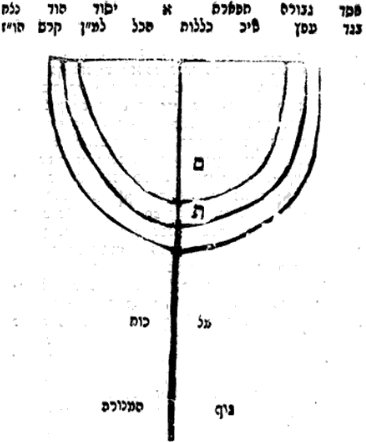

> ועוד מלכות נקראת נמלה ועליה נאמר (משלי ו ו) ראה דרכיה וחכם. ויסוד נמל בלא ערלה שהוא מילה וכן השכינה נקראת ברה סולת בלא סובין נקראת נמלה. ל' מצד החסד שכן ל' בבינה בסוד מגדל הפורח באויר. והוא נשפע מצד החסד. מ' בסוד התפארת שעל ידו נשפעים מימי החסד אליו. נ' מצד הגבורה בו נפילה. ס' היא המלכות שהיא סמוכה מצד קו הרחמים ובו סומך ה' לכל הנופלים. עפ"ץ בגבורה. ע' מצד החסד שבו עינות מים והתעוררת האהבה הוא בעינים וזהו עין ימין ועליו נאמר (תהלים ג יח) עין ה' אל יריאיו. וכן עין רואה וראיה בחסד. פ"ה מצד הת"ת שעולה מילה. וכן מי שם פה לאדם כו' הלא אנכי ה' (שמות ד יא). בינה ע"י התפארת. וכן קול יוצא מפ"ה שהוא התפארת. צ' מצד הגבורה כי עם היות שהוא דין מקום המשפט שמה הצדק דין צדי"ק. קר"ש בהוד וכאשר מתהפכת למדת הדין האותיות מתהפכות לשק"ר כי הוא גובר בסוד הקליפה הגוברת ע"י הדין. ק' מצד החסד שם קרוב ה' לכל קוראיו ושם קומץ ועל כל זה הוא נחש מפני השמאל כמו שנבאר. ר' מצד התפארת שהוא ראש לאבות קושר לשלשתן. וכן פירש בספר הבהיר למה נקרא שמים שהוא עגול כראש ופירשתי בשער המכריעין. ש' מצד הגבורה כי שם הבינה שרש האילן. ת' במלכות מצד הגבורה שעליה נאמר (יחזקאל ט ד) והתוית תיו. לפעמים ת' תמות ולפעמים ת' תחיה. הכל לפי הקבלה. זהו סדר האותיות למאי דסבירא לן אליבא דרשב"י ע"ה. ע"כ נצייר האותיות בכללות על דרך המנורה כזה

**27:3:4** And now we shall come to the explanation of each and every letter by itself, according to what is found in the words of Rashbi, peace be upon him, and the other commentators, with the help of YHVH and His salvation:

> ועתה נבא בביאור כל אות ואות לבדה כפי הנמצא בדברי הרשב"י ע"ה ושאר המפרשים בעזרת ה' וישועתו:

### Chapter 27:4. Explanation of the letter Alef.

**27:4:1** The letter Alef: the author of the Sefer ha-Temunah explained that its principal is in Keter, with the joining of the two attributes, which are Chokhmah and Binah; and this is the Vav in the middle, it is Keter. And it is above them all; and especially when we set it upright like this, א, and two Yods on its two sides are the two attributes. For to this hint the Yod that is in it on the right side is found looking upward, like this, א, hinting at Chokhmah, which looks upward to receive. The second Yod, which is Binah, looks downward, like this, א, to bestow to the lower ones; for she is the mother crouching upon the children to nurse them; and therefore she is called Shekhinah, for she causes to dwell and binds the two first ones with the seven days of the building. And he said further that the Alef is hinted, that it is Vav with two Yods, which comes to twenty-six. And the intent is to say that the Alef is the three first ones, and the principal is in Keter. And it is known that Keter bestows in Tiferet; for it is raised up to it by way of the middle line. And therefore the revealing of this letter is through Keter. And if so, it is found that the spirituality of this letter is a hint of its being included of the manifestation of the three first ones, Keter being principal and prevailing; and the portraying [of the Alef] is by way of Tiferet. And he said there that the dominion of this form and spirituality is at the hour of Venus [*Nogah*]. And there is one who explained that Tiferet is hinted in the Vav, and the two Yods are its two arms, and they are open to receive Malkhut and to embrace her. Or it may mean that the Vav is the arms stretched out to receive Malkhut, as we explained; and the first Yod is a hint to Chokhmah, from where it was emanated; and the second Yod a hint to Malkhut, the last Heh. And according to this the whole four-letter name is found in the form of Alef. And there is one who explained that Alef hints at the Supreme Crown, which is called Alef; and it is *pele* [wonder], from the language of "if there arise a matter too hard [*yippale*]" (Deut. 17:8); for it is concealed and hidden from the eye of all. And there is one who explained in another sense, and these are his words: "Alef has three sides: head and middle and end. The head is from the upper side, to which it is attached; and it points to the substance of wisdom and the memory of the power from which it is emanated. And the middle points to the substance of the intellect that multiplies from the wisdom; and the end points to the knowledge that multiplies from the intellect. And this is its form, ready to understand the work of the upper ones; and it is a beginning to found the lower ones. Therefore it is made one thing; and they are like the firstborn of knowledge, these three sides, an absolute effluence; and they draw power from this part that is before it, from the side of their equalization. And by their merit and their radiance they bore a receptacle for the emanated power, and the one lacking from them; which is the Gedulah seen in the ten sefirot, which is the totality of the branches of Chokhmah, which are in the upper roots beside Keter, in order to draw the power of strengthening in all the sefirot." And there is one who explained: the Supreme Crown is a great Alef, and it is a spirituality in the secret of the upper alphabet; the spirituality is head to every alphabet; and it is called Alef because it is true and first; and on it everything depends, in the secret of the form of Alef and "the middle bar," which bears the upper and the lower ones. And Rashbi, peace be upon him, explained in the Tikkunim (Tikkunei Zohar Chadash, fol. 117a), these are his words: "Alef: Yod above, Yod below; wisdom at the head and wisdom at the end; Vav, the binding of the two of them." Thus far his words.

> אות אלף פי' בעל ס' התמונה עקרה בכתר עם הצטרפות שתי המדות שהם חכמה ובינה וזהו ו' באמצע הוא כתר. והוא עליון על כלם ובפרט כשנקימה כזה א' ושני יודין משני צדדיה הם הב' מדות. כי לזה הרמז נמצא היו"ד שבה שבצד ימין מביט כלפי מעלה כזה א' רמוז אל החכמה שהיא מבטת כלפי מעלה לקבל. יו"ד שניה שהיא בינה מבטת כלפי מטה כזה א' להשפיע אל התחתונים כי היא האם הרובצת על הבנים להניקם. ולכן נקראת שכינה כי היא משכנת וקושרת הב' ראשונות עם הז' ימי הבנין. ואמר עוד כי הא' נרמזת שהוא ו' עם ב' יודי"ן שעולה כ"ו. והכונה לומר שהא' הם ג' ראשונות והעיקר בכתר וידוע הוא שהכתר משפיע בתפארת כי הוא מתעלה עדיו דרך קו האמצעי. ולכן גלוי האות הזה ע"י הכתר. ואם כן נמצא רוחניות האות הזה רמז היותו כלול ממציאות ג' ראשונות בהיות הכתר עיקר וגובר. והצטייר [א] דרך הת"ת. ואמר שם כי ממשלת הצורה והרוחניות הזה הוא בשעת נוגה. ויש שפי' כי תפארת רמז ו'. ושני יודי"ן הם ב' זרועותיו והם פתוחות לקבל המלכות ולחבקה. או ירצה הו' הם הזרועות הפשוטות לקבל המלכות כדפי', והיו"ד ראשונה רמז לחכמה שמשם נאצל, ויו"ד שנייה רמז למלכות ה' אחרונה. ולפי זה נמצא כל שם בן ד' בצורת א. ויש מי שפי' כי א' רומז לכתר עליון שנקרא אל"ף והוא פל"א מלשון כי יפלא (דברים יז ח) שהוא נעלם ונסתר מעין כל. ויש מי שפי' בענין אחר וז"ל א יש לה ג' צדדין ראש ואמצע וסוף. הראש הוא מצד העליון שהוא אדוק בו ומורה על ממשות החכמה וזכרון הכח שהיא נאצלת ממנו והאמצע מורה על ממשות השכל המתרבה מן החכמה והסוף מורה על המדע המתרבה מהשכל וזהו צורתה מזומנת להבין מעשה העליונים והיא תחלה לייסר התחתונים ע"כ נעשה דבר אחד והם כבכור הדעת אלו הג' צדדים שפע מוחלט ויונקים כח מזה החלק שלפניו מצד השוואתם. ובזכותם ובזיוום נוקבים בית קיבול לכח הנאצל והנעדר מהם שהיא הגדולה הנראית בע"ס שהיא כלל ענפי החכמה שהם בשרשי העליון אצל הכתר כדי למשוך כח החזוק בכל הספי'. ויש מי שפי' כ"ע אלף גדולה והיא רוחניות בסוד האלפא ביתא העליונה הרוחניות ראש לכל אלפא ביתא ונקרא אלף לפי שהוא אמתי וראשון ובו תלוי הכל בסוד צורת א' והבריח התיכון הסובל עליונים ותחתונים. והרשב"י ע"ה פי' בתיקונים (תקוני ז"ח דף קי"ז.) ז"ל א' יו"ד לעילא יו"ד לתתא חכמה בראש וחכמה בסוף ו' כריכא דתרווייהו עכ"ל.

**27:4:2** And its matter is that in the form of the Alef is the inclusion of three sefirot, which are Chokhmah and Malkhut, and they are two Yods (for Malkhut too is called Yod, as is explained in the Gate of Manifestations), and the Vav that is in the middle of the two of them is Tiferet, which unites them together; for through Tiferet Malkhut rises to Chokhmah. And elsewhere he said: "the second, Binah, as they established: at all events Alef is Binah," etc. And it appears that in Keter Alef is from the language of *pele*, which points to the utmost concealment.

> ועניינו כי בצורת האלף כללות שלש ספירות שהם חכמה ומלכות והם שני יודי"ן כי המלכות ג"כ נקראת יו"ד כמבואר בשער המציאות והוא"ו שבאמצע שניהם הוא הת"ת המיחדם יחד כי ע"י הת"ת תעלה המלכות אל החכמה. ובמ"א אמר תניינא בינה כמה דאוקמוה מ"מ אלף בינה וכו'. ונראה כי בכתר אלף מלשון פלא המורה על תכלית ההעלם.

**27:4:3** And further, just as Alef is first to the letters, so the Supreme Crown is the beginning of the Emanation. And in Binah, the language of *alef* is the language of teaching, from the language of "and I shall teach you [*a'allefkha*] wisdom" (Job 33:33); and likewise she is called Binah, the language of understanding.

> ועוד כמו שאלף ראשונה לאותיות כן כ"ע תחלת האצילות ובבינה לשון אלף הוא לשון לימוד מלשון ואאלפך חכמה (איוב לג לג) וכן נקראת בינה לשון הבנה.

**27:4:4** And further, in the Supreme Crown it is the large Alef specifically.

> ועוד כי בכ"ע הוא אלף רבתי דוקא.

**27:4:5** And further, in the Supreme Crown it is from the language of *alluf* [chief], that is to say, great; for the Supreme Crown is chief to all the Emanation. And by all the explanations it points in it to the concealment. And in Tiferet it is also the large Alef, when it is concealed in Keter, as we explained in the Gate of Manifestations.

> ועוד כי בכ"ע מלשון אלוף ר"ל גדול שכ"ע אלוף לכל האצילות. ולכל הפי' הוא מורה בו על ההעלם. ובת"ת הוא ג"כ אלף רבתי כשהוא מתעלם בכתר כדפי' בשער המציאות.

**27:4:6** And further, there is a small Alef, and it is hinted in Malkhut, to hint that she is first from below to above. And others explained: to hint that she is concealed from the lower ones, from the language of *pele*. And it is already possible to explain it in the language of *alluf*: for as the relation of Keter to the Emanation, so is the relation of Malkhut to all that is beneath her. And it is possible that it is the language of teaching, as "and I shall teach you wisdom"; for she is what makes the prophets wise and shows them the upper Emanation. Further, Alef hints at Gedulah, Gevurah, Tiferet; and likewise it hints at three in the manifestation of Chesed, and all is Chesed. And likewise it hints: Binah, the upper Yod; Malkhut, the lower Yod; Vav in the middle, Tiferet, which holds the two of them in the secret of the union. And these three explanations Rashbi, peace be upon him, explained, and we wrote them in the Gate of Names, with the help of Heaven. And in the Zohar, Parashat Acharei (fol. 73a), these are his words: "And come and see: the first word of the Torah that they give to children, Alef-Bet: this is a word that the people of the world cannot cleave to with understanding and cannot raise with desire; and all the more to speak with their mouth. And even upper angels, and the upper ones of the upper ones, cannot cleave to it, because they are the closed things of the holy Name. And a thousand and four hundred and five myriad worlds all hang on the thorn of the Alef. And seventy-two holy names engraved in inscribed letters, on which the upper and the lower ones stand, the heavens and the earth and the Throne of glory of the King, hang from one side to one side. For the extension of the Alef is the sustaining of all the worlds, and the supports of the upper and lower ones, in the secret of wisdom. And enclosed tracks and deep rivers and ten utterances all go out from that lower thorn that is beneath the Alef. From here onward the Alef begins to spread out into the Bet. And there is no reckoning to the wisdom that is engraved here." Thus far his words, as relevant to our matter. And the reason for the concealment of these worlds in the Alef is because the Alef is a hint at Keter. And it is already known that in Keter all the worlds and all the Emanation were included before the spreading out, as we explained in the preceding gates. And therefore all the things mentioned in the saying were included in it: the letter Alef, which is Keter, *pele*, *alef*. Or it is possible, as we explained above, that Alef is in Chesed, the head of the revealing in seven days; and it is a letter that includes all the letters, as we explained above in the previous chapter. Further, he explained (in the Zohar Chadash, Song of Songs, fol. 77) that Alef is a Yod at the head, Chokhmah; Vav, Tiferet; and a Yod below, Malkhut; and the thorn of the lower Yod is a hint at all the camps that are beneath her, small and great, outer and inner, included in Malkhut, who is the very self of the Yod:

> ועוד יש אלף קטנה והיא רמוזה במלכות לרמוז שהיא ראשונה ממטה למעלה. ואחרים פי' לרמוז שהיא נעלמת מן התחתונים מלשון פלא. וכבר אפשר לפרשו בלשון אלף כי כערך הכתר אל האצילות כן ערך המלכות לכל אשר תחתיה. ואפשר להיות לשון למוד כמו ואאלפך חכמה כי היא המחכמת הנביאים ומראה להם האצילות העליון. עוד אלף היא רומזת גדולה גבורה ת"ת. וכן רומז שלשה במציאות החסד וכלא חסד. וכן רומז בינה יו"ד עליונה, מלכות יו"ד תחתונה, ו' באמצע ת"ת האוחז בשתיהן בסוד היחוד. וג' פי' האלו פירשם הרשב"י ע"ה וכתבנו בשער השמות בס"ד. ובזהר פ' אחרי (דף ע"ג.) וז"ל ות"ח מלה קדמאה דאורייתא דיהבין לינוקי אלף בית דא מלה דלא יכלין בני עלמא לאדבקא בסוכלתנו ולסלקא ליה ברעותא וכ"ש למללא בפומיהון ואפילו מלאכי עילאי ועילאי דעילאי לא יכלין לאדבקא בגין דאינון סתימין דשמא קדישא. ואלף וד' מאה וחמש רבוא עלמין כולהו תליין בקוצא דאל"ף. וע"ב שמהן קדישין גליפין באתווי רשימין דקיימי בהו עלאי ותתאי שמיא וארעא וכרסייא יקרא דמלכא תליין מסטרא חדא לסטרא חדא. דפשיטותא דאלף קיומא דעלמין כלהו וסמכין דעלאין ותתאין ברזא דחכמתא. ושבילין סתימין ונהרין עמיקין ועשר אמירן כלהו נפקין מההוא קוצא תתאה דתחות א'. מכאן והלאה שארי לאפשטא אלף בבית. ולית חשבן לחכמתא דהכא אתגליף עכ"ל לענייננו. וטעם העלם העולמות האלה באלף הוא מפני שהא' הרמז בכתר. וכבר נודע שהכתר בו היו נכללים כל העולמות וכל האצי' קודם ההתפשטות כמו שפי' בשערים הקודמים. ולכן נכללו בו כל הדברים הנזכר במאמר אות אלף שהיא כתר פלא אלף. או אפשר כדפי' לעיל כי אלף הוא בחסד ראש ההתגלות בז' ימים והיא אות כוללת כל האותיות כדפי' לעיל בפ' הקודם. עוד פי' (בז"ח שה"ש דף ע"ז) כי אלף הוא יו"ד בראש חכמה, ו' ת"ת, ויו"ד למטה מלכות, ועוקץ של יו"ד התחתון הוא רמז לכל המחנות אשר תחתיה קטנים וגדולים חצוניים ופנימיים כלולים במלכות שהיא עצם היו"ד:

### Chapter 27:5. Explanation of the letter Bet.

**27:5:1** On the letter Bet we shall copy the language of the Sefer ha-Temunah and what appears to us in its explanation: "Bet: from its form they make Dalet-Vav; and this is its form:

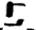

. And it is two paths, to the upper and the lower Wisdom; and its portraying points to two attributes; for it includes Tiferet, that is to say, the court of the Holy One, blessed be He," etc. Thus far his words.

> באות בי"ת נעתיק לשון ספר התמונה והנראה לנו בפירושו. ב' מצורתה עושים ד' ו' וזו צורתה
>
>  והיא ב' נתיבות לחכמה עלאה ותתאה וציורה מורה שני מדות כי היא כוללת לת"ת ר"ל בית דינו של הקב"ה [ב] וכו' עכ"ל.

**27:5:2** And his intent is to say that the Bet hints at Chokhmah. However, the hint in it is that it is Dalet-Vav [*du*, two]; and they are the two faces [*du partzufin*], which are Tiferet and Malkhut, of which it is said, "they were created with two faces." And they are two together when they are in Chokhmah; for then she rises in the degree of the rib, which was in Chokhmah, a rib to Tiferet. For one should not think that the diminishment of the moon and the matter of "and He took one of his ribs" (Gen. 2:21) are all one matter. Rather, "and He took one of his ribs" is in their emanation in Chokhmah, where they were included as one, united, like Adam, who was with his wife two-faced. And there, from Chokhmah, they were divided into two, and he entered Binah and she brought her to him; and there they were "two great lights" (Gen. 1:16). And afterward was the diminishment of the moon; for it is a matter by itself. And because they are *du* in Chokhmah, therefore the filling of the Yod is Dalet-Vav; for the filling and the impregnation of the Yod is Chokhmah, and its paths are the two faces. And it has already been explained that the Bet that is in Chokhmah is the hint to the paths, as it is written (Prov. 8:2), "in the house [*beit*] of the paths she stands." And therefore the portraying of the Bet is a hint to the two faces, which are two sefirot below. And this is what he said, "and its portraying, two attributes." And we explained this matter at length in the Gate of the Diminishment of the Moon, chapter 4. And what he said, that it is a house for Tiferet: the intent is that the thirty-two paths are also in Tiferet, as is explained in the preceding gates; and likewise thirty-two [LaV] and *lulav* are hinted in it; for the four-letter name comes to twenty-six, and six extremities, they are thirty-two. And therefore Malkhut too is a house, for she is a house for Tiferet, to conduct the world, whether for judgment or for compassion. The rule that emerges: the spirituality of the Bet hints at Chokhmah with its thirty-two paths that are in the two faces; and it includes Malkhut, who draws from Gevurah; for the force of judgment is the cause of her blemish and her fullness, as is known; therefore its dominion is at the hour of the moon. Thus far. And there is one who explained that the Bet is Malkhut; and because she was united with her husband, his two arms with which he embraced her were portrayed in her, and he is in the middle, like this:

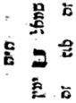

. And this is in the secret of "Set me as a seal" (Song 8:6): that his form remain engraved in her. And the thorn of the Bet is a Yod, to hint that she was emanated from Chokhmah. And close to this matter is found in the Tikkunim: that the Bet is three Vavs, three pillars, which are  V H V,  Y L Y,  S Y Ṭ, the Patriarchs supporting the Shekhinah, as we explained in the Gate of Manifestations, in the manifestation of the Heh that is in Malkhut. And most of the commentators agreed that the Bet is in Chokhmah; and Rabbi Moshe [de León] explained the reason: that it is second; and its thorn is to show that there is above a manifestation subtler than all subtle. And there is one who explained close to this matter in another sense, and these are his words: "Bet has two sides in its substance, going out on the side; two sides, behind it and before it; and it is open, in order to receive the addition of the holy spirit from the side of the Alef, like words in the mouth of a disciple; and it is the house; and its form is ready to contain the principal of the unity. And this is the explanation of its matters and the understanding of its proofs, in the discernment of wisdom and the precision of intellect." And Rashbi, peace be upon him, in the Ra'aya Meheimna (Pinchas, fol. 256b), explained, these are his words: "*Anokhi* [I] (Exod. 20:2): in it Kaf, Keter; and in it Ayin. And it is called Keter from the side of the upper Mother; for the going out from Egypt is mentioned toward her fifty times in the Torah. And she is the Bet of *Bereshit*, which includes ten utterances from the side of Chokhmah, the daughter of Yod," etc. Thus far his words.

> וכוונתו הוא לומר כי הב' רומז לחכמה. ואולם הרמז בה כי היא ד"ו והם ד"ו פרצופין שהם ת"ת ומלכות שעליהם נאמר ד"ו פרצופין נבראו. והם ד"ו ביחד כאשר הם בחכמה כי אז תעלה היא במעלת הצלע שהיתה בחכמה צלע אל התפארת. כי אין לחשוב כי מיעוט הירח וענין ויקח אחת מצלעותיו הכל ענין אחד. אלא ויקח אחת מצלעותיו הוא באצילותם בחכמה שהיו שם נכללים כאחד מיוחד כאדם שהיה עם אשתו ד"ו פרצופין. ושם מחכמה נתחלקו לשנים ונכנס בבינה והביאה אליו ושם היו שני מאורות גדולים. ואחר כך היה מיעוט הירח כי הוא ענין בפני עצמו. ולפי שהם ד"ו בחכמה לכן מלוי היו"ד ד"ו כי מלואו ועבורו של יו"ד היא חכמה ונתיבותיה הם ד"ו פרצופין וכבר נתבאר כי בית שבחכמה הרמז אל הנתיבות. כדכתיב (משלי ח') בית נתיבות נצבה. ולכן ציור הב' רמז לד"ו פרצופין שהם למטה ב' ספירות. וז"ש וציורה שני מדות. ובארנו הענין הזה בארוכה בשער מיעוט הירח פ"ד. ומ"ש כי הוא בית לתפארת, הכונה כי הל"ב נתיבות הם גם כן בתפארת כמו שנתבאר בשערים הקודמים וכן נרמז בו הל"ב ולול"ב כי שם בן ד' עולה כ"ו ושש קצוות הם ל"ב. ולכן המלכות היא גם כן בית כי היא בית לתפארת לנהג העולם אם לדין אם לרחמים. הכלל העולה כי רוחניות הב' רומז לחכמה עם ל"ב נתיבותיה שבד"ו פרצופין והיא כוללת המלכות היונקת מן הגבורה כי תוקף הדין סבת פגימתה, ומלואה כנודע לכן בשעת הלבנה ממשלתה ע"כ. ויש מי שפי' כי הב' היא מלכות ומפני שנתייחדה בבעלה נצטיירו בה ב' זרועותיו שחבקה בהם והוא באמצע כזה
>
>  וזהו בסוד שימני כחותם שישאר צורתו חקוק בה. ועוקץ הבית הוא יוד לרמוז שנאצלה מחכמה. וקרוב לענין זה נמצא בתקונים כי הבי"ת היא ג' ווי"ן ג' עמודים שהם ויס"ע ויב"א וי"ט אבות סומכים לשכינה כדפירש בשער המציאיות במציאות ה' שבמלכות. ורוב המפרשים הסכימו כי הבית בחכמה וביאר רבי משה הטעם שהיא שניה. ועוקצה להורות שיש למעלה מציאות דק מכל דק. ויש מי שפירש קרוב לענין זה בענין אחר וז"ל ב' יש שני צדדין בממשותה יוצא על הצד השני צדדים מאחריה ומלפניה והוא פתוחה כדי לקבל תוס' רוח הקודש מצד האל"ף כמו דברים בפי תלמיד והיא הבית וצורתה מזומנת להכיל עיקר האחדות וזהו ביאור ענייניה ותבונת ראיותיה בהבחנת החכמה ובדקדוק שכל. והרשב"י ע"ה בר"מ [פנחס דרנ"ו ע"ב) פי' ז"ל אנכי ביה כ' כתר וביה אי"ן, וכתר אתקרי מסטרא דאימא עילאה דאדכר לגבה חמשין זמנין יציאת מצרים באוריי', ואיהי ב"ת מן בראשית דכלילא י' אמירן מסטרא דחכמה בת י' כו' עכ"ל.

**27:5:3** And its explanation: he comes to explain "I am YHVH your God"; and he said that in the word *Anokhi* is the hint to Keter; and in *Anokhi* are the letters Ayin, which is Keter; and there is Kaf, which is Keter. And he explained to us that it is called Keter from the side of Binah, as we explained in the Glossary of Titles; and for this reason the going out from Egypt is mentioned there; as it is known that fifty times the going out from Egypt is mentioned in the Torah, to hint at the fifty gates of Binah, as we explained in the Gate of Fifty Gates. And he said that Binah is the Bet of *Bereshit*. The intent of this length is to explain how the ten Commandments were divided, five in the first and five in the last; it is from the side of the ten Commandments that are in Chokhmah, which are bestowed to Binah. And for this reason he said of her "Yod": "Through wisdom is a house built" (Prov. 24:3).

> וביאורו כי הוא בא לבאר אנכי ה' אלהיך ואמר כי במלת אנכי הרמז לכתר ובאנכי יש אותיות אי"ן שהוא הכתר ויש כ' שהוא הכתר. ופי' לנו כי נקרא כתר מצד הבינה כאשר בארנו בערכי הכנויים ומטעם זה שנזכר שם יציאת מצרים כמו שנודע שחמשים פעמים נזכר יציאת מצרים בתו' לרמוז אל נ' שערי בינה כאשר ביארנו בשער נ' שערים. ואמר כי הבינה היא בית מבראשית. כוונת האריכות הזה הוא לבאר איך נתחלקו י' דברות ה' בה' ראשונה וה' בה' אחרונה היא מצד י' דברות אשר בחכמה הנשפעות אל הבינה. ומטעם זה אמר בה י'. בחכמה יבנה בית (משלי כד ג) [ג].

**27:5:4** And behold, according to this saying, Bet is Binah.

> והנה לפי המאמר הזה ב' היא הבינה.

**27:5:5** And further, in the Song of Songs of Rashbi, peace be upon him: "Alef, male; Bet, female." And behold, the female is not in Chokhmah, as is known. And in truth all this is the reverse of his words in other places, where he explained that Bet is always in Chokhmah. And to answer this it seems to me to say that by what he said, "Through wisdom is a house built," and likewise in other places, that Yod is the spring to the garden, which is Binah, everything is answered. For since the Yod builds the house, if so it is required that the root of the house and its subtle manifestation be concealed in its source; and if so they are two houses: a house concealed in Chokhmah, and a house in Binah. Further, there is a small house; it is Malkhut; and its source is Tiferet, and the spring Yesod, as this is explained in the words of Rashbi, peace be upon him:

> ועוד בשיר השירים להרשב"י ע"ה א' דכר ב' נוקבא והנה נקיבה אינה בחכמה כנודע. ועל האמת כל זה הפך דבריו במקומות אחרים שפי' כי ב' לעולם היא בחכמה. ולתרץ זה נ"ל לומר כי במה שאמר בחכמה יבנה בית וכן במקומות אחרים כי י' מעיין אל הגן שהיא הבינה יתורץ הכל כי אחר שהיו"ד היא בונה הבית א"כ חוייב היות שרש הבית ומציאותה הדק נעלם במקורה וא"כ הם שני ביתים בית נעלמת בחכמה ובית בבינה. עוד יש בית זעירא היא המלכות ומקורה הוא הת"ת והמעיין היסוד כמו שנתבאר זה בדברי הרשב"י ע"ה:

### Chapter 27:6. Explanation of the letter Gimel.

**27:6:1** The letter Gimel. What is explained from the words of the author of the Sefer ha-Temunah is that the power of this letter is in Binah; and therefore it is third. And it is called Gimel from the language of *gomel* [bestowing], for it bestows on all through the completion of the extremes to the mean; that is to say, judgment and compassion are changed, and through it the actions go out to act with speed; for it is also from the language of "and bore [*va-yigmol*] almonds" (Num. 17:23). And these two things are clear: for from her Gevurah receives compassion and is washed in the milk of the mother, as we explained in the Gate of Essence and Governance, chapter 6. And therefore, when she (receives) [sweetens] the judgment, peace is found between judgment and Chesed. And likewise all seven sefirot of the building receive from her, and through her act with speed. And in their form, Vav and Zayin; for the Zayin is a hint in Netzach, and the Vav a hint in Tiferet, as will be explained. Therefore this spiritual form hints that its principal drawing is from Binah, and it is portrayed in its form through Tiferet and Netzach; and therefore its dominion is through the sun, which is in Tiferet, as is known. And there are those who explained: the head of the Gimel is a Yod that has four thorns, which are Keter above, and Chokhmah to the right, and Binah to the left, and Chesed beneath the three of them; this is the form of the head of the Gimel. And the Vav, which is upright, is Tiferet; and the leg, which is stretched out, is the right hand stretched out to receive those who return; and the thorn is a hint to Malkhut; and it is the recompense [*gemul*] of the righteous, who sit with their diadems on their heads. And there is one who explained that Gimel hints at Chesed, because it does good [*gomel tov*] to the guilty and purifies them. And there is one who explained in another sense, these are his words: "Gimel has two sides: a staff, and the wood of the staff is held in its middle, after the pattern of radiance, made to receive the effluence of the letters from above to below; and it is open in front, in order to bestow of that power in the letters that are below it. And it has a window after its pattern; because all the letters are forms standing in the equalization of the windows that were created within them; and they are like shining mirrors, like glass dyed in kinds of colors, ready to complete a work with them." And there are those who explained as an acronym of  B G D: *Binah gomel dallim* [Binah bestows on the poor]. And the poor are Yesod and Malkhut, and they were called poor, as is explained in the Glossary of Titles; and they receive from Binah. And likewise she also does kindnesses, in the secret of her bestowal by way of Chesed; and that is its thorn toward the right, the channel of the effluence:

> באות ג'. המתבאר מתוך דברי ס' בעל התמונה כי האות הזה כחה בבינה ולכן היא שלישית. ונקראת גימ"ל מלשון גומל כי גומלת לכל ע"י השלמת הקצוות אל המצוע. ר"ל ישתנה הדין והרחמים וע"י תצאנה הפעולות לפעול במהירות כי הוא ג"כ מלשון ויגמל שקדים (במדבר יז כג). ושני הדברים האלה מבוארים כי ממנה מקבלת הגבורה רחמים ומתרחצת בחלב האם כדפי' בשער מהות והנהגה פ"ו. ולכן כשהיא (מקבלת) [ממתיק] הדין נמצא שלום בין הדין והחסד. וכן כל ז' ספי' הבנין מקבלות ממנה ועל ידה פועלות במהירות. ובצורתם ו' ז' כי הזיין רמז בנצח והו' רמז בת"ת כאשר יתבאר. לכן ירמוז הצורה הרוחניות הזאת עיקר יניקתה מן הבינה ומצטיירת בצורתה ע"י הת"ת והנצח ולפי' ממשלתה ע"י החמה שהוא בת"ת כנודע. ויש שפי' ראש ג' הוא יו"ד שיש לה ד' עוקצים שהם כתר למעלה וחכמה אל הימין ובינה אל השמאל וחסד תחת שלשתם זהו צורת הראש של הג'. והו"או שהיא זקופה הוא הת"ת והרגל שהוא מתוח הוא הימין הפשוטה לקבל שבים והעוקץ רמז למלכות והוא גמול הצדיקים היושבים ועטרותיהם בראשיהם. ויש מי שפי' גימ"ל רומז לחסד בשביל שגומל טוב לחייבים ומטהרם. ויש מי שפי' בענין אחר ז"ל ג' יש לה ב' צדדים מטה ועץ המטה אחוז באמצעיתו דוגמא של זוהר עשוי לקבל שפע האותיות של מעלה למטה והיא פתוחה לפנים כדי להשפיע מאותו כח באותיות שלמטה ממנה ויש לה חלון כדוגמתה מפני שכל האותיות הם צורות עומדת בהשוואת החלונות שנבראו בתוכם והם כמו אספקליראות מאירות דומות לזכוכית צבוע במיני צבעונים מזומנים לגמור בהם מעשה. ויש שפי' בראשי תיבות בג"ד בינה גמול דלים. והדלים הם יסוד ומלכות ונקראו עניים כמו שנתבאר בערכי הכנויים והם מקבלים מן הבינה. וכן היא ג"כ גומלת חסדים בסוד השפעתה דרך החסד והיינו עוקצה אל הימין צנור השפע:

### Chapter 27:7. [Explanation of the letter Dalet.]

**27:7:1** The letter Dalet: he said in the Sefer ha-Temunah that it is hinted in Chesed; and so it is fourth in the simple number. And he said that it is a simple form, which has no joining with another; and it looks to Tiferet, which is the Vav. And he did not say that it looks to the Heh, because in the Heh too there is the Dalet; and through this it looks to the Vav. And it is found according to this that the spirituality of the letter receives from Chesed and from compassion, which is Tiferet. And he said that it is called Dalet from the language of "and the hair [*dallat*] of your head like purple" (Song 7:6), whose explanation is the matter of separation, from the language of singleness; as the part of the head that is separated from its fellow. And likewise this letter is single in its form, for it does not join in another form. And he said that its dominion is at the hour of Mercury [*Kokhav*]. And there is one who explained that the Dalet is the explanation of the Gimel; that is, as he explained above concerning the Gimel, that at its head it has four thorns, etc.; except that this one is reversed, to hint at the wicked, who overturn the upper things and confound "their father's couch" (Gen. 49:4); and therefore death is turned for them from life, God forbid. But the Gimel, which is the recompense of the righteous, they sit with their crowns on their heads, as we explained above in the letter Gimel. And there is one who explained that Dalet hints at the Diadem, who stands at the door [*delet*] of the King like a poor woman. And there is one who explained in another sense, and these are his words: "Dalet has two sides, a stretched side and a supported side; and it is a mould to complete the matter of the elements, attached in the middle of the Gimel; and its window has substance in it, to contain from all its sides, from below and not from above; and nevertheless it is called the essence of formation." And therefore, according to the Zohar, the Shekhinah is called *delet*; and she is so called when she is poor [*dalah*] in poverty; and the thorn of the Dalet hints at Yesod, which joins her with Tiferet, in the secret of "for all [*kol*] that is in the heaven and in the earth" (1 Chron. 29:11). And this is explained in the Ra'aya Meheimna and in many places. Also it hints at Binah; for so Rashbi, peace be upon him, explained (in the Zohar, Mishpatim, fol. 123b), these are his words: "Heh was Dalet; when the male joined with her, she conceived one son and was called Heh." Thus far his words; and we copied it in the Gate of Names, chapter 1.

> באות ד' אמר בספר התמונה כי היא נרמזת בחסד וכן היא רביעית במספר הפשוט. ואמר כי היא צורה פשוטה שאין לה חיבור עם זולתה והיא מבטת לתפארת שהוא הו"או. ולא אמר שהיא מבטת לה' מפני שבה"א ג"כ הדל"ת ועי"ז מבטת לוא"ו. ונמצא לפי זה רוחניות האות מקבלת מהחסד ומרחמים שהוא הת"ת. ואמר כי נקרא דל"ת מלשון ודלת ראשך כארגמן (שה"ש ז ו) שפי' ענין הבדלה מלשון יחידות. כמו חלק הראש המובדלת מחברתה וכן האות הזאת יחידה בצורתה שאינה מצטרפת בצורה אחרת ואמר כי ממשלתה בשעת ככב. ויש מי שפי' כי הד' פי' של ג' דהיינו כמו שפי' למעלה בגימ"ל שבראשו יש לה ד' עוקצים וכו' אלא שזאת הפוכה. לרמוז אל הרשעים המהפכים הדברים העליונים ומבלבלים יצועי אביהם ולכן נהפך להם מות מחיים ח"ו אבל הג' שהוא גמול הצדיקים הם יושבים ועטרותיהם בראשיהם כדפי' לעיל באות גימ"ל. ויש מי שפי' ד' רומזת לעטרת שעומדת בדלת של המלך כעניה. ויש מי שפי' בענין אחר וז"ל ד' יש לה ב' צדדים צד נטוי וצד סמוך והיא דפוס להשלים חומר היסודות דבוקה באמצע הג' וחלון שלה יש בו ממשות להכיל מכל צדדיה מלמטה ולא מלמעלה ועכ"ז נקרא מהות היצירה. ולכן ע"פ הזהר השכינה נקראת דלת ונקרא כן כשהיא דלה במסכנות וקוצה של הדלת רומז ליסוד המחברה עם התפארת בסוד כי כל בשמים ובארץ (דה"א כט). וזה נתבאר בר"מ ובמקומות רבים. גם היא תרמוז בבינ"ה כי כן באר הרשב"י ע"ה (בזהר משפטים דף קכ"ג ע"ב) וז"ל ה' ד' הות מדאתחבר דכורא עמה אתעברת מחד בן ואקרי ה' עכ"ל, והעתקנוהו בשער השמות בפ"א.

**27:7:2** And behold, he said that Binah, which is Heh, its principal is Dalet; and the manifestation of the Dalet is its thorn, which is Chokhmah; and "the river spreads out from here and from here": that is, the spreading out of Binah from the right, which is Chesed, and from the left, which is Gevurah. You are found to say that the manifestation of the Dalet is also in Binah, in the secret of her spreading out in Chesed and Gevurah; and we have already spoken at length on this, all that is needed, in the gate mentioned. And the language of *dalet* in Binah will not be the language of poverty, but the language of "my eyes are lifted [*dallu*] upward" (Isa. 38:14); and likewise the language of the Mishnah (Pe'ah, ch. 4), "on a trellis [*dalit*] and on a palm," which is the language of height:

> והנה אמר כי הבינה שהיא ה' עיקרה דלת ומציאות הדלת היינו עוקצה שהיא חכמה ופשיט נהרא מכאן ומכאן דהיינו התפשטות הבינה מן הימין שהוא החסד ומן השמאל שהיא הגבורה. נמצאת אומר שמציאות הד' גם בבינה בסוד התפשטותה בחסד וגבורה, וכבר הארכנו בזה כל הצורך בשער הנזכר. ולשון דלת בבינה לא תהיה לשון דלות, אלא לשון דלו עיני למרום (ישעיה לח יד). וכן לשון משנה (פאה פ"ד) בדלית ובדקל, שהוא לשון גובה:

### Chapter 27:8. Explanation of the letter Heh.

**27:8:1** The letter Heh: he explained in the Sefer ha-Temunah that its principal is in Gevurah. However, it is also in Malkhut, as is known in the matter of the four-letter name. And he said that it is a hint that the attribute of judgment can act harshly and softly; and he said that all this is by the power of Binah. And it is true that through her the judgment is softened or strengthened, as we explained above; and therefore it hints also at Binah. And its form is *yad* [hand, Yod-Dalet]; and we have found *yad* for good, as "with a high hand," "the great hand" (Exod. 14:8, 31), "Is YHVH's hand waxed short?" (Num. 11:23); and *yad* for judgment: "For indeed the hand of YHVH was against them" (Deut. 2:15). And likewise there are many hands, as we explained in the Gate of the Glossary of Titles. In brief: the spiritual form of this letter receives its principal from Gevurah, but receives also from Binah; and through her the judgment is softened, and it becomes soft below in its receiving from her. And its dominion is at the hour of the moon; for therefore it is hinted in Malkhut, the power of the moon. And there is one who explained that the letter Heh is Malkhut; and its Dalet points to half a round threshing floor; and in the middle of the half threshing floor, which are the seventy of the Sanhedrin, the father of the court stands, and he is the small Vav that is beneath the Dalet. And all is hinted in Malkhut; for she is the source of judgment; and she is the moon that stands like half a threshing floor, like the moon; and the point in the middle is its fullness. Further, he explained in another manner: that the Dalet is a hint to Malkhut, and the small Vav a hint to Metatron, the son of the Shekhinah; and he sucks from between the breasts of his mother. And this is somewhat right according to what we wrote on the matter of the explanation of the Heh in the Gate of Names, in the four-letter name. Further, he said a correct matter: that the Heh is the Shekhinah standing upon the four living creatures of the Chariot, and they are  A B   G D; and it is fine. And there is one who explained in another sense, these are his words: "Heh stands in its pattern, open, in order to receive effluence from every side; and open opposite it, before it; for all the letters draw from it, after the manner of the effluence that it draws. And it is closed from above, so that the effluence not spread out to go outside it." And likewise we have already explained in the Gate of the Four-Letter Name and in the Gate of Gates that the manifestation of the Heh is in two places, which are Binah and Malkhut; and in both of them in one way; for the manifestation of the form of the Heh is three Yesods [three Vavs]; and they are in Binah because they were emanated through her, and in Malkhut because they bestow in her, and she is adorned through them in the secret of the coupling, as we explained in the Gate of the Order of the Emanation.

> באות ה' פי' בספר התמונה כי עקרה בגבורה. אמנם היא ג"כ במלכות כנודע בענין שם בן ד'. ואמר כי הוא רמז שמדת הדין יכול לפעול בקש"ה ורפ"ה. ואמר כי כל זה בכח הבינה, ואמת כי על ידיה יתרפה הדין או יתחזק כמו שפי' למעלה ולכן תרמוז ג"כ בבינה. וצורתה י"ד ומצינו י"ד לטובה כמו בי"ד רמה, את הי"ד הגדולה (שמות יד). היד ה' תקצר (במדבר יא כג). וי"ד לדין וגם יד ה' היתה בם (דברים ב טו). וכן יש ידות הרבה כמו שבארנו בשער ערכי הכנויים. הקיצור הצורה הרוחניות של אות זה מקבלת עיקרה מגבורה אבל מקבלת גם מבינ"ה ועל ידה יתרפה הדין ותעשה רפה למטה בקבלתה ממנה. ובשעת לבנה ממשלתה כי על כן היא נרמזת במלכות כח הלבנה. ויש מי שפי' כי אות ה' היא המלכות והד' שלה מורה על חצי גורן עגולה ובאמצע החצי גורן שהם ע' סנהדרין האב ב"ד עומד והוא הוא"ו קטנה שתחת הדלת. והכל נרמז במלכות כי היא מוצא הדין והיא הירח העומדת כחצי גורן כירח והנקודה באמצע מלואו. עוד פי' באופן אחר כי הדלת רמז למלכות והוא"ו קטנה רמז למטטרון בנה של השכינה והוא יונק מבין שדי אמו. וזה צודק קצת לפי מה שכתבנו בענין פי' הה' בשער השמות בשם בן ד'. עוד אמר ענין נכון כי הה"א היא השכינה עומדת על ד' חיות המרכבה והם א"ב ג"ד ויפה הוא. ויש מי שפי' בענין אחר ז"ל ה' נצבת בדוגמתה פתוחה כדי לקבל שפע מכל צד ופתוחה כנגדה לפניה כי להיות שיונקות כל האותיות ממנה כדרך השפע שהיא יונקת. והיא סתומה מלמעלה כדי שלא יתפשט השפע לצאת חוץ ממנה. וכן כבר בארנו בשער שם בן ד' ובשער השערים כי מציאות הה' היא בשני מקומות שהם בינה ומלכות ובשתיהן על דרך א' כי מציאות צורת הה"א ג' יסו"ד. והם בבינה מפני שנאצלו על ידה. ובמלכות מפני שמשפיעים בה והיא מתקשטת על ידם בסוד הזיווג כדפי' בשער סדר האצילות.

**27:8:2** And behold, Malkhut is poor [Dalet] when she draws from the two extremes, from the right and from the left; and then the serpent seeks to suck; until she receives from the middle and her husband is portrayed in her, that is, Vav, whether it be the Vav of Tiferet itself or the Vav of Yesod; then she is full of all good; and that is Heh, made a vessel:

> והנה המלכות היא דלה בהיותה יונקת משתי הקצוות מן הימין ומן השמאל. ואז הנחש מבקש לינק. עד שמקבלת מן האמצע ומצטיירת בעלה בה דהיינו ו' בין שיהיה ו' של ת"ת ממש או ו' של יסוד אז היא מלאה כל טוב והיינו ה' עשויה כלי:

### Chapter 27:9. Explanation of the letter Vav.

**27:9:1** The letter Vav: he said in the Sefer ha-Temunah that it is in Tiferet; and it is well known. And he said that it is simple, to hint that it is a pillar for the world. And it is possible to say the reason: that at first the Holy One, blessed be He, created the world in judgment; and when He saw that the world would not endure, He associated compassion with it; behold, the compassion is the cause of the endurance of the world; and therefore the compassion is a pillar supporting the world. And he said that its face is turned away from the Heh, to hint that the Heh is judgment in which there is no compassion. And it is possible to say the reason is that it inclines toward Chesed and turns its face from judgment. Or it is possible that it looks to the Zayin that is before it, for it bestows in it, as we shall explain. And he said that it watches above, toward Keter, to receive, and watches below, to bestow to Malkhut, as is known. And he said that its dominion is at the hour of the sun; for so it is titled, as it is said (Ps. 84:12), "For YHVH God is a sun and shield."

> באות ו אמר בספר התמונה שהיא בת"ת ומפורסם הוא ואמר כי היא פשוטה לרמוז כי הוא עמוד לעולם. ואפשר לומר הטעם כי קודם ברא הקב"ה העולם בדין וכשראה שאין העולם מתקיים שתף עמו רחמים הרי שהרחמים הם סבת קיום העולם ולכן הרחמים עמוד סומך העולם. ואמר כי פניו הפוכים מן הה"א לרמוז כי הה"א הוא דין שאין בו רחמים. וכן אפשר לומר הטעם כי הוא מטה כלפי חסד ומחזיר פניו מן הדין. או אפשר כי הוא מביט לזיי"ן שלפניה שהוא משפיע בה כאשר נבאר. ואמר כי הוא משגיח מעלה כנגד הכתר לקבל ומשגיח מטה להשפיע למלכות כנודע. ואמר כי ממשלתה בשעת חמה כי כן הוא מכונה שנאמר כי שמש ומגן ה' אלדים (תהלים פד יב).

**27:9:2** And there is one who explained in another sense, these are his words: "Vav stands in this form, to inscribe in it the form of nature, and to find in it a hidden pattern; and what is recognized in this form is called the primordial matter." And therefore it is true that the place specific to it is Tiferet; however, the hint to it is when it is bound and included of six extremities, which are Gedulah, Gevurah, Tiferet, Netzach, Hod, Yesod. And to hint at its beauty in this inclusion, it is called Vav, which comes to six. And it is long; for it is the river that waters, by way of concealment, in the secret of Da'at, all the other plantings of the garden, as is explained in the preceding gates; and almost then it is called the soul of Tiferet, as we hinted there. And when the Vav is in Tiferet, it is called the upper Vav, or Vav without qualification; however, sometimes Yesod is called the small Vav or the lower Vav; because it too is included of six extremities, like Tiferet itself; for "all that happened to Jacob happened to Joseph," for "body and covenant are counted as one," as is explained in the words of Rashbi, peace be upon him, in many places. However, there is another Vav, and it is at the head of Keter; we explained it in the Gate of Arbiters at its end. And sometimes the Vavs also go round on Gedulah, Gevurah, Tiferet, three Vavs; and that is  V H V,  Y L Y,  S Y Ṭ, three Vavs; and likewise Netzach, Hod, Yesod, as we explained in the Gate of Manifestations. And these are the words of Rabbi Moshe de León, of blessed memory, in the Sefer ha-Shem, on "the hooks [*vavei*] of the pillars" (Exod. 27:10): "The hooks of the pillars, in the secret of the Vav of 'in Yah is His name' (Ps. 68:5), which is the staff of Moses, six sefirot," etc. "And there is no Vav without two Vavs" [Vav-Alef-Vav]; "and it is a hint to Yesod, which takes hold of it":

> ויש מי שפירש בענין אחר וז"ל וא"ו היא עומדת בזאת הצורה לרשום בה צורת הטבע ולמצוא בה דוגמא נסתרת ונכרת בזו הצורה נקרא חומר קדמון ולכן אמת שהמקום המיוחד לה הוא הת"ת. אמנם הרמז אליו בהיותו קשור וכלול משש קצוות שהם גדולה גבורה ת"ת נצח הוד יסוד. ולרמוז על יופיו בכללות הזה נקרא ו' שעולה שש. והיא ארוכה שהוא הנהר המשקה בדרך העלם בסוד הדעת לשאר כל נטיעות הגן כאשר נתבאר בשערים הקודמים. וכמעט שאז נקרא נשמת הת"ת כאשר רמזנו שם. וכאשר הוא"ו בת"ת תקרא וא"ו עילאה או ו' סתם אמנם לפעמים היסוד נקרא וא"ו זעירא או וא"ו תתאה להיות כי הוא ג"כ כלול מו' קצוות כת"ת עצמו כי כל מה שאירע ליעקב אירע ליוסף דגוף וברית חשבינן חד כמבואר בדברי הרשב"י ע"ה במקומות רבים. אמנם יש וא"ו אחרת והיא בראש הכת"ר בארנוהו בשער המכריעין בסופו. ולפעמים תסובינה הואוי"ן ג"כ על גדולה גבורה ת"ת ג' ואוי"ן והיינו ויס"ע ויב"א וי"ט ג' ואוי"ן. וכן נצח הוד יסוד כאשר בארנו בשער המציאיות. ואלה דברי ר' משה דילאו"ן ז"ל בספר השם בווי העמודים. ווי העמודים בסוד וא"ו של בי"ה שמ"ו שהוא מטה משה שש ספירות וכו' ואין וא"ו בלא שני ווי"ן והוא רמז ליסוד הנאחז בו:

### Chapter 27:10. Explanation of the letter Zayin.

**27:10:1** The letter Zayin: he explained in the Sefer ha-Temunah that its form is in Netzach; and it is a hint to a weapon [*klei zayin*], to be victorious [*lenatze'ach*] in judgment. And likewise it is the attribute of Moses, and by it he was victorious in the war of Amalek; for he would raise his hand, and then Israel prevailed; and it is the raising of the right hand, which is Netzach, over the left, which is Hod; and then the power of compassion prevails. And likewise in the lifting of the hands [of the priests] one must raise the right over the left. And when a man raises his hand it will be seen like a Zayin in the stretching of his fingers; and it is hinted in Netzach, where the victory is, through the Zayin. And he said that its dominion is at the hour of the sun, for the reason that the power of compassion prevails over it through Tiferet; and therefore it rules at the hour of the dominion of the sun, which is the planet of Tiferet. In brief: the spirituality of this letter hints at the side of Netzach alone.

> באות ז פי' בספר התמונה כי צורתה בנצח והיא רמז לכלי זיין לנצח בדין. וכן היא מדתו של משה ובה היה נוצח במלחמת עמלק כי היה מרים ידו ואז וגבר ישראל והוא הרמת יד ימין שהוא נצח על השמאל שהוא הו"ד ואז גובר כח הרחמים וכן בנשיאות כפים צריך להגביה הימין על השמאל וכאשר ירים האדם ידו יראה כזיי"ן בפשיטות אצבעותיו והוא נרמז בנצח ששם הנצחון ע"י הזיי"ן. ואמר כי ממשלתה בשעת החמה מטעם שגובר עליו כח הרחמים ע"י הת"ת ולכן מושל בשעת ממשלת חמה שהוא ככ"ב הת"ת. הקצור רוחניות האות הזה רומז בצד הנצח לבד.

**27:10:2** And there is one who explained that the Zayin is Yesod; and it is the secret of the covenant; and it is the secret of the Sabbath. And just as the Sabbath is a diadem over the six days of work, so in the Zayin there is a diadem over the Vav; and this diadem is the diadem that is in the covenant. And just as the Sabbath gives sustenance to all the other days of the week, so this letter is called Zayin on account of the sustenance [*mazon*] bestowed from it. And it is the covenant drawn from Tiferet, which is the body hinted in the Vav; and the Zayin, the covenant; and the Chet, the female, standing to receive, and opening her legs to receive the effluence of the male.

> ויש מי שפירש כי הזיין הוא יסוד והא סוד הברית והוא סוד שבת וכמו ששבת עטרה על ששת ימי המעשה כן בזיי"ן עטרה על הוא"ו והעטרה הזאת היא עטרה שבברית. וכמו שהשבת נותן מזון לכל שאר ימי השבוע כן האות הזה נק' זיי"ן על שם המזון הנשפע ממנו והוא הברית הנמשך מהת"ת שהוא הגוף הנרמז בוא"ו והזי"ן ברית והחי"ת נקבה העומדת לקבל ופוסקת את רגליה לקבל שפע הזכר.

**27:10:3** And there are those who explained in another sense: "Zayin stands in this form in order to set right the equalization and division for the emanated *golem* and what is made from matter." And there is one who explained that Zayin hints at the attribute of Gevurah, which takes weapons to fight against the wicked; and therefore Zayin. What is well known in the words of Rashbi, peace be upon him, in the Tikkunim on the matter of this letter is that its form is a hint to Vav and Yod. And behold, it is explained in two things. For Malkhut, in her rising to her first place, "unto her father's house, as in her youth" (Lev. 22:13), does she not rise by way of the rungs of the ladder? And in her rising to the head of the Righteous One, then she is a diadem on the head of every righteous one. And the intent is that the garment of the righteous in the world to come is from the side of Malkhut; and this is "and Esther put on royalty [*malkhut*]" (Esth. 5:1); for she saw her world in her lifetime. However, this is from the side of Malkhut, when she is below, reigning in this world; but in her rising above, from the side of Binah, for through her being the mother she rises to her father's house, she is a diadem on the head of the Righteous One, the Foundation of the World. And this is "In the world to come there is neither eating," etc., "but the righteous sit with their crowns on their heads"; for the world to come is Binah, as is explained in its entry. And this is "And Mordecai went forth from the presence of the king" (Esth. 8:15), which is Binah, "in royal apparel," from the side of Malkhut, as is explained, "and with a great crown of gold," from the side of the diadem on the head of each and every righteous one. And this is that he saw his world in his lifetime. And by this is understood why a diadem [*atarah*] was not given to Esther, but a royal crown [*keter malkhut*]. And because the diadem is on the head of the Righteous One, there is found Yod over Vav, and it is Zayin; therefore it is the seventh day; and this is not the place for its explanation. And this is the small Zayin, for its name was not made well known.

> ויש שפי' בענין אחר זיין עומדת בזו הצורה כדי לתקן ההשוואה וחלוק לגולם הנאצל והנעשה מן החומר. ויש מי שפי' ז' רומזת למדת הגבורה שלוקח כלי זיין להלחם ברשעים ולכן זיין מפורסם בדברי הרשב"י ע"ה בתיקונים בענין האות הזה הוא היות צורתה רמז אל ו' וי'. והנה היא מתפרשת על ב' דברים כי המלכות בעלותה אל מקומה הא' אל בית אביה כנעוריה הלא תעלה דרך מדרגות הסולם ובעלותה בראש צדיק אז היא עטרה בראש כל צדיק. והכונה כי לבוש הצדיקים בעולם הבא הוא מצד המלכות וזהו ותלבש אסתר מלכות (אסתר ה א) כי ראתה עולמה בחייה. אמנם זהו מצד מלכות שהוא בהיותה למטה מולכת בעה"ז אבל בעלותה למעלה מצד הבינה כי ע"י שהיא האם תעלה אל בית אביה היא עטרה בראש צדיק יסוד עולם וזהו עוה"ב אין בו לא אכילה וכו' אלא צדיקים יושבים ועטרותי' בראשיהם כי עולם הבא היא הבינה כאשר נתבאר בערכו. וזהו ומרדכי יצא מלפני המלך (שם ח טו) שהיא הבינה בלבוש מלכות מצד המלכות כמבואר ועטרת זהב גדולה מצד עטרה בראש כל צדיק וצדיק. וזהו שראה עולמו בחייו. ובזה יובן למה לא נתנה עטרה לאסתר אלא כתר מלכו"ת. ומפני שעטרה בראש הצדיק נמצא י' על ו' והוא ז' ע"כ הוא יום הז' ואין זה מקום ביאורו. וזאת הזי"ן זעירא כי לא נתפרסם שמה.

**27:10:4** And further, there is a diadem on the head of the Torah scroll; and it is called, in the language of Rashbi, peace be upon him (in Tikkun 10, fol. 23a), "the crown [*taga*] of the Torah scroll"; and this is in her rising by way of the rungs up to Chokhmah above; and this is the diadem of her husband; and then she is Yod over Vav, and she is Zayin. And to these Zayins is the hint of the crowns [*tagin*]; and this is that Tiferet too is the seventh day. And sometimes this Yod settles on the head of the three Patriarchs, and they make three Zayins, like the matter of Shin; and likewise in Netzach, Hod, Yesod. And all this is ears of gleaning from the field of Rashbi, peace be upon him:

> ועוד יש עטרה בראש ס"ת והיא נקרא בלשון הרשב"י ע"ה (בתקונא י' דף כ"ג.) תג"א דס"ת וזהו בעלותה דרך המדרגות עד החכמה למעלה וזהו עטרת בעלה ואז היא י' על ו' והיא זיי"ן ואל הזיינין האלה הם רמז התגין וזהו שג"כ הוא תפארת יום הז'. ולפעמים תתיישב היו"ד הזאת בראש ג' אבות ויעשו ג' זיונין כענין ש וכן בנצח הוד יסוד. וכל זה שבלי הלקט משדה הרשב"י עליו השלום:

### Chapter 27:11. Explanation of the letter Chet.

**27:11:1** The letter Chet: he explained in the Sefer ha-Temunah that it is in Hod, which is eighth from above to below; and he said that it also hints at Binah from below to above; and both of them are judgment, as is known. And he said that because it is in Hod, the attribute of Aaron the priest, he had eight garments, as is known. And likewise Aaron was a man of Chesed, as he says (Deut. 33:8), "Your Thummim and Your Urim be with Your pious one," to hint that it too receives from Binah, which is over Chesed; but its principal is in Hod. And he said that the form of this letter includes [two letters], which are Dalet-Vav, to hint that it receives effluence also from Chesed, which is Dalet, as we explained; and all is ten [Dalet-Vav, 4+6], to hint that all is included in Malkhut, which is tenth. And he said that the language of Chet is from the language of "And your mighty men, O Teman, shall be dismayed [*ve-chattu*]" (Obad. 1:9), to hint at the judgment of Hod; for it is the principal. And he said that its dominion is at the hour of the moon, for the reason that the moon is (the crown) [the power] in Malkhut; and this, all is included in ten, as we explained. And his words are supported in the words of Rashbi, peace be upon him, as we explained in the Gate of Fifty Gates: that Hod comes to the number fifty, which is five times Vav-Dalet [ten]; all comes to fifty; for up to Hod fifty gates spread out, and all of them are revealed through Malkhut, as we explained there. And the rule of his words is that the spiritual form of this letter receives from Binah and Chesed, and from Tiferet, and from Hod.

> באות ה פירש בספר התמונה שהוא בהוד שהיא שמינית ממעלה למטה ואמר שרומז גם כן בבינה ממטה למעלה ושתיהן דין כנודע. ואמר כי לפי שהיא בהוד מדתו של אהרן הכהן היו לו ח' בגדים כנודע. וכן אהרן היה איש חסד כאמרו (דברים לג) תומיך ואוריך לאיש חסידך לרמוז שהיא ג"כ מקבלת מהבינה שהיא על החסד אבל עיקרה בהוד. ואמר שצורת אות זה כוללת [ב' אותיות] שהם ד"ו לרמוז שהיא מקבלת ג"כ שפע מחסד שהיא ד' כדפי'. והכל עשר לרמוז שהכל נכלל במלכות שהיא עשירית. ואמר שלשון חי"ת מלשון (עובדיה א ט) וחתו גבוריך תימן לרמוז אל דין ההוד כי הוא העיקר. ואמר כי ממשלתה בשעת לבנה מטעם כי הלבנה היא (כתר) [כח] במלכות וזה נכלל הכל בי' כדפי'. ודבריו סמוכים בדברי הרשב"י ע"ה כמו שבארנו בשער נ' שערים שהוד עולה למנין נ' שהם ה' פעמים ו"ד עולה הכל נ' שעד הוד מתפשטים חמשים שערים וכלם מתגלים ע"י המלכות כדפי' שם וכלל דבריו כי הצורה הרוחניות של האות הזה מקבלת מבינה וחסד ומת"ת ומהוד.

**27:11:2** And there is one who explained that the Chet is a hint to the Shekhinah, open below, after the way of the woman, who is closed on three sides and open on a fourth side to receive the effluence of her husband. And further, it is a portico in which is the dwelling of the souls. And it has two sides: the right side corresponding to the congregation that saves, and the left side corresponding to the congregation that judges; and the body of the Shekhinah over the two of them; and the fourth side open to receive: whoever wishes to plead merit, let him come and plead; and the Righteous One is placed between the two bands, to declare righteous and to declare guilty. And further, three sides are a hint to the three Patriarchs: the right arm to the right side, and the left arm to the left side, and the body, which is Tiferet, over them; and that is three Vavs,  V H V,  Y L Y,  S Y Ṭ, as we explained. …

> ויש מי שפי' כי החי"ת רמז לשכינה הפתוחה למטה כדרך האשה שהיא סתומה מג' רוחות ופתוחה מרוח רביעי לקבל שפע בעלה. ועוד היא אכסדרה שבה משכן הנשמות. ולה שני צלעות, צלע ימין כנגד עדה מצלת וצלע שמאל כנגד עדה שופטת וגוף השכינה על שניהם ורוח רביעי פתוח לקבל לכל הרוצה ללמד זכות יבא וילמד והצדיק נתון בין שתי הכתות להצדיק ולהרשיע. ועוד ג' צדדין רמז לג' אבות זרוע ימין לצד ימין וזרוע שמאל לצד שמאל וגוף שהוא הת"ת עליהם והיינו ג' ווי"ן ויסע ויבא ויט כדפי'. ...

**27:11:3** And there is one who explained in another sense, and these are his words: that Chet hints at Gevurah, from the language of "and the terror [*chittat*] of God was" (Gen. 35:5), which is fear.

> ויש מי שפי' בענין אחר וז"ל כי ח' רומז לגבורה מלשון (בראשית לה ה) ויהי חתת אלדים שהיא פחד.

**27:11:4** And there is one who explained in another sense, and these are his words: "Chet is so called on account of its being a mould for the cause of the *golem*, a spiritual *golem* and a bodily *golem*; the likeness of the Chet is a form for all things that are natural living beings; and therefore it is called in the language of *chayyim* [life]." And the hint of this letter Rashbi, peace be upon him, explained (in the Zohar, Pinchas, fol. 257a) in the word *echad* [one]: that the Chet is hinted in eight sefirot, from Chokhmah downward to Yesod. And these are his words: "*Echad*: *ach* [Alef-Chet] includes nine sefirot: for Alef is Ayin, Keter; Chet, eight sefirot from Chokhmah to Yesod; Dalet, Malkhut," etc. And in other places he explained that Binah is called Chet because she is eighth from below to above; and these are his words: "Binah, which is eighth of ten sefirot from below to above." Thus far. And it is possible to settle and say that when Binah includes the eight from below to above, then she is called Chet. And possibly Chet because she is the bestowal of the life [*chiyyut*] to all the sefirot from Chokhmah, which is the source of the life that flows in her. And by this the words of Rashbi, peace be upon him, are settled and reconciled.

> ויש מי שפי' בענין אחר וז"ל ח' נקראת כך ע"ש שהיא דפוס לסבת' הגולם גולם רוחני וגולם גופני דמות החי"ת שהוא צורה לכל הדברים שהם בעלי חיים הטבעיים וע"כ נק' בלשון חיים. ורמז האות הזה פי' הרשב"י ע"ה (בזהר פנחס רנ"ז.) במלת אחד כי החית נרמז בשמונה ספי' מהחכמה ולמטה עד היסוד. וז"ל אחד א"ח כליל ט' ספיראן דאינון א' אין כתר. ח' תמניא ספיראן מחכמה עד יסוד ד' מלכות וכו'. ובמקומות אחרים פי' כי הבינה נקראת ח' מפני שהיא שמינית ממטה למעלה וז"ל בינה דאיהי תמינאה מי' ספי' מתתא לעילא ע"כ. ואפשר ליישב ולומר כי כשהבינה כוללת הח' ממטה למעלה אז תקרא חית. ואפשר חי"ת מפני שהיא השפעת החיות לכל הספי' מן החכמה שהיא מקור החיות השופעת בה. ובזה נתיישבו ונתפשרו דברי הרשב"י ע"ה.

### Chapter 27:12. Explanation of the letter Tet.

**27:12:1** The letter Tet: the author of the Sefer ha-Temunah explained that this letter is in Yesod, which is ninth. And he said that this attribute is seventh in the number of the days, even if it is ninth in the number of the sefirot; and the reason is as we explained in the Gate of the Glossary of Titles, in the entry *yamim*. And he said that it is called Sabbath, the language of rest, and the language of ceasing and annulment and destruction; and it is called *Kol*, the language of desire and the language of destruction. And therefore for the good, *tovah* [good]; and for the wicked, Tet from the language of "and I will sweep it [*ve-te'teti'ha*] with the besom of destruction" (Isa. 14:23). And for this reason the dominion of this spiritual letter is in the planet Saturn.

> באות ט' פי' בעל ס' התמונה כי האות זה ביסוד שהוא ט' ואמר שהמדה הזאת היא ז' למספר הימים ואם היא תשיעית למספר הספירות. והטעם הוא כדפי' בשער ערכי הכנויים בערך ימים. ואמר שנקרא שבת לשון מנוחה ולשון השבתה ובטול וחרבה. ונקרא כל, לשון חמדה ולשון כלייה. ולכן לטובים טובה ולרשעי' טי"ת מלשון וטאטאתיה במטאטא השמד (ישעיה יד). ומטעם זה ממשלת האות הרוחניות הזאת בככב שבתי.

**27:12:2** And there is one who explained that the Tet shows in its portraying that when Tiferet embraces Malkhut with its holy arms, Malkhut remains pregnant with several souls and several angels and other matters. And behold, its form points to the embrace of the arms; and its inner thorn points to the embryo sitting in its mother's womb, as we explained. And therefore the pregnant woman gives birth at nine months, as the number of Tet. And at the head, on the left side, a Yod, to show that from there, from the Yod, the river and the effluence are drawn round about. And he said further that this letter is a hint to the attribute of Chokhmah, ninth from below to above, and receives from Keter; for Chokhmah is second to it. And therefore our Rabbis, of blessed memory, said (in Menachot 34b): "*Tat* in Katpi is two." And by it the whole world was conceived, and from it it went out, as it is written (Ps. 104:24), "In wisdom You have made them all." Therefore it is in the form of a Yod at its head, and pregnant with the beings of the world that came into being from it, as we explained. And there is one who explained that Tet hints at Gevurah, from the language of "and I will sweep it with the besom of destruction," which is the language of destruction; for it destroys all in judgment.

> ויש מי שפי' כי הטי"ת מורה בציורה כי בהתחבק התפארת עם המלכות בזרועותיו הקדושים נשארה המלכות מעוברת מכמה נשמות וכמה מלאכים ועניינים אחרים. והנה צורתה מורה על חבוק הזרועות וקוצה הפנימי מורה על העובר היושב במעי אמו כדפי'. ולכן המעוברת יולדת לט' חדשים כמנין טי"ת. ובראש בצד השמאל י' להראות שמשם מהיו"ד משך הנהר והשפע סביב סביב. ואמר עוד שהאות הזה רמז למדת חכמה תשיעי' ממטה למעלה ומקבלת מהכתר כי החכמה שני לו ולכן ארז"ל (במנחות דף ל"ד) ט"ט בכתפי שתים ובו נתעבר כל העולם וממנו יצא כדכתיב (תהלים קד) כלם בחכמה עשית לכן היא בצורת יו"ד בראשה ומעוברת בהוייות העולם שנתהוו ממנה כדפי'. ויש מי שפי' ט' רומז לגבורה מלשון וטאטאתיה במטאטא השמד שהוא לשון כלייה שהוא מכלת הכל בדין.

**27:12:3** And there is one who explained in another sense, and this is what he said: "Tet is bent in front and upright on all its sides; and from it are emanated all the things that are the garment of the intellect and the knowledgeable; that is to say, the hidden, which are hidden within it." And on the matter of this letter they explained in the Zohar (Terumah, fol. 151) a great matter: that it is the source of life. And this is the cause that there is a known place in the world in which people do not die, as is explained also from the words of our Rabbis, of blessed memory (Sotah 46b). And the reason is that on its air depends the letter Tet, of the permutation of the letters by which the world was created. And in the Song of Songs (in the Zohar Chadash, fol. 83a–b) Rashbi, peace be upon him, explained the verse (Eccl. 9:14) "a little city" in the manifestation of the Yod; for then there is none who understands it, for it is concealed and small for the apprehension of human beings; and therefore "and few men within it"; and therefore she says (Song 1:6), "Look not upon me, because I am black"; the explanation, do not think that you will apprehend me, for I am concealed. "And there came a great king against it … and built great bulwarks against it": that is the manifestation of the building of the rib, the building of a wall surrounding round about the city. And this is that Binah, her manifestation is Lamed, as was explained; and when she surrounds Malkhut round about, from the Lamed a Tet is made, like this. And I have found those who say that Tet is in Malkhut, in the secret of the manifestation of the light of Binah, which adorns her. And there is no doubt that the manifestation of the Tet is choicer than the manifestation of the Heh; and it is the secret of "For I, says YHVH, will be unto her a wall of fire round about" (Zech. 2:9):

> ויש מי שפי' בענין אחר וז"ש טי"ת היא כפופה מלפניה וזקופה מכל צדדיה וממנה מתאצלים כל הדברים שהם לבוש השכל והמדעי ר"ל הנסתר שהם נסתרים בתוכה. ובענין האות הזה בארו בזהר (תרומה דף קנ"א) ענין גדול שהיא מקור החיים וזו היא סבה שיש מקום ידוע בעולם שאין מתים אנשים בתוכו כמבואר גם מתוך דברי רז"ל (סוטה דף מ"ו ע"ב) והטעם מפני שעל אוירו תלויה אות ט' מצירוף אותיות שבהם נברא העולם. ובשיר השירים (בז"ח דף פ"ג ע"א וע"ב) ביאר הרשב"י ע"ה הפסוק (קהלת ט יד) עיר קטנה במציאות היו"ד שאז אין מי שישכיל בה שהיא נעלמת וקטנה אל השגת בני אדם ולכן ואנשים בה מעט ולכן היא אומרת (שה"ש א) אל תראוני שאני שחרחרת. פי' לא תחשבו כי תשיגוני שאני נעלמת. ובא אליה מלך גדול וגו' ובנה עליה מצודים גדולים היינו מציאות בנין הצלע בנין שור מקף סחור לקרתא. וזהו כי הבינה מציאותה ל כמו שנתבאר וכאשר יקיף סביב למלכות מהל' נעשית ט' כזה. ומצאתי אומרים כי ט' היא במלכות בסוד מציאות אור הבינה המקשטת אותה. ואין ספק כי מציאות הט' היא נבחרת ממציאות הה' והוא סוד (זכריה ב ט) ואני אהיה לה נאם ה' חומת אש סביב:

### Chapter 27:13. Explanation of the letter Yod.

**27:13:1** The letter Yod: he explained in the Sefer ha-Temunah that it is Malkhut, the tenth attribute; and it is directed over against Chokhmah, which is called Yod like her. And he explained that the reason for the Yod is that even in her there is no likeness and form, but like a small Yod, a point simple of form and likeness, as it is written (Isa. 40:18), "To whom then will you liken God?" And it is the sign of the covenant, as is known. And the language of Yod is from the language of "Let them give thanks [*yodu*] to YHVH for His mercy" (Ps. 107:8); for she is the place of thanksgiving and praise, as is well known from David. And its dominion is at the hour of the moon, for it is her attribute, as is known. And he said that up to here [from Alef to Yod they hint at ten sefirot] in their order; and from here onward, as we shall explain, they are not in order.

> באות י' פי' בספר התמונה כי היא המלכות מדה עשירית והיא מכוונת כנגד החכמה הנקרא יו"ד כמותה. ופי' כי טעם היו"ד כי אפילו בה אין דמיון וצורה אלא כיו"ד קטנה נקודה פשוטה מצורה ודמיון כדכתיב (ישעיה מ יח) ואל מי תדמיון אל. והיא אות ברית כנודע. ולשון יו"ד מלשון (תהלים קז) יודו לה' חסדו כי היא מקום ההודאה וההלול כמפורסם מדוד. וממשלתה בשעת לבנה כי היא מדתה כנודע ואמר כי עד כאן כלל הספי' כסדרן [מא' ועד י' רומז לי"ס כסדרן] ומכאן ואילך כפי אשר נבאר הם שלא על הסדר.

**27:13:2** And there is one who explained: in the Yod four sefirot are hinted, Keter, Chokhmah, Binah, Chesed; and I explained them above. And he said that its upper thorn, which is Keter, bestows effluence to two extremes, which are to two sides, this to the right and this to the left, which are Chokhmah and Binah; and below them Chesed, which bestows to the whole spinal cord, which is the Vav; and from there the whole body of the Emanation is (silenced) [watered]. And he said that this is the explanation of Yod in its filling: that Yod is the head that bestows; and the Vav, the body, Tiferet, and the holy covenant; and the Dalet, two legs and two arms; and all is included in the word Yod.

> ויש מי שפי' היו"ד רמוזים בה ד' ספי' כתר חכמה בינה חסד ובארתים למעלה. ואמר שקוצה העליון שהוא הכתר משפיע שפע לשתי קצוות שהם לשני צדדים זה לימין וזה לשמאל שהם חכמה ובינה ולמטה מהם החסד המשפיע לכל חוט השדרה שהוא הוא"ו ומשם (מושתקה) [מושקה] כל גוף האצילות ואמר שזה פי' יו"ד במלואה שהוא י' הראש המשפיע. והו' גוף התפארת וברית קדש. והד' ב' רגלין וב' דרועין והכל נכלל במלת יוד.

**27:13:3** And further he explained: ten sefirot, Yod; six extremities, Vav; four legs of the Chariot, Dalet, "whose troops are without number." Thus far.

> ועוד פי' עשר ספירות י', שש קצוות ו', ארבע רגלי המרכבה ד'. אשר אין מספר לגדודיו ע"כ.

**27:13:4** And there is one who explained: Yod hints at Chokhmah, which is called Yod, which is a *golem* without form.

> ויש מי שפי' י' רומז לחכמה שנקרא י' שהוא גולם בלא צורה.

**27:13:5** And there is one who explained in another sense, and these are his words: "Yod is a spiritual form that receives effluence and blessing, and becomes an equalization for all of them; and all of them draw from it; and it gathers all of them, and becomes like the likeness of an upright form, silent, and sits at the head, and becomes head to all of them; and it is with all of them and outside all of them. And the other letters are hidden in the reversal of their purpose, up to the Shin, which is the knot of the tefillin. For so he said: that twenty-two letters, and their equalization and their preparation, and the reversed letters that change in them, all of them are Vav, bound to one another, to complete an action and to prepare a work; and this is the knot of the tefillin; that is to say, that all of them cleave to the power of the Shin and from the power of the Tav; and Alef becomes head to all of them, and the Yod the inclusion of all of them. And all points to the stature of the Holy One, blessed be He; and this is what it says (Exod. 33:23), 'and you shall see My back; but My face shall not be seen'; its Targum: 'and you shall see what is after Me': that is to say, you shall apprehend what cleaves to Me and is joined to Me, all a completed creature. (But what was before the cause of My existence you cannot apprehend; so that you not say of Me as (of) all the others, until it be said: So-and-so went out from such-and-such a place, and So-and-so was from such-and-such a place; and My unity would be found profane. And the place of holiness is swallowed, like the sword that is swallowed within its sheath.)" Thus far his words. And for us it has already been explained in what preceded that the Yod is in Chokhmah; and likewise according to the manifestation, sometimes in Malkhut; and in strangeness, sometimes it is in Binah. Further, Rashbi, peace be upon him, explained that in the Yod there are three thorns; and these are his words in the Tikkunim (Tikkun 5, fol. 18a): "Yod in every place: its thorn above, and its inside in the middle, and its end below: the totality of the letters, a body for the two of them; and its thorn below, in the secret of the vowels." Thus far his words. And his intent is that the three first ones are included in the Yod: which are the cantillation marks in Keter, and the vowels in Chokhmah, and the letters in Binah; and this is clear and will be explained in this gate and in the Gate of Vowels and in the Gate of Cantillation Marks, with the help of the Rock and His salvation. And they are the secret of three brains, hinted in Chokhmah, which are the three Yods that are in the four-letter name in the filling Yod-Vav-Dalet, Heh-Yod, Vav-Alef-Vav, Heh-Yod. And of this it is said (Isa. 44:6), "I am the first," in the secret of the upper thorn, the first Yod; "and I am the last," in the secret of the lower thorn, the third Yod; "and beside Me there is no God," in the secret of the middle, the middle thorn, the second Yod. And all this is hinted in the secret of the Yod; and this is the very secret of "Alef, the thorn above," etc. Further, the Yod hints at the thirteen attributes of compassion that are within Keter, which are revealed by means of Chokhmah; and that is: Yod, its totality ten, and three Yods; behold, they are the thirteen measures of compassion:

> ויש מי שפי' בענין אחר וז"ל י' היא צורה רוחניות מקבלת שפע וברכה ונעשית השוואה לכלם וכלם יונקות ממנה והיא קובצת כלם ונעשית כמו דמות צורה זקופה דוממת ויושבת בראש ונעשית ראש לכלן והיא עם כלן וחוץ לכלן והאותיות האחרות הם נסתרות בהיפוך תכליתן עד השי"ן שהוא קשר של תפילין כי כך אמר שכ"ב אותיות והשוואתם והכנתם ואותיות הפוכות משתנות בהם כלם הם וא"ו קשורות זו בזו לגמור פועל ולהכין מעשה וזהו קשר של תפילין ר"ל שכלן הן דבקות בכח השי"ן ומכח התי"ו ונעשית אלף ראש לכלן והיו"ד כלל כלן והכל מורה על קומתו של הקב"ה וז"ש (שמות לג כג) וראית את אחורי ופני לא יראו תרגומו ותחזי ית דבתראי. כלומר תשיג מה שידבק בי ויתחבר אלי הכל ברואי גמור (אבל מה שהיה קודם סבת מציאותי לא תוכל להשיג כדי שלא תאמר עלי כאשר (על) כל האחרים עד שנאמר פ' יצא ממקום פ' ופלוני ממקום פלוני היה ונמצא יחודי חול. ומקום הקדושה בלוע כמו החרב הבלוע בתוך נרתיקו עכ"ל). ולנו כבר נתבאר במה שקדם שהיו"ד היא בחכמה וכן לפי המציאות פעמים במלכות ובזרות פעמים היא בבינה. עוד פי' הרשב"י ע"ה כי ביו"ד ג' קוצים וז"ל בתקונים (תקונא ה' דף י"ח.) יו"ד בכל אתר קוצא דיליה לעילא וגיו דילה באמצעיתא וסופא דילה לתתא כללא דאתוון גופא לתרווייהו וקוצא דילה לתתא ברזא דנקודי עכ"ל. וכוונתו שג' ראשונות נכללות ביו"ד שהם טעמים בכתר ונקודות בחכמה ואותיות בבינה וזה מבואר ויתבאר בשער הזה ובשער הנקודות ובשער הטעמים בעזר הצור וישועתו. והם סוד ג' מוחות הנרמזים בחכמה שהם ג' יודי"ן שבשם בן ד' במלוי יו"ד ה"י וא"ו ה"י. וע"ז נאמר (ישעיה מד ו) אני ראשון בסוד קוצא דלעילא יו"ד קדמאה ואני אחרון בסוד קוצא דלתתא יו"ד תליתאה. ומבלעדי אין אלהים בסוד האמצע קוצא מציעאה יו"ד תניינא. וכל זה נרמז בסוד היו"ד והיינו ממש סוד אלף קוצא לעילא וכו'. עוד רומזת הי' י"ג מדות של רחמים שבתוך הכתר המתגלים באמצעות החכמה והיינו י' כללותה עשר וג' יודין הרי הם י"ג מכילין דרחמי:

### Chapter 27:14. Explanation of the letter Kaf.

**27:14:1** The letter Kaf: he wrote in the Sefer ha-Temunah that this letter is hinted in Malkhut, all her vessels being prepared to receive from above; and it is from the language of "one golden spoon [*kaf*] of ten *shekels*" (Num. 7:14). And he explained: as the spoon is made to receive, so this is made to receive from Binah, which is the Lamed, as we shall explain. And its dominion is at the hour of the moon; for so it is fitting for it, as is explained above.

> באות כ כתב בספר התמונה כי אות זה נרמזת במלכות עם היות כל כליה מוכנת לקבל מלמעלה והוא מלשון (במדבר ז) כף אחת עשרה זהב. ופי' כמו כף העשויה לקבל כן זאת עשויה לקבל מבינה שהיא הלמ"ד כאשר נבאר. וממשלתה בשעת לבנה כי כן ראוי לה כמבואר למעלה.

**27:14:2** And there is one who explained that the Kaf is the Shekhinah in the secret of the moon, for she is like half a round threshing floor, in the secret of "Your navel is like a round goblet" (Song 7:3); and it is the Chamber of Hewn Stone, the place of the session of the Sanhedrin.

> ויש מי שפי' כי הכ' היא השכינה בסוד הירח שהיא כחצי הגורן עגולה בסוד (שה"ש ז ג) שררך אגן הסהר והיא לשכת הגזית מקום מושב הסנהדרין.

**27:14:3** And there is one who explained: Kaf hints at the two pans [*kapot*] of the just balances, which are Netzach and Hod; as it is written (Lam. 3:41), "Let us lift up our heart with our hands [*kappayim*]."

> ויש מי שפי' כף רומזים לשתי כפות מאזני צדק שהם נצח והוד הה"ד (איכה ג) נשא לבבנו אל כפים.

**27:14:4** And there is one who explained in another sense, and these are his words: "Kaf: and the ways and the paths are of one matter. The Kaf of the twenty-two letters is called glory [*kavod*]; and it is the form of the fixed intellect; and it is its path." Thus far. And for us this letter hints at Binah, which is the upper Mother; and she is "one golden spoon of ten," for "out of the north comes gold" (Job 37:22); and she is full of incense, which is what binds all the worlds, and by her power they are united. Or it is possible that they are: the Kaf with *dagesh*, in the secret of the scale-pan of liability, Gevurah; the soft Kaf, in the secret of the pan of merit, Gedulah. And it is possible that it is in Malkhut, as it is written (Exod. 33:23), "And I will take away My hand [*kappi*]," with respect to the lower aspects that are in her; and it is with *dagesh* at the time of her receiving from Gevurah and soft at the time of her receiving from Gedulah. And in the Tikkunim (in the Introduction, fol. 6a), and many times, he explained: Kaf, Keter, in the secret of Yod from above to below and Yod from below to above; they are two Yods, that is, Kaf [20], whose explanation is Keter; and that is Keter in the aspect of Binah. And this is proved from several places, and we copied it in the Gate of From Below to Above, chapter 1:

> ויש מי שפי' בענין אחר וז"ל כ' והדרכים והנתיבות מענין א' נטען הכף של כ"ב אותיות נקראת כבוד והיא צורת שכל קבוע והוא הנתיב שלה ע"כ. ולנו האות הזה רומזת בבינה שהיא אמא עלאה [ד] והיא כף אחת עשרה זהב כי מצפון זהב יאתה (איוב לז כב). והיא מלאה קטרת שהיא הקושרת העולמות כלם ומכחה מתייחדים. או אפשר שהם כ' דגושה בסוד כף חובה גבורה. כף רפויה בסוד כף זכות גדולה. ואפשר שתהיה במלכות כדכתיב (שמות לג כג) והסרותי את כפי. בערך בחינות התחתונות שבה והיא דגושה בעת קבלתה מן הגבורה ורפויה בעת קבלתה מן הגדולה. ובתקונים (בהקדמה ד"ו.) ופעמים רבות פי' כ' כתר בסוד י' ממעלה למטה וי' ממטה למעלה הם שני יודין דהיינו כף שפי' כתר והיינו הכתר בבחינת הבינה וזה מוכרח מכמה מקומות והעתקנוהו בשער ממטה למעלה פ"א:

### Chapter 27:15. Explanation of the letter Lamed.

**27:15:1** The letter Lamed: see in the Sefer ha-Temunah that it is in Binah; and its language proves it; for it is the language of learning [*limmud*] and understanding. And its form shows that it is high over all. And its form is two attributes, Kaf-Vav, which are Malkhut and Tiferet: Malkhut beneath Tiferet, like a horse to the rider, standing beneath it to receive; and over her Tiferet, like a rider on the horse, raised up above to receive from Binah. And it seems to me that therefore the Vav is on the left side of the Kaf, to hint that it receives from Binah; for there is the principal of its place. And the commentator spoke at length there: that the four letters of the four-letter name testify to the bond of the sefirot and their union in the manifestation of its letters, as we explained in the Gate of the Four-Letter Name, chapter 3; and therefore these letters too testify to the union, and the testimony in them is double. How so? Alef in its filling is Alef: Alef points to the four-letter name, two Yods and the Vav that is in it; and it is also twenty-six [Lamed-Peh, as Kaf-Vav]; behold, the letter Alef testifies to the union, and its testimony is double, a seal within a seal. The second, the Lamed and the Mem that is with it. The third, the Mem: Mem itself is twenty-six, and the Mem that is with it is also twenty-six; behold a seal within a seal. The fourth, Samekh and the Mem that is with it; behold a seal within a seal. Behold four witnesses, which are the letters  A L M S; and their testimony, that they testify to the union, is double. And it is possible to say that the union to which they testify is the union of Tiferet and Malkhut, which are twenty-six, as is explained above. And let us return to our matter: this spiritual form has its principal in Binah, and her bestowal is hinted in Malkhut through Tiferet. And he said that its dominion is at the time of Saturn; and possibly the reason is because Binah is also the Great Sabbath, and on the Sabbath day the constellation is Saturn, as is known. And there is one who explained: in the whole of the Lamed, in its form above, is a Yod; and it is a hint to Keter, Chokhmah, Binah, Chesed, in the secret of its four extremities, as we explained concerning the Yod itself; and beneath the Yod a Vav, to hint at Tiferet; and beneath the Vav a Dalet, to hint at Malkhut; and beneath the Dalet a bent thorn, to hint at Metatron, the Prince of the Face, who sits first in the Kingdom. Further, he explained concerning the Lamed that the Lamed is a hint to Chesed, and the closed Mem hints at Gevurah; and therefore it is closed, a hint to the judgment and to the holding back of the effluence; and the open Mem hints at Tiferet in the middle, in the secret of the compassion that is intermediate between Chesed and judgment.

> באות ל' עי' בספר התמונה כי הוא בבינה ולשונה מוכיח עליה כי הוא לשון למוד ובינה. וצורתה מורה כי היא גבוה על כל. וצורתה שתי מדות כ"ו שהם מלכות ותפארת מלכות תחת הת"ת כסוס לרוכב עומדת תחתיו לקבל ועליה התפארת כרוכב על הסוס ומתעלה עד למעלה לקבל מהבינה. ונ"ל כי לכן הוא"ו לצד שמאל של כף לרמוז כי הוא מקבל מהבינה כי שם עיקר מקומה. והאריך המפרש שם כי ד' אותיות של שם בן ד' הם מעידים על קשר הספירות ויחודם במציאות אותיותיו כדפי' בשער שם בן ד' פ"ג ולכן גם האותיות האלה מעידים על היחוד והעד בהם כפול. כיצד א' במילואו היא אל"ף. א' מורה על שם בן ד' שני יודין ו' שבו. הוא ג"כ כ"ו הרי אות א' מעידה היחוד ועדותה כפול חותם בתוך חותם. השנית הל' ומ' שעמה. השלישית המ"ם מ' עצמה הוא כ"ו ומ' שעמה ג"כ כ"ו הרי חותם בתוך חותם. הרביעית ס' [ה] ומ' שעמה הרי חותם בתוך חותם הרי ד' עדים שהם אותיות אלמ"ס ועדותם שמעידים על היחוד כפול ואפשר שנא' שהיחוד שמעידים עליו היינו יחוד ת"ת ומלכות שהם כ"ו כמבואר לעיל. ונחזור לענייננו הצורה הרוחניות הזאת עיקרה בבינה ונרמזות השפעתה במלכות ע"י הת"ת ואמר שממשלתה בעת שבתי ואפשר הטעם מפני שבינה שבת הגדול גם כן וביום שבת מזל שבתי כנודע. ויש מי שפי' כל הל' בצורתה למעלה יו"ד והוא רמז לכתר חכמה ובינה חסד בסוד ד' קצוותיה כדפי' לגבי יו"ד עצמה, ותחת הי' וא"ו לרמוז אל התפארת, ותחת הוא"ו ד' לרמוז אל המלכות, ותחת הד' קוץ עקום לרמוז מטטרון שר הפנים היושב ראשונה במלכות. עוד פי' בל' שהל' רמז לחסד והמ"ם סתומה רומז לגבורה ולכן סתומה רמז אל הדין ואל עכוב השפע ומ"ם פתוחה רומז לת"ת באמצע בסוד הרחמים הממוצעים בין החסד והדין.

**27:15:2** And there is one who explained that the Lamed hints at Malkhut, as it is said (Ps. 144:1), "who teaches [*ha-melammed*] my hands to war."

> ויש מי שפי' שהלמד רומז למלכות שנאמר (תהלים קמד א) המלמד ידי לקרב.

**27:15:3** And there is one who explained in another sense, these are his words: "The Lamed is the form of a wondrous light, standing like the mirror of the intellect, from within which all is seen; and it is its path." And this letter Rashbi, peace be upon him, explained in the Song of Songs: that it hints at Binah. And likewise you will find that this letter is above all the letters, to hint that, even though all the letters have their beginning from Chesed downward, as we explained in chapter 3, nevertheless it has an ascent over them, in the secret of Binah, which is high over the seven days of the building:

> ויש מי שפי' בענין אחר ז"ל הלמ"ד היא צורת אור מופלא עומדת כמו מראה השכל שהכל נראה מתוכה והוא הנתיב שלה. והאות הזה פי' הרשב"י ע"ה בשה"ש שרומזת בבינה וכן תמצא כי האות הזה למעלה מכל האותיות לרמוז כי עם היות שכל האותיות תחלתן מחסד ולמטה כדפי' בפ"ג עכ"ז יש לה עלייה עליהם בסוד הבינה הגבוה על ז' ימי הבנין:

### Chapter 27:16. Explanation of the letter Mem.

**27:16:1** The letter Mem: the author of the Sefer ha-Temunah explained that whether closed or open, both of them are a hint to Malkhut. The first, when she receives from the compassion and bestows below; and therefore it is open below, showing that her effluence goes down to the abyss and subdues it, so that its waters not rise and overturn the earth, and so that the springs not withhold from giving water to the world as is fitting. And the closed, to show that it gathers the power of judgment and holds it back so that it not descend. And the two of them come together to show the force of the double witness that testifies to the union, as we explained in the previous chapter. And the two of them together are the power of compassion: this in the holding back of judgment, and that in the bestowal of compassion. And its dominion is in Jupiter [*Tzedek*].

> באות מ' פי' בעל ספר התמונה בין סתומה ובין פתוחה שתיהם רמז למלכות. הא' כשהיא מקבלת מן הרחמים ומשפעת למטה ולפיכך היא פתוחה למטה מורה כי שפעה הולך עד התהום וכובש אותו שלא יעלו מימיו ויהפכו הארץ. ושלא ימנעו המעיינות מלתת מים לעולם כראוי. והסתומה להורות כי הוא מאסף כח הדין ומעכבו שלא ירד. ובאו שניהם יחד להורות על תוקף העד הכפול המעיד על הייחוד כדפי' בפ' הקודם. ושניהם יחד כח הרחמים זה בעכוב הדין וזה בהשפעת הרחמים וממשלתה בצדק.

**27:16:2** And there is one who explained that the Mem: its nose is in the likeness of Vav, it is Tiferet, Jacob; and its upper roof is Abraham, Chesed; and its lower floor is Isaac; and the wall that is behind it is the Shekhinah; the Mem is found to be the four living creatures of the Chariot, like this:

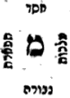

. And its principal is in the Shekhinah, Malkhut (the closed); except that the open hints at the drawing of effluence, and the closed points to holding back (God forbid). Further, he explained concerning the closed Mem that it is in the form of two Dalets joined, a hint to the two Hehs bound to one another through Tiferet, which unites the upper world and the lower world. And it seems to me according to this that therefore the one Dalet turns upward and the one turns downward: the upper turns to bestow in the lower, and the lower turns upward to receive from the upper.

> ויש מי שפי' כי המ"ם חוטמה הוא בדמות ו' הוא תפארת יעקב וגגה העליון הוא אברהם חסד וקרקעיתה התחתון הוא יצחק וכותל שהוא מאחריה הוא השכינה נמצאת המ' ד' חיות המרכבה כזה
>
>  ועיקרה בשכינה מלכות (הסתומה) אלא שהפתוחה רומז אל המשכת שפע והסתומה מורה על עכוב (ח"ו). עוד פי' במ"ם סתומה שהוא בצורת ב' דלתי"ן מחוברים רמז לשני ההי"ן מקושרים זה בזה ע"י התפארת המיחד עולם עליון ועולם תחתון. ונ"ל לפי זה כי לכן הד' הא' פונה למעלה והא' פונה למטה העליונה פונה להשפיע בתחתונה והתחתונה פונה למעלה לקבל מן העליונה.

**27:16:3** And there is one who explained: the open Mem is a hint to the male, who does not need guarding; the closed Mem is a hint to the female, who needs guarding.

> ויש מי שפירש מ"ם פתוחה רמז לזכר שאינו צריך שמירה מ"ם סתומה רמז לנקבה שהיא צריכה שמירה.

**27:16:4** And there is one who explained: the open Mem, clear light [*or tzach*]; and the other Mem, closed; and all is one thing; and its path is called clear and refined light. And according to the opinion of Rashbi, peace be upon him, Mem, whether open or closed, its hint is in Binah. And the difference between them is that when she bestows below she is open, and when the light is gathered within her and she does not bestow in the sefirot, then she is called closed Mem. However, it is square, to show that she crouches [*rova'at*] upon the belly of the four living creatures of the upper Chariot and is ready to bestow; which is not so in the Samekh, as we shall explain. And Rabbi Moshe [de León] explained in the Sefer ha-Shem that the closed Mem is in Malkhut (and see the Zohar, Acharei, fol. 66b, and in the Mikdash Melekh there, that there are two ways there):

> ויש מי שפי' מ' פתוחה אור צ"ח והמ"ם אחרת סתומה והכל דבר א'. והנתיב שלה נקרא אור צח ומצוחצח. ולדעת הרשב"י [ו] ע"ה כי מ"ם בין פתוחה בין סתומה רמיזתם בבינה. והחילוק שביניהם הוא כי כשהיא משפעת למטה היא פתוחה וכשאור מתאסף לתוכה ואינה משפעת בספירות אז נקרא מ"ם סתומה. אמנם היא מרובעת להורות על שהיא רביעא על בטן ד' חיות המרכבה העליונה ומזומנת להשפיע. משא"כ בסמך כאשר נבאר. ור' משה פי' בס' השם כי מ"ם סתומה במלכות (וע' זהר אחרי דף ס"ו: ובמק"מ שם שיש שם ב' אופנים):

### Chapter 27:17. Explanation of the letter Nun.

**27:17:1** The letter Nun: he explained in the Sefer ha-Temunah that its form is in Binah, and it hints at the fiftieth gate, which bestows and acts through Malkhut. And the language of Nun hints as "let us destroy them [*ninam*] together" (Ps. 74:8), which is the language of multiplicity; and the intent is that from her effluence is drawn to the multitude of the creatures and the offspring that are in the world; and all through Malkhut, who receives from her and bestows abundant effluence to her maidens, as it is written (Prov. 31:15), "She rises also while it is yet night, and gives food to her household." And therefore its dominion is at the hour of the moon. And there is one who explained concerning the bent Nun and the straight: that the principal in the Nun is Tiferet; and therefore it is hinted in the Vav; for its principal is when it receives from the side of the right the compassion and the Chesed, and there is merit to bestow; and then it is the straight Nun, to bestow below. And when the merit is diminished and the effluence is held back, then it is the bent Nun, to hint at the gathering of the effluence within it and its holding back. Further, he explained the two Nuns in Malkhut; and the difference between them: when she has received the effluence and completed the matter of her receiving, then she is bent, to hint that she sits among her chariots to give food to her household; and when she stands upright to receive upon herself the diadem of Tiferet her husband, then she is straight, to hint at her standing for the honour of her husband. And there is one who explained Nun from the language of *nunei*, which are fishes, a hint to Yesod, which is "leviathan the piercing serpent": the crooked Nun hints at Malkhut, and the straight Nun hints at Yesod, which receives from above and bestows below. And there is one who explained in another sense, and these are his words: "Nun: two things, corresponding to the hidden light and the disposition of the primordial; and all became one thing; and therefore Moses was called faithful [*ne'eman*]; and it is from the derivation of faith; for from his power is faith, on the name of the verse (Isa. 25:1), 'O YHVH, You are my God; I will exalt You, I will praise,' etc.; that is to say, the father of faith, from whom it was emanated; and He is faithful in His creatures." And therefore there are two Nuns: the straight, its principal in Binah; the bent, its principal in Malkhut. However, its particulars are many: for the head of the Nun is a Yod, which points to Chokhmah; and beneath it a Vav, which points to Tiferet; and its bent tail is Malkhut; this is the law of the bent one. And the straight, in this way, except that it is straight, extending down to Yesod; and its lower thorn points to Malkhut; and all in straightness, in the secret of the middle line, to rise by way of there to her high house; which is not so with the bent one; for it is bent, falling beneath his feet. And because of this our Rabbis, of blessed memory, said (Berakhot 4b) that "Nun, in it is falling." And the head of the Nun includes the three first ones, in the secret of the Yod, which includes them: a thorn at the head and two thorns at its sides, to show the secret of the *segolta*. And there is no wonder in this at those who say that the straight Nun is in Keter. And in the Zohar, Parashat Acharei Mot (fol. 66b): (Yesod, Vav; the bent Nun, over it Vav; the straight Nun, over it Vav.) And there is a difference between Vav and Vav: the Vav of the bent Nun is the small Vav, Yesod; the Vav of the straight Nun is the upper Vav, Tiferet. And these are his words: "The bent Nun, this is the Lady; and the small Vav, which is Yesod, is adjacent to her, in order to be blessed from it. The straight Nun, the spreading out of Tiferet." He explained that when Tiferet bestows in the Lady, behold, its bestowal suffices to raise her up. And in the Zohar, Parashat Beha'alotekha (fol. 155b), he said that the bent Nun is female, and the straight is the inclusion of male and female as one, over which is Tiferet; and the bent is female alone, in which there is not Tiferet, which is the principal of the thing:

> באות נ' פי' בספר התמונה כי צורתה בבינה ורומז אל שער החמשים המשפעת ופועלת ע"י המלכות. ולשון נו"ן רומז כמו נינם יחד (תהלים עד ח) שהוא לשון רבוי. והכונה כי ממנה נמשך שפע אל רבוי הבריות והתולדות שבעולם והכל ע"י המלכות המקבלת ממנה ומשפעת שפע רב לנערותיה. כדכתיב (משלי לא) ותקם בעוד לילה ותתן טרף לביתה. ולכן בשעת הלבנה ממשלתה. ויש מי שפי' בנו"ן כפופה ופשוטה כי העיקר בנו"ן הת"ת ולכן נרמזה בוא"ו כי עיקרה כאשר תקבל מצד הימין הרחמים והחסד ויש זכות להשפיע. ואז היא נו"ן פשוטה להשפיע למטה. וכאשר נתמעט הזכות והשפע מתעכב אז היא נ' כפופה לרמוז אל קיבוץ השפע לתוכו ועכובו. עוד פי' ב' הנונין במלכות. והחלוק שביניהם כאשר קבלה השפע והשלימה ענין קבלתה אז היא כפופה לרמוז כי היא יושבת בין מרכבותיה לתת טרף לביתה וכאשר היא עומדת בעמידה לקבל על עצמה עטרת ת"ת בעלה אז היא פשוטה לרמוז על עמידתה לכבוד בעלה. ויש מי שפי' נ' מלשון נוני שהם דגים רומז ליסוד שהוא לויתן נחש בריח נ' העקום רומז למלכות ונ' הפשוט רומז ליסוד שהוא מקבל ממעלה ומשפיע למטה. ויש מי שפי' בענין אחר וז"ל נו"ן שני דברים כנגד אור הנסתר ותכונת הקדמון ונעשה הכל דבר א' וע"ז נקרא משה נאמן והוא מגזרת אמונה שמכחו אמונה ע"ש הכתוב (ישעיה כה א) ה' אלהי אתה ארוממך אודה וכו'. ר"ל אב האמונה שממנו נאצלה והוא נאמן בבריותיו. ולכן ב' נונין הם. פשוטה עיקרה בבינה, כפופה עיקרה במלכות. אמנם פרטיה הם רבים כי ראש הנו"ן הוא יוד המורה על החכמה ותחתיה ו' המורה על הת"ת וזנבה הכפוף היא המלכות זה משפט הכפופה. והפשוטה על דרך זה אלא שהיא פשוטה ממשכת עד היסוד ועוקצה התחתון מורה על המלכות. והכל ביושר בסוד קו האמצעי לעלות דרך שם אל ביתה הרמתה מה שאין כן בכפופה כי היא כפופה נופלת תחת רגליו. ומפני כן ארז"ל (ברכות ד' ע"ב) שנו"ן בה נפילה. וראש הנון כוללת ג' ראשונות בסוד היו"ד הכוללת אותם קוץ בראש ושני קוצות בצדיו להורות על סוד סגולתא. ואין לתמוה בזה על האומרים שנון פשוטה בכתר. ובזוהר פ' אחרי מות (דף ס"ו ע"ב) (יסוד ו' נון כפופה עליה וא"ו נו"ן פשוטה עליה וא"ו) [ז]. ויש חילוק בין וא"ו לוא"ו. ו' דנו"ן כפופה היא ו' זעירתא יסוד, ו' דנון פשוטה הוא וא"ו עלאה תפארת. וז"ל נון כפופה דא מטרוניתא וסמיכה לה ו' זעירא דאיהי יסוד בגין לאתברכא מניה. נון פשוטה אתפשטותא דת"ת. פירש כי בהיות התפארת משפיע במטרוניתא הן השפעתו מספיק להקימה. ובזוהר פ' בהעלותך (דף קנ"ה ע"ב) אמר כי נון כפופה נוק' ופשוטה כללא דדכר ונוקבא כחדא שעליה הת"ת. וכפופה היא נקבה לבד שאין בה הת"ת שהוא עקר הדבר [ח]:

### Chapter 27:18. Explanation of the letter Samekh.

**27:18:1** The letter Samekh: and he explained in the Sefer ha-Temunah that the spirituality of the letter Samekh is Malkhut; and the hint to her is that she is supported [*semukhah*] in the exile; and it is enclosed on every side, to show that "the mountains are round about Jerusalem" (Ps. 125:2), which are the powers that rebuke the husks, so that they not enter to defile the palace of the King, "and there shall no more come into her the uncircumcised and the unclean" (Isa. 52:1). And its dominion is at the hour of Venus [*Nogah*]. And there is one who explained that the Samekh is the Shekhinah supported by Tiferet, as it is said (Ps. 111:8), "They are established [*semukhim*] for ever and ever"; and therefore the Samekh is the Shekhinah, adjacent to the letter Nun, which is Tiferet, according to one of the explanations that he explained above; and the Nun turns its face toward her to water her. And there is one who explained that Samekh hints at Gedulah, which supports the upper and the lower ones. And there is one who explained in another sense, and these are his words: "Samekh: its path is a bright light, because it is covered over in its enclosure on every side." And in the Zohar (Terumah, fol. 127) Rashbi, peace be upon him, explained that its hint is in Binah, when she departs from over the children and is closed and concealed in the three upper sefirot and does not bestow; and because she increases to support the fallen, which are Yesod and Malkhut, therefore it is said of it (Ps. 145:14), "YHVH upholds [*somekh*] all that fall." And in Parashat Bereshit (fol. 35a) he explained that it is Malkhut; and therefore Samekh was not mentioned in the matter of the creation of Adam until it said *va-yisgor* ["and He closed up," Gen. 2:21]; for Tiferet is supported by Malkhut and Malkhut is supported by Tiferet; and of both of them it is said, "They are established for ever and ever." And it is possible to say that they do not disagree; for through the two faces being supported, in the secret of the bestowal of Binah, they are raised to Binah; and Binah is called Samekh [60], which is six extremities, included of ten; and that is Dalet-Vav [*du*]; and they are raised to Chokhmah; that is, Yod with Vav-Dalet, that is, Yod in its filling:

> באות ס'. ופי בס' התמונה כי האות ס' רוחניותה המלכות והרמז אליה כי היא סמוכה בגלותא והיא סתומה מכל צד להורות כי ירושלים הרים סביב לה שהם הכחות הגוערים בקליפות לבלתי יכנסו לטמא היכל מלך ולא יבא בה עוד ערל וטמא וממשלתה בשעת נוגה. ויש מי שפירשו כי הס' היא השכינה נסמכת בת"ת כד"א (תהלים קיא) סמוכים לעד לעולם ולכן הס' היא השכינה סמוכה לאות נון שהוא הת"ת לא' מן הפי' שפי' למעלה והנון הופך פניו אליה להשקותה. ויש מי שפי' כי ס' רומז לגדולה שהוא סומך עליונים ותחתונים. ויש מי שפי' בע"א וז"ל ס' הנתיב שלה הוא אור בהיר מפני שהיא מחופפת בסתימותה בכל צד. ובזוהר (תרומה דף קכ"ז) פי' הרשב"י ע"ה כי הרמז שלה בבינה בהיותה מסתלקת מעל הבנים ומסתתמת ומתעלמת בג' ספי' עליונות ואינה משפעת ומפני שמתרבה לסמוך נופלים שהם יסוד ומלכות לכן נא' בו (תהלים קמה) סומך ה' לכל הנופלים. ובפ' בראשית (דף ל"ה.) פי' שהיא המלכות ולכן לא נזכרה סמ"ך בענין בריאת אדם עד שנא' ויסגור. כי תפארת נסמך במלכות ומלכות נסמך בת"ת ועל שניהם נאמר סמוכים לעד לעולם. ואפשר לומר דלא פליגי כי ע"י שנסמכים ד"ו פרצופין בסוד השפעת הבינה ומתעלים אל הבינה והבינה נקראת ס' שהוא שש קצוות כלול מעשר והיינו ד"ו ומתעלים לחכמה דהיינו י' עם ו"ד דהיינו י' במילואה:

### Chapter 27:19. Explanation of the letter Ayin.

**27:19:1** The letter Ayin: and he explained in the Sefer ha-Temunah that this letter has its principal in Yesod, which is called eye [*ayin*]: "the eye of YHVH is upon them that fear Him" (Ps. 33:18). And it is "the fountain [*ein*] of Jacob" (Deut. 33:28), which is Tiferet over Malkhut. And its form shows Nun, Zayin, Vav, whose explanation is that Yesod receives from Binah through Netzach and Tiferet. And its dominion is at the hour of Mercury; for it is over the moon as Yesod is over Malkhut. And there is one who explained: the Ayin is in Yesod, and it has two branches, right and left; from the right the side of holiness draws, and from the left the side of impurity draws, in the secret of the two sources that are in the covenant, one for the pure seed and the second for the filthy surplus. We have already explained this matter at length in the Gate of Channels, and there we copied his language letter by letter. Further, he explained that the Ayin is a hint to Malkhut and Tiferet; and Malkhut is the branch that sits within the great branch, to hint that she lies in the bosom of her beloved. And there is one who explained: Ayin hints at Malkhut; the explanation, that all the eyes and the visions and the colors are seen in her, and all of them act through her, as we explained in the Gate of Colors. And there is one who explained in another sense, and these are his words: "Ayin: its path is the throne of brightness; and it has two heads; and it is a standing body, open to receive the action of the work." And according to what is heard from the Zohar in some places, Ayin is Yesod; and it is called "he that has a bountiful eye shall be blessed" (Prov. 22:9), like the matter of their saying, "Say of the righteous, that it shall be well" (Isa. 3:10); and likewise "Blessings are upon the head of the righteous" (Prov. 10:6). And therefore the evil eye, which is from the side of the left, does not rule over it. And this is what is expounded (Berakhot 20a): "I come from the seed of Joseph," etc.; and the proof: "above the eye" [*alei ayin*] (Gen. 49:22). And there is another eye, and it is the open eye, over which there are no eyebrows at all; and it is in the upper secret, in Arikh Anpin, as is expounded in the Idra (Naso, fols. 129 and 130a):

> באות ע'. ופי' בספר התמונה כי האות הזה עיקרה ביסוד שהוא נקרא עין, עין ה' אל יראיו (תהלים לג יח). והוא עין יעקב שהוא הת"ת על המלכות וצורתה מורה נו"ן זיי"ן וא"ו שפי' כי היסוד מקבל מהבינה ע"י נצח ותפארת. וממשלתה בשעת ככ"ב. כי הוא על לבנה כיסוד על מלכות. ויש מי שפי' העין היא ביסוד ויש לה ב' ענפים ימין ושמאל מהימין יונק צד הקדושה ומהשמאל יונק צד הטומאה בסוד ב' המקורות שבברית א' לזרע הטהור והב' למותר המטונף. [כבר פי' הענין הה בארוכה בשער הצנורות ושם העתקנו לשונו אות באות. עוד פי' כי העי"ן רמז למלכות ותפארת. והמלכות הוא הענף היושב בתוך הענף הגדול לרמוז שהיא שוכבת בחיק דודה. ויש מי שפי' עין רומז למלכות פי' שכל העינים והמראות והגוונים נראים בה וכלן פועלות על ידה כדפי' בשער הגוונים. ויש מי שפי' בע"א וז"ל ע' הנתיב שלה כסא הנגה ויש לה שני ראשים והיא גוף עומד פתוחה לקבל פועל המעשה. ולפי הנשמע מהזוהר מקצת מקומות כי ע' הוא היסוד ונקרא טוב עין הוא יבורך (משלי כב ט) כענין אמרו צדיק כי טוב (ישעיה ג י) וכן וברכות לראש צדיק (משלי י ו) ולפיכך אין עין הרע שהוא מסטרא דשמאלא שולט בו. וזהו הנדרש (ברכות ד"כ.) אנא מזרעא דיוסף קאתינא וכו' וראיה מעלי עין (בראשית מט כב). ויש עין אחר והוא עין פקוח שאין גבות עינים עליו כלל. והוא בסוד עליון באריך אנפין כנדרש באדרא (נשא דף קכ"ט ודף ק"ל ע"א):

### Chapter 27:20. Explanation of the letter Peh.

**27:20:1** The letter Peh: he explained in the Sefer ha-Temunah that this letter is in Malkhut; and it is from the language of "for the one side [*pe'ah*]" (Exod. 27:9), "for the north side" (and likewise "the west side"; and she is called *keren* [corner], for she is "a precious corner stone"; and the uncircumcised Arameans "have the corners of their hair polled" [Jer. 9:25]). And the form of the letter shows that Kaf is the Shekhinah, and within her the sign of the holy covenant, which is Yesod, which is at her head, and is folded inward and enters within her; as our Rabbis, of blessed memory, said: "the Holy One, blessed be He, brings a great vessel into a small vessel." And its dominion is at the hour of Jupiter. And there is one who explained that Peh is a hint to the Holy One, blessed be He, and His court: for the Kaf is a hint to the Vav, Tiferet, rounded in the secret of the seventy of the Sanhedrin; and Malkhut, who is the Yod, agrees with them in judgment. And it seems to me, according to his way, that the Yod that is within the Kaf is a hint to Tiferet, the husband of the Lady; the Kaf is Malkhut, the court, in the form of the Chamber of Hewn Stone, as we explained in its entry.

> באות פ'. פי' בס' התמונה כי האות הזה הוא במלכות והוא מלשון לפאה האחת (שמות כז ט), לפאת צפון, (וכן פאת ים. ונקראת קרן כי היא פנת יקרת. והארמאים הערלים הם קצוצי פאה). וצורת האות מורה כ' היא השכינה ובתוכה אות ברית קדש שהוא היסוד שהוא על ראשה ונכפל כלפי פנים ונכנס לתוכה כמו שארז"ל הקב"ה מכניס כלי גדול בתוך כלי קטן. וממשלתה בשעת צדק. ויש מי שפי' כי פ' רמז להקב"ה ובית דינו כי הכף רמז לוא"ו תפארת מעוגל בסוד ע' סנהדרין ומלכות שהיא היו"ד מסכמת עמהם בדין. ונ"ל על פי דרכו כי היו"ד שבתוך הכף רמז לתפארת בעלה דמטרוניתא הכף היא המלכות הבית דין בצורת לשכת הגזית כדפירשנו בערכו.

**27:20:2** And further he explained: Peh is Yod-Kaf, the union of Tiferet and Malkhut through the Righteous One, which is the covenant; for the covenant is Yod, the head of the Righteous One.

> ועוד פי' פ' הוא יו"ד כף יחוד תפארת ומלכות ע"י הצדיק שהוא הברית. דהברית היא י' רישא דצדיק.

**27:20:3** And further he explained that the Yod is Chokhmah, and the Kaf spreads out and rolls from its thorn; the upper Yod is Keter, which crowns and surrounds Chokhmah on its three sides. And there is one who explained: Peh and final Peh are Tiferet and Malkhut; and this is the secret of "With him do I speak mouth to mouth [*peh el peh*]" (Num. 12:8): the explanation, in the bestowal of Tiferet in Malkhut; and therefore the prophecy of Moses our teacher, peace be upon him, was in the shining mirror. And there is one who explained in another sense, and these are his words: "Peh and final Peh are one matter; they are called forms of intellect; and their path is called the light of greatness, which is called *Chazchazit*; that is to say, the place of the source of the vision of the seers." And therefore Malkhut is called Peh, for she is the place of entry and the gate to all the Emanation. And apart from this she is the mouth that speaks and reveals the upper Emanation. And the secret: in the Heh, the manifestation of the Yod, that is, her concealed manifestation; and the manifestation of "the round goblet" (Song 7:3), which surrounds the point of the navel; and that is Yod within the moon; and this is the secret of Heh; and likewise exactly the manifestation of Peh. And this is Heh-Yod, Heh-Yod that are in the four-letter name in the filling of Yods, like this: Yod, Heh-Yod, Vav, Heh-Yod. And its true form is like this. And the matter is that Binah too is a mouth; for she is what reveals every secret of the three first ones; and this is that both of them are called the upper and lower Shekhinah; and likewise mouths, and likewise the Hehs. And there is no doubt, in the secret of their bestowal with speed; and therefore they are open; and they are called mouths, for sometimes they are open and sometimes locked, bestowed upon and not bestowing; and therefore bent, concealed, open from the side. And the point of the Yod is to the left side, as the law of Heh-Yod, and not to the right, as the law of Yod-Heh, which is compassion, as is explained in the Gate of From Below to Above:

> ועוד פי' כי היוד היא החכמה והכ"ף מתפשטת ומתגלגלת מקוצה של י' העליון הוא הכתר הכותר וסובב החכמה מג' רוחותיה. ויש מי שפי' פ"ף ת"ת ומלכות וזהו סוד (במדבר יב ח) פה אל פה אדבר בו פי' בהשפעת הת"ת במלכות ולכן היתה נבואת מרע"ה באספקלריאה המאירה. ויש מי שפי' בע"א וז"ל פ"ף הם ענין א' נקראים צורות שכל והנתיב שלהם נקרא אור הגדולה הנקרא חזחזית כלומר מקום מוצא חזיון החוזים ולכן המלכות נקראת פ' כי הוא מקום הכניסה והשער לכל האצילות. ובזולת זה היא הפ"ה המדברת ומגלה האצילות העליון. והסוד בה' מציאות י' דהיינו מציאותה הנעלם ומציאות אגן הסהר הסובב על נקודת הטיבור והיינו י' בתוך הירח וזהו סוד ה' וכן ממש מציאות פ"ה וזהו ה"י ה"י שבשם בן ד' במלוי יודין כזה יוד ה"י וא"ו ה"י. וצורתו האמתי כזה. והענין כי הבינה ג"כ פה כי היא המגלה כל סוד ג' ראשונות וזהו שנקראות שתיהן שכינתא עלאה ותתאה וכן פיו"ת וכן ההי"ן. ואין ספק בסוד השפעתן במהירות ולכן פתוחות ונקראות פיות שפעמים פתוחות ופעמים נעולות מושפעים ולא משפיעים ולכן כפופות נעלמות פתוחות מן הצד. ונקודות היו"ד לצד השמאל כמשפט ה"י ולא לימין במשפט י"ה שהוא רחמים כמבואר בשער ממטה למעלה:

### Chapter 27:21. Explanation of the letter Tzadi.

**27:21:1** The letter Tzadi: he explained in the Sefer ha-Temunah that it is hinted in the Righteous One, the Foundation of the World; and in it are Nun, Yod: the Nun in Binah and the Yod in Malkhut; and both of them in Yesod, to hint that Yesod [joins] the two attributes together. Further, another explanation; and this is the principal. And he said that its dominion is at the hour of the sun. And possibly the reason is that the sun is by the power of Tiferet; and the joining of these attributes is principally through Tiferet; and therefore its dominion is at the hour of the sun, "for YHVH God is a sun and a shield" (Ps. 84:12).

> באות צ' פירש בס' התמונה כי רמוזה בצדיק יסוד עולם ובה נו"ן י'. הנון בבינה והיוד במלכות ושתיהן ביסוד, לרמוז כי היסוד [מחבר] שתי המדות יחד. עוד פי' אחר [ט] וזה עקר. ואמר כי ממשלתה בשעת חמה. ואפשר הטעם כי החמה מכח הת"ת וחבור אלו המדות העיקר ע"י הת"ת ולכן ממשלתו בשעת חמה כי שמש ומגן ה' צבאות.

**27:21:2** And further, for the matter of the sun is also related to Yesod, as is explained in its entry, with the help of Heaven. And there is one who explained that the Tzadi is in the Righteous One, the Foundation of the World; and its two branches are a hint to its two channels, the right and the left, as we explained in chapter 19 and in the Gate of Channels.

> ועוד שגם יתייחס ענין שמש אל היסוד כאשר נתבאר בערכו בס"ד. ויש מי שפי' כי הצדי"ק בצדיק יסוד עולם ושתי ענפיו רמז אל שני צנורותיו הימני והשמאלי כדפי' בפ' י"ט ובשער הצנורות.

**27:21:3** And further he explained that Tzadi is a hint to Malkhut, and its two heads are a hint to the two upper apples, on account of which she is called the field of apples, as we explained in the entry *sadeh*. And there is one who explained: Tzadi and final Tzadi are Tiferet and Malkhut; for they were created side by side until He separated them. And there is one who explained in another sense, and these are his words: "Tzadi and final Tzadi are intellected and bestowed; and their path is called the wheel of the Chariot; and it is the place of purity, where all the words of purity are equalized; and it points to them." And according to what is agreed in the Zohar and in the Sefer ha-Bahir, this letter, according to its sense, is in Yesod, when it is united in Malkhut; and its form proves it: for it is Yod, Yesod, and the bent Nun, Malkhut. And likewise it is not called *Tzaddik* except when it is united in *Tzedek*. And in the Zohar, Parashat Bereshit (in the Introduction, fol. 2b), he explained that the Tzadi, its principal is Nun-Yod. However, the Yod is the Yod of the Foundation of the World, of the male; and the Nun is of Malkhut. And behold, the Yod turns its face away from the Nun, to hint at the two faces that were before, at the beginning of the creation, as it is written (Ps. 139:5), "You have hemmed me in behind and before"; and the cherubim were not face to face. And therefore Yod rides upon Nun and turns its face from her. And nevertheless the principal of the Tzadi is in Yesod, and its name proves it; and possibly the reason is that it is what unites them, even if they are not face to face. And the long Tzadi they explained in the Tikkunim (in the Introduction, fol. 15a): that it is a hint to the Righteous One, the Foundation of the World, in the union of Binah; and this is the good that is treasured for the righteous in the time to come. And in chapter 26 we shall widen the explanation on the letters MaNTzPaKh, with the help of the Name:

> ועוד פי' כי צ' רמז למלכות ושני ראשיה רמז לב' התפוחים העליונים שעל שמה נקראת שדה התפוחים כדפי' בע' שדה. ויש מי שפי' צ"ץ ת"ת ומלכות כי צד לצד נבראו עד שהפרידם. ויש מי שפי' בענין אחר וז"ל צ"ץ הוא מושכל ומושפע והנתיב שלהם נקרא גלגל המרכבה והוא מקום הטהרה ששם משתוים כל דברי הטהרה והוא מורה עליהם. ולפי המוסכם בזוהר ובספר הבהיר כי האות הזה כמשמעו ביסוד עם התיחדו במלכות וצורתו מוכיח עליו שהוא י' יסוד ונון כפופה מלכות. וכן לא נקרא צדיק אלא בהיותו מתייחד בצדק. ובזוהר פרשת בראשית (בהקדמה דף ב' ע"ב) פי' כי הצדיק עיקרה נ' י'. אמנם היו"ד היא י' של יסוד עולם של זכר והנו"ן של המלכות והנה הי' הופכת פניה מן הנון לרמוז אל ד"ו פרצופין שהיו קודם בתחלת הבריאה כדכתיב (תהלים קלט ה) אחור וקדם צרתני ולא היו הכרובים פנים אל פנים ולכן יוד רוכב על נון והופך פניה ממנה. ועכ"ז עיקר הצדיק ביסוד ושמה מוכיח עליה ואפשר הטעם כי הוא המייחד' ואף אם אינם פנים בפנים. ובצדיק ארוכה בארו בתקונים (בהקדמה דף ט"ו.) כי היא רמז לצדיק יסוד עולם ביחוד הבינה וזהו הטוב הצפון לצדיקים לעתיד לבא. ובפ' כ"ו נרחיב הביאור באותיות מנצפ"ך בע"ה:

### Chapter 27:22. Explanation of the letter Kuf.

**27:22:1** The letter Kof: he explained in the Sefer ha-Temunah that it is in Tiferet, from the language of "and his circuit [*u-tekufato*] unto the ends of it" (Ps. 19:7); for it is what goes round and surrounds. And its principal is in Malkhut; and it is the Kaf that is over the Vav, which is Tiferet, receiving from Binah. The rule of the matter: the Vav receives from Binah and bestows to Malkhut; and this is the intent of the letter. And its principal is in Malkhut; and it is open below, to bestow in the secret of the circuit. And its dominion is at the hour of the moon; for so it is in Malkhut. And there is one who explained in another sense, these are his words: "Kof: a matter and form of radiance, from where were the tablets of the covenant that were given by Moses our teacher, peace be upon him. And therefore the Holy One, blessed be He, is called the holy God, for He is holy in all matters of holiness. And the matter: the path of this light is called the Throne of Glory." And in the Zohar, especially in the Song of Songs, it appears explicitly that this letter is a hint to the serpent crooked in its tail; and it draws near to holiness, and appears "like an ape [*kof*] before human beings." And it is possible that the hint is to the Malkhut [of the husk]; and she is called *kof*, the explanation, from the language of *kuppah* [basket], for she receives everything:

> באות ק' פי' בספר התמונה כי היא בת"ת מלשון (תהלים יט) ותקופתו על קצותם. כי הוא הסובב והמקיף. ועיקרה במלכות והיא הכ' שעל הוא"ו שהוא תפארת מקבלת מהבינה. כלל הדברים כי הו' מקבלת מהבינה ומשפיע למלכות וזה כונת האות. ועקרה במלכות ופתוחה למטה להשפיע בסוד ההקפה. וממשלתה בשעת לבנה שכן היא במלכות. ויש מי שפי' בע"א ז"ל ק' ענין וצורה של זוהר שמשם היו לוחות הברית שנתנו ע"י משרע"ה וע"כ נקרא הקב"ה אלהים קדושים שהוא קדוש בכל ענייני קדושות והענין הנתיב של זה האור נקרא כסא הכבוד. ובזוהר בפרט בשיר השירים נראה בפי' כי האות הזה רמז אל הנחש העקום בזנבו והוא מתקרב אל הקדושה ונראה כקוף בפני בני אדם. ואפשר שיהיה הרמז אל המלכות [דקליפה] ונקראת קוף פי' מלשון קופה שהיא מקבלת הכל:

### Chapter 27:23. Explanation of the letter Resh.

**27:23:1** The letter Resh: he explained in the Sefer ha-Temunah that this letter is in Yesod; and it is a simple letter, which has no composition with another; and its extension reaches to Malkhut. And it is the language of inheritance, from the language of "go up, possess [*resh*]" (Deut. 1:21); for it is the inheritance of the righteous in the world to come; for there is the rest of the souls; and it is the world to come, a world that is wholly Sabbath; and therefore its dominion is in the constellation Saturn. And there is one who explained that the hint in it is in Malkhut, who is poor and wretched, from the language of "give me neither poverty [*reish*] nor riches" (Prov. 30:8); and close to this he explained in the Zohar in some places. And there is one who explained in another sense, these are his words: "Resh is the matter of the foundation of the beings; and it is its path, of the foundations of all the beings." And in the Zohar too it appears that it is Chokhmah; and he explained Resh, *Reshit*, Chokhmah. And behold, according to the language of Resh, its explanation is head [*rosh*]; and Chokhmah is head to the revealing of the Emanation, as we explained in the Gate of Whether the Ein Sof Is Keter. And elsewhere he explained that it is the language of poverty and wretchedness, as we explained above.

> באות ר' פי' בספר התמונה כי האות הזה היא ביסוד והיא אות פשוטה שאין לה הרכבה באחרת ומשך שלה מגיע למלכות. והיא לשון ירושה מלשון (דברים א כא) עלה רש כי היא ירושת הצדיקים לעוה"ב כי שם מנוחת הנפשות והוא עה"ב עולם שכולו שבת ולכן במזל שבתי ממשלתה. ויש מי שפי' כי הרמז בה במלכות שהיא ענייה ודלה מלשון (משלי ל ח) ריש ועושר אל תתן לי. וקרוב לזה פי' בזוהר בקצת מקומות. ויש מי שפי' בע"א וז"ל ריש הוא ענין יסוד ההויות והוא הנתיב שלה מיסודי כל ההויות. ובזוהר ג"כ נראה שהיא חכמה ופי' ר' ראשית חכמה והנה לפי לשון רי"ש פירושו ראש והחכמה היא ראש לגלוי האצילות כדפי' בשער אם הא"ס הוא הכתר. ובמקום אחר פי' שהוא לשון עניות ודלות כדפי' לעיל.

**27:23:2** And behold, there is a great difference between Dalet and Resh, even though the hint of both letters is to wretchedness and poverty. For the Dalet has a thorn in it, and this thorn is a hint to Yesod, as we explained in chapter 7; but Resh has no thorn at all, to hint at poverty more; for even Yesod is not with her, but she is alone. And in it are two Vavs: the one drawn to the right is in Chesed, and the left roof is Gevurah; and over it a thorn at the end of the left roof, to hint that Yesod was diminished and draws from the side of Gevurah, in the secret of Isaac [*Yitzchak*], which is *ketz* [end] *Chai*, Yesod, taken to the left, as we explained in the preceding gates. And because of its departure to Gevurah, Malkhut remained poor from poverty, until YHVH looks down and has compassion:

> והנה יש חילוק גדול בין ד' לרי"ש עם היות שרמז שתי האותיות בה אל הדלות והעוני כי הדלת יש בה קוץ והעוקץ הזה רמז אל היסוד כדפי' בפ"ז אבל רי"ש אין בה עוקץ כלל לרמוז על העניות יותר שאפילו היסוד אינו עמה אלא היא לבדה. ובה שני ווי"ן הא' המשוך אל הימין הוא בחסד והגג השמאלי הוא גבורה ועליו עוקץ בסוף הגג השמאל לרמוז שנתמעט היסוד ויונק מצד הגבורה בסוד יצחק שהוא קץ ח"י יסוד נטיל לשמאלא כדפי' בשערים הקודמים. ומפני הסתלקו אל הגבורה נשארה המלכות דלה מן הדלות עד ישקיף ה' וירחם:

### Chapter 27:24. Explanation of the letter Shin.

**27:24:1** The letter Shin: he explained in the Sefer ha-Temunah that the hint of this letter is in Binah: and three Yods are the three first ones, and three Vavs are the three Patriarchs; and the Kaf, reversed upward, is Malkhut, in the secret of Yesod, to receive effluence from these sefirot. And its principal is in Netzach; for through it this fine joining is joined. And it is also in Binah, as we explained. And its dominion is at the hour of Mercury. And there is one who explained: Shin hints at Malkhut, from the language of "your teeth [*shinnayikh*] are like a flock of ewes" (Song 6:6); the explanation, that it is the teeth [crags] of the mountain, where the inhabitants of the city sit, so that the enemies not enter the city; so she sits at the gates of the King and guards herself so that a stranger not enter her. And there is one who explained in another sense, and these are his words: "Shin: I have already said at the letter Yod that it hints at the knot of the tefillin; and its path is called the substance of the action." And what is agreed in the words of Rashbi, peace be upon him, in the Zohar is that the Shin hints at the three Patriarchs, which are Gedulah, Gevurah, Tiferet; and the hint in it is the three Vavs of  V H V,  Y L Y,  S Y Ṭ, which are the three Patriarchs. And it hints also at Netzach, Hod, Yesod, in the generality of the Vavs, in the secret that they are included with the lines: the line of Chesed, the line of judgment, the line of compassion. And nevertheless the root of the Shin, that is, the point beneath it, in its base, the hint to it is in Binah or in Malkhut, in the secret of from below to above or from above to below, as we explained in the Gate of From Below to Above:

> באות ש'. פי' בס' התמונה כי רמז האות הזה היא בבינה ושלשה יודין הם שלש ראשונות ושלשה ווי"ן הם ג' אבות והכ' ההפוכה למעלה היא מלכות בסוד היסוד לקבל שפע מאלו הספי'. ועיקרה בנצח כי על ידו תתחבר החבור היפה הזה. והיא ג"כ בבינה כדפי'. וממשלתה בשעת ככב. ויש מי שפי' ש' רומז למלכות מלשון (שה"ש ו ו) שנייך כעדר הרחלים פי' שהוא שיני [ההר] שיושבי העיר יושבים שם כדי שלא יכנסו האויבים בעיר כך יושבת בשערי המלך ושומרת עצמה שלא יכנס לה זר. ויש מי שפי' בענין אחר וז"ל ש' כבר אמרתי באות י' שהוא רומזת קשר של תפילין והנתיב שלה נקרא ממשות הפעולה. והמוסכם בדברי הרשב"י ע"ה בזוהר כי השי"ן רומזת ג' אבות שהם גדולה גבורה ת"ת והרמז בה ג' ווי"ן של ויס"ע ויב"א וי"ט שהם ג' אבות וירמוז ג"כ אל נה"י בכלל הווין בסוד שהם נכללים עם הקוים קו החסד קו הדין קו הרחמים ועכ"ז שרש השי"ן דהיינו נקודה שתחתיה שבנחושתה הרמז לה בבינה או במלכות בסוד ממטה למעלה או ממעלה למטה כדפי' בשער ממטה למעלה:

### Chapter 27:25. Explanation of the letter Tav.

**27:25:1** The letter Tav: he explained in the Sefer ha-Temunah that the hint of this letter is in Gevurah, showing judgment; and therefore it is said (Ezek. 9:4), "and set a mark [*ve-hitvita tav*]"; and our Rabbis, of blessed memory, said (Shabbat 55a) that six angels of ruin spread out in that matter. And this is the hint of the reversed Vav (that is, the leg of the Tav), which was the way of compassion and was turned to judgment; as (Exod. 9:3) "behold, the hand of YHVH is [*hoyah*]": Malkhut was turned to judgment from compassion, and the reversal of the Name shows judgment. And the word Tav is as "you shall mark out [*teta'u*] for you Mount Hor" (Num. 34:7); the explanation, a boundary and measure for judgment. And there is one who explained: Tav hints at Malkhut, from the language of "and set a mark," etc.; for all the inscriptions and the visions are seen in her. And there is one who explained in another sense, and these are his words: "Tav is over against the case of the tefillin; and its path is called peace." And in the Zohar, in many places, Rashbi, peace be upon him, explained: Tav, Tiferet. And it is possible to say that the language of *tav* is from the language of craving [*ta'avah*], as "behold, my craving [*tavi*] is that the Almighty would answer me" (Job 31:35); and the reason is that it is "a craving to the eyes and pleasant to the sight" (Gen. 3:6). Or it will be from the language of *ot* [sign]; and the reason is that Tiferet, from the side of Yesod, is a sign. And in the Zohar, Parashat Chukkat (fol. 180b), it is understood that this letter is hinted in Malkhut; and it is composed of two letters, and they are Resh or Dalet, for all is one, as we explained in chapter 23, for both of them show the poverty of Malkhut and her wretchedness; and likewise there is in it the letter Nun. And it is understood there that the Nun, its hint is in the Other Side, which stands at the lower parts of the Tabernacle; and the language of Nun is from the language of "you shall not wrong [*tonu*]" (Lev. 25:17); for the husk wrongs the man and shows him a shining face; it descends and leads astray, rises and accuses, "and her end is bitter as wormwood," as we explained in the Gate of the Palaces of the Substitutes. It is found according to this that the totality of this letter hints at Malkhut, with the totality of "the stone of stumbling" that is on the mouth of the well:

> באות ת' פירש בס' התמונה כי רמז האות הזה בגבורה מורה דין ולכך נאמר (יחזקאל ט ד) והתוית תיו וארז"ל (שבת דף נ"ה.) כי ששה מלאכי חבלה נתפשטו בענין ההוא וזהו רמז הואו ההפוכה (היינו רגל של התיו) שהיתה דרך רחמים ונהפכה לדין כמו (שמות ט ג) הנה יד ה' הויה המלכות נהפך לדין מרחמים והפך השם מורה דין. ומלת תיו כמו (במדבר לד ז) תתאו לכם הר ההר פי' גבול ושיעור לדין. ויש מי שפי' ת' רומז למלכות מלשון והתוית תי"ו וגו' שכל הרשומות והמראות נראים בה. ויש מי שפירש בענין אחר וז"ל ת' הוא כנגד תיק של תפילין והנתיב שלה נקרא שלום. ובזוהר מקומות רבים פירש הרשב"י ע"ה ת' תפארת. ואפשר לומר כי לשון תיו מלשון תאוה. כמו הן תו"י שדי יענני (איוב ל"א) והטעם כי הוא תאוה לעינים ונחמד למראה. או יהיה מלשון אות והטעם כי התפארת מצד היסוד הוא אות. ובזוהר פרשת חקת (דף ק"פ ע"ב) משמע כי האות הזה נרמז במלכות והיא מורכבת משתי אותיות והם רי"ש או דל"ת שהכל אחד כדפי' בפכ"ג כי שתיהם מורות על עוני המלכות ודלותה וכן יש בה אות נ' [י] ומשמע התם דהנו"ן הרמז שלה בסטרא אחרא דקיימא בשיפולי דמשכנא ולשון נ' מלשון לא תונו כי הקליפה מאנה את האדם ומראה לו פנים מאירים יורד ומשטין עולה ומקטרג ואחריתה מרה כלענה כדפי' בשער היכלי התמורות. נמצא לפי זה כללות האות הזה רומז במלכות עם כללות אבן נגף אשר ע"פ הבאר:

### Chapter 27:26. Explanation of the final letters MaNTzPaKh (מנצפ"ך).

**27:26:1** The letters final Kaf, final Mem, final Nun, final Peh, final Tzadi: in the Sefer ha-Temunah he explained that the letters MaNTzPaKh are hinted in Binah, the Salt Sea; for she is what gives salt and taste in all the worlds; and likewise these letters are at the end of the word, and they are at the rung of the five points that give salt in the whole cooked dish. And in the Zohar Chadash, Song of Songs (fol. 79), on the verse "rightly [*meisharim*] do they love you" (Song 1:4), Elijah, of blessed memory, explained: "*Meisharim*: they are the other letters that remained; and who are they? MaNTzPaKh; for there is none among all the letters that are called *meisharim* [straight ones] but these. And they are those that were doubled, straight ones with each other: Mem with final Mem, Nun with final Nun, Tzadi with final Tzadi, Peh with final Peh, Kaf with final Kaf; these are straight with each other, and this in that. For just as twenty-two letters are included, so are those that remained, which are 'rightly do they love you,' to be included with you in those twenty-two letters. These *meisharim* are letters concealed and stored away within the upper world. And when the first light was stored away, these letters were stored away; and Adam knew them. After Adam sinned, they were stored away as before, until Abraham came and knew them by the holy spirit that rested upon him. Afterward he bequeathed them to Isaac [as it is written, 'And Abraham gave all that he had unto Isaac' (Gen. 25:5)]; and Isaac bequeathed them to Jacob; and Jacob bequeathed them to Joseph. When Joseph died and the children of Israel were in exile, the letters were stored away and departed as before, until Israel stood at Mount Sinai and the Torah was handed over to Israel; and the letters were revealed; and Israel knew them in their clarity, in the secret of engraved Names, until they sinned. When they sinned, it is written, 'And the children of Israel stripped themselves of their ornaments from Mount Horeb' (Exod. 33:6). And Moses and Joshua and the seventy elders knew them, and with them they entered the Land. When the Temple was built and this song was revealed, these letters were engraved in the twenty-two letters, the secret of BaKh [22]; and that is '*meisharim ahevukha*' [rightly do they love you, read as: the straight ones love the twenty-two]; and it is written, 'You have established *meisharim*' (Ps. 99:4); 'and your palate like the best wine, that goes down sweetly [*le-meisharim*] for my beloved' (Song 7:10); all of them in the secret of these letters that are called *meisharim*. And these letters are crowns stored away within the world to come. And all of them are spring after spring within the Thought, in the engraving of the secrets of the holy Names, in the engravings of male and female, to agree as one. For there is no agreement among all the letters, one with another, to be this in that, except these." Thus far his words.

> באותיות ך ם ן ף ץ  בס' התמונה פי' כי אותיות מנצפך הם מרמזות בבינה ים המלח כי הוא הנותן מלח וטעם בכל העולמות וכן אלו האותיות הם בסוף התיבה והם במעלות ה' נקודות הנותנים מלח בכל התבשיל. ובז"ח שה"ש (דף ע"ט) בפסוק מישרים אהבוך (שה"ש א) פי' אליהו ז"ל מישרים אנון שאר אתוון דאשתארו ומאן אינון מנצפ"ך דלית בכל אתוון דאתקרון מישרין בר אילין. ואינון דאתכפלו משרים אילין באילין מ' בם' נ' בן' צ' בץ' פ' בף' כ' בך' אלין משרים אילין באילין ודא בדא דהא עשרין ותרין אתוון כלילן כך אינון דאשתארו דאינון מישרים אהבוך לאתכללא עמך באינון עשרין ותרין אתוון. אילין מישרים אינון אתוון טמירן גניזן גו עלמא עלאה. וכד אתגניז אור קדמאה אתגניזו אתוון אילין והוה ידע לון אדם. בתר דחטא אדם אתגניזו כמלקדמין. עד דאתא אברהם וידע לון ברוח קודשא דשראת עליה. לבתר אורית לון ליצחק [דכתיב ויתן אברהם את כל אשר לו ליצחק] ויצחק אורית לון ליעקב ויעקב אורית לון ליוסף. כיון דמית יוסף ובני ישראל הוו בגלותא אתגניזו אתוון ואסתלקו כמלקדמין עד דקיימו ישראל על טורא דסיני ואתמסר אורייתא לישראל ואתגלו אתוון והוו ישראל ידעי לון על ברירו דילהון ברזא דשמהן גליפן עד דחטאו. כיון דחטאו כתיב ויתנצלו בני ישראל את עדים מהר חורב והוה ידע לון משה ויהושע ושבעים זקנים ובהו עאלו לארעא. כיון דאתבני בי מקדשא ואתגלי שיר דא אתגליפו אלין אתוון בעשרין ותרין אתוון רזא ב"ך והיינו מישרים אהבוך וכתיב אתה כוננת מישרים, וחכך כיין הטוב הולך לדודי למישרים כלהו ברזא דאילין אתוון דאקרון מישרים ואילין אתוון כתרין גניזין גו עלמא דאתי אינון. וכלהו נביעו בתר נביעו גו מחשבה בגליפו דרזין דשמהן קדישין בגליפי דכר ונוקבא לאסתכמא כחדא דהא לית בכל אתוון אסתכמותא אילין באילין למהוי דא בדא בר אלין עכ"ל.

**27:26:2** And according to the truth, the intent of Elijah in this saying is not to tell us that the manifestation of the form of the letters and their names was forgotten by them; for behold, Israel had Torah scrolls that Moses our teacher, peace be upon him, wrote for them, one for each and every tribe and one in the Ark. And there is no doubt that the Torah scrolls were made according to the law; and necessarily the MaNTzPaKh at the ends of words were according to their law. And if so, why would the form of these letters be forgotten from Israel? They would correct their books from the books of Moses our teacher, peace be upon him, and find it written and explicit. But the intent of Elijah, of blessed memory, in this is that, because the letters are the light of the sefirot from Chesed downward, as we explained in chapter 2 and in the preceding gates, and behold, this Emanation, which is the seven days of the building, is included in them; and likewise the letters came in it in five outlets, as we shall explain; and we widened this matter in the Gate of Fifty Gates.

> ולפי האמת אין כונת אליהו במאמר הזה לומר לנו שמציאות צורת האותיות ושמותם נשתכח מהם שהרי היו לישראל ס"ת שכתב להם מרע"ה א' לכל שבט ושבט וא' בארון. ואין ספק כי היו הס"ת עשוים כהלכה ובהכרח כי מנצפך שבסופי תיבות היו כהלכתן וא"כ למה ישתכח צורת אותיות אלה מישראל יגיהו ספריהם מתוך ספרי מרע"ה וימצאו כתוב ומפורש. אבל הכונה לאליהו ז"ל בזה הוא כי להיות שהאותיות הם אור הספי' מחסד ולמטה כדפי' בפ"ב ובשערים הקודמים והנה האצילות הזה שהם ז' ימי הבנין נכללים בהם. וכן באו בה האותיות בחמשה מוצאות כאשר נבאר והרחבנו הענין הזה בשער חמשים שערים.

**27:26:3** And behold, because they were emanated from within Binah, necessarily the manifestation of five lights was portrayed in Binah, which are five sefirot: Gedulah, Gevurah, Tiferet, etc.; Tiferet, in which Yesod and Malkhut are included, in the secret of "body and covenant are counted as one," and in the secret of the [two] faces. It is found according to the truth that within Binah the seven days of the circuit are included in five; and that is the Heh that is in Binah. And when the sefirot spread out, there remained these manifestations of the five sefirot concealed within Binah; and they are sources for the emanated sefirot; and the seven days of the building receive from them, and they are sources to them. And it is known that every bestower is male with respect to the one bestowed upon, and the one bestowed upon female with respect to the bestower. And if so, it is found that the lights of MaNTzPaKh, which are the straight letters, which are called *meisharim*, are the lights of the five sefirot in straightness, in the way of the bestower; and the bent MaNTzPaKh are bestowed upon, in the joining of the other letters, whose totality is also in five outlets; they are females to them, receiving from them. And that is that the bent MaNTzPaKh are related as females to the straight MaNTzPaKh, as he said, "And they are those that were doubled, straight ones with each other," etc. And afterward he said that they were united with the twenty-two letters; as it appears, they too are related to them in the secret of those bestowed upon to the bestowers; because they are a source for all twenty-two, because they are vessels to the five lights concealed in Binah, in the secret of the light that was concealed for the righteous in the time to come; that is, the light of these five lights concealed in Binah; and they are bestowed upon, spread out and emanated from within the depths of Chokhmah; for from there those lights draw, lights concealed from them, which are there. And this is what he said: "They are crowns stored away within the world to come; and all of them are spring after spring within the Thought," etc.

> והנה להיות שנאצלו מתוך הבינה בהכרח נצטיירו מציאות ה' אורות בבינה שהם ה' ספי' גדולה גבורה תפארת וכו' תפארת בו נכלל יסוד ומלכות בסוד גוף וברית חשבינן חד ובסוד פרצופין. נמצאו לפי האמת בתוך הבינה ז' ימי ההקף נכללים בה' והיינו ה' שבבינה וכאשר הספירות נתפשטו נשאר המציאיות האלה של חמשת הספירות הנעלמות בתוך הבינה והם מקורות לספי' הנאצלות וז' ימי הבנין מקבלות מהן והם מקורות אליהם. ונודע כל משפיע זכר בערך המושפע והמושפע נקבה בערך המשפיע וא"כ נמצאו שאורות מנצפך שהם האותיות הישרות הנקראים מישרים שהם אורות החמש ספי' ביושר בדרך המשפיע ומנצפך הכפופות הם מושפעות בצרוף שאר האותיות שכללם ג"כ בה' מוצאות הם נקבות אליהם מקבלות מהם והיינו שמתייחסים מנצפך הכפופות לנקבות אל מנצפך הפשוטות כדקאמר ואינון דאתכפלו משרים אילין באילין וכו' ואח"כ אמר שנתייחדו עם ך"ב אותיות כנראה שהם ג"כ מתייחסים אליהם בסוד המושפעים אל המשפיעים לפי שהם מקור לכל כ"ב מפני היותם כלים אל ה' אורות נעלמות בבינה בסוד האור שנתעלם לצדיקים לעתיד לבא דהיינו אור ה' אורות אלו הנעלמות בבינה והם מושפעים מתפשטות ומתאצלות מתוך עמקי החכמה שמשם יונקים המאורות ההם מאורות מתעלמים מהם אשר שם, וז"ש כתרין גניזין גו עלמא דאתי אינון וכלהו נביעו בתר נביעו גו מחשבה וכו'.

**27:26:4** And behold, what was concealed from Adam, and likewise from all of them, the matter is the secret of the five upper lights, which did not shine in them, and the ways of their powers; for only those fit to merit the world to come, while still in their lifetime, merited them. And that is "and they stripped themselves," etc. (Exod. 33:6). And this is what he said, "and with them they entered the Land": the explanation, by the light that was revealed from them upon them, they could be purified to enter the Land of Israel and to conquer seven nations and to break seven husks that rule in the Land of Israel; as it is written (Gen. 12:6), "And the Canaanite was then in the land": the secret of "Cursed be Canaan" (Gen. 9:25), the primordial serpent. And this is the secret of the letters MaNTzPaKh. And to relate each one to its fitting place we shall not trouble ourselves; for there are many faces upon faces, and we have no revelation except those that they explained in the Tikkunim, which is Yesod, the Righteous One; and of it is said: the good treasured for the righteous in the world to come. And there is no doubt that in this Righteous One Tiferet too is included; for it too is called righteous, as it is said (Ps. 145:17), "YHVH is righteous in all His ways," and as is explained in its entry. And by this the inquirer will examine closely, and it will profit him, with the help of the Name:

> והנה מה שנתעלם לאדם וכן לכלם, הענין הוא סוד הה' אורות העליונים שלא היו מאירים בהם ודרכי כחותם שלא זכו אליהם אלא אותם הראוים לזכות לעה"ב בעודם בחיים חיותם והיינו ויתנצלו וכו' (שמות לג ו) וז"ש ובהו עאלו לארעא פי' באור שנתגלה מהם עליהם יכלו לטהר ליכנס לא"י ולכבוש ז' עממים ולשבר ז' קליפות השולטים בא"י כדכתיב (בראשית יב ו) והכנעני אז בארץ סוד ארור כנען נחש הקדמוני. וזהו סוד האותיות מנצפך. וכדי לייחס כל א' במקומו הראוי לו לא נטריח את עצמנו כי יש כמה פנים לפנים ואין לנו גלוי בלתי אותן שבארו בתקונים שהוא היסוד הצדיק ועליו נא' טוב הצפון לצדיקים לעה"ב. ואין ספק שבצדיק זה כלול ג"כ ת"ת כי הוא ג"כ נקרא צדיק שנאמר (תהלים קמה) צדיק ה' בכל דרכיו וכמו שנתבאר בערכו. ובזה ידקדק המעיין ויועילנו בה"ו:

### Chapter 27:27. Explanation of the existence of the source from which the twenty-two letters were emanated, and the matter of their existence in the secret of Atzilut, Beriah, Yetzirah, and Asiyah.

**27:27:1** After we have occupied ourselves in the preceding chapters with the explanation of the twenty-two things, each one alone, according to what is found in the words of the commentators and of Rashbi, peace be upon him, as they have instructed us from Heaven, it is fitting now to explain the manifestation of the letters together as a whole. And this matter is explained in the Zohar, Parashat Terumah (fol. 167); and we shall not copy its language, for we have already copied it in the Gate of Substitutes. And it is explained there that the manifestation of the letters is in three aspects, which are light, waters, firmament. Light is the Emanation in a subtle manifestation, at the time of their emanation from Binah to Chesed; and still in Chesed they were in the manifestation of light, because there the things were not yet revealed in substance, and had not come into being in a revealed being, but like this light, which is simple, free of actual body. And afterward, from the drawing of the things from Chesed to Gevurah, what was light in Chesed in concealment, in their drawing and the spreading out of some of the things, the beings became thick and were revealed in the manifestation of waters; the explanation, that for their revealing, from what they were in Chesed to what they are in Gevurah, they are in great difference in the revealing of the beings, from light to waters; for the waters are substantial, corporeal, revealed. And there is no wonder in our saying that in Gevurah the manifestation of waters came into being, even though the waters are in Chesed and the fire in Gevurah; for the manifestation of these waters is waters in the secret of the joining of Gedulah to Gevurah, as is examined above from our words, and so they explained in the saying mentioned. And when the waters mentioned spread out further, the firmament comes into being from them; that is, the manifestation of a being more revealed and thicker than the waters; and that is in the secret of the spreading out of the letters up to Tiferet, where the firmament is.

> אחר שבפרקים הקודמים נתעסקנו בביאור כ"ב חפצים כל א' ואחד לבדה כפי הנמצא בדברי המפרשים והרשב"י ע"ה כפי אשר הורונו מן השמים. ראוי עתה לבאר מציאות האותיות בכללן יחד. והענין הזה נתבאר בזהר פרשת תרומה (דף קס"ז) ולא נעתיק לשונו שכבר העתקנוהו בשער התמורות. ונתבאר שם כי מציאות האותיות הם בג' בחינות שהם אור מים רקיע. אור הוא האצילות במציאות דק בעת אצילותם מבינה לחסד ועדיין בחסד היו במציאות אור מפני ששם עדין לא נתגלו הדברים בעצם ולא נתהוו בהויה מתגלית אלא כאור הזה שהוא פשוט מגשם ממשי. ואח"כ מהמשכת הדברים מהחסד אל הגבורה מה שהיה אור בחסד בהעלם בהמשכתן והתפשטות קצת הדברים ההויות נתעבו ונתגלו במציאות מים. פי' שלגלוים ממה שהיו בחסד אל מה שהם בגבורה הם בהבדל הרבה בהגלות ההויות מאור אל מים כי המים הם ממשיים גשמים מתגלים. ואין תימה באמרנו כי בגבורה נתהוו מציא' מים עם היות שהמים הם בחסד והאש בגבורה שמציאות המים האלה הם מים בסוד הצטרפות הגדולה אל הגבורה כמדוקדק לעיל מתוך דברינו וכן ביארו במאמר הנז'. וכאשר מתפשטים עוד המים הנזכר מתהווה מהם הרקיע דהיינו מציאות הויה מתגלה ומתעבת יותר מהמים. והיינו בסוד התפשטות האותיות עד הת"ת ששם הרקיע.

**27:27:2** And behold, the case of the letters in the spiritual form is like the case of the child in the manifestation of its coming into being: for in the brain of its father it is in the secret of light, a subtle power that spreads out from the brain until its coming near to its going out from the power of its father into the full womb, which is waters; and within those waters the child takes on body and becomes thick; and this is the manifestation of firmament. And this case happened to the five sefirot in which all seven days of the circuit are included, as we explained in the previous chapter. And therefore in the work of Creation, five times light and five times waters and five times firmament. And the sefirot and the letters have one matter; and therefore they are related in these three manifestations, which are light, waters, firmament. And the letters are divided into five outlets, which are  A Ch H Ā  [gutturals],  G Y K Q  [palatals],  D Ṭ L N T  [linguals],  B V M P  [labials],  Z S Sh R Tz  [dentals]; and they are hinted in five sefirot, which are Gedulah, Gevurah, Tiferet, Netzach, Hod; for Yesod is included in Tiferet, "body and covenant are counted as one," as we explained. And their division, according to what appears: the letters  A Ch H Ā  are in Gedulah; and because Gedulah is the most concealed and precedes the other sefirot, so these letters precede the other letters in their outlet, and they are concealed within the throat. And  G Y K Q  are in the palate; and they are in Gevurah; more revealed than the first ones and more hidden than the other letters. And  D Ṭ L N T  are in the tongue; and it is in Tiferet; and it is more revealed than Chesed and Gevurah; and likewise Tiferet is called tongue, as is known, and we explained it in the Gate of Ten and Not Nine. And the letters of the teeth are  Z S Sh R Tz; and they are in Netzach, the fourth emanation; and they are more revealed than the other letters, and more outward in their outlet than the other letters. And the letters  B V M P  are the letters of the lips; and they are in Hod, which is more revealed than the other sefirot mentioned; and therefore they are outward of all the other outlets. And they went the way of their emanation in the secret of light, waters, firmament, as we explained in the saying mentioned.

> והנה מקרה האותיות בצורת רוחניות כמקרה הוולד במציאות הוייתו כי במוח אביו הוא בסוד אור כח דק המתפשט מהמוח עד בואו סמוך ליציאתו מכח אביו אל בטן המלאה שהם מים. ובתוך המים ההם מתגלם ומתעבה הוולד. וזהו מציאות רקיע. ומקרה זה קרה לה' ספירות שבהם נכללות כל ז' ימי ההקף כדפירשנו בפ' הקודם. ולכן במעשה בראשית ה' פעמים אור וה' פעמים מים וה' פעמים רקיע. והספירות והאותיות ענין אחד להם ולכן נתייחסו בג' מציאיות האלה שהם אור מים רקיע. והאותיות נחלקות אל ה' מוצאות שהם אחה"ע גי"כק דט"לנת בו"מף זס"שרץ והם נרמזים בה' ספירות שהם גדולה גבורה תפארת נצח הוד כי יסוד נכלל בת"ת גוף וברית חשבינן חד כדפי' [יא]. וחילוקם לפי הנראה אותיות אחה"ע הם בגדולה ולהיות שהגדולה היא היותר נעלמת וקודמת לשאר הספי' כן אלו האותיות קודמות במוצאן לשאר האותיות והם נעלמות בתוך הגרון. וגי"כק הם בחיך והם בגבורת מתגלים יותר מהראשונות ונסתרים יותר משאר האותיות. ודטלנ"ת הם בלשון והוא בת"ת והיא מתגלה יותר מחסד וגבורה וכן נקרא הת"ת לשון כנודע ופי' בשער י' ולא ט'. ואותיות השיניים הם זסשר"ץ והם בנצח אצילות רביעי והם נגלות יותר משאר האותיות והם חצוניות במוצאם משאר האותיות. ואותיות בומ"ף הם אותיות השפתים והם בהוד שהיא מתגלה יותר משאר הספי' הנזכר ולכן הם חצוניות מכל שאר המוצאות והם הלכו דרך אצילותם בסוד אור מים רקיע כדפי' במאמר הנזכר.

**27:27:3** And behold, the letters, the manifestation of the source of their coming into being is from Binah, as we explained; for from there is the beginning of the revealing of their illumination; but with the help of Chokhmah. And so Rashbi, peace be upon him, explained in the Song of Songs (in the Zohar Chadash, fol. 87b), these are his words: "At the hour that the letters went out from within the world to come," etc. The upper Shekhinah is called the world to come; and he was precise in saying "from within," to show her inwardness, that is, her aspect from Chokhmah. And likewise it is said there: "Come and see: *Bereshit*: in this *reshit* is the secret of the upper point. *Bara Elohim*: by the power of this point the letters went out and were portrayed in their *tikkunin*."

> והנה האותיות מציאות מקור הווייתם הם מהבינה כדפי' כי משם תחלת גלוי הארתם אבל בסיוע החכמה. וכן ביאר הרשב"י ע"ה בשה"ש (בז"ח דף פ"ז ע"ב) וז"ל בשעתא דאתוון נפקו מגו עלמא דאתי כו'. שכינה עלאה נקרא עלמא דאתי ודקדק באמרו מגו להורות על תוכיותה דהיינו בחינתה מהחכמה. וכן אתמר שם ת"ח בראשית, בהאי ראשית רזא דנקודה עילאה. ברא אלדים, בחילא דהאי נקודה נפקן אתוון ואתציירו בתקונייהו.

**27:27:4** Behold, the letters are in Binah, even though they are with the help of the power of Chokhmah, as he said, "by the power of this point." And with this is understood what is expounded (there, fol. 87a), these are his words: "The letters are inscribed in upper secrets; for all of them went out from the secret of the upper Wisdom, in those thirty-two tracks that go out from Wisdom." And the intent is that through the help of the tracks that are in Chokhmah, which were bestowed in Binah, that effluence, the beings of the letters came into being in Binah; and not literally a being, but the beings of the light, as we explained above; which is not so in Chokhmah, in which they were not even in the manifestation of the light, nor otherwise, because of their great subtlety. And one should not explain that the letters were literally from Chokhmah; for Rashbi, peace be upon him, has already explained the matter in the Tikkunim (Tikkun 70, fol. 123b), these are his words: "'And their rings [*gabbeihem*]' (Ezek. 1:18): this is the upper Mother, who is over the sefirot that are beneath her, from whom are all the letters. 'And as for their height [*govah*]': this is Chokhmah, from which are the vowel points." Behold, explicitly he said that the letters are from Binah; which is not so with the vowels, which are in Chokhmah, as we shall explain with the help of the Name. And many like these in the Tikkunim. And to the parts of this inquiry with which we have occupied ourselves in this chapter the author of the Sefer Yetzirah intended in one *mishnah*, these are his words: "Twenty-two letters, engraved in the voice, hewn in the air, fixed in the mouth, in five places:  A Ch H Ā,  B V M P,  G Y K Q,  D Ṭ L N T,  Z S Sh R Tz." Thus far his words.

> הנה שהאותיות הם בבינה עם היות שהם בסיוע בכח החכמה כדקאמר בחילא דהאי נקודה. ועם זה יובן שנדרש (שם ע"א) וז"ל אתוון אינון רשימין ברזין עילאין, דהא כלהו נפקו מרזא דחכמתא עלאה באינון ל"ב שבילין דנפקי מחכמתא. והכונה כי ע"י סיוע השבילין שבחכמה שנשפעו בבינה אותו השפע נתהווה בבינה הויות האותיות ולא הויה ממש אלא הוויות האור כדפי' לעיל מה שאין כן בחכמה שלא היו בה אפי' במציאות האור ולא זולתו לרוב דקותן. ואין לפרש שממש היו האותיות מחכמה שכבר באר הענין הרשב"י ע"ה בתיקונים (תקונא ע' דף קכ"ג ע"ב) ז"ל וגביהם, דא אימא עלאה דאיהי ע"ג ספיראן דאינון תחותה דמינה כל אתוון. וגובה להם, דא חכמה דמינה נקודין. הרי בפי' אמר שהאותיות הם מבינה משא"כ נקודין שהם בחכמה כאשר נבאר בע"ה. וכאלה הרבה בתיקונים. ועל חלקי הדרוש הזה שנתעסקנו בפרק זה כיון בעל ספר יצירה במשנה אחת ז"ל עשרים ושתים אותיות חקוקות בקול חצובות ברוח קבועות בפה בחמשה מקומות אחה"ע בומ"ף גיכ"ק דטלנ"ת זסשר"ץ עכ"ל.

**27:27:5** And behold, it has already been explained in the Gate of ABYA the matter of inscribing, engraving, hewing, making; and we explained that the inscribing is subtler than the engraving, and the engraving subtler than the hewing, and the hewing subtler than the making, as is explained there.

> והנה כבר נתבאר בשער אבי"ע ענין רשימ"ה חקיק"ה חציב"ה עשי"ה ובארנו כי הרשימ"ה יותר דק מהחקיק"ה והחקיקה יותר דק מן החציב"ה והחציב"ה יותר דק מן העשי"ה כמבואר שם.

**27:27:6** And behold, we said that in Chokhmah there is no manifestation of the beings of letters at all, and the beginning of their coming into being is from Binah. And because in Chokhmah, which is the complete subtlety, which is the inscribing, there was no manifestation of the coming into being of the letters at all, therefore our *mishnah* did not mention "inscribed," as is its custom, and began from engraving onward, and said "engraved in the voice": that is, their coming into being in Binah, which is called voice. And therefore he said "engraved in the voice"; and even though the seven sefirot too are called voices, nevertheless the principal of the voice is in Tiferet within Binah, and through its manifestation in Binah she is called voice. And the hewing, which is the matter of the firmament, a true revealing; for the waters are (not at all) only an intermediate aspect between light and firmament; and their principal is in the firmament, which is in Tiferet; for it is not called a configuration in substance except in the firmament or in Binah, because there is the beginning of the configuration. And for this he said "hewn in the air [*ru'ach*]"; for *ru'ach* is Tiferet, the intermediate air that arbitrates between the fire and the water, as we explained above in the Gate of Arbiters; and it is Tiferet, and in it is the hewing. And afterward he said "fixed in the mouth": the matter of the fixing in the mouth is making [*asiyah*], and the mouth is Malkhut. It is found according to this: Beriah in Binah, that is, engraving; Yetzirah in Tiferet, that is, hewing; fixing, that is, Asiyah, in Malkhut. And likewise Beriah, Yetzirah, Asiyah are explained in these places in the Tikkunim, and we copied it in the Gate of ABYA.

> והנה אמרנו כי בחכמה אין מציאות הוויות אותיות כלל ותחלת הוויתן הוא מהבינה. ולהיות שבחכמה שהיא הדקות הגמור שהוא הרשימ"ה לא הי' מציאות הויית האותיות כלל, לכן לא הזכירה משנתינו רשומות כמנהגו והתחיל מחקיקה ואילך ואמר חקוקות בקול דהיינו הווייתם בבינה שהיא נקראת קול ולכן אמר חקוקות בקול ואע"פ שגם ז' ספירות נקראות קולות עכ"ז עיקר הקול הוא בתפארת בתוך הבינה וע"י מציאותו בבינה נקרא קול. והחציבה שהיא ענין רקיע גלוי אמיתי. כי המים אינם (כלל) אלא בחינה אמצעית בין אור ובין רקיע ועקרם הוא ברקיע שהוא בתפארת כי לא תקרא מערכת בעצם אם לא ברקיע או בבינה מפני ששם תחלת המערכת. ולזה אמר חצובות ברוח כי רוח הוא התפארת האויר האמצעי המכריע בין האש והמים כדפי' למלעה בשער המכריעים והוא התפארת ובו החציבה. ואח"כ אמר קבועות בפה ענין הקביעה בפה היינו עשייה ופה היא המלכות. נמצא לפי זה בריאה בבינה דהיינו חקיקה, יצירה בת"ת דהיינו חציבה, קביעות דהיינו עשייה במלכות. וכן נתבארו בריאה יצירה עשיה במקומות אלו בתיקונים והעתקנוהו בשער אבי"ע.

**27:27:7** And the matter of "in five places" [*mekomot*]: that is, five Names; as "Blessed be the Place [*ha-Makom*]"; and *Makom* comes to [the square of] YHVH; and that is five Names, five sefirot, as we explained above. This is what appears to us in the explanation of this *mishnah*, in the way of the words of Rashbi, peace be upon him, that we set first. And there is no wonder at the *mishnah*, that it arranged the order of the outlets not according to the order of the sefirot that we explained; because it took the order of the letters: that is,  A Ch H Ā, that is, Alef;  B V M P, that is, Dalet [Bet]; and afterward  Z S Sh R Tz, that is, Heh [Zayin]; and it intended neither the order of the outlets nor the order of the sefirot. However, the commentators said that large letters are a hint in Chokhmah, and middle letters in Tiferet, and small letters a hint in Malkhut. They will mean that when the letter is large it hints that it shines with the light of Chokhmah that flows upon it; and likewise middle ones shine with the light of Tiferet, and small ones shine with the light of Malkhut. And there is a demolition of this from the Zohar (Parashat Lekh, fol. 93); for explicitly he said that the Heh of "Do you thus requite [*ha-la-YHVH*]" (Deut. 32:6), which is large, is in Binah, to hint at her light; and afterward he said that it is to hint at the secret of the moon in its fullness; and he said there that this last is the principal, as we explained in the Glossary of Titles in the entry Heh. And likewise close to this in Parashat Vayikra, fol. 1 (on small or large letters). It is found that there is no proof for their words at all:

> וענין בה' מקומות דהיינו ה' שמות כמו ברוך המקום. ומקום עולה יהו"ה והיינו ה' שמות ה' ספירות כדפי' לעיל. זהו הנראה לנו בפי' המשנה הזאת ע"ד דברי הרשב"י ע"ה שהקדמנו. ואין לתמוה על המשנה שסדרה סדר המוצאות שלא על סדר הספירות שפי'. משום דנקט סדר האותיות דהיינו אחה"ע דהיינו הא', בומ"ף דהיינו ד', ואח"כ זסשר"ץ דהיינו ה'. ולא כיון לא סדר המוצאות ולא סדר הספירות. ואמנם המפרשים אמרו שאותיות גדולות הרמז בחכמה, ואותיות בינונים בתפארת, ואותיות קטנות רמז במלכות. ירצה כי כאשר האות גדולה ירמוז היותה מאירה באור בחכמה השופע עליה וכן בינונים מאיר באור התפארת וקטנות מאירות באור המלכות. ויש לזה הריסה מהזוהר (פ' לך צג) כי בפירוש אמר דה' דהלה' תגמלו זאת (דברים לב) שהיא רבתי שהיא בבינה לרמוז אל אורה ואח"כ אמר כי היא לרמוז סוד לבנה במלואה ואמר שם שזה האחרון עיקר. כדפי' בערכי הכנויים בערך ה'. וכן קרוב לזה בפ' ויקרא ד"א (באתוון זעירין או רברבין) נמצא שאין הכרח לדבריהם כלל:

**27:27:8** And now we need to set first one introduction, and with it our occupation in this gate will be concluded. And the matter is that, even though he said "such-and-such a letter hints at such-and-such a sefirah," the intent is not that that letter literally hints at the very self of that sefirah; for the letters are not the whole very self of the sefirah; rather they are separate forms, spreading out and emanated from the sefirot themselves. And it is not fitting to think that these forms are forms separate from the sefirot and a matter by themselves, like angels and like chariots; rather they are a part of the parts of the sefirot. And the matter is that in each and every sefirah there are a thousand thousands of thousands and myriad myriads of kinds of emanation and worlds and branches and manifestations, which neither human imagination and intellect can contain, nor even angels. And there is a letter that has revealed in its manifestation some branches of such-and-such a sefirah; and there is a letter that will reveal some branches of that same sefirah, and not those branches but others. And there is a letter that will reveal the thing more in generality, and the branches that four letters or five and the like include will be included in it; and they are included in this letter because of its great subtlety and its nearness to the very self of the root. And there is a letter whose attachment will be in Tiferet; but that Tiferet may be the Tiferet that is in Malkhut, or the Tiferet that is in Yesod, or the Tiferet that is in Gevurah; and so for the other sefirot, and their divisions and their manifestation and their aspects. And with this it is now possible that, even though the letter Vav is in Tiferet, as is well known, nevertheless it is included in the letters  B V M P, which are in the lip, as we explained, which are in Hod; and in this way for all the outlets, and in this way for all the sefirot: all according to the branches, and all according to the generalities and the particulars. And we shall lengthen this introduction somewhat more. And the matter is that the living creatures and the chariots and the *ofannim* that descend in a chain within the palaces all draw and suck a spirit of grace and emanation and effluence and sustenance and life from within the sefirot, each one to the known branches and to the manifestation of a known aspect, according to the aspects and according to the manifestations, as is well known to their Emanator and their Creator. And since so, according to this the letter will be found hinted rung after rung, to thousands and to hundreds, one after another, until the thing rises to the root of all the rungs that are hinted there. And according to this the letters Vav-Heh will be found in Tiferet and Malkhut; and likewise they will be found related to the face of the man and the face of the eagle that are in the living creatures, which draw from them; and they themselves are Vav-Heh; except that these are a source for those, and between them there is a great difference. And likewise they will be related to Uriel and Raphael. And so is the way of all the rungs that are emanated, these from within those, rungs after rungs; except sometimes in the branches and not in the roots, and sometimes in the roots and not in the branches, and sometimes in this and in that, according to the manifestation of the letters in their disposition. And the matter further is that sometimes they hint at the upper sources and the causes themselves, and incidentally at the lower branches. And in this way the letters change in their spirituality and in the manifestation of their emanation, even when they are equal letters; like the matter of the upper Vav and the small Vav: that this one hints at the root, which is Tiferet, and that one hints at the branch, which is Yesod; and sometimes it hints at the place of the root, which is the upper Vav in Keter. And nevertheless all is one, united, bound in a strong and firm bond, as the flame bound to the coal; so the effect is bound to its cause, and it is not fitting to separate this from that. And because of the lack of knowledge of the union and bond of the worlds and their descent one from another, the knowledge of the action of the Names has been concealed, even if their action is found in a book scroll. And whoever pursues the action of the Names will find "the gall of asps" in his honey; for it is possible for him to compose good with evil or evil with good, or at least "to confound his father's couch"; and then he will profane and "cut the shoots," God forbid. And nevertheless it is fitting for the modest to search after their knowledge; for they are good, to know the greatness of our Creator; and that one be, in the world to come, of those who give a reason in the knowledge of the hidden things of the Torah and its secrets.

> ועתה צריכין אנו להקדים הקדמה אחת ובה יוכלל עסקנו בשער זה. והענין כי עם היות שאמר אות פלונית תרמוז בספירה פלונית. אין הכונה שממש תרמוז האות ההיא אל עצם הספירה ההיא כי אין האותיות כל עצם הספירה ממש אמנם הם צורות נבדלות מתפשטות ומתאצלות מעצמות הספירות. ואין ראוי לחשוב שיהיו הצורות האלה צורות נבדלות מהספירות וענין בפני עצמן כמלאכים וכמרכבות, אמנם הם חלק מחלקי הספירות. והענין כי בכל ספירה וספירה אלף אלפי אלפים ורבי רבבות מיני אצילות ועולמות וענפים ומציאיות אשר לא יכילם רעיון ושכל אנושי ואף לא מלאכים. ויש אות שגלה במציאותו קצת ענפים מספירה פלונית ויש אות שיגלה קצת ענפים מאותה ספירה עצמה ולא אותם הענפים אבל זולתם. ויש אות שיגלה הדבר יותר בכללות ויוכלל בה הענפים שכוללים אותם ארבע אותיות או חמשה וכיוצא ונכללים באות זה לרוב דקותה וקרבתה אל עצם השרש. ויש אות שיהיה התלוותה בת"ת. אבל אותו הת"ת אפשר שיהיה ת"ת שבמלכות או ת"ת שביסוד או ת"ת שבגבורה וכן לשאר הספי' וחילוקם ומציאותם ובחינותם. ועם זה יתכן עתה שעם היות שאות ו' בת"ת כמפורסם עכ"ז היא נכללת באותיות בומ"ף שהם בשפה כדפי' שהם בהוד וע"ד זה לכל המוצאות ועד"ז לכל הספירות הכל לפי הענפים והכל לפי הכללים והפרטים. ונאריך בהקדמה זו עוד קצת. והענין כי החיות והמרכבות והאופנים המשתלשלים בתוך ההיכלות כלם שואפים ושואבים רוח חן ואצילות ושפע ומזון וחיות מתוך הספי' כל א' אל ענפים הידועים ואל מציאות בחינה ידועה כפי הבחינות וכפי המציאיות כמפורסם אצל מאצילם ובוראם. ואחר שכן לפי זה ימצא האות נרמזת מדרגה אחר מדרגה לאלפים ולמאות זה אחר זה עד עלות הדבר בשרש כל המדרגות שהם נרמזות שם. ולפי זה ימצאו אותיות ו"ה בת"ת ומלכות. וכן יימצאו מיוחסים אל פני אדם ופני נשר שבחיות שהם שואבים מהם והם עצמם ו"ה. אלא שאלו מקור לאלו וביניהם חלוק רב. וכן יתייחסו לאוריאל ורפאל. וכן דרך כל המדרגות אשר יתאצלו אלו מתוך אלו מדרגות אחר מדרגות. אלא פעמים בענפים ולא בשרשים, ופעמים בשרשים ולא בענפים, ופעמים בזה ובזה כפי מציאות האותיות בתכונתם. והענין עוד כי ופעמים ירמזו אל המקורות העליונים והעילות בעצמם, ובמקרה אל הענפים התחתונים. ועד"ז ישתנו האותיות ברוחניותם ובמציאות אצילותם עד היותם אותיות שוות כענין ו' עלאה ו' זעירא שזו תרמוז בשרש שהוא הת"ת וזו תרמוז בענף שהוא היסוד ולפעמים תרמוז במקום השרש שהוא וא"ו עילאה בכתר. ועכ"ז הכל אחד מיוחד מתקשר בקשר אמיץ וחזק כשלהבת הקשורה בגחלת כן העלול קשור בעילתו ואין ראוי להפריד זה מזה. ומפני חוסר ידיעות יחוד וקשר העולמות והשתלשלותם זה מזה נעלמה ידיעת פעולת השמות, ואף אם נמצא פעולתם במגילת ספר. והרודף אחר פעולת השמות ימצא מרורות פתנים בדבשו כי אפשר לו להרכיב טוב ברע או רע בטוב או לפחות לבלבל יצועי אביו ואז יחלל ויקצץ ח"ו, ואעפ"כ ראוי לצנועים לחפש אחר ידיעתם כי הם טובים לדעת גדולת יוצרנו ושיהיה בעולם הבא מאותם המשיבים טעם בידיעת סתרי התורה וסודותיה.

**27:27:9** And behold, the chapter is completed and this gate is concluded, with the help of the Name:

> והנה נשלם הפרק ונכלל השער הזה בילא"ו:

---

## Gate 28: The Gate of Vowel-Points

We named it **"The Gate of Vowel-Points"** because in it is explained the matter of the vowel-points (*nekudot*) and their secret. Its chapters number six.

### Chapter 28:1. On the existence of the vowel-points, their spirituality, and their division, despite their being equal.

**28:1:1** **The Gate of Vowels, which is Gate Twenty-Eight:**

> **שער הנקודות הוא שער כ"ח:**

**28:1:2** After we explained in the previous gate the matters of the letters, a sufficient notice, we shall come in this gate to explain the matter of the vowels in general, and one by one in particular, to find the reckoning, according to what is found in the words of Rashbi, peace be upon him, with the help of the Name:

> אחר שבשער הקודם בארנו ענייני האותיות הערה מספקת נבא בשער זה לבאר ענין הנקודות בכלל ופרט אחד לא' למצוא חשבון כפי הנמצא בדברי הרשב"י ע"ה בעה"ו:

**28:1:3** **Chapter One:**

> **פרק ראשון:**

**28:1:4** What is well known among all the sages of Israel, a tradition from mouth to mouth from Ezra the Scribe, and he received it from mouth to mouth back to Moses our teacher, peace be upon him, from Sinai, from the mouth of the Gevurah, is that the vowels in their kinds are twelve. And these are five kings; and their sign is "the engravings of a signet" (Exod. 28:36), which are the signets of the degrees, "Holy to YHVH." And their names: *shuruk* with Vav, *chirik* with Yod, *tzeirei*, *cholam*, *kamatz*. And their form: the *shuruk*, a point within the Vav, like this [וּ]; and the *chirik*, a point beneath the letter, like this [פִּי]; and the *cholam*, a point above the letter, like this [וֹ]; and the *tzeirei*, two points one beside the other beneath the letter, like this [חֵי]; and the *kamatz*, a line stretched from the right to the left and a point beneath it, like this [תָּם]. Further, there are servants to them; and they are five, and are included in four; for in the *chirik* the difference between servant and king is its being with Yod or without Yod; and they are a *notarikon*. Beneath *cholam* is *sheva* and *kamatz* together, and they make the movement of the *cholam*. And beneath *kamatz* is *patach*; and it is a line drawn from the right to the left, like this [טַ]. And beneath *tzeirei* is *segol*; they are three points, the two one beside the other as in *tzeirei*, and one beneath them, opposite the space between them, like this [רֶ]. And beneath *shuruk* is *shuruk* [*kubbutz*], which is three points, one beneath another and that beneath another, like a root, drawn a little diagonally to the right, like this [קֻ]. Behold nine. Further, there is one, and it is a servant to the servants, and all the more so to their masters; and it is called *sheva*; and it is two points one above the other, like this [שְׁבָא]. Further, the *patach* and the *segol* are composed with the *sheva*, after the manner of their composition with the *kamatz*, even if their movement does not change, after the manner in which the movement of the *sheva-kamatz* changed; and this is its form: in *be-emor*, *le-emor*, and likewise *la'asot*, and many like them. The vowels are found to be nine simple and three composite, among the servants and the kings. And these are their number in this way: *kamatz*, *patach*, *tzeirei*, *segol*, *sheva*, *shuruk*, *shuruk* [of three points], which they call *kibbutz sefatayim* [pursing of the lips], and it has a correct reason according to the way of truth, and it will be explained with the help of the Name; *cholam*, *chirik*: behold nine simple. And three composite: *sheva-kamatz*, *sheva-patach*, *sheva-segol*; and they call them *chataf kamatz*, *chataf patach*, *chataf segol*; and they will be explained with the help of the Name. And before we enter into the explanation of these vowels, we need to set before them introductions, like the matter of the letters in the previous gate: that even though the vowels are equal, in equal letters, nevertheless their aspects and their souls and their spirituality change.

> המפורסם בכל חכמי ישראל קבלה מפה אל פה מעזרא הסופר והוא קבל מפה אל פה עד מרע"ה מסיני מפי הגבורה שהנקודות למיניהם הם י"ב ואלה הם ה' מלכים וסימנם פיתוחי חותם שהם חותמי המעלות קודש לה'. ושמם שורק בו'. חירק ביו"ד. צירי. חולם. קמץ. וצורתם השורק נקודה בתוך הו' כזה ו והחירק נקודה תחת האות כזה פי והחולם נקודה למעלה מן האות כזה ו והצירי שני נקודות זו בצד זו תחת האות כזה חי והקמץ קו מתוח מן הימין אל השמאל ונקודה תחתיה כזה תם. עוד יש עבדים להם והם חמשה ונכללים בד' כי החירק החילוק שבבין עבד למלך הוא היותו ביו"ד או בלא יו"ד והם נטריקן. תחת חולם הוא שבא וקמץ ביחד ועושים תנועות החולם. ותחת קמץ הוא פתח והוא קו משוכה מן הימין אל השמאל כזה ט. ותחת צירי הוא סגול הם שלש נקודות השתים זו בצד זו כצירי וא' תחתי' כנגד החלק שביניהם כזה ר. ותחת שורק הוא שרוק שהם ג' נקודות זה תחת זה וזה תחת זה כשורש א' משוכה מעט באלכסון אל הימין כזה ק. הרי ט'. עוד יש אחד והיא עבד לעבדים וכ"ש לאדוניהם והיא נקראת שבא והם ב' נקודות זו על גב זו כזה שבא. עוד יורכבו הפתח והסגול עם השבא כדרך הרכבתם עם הקמץ ואף אם לא תשתנה תנועתם כדרך שנשתנתה תנועות השבא קמץ וזה צורתה באמור לאמור וכן לעשות ורבים כהם. נמצאו הנקודות ט' פשוטות וג' מורכבות בין העבדים והמלכים. ואלו הם מספרם בדרך זה קמץ, פתח, צירי, סגול, שבא, שורק שרק וקוראים אותו קבוץ שפתים ויש לו טעם נכון ע"ד האמת ויתבאר בע"ה, חולם, חירק, הרי ט' פשוטות. וג' מורכבות, שבא קמץ, שבא פתח, שבא סגול, וקוראים אותו חטף קמץ חטף פתח חטף סגול, ויתבארו בע"ה. וקודם שנכנס בביאור נקודות אלו צריכין אנו להקדים בהם הקדמות כענין האותיות בשער הקודם כי עם היות שישתוו הנקודות באותיות שוות עכ"ז ישתנו בחינתם ונשמותם ורוחניותם.

**28:1:5** And further, we shall bring a proof from the book Berit Menuchah; and it is a pleasant book on the explanation of ten vowels of the four-letter name. And from its words it certainly appears that they are words of tradition from mouth to mouth, or from the mouth of an angel; for they are not things attained by much study or subtlety of intellect, but a wondrous apprehension, near to the holy spirit. And the rule is: he explained there ten vowels that are in the four-letter name; and we shall copy one here in extreme brevity, and from this we may infer to the rest, as will be explained in the Gate of Permutation, with the help of Heaven. He said that the vocalization of the four-letter name is YHVH; and its sign is *kamatz*, *tzeirei*, *kamatz*, *chirik*. And he said that the *kamatz* is one light, like a firmament spreading out, and its name is Akhteriel; and a spark beneath the firmament, one light, and its name is Adiron; and the two of them, their totality is *kamatz*. And beneath the Heh, *tzeirei*; and they are two lights: the first turns northward, etc., and its name is Yehadriel; and the second, its name is Zohariel; and the two points hint at the two lights. And beneath the Vav, *kamatz*; and the firmament is a hint to one light of ten letters, Yitzetziah Tzitziah; and beneath it one light, and it is a point beneath the firmament, and its name is Tafihotza. And beneath the last Heh, *chirik*; and it is one light, and its name is Azbugah.

> ועוד נביא ראייה מס' ברית מנוחה והוא ספר נחמד בביאור עשר נקודות משם בן ד'. ומתוך דבריו נראה ודאי היותם דברי קבלה מפה אל פה או מפי מלאך שאינם דברים מושגים ברוב עיון או דקות שכל אלא השגה נפלאה קרוב אל רוח הקדש. והכלל הוא ביאר שם י' נקודות שבשם בן ד' ונעתיק א' הנה בקצור מופלג ומזה נקיש אל השאר כמו שיתבאר בשער הצרוף בס"ד. אמר שנקוד שם בן ד' הוא יהוה. וסימנו קצק"ח. ואמר שקמץ הוא מאור א' כמין רקיע מתפשט ושמו אכתריאל ונצוץ תחת הרקיע מאור א' ושמו אדירו"ן ושניהם כללם קמץ. ותחת הה"א צירי והם שני מאורות הא' פונה צפונה וכו' ושמו יהדריאל והשני שמו זהריאל ושני נקודות רומזים שתי המאורות. ותחת הוא"ו קמץ והרקיע רמז אל מאור א' בן י' אותיות יצציה ציציה ותחתי' מאור א' והוא נקודה תחת הרקיע ושמו טפיהוצ"א. ותחת הה"א אחרונה חירק והוא מאור א' ושמו אזבוג"ה.

**28:1:6** Behold, explicitly: the *kamatz* is not like the *kamatz*, neither in the firmament nor in the spark; and each one of them is a name by itself and a light by itself and a world by itself. And from this we may infer to the other vowels that are in the other Names; for of all of them he explained that what this one hints at in its vocalization, that one does not hint at in its vocalization, as is explained there. And there it is explained that even if the vowels are equal, in equal letters, their vowels are not equal in their hint; and because of the brevity it is not in my power to copy its matter here. And in this there is certainly no wonder that different explanations, one from another, are found in the vowels; for it is possible that all comes up to one place and to one matter. And now we shall come to the explanation of the vowels in their arrangement, according to what is found in the words of Rashbi, peace be upon him, in the book of the Zohar; for his words are above all:

> הנה בפי' כי אין הקמץ דומה לקמץ לא ברקיע ולא בניצוץ וכל א' מהם שם בפני עצמו ומאור בפני עצמו ועולם בפני עצמו. ומזה נקיש אל שאר הנקודים שבשאר השמות שלכלם ביאר כי מה שרומז זה בנקודו לא ירמוז זה בנקודו כמו שנתבאר שם. ושם מבואר שאף אם ישתוו הנקודות באותיות השוות לא ישתוו נקודת' ברמיזת' ומפני הקצור אין ביכלתי להעתיק עניינו הנה. ובזה ודאי אין תימא שימצאו בנקודים פירושים מחולקים זה מזה כי אפשר כי הכל עולה אל מקום א' ואל ענין א'. ועתה נבא בביאור הנקודות אל מתכונתם כפי הנמצא בדברי הרשב"י ע"ה בספר הזהר כי דבריו עולים על הכל:

### Chapter 28:2. Explanation of *cholam*, *shuruk*, and *chirik* with a Yod.

**28:2:1** On the explanation of the vowels *cholam*, *shuruk*, *chirik*, because of their relationship, as will be explained. The *cholam* is head to all the vowels; and if it is small in quantity it is great in quality. And as is explained in the science of grammar, the letters  A H V Y  are letters of extension; the explanation, that all the syllables go out through them; like the *cholam*, after whose movement there is always a Vav, except that sometimes it is concealed. However, the principal hint of this vowel is Malkhut, when she rises above to be her husband's diadem, as it is written (Prov. 4:9), "a crown of glory [*ateret tif'eret*] shall she deliver to you." For Malkhut, in her rising to "her father's house" (Lev. 22:13), her high place, the place of Chokhmah, as we explained in the Gate of Manifestations, then she is her husband's diadem. And this is *cholam*, which is one point; and it is over the Vav, which is Tiferet, like the likeness of the diadem on the head of a man. And then she stands in the Supreme Crown; for she rises by way of the middle line to the three first ones, as is known; and then all the worlds sit in the exaltation of the effluence and the blessing. The rule of the matter: *cholam* is Malkhut when she is her husband's diadem; and therefore the *cholam* sometimes hints at Tiferet. And likewise you will find that the *cholam* hints at the Supreme Crown and at Chokhmah and at Binah, because she rises by way of the line upon her husband and is united in the three first ones, as we explained.

> בביאור נקודת חולם שורק חירק מפני ייחוסם כאשר יתבאר. החולם הוא ראש לכל הנקודות ואם הוא קטן הכמות הוא רב האיכות וכאשר נתבאר בחכמת הדקדוק כי אותיות אהו"י הם אותיות המשך פי' כי כל ההברות יוצאות על ידיהם כמו החולם שאחר תנועתו וא"ו לעולם [א] אלא שלפעמים נעלמת. אמנם הנקודה הזאת עיקר הרמז שלה הוא המלכות כאשר היא עולה למעלה להיותה עטרת בעלה כדכתיב (משלי ד ט) עטרת תפארת תמגנך. שהמלכות בעלותה אל בית אביה הרמתה מקום החכמה כדפי' בשער המציאות, אז היא עטרת בעלה. וזהו חולם שהיא נקודה אחת והיא על הוא"ו שהוא התפארת כדמיון העטרה בראש האדם ואז היא עומדת בכתר עליון כי היא עולה דרך קו האמצעי אל שלש ראשונות כנודע ואז כל העולמות יושבים על עלוי השפע והברכה. כלל הדברים חולם הוא מלכות בהיותה עטרת בעלה ולכן ירמוז לפעמים החולם אל התפארת. וכן תמצא כי החולם ירמוז אל כ"ע ואל חכמה ואל בינה להיות כי היא עולה דרך הקו על בעלה ומתייחדת בג' ראשונות כדפירשנו.

**28:2:2** And further, it is found that *cholam* [Chet-Lamed-Mem] in numerical value is Yah in the small reckoning, to hint at the three first ones, which are included in the name Yah, as is known. And therefore it is found that this vowel is above the letters, to hint at an upper and high place, as we explained. And the *shuruk* that is within the Vav: the hint is to her manifestation in the union of her husband, lying in his bosom; and it is *shuruk*, "a noble vine [*sorek*], wholly a right seed" (Jer. 2:21). And because this union is through Yesod, which is what unites and binds these two attributes, as is known, the *shuruk* is hinted with the Vav in it. And even if in truth the Vav is the hint in Tiferet, and the *shuruk*, which is the point in the middle, the hint in Malkhut in her rising to her husband's house, nevertheless it hints in Yesod, after the manner of the name  Y A H D V N H Y, whose secret is Tiferet and Malkhut together, and it hints in Yesod, for their union is through it. And many other matters like these. And likewise SHuRuK in permutation is KoSHeR [binds], to hint that it binds the sefirot and unites them. And the *chirik*: its hint is to the manifestation of Malkhut when she is in her place beneath Yesod, beneath the thorns of the letters, whose hint is in Yesod, and the *chirik* beneath them. And these three aspects Rashbi, peace be upon him, explained in the Tikkunim (Tikkun 10, fol. 23b), and these are his words: "And in *cholam* she is a crown on his head; and in *chirik* she is a throne beneath him; and in *shuruk* she is union toward him, like this." Thus far his words.

> ועוד נמצא כי חלם בגי' י"ה במ"ק לרמוז אל ג' ראשונות שהם נכללות בשם י"ה כנודע, ולכן נמצא שהנקודה הזאת למעלה מן האותיות לרמוז אל מקום עליון וגובה כדפירשנו. ושורק אשר בתוך הוא"ו הרמז אל מציאותה ביחוד בעלה שוכבת חיקו והוא שורק כלה זרע אמת. ולהיות זה היחוד ע"י היסוד שהוא המיחד וקושר שתי מדות האלה כנודע נרמז השורק עם הו"ו בו. ואם על האמת כי הוא"ו הרמז בתפארת ושורק שהוא הנקודה באמצעיתא הרמז במלכות בעליתה אל בית בעלה. עם כל זאת ירמוז ביסוד כדרך שם יאהדונה"י שסודו תפארת ומלכות יחדיו וירמוז ביסוד כי יחודם על ידו. והרבה ענינים אחרים כאלה. וכן שור"ק בצירוף קוש"ר לרמוז שהוא קושר הספירות ומייחדם. וחירק הרמז שלו אל מציאות המלכות בהיותה במקומה תחת היסוד תחת עוקצי האותיות שרמוזם ביסוד והחירק תחתם. ושלשה הבחינות האלה ביארם הרשב"י ע"ה בתקונים (תקונא י' דכ"ג ע"ב) וז"ל ובחלם איהו תגא על רישיה, ובחירק איהי כורסייא תחותיה, ובשורק איהי יחודא לגביה כגונא דא עכ"ל.

**28:2:3** And by this is understood what the commentators explained, that the *chirik* is judgment, because it is the soft attribute of judgment. And to this hints "they hiss [*sharku*] and gnash [*va-yachreku*] the teeth" (Lam. 2:16); for the intent is to say that the *shuruk*, which is "the king's daughter, all glorious within" (Ps. 45:14), "leaning upon her beloved" (Song 8:5), they turned her to be *chirik*, like the matter of the exile; and they drove out the queen and removed her from her mastery, God forbid, "till YHVH look down and behold from heaven" (Lam. 3:50). And there is one who explained *cholam* in the Supreme Crown, and said that it is called *cholam* from the language of beginning [*hatchalah*], as it is written (Gen. 11:6), "and this they begin [*hachillam*] to do"; and he explained that it is the beginning of all the sefirot; and it is above the letter, to hint that it is the head that bestows to all that is beneath it. And concerning the *shuruk* in the Vav he explained that it is the beginnings of Keter, which is revealed somewhat and is not so much revealed. And concerning the *chirik* he explained that it is Malkhut, in the secret of the blue that is in the fringes:

> ובזה יובן מה שפי' המפרשים כי החירק הוא דין מפני שהוא מדת הדין הרפה ואל זה רמז שרקו ויחרקו שן (איכה ב טז) כי הכונה לומר כי השורק שהיא כבודה בת מלך פנימה המתרפקת על דודה חזרו אותה להיות חירק כענין הגלות ויגרשו אל המלכה ויסירוה מגבירה ח"ו עד ישקיף וירא ה' מן השמים. ויש מי שפי' חלם בכ"ע ואמר שנקרא חלם מלשון התחלה כדכתיב (בראשית יא ו) וזה החילם לעשות. ופי' שהוא התחלה לכל הספירות והוא על האות לרמוז שהוא ראש המשפיע לכל אשר תחתיו. ובשורק בוא"ו פי' כי הוא התחלות הכתר המתגלה קצת ואינו מתגלה כ"כ. ובחירק פי' שהוא המלכות בסוד תכלת שבציצית:

### Chapter 28:3. Explanation of the "servants" of the preceding three — namely *kibbutz* (pursing of the lips), *chataf-kamatz*, and *chirik* without a Yod.

**28:3:1** On the explanation of the three servants, which are the *shuruk* of three points, and *chataf kamatz*, and *chirik* without Yod.

> בביאור עבדים השלשה שהם שורק של ג' נקודות וחטף קמץ וחירק בלא יו"ד.

**28:3:2** Behold, the servants are from the side of Malkhut, even if they hint at their upper source, as you will see with the help of the Name. For from her side is the servitude and the subjection, and from the side of above is the freedom, as is known.

> הנה העבדים הם מצד המלכות ואם ירמזו אל מקורם העליון כאשר תראה בע"ה. כי מצדה הוא העבדות וההשתעבדות ומצד מעלה הוא החירות כנודע.

**28:3:3** And behold, because Malkhut is "the mirrors of the serving women" (Exod. 38:8), in which all the upper visions are seen, and she is what reveals all the hidden things, as is known, and in her all the hosts of above are seen; therefore all five vowels whose hint is the five upper ones, Gedulah, Gevurah, Tiferet, Netzach, Hod, have mirrors in which those lights and hosts are seen in Malkhut. And it is not our wish to say that the attributes are seen in her through these vowels alone; for we have already explained in the Gate of the Four-Letter Name that the sefirot are seen in Malkhut in nine vowels, and she includes all of them. But our intent is that those branches and lights that are seen in the upper ones through the five kings are seen in her through the five servants.

> והנה לפי שהמלכות היא מראות הצובאות אשר בה נראות כל המראות העליונות והיא המגלה כל הדברים הנסתרים כנודע ובה נראים כל צבאות מעלה, לכן כל החמש נקודות שרמז שלהם ה' עליונות גדולה גבורה תפארת נצח הוד יש להם מראות שבהם יתראה אותם המאורות והצבאות במלכות. ואין רצונינו לומר שהמדות יתראו בה ע"י נקודות אלו לבד כי כבר בארנו בשער שם בן ד' כי הספי' יתראו במלכות בט' נקודות והיא כוללות כלם. אבל כונתינו כי אותם הענפים והמאורות הנראות בעליונות ע"י החמשה מלכים יתראו בה ע"י הה' עבדים.

**28:3:4** And behold, the servant of the *cholam* is the *chataf kamatz*. And the reason is that it shows the upper lights in particularity, and not in concealment so much as the upper ones. And because the vowel *cholam*, its foundation is hinted in the three first ones, and through her husband their totality is found to be five sefirot, Keter, Chokhmah, Binah, Tiferet and Malkhut, behold, he showed this matter in particularity: for the *kamatz* is a hint to the three first ones when they are united in the Supreme Crown, as we shall explain with the help of the Name; and the *sheva* is a hint to the two lights, Tiferet and Malkhut, one above the other, a small light and a great light. Therefore this vowel serves the service of the *cholam*; for the *chataf kamatz* reveals the vowel *cholam*. For above it is concealed and included in a subtle source; and here in Malkhut it is revealed in two sources, and their totality is five. And as for what is found, that sometimes the *kamatz* alone serves the vowel *cholam*, we can explain it in this way: that in the *kamatz* Chokhmah and Binah are also included, and they are Keter, Chokhmah, Binah, as we explained; and Tiferet and Malkhut in the firmament, which is the Vav, Tiferet, and the point that is beneath it, which is Malkhut; for so they explained *kamatz*, as we shall explain with the help of the Name. And behold, in the *kamatz* the five sefirot were revealed, even if they were somewhat concealed:

> והנה עבד החולם הוא החטף קמץ והטעם כי הוא מראה האורות העליונות בפרטות ולא בהעלם כ"כ כמו העליונות ולהיות שנקודת חולם נרמז יסודה בג' ראשונות וע"י בעלה נמצאו כללם ה' ספי' כתר חכמה בינה תפארת ומלכות הנה הראה הוא הענין הזה בפרטות כי הקמץ רמז אל ג' ראשונות בהתייחדם בכ"ע כאשר נבאר בעה"ו. והשבא רמז אל ב' המאורות תפארת ומלכות זה למעלה מזה מאור קטן ומאור גדול לכן משמש הנקודה הזאת שמוש החולם כי החטף קמץ מגלה נקוד החולם. כי למעלה נעלם ונכלל במקור דק וכאן במלכות נתגלה בב' מקורות וכללם ה'. ומה שנמצא לפעמים הקמץ לבד משמש נקודת חולם נוכל לבאר עד"ז כי בקמץ נכללים ג"כ החכמה והבינה והם כח"ב כדפי'. ות"ת ומלכות ברקיע שהוא הו' ת"ת והנקודה אשר תחתיה שהיא המלכות כי כן ביארו קמץ כאשר נבאר בעה"ו. והנה בקמץ נתגלו החמשה ספירות ואם נעלמו קצת:

**28:3:5** And the servant of the *shuruk* is the *shuruk* of three points, which they call *kibbutz sefatayim*; when Malkhut reveals the manifestation of this great movement, which is the union of a wife and her husband, as we explained in the previous chapter, which are *cholam*, *shuruk*, *chirik*. And because, when she is at the rung of the [three-point] *shuruk*, she shines by way of these three divisions, which are  Ch Sh Q , for through the union in which she is united above and below and middle; so her hint is in the *shuruk* of three points, above and below and middle. And so Rashbi, peace be upon him, explained in the Tikkunim (Tikkun 10, fol. 25a), and these are his words: "And when she is a crown on his head, and she is a daughter beneath his feet, and she is in his union in his bosom, she is made *shuruk*, his knot." Thus far his words.

> ועבד השורק הוא השרק של ג' נקודות שקוראים אותו קיבוץ שפתים כאשר המלכות מגלה מציאות התנועה הזאת הגדולה שהוא יחוד אשה ובעלה כדפי' בפרק הקודם שהם חולם שורק חירק. ולהיות שכאשר היא במדרגת השרק היא מאירה בדרך ג' חלוקים אלו שהם חש"ק כי ע"י היחוד אשר תתיחד למעלה ולמטה ואמצע כן הרמז שלה בשורק של ג' נקודות מעלה ומטה ואמצע וכן ביאר הרשב"י ע"ה בתיקונים (תקונא י' דף כ"ה.) וז"ל וכד איהי תגא על רישיה ואיהי ברתא תחות רגלוי ואיהי ביחודא דיליה בחיקיה אתעבידת שורק קשורא דיליה עכ"ל.

**28:3:6** And his intent is that when Malkhut wishes to reveal these three manifestations, she makes *shuruk* [of three points]; and it is in Malkhut a servant to the *shuruk*. And one may not say that the explanation is that when Malkhut attains the three rungs together, then there will be [the three-point] *shuruk*; for if so, the *shuruk* of three points, which is a servant, would be found more praiseworthy than the *shuruk* in the Vav, which is a king.

> וכונתו כי כאשר תרצה לגלות המלכות ג' מציאות אלה יעשה שרק והוא במלכות עבד לשורק. ואין לומר שיהיה פי' כי כאשר תשיג המלכות ג' המדרגות יחד אז יהיה שרק שא"כ נמצא שרק על ג' נקודות שהוא עבד משובח משורק בוא"ו שהוא מלך.

**28:3:7** And further, for so too Rashbi, peace be upon him, explained in the Song of Songs (in the Zohar Chadash, fol. 88a), and these are his words: "*Shuruk* of three points: at the hour that the letter Vav departed from her, she brought out knowledge from that which she took from within the upper one, as is said; and in the place of the letter Vav, *shuruk* goes out." Thus far his words. And behold, explicitly: when the union of her husband departs, and her will is to reveal what she received, she reveals the *shuruk* of three points, to hint at the three manifestations that she attains through the mediation of her husband:

> ועוד שכמו כן פי' הרשב"י ע"ה בשיר השירים (בז"ח דף פ"ח.) וז"ל שרק דתלת נקודין בשעתא דאות ו' אסתליק מינה אפיקת דעתא מההיא דנטלא מגו עילא כמה דאתמר ובאתריה דאת ו' נפיק שרק עכ"ל. והרי בפי' כי כאשר יסתלק יחוד בעלה ורצונה לגלות מה שקבלה היא מגלה שורק של ג' נקודות לרמוז אל ג' המציאיות שהיא משגת על ידי מיצוע בעלה:

**28:3:8** And the servant of the *chirik* is *chirik* without Yod. And the matter is that when she is with the letter of extension, which is Yod, then her upper source is revealed upon her; and then she is likened to the king's son [daughter], which is the lower Wisdom, which receives from the King, which is the upper Wisdom, as he explained in the Sefer ha-Bahir. And when she is without Yod, then she is a servant, showing her own self without any joining of Chokhmah at all. And we can say in this a dessert: that when she is joined to her source, then she hints *chai rak* [only life]: the explanation, *chai*, that she receives the life from Chokhmah; and *rak*, that is to say, even though she is alone below, for her husband is not united with her in the secret of *shuruk*, *cholam*. But *chirik* without Yod will mean from the language of "they hiss and gnash the teeth," as we explained above. And there is one who explained the *shuruk* of three points as Keter, Chokhmah, Chesed, which are in the order of three points like this: the upper one above, drawn toward the middle side, like Keter; and the two drawn to the right side, in Chokhmah and Chesed, which are right:

> ועבד החירק הוא חירק בלא י'. והענין כי בהיותה באות המשך שהוא יו"ד אז תתגלה עליה מקורה העליון ואז היא נמשלת לבן מלך שהיא חכמה תתאה המקבלת מהמלך שהוא חכמה עלאה כדפי' בספר הבהיר וכאשר היא בלא יו"ד אז היא עבד מורה עצמותה בלי הצטרפות החכמה כלל. ונוכל לומר בזה פרפרת אחת כי כאשר תתחבר אל מקורה אז תרמוז ח"י ר"ק פי' ח"י שהיא מקבלת החיות מהחכמה ור"ק ר"ל עם היות שהיא יחידה למטה שאין בעלה מתייחד עמה בסוד שורק חולם. אבל חרק בלא יו"ד ירצה מלשון שרקו ויחרקו שן כדפי' לעיל. ויש מי שפי' בשורק ג' נקודות שהוא כתר חכמה חסד שהם כסדרן של ג' נקודות כזה. העליונה למעלה משוכה לצד האמצע כמו הכתר והשתים משוכות לצד ימין בחכמה וחסד שהם ימין:

### Chapter 28:4. Explanation of *tzere* and *segol*.

**28:4:1** On the explanation of *tzeirei* and *segol*. *Tzeirei*, two points: they are the two great lights, which are Tiferet and Malkhut, when they are great and equal. And this is when Tiferet rises to Chesed and Malkhut to Gevurah; for so is their way, male to the right, female to the left; and then they are united in union and equal, as they were before, opposite one another, united by the power of Gevurah and Gedulah, in the secret of the embrace, as is explained in the Gate of Essence and Governance. And behold, their true union is in the secret of the middle firmament, which is called *shamayim*, in the secret of *esh* and *mayim*: fire from the left, Gevurah; water from the right, Gedulah; and the firmament, Tiferet, the middle, which unites them. And through this Tiferet and Malkhut are united, to be the two great lights. And in this it will not be difficult if it is sometimes found that *tzeirei* hints at Chesed and Gevurah, and sometimes at Tiferet and Malkhut; for all comes up to one place. And behold, it is known that the manifestation of the secret of their union, to be the two great lights, is through Binah; for of her it is said, "the moon said before the Holy One, blessed be He," as we explained in the Gate of the Diminishment. And since the manifestation of their return to the secret of *tzeirei*, that is what is explained in the Gate of the Four-Letter Name: that the vowel of the name of Binah is *tzeirei*. And according to the truth, the manifestation of their union is the middle point that is between Gedulah and Gevurah, which is Tiferet; for there is its degree from the days of old. And behold, according to this this vowel will now be found to include all these compositions: whether that it be in Tiferet and Malkhut, when they are the two great lights; or that they be Chesed and Gevurah, and their being fire and water; or in Tiferet, the middle point alone; for it unites the fire and the water and includes them through the joining of Malkhut; and the two of them are concealed and only the two extremes are seen; but there is peace between them through Peace. And also it is related in Binah; for by her power the two faces, the groom with his bride, were united, as we explained. And all the orders of these explanations are found in Rashbi, peace be upon him, in the Tikkunim, one here and one there; and we reconciled his words as we explained:

> בביאור צירי וסגול. צירי ב' נקודות הם שני המאורות הגדולים שהם תפארת ומלכות בהיותם גדולים ושוים. וזה כאשר תעלה התפארת אל החסד והמלכות אל הגבורה כי כן דרכם זכר אל הימין נקבה אל השמאל ואז הם מתייחדים ביחוד ושוים כאשר היו מקודם זה כנגד זה מתייחדים בכח הגבורה והגדולה בסוד החיבוק כמבואר בשער מהות והנהגה. והנה יחודם האמיתי בסוד הרקיע האמצעי הנקרא שמים בסוד אש ומים. אש משמאל גבורה. מים מימין גדולה והרקיע תפארת האמצעי המייחדם. וע"י כך יתייחד ת"ת ומל' להיותם שני המאורות הגדולים. ובזה לא יקשה אם נמצא לפעמים צירי שירמוז אל חסד וגבורה ולפעמים תפארת ומלכות כי הכל עולה אל מקום אחד. והנה נודע כי מציאות סוד יחודם להיותם שני המאורות הגדולים הוא ע"י הבינה כי עליה נאמר אמרה ירח לפני הקב"ה כדפירשנו בשער המיעוט. וכיון שמציאות חזרתם אל סוד צירי היינו שנתבאר בשער שם בן ד' כי נקודות שם הבינה הוא צירי. ולפי האמת מציאות יחודם היינו הנקודה האמצעית שבין הגדולה והגבורה שהוא ת"ת כי שם מעלתה מימי קדם. והנה לפי זה ימצא עתה הנקודה זו כוללת כל ההרכבות האלה אם שיהיה בתפארת והמלכות ובהיותם שני המאורות הגדולים ואם שיהיו חסד וגבורה והיותם אש ומים. אם בתפארת נקודה אמצעית לבדו כי הוא המייחד האש והמים וכולל אותם ע"י חברת המלכות ונעלמו שתיהן ולא נראו כ"א שתי הקצוות לבד אבל שלום ביניהם ע"י שלום. וגם יתייחס בבינה כי בכחה נתייחדו ד"ו פרצופין חתן עם כלתו כדפירשנו. וכל סדרי הפי' האלה נמצאו להרשב"י ע"ה בתקונים א' הנה ואחד הנה ופשרנו דבריו כדפירשנו:

**28:4:2** And the servant of the *tzeirei* is the *segol*. And behold, the *segol* added a middle point, which is concealed in the *tzeirei* and in the *segol* is revealed; except that it is not literally Tiferet, which is concealed, but Yesod, standing between the water and the fire. And because sometimes their union is through Netzach and Hod, as we explained in the Gate of Essence and Governance, therefore the *segol* is sometimes related to Netzach, Hod, Yesod; and sometimes the union is raised in the cleaving of the three roots that are over them; and for this reason it is related also to Gedulah, Gevurah, Tiferet. Nevertheless their principal is in Netzach, Hod, Yesod. And when this vowel is related to the three Patriarchs, it is related also to Tiferet alone, because in it all is included, as is known. And for the reason that Malkhut reveals the things and the union more than the upper sources, she reveals *segol* in the place of the *tzeirei*, to hint that the matter of the *tzeirei*, which are Tiferet and Malkhut through Gedulah and Gevurah, in the secret of Tiferet and Yesod, as we explained above: she added in the revealing of Yesod, which mediates the peace between them. And therefore the *segol* is the servant of the *tzeirei*, as is known. And for the reason that this union is through Chesed and compassion, which are those that delight in union and compassion, which is not so on the side of Gevurah; for from the side of the force of her judgment she separates from her husband, to strengthen the judgment, to take "the vengeance of the covenant" blemished by iniquities; therefore the *segol*, which shows the union, is related to Chesed, as Rashbi, peace be upon him, explained, and we copied it in the Gate of the Four-Letter Name. And it is possible to say another reason: because the *tzeirei* is in Binah, as we explained; and the servant of Binah is Chesed, which is a chariot to Binah; and Chesed is called *segol*; therefore the *segol* is called the servant of the *tzeirei*. And our first one is principal. And for the reason that the *segol* shows the union of Tiferet and Malkhut through Yesod, Rashbi, peace be upon him, said in the Song of Songs that the [three-point] *shuruk* that is in Malkhut and the *segol* are all one matter; except that it changed in Malkhut; for from her side her husband is above and she below, and Yesod, which unites them, in the middle; and from the side of Tiferet the two of them are equal, in the secret of the great lights, and Yesod beneath the two of them. And even though it seems somewhat to disagree with what we wrote above on the [three-point] *shuruk*, all comes up to one place. However, it is difficult: for in the Tikkunim Rashbi, peace be upon him, explained that *tzeirei* is in Binah and *segol* in Chesed; and in the Song of Songs he wrote that *tzeirei* is in Chesed and *segol* in Gevurah. And it seems to me that what he explained in the Song of Songs, the intent is on their appearing and their revealing: for the revealing of Binah is in Chesed; and therefore the *tzeirei* that is in Binah is revealed in Chesed; and the revealing of Chesed is through Gevurah, for "this is a husk to that and that a brain to this"; and therefore the *segol* that is in Chesed is revealed through Gevurah. And there is one who explained: *tzeirei* is a hint to Metatron and Yehoel, two angels who stand like *tzeirei*; and likewise they hint at Michael and Gabriel. And concerning the *segol* he explained that they are Michael and Gabriel and Sandalfon, whose order in the Chariot is like the order of the *segol*. Thus far. And it is a wondrous thing that Sandalfon should be below Michael and Gabriel; for behold, Sandalfon is above, in the seventh palace, and Michael and Gabriel in the sixth palace, as is explained in the Gate of Palaces (and see Tikkun 70, fol. 125a, that the *tzeirei* and the *segol* hint at the angels explained there):

> ועבד הצירי הוא הסגול. והנה הוסיף הסגול נקודה אמצעית שהיא נעלמת בצירי ובסגול נתגלית אלא שאינה ממש התפארת שהוא נעלם אלא היסוד עומד בין המים והאש. ומפני שלפעמים יחודם ע"י נצח והוד כדפירשנו בשער מהות והנהגה ולכן יתיחס פעמים הסגול אל נצח הוד יסוד ולפעמים יתעלה היחוד באדיקות ג' שרשים שעליהם ויתייחס מטעם זה גם אל גדולה גבורה ת"ת. עכ"ז עיקרם בנצח הוד יסוד. וכאשר יתייחס נקודה זו אל האבות הג' יתייחס גם אל הת"ת לבדו מפני שבו נכלל הכל כנודע. ומטעם שהמלכות מגלה הדברים והיחוד יותר מהמקורות העליונים יגלה במקום הצירי סגול לרמוז כי ענין הצירי שהם ת"ת ומלכות ע"י גדולה וגבורה בסוד הת"ת והיסוד כדפי' לעיל. הוסיפה היא בגלוי היסוד המתווך השלום ביניהם. ולכן הסגול עבד הצירי כנודע. ומטעם כי היחוד הזה הוא ע"י החסד והרחמים שהם החפצים ביחוד והרחמים מה שאין כן בצד הגבורה כי מצד תוקף דינה היא נפרדת מבעלה לחזק הדין להיותה נוקמת נקם ברית הפגום בעונות לכן הסגול המורה על היחוד יתייחס אל החסד כדפי' הרשב"י ע"ה והעתקנוהו בשער שם בן ד'. ואפשר לומר טעם אחר מפני שהצירי הוא בבינה כדפי', ועבד הבינה הוא החסד שהוא מרכבה אל הבינה וחסד נקרא סגול, לכן הסגול נקרא עבד הצירי. וראשון אלנו עיקר. ומטעם שהסגול מורה יחוד ת"ת ומלכות ע"י היסוד אמר הרשב"י ע"ה בשה"ש כי השרק שבמלכות והסגול הכל ענין א' אלא שנשתנה במלכות כי מצדה בעלה למעלה והיא למטה ויסוד המייחדם באמצע. ומצד הת"ת שתיהם שוים בסוד המאורות הגדולים והיסוד תחת שניהם. ועם היות שיורה קצת חולק עם מה שכתבנו למעלה בשרק הכל עולה אל מקום א'. אמנם יקשה כי בתקונים פי' הרשב"י ע"ה כי צירי בבינה וסגול בחסד ובשה"ש כתב כי צירי בחסד וסגול בגבורה. ונ"ל כי מה שפי' בשיר השירים הכונה על התראותם וגלויים כי גלוי הבינה היא בחסד ולכן צירי שבבינה מתגלה בחסד וגלוי החסד הוא ע"י הגבורה כי דא קליפה לדא ודא מוחא לדא ולכן סגול שבחסד מתגלה ע"י הגבורה. ויש מי שפי' צירי הוא רמז למטטרו"ן ויהוא"ל ב' מלאכים שהם עומדים כצירי וכן הם רומזים למיכא"ל וגבריא"ל. ובסגול פי' שהם מכיא"ל וגבריא"ל וסנדלפו"ן שסדרם במרכבה כסדר הסגול ע"כ. ודבר תימא הוא שיהיה סנדלפו"ן למטה ממיכא"ל וגבירא"ל, שהרי סנדלפון למעלה בהיכל שביעי ומיכא"ל וגבריא"ל בהיכל ששי כמבואר בשער היכלות (וע' תקונא ע' דף קכ"ה. דהצרי והסגול מרמזים למלאכים המבוארים שם):

### Chapter 28:5. Explanation of *kamatz* and *patach*, *chataf-segol*, and *kamatz*, *patach*, and *sheva* alone.

**28:5:1** On the explanation of *kamatz* and *patach*. On the *kamatz* the explanations in the words of Rashbi are many, and the expressions various; and we shall explain his words as Heaven shall instruct us. In one place he explained that the *kamatz* is in Keter; and he explained the intent: to hint at its concealment; for it is closed [*kamutz*] and treasured, as is known. And elsewhere he explained: "*Kamatz*, a clenched fist [*kometz*] of three sefirot." And elsewhere he explained that *kamatz* is in Chesed, and proved his words from the passage "and the priest shall take his handful [*ve-kamatz*]" (Lev. 5:12; Num. 5:26). And elsewhere he explained that *kamatz* is Tiferet and Malkhut, in the secret of Vav, *shuruk*, explained in the first chapter. We have already explained in the Gate of Essence and Governance, chapter 15, the additional concealment of the three first ones over the other sefirot; and they explained in the Zohar (Yitro, fol. 93), on the passage "you shall in any wise let the mother go" (Deut. 22:7), that it is Binah, as is explained there at length. And if so, according to this it follows that Chesed is what reveals all the upper things that are enclosed and concealed in the three first ones; for from it downward is the beginning of the revealing. And behold, according to this the principal of the closing and the concealment is in Keter, with the joining to it also of Chokhmah and Binah, for they too are concealed, even if not as its concealment.

> בביאור קמ"ץ ופתח. בקמץ רבו הפי' בדברי הרשב"י ולשונות המחולפים ואנחנו נפרש דבריו כפי אשר יורנו מן השמים. במקום א' פי' כי הקמץ הוא בכתר ופי' הכוונה לרמוז על העלמו כי הוא קמוץ וכמוס כנודע. ובמ"א פי' כי קמץ קומץ סתום תלת ספירן. ובמ"א פי' כי קמץ הוא בחסד והכריח דבריו מפ' וקמץ הכהן (ויקרא ה יב, במדבר ה כו). ובמ"א פי' כי קמץ הוא ת"ת ומלכות בסוד ו' שורק המבואר בפ"ק. כבר בארנו בשער מהות והנהגה פט"ו בתוספת העלם ג' ראשונות על שאר הספי'. ובארו בזהר (יתרו דף צ"ג) בפ' שלח תשלח את האם שהוא הבינה כמבואר שם בארוכה. וא"כ ימשך לפי זה כי חסד היא המגלה כל הדברים העליונים הסתומים ונעלמים בג' ראשונות כי ממנו ולמטה תחלת ההתגלות והנה לפי זה העיקר הקמיצה וההעלם הוא בכתר עם הצטרף אליו גם החכמה והבינה שגם הם נעלמות ואם לא כהעלמו.

**28:5:2** And behold, when we discern Binah and Chokhmah with respect to the aspect of Keter, they are certainly revealed; and on the contrary, they are what reveal all the concealed things that are in Keter; and therefore *kamatz* is related only to Keter. And when we discern them with respect to the other lower sefirot, we find them concealed, and all the more in their joining to Keter; and therefore the three of them are related by the name *kamatz*. And because the revealing of the three first ones that are included in the name *kamatz* is through Chesed, if so it is fitting that the manifestation of the *kamatz* be related also to Chesed, to show that the *kamatz* that is concealed above is revealed through it. And further, for Chesed is a veil, a screen concealing the upper things and hedging them about, and bringing out their manifestation to the lower ones; if so, the name *kamatz* is related to it, because it closes [*kometz*] and shuts in the upper Emanation, as we explained. And because all the Emanation, that is to say the beings, are included in Tiferet and Malkhut; and when Tiferet and Malkhut are united, then it is the union of the upper ones; and then all four letters that are in the Name are united, which are Tiferet and Malkhut and Chokhmah with Binah; and the lower Vav-Heh are concealed with the upper Yod-Heh, until all the sefirot ask, "Where [*ayyeh*] is the place of His glory," etc. AYeH: they are Alef, Keter; Yod, Chokhmah; Heh, Binah. *Mekom*: it is the place, which is Tiferet. *Kevodo*: Malkhut. *Le-ha'aritzo*: the explanation, to strengthen it with the strength of the bestowal and the coupling and the union in which they are united. And then they are closed and concealed, and there is no bestowal to the worlds, because of the greatness of the concealment. And then it is said *chashmal*, that is, "at times silent [*chashot*]"; for there is no flowing to them, until the time of "You open Your hand [*yadekha*]" (Ps. 145:16), which are the two Yods that are in the name  Y A H D V N H Y: the one in Tiferet and the second in Malkhut, which are the name YHVH and the name Adonai. And when they separate one from another, they bestow to the worlds abundant effluence and blessing from what they received. If so, it is fitting that they be related to *kamatz*, since in their union they are closed above, and in their union all is closed, and through them the treasured *kamatz* is revealed. Therefore the principal of the form of the *kamatz* is Vav, Yod: Tiferet and Malkhut. And Chesed is the beginning of the revealing from Keter, Chokhmah and Binah. And all is one matter, united, a strong and firm bond. And in this there is no wonder at the words of the kabbalists who say that the *kamatz* is judgment, because it shows closing and concealment, as we explained. And, as it were, meanwhile there is some hiddenness, even though through that hiddenness there is drawn afterward abundant effluence and blessing:

> והנה כאשר נבחין הבינה והחכמה בערך בחינת הכתר הם ודאי נגלות ואדרבא הם המגלות כל הדברים הנעלמים שבכתר ולכן לא יתיחס קמץ אלא בכתר. וכאשר נבחנם בערכם אל ערך שאר הספי' התחתונות נמצאם נעלמות, ומה גם בהצטרפם אל הכתר, ולכן יתייחסו שלשתם בשם קמץ. ומפני כי גלוי ג' ראשונות הנכללות בשם קמץ הוא ע"י החסד א"כ ראוי שיהיה מציאות הקמץ מתייחס גם אל החסד להורות שהקמץ המתעלם למעלה מתגלה על ידו. ועוד שהחסד פרוכת מסך מעלים הדברים העליונים ושך בעדם ומוציא מציאותם לתחתונים א"כ יתייחס בו שם קמץ מפני שהוא קומץ וסוגר בעד האצילות העליון כדפירשנו. ומפני כי כל האצילות ר"ל ההויות הם נכללים בת"ת ומלכות וכאשר ת"ת ומל' יתייחדו אז הוא יחוד העליונות ואז מתייחדים כל ד' אותיות שבשם שהם הת"ת ומלכות והחכמה עם הבינה ומתעלמים ו"ה התחתונות עם י"ה העליונות עד ששואלים כל הספי' איה מקום כבודו כו'. אי"ה, הם א' כתר י' חכמה ה' בינה. שם, הוא מקום שהוא הת"ת. כבודו, המלכות. להעריצו, פי' לחזקו בחוזק ההשפעה והזווג והיחוד שהם מתייחדים. ואז הם נקמצות ונעלמות ואין השפעה לעולמות לרוב ההעלם ואז נאמר חשמל דהיינו פעמים חשות שאין שופע אליהם עד היות שעת פותח את ידיך שהם שני יודין שבשם יאהדונה"י שהאחת בת"ת והשנית במלכות שהם שם יהו"ה ושם אדני ובהתפרדם איש מעל אחיו הם משפיעים לעולמות רוב שפע וברכה ממה שקבלו. א"כ ראוי שיתייחסו בקמץ מאחר שביחודם הם נקמצות למעלה וביחודם נקמץ הכל ועל ידם מתגלה הקמץ הכמוס לכן עיקר צורת הקמץ ו' י' תפארת ומלכות. וחסד הוא תחלת ההתגלות מכתר חכמה ובינה. והכל ענין אחד מיוחד קשר אמיץ וחזק. ובזה אין תימה לדברי המקובלים האומרים שהקמץ הוא דין מפני שהוא מורה קמיצה והעלם כדפי'. וכביכול בעוד כך, יש קצת הסתר, עם היות ע"י ההסתר ההוא נמשך אח"כ רוב שפע וברכה:

**28:5:3** And the servant of the *kamatz* is the *patach*; for the reason that it is Tiferet alone, and shows the revealing and the opening [*petichah*] of the things. And it is that Malkhut, in her coming from before the King, tells her maidens of every kind of food that he eats, which she received from her husband, and the precious things that her husband gave her; and then she shows the King's seal engraved with her, in the matter of "Set me as a seal" (Song 8:6), which we explained in the preceding gates. And for this reason in some places he explained that the *patach* is in Gevurah; because through it she separates from leaning upon her beloved, in order to divide and to give food to her household and a portion to her maidens. And sometimes the *patach* is related to Chokhmah, because it too reveals and opens Keter and bestows its matter below, in the secret of the thirty-two paths, which reveal their root, which are the six hundred and twenty pillars of light, the branches of Keter, that we explained in the Gate of Essence and Governance. And there is one who explained concerning the *patach* that it is the Shekhinah; and she is the opening [*petach*] to all the upper Emanation; and he said that it is over against the firmament created on the second day. Further, he explained that the *patach* is a hint to the firmament, which is a veil that serves beneath the Shekhinah; and possibly he intended Sandalfon, who is a veil in the seventh palace, as we explained in the Gate of Palaces. And concerning the *kamatz* he explained that the firmament is the firmament mentioned above, and the point is Metatron, who is beneath the firmament mentioned. And in the sefirot, the *kamatz* is Hod and Yesod; and Yesod is called *kamatz* because it gathers the effluence and closes it within it. And the vowel *sheva*: Rashbi explained that it is called the servant of servants, for it serves all the vowels. And the *sheva*, its pronunciation is in *tzeirei*; and it is the reverse of the *tzeirei*: for the *tzeirei* is a hint to the two great lights, and the *sheva* a great light and a small light. And this certainly shows that after their union the bundle was separated, and she descended below to bestow; and therefore she is below, revealing the matter of the union in their separating one from another. And sometimes it is with the *patach*, for the reason that Gevurah, which is (the *patach*) [the *sheva*], in the force of its judgment required the diminishment and her being a small light and a great light; and therefore [the *patach*] comes with it, to show what is said. Or it is possible to hint that, even though they are a small light and a great light, which shows the diminishment, nevertheless the eye of her husband is upon her, which is *patach*, which is Vav, "and His glory He will not give to another" (Isa. 42:8), God forbid. And there is one who explained the matter of the *sheva*, that it is Yesod and Malkhut; and therefore it is hurried [*mitchatef*] more than the other vowels, because the fire of Malkhut is swallowed in the fire of Yesod. And in the angels he explained that they are Metatron and Gabriel, who are one above the other. And therefore the reason for the *chataf*: so as not to mention the matter of the diminishment, but on the contrary to conceal it, for the sake of "It is the glory of God to hide a thing" (Prov. 25:2). And further, so as not to arouse the judgment; for the *sheva* in its pronunciation arouses the power of judgment; and because it arouses the judgment, therefore when it is with a *ga'ya*, which is Vav, which is her husband, then it is turned to compassion entirely. And the divisions of the *ga'ya* will be explained in the Gate of Cantillation Marks, with the help of Heaven. And likewise *sheva* is judgment, and it needs no proof. And we did not wish to lengthen in the explanation of words and Names and vowels; for the principal of this matter is in the words of Rashbi, peace be upon him:

> ועבד הקמץ הוא הפתח, מטעם כי הוא הת"ת לבדו ומור' גלוי ופתיחת הדברים. והוא שהמל' בבואה מלפני המלך מספרת לנערותיה מכל מיני מאכל אשר יאכל שקבלה מבעלה ומגדנות אשר נתן לה בעלה ואז היא מראה חותם המלך החקוק' עמה כענין שימני כחותם שפירשנו בשערים הקודמים ומטעם זה בקצת המקומות פי' כי הפתח בגבורה מפני כי על ידו תתפרד מהתרפק עם דודה כדי לחלק ולתת טרף לביתה וחק לנערותיה. ולפעמים יתייחס הפתח אל החכמה לפי שג"כ הוא מגלה ופותח את הכתר ומשפיע עניינו למטה בסוד הל"ב נתיבות המגלות שרשם שהם תר"ך עמודי אור ענפי הכתר שבארנו בשער מהות והנהגה. ויש מי שפי' בפתח שהיא השכינה והיא הפתח לכל האצילות העליון ואמר שהוא נגד הרקיע הנברא ביום שני. עוד פי' שהפתח הוא רמז לרקיע שהוא פרכת המשמש תחת השכינה ואפשר שכוון לסנדלפון שהוא פרכת בהיכל ז' כדפי' בשער ההיכלות. ובקמץ פי' כי הרקיע הוא רקיע הנז' לעיל והנקודה הוא מטטרון שתחת הרקיע הנז'. ובספי' הקמץ הוא הוד ויסוד ונקרא היסוד קמץ מפני שהוא מקבץ השפע וקומץ אותו לתוכו. וניקוד השבא פירש הרשב"י שנקרא עבד עבדים כי היא עובדת לכל הנקודות. והשב"א הגיונו בצירי והוא הפך הצירי כי הצירי הוא רמז אל שני מאורות הגדולים והשב"א מאור גדול ומאור קטן וזה ודאי מורה שאחר ייחודם נתפרדה החבילה וירדה למטה להשפיע ולכן היא למטה מגלה ענין היחוד בהפרדם איש מעל אחיו. ולפעמים הוא עם הפתח מטעם כי הגבורה שהוא (הפתח) [השבא] בתוקף דינה חייבה המיעוט והיותה מאור קטן ומאור גדול ולפיכך תבא עמה [הפתח] להורות על הנאמר. או אפשר לרמוז כי עם היות שהם מאור קטן ומאור גדול שמורה המיעוט עכ"ז עין בעלה עליה שהוא פתח שהוא ו' וכבודו לאחר לא יתן ח"ו. ויש מי שפי' ענין השב"א שהוא יסוד ומלכות ולפיכך מתחטף יותר משאר הנקודות מפני שנבלע אשו של מלכות באשו של יסוד. ובמלאכים פי' שהם ממטרו"ן וגבריא"ל שהם זה למעלה מזה ולכן טעם החטף כדי שלא להזכיר ענין המיעוט אלא אדרבא להעלימו משום כבוד אלהים הסתר דבר. ועוד שלא לעורר הדין כי השב"א בהגיונו מעורר כח הדין ומפני שהוא מעורר הדין לכן בהיותו בגעי"א שהוא ו' שהוא בעלה אז נהפך אל הרחמים מכל וכל. וחלוקי הגעי"א יתבאר בשער הטעמים בס"ד. וכן שב"א הוא דין ואין צריך לראייה. ולא רצינו להאריך בביאור מלות והשמות והנקודות כי ענין זה עקרו בדברי הרשב"י ע"ה:

### Chapter 28:6. Explanation of the source from which the vowel-points were emanated, and the matter of their illumination within the letters.

**28:6:1** After we explained in the preceding chapters the matter of the vowels in particular, we shall come in this chapter to clarify them in general.

> אחר שבפרקים הקודמים בארנו ענין הנקודות בפרטות נבא בפ' זה לברר אותם בכלל.

**28:6:2** And behold, the vowels in general are subtle branches, emanated and branching out in the letters. And the source of their emanation is from Chokhmah; and from there is their coming into being and their revealing, and from there their manifestation. And this Rashbi, peace be upon him, explained in the Tikkunim (in Tikkun 70, fol. 123b), these are his words: "'And their rings': this is the upper Mother, who is over the sefirot that are beneath her, from whom are all the letters. 'And as for their height': this is Chokhmah, from where are the vowel points." Thus far his words.

> והנה הנקודות בכללם הם ענפים דקים מתאצלים ומסתעפים באותיות. ומקור אצילותם מחכמה ומשם הוויתם והתגלותם ומשם מציאותם. וזה באר הרשב"י ע"ה בתיקונים (בתקונא ע' דף קכ"ג ע"ב) ז"ל וגביהם, דא אימא עלאה דאיהי על גבי ספירן דאינון תחותה דמינה כל אתוון. וגובה להם, דא חכמה דמתמן נקודין עכ"ל.

**28:6:3** Behold, explicitly: as is the relation of the source of the letters from Binah, so is the relation of the source of the vocalization from Chokhmah. And even though we said that their source and their coming into being are from Chokhmah, nevertheless it is through Keter; for by the power of Keter Chokhmah emanated them. And these are the words of Rashbi, peace be upon him, in the Song of Songs (in the Zohar Chadash, fol. 83): "The vowel points go out from the secret of the brain, to sustain the letters in their *tikkunin*; and by one point a word is changed, and it passes that word from existence (in existence) [another version: into another fashion]. The Lamp of Darkness [Botzina de-Kardinuta], when it struck that air in the brain, struck and did not strike, reached toward that brain and departed from it, reached and did not reach; then that striking went out toward the letters from within the brain, and the letters were vocalized." Thus far his words.

> הנה בפי' כי כערך מוצא האותיות מבינה כן ערך מוצא הניקוד מחכמה. ועם היות שאמרנו שמוצאם והויותם מחכמה עכ"ז הוא ע"י הכתר כי בכח הכתר האצילם החכמה וז"ל הרשב"י ע"ה בשה"ש [בז"ח דף פ"ג) נקודין אינון נפקין מרזא דמוחא לקיימא אתוון על תקונייהו ובנקודה חדא אשתני תיבה ואעבר לההוא תיבה מקיומא (בקיומא) [נ"א בגוונא] אחרא בוצינא דקרדוניתא כד בטש ההיא אוירא במוחא בטש ולא בטש מטא לגבי דההוא מוחא ומסתלק מניה מטא ולא מטא כדין ההוא בטישו נפיק לגבי אתוון מגו מוחא ואתוון אתנקידו עכ"ל.

**28:6:4** And its explanation: "The vowel points," etc.: the explanation, they go out from the secret of Chokhmah; and not from Chokhmah from the side of her outer aspects that spread out, but from the side of her inner aspects; that is, "the secret of the brain." And he did not say "from the brain," but "from its secret" and its inwardness; that is, her aspect that cleaves to Keter; for by the power of Keter they were emanated, as he goes on to explain. And he called Chokhmah "brain" and did not call her by her known name, for two reasons. The first, to show the concealment of the aspect of the source of the vocalization; that is, the aspect of her being brain; that is, from her side that draws near to the membrane of the brain, to the skull, which are titles related to Keter, as is explained in the Glossary of Titles. The second, because the brain is a dwelling for knowledge and intellect; and the intellect of a man is titled by the name brain; and likewise the intellect of the words, which are the vowels, as he goes on to explain, it is fitting that they be related by the name brain to the letters, and their knowledge and their understanding. "To sustain the letters," etc.: the example of this: the word  Y T N  has no sense and no *tikkun* [until we say] *yiten* [he will give] or *yutan* [it will be put], with a *shuruk*; and there is a great difference in their meaning, as they explained in the Gemara (Bava Metzi'a 22b): "*yutan* is like *yiten*."

> ופירושו נקודין כו' פי' הם יוצאים מסוד החכמה ולא מחכמה מצד בחינותיה החיצוניות המתפשטות אלא מצד בחינותיה הפנימיות דהיינו רזא דמוחא. ולא אמר ממוחא אלא מסודה ופנימיותה דהיינה בחינתה המתדבקת בכתר כי מכח כת"ר נאצלו כדמפרש ואזיל. וקרא לחכמה מוחא ולא קראה בשמה הידוע, לשתי סבות. הא' להורות על העלם בחינת מוצא הניקוד דהיינו בחינת היותה מוח דהיינו מפיאותה המתקרבת אל קרום המוח אל הקרקפתא שהם כנויים מתייחסים אל הכתר כמו שנתבאר בערכי הכנויים. הב' מפני שהמוח משכן לדעת ולשכל ושכל האדם יכונה בשם מוח וכן שכל התיבות שהם הנקודות כדמפרש ואזיל ראוי שיתייחסו בשם מוח להאותיות ודעתם והבנתם. לקיימא אתוון וכו', המשל בזה תיבת יתן אין לו שכל ותקון אם נאמר יתן או יותן בשורק ויש חילוק גדול במשמעותן כדפירשו בגמרא (ב"מ דף כ"ב ע"ב) יתן דומיא דיתן.

**28:6:5** Behold, the change of the understanding of the words is through the vowels; and therefore their *tikkun* and their knowledge and their intellect are the vowels, as we explained. "The Lamp of Darkness," etc.: the explanation, Keter; and I explained it in the preceding gates many times. "When it struck that air in the brain," etc.: the explanation, Keter is called "pure air" and is called "the Lamp of Darkness." And there is a great difference between them: for it is called the Lamp of Darkness on account of its concealed inwardness, which is united in its cause, the Cause of all causes, the King of the kings of kings, the Holy One, blessed be He; and therefore it is called the Lamp of Darkness, as we explained in the preceding gates. And it is called "pure air" in its aspect that is united in Chokhmah, which is the outer aspect that is in it.

> הנה חלוף הבנת התיבות הוא ע"י הנקודות וע"כ תקונם ודעתם ושכלם הם הנקודות כדפירשנו. בוצינא דקרדוניתא וכו', פירוש כתר ופירשתי בשערים הקודמים פעמים רבות. כד בטש ההוא אוירא במוחא וכו' פי' כתר נקרא אוירא דכיא ונקרא בוצינא דקרדוניתא. ויש חילוק גדול ביניהם כי בוצינא דקרדוניתא נקרא על שם פנימיותו המתעלם המתאחד בסבתו סבת כל הסבות ממ"ה הקב"ה ולכן נקרא בוצינא דקרדוניתא כדפירשנו בשערים הקודמים. ואוירא דכיא נקרא בחינתו המתאחד בחכמה שהיא הבחינה החצונה שבו.

**28:6:6** And behold, the aspect of the Lamp of Darkness struck in the third aspect, which is the air in which it is united in Chokhmah. And the measure of the composition of the language of the saying is thus: "the Lamp of Darkness," which is the first aspect, "when it struck," that is to say, hit or beat, and the explanation, revealed the last aspect that is in it, "that pure air."

> והנה בחינת בוצינא דקרדוניתא בטש בבחי' הג' שהיא אוירא שבו מתאחד בחכמה. ושעור התכת לשון המאמר כך הוא בוצינא דקרדוניתא שהיא הבחינה ראשונה כד בטש ר"ל הכה או חבט ופי' גלה הבחי' האחרונה שבו ההוא אוירא דכיא.

**28:6:7** And behold, the revealer was "the Lamp," etc., and the revealed was "the air"; and the matter in which it was revealed is "this brain." And the language of striking is not literally according to its sense; but his intent is like the light that is emanated from the eye and strikes the thing seen, and the sight draws it in; and we have no fitting parable in the corporeal world but this, which is the subtlest in us, to give as a parable. "Struck and did not strike": the intent is to show the subtlety of the emanation, which is revealed and not revealed: revealed with respect to its concealment, and not revealed, for it is not attained even through this revealing.

> והנה המגלה היה בוצינא וכו' והמתגלה הי' אוירא והענין שבו נתגלה הוא האי מוחא. ואין לשון בטישה ממש כמשמעו אבל כוונתו כמו אור המתאצל מן העין ומכה בדבר הנראה ושואף הראות ואין לנו משל נאות בעולם הגשמי אלא זה שהוא יותר דק שבנו להמשיל. בטש ולא בטש הכונה להורות על דקות האצילות שהוא גלוי ולא גלוי. גלוי בערכו הנעלם ולא גלוי שאינו מושג אפי' ע"י גלוי זה.

**28:6:8** And the matter of the bestowal of Keter in Chokhmah was not the manifestation of the vowels, but the effluence fitting for them, as we explained in the previous gate concerning the matter of the power of Chokhmah in the letters; and the principal of the coming into being of the vowels was from Chokhmah, which is called brain. And this is what he said, "went out toward the letters from within the brain; then," etc.; for from there are the vowels; and therefore "the letters were vocalized."

> וענין השפעת הכתר בחכמה לא הי' מציאות הנקודים אלא השפע הראוי להם כדפי' בשער הקודם לענין כח החכמה באותיות ועקר הוויות הנקודים היה מהחכמה הנק' מוחא. וז"ש נפיק לגבי אתוון מגו מוחא כדין כו' כי משם הנקודות ולכן אתוון אתנקידו.

**28:6:9** And behold, like the matter that Chokhmah is *nefesh* and *ru'ach* to Binah, and Binah is a body with respect to Chokhmah, so are the vowels, which branch out from Chokhmah, to the letters, which are branches that branch out from Binah. And one may not ask and say: if so, how is it possible that the concealed be explained by what is more closed than it, the reverse of the upper matters? For the lower ones reveal and make known the upper ones, and here the upper ones make known the lower ones. This is no wonder; for it is like the panes of glass, each one of a known color; and behold, when one looks at them they do not reveal their color and do not shine; and through the ray of the sun, simple of color, which shines in them, their color is seen in them. And likewise the matter of the letters: for Binah in her branches is like the pane of glass that has no color except through the ray of the sun that shines. And as is the relation of the vocalization to the letters, so is the relation of the cantillation marks to the vowels; and it will be explained in the Gate of Cantillation Marks, with the help of the Name. And just as the spirituality of the letters changes to different aspects, as we explained in the previous gate, so is the matter exactly in the vowels; for according to the rung of the *nefesh* will be the rung of the *ru'ach*, and according to the rung of the *ru'ach* will be the rung of the *nefesh*. For certainly the vocalization of the titles is not equal to the vocalization of the Names, and the vocalization of the Names is not equal to the vocalization of the beings; for according to the degree and holiness of the Names, so will be the degree of their vocalization, in the height and depth of their emanation. And the proof of this is from what we wrote in the first chapter in the name of the book Berit Menuchah. And we know that it will be difficult for the inquirer: if so, according to this it would have been fitting that the vocalization of the Names be forbidden to erase, like the Names themselves, and more so, because the vowels are more spiritual, as we explained; and we have not found anyone who forbade this; and also that they forbade the letters in the explanation of the *zarka*. This is no question at all; for it happened to the vocalization and to the cantillation marks as it happened to the name EHYH and the four-letter name, as we explained in the Gate of Names (chapter 5): that because of the concealment of Keter, the four-letter name was not revealed in it, because of its great subtlety and its concealment; however, the garment of its garment was revealed, as we spoke at length there, with the help of Heaven. And so it happened to the vowels and to the cantillation marks: that because of their great concealment only the garment of their garments was revealed, like the relation of the titles that may be erased to the Names that may not be erased. And it is possible that this too is a reason why the vocalization is not written in the Torah scroll, apart from other sufficient reasons that there are in the matter.

> והנה כענין שהחכמ"ה נפש ורוח אל הבינה והבינה גוף בערך החכמה, כן הנקודים שהם מסתעפים מהחכמה אל האותיות שהם ענפים מסתעפים מבינה. ואין לשאול ולומר א"כ איך אפשר שיתבאר הנעלם בסתום ממנו הפך העניינים העליונים כי התחתונים מגלים ומודיעים העליונים וכאן העליונים מודיעים התחתונים. זה אינה תמיה כי הוא משל אל העששית שהם כל א' וא' מגוון ידוע והנה בהבטתם לא יגלו גוונם ולא יאירו וע"י ניצוץ השמש הפשוט מגוון שיאיר בהם יראה בהם גוונם. וכן ענין האותיות כי הבינה הוא בענפיה כדמות העששית שאין לה גוון אלא ע"י ניצוץ השמש המאיר. וכענין ערך הנקוד אל האותיות כן ערך הטעמים אל הנקודות ומתבאר בשער הטעמים בעה"ו. וכמו שמשתנה רוחניות אותיות אל בחי' מתחלפות כדפי' בשער הקודם כן הענין ממש בנקודות כי כפי מדרגת הנפש יהיה מדרגת הרוח ולפי מדרגת הרוח יהיה מדרגת הנפש כי ודאי לא ישתוה נקוד הכנויים כנקוד השמות וניקוד השמות לא ישתווה אל הניקוד ההויות כי לפי מעלת וקדושת השמות כן יהיה מעלת ניקודם בגובה ועומק אצילותם. וראייה לזה ממה שכתבנו בפ"ק בשם ספר ברית מנוחה. וידענו שיקשה אל המעיין שא"כ לפי זה היה ראוי שיהיה ניקוד השמות אסורים במחיקה כשמות עצמם ויותר מפני שהנקודות רוחניים יותר כדפי' ולא מצינו מי שאסר בזה. וגם היות שאסרו האותיות בביאור זרקא זו אינו שאלה כלל כי קרה אל הניקוד ואל הטעמים כמו שקרה אל שם אהיה ושם בן ד' [ב] כדפי' בשער השמות (פ"ה) כי מפני העלם הכתר לא נתגלה בו שם בן ד' לרוב דקותו והעלמו אמנם נתגלה לבוש אל לבושו כמו שהארכנו שם בס"ד, וכן קרה לנקודות ולטעמים כי מרוב העלמם לא נתגלו אלא לבוש לבושיהם כערך הכנויים הנמחקים אל השמות שאינם נמחקים. ואפשר היות גם כן זה טעם למה לא נכתב הניקוד בס"ת בזולת טעמים אחרים מספיקים שיש בענין.

**28:6:10** And behold, with this the chapter is completed and this gate is concluded, with the help of Heaven, with the help of the Name:

> והנה בזה נשלם הפרק ונכלל השער הזה בס"ד בילא"ו:

---

## Gate 29: The Gate of Cantillation Marks

We named it **"The Gate of Cantillation Marks"** because in it is explained the matter of the cantillation marks (*te'amim*) and their secret. Its chapters number five.

### Chapter 29:1. Explanation of *zarka*, *makaf*, shofar *holekh*, *segolta*.

**29:1:1** **The Gate of Cantillation Marks, which is Gate Twenty-Nine:**

> **שער הטעמים הוא שער כ"ט:**

**29:1:2** After we explained in the previous gate according to what is found in the words of Rashbi, peace be upon him, in the Tikkunim, we shall now come to explain the cantillation marks, according to what is also found in his words. And the cantillation marks in their names and their form are these:

> אחר שבשער הקודם בארנו כפי הנמצא בדברי הרשב"י ע"ה בתיקונים נבא עתה לבאר הטעמים כפי הנמצא גם כן בדבריו. והטעמים בשמם וצורתם הם אלו:

**29:1:3** *Zarka*, *makaf*, *shofar holekh*, *segolta*, *pazer gadol*, *yerach ben yomo*, *karnei farah*, *ga'ya*, *telisha*, *azla*, *geresh*, *pasek*, *revia*, *shofar mehupakh*, *kadma*, *zakef katan*, *zakef gadol*, *shalshelet*, *shnei gerishin*, *trei ta'amei*, *darga*, *tevir*, *ma'arikh*, *tircha*, *etnach*, *rafeh*, *dagesh*, *yetiv*, *tirtza*, *shibbolet*, *sibbolet*, *mappik* in Heh, *sheva ga'ya*, *ga'ya sheva*, *sof pasuk*:

> **זרקא, מקף, שופר הולך, סגולתא, פזר גדול, ירח בן יומו, קרני פרה, געיא, תלשא, אזלא, גרש, פסיק, רביע, שופר מהופך, קדמא, זקף קטן, זקף גדול, שלשלת, שני גרישין, תרי טעמי, דרגא, תביר, מאריך, טרחא, אתנח, רפה, דגש, יתיב, תרצא, שבולת, סבולת, מפיק בהא, שבא געיא, געיא שבא, סוף פסוק:**

**29:1:4** These are the cantillation marks, by their names and their form, and their source in their language. And now we enter into the explanation of each and every one of these cantillation marks, as is found in Rashbi, peace be upon him:

> אלו הם הטעמים כשמם וצורתם ומקורם ללשונותם. ועתה נכנס בביאור כל א' וא' מאלו הטעמים כאשר נמצא להרשב"י ע"ה:

**29:1:5** **Chapter One:**

> **פרק ראשון:**

**29:1:6** On the explanation of *zarka*, *makaf*, *shofar holekh*, *segolta*. First, *zarka* is Malkhut; and it is called *zarka* when she is thrown [*nizreket*] toward her concealed source, and rises and is united in the secret of Chokhmah up to Keter, as we explained in the previous gate, chapter 1, on the *cholam*. And for this it is found that it returns from the end of the word to its head, to show that she is below, at the end of the rungs, and sometimes returns "unto her father's house, as in her youth," and "shall eat of her father's bread" (Lev. 22:13), and receives abundant effluence and "great goodness toward the house of Israel" (Isa. 63:7): they are her camps and her hosts, who wait for the time of her coming, "to give food to her household and a portion to her maidens" (Prov. 31:15). And it is the point of the head that is at the head of that thread; and the thread is hinted in Tiferet; for by way of Tiferet is her ascent; by way of the six steps she rises; and there she becomes a diadem of glory, "a woman of valour, the diadem of her husband" (Prov. 12:4). And this the form of the *zarka* shows in its portraying and its hint. And because of her it is said (Dan. 2:34), "You saw till a stone was cut out without hands, and smote the image"; so she then is aroused in the power and strength of her ascent and annuls all the images and graven images of other gods. And she is what gives strangling to those who cleave to the gates of death that are beneath her; and it is a scarf, with which the Sanhedrin would strangle. And because before her ascent she is the form of a *chirik*, somewhat below, like this, ב֮, for it is her lower manifestation; and she rises from the left to the right, for so every ascent is from the left to the right, and the descent from the right to the left, for the right is always over the left; and afterward it spreads out straight upward, to look toward Keter; for there is the principal intent of her ascent, in the secret of "I am the first, and I am the last" (Isa. 44:6), Ayin at the head and Ayin at the end, as we explained in the Gate of Manifestations. It is found that *zarka* in the cantillation marks and Alef in the letters are all one matter and one hint: Yod at the head and Yod at the end, Vav in the middle; and that is the form; and likewise the *zarka*: Yod at the head and Yod at the end, Vav in the middle:

> בביאור זרקא מקף שופר הולך סגולתא. ראשונה **זרקא** הוא המלכות ונקרא זרקא בהיותה נזרקת כלפי מקורה הנעלם ועולה ומתאחדת בסוד החכמה עד הכתר כדפי' בשער הקודם פ"ק בחולם. ולזה נמצא שהיא חוזרת מסוף התיבה לראשה להורות כי היא למטה בסוף המדרגות ולפעמים חוזרת אל בית אביה כנעוריה ומלחם אביה תאכל ותקבל שפע רב ורב טוב לבית ישראל הם מחנותיה וחיילותיה המצפים עת בואה לתת טרף לביתה וחק לנערותיה. והיא נקוד הראש שבראש החוט ההוא והחוט נרמז בתפארת כי דרך התפארת עלייתה דרך שש המעלות תעלה ושם תעשה עטרת תפארת אשת חיל עטרת בעלה. וזה הורה צורת הזרקא בציורה ורמיזתה. ומפני שעליה נאמר (דניאל ב לד) חזה הוית עד דאתגזרת אבן די לא בידין ומחת לצלמא. כן היא אז מתעוררת בכח וחוזק עלייתה ומבטלת כל צלמי ופסילי אלהים אחרים. והיא הנותנת חנק להדבוקים בשערי המות אשר תחתיה [א] והוא סודר שבו היו חונקין הסנהדרין. ומפני היותה קודם עלייתה צורת חירק למטה קצת כזה [
>
> 
>
> ] כי היא מציאותה התחתון ועולה מן השמאל אל הימין כי כן כל העליה מן השמאל אל הימין והירידה מן הימין על השמאל כי הימין לעולם על השמאל ואח"כ מתפשט ביושר כלפי מעלה להביט כלפי הכתר כי שם עיקר כוונת עלייתה בסוד אני ראשון ואני אחרון (ישעיה מד ו) אי"ן בראש ואי"ן בסוף כמו שבארנו בשער המציאות. נמצא כי זרקא בטעמים ואל"ף באותיות הכל ענין אחד ורמז א' י' בראש וי' בסוף ו' באמצע והיינו צורת וכן הזרקא י' בראש וי' בסוף ו' באמצע:

**29:1:7** *Makaf*: it seems to me that this mark is in Chokhmah, like the *patach*, which is hinted in Chokhmah; and indeed it is in the secret of Da'at, which stands and joins [*makif*] and connects and unites the two attributes, which are Chokhmah and Binah, as we spoke at length in the preceding gates. And the language of *makaf* is the language of joining, as ["one may not join (*makifin*) two casks"] (Betzah 32b), whose matter is the language of joining and union. And it is found according to this that the explanation of these cantillation marks is thus: *zarka* is the ascent of Malkhut higher and higher; and the beginning of her return, she returns according to her attributes; and first she returns to Chokhmah; and there is the *makaf*, after her standing in Keter; for there is the hint of the *zarka*, as we explained. And for this the *zarka* is found above, at its head, bent toward the left side, to show her return. And likewise in its melody there is, after the ascent in the melody, some lowering. And afterward the *makaf*, which joins the two second attributes together, in a melody of speed; and the *makaf* returns with the shofar, which is Binah, as we shall explain:

> **מקף** נ"ל כי זה הטעם הוא בחכמה כמו הפתח הנרמזת בחכמה ואמנם הוא בסוד הדעת העומד ומקיף ומחבר ומייחד ב' המדות הם חכמה ובינה כמו שהארכנו בשערים הקודמים ול' מקף מל' חבור כמו [אין מקיפין ב' חביות] (ביצה דל"ב ע"ב) שעניינו לשון חבור ויחוד. ונמצא לפ"ז פי' הטעמים האלה כך זרקא הוא עליית המלכות למעלה למעלה ותחלת חזרתה חוזרת על פי מדותיה וראשונה חוזרת לחכמה ושם מקף אחר עמידתה בכתר כי שם רמז הזרקא כדפי' ולזה נמצא הזרקא למעלה בראשה עקום לצד שמאל להורות על חזרתה וכן בנגונה יש אחרי העליה בנגון קצת השפלה ואח"כ המקף המקיף שתי המדות השניות יחד בנגון מהירות ויחזור המקף עם השופר שהיא הבינה כמו שנבאר:

**29:1:8** *Shofar holekh*, *mehupakh*: shofar is Binah; and likewise she is the shofar of which we say, "Sound the great shofar for our freedom"; for in her is the freedom, as we explained in the Gate of the Glossary of Titles. And the language of *shefer* [beauty]: for she is the midwife [*Shifrah*] who beautifies the child; for she nurses milk to Tiferet and beautifies it with her bestowal. And therefore the wide side is found in the shofar, to show the broad places of the river; and she bestows below. And there is no wonder from the matter of the blowing, which is from the narrow side to the wide; for it is to arouse the upper power; and it is in the secret of the returning light. And when merit and commandments shine in the world and illuminate, then it is *shofar holekh* [going], which always returns and bestows, like the matter of "the river that flows and goes out." And when, God forbid, the iniquities cause it, the upper Shekhinah departs; and then it is *shofar mehupakh* [reversed]; that is to say, good reversed; like the matter of the wicked, who turn the attribute of compassion to the attribute of judgment, God forbid; and the world is in sorrow, until the mother returns and looks down upon the children:

> **שופר** הולך מהופך. שופר היא הבינה וכן היא שופר שעליה אנו אומרים תקע בשופר גדול לחרותינו כי בה החירות כדפי' בשער ערכי הכנויים. ולשון שפר כי היא שפרה המשפרת אל הולד שהיא מניקה חלב לת"ת ומיפה אותו בהשפעתה. ולכן נמצא בשופר צד הרחב להראות אל רחובות הנהר ומשפעת למטה ואין תימה מענין התקיעה שהיא מצד הקצר אל הרחב [ב] כי הוא לעורר כח העליון והוא בסוד אור החוזר. וכאשר הזכות והמצות מאירים בעולם ומנהרים אז היא שופר הולך שלעולם חוזר ומשפיע כענין נהר דנגיד ונפיק. וכאשר ח"ו גורמים העונות, השכינה העליונה מסתלקת ואז היא שופר מהופך רצה לומר טוב הפוך כענין הרשעים שמהפכים מדת הרחמים למדת הדין ח"ו והעולם בצער עד יחזור וישקיף האם על הבנים:

**29:1:9** *Segolta*: it is known that from the shofar go out fire and water and air; for the voice is included of the three of them, which are three elements, fire, water and air; and they are Gedulah, Gevurah, Tiferet; and they are *segolta*, which are three points. And there is no wonder at Tiferet being above Gedulah and Gevurah; for we have already explained in the Gate of the Order of the Emanation that it too has a relation above the two of them, because it is emanated from Keter and rises up to Keter. And all the more now, in the matter of the *segolta*, in which we are occupied, in the secret of the ascent in which Malkhut rose, and now the beginning of her descent to her place; and therefore it is above, in the secret of Da'at, in the secret of the *makaf*, to unite it with the shofar, as we explained. And even though this mark is sometimes found related by Rashbi, peace be upon him, to the three first ones, the principal is in the Patriarchs; and for the reason that the three first ones are bestowed here in these three, they are called by their name. And so Rashbi, peace be upon him, explained in the Tikkunim (Tikkunei Zohar Chadash, fol. 127b), these are his words: "*Segolta*, in the secret of the three Patriarchs who stand within the shofar." Thus far his words. And above this he said: "And three knots stand in its place. And even though they stand in another secret, all is in one secret; for these three knots that stand in its place, beneath the wings of that shofar." Thus far his words. Behold, the very difficulty was difficult for Rashbi, peace be upon him; and he answered that even though in other places he said that the *segolta* is in Chokhmah [in Keter, Chokhmah, Binah], nevertheless the principal is in the three Patriarchs; except that, because they stand beneath Binah, after the manner in which they are called *segolta*, the upper ones are so called; and the principal is in the three Patriarchs, as we explained. And elsewhere in the Tikkunim Rashbi, peace be upon him, explained that *segol* is male, the manifestation of Tiferet; and *segolta* is from the side of Malkhut, "a woman of valour, the diadem of her husband." And the reason is that Tiferet, from the side of its standing, is below two Patriarchs, and they are *segol*; and Malkhut above Netzach and Hod, and they are *segolta*. And likewise, in the secret of their ascent, her husband will be in the secret of *segolta*, prevailing, from the side of their ascent, over Gedulah and Gevurah, as we explained:

> **סגולתא** ידוע שמן השופר יוצא אש ומים ורוח כי הקול כלול משלשתן שהם ג' יסודות אש מים ורוח והם גדולה גבורה ת"ת והם סגולתא שהם ג' נקודות. ואין לתמוה על הת"ת שהוא למעלה מגדולה וגבורה, כי כבר בארנו בשער סדר האצילות כי גם לו יחס למעלה משתיהם להיות כי הוא נאצל מן הכתר ועולה עד הכתר. ומה גם עתה בענין הסגולתא שעסקינו בסוד העלייה שעלתה המלכות ועתה תחלת ירידתה אל מקומה ולפיכך הוא למעלה בסוד הדעת בסוד המקף לייחדו עם השופר כדפי'. ועם היות שימצא הטעם הזה לפעמים מייחס אותו הרשב"י ע"ה בג' ראשונות, העיקר הוא באבות. ומעטם שג' ראשונות נשפעים הנה בג' אלו נקרא בשמם. וכן באר הרשב"י ע"ה בתקונים (תקוני ז"ח דף קכ"ז ע"ב) ז"ל סגולתא ברזא דתלת אבהן דקיימין גו שופרא עכ"ל. ולמעלה מזה אמר ותלת קשרין קיימין בדוכתיה. ואע"ג דברזא אחרא קיימין. כלא הוא ברזא חדא, דהא תלת קשרין אלין דקיימין בדוכתיה תחות גדפי דההוא שופרא עכ"ל. הנה כי הוקשה להרשב"י ע"ה הקושיא הקושיא עצמה. ותירץ כי אעפ"י שבמקומות אחרים אמר שסגולתה בחכמה [בכח"ב] עכ"ז העיקר הוא בג' אבות אלא לפי שעומדים תחת הבינה כדרך שהם נקראים סגולתא שנקרא כן העליונות והעיקר הוא בג' אבות כדפי'. ובמ"א בתקונים פי' הרשב"י ע"ה כי סגול הוא זכר מציאות הת"ת וסגולתא היא מצד המלכות אשת חיל עטרת בעלה. והטעם כי הת"ת מצד עמידתו הוא למטה משני אבות והם סגול. ומלכות למעלה מנצח והוד והם סגולתא וכן בסוד עלייתם יהיה בעלה בסוד סגולתא גובר מצד עלייתם על גדולה וגבורה כדפי':

### Chapter 29:2. Explanation of *pazer gadol*, *yerach ben yomo*, *karnei farah*, *ga'aya*, *telisha*, *tirtza*.

**29:2:1** On the explanation of *pazer gadol*, *yerach ben yomo*, *karnei farah*, *ga'ya*, *telisha*. *Pazer gadol*: this mark is principally in Tiferet, with the totality of the six extremities that are in it. And it is called *pazer gadol* from the language of "He has dispersed [*pizzar*], he has given to the needy" (Ps. 112:9); for it is what nourishes and provides for two needy ones, which are Yesod, the poor man, and Malkhut, the poor woman; and both of them are needy and long for all that it bestows. And its movement is somewhat in wonder, to show its life, high over the whole building, and somewhat wondering. And the form of this mark is like the form of three points breadth and three length, like this:

> בביאור פזר גדול ירח בן יומו קרני פרה געיא תלשא. **פזר גדול**. הטעם הזה הוא העיקר בתפארת עם כללות שש קצוות שבו ונקרא פזר גדול מלשון פזר נתן לאביונים (תהלים קיב) כי הוא הזן ומפרנס לב' אביונים שהם יסוד עני ומלכות עני"ה ושניהם אביונים ותאבים לכל מה שישפיע ותנועתו קצת בתמיה להורות על חיותו עליון על כל הבנין וקצת מתמיה. וצורת טעם זה הוא כצורת שלש נקודות רוחב ושלש אורך כזה:

**29:2:2** And three are seen from here and three from here, and they are five. So the sefirot are five and they are six: they are five, for Yesod is from the very self of Tiferet and beside it, as in the words of Rashbi, peace be upon him, "body and covenant are counted as one"; and they are six, for it is a sefirah by itself in truth. And likewise these points are seen six and they are five. These are the copy of the words of Rashbi in one place. And elsewhere he explained that the *pazer* is in Yesod. And it is possible to say that "all that happened to Jacob happened to Joseph"; for since it bestows in Yesod, Yesod becomes one who "scatters, and yet increases" (Prov. 11:24). Also it shoots the seed that shoots like an arrow, and it throws it into Malkhut, as is known:

> ונראין ג' מכאן וג' מכאן והם חמש כך הספי' הם חמש והם שש. הם חמש כי יסוד מעצמות הת"ת ואצלו כדברי הרשב"י ע"ה גוף וברית חשבינן חד, והם שש כי היא ספירה בפני עצמה על האמת. וכן הנקודות האלה נראין שש והם חמש. אלו הם העתק דברי הרשב"י במקום א'. ובמ"א פי' כי הפזר ביסוד. ואפשר לומר כי כל מה שאירע ליעקב אירע ליוסף. כי אחר שהוא משפיע ביסוד נעשה היסוד מפזר ונוסף עוד וגו'. גם הוא יורה הזרע היורה כחץ והוא זורקו במלכות כנודע [ג]:

**29:2:3** *Yerach ben yomo* [moon one day old]: Rashbi, peace be upon him, explained that it is Malkhut, which is the moon. However, it has already been explained in the Gate of Manifestations, on the matter of the Heh and the Yod that are in Malkhut; and it is known that the manifestation of the Yod never has lack and diminishment; however, the fullness and the lack are in the manifestation of the Heh, the three colors of the eye, which are over against the three Patriarchs, as we explained there. And the pupil of the eye is the source that bestows light to all the sides that are around it; and from it they draw effluence and blessing; and it is the point of Zion, from which the whole world was founded; and it is what illuminates its surroundings, which is the moon. And it seems to me that the reason that it is called *yerach ben yomo* is because it is illuminated from Tiferet, which is a complete day; and this is "the son of its day." And it is possible to say that it is the son of its day only, which is the beginning of the receiving of the light; and then this mark is hinted to her. Further, it is possible to say that it is a moon shining of itself, from its own day; that is, the middle point, which shines from it, as we explained; and in that aspect it is called a day shining [of itself]:

> **ירח בן יומו** פי' הרשב"י ע"ה שהוא המלכות שהוא הירח אמנם כבר נתבאר בשער המציאות בענין ה' וי' שבמלכות וידוע כי מציאות היו"ד אין בו חסרון ומיעוט לעולם אמנם המלוי והחסרון הוא במציאות הה"א ג' גווני העי"ן שהם נגד ג' אבות כדפירשנו שם. ובת עי"ן היא המקור המשפיע אור אל כל הצדדים אשר סביבה וממנה יונקים שפע וברכה והיא נקודת ציון שממנו הושתת כל העולם והיא המנהרת סביבותיה שהוא הירח. ונ"ל כי הטעם שנקרא ירח בן יומו לפי שהיא מתנהרת מהתפארת שהוא יום שלם וזהו בן יומו. ואפשר לומר כי הוא בן יומו לבד שהוא תחלת קבלת האור ואז נרמז אליה הטעם הזה. עוד אפשר לומר שהוא ירח מאיר מעצמה מיום שלה דהיינו נקודה אמצעית שהיא מאיר' ממנה כדפירשנו ובאותה בחינה נקראת היא יום מאיר [מעצמה]:

**29:2:4** *Karnei farah* [the horns of the cow]: they are Netzach and Hod, which are two horns, this to the right and this to the left. And they are called the horns of the cow: it is Malkhut, who is called the red cow when she receives from Gevurah. And likewise Binah is called the red cow when she bestows in Gevurah; and these are her horns with which she gores downward and bestows. And likewise Malkhut: her head is Yesod, and on her head are these horns, with which she gores westward and northward and southward and eastward. And therefore they are in wonder, at the secret of their receiving from judgment, and to show strength and exaltation:

> **קרני פרה** הם נצח והוד שהם שתי קרנים זה אל הימין וזה אל השמאל ונקראים קרני פרה היא המלכות שנקראת פר"ה אדומ"ה כשהיא מקבלת מהגבורה. וכן הבינה נקראת פרה אדומה כשהיא משפעת בגבורה ואלו הם קרניה שבהם היא מנגחת כלפי מטה ומשפעת. וכן המלכות ראשה הוא היסוד ועל ראשה הם הקרנים האלה שבה מנגחת ימה וצפונה ותימנה ומזרחה ולפיכך הם בתמיה על סוד קבלתם מן הדין ולהורות על חוזק ועלוי [ד]:

**29:2:5** *Ga'ya*: this mark shows Tiferet, which is the secret of Vav; however, it shows its drawing from judgment, that it lows [*go'eh*] in it; and it is strong judgment, which separates and descends to seek after its palace, and behold, it is burned; after its house, and behold, it is destroyed; and after its Shekhinah, and behold, she is falling in exile. And this is *ga'ya* alone; and in its joining to the *sheva* it will be explained, with the help of Heaven:

> **געיא** הטעם הזה מורה על התפארת שהוא סוד וא"ו אמנם מורה על יניקתו מן הדין שהוא גועה בו והוא דין חזק שהוא נפרד ויורד לבקש על היכלו והנה נשרף על ביתו והנה נחרב ועל שכינתו והנה היא נופלת בגלות. וזהו געי"א לבדה ובהצטרפה אל השבא יתבאר בס"ד:

**29:2:6** *Telisha*, *tirtza*: Rashbi, peace be upon him, explained that the *telisha* is to the left, and he explained in it *tal esh* [a mound of fire]; and *tirtza* to the right. And we can say that the hint in both of them is to Yesod. And it is known that Yesod receives from two lines, from Chesed to the right and from Gevurah to the left. And therefore, when it receives from the right, it is *tirtza*, the language of will [*ratzon*]; and its melodies are three melodies, to hint at its receiving from three sources that are on the right, Chokhmah, Chesed, Netzach. And when it receives from the left it is called *telisha*, *tal esh*; and its melody is in three melodies, which are over against three sefirot that are on the left, and they are Binah, Gevurah, Hod. And the form shows the receiving of Yesod through Tiferet; and Malkhut and her ascent above: this is that it is a clear point, like the round goblet, on the middle line; and it inclines with her to the two sides:

> **תלשא תרצא** פי' הרשב"י ע"ה כי התלשא אל השמאל ופי' בו ת"ל א"ש, ותרצא אל הימין. ונוכל לומר כי הרמז בשניהם אל היסוד. ונודע שהיסוד מקבל משני קוין, מהחסד אל הימין ומגבורה אל השמאל. ולפיכך כשהוא מקבל מן הימין הוא תרצא ל' רצון, ונגוניו ג' נגונים לרמוז אל קבלתו מג' מקורות שהם בימין חכמ"ה חס"ד נצח. וכשהוא מקבל מהשמאל נקרא תלשא ת"ל א"ש, ונגונו בג' נגונים שהם נגד ג' ספירות שבשמאל והם בינ"ה גבור"ה הו"ד. והצורה מורה על קבלת יסוד על ידי תפארת. ומלכות ועלייתה למעלה זהו כי הוא נקודה ברה כאגן הסהר על קו האמצעי והוא נוטה עמה אל שני הצדדים:

### Chapter 29:3. Explanation of *azla*, *geresh*, *pesek*, *revia*, *kadma*, *zakef katan*, *zakef gadol*.

**29:3:1** On the explanation of *azla*, *geresh*, *pasek*, *revia*, *kadma*, *zakef katan*, *zakef gadol*. *Azla*, *geresh*: Rashbi, peace be upon him, explained that they are two arms. And what appears in these marks is that they are the arms at the time of their being united in Tiferet, to the middle line. And this is that the one is from the right side and the one from the left side; and both of them are matched from above to the one ring, which is Tiferet; and it is what unites them in the line of the mean. And therefore the one is called *azla* [going], because it is the right, the power of Chesed and compassion, which are bestowed of themselves, after their way; and they go in the way of their going. But the left is called *gerish*, for it is the power of judgment, which drives itself [*megaresh*] from its place to the side of compassion:

> בביאור אזלא גרש פסיק רביע קדמא זקף קטן זקף גדול. **אזלא גרש** פי' הרשב"י ע"ה שהם שתי זרועות. והנראה באלו הטעמים הוא כי הם הזרועות בעת התייחדם בת"ת אל קו האמצעי וזהו שהא' מצד ימין והא' מצד שמאל ושתיהם תואמים מלמעלה אל הטבעת הא' שהוא התפארת והוא המייחדם בקו המיצוע ולכן נק' הא' אזלא לפי שהוא הימין כח חסד והרחמים הנשפעים מאליהם כדרכם והם הולכים בדרך הליכתם. אבל השמאל נקרא גריש שהוא כח הדין המגרש את עצמו ממקומו אל צד הרחמים:

**29:3:2** *Pasek* is Yesod, which cuts off [*posek*] and divides between the upper world and the lower world; for it is between Tiferet and Malkhut. And the witness is the *pasek* that is between the first four-letter name in the thirteen attributes and the second name; for the one is above, in Keter, and the second below, in Malkhut; and the *pasek* unites them by way of the middle line. And this is "there is between the upper waters," males, "and the lower waters," females, Malkhut, "only as much as a strand"; and the fullness of a strand is the hair's thread; and it is Yesod. And Rashbi, peace be upon him, explained (in Tikkun 19, fols. 36–37) that concerning this *pasek* that is between name and name, they said that the Holy One, blessed be He, is exacting with the righteous as a hair's thread. And the reason is that the righteous is very bristling [*nis'ar*], from the side of its attribute, which is the hair's thread:

> **פסיק** הוא היסוד הפוסק ומבדיל בין העולם העליון לעולם התחתון כי הוא בין ת"ת ומלכות. והעד הפסיק שבין שם בן ד' הא' שבי"ג מדות לשם הב' כי האחד למעלה בכתר והשני למטה במלכות והפסיק מיחדם דרך קו האמצעי. וזהו אין בין מים העליונים זכרים למים התחתונים נקבות מלכות אלא כמלא נימא ומלא נימא הוא חוט השערה והוא יסו"ד. ופי' הרשב"י ע"ה (בתקונא י"ט דף ל"ו ל"ז) כי על הפסק הזה שבין שם לשם אמרו שהקדוש ברוך הוא מדקדק עם הצדיקים כחוט השערה. והטעם כי הצדיק נשער מאד מצד מדתו שהוא חוט השערה:

**29:3:3** *Revia*: Rashbi, peace be upon him, explained that the *revia*, the hint in it is to Binah, which is a concealed point; and she is so called because she is like a mother crouching [*revi'a*] over the children. And its movement is in ascent, which hints at Tiferet, which rises to be concealed in the mother. It is found that the *revia*, the hint in it is to Tiferet concealed in Binah, when Binah crouches over the children:

> **רביע** פי' הרשב"י ע"ה כי הרביע הרומז בו אל הבינה שהיא נקודה נעלמת ונקראת כן שהיא כאימא רביעא על בנין ותנועתו בעלייה שרומז אל התפארת העולה להתעלם באם. נמצא הרביע הרמז בו אל התפארת מתעלם בבינה בהיות הבינה רובצת על הבנים:

**29:3:4** *Kadma* is Tiferet, which receives from judgment to lash the guilty; and for this it is a staff that inclines to the left side, Gevurah, and bestows judgment even to Netzach, which stands at the side of Chesed. And for this its melody is like a blow with the voice:

> **קדמא** הוא התפארת המקבל מן הדין להלקות לחייבים ולזה הוא מטה שנוטה לצד השמאל הגבורה ומשפיע הדין אפי' לנצח העומד לצד חסד. ולזה נגונו כפעם בקול:

**29:3:5** *Zakef katan* is Chesed and judgment alone. And even though the line of the mean is not between them, nevertheless Chesed prevails over Gevurah. And it is called small with respect to the prevailing of Chesed over Gevurah not being like the relation in which the line of Chesed arbitrated the line of judgment to the right side; but they are one over the other, after the way of their emanation, Chesed over Gevurah:

> **זקף קטן **הוא החסד והדין לבד. ועם היות שאין קו המיצוע ביניהם על כל זה גובר החסד על הגבורה. ונקרא קטן בערך שאין תגבורת החסד על הגבורה כערך שהכריע קו החס"ד את קו הדין לצד ימין אלא שהם זה על גב זה כדרך אצילותם חסד על גבורה:

**29:3:6** *Zakef gadol*: Rashbi, peace be upon him, explained that the two points are Chesed and Gevurah; and therefore the one is above its fellow, to show the prevailing of Chesed over Gevurah; and therefore it is called *gadol*, from the language of Gedulah. And all this through Tiferet, which inclines Gevurah to the right side; and therefore it is to the left side, to show that it passed Gevurah to the side "beyond the river," Chesed, the power of compassion. And what was like this, ⁝ [one], Tiferet between the two lines [points], became like this, :l, that is, the two lines [points] to the right side:

> **זקף גדול** פי' הרשב"י ע"ה כי השתי נקודות הם החס"ד והגבור"ה ולפיכך הא' למעלה מחבירו להורות על תגבורות החסד על הגבורה ולכן נקרא גדול מלשון גדולה וכל זה על ידי התפארת המטה הגבורה לצד הימין ולכן הוא לצד השמאל להורות שהעביר הגבורה צד עבר הנהר חסד כח רחמים ומה שהיה כזה א' ת"ת בין שתי הקוים [הנקודות] נעשה כזה :l דהיינו שני הקוים [הנקודות] לצד ימין:

**29:3:7** *Shalshelet*: Rashbi, peace be upon him, explained that it is in Tiferet; and he said that *teru'ah* too is in Tiferet. And even though it is in Malkhut, nevertheless it settles also in Tiferet; for from there is the principal of Malkhut, and from there she came, and to it she will return; for the two of them are together. And the reason that it is in Tiferet is because it is the chain [*shalshelet*] that binds the two extremes, the side of compassion and the side of judgment. And we can say, in order to distinguish between *shalshelet* and *azla geresh*: that the *shalshelet* is hinted in Tiferet at the time that it binds between Chokhmah and Binah, and between Gedulah and Gevurah, and between Netzach and Hod (for "body and covenant are counted as one"). And for this reason there are in the *shalshelet* three humps, like this, ב֓, to show the bond of these three places in the secret of the arbitration; and it bestows their bestowal down below, in the secret of the lower point that is in it, which is the secret of the bestowal that is gathered in Malkhut, in which is the principal of the *teru'ah*:

> **שלשלת** פירש הרשב"י ע"ה כי הוא בת"ת ואמר שתרועה גם כן בתפארת ועם היות שהיא במלכות על כל זה גם יתיישב בתפארת כי משם עקר המלכות ומשם באה ואליו תחזור כי שניהם יחד. והטעם שהוא בתפארת מפני שהוא שלשלת הקושר ב' קצוות צד הרחמים וצד הדין. ונוכל לומר כדי לחלק בין שלשלת לאזלא גרש כי השלשלת נרמז בת"ת בעת שקושר בין חכמה ובינה ובין גדולה וגבורה ובין נצח והוד דגוף וברית חשבינן חד ומטעם זה בשלשלת ג' חטוטרות כזה [
>
> 
>
> ] להראות קשר שלשה מקומות הללו בסוד ההכרעה ומשפיע השפעתם עד למטה בסוד הנקודה התחתונה אשר בו שהוא סוד ההשפעה המתקבצת במלכות שבו עקר התרועה:

### Chapter 29:4. Explanation of all the remaining cantillation marks.

**29:4:1** On the explanation of all the other cantillation marks. *Shnei gerishin* [two *gerashim*]: Rashbi explained that they are two arms. And we can say that they are the two arms included in Tiferet, which is the arbiter between the fire and the water. And on this, *shnei gerishin* are like the two Vavs that are in Vav in its filling [Vav-Alef-Vav], to show that Tiferet is long-suffering [*erekh appayim*]: and the explanation, two faces: the face of judgment from the side of Gevurah, and the face of compassion from the side of Chesed; and it is included of them and unites them and makes all of them one. And this is Vav uniting the two Vavs, which are two faces; and it inclines them, united, toward Chesed. And therefore the *shnei gerishin* are the two arms, equal, inclining to the right side; and they are raised in their melody, for Tiferet to receive from Keter, so that the power of compassion prevail over it, to tip the left to the right. And there is no wonder at there being two Vavs in Gedulah and Gevurah; for we have already explained in the preceding gates the matter of the three Vavs, which are  V H V,  Y L Y,  S Y Ṭ, which are the three Patriarchs. And they are called *shnei gerishin* because from their side two expulsions [*gerushin*] were obligated: the expulsion of the First Temple and the expulsion of the Second Temple; because Israel transgressed the Written Torah and the Oral Torah; and likewise the two hundred and forty-eight positive commandments and three hundred and sixty-five negative commandments, which are in Chesed and Gevurah; so Rashbi explained. And according to reason they are called expulsions because Tiferet drives them from their place and brings them to the line of the mean and inclines them to the side of Chesed:

> בבאור כל שאר הטעמים. **שני גרישין** פי' הרשב"י כי הם תרין דרועין ונוכל לומר כי הם תרי הזרועות נכללות בתפארת שהוא המכריע בין האש והמים וע"ז שני גרישין הם כשני ווי"ן שבוא"ו במילואה להורות שהת"ת הוא ארך אפים. ופי' שתי פנים, פני הדין מצד הגבורה ופני רחמים מצד החסד. והוא נכלל מהם ומייחדם ועושה כלם א'. וזהו וא"ו מיחד שתי הואוין שהם שתי פנים והוא מטה אותם מיוחדות כלפי חסד. ולכן שני גרישין הם שתי הזרועות שוים נוטה לצד הימין ומתעלם בניגונם לקבל הת"ת מן הכתר להיות גובר עליו כח הרחמים להכריע השמאל אל הימין. ואין תימה בהיות שתי ווי"ן בגדולה וגבורה שכבר ביארנו בשערים הקודמים ענין ג' ווי"ן שהם ויס"ע ויב"א וי"ט שהם ג' אבות. ונק' שני גרישי"ם מפני שמצדם נתחייבו שני גרושין גרוש בית ראשון וגרוש בית שני מפני שעברו ישראל תורה שבכתב ותורה שבע"פ וכן רמ"ח מ"ע ושס"ה לא תעשה שהם בחסד וגבורה כ"פ הרשב"י. ולפי הסברא נקראו גירושין כי הת"ת מגרש אותם ממקומם ומגיעם אל קו המיצוע ומטה אותם לצד החסד:

**29:4:2** *Trei ta'amei* [two accents]: Rashbi, peace be upon him, explained that they are Netzach and Hod, inclining to the right to draw the Chesed; and they show the male who opens his thighs to be united with the female, who is *etnach*, as was explained. And Rashbi, peace be upon him, explained (in Parashat Balak, fol. 189) that for this reason it is said (Gen. 27:25), "and he brought him wine, and he drank" with two accents: to strengthen Tiferet, which is the attribute of Jacob, to settle it in its arrangement; and Netzach and Hod, to incline Gevurah to the side of compassion. And it seems to me that they are called *trei ta'amei* [two tastes], for the taste of the manna that Netzach grinds from the side of Chesed is not like the taste of the manna that Hod grinds:

> **תרי טעמי** פי' הרשב"י ע"ה שהם נצח והוד נוטים אל הימין להמשיך החסד והם מורים על הזכר הפוסק יריכיו להתייחד עם הנקבה שהיא אתנ"ח כמו שנתבאר. ופי' הרשב"י ע"ה (בפ' בלק דף קפ"ט) כי מטעם זה אתמר (בראשית כז כה) ויבא לו יין וישת בתרי טעמי להגביר הת"ת שהוא מדתו של יעקב לישבו על מתכונתו. ונצח והוד להטות הגבורה לצד הרחמים. ונ"ל שנקראים תרי טעמי, שאין טעם מן ששוחק הנצח מצד החסד, כטעם מן ששוחק ההוד:

**29:4:3** *Darga*: it seems to me that the *darga* is the union of Netzach and Hod with Yesod, which unites them and blends them; and it is a third of the *shalshelet*, as we explained in the previous chapter. And it is possible that the *darga* is in Malkhut; for it is one rung [*darga*]; and it is called *darga* when this union comes through Yesod:

> **דרגא** נ"ל כי הדרגא הוא יחוד נצח והוד עם היסוד המייחדם והמזוגם והוא שליש השלשלת כמו שביארנו בפרק הקודם. ואפשר כי הדרגא הוא במלכות כי הוא מדרגה אחת ונקרא דרגא בהיות היחוד הזה בא על ידי היסוד:

**29:4:4** *Tevir*: this mark Rashbi, peace be upon him, explained: that in *tevir* is the union of Tiferet and Malkhut, to break [*le-shabber*] and to subdue the husks. And therefore the point comes to the left side, to show the force of the judgment, whose drawing is from the left; and it inclines to the right side, to show that this judgment is for good and for compassion:

> **תביר** טעם זה פי' הרשב"י ע"ה כי בתביר הוא יחוד ת"ת ומלכות לשבר ולהכניע הקליפות ולכן בא הנקודה לצד שמאל להורות אל תוקף הדין שיניקתה מן השמאל ונוטה לצד הימין להורות כי הדין הזה הוא לטובה ולרחמים:

**29:4:5** *Ma'arikh*, *tircha*: it seems to me in this mark that the *ma'arikh* is from the side of Chesed, which is long-suffering [*ma'arikh af*] even to the wicked, so that they return; and the *tircha* is Gevurah, for the deeds of the wicked, and His compassion upon them, are a burden [*torach*] to it; and it burdens human beings with its sufferings on account of their corrupted deeds. Or it is possible that the *ma'arikh* and the *tircha* are the extension of Chesed and the arousal of judgment toward Malkhut, to arouse her to the coupling, like *etnach*; and the arousal in the secret of "he went up on the ramp," etc., which we explained in the Gate of Essence and Governance, chapter 21:

> **מאריך טרחא** נ"ל בזה הטעם כי המאריך הוא מצד החסד המאריך אפים אפי' לרשעים כדי שישובו, והטרחא הוא הגבורה אשר מעשה רשעים ורחמיו עליהם הוא לו לטרח והוא מטריח בני האדם ביסוריו על מעשיהם המקולקלים. או אפשר כי המאריך והטרחא הם משך החסד והתעוררות הדין אל המלכות להעירה אל הזווג כאתנח וההתעוררות בסוד עלה בכבש כו' שפי' בשער מהות והנהגה פכ"א:

**29:4:6** *Etnach*: this mark Rashbi, peace be upon him, explained in Malkhut; and the hint is that she opens her legs to receive the seed of the male, her husband, in joy and good heart; for the matter of the coupling is in calm and in silence. Therefore it is called *etnach*, the language of rest; and likewise its melody is in silence, that is to say, the standing of the word. And it is called *etnach* in her receiving from Tiferet through Netzach and Hod; and therefore their portraying is found in her, "like the form of the children of a king" (Judg. 8:18), and a point over them, to show Tiferet. And all this is in the secret of "Set me as a seal," which we explained above:

> **אתנח** הטעם הזה פי' הרשב"י ע"ה במלכות והרמז כי היא מפשקת את רגליה לקבל זרע הזכר בעלה בשמחה ובטוב לבב כי ענין הזווג בישוב ובשתיקה לכן נקרא אתנח לשון ישוב וכן נגונו בשתיקה ר"ל עמידת התיבה ונק' אתנח בקבלתה מן הת"ת ע"י הנצח וההוד ולכן נמצאו בה ציורם בהם כתואר בנ"י המלך ונקוד' עליהם להורות על הת"ת וכ"ז בסוד שימני כחותם שבארנו לעיל:

**29:4:7** *Rafeh*, *dagesh*: we have already explained in the preceding gates the manifestation of the *rafeh*, which is the secret of compassion, and the manifestation of the *dagesh*, which is the secret of judgment; but not literally the compassion of Chesed; rather, the *rafeh* is the secret of Tiferet, which is the male, and its inclining to Chesed and compassion; and the *dagesh* is the secret of Malkhut, who is the female, whose inclining is to judgment. And therefore the letters of the throat do not receive *dagesh*, because they are in Chesed, as we explained in the Gate of Letters, with the help of Heaven. And behold, the *rafeh* is the secret of Vav, and it is a firmament stretched over their heads above; and *dagesh* is Malkhut, of whom it is said (Ezek. 1:13), "it went up and down among the living creatures"; and therefore the *dagesh* is within the letter:

> **רפה דגש** כבר בארנו בשערים הקודמים מציאות הרפה שהוא סוד הרחמים ומציאות הדגש שהוא סוד הדין אבל לא רחמי החסד ממש אלא הרפה הוא סוד הת"ת שהוא הזכר ונטייתו אל החסד והרחמים והדגש הוא סוד המלכות שהיא הנקבה שנטייתה אל הדין ולכן אותיות הגרון אינם מקבלות דגש מפני שהן בחסד כדפי' בשער האותיות בס"ד. והנה הרפה הוא סוד ו' והוא רקיע נטוי על ראשיהם למעלה ודגש היא המלכות שעליה נאמר (יחזקאל א יג) והיא מתהלכת בין החיות ולכן הדגש בתוך האות:

**29:4:8** *Yetiv* is the secret of the holding back of the effluence in Chokhmah, in the secret of "Why do You stand afar off, O YHVH?"; and it is the firmament, Vav, Tiferet, which was stretched out to bestow, like this, ו, and was folded upward and departed, like this, *yetiv*: the standing of the effluence and its holding back, in the secret of "YHVH sat [*yashav*] at the flood" (Ps. 29:10), which he explained in the Zohar, Parashat Noach (fol. 64b): "He sat alone, for He did not come with judgment." And likewise, when the judgment spreads out and the world is judged, it turns its face from the left to the right; and the sword takes "the vengeance of the covenant," and it sits [*yetiv*] alone; and that is *yetiv*, it turned its end somewhat to the right, because of the force of the judgment. And all is one matter:

> **יתיב** הוא סוד עיכוב השפע בחכמה בסוד למה ה' תעמוד ברחוק והוא הרקיע ו' ת"ת שהיה נטוי להשפיע כזה ו' ונכפל כלפי מעלה ונסתלק כזה יתיב העמדת השפע ועכובו בסוד ה' למבול ישב שפי' בזהר פ' נח (דף ס"ד ע"ב) ישב בלחודוי דלא אתיא עם דינא. וכן כאשר הדין מתפשט והעולם נדון הופך פניו מן השמאל אל הימין והחרב נוקם נקם ברית והוא יתיב בלחודוי והיינו יתיב הפך קצתו אל הימין מפני תוקף הדין והכל ענין אחד:

**29:4:9** *Tirtza*: you will find it explained in chapter 2:

> **תרצא** תמצא פי' בפ"ב:

**29:4:10** *Shibbolet*, *sibbolet*: what appears from this point is that this letter, its hint is in Binah; and it is a hint to the three lines that are drawn from her, which are the three Patriarchs. And behold, the right is Chesed and the left Gevurah. And when this point is on the right, it shows Chokhmah, which is in Chesed, flowing upon it; and it is soft [*rafeh*], in the secret of compassion. And when the point is on the left one, it shows Binah, "from whom judgments are aroused," as we explained in the Gate of Essence and Governance. And therefore this one takes *dagesh* and that one does not take *dagesh*; for Chokhmah is concealed and Binah is revealed; apart from the reason of judgment that we explained:

> **שבולת סבולת** הנראה מתוך הנקודה הזו כי האות הזה הרמז שלה בבינה והיא רמז אל ג' קוים הנמשכים ממנה שהם ג' אבות. והנה הימין הוא חסד והשמאל גבורה. ובהיות הנקודה הזאת בימין מורה על החכמה שהוא בחסד שופעת עליה והוא רפה בסוד הרחמים, ובהיות הנקודה בו השמאלי מורה על הבינה דמינה מתערין דינין כדפי' בשער מהות והנהגה ולכן זו נדגשת וזו אינה נדגשת כי החכמה נעלמת והבינה מתגלה. בזולת טעם הדין שפירשנו:

**29:4:11** *Mappik* in Heh: in this mark the secret of Heh-Yod of Elohim is revealed, which is in Binah; and it is in the lower Wisdom, Malkhut; for both of them are called Elohim, as we explained in the Gate of Names. And the matter is revealed in the Name in the filling of Yods, Yod-Vav-Dalet, Heh-Yod, Vav-Alef-Vav, Heh-Yod: behold, in that which is in Binah and in that which is in Malkhut the Hehs came upon Yods, females upon males; and it is judgment, as is explained in the Gate of From Below to Above. And the principal secret is that in Malkhut is the manifestation of Yod, and likewise Binah; however, they built the secret of the building that covers over the Yods; and that is Heh, which is the secret of three Vavs, in which the Yod is clothed, as we explained in the Gate of Manifestations. And therefore the principal in the Hehs is like this. And therefore, when the Heh comes to hint at the name of the female and her titles, the Heh comes at her end with *mappik*, like this, to show the judgment, like the name Elohim, in which is Heh-Yod. And therefore the *mappik* is more than the *dagesh*, as we explained:

> **מפיק בהא **בזה הטעם מתגלה סוד ה"י מן אלדים שהיא בבינה והיא בחכמה תתאה מלכות. כי שניהם נקראים אלהים כדפירשנו בשער השמות. והענין נתגלה בשם במלוי יודי"ן יו"ד ה"י וא"ו ה"י הרי שבבינה ושבמלכות באו ההי"ן על יודי"ן נקובי על דכורי והוא דין כמבואר בשער ממטה למעלה. והסוד העיקרי כי במלכות מציאות י' וכן הבינה. אמנם נבנו סוד בנין המכסה על היודין והיינו ה' שהיא סוד ג' ווי"ן שבהם מתלבשת היו"ד כדפירשנו בשער המציאות. ולכן העיקר בההי"ן הוא כזה ולכן כאשר באה הה"א לרמוז על שם הנקבה וכנוייה באה הה"א בסופה במפיק כזה להורות על הדין כמו שם אלהים שבו ה"י ולכן המפיק הוא יותר מן הדגש כדפי':

**29:4:12** *Sheva ga'ya* is exactly in the way of the *zakef gadol* that we explained in the previous chapter; except that these are below, in the secret of the vowel, to show that both of them returned to the secret of the right, in the secret of compassion. And therefore the movement of the *sheva*, which is judgment, returned to the movement of *patach*, which is compassion; which is the order of the male who unites, which is the *ga'ya*. And when it is adjacent to the letters of the throat, which are the letters of Chesed, its movement is in them, because of the prevailing of Chesed over them. And when it is adjacent to the letter Yod, then it is always *chirik*, showing the judgment, in the secret of the concealment and the departure of the bestowal from her; and that she is "black, as the tents of Kedar" (Song 1:5), which is the letter Yod, as is expounded in the Song of Songs from the Zohar. Further, it is possible to say that the *sheva ga'ya* below shows Yesod, which inclines Netzach and Hod to the right side, as we explained above in *zakef gadol*. And this is reversed to *ga'ya sheva* at times, which is that it inclines Netzach and Hod to the left side, in the secret that it too sometimes inclines to the side of judgment; which is not so in Tiferet, which is always in *zakef gadol*; because Tiferet does not incline to the side of judgment, but departs from among them, and the judgment is present, in the secret of *yetiv*, as we explained above:

> **שבא געיא** הוא ממש על דרך הזקף גדול שפי' בפרק הקודם אלא שאלו הם למטה בסוד הנקוד להורות שחזרו שתיהם לסוד הימין בסוד הרחמים ולכן תנועת השב"א שהוא דין חזרה אל תנועת פתח שהוא רחמים שהוא סדר הזכר המתייחד שהוא הגעיא. וכאשר היא סמוכה לאותיות הגרון שהן אותיות החסד היא תנועתה בהן מפני תגבורת החסד עליהם. וכאשר היא סמוכה לאות יוד אז היא לעולם חירק מורה על הדין בסוד העלם והסתלקות ההשפעה ממנה ושהיא שחורה כאהלי קדר שהיא אות י' כנדרש בשיר השירים מהזהר. עוד אפשר לומר שהשב"א געי"א למטה מורה על היסוד המטה הנצח וההוד לצד ימין כדפרישנו לעיל בזקף גדול וזה יתהפך לגעיא שבא לעתים שהוא מטה הנצח וההוד לצד שמאל בסוד שהוא נוטה לצד הדין ג"כ לפעמים מה שאין כן בת"ת שהוא לעולם בזקף גדול לפי שאין הת"ת נוטה לצד הדין אלא מסתלק מביניהם והדין הוה בסוד יתיב כדפירשנו לעיל:

**29:4:13** *Sof pasuk* [end of verse]: it seems to me that it is Yesod, like the *pasek* itself; except that there is a great difference between them: for after the *pasek* there is Malkhut, the tenth rung, in the secret of her manifestation below, after the diminishment, and Yesod ninth to the Emanation; but *sof pasuk* shows that it is tenth, and Malkhut is in the secret of "the light of the moon shall be as the light of the sun" (Isa. 30:26), and Yesod tenth, the end of the Emanation, and it cuts it off; and there is nothing below it but the secret of the cherubim upon which the Throne is established, which are Metatron, Sandalfon; and they do not depend on the writing, but they are two points one above the other. Thus far the explanation of the cantillation marks and their secret has reached, with the help of Heaven:

> **סוף פסוק** נ"ל שהוא היסוד כמו הפסיק עצמו אלא שיש חלוק גדול ביניהם כי הפסיק יש אחריו מלכות מדרגה עשירית בסוד מציאותה למטה אחר מיעוט והיסוד תשיעי לאצילות. אבל סוף פסוק מורה שהוא עשירי והמלכות היא בסוד והיה אור הלבנה כאור החמה (ישעיה ל כו) והיסוד עשירי סוף האצילות ומפסיקו ואין למטה ממנו אלא סוד הכרובים שהכסא נכון עליהם שהם מטטרון סנדלפון ואינם תלויים בכתב אלא הם ב' נקודות זו על גב זו. ע"כ הגיע פי' הטעמים וסודם בס"ד:

### Chapter 29:5. Explanation of the source from which the cantillation marks in general were emanated, the matter of their illumination within the vowel-points, and the secret of their movement in pronunciation (*havarah*).

**29:5:1** After the cantillation marks have been explained in the preceding chapters, according to what is found in the words of Rashbi, peace be upon him, with much addition on what is not found explained in the books of the Zohar, we shall now come to explain the cantillation marks in general.

> אחר שבפרקים הקודמים נתבארו הטעמים כפי הנמצא בדברי הרשב"י ע"ה בתוספת רב במה שלא נמצא ביאורם בספרי הזהר, נבא עתה לבאר בכללות הטעמים.

**29:5:2** And behold, their source and their emanation are from Keter itself; and so Rashbi, peace be upon him, explained in the Tikkunim (Tikkun 70, fol. 123b), and these are his words: "'And their rings': this is the upper Mother, who is over the sefirot that are beneath her, from whom are all the letters. 'And as for their height': this is Chokhmah, from where are the vowel points. 'And they were dreadful [*ve-yir'ah*]': this is Keter, where the cantillation marks are." Thus far his words.

> והנה מקורם ואצילותם מן הכתר ממש וכן פי' הרשב"י ע"ה בתיקונים (תקונא ע' דף קכ"ג ע"ב) וז"ל וגביהם, דא אמא עלאה דאיהי ע"ג ספירן דאינון תחותה דמינה כל אתוון. וגובה להם, דא חכמה דמתמן נקודין. ויראה להם, דא כתרא דתמן טעמי עכ"ל.

**29:5:3** And we have already written and repeated this saying in the preceding gates; and what is necessary is not to be despised. Further, Rashbi, peace be upon him, explained in the Song of Songs (in the Zohar Chadash, fol. 87a), and these are his words: "Since that striking was settled in the brain, from within the pure air that is grasped; for there is a pure air that is not grasped at all; and this one that is grasped, when that upper striking was settled in that brain, then all the movements of the cantillation marks went out." And it is the end of the saying that we copied in the Gate of Vowel-Points, chapter 6; and there we explained that the vowels are from Chokhmah through Keter; and not that the vowels came into being from Keter, but by the effluence and power of Keter they came into being in Chokhmah; and for this he said "reached and did not reach, struck and did not strike"; for it was only the subtlety of the effluence, as we explained there. And now he said: since that striking, which is the emanation of Keter, was settled and came into being in a being of substance, even from Keter itself; for it did not need Chokhmah to complete, but they are settled in themselves, and were emanated from within Keter. "For there is a pure air," etc.: the aspect of Keter itself, which is not attained by another, for it is concealed, as is explained in the Gate of Tzachtzachot. And "the pure air that is grasped" is the aspect of Keter [that is united] with the aspect of Chokhmah. And now, since the cantillation marks are branches spreading out from it, it is required that they be from the aspect of Keter that is grasped.

> וכבר כתבנו ושנינו המאמר הזה בשערים הקודמים וההכרח לא יגונה. עוד באר הרשב"י ע"ה בשיר השירים (בז"ח דף פ"ז.) וז"ל כיון דההוא בטישו אתיישב במוחא מגו אוירא דכיא דאתפס בגין דאית אירא דכיא דלא אתפס כלל. והאי דאתפס כד אתיישב בההוא מוחא ההוא בטישו עלאה כדין נפקין כל תנועי דטעמי. והוא סוף המאמר שהעתקנו בשער הנקודות פ"ו ושם בארנו כי הנקודות הם מחכמה ע"י הכתר ולא שנתהוו הנקודות מהכתר אלא בשפע וכח הכתר נתהוו בחכמה ולז"א מטא ולא מטא בטש ולא בטש שלא היה אלא דקות השפע כדפירשנו שם. ועתה אמר כיון דההוא בטישו שהוא אצילות הכתר נתיישב ונתהוה בהוויה עצמות אפי' מהכתר עצמו כי לא הוצרך אל החכמה שישלים אלא הם מיושבים בעצמ' ונאצלו מתוך הכתר. בגין דאית אוירא דכיא וכו' בחינת הכתר בעצמו שאינה מושגת לזולתו כי היא נעלם כמבואר בשער הצחצחות. ואוירא דכיא דאתפס היא בחינת הכתר [המתאחד] בבחי' החכמה. ועתה שהטעמים הם ענפים מתפשטים ממנו יחוייב שהם מבחינת הכתר הנתפס.

**29:5:4** And further, it is explained from the words of Rashbi, peace be upon him, that the letters are *nefesh*, and the vowels the *ru'ach* for the *nefesh*, which are the letters; and the cantillation marks are *neshamah* to the *ru'ach* that is in the *nefesh*. And these are the words of Rashbi, peace be upon him (in the Introduction, fol. 7a): "And the cantillation marks are souls [*neshamot*], and the vowels spirits, and the letters *nefashot*. These are conducted after those, and those after those: and the letters are conducted after the vowels, and the vowels after the cantillation marks; 'for one higher than the high watches, and there are higher than they' (Eccl. 5:7)." Thus far his words.

> ועוד נתבאר מתוך דברי הרשב"י ע"ה כי האותיות הם נפש והנקודות הרוח לנפש שהם האותיות. והטעמים הם נשמה לרוח שבנפש וז"ל הרשב"י ע"ה (בהקדמה דף ז'.) וטעמי אינון נשמתין ונקודי רוחין ואתוון נפשין אלין מתנהגין בתר אלין ואלין בתר אלין ואתוון מתנהגין בתר נקודי ונקודי בתר טעמי כי גבוה מעל גבוה שומר וגבוהים עליהם עכ"ל.

**29:5:5** And it is fitting that we say that, just as the spirituality of the letters and the spirituality of the vowels are not equal even though they are equal, as is explained in the preceding gates, so the spirituality of the cantillation marks is not equal [even though they are equal; for they change because of their place and their matter, etc.]; and it is clear, and there is no need to lengthen. And further, just as the rung of the letters is like the *nefesh* to the vowels, and the vowels *ru'ach* to them, and the cantillation marks *neshamah* to the *ru'ach*, so is their matter in the corporeal. For the letters fixed in the mouth in five outlets are explained well in these corporeal vessels; and the vowels ride upon the letters like a rider on the horse; and because of their great subtlety, more than the letters, they do not encamp in substance in the corporeality of the letter, but in their pronunciation, which is after the mentioning of the letter, such as the letters of extension that come into being from the vowels; and in the letter it only touches and does not touch, as a hair's thread, after the manner of the subtle spirit itself, which is not well united with this *nefesh* because of its great subtlety. And the cantillation mark, we find that it does not touch the letter at all, but rides upon the vowel, which is a concealed pronunciation; and a man must examine this closely of himself; for there is no way in writing to explain it, but from mouth to mouth. And with this this chapter is completed and this gate is concluded. Blessed be YHVH forever, Amen and Amen:

> וראוי שנאמר כי כמו שלא ישתוה רוחניות האותיות ורוחניות הנקודות עם היותם שווים כמבואר בשערים הקודמים כן לא ישתוו רוחניות הטעמים [עם היותם שווים כי יתחלפו מסבת מקומם ועניינם עד לא"ת. מעס"ר] וברור הוא ואין צורך להאריך. ועוד כמו שמדרגת האותיות הם כמו הנפש לנקודות והנקודות רוח אליהם והטעמים נשמה לרוח כן עניינם בגשמי כי האותיות הקבועות בפה בחמשה מוצאות מתבארים בכלים הגשמיים האלה היטב והנקודות רוכבות על האותיות כרוכב על הסוס ולרוב דקותם יותר מהאותיות אינם חונים בעצם בגשמות האות אלא בהברתם שהיא אחר הזכרת האות כגון אותיות המשך המתהוים מן הנקודות ובאות אינו אלא נוגע ואינו נוגע כחוט השערה כדרך הרוח הדק בעצ' שאינו מתייחד היטב עם הנפש הזו לרוב דקותו. והטעם נמצאהו שאינו נוגע באות כלל אלא רוכב על הניקוד שהיא הברה נעלמת וצריך האדם לדקדק בזה מעצמו כי אין בכתיבה לבארו אלא מפה לפה. ובזה נשלם הפרק הזה ונכלל השער הזה ברוך ה' לעולם אמן ואמן:

---

## Gate 30: The Gate of Permutation

We named it **"The Gate of Permutation"** because in it is explained the matter of *tziruf* (permutation), which has three parts — permutation (*tziruf*), substitution (*temurah*), and *gematria* — whose secret is explained in this gate. Its chapters number eight.

### Chapter 30:1. Explanation of the operation of permutation with simple letters.

**30:1:1** **Gate Thirty is called the Gate of Permutation:**

> **שער שלשים נקרא שער הצירוף:**

**30:1:2** The knowledge of the secrets of our holy Torah is through the permutations and the *gematriot* and the substitutions, and initial letters and final letters and middle letters of words, and the beginnings of verses and the ends of verses, and the skipping of letters and the permutation of letters. And these matters are exalted and concealed, and their secret is too high, and there is no power in us to attain them because of their great concealment; for they change according to these ways without end and without limit. And of this it is said, "The measure thereof is longer than the earth," etc. (Job 11:9). And these matters we hope will be revealed after the resurrection, after the consuming of the turbid matter, and after the smitten body is refined and the form remains in the delight of its Creator. And behold, we have found the parts of this inquiry to be three; and they are the part of permutation, and the part of substitution, and the part of *gematria*. And we shall come to their explanation in these chapters:

> ידיעת סודות תורתנו הק' הוא ע"י הצרופים והגימטריאות והתמורות וראשי תיבות וסופי תיבות ותוכי תיבות וראשי פסוקים וסופי פסוקים ודלוג אותיות וצרוף אותיות. ועניינים אלו נשגבים ונעלמים וסודם נשגבה ואין בנו כח להשיגם לרוב העלמם כי יתחלפו על פי דרכים אלו לאין סוף ולאין תכלית. ועל זה נאמר ארוכה מארץ מדה וגו'. וענינים אלו אנו מקוים שיתגלו אחר התחיה אחר העכול החומר העכור ואחר שיצרף הגוף הנגוף וישאר הצורה בחפץ יוצרה. והנה מצאנו חלקי הדרוש הזה ג' והם חלק הצרוף וחלק התמורה וחלק הגמטריא ונבא בביאורם בפרקים אלו:

**30:1:3** **Chapter One:**

> **פרק ראשון:**

**30:1:4** On permutation. We have learned in the Sefer Yetzirah: "Two stones build two houses; three build six houses; four build twenty-four houses; five build a hundred and twenty houses; six build seven hundred and twenty houses; seven build five thousand and forty houses. From here onward go out and reckon what the mouth cannot speak and the ear cannot hear." Thus far. We have already explained in the Gate of Letters that the letters are the hewn stones of Binah, which are concealed spiritual powers. And one stone will not build a house at all; however, two stones build two houses; for in the joining of two letters two words come into being, each word one house. And the explanation: when two letters are joined together they make two words, like this, א"ב ב"א; for the word rolls from its head to its end and from its end to its head. And when three stones are joined together, six houses are built from them, like this: אב"ג אג"ב, behold two houses, at the head of each one Alef; בא"ג בג"א, behold two houses, at the head of each one Bet; גא"ב גב"א, behold two houses, at the head of each one Gimel; and their total is six houses. "And four build twenty-four houses": how so? אבג"ד אבד"ג אגב"ד אגד"ב אדב"ג אדג"ב, behold six houses, and their beginning Alef; באג"ד באד"ג בגא"ד בגד"א בדא"ג בדג"א, behold six houses, and their beginning Bet; גאב"ד גאד"ב גבא"ד גבד"א גדא"ב גדב"א, behold six houses, and their beginning Gimel; דבג"א דג"אב דא"גב דבא"ג דאב"ג דג"בא, behold six houses, and their beginning Dalet. Their total comes to twenty-four. And when we examine these permutations and look at them and consider them, they are found arranged: for in each one of the four parts there is the permutation of the three stones that preceded; and the end of the twenty-four is the reverse, in all its matters, of the first of them. And we shall look at their order and find them: that when a word of four or five or six comes into our hand, we must first raise in our mind that the two last stones are a word alone, and permute them alone. The example of this: *Shelomoh* [שלמה]. We raise in our mind that the word is מ"ה alone, and we permute from it two houses, מ"ה ה"ם; (and afterward ה"ל, and there will come up ל"ה ה"ל) (and afterward מ"ל, and two will come up in our hand, which are ל"ם מ"ל). And afterward we put at the head of each one of these words the third letter, and there will be six words of three letters. How so? The word ל"מ or מ"ל: we put Heh at the head, and it becomes הל"ם or המ"ל; and likewise for all three permutations that we made. And in this way we can permute easily, without error, even a word of ten letters, if we keep this order that we have arranged. And now we shall arrange *Shelomoh* in four letters; and it will be found that the two letters are permuted together and the three are permuted together. And this is its order, configured in four configurations, six [to] the configuration, "pure frankincense" (Lev. 24:7). שלמה שלהם שמלה שמהל שהלמ שהמל: behold six permutations, and they are the permutation of three letters, for Shin is at the head of all of them. And now we put Lamed, the second letter, at the head of six second words, like this: לשמה לשהם למשה למהש להשם להמש: behold six permutations, and they are the permutation of three letters, for Lamed is at the head of all of them. And now we put Mem, the third letter, at the head of six third words, like this: משלה משהל מלשה מלהש מהשל מהלש: behold six permutations, and they are the permutation of three letters, for Mem is at the head of all of them. And now we put Heh, the fourth letter, at the head of six fourth words, like this: השלמ השמל הלשם הלמש המשל המלש: behold six permutations, and they are the permutation of three letters, for Heh is at the head of all of them. And now, when we consider the initial letters of all the second words standing in a row, we find their initial letters *Shelomoh*, *Shelomoh*, six times, and "there is nothing froward or perverse in them" (Prov. 8:8). And when we go deep into these permutations, they are found [thus]: when they are two stones, they build only two; but when it rises to three, it makes three times the two preceding; for the reason that the third stone rolls the two; and when the third is exchanged in three letters, once it makes this one prevail and once it makes its fellow prevail, and it comes up to the initial letters; it is found twice three, which are six. And in this way four make four times six, which are twenty-four. And in this way it will come out that when it is of five letters, five times twenty-four, whose number is a hundred and twenty houses; and six stones build six times a hundred and twenty, which are seven hundred and twenty; and seven stones build seven times seven hundred and twenty, which are five thousand and forty houses. And from here onward in this way we reckon, up to a place where there is no number and reckoning; according to the multitude of the stones the houses are multiplied, how much more and more, as we explained. And after we have explained in this chapter the permutation of the simple words, that is to say, the letters in which there is no doubling, we shall explain the permutation of the doubled words:

> **בצירוף. **תנן נספר יצירה שתי אבנים בונות שתי בתים שלש בונות ששה בתים ארבע בונות עשרים וארבעה בתים חמש בונות ק"ך בתים שש בונות שבע מאות ועשרים בתים שבע בונות חמשת אלפים וארבעים בתים מכאן ואילך צא וחשוב מה שאין הפה יכול לדבר ולא האזן יכולה לשמוע ע"כ. כבר בארנו בשער האותיות כי האותיות הם אבני מחצב הבינה שהם כחות נעלמות רוחניות ואבן אחת לא יבנה בית כלל אמנם שתי אבנים בונות שתי בתים כי בחבור שתי אותיות יתהוו שתי תיבות כל תיבה בית אחת. ופי' כי כאשר יתחברו שתי אותיות יחד יעשו שתי תיבות כזה א"ב ב"א כי יתגלגל התיבה מראשה לסופה ומסופה לראשה. וכאשר יתחברו ג' אבנים יחד יבנו מהם ששה בתים כזה אב"ג אג"ב, הרי שני בתים בראש כל א' אל"ף. בא"ג בג"א, הרי שני בתים בראש כל א' ב'. גא"ב גב"א, הרי שני בתים בראש כל א' ג', וכללם ששה בתים. וארבע בונות עשרים וארבעה בתים כיצד, אב"גד אבד"ג אגב"ד אגד"ב אדב"ג אדג"ב, הרי ששה בתים ותחלתם א'. באג"ד באד"ג בגא"ד בגד"א בדא"ג בדג"א, הרי ששה בתים ותחלתם ב'. גאב"ד גאד"ב גבא"ד גבד"א גדא"ב גדב"א, הרי ששה בתים ותחלתם ג'. דבג"א דג"אב דא"גב דבא"ג דאב"ג דג"בא, הרי ששה בתים ותחלתם ד'. עלו כללם עשרים וארבע. וכאשר נדקדק בצירופים הללו ונביט בהם ונחשוב בהם נמצאים מסודרים כי בכל א' מהד' חלקים יש צרוף הג' אבנים אשר קדמו וסוף העשרים וארבע הפך בכל ענייניו מהא' מהם. ונביט בסדרם ונמצאם כי כאשר יבא לידינו תיבה בת ארבע או חמש או שש צריך קודם שנעלה בדעתנו ששני האבנים האחרונים הם תיבה בלבד ונצרפם לבדם. המשל בזה שלמה. נעלה בדעתנו שהתיבה היא מ"ה בלבד ונצרף ממנו שני בתים מ"ה ה"ם (ואחר כך ה"ל ויעלה ל"ה ה"ל) (ואחר כך מ"ל ויעלה בידינו שנים שהם ל"ם מ"ל) ואח"כ נשים בראש כל א' מאלו התיבות האות השלישית ויהיה ששה תיבות לשלשה אותיות כיצד תיבה של ל"מ או מ"ל נשים בראש ה' ונעשה הל"ם או המ"ל וכן לכל ג' צירופים שעשינו. ועל דרך זה נוכל לצרף בנקל בלי טעות אפי' תיבה בת עשרה אותיות אם נשמור הסדר הזה שסדרנו. ועתה נסדר שלמה בד' אותיות וימצא כי הב' אותיות צירופים יחד והשלשה צירופם יחד. וזה סדרו ערוך בד' מערכות שש המערכת לבונה זכה. שלמה שלהם שמלה שמהל שהלמ שהמל, הרי ששה צרופים וצרופם ג' אותיות כי ש' בראש כלם. ועתה נשים ל' אות שנייה בראש ששה תיבות שניות כזה לשמה לשהם למשה למהש להשם להמש, הרי ששה צרופים וצרופם ג' אותיות כי ל' בראש כלם. ועתה נשים מ' אות שלישית מראש ששה תיבות שלישיות כזה משלה משהל מלשה מלהש מהשל מהלש, הרי ששה צרופים וצרופם ג' אותיות כי מ' בראש כלם. ועתה נשים ה' אות רביעית בראש ששה תיבות רביעיות כזה השלמ השמל הלשם הלמש המשל המלש, הרי ששה צרופים וצרופם ג' אותיות כי ה' בראש כלם. ועתה כאשר נתבונן בראשי תיבות של כל תיבות השניות העומדות בשורה נמצא ראשי תיבותם שלמה שלמה ששה פעמים ואין בהם נפתל ועקש. וכשנעמיק בצירופים האלה נמצאים כי כשהם שתי אבנים אינם בונות כי אם שתים אבל כשיעלה אל הג' יעשה ג' פעמים שתים הקודמים מטעם כי האבן הג' מגלגל השתים ובהתחלף הג' בג' אותיות פעם יגביר זאת ופעם יגביר חברתה ויעלה לראשי התיבות נמצא שני פעמים שלש שהם ששה, ועל דרך זה ארבעה יעשו ד' פעמים ששה שהם עשרים וארבע. וע"ד זה יעלה להיות כשהוא בן חמשה אותיות ה' פעמים כ"ד שמספרם מאה ועשרים בתים וששה אבנים בונים ששה פעמים מאה ועשרים שהם שבע מאות ועשרים, ושבעה אבנים בונים ז' פעמים שבע מאות ועשרים שהם חמשת אלפים וארבעים בתים. ומכאן ואילך ע"ד זה נחשוב עד מקום שאין מספר וחשבון לפי רוב האבנים יכפלו הבתים על אחת כמה וכמה כדפי'. ואחר שפי' בפרק זה צרוף התיבות הפשוטות ר"ל האותיות שאין בהם כפל נבאר צירוף התיבות הכפולות:

### Chapter 30:2. Explanation of the operation of permutation with the doubled letters (*otiyot kefulot*).

**30:2:1** All the matters of permutation that we explained in the previous chapter are on condition that there be no doubled letter at all in the permutation; and then the permutation comes up in the number of the rungs of the ladder of which we spoke. However, if a doubled letter is found, then immediately half the permutation that should come according to the number of the stones is subtracted, whether many or few. And for this reason the four-letter name and the name EHYH come up in their permutation only to twelve permutations; half the permutation that should be in it is found lacking; for four stones build twenty-four houses, and these four stones build only twelve, half of what is fitting. And likewise, if it is of three letters, whose law is six words, if one letter is doubled it is permuted three times alone. And likewise, if there are three doubled letters equal in the word of the doubling: the first subtracts half the permutation, as we explained; and the second doubling, which is a third letter, subtracts two thirds of the remaining permutation that the first doubling left; and from twelve they return to four. How so? אגג"ג: it should have had twenty-four permutations, and because of the three equal letters only four remained. And if it is a word of five letters, whose simple permutation is a hundred and twenty permutations, if one letter is doubled, as אבדג"ד, only sixty permutations remain; for half the permutation is subtracted because of the one doubling. And if another letter is doubled, as אבד"דד, then because of the third letter the doubling subtracts two thirds of the remaining permutation, and only twenty permutations come into being from it, which are a third. And if a fourth letter is doubled, then a quarter of the permutation that the second doubling, which is a third letter, left remains. The example: אדד"דד: no man can permute it except five times, which is a quarter of the twenty remaining, as we explained. And if another, fifth, letter is also doubled, then a fifth of the remaining permutation remains, and it is permuted only one permutation, which is a fifth of the five. The example of this: דדדד [דדדדד]: there is no permutation in it except once. The rule that emerges: according to the count of the doubling letter, so is the measure of the remainder of the permutation. If two, which is the first doubling, that is to say, that there are only two doubled there, then half the permutation remains; and if they are three, then a third of the permutation remains of what would have been fitting if there were only two doubled; and likewise a quarter, only a quarter of the remainder remains; and likewise a fifth, and likewise a sixth, and likewise a seventh; and in this way we may infer, as we explained. All this rule is when the doubling is of the kind of the first doubling; the example: that the matter of the second doubling is of the kind of the first doubling. However, if it is of the kind of a second doubling, as the example א"א ב"ב, then it has another law. For in the first doubling half the permutation is subtracted, as we set first: for a word of four letters should have had twenty-four permutations; and the Alef was doubled; half the permutation was subtracted, and twelve permutations remained. And because of the second doubling only six remain; for it subtracted half of the remaining permutation that the first doubling left. The example: א"א ב"ב: there is no ability to permute it except six times, which is half of the twelve remaining, as we explained. And if the word is of five letters, whose law would be to roll a hundred and twenty times, and two doublings were doubled in it, א"א ב'ב'ג', then its law will be thus: in the first doubling half the permutation, which is a hundred and twenty, is subtracted, and sixty of them remain; and in the second doubling half of the sixty is subtracted, and thirty remain. And if the word is of six letters and all of them are pairs, which, if not for the doubling, its law would be to roll seven hundred and twenty times: and because of the first doubling half the measure is subtracted, and of the seven hundred and twenty, three hundred and sixty remain; and in the second doubling half the remaining permutation is subtracted from three hundred and sixty; a hundred and eighty remain; and in the third doubling [two thirds] of the permutation that remained from the second doubling are subtracted, and from a hundred and eighty sixty remain, which is a third of the hundred and eighty. And if a word is of four pairs, its law will be thus: for the first doubling subtracted the half, and the second doubling subtracted the half from the remaining permutation, and the third doubling subtracted two thirds of the remaining permutation, and only one third alone remained, as we explained above; and the fourth doubling will subtract three quarters from the third that the third doubling left, and only a quarter of it remains. And in this way we may infer for all the doublings, according as they multiply or diminish. And this is the way of the permutation of the doubled ones, according to what the commentators wrote and according to what appears by the power of experiment. And after we have explained the manifestation of the permutation in the matter of the letters, we shall explain the reason for their permutation in spirituality in a chapter by itself; for these things need short chapters, so that the intellect be able to encompass them and not be confused by them:

> כל עניני הצרוף שפי' בפ' הקודם הוא בתנאי שלא תהיה בצירוף אות כפולה כלל ואז יעלה הצירוף במספר מדרגות הסולם אשר אמרנו. אמנם אם נמצא אות כפולה אז מיד יגרע חצי הצרוף הראוי לבא לפי מספר האבנים הן רב הן מעט. ומטעם זה שם בן ד' ושם אהי"ה לא יעלה בצירופו כי אם י"ב צרופים נמצא חסר חצי הצירוף הראוי להיות בו כי ארבעה אבנים בונות עשרים וארבעה בתים וד' אבנים אלה לא יבנו אלא י"ב חצי מן הראוי. וכן אם יהיה בן ג' אותיות שמשפטו הוא ששה תיבות אם יכפל אות אחת יצטרף ג' פעמים לבד. וכן אם יהי' ג' אותיות כפולות שוות בתיבת הכפל, הא' יגרע חצי הצירוף כדפי' והכפל השני שהיא אות ג' יגרע שני שלישי הצירוף הנשארים שהותיר הכפל הראשון ומי"ב יחזרו ד'. כיצד אגג"ג שמן הראוי היה שיהיה בעל כ"ד צרופים ומפני ג' האותיות השוות לא נשאר כי אם ד'. ואם יהיה תיבה בת חמשה אותיות שצירופו הפשוט מאה ועשרים צרופים אם יכפל אות אחד כמו אבדג"ד לא ישאר כ"א ששים צרופים כי חצי הצירוף נגרע מפני הכפל האחת. ואם יכפל אות אחרת כמו אבד"דד אז נגרע מפני האות השלישי כפל שני שלישי הצרוף הנותרים ולא יתהוה ממנו כ"א עשרים צרופים שהם שליש. ואם יכפל אות רביעית אז יוותר רביע הצרוף אשר הותיר הכפל השני שהוא אות שלישית. המשל אדד"דד אין אדם יכול לצרפו כי אם ה' פעמים שהוא רביע העשרים הנותרים כדפי'. ואם יכפל ג"כ אות אחרת חמשית אז יוותר חמישית הצירוף הנותר ולא יצטרף כי אם צירוף אחד שהוא חמישית החמשה. המשל בזה דדדד אין בו צרוף כי אם פעם אחת. הכלל העולה לפי מנין האות הכפל כך השיעור מותר הצירוף אם שנים שהוא כפל ראשון ר"ל שאין שם כפולות כי אם שנים אז נשאר חצי הצירוף ואם הם שלשה אז נשאר שלישית הצירוף ממה שהיה ראוי אם לא היו כפולות כ"א שנים וכן רביעית לא ישאר כ"א רביעית הנותר וכן חמישית וכן ששית וכן שביעית וע"ד זה נקיש כדפי'. כל זה הכלל הוא בהיות הכפל מעין כפל הראשון, המשל כי ענין הכפל השני הוא ממין הכפל הראשון. אמנם אם יהיה ממין כפל השני כמו המשל א"א ב"ב אז לו דין אחר כי בכפל הראשון נגרע חצי הצרוף כמו שהקדמנו כי תיבה בת ד' אותיות הי' ראוי שיהיו בה כ"ד צרופים ונכפל הא' נגרע חצי הצירוף ונותר י"ב צרופים ומפני הכפל השני לא יותר כ"א ששה כי גרע חצי הצרוף הנותר אשר הותיר הכפל הראשון. המשל א"א ב"ב אין יכולת לצרפו כ"א ששה פעמים שהוא חצי הי"ב הנשארים כדפי'. ואם התיבה בת חמש אותיות שדינו היה להתגלגל ק"כ פעמים ונכפל בו שני כפלים א"א ב'ב'ג' אז יהיה דינו כך בכפל הא' נגרע חצי הצרוף שהוא ק"כ ונותר ס' מהם ובכפל השני נגרע חצי הששים ונותר שלשים. ואם התיבה בת ששה אותיות וכלם זוגות שאם לא מפני הכפל היה דינו להתגלגל תש"כ פעמים ומפני הכפל הא' נגרע חצי השיעור ונותר מהתש"כ שלש מאות וששים. ובכפל השני נגרע חצי הצרוף הנותר משלש מאות וששים נשארו ק"פ. ובכפל הג' נגרע ב' שלישי הצרוף שנשארו מהכפל הב' ומק"פ נשארו ס' שהוא שליש הק"פ. ואם יהיה בתים בת ד' זוגות יהיה דינו כך כי כפל הראשון גרע החצי והכפל השני גרע החצי מהצרוף הנותר והכפל הג' גרע ב' שלישי הצרוף הנותר ולא נותר כי אם שליש א' לבד כדפירשנו לעיל והכפל הד' יגרע ג' רביעיות מהשלישית שהותיר הכפל הג' ולא נשאר כ"א רביע ממנו ועל דרך זה נקיש לכל הכפלים כפי שיתרבו או יתמעטו. וזה דרך צירוף הכפולים כפי אשר כתבו המפרשים וכפי הנראה בכח הנסיון. ואחר שבארנו מציאות הצירוף בחומר האותיות נבאר טעם צירופם ברוחניות בפרק בפני עצמו כי הדברים האלה צריכים פרקים קצרים כדי שיוכל השכל להקיפם ולא יתבלבל בהם:

### Chapter 30:3. Explanation of the secret of permutation in its concealment.

**30:3:1** It has already been explained in the Gate of Letters what the spirituality of the letters is and their manifestation. And therefore, when we come to permute three letters, since these letters are spiritualities, simple forms, they must necessarily be compounded and included each one of its fellow; for such is the way of spiritual things. For this matter did not happen only to the sefirot; but this matter happened also to the branches and the emanations that branch out from them, since they are emanated forms. And the proof of this is from what we said in the Gate of Palaces, chapter 4, on the matter of the seventy of the Sanhedrin who sit in "the round goblet" (Song 7:3), who are all included together in each one of them. And since this matter is so, let us say: the letters אי"ן [Ayin], which hint at Keter, Chokhmah, Binah, as is explained in the Gate of the Glossary of Titles: behold, certainly Keter is included of Chokhmah and Binah, and Chokhmah of Keter and Binah, and Binah of Keter and Chokhmah. But it is included in them in two ways: either that Chokhmah receives from Keter and bestows in Binah. And for this the order of the letters was obligated thus: the Yod of Ayin, which is Chokhmah, prevails, because all three letters are in the very self of Chokhmah; and therefore its aspect prevails always; and behold, therefore Yod is at the head of the permutation. And afterward Alef, because the hint in it is Keter, and it receives from Keter and bestows in Binah; and therefore Alef prevails over Nun; and this is יא"ן, and it is the first permutation. Further, it is permuted in another way, that Binah prevails over Chokhmah, in the secret of the returning light; and therefore it receives light from Binah and bestows in Keter; and therefore the Nun of Binah prevails over the Alef that is in Keter; and this is the second permutation, which is ינ"א, to Chokhmah; for Chokhmah always prevails. And likewise to Keter two, for these causes. How so? The letter of Keter is Alef, and therefore it always prevails; and because sometimes there is bestowal from Chokhmah to Binah, according to the order of the light, therefore its permutation is אי"ן; and because also sometimes, in the secret of the returning light, Binah prevails over Chokhmah, therefore its permutation is אנ"י; and they are two permutations to Keter. And likewise two to Binah, for these causes. How so? The letter of Binah is Nun, and therefore it always prevails; and because sometimes it receives from Keter through Chokhmah, in the order of the light, therefore Alef prevails over Yod, and its permutation is נא"י; and because sometimes Chokhmah prevails over Keter, in the secret of the returning light, therefore the letter Yod prevails over Alef, and its permutation is ני"א.

> כבר נתבאר בשער האותיות ענין רוחניות האותיות ומציאותם ולכן כאשר נבא לצרף ג' אותיות אחר שהאותיות האלה הם רוחניות צורות פשוטות בהכרח תהיינה מורכבות ונכללות כל אחד מחברתה כי כן דרך הרוחניות. כי לא לבד קרה הענין הזה לספי' אבל קרה ענין זה גם לענפים ואצילות המסתעפות מהם מאחר שהם צורות נאצלות. וראייה לזה ממה שאמרנו בשער היכלות פ"ד מענין ע' סנהדרין היושבים באגן הסהר שהם כוללים כלם יחד בכל א' מהם. ואחר היות הענין הזה כך, נאמר אותיות אי"ן שהם רומזות בכתר חכמה בינה כמבואר בשער ערכי הכנויים הנה ודאי הכתר כלול מחכמה ובינה והחכמה מכתר ובינה והבינה מכתר וחכמה אבל יוכלל בהם בשני פנים אם שיקבל החכמה מהכתר וישפיע בבינה. ולזה חוייב סדר האותיות כך יוד של אין שהיא חכמה גוברת מפני שכל האותיות השלשה הם בעצם החכמה ולכן בחינתה יגבר לעולם והרי לכן י' בראש הצירוף. ואח"כ א' מפני שהרמז בו הכתר והוא מקבל מהכתר ומשפיע בבינה ולכן א' יגבר על ן' והיינו יא"ן והוא צרוף א'. עוד יצטרף דרך אחרת שיגביר הבינה על החכמה בסוד אור החוזר ולכן יקבל אור מהבינה וישפיע בכתר ולכן יגביר נון של הבינה על א' שבכתר וזהו צרוף שני שהיא ינ"א אל החכמה כי לעולם החכמה גוברת. וכן אל הכתר שתים לסבות אלו כיצד אות הכתר הוא א' ולכן לעולם גוברת ולפי שלפעמים יושפע מחכמה אל הבינה כסדר האור לכן צרופו אי"ן ומפני שגם לפעמים בסוד האור החוזר יגביר הבינה על החכמה ולכן צרופו אנ"י והם שני צרופים אל הכתר. וכן שתים אל הבינה לסבות אלו כיצד אות הבינה נון ולכן לעולם גוברת ולפי שלפעמים מקבל מהכתר ע"י החכמה בסדר האור לכן יגביר או א' על י' ויהיה צרופו נא"י ולפי שלפעמים יגביר החכמה על הכתר בסוד אור החוזר לכן יגביר אות י' על א' ויהיה צירופו ני"א.

**30:3:2** Behold, in the word אנ"י there are six permutations explained, which are: אנ"י אין in the secret of the Alef; יא"ן ינ"א in the secret of the Yod; נא"י ני"א in the secret of the Nun. And this will be the secret of the permutation for four letters or for five. However, when the letters are doubled, even though in the corporeal permutation they are not permuted, it is possible for them to be permuted in the spiritual permutation, for their spirituality is not equal, as we explained in the Gate of Particulars of Names, on the matter of the twenty-four permutations that are in the four-letter name, which is explained in the Sefer ha-Bahir; let it be looked at there. However, these doubled ones are, these males and these females, as is explained there. And brevity is good. And because of the matter of the inclusion of the lights and their illuminating these in these, it is found that some of the ancients explained that, in the permutation and the rolling of the name of seventy-two or the other names, after great seclusion, there will be revealed to the deserving righteous one who has understanding in their matter something of the part of the *bat kol*; that is to say, "the spirit of YHVH spoke by me, and His word was upon my tongue" (2 Sam. 23:2); for the reason that he joins the powers and unites them and makes them long for one another, "according to the space of each, with wreaths" (1 Kgs. 7:36), until much effluence is bestowed upon him; and on condition that the one who occupies himself with this be a vessel prepared to receive the spirituality and worthy of it; for if not, it will turn into a cruel one, and he will be turned into "the degenerate plant of a strange vine" (Jer. 2:21), "and offer strange fire, which He had not commanded" (Lev. 10:1). And after we have occupied ourselves in the preceding chapters with understanding the permutation of the letters, we shall come now to explain the matter of the permutation of the vowel-points:

> הנה במלת אנ"י יש ו' צירופים מבוארים שהם אנ"י אין בסוד הא', יא"ן ינ"א בסוד היו"ד, נא"י ני"א בסוד הנון. וזה יהיה סוד הצירוף לד' אותיות או לחמשה. ואולם כשיוכפלו האותיות עם היות שבצרוף הגשמי לא יצטרפו כבר אפשר להם להצטרף בצרוף הרוחני שאין רוחניותן שוה כדפי' בשער פרטי השמות בענין כ"ד צרופים שבשם בן ד' שפי' בספר הבהיר יעוין שם. ואולם יהיו כפולים אלו זכרים ואלו נקבות כמבואר שם. והקצור יפה. ומפני ענין כללות האורות והארתם אלו באלו נמצא שפי' קצת מהקדמונים כי בצרוף וגלגול שם בן ע"ב או שאר השמות אחר התבודדות גדול יתגלה לצדיק הזכאי המשכיל בעניינם קצת מחלק הבת קול ר"ל רוח ה' ידבר בו ומלתו על לשונו מטעם שהוא מחבר הכחות ומיחדם ומחשקם איש אל אחיו כמער איש ולויות עד שיושפע עליו רוב השפע ובתנאי שיהיה העוסק בכך כלי המוכן לקבל הרוחניות וראוי לכך שאם לא כן יהפך לאכזר ונהפכו לו סורי הגפן נכריה והקריב אש זרה אשר לא צוה ה'. ואחר שבפרקים הקודמים נתעסקנו בהשכלת צרוף האותיות נבא עתה לבאר ענין צרוף הנקודות:

### Chapter 30:4. Explanation of the operation of permuting the vowel-points.

**30:4:1** On the permutation of the vowels. However, the vowels by way of permutation: most of the commentators agreed to permute only in five vowels, according as their mnemonic is "engravings of a signet" (Exod. 28:11). And some wrote that they are with the *sheva*. And all this seems strained to us; for the vowels are twelve, and their powers and their form differ one from another, as we explained in the Gate of Vowel-Points. If so, it is fitting to permute and roll the words by all of them. However, so as not to breach the fence and border that our first ancients set, we shall write only the permutation of the five, which are נוֹטָרֶיִקֻוּן [*notarikon*]; and from this the student may infer to the rest; and if it does not suffice the student, let him look in the Gate of Particulars of Names; for there we spoke at length on these differences that are between the commentators and us. And first, the number rises to the words and these permutations in the way that the number of the permutation is multiplied and rises in the letters, as is explained in the first chapter. How so? The letter Alef builds five houses, and these are they: אֹ אִ אֻ אֵ אָ, behold five; and if six, six come up; and if twelve, twelve. And when we add a second letter they come up to five times five; and likewise when they are six vowels they come up to six times six, which are thirty-six; and likewise, if they are twelve, they come up to twelve times twelve, which are a hundred and forty-four, as we permuted in the aforementioned gate. And this is the permutation of two letters in five vowels:

> **בצרוף הניקוד.** ואולם הנקודות בדרך הצרוף רוב המפרשים הסכימו שלא לצרף אלא בחמש נקודות לפי שסימנם פתוחי חותם. ויש שכתבו שהם עם השבא. וכל זה נראה לנו דוחק כי הנקודות הם י"ב וכחותיהם וצורתם משונה זו מזו כדפירשנו בשער הניקוד א"כ ראוי לצרף ולגלגל התיבות ע"י כלם ואולם שלא לפרוץ גדר וגבול אשר גבלו ראשונים קדמונינו לא נכתוב כ"א צרוף החמשה שהם **נוֹטָרֶיִקֻוּן** ומזה יקיש המעיין אל השאר ואם לא יספיק למעיין יעויין בשער פרטי השמות כי שם הארכנו בחלוקים אלה שבין המפרשים ובינינו. וראשונה יתעלה המספר אל התיבות והצירופים האלה בדרך שיתרבה ויתעלה מספר הצירוף באותיות כמבואר בפ"ק. כיצד אות א' יבנה ה' בתים ואלו הם **אֹ אִ אֻ אֵ אָ** הרי חמשה ואם ששה יעלו ששה ואם י"ב י"ב וכאשר נוסיף אות שנייה יעלו אל חמשה פעמים חמשה וכן כשהם שש נקודות יעלו ששה פעמים ששה שהם ל"ו וכן אם יהיו י"ב יעלו י"ב פעמים י"ב שהם קמ"ד כמו שצרפנו בשער הנזכר. וזהו צרוף שתי אותיות בה' נקודות:

**30:4:2** 

> 

**30:4:3** Behold, we have set out the way: how two stones build five times five, which are twenty-five. And when we permute a word of three letters, it comes up to five times twenty-five, which are a hundred and twenty-five. How so? Each letter is five, and falls upon the twenty-five five times; a hundred and twenty-five are found. And this is its form. Behold, we have arranged five forms of twenty-five words each one; for in the reigning of the *kamatz*, twenty-five. And a man will understand the matters of himself, by his understanding of the forms, more than he would understand by his study of the matters by word of mouth.

> הנה הצבנו דרך כיצד שני אבנים בונים ה' פעמים ה' שהם כ"ה וכאשר נצטרף בת ג' אותיות יעלה ה' פעמים כ"ה שהם קכ"ה כיצד כל אות הם ה' ונופל על הכ"ה ה' פעמים נמצאו קכ"ה וזו צורתו. הנה סדרנו חמשה צורות של חמשה ועשרין תיבות כל א' ואחד כי בהמלכת הקמץ כ"ה והעניינים ישכיל האדם מעצמו בהשכלתו בצורות יותר ממה שישכיל בעיונו בעניינים בעל פה.

**30:4:4** And behold, if the letters are four, the permutation comes up to six hundred and twenty-five; and if the letters are five, the permutation comes up to three thousand one hundred and twenty-five. For in three letters they are a hundred and twenty-five; for with the doubling of the letter it prevails five times a hundred and twenty-five, which are six hundred and twenty-five; and if we add another letter it makes five times six hundred and twenty-five; and in this way its number rises; for what was the total of the permutation becomes one portion of five portions of the permutation, as is drawn before you. And this is enough of a note on the matter of the permutation of the vowels, with the help of Heaven. And behold, what came up in our mind to compose on the matter of the part of permutation is completed; and now we shall come to the part of substitution, with the help of Heaven:

> והנה אם יהיו האותיות ארבע יעלה הצרוף ו' מאות וחמשה ועשרים ואם יהיו האותיות ה' יעלה הצירוף שלשת אלפים ומאה ועשרים וחמשה כי באותיות שלש הם מאה ועשרים וחמשה שבכפל האות יגבר ה' פעמים קכ"ה שהם שש מאות עשרים וחמשה ואם נוסיף אות אחרת יעשה ה' פעמים שש מאות וכ"ה וע"ד זה יעלה מספרו כי מה שהיה כלל הצירוף יעשה נתח אחד מחמשה נתחי הצירוף כמצוייר לפניך ודי בזה הערה לענין צרוף הנקוד בס"ד והנה נגמר מה שעלה בדעתינו לחבר בענין חלק הצרוף ועתה נבא בחלק התמורה בס"ד:

### Chapter 30:5. Explanation of substitution (*temurah*) in the twenty-two alphabets (*alfa-betot*) and the 231 ( R L A ) gates, front and back.

**30:5:1** The matter of substitution is to illuminate letter by letter in the two hundred and thirty-one gates, as we shall explain. And there is a difference between permutation and substitution as high as the heavens above the earth. And the reason is that in permutation "the hallowed stones are poured out" (Lam. 4:1) and are not changed from these letters to those letters, except that they are at the head of the permutation; and those that are at the head of the permutation are those at the end of the permutation; but it is like a wheel that rolls from its head to its end and from its end to its head, and head becomes end and end head, head middle and middle head, end middle and middle end; and the letters never change, even if they change in their order. But substitution is the exchange of the letters in the twenty-two alphabets, as we shall explain; as the example: the name ידו"ד אלד"ינו ידו"ד, which is exchanged in Avgad into כוז"ו במוכס"ו כו"זו; and in Atbash into מצפ"ץ תכצ"מטפ מצפ"ץ; and likewise in the other alphabets, up to twenty-two. And this way is more praiseworthy than *gematria*, as we shall explain; for in *gematria* the letters are exchanged, even though the number of these is not as the number of the one; for sometimes from three they make four, and from four three, as we shall explain:

> ענין התמורה להאיר אות באות ברל"א שערים כאשר נבאר. ויש חלוק בין צרוף לתמורה כגבוה שמים על הארץ. והטעם כי הצירוף תשתפכנה אבני קדש ולא תתהפכנה מאותיות אלו לאותיות אלו זולת שהם בראש הצירוף ואותם שהם בראש הצירוף הם אותם שבסוף הצרוף אלא שהוא כמו גלגל המתגלגל מראשו לסופו ומסופו לראשו ונעשה ראש סוף וסוף ראש, ראש תוך ותוך ראש, סוף תוך ותוך סוף. והאותיות לעולם לא ישתנו ואף אם ישתנו בסדרם אבל התמורה הוא חילוף האותיות בכ"ב אלפא ביתות כאשר נבאר כמו המשל שם ידו"ד אלד"ינו ידו"ד המתחלף באבג"ד כוז"ו במוכס"ו כו"זו. ובאתב"ש מצפ"ץ תכצ"מטפ מצפ"ץ וכן בשאר אלפ"א ביתו"ת עד כ"ב. ודרך זה משובחת מהגימטריא כאשר נבאר כי בגימטריא יתחלפו האותיות ואף שאין מספר אלו כמספר א' כי לפעמים משלש יעשו ארבע ומארבע שלש כאשר נבאר:

**30:5:2** These are the twenty-two alphabets in which the letters are exchanged, as they came in the Sefer Yetzirah; and he called them the two hundred and thirty-one gates, because they are two hundred and thirty-one pairs:

> אלו הם כ"ב אלפ"א שבהם יתחלפו האותיות כאשר באו בספר יצירה וקראם רל"א שערים מפני שהם רל"א זוגות:

**30:5:3** **אל בת גש דר הק וץ זף חע טס ין כמ**:

> **אל בת גש דר הק וץ זף חע טס ין כמ:**

**30:5:4** **אב גת דש הר וק זץ חף חע יס כן למ**:

> **אב גת דש הר וק זץ חף חע יס כן למ:**

**30:5:5** **אג דת הש ור זק חץ טף יע כס לן במ**:

> **אג דת הש ור זק חץ טף יע כס לן במ:**

**30:5:6** **אד בג הת וש זר חק טץ יף כע לס מן**:

> **אד בג הת וש זר חק טץ יף כע לס מן:**

**30:5:7** **אה בר ות זש חר טק ין כף לע מס גן**:

> **אה בר ות זש חר טק ין כף לע מס גן:**

**30:5:8** **או בה גד זת חש טג יק כץ לף מע נס**:

> **או בה גד זת חש טג יק כץ לף מע נס:**

**30:5:9** **אז בו גה חת טש יד כק לץ חף נע דס**:

> **אז בו גה חת טש יד כק לץ חף נע דס:**

**30:5:10** **אח בז גו דה טת יש כר לק מץ נף סע**:

> **אח בז גו דה טת יש כר לק מץ נף סע:**

**30:5:11** **אט בח גז דו ית כש לר מק נץ סף הע**:

> **אט בח גז דו ית כש לר מק נץ סף הע:**

**30:5:12** **אי בט גח דז הו כת לש מר נק סץ עף**:

> **אי בט גח דז הו כת לש מר נק סץ עף:**

**30:5:13** **אב בי גט דח הז לת מש נר סק עץ יף**:

> **אב בי גט דח הז לת מש נר סק עץ יף:**

**30:5:14** **אל בך גי דט הח וז מת נש סר עק פץ**:

> **אל בך גי דט הח וז מת נש סר עק פץ:**

**30:5:15** **אמ בל גס די הט זה צת סש ער פק זן**:

> **אמ בל גס די הט זה צת סש ער פק זן:**

**30:5:16** **אג בם גך דק הי וט זח סת עש פר צק**:

> **אג בם גך דק הי וט זח סת עש פר צק:**

**30:5:17** **אס בג גמ דל הס וי זט עת פש צר חק**:

> **אס בג גמ דל הס וי זט עת פש צר חק:**

**30:5:18** **אע בס גנ דמ הל וכ זי חט פת צש קר**:

> **אע בס גנ דמ הל וכ זי חט פת צש קר:**

**30:5:19** **אף בע גס דנ המ ול זכ חי צת קש טר**:

> **אף בע גס דנ המ ול זכ חי צת קש טר:**

**30:5:20** **אץ בף גע דס הג ומ זל חס טי קת רש**:

> **אץ בף גע דס הג ומ זל חס טי קת רש:**

**30:5:21** **אק בץ גף דע הס וג זם חל טב רת יש**:

> **אק בץ גף דע הס וג זם חל טב רת יש:**

**30:5:22** **אר בק גץ דף הע וס זג חמ טל יב שת**:

> **אר בק גץ דף הע וס זג חמ טל יב שת:**

**30:5:23** **אש בר גק דן הף וע זס חג טמ יל כת**:

> **אש בר גק דן הף וע זס חג טמ יל כת:**

**30:5:24** **את בש גר דק הץ וף זע חס טן ימ כל**:

> **את בש גר דק הץ וף זע חס טן ימ כל:**

**30:5:25** Thus far the two hundred and thirty-one gates that are in the Sefer Yetzirah are completed; and in them the letters are exchanged, all that is needed for the exchange of the names and the powers:

> ע"כ נשלמו רל"א שערים שבספר יצירה ובהם מתחלפות האותיות כל אשר יצטרף אל החילוף השמות והכחות:

**30:5:26** Further, there are other alphabets that we found scattered among the words of the old books; and these are they. The first is the straight alphabet, and it is this:

> עוד יש אלפא ביתות אחרות מצאנו מפוזרות בין דברי הספרים הישנים ואלו הם הראשונה האלפא ביתא הישר והיא זאת:

**30:5:27** **אב גד הו זח טי כל מג סע פצ קר שת מנצפך**:

> **אב גד הו זח טי כל מג סע פצ קר שת מנצפך:**

**30:5:28** **אחס בטע גיף דכץ הלק ומר** [פנים ואחור ואלו הן] **זנשת**:

> **אחס בטע גיף דכץ הלק ומרפנים ואחור ואלו הן: זנשת:**

**30:5:29** **איק בנר גלש דמת הנך וסס זען חפף טצץ**:

> **איק בנר גלש דמת הנך וסס זען חפף טצץ:**

**30:5:30** **אל בם גן דס הע וף זץ חק טר יש כת**:

> **אל בם גן דס הע וף זץ חק טר יש כת:**

**30:5:31** **אט בח גז דו הג סס על פך צי קת רש**:

> **אט בח גז דו הג סס על פך צי קת רש:**

**30:5:32** **תשרק צפעם נמלך יטחז והדגבא**:

> **תשרק צפעם נמלך יטחז והדגבא:**

**30:5:33** And besides these two hundred and thirty-one, we found further in the mouths of the masters of wisdom two hundred and thirty-one gates written front and back; these are they:

> ומלבד הרל"א האלה מצאנו עוד בפי בעלי החכמה רל"א שערים כתובים פנים ואחור אלו הן

**30:5:34** 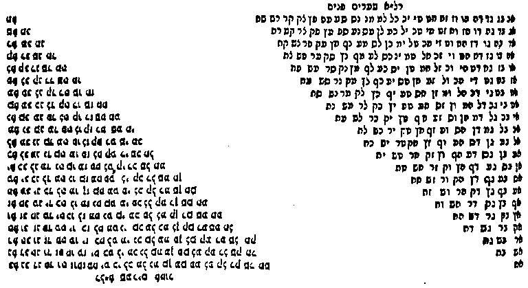

**30:5:35** 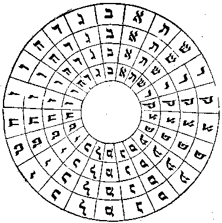

### Chapter 30:6. On arranging the four circles to generate the 231 gates and the twenty-two alphabets; and there, their secret and their concealment.

**30:6:1** And these gates and alphabets are found in this way: when we write one alphabet reversed and one straight, then Atbash comes out. And by rolling the circles there comes out further a second alphabet, which is א"ש ב"ר, etc.; and likewise all of them, some of it from the front side and some of it from the back. And so that this matter be understood according to its pattern, we have drawn here the circles, as needed.

> ונמצא השערים האלה והאלפא ביתות הם ע"ד זה כשנכתוב אלפא ביתא א' בהפך והא' ביושר אז יצא את ב"ש. ובגלגול העגולים עוד יצא אלפא ביתא שניה שהיא א"ש ב"ר וכו' וכן כלם קצתה מצד פנים וקצתה מצד אחור. וכדי שיובן הענין הזה על מתכונתו ציירנו הנה העגולים כפי המצטרך.

**30:6:2** Behold, we have set out these four circles one inside another: three alphabets straight, אבג"ד, and the fourth תשרק. From the first two we can produce the two hundred and thirty-one gates, front and back, as they are written in the previous chapter; and from the three circles that are straight we can produce from them alphabets of Achas Beta and the like, compounded of three letters; and from the last two, which are the one straight and the second תשרק, we can produce the twenty-two alphabets that are in the Sefer Yetzirah, which we also copied in the previous chapter. And after the manifestation of the alphabets and their rolling have been explained, we wish to explain the matter of substitution and its cause. And the matter is that the letters are in Tiferet; for there is the principal of their coming into being, in the very self of being, which is the firmament, as we explained in the Gate of Letters. In Tiferet they are the order of the alphabet straight, אבג"ד, etc.; and in Malkhut they are reversed, תשר"ק. And the reason is because they are male and female: male in אמ"ש, female in אש"ם. For such is the way of the seal: the form engraved in the seal from above to below is reversed [in the sealed impression, from below to above]. And likewise male,  Y H V H, straight; female,  H V H Y, reversed; as we explained in the Gate of From Below to Above. And Rashbi, peace be upon him, revealed this matter in the Song of Songs (in the Zohar Chadash, fol. 79), and these are his words: "Upper large letters go in a straight way toward the male; lower small letters go in reverse, backward, toward the female. Upper large letters go in a straight way toward the male: אבג"ד, and so all of them, as is fitting for the letters to go in a straight way toward the male. Small lower letters go in reverse, backward, within the female: תשרק, and so all of them, as is fitting toward the female, who was behind, the knot of the tefillin, which is called 'behind', as you say, 'You have formed me behind and before' (Ps. 139:5): behind toward the female, and before toward the male. And this is what is written, 'And you shall see My back' (Exod. 33:23): this is the female, who was behind." Thus far his words.

> הנה הצבנו ד' עגולים אלו בתוך אלו הג' אלפא ביתות ביושר אבג"ד והרביעית תשרק. מהשנים הראשונים נוכל להמציא רל"א שערים פנים ואחור כמו שהם כתובים בפ' הקודם ובשלשת העגולים שהם ביושר נוכל להמציא אלפא ביתות מהם של אח"ס בט"ע וכיוצא בהם מורכבות מג' אותיות ובשנים האחרונים שהם הא' ביושר והשנית תשרק נוכל להמציא כ"ב אלפא ביתות שבספר יצירה שהעתקנום ג"כ בפרק הקודם. ואחר שנתבארו מציאות האלפא ביתות וגלגול' רצוננו לבאר ענין התמורה וסבתה. והענין הוא כי האותיות בתפארת כי שם עיקר הוויות' בעצם ההויה שהיא רקיע כדפי' בשער האותיות. בתפארת הם סדר האלפא ביתא ביושר אבג"ד וכו' ובמלכות הם להפך תשר"ק והטעם מפני שהם זכר ונקבה זכר באמ"ש נקב"ה באש"ם. כי כן דרך החותם כי הצורה החקוקה בחותם ממעלה למטה מתהפך [בנחתם מלמטה למעלה] וכן זכר יהו"ה ביושר נוקבא הוה"י להפך כמו שבארנו בשער ממטה למעלה. וגלה הענין הזה הרשב"י ע"ה בשיר השירים (בז"ח דף ע"ט) וז"ל אתוון עילאין רברבין הוו בארח מישר לגבי דכר, אתוון תתאין זעירין הוו בהיפוכא למפרע לגבי נוקבא. אתוון עילאין רברבין הוו בארח מישר לגבי דכר אבג"ד וכן כלהו כמה דאתחזין למהך אתוון בארח מישר לגבי דכורא. אתוון זעירין תתאין הוו בהיפוכא למפרע גו נוקבא תשרק וכן כלהו כמה דאתחזי גבי נוקבא דהוה מאחורא קשר של תפילין דאקרי אחור כמה דאת אמר אחור וקדם צרתני אחור לגבי נוקבא וקדם לגבי דכורא ודא איהו דכתיב וראית את אחורי דא נוקבא דהוות מאחורא עכ"ל.

**30:6:3** And in the Tikkunim Rashbi, peace be upon him, explained that the letters אבג"ד straight are in Chesed, and the letters תשר"ק are in Gevurah. And they do not disagree; for it is known that the matter of תשר"ק is in the name  H V H Y, which is from the side of the female and from the side of Gevurah, from the side of the prevailing of the left side over the right, as we explained in the Gate of From Above to Below, and we shall explain it here further. And the letters אבג"ד are in the matter of the name  Y H V H  straight, from the side of the male, from the side of Chesed, and from the side of the prevailing of the right over the left. And the matter is that the way of the male is to incline to the right, and the way of the female is to incline to the left. And when the power of the male prevails over the female, that is, the power of compassion prevails over judgment; and when the power of the female prevails over the male, that is, the power of judgment prevails over compassion. And all is one matter and one way.

> ובתיקונים פירש הרשב"י ע"ה כי אותיות אבג"ד ביושר הם בחסד ואותיות תשר"ק הם בגבורה. ולא פליגי כי ידוע הוא כי ענין תשר"ק הוא בשם הוה"י שהוא מצד הנקבה ומצד הגבורה מצד תגבורת צד שמאל על הימין כדפירשנו בשער ממעלה למטה ונבארהו הנה עוד. ואותיות אבג"ד הם בענין שם יהו"ה ביושר מצד הזכר מצד החסד ומצד תגבורת הימין על השמאל. והענין כי דרך הזכר לנטות אל הימין ודרך הנקבה לנטות אל השמאל. וכאשר יגבר כח הזכר על הנקבה היינו שיגבר כח הרחמים על הדין. וכאשר יגבר כח הנקבה על הזכר היינו שיגבר כח הדין על הרחמים והכל ענין א' ודרך א'.

**30:6:4** Behold, it is found now that the letters אבג"ד are in Tiferet and the letters תשר"ק in Malkhut.

> הנה נמצא עתה אותיות אבג"ד בת"ת ואותיות תשר"ק במלכות.

**30:6:5** And behold, the letters that are in the male are three alphabets, which are light, water, firmament, which are three rungs, Chesed and Gevurah, Tiferet, as is explained in the Gate of Letters; and all of them straight; for the alphabet of תשר"ק is only from the side of the female, in the joining of the judgment; but from the side of Gevurah itself it will be straight. And because they are three rungs straight, therefore there comes into being from them the alphabet of Achas Beta and the like, all of them of three letters; because they are wheels rolling and bestowed one within another, as we shall explain. And Tiferet, which is the firmament: beneath it Malkhut rolls. And it is already known that the courses of the moon are swifter than the courses of the sun; and therefore, when Malkhut rolls and receives from Tiferet, sometimes the Tav that is in Malkhut receives from the Alef that is in Tiferet; and in this way the whole alphabet of Atbash. And when the moon hastens its rolling and the sun is still in its standing, the Shin that is in Malkhut receives from the Alef that is in Tiferet; and likewise the whole alphabet of א"ש ב"ר; and in this way all of them. And there is no wonder that a letter receives from its fellow even though it is not its partner; because all the letters are included of the ten sefirot; for all the things that are bestowed and emanated from the very self of the sefirot are possessed of ten, because there was no separation in it. And if so, when the upper letter illuminates opposite it to bestow, the lower letter stands to receive according to the measure of the upper, and the upper according to the measure of the lower. And the example of this: when the upper is the aspect of Tiferet, it prepares and illuminates in the lower the side that it has from Malkhut, to receive; and when the lower is Tiferet, it prepares in the upper the side that it has from Keter, to bestow. And in this way all the letters, in a manner that "the loops are opposite" (Exod. 26:5), and they receive one from another, and there is not one whose eye, God forbid, is evil toward that of its fellow:

> והנה אותיות שבזכר הם ג' אלפא ביתות שהם אור מים רקיע שהם ג' מדרגות חסד וגבורה תפארת כמבואר בשער האותיות וכלם ביושר שאין אלפא ביתא דתשר"ק אלא מצד הנקבה בהצטרפות הדין אבל מצד הגבורה בעצמה יהיה ביושר ולפי שהם ג' מדרגות ביושר לפיכך יתהוה מהם אלפא ביתא של אח"ס בט"ע וכדומה להם כלם בעלי ג' אותיות מפני שהם גלגלים מתגלגלים ונשפעים אלו בתוך אלו כאשר נבאר והתפארת שהוא הרקיע תחתיו תתגלגל המלכות. וכבר נודע כי תהלוכות הלבנה יותר מהירות מתהלוכות החמה ולפיכך כשיתגלגל המלכות ותקבל מהת"ת לפעמים תקבל התי"ו שבמלכות מהאלף שבתפארת ועד"ז כל האלפא ביתא של א"ת ב"ש. וכאשר ימהר הלבנה גלגולה ועדין החמה בעמידתה תקבל ש' שבמלכות מהא' שבת"ת וכן כל האלפא ביתא של א"ש ב"ר וע"ד זה כלם. ואין לתמוה היות אות מקבלת מחברתה עם שאינה בן זוגה מפני שכל האותיות הם כלולות מי"ס כי כל הדברים הנשפעים ומתאצלים מעצם הספירות הם בעלי עשר מפני שלא היה בו פירוד. וא"כ כאשר האות של מעלה יאיר עבר פניה להשפיע, האות התחתונה עומדת לקבל כפי מדתה של עליונה והעליונה כפי מדתה של תחתונה. והמשל בזה כאשר העליונה תהיה בחינת התפארת יזמין ויאיר התחתונה צד אשר לה ממלכות לקבל וכאשר התחתונה ת"ת יזמין העליונה צד אשר לה מכתר להשפיע וע"ד זה כל האותיות באופן שהוא מקבילות הלולאות ומקבלין דין מדין ואין אחת שיהיה ח"ו עינו רעה בשל חבירו:

**30:6:6** And since we are with this introduction "between the porch and the altar" (Joel 2:17), let us further enter with it from the porch inward. For according to this way the letters will be each one included of the twenty-two; for such is the way of spiritual things, each one included of its fellow, as we explained above in the Gate of Particulars of Names, on the matter of *Teli*, *Galgal*, *Lev*, and likewise in the Gate of Palaces, chapter 4, on the matter of the seventy luminaries that are included, etc. And it is a clear thing that, since each one is included of ten, so that there be no separation, God forbid, so also all the particular branches are included. And as it is said of the sefirot all together, so also it is said of each and every sefirah and of each branch. And the difference between them is after the way of the difference between the sefirot that we explained in the Gate of Essence and Governance: that the principal is what prevails. So in the branches: each branch is included of its fellow, except that here this branch is revealed more than its fellow, etc. And let us return to our matter: since each one of the letters is included of the twenty-two, if so it is no wonder that each one of them is exchanged with whichever it may be, since in it too there is a part of that letter that is exchanged with it; except that, with all this, the principal is the letter written in the principal of the name, and the one exchanged for it is a branch of it. And the example of this: the name  Y H V  is exchanged in Atbash into מצ"ף.

> ואחר שאנו בהקדמה זו בין האולם ולמזבח עוד נכנס עמה מן האולם ולפנים כי לפי דרך זה יהיו האותיות כל א' כלולה מהכ"ב כי כן דרך הדברים הרוחניים כל א' כלולה מחברתה כדפי' לעיל בשער פרטי השמות בענין תל"י גלג"ל ל"ב וכן בשער היכלות בפ"ד בענין ע' מאורות שנכללים וכו'. ודבר מבואר הוא כי אחר שכל א' כלול מי' מפני שלא יהיה פירוד ח"ו, כן ג"כ כל הענפים הפרטיים כלולים. וכמו שנאמר בספי' כלם ג"כ נאמר בכל ספירה וספירה ובכל ענף. והחילוק שביניהם הוא על דרך חילוק הספירות שפי' בשער מהות והנהגה שהעיקר הוא הגובר כן בענפים כל ענף וענף כלול מחבירו אלא שכאן מתגלה ענף זה יותר מחבירו וכו'. ונחזור לענייננו שאחר שכל א' מהאותיות כלולה מהכ"ב א"כ לא יפלא שיתחלף כל א' מהם באיזו שתהיה כיון שבה גם כן חלק מאותו האות המתחלף בה אלא שעכ"ז העקר הוא האות הכתובה בעקר השם ואותה המתחלפת הוא ענף ממנה. והמשל בזה שם יה"ו יתחלף בא"ת ב"ש מצ"ף.

**30:6:7** And behold, these letters are branches from it; not that the whole very self of the name that is in  Y H V  is in מצ"ף. And because of this the power of substitution is not praised like permutation; for in permutation the whole very self of the letters is the name that was permuted, and nothing is lacking, except that it was reversed with respect to the aspects, as we explained in chapter 3. But in substitution the power of the aforementioned name is diminished, after the way that we explained. And in this way we may infer for all the substitutions and for all the names. And in the Tikkunim (Tikkun 21, fol. 59 and fol. 70) it is proved that the matter of these substitutions is from the side of Metatron: "And the Holy One, blessed be He, strips Himself of all titles and of all chariots of Metatron, which are כוז"ו במוכס"ז כוז"ו, מצפ"ץ," etc. And he said that the substitutions of YHVH Eloheinu YHVH in כוז"ו במוכס"ז כוז"ו, and likewise YHVH in מצפ"ץ, are chariots of YHVH in Metatron, and they are the garments of the Name, which are in the time of the exile. And it is expounded there that in the time of the redemption the Holy One, blessed be He, strips Himself of all the titles, etc., as he concludes. The example of this: when the four-letter name is clothed in the letters מצפ"ץ, it shows that the Name was clothed in Metatron, in the garment so called; and likewise for all the other names and for all the substitutions:

> והנה האותיות האלה הם ענפים ממנו לא שיהי' כל עצם השם שביה"ו במצ"ף ומפני זה כח התמורה לא ישובח כצירוף כי הצרוף כל עצמות האותיות הוא השם שנצטרף ולא חסר דבר אלא שנהפך בערך הבחינות כדפי' בפ"ג. אבל התמורה יתמעט כח השם הנזכר ע"ד שפי'. וע"ד זה נקיש לכל התמורות ולכל השמות. ובתיקונים (תקונא כ"א דף נ"ט ודף ע') מוכח כי ענין התמורות האלה הם מצד מטטרו"ן ומתפשט קב"ה מכל כנויין ומכל מרכבות דמטטרו"ן דאינון כוז"ו במוכס"ז כוז"ו מצפ"ץ וכו' ואמר כי תמורות יהו"ה אלהינ"ו יהו"ה בכוז"ו במוכס"ז כוז"ו וכן יהו"ה במצפ"ץ הם מרכבו' ה' במטטרו"ן והם לבושי השם שהם בזמן הגלות. ונדרש שם כי בזמן הגאולה מתפשט הקב"ה מכל הכנויין וכו' כדמסיק. המשל בזה כאשר שם בן ד' מתלבש באותיות מצפ"ץ מורה על שנתלבש השם במטטרו"ן בלבוש המכונה כן וכן לשאר כל השמות ולכל התמורות:

### Chapter 30:7. On the surpassing excellence of the alphabet that ascends and descends, and likewise the [computation underlying the names] 72 and 42; and the passage of Parashat Terumah, "there, of forty-two letters."

**30:7:1** And what we need to know is that not all the alphabets are equal. For the alphabet that always rises in its reckoning shows its excellence, that it rises by way of the ladder and does not descend. The example of this: the alphabet of Achas Beta, etc., always rises and does not descend; that is to say, the reckoning of the first letter of the first word is one, and the first of the second word is Bet; it always rises. And likewise all the other words, and likewise all the other letters, always rise and do not descend. And this shows the cleaving of this alphabet to its upper source; and therefore it rises toward above in the reckoning of its letters. And there is an alphabet that rises and descends, the example Atbash; for it rises in its half and descends in its half; it shows that it is not so great in its excellence. For the one that rises, rises and is united in its source and does not descend, which shows the strength of its ascent, so that it does not descend. And the other, it is true that it rose, but it did not rise so much as to be united in its source; rather, it returned to descend by way of the steps by which it rose. Sometimes it rises a little and descends more than those steps by which it rose: this shows that it does not rise in excellence and rung as the alphabets that are equal in their ascent and their descent; and all the more that they are not equal with the one that rises more than its descent. The end of the matter: according to the matter of the ascent and the descent will be the rung of the alphabet. And not only the alphabet; but even the name that is permuted from the rising alphabet, its excellence will be more praiseworthy than the name that is permuted from the descending alphabet, which is תשר"ק, etc. And likewise the one permuted by means of the alphabet that rises and descends is more praiseworthy than the one that always descends. And therefore the name that is permuted by means of Avgad is more praiseworthy than the name that is permuted by means of Atbash, such as מצפ"ץ; because Avgad rises and does not descend, and Atbash rises in its half and descends in its half. And the name of forty-two, whose principal permutation is by means of alphabets that rise and do not descend, which are Albam, Ayak Bekhar, Achas Beta, and Avgad, and the rest, as is explained in the Gate of Particulars of Names according to the tradition of the Geonim; see there:

> ומה שצריך שנדענו שאין כל האלפא ביתות שוות כי האלפא ביתא שתהיה עולה בחשבונה לעולם מורה על מעלתה שהיא עולה דרך הסולם ואינה יורדת. המשל בזה אלפא ביתא של אח"ס בט"ע וכו' עולה לעולם ואינה יורדת. ר"ל כי חשבון של אות ראשונה של תיבה הראשונה היא א' והראשונה שבתיבה שנייה הוא בי"ת עולה לעולם. וכן כל שאר ה תיבות וכן כל שאר האותיות הם עולות לעולם ואינם יורדות. וזה מורה על דבקות האלפא ביתא הזאת במקורה העליון ולכן עולה כנגד מעלה בחשבון אותיותיה. ויש אלפא ביתא שתעלה ותרד המשל א"ת ב"ש כי עולה בחצייה ויורדת בחצייה מורה על כי אינה גדולה במעלתה כ"כ. כי העולה עולה ומתאחדת במקורה ואינה יורדת שמורה על תוקף עלייתה עד שלא יורדת. והאחרת אמת כי עלתה אבל לא עלתה כ"כ עד שנתייחדה במקורה אלא חזרה לרדת דרך המעלות אשר עלתה. לפעמים תעלה במקצת ותרד יותר מאותם המעלות אשר עלתה זה מורה על שאינה עולה במעלה ובדרגה כאשר האלפא ביתות השוות בעלייתם וירידתם ומכל שכן שאינם שוות עם העולה יותר מירידתה. סוף דבר לפי ענין העלייה והירידה תהיה מדרגת האלפא ביתא. ולא בלבד האלפא ביתא אלא אפי' השם המצטרף מהאלפא ביתא העולה תהיה מעלתו משובח מהשם המצטרף מאלפא ביתא היורדת שהיא תשר"ק וכו'. וכן המצטרף על ידי האלפא ביתא העולה ויורדת משובח מאותה היורדת לעולם ולכן השם שיצטרף ע"י אבג"ד משובח משם המצטרף ע"י א"ת ב"ש כמו מצפ"ץ, מפני שאבג"ד עולה ואינה יורדת וא"ת ב"ש עולה בחציה ויורדת בחציה. ושם מ"ב שעיקר צרופו הוא ע"י אלפא ביתות העולות ואינם יורדת שהם אלב"ם, אי"ק בכ"ר, אח"ס בט"ע, ואבג"ד והשאר כמבואר בשער פרטי השמות ע"פ קבלת הגאונים ע"ש.

**30:7:2** behold, its excellence and its rung are more than all of them, in that it rises and does not descend. And by this introduction the words of Rashbi, peace be upon him, in Parashat Terumah (fol. 132b) will be understood, and these are his words: "The name of forty-two letters: its secret is the Patriarchs, who are crowned in the upper world, and the upper world in what is above. And therefore it rises and does not descend; it is crowned within the upper Thought. Happy is the portion of the one who knows it and is careful with it. The name of seventy-two letters is David, who is crowned in the Patriarchs; and its secret rises and descends. In the same way, מצפ"ץ, the name of the thirteen measures of compassion: they are twelve, the secret of the holy chariot that goes out from one that dwells upon them. And therefore it rises and descends. And all of them rise and descend, except this [name of forty-two], which rises and does not descend. And therefore the name of seventy-two rises and descends: it rises from this side and descends from this side. [The name of the thirteen measures rises from this side and descends from this side.] And that which descends, [in order] to draw goodness below. And therefore א"ת ב"ש ג"ר ד"ק ה"ץ ו"ף ז"ע ח"ס ט"ן י"מ כ"ל: the first letters rise in reckoning, and the other letters descend in reckoning, in order to draw goodness from above to below. The name of forty-two crowns the upper chariot; the name of seventy-two crowns the lower chariot. Happy is the portion of the one who strives to know his Master; happy is he in this world and in the world to come." Thus far his words.

> הנה מעלתו ומדרגתו יותר מכלם להיות שעולה ואינו יורד. ובהקדמה זו יובן דברי הרשב"י ע"ה בפ' תרומה (דף קל"ב ע"ב) וז"ל שמא דמ"ב אתוון רזא דיליה אבהן דקא מתעטרן בעלמא עלאה, ועלמא עלאה במה דלעילא. וע"ד סליק ולא נחית אתעטר גו מחשבה עלאה. זכאה חולקיה מאן דידע ביה ואזדהר ביה. שמא דע"ב אתוון דוד דקא מתעטרא באבהן ורזא דיליה סליק ונחית. כגוונא דא מצפ"ץ שמא דתליסר מכילין דרחמי. אינון תריסר רזא דרתיכא קדישא דנפיק מחד דשרייא עלייהו. ובג"כ סליק ונחית וכולהו סלקין ונחתין בר האי [שמא דמ"ב] דסליק ולא נחית וע"ד שמא דע"ב סליק ונחית סליק מסטרא דא ונחית מסטרא דא. [שמא די"ג מכילן סליק מסטרא דא ונחית מסטרא דא] וההוא דנחית [בגין] לאמשכא טיבו לתתא. ועל דא א"ת ב"ש ג"ר ד"ק ה"ץ ו"ף ז"ע ח"ס ט"ן י"מ כ"ל. אתוון קדמאין סלקין בחשבנא ואתוון אחרנין נחתין בחושבנא בגין לאמשכא טיבו מעילא לתתא. שמא דמ"ב איהו מעטרא לרתיכא עלאה שמא דע"ב איהו מעטרא לרתיכא תתאה. זכאה חולקיה מאן דאשתדל למנדע למאריה זכאה איהו בעלמא דין ובעלמא דאתי עכ"ל.

**30:7:3** And his intention is clear. For he said that the name of forty-two rises and does not descend, as we explained above; because of this it shows a high place; for its letters hint at the Patriarchs, who are united in Binah, and Binah in Chokhmah and Keter; it is found that it rises above and does not descend. And this he intended in saying, "The name of forty-two: its secret is the Patriarchs," which are Gedulah and Gevurah, Tiferet. And it is already known that they are held in their three branches that branch out from them; and therefore six of its names hint at them. However, the seventh name is hinted in Binah; for Tiferet and Malkhut and Binah are all one, and they are the secret of Shabbat. And likewise these seven names are the secret of seven days, as we explained in the Gate of Particulars of Names, chapter 13. And therefore its principal is in the Patriarchs, which are fathers to Netzach, Hod, Yesod; and they rise and are crowned in the secret of the Shabbat day, which is the seventh, in Binah itself; and Binah is united with what is above her. We are found to learn that it rises and does not descend; for it rises "within the upper Thought": it is the secret of Keter Elyon, which is called the upper Thought, as is known. However, the name of seventy-two is "David, who is crowned in the Patriarchs"; for three verses, which are *Va-yisa*, *Va-yavo*, *Va-yet* (Exod. 14:19–21), are Gedulah, Gevurah, Tiferet; and in their particulars and their totality, seventy-two, two hundred and sixteen, that is, ויעב"ר [*va-ya'avor*], the secret of the gestation [*ibbur*]; for *ibbur* and *va-ya'avor*, the letters of this one are as the letters of that one. And it descends below in the secret of the coupling of husband and wife, in the secret of Tiferet and Malkhut; for there is the gestation of the souls. And therefore it rises in the secret of the reversed verse, which shows the ascent and the withdrawal upward; for it turns its face to rise to its source. And there is no wonder at the ascent being by means of Gevurah, which is the left, the verse *Va-yavo*; for there is no ascent by way of the steps of the ladder except in the secret of the left, and the descent in the right; and it is well known. And therefore the thrusting away is always with the left, as our Sages, of blessed memory, said (Sanhedrin 107b): "Always let the left thrust away and the right draw near." And therefore the withdrawal by the left shows the thrusting away; which is not so with the names of compassion; for the principal is the drawing downward, in the secret of the bestowal that is bestowed. And this he intended in saying, "In the same way, מצפ"ץ, the name of the thirteen measures of compassion," etc.: they are the exchange of the thirteen attributes in Atbash, as is well known; and from the side of the alphabet in which it is exchanged, in this respect it is called rising and descending. And he said, "they are twelve, the secret of the chariot," etc.: the explanation is that they are twelve borders, and the including power, the source that bestows them and emanates them; they are thirteen. And the twelve are twelve stones, which are a chariot to Tiferet, as we explained on the matter of the twelve borders in the Gate of Particulars of Names, chapter 6. And the thirteenth is the source that emanates them, which surrounds them and encompasses them; it is "the one that dwells upon them" and hovers over them. "And therefore it rises and descends," etc.: the explanation is that, for the reason of its being compassion, it needed to descend and bestow. "And all of them rise," etc.: the explanation is that, since the ascent is a need for receiving and the descent a need for bestowing, all the names, all of them, rise and descend; rise to receive and descend to bestow, after the way of the powers and the names; except the name of forty-two, which rises to be crowned above and does not descend, to show the might of its power and its strength, and that it is united in its root. And therefore it is true of it that it is judgment; even though the principal of its ascent is only for praise, to be exalted, with all this it rises to be crowned and does not descend to bestow; and there is in this matter judgment, since it withdraws and does not bestow. And the name of seventy-two is not so; for it is compassion and bestows; it rises and descends. And this he meant in saying, "And therefore the name of seventy-two rises and descends," etc., "the name of thirteen," etc.: for the thirteen attributes are of compassion, and the secret of compassion is to bestow; and therefore it rises and descends. And seventy-two and thirteen are all one thing; for the name of seventy-two depends on the twelve borders, which are thirteen, as is explained in the Gate of Particulars of Names. And Rashbi, peace be upon him, brought the thirteen attributes there only to establish the name of seventy-two, that it is compassion and bestows; and therefore after its ascent it descends. And with this the whole rest of the saying is explained. And there has come out for us the matter of the secret of the rising and descending alphabets. We are also found to learn that the rising ones are in the secret of the ascent, and therefore they rise in their number. And it is difficult: for according to this it would have been fitting that the alphabet of Avgad, which shows the ascent, be in the secret of Malkhut, in the secret of the returning light, in the secret of receiving; and the alphabet of תשר"ק be in the secret of Tiferet, in the secret of the direct light, in the secret of bestowal and compassion. And the words of Rashbi in the Song of Songs are not so, as we explained in the previous chapter, where he says that תשר"ק is in Malkhut and Avgad in Tiferet. And to this we shall answer: when we examine closely the words of Rashbi there, where he says that the matter of תשר"ק is in Malkhut and Avgad in Tiferet, it is in the secret of "You have formed me behind and before" (Ps. 139:5); the explanation, before the sawing apart of Eve, which we explained in the Gate of the Diminishment, chapter 2. And therefore they were back to back, cleaving; the male facing upward, to his roots, and the female downward. It is found according to this that the order of the letters is thus: Avgad, etc., is the front, and the back is Atbash, etc.; and the male faces upward, in the secret of the back, and the female faces downward, the reverse of their descent. And after the sawing apart, when their joining was face to face, the male bestows, looking downward toward the female, and the female upward toward the male, to receive from him; and therefore Avgad rises in the male and תשר"ק in the female, and as we explained.

> וכוונתו מבוארת כי אמר כי שם בן מ"ב הוא עולה ואינו יורד כדפי' לעיל מפני זה הוא מורה במקום גבוה כי אותיוו רומזים האבות שהם מתייחדים בבינה ובינה בחכמה וכתר נמצא עולה למעלה ואינו יורד. וזה כיוון באמרו שמא דמ"ב רזא דיליה אבהן שהם גדולה וגבורה ת"ת. וכבר נודע שהם אחוזים בג' ענפיהם המסתעפים מהם ולכן בהם רמז ששה משמותם ואולם השם השביעי רמוז בבינה כי ת"ת ומלכות ובינה הכל א' והם סוד שבת. וכן ז' שמות אלו סוד ז' ימים כדפי' בשער פרטי השמות בפי"ג ולכן עקרו באבות שהם אבות לנצח הוא יסוד והם עולים ומתעטרים בסוד יום השבת שהוא השביעי בבינה עצמה והבינה מתייחדת במה שלמעלה ממנה. נמצאנו למדים כי הוא עולה ואינו יורד כי הוא עולה גו מחשבה עלאה הוא סוד כ"ע הנקרא מחשבה עליונה כנודע. אמנם שם בן ע"ב דוד דקא מתעטר באבהן כי ג' פסוקים שהם ו"יסע ו"יבא ו"יט הם גדולה גבורה ת"ת ובפרטם וכלליותם ע"ב רי"ו דהיינו ויעב"ר סוד העיבור כי עיבור ויעבר אותיות דדין כאותיות דדין והוא יורד למטה בסוד הזווג איש ואשתו בסוד ת"ת ומלכות כי שם עיבור הנשמות. ולכן עולה בסוד הפסוק המהופך המורה על העלייה וההסתלקות למעלה כי הוא הופך את פניו לעלות אל מקורו. ואין לתמוה על היות העלייה ע"י הגבורה שהיא השמאל פסוק ויבא כי אין עלייה דרך מעלות הסולם אלא בסוד השמאל והירידה בימין ומפורסם הוא ולכן הדחייה לעולם בשמאל כאז"ל (סנהדרין קז) לעולם תהא שמאל דוחה וימין מקרבת ולכן ההסתלקות בשמאל מורה על הדחייה משא"כ שמות הרחמים כי העקר הוא ההמשכה למטה בסוד ההשפעה הנשפעת. וזה כוון באמרו כגוונא דא מצפץ שמא דתליסר מכילן דרחמי וכו' הם חלוף י"ג מדות בא"ת ב"ש כמפורסם ומצד האלפא ביתא שבה הוא מתחלף בערך זה נקרא עולה ויורד. ואמר ואינון תריסר רזא דרתיכא וכו' פי' כי הם י"ב גבולין והכח הכולל המקור המשפיעם ומאצילם הם י"ג. והי"ב הם י"ב אבנים שהם מרכבה לת"ת כדפי' בענין י"ב גבולין בשער פרטי השמות פ"ו. והי"ג הוא המקור המאצילם הסובב אותם ומקיפם הוא השוכן עליהם וחופף עליהם. ובג"כ סליק ונחית וכו' פי' מטעם היותו רחמים הוצרך לרדת ולהשפיע. וכלהו סלקין כו' פי' כי להיות העלייה צורך אל הקבלה והירידה צורך אל ההשפעה כל השמות כלם עולים ויורדים עולים לקבל ויורדים להשפיע כדרך הכחות והשמות זולת שם בן מ"ב שהוא עולה להתעטר למעלה ואינו יורד להראות עוצם גבורתו וכחו ושהוא מתאחד בשרשו ולכן יצדק עליו שהוא דין עם היות שאין עקר עלייתו אלא לשבח להתעלות עכ"ז עולה להתעטר ואינו יורד להשפיע ויש בענין הזה דין כיון שהוא מסתלק ואינו משפיע. ואין כן שם ע"ב שהוא רחמים ומשפיע עולה ויורד. וזה רצה באמרו וע"ד שמא דע"ב סליק ונחית וכו' שמא דתליסר וכו' כי י"ג מדות הם של רחמים וסוד הרחמים להשפיע ולכן עולה ויורד. וע"ב וי"ג הכל דבר א', כי שם ע"ב תלוי בי"ב גבולים שהם י"ג כמבואר בשער פרטי השמות. וכל עצמו לא הביא שם הרשב"י ע"ה י"ג מדות אלא להכריח לשם ע"ב שהוא רחמים ומשפיע. ולכן אחר עלייתו יורד. ובזה נתבאר כל שאר המאמר. ויצא לנו ענין סוד האלפא ביתות העולות והיורדות. גם נמצאנו למדים כי העולות הם בסוד העלייה ולכן הם עולות במספרם. וקשה כי לפי זה הי' ראוי שאלפא ביתא של אבג"ד שמורה על העלייה יהיה בסוד המלכות בסוד האור החוזר בסוד הקבלה, ואלפא בית"א של תשר"ק תהיה בסוד הת"ת בסוד האור ישר בסוד ההשפעה והרחמים, ולא כן דברי הרשב"י בשיר השירים כדפי' בפרק הקודם דקאמר כי תשר"ק היא במלכות ואבג"ד בת"ת. ולזה נשיב כי כשנדקדק דברי הרשב"י התם דקאמר כי ענין תשר"ק במלכות ואבג"ד בת"ת הוא בסוד אחור וקדם צרתני. פי' קודם הנסירה של חוה שבארנוה בשער המיעוט פ"ב. ולכן היו אחוריים באחוריים מתדבקים הזכר פונה למעלה אל שרשיו והנקבה למטה נמצאו לפי זה סדר האותיות כך אבג"ד וכו' פנים, והאחוריים הם א"ת ב"ש וכו', והזכר פונה למעלה בסוד האחוריים והנקבה פונה למטה הפך רדתם. ואחר הנסירה שהיה חיבורם פנים בפנים הזכר משפיע מביט כלפי מטה אל הנקבה והנקבה כלפי מעלה אל הזכר לקבל ממנו ולכן עולה אבג"ד בזכר ותשר"ק בנקבה וכדפי'.

**30:7:4** Behold, the part of permutation is concluded in all that is needed. And now we shall come to explain the part of *gematriot*:

> הנה נכלל חלק הצרוף בכל הצריך. ועתה נבא לבאר חלק גימטריאות:

### Chapter 30:8. On *gematria* and the kinds of number, and the secret of initial letters (*rashei tevot*), final letters (*sofei tevot*), and middle letters (*tokhei tevot*), with further hints at it.

**30:8:1** On the part of *gematria*; and it is the matter of the number of the letters being equal to equal. And to this part there are other divisions; and they are, first, the part of the weight [*mishkal*]; and it is the most praiseworthy of all the *gematria*. And its explanation: as רזיא"ל [Raziel], which comes up to the reckoning of אברהם [Abraham], and their letters are equal, this one five letters and that one five letters; and likewise בי"ט comes up to יה"ו, for in this one three letters and in that one three letters; and they are weighed together, this as that and that as this. And this is the most praiseworthy of all the *gematriot*, because the whole matter of the branches and the powers that are in this name are in that name, except that the letters were exchanged, and the powers into other powers. And this is possible after the way that we wrote above; and this way is near, in some respect, to substitution. And under this part there is another part, and it is the part of joining and separation.

> בחלק הגימטריא והוא ענין מספר האותיות שוה בשוה ולחלק זה חלוקים אחרים והם ראשונה חלק המשקל והוא המשובח שבכל הגימטריא ופי' כמו רזיא"ל שעולה לחשבון אברהם ואותיותיהם שוות זה ה' אותיות וזה ה' אותיות וכן בי"ט עולה יה"ו שבזה ג' אותיות וזה ג' אותיות והם שקולים יחד זה כזה וזה כזה וזה המשובח שבכל הגימטריאות מפני שכל ענין הענפים והכחות שבשם זה הם בשם זה אלא שנתחלפו האותיות והכחות בכחות אחרים. וזה אפשר להיות ע"ד שכתבנו למעלה ודרך זו קרובה בצד מה אל התמורה. ותחת החלק הזה יש חלק אחר והוא חלק החיבור והפרוד.

**30:8:2** And the matter of the joining is if there are in it three letters that are joined into two. How so? הו"ה, when the two Hehs are joined into Yod, and it becomes י"ו; and likewise אהי"ה, when Alef and Heh are joined into Vav, and it comes up יה"ו; and likewise חיים [*chayyim*], when the two Yods are joined into Kaf, and it becomes חכם [*chakham*]. And this is a somewhat praiseworthy part; for the letters do not change entirely by way of the reckoning, as we shall explain; but they stand in their place, except that two of them were joined or separated; and from the union and the joining the separation is known, and from the separation the union is known; and therefore there is no need to lengthen on it. However, the matter is that each and every letter, according to its number, so will be its powers; for the number is not for nothing. For the Tav will have four hundred branches branching out from it, all of them "a knob and a flower" (Exod. 25:33); and likewise for all the branches going out from the pure candelabrum, in which twenty-two things are fixed, as we explained in the Gate of Letters. And even though it is found that Alef is in Keter, its reckoning one, showing one branch, and Tav is in Malkhut, or in whatever place it may be, showing four hundred; and certainly Alef is in a greater excellence than Tav: this is no question. For there is a branch which, even though it is single, includes many branches hidden and concealed in it; like the Alef, which includes all the branches, that is to say, all the letters, as we explained in the Gate of Letters; and all of them are united in Alef. And with this the matter of *gematria* will now be understood: that it is one matter with the thing counted in it. The example: אמ"ן [amen], which comes up to יאדהונה"י, as is well known in the words of Rashbi, peace be upon him. For when Tiferet and Malkhut are joined, there are united in the union the twenty-six branches that are in Tiferet, as the number of the four-letter name, and the sixty-five branches that are in Malkhut, as the number of Adonai. And when we wish to join them, we join them in the name סוכ"ה [*sukkah*], or in the name אמ"ן, or in the name מלאך [*mal'akh*]; for in all of them are hinted the ninety-one branches that are in their union. True, they are not equal in their matter; for סוכה is more united, for it is כ"ו ה"ס [26, 65], whose branches are revealed upon the matter that is hinted in the two names. And similarly, when we join two letters into one, and likewise two names into one, behold, that letter and that name will not be related in very self [one] to the first letter or to the first name that was principal in its spirituality. And from this we may infer to when the word is changed entirely. However, the order of the count of the *gematria*: they received concerning them that they are nine; and these are their names, as the ancients named them. **1. The general rounded number**; and it is in the return of the wheel; that is to say, that the thousands are reckoned only as ones; as five times two hundred and sixteen, which come up to אנכ"י [*Anokhi*, 81]. And many named this number by the name "small number" [*mispar katan*]; and the reason is because it makes the number small; for from a hundred it makes one, and from three hundred three, and from four hundred four; and likewise in this way it makes the number of the thousands small, to the rung of the ones. And Rashbi, peace be upon him, names this number for Enoch; and likewise it is customary in many places, especially in the Tikkunim, "by the small reckoning of Enoch." And it seems to us that this matter is because Enoch is the youth Metatron; and this angel makes the attributes small because he is "a small mirror"; that is to say, that there are in him the branches of the sefirot spreading out and clothed in his light, and he does not merit them in their being included of ten or more. For this is the secret of the number that is in the letters: that the ones rise to the tens in the secret of one included of ten, and from the tens to the hundreds in the secret that each one is included of ten, and ten of ten; for each one of ten branches is further included of ten; and it is found that from one it rises to a hundred; and likewise in this way they rise to a thousand. And Metatron is the reverse of this attribute; for the light of the inclusion is dark for him, and he has no inclusion of the attributes, because he is in the world of separation (that is, the world of Yetzirah). And therefore, on the contrary, he makes the number of the letters small; and what shines above in the sefirah in a thousand shines below in Metatron in one. And this is the secret of the small number. And from this we can infer to the adding numbers: that they add the inclusion; and those that add in the letters themselves add the very self of the including branch; and likewise the one that adds the word, and the like; and likewise those that add the filling, in the secret of the fillings that we explained in the Gate of the Four-Letter Name. And this is enough of a note for understanding the other numbers, so that we need not explain them; for in this gate all of them enter, above and below:

> וענין החיבור הוא אם יהיו בתוכה ג' אותיות שיתחברו אל שתים כיצד הו"ה שיתחברו שני ההי"ן אל י' ויהי' י"ו וכן אהי"ה שיתחברו אל"ף וה"א אל וא"ו ויעלה יה"ו וכן חיים שיתחברו שני יודי"ן אל כ"ף ויהיה חכם וזה חלק משובח קצת שאינם משתנים האותיות מכל וכל בדרך החשבון כמו שנבאר אלא הם עומדות במקומם אלא שתים מהם נתחברו או נפרדו ומהיחוד והחבור יודע הפירוד ומהפירוד יודע היחוד ולכן אין צורך להאריך בו. אמנם הענין הוא כי כל אות ואות לפי מספרו יהיו כחותיו כי המספר לא על חנם הוא. כי התי"ו יהיו לה ד' מאות ענפים מסתעפים ממנה כלם כפתור ופרח. וכן לכל הקנים היוצאים מן המנורה הטהורה שבה קבועות כ"ב חפצים כדפי' בשער האותיות. ועם היות שנמצא שהא' הוא בכתר חשבונו א' מורה על ענף א', ות' היא במלכות או באיזה מקום שיהיה מורה על ד' מאות. ובודאי כי אלף הוא במעלה גדולה יותר מן התי"ו. זו אינה שאלה, כי יש ענף כי עם היותו מיוחד כולל ענפים רבים מסתתמים ומתעלמים בו כמו האלף הכוללת כל הענפים ר"ל כל האותיות כמו שפי' בשער האותיות וכלן מתיחדות בא'. ובזה יובן עתה ענין הגמטריא כי הוא ענין א' עם הדבר הנמנה בו. המשל אמ"ן שעולה יאדהונה"י כמפורסם בדברי הרשב"י ע"ה. כי כאשר יתחברו ת"ת ומלכות יתייחדו ביחוד כ"ו ענפים שבת"ת כמנין שם בן ד', וס"ה ענפים שבמלכות כמנין אדנ"י. וכאשר נרצה לחברם נחברם בשם סוכ"ה או בשם אמ"ן או בשם מלאך כי בכלם נרמזים צ"א ענפים שביחודם. אמת שלא ישתוו בעניינם כי סוכה הוא מיוחד יותר שהוא כ"ו ה"ס שענפיהם מתגלים על ענין הנרמז בשתי שמות וכיוצא בזה כאשר נחבר שתי אותיות אל אחד וכן שני שמות אל אחד הנה אותו האות ואותו השם לא יתייחס בעצם [א] באות הראשון או בשם הראשון שהיה עיקרי ברוחניותיה. ומזה נקיש אל כאשר תשתנה התיבה מכל וכל. ואולם סדר מנין הגימטריא קבלו בהם היותם תשעה ואלה שמותם כאשר כנו להם הקדמונים. א מספר המעוגל הכללי והוא בחזרת הגלגל ר"ל שהאלפים אינם נחשבים אלא כאחדים כגון חמשה פעמים רי"ו שעולים אנכ"י. ורבים כנו מספר זה בשם מספר קטן והטעם מפני שהוא מקטין המספר כי ממאה יעשה א' ומשלש מאות ג' ומארבע מאות ארבעה. וכן על דרך זה יקטין מספר האלפים אל מדרגת האחדים. ומכנה הרשב"י ע"ה המספר הזה לחנוך וכן המורגל במקומות הרבה בפרט בתיקונים לחשבן זעיר דחנוך. ונראה לנו היות הענין הזה כי חנוך הוא נער מטטרו"ן והמלאך הזה המקטין את המדות מפני שהוא מראה קטנה רצה לומר שיש בו ענפי הספירות מתפשטות ומתלבשות באורו ואינו זוכה אליהם בהיותם כלולות מעשר או יותר. כי זהו סוד המספר שבאותיות כי יתעלו האחדים אל העשירות בסוד אחד כלולה מעשר ומהעשירות אל המאות בסוד כי כל א' כלולה מי' וי' מי' כי כל אחד מי' ענפים יוכללו עוד מעשר ונמצא מא' עולה אל מאה וכן על דרך זה יעלו לאלף. ומטטרון הפך מדה זו כי אור הכללות חשך בעדו ואין לו כללות המדות לפי שהוא בעולם הפירוד (היינו עולם היצירה) ולכן אדרבה הוא מקטין מספר האותיות ומה שמאיר למעלה בספירה באלף מאיר למטה במטטרון באחד וזהו סוד מספר קטן ומזה נוכל להקיש אל המספרים המוסיפים שהם מוסיפים הכלליות והמוסיפים באותיות עצמם הם מוסיפים עצם הענף הכולל וכן המוסיף התיבה וכיוצא בזה וכן המוסיפים המילוי בסוד המילויים שפי' בשער שם בן ד' ודי בזה הערה להשכלות שאר המספרים כדי שלא נצטרך לבארם כי בשער זה יכנסו כלם מעלה מטה:

**30:8:3** **2. The antecedent number**: as Gimel comes up to six, when we count from the beginning of the alphabet up to the Gimel; Dalet comes up to ten; and Heh comes up to fifteen, when we count from the head of the alphabet. And we have wished to complete here all the numbers, all of them, from the head of the alphabet to its end, so that it be easy for us to count when we need the number. And this is its form: אב comes up to ג; אבג comes up to ו; אבגד comes up to י; אבגדה comes up to טו; אבגדהו comes up to כא; אבגדהוז comes up to כח; אבגדהוזח comes up to לו; אבגדהוזחט comes up to מה; אבגדהוזחטי comes up to נה; אבגדהוזחטיכ comes up to עה; אבגדהוזחטיכל comes up to קה; אבגדהוזחטיכלמ comes up to קמה; אבגדהוזחטיכלמנ comes up to קצה; אבגדהוזחטיכלמנס comes up to רנה; אבגדהוזחטיכלמנסע comes up to שכה; אבגדהוזחטיכלמנסעפ comes up to תה; אבגדהוזחטיכלמנסעפצ comes up to תצה; אבגדהוזחטיכלמנסעפצק comes up to תרצה; אבגדהוזחטיכלמנסעפצקר comes up to תשצה; אבגדהוזחטיכלמנסעפצקרש comes up to אלף צה; אבגדהוזחטיכלמנסעפצקרשת comes up to אתצ"ה. And behold, with this table it will be easy for us to bring out the number for all that is needed, with the help of the Rock and His salvation:

> ב מספר הקדמי כגון ג' עולה ששה כשנמנה מתחלת האלפא ביתא ועד הג'. ד' עולה י' וה' עולה ט"ו כשנמנה מראש האלפא ביתא. והנרצה לסיים הנה כל המספרים כלם מראש האלפא ביתא ועד סופה כדי שיקל אלינו למנות כשנצטרך אל המספר. וזו צורתה:  
>  א ב עולה ג  
> א ב ג עולה ו  
> א ב ג ד עולה י  
> א ב ג ד ה עולה טו  
>  אבגדהו עולה כא  
> אבגדהוז עולה כח  
> א ב ג ד ה ו ז ח עולה לו  
> אבגדהוזחט עולה מה  
> אבגדהוזחטי עולה נה  
> אבגדהוזחטיכ עולה עה  
>  אבגדהוזחטיכל עולה קה  
>  אבגדהוזחטיכלמ עולה קמה  
>  אבגדהוזחטיכלמנ עולה קצה  
>  אבגדהוזחטיכלמנס עולה רנה  
>  אבגדהוזחטיכלמנסע עולה שכה  
>  אבגדהוזחטיכלמנסעפ עולה תה  
>  אבגדהוזחטיכלמנסעפצ עולה תצה  
>  אבגדהוזחטיכלמנסעפצק עולה תרצה  
>  אבגדהוזחטיכלמנסעפצקר עולה תשצה  
>  אבגדהוזחטיכלמנסעפצקרש עולה אלף צה  
>  אבגדהוזחטיכלמנסעפצקרשת עולה אתצ"ה  
> והנה בלוח זה יקל אלינו הוצאת המספר לכל המצטרך בעזר הצור וישועתו:

**30:8:4** **3. The necessary number**; and it is the number of the word according to what it is: as חסד [Chesed] comes up to seventy-two; גבורה [Gevurah] two hundred and sixteen, or ארי"ה [*aryeh*, lion]:

> **ג** מספר הכרחי והוא מספר המלה לפי מה שהיא כגון חסד עולה ע"ב גבורה רי"ו או ארי"ה:

**30:8:5** **4. The additive number**: it is that we add the letters of the word to the number, or the word itself, if all is needed, according to the need. And likewise the concealment of these has been explained above, and likewise their reason. And the reason for the antecedent: since it is its cause, after the way that I explained concerning the sefirot in the Gate of the Order of the Emanation:

> **ד** מספר מוספי הוא שמוסיפין האותיות מן המלה על המספר או המלה עצמה אם יצטרך הכל לפי הצורך וכן אלה נתבאר העלמם למעלה וכן טעמם והטעם אל הקדמיי מאחר שהיא סבתה ע"ד שפירשתי בספירות בשער סדר האצילות:

**30:8:6** **5. The general square number**: as דוד [David], which comes up to fourteen. One must permute the word according to the order of the letters, and we say: four times fourteen comes up to fifty-six; six times fourteen comes up to eighty-four; behold a hundred and forty. And four times fourteen comes up to fifty-six. The total of all of them is a hundred and ninety-six. And the reason of the matter is that, since they are fourteen branches in three powers, and certainly each one of the powers that are in the three powers is included of all the powers, therefore it will be fourteen times fourteen; for each one of the powers is included of all of them, as we explained; and therefore they rise to this great number:

> **ה** מספר המרובע הכללי כגון דוד שעולה יד צריך לצרף המלה לפי סדר האותיות. ונאמר ד' פעמים י"ד יעלה נ"ו. ו' פעמים י"ד יעלה פ"ד הרי ק"מ. וד' פעמים י"ד יעלה נ"ו. סך כלם קצ"ו. וטעם הענין כי אחר שהם י"ד ענפים בג' כחות וודאי כל אחד מהכחות שבג' כחות כלול מכל הכחות ולכן יהי' י"ד פעם י"ד כי כל אחד מהכחות כלול מכלם כמו שפי' ולכן יעלו למספר גדול הזה:

**30:8:7** **6. The particular square number**: as two times two come up to four; three times three, behold nine; and likewise four times four, behold sixteen. And this matter is that the letter is included in the totality of the powers that are in it alone, not in all the powers that are in the word, like the preceding inclusion in the general number:

> **ו** מספר המרובע הפרטי כגון שני פעמים ב' עולים ד', ג' פעמים ג' הרי ט', וכן ד' פעמים ד' הרי י"ו. והענין הזה שיוכלל האות בכלל הכחות שבה לבד לא בכל כוחות שבתיבה כמו הכללות הקודם במספר הכללי:

**30:8:8** **7. The nominal number**; that is to say, to put upon the word the filling of the letters: as YHVH in the filling of Alefs, like this, יו"ד ה"א וא"ו ה"א, which comes up to forty-five, as the number of אדם [*adam*]. And this has already been explained above:

> **ז** מספר שמיי ר"ל לשום על המלה מלוי האותיות כגון ידוד במלוי אלפין כזה יוד ה"א וא"ו ה"א שעולה מ"ה כמספר אדם. וזה כבר נתבאר לעיל:

**30:8:9** **8. The numeral number**; that is to say, Yod is "ten" [עשרה], and "ten" comes up to five hundred and seventy-five; Heh is "five" [חמשה], and "five" comes up to three hundred and fifty-three. And this matter is that those five powers are included in the count of their name; for there the name of their number testifies concerning them:

> **ח** מספר המספריי ר"ל י' עשרה, ועשרה עולה תקע"ה. ה' חמשה, וחמשה עולה שנ"ג. והענין הזה הוא כי אותם חמשה כחות נכללים במנין שמם כי שם מספרם מעיד עליהם:

**30:8:10** **9. The great numeral number**; that is to say, Yod in its filling is twenty, and "twenty" [עשרים] in *gematria* is כתר [Keter]. And its explanation is after the way that we explained in the eighth; "and its fellow tells of it" (Job 36:33).

> **ט** מספריי הגדול ר"ל יו"ד במילואו עשרים ועשרים בגימט' כתר. וביאורו ע"ד שפי' בהשמיני ויגיד עליו רעו.

**30:8:11** Behold, the part of *gematria* is concluded:

> הנה נכלל החלק הגימטריאה:

**30:8:12** There is further something near to this matter, and it is called *notarikon*; and it is the matter of initial letters, and final letters, and middle letters of words. The example: אל מלך נאמן [God, faithful King], whose initial letters are אמן, and final letters לכ"ן, and middle letters מל"א; and the like. And the rest of the names that go out from the initial letters of words, or from their end, or from their middle, or by skipping one letter and taking one letter, skipping its fellow, and things like these; like the name הס"ר תי"ו אה"ן, which goes out from "The hidden things belong to YHVH our God" (Deut. 29:28) by skipping a letter and taking a letter; and many like these things. And there is no need to lengthen; for this whole matter shows the honour of the Torah and its concealment: that it was made corporeal and received all the permutations that can be in the world, and was clothed in a strange garment, as I explained in the Gate of Letters, chapter 1. And all this so as to complete our souls; for "YHVH was pleased, for His righteousness' sake," etc. (Isa. 42:21). And in the Zohar, Parashat Bereshit (fol. 46b), it appears explicitly that reckonings and *gematriot* all depend on Malkhut; for in the sefirot above the branches are not revealed in reckonings and *gematriot*; and what reckoning and *gematria* is found there, with all this their principal is in Malkhut, and from there they hint above. And with this this chapter is completed and this gate concluded, with the help of Heaven. Blessed be YHVH forever, Amen and Amen. Blessed is He who "gives power to the faint, and to him that has no might He increases strength" (Isa. 40:29):

> עוד יש קרוב לענין זה והוא נקרא נוטריקון והוא ענין ראשי תיבות וסופי תיבות ותוכי התיבות. המשל אל, מלך, נאמן, שראשי תיבות אמן וסופי תיבות לכ"ן ותוכי תיבות מל"א וכיוצא בזה ושאר מן השמות היוצאים מראשי תיבות או מסופם או מאמצעותם או בדילוג אות אחת ולקחת אות אחת בדילוג חברתה וכדברים האלה כמו שם הס"ר תי"ו אה"ן היוצא מהנסתרות לה' אלדינו בדילוג אות ולקחת אות וכן רבים כדברים האלה. ואין צריך להאריך כי כל ענין זה מורה על כבוד התורה והעלמה שנתגשמה וקבלה כל הצרופים שיכולים להיות בעולם ונתלבשה בלבוש נכר כדפרישית בשער האותיות בפרק א' וכל זה כדי להשלים נפשותינו כי ה' חפץ למען צדקו וגו'. ובזהר פרשת בראשית (דף מ"ו ע"ב) נראה בפירוש כי חשבונות וגימטריאות הם כלם תלוים במלכות. כי בספירות למעלה אין הענפים מתגלים בחשבונות וגימטריאות ומה שנמצא חשבון וגימטריא שם עם כל זאת עקרן במלכות ומשם רומזים למעלה. ובזה נשלם הפרק הזה ונכלל השער הזה בס"ד. ברוך ה' לעולם אמן ואמן ברוך הנותן ליעף כח ולאין אונים עצמה ירבה:

---

## Gate 31: The Gate of the Soul

We named it **"The Gate of the Soul"** because in it is explained the matter of the soul in all its particulars and generalities. Its chapters number eleven.

### Chapter 31:1. Explanation of the place of emanation of the three parts — *nefesh, ruach, neshamah* — from the supernal roots, and their being included of twenty-four.

**31:1:1** **The Gate of the Soul, which is Gate Thirty-One:**

> **שער הנשמה הוא שער לא:**

**31:1:2** After we have occupied ourselves in the preceding gates with all the parts of the concealed wisdom, whether much or little, our intention in this gate is to explain the matter of the human being, that is to say, his form, which is his soul and his spirit and his vital soul. And our occupation will be in three parts of this inquiry. The first: the place of the soul, and its matter in this world, and the benefit of its creation. Second: its joining in the smitten body, even though it is a subtle being, more spiritual than the ministering angels, as we explained in the Gate of Palaces. Third: the matter of its sin and its punishment, and its blemishing above in the honoured roots, and the blemishing of itself, and likewise its cutting of the plantings, God forbid:

> אחר שבשערים הקודמים נתעסקנו בכל חלקי החכמה הנעלמה הן רב הן מעט. כוונתנו בשער זה לבאר ענין האדם ר"ל צורתו שהוא נשמתו ורוחו ונפשו ויהיה עסקנו בג' חלקי הדרוש הזה. האחד מקום הנשמה ועניינה בעה"ו ותועלת בריאתה. שנית חיבורה בגוף הנגוף עם היותה הויה דקה רוחניות יותר ממלאכי השרת כדפירשנו בשער היכלות. שלישית ענין חטאה ועונשה ופגימתה למעלה בשרשים הנכבדים ופגימת עצמה וכן קיצוצה בנטיעות ח"ו:

**31:1:3** **Chapter One:**

> **פרק ראשון:**

**31:1:4** On the explanation of the first part, which is the place of the soul. What is well known in the words of Rashbi, peace be upon him, is that the soul [*neshamah*], that is to say, the form of the human being, is divided into three parts; and they are vital soul [*nefesh*], spirit [*ruach*] and soul [*neshamah*]. And the vital soul is a chariot for the spirit, and the spirit a chariot for the soul. And the emanation of the three of them is from the upper sefirot, the roots of all the roots that belong to them. However, they are divided in their emanation: for the soul is emanated from Binah; and the sign: "and the soul of Shaddai gives them understanding [*tevinem*]" (Job 32:8). And the spirit is emanated from Tiferet; and as Tiferet is a throne and seat for Binah, therefore the spirit is a throne and seat for the soul. And the vital soul is emanated from Malkhut; and therefore the vital soul is a throne and seat for the spirit, as Malkhut is a seat and throne for Tiferet. And so Rashbi, peace be upon him, explained their emanation in the Zohar, Parashat Va-yiggash (fol. 206), and these are his words: "Come and see: all of them are these rungs, these upon those: vital soul, spirit, soul, rung upon rung. The vital soul first, and it is the lowest rung, as we have said. The spirit afterward, which dwells upon the vital soul and stands over it. The soul is the rung that rises over all; and they have established it. The vital soul: this is the vital soul of David, and it is the one that stands to receive the vital soul from that river that flows and goes out. The spirit: this is the spirit that stands over the vital soul, and there is no existence for the vital soul except by the spirit; and this is the spirit that dwells between fire and water; and from here this vital soul is nourished. The spirit stands in the existence of another, upper rung, which is called soul; for from there go out vital soul and spirit; from there the spirit is nourished. And when the spirit takes, then the vital soul takes; and all is one, and they are brought near one to another: the vital soul is brought near to the spirit, and the spirit is brought near to the soul; and all is one." Thus far his words.

> בביאור חלק א' שהוא **מקום הנשמה**. המפורסם בדברי הרשב"י ע"ה כי הנשמה רצה לומר צורת האדם נחלק לשלשה חלקים והם **נפש רוח ונשמה**. והנפש מרכבה לרוח והרוח מרכבה לנשמה ואצילות שלשתם מהספירות העליונות שרשי כל השרשים אשר למו. אמנם נחלקים באצילותם כי הנשמה אצולה מבינה וסימן ונשמת שדי תבינם (איוב לב ח). והרוח אצולה מתפארת וכן הת"ת כסא ומכון לבינה ולכן הרוח כסא ומכון לנשמה. והנפש אצולה מהמלכות ולכן הנפש כסא ומכון לרוח כמו שהמלכות מכון וכסא לתפארת. וכן באר הרשב"י ע"ה אצילותם בזהר פ' ויגש (דף ר"ו) וז"ל ת"ח כלא אינון דרגין אילין על אילין נפש רוח נשמה דרגא על דרגא נפש בקדמיתא ואיהי דרגא תתאה כדקאמרן. רוח לבתר דשריא על נפש וקיימא עלה. נשמה דרגא דסלקא על כלא ואוקמוה. נפש דא נפש דוד ואיהי דקיימא לקבלא נפש מההוא נהר דנגיד ונפיק. רוח דא רוח דקיימא עליה דנפשא ולית קיומא לנפש אלא ברוח ודא הוא רוח דשריא בין אשא ומייא ומהכא אתזן האי נפש. רוח קיימא בקיומא דדרגא אחרא עילאה דאקרי נשמה, דהא מתמן נפקי נפש ורוח, מתמן אתזן רוח. וכד נטיל רוח כדין נטלא נפש וכלא חד ואתקריבו דא בדא. נפש אתקרב ברוח ורוח אתקריב בנשמה וכלא חד עכ"ל.

**31:1:5** And explicitly he explained that they are: soul, Binah; spirit, Tiferet; vital soul, Malkhut. And so it is explained in the Tikkunim (Tikkunei Zohar Chadash, fol. 114a), and these are his words: "'The lamp [*ner*] of YHVH is the soul of man' (Prov. 20:27). *Ner*: *nefesh*, *ruach*; and they are the emanation of the Shekhinah and of the central pillar, which includes six sefirot. 'The soul of man': the emanation of the upper Mother." Thus far his words.

> ובפירוש פי' כי הם נשמה בינה רוח תפארת נפש מלכות. וכן נתבאר בתיקונים (תקוני ז"ח דף קי"ד.) וז"ל נר ה' נשמת אדם. נ"ר, נפש רוח ואינון אצילות דשכינתא ועמודא דאמצעיתא דכליל שית ספירין. נשמת אדם, אצילותא דאימא עלאה עכ"ל.

**31:1:6** And behold, by His power, may He be blessed, these three powers are bound with a firm and strong bond, each one according to its rung and its matter, "each man to his service and to his burden" (Num. 4:19). And some ask: since the three parts are emanated from Binah, Tiferet and Malkhut, if so, how do we say that the soul of Abraham is from the side of Chesed, and likewise Isaac from the side of Gevurah, and Jacob from the side of Tiferet, and the like? And this question Rabbi Judah Chayyat asked of Rabbi al-Castili. And this is his answer to him: "What you asked concerning the matter of what our Sages, of blessed memory, said, that the vital soul of Abraham is related to the right and Isaac to the left, and likewise many, each and every one related to his attribute; and you objected: but every man is included of three rungs, vital soul, spirit and soul: vital soul from Malkhut, and spirit from Tiferet, and soul from Binah; if so, how is it possible that the words be settled? You already know, my brother, that all the rungs are included one in another, for 'their end is fixed in their beginning'; and therefore each and every one is found to include the whole Emanation. And since three forms are found from three rungs of the Emanation, from which the intellectual, the sensory and the natural suck, in the secret of vital soul, spirit and soul, they themselves are found in each and every sefirah." Thus far his words.

> והנה בכחו יתברך מתקשרים שלשה הכחות האלה קשר אמיץ וחזק כל אחד לפי מדרגתו ועניינו איש על עבודתו ועל משאו. ויש שואלים כי אחד ששלשה החלקים נאצלים מבינה ת"ת ומלכות אם כן איך אנו אומרים שנשמת אברהם היא מצד החסד וכן יצחק מצד הגבורה ויעקב מצד התפארת וכיוצא בזה. ושאלה זו שאל רבי יהודה חייט לרבי אלקשטלי. וזאת תשובתו אליו מה ששאלת מענין מה שארז"ל שנפש אברהם מיוחס אל הימין ויצחק לשמאל וכן הרבה כל אחד וא' מיוחס למדתו והקשית והלא כל אדם כלול משלשה מדרגות נפש רוח ונשמה נפש ממלכות ורוח מתפארת ונשמה מבינה אם כן איך אפשר שיתיישבו הדברים. כבר ידעת אחי שכל המדרגות כלולות זו בזו כי נעוץ סופן בתחילתן ולפיכך נמצאת כל אחד ואחד כוללת כל האצילות ומאחר ששלשה צורות נמצאות מג' מדרגות מן האצילות שמהם יונקות המושכל והמורגש והמוטבע בסוד נפש רוח ונשמה הם בעצמם נמצאות בכל ספירה וספירה עכ"ל.

**31:1:7** And the sum of his words is that the three rungs belong to Abraham from the Binah and the Tiferet and the Malkhut that are in Chesed; and likewise to Isaac from the side of Gevurah, and likewise to Jacob from the side of Tiferet. And some explained in another manner, after this way: that the soul of Abraham is from the side of the Chesed that is in Binah, and the soul of Isaac from the side of the Gevurah that is in Binah, and the soul of Jacob from the side of the Tiferet that is in Binah; and the spirit of Abraham our father, peace be upon him, from the side of the Chesed that is in Tiferet, and the spirit of Isaac from the side of the Gevurah that is in Tiferet, and the spirit of Jacob from the side of the Tiferet that is in Tiferet; and likewise for the vital soul, from the side of the Chesed that is in Malkhut, or from the side of the Gevurah that is in Malkhut, or from the side of the Tiferet that is in Malkhut. And we have in this another way: for each and every soul is included of ten; and so Rashbi, peace be upon him, explained; and we copied his language in the Gate of Ten and Not Nine, chapter 5, in the saying "And there are others, masters of the Book of the Torah," etc.; see there.

> וכלל דבריו כי שלשת המדרגות הם לאברהם מהבינה והת"ת והמלכות שבחסד. וכן ליצחק מצד הגבורה, וכן ליעקב מצד הת"ת. ויש שפירשו בענין אחר על דרך זה כי נשמת אברהם מצד חסד שבבינה ונשמת יצחק מצד הגבורה שבבינה ונשמת יעקב מצד התפארת שבבינה, ורוח אברהם אבינו ע"ה מצד חסד שבתפארת ורוח יצחק מצד גבורה שבתפארת ורוח יעקב מצד תפארת שבתפארת. וכן לנפש מצד חסד שבמלכות או מצד הגבורה שבמלכות או מצד הת"ת שבמלכות. ולנו בזה דרך אחרת כי כל נשמה ונשמה כלולה מעשר וכן ביאר הרשב"י ע"ה והעתקנו לשונו בשער עשר ולא תשע בפ"ה במאמר ואית אחרנין מארי ס"ת וכו' ע"ש.

**31:1:8** And behold, since every soul is included of ten; and just as a man, by his fitting deeds, makes one of the attributes prevail to act, and all the other attributes are clothed in the matter of that attribute, from the side of the strength of the bestowal, as we explained in the Gate of Essence and Governance; so also, if a man wishes, he makes prevail in his soul, by his actions, whatever part he wishes. For example, if he occupies himself with Torah, he makes the power of Tiferet prevail upon himself; and the part of Tiferet that is in his soul is found shining, until it is the principal and the other parts are secondary to it. And with this will be understood the matter of Abraham our father, which they expounded in the Sefer ha-Bahir (brought in the Omissions of the Zohar, part 1, fol. 13) on the verse (Ps. 118:22), "The stone which the builders rejected has become the head of the corner": that Abraham our father rejected the attribute of Malkhut, and likewise Isaac, etc. And if their soul was emanated from her, how did they reject her? And likewise, if the soul of Abraham was emanated from the side of Chesed, if so he was of necessity a chariot to Chesed; and if so, how is it possible to reject, or how did he reject? And with what we have explained this matter is settled: for a man can make whatever part he wishes prevail in his soul, according to his deeds. And behold, the Patriarchs did not wish to cleave except to a high place, and they made prevail in their soul: Abraham the part of Chesed, Isaac the part of Gevurah, etc.; and likewise all men. And we have already explained this matter at length in the Gate of Titles, chapter 4, with the help of Heaven. And in this way it is possible for an Israelite to be reincarnated in a priest or a Levite, according to the prevailing of the part that he merited to make prevail by his deeds before his reincarnation.

> והנה אחר שכל נשמה כלולה מעשר. וכמו שהאדם במעשיו הראויים יגביר מדה מן המדות לפעול ויהיו כל שאר המדות מתלבשות בענין המדה ההיא מצד תוקף ההשפעה כדפירשנו בשער מהות והנהגה, כן גם אם ירצה האדם יגביר בנשמתו מצד פעולותיו איזה חלק שירצה כגון אם יעסוק בתורה יגביר על עצמו כח התפארת ונמצא חלק התפארת שבנשמתו מאיר עד שיהיה הוא העיקר ושאר החלקים נטפלים אליו. ובזה יובן ענין אברהם אבינו שדרשו בספר הבהיר (הובא בהשמטות הזהר ח"א דף י"ג) בפסוק (תהלים קיח) אבן מאסו הבונים היתה לראש פנה שדחה אברהם אבינו מדת המלכות וכן יצחק וכו', ואם היתה נשמתם אצולה ממנה כיצד דחו אותה וכן אם היתה נשמת אברהם אצולה מצד החסד אם כן בהכרח היה מרכבה לחסד ואם כן איך אפשר לדחות או איך דחה. ובמה שביארנו נתישב עניין זה כי האדם יכול להגביר בנשמתו איזה חלק שירצה לפי מעשיו והנה האבות לא רצו לידבק כי אם במקום גבוה והגבירו בנשמתם אברהם חלק החסד יצחק חלק הגבורה כו' וכן כל האנשים וכבר בארנו זה הענין בארוכה בשער הכנויים בפ"ד בס"ד. ועל דרך זה אפשר להישראל להתגלגל בכהן או לוי לפי תגברות החלק שזכה להגביר במעשיו קודם גלגולו.

**31:1:9** And behold, apart from the soul being included of ten, as is explained, it is further included of four upper elements, like the body, which is included of four elements. And the elements of the soul are the spiritual waters, from the side of Chesed; and the spiritual fire, from the side of Gevurah; and the holy wind [*ruach*], from the side of Tiferet; and the fine dust, from the side of Malkhut. And so Rashbi, peace be upon him, explained in Parashat Va-era (fol. 24b), and these are his words: "Rabbi Simeon said: That which Rabbi Chizkiyah said, that when the Holy One, blessed be He, created Adam, he was created from the dust of the lower Sanctuary; from the dust of the upper Sanctuary the soul was given in him. Just as when he was created from the lower dust, three sides of the elements of the world were joined in him, so also, when he was created from the upper dust, three sides of the elements of the world were joined in him; and Adam was completed." Thus far his words.

> והנה בזולת שהנשמה כלולה מעשר כמבואר עוד היא כלולה מארבע יסודות עליונות כגוף שהוא כלול מארבע יסודות. ויסודות הנשמה הם המים הרוחניים מצד החסד והאש הרוחני מצד הגבורה והרוח הקדוש מצד התפארת והעפר הדק מצד המלכות וכן באר הרשב"י ע"ה פ' וארא (דף כ"ד ע"ב) וז"ל אר"ש הא דאמר רבי חזקיה דכר ברא קודשא בריך הוא לאדם מעפרא דמקדשא דלתתא אתברי. מעפר דמקדשא דלעילא אתיהיב ביה נשמתא. כמה דכד אתברי מעפרא דלתתא אתחברו ביה תלת סטרי יסודי דעלמא, ה"נ כד אתברי מעפרא דלעילא אתחברי ביה ג' סטרי יסודי דעלמא ואשתלים אדם עכ"ל.

**31:1:10** For the soul is always included of ten sefirot; and apart from this, the appearance of the four [aforementioned elements] prevails in it more, until the four faces are seen shining in it more and more than the rest of the ten. And like this matter in the sefirot themselves: for even though each one is included of ten, sometimes they are included in four, sometimes in five, sometimes in seven, as we explained in the Gate of Essence and Governance. And the matter is that, apart from the inclusion of the ten, the seven attributes prevail in it until they shine more than all. And likewise with respect to Tiferet: for even though it is included of ten, like the other sefirot, with all this it is said of it that it includes six extremities. And this law holds for all the sefirot, as we explained in the aforementioned gate. And apart from these inclusions that are in the soul itself, there are in the manifestation of the soul many, many other particulars:

> כי הנשמה לעולם היא כלולה מעשר ספי' ומלבד זה גוברים בה יותר מראה הד' [יסודות הנז'] עד שיתראו הד' פנים מאירים בה יותר ויותר משאר העשר. וכענין הזה בספירות עצמם, כי עם היות שכל אחד כלולה מעשר, פעמים הם נכללות בד' פעמים בחמש פעמים בז' כדפי' בשער מהות והנהגה. והענין הוא כי מלבד כללות העשר גוברים בו השבע מדות עד יאירו יותר מהכל וכן לגבי הת"ת כי עם היות שהוא כלול מעשר כשאר הספירות עם כל זאת נאמר בו שהוא כולל שש קצות. וכמשפט הזה לכל הספירות כדפירשנו בשער הנזכר. ובזולת הכלליות האלה שיש בנשמה עצמה יש במציאות הנשמה כמה וכמה פרטים אחרים:

### Chapter 31:2. Why the *ruach* and the *nefesh* do not return to their foundation, which is the supernal roots, but remain — the *ruach* in the lower Garden of Eden and the *nefesh* in this world — as explained from Rashbi's words.

**31:2:1** After we explained in the previous chapter the emanation of the three parts of the form of the human being from a high place, from Binah and Tiferet and Malkhut, one may ask: if so, it would have been fitting that, when a man departs from the world, all these three parts should depart to their source and their spiritual foundation. And the thing is not so; for Rashbi, peace be upon him, explained explicitly that the dwelling of the vital soul is in the grave, and the dwelling of the spirit in the lower Garden, and the dwelling of the soul in the upper Garden. And one may ask why. And these are the words of Rashbi, peace be upon him, in the Zohar (Va-yechi, fol. 224b): "We have learned: one thousand five hundred fragrances rise every day from the Garden of Eden, with which are perfumed those precious garments of that world, which are crowned from the days of a man. Rabbi Judah said: How many garments are there? Rabbi Eliezer said: The mountains of the world disagreed on this. But there are three. One, in which the spirit that is in the Garden of Eden of the earth is clothed. And one, in which the soul is clothed within the bundle of life, among the purple of the King's house. And one outer garment, which stands and does not stand, is seen and is not seen. In this one the vital soul is clothed, and goes and roams in the world; and on every New Moon and Shabbat it goes and is bound with the spirit in the Garden of Eden on earth, which stands behind the precious heavenly curtain; and from it it learns and knows what it knows, and roams and makes it known in the world." Thus far his words.

> אחר שבפרק הקודם בארנו אצילות ג' חלקי צורת האדם ממקום גבוה מבי"נה ותפארת ומלכות. יש לשאול שא"כ היה מן הראוי שבהסתלק האדם מן העולם יסתלקו כל שלשה חלקים האלה אל מקורם ויסודם הרוחני ואין הדבר כן כי בפירוש פירש הרשב"י ע"ה כי משכן הנפש בקבר ומשכן הרוח בגן תחתון ומשכן הנשמה בגן העליון ויש לשאול למה. וז"ל הרשב"י ע"ה בזוהר (ויחי דף רכ"ד ע"ב) תאנא אלף וחמש מאה ריחין סלקין בכל יומא מגנתא דעדן דמתבשמי בהו אינון לבושי יקר דההוא עלמא דמתעטרין מן יומין דבר נש. אמר רבי יהודה כמה לבושין אינון. אמר רבי אליעזר טורי עלמא בדא פליגו. אבל תלתא אינון, חד דמתלבש ביה רוח דבגנתא דעדן דארעא, וחד דמתלבשא ביה נשמתא בגו צרורא דחיי בין פורפירא דבי מלכא, וחד לבושא דלבר דקאים ולא קאים אתתחזי ולא אתחזי בהאי מתלבשת ביה נפשא ואזלא ושטא בעלמא ובכל ריש ירחא ושבתא אזלת ואתקשרת ברוחא דגנתא דעדן דבארעא דקיימא בין פרגודא יקירא ומיניה אוליף וידע מה דידע ושאט ואודע ליה בעלמא עכ"ל.

**31:2:2** And from it it becomes clear that the principal dwelling of the vital soul is in this world, and of the spirit in the lower Garden of Eden, and of the soul above. And so it is explained in Parashat Acharei (fol. 70b), and these are his words: "Three dwellings the Holy One, blessed be He, made for the righteous. One, that those righteous merited, who are not wiped out of this world. And when the people of the world need compassion, and they, the living, sit in distress, they pray a prayer for them, and go and make the matter known to those who sleep in Hebron; and they are aroused and enter the Garden of Eden of the earth, where the spirits of the righteous are clothed in diadems of light; and they take counsel with them and decree a decree, and the Holy One, blessed be He, does their desire [*re'uta*] and has pity on the world. And those vital souls of the righteous are found in this world to protect the living; and this is called *nefesh*. And this is not wiped out of this world, etc., to look and to know and to protect the generation. And this is what the companions said, that the dead know the distress of the world. And the punishment of the guilty who are in the earth is in this, as it is written, 'and that vital soul shall be cut off from its people' (Lev. 7:20). The second dwelling is the Garden of Eden that is on earth, in which the Holy One, blessed be He, made upper precious dwellings, in the likeness of this world and in the likeness of the upper world; and palaces of two kinds without number; and trees and grasses and fragrances that rise every day. And in this place dwells that which is called the spirit of those righteous; and the dwelling of that spirit dwells in it. And each and every spirit is clothed in a precious garment, in the likeness of this world and in the likeness of that upper world. The third dwelling is that upper holy dwelling which is called the bundle of life, where that upper holy rung, which is called soul, is in bliss; and this cleaves to take pleasure in the upper bliss. Of it it is written, 'Then you shall take pleasure in YHVH, and I will make you ride upon the high places of the earth' (Isa. 58:14)." Thus far his words. And the matter is further explained there, and likewise it is explained in many places of the Zohar. And now: why do the vital soul and the spirit not rise to their upper root, since they are emanated from above?

> ומתוכו מתברר כי עקר ישיבת הנפש בעולם הזה ורוח בגן עדן התחתון והנשמה למעלה. וכן מתבאר בפ' אחרי (דף ע' ע"ב) וז"ל תלת מדורין עבד קודשא בריך הוא לצדיקייא חד דזכו אינון צדיקייא דלא אשתציאו מהאי עלמא וכד אצטריכו בני עלמא רחמין ואינון חייא בצערא יתבין אינון מצלי צלותא עלייהו ואזלין ומודעין מלה לאינון דמיכי חברון ומתערין ואעלין לגן עדן דארעא דתמן רוחיהון דצדיקייא מתלבשין בעטרין דנהורא ואתייעטו בהו וגזרין גזירה וקודשא בריך הוא עביד רעותהון וחס על עלמא. ואינון נפשאין דצדיקייא משתכחין בהאי עלמא לאגנא על חייא. והאי איקרי נפש. ודא לא אשתצי מהאי עלמא כו' לאסתכלא ולמנדע ולאגנא על דרא והאי הוא דאמרו חברייא דמיתי ידעי בצערא דעלמא ועונשא דחייבייא די בארעא בהאי הוא דכתיב ונכרתה הנפש ההיא מעמיה. מדורא תניינא הוא ג"ע די בארעא. דעביד ביה קב"ה מדורין עילאין יקירין כגוונא דהאי עלמא וכגוונא דעלמא עלאה. והיכלין בתרין גוונין דלית לון חושבנא ואילנין ועשבין וריחין דסלקין בכל יומא. ובהאי אתר שארי ההוא דאקרי רוח דאינון צדיקייא ומדורא דההוא רוחא ביה שארי. וכל רוח ורוח מתלבשא בלבושא יקירא כגונא דהאי עלמא וכגוונא דההוא עלמא עלאה. מדורא תליתאי ההוא מדורא עלאה קדישא דאקרי צרורא דחיי דתמן מתעדנא ההוא דרגא עלאה קדישא דאקרי נשמה והאי אתדבק לאתענגא בעדונא עלאה עלה כתיב אז תתענג על ה' והרכבתיך על במותי ארץ עכ"ל. ועוד מתבאר הענין שם וכן מתבאר בכמה מקומות מהזהר ועתה למה לא תעלה הנפש והרוח אל שרשם העליון כיון שהם נאצלות מלמעלה:

**31:2:3** And to this we say: certainly no emanated soul is emanated below into the lower world unless it is created and formed and made; and these aspects are not separated; that is to say, there is no manifestation of Atzilut in the world unless the rungs are linked down in a chain; for the garment of Atzilut is Beriah, and the garment of Beriah is Yetzirah, and the garment of Yetzirah is Asiyah. And therefore it was necessary that there be for the soul of Atzilut one garment; and it is the soul of Beriah; and it is the one more commonly found; for who merits Atzilut? However, the one in whom there is the soul of Beriah is called a servant of YHVH; and the one in whom there will be the soul of Atzilut is called a son. And so Rashbi, peace be upon him, explained in the Tikkunim (in the Introduction, fol. 6a), and these are his words: "From the side of the created Glory, Israel say toward the Master of the world, 'if as servants'; and from the side of the emanated Glory it is said of them, 'if as sons.'" Thus far his words. And so he explained in the book of the Ra'aya Meheimna. However, a soul of Yetzirah and Asiyah is not found at all; because the spirit is Yetzirah to the soul of Beriah, and the vital soul Asiyah to the formed spirit. And so Rashbi, peace be upon him, explained in the Tikkunim (Tikkunei Zohar Chadash, fol. 132b), and these are his words: "'Let us make man' (Gen. 1:26): the wheel and the angel and the Throne were joined and said, 'Let us make man,' that he be in our partnership: the soul from the Throne, and the spirit from the angel, and the vital soul from the wheel, to be in our likeness," etc. Thus far his words.

> ולזה נאמר כי ודאי אין נשמה אצולה מתאצלת למטה בעולם התחתון אם לא שיתברא ויתייצר ויתעשה ואלו הבחינות לא יפרדו ר"ל שאין מציאות אצילות בעולם אם לא שישתלשלו המדרגות כי לבוש האצילות הוא הבריאה ולבוש הבריאה היא היצירה ולבוש היצירה היא העשייה. ולכן הוכרח היות אל נשמת האצילות לבוש א' והוא נשמה דבריאה והיא היותר נמצאת כי מי זוכה אל האצילות. ואמנם מי שיש בו נשמת הבריאה יקרא עבד ה' ומי שיהיה בו נשמת האצילות יקרא בן. וכן פירש הרשב"י ע"ה בתיקונים (בהקדמה דף ו'.) וז"ל מסטרא דכבוד נברא, אמרין ישראל לגבי אדון עלמא אם כעבדים. ומסטרא דכבוד נאצל, אתמר בהו אם כבנים עכ"ל. וכן פירש בספר ר"מ. אמנם נשמת יצירה ועשיה לא נמצא כלל מפני שהרוח הוא יצירה אל נשמת הבריאה והנפש עשיה אל הרוח הנוצר. וכן פירש הרשב"י ע"ה בתקונים (תקוני ז"ח דף קל"ב ע"ב) וז"ל נעשה אדם, אתחברא אופן ומלאך וכסא ואמרו נעשה אדם דיהא בשותפו דילן נשמתא מכסא ורוחא ממלאך ונפשא מאופן למהוי בדיוקנא דילן וכו' עכ"ל.

**31:2:4** And it is still more explained elsewhere in the Tikkunim (Tikkun 6, fol. 21b): "'You shall not take the mother with the young' (Deut. 22:6). Eggs are from the side of the wheels; fledglings from the side of the youth Metatron; young from the side of the Throne, which is the tabernacle of peace, which is the nest of the Shekhinah. For the upper Mother nests in the Throne, in three upper sefirot; the central pillar, which includes six sefirot, nests in Metatron; the lower Mother nests in the wheel, of which it is said (Ezek. 1:15), 'and behold one wheel upon the earth.' And further, the Shekhinah, from the side of the Throne, is called eagle; from the side of the youth, dove; and from the side of the wheel, bird. And the Shekhinah is 'the likeness of a man to them' (Ezek. 1:5). 'You shall surely send away' (Deut. 22:7): come and see, there is an angel who is appointed over birds, which are the souls that are called birds, and Sandalfon is his name. And at the time that Israel fulfil this commandment, and the mother goes driven away and the young cry out, he pleads merit for his birds and says before the Holy One, blessed be He: 'It is written of You, "and His compassion is over all His works" (Ps. 145:9); why have You decreed upon this bird that it be driven from its nest?' And likewise Metatron pleads merit for his birds, which are spirits that fly in human beings. From the Throne, they are souls; and from this living creature, they are spirits; and from the wheel, vital souls; and they are in Beriah, Yetzirah, Asiyah. On Shabbat and festival there descend upon them souls and spirits and vital souls by way of Atzilut, which are the Holy Spirit." Thus far his words.

> ועוד יותר מבואר במ"א בתקונים (תקונא ו' דף כ"א ע"ב) לא תקח האם על הבנים. ביצים אינון מסטרא דאופנים, אפרוחים מסטרא דנער מטטרו"ן, בנים מסטרא דכורסייא דאיהי סוכת שלום. דאיהו קינא דשכינתא. דאימא עלאה מקננא בכורסייא בתלת ספירן עילאין. עמודא דאמצעיתא כליל שית ספירן. מקננן במטטרו"ן. אימא תתאה מקננא באופן דאתמר ביה (יחזקאל א) והנה אופן א' בארץ.ועוד שכינתא מסטרא דכורסייא אתקריאת נשר. מסטרא דנער יונה, ומסטרא דאופן, צפור. ושכינתא דמות אדם להנה. שלח תשלח. ת"ח, מלאכא אית דממנא על עופין אינון נשמתין דאתקריאו צפרין וסנדלפו"ן שמיה. ובזמנא דישראל מקיימי האי פקודא ואזלא אימא מתתרכא ובנין צווחין, איהו אוליף זכו על עופין דיליה ואמר קמי קב"ה כתיב בך ורחמיו על כל מעשיו, אמאי גזרתא על האי עופא דאתתרכא מקינה. וכן מטטרון אוליף זכו על עופין דיליה דאינון רוחין דפרחין בבני נשא. דמכורסייא, אינון נשמתין. ומהאי חיה, אינון רוחין. ומאופן נפשין. ואינון בבריאה יצירה עשייה. בשבת ויום טוב נחתין עלייהו נשמתין ורוחין ונפשין באורח אצילות דאינון רוחא דקודשא עכ"ל.

**31:2:5** And though we have copied it in the Gate of ABYA, with all this we have lengthened in copying it, because it is needed by us. And the intention is that the Throne, that is, Beriah; and Metatron, that is, Yetzirah; and Sandalfon, who is the wheel, by whose means the Holy One, blessed be He, causes His Shekhinah to dwell in the world, and of whom it is said, "and behold one wheel upon the earth," is a garment to the Shekhinah, to be clothed in Asiyah, as is explained in the Gate of ABYA. And he said that the souls are from the side of the light that is revealed and clothed and spreads from the very self of the sefirot to Beriah; and the spirits are from the light that is clothed in Yetzirah; and the vital souls from the light that is clothed in Asiyah, that is, in the wheel. And because soul, spirit, vital soul, without qualification, are from Binah, Tiferet, Malkhut, for this he said that the light of Binah is revealed in Beriah, and the light of Tiferet in Yetzirah, and the light of Malkhut in Asiyah; that is, the Throne and Metatron and Sandalfon, who is the wheel. And it is found according to this that the soul of Beriah is clothed in the spirit of Yetzirah, and the spirit of Yetzirah is clothed in the vital soul of Asiyah.

> ועם שהעתקנוהו בשער אבי"ע עכ"ז הארכנו בהעתקתו לפי שמצטרך אלינו. והכוונה כי הכסא דהיינו הבריאה, ומטטרו"ן דהיינו היצירה, וסנדלפו"ן שהוא אופן שעל ידו משרה הקב"ה שכינתו בעולם, ועליו נאמר והנה אופן אחד בארץ, הוא לבוש אל השכינה להתלבש בעשייה כמו שנתבאר בשער אבי"ע. ואמר כי הנשמות הם מצד אור המתגלה ומתלבש ומתפשט מעצם הספי' אל הבריאה, והרוחות הם מאור המתלבש ביצירה, והנפשות מאור המתלבש בעשיה דהיינו באופן. ומפני כי סתם נשמה רוח נפש הם מבינה ת"ת מלכות, לזה אמר שיתגלה אור הבינה בבריאה ואור הת"ת ביצירה ואור המלכות בעשיה, דהיינו כסא ומטטרו"ן וסנדלפו"ן שהוא אופן. ונמצא לפי זה, הנשמה דבריאה מתלבשת ברוח דיצירה, ורוח דיצירה מתלבשת בנפש דעשייה.

**31:2:6** And behold, Asiyah is this world in all its aspects, as is explained in the Zohar in many places. And the purple of which he spoke above, in the saying of Rabbi Eleazar, is Beriah, a precious garment to the King, as is explained in the aforementioned gate. And since these luminaries have their principal only from the luminary that spreads in these aspects, therefore, when a man departs from the world, each one of the rungs departs literally to their root, which are Beriah, Yetzirah, Asiyah. And therefore the spirit is in the Garden, for there is Yetzirah, in the holy palaces; and the vital soul roams in this world in its length and its breadth, in the secret of the light that spreads in it, that is, Asiyah. However, these three powers, when they are from the side of Atzilut: on Shabbatot and festivals [there is added in it] the matter called the additional soul, like the addition of light that is added from the side of Keter, that is, what is above Beriah. For Binah is clothed in Beriah; and above her are Keter and Chokhmah; and according to the truth, that is, the ten sefirot emanated in the secret of their Atzilut: from there the additional soul is bestowed. And because these two are not clothed in Beriah, as we explained, therefore Rashbi, peace be upon him, explained in some places that the additional soul is from the side of Keter. And when it is a soul from Atzilut, this is a soul that will rise up to its upper roots, in the secret of Atzilut. And therefore on the weekdays it is said (Exod. 20:9), "Six days you shall labour [*ta'avod*]", the language of servant [*eved*]; for a man is then in the aspect of a servant, for his soul is then from the side of the servant, from Beriah alone, even for the worthy. And with all this, sometimes the vital soul and the spirit and the soul rise, and are bound one with another, and rise up to the roots. Since they are sparks spreading from an upper light, therefore in the union of the worlds the branches are bound to the roots; just as the palaces are bound and united and rise to their upper root in the secret of prayer, as is explained in the Gate of Palaces, so is the law of the vital soul and the spirit and the soul. And so they explained in the Zohar, in Parashat Terumah (fol. 142b), and these are his words: "A vital soul that has rest: this one, when it goes and roams, meets with this appointed one, Yedumiel, and with those officers of his; and they take it and bring it in through all the gates of the Garden of Eden, and show it the honour of the righteous and the honour of that spirit of its own; and it cleaves to it in rest within that garment; and then it knows those things of the world, etc. And it is illuminated from it like the moon when it is illuminated from the sun. And the spirit is bound within that soul; and that soul is bound within the end of Thought, which is the secret of the upper vital soul; and that vital soul is bound within that upper spirit; and that spirit is bound within that upper soul; and that soul is bound in Ein Sof," etc. Thus far his words. And from it is explained the matter of the union and bond of the branches and their withdrawal into their source, as we explained: for Asiyah is united with Yetzirah, and Yetzirah with Beriah, and Beriah with Atzilut, and Atzilut with the upper point. And to stand on the depth of this inquiry one must consider what we explained in the Gate of ABYA in its entirety; and afterward these words of ours will be understood and comprehended according to their pattern, with the help of the Name:

> והנה העשיה היא העולם הזה בכל בחינותיו כמבואר בזהר בכמה מקומות. ופורפירא שאמר לעיל במאמר דר' אלעזר הוא הבריאה לבוש יקר אל המלך כמבואר בשער הנזכר. ולהיות כי אלה המאורות אין עקרם אלא מהמאור המתפשט בבחינות אלה, לכן בהסתלק האדם מן העולם יסתלקו כל א' מהמדרגות ממש אל שרשם שהם בריאה יצירה עשיה. ולכן הרוח בגן כי שם היצירה בהיכלות הקדושות והנפש משוטטת בעה"ז לארכה ולרחבה בסוד האור המתפשט בו דהיינו עשיה. אמנם ג' כחות אלה כשהם מצד האצילות. בשבתות וי"ט [יתוסף בו] ענין הנקרא תוספת נשמה כמו תוספות אור המתוסף מצד הכתר דהיינו מה שלמעלה מהבריאה. כי הבינה מתלבשת בבריאה. ולמעלה ממנה כתר וחכמה ולפי האמת היינו ע"ס הנאצלות בסוד אצילותם משם נשפע תוספות נשמה. ומפני כי שתים אלה לא יתלבשו בבריאה כדפי' לכן פירש הרשב"י ע"ה בקצת מקומות כי תוספות נשמה הוא מצד הכתר וכאשר הוא נשמה מאצילות זו היא נשמה שתתעלה עד שרשיה העליונים בסוד האצילות. ולכן בימי החול נאמר (שמות כ ט) ששת ימים תעבוד לשון עבד שהאדם אז בבחי' עבד כי נשמתו אז מסטרא דעבד מבריאה לבד אפי' לכשרים ועכ"ז לפעמים יתעלו הנפש והרוח והנשמה ויתקשרו זה בזה ויתעלו עד השרשים. מאחר שהם ניצוצות מתפשטות מאור עליון לכן ביחוד העולמות יתקשרו הענפי' בשרשים כמו שיתקשרו ויתייחדו ההיכלות ויתעלו אל שרשם העליון בסוד התפלה כמבואר בשער ההיכלות. כן דין הנפש והרוח והנשמה. וכן בארו בזהר בפי' תרומה (דף קמ"ב ע"ב) וז"ל נפש דאית לה נייחא, האי כד אזלא ומשטטא איערעת בהאי ממנא ידומיע"ם ובאינון סרכין דיליה ונטלין לה ועאלין לה בכל פתחי דג"ע, ואחזיין לה יקרא דצדיקייא ויקרא דההוא רוח דילה ומתדבקא ביה בנייחא גו ההוא לבושא וכדין ידעת באינון מילין דעלמא כו'. ואתנהירת מניה כסיהרא כד אתנהרא מן שמשא. ורוח מתקשרא גו ההוא נשמתא. וההוא נשמתא אתקשרת גו סוף מחשבה דאיהי רזא דנפש דלעילא. וההוא נפש אתקשרא גו ההוא רוח עילאה. וההוא רוח אתקשר גו ההוא נשמה עלאה. וההוא נשמה אתקשרת בא"ס כו' עכ"ל. ומתוכו מתבאר ענין ייחוד וקשר הענפי' והסתלקותם במקורם כדפי' כי עשיה מתיחד ביצירה ויצירה בבריאה ובריאה באצילות ואצילות בנקודה עליונה. ולעמוד בעומק הדרוש הזה צריך להתבונן במה שפי' בשער אבי"ע בכללו ואח"כ יושכלו ויובנו דברינו זה על מתכונתם בעה"ו:

### Chapter 31:3. Explanation that there are people who have a *nefesh* but no *ruach*, and all the more so no *neshamah*; some who also have a *ruach*; and some who also have a *neshamah*; and there, the matter of the two angels that accompany a person, and from which place they were emanated; and likewise the matter of the evil inclination and the good inclination.

**31:3:1** Even though in the previous chapter we established that a soul of Beriah is not found unless it is clothed in a spirit of Yetzirah, and a spirit of Yetzirah is not found unless it is clothed in a vital soul of Asiyah, with all this it is possible that a vital soul of Asiyah be found without a spirit of Yetzirah, and likewise a spirit of Yetzirah without a soul of Beriah; because not all merit the spirit, and not all merit the soul. For according as a man draws near to his Maker, so his spirit is bestowed upon him; and when he is more refined, his soul is bestowed upon him; and when he adds strength in his service, the soul of Atzilut is bestowed upon him, so that he be called a member of the household of the Holy One, blessed be He. And with all this, all these rungs do not encamp upon him except at known times, according to the measure of his purity. And so they explained in the Zohar, Parashat Va-yikra (fol. 24b), and these are his words: "A man sanctifies himself from below; they sanctify him from above. And when he is sanctified with the holiness of his Master, they clothe him with a holy soul, the inheritance of the Holy One, blessed be He, and the Assembly of Israel. And then he inherits all; and these are called sons of the Holy One, blessed be He, as it is said, 'You are sons to YHVH your God' (Deut. 14:1); and behold, they have established it." Thus far his words. And this thing is with respect to the emanated soul; and therefore he said, "the inheritance of the Holy One, blessed be He, and the Assembly of Israel," that is, from the union of Tiferet and Malkhut; they are from the side of Atzilut, from where they are called sons, as we explained above in the previous chapter. And this is what he said: "and these are called sons," etc.

> עם היות שבפרק הקודם חייבנו שלא ימצא נשמה דבריאה אם לא תתלבש ברוח דיצירה ולא ימצא רוח דיצירה אם לא תתלבש בנפש דעשייה. עכ"ז אפשר שימצא נפש דעשיה בלא רוח דיצירה וכן רוח דיצירה בלא נשמה דבריאה מפני כי לא הכל זוכים אל הרוח ולא הכל זוכים אל הנשמה כי לפי מה שהאדם מתקרב אל קונו כן יושפע עליו רוחו. וכאשר יזדכך יותר, יושפע עליו נשמתו. וכאשר יוסיף אומץ בעבודתו, יושפע עליו נשמת האצילות כדי שיקרא בן בית להקב"ה. ועכ"ז אינם חונים עליו כל המדרגות האלה רק לעתים ידועות לפי שיעור טהרתו. וכן בארו בזהר פ' ויקרא (דף כ"ד ע"ב) וז"ל בר נש מקדש גרמיה מלרע, מקדשין ליה מלעילא. וכד אתקדש בקדושה דמאריה, מלבישין ליה נשמתא קדישתא אחסנתא דקב"ה ובנ"י. וכדין ירית כלא ואלין אקרין בנין לקב"ה כד"א בנים אתם לה' אלהיכם והא אוקמוה עכ"ל.וזהו דבר נגד הנשמה האצולה ולכן אמר אחסנתא דקב"ה וכנ"י דהיינו מיחוד הת"ת והמלכות הם מצד האצילות שמשם נקראים בנים כדפי' לעיל בפ' הקודם. וז"ש ואילין איקרון בנין וכו'.

**31:3:2** And Rashbi, peace be upon him, added further explanation in this parashah (there, fol. 25a), and these are his words: "Behold, we have learned: there is one who merits a soul, and there is one who merits the arousal of spirit, and there is one who merits only a vital soul." Thus far his words.

> ועוד הוסיף הביאור הרשב"י ע"ה בפ' זו (שם דף כ"ה.) וז"ל הא תנינן אית מאן דזכה בנשמתא, ואית מאן דזכה באתערותא דרוח, ואית מאן דלא זכה אלא בנפש עכ"ל.

**31:3:3** And so they explained in Parashat Acharei (fol. 70b), and these are his words: "For Rabbi Yose said: In all human beings there is a vital soul, and there is a vital soul higher than a vital soul. If a man merits this vital soul, they pour upon him one diadem, which is called spirit; this is what is written, 'until a spirit be poured upon us from on high' (Isa. 32:15). Then a man is aroused with another, upper arousal, to look into the laws of the holy King. If a man merits that spirit, they crown [*me'atrin*] him with the diadem [*itra*] of the upper holy crown, which includes all, and it is called soul, which is called 'the soul of God' (Job 27:3)," etc. Thus far his words.

> וכן בארו בפ' אחרי (דף ע' ע"ב) וז"ל דא"ר יוסי בכלהו בני נשא אית נפש ואית נפש עלאה מנפש. זכה בר נש בהאי נפש, מריקין עליה עטרא חדא דאקרי רוח הה"ד עד יערה עלינו רוח ממרום כדין אתער בר נש באתערותא אוחרא עלאה לאסתכלא בנימוסי מלכא קדישא. זכה בר נש ביה בההוא רוחא, מעטרין ליה בעטרא דכתרא קדישא עלאה דכליל כולא ואקרי נשמה דאתקריאת נשמת אלוה וכו' עכ"ל.

**31:3:4** And behold, Rabbi Yose in this saying added much further explanation: that he may not even merit the vital soul itself. And because on the face of it it implies that if a man has no vital soul he cannot live, for this he said, "there is a vital soul and there is a vital soul"; for there is the natural, animating vital soul, which is a chariot to the divine vital soul, as we shall explain. And even though the man be alive, it is possible that a vital soul is not emanated in him; but he lives from the side of the animating vital soul. And when he merits, the divine vital soul is bestowed upon him; and if he merits further, they bestow upon him spirit and soul, as he explains. They further explained this matter in the Zohar, in Parashat Va-yiggash (fol. 206a), and these are his words: "And these three rungs are included in human beings, in those who merit the service of their Master. For at first there is in him a vital soul; and it is a holy perfecting, for a man to be perfected in it. Once a man comes to be purified in this rung, he is perfected to be crowned with a spirit, which is a holy rung that dwells upon the vital soul, for that man who merits to be crowned in it. Once he has risen in them, in vital soul and spirit, and has entered and been perfected in the service of his Master as is fitting, then there dwells upon him the soul, an upper holy rung that rules over all, so as to be crowned with an upper holy rung. And then he is the perfection of all, perfect on all sides, to merit the world to come. And he is the beloved of the Holy One, blessed be He, as it is said, 'that I may cause those who love Me to inherit substance [*yesh*]' (Prov. 8:21). Who are 'those who love Me'? These are they in whom there is a holy soul." Thus far his words. And from it our intention is explained in a fine light.

> והנה ר' יוסי במאמר הזה הכביר תוספת ביאור כי אפי' אל הנפש עצמה לא יזכה. ומפני דלכאורה משמע שאם אין לאדם נפש לא יוכל לחיות לזה אמר אית נפש ואית נפש כי יש נפש החיונית הטבעית שהיא מרכבה אל הנפש האלהית כמו שנבאר ואע"פ שיהיה האדם חי אפשר שלא יתאצל בו נפש אלא הוא חי מצד הנפש החיונית. וכשיזכה יושפע עליו נפש האלהית. ואם יזכה עוד ישפיעו עליו רוח ונשמה כדמפרש. עוד בארו ענין זה בזהר בפ' ויגש (דף ר"ו.) וז"ל ואלין תלת דרגין כלילן בהו בבני נשא לאינון דזכאן לפולחנא דמאריהון. דהא בקדמיתא אית ביה נפש ואיהו תיקונא קדישא לאתתקנא בה בר נש. כיון דאתי בר נש לאתדכאה בהאי דרגא אתתקן לאתעטרא ברוח דאיהו דרגא קדישא דשריא על נפש לאתעטרא ביה בר נש ההוא דזכי. כיון דאסתלק בהו בנפש ורוח ואעל ואתתקן בפולחנא דמאריה כדקא יאות כדין שריא עליה נשמתא דרגא עלאה קדישא דשלטא על כולא בגין לאתעטרא בדרגא עלאה קדישא וכדין איהו שלימו דכולא שלים בכל סטרין למזכי בעלמא דאתי. ואיהו רחימא דקב"ה כד"א להנחיל אוהבי יש, מאן אינון אוהבי אלין אינון דנשמתא קדישא בהו עכ"ל. וממנו מתבאר כוונתינו באור יפה.

**31:3:5** And so it is explained in the Zohar (Chadash, fol. 12b; see there, "and may it be pleasant for you") that Rashbi, peace be upon him, made a feast in honour of Rabbi Eleazar his son, when his soul was bestowed upon him. It is further explained in the Tikkunim (Tikkunei Zohar Chadash, fol. 134), and these are his words: "Come and see: as soon as a man is born, they give him the vital soul of a beast, from the side of purity, from those that are called the holy wheels [*ofanei kodesh*]. If he merits more, they give him a spirit [from the side of the living creatures, which are] the holy living creatures [*chayyot ha-kodesh*]. If he merits more, they give him a soul from the side of the Throne. And these three are the maidservant and the servant and the handmaid of the King's daughter. If he merits more, they give him a vital soul by way of Atzilut, from the side of the only daughter; and she is called a king's daughter. If he merits more, they give him a spirit by way of Atzilut, from the side of the central pillar; and he is called a son of the Holy One, blessed be He; this is what is written, 'You are sons to YHVH your God.' If he merits more, they give him a soul from the side of Father and Mother," etc.; see there. Thus far his words, for our matter.

> וכן נתבאר בזוהר (חדש דף י"ב ע"ב ע"ש וינעם לך) שהרשב"י ע"ה עשה סעודה לכבוד ר"א בנו שנשפע עליו נשמתו. עוד נתבאר בתיקונים (תקוני ז"ח דף קל"ד) וז"ל ת"ח דבר נש מיד דאתייליד יהבין ליה נפשא דבעירא מסטרא דדכיו מאילין דאתקריאו אופני קדש. זכה יתיר יהבין ליה רוחא [מסטרא דחיוון דאינון] חיות הקדש. זכה יתיר יהבין ליה נשמתא מסטרא דכרסייא. ותלת אילין אינון אמה ועבד ושפחה דברתא דמלכא. זכה יתיר יהבין ליה נפשא באורח אצילות מסטרא דבת יחידה ואתקריאת איהי בת מלך. זכה יתיר יהבין ליה רוח באורח אצילות מסטרא דעמודא דאמצעיתא ואתקרי בן לקב"ה הה"ד בנים אתם לה' אלהיכם. זכה יתיר יהבין ליה נשמתא מסטרא דאבא ואימא וכו' ע"ש עכ"ל לענייננו.

**31:3:6** Behold, it is found that according to the measure of a man's occupation in this world, so his soul or his spirit or his vital soul is bestowed upon him, all according to the measure of his service. And the manner of its blemishing, even though it is not in this body, will be explained, with the help of Heaven. And there are times when the soul is bestowed upon a man at the time that he fulfils some commandment, or in some matter of occupation in Torah; then YHVH watches over him, and a soul is bestowed upon him according to what he is, so that he be perfected by it. And apart from these three parts there are further parts besides them, which are the angels that accompany a man to guard him, of whom it is said (Ps. 91:11), "For He shall give His angels charge over you." And so Rashbi, peace be upon him, explained in the book of the Zohar (in the Introduction, fol. 13a). And Rabbi Simeon and Rabbi Pinchas disagreed on their number: Rabbi Simeon said that they are two, for it is said, "For He shall give His angels charge over you"; and Rabbi Pinchas said three, for it is written (Job 33:23), "If there be over him an angel," behold one; "an interpreter," two; "one among a thousand," behold three. And elsewhere (in Mishpatim, fol. 106b) he explained that these angels are the ones that separate from a man at the time of his sin; and of them it is said (Isa. 57:18), "and I will restore comforts to him and to his mourners": these are these angels, who mourn over him and separate from him according to his evil deeds; for they are concealed through his deeds and they are revealed through his deeds. And the reason is because they are emanated in the emanation of his soul; for at the time that the soul is emanated from the union of the Holy One, blessed be He, and His Shekhinah, these angels are emanated with it. And so Rashbi explained (in the Introduction, there, fol. 12), and these are his words: "'Let the waters swarm with the swarming of living souls' (Gen. 1:20): this is the holy covenant of existence, the river that flows and goes out; and its waters increased and swarm with a swarming and an increase of souls for that living creature. And in those souls that enter this living creature there go out many birds and great hosts that fly the whole world. And when the soul goes out to this world, that bird that flew and went out with this soul from that tree goes out with it. How many go out with each and every soul? Two: one from the right and one from the left. If he is worthy, they guard him, as it is written, 'For He shall give His angels charge over you'; and if not, they accuse him. Rabbi Pinchas said: There are three that stand as guardians over a man, as it is written, 'If there be over him an angel, an interpreter,' etc." And he concludes there that Rabbi Simeon agreed with Rabbi Pinchas. And one cannot say that these angels are not the ones that our Sages, of blessed memory, called the good inclination and the evil inclination; for explicitly they explained in the Zohar (Va-yishlach, fol. 165b) that they themselves are the good inclination and the evil inclination. And these are his words: "Rabbi Judah opened: 'For He shall give His angels charge.' This verse the companions have established: for at the hour that a man comes into the world, immediately the evil inclination is made ready with him, which always accuses a man, as it is said, 'sin crouches at the door' (Gen. 4:7). What is 'sin crouches'? This is the evil inclination. And David too called it so, sin, as it is written, 'and my sin is ever before me' (Ps. 51:5), because it makes a man sin before his Master. And this evil inclination does not depart from a man from the day that he is born and forever. And the good inclination comes with a man from the day that he comes to be purified. And when does he come to be purified as is fitting? When he is thirteen years old. Then a man is coupled with both of them, one from the right and one from the left, etc. And these are literally two appointed angels, and they are always found with him. When a man comes to be purified, that evil inclination is subdued before him, and the right rules over the left; and both of them are coupled to guard a man in all his ways that he does, as it is said, 'For He shall give His angels charge over you,'" etc. Thus far his words.

> הנה נמצא שלפי שיעור עסק האדם בעה"ז כן יושפע עליו נשמתו או רוחו או נפשו הכל לפי שיעור עבודתו. ואופן פגימתה עם היות שאינה בגוף זה יתבאר בס"ד. ויש פעמים שהנשמה יושפע על האדם בעת יקיים איזה מצוה או באיזה ענין עסק התורה אז ישגיח בו ה' ויושפע עליו נשמה לפי מה שהוא כדי שישתלם בה. ובזולת ג' חלקים אלה עוד יש חלקים זולתם שהם המלאכים המלוים לאדם לשומרו שעליהם נאמר (תהלים צא) כי מלאכיו יצוה לך. וכן ביאר הרשב"י ע"ה בספר הזהר (בהקדמה דף י"ג.) ונחלקו ר"ש ור' פנחס במספרם במה שר"ש אמר שהם שנים שנאמר כי מלאכיו יצוה לך. ור"פ אמר ג'. דכתיב (איוב לג) אם יש עליו מלאך הרי א', מליץ תרי, אחד מני אלף, הרי ג'. ובמ"א (במשפטים דף ק"ו ע"ב) פי' כי אלו המלאכים הם הנבדלים מן האדם בעת חטאו ועליהם נאמר (ישעיה נז יח) ואשלם נחומים לו ולאבליו שהם המלאכים האלה שהם מתאבלים עליו ובדלים ממנו כפי מעשיו הרעים שהם נעלמים במעשיו והם מתגלים במעשיו. והטעם מפני שהם נאצלים באצילות נשמתו כי בעת שהנשמה מתאצלת מייחוד הקב"ה ושכינתיה המלאכים האלה נאצלים עמה. וכן ביאר הרשב"י (בהקדמה שם דף י"ב) וז"ל ישרצו המים שרץ נפש חיה, דא ברית קיימא קדישא נהר דנגיד ונפיק. ומייא דיליה אתרביאו ורחשין ריחשא ורבוייא דנשמתין לההיא חיה. ובאינון נשמתין דעאלין בהאי חיה נפקין כמה עופין וחילין רברבין דטאסין כל עלמא וכד נשמתא נפקא להאי עלמא ההוא עופא דפרח ונפיק בהדי האי נשמתא מההוא אילנא נפק עמיה. כמה נפקין בכל נשמתא ונשמתא, תרין, חד מימינא וחד משמאלא. אי זכי אינון נטרין ליה דכתיב כי מלאכיו יצוה לך. ואי לא אינון מקטרגי עליה. א"ר פנחס תלתא אינון דקיימי אפטרופסין עליה דבר נש דכתיב אם יש עליו מלאך מליץ וכו'. ומסיק התם שהודה ר"ש לר' פנחס. ואין לומר שאין המלאכים האלה אותם שארז"ל יצה"ט ויצה"ר, כי בפי' בארו בזהר (וישלח דף קס"ה ע"ב) שהם עצמם יצה"ט ויצה"ר. וז"ל ר' יהודה פתח כי מלאכיו יצוה האי קרא אוקמוה חברייא דהא בשעתא דבר נש אתי לעלמא מיד אזדמן בהדיה יצה"ר דאיהו מקטרגא ליה לבר נש תדיר כד"א לפתח חטאת רובץ מאי חטאת רובץ דא יצה"ר. ודוד נמי הכי קרייה חטאת דכתיב וחטאתי נגדי תמיד בגין דאיהו עביד ליה לבר נש למחטי קמיה מאריה. ויצה"ר דא לא אתעדי מן בר נש מן יומא דאתיילד ולעלמין. ויצה"ט אתי עם בר נש מיומא דאתי לאתדכאה ואימתי אתי לאתדכאה כדקא יאות כד איהו בר תליסר שנין כדין אזדווג בר נש בתרוייהו חד מימינא וחד משמאלא כו' ואלין אינון תרין מלאכין ממש ממנן ואינון משתכחי תדיר בהדיה. אתי בר נש לאתדכאה ההוא יצה"ר אתכפייא קמיה ושליט ימינא על שמאלא ותרוויהו מזדווגין לנטרא ליה לבר נש מכל אורחוי דאיהו עביד כד"א כי מלאכיו יצוה לך וגו' עכ"ל.

**31:3:7** And from it it is explained that the matter expounded above concerning the two angels is the good inclination and the evil inclination. Further there (fol. 174b): "Rabbi Abba said: At the hour that a man goes in the ways of the Torah and all his ways are arranged as is fitting, many advocates stand over him to mention him for good. He opened and said: 'If there be over him an angel, an interpreter, one among a thousand,' etc., 'then He is gracious to him and says, Deliver him,' etc. (Job 33:23–24). And is it not revealed?" etc. "Come and see: in this verse you will find the clarity of the matter. It is written, 'If there be over him an angel': if more had not been written, it would be fitting. But it is written, 'an angel, an interpreter, one among a thousand.' And who is he? This is the angel that is appointed with a man on the left side, as it is written, 'A thousand shall fall at your side' (Ps. 91:7); and this is the left side, for it is written after it, 'and ten thousand at your right hand.' But 'one among a thousand': this is the evil inclination, which is one of those thousand that are on the left side; because it rises above and takes permission. And therefore, if a man goes in the way of truth, that evil inclination becomes a servant to him, as it is written, 'Better is he that is lightly esteemed and has a servant' (Prov. 12:9). Then it rises and becomes an advocate, and says before the Holy One, blessed be He, merit concerning the man. Then the Holy One, blessed be He, says, 'Deliver him from going down to the pit,'" etc. Thus far his words, for our matter.

> וממנו מתבאר כי ענין הנדרש לעיל על שני המלאכים הם יצה"ט ויצה"ר. עוד שם (דף קע"ד ע"ב) א"ר אבא בשעתא דבר נש אזיל באורחי דאורייתא וכל אורחוי מתתקנן כדקא יאות כמה סנגורין קיימין עליה לאדכרא ליה לטב. פתח ואמר אם יש עליו מלאך מליץ א' וגו' ויחוננו ויאמר פדעהו וגו'. וכי לא איתגלי וכו'. ת"ח בהאי קרא תשכח ברירא דמלה כתיב אם יש עליו מלאך אי לא כתיב יתיר יאות הוא. אבל מלאך מליץ א' מני אלף כתיב. ומאן איהו, דא איהו מלאך דממנא עמיה דבר נש בסטר שמאלא דכתיב יפול מצדך אלף ודא הוא סטרא דשמאלא דכתיב בתריה ורבבה מימינך. אבל אחד מני אלף דא הוא יצה"ר דאיהו אחד מאינון אלף דהוו לסטר שמאלא בגין דאיהו סליק לעילא ונטל רשו. וע"ד אי בר נש אזיל באורח קשוט ההוא יצה"ר איהו עבד לו כמה דכתיב טוב נקלה ועבד לו. כדין איהו סליק ואתעביד סניגורא ואמר קמי קב"ה זכו עליה דב"נ. כדין קב"ה אמר פדעהו מרדת שחת וכו' עכ"ל לענייננו.

**31:3:8** And behold, from it it is explained that the two angels are the evil inclination and the good inclination. And what was said above, that the evil inclination is emanated with the soul too, just as the good inclination is emanated with it: because the evil inclination is from the side of Gevurah, and it is a holy angel; however, its chariot is impure, and it is clothed in the power of impurity. For so there are many holy angels appointed over the strange powers. And its chariot is a power spreading from four impure husks, which are Iniquity [*Avon*], Destroyer [*Mashchit*], Anger [*Af*] and Fury [*Cheimah*]; and it rides upon the four of them and goes at the left side of a man. And likewise the good inclination rides in a holy chariot, which is the power of Michael, Gabriel, Uriel, Raphael; and it rides upon the four of them and goes at the right side of a man. And a man inclines himself to one of the sides; and it is in his hand, the ability to tip the scale-pan of liability to the side of merit, or the reverse; for so they explained this matter in the book of the Ra'aya Meheimna. And the other matters of the soul, concerning the matter of its emanation, are explained in the Gate of Essence and Governance; and likewise the evil inclination is explained in the Gate of the Palaces of Impurity:

> והנה מתוכו מתבאר כי השני מלאכים הם יצה"ר ויצה"ט. ומ"ש לעיל שיצה"ר מתאצל עם הנשמה ג"כ כמו שיצה"ט מתאצל עמה. מפני כי יצה"ר הוא מצד הגבורה והוא מלאך קדוש. אמנם מרכבתו הוא טמא והוא מתלבש בכח הטומאה. כי כן יש כמה מלאכים קדושים ממונים על כחות הזרים. ומרכבתו הוא כח מתפשט מד' קליפות טמאות שהם עון משחית אף וחמה והוא רוכב על ארבעתם והולך לצד שמאלו ש"א וכן יצה"ט רוכב במרכבה קדושה שהם כח מיכאל גבריאל אוריאל רפאל והוא רוכב על ארבעתם והולך לצד ימינו של אדם. והאדם מטה עצמו לא' מן הצדדים ויש בידו יכולת להכריע כף החובה לצד הזכות או להפך כי כן בארו ענין זה בספר ר"מ. ושאר ענייני הנשמה מעניין אצילותה נתבאר בשער מהות והנהגה. וכן יצה"ר נתבאר בשער היכלות הטומאה:

### Chapter 31:4. Explanation of the matter of the "image" (*tzelem*) and its coming-to-be from the roots, what the *tzelem* and its accidents are upon its ascent, and all its matters.

**31:4:1** On the clarification of the matter of the image [*tzelem*], which is expounded in the Zohar in many places. And what is well known is that this image is a fourth matter, which is neither vital soul nor spirit nor soul; however, it is revealed more than they, so that there are some of the pious who perceive its likeness in this world. And as for the matter of its essence and the manner of its formation, it is explained in Parashat Emor (fol. 104b), and these are his words: "In the book of King Solomon we found that at the hour that coupling is found below, the Holy One, blessed be He, sends one likeness in the visage of a man, marked and engraved in an image, and it stands over that coupling. And if permission were given to the eye to see, a man would see over his head one image marked like the visage of a man; and in that image a man is created. And until that image which his Master sent him stands over his head and is found there, a man is not created. This is what is written, 'And God created man in His image' (Gen. 1:27). That image is made ready opposite him until he goes out into the world. When he goes out, in that image he grows up; in that image he goes; this is what is written, 'Surely man walks in an image' (Ps. 39:7). And this image is from above. At the hour that those spirits go out from their place, each and every spirit is arranged before the holy King in precious *tikkunin*, in the visage in which it stands in this world. And from that likeness, that precious *tikkun*, this image goes out. And this is third to the spirit. And it goes before, in this world, at the hour that the coupling is found. And there is no coupling in the world in which an image is not found among them. But holy Israel: this holy image, and from a holy place, is found among them. And for the idolaters an image from those evil kinds, from the side of impurity, is found among them. And therefore a man ought not to mix his image with the image of idolaters, because this one is holy and that one impure." Thus far his words.

> בבירור ענין הצלם הנדרש בזהר מקומות רבים. ומהמפורסם היות הצלם הזה ענין רביעי שאינו לא נפש ולא רוח ולא נשמה אמנם הוא מתגלה יותר מהם עד שיש מן החסידים משיגים דמותו בעולם זה. ואמנם בענין מהותו ואפן יצירתו נתבאר בפ' אמור (דף ק"ד ע"ב) וז"ל בספרא דשלמה מלכא אשכחנא דבשעתא דזווגא אשתכח לתתא שדר קב"ה חד דיוקנא בפרצופא דבר נש רשימה חקיקה בצולמא וקיימא על ההוא זווגא. ואלמלא אתיהיב רשו לעינא למחמי, חמי בר נש על רישיה חד צולמא רשימא כפרצופא דבר נש ובההוא צולמא אתברי ב"נ. ועד דלא קיימא ההוא צולמא דשדר ליה מאריה על רישיה וישתכח תמן, לא אתברי בר נש. הה"ד ויברא אלקים את האדם בצלמו. ההוא צלם אזדמן לקבליה עד דנפק לעלמא. כד נפק, בההוא צלם אתרבי. בההוא צלם אזיל, הה"ד אך בצלם יתהלך איש. והאי צלם הוא מלעילא. בשעתא דאינון רוחין נפקין מאתרייהו כל רוחא ורוחא אתתקן קמי מלכא קדישא בתקוני יקר בפרצופא דקאים בהאי עלמא. ומההוא דיוקנא תקונא יקר נפק האי צלם. ודא תליתאה לרוחא. ואקדימת בהאי עלמא בשעתא דזווגא אשתכח. ולית לך זווגא בעלמא דלא אשתכח צלם בגווייהו. אבל ישראל קדישין, האי צלם קדישא ומאתר קדישא אשתכח בגווייהו. ולעכו"ם צלם מאינון זינין בישין מסטרא דמסאבותא אשתכח בגווייהו. וע"ד לא ליבעי ליה לאיניש לאתערבא צולמא דיליה בצולמא דעובדי כו"ם, בגין דהאי קדישא והאי מסאבא עכ"ל.

**31:4:2** And his words are clear: for he said that the image is third to the pure and holy spirit; and it is second to the vital soul, and fourth to the soul. And as for the manner of the manifestation of its coming-to-be, he said, "At the hour that those spirits go out from their place," etc. He means that the manifestation of the soul is like the craftsman who refines the silver, and in his will is to portray a form, and he melts the silver.

> ודבריו מבוארים, שאמר שהצלם שלישי אל הרוח הטהור והקדוש, והוא שני אל הנפש, ורביעי אל הנשמה. ואולם באופן מציאות הוייתו אמר בשעתא דאינון רוחין נפקין מאתרייהו וכו', ירצה כי מציאות הנשמה הוא כמו האומן הצורף הכסף וברצונו לצייר צורה ומתיך את הכסף.

**31:4:3** And behold, to portray the form of the matter that he wishes, he must first portray the place in which that form will be portrayed; and the refined silver, prepared for the form, is moulded within the hollow of that form that portrays it. And behold, the souls are spiritual, whether the part of the spirit, or the part of the vital soul, or the part of the soul. And behold, since by means of the coupling the effluence fitting for these parts is arranged, a fourth aspect is needed, in which they are moulded to the form of a man, portrayed in the air of the Garden. And behold, it is the manifestation of the mould of the air in which the form of the aforementioned parts was portrayed; and therefore it is third to the spirit and fourth to the soul and second to the vital soul. And that is because the vital soul is portrayed in the mould of the image, and the spirit is portrayed by means of the vital soul, and the soul by means of the spirit. And of this portraying is what he said: "is arranged before the holy King," etc., "in the visage in which it stands," etc., "and from that likeness, that precious *tikkun*, this image goes out." For from the manifestation of the moulding of the aforementioned parts in their mould is the image. And therefore, when a man couples with his wife, this image goes before, so that by its means the child be moulded like the mould of the form of the visage, as we explained at the head of the saying:

> והנה לצייר צורת ענין הנרצה אליו צריך לצייר קודם המקום שבו יצטייר הצורה ההוא ויגלם בתוך אויר הצורה ההיא המציירת הכסף המתוקן אל הצורה והנה הנשמות הם רוחניות בין חלק הרוח בין חלק הנפש בין חלק הנשמה. והנה מאחר שע"י הזווג נתקן השפע הראוי אל החלקים האלה צריך בחינה רביעית שבה יגלמו לצורת אדם המצויירת באויר הגן. והנה מציאות גולם האויר שבו נצטיירו צורת החלקים הנזכרים ולכן הוא שלישי לרוח ורביעי לנשמה ושני לנפש. והוא כי הנפש מצטיירת בגולם הצלם, והרוח מצטיירת באמצעות הנפש, והנשמה באמצעות הרוח. ועל הציור הזה הוא שאמר אתתקן קמי מלכא קדישא כו' בפרצופא דקאים כו' ומההוא דיוקנא תקונא יקר נפיק האי צלם. כי ממציאות הגלם החלקים הנז' בגולמם הוא הצלם. ולכן כאשר האדם מזדווג עם אשתו מקדים הצלם הזה כדי שעל ידו יגלם הוולד כגולם צורת הפרצוף כדפי' בראש המאמר:

**31:4:4** Behold, this is the essence of the image. And it is called shadow [*tzel*] because it shades over the head of a man, as he goes on to explain. However, just as it precedes the formation, so it departs before the death, thirty days. And so it is explained in the Zohar, Parashat Va-yechi (fol. 217b), and these are his words: "Rabbi Yose said: When the days of that man draw near, thirty days they proclaim concerning him in the world, etc. And if he is righteous, thirty days they proclaim concerning him among the righteous in the Garden of Eden. It has been taught: all those thirty days his soul goes out of him every night, and rises and sees its place in that world; and that man does not know, and does not notice, and does not rule over his soul all those thirty days as he did at first; as it is written, 'There is no man that has power over the spirit to retain the spirit,' etc. (Eccl. 8:8). Rabbi Judah said: From when those thirty days begin, the image of a man is darkened, and the likeness that is seen on the earth is withheld." Thus far his words.

> הנה זהו מהות הצלם ונקרא צל לפי שהוא מצל על ראשו של אדם כדמפרש ואזיל. ואולם כמו שהוא הקודם אל היצירה כן הוא מסתלק קודם המיתה ל' יום וכן נתבאר בזוהר פ' ויחי (דף רי"ז ע"ב) וז"ל א"ר יוסי כד ההוא בר נש אתקריבו יומוי תלתין יומין מכריזי עלוי בעלמא כו'. ואי זכאה הוא תלתין יומין מכריזין עלוי בין צדיקייא בג"ע. תנא כל אינון תלתין יומין נשמתיה נפקא מניה בכל ליליא וסלקת וחמאת דוכתה בההוא עלמא, וההוא בר נש לא ידע ולא אשגח ולא שליט בנשמתיה כל אינון ל' יומין כמה דהוה בקדמיתא דכתיב אין אדם שליט ברוח לכלוא את הרוח וגו'. א"ר יהודה מכד שראן אינון תלתין יומין, צולמא דבר נש אתחשך ודיוקנא דאתחזי בארעא אתמנעת עכ"ל.

**31:4:5** And he lengthened further on the matter there. And likewise he explained in another place in this parashah (fol. 227a), and these are his words: "Rabbi Chizkiyah opened: 'And it came to pass, when the sun was going down, that a deep sleep fell upon Abram; and lo, a dread, a great darkness, fell upon him' (Gen. 15:12), etc. This is the day of harsh judgment, when they bring a man out of this world. For it has been taught: that day on which a man goes out of the world, that day of great judgment, when the sun is darkened from the moon, etc.: this is the holy soul, which is withheld from a man thirty days before he goes out of the world; and he sees that the image is withheld from him and is not seen. What is the reason that it is withheld from him? Because the holy soul rises and passes from him and is not seen. For do not say that when a man dies and is weakened this soul passes from him; rather, when he is in his life, in his strength, the soul passes from him and does not shine to the spirit, and the spirit does not shine to the vital soul; then the image passes from him and does not shine for him. From that day all proclaim concerning him, even the birds of the heavens. What is the reason? Because the soul rises from him, and the spirit does not shine to the vital soul; then the vital soul is weakened, and food and every craving of the body rise from him and pass away." Thus far his words.

> ועוד האריך שם בענין יותר. וכן ביאר במקום אחר בפרשה (זו דף רכ"ז.) וז"ל ר' חזקיה פתח ויהי השמש לבא ותרדמה נפלה על אברם והנה אימה חשכה גדולה נופלת עליו כו', דא יומא דדינא קשיא דאפקי ליה לבר נש מהאי עלמא. דתניא ההוא יומא דבר נש נפק מעלמא, ההוא יומא דדינא רבא דאתחשך שמשא מן סהרא כו' דא נשמתא קדישא דאתמנעת מבר נש ל' יומין עד לא יפוק מעלמא וחמא דצולמא דאתמנעת מניה ולא אתחזי. מ"ט אתמנעת מניה בגין דנשמתא קדישא סלקא ואתעברת מניה ולא אתחזי. דלא תימא דכד בר נש מית ואתחלש האי נשמתא אתעברת מיניה, אלא כד איהו בחייוי בתוקפוי אתעברת מיניה נשמתא ולא נהרא לרוחא ורוחא לא נהיר לנפשא כדין צולמא אתעברת מניה ולא נהיר ליה. מההוא יומא כלא מכרזי עליה ואפילו צפרי שמייא. מאי טעמא בגין דנשמתא איהי סלקא מיניה ורוחא לא נהיר לנפשא כדין נפשא אתחלשת ומיכלא וכל תאובתא דגופא סלקא מניה ואתעבר עכ"ל.

**31:4:6** And from it also it is explained that the departure of the image, with the other parts, is thirty days before the passing. And the words of the Zohar (in this parashah, fol. 220a) are not so; rather, that on the night of Hoshana [Rabbah] the image departs. And these are his words: "Come and see: when judgment is aroused in the world, when the Holy One, blessed be He, sits on the throne of judgment to judge the world, a man must arouse repentance, that he return from his sins. For on that day writs are written, and all of them are found in Achmetha (Ezra 6:2); behold, they are written. If a man merits to return before his Master, they tear up the writs that are upon him. Afterward the Holy One, blessed be He, prepares before a man the Day of Atonement, the day of repentance. If he returns from his sins, good; and if not, the King commands to seal the writs. Woe to him, for repentance seeks to depart from him. If he merits in repentance, but not complete as is fitting, they hang it for him until the last day of the Assembly, which is the eighth of the festival. And if he does complete repentance before his Master, the writs are torn up. And if he does not merit, those writs go out from the King's house and are delivered into the hands of the officer, and judgment is done, and the writs do not return any more to the King. Then the images pass from him and are not found with him. And since they pass from him, behold, certainly the King's sentence will pass upon him, and he will taste the cup of death. And on that night of the last festival the officers are ready and the writs are taken. After they have taken them, the images pass and are not found. And if a lack is found in them, either judgment passes upon him or evil sicknesses, in the measure of their lack. And behold, we have established this." Thus far his words.

> וממנו ג"כ מתבאר כי הסתלקות הצלם עם שאר החלקים הוא ל' יום קודם הפטירה. ואינו כן דברי הזהר (בפ' זו דף ר"כ.) אלא שבליל הושענא מסתלק הצלם. וז"ל ת"ח כד אתער דינא בעלמא דקב"ה יתיב על כורסיא דדינא למידן עלמא, בעי ב"נ לאתערא תשובה דיתוב מחובוי. דהא ההוא יומא פתקין כתיבו ומשתכחו כלהו באחמתא הא כתיבין. אי זכי ב"נ דיתוב קמי מריה קרעין פתקין דעליה. לבתר זמין קב"ה קמיה דב"נ יומא דכפורי יומא דתשובה. אי תב מחטאוי טב. ואי לאו פקיד מלכא למחתם פתקין. ווי ליה דהא תשובה בעיא לאסתלקא מניה. אי זכי בתשובה ולאו שלימתא כדקא יאות, תליין ליה עד יומא בתראה דעצרת דהוא תמינאה לחג. ואי עביד תשובה שלימתא לקמיה מאריה פתקין אתקריעו. ואי לא זכי, אינון פתקין נפקין מבי מלכא ואתמסרן בידוי דסנטירא ודינא אתעביד ופתקין לא מתהדרין תו לגבי מלכא. כדין צולמין אתעברו מניה ולא משתכחו עמיה וכיון דמתעברן מניה הא ודאי טופסקא דמלכא יעבר עלוי ויטעום כסא דמותא. ובההוא ליליא דחגא בתראה, סנטירין זמינין ופתקין נטלין. בתר דנטלי לון, צולמין מתעברין ולא משתכחין. ואי משתכחי בהו גריע או יעבר עליה דינא או מרעין בישין בגריעותא דלהון והא אוקימנא להא עכ"ל.

**31:4:7** And from it it is explained explicitly that the departure of the image is on the night of Hoshana [Rabbah]; and the deeds of every day [bear it out], etc. And it seems fitting to say that they certainly depart on the night of the sealing, as he explains here and in other places besides it. But the matter of this departure is only for its hour, to show a man the matters of the sealing; but afterward the shadow returns over his head, until near his death, thirty days, and then it departs and does not return again. And it is explained in the Zohar that from this image there comes into being yet another image, and the two of them are united. And these are his words, in the parashah (Va-yechi, fol. 220a): "Come and see: this holy image, when a man goes and grows up and his likeness is made from this visage, another image is made, and they are joined as one, and this one takes that one. At the hour that two images are found, that man is guarded, and his body is in guarding, and the spirit dwells within him. At the hour that his days draw near, they pass from him, and this one rises to that one, and the man remains without guarding. Then it is written, 'Until the day breathe, and the shadows flee away' (Song 2:17): two." And behold, from this saying it is explained that an image is made for the image:

> ומתוכו מתבאר בפי' כי הסתלקות הצלם הוא בליל הושענא ומעשים בכל יום כו'. ונראה לומר כי הם ודאי מסתלקים בליל החותם כדמפרש הכא ובשאר מקומות זולתו. אבל ענין הסתלקות הזה אינו אלא לשעתו להראות לאדם ענייני החתימה אבל אחר כך חוזר הצל על ראשו עד סמוך למיתתו ל' יום ואז מסתלק ושוב אינו חוזר. ונתבאר בזהר כי מהצלם הזה עוד מתהוה צלם אחר ושתיהם מתיחדים. וז"ל בפ' (ויחי דף ר"כ.) ת"ח האי צלם קדישא כד אזיל בר נש ואתרבי ואתעביד מהאי פרצופא דיוקנא דיליה, אתעביד צולמא אחרא ומתחברן כחדא ודא נטיל לדא. בשעתא דאשתכחו תרין צולמין נטיר הוא בר נש וגופא דיליה בנטירו ורוחא שרייה בגויה. בשעתא דקריבו יומוי מתעברן מניה ודא סליק לדא ואשתאר ב"נ בלא נטירו כדין כתיב עד שיפוח היום ונסו הצללים תרי. והנה מתוך המאמר הזה מתבאר כי נעשה צלם לצלם:

**31:4:8** It is found that the totality of a man in this world in his form is seven powers: three of them vital soul, spirit, soul; two of them the evil inclination and the good inclination, which are the aforementioned angels, and according to the opinion of Rabbi Pinchas they are three; and further, two shadows. Their total is seven, or eight according to the opinion of Rabbi Pinchas. And it is possible that Rabbi Pinchas does not disagree with Rabbi Simeon; and because of this Rabbi Simeon says there, "He has said well"; and not because Rashbi, peace be upon him, retracts what he said, two; but because they are two and they are three. For the left angel, which is the evil inclination, is turned into two hues: the one accuser, and sometimes it is advocate; and it is found that in it is the inclusion of two powers, and it is judged as two. And behold, it is found that the words of Rashbi and the words of Rabbi Pinchas, peace be upon them, are both right; for they are two and they are three, and all is one, as we explained. And after the manifestation of the form of a man in its general aspects and its particulars has been concluded in the preceding chapters, we shall come now to explain the benefit of its being in the lowly world, even though its dwelling is in the heights:

> נמצאו כללי האדם בעולם הזה בצורתו ז' כחות ג' מהם נפש רוח נשמה ב' מהם יצה"ר ויצה"ט הם המלאכים הנ"ל ולדעת רבי פנחס הם ג' ועוד ב' צללים כללם ז' או ח' לדעת ר' פנחס. ואפשר דלא פליג ר' פנחס אר"ש ומשום הכי קאמר ר"ש התם שפיר קאמר ולא מפני שחוזר בו הרשב"י ע"ה דקאמר תרי אלא משום דתרי אינון ותלת אינון כי המלאך השמאלי שהוא יצה"ר מתהפך לשני גוונים הא' קטיגור ולפעמים הוא סניגור ונמצא שבו כללות שני כחות והוא נשפט לשנים והנה נמצא דברי הרשב"י ודברי רבי פנחס ע"ה צודקים כי הם שנים והם שלשה והכל אחד כדפירשנו. ואחר שנכלל בפרקים הקודמים מציאות צורת האדם בכלליו ובפרטיו נבא עתה לבאר תועלת הוייתו בעולם השפל עם היות ברמים משכנו:

### Chapter 31:5. Explanation of the benefit of the soul in its coming into this world.

**31:5:1** On the explanation of the benefit of the soul in this world. And the matter is that the principal of the soul is after its ascent from the world of deeds to the world of reward. For before its descent it is very lacking, even though it is in a high place, in the height of the world. And the matter is: the soul has no manifestation before the upper begetting; and even after the begetting it is as if naked. And after its descent it is clothed in the lower Garden of Eden in a pure garment from the air of the Garden of Eden; and likewise, by all the way of the rungs by which it will rise, then it descends and is clothed. And when it occupies itself in this world with the deed of the Torah, then it merits a beautiful garment, which is called the robe of the Rabbis [*chaluka de-rabbanan*]; and it is the garment of the Torah and the commandments with which it occupied itself in this world. And in this garment it merits to rise and to see the face of the King, YHVH of hosts, its Father. For before its coming into this world it was naked; and in its going out from this world it does not come to the King until it is clothed in the garments of the Torah and the commandments. Because the garment of the air of the Garden of Eden is a simple garment, pressed, without adornments; and it needs that "fine linen and purple be its clothing" (Prov. 31:22), the garments of adornments, which are the spirituality of the commandments; and they are subtle, spiritual; in them it is offered upon the altar by means of [Michael] the high priest. And the matters of these garments Rashbi, peace be upon him, explained in the Zohar, Parashat Va-yakhel (fol. 210a), and these are his words: "Then these two chariots enter within the concealed palace of the Garden, which is called *Ahalot* [aloes]; and there twelve kinds of spices are stored away, as it is written (Song 4:14), 'Nard and saffron, calamus and cinnamon,' etc.; and they are the twelve kinds of spices that are below. And there are all those garments of the souls that are fit to be clothed in them, each and every one as is fit for it. In that garment are marked all those good deeds that he did in this world; and all of them are marked in it; and they proclaim: This is the garment of so-and-so. And they take that garment, and that soul of the righteous that is in the Garden is clothed in it, in the likeness of the likeness of this world," etc. "Happy is the portion of the one who merits these garments of which we have spoken, in which the righteous are clothed in the Garden of Eden. These are from the good deeds that a man does in this world, in the commandments of the Torah; and by them the soul stands in the Garden of Eden and is clothed in these precious garments. When the soul rises through that gate of the firmament above, other precious, upper garments are made ready for it, which are from the desire [*re'uta*] and the intention of the heart in Torah and in prayer. For when that desire rises above, the one who is crowned is crowned with it; and a portion remains for that man, and garments of light are made from it, in which the soul is clothed to rise above. And even though they have established that those garments depend on deeds, these depend only on the desire of the spirit, as has been said, to stand among the angels, holy spirits. And this is the clarity of the matter; and the holy Lamp learned so from Elijah: the garments below, in the Garden of the earth, by deeds; the garments above, by the spirit and the desire and the intention of the heart." Thus far his words.

> בבאור תועלת הנשמה בעולם הזה. והענין הוא כי עקר הנשמה היא אחר עלותה מעולם המעשה אל עולם השכר. כי קודם רדתה היא חסרה הרבה ואף אם היא במקום גבוה ברומו של עולם והענין הוא הנשמה אין לה מציאות קודם ההולדה העליונה ואף אחר ההולדה היא כערומה. והיא מתלבשת אחר רדתה בגן עדן התחתון בלבוש טהור מאויר ג"ע וכן כל דרך המדרגות שתתעלה אז תרד ותתלבש. וכאשר תתעסק בעולם הזה במעשה התורה אז תזכה אל לבוש יפה הנקרא חלוקא דרבנן והוא לבוש התורה והמצות שבהם נתעסק בעה"ז ובלבוש הזה זוכה לעלות ולראות את פני המלך ה' צבאות אביה כי קודם בואה בעולם הזה היתה ערומה ובצאתה מעה"ז לא תבא אל המלך עד היותה מתלבשת בלבושי התורה והמצות. מפני שלבוש אויר ג"ע הוא לבוש פשוט מגוהץ בלי קישוטין והיא צריכה להיות שש וארגמן לבושה לבושי הקשוטין שהם רוחניות המצות והם דקים רוחניים שבהם תתקרב על גבי המזבח על ידי [מיכאל] הכהן הגדול. וענייני הלבושים האלה פי' הרשב"י ע"ה בזהר פ' ויקהל (דף ר"י.) וז"ל כדין אילין תרין רתיכין עאלין לגו היכלא טמירא דגנתא דאיקרי אהלות ותמן תריסר מיני בוסמין גניזין דכתיב (שה"ש ד) נרד וכרכם קנה וקנמון וכו'. ואינון תריסר זיני בוסמין דלתתא. ותמן כל אינון לבושין דנשמתין דאתחזון לאתלבשא בהו כל חד וחד כדקא חזי ליה. בההוא לבושא אתרשימו כל אינון עובדין טבין דעבד בהאי עלמא וכלהו אתרשים ביה ומכריזי האי איהו לבושא דפלניא ונטלין לההוא לבושא ואתלבשת ביה ההיא נשמתא דצדיקייא דבגנתא כגוונא דדיוקנא דהאי עלמא וכו'. זכאה חולקיה מאן דזכי לאילין לבושין דאמרן דמתלבשן בהו צדיקיא בגנתא דעדן. אילין מעובדין טבין דעביד ב"נ בהאי עלמא בפיקודי דאורייתא ובהון קיימא נשמתא בגנתא דעדן ואתלבשת בהני לבושין יקירין. כד סלקא נשמתא בההוא פתחא דרקיע לעילא אזדמנן לה לבושין אחרנין יקירין עלאין דאנון מרעותא וכוונא דלבא באורייתא ובצלותא. דכד סלקא ההיא רעותא לעילא מתעטר בה מאן דמתעטרא ואשתאר חולקא לההוא ב"נ ואתעביד מניה לבושין דנהורא דמתלבשת בהו נשמתא לסלקא לעילא. ואף על גב דאוקמוה דאינון לבושין בעובדין תליין. אילין לא תליין אלא ברעותא דרוחא כמה דאתמר לקיימא גו מלאכין רוחין קדישין. ודא איהו ברירא דמלה. ובוצינא קדישא אוליף הכי מאליהו. לבושין דלתתא בגנתא דארעא בעובדין, לבושין דלעילא ברוחא ורעותא וכוונה דלבא עכ"ל.

**31:5:2** And we wish to explain this matter in a way from which this saying will be explained. It is known that the manifestation of the soul and the vital soul and the spirit, at the time of their cleaving in their root before their emanation, are not bounded in the manifestation of being; but their being is from the side of their spreading and their bestowal in the female; after the way of light, water, firmament, which we explained in the Gate of Letters, chapter 27. That is to say, that it has no being at all; but like the way of the seed, which comes into being from the side of the subtle power that spreads from the brain; for there there is no manifestation of seed, but like the likeness of light, that is to say, a power fit for seed to come into being from it, until its bestowal into the place of ripening; and on the way of its descent it comes into being as blood; and in the place of ripening it is ripened and turned into the seed; and when it is in the full womb, that form comes into being from it. And likewise the way of the soul: for in Binah it is like the likeness of light; and likewise the effluence fitting for the spirit in Tiferet, and the effluence fitting for the vital soul in Malkhut; and by means of the union that effluence comes into being as the form of soul and spirit and vital soul. And the matter of the union is explained in the Gate of Essence and Governance. And by means of the holy and pure coupling it comes into being from no form to the manifestation of the form:

> ורצוננו לבאר הענין הזה בענין שמתוכו יתבאר המאמר הזה. נודע כי מציאות הנשמה והנפש והרוח בעת אדיקתם בשרשם קודם אצילותם אינם נגבלות במציאות ההוויה אלא הווייתם היא מצד התפשטותם והשפעתם בנקבה. ע"ד אור מים רקיע שפירשנו בשער האותיות פכ"ז. ר"ל שאין לה הוייה כלל אלא כדרך הזרע המתהווה מצד הכח הדק המתפשט מן המוח שאין שם מציאות זרע אלא כדמיון אור ר"ל כח הראוי להתהוות ממנו זרע עד השפעתו אל מקום הבשול ובדרך ירידתו מתהווה אל דם ובמקום הבשול מתבשל ומתהפך אל הזרע ובהיותו בבטן המלאה מתהוה ממנו הצורה ההיא. וכן דרך הנשמה כי בבינה היא כדמיון אור וכן השפע הראוי לרוח בתפארת ושפע הראוי לנפש במלכות ועל ידי הייחוד מתהוה השפע ההוא אל צורת הנשמה ורוח ונפש וענין היחוד נתבאר בשער מהות והנהגה ועל ידי הזווג הקדוש והטהור מתהוה מאין צורה אל מציאות הצורה:

**31:5:3** And now, with this introduction, the matter of the benefit of the soul in the manifestation of its bestowal from the roots will not be difficult in our eyes; because by this it comes into being in the form of a soul [and goes out from potential to actual; see Asis Rimmonim]. For the souls are sons to YHVH, and the father and the mother are Tiferet and Malkhut. And just as the question does not fall upon the manifestation of the son, on his coming-to-be from the power of the father and the mother, in his going out into the air of the world, because of his previous nonexistence, so the question does not fall in the matter of the soul; for this is like that; and from the corporeal we understand the spiritual, for the way is the same for both of them. And what remains now to doubt about this: this is well in the matter of the manifestation of their emanation and their coming-to-be from the roots until their emanation to the upper Garden; for there they go out to the manifestation of the soul. But their coming from the Garden of delights to the reproaches of this world, why? For it is better for them to be there than their manifestation in this world; for in this world they are near to loss and far from reward; for all the good with which YHVH does good to them is their ascent to the place from which they were hewn.

> ועתה בהקדמה זו לא יקשה בעינינו ענין תועלת הנשמה במציאות השפעתה מהשרשים מפני שעל ידי כך מתהווה בצורת נשמה [ותצא מכח אל הפועל ע' בעס"ר) כי הנשמות בנים לה' והאב והאם הוא תפארת ומלכות וכמו שלא יפול השאלה במציאות הבן על הווייתו מכח האב והאם בצאתו החוצה אל אויר העולם מפני העדרו הקודם, כן לא יפול השאלה בענין הנשמה כי זה כזה ומן הגשמי נבין הרוחני כי דרך שוה לשניהם. ומה שנשאר עתה לספק על זה הא תינח בענין מציאות אצילותם והווייתם מהשרשים עד אצילותם אל הגן העליון כי שם יוצאים אל מציאות הנשמה. אבל בואם מגן עדנים אל חרפות העולם הזה למה. כי טוב היותם שם ממציאותם בעולם הזה כי בעולם הזה הם קרובים אל ההפסד ורחוקים מן השכר כי כל הטוב אשר ייטיב ה' אותם הוא עלייתם אל מקום אשר חוצבו.

**31:5:4** And behold, the souls did not gain by this at all; for before their descent they had this matter; and now, in their nearness to the turbid matter, in any case it is blemished; for "there is not a righteous man upon earth that does good and sins not" (Eccl. 7:20).

> והנה לא נשכרו בזה הנשמות כלל. כי קודם רדתם היה להם הענין הזה, ועתה בקרבתם אל החומר העכור עכ"פ תפגם כי האדם אין צדיק בארץ אשר יעשה טוב ולא יחטא.

**31:5:5** And behold, this question will be explained by means of this saying that we have written: for when it is above, before its descent to the manifestation of this world, the world of Asiyah, it sits naked without any garment at all, and it does not appear before the King its Father at all until its descent into this world; and then it merits the coat of many colours: behold, these are the robes of the Rabbis that we explained above in the saying of the Zohar. And it is said of these vessels (2 Sam. 13:18), "for with such robes [*me'ilim*] were the king's daughters that were virgins apparelled": profitable [*mo'ilim*] for appearing before the King. And apart from this it needs two kinds of garments, a garment for the lower Garden of Eden and a garment for the upper Garden of Eden, because of its two manifestations in spirit and soul. The subtle manifestation that is in the upper Garden of Eden is the soul; and the manifestation that is in the lower Garden of Eden is the spirit, as is explained above. And therefore it needs two garments, one for the lower Garden of Eden and one for the upper Garden of Eden.

> והנה השאלה הזאת תתבאר על ידי המאמר הזה שכתבנו כי בהיותה למעלה קודם רדתה אל מציאות עולם הזה עולם העשיה היא יושבת ערומה בלי לבוש כלל ולא תראה אל המלך אביה כלל עד רדתה אל העולם הזה ואז תזכה אל כתונת הפסים הנהו חלוקי דרבנן שפי' למעלה במאמר הזהר ונאמר על הכלים האלה (שמואל ב' י"ג) כי כן תלבשן בנות המלך הבתולות מעילים, מועילים להראות אל פני המלך. ובזולת זה צריך הוא אל שני מיני לבושים לבוש לגן עדן התחתון ולבוש לגן עדן עליון מפני שני מציאיותיה ברוח ונשמה. המציאות הדק שבג"ע עליון היא הנשמה, ומציאות שבגן עדן תחתון הוא הרוח כמבואר לעיל. ולכן צריך ב' לבושים א' לג"ע תחתון וא' לג"ע עליון.

**31:5:6** And we shall further "add learning" (Prov. 9:9) on the matter of these garments, with the help of Heaven:

> ועוד נוסיף לקח בענין הלבושים האלה בס"ד:

**31:5:7** We have already explained in the Gate of Letters the matter of the spirituality of the letters and their mention and their ascent and their union in their root. And therefore, in prayer, when a man prays without intention of the heart, the prayer is found to be like a deed without thought; and therefore, when it wishes to rise, it has no ability to rise from the lower Garden of Eden and above; because the cessation of the deed is there; and from there and above it must strip itself of the body and the corporeality, which is the deed, and rise in a spiritual being, which is the thought; and the intention is the soul of the deed. And therefore that prayer is pushed away from the Garden of Eden above, and it has no place to rise there. And there is prayer that rises somewhat to the Garden of Eden too, but does not merit to enter into the inner rungs. And we are found to say also in the matter of the soul: that according to its deeds so it rises. If its deeds are spiritual, subtle with the subtlety of the upper rung, certainly it will rise according to the measure of its garments, rung after rung, until the ending of those garments, when its merit has not reached to rise from there and above, because of his intention. And with this will be understood what Rashbi, peace be upon him, explained in the Palaces on the matter of prayer: that even though they received it in the first palace, they still examine it in the second palace. And it is difficult: since they judged it in the first palace and acquitted it in its judgment, and it merited to rise, why do they not receive it in the second palace, and likewise in the other palaces, and it would not need these judgments?

> כבר בארנו בשער האותיות ענין רוחניות האותיות והזכרתם ועלייתם ויחודם בשרשם. ולכן בתפלה בהיות האדם מתפלל בלא כונת הלב נמצאת התפלה כמעשה בלא מחשבה ולכן כאשר תרצה לעלות אין לה יכולת לעלות מג"ע התחתון ולמעלה מפני שאפיסת המעשה הוא שם ומשם ולמעלה צריך לפשוט א"ע מהגוף והגשמות שהוא המעשה ולעלות בהויה רוחניות שהיא המחשבה. והכוונה הוא נשמת המעשה ולכן התפלה ההיא נדחת מגן עדן של מעלה ואין לה מקום לעלות לשם ויש תפלה שתעלה קצת ג"כ לג"ע אבל לא תזכה ליכנס במדרגות הפנימיות. ונמצאנו אומרים גם בענין הנשמה כי כפי מעשיה כן תעלה אם מעשיה רוחניים דקים בדקות המדרגה העליונה ודאי שתעלה כפי שעור לבושיה מדרגה אחר מדרגה עד כלות הלבושים ההם שלא הגיעה זכותה לעלות משם ולמעלה מפני כוונתו. ובזה יובן מה שפי' הרשב"י ע"ה בהיכלות בענין התפלה כי עם היות שקבלו אותה בהיכל הראשון עדין מדקדקים בה בהיכל שני. וקשה אחר שדנו אותה בהיכל א' וזכוה בדינה וזכתה לעלות למה לא יקבלוה בהיכל שני וכן בשאר ההיכלות ולא תצטרך לדינים אלו.

**31:5:8** And further, sometimes they push it away in this palace after they received it in the preceding one, because they found it guilty from the side of judgment. And can we say that, God forbid, they perverted judgment in the preceding palace? This certainly not. But certainly as we have said: that even though it is fit in matters according to the measure of the subtlety of this palace, they still need to judge it in the second palace, lest it has not merited, in the matters of its actions, the spirituality of the second palace; and in this way for all the rungs. And with this introduction will be understood the seven reckonings that they reckon for a man from the time of his passing until the resurrection, as we explained in the Zohar (Va-yakhel, fol. 199b). And likewise with this will be explained the matter of the great Day of Judgment: why, after they have already judged them and rewarded them with the Garden of Eden, do they still need judgment and reckoning? And the matter is, to see whether they have power in subtlety to merit the true world to come, which is after the resurrection. And likewise there will be explained with this what our Sages, of blessed memory, said (Menachot 29b) concerning Moses our teacher, peace be upon him: at the hour that he went up on high, he found the Holy One, blessed be He, sitting and binding crowns to the letters, etc. "And Akiva ben Joseph is his name, who is destined to expound on each and every thorn," etc. "He said before Him: Master of the world, show him to me," etc. "He said before Him: Master of the world, You have shown me his Torah; show me his reward," etc. "He saw that they were weighing his flesh in the meat-market," etc. "He said to him: Be silent; so it rose in thought before Me." And it is very difficult: did Moses our teacher, peace be upon him, ask about his death or his punishment, that they showed him that they were weighing his flesh? The Holy One, blessed be He, should have shown him his reward; and what business have we with his death, by what it would be? For this answer is not of the kind of his question. And the matter is that the Holy One, blessed be He, is exacting with the righteous as a hair's thread; because according to the measure of his good deeds, so his soul rises in the steps of the ladder. And even though he sinned the smallest sin in the world, if that small blemish prevents him from meriting the great and mighty rung where the might of the subtlety of his deeds is, behold, if they do not punish him and purify him of it, he loses a great loss; for he loses his good deeds and the merit of their spirituality, which rise higher and higher by way of the steps of the ladder, because of that sin; and this is not fitting. And therefore "YHVH was pleased, for His righteousness' sake" (Isa. 42:21), "and was pleased to crush him by disease" (Isa. 53:10), to acquit him and to cleanse him, to enter that rung, the rung of his deeds. And therefore the Holy One, blessed be He, is exacting with the righteous. And this is the excellence of Rabbi Akiva: for his right deeds reached up to the upper Thought; and it was necessary that his punishment be great for an iniquity as fine as a hair's thread; for according to the excellence of the place to which the soul withdraws, so great is the sin and the punishment. And therefore the Holy One, blessed be He, showed Moses our teacher, peace be upon him, that they were weighing his flesh: so that from this he would recognise the might of the excellence of his soul; that even though he was a completely righteous man, and the greatness of his Torah, by means of this he needed a great *tikkun*, to raise his soul to the excellence of his deeds, which prevailed upward to the head. And with all this Moses our teacher, peace be upon him, wondered a wonder, in saying, "This is Torah and this its reward?"; for it appeared in his eyes a great punishment. And He answered him, "Be silent; so it rose in thought": the explanation, that so Rabbi Akiva rose in the rungs of his good deeds to the rung of the Thought; and to rise above without any blemish he needed this punishment:

> ועוד שפעמים שדוחים אותה בהיכל זה אחר שקבלוה בהקודם מפני שחייבוה מצד הדין. וכי נוכל לומר כי ח"ו העוו הדין בהיכל הקודם זה ודאי לא. אלא ודאי כדקאמרי' כי אף על פי שתכשר בעניינים לפי שעור דקות ההיכל הזה עדין צריכים לדונה בהיכל שני שמא לא זכתה בענייני פעולותיה אל רוחניות היכל שני וע"ד זה לכל המדרגות. ובהקדמה זו יובן ז' חשבונות שמחשבים לאדם מעת פטירתו עד התחיה כדפי' בזהר (ויקהל דף קצ"ט ע"ב). וכן בזה יתבאר ענין יום הדין הגדול למה אחר שכבר דנו אותם והשכירום לג"ע למה יצטרכו עוד אל הדין והחשבון. והענין הוא לראות אם יש להם כח בדקות לזכות לעולם הבא האמתי שהוא אחר התחייה. וכן יתבאר בזה מה שארז"ל (מנחות דף כ"ט) במרע"ה בשעה שעלה למרום מצאו להקב"ה שהיה יושב וקושר כתרים לאותיות כו' ועקיבא בן יוסף שמו שעתיד לדרוש ע"כ קוץ וקוץ כו' אמר לפניו רבש"ע הראהו לי כו' אמר לפניו רבש"ע הראיתני תורתו הראיני שכרו כו' ראה ששוקלין בשרו במקולין כו' א"ל שתוק כך עלה במחשבה לפני. וקשיא טובא וכי מרע"ה שאל על מיתתו או עונשו עד שהראוהו שהיו שוקלין את בשרו, היה להקב"ה להראות לו שכרו ומה לנו עסק במיתתו במה יהיה כי אין תשובה זו מעין שאלתו. והענין הוא כי הקב"ה מדקדק עם הצדיקים כחוט השערה מפני כי כשיעור מעשיו הטובים כן תתעלה נשמתו במעלות הסולם ועם היות שהוא חטא חטא קטן שבעולם אם הפגם הקטן ההוא ימנעהו מלזכות אל המדרגה הגדולה והעצומה אשר שם עוצם דקות מעשיו הנה אם לא יענשוהו ויטהרוהו ממנו הוא מאבד אבוד גדול שמאבד מעשיו הטובים וזכות רוחניותם העולים מעלה מעלה דרך מעלות הסולם מפני החטא ההוא וזה אינו מהראוי. ולכן ה' חפץ למען צדקו ולמען דכאו החלי לזכותו ולנקותו ליכנס אל המדרגה ההיא מדרגת מעשיו ולכן הקב"ה מדקדק עם הצדיקים. וזהו מעלת ר' עקיבא כי מעשיו הנכונים היו מגיעים עד המחשבה העליונה והוכרח היות עונשו גדול לעון דק כחוט השערה כי לפי מעלת המקום שהנשמה מסתלקת לשם כן גדול החטא והעונש. ולכן הראהו הקב"ה למרע"ה שהיו שוקלין את בשרו שמתוך כך יכיר עוצם מעלת נשמתו שעם היותו צדיק גמור וגודל תורתו על ידי זה הוצרך לתקון גדול להעלות נשמתו אל מעלת מעשיו שגברו למעלה ראש. ועם כל זאת תמה מרע"ה תימא באמרו זו תורה וזו שכרה שהיה נראה בעיניו עונש גדול והשיב לו שתוק כך עלה במחשבה פי' כי כך עלה ר"ע במדרגות מעשיו הטובים למדרגת המחשבה ולעלות למעלה בלי שום פגם היה צריך אל העונש הזה:

**31:5:9** And let us return to our matter: that in the ascent of the prayer by way of the rungs, according to the measure of the rung of the cleaving and the intention that belong to the one who prays, or to the one occupied with that commandment, so it rises in its steps. For the deed does not rise from the lower Garden of Eden and above; for there is the standing of the excellence of the body; and from it and above the power of the excellence of the body is weakened and cut off, and it is not fit to rise; only the soul of the prayer, which is the intention and the spirituality. And likewise is the law for the commandments; for the intention of the prayer and the commandment is their soul, as they said, "Prayer without intention is like a body without a soul." And with all this, not all the souls are equal, just as not all the intentions are equal; according to the measure of the intention will be the greatness of the soul. And this is what he said in the saying [of the Zohar] before us: "other precious, upper garments are made ready for it, which are from the desire and the intention of the heart in Torah and in prayer; for when it rises," etc., "is crowned," etc. The explanation: when the prayer rises crowned with those known matters with which it is crowned, as we explained in the Gate of Palaces. "And a portion remains," etc.: the explanation, it is known that the principal of prayer is to draw blessings and effluence to the world; and he said that even though the prayer is a benefit for the whole world, with all this, of that effluence and light that descends by means of the prayer, his portion remains there, so that that light make for him a garment for his soul at the time of its ascent to its place. And with this introduction the matters of the garments will be understood. For the intention is not that the commandments make him a garment; for this matter the mind does not encompass. However, the intention is that that one who prays, or who fulfils that commandment, when he merits to raise his commandment or his prayer by way of the upper steps, and the palaces receive it, and from there Malkhut receives it, then by its power she arouses the male, and he bestows in her from the upper rungs; and behold, by his merit much effluence and blessing is bestowed upon her. And of that light that is bestowed they give him too his portion, and it is made for him a garment; and these are the robes of the Rabbis. And these are the commandments that stand before the King of the world to plead merit for him, and say, "I am from so-and-so, who made me," as we explained in the Zohar (Kedoshim, fol. 83b). And according to the power of his bestowal by means of his prayer, so he will merit to light in the light of his garment.

> ונחזור לענייננו כי בעלות התפלה דרך המדרגות לפי שיעור מדררגת הדבקות והכונה אשר למתפלל או לעוסק במצוה ההיא כן תעלה במעלותיה. כי המעשה לא תעלה מגן עדן התחתון ולמעלה כי שם מעמד מעלת הגוף וממנו ולמעלה תש כח מעלת הגוף ונפסק ואינו ראוי לעלות אלא נשמת התפלה שהוא הכונה והרוחניות וכן הדין אל המצות כי כוונת התפלה והמצוה היא נשמתם כאמרם תפלה בלא כוונה כגוף בלא נשמה. ועכ"ז אין כל הנשמות שוות כמו שאין כל הכוונות שוות לפי שיעור הכוונה תהיה גודל הנשמה. וזהו שאמר במאמר [הזהר] שלפנינו אזדמן לה לבושין אחרנין יקירין עלאין דאינון מרעותא וכוונה דלבא באורייתא ובצלותא דכד סלקא כו' מתעטרא וכו' פי' כאשר עולה התפלה מעוטרת באותם העניינים הידועים שהיא מתעטרת כמו שבארנו בשער היכלות. ואשתאר חולקא וכו' פי' ידוע הוא כי עקר התפלה הוא להמשיך ברכות ושפע לעולם ואמר שאעפ"י שהתפלה תועלת לכל העולם עכ"ז מאותו השפע והאור היורד על ידי התפלה נשאר שם חלקו כדי שאותו האור יעשה לו לבוש לנשמתו בעת עלייתה אל מקומה. ועם הקדמה זו יובן עניני הלבושים כי אין הכונה שהמצות יעשו לו לבוש כי הענין הזה אין הדעת מקיפו אמנם הכונה כי אותו המתפלל או המקיים המצוה ההיא כאשר יזכה להעלות מצוותו או תפלתו דרך מעלות העליונות ומקבלים אותה ההיכלות ומשם מקבלת אותה המלכות אז מכחה מעורר הזכר ומשפיע בה מן המדרגות העליונות והנה בזכותו נשפע עליה שפע רב וברכה. ומאותו האור הנשפע נותנים גם לו חלקו ונעשה לו לבוש ואלו הם חלוקא דרבנן. ואלו הם המצוות העומדים לפני מלכו של עולם ללמד זכות עליו ואומרת אנא מפלניא דעבד לי כדפי' בזהר (קדושים דף פ"ג ע"ב). ולפי כח השפעתו ע"י תפלתו כן יזכה לאור באור לבושו.

**31:5:10** And behold, with this it is found that the garments too are from an upper light, the light of the sefirot; except that there is a great difference between them: that the soul comes into being by means of the union and the coupling, "according to the space of each, with wreaths" (1 Kgs. 7:36), after the way of the joining of husband and wife; however, the garments are from the matter of the union of Malkhut with Tiferet, as she receives much effluence, great goodness and great light. And with these introductions this saying will be well understood. And the rest of the language does not need explanation, for it is clear of itself (see Asis Rimmonim):

> והנה בזה נמצא כי גם הלבושים הם מאור עליון אור הספירות אלא שיש חלוק גדול ביניהם. שהנשמה מתהווה על ידי היחוד והזווג כמער איש ולויות כדרך חבור איש ואשתו. אמנם הלבושים הם מענין יחוד המלכות עם הת"ת המקבלת שפע רב טוב ואור גדול. ובהקדמות אלו יובן המאמר הזה היטב. ואין שאר הלשון צריך ביאור כי מבואר הוא מעצמו (ע' עס"ר):

### Chapter 31:6. Further explanation on the matter of the garments (*levushim*); and the matter of Israel — after their pollution (*zuhama*) ceased, why they did not enter the Garden of Eden; and the matter of the first Adam; and the matter of those who did not die, what their rank is.

**31:6:1** After we had written all that is "inscribed in the writing of truth" (Dan. 10:21), we found a saying that "stirs up to help" (cf. Ps. 35:23) from Parashat Pekudei (fol. 229b), and these are his words: "Come and see: the soul does not rise to appear before the holy King until it merits to be clothed in a garment [from above, to appear there. And likewise, in the same way, it does not descend below until it is clothed in the garment of this world. In the same way, the holy angels above, etc., do not descend below until they are clothed in the garment] of this world. And all is according to the likeness of that place to which it goes. And behold, we have established that the soul does not rise except in that garment which shines. And come and see: the first Adam, when he was in the Garden of Eden, was clothed in a garment like that of above; and it is a garment of upper light. When he was driven out of the Garden of Eden and needed the hues of this world, what is written? 'And YHVH Elohim made for Adam and for his wife coats of skin [*or*], and clothed them' (Gen. 3:21). At first they were coats of light [*or*], the light of that upper light in which he served in the Garden of Eden. For behold, the Garden of Eden: the upper light that shines serves in it. And therefore the first Adam, when he entered within the Garden, the Holy One, blessed be He, clothed him in the garment of that light and brought him in there; and if he had not been clothed at first in that light, he would not enter there. Once he was driven out from there, he needed another garment; then, 'And YHVH Elohim made,' etc. And all as was needed. And here likewise: 'they made the plaited garments, to minister in the holy place' (Exod. 39:1), to enter the holy place. And behold, they have established that the good deeds of a man, which he does in this world, those deeds draw from the light of the upper radiance a garment, to be arranged in it for that world, to appear before the holy King. And in that garment in which he is clothed he has enjoyment and sees within the mirror that shines, as it is said, 'to behold the pleasantness of YHVH, and to visit in His palace' (Ps. 27:4). And therefore the soul is clothed in two worlds, to have perfection in all, in this world below and in the world above. And of this it is written (Ps. 140:14), 'Surely the righteous shall give thanks to Your name': in this world; 'the upright shall dwell in Your presence': in that world." Thus far his words.

> אחר כתבנו את כל הרשום בכתב אמת מצאנו מעיר לעזור מאמר א' מפ' פקודי (דף רכ"ט ע"ב) וז"ל ת"ח נשמתא לא סלקא לאתחזאה קמי מלכא קדישא עד דזכאת לאתלבשא בלבושא [דלעילא לאתחזאה תמן. וכן כג"ד לא נחתא לתתא עד דאתלבשת בלבושא דהאי עלמא. כגונא דא מלאכין קדישין דלעילא כו' לא נתתין לתתא עד דמתלבשין בלבושא] דהאי עלמא וכלא איהו כגוונא דההוא אתר דאזיל תמן. והא אוקימנא דנשמתא לא סלקא אלא בההוא לבושא דנהיר. ות"ח אדם הראשון כד הוה בג"ע הוה מתלבש בלבושא כגוונא דלעילא ואיהו לבושא דנהורא עלאה. כיון דאתתרך מג"ע ואצטריך לגוונין דהאי עלמא מה כתיב (בראשית ג) ויעש ה' אלדים לאדם ולאשתו כתנות עור וילבישם. בקדמיתא הוה כתנות אור אור דההוא נהורא עלאה דשימש ביה בג"ע. בגין דהא גנתא דעדן נהורא עלאה דנהיר משמש ביה. ועל דא אדם קדמאה כד עאל לנו גנתא אלביש ליה קב"ה בלבושא דההוא נהורא ואעיל ליה תמן. ואי לא אתלבש בקדמיתא בההוא נהורא לא ייעול לתמן. כיון דאתתרך מתמן אצטריך למלבושא אחרא כדין ויעש ה' אלדים וגו'. וכולא כמה דאצטריך. והכא כגוונא דא עשו בגדי שרד לשרת בקודש לעאלא בקודשא. והא אוקמוה דעובדין טבין דבר נש דעביד בהאי עלמא, אינון עובדין משכי מנהורא דזיווא עלאה לבושא לאתתקנא ביה לההוא עלמא לאתחזאה קמי מלכא קדישא. ובההיא לבושא דאתלבש אתהני וחמי גו אספקלריאה דנהרא כד"א לחזות בנועם ה' ולבקר בהיכלו. וע"ד נשמתא אתלבשת בתרי עלמין למהוי לה שלימו בכלא בהאי עלמא דלתתא ובעלמא דלעילא. ועל דא כתיב (תהלים קח) אך צדיקים כו' יודו לשמך, בהאי עלמא. ישבו ישרים את פניך, בההוא עלמא עכ"ל.

**31:6:2** And behold, from this saying all the parts of the inquiry in which we are are explained, a complete explanation. First, in what he said, "the soul does not rise," etc.: and behold, since the soul is naked until it rises from this world in its honoured garments, and they are the garments of the deeds, as we explained with the help of Heaven; and this is what he said, "in a garment from above": the explanation, the garment that is made by means of the commandments that are done in this world; and it is impossible to attain them until it comes to be clothed in this world, which is the world of the fulfilment of the commandments and of the deed. He further explained that a man is clothed from the upper light that he draws upon himself by means of the deeds, as we explained in the previous chapter; and this is what he said, "those deeds draw from the light," etc.; and as we explained above, that by means of his prayer and his commandments the sefirot are united and bestow great light, and they receive one from another; and of that light a portion is kept for him, until his ascent, to be clothed in it. And now, with this introduction, the matter of the creation of the first Adam will be understood: for his service was in contemplation and in intention and in study and in the understanding of the hidden things of the secrets of the upper commandments alone; for the reason that he did not need the garment of the world of deeds, that is, the garment of the Garden of Eden below, as is explained in the previous chapter.

> והנה מתוך המאמר הזה מתבאר כל חלקי הדרוש אשר אנו בו ביאור שלם. ראשונה במה שאמר נשמתא לא סלקא וכו' והנה כיון שהנשמה היא ערומה עד עלותה מן העה"ז בלבושיה הנכבדות והם לבושי המעשים כדפי' בס"ד וז"ש בלבושא דלעילא פירוש הלבוש הנעשה ע"י המצות הנעשות בעה"ז וזה אי אפשר להשיגם עד בואה להתלבש בעה"ז שהוא עולם קיום המצות והמעשה. עוד באר כי האדם מתלבש מהאור העליון אשר מושך עליו ע"י המעשים כדפי' בפ' הקודם וז"ש אינון עובדין משכי מנהורא וכו' וכדפירשנו לעיל כי ע"י תפלתו ומצותיו יתיחדו הספירות וישפיעו אור גדול ומקבלין דין מן דין ומהאור ההוא חלק שמור לו עד עלותו להתלבש בו. ועתה בהקדמה זו יובן ענין בריאת אדם הראשון כי הי' עבודתו בעיון ובכונה ובלמוד והשכלת הנסתרות מסודות המצוות העליונות לבד. מטעם כי לא היה צריך אל לבוש עולם המעשה דהיינו לבוש ג"ע שלמטה כמבואר בפ' הקודם.

**31:6:3** And this matter is necessary; and to it our Sages, of blessed memory, intended (in the Zohar, Bereshit, fol. 27, and in Tikkun 21, fols. 61 and 85): "to work it and to keep it" (Gen. 2:15): "to work it," these are the positive commandments; "and to keep it," these are the negative commandments. And it is fitting to investigate: did Adam need to plough in the Garden of Eden, so that he was commanded, "You shall not plough with an ox and an ass together" (Deut. 22:10), etc.? And was it not after his expulsion from the Garden of Eden that it was said to him, "In the sweat of your face you shall eat bread" (Gen. 3:19)? And from this we may infer to the rest: gleanings, the forgotten sheaf and the corner, and the poor man's tithe; for if there is no ploughing and harvest, gleanings, the forgotten sheaf and the corner, whence would they come?

> וענין זה מוכרח ואליו כוונו רז"ל (בזהר בראשית דכ"ז ובתקונא כ"א דס"א ופ"ה) לעבדה ולשמרה (בראשית ב). לעבדה אלו מצות עשה, ולשמרה אלו מצות לא תעשה. וראוי לחקור וכי בג"ע נצטרך אדם לחרוש עד שנצטוה לא תחרוש בשור ובחמור יחדיו כו' והלא אחר גורשו מג"ע נאמר לו בזיעת אפך תאכל לחם (שם ג). ומזה נקיש אל השאר לקט שכחה ופיאה ומעשר עני שאם אין חריש וקציר לקט שכחה ופאה מהיכי תיתא.

**31:6:4** And further, the poor man, the stranger, the orphan and the widow: how do they belong there? And lengthening on this is without need. However, the intention is to the contemplative commandments, that is to say, the understanding of their spirituality. "You shall not plough with an ox and an ass together": the explanation, you shall not unite these two husks together; and this, by his being drawn after them, he gives them power to be united, God forbid. And likewise the matter of wrapping in the fringes [*tzitzit*]: the explanation, that he bestow light on Malkhut and adorn her with those adornments, which are four fringes, four corners, etc., as is expounded in the Zohar; that they are the inwardness of the Torah. And this was the principal of his service; and he had no part at all there in deeds. But when he was driven out from the Garden of Eden, his book of remedies was driven out with him. And just as the soul was clothed in a bodily garment, so the Torah was clothed in a bodily garment. And at his return to its inwardness, when he will strip off the bodily garments, the Torah too will strip off its garments; and its general rules and its particulars and its fine points and the orders of its Mishnayot will be understood in their inwardness. And this is the occupation of the righteous in the Garden of Eden.

> ועוד עני גר יתום ואלמנה איך שייך התם והאריכות בזה ללא צורך. אמנם הכונה על המצות העיונית ר"ל השכלת רוחניותם. לא תחרוש בשור ובחמור יחדיו פי' לא תייחד שתי הקליפות האלה יחד. וזהו בהמשכו אחריהם נותן להם כח להתייחד ח"ו. וכן ענין עטיפת ציצית פי' שישפיע אור אל המלכות ויקשטה בקשוטים ההם שהם ד' ציצית ד' כנפים וכו' כמו שנדרש בזהר שהם פנימיות התורה. וזה היה עקר עבודתו ואין לו שם במעשיות חלק כלל. אבל כאשר גורש מגן עדן ספר רפואותיו גרשו עמו. וכמו שהנשמה נתלבשה לבוש גופני כן התורה נתלבשה לבוש גופני. ובחזירתו אל פנימיותי' ויפשוט הבגדים הגופניים גם התורה תפשוט בגדיה ויובנו כלליה ופרטיה ודקדוקיה וסדרי משניותיה בפנימיותה וזהו עסק הצדיקים בג"ע.

**31:6:5** And the matter of the negative commandments is to save him, that he not be drawn after the husk that surrounds the Garden, as is explained in the Gate of Palaces. And would that the one who has understanding go deep into these things, and understand the excellence of the one who occupies himself with the inwardness in this world; for he has done in this world the commandments of the world to come. And what we have to ask in this is: since our Sages, of blessed memory, explained (Shabbat 146a) that as soon as Israel stood at Mount Sinai their filth ceased, if so, why did He not bring them then into the lower Garden of Eden? And why did they still need the settlement of this world, and the Land of Israel, and the other things? And the Name has enlightened our eyes in this exalted inquiry that we have explained concerning the matter of the garments. For after Adam was driven out of Eden he lost his garment and remained naked, as it is written (Gen. 3:7), "and they knew that they were naked"; for the light departed from them, and their spirits remained naked without a garment, until the Holy One, blessed be He, clothed them in coats of skin and the air of this world. And he stood in this world a time, until, out of the deed and the fulfilment of the commandments, he was clothed in the Garden of Eden, as we explained. And therefore, even though when Israel stood at Mount Sinai their filth ceased, it is true that they refined their matter much; but with all this, had they entered the Garden of Eden they would have stood naked without a garment, because they had not yet fulfilled the commandments; and without the fulfilment of the commandments they have nothing in which to be clothed, as we explained. And to say that they would enter there in this garment in which they are clothed in this world, though their matter was refined: far be it to say so. And this thing is for a sign (and toil) [and symbol]: that one must not think that when a man is pure with the utmost purity he can therefore enter in his turbid matter into the Garden of Eden in his life, unless he strips off that garment, and it ends of itself, and he puts on the garments that are of the kind of that world, as we explained in the saying at the head of our chapter. For even Elijah: his ascent among the angels is not in the bodily garment in which he is clothed when he is in this world, as we explained in the Gate of Palaces. And likewise Rabbi Joshua ben Levi and his companions (in Tractate Ketubbot, fol. 77b), who live in the Garden of Eden: for they too are clothed in the garment of the Garden, and the turbid body ended of itself, and they remained clothed in the garment of their right deeds. And a great proof: for behold, he met Rashbi, peace be upon him, there; and would it enter the mind that a bridegroom would stand among the groomsmen, and a groomsman among the bridegrooms, in a foreign garment, God forbid? But certainly, he as they, all of them equal for good, clothed in the garment of their good deeds. And if you say: if so, what is the matter of their excellence, in our saying that they live in the Garden of Eden, since one happening is to them and to the righteous who are in the Garden? To this we answer that their excellence is very great. For the one who tastes the taste of death cleaves to the portion of death; and the husks, which are death, rule over him, like the matter of their rule over the whole world; "and dust he is, and to dust he shall return" (cf. Gen. 3:19), and dust wears away his body; and even if he be righteous, he will not merit to be clothed in the Eden of the Garden until his body ends; for so it is explained in the Zohar (Terumah, fol. 151a). And now certainly great is the excellence of the righteous man who did not taste the taste of death; and his body ended and was burned by the power of the pure and holy air, and he is clothed there in his garment without the taste of death; for there is no husk there, God forbid. And there is no wonder at the death of Moses our teacher, peace be upon him, and the death of the other righteous mentioned in the Torah; for that death is not death but being stored away, each one according to his measure. And there is no need to lengthen further.

> וענין ל"ת הוא להצילו שלא ימשך אחר הקליפה הסובבת את הגן כמבואר בשער היכלות. ומי יתן ויעמיק המשכיל בדברים האלה וישכיל מעלת העוסק בפנימיות בעה"ז כי פעל בעה"ז מצות העה"ב. ומה שיש לנו לשאול בזה הוא כי מאחר שפי' רז"ל (שבת דף קמ"ו.) שכיון שעמדו ישראל על הר סיני פסקה זוהמתן, אם כן למה לא הכניסן אז בגן עדן של מטה ולמה נצטרכו עוד אל יישוב העולם הזה ואל א"י ואל שאר הדברים. והאיר השם עינינו בדרוש הנעלה הזה שפי' מענין הלבושים כי אחר שגורש אדם מעדן אבד את לבושו ונשאר ערום כדכתיב (בראשית ג) וידעו כי ערומים הם כי נסתלק מהם האור ונשארו הרוחות שלהם ערומים בלי לבוש עד שהלבישם הקב"ה כתנות עור ואויר העה"ז ועמד בעה"ז זמן עד שמתוך המעשה וקיום המצות התלבש בג"ע כדפי'. ולכן עם היות שכשעמדו ישראל על הר סיני פסקה זוהמתן אמת כי זככו חומרם הרבה אבל עכ"ז אלו היו נכנסין בגן עדן היו עומדים ערומים בלי לבוש מפני שעדיין לא קיימו את המצות ובלי קיום המצות אין להם במה להתלבש כדפי'. ולומר שיכנסו שם בלבוש הזה שהם לבושים בעולם הזה עם שנזדכך חומרם, ח"ו לומר כן. ודבר זה לאות (ועמל) [וסמל] כי אין לחשוב בהיות האדם זך תכלית הזיכוך שיוכל מפני זה ליכנס בחומרו העכור בג"ע בחייו אם לא יפשוט הלבוש ההוא ויכלה מאליו וילבש הבגדים אשר הם מעין העולם ההוא כדפי' במאמר ריש פירקין. כי אפילו אליהו אין עלייתו בין המלאכים בלבוש גופני שהוא מתלבש בהיותו בעה"ז כדפי' בשער ההיכלות. וכן ריב"ל וחביריו (במס' כתובות דף ע"ז ע"ב) שהם חיים בג"ע כי גם הם מתלבשים בלבוש הגן והגוף העכור כלה מאליו ונשארו מתלבשים בלבוש מעשיהם הנכונים. וראייה גדולה שהרי פגע שם ברשב"י ע"ה וכי יעלה על הדעת שיעמוד חתן בין השושבינים ושושבין בין החתנים בלבוש נכרי ח"ו. אלא ודאי כמוהו כמוהם כלם שווים לטובה לבושים בלבוש מעשיהם הטובים. וא"ת אם כן מה ענין מעלתם באמרנו שהם חיים בג"ע כיון שמקרה אחד להם ולצדיקים אשר בגן. לזה נשיב כי מעלתם רבה מאד כי מי שהוא טועם טעם מיתה הוא מתדבק בחלק המיתה. והקליפות שהם המיתה שולטים בו כענין שליטתם בכל העולם ועפר הוא ואל עפר ישוב ועפר יבלה גופו וגם את יהיה צדיק לא יזכה להתלבש בעדן הגן עד שתכלה גופו כי כן נתבאר בזהר (תרומה דף קנ"א.). ועתה ודאי גדלה מעלת הצדיק שלא טעם טעם מיתה וגופו כלה ונשרף מכח האויר הטהור והקדוש ויתלבש שם בלבושו בלי טעם מיתה כי אין שם קליפה ח"ו ואין תימה ממיתת מרע"ה ושאר מיתת הצדיקים הנזכר בתורה כי המיתה ההיא אינה מיתה כי אם גניזה כל א' לפי שעורו ואין צריך להאריך יותר.

**31:6:6** And behold, it remains for us to explain a short matter in this part; and we shall explain it in a chapter by itself; and it is the matter of the garments of the righteous:

> והנה נשאר לנו לבאר ענין קצר בחלק הזה ונבארנו בפרק בפני עצמו והוא ענין לבושי הצדיקים:

### Chapter 31:7. On the matter of the covering of the regretful sinner (*ha-choteh ha-toheh*), explained in the Zohar: the interpretation of "we have learned: good deeds," etc.

**31:7:1** What is intended in this chapter is to explain this matter which is found in the Zohar, Parashat Emor (fol. 101a), and these are his words: "As we have learned, the good deeds that a man does in this world make for him in that world a precious, upper garment, to be clothed in them. And when a man prepares good deeds, and evil deeds prevail over him, and the Holy One, blessed be He, looks at him and his evil deeds are many, and he is a wicked man, found a sinner before his Master, and he regrets those good things that he did at first, behold, he is lost from all, from this world and from the world to come. What does the Holy One, blessed be He, do with those good things that this sinner did at first? Rather, the Holy One, blessed be He: even though that wicked sinner is lost, those good things and merits are not lost. There is a righteous man who goes in the way of the upper King and prepares his garments from his deeds, [and before he completed his garments he departed]. The Holy One, blessed be He, completes it for him from those deeds that that wicked sinner did, and completes his garments, to be arranged in them in that world. This is what is written, 'he may prepare it, but the righteous shall put it on' (Job 27:17). That sinner prepared, and this righteous one is covered with what he prepared. This is what is written, 'the covering of the sinner,'" etc. Thus far his words.

> הנרצה בפרק זה לבאר ענין זה הנמצא בזהר פ' (אמור דף ק"א.) וז"ל כמה דתנינין דעובדין טבין דעביד בר נש בהאי עלמא עבדין ליה בההוא עלמא לבושא יקירא עלאה לאתלבשא בהו. וכד בר נש אתקין עובדין טבין וגברין עליה עובדין בישין ואשגח ביה קב"ה ועובדוי בישין סגיאין ואיהו רשע דאשתכח חטאה קמי מאריה ותוהא על אינון טבוון דעבד בקדמיתא, הא אתאביד הוא מכולא מהאי עלמא ומעלמא דאתי. מה עביד קב"ה מאינון טבוון דעבד האי חטאה בקדמיתא. אלא קב"ה אע"ג דההוא רשע חטאה אתאביד, אינון טבוון וזכיין לא אתאבידו. אית צדיק דאזיל בארחא דמלכא עלאה ואתקין לבושוי מעובדוי [ועד לא אשלים לבושוי אסתלק]. קב"ה אשלים ליה מאינון עובדין דעבד ההוא רשע חטאה ואשלים לבושוי לאתתקנ' בהו בההוא עלמא הה"ד יכין וצדיק ילבש. ההוא חטאה אתקין, וצדיק דא אתחפי ממה דהוא אתקין. הה"ד כסוי חטאה כו' עכ"ל.

**31:7:2** And the intention of the saying itself is clear. And the intention is to explain the meaning of the verse, "the covering of the sinner", whose explanation is that there is a righteous man who wears the covering of the sinner. How so? Behold, one man did some commandments, and regrets them; he loses them, as our Sages, of blessed memory, explained (Kiddushin 40b) on the verse, "The righteousness of the righteous shall not deliver him," etc. (Ezek. 33:12); and Resh Lakish said: when he regrets the former ones. And Rashbi said that those commandments that he did are not lost entirely. For granted that he, in his regretting, lost them; but they in themselves are not lost. But the Holy One, blessed be He, gives them to a righteous man who departed in his youth and did not fulfil all that was needed, and completes his garment by means of the action of that wicked man who regretted. This is the sum of the saying. And it is very difficult for me: how many regretters will there be, so that the righteous merit those garments? Shall it be said that the righteous who wear them are as the number of the regretters, equal to equal? And never has a righteous man died who needed this without there being opposite him a wicked man regretting his commandments, so that the righteous man may wear them?

> וכוונת המאמר עצמו מבוארת. והכונה לפרש פי' הפסוק כסוי חטאה שפירושו שיש צדיק לובש כסוי החוטא כיצד הרי שאדם אחד שעשה קצת מצות ותוהא עליהם אבד אותם כדפי' רז"ל (קדושין ד"מ ע"ב) בפסוק צדקת הצדיק לא תצילנו כו' ואמר ר"ל בתוהא על הראשונות. ואמר הרשב"י שאותם המצות שעשה לא נאבדו מכל וכל. דנהי שהוא בהיותו תוהא אבד אותם, אבל הם בעצם לא נאבדו. אבל הקב"ה נותן אותם לצדיק שנסתלק בבחרותו ולא קיים ככל הצורך ומשלים לבושו על ידי פעולתו של הרשע ההוא התוהא. זהו כללות המאמר. וקשיא לי טובא וכי כמה תוהים יהיו כדי שיזכו הצדיקים ללבושים ההם הנאמר כי הלובשים הצדיקים הם כמנין התוהים שוה בשוה ומעולם לא מת צדיק שיצטרך לכך שלא יהא כנגדו רשע תוהא על מצותיו כדי שילבש הצדיק.

**31:7:3** And further, if two righteous men die and need two garments, and only one regretter is found, shall it be said that they cast lots for that garment, to whom it will fall by lot? Or "together they shall eat portion for portion" (cf. Deut. 18:8)?

> ועוד אם ימותו שני צדיקים ויצטרכו לשני לבושים ולא נמצא כי אם תוהא אחד הנאמר שיפיסו על הלבוש ההוא למי יפול בגורלו או יחדיו חלק כחלק יאכלו.

**31:7:4** And further, "Will God rob a man?" (inverting Mal. 3:8). Granted that that wicked man, by his evil inclination, regrets his righteous deeds that he did. But the pure, poor soul, which merited some of that garment: why, after it receives its punishment, should they strip it naked, as on the day it was born? For this is not the line of judgment. For such is the way of the souls: this one completes some, and that one completes some, until the soul of one man is completed in bodies. And this was the cause of the reincarnation, "that he that is banished be not an outcast from him" (2 Sam. 14:14). And this oppressed soul tasted the bitterness and the filth of that sinner, and saw no good; for "all his righteous deeds shall not be remembered" (Ezek. 33:13), and its strength and its labour are spent in vain. This is certainly outside the line of judgment:

> ועוד היקבע אלהים את האדם. תינח שהרשע ההוא ביצרו הרע תוהא על צדקותיו אשר עשה. אך הנשמה הטהורה העניה שזכתה אל קצת מהלבוש ההוא למה אחר שתקבל עונשה יפשיטוה ערומה כיום הולדה כי אין זה שורת הדין. כי כן דרך הנשמות זה משלים קצת וזה משלים קצת עד שישתלם נשמה אדם אחת גופים. וזה הי' סבת הגלגול לבלתי ידח ממנו נדח. והנשמה העשוקה הזאת טעמה מרירות וזוהמת החוטא ההוא ולא ראתה בטובה כי כל צדקותיו לא תזכרנה ותם לריק כחה ויגיעה. זה ודאי חוץ משורת הדין:

**31:7:5** Therefore we say that this matter is understood with the introduction of the secret of reincarnation, for one who has merited its secret. And it is known that the soul is completed by means of many bodies; and in those bodies a soul sparkles, like one who lights a lamp from a lamp, from the principal soul; and those bodies "spend their days in good" (Job 21:13) and inherit their world, which they merited in their lives.

> לכן נאמר כי ענין זה יובן בהקדמת סוד הגילגול למי שזכה אל סודו. ונודע כי הנשמה תושלם על ידי גופים רבים והגופים ההם מתנוצץ בהם נשמה כמדליק נר מנר מהנשמה העקרית ואותם הגופים יבלו בטוב ימיהם ונוחלים עולמם שזכו בחייהם.

**31:7:6** Behold, the owner of the principal soul does not taste of its perfections or of its commandments which it did (before its coming into its body, or) after its going out from its body, if it comes into another body. For even though, from the side of its reincarnation, much benefit is drawn to it, with all this the reward of the commandments: none receives their reward except the one who did them. The example of this: if the soul of Reuben is reincarnated in the body of Judah, Reuben does not receive the reward of the commandments that Judah did, nor Judah the reward of the commandments that Reuben did; even though their soul is one, and spreads into two sparks. And even though much benefit is drawn to them, to each one from his fellow, because by means of the two of them the soul is completed, and both of them are found to merit souls complete, clean and pure; and of them it is said (Dan. 12:13), "But go you your way till the end be; and you shall rest, and shall stand," etc.; with all this, the principal of the commandments: each and every one shall eat portion for portion of his deeds, whether little or much. And after we have included the much in the little in this introduction, we say that the attribute of judgment has no power to destroy the soul of the regretter. For even though he was a regretter, with all this, against his will, the soul was completed by his good deeds which he did; and the smitten body, the regretter, is consumed in the dust and lost and cut off entirely. However, that soul is reincarnated; and when the poor soul is afterward in a second body, a righteous one, the Holy One, blessed be He, in His wisdom, shortens his years, so that he too not be thrust away from the land of the living, like the first body, the regretter, who was thrust away. And the second body, the righteous one, even though he did not do the good deeds and the commandments for his garment, the Holy One, blessed be He, completes his garment with the commandments that he did in the first body, the regretter; and by right he wears them, for they are his own: "he may prepare it, but the righteous shall put it on." For he was righteous and loved righteous deeds, and his years were cut short, and he saw no good, and tasted only "a little of that honeycomb" (cf. 1 Sam. 14:29). And in the nature of the matter, the righteous deeds that the first body regretted, he wears them; for behold, his soul merited this garment before its coming here; and all the more now, when he is righteous, except that he died in shortness of years; for then certainly "his rest shall be glorious" (Isa. 11:10).

> הנה בעל הנשמה העיקרית לא יטעם משלימותיה או ממצוותיה אשר פעלה (קודם בואה אל גופה או) אחרי צאתה מגופה אם תבא אל גוף אחר כי אע"פ שמצד גלגולה ימשך אליה תועלת רב עכ"ז שכר המצות לא יקבל שכרם כי אם הפועל אותם. המשל בזה אם נשמת ראובן תתגלגל בגופו של יהודה לא יקבל ראובן שכר המצות שפעל יהודה ולא יהודה שכר המצות שפעל ראובן עם היות נשמתם אחת היא ומתפשטת לשתי נצוצות. ועם היות שנמשך אליהם תועלת רב לכל אחד מחבירו לפי שבאמצעות שניהם הנשמה משלתמת ונמצאו שניהם זוכים אל נשמות שלימות נקיות וברות. ושעליהם נאמר (דניאל יב יג) ואתה לך לקץ ותנוח ותעמוד וכו'. ועכ"ז עיקר המצות כל או"א יאכל חלק כחלק מעשיו אם מעט ואם הרבה. ואחר שכללנו הרב במעט בהקדמה זו נאמר שאין במה"ד כח לאבד נשמת התוהא כי עם היות שהיה תוהא עכ"ז על כרחו הנשמה נשתלמה במעשיו הטובים אשר עשה והגוף הנגוף התוהא יכלה בעפר ונאבד ונכרת מכל וכל. אמנם הנשמה ההיא תתגלגל ובהיות הנשמה הענייה אח"כ בגוף השני צדיק. הקב"ה בחכמתו מקצר שנותיו כדי שלא ידחה גם הוא מארץ החיים כגוף הראשון התוהא ונדחה. והגוף השני הצדיק עם היות שלא פעל המ"ט והמצוות ללבושו. הקב"ה ישלים לבושו במצות שפעל בגוף הא' התוהא ובדין ילבש אותם כי הם משלו יכין וצדיק ילבש כי צדיק היה וצדקות אהב ונקצרו שנותיו ולא ראה בטובה ולא טעם כי אם מעט מיערת הדבש ההוא ובטבע העניין שהצדקות שתוהא הגוף הראשון עליהם הוא לובש אותם כי הנה נשמתו זכתה אל הלבוש הזה קודם בואו הנה ומה גם עתה בהיותו צדיק אלא שמת בקצרות שנים כי אז ודאי תהיה מנוחתו כבוד.

**31:7:7** And behold, in this chapter we have included the much in the little; and behold, one part of this gate is completed. And now we shall come to explain the joining of the soul in the smitten body, even though it is a subtle being, more spiritual than the ministering angels:

> והנה בפרק זה כללנו המרובה במעוט והנה נשלם חלק אחד שבשער זה. ועתה נבא לבאר חיבור הנשמה בגוף הנגוף עם היותה הויה דקה רוחניות יותר ממלאכי השרת:

### Chapter 31:8. Explanation of the portions (*netachim*) of the human being and his limbs in the way of secret.

**31:8:1** It is well known that according to the preparation of the lower things, so is the longing of the upper ones to cleave to them. And a great proof is from the making of the Tabernacle: because its limbs [one], their totality and their particulars, hint at the upper matters, I mean at the upper chariots, therefore those worlds and chariots were drawn and bestowed into those lifeless forms. And though they were dead forms, from the side of the hint of their action the upper life was drawn upon them; and therefore the Shekhinah dwelt in them, "and the glory of YHVH filled the Tabernacle" (Exod. 40:34). And likewise the matter: because the body resembles the spiritual, therefore it was necessary that, even though the thing be spiritual, it cleave to the corporeal because of its great yearning for it. And the reason is because the lower ones are a dwelling for the upper ones; and just as the longing of the caused is to rise to its cause, so the longing of the cause is that its caused be near to it; and as the longing of the effect for its cause, so the longing of the cause that its effect draw near to it. And these things are necessary of themselves; for by this is the bond of the worlds, since they are a candelabrum of joints. And if, God forbid, the delight of the cause were to rise and of the caused to descend, there would be no standing in the world for the manifestation of the beings, and the union and the bond would be broken into pieces. And to such a matter it is said in the Torah, "You shall be holy, for I am holy" (Lev. 19:2). And this is one of the reasons that the Ein Sof is united with His attributes, apart from what we wrote in the Gate of Self and Vessels.

> מפורסם הוא כי לפי הכנת הדברים התחתונים כן חשק העליונים לדבק בהם. וראיה גדולה ממעשה המשכן כי מפני היות אבריו [א] כללם ופרטם רומזים אל העניינים העליונים רצוני לומר אל המרכבות העליונות לכן היו העולמות והמרכבות ההם נמשכות ושופעות בגולמים ההם. וממה שהיו גולמים מתים, מצד רמז פעולתם נמשך עליהם החיים העליונים ולכן השכינה היתה שורה בהם וכבוד ה' מלא את המשכן. וכן הענין כי להיות הגוף דומה אל הרוחני לכן הוכרח כי אפילו שיהיה הדבר רוחני יתדבק בגשמי לרוב תשוקתו אליו. והטעם מפני שהתחתונים הם משכן לעליונים וכמו שחשק המסובב לעלות אל סבתו כן חשק הסבה שיהיה מסובבו קרוב אליו. וכחשק העלול אל עלתו כן חשק העלה שיתקרב עלולו אליו. והדברים האלה מוכרחים מעצמם כי ע"י כך הוא קשר העולמות עם היותם מנורה של פרקים. ואם ח"ו היה חפץ הסבה לעלות והמסובב לרדת לא הי' אל מציאות ההויות תקומה בעולם והיחוד והקשר היה נתפרק לפרקים. ואל ענין כזה נאמר בתורה קדושים תהיו כי קדוש אני. וזהו אחד מן הטעמים שהאין סוף מתייחד במדותיו בזולת מה שכתבנו בשער עצמות וכלים.

**31:8:2** And behold, according to these things the bond of the spiritual with the corporeal will not be far from us. And all the more, since the rungs in all matters are linked down in a chain from Atzilut to Beriah, and from Beriah to Yetzirah, and from Yetzirah to Asiyah; and all is bound with a firm bond. And likewise the matter in the soul: for it is linked down from cause to effect by means of the aforementioned rungs, as is explained in the explanation. "And how much more so" (cf. Mishnah Avot), a double good: for just as we have hinted in this gate and in the preceding gates concerning the soul, so the body, which is its chariot, which the Holy One, blessed be He, created for it, resembles it in all its matters:

> והנה על פי הדברים האלה לא יתרחק ממנו קשר הרוחני בגשמי. ומה גם כי המדרגות בכל הענינים משתלשלות מאצילות לבריאה ומבריאה ליצירה ומיצירה לעשייה והכל נקשר בקשר אמיץ. וכן הענין בנשמה כי משתלשלת מעלה לעלול ע"י המדרגות הנז' כמבואר בפי'. ועל אכו"כ טובה כפולה כי כמו שרמזנו בשער זה ובשערים הקודמים בהנשמה כן הגוף שהוא מרכבתה שברא לה הקב"ה הוא דומה אליה בכל ענייניו:

**31:8:3** And now we shall explain a little of the hint concerning the pattern of the body. It has already been explained that the whole of Atzilut is included in Chesed, Judgment and Compassion; and the hint to the three of them is Gedulah, Gevurah, Tiferet. And to each one of these there are seventy-two branches, as we explained in the Gate of Particulars of Names; and their totality is two hundred and sixteen. And when we include with them the root of the seventy-two, which are the thirty-two paths that are in Chokhmah, it comes up to the number two hundred and forty-eight. And they are the two hundred and forty-eight limbs that are in a man; two hundred and forty-eight upper powers, which are the two hundred and forty-eight positive commandments, luminaries from the side of Chesed.

> ועתה נבאר קצת מהרמז אל תבנית הגוף. כבר נתבאר כי האצילות כלו נכלל בחסד דין ורחמים והרמז לשלשתם גדולה גבורה ת"ת. ולכ"א מאלה ע"ב ענפים כדפירשנו בשער פרטי השמות. וכללותם רי"ו. וכשנכלול עמהם שורש הע"ב שהם ל"ב נתיבות שבחכמה יעלה אל מספר רמ"ח והם רמ"ח אברים שבאדם רמ"ח כחות עליונים שהם רמ"ח מצות עשה מאורות מצד החסד.

**31:8:4** And further, there are in a man three hundred and sixty-five sinews, over against three hundred and sixty-five luminaries that are in Gevurah, over against which He gave us three hundred and sixty-five negative commandments. And their total is six hundred and thirteen; and they are the six hundred and thirteen commandments that depend on the name YHVH "like grapes in a cluster," as Rashbi, peace be upon him, explained in the Tikkunim. This is the totality of his limbs; and their particulars are many.

> ועוד יש באדם שס"ה גידים כנגד שס"ה מאורות שבגבורה שכנגדה נתן אלינו שס"ה מצות לא תעשה וכללם תרי"ג והם תרי"ג מצות התלויים בשם יהו"ה כענבין באתכלא כדפי' הרשב"י ע"ה בתקונים. זהו כלל אבריו. ופרטיו הם רבים.

**31:8:5** And behold, in his head the three first ones are hinted. How so? The membrane of the brain, and the bone that covers it, and the skin that is over it, are a hint to Keter Elyon. And therefore there are hairs on it, to hint at its upper root; and they are worlds and channels that spread out from the power of the Ein Sof that is concealed within it. And to show its excellence and its power, each one of the hairs of the head has a pit by itself and a sucking by itself, to show the might and strength of the upper bestowal, from which all the emanated beings draw effluence from the Source of sources, which is the Ein Sof, before whom there is no narrowness of eye at all. And therefore each and every one has a channel by itself, and does not need its fellow; for there is no poverty in a place of wealth. Which is not so with the other hairs of the body. And it is known that each and every hair is a world by itself, and has a concealed root that is united in its cause; like the hair, which, the more it enters into its source within the skin, draws near to the manifestation of the nature of the flesh. And the brain beneath the membrane is divided into three brains, to show three manifestations in Chokhmah; and they are wisdom, understanding and knowledge, as we explained in the preceding gates. And likewise the bone that covers the brain is hollowed with many hollows and many chambers, to show concealed worlds, like the matter of the six hundred and twenty pillars of light that are in Keter, as we explained in the Gate of Essence and Governance. And likewise there hang from the brain the senses, and they are: Y, sight;  Y H, hearing;  Y H V, smell;  Y H V H, speech; as is explained in the Tikkunim (Tikkunei Zohar Chadash, fol. 116a). And the sages of anatomy said that thirty-two paths are drawn from the brain to the body, to hint at the thirty-two paths that are in Chokhmah, as we explained in the Gate of Paths. And likewise thirty-two sources are bestowed from the head to the thirty-two teeth that a man has in the mouth, to hint at the thirty-two paths; and thirty-two over against thirty-two. And the thirty-two teeth are divided in a spiritual form: four upper front teeth and four lower ones, and two upper canines and two lower ones; these are twelve. And five molars on the right side and five on the left side; these are ten above, in the upper jaws; and over against them, in the lower ones, ten. And they come to hint at a great matter: for they are five on this side and five on that side, and six in the middle, between canines and teeth; behold, two Hehs and Vav in the middle, to show the four-letter name; and the Yod is the brain over all, from which all the thirty-two are bestowed. And they are the secret of  H V H  above, in the upper teeth, and  H V H  below, in the lower teeth; that is, male and female, "seven and seven pipes" (Zech. 4:2), like this:  H V H  Y,  H V H. And they are the seven branches of the upper candelabrum, in the secret of the one who bestows, and the secret of the seven branches of the lower candelabrum, which receives; and they are Tiferet and Malkhut. And the spirit [*ruach*] that is between them is the middle line that unites them, which goes out in the power of speech. And with this will be understood the reason that "the remnant of Israel shall not speak lies" (Zeph. 3:13), and also the reason that the punishment for lying is very great: for the source of living waters is turned for him into a lying [*akhzav*] brook.

> והנה בראשו הם נרמזות ג' ראשונות כיצד קרום של מוח והעצם החופה והעור שעליו הוא רמז לכ"ע. ולכן יש בו שערות לרמוז אל שרשו העליון והם עולמות וצנורות המתפשטות מכח הא"ס הנעלם בתוכו. ולהראות מעלתו וכחו יש לכל אחד משער הראש גומא בפני עצמו ויניקה בפני עצמה להראות עוצם וגבורת ההשפעה העליונה שממנו שואבים כל הנאצלים שפע ממקור המקורות הוא הא"ס אשר אין לפניו צרות עין כלל. ולכן לכל או"א תעלה בפני עצמו ואין מצטרך אל חברו כי אין עניות במקום עשירות. משא"כ בשאר שערות הגוף. וידוע כי כל שערה ושערה הוא עולם בפני עצמו ויש לו שרש נעלם המתאחד בסבתו כמו השערה שכל מה שכינס יותר במקורו שבתוך העור מתקרב אל מציאות טבע הבשר. והמוח תחת הקרום מתחלק אל שלשה מוחות להראות שלשה מציאות שבחכמה והם חכמה תבונה ודעת כמו שבארנו בשערים הקודמים וכן העצם החופה על המוח חלול חללים רבים וחדרים רבים להראות עולמות נעלמים כענין תר"ך עמודי אור שבכתר כדפירשנו בשער מהות והנהגה. וכן תלויים מהמוח החושים והם י' ראייה י"ה שמיעה יה"ו ריחא יהו"ה דבור כמבואר בתקונים (תקוני ז"ח דף קט"ז.) ואמרו חכמי הנתוח כי ל"ב נתיבות נמשכים מהמוח אל הגוף. לרמוז אל ל"ב נתיבות שבחכמה כדפירשנו בשער הנתיבות. וכן נשפעים ל"ב מקורות מהראש אל ל"ב שינים שיש לאדם בפה לרמוז אל ל"ב נתיבות ול"ב כנגד ל"ב. והל"ב שינים הם נחלקים בצורה רוחניות ד' שינים עליונים וד' התחתונים ושני ניבים עליונים וב' תחתונים הם י"ב. וה' טוחנות מצד ימין וה' מצד שמאל הם עשר למעלה בלחיים בעליונים, וכנגדם בתחתונים עשר. ובאו לרמוז ענין גדול כי הם ה' מפה וה' מפה וששה באמצע בין ניבים ושינים הרי שתי ההין ו' באמצע להראות על שם בן ד' והיו"ד הוא המוח על הכל שמשם נשפעים כל הל"ב והם סוד הו"ה למעלה בשינים העליונים והו"ה למטה בשינים התחתונים דהיינו זכר ונקבה שבעה בשבעה מוצקות כזה הוה י, הוה והם שבעה קני מנורה העליונה בסוד המשפיע וסוד ז' קני מנורה התחתונה המקבלת והם ת"ת ומלכות והרוח אשר ביניהם קו האמצעי המייחדם היוצא בכח הדבור. ובזה יובן הטעם שבני ישראל לא ידברו כזב וגם הטעם שעונש הכזב גדול מאד כי יהפך לו מקור מים חיים לאכזב.

**31:8:6** And further, the mouth hints at Binah, and the palate at Chokhmah. And because there is no attainment in Chokhmah, therefore the palate is devoid of any taste in the world; for it has no taste at all.

> ועוד הפה רומז אל הבינה והחיך אל החכמה ומפני שאין השגה בחכמה לכן החיך משולל מכל טעם בעולם כי אין לו שום טעם.

**31:8:7** And further, in the windpipe there are six rings, to hint at the six sefirot that are in the middle line.

> ועוד בקנה שש' טבעות לרמוז אל ו' ספי' שבקו האמצעי.

**31:8:8** And further, the face has in it two apples, like the upper apples that are bestowed by means of Malkhut, which is called the field of apples; and their colour is red and white, in the secret of "My beloved is white and ruddy" (Song 5:10). And the beard is the beard of Aaron. And two eyes, which hint at two Yods; and the nose, a Vav in the middle, in the secret of the Alef, which we explained in the preceding gates. And the two nostrils, to hint at two bestowals that are bestowed from Tiferet: the right, Chesed, and the left, Gevurah. And they hint also at the two Hehs, each one of which is three Vavs, which are three Patriarchs. And the pupil, to hint at the Yod that is within the Heh. And the white that is in it hints at the manifestation of Malkhut, Yod, which is called sea. And seven coats of the eye (as the sages of anatomy also explained) are a hint to seven sefirot. The light that is in them hints at Keter. The inner pupil is Yod, with the joining of Binah, and its principal is in Chokhmah. Ten sefirot are found in the eye. And when we examine closely, there is found there the filling of Yods. Yod is the secret of the brain, which bestows the sense of sight; and sight is in Chokhmah; and the sight itself is Yod. And the two eyes are  H Y,  H Y: for the Yods are the inner pupil, and the three Vavs are three Patriarchs that are in the Heh, like this, ה. And the nose in the middle is the Vav between the Hehs; and it is Vav in its filling: two Vavs, the two sources of the nose; and the aspect that unites is Alef. And these matters have already been explained in the preceding gates. And the two cherubim [of the eyes, which are the eyebrows], which spread out wings, are Netzach and Hod; and the hairs that are in them hint at worlds spreading out. And from the power of judgment they are not large, for they are burned in their fire; for an eye, without qualification, is judgment; and that is "he set his eyes upon him," etc., and "every place where the sages set their eyes." And the sinew that surrounds the two cherubim, by whose means they are united, opening and closing, is the Foundation of the world, which is called sinew [*gid*]. And the manifestation of the eyes in general is hinted at Chokhmah and Binah; and the manifestation of the nose in general is hinted at Da'at, which mediates between the two of them. And the forehead that is over the three of them is the Forehead of the Will, Keter Elyon. And the beard, the beard of Aaron, is hinted in Chesed, to hint at the worlds drawn from Keter in the secret of the thirteen attributes of compassion that are in it; and they are the thirteen *tikkunim* of the beard, with the corners of the head, as is explained in the Idra.

> ועוד הפנים יש בהם ב' תפוחים כעין התפוחים העליונים הנשפעים על ידי המלכות הנק' שדה תפוחים וגוונם אדום ולבן בסוד דודי צח ואדום והזקן זקן אהרן. וב' עינים הרומזים אל שני יודין והחוטם וא"ו באמצע בסוד הא' שפי' בשערים הקודמים. ושני נקבי החוטם לרמוז אל ב' השפעות הנשפעות מהת"ת הימיני חסד והשמאלי גבורה והם רומזים גם אל ב' ההי"ן שהם כ"א ג' ווין שהם ג' אבות. ובת עין לרמוז אל היוד שבתוך הה"א. והלבן שבו רומז אל מציאות המלכות י' שנקראת ים. ושבעה גלדי עינא (כדפי' גם חכמי הנתוח) הם רמז אל ז' ספי'. אור שבהם רומז על הכתר. בת עין הפנימי הוא י' בהצטרפות הבינה ועיקרה בחכמה נמצאו עשר ספי' בעין. וכאשר נדקדק נמצא שם מלוי יודי"ן. יו"ד הוא סוד המוח המשפיע חוש הראות וראיה בחכמה והראיה עצמה יו"ד ושתי עינים הי' הי'. כי הי' הם בת עין הפנימי וג' ווין הם ג' אבות שבה"א כזה ה והחוטם האמצעי הוא הוא"ו בין הההי"ן והוא וא"ו במלאוה שני ואוי"ן שני מקורות החוטם והבחי' המיחדת הוא א' וכבר נתבארו עניינים אלה בשערים הקודמים. ושתי הכרובים [של העינים שהם גבות העינים] שהם פורשי כנפים הם נצח והוד ושערות שבהם רומזות אל עולמות מתפשטים. ומכח הדין אינן גדול' שהם נשרפות באשם כי סתם עין הוא דין והיינו נתן עיניו בו וכו' וכל מקום שנתנו חכמי' עיניהם. והגיד המקיף שתי הכרובים שעל ידו מתייחדים פותחים וסוגרים הוא יסוד עולם הנקרא גי"ד. ומציאות העינים בכלל נרמזים אל החכמה והבינה ומציאות החוטם בכלל נרמז אל הדעת המתמצע בין שתיהם. והמצח שעל שלשתן הוא מצח הרצון כ"ע. והזקן זקן אהרון נרמז בחסד לרמוז אל עולמות הנמשכים מהכתר בסוד י"ג מדות של רחמים שבו והם י"ג תקוני הזקן עם פאתי הראש כמבואר באדרא.

**31:8:9** And further, many lines in the face and in the forehead and in the other limbs, whose secret is concealed from us. And the neck is Binah; and of it it is said (Song 7:8), "This your stature is like to a palm tree"; and the stature of the body is hinted at her; and it is called קומ"ה [stature], מקו"ה [gathering] of waters. But the body is hinted in Tiferet in general. And the two arms, right and left, which are Gedulah and Gevurah. Because the totality of the three Patriarchs, which are three Vavs, comes to eighteen [*chai*], in the secret of *Va-yisa*, *Va-yavo*, *Va-yet*, therefore there are eighteen vertebrae in the spine. And the matter is that each one of the three Patriarchs is included of six extremities; and they are three times six, which are the aforementioned eighteen. And its drawing is from Chokhmah, in the secret of Da'at; and that is the white thread that is drawn from the brain; and its sheath is Tiferet itself, and Da'at is a soul to it, as is explained in the preceding gates.

> ועוד כמה שרטוטים בפנים ובמצח ובשאר אברים שנעלם אלינו סודם. והצואר הוא הבינה ועליו נאמר (שה"ש ז ח) זאת קומתך דמתה לתמר וקומת הגוף נרמז אליה והוא נקרא קומ"ה מקו"ה מים אבל הגוף נרמז בת"ת בכלל. ושתי הזרועות ימין ושמאל שהם גדולה וגבורה מפני שהכלל ג' אבות שהם ג' ווי"ן עולים ח"י בסוד ויס"ע ויב"א וי"ט ולכן ח"י חוליות בשדרה. והענין כי כל א' מג' אבות כלול משש קצוות והם ג"פ ו' שהם ח"י הנזכר והמשכתו מחכמה בסוד הדעת והיינו חוט לבן הנמשך מהמוח ונרתקו הת"ת עצמו והדעת נשמה אליו כמבואר בשערים הקודמים.

**31:8:10** And behold, the arms are drawn from the body; the four-letter name is hinted in them. How so? Heh in the shoulder, Vav in the arm, Yod the palm of the hand, Heh the five fingers; they are YHVH. And so Rashbi explained in the Tikkunim in many places. And it is difficult for us: for what reason is the Yod below, beside the last Heh? And if we say that the five fingers are the first Heh, in the end it is still difficult, for the Yod is below the Heh, or below the Vav, since it is between the Vav that is in the arm and the Heh that is in the fingers. Therefore it seems right to say that a hand, without qualification, is Malkhut; and the palm of the hand is the Yod that is in Malkhut, which is opened in Heh, which are five fingers. And the Yod that is in Chokhmah is the one held in the arm that spreads out in the shoulder, which is called in the vernacular *pala*.

> והנה הזרועות נמשכות מהגוף נרמז בהם שם בן ד' כיצד ה' בכתף ו' בזרוע י' כף היד ה' ה' אצבעות הם יהו"ה וכן פירש הרשב"י בתקונים מקומות רבים. וקש' לן מפני מה היו"ד למטה אצל ה' אחרונה. ואם נאמר שה' אצבעות הם ה' ראשונ', סוף סוף קשה כי היוד למטה מה' או למטה מו' אחר שהיא בין ו' שבזרוע לה' שבאצבעות. לכן נראה לומר כי סתם יד היא מלכות וכף היד יו"ד שבמלכות שהיא נפתחת בה' שהם ה' אצבעות וי' שבחכמה הוא האחוז בזרוע המתפשט בכתף הנקר' בלע"ז פאל"ה.

**31:8:11** And further, in the arm itself, in the manifestation of two bones beside the palm of the hand; and they are two twins; and they are the two Netzachs [Netzach and Hod] that bestow in Yesod, to water the Yod and Heh that are in Malkhut, that is, fourteen. And the upper bone is the manifestation of Tiferet, which bestows by their means to Yesod. And when a man folds his arm upward, the hand rises to the shoulder; that is, the ascent of Malkhut to Binah by means of the union of Tiferet, by means of Malkhut; and then she is a Zayin: Yod upon Vav, the palm of the hand upon a small Vav. And if they raise it upon her head, then it hints at her ascent in Keter; and then she is a great Zayin: Yod upon a great Vav; and she is "a woman of valour, the diadem of her husband" (Prov. 12:4). And like this for the two arms. And five fingers, the secret of the five bars of the Tabernacle; and the middle one "bars from end to end" (Exod. 26:28). And the total of ten fingers, ten sefirot. Fourteen joints in the fingers of the right and fourteen joints in the fingers of the left, to hint at the hands [*yadot*] that we explained in the Gate of Particulars of Names. And all this shows divisions and manifestations and aspects that are in each and every sefirah. And the entrails that spread within the body are an upper hint; and all the more, since a veil is a screen that divides between the holy place and the Holy of Holies, which is the heart. The heart is a hint to Binah; and it also hints at Tiferet, and also at Malkhut. And in the heart there are two hollows, which are the two Hehs; and within it two points: it is the right Yod, which is in Binah, and it bestows life to all the limbs; and the second, in which is the blood, a hint to the left Yod, judgment; certainly it is Malkhut. And in it are two rings upon the two hollows, a hint to "the round goblet, which lacks not mingled wine" (Song 7:3); and they are a hint to the two manifestations of Malkhut, which are in the navel, in a literal ring; and they are one from the side of Chokhmah and one from the side of Binah; and they are "housings for the staves" (Exod. 37:14), which are two Yods. And who can tell the height of the concealed wisdom that is in them? And the two lobes of the lung, in which there are five lobes, which are seven: they are seven sefirot that blow a vital wind from the side of Chokhmah, which is sight; right; ריא"ה [lung], ראי"ה [sight], all is one matter; and it blows a wind of compassion upon the heart, which is Binah, to quiet the judgment. And outside the veil, the gullet is the Vav, and its drawing is to the bowels; compassion: "and my bowels were moved for him" (Song 5:4). However, it is not the Holy of Holies, from the side of the residue that is bestowed from it to them, outward. Outside are the spleen and the liver and the gall and the lobe of the liver; they are four outer powers, so that it be included in all. Below, the kidneys; and they are those that show Netzach and Hod, "which counsel" and are springs of wisdom; and they bestow into the covenant, which is Yesod. And it is said that each one of the kidneys has twelve channels, springing from their source and bestowing into the covenant; to hint at the bestowal of the right, Netzach, which is Vav, behold six; and Chesed, Vav, behold six; they are twelve. And likewise the left: Hod, Vav, and Gevurah, Vav; behold twelve. For the Patriarchs are hinted in three Vavs, and likewise the Netzachs; and all is bestowed into Yesod, which is the covenant. And in it there are two openings, to hint at the two channels that are explained in the Gate of Channels, one to holiness and one to the husk. And the two testicles are Netzach and Hod; and they are two Yods, with Vav in the middle; and that is the manifestation of Alef.

> ועוד בזרוע עצמו במציאות ב' קנים אצל כף היד והם ב' תאומים והם שני הנצחים המשפיעים ביסוד להשקות י' וה' שבמלכות דהיינו י"ד והקנה העליון הוא מציאות הת"ת המשפיע על ידם אל היסוד וכשאדם כופל זרועו למעלה עולה היד אל הכתף היינו עליית המלכות אל הבינה ע"י יחוד הת"ת באמצעות המלכות ואז היא ז' יוד על ואו כף היד על ואו זעירא ואם יעלוה על ראשה אז ירמז עלייתה בכתר ואז היא ז' גדולה י' על ו' גדולה והיא אשת חיל עטרת בעלה וכזה אל שתי הזרועות. וחמשה אצבעות סוד חמשה בריחי המשכן והאמצעי מבריח מן הקצה אל הקצה וכלל י' אצבעות י' ספי'. י"ד פרקים שבאצבעות שבימין וי"ד פרקים שבאצבעות שבשמאל לרמוז אל הידות שפי' בשער פרטי השמות. וכל זה מורה על חילוקים ומציאיות ובחינות שבכל ספירה וספירה. והמעיים המתפשטים בתוך הגוף הם רמז עליון ומה גם כי פרכת מסך מבדיל בין הקדש ובין קודש הקדשים שהוא הלב. הלב רמז אל הבינה וגם ירמוז אל הת"ת וגם אל המלכות ובלב ב' חללים שהם שני ההי"ן ובתוכה שתי נקודות היא היו"ד הימינית שבבינה והיא שופעת חיים לכל האיברים והשני שבו הדם רמז אל היו"ד השמאלית דין ודאי היא המלכות ובו שתי טבעות על שני החללים רמז אל אגן הסהר אל יחסר המזג (שה"ש ז ג) והם רמז אל שתי מציאיות המלכות שהם בטיבור בטבעת ממש והם א' מצד החכמה וא' מצד הבינה והם בתים לבדים שהם שני יודין. ומי יוכל לספר לרום חכמה נעלמה שבהם. ושתי אומות הריאה שבהם ה' אונות שהם ז' הם ז' ספירות נושבות רוח חיוני מצד החכמה שהיא ראיה ימין ריא"ה ראי"ה הכל ענין אחד ונושב רוח רחמים על הלב שהוא הבינה להשקיט הדין. וחוצה לפרכ' הוושט הוא הוא"ו והמשכתו אל מעים רחמים ומעי המו עליו (שה"ש ה ד). אמנם אינו קדש הקדשים מצד המותר הנשפע ממנו להם לחוץ. בחוץ הטחול והכבד והמרה ויותרת הכבד הם ד' כוחות חצוניים להיותו כלול בכל. למטה הכליות והם המורים על נצח והוד היועצים ונובעות חכמה והם משפיעים אל הברית הוא יסוד. ואמר שיש לכל אחד מן הכליות י"ב צנורות נובעים ממקורם ומשפיעים אל הברית לרמוז אל השפעת הימיני נצח שהוא ו' הרי ו' וחסד ו' הרי ו' הם י"ב. וכן השמאלי הוד ו' וגבור' ו' הרי י"ב. כי האבות נרמזים בשלשה ווין וכן הנצחים והכל נשפע אל היסוד שהוא הברית ובו ב' נקבים לרמוז אל ב' צנורות המבוארים בשער הצנורות א' אל הקדושה וא' אל הקליפה ושני האשכים הם נצח והוד והם שני יודין ו' באמצע והיינו מציאות א.

**31:8:12** And the matter of the thighs and the legs and the loins: they are Netzach and Hod, according to their aspects; and likewise they are called *chalatzayim*; and we have explained them in the Gate of the Glossary of Titles. And ten toes, to hint at the ten lower sefirot that are in Beriah, which are beneath Malkhut. And because of the smallness of their ability, for they are only a throne, therefore they scarcely move; "their good is not in their hand" (Job 21:16). And after we set our mind to all these matters, we shall understand what they expounded (our Sages, of blessed memory, in Bereshit Rabbah, chapter 12) on the verse (Deut. 32:6), "He made you and established you": the Holy One, blessed be He, and His court took counsel over each and every limb, and set it in its place. All this is to show that the whole upper court, all the concealed worlds, all of them are hinted in man. And one who is expert in the wisdom of anatomy in the way of truth will understand and comprehend many concealed matters, many kinds of wisdom and knowledge concerning the matter of the concealed worlds in their root, and the matter of the Account of Creation and the Account of the Chariot. For the body of man, even though it is turbid matter, includes all, upper and lower, as we explained:

> וענין הירכים והשוקים והמתנים הם נצח והוד לפי בחינותיהם וכן נקרא חלצים ובארנום בשער ערכי הכנויים. ועשר אצבעות רגלים לרמוז אל ע"ס תחתונות שבבריאה שהם למטה ממלכות ולמיעוט יכלתם שאינם אלא כסא לכן אינם מתנועעות כמעט לא בידם טובם. ואחרי אשר נשים אל דעתנו כל העניינים האלה נבין מה שדרשו (חז"ל בב"ר פי"ב) בפסוק (דברים לב) הוא עשך ויכוננך, הקב"ה ובית דינו נמנו על כל אבר ואבר והושיבוהו על כנו. כל זה להראות כי כל הב"ד העליון כל העולמות הנעלמות כלם נרמזים באדם. ומי שהוא בקי בחכמת הניתוח על דרך האמת ישכיל ויבין כמה עניינים נעלמים כמה מיני חכמה ודעת בענין העולמות הנעלמות בשרשם וענין מעשה בראשית ומעשה מרכבה כי גוף האדם עם היותו גשם עכור כולל הכל עליונים ותחתונים כדפי':

### Chapter 31:9. The existence of the bond and union of the soul with the body, and the secret of its coming to this world.

**31:9:1** And since this body is built a pleasant and important building such as was explained in the previous chapter, there is a further, double good: for in these pleasant limbs there is compounded a vital spirit, which spirit is not literally emanated from a high place; however, it comes into being within the body from the side of the refining of the materials to the rung of the form and of that creation, and from the side of the ascent of the matter and the dust to the state of the form of man, as we explained in the Gate of Palaces (chapter 10). And upon this vital spirit is the dwelling of the vital soul; and upon the vital soul the spirit; and upon the spirit the soul. And on this (the Tannaim) [the commentators] disagreed, as we shall explain. And before the explanation of this introduction it is fitting to refute the opinion of some of the commentators, who said that the bones are the dwelling of the spirit and the flesh the dwelling of the vital soul; and they wished to establish this matter from the verse that said (Job 14:22), "But his flesh upon him has pain, and his soul within him mourns." And they say: since the vital soul mourns from the pain of the flesh, behold, certainly the flesh is a chariot to the vital soul. And this opinion does not come out well, for several reasons. First: if it is so, that the flesh is a chariot to the vital soul and the bones the dwelling of the spirit, if so it would have been fitting that after the burial, when the flesh is consumed, the vital soul would depart and the spirit remain there while the bones endure. And the thing is not so; but on the contrary, "the spirit returns to God who gave it" (Eccl. 12:7), to the Garden of delights; and the vital soul in the grave delights the body, or the reverse, all according to the deed. And so they explained in the Zohar, Parashat Terumah (fol. 141b); and we have already written somewhat of this above in chapter 3; and likewise in Parashat Acharei (fol. 70b). And further: since the vital soul is below the rung of the spirit, certainly, if so, it would have been fitting that the spirit, whose life is great, have its dwelling in the flesh, whose life is greater than the bones, clearly; for in the flesh the pulsing and the non-pulsing veins spread, and it certainly feels with life more than the bones. And most difficult of all: for Rashbi, peace be upon him (in Parashat Lekh), explains, as we explained, that there is a vital spirit in which is the dwelling of the vital soul, as we shall explain. And now we shall come to the explanation of the linking down of this soul from its beginning to its end. It has already preceded for us in the preceding gates, concerning the matter of the letters and their spirituality, that "it is not a vain thing" (Deut. 32:47). And the matter is literally the same in the breath of the mouth: from the breath there come into being letters and spirituality and a soul, which withdraw from effect to cause, up to the place wanted for them, united in the roots of this soul. And this is the matter of "the new heavens and the new earth" (Isa. 66:22), which are made from new insights of Torah, as is expounded in the Zohar, Bereshit (in the Introduction, fols. 4 and 5), and in Parashat Kedoshim (fol. 85): for when a man brings forth new insights of Torah, those letters that come into being and are joined in his mouth, there comes into being from them a spirituality and a pleasant matter. And this is the matter of prayer, which Akhtariel receives and binds as crowns for his Master, as we explained in its entry. And this introduction is a key to many palaces of Torah. And for this our Sages, of blessed memory, said, "Commandments require intention" [that is, intention to fulfil the obligation]; and all of them agreed that if his intention was not to fulfil the obligation, certainly he has not fulfilled it (see Beit Yosef, section 589). And the matter is that when a man fulfils the bodily commandments, behold, they will be a body and a dwelling for the spirituality of his intention, which is drawn from his soul; and the intention is clothed in the deed of the commandment. And therefore, when the commandment has no intention, behold, according to the truth it is like a body without a soul. And from this we may infer that the more a man's intention grows in the deed of the commandments, behold, according to its measure its spirituality grows, and it rises higher and higher by way of the rungs, as we explained above in chapter 6.

> ואחרי היות הגוף הזה בנוי בנין נחמד וחשוב כזה המבואר בפ' הקודם. עוד טובה כפולה כי באברים הנחמדים האלה יורכב רוח חיוני אשר אין הרוח ההוא ממש נאצל ממקום גבוה. אמנם יתהוה בתוך הגוף מצד זיכוך החמרים אל מדרגת הצורה והבריאה ההוא. ומצד עליות החמר והעפר אל מצב צורת האדם כמו שביארנו בשער היכלות (פ"י). ועל הרוח החיוני הזה הוא משכן הנפש ועל הנפש הרוח ועל הרוח הנשמה ובזה נחלקו (התנאים) [המפ'] כאשר נבאר. וקודם ביאור ההקדמה הזאת ראוי לבטל דעת קצת המפרשים שאמרו שהעצמות משכן לרוח והבשר משכן לנפש ורצו להכריח ענין זה מן הכתוב שאמר (איוב יד כב) אך בשרו עליו יכאב ונפשו עליו תאבל. והם אומרים מאחר שהנפש מתאבלת מכאב הבשר הרי ודאי שהבשר מרכבה לנפש. ואין סברא זו עולה יפה מכמה טעמים. ראשונה שאם הוא כן שהבשר מרכבה לנפש והעצמות משכן לרוח א"כ היה מן הראוי שאחר הקבורה ככלות הבשר תסתלק הנפש ותשאר הרוח שם בעוד שהעצמות קיימין ואין הדבר כן. אלא אדרבה הרוח תשוב אל האלדים אשר נתנה אל גן עדנים והנפש בקבר מעדנת את הגוף או להפך הכל לפי המעשה וכן בארו בזהר פ' תרומה (דף קמ"א ע"ב) וכבר כתבנו מזה קצת לעיל בפ"ג. וכן בפרשת אחרי (דף ע' ע"ב). ועוד כי אחר שהנפש היא למטה ממדרגת הרוח ודאי אם כן היה ראוי להיות שהרוח שחיותו גדול יהיה משכנו בבשר שחיותו גדול מהעצמות בבירור כי הבשר בה מתפשטים הוורידים הדופקים ובלתי דופקים ומרגיש ודאי בחיות יותר מהעצמות. וקשה מכלם כי הרשב"י ע"ה (בפ' לך) מפ' כדפי' כי יש רוח חיוני שבו משכן הנפש כאשר נבאר. ועתה נבא בביאור השתלשלות הנשמה הזאת מתחלתה ועד סופה. כבר קדם לנו בשערים הקודמים מענין האותיות ורוחניותם כי לא דבר רק הוא. וכן הענין ממש בהבל הפה מההבל מתהוה אותיות ורוחניות ונשמה שהם מסתלקים מעלול לעילה עד המקום הנרצה אליהם המיוחדים בשרשי הנשמה הזאת וזהו ענין שמים החדשים וארץ החדשה הנעשה מחידושי תורה כמו שנדרש בזהר בראשית (בהקדמה ד"ד וד"ה) ובפ' קדושים (דף פ"ה) כי כאשר יחדש האדם חידושי תורה אותם האותיות המתהוות ומצטרפות בפיו יתהוה מהם רוחניות וענין נחמד. וזהו ענין התפלה שאכתריא"ל מקבל אותה וקושר כתרים לרבו כדפי' בערכו. וההקדמה זו היא מפתח לכמה היכלי תורה. ולזה אז"ל מצות צריכות כונה [דהיינו כוונה לצאת י"ח] וכלם הסכימו שאם כונתו שלא לצאת י"ח בוודאי שלא יצא (ע' ב"י סי' תקפ"ט). והענין כי בהיות האדם מקיים המצות הגופניות הנה הם יהיו גוף ומשכן לרוחניות כונתו הנמשך מנשמתו. והכונה מתלבשת במעשה המצוה. ולכן כאשר אין למצוה כונה הנה לפי האמת היא כגוף בלא נשמה. ומזה נקיש כי כל עוד שתגדל כונת האדם במעשה המצות הנה לפי שיעורה תגדל רוחניותיה ותעלה מעלה מעלה דרך המדרגות כדפי' לעיל בפ"ו.

**31:9:2** And since this introduction is true and right, behold, when a man is united with his partner in good, and with complete intention for His service, may He be blessed, so as to unite the Bridegroom and the Bride, and to bring forth for himself thereby a soul from holiness, behold, then truly the Name, may He be blessed, will bring forth for him a soul from among the holy souls. And all the more if the known pleasant prayer preceded the coupling for him: behold, "how much more so," a double good, that there come into being from that deed a body and a drop prepared for a holy soul.

> ואחר היות הקדמה הזאת אמיתית ונכונה הנה בהיות האדם מתייחד עם בת זוגו בטוב ובכונה שלימה לעבודתו ית' כדי ליחד החתן והכלה ולהמציא אליו מתוך כך נשמה מהקדושה הנה אז באמת ימציא לו השי"ת נשמה מתוך נשמות הקדושות. ומה גם אם קדם לו אל הזווג התפלה הנחמדה הידועה. הנה עאכ"ו טובה כפולה שיתהוה מן המעשה ההוא גוף וטפה מוכנת לנשמה קדושה.

**31:9:3** And behold, as in the union of the bodily male and female, so in the union of the pleasant souls, which also have male and female; and they act, in the goodness of their intention, in the spirituality of vital soul, spirit and soul, for the soul to be clothed in its upper steps. And this pleasant intention is the drop which the angel appointed over conception raises up; for one cannot say that he means a bodily drop.

> והנה כמו שביחוד הזכר והנקבה הגופניים כן ביחוד הנשמות הנעימות אשר גם להם זכר ונקבה ויפעלו בטוב כוונתם ברוחניות נפש רוח ונשמה להתלבש הנשמה במעלותיה העליונות. והכונה הזו הנחמדת היא הטפה שמעלה אותה המלאך הממונה על ההריון דליכא למימר דטיפה גופניות קאמר.

**31:9:4** And behold, so it is explained in the Zohar (Bereshit, fol. 54; see there, 54b) concerning the nocturnal emissions and afflictions of human beings: that the spirits conceive from an emission. And it was difficult for them: since a man is corporeal, how is it possible that the simple spirit conceive from him, even though it is impure? And they said that the conception is not from the drop, for the drop is drawn to waste; rather, it conceives from that craving with which a man is heated to sow seed. And we explained it in the Gate of the Palaces of Impurity, chapter 2. And so it is with regard to holiness, as I explained. And then, when that drop is raised, that is to say, his holy intention and the spirituality, before the Lord, YHVH of hosts, the Master of judgment, judgment is passed upon it. And according to its preparation, so is the decree of the Lord concerning the obligation of the soul that is bestowed and given into that drop. And now there will be revealed to us the matter of the commandment that a man marry the daughter of a Torah scholar, so that her soul be clean and pure and she direct her mind for the sake of Heaven. And likewise the matter of what our Sages, of blessed memory, said (Shevuot 18b): "One who sanctifies himself at the time of intercourse," etc. And likewise the matter of the permission of intercourse with a pregnant woman and a nursing woman, and it is not called seed in vain, God forbid; because, even though it is not for the matter of bodily begetting, it is for the matter of spiritual begetting; for in the goodness of their intention the upper Bridegroom and Bride are united, as from the other deeds of the commandments. And this is the secret of Abraham and Sarah, who begot souls for proselytes, as our Sages, of blessed memory, explained: for by means of their intention the Bridegroom and the Bride were united and begot, in the secret of the upper begetting explained in the Gate of Essence and Governance, holy souls for those proselytes; and that is (Gen. 12:5) "and the souls that they had made in Haran." And let us return to our matter: that then, when that drop is before the King, a soul is bestowed upon it. And it has already been explained in the Zohar, in the Sava (of Mishpatim, fol. 102), that when a man has relations with his partner he puts into her a spark of his spirit; and that spirit stands within her body, rattling in her, as this matter is explained there at length. And from this we may infer to the upper soul that is sent to the child: it is clothed in the spiritual drop within the soul of the female; and the female is found pregnant in herself and pregnant in her soul. And there is no wonder in this at all; for such is the way even with males, that they are impregnated [with the impregnation of another soul]; as the matter of Pinchas, who was impregnated with the soul of Nadab and Abihu, as is explained in the Zohar, Parashat Acharei (fol. 57b) and Parashat Pinchas (fol. 217a); and like the matter of the first Adam, who was joined to Abraham, Isaac and Jacob, as is expounded in the Zohar and the book of the Ra'aya Meheimna and in the Tikkunim.

> והנה כזה פירש בזהר (בראשית דף נ"ד ע"ש ע"ב) בקרי ונגעי בני אדם שמתעברין הרוחות מקרי. והוקשה להם שאחר שהאדם גשמי איך אפשר שיתעבר ממנו הרוח הפשוט עם היותו טמא. ואמרו שאין העיבור מהטיפה כי הטיפה נמשכת באיבוד אמנם מתעברת מהתאוה ההיא שהאדם מתחמם בה להזריע ופי' בשער היכלות הטומאה פ"ב. וכן הוא לענין הקדושה כדפרישית. ואז בהעלות הטפה ההיא ר"ל כוונתו הקדושה והרוחניות לפי האדון יי' צבאות בעל המשפט ונשפט עליה. וכפי הכנתה כן גזרת האדון בחיוב הנשמה הנשפעת ונתנת בטפה ההיא. ועתה יתגלה לנו ענין המצוה שישא אדם בת ת"ח כדי שתהיה נשמתה זכה וברה ותכוין דעתה לשם שמים. וכן הענין מה שאחז"ל (שבועות דף י"ח ע"ב) המקדש עצמו בשעת התשמיש כו'. וכן ענין היתר בעילת המעוברת והמניקה ואינו נק' זרע לבטלה ח"ו, מפני שעם היות שאינו לענין הולדה גשמית הוא לענין הולדה רוחניות כי בטוב כונתם יתייחדו חתן וכלה העליונים כמו משאר מעשה המצות. וזהו סוד אברהם ושרה שהיו מולידים נשמות לגרים כדפי' רז"ל כי ע"י כונתם היו מתייחדים החתן והכלה ומולידים בסוד ההולדה העליונה המבוארת בשער מהות והנהגה נשמות קדושות לגרים ההם והיינו (בראשית יב ה) ואת הנפש אשר עשו בחרן. ונחזור לענייננו שאז בהיות הטפה ההיא לפני המלך נשפע עליה נשמה. וכבר נתבאר בזוהר בסבא (דמשפטים דף ק"ב) כי בהיות האדם משתמש בבת זוגו מכניס בה נצוץ מרוחו והרוח ההוא עומד בתוך גופה מתקשקש בה כמבואר הענין הזה שם בארוכה. ומזה נקיש אל הנשמה העליונה השלוחה אל הולד תתלבש בטפה הרוחניות בתוך נשמת הנקבה ונמצאת הנקבה מעוברת היא בעצמה ומעוברת בנשמתה. ואין תימה בזה כלל כי כן הדרך אפי' בזכרים שמתעברים [בעיבור נשמה אחרת] כענין פנחס שנתעבר בנשמת נדב ואביהוא כמבואר בזוהר פרשת אחרי (דף נ"ז ע"ב) ופרשת פנחס (דף רי"ז.) וכענין אדה"ר שנצטרף באברהם יצחק ויעקב כנדרש בזהר וספר ר"מ ובתקונים.

**31:9:5** And the matter of the aspect of impregnation [*ibbur*] is one of the secrets of the secrets of reincarnation. And therefore they said (our Sages, of blessed memory, Arakhin, fol. 7a), "The foetus is the thigh of its mother," and one does not wait for a woman, to punish her with death, until she gives birth. For just as the soul of the woman was defiled within the husk in that transgression, so the soul of the foetus was defiled; and both of them need purification; and therefore both of them die, and one does not wait for them until she gives birth. And this note is enough on the excellence of the drawing down of the soul; and from it many of the King's secrets will be opened to the one who understands:

> וענין בחי' העיבור הוא סוד מסודות הגלגול. ולכן אמרו (חז"ל ערכין ד"ז) עובר ירך אמו ואין ממתינין לאשה מלהענישה מיתה עד שתלד כי כמו שנטמאת נשמת האשה בתוך הקליפה בעבירה ההיא כן נטמאת נשמת העובר ושתיהן צריכין טהרה ולכן ימותו שניהם ואין ממתינין להם עד שתלד. ודי בהערה זו אל מעלת המשכת הנשמה ומתוכה יפתחו להמשכיל כמה מסתרי המלך:

**31:9:6** Now we shall explain the matter of its dwelling within the smitten body. And it is that the principal dwelling of the vital soul is the vital power that is in a man; which power is a nature naturally implanted in him, like the likeness of the life in the beasts; and it is not a thing emanated upon him, like the matter of the seven parts of a man that we explained in chapter 4. And therefore some called it the animal soul, which is the power of life of the beasts; and it has no essential knowledge in the world; but it is a smoky vapour dwelling in the hollow of the heart, spreading in the whole body. And it is the life that comes into being out of the raising of this dust to the rung of the form of man; as those men who occupied themselves with the practice of the Sefer Yetzirah used to create them, as we explained in the Gate of Palaces (chapter 10). And since this vital power is a dwelling for the vital soul, it needed to be like the likeness of the emanated vital soul in its constitution and the pleasant inner limbs explained in the previous chapter. And this life needed to be spreading and branching out, like the matter of the likeness that belongs to the body. And because this vital soul is still most subtle, it needed to have a subtle matter in which to be clothed; and that is the fine blood that is in the veins of the heart; and they are the living veins that pulse. And for the reason that, if it were from this life that spreads in those veins without the joining of bones and sinews, it could not endure at all; for it would not stand, because of its weakness, and would be lost, and a light thing would damage it. For this it needed to configure the bones, which are like bridges upon which these vessels spread. And because the bones are hard to the touch, with protruding places and sunken places, it needed to level them with flesh, in its chosen constitution, with the likening of the form to the upper form, as we explained. And because the flesh is without guarding, out of the softness of its nature, for it is slack and keeps dissolving, therefore it needed to coat it with the skin, which is a fence and a hedge, so that the flesh not be lost and not be spoiled. And for the reason that the flesh not be blemished and lost of itself, there needed to be channels watering it, the sinews; and they are the veins of the liver, which are dead, for there is in them only the watering of the flesh, that it grow and be refined and be moist, and be watered by them in exchange for what is melted away by the natural heat. This is the summary that we need from the wisdom of the nature of creation, for the soul.

> עתה נבאר ענין שכינתה בתוך הגוף הנגוף. והוא כי עיקר משכן הנפש הוא כח החיוני אשר באדם אשר הכח ההוא טבע מטבע בו כדמיון החיות בבהמות ואינו דבר נאצל עליו כענין ז' חלקי האדם שבארנו בפ"ד. ולכן יש שקראוהו נפש הבהמיות שהוא כח חיות הבהמות ואין לה ידיעה עיקרית בעולם אלא הוא אד עשניי שוכן בחלל הלב מתפשט בכל הגוף והוא חיות המתהוה מתוך העלות העפר הזה אל מדרגת צורת האדם כמו שהיו בוראים אותם האנשים המתעסקים במעשה ספר יצירה כדפי' בשער היכלות (פ"י). ולהיות כי כח החיוני הזה הוא משכן לנפש הוצטרך להיות כדמות הנפש הנאצלת בתכונתה ואברים הפנימים הנעימים המבוארים בפ' הקודם, והוצרך אל החיות הזה להיותה מתפשטת ומסתעפת כענין הדמות אשר לגוף. ומפני שהנפש הזאת עדיין היא דקה ביותר הוצרך להיות לה ענין דק שבו תתלבש והיינו הדם הדק שבוורידי הלב והם הוורידים החיים הדופקים. ומטעם שאם מחיות הזה המתפשט בורידים ההם בלי הצטרפות עצמות וגידים לא היה יכול להתקיים כלל כי לא יהיה עומד לחולשתו והיה נפסד ודבר קל יזיקהו. לזה הוצרך לערוך מערכת עצמות שהם כדמות גשרים שעליהם מתפשטים העורקים האלה. ומפני היות העצמות קשי המשוש ומקומות בולטים ומקומות שוקעים הוצרך להשוותם בבשר בתכונתם הנבחרת עם התדמות הצורה אל הצורה העליונה כדפי'. ומפני שהבשר היא בלתי בעלי שמירה מתוך רכות טבעה כי היא רפה ומתמסמסת והולכת, לכן הוצרך לקרום עליה העור שהוא גדר וסייג לבל יפסד הבשר ולא יתקלקל. ומטעם שלא יפגם הבשר ויפסד מעצמו הוצרך להיות תעלות משקים הגידים והם וורידי הכבד שהם מתים שאין בהם כ"א השקאת הבשר לשיגדל ויתעדן ויהיה מלוחלח וישוקה על ידם תמורת מה שניתך מחום הטבעי. זהו הקצור הצריך אלינו מחכמת טבע הבריאה אל הנשמה.

**31:9:7** And behold, upon that vital spirit will be the dwelling of the vital soul. And a proof of this vital power is: at the time of a man's sleep, when the vital soul departs to give account before its Maker, that vital spirit remains, sitting and feeding and sustaining the constitution of the man. And this is the matter of the vital spirit that blows in him the breathing and the powers of the body that belong to it, like the likeness of the power of digestion and the other powers of the vital soul, such as the attracting power and the expelling power, etc., which are explained in natural science. And this matter is explained in the Zohar, Parashat Lekh Lekha (fol. 83), and these are his words: "Come and see: the vital soul of a man, when he goes up to his bed, goes out of him and rises above. And if you say that all of them rise: not each and every one sees the face of the King. But the vital soul goes out and rises, and there remains with the body only one impression, a measure of the life of the heart. And the vital soul goes and seeks to rise," etc. Thus far his words.

> והנה על רוח החיוני ההוא יהיה משכן הנפש. וראיה אל הכח החיוני הזה הוא בעת שינת האדם בהסתלק הנפש לחשוב לפני קונה ישאר הרוח החיוני ההוא יושב וזן ומפרנס תכונת האדם וזהו ענין רוח החיוני הנושב בו הנשימה וכחות הגוף אשר לו, כדמיון כח העכול ושאר כחות הנפש כגון כח המושך והדוחה וכו' המבואר אצל חכמת הטבע. ונתבאר ענין זה בזהר פ' לך לך (דף פ"ג) וז"ל ת"ח נפשא דבר נש כד סליק לערסיה נפקת מיניה וסלקא לעילא. ואי תימא דכלהו סלקין לאו כל חד וחד חמי אפי מלכא אלא נפשא נפקא וסלקא ולא אשתאר ביה בהדיה גופא בר חד רשימו דקוסטא דחיותא דליבא. ונפשא אזלת ובעיא לסלקא וכו' עכ"ל.

**31:9:8** And the intention is clear: that at the time of a man's sleep his vital soul departs from him, and there remains in the body only a mere vital spirit; and it is, according to the truth, the natural life that is in the body; and it is what is made a chariot for the vital soul, and the vital soul for the spirit, and the spirit for the soul; and all this by means of the honoured image, as is explained above in the preceding chapters. And behold, now it will not be a wonder in our eyes that the soul is joined to the body, even though it is corporeal and the soul a subtle and spiritual being.

> והכונה מבוארת כי בעת שינת האדם נפשו מסתלקת ממנו ולא נשאר בגוף כ"א רוח חיוני בעלמא והוא לפי האמת החיות הטבעי אשר בגוף והוא הנעשה מרכבה לנפש והנפש אל הרוח והרוח אל הנשמה וכל זה ע"י הצלם הנכבד כמבואר לעיל בפרקים הקודמים. והנה עתה לא יפלא בעינינו היות הנשמה מתחברת אל הגוף עם היותו גשמי והנשמה הויה דקה ורוחניות.

**31:9:9** And behold, the second part is concluded. And now we shall come to the explanation of the third part; and it is the matter of its blemishing in itself and its blemishing in the honoured gates:

> והנה נכלל החלק השני. ועתה נבא בביאור חלק השלישי והוא ענין פגימתה בעצמה ופגימתה בשערים הנכבדים:

### Chapter 31:10. On the blemishing of the *nefesh* itself, and the rank of the masters of repentance (*ba'alei teshuvah*).

**31:10:1** There are some of the kabbalists who said that there is no sin in the soul; rather, the sin is the vital soul's, which is the one blemished. And they established the matter from the fact that there is not found in the whole section of the offerings "a soul [*neshamah*] when it sins" or "a spirit when it sins", but "a vital soul [*nefesh*] when it sins" (Lev. 4:2); and likewise it is said (Ezek. 18:4), "the vital soul that sins, it shall die"; for there is no death except in the vital soul. And likewise it is written (Job 14:22), "and his vital soul within him mourns"; for the spirit too departs from him when a man comes to sin. And this opinion is not right in some respect. For it is true that the cutting off and the consumption and the loss are in the vital soul and not in the other parts; and so they explained in the Zohar, in Parashat Acharei (fol. 70b), in the saying "It has been taught: Rabbi Judah said: It is written, 'Let the earth bring forth the living vital soul' (Gen. 1:24)," etc.; and there they lengthened much on the matter of the vital soul; and among his words he said: "And the punishment of the guilty who are in the earth is in this, as it is written, 'and that vital soul shall be cut off from its people' (Lev. 7:20)." Thus far his words.

> יש קצת מהמקובלים שאמרו שאין חטא בנשמה אמנם החטא הוא לנפש שהיא הנפגמת והכריחו הענין ממה שלא נמצא בכל פ' הקרבנות נשמה כי תחטא או רוח כי תחטא אלא נפש כי תחטא וכן נאמר (יחזקאל יח) הנפש החוטאת היא תמות. כי אין מיתה אלא בנפש וכן כתיב (איוב י"ד) ונפשו עליו תאבל. כי הרוח תסתלק ג"כ ממנו כאשר האדם בא לידי חטא. ואין הדעת הזה בקצת צודק. כי אמת הוא שהכרת והכליון והאבוד הוא בנפש ולא בשאר החלקים. וכן ביארו בזוהר בפ' אחרי (דף ע' ע"ב) במאמר תניא א"ר יהודה כתיב תוצא הארץ נפש חיה כו' ושם האריכו הרבה בענין הנפש ובכלל דבריו אמר ועונשא דחייבין די בארעא בהאי הוא דכתיב ונכרתה הנפש ההיא מעמיה עכ"ל.

**31:10:2** And what he said, "the punishment of the guilty is in this": the explanation, the punishment of cutting off [*karet*]. For the other rungs are not cut off entirely, God forbid; however, they are defiled, and they are purified from their filth by means of the river of fire [*nehar dinur*], as is explained in the Gate of Palaces. However, the vital soul is cut off entirely, and the soul is defiled. And so it is explained in the Zohar, in Parashat Tetzaveh (fol. 182), and these are his words: "For when the Holy One, blessed be He, created man, He made him in the likeness of the upper image, and breathed into him a holy spirit that includes three; and behold, they have established that there are in him vital soul, spirit and soul; and above them all, the soul, which is the upper power, to know and to keep the commandments of the Holy One, blessed be He. And if he brings that holy soul into another service, he defiles it, and it goes out from the service of its Master; because these three powers are all one: vital soul, spirit, soul are partners together and are one." Thus far his words.

> ומ"ש עונשא דחייבין בהאי הוא פי' עונש הכרת כי שאר המדרגות אינם נכרתים מכל וכל ח"ו. אמנם מיטמאים, ומיטהרים מזוהמתן ע"י נהר דינור כמבואר בשער היכלות. אמנם הנפש תכרת מכל וכל והנשמה מתטמאת. וכן פי' בזוהר בפ' תצוה (דף קפ"ב) וז"ל דהא כד ברא קב"ה לב"נ עבד ליה בדמות דיוקנא עלאה ונפח ביה רוחא קדישא דכליל בתלת והא אוקמוה דאית ביה נפש רוח ונשמה ועילא מכלהו נשמה דאיהו חילא עלאה למנדע ולמטר פקודוי דקב"ה ואי ההיא נשמתא קדישא אעיל לה בפולחנא אוחרא האי איהו מסאיב לה ונפיק מפולחנא דמאריה בגין דתלת חילין אילין כולהו חד נפש רוח נשמה משתתפי כחדא והוו חד עכ"ל.

**31:10:3** And the words of the saying do not need explanation, for they are clear; and from them we learn that the soul is defiled.

> ואין דברי המאמר צריכים ביאור כי מבוארים הם, ומתוכם אנו למדים כי הנשמה מתטמאת.

**31:10:4** And further there, further on in the matter: "'in whose nostrils is breath [*neshamah*]' (Isa. 2:22): for he tears that holy soul and defiles it, because 'in whose nostrils is breath'; he exchanged it for his anger [*appo*]."

> ועוד שם לפנים מן הענין אשר נשמה באפו דההיא נשמתא קדישא טריף לה וסאיב לה בגין אפו אשר נשמה אחלף לה באפו.

**31:10:5** And behold, it is a complete necessity that the soul be blemished and defiled. However, the matter of its defilement, even though it departs from the body, will be as we explained in the Gate of Manifestations (in chapter 1; see there), concerning holiness, that it is multiplied. And likewise the soul: when it is emanated according to the ways that have been explained, so its manifestation remains present in the place from which it was hewn, a subtle and pleasant manifestation; and its rungs descend rung after rung, by way of the steps of the ladder, until its coming to the lowly world. And this is explained in the Tikkunim (Tikkun 22, fol. 64), and these are his words: "'Set me as a seal' (Song 8:6): this is the soul, whose impression is engraved above; as they have established concerning Jacob, whose likeness is engraved on the Throne of Glory. All the souls that are hewn from there: their engraving is engraved above, and their impression [below. And that engraving above] is a seal; and the impression below is the impression of the seal. And since the impression of the engraving of the soul is above and its impression below, it is said of it, 'and behold the angels of God ascending and descending on it' (Gen. 28:12): they rise above and look at the likeness of the soul that shines in that engraving, and tremble from it; they descend below and look at the impression of that likeness below, and see that it has not changed from the likeness above, and fear it." Thus far his words.

> והנה הכרח גמור שהנשמה נפגמת ונטמאת. ואמנם ענין טומאתה עם היותה מסתלקת מן הגוף יהיה כמה שפי' בשער המציאיות (בפ"א ע"ש) בענין הקדושה כי היא מתרבה. וכן הנשמה בהיותה מתאצלת כפי הדרכים שנתבא' כן תשאר מציאותה מצויה במקום אשר ממנה חוצבה מציאות דק ונעים ומדרגותיה יורדים מדרגה אחר מדרגה דרך מעלות הסולם עד בואה אל עולם השפל. וזה נתבאר בתיקונים (תקונא כ"ב דף ס"ד) וז"ל שימני כחותם דא נשמתא דאיהו רשימו דילה גליפא לעילא כמה דאוקמוה ביעקב דדיוקנו חקוק בכסא הכבוד כל נשמתין דאינון גזורות מתמן גליפו דלהון איהו חקוק לעילא ורשימו דלהון [דלתתא. וההוא גליפו דלעילא] איהו חותם ורשימו דלתתא רשימו דחותם ומיד דרשימו דגלופא דנשמתא איהו לעילא ורשימו דילה לתתא אתמר בה והנה מלאכי אלדים עולים ויורדים בו סלקין לעילא ומסתכלן בדיוקנא דנשמתא דנהרא בההוא גליפו ומזדעזעין מיניה נחתין לתתא ומסתכלין ברשימו דההוא דיוקנא דלתתא וחזאן דלא אשתני מדיוקנא דלעילא ודחלין מניה עכ"ל.

**31:10:6** And from it it appears explicitly that there remains above, in the place of the hewing of the soul, a praiseworthy and subtle likeness, until it is more and more praiseworthy than the soul below; for concerning the upper likeness of Jacob he said, "and tremble from it," which is not so with the soul below, as he explained. And when that soul, by way of its rungs, is related to this body, even though it rises and departs from the body, behold, all the action of the body is drawn to the soul by way of the chain of its linking down, and it is necessarily blemished. And is it not so, that as there are rungs of the linking down of holiness, so there are rungs of impurity? And just as, when a man sins, he draws upon himself the power of impurity, so he draws and bestows it upon his soul; for in impurity itself there are divisions and there are manifestations: there is a subtle manifestation, like a concealed filth, an impure emanation; and there is a coarse manifestation. And therefore the one who defiles himself defiles his soul; for he draws upon it the power of impurity and makes it cleave to the husks, whether subtle or coarse. And a proof of this is from the pious man who cleaves to holiness by means of his deeds: he bestows upon his soul much effluence from the upper place by way of steps, and "it makes him understand knowledge and teaches him wisdom" (cf. Isa. 40:14), like the way of the prophets and those who speak by the Holy Spirit, who cleave to their Maker until they draw the light upon their soul, and their soul bestows in them the secrets that it received and the words of the concealed wisdom. And so is the thing in impurity: for when a man sins he makes the power of impurity rule over himself abundantly. According to the measure of the action in which he sinned, so will be the matter of the impurity. And a proof of this is from the Zohar, Parashat Kedoshim (fol. 86b), and these are his words: "And come and see: at the hour that a man shows a deed below in a straight way, as is needed, there flows and goes out and dwells upon him the upper Holy Spirit (as is needed). And at the hour that he shows a deed below in a crooked way, which is not the straight way, then there flows and goes out and dwells upon him another spirit, which is not needed, which turns a man aside to the evil side. Who draws that spirit upon him? Say: that deed which he showed on the other side." Thus far his words.

> ומתוכו נראה בפי' כי נשאר למעלה מקום חציבת הנשמה דיוקן משובח ודק עד שהוא משובח יותר ויותר מהנשמה למטה כי בדיוקן העליון של יעקב אמר ודחלין מיניה מה שאין כן בנשמה למטה כמו שבאר. וכאשר הנשמה ההיא בדרך מדרגותיה מתייחסת אל גוף זה אע"פ שתתעלה ותסתלק מהגוף הנה כל פעולת הגוף ימשכו אל הנשמה דרך שלשלת השתלשלותה ותתפגם בהכרח. והלא כאשר יש מדרגת השתלשלות הקדושה כן יש מדרגות הטומאה וכמו שכאשר יחטא האדם ימשיך עליו כח הטומאה כן ימשיך וישפיע על נשמתו כי בטומאה עצמה יש חלוקים ויש מציאיות. יש מציאיות דק כטינוף נעלם אצילות טמא ויש מציאות עב ולכן המטמא עצמו מטמא נשמתו כי ימשיך עליה כח הטומאה וידביקה בקליפות אם דקות אם גסות. וראיה לזה מחסיד המתדבק בקדושה ע"י מעשיו ישפיע על נשמתו שפע רב ממקום העליון דרך מעלות ויבינהו דעת וילמדהו חכמה כדרך הנביאים ומדברים ברוה"ק המתדבקים בקונם עד ימשיכו האור על נשמתם ונשמתם ישפיע בהם הסודות אשר קבלו ודברי החכמה הנעלמה. וכן הדבר בטומאה כי כאשר יחטא האדם ישליט על עצמו כח הטומאה לרוב. כפי שיעור הפעולה שבה חטא כן יהיה ענין הטומאה. וראייה לזה מהזוהר פ' קדושים (דף פ"ו ע"ב) וז"ל ות"ח בשעתא דבר נש אחזי לתתא עובדא באורח מישר כמה דאצטריך נגיד ונפיק ושרייא עלוי רוח קדישא עלאה (כמה דאצטריך). ובשעתא דאיהו אחזי עובדא לתתא באורח עקימא דלאו איהו אורח מישר כדין נגיד ונפיק ושריא עלוי רוח אחירא דלא אצטריך דסטי ליה לבר נש לסטר ביש מאן משיך עליה ההוא רוחא הוי אומר ההוא עובדא דאחזי בסטר אוחרא עכ"ל.

**31:10:7** And behold, it is established that according to the rung of the pious man in his drawing the Holy Spirit upon himself, so is the rung of the wicked man in his drawing the spirit of impurity upon himself abundantly. And in Parashat Naso (fol. 122a) they also explained this matter, and these are his words: "For when a man goes in the ways of the Torah, he draws upon himself the upper Holy Spirit, as it is said, 'until a spirit be poured upon us from on high' (Isa. 32:15). And when a man turns aside his ways, he draws upon himself a spirit from the other side, which is the impure side; and the impure side is aroused from the side of the female of the great abyss, where are the dwellings of the evil spirits that harm human beings, and they are called the harmful spirits of the world." Thus far his words.

> והנה הוכרח כי כפי מדרגת החסיד בהמשכתו עליו רוח קודשא כן מדרגת הרשע בהמשכתו עליו רוח הטומאה לרוב. ובפ' נשא (דף קכ"ב.) ג"כ בארו ענין זה וז"ל דכד ב"נ אזיל באורחוי דאורייתא משיך עליה רוחא קדישא עלאה כד"א עד יערה עלינו רוח ממרום וכד ב"נ סטי אורחוי משיך עליה רוחא מסטרא אחרא דאיהו סטרא מסאבא וסטרא דמסאבא אתער מסטרא דנוקבא דתהומא רבה דתמן מדורין דרוחין בישין דנזקי לבני נשא ואקרון נזקי עלמא עכ"ל.

**31:10:8** And behold, he taught explicitly that when a man turns from the straight way he bestows the power of impurity abundantly, until it is bestowed upon his soul; and from there it is bestowed to the body; for "one happening is to the righteous and to the wicked" (cf. Eccl. 9:2). And that impurity is the blemish that is in the soul; and it is the blemish that needs washing by repentance. For when he returns to his God and accepts upon himself his repentance as is fitting, according as he cleaved to the husk, so he will subdue himself, until he breaks those husks into which he entered by means of the iniquity; and then his soul returns to the place of holiness and attains a spiritual excellence. And in this way will be understood their saying, of blessed memory (Berakhot 34b): "In the place where penitents stand, the completely righteous do not stand," etc. For by his repentance he breaks the husks. The example: if he entered into the seventh husk, he breaks it, until its descent below; behold, he has subdued the husks and their powers and broken them. And this is certainly a great excellence: for apart from his having returned in complete repentance and the soul having returned to its place, there is further drawn from this a subduing and a breaking for the husks; which was not so for the completely righteous man who never sinned. For it is true that he repaired himself; but with all this he did not spoil others, for he did not break the husks, and their power is still in them to harm against their masters. And near to this matter they expounded in the Zohar, Parashat Va-yikra (fol. 5), and these are his words: "It is written, 'the sacrifices of Elohim' (Ps. 51:19), and not 'the sacrifices of YHVH.' He said to him: Certainly, etc. Rather, 'the sacrifices of Elohim'; and therefore their slaughtering is in the north; for the slaughtering is for the sake of Elohim, that side of Gevurah, that it be sweetened, and the spirit of judgment be broken, and the judgment be weakened, and compassion prevail over judgment. And therefore 'the sacrifices of Elohim': to break the power and the strength of harsh judgment, as it is written, 'a broken spirit': that that strong spirit be broken, and its spirit and its power and its strength not prevail. And a man must then stand upon the altar with a broken spirit, and be ashamed of his deeds, so that that strong spirit be broken; and all so that the judgment be sweetened and compassion prevail over judgment." Thus far his words.

> והנה הורה בפי' כי בנטות האדם מדרך הישר ישפיע כח הטומאה לרוב עד שיושפע על נשמתו ומשם יושפע אל הגוף כי מקרה א' לצדיק ולרשע והטומאה ההיא הוא הפגם אשר בנשמה והוא הפגם אשר צריך כבוס בתשובה כי בשובו אל אלהיו ויקבל עליו תשובתו כראוי. כפי אשר נדבק בקליפה יכניע עצמו עד אשר ישבר הקליפות ההם שבהם נכנס ע"י העון ואז תחזור נשמתו למקום הקדש ותשיג מעלה רוחנית וע"ד זה יובן אמרם ז"ל (ברכות דף ל"ד) במקום שבעלי תשובה עומדים אין צדיקים גמורים וכו' כי בתשובתו ישבר הקליפות המשל אם נכנס בקליפה הז' ישבר אותה עד רדתה למטה הנה הכניע הקליפות וכחותם ושברם וזהו ודאי מעלה גדולה כי בזולת ששב בתשובה שלימה וחזרה הנשמה אל מקומה עוד נמשך מזה הכנעה ושברון לקליפות מה שלא היה כן לצדיק גמור שמעולם לא חטא. כי אמת הוא שתקן את עצמו אבל עכ"ז לא קלקל את אחרים שלא שבר הקליפות ועדין כחם בם להזיק נגד אדוניהם. וקרוב לענין זה דרשו בזוהר פרשת ויקרא (ד"ה). וז"ל זבחי אלהים כתיב ולא זבחי יי' א"ל ודאי כו' אלא זבחי אלקים וע"ד שחיטתן בצפון דהא זביחה בגין אלדים ההוא סטר גבורה דאתבסם ואתבר רוחא דדינא ויתחלש דינא ויגברון רחמי על דינא וע"ד זבחי אלדים לתברא חילא ותוקפא דדינא קשיא דכתיב רוח נשברה למהוי ההוא רוחא תקיפא נשברה ולא יתגבר רוחיה וחיליה ותוקפיה. ובר נש בעי כדין למיקם על מדבחא ברוח נשברה ויכסף מעובדוי בגין דיהא ההוא רוחא תקיפא תבירא וכלא בגין דדינא יתבסם ויתגברון רחמי על דינא עכ"ל.

**31:10:9** And behold, it is explicit that in a man's subduing his evil inclination, and in his being ashamed of his iniquities, he subdues the power of Gevurah and judgment. And if so in holiness, how much more, and an *a fortiori* son of the son of an *a fortiori*, that he subdues the left side, which depends on the side of the strength of judgment. And this thing is not light; for it is the foundation and pillar of the world. For behold, Abraham our father, peace be upon him, needed to go down to Egypt to subdue the power of the husks, to enter into them and go out in peace; and had he not entered there, it would not have been possible for him to be a chariot to Chesed. And so it is explained in the Zohar, Parashat Lekh (fol. 83a), concerning the descent of Abraham to Egypt, and these are his words: "Come and see the secret of the matter: if Abraham had not gone down to Egypt and been refined there first, he would not be the portion and lot of the Holy One, blessed be He. In the same way for his sons: when the Holy One, blessed be He, wished to make them one people, a perfect people, and to bring them near to Him, if they had not gone down first to Egypt and been refined there, they would not have been a people unique to Him. In the same way, if the holy land had not been given to Canaan first, and he ruled in it, it would not have been the land, the portion and the lot of the Holy One, blessed be He. And all is one secret." Thus far his words.

> והנה בפי' כי בהכנעת האדם את יצרו הרע ובהיותו מתבייש מעונותיו יכניע כח הגבורה והדין. ואם בקדושה כן כ"ש וק"ו בן בנו של ק"ו שמכניע סטרא דשמאלא שהם תלויים בצד תוקף הדין. ואין הדבר הזה קל כי היא יסוד ועמוד העולם שהרי אברהם אבינו ע"ה הוצרך לרדת מצרים להכניע כח הקליפות ליכנס לתוכם ולצאת בשלום ולולא שנכנס שם לא היה אפשר לו להיות מרכבה לחסד וכן נתבאר בזהר פ' לך (דף פ"ג.) בענין ירידת אברהם למצרים וז"ל ת"ח רזא דמלה אי דאברהם לא נחית למצרים ולא יצטרף תמן בקדמיתא לא יהא חולק עדביה דקב"ה. כגוונא דא לבנוי כד בעא קב"ה למעבד לון עמא חדא עמא שלים ולקרבא לון לגביה אי לא נחתו בקדמיתא למצרים ולא יצטרפו תמן לא הוו עמא יחידא דליה כגוונא דא אי לא אתיהיבת ארעא קדישא לכנען בקדמיתא וישלוט בה לא הות ארעא חולקיה ועדביה דקב"ה וכלא רזא חדא עכ"ל.

**31:10:10** And it is a complete proof for our intention. And likewise Bathsheba, who was given to Uriah before David took her, because she was chosen for a seed fit for kingship, as is explained in the Zohar, Parashat Noach (fol. 73b). And brevity is good:

> והיא ראייה גמורה אל כוונתנו. וכן בת שבע שנתנה לאוריה קודם שיקחנה דוד מפני היותה נבחרת לזרע ראוי למלוכה כמו שנתבאר בזהר פ' נח (דף ע"ג ע"ב) והקצור יפה:

### Chapter 31:11. On its blemishing within the supernal roots.

**31:11:1** After we have explained in the previous chapter the blemishing of the soul in itself, now we shall explain the manifestation of its blemishing above, in what we set forth in the previous chapter concerning the soul, that it has a manifestation above, above manifestation.

> אחר שבפ' הקודם בארנו פגימת הנשמה בעצמה. עתה נבאר מציאות פגימתה למעלה במה שהקדמנו בפ' הקודם מענין הנשמה שיש לה מציאות למעלה ממציאות.

**31:11:2** And behold, by means of its actions all of them are blemished in this; except that there is a difference: that when a man blemishes his vital soul by a sin in which there is no judgment of death, such as the negative commandments of the Torah, he does not draw upon himself the power of impurity so much. However, he draws upon himself some; and that some will be one rung. For of the husks there are subtle ones, that is to say, slack, for they are below in rung; that is to say, little impurity or much impurity. And if a man sins lightly, he draws upon himself from the light one; and according to what he draws upon himself, so he blemishes above; for he makes the husk rule in the place of that iniquity on which the commandment depends. The example of this: if he sins in a light commandment, and it depends on one of the attributes, he makes the husk rule in that place, in some of the manifestation of his upper soul which is in that place; for according as he drew the husk upon himself below, so he drew the husk upon himself above. And one must not think that the husk enters into the place of holiness, God forbid; however, the matter is the claim of judgment, to say: this soul is of my portion; and it is necessary that that soul be driven out from that upper place, and the subtle husk rules over it. And if, God forbid, he sins a grave iniquity, in whatever sefirah its aspect may be, likewise he makes the husk rule over the subtle upper soul, and it is driven out from its place; and a blemish is found above, and "he cut the plantings"; because that place is found blemished, and the soul is found among the husks. And the intention in our saying that the upper soul is driven out from its place, and likewise that it enters into the husks: the intention is not literally that it enters into the husks, God forbid; however, it is concerning the matter of its sucking from within the bitter channel known in the upper covenant, which is the place of the food of the husks and the outlet of the residues. And therefore it was necessary that, just as before his sin it sucks from the right, and by its means the place of its holding, Malkhut, and all the rungs of holiness were bestowed from the holy effluence, so by means of its sin the holy rung in which it is held is bestowed from the bitterness of that left channel, and it bestows from the dross of the silver and the gold. And there is no blemish greater than this: that he forces his holy rung to bestow to the husk by means of the channel of his soul. And the explanation of this matter is: just as, when a man bestows effluence to the world by his good deeds, there remains of the light of that effluence his portion, to be clothed in it in the Garden of Eden, as we explained in chapter 5, and from it the clean garment comes into being for the soul; so is the matter of the filthy garments: that the soul is clothed from an unclean effluence, and he bestows to the husks, and his portion remains kept, to be clothed in it. And just as the upright man, by his good deeds, bestows to Malkhut a good and pleasant effluence, for by his means Malkhut is joined to Tiferet, and it illuminates opposite her, so the wicked man, by his corrupted deeds, bestows by means of his soul, as we explained above, an effluence bitter as death, by way of the evil channel, which is the channel of the residues; and then the Bride is separated as a menstruant, and says, "Like the likeness of a red rose I have seen," etc. And it is found that from his side she is separated from "the companion of her youth" (Prov. 2:17) and sucks from the left, the ugliness and the residues; and the soul of the wicked cleaves to the side of that channel, and gives power to the husks and arouses them to suck "the cruel venom of asps" (Deut. 32:33). And his portion is found kept for him, to clothe his soul from it at the time of its departure from the world. And these are the filthy garments, the garments of the iniquities. And this thing is hinted in the Zohar, Parashat Pinchas (fol. 214a), and these are his words: "'Now Joshua was clothed with filthy garments' (Zech. 3:3); and they have established it. But filthy garments are certainly the garment in which the spirit is clothed in that world, etc. And this has been said: everyone who is to enter Gehinnom, those garments in which they clothe him, how are they? What is written here? 'Now Joshua was clothed with filthy garments, and stood before the angel.' Who is the angel? This is the angel that is appointed over Gehinnom, and appointed over whoever is seen in those garments; until a voice answered and said, 'Take away the filthy garments from him' (Zech. 3:4). From here one should observe that the evil deeds of human beings make for him those filthy garments. 'And he said to him, See, I have caused your iniquity to pass from you, and I will clothe you with festive robes': He clothed him in other garments, prepared, in which a man rises in the radiance of the glory of his Master. And come and see: in the same way Pinchas did not depart from the world until other garments of the spirit were prepared before him, which he would enjoy in the world to come. In one hour he was stripped of these and clothed in those, to establish what is written, 'Behold, I give him My covenant of peace' (Num. 25:12)." Thus far his words.

> והנה ע"י פעולותיה כלם נפגמים בזה אלא שיש חלוק שכאשר יפגום האדם בנפשו בחטא שאין בו משפט מות כגון לאווי התורה לא ימשוך עליו כח הטומאה כ"כ. אמנם ימשיך עליו קצת ואותו הקצת יהיה מדרגה אחת כי הקליפות יש מהם דקות ר"ל רפות כי הם למטה במדרגה ר"ל טומאה מועטת או טומאה מרובה. ואם יחטא האדם בקלות ימשיך עליו מן הקלה ולפי מה שימשיך עליו כן יפגום למעלה כי השליט הקליפה במקום העון ההוא שבו תלויה המצוה. המשל בזה אם יחטא במצוה קלה והיא תלויה במדה מן המדות ישליט הקליפה באותו מקום בקצת מן מציאות נשמתו העליון אשר במקום ההוא כי כפי שהמשיך על עצמו הקליפה למטה כן המשיך על עצמו הקליפה למעלה. ואין לחשוב שהלקיפה נכנסת במקום הקדש ח"ו אמנם הענין הוא תביעת הדין לומר זו הנשמה מחלקה ויוכרח שתתגרש הנשמה ההיא מהמקום העליון ההוא ושולטת בה הקליפה הדקה. ואם ח"ו יחטא עון חמור באיזו ספי' שיהיה בחינתה ג"כ ישליט הקליפה בנשמה הדקה העליונה ותתגרש ממקומה ונמצא פגם למעלה וקצץ בנטיעות מפני שנמצא המקום ההוא פגום ונמצא הנשמה בתוך הקליפות. והכוונה באמרנו שתתגרש הנשמה העליונה ממקומה וכן שתתכנס בקליפות אין הכונה ממש על שהיא נכנסת בקליפות ח"ו אמנם על ענין יניקתה מתוך הצנור המר הידוע בברית העליון שהוא מקום מזון הקליפות ומוצא המותרות ולפיכך הוכרח כי כמו שקודם חטאו היא יונקת מן הימין וע"י היה נשפע מקום אחיזתו המלכות וכל מדרגות הקדושה משפע הק', כן ע"י חטאה יושפע המדרגה הקדושה שהיא אחוזה בו ממרירות הצנור השמאלי ההוא וישפיע מהיתוך הכסף והזהב. ואין פגם גדול מזה כי יזקיק מדרגתו הקדושה להשפיע לקליפה ע"י צנור נשמתו. ובאור הענין הזה הוא כמו שכאשר ישפיע האדם במעשיו הטובים שפע לעולם תשאר מאור השפע ההוא חלקו להתלבש בו בג"ע כדפי' בפ"ה וממנו מתהוה לבוש הנקי להנשמה כן ענין הלבושים הצואים שהנשמה מתלבשת משפע אי נקי וישפיע לקליפות וישאר חלקו שמור להתלבש בו. וכמו שהאדם הישר במעשיו הטובים ישפיע אל המלכות שפע טוב ונעים כי על ידו תתחבר המלכות אל הת"ת והאיר אל עבר פניה, כן האיש הרשע במעשיו המקולקלים ישפיע ע"י נשמתו כדפי' לעיל שפע מר ממות דרך הצנור הרע שהוא צנור המותרות ואז הכלה פירסה נדה ואומרת כדמות שושנה אדומה ראיתי וכו'. ונמצא מצדו היא נפרדת מאלוף נעוריה ויונקת מהשמאל הכיעור והמותרות ויהיה נשמת הרשע מתדבקת בצד הצינור ההוא ונותנת כח בקליפות ומעוררות אותם לינק מרורות פתנים אכזר ונמצא חלקו שמור לו ללבוש ממנו נשמתו בעת הסתלקה מן העולם. ואלו הן בגדים הצואים בגדי העונות. ודבר זה נרמז בזהר פרשת פנחס (ד"ריד.) וז"ל ויהושע היה לבוש בגדים צואים ואוקמוה. אבל בגדים צואים ודאי אינון לבושא דאתלבשא ביה רוחא בההוא עלמא כו' והאי אתמר כל מאן דבעיין לעאלא לגיהנם אינון לבושין דמלבשין ליה היך אינון. מה כתיב הכא ויהושע היה לבוש בגדים צואים ועומד לפני המלאך מאן מלאך דא מלאך דממנא על גיהנם וממנא על מאן דחמי באינון לבושין עד דאתיב קלא ואמר הסירו הבגדים הצואים מעליו. מהכא אית לאסתכלא דעובדין בישין דבני נשא עבדין ליה אינון בגדים צואים. ויאמר אליו ראה העברתי מעליך עונך והלבש אותך מחלצות אלבישיניה לבושין אחרנין מתתקנן דבהו אסתלק בר נש בזיו יקרא דמאריה. ות"ח כגוונא דא פנחס דלא אסתלק מעלמא עד דאתקנו קמיה לבושין אחרנין דרוחא אתהני בהו לעלמא דאתי. בשעתא חדא אתפשט מאילין ואתלביש באילין לקיימא דכתיב הנני נותן לו את בריתי שלום עכ"ל.

**31:11:3** And behold, in this saying he made the measures equal: for as is the happening of the righteous with his pleasant garments, so is the happening of the wicked with his filthy garments; and all from the deed of this world, and the matter depends on the deed. And from the garments you may infer to the blemish that is blemished above in the holy rungs; for the garment is "his portion from all his labour" (Eccl. 2:10) that he laboured, and from his effluence that he bestowed.

> והנה במאמר הזה השוה המדות כי כמקרה הצדיק בלבושיו הנעימים כן מקרה הרשע בבגדיו הצואים והכל ממעשה העולם הזה ובעובדא תלייא מלתא. ומן הלבושים אתה מקיש אל הפגם הנפגם למעלה במדרגות הקדושות כי הלבוש הוא חלקו מכל עמלו שעמל ומשפעו שהשפיע.

**31:11:4** And behold, this is an opening to understand the matter of the blemish and the cutting. And brevity in this is good, to be concerned for the honour of one's Maker. And in this way it will be understood that when the soul sucks from the residue, the plantings are found cut from its side, and that channel is blemished; and this is the cutting. And by his repentance he will break that husk, and the soul will return to its first place, and the planting that is planted in the holy place will draw from a pure place. And with this will be understood the matter of the verse (Ps. 50:16), "But to the wicked God says: What have you to do to declare My statutes," etc. For since the wicked man is within the husks, when he blesses he necessarily bestows to the husks, as we explained; for by means of that blessing some effluence is bestowed upon him, and he is within the husk. And if so, it is necessary that the husks claim and say: Behold, the prayer and the blessing of so-and-so, who prayed, is ours; and then it is necessarily bestowed upon them. And this is (Prov. 30:23), "and a handmaid that is heir to her mistress." And for this reason they said in the Zohar, Parashat Shemot (fol. 16b), that every nation among which Israel dwell in exile is exalted; because when Israel pray, they are bestowed upon against our will, because they rule over us. And likewise the husks, because they rule over the wicked man, take that effluence that is bestowed by means of the blessing. And because of this David our king, peace be upon him, said, "But to the wicked God says," etc. And according to these things they said, "In the place where penitents stand," etc.: and he subdues them and takes from them all his blessings. And this is (Eccl. 8:9), "a time when man rules over man to his hurt"; and it is to the hurt of the man of Belial, as we explained in the Gate of ABYA.

> והנה זה פתח להבין ענין הפגם והקיצוץ. והקיצור בזה יפה לחוש על כבוד קונה. וע"ד זה יובן כי בהיות שהנשמה יונקת מן המותר נמצאו הנטיעות מצדה קצוצות והצנור ההוא נפגם וזהו הקצוץ. ובתשובתו ישבר הקליפה ההיא והנשמה תחזור אל מקומה הראשון והנטיעה הנטועה במקום הקדש שואבת ממקום טהור. ובזה יובן ענין הכתוב (תהלים נ טז) ולרשע אמר אלקים מה לך לספר חקי כו' כי אחר שהרשע הוא תוך הקליפות כשהוא מברך ישפיע לקליפות בהכרח כדפירשנו כי על ידי הברכה ההיא יושפע עליו שפע מה והוא בתוך הקליפה ואם כן יוכרח שהקליפות תובעים ואומרים הנה תפלתו וברכתו של פלוני שהתפלל שלנו הוא ואז נשפע עליהם בהכרח. וזהו (משלי ל) ושפחה כי תירש גבירתה. ומטעם זה אמרו בזהר פ' שמות (דף ט"ז ע"ב) כי כל אומה שישראל שרוים בתוכה בגלות היא מתעלית מפני שכשישראל מתפללים הם נשפעים על כרחנו מפני שהם שולטים עלינו. וכן הקליפות מפני ששולטים על הרשע לוקחים השפע ההוא הנשפע ע"י הברכה. ומפני זה אמר דהמע"ה ולרשע אמר אלקים וגו'. ועפ"י הדברים האלה אמרו במקום שבעלי תשובה עומדים וכו' ומכניעם ולוקת מהם כל ברכותיו. וזהו (קהלח ח ט) עת אשר שלט האדם באדם לרע לו, והוא לרע של אדם בליעל כדפי' בשער אבי"ע.

**31:11:5** And behold, with this "he breaks the jaws of the unrighteous, and plucks the prey out of his teeth" (Job 29:17); "he has swallowed down riches, and he shall vomit them up" (Job 20:15). And this is the explanation of the verse (Job 8:6), "surely now He will awake for you, and make the habitation of your righteousness prosperous [*ve-shillam*]". And the intention: He will awake concerning those commandments, and receive them from the side of impurity. And then "*ve-shillam*": the explanation, the habitation of righteousness is perfected [*mishtallemet*]; which is the Shekhinah, as we wrote in the entry *Naveh*, that it is Malkhut, and the Throne, from which the souls are hewn, in the entry *Tetzivah* [hewing?], which is Yetzirah. And one must not think that those blessings or commandments that are sunk there are afterward loathsome in His eyes, may He be blessed, God forbid; for on the contrary, they are praiseworthy, after the way of "In the place where penitents stand," etc.; and so it is hinted in the Zohar. And with this this chapter is completed and this gate is concluded. Blessed be YHVH forever, Amen and Amen:

> והנה בזה ישבר מתלעות עול ומשיניו ישליך טרף וחיל בלע ויקיאנו וזהו פי' הכתוב (איוב ח') כי עתה יעיר עליך ושלם נות צדקך. והכונה יעיר על המצות ההם ויקבלם מצד הטומאה. ואז ושלם פי' משתלמות נות צדק שהוא השכינה כמש"כ בערך נוה שהוא המלכות והכסא שמשם הנשמות חצובות בערך תציבה שהיא היצירה [ב] ואין לחשוב שאותם הברכות או המצות הנטמעות שם שיהיו אחר כך מאוסות בעיניו ית' ח"ו כי אדרבה הם משובחים ע"ד במקום שבעלי תשובה עומדין כו' וכן נרמז בזוהר. ובזה נשלם הפרק הזה ונכלל השער הזה ברוך ה' לעולם אמן ואמן:

---

## Gate 32: The Gate of Intention

We named it **"The Gate of Intention"** because in it is explained the benefit of intention (*kavanah*) and the secret of intention within the supernal roots, without sin and without transgression. Its chapters number three.

### Chapter 32:1. Explanation of the benefit of intention, and the secret of how the one who directs intention causes the effluence (*shefa*) to flow through his channel.

**32:1:1** **The Gate of Intention, which is Gate Thirty-Two:**

> **שער הכוונה היא שער ל"ב:**

**32:1:2** What is intended in this gate is to explain what the benefit is in the doing of the commandments and in the matters of prayer, and the order in which one should direct his intention in his prayer, so that there be no stumbling in it, God forbid:

> הנרצה בשער זה הוא לבאר מה התועלת בעשיית המצות ובענייני התפילה וסדר אשר בו יכוין בתפלתו ולא יהיה בו תקלה ח"ו:

**32:1:3** **Chapter One:**

> **פרק ראשון:**

**32:1:4** Since it has already been explained in the previous gate that man is "a portion of God from above" (Job 31:2), "whether his work be pure, and whether it be right" (Prov. 20:11), and he is held "with cords of love" (Hos. 11:4) to the roots of holiness by his soul, which rises in all the worlds and in all the rungs, as we explained in the previous gate: behold, when he does righteousness and uprightness and directs his intention, in his right thought, by way of the steps, to unite the rungs, "the loops opposite" (Exod. 26:5), "each cleaving to his brother" (Job 41:9), and his soul is clothed in his soul, part in part, a candelabrum of joints: behold, it is necessary that by his means the sefirot be united and be bound with a firm bond; and he, in his soul, will be a channel through which the sefirot are bestowed, from the first to the last, by means of the firm rope that binds them. For when his soul is united in his soul by means of his study, it follows from this that the roots remain bound with a firm bond. And in this way will be understood the reason why what this one blemishes, all the other souls cannot repair his blemish, until he returns in repentance, now or in reincarnation, and the rope is bound literally by his own means. And let us give a fine parable. When we raise in our mind that there be here a fine, great spring, as thick as the beams of the olive press, and the root of this spring is sources upon sources, fine as the eyes of a needle; however, when all of them are united together, the whole makes a great river, "the waters of Shihor" (Isa. 23:3). And now, if one comes and closes one source of the fine, small sources, will not the spring in any case be diminished by the measure of that source? And by this we shall consider that the great spring is the strength of the bestowal that is bestowed in the world; and the fine channels are the manifestation of the souls, which are threads of flames rising and concealed within their source in all the sefirot; and by their means will be their union and their binding and their bestowal. And when the sinner sins and uproots his subtle manifestation from one of the rungs, according to the measure of the sin, if great, above, and if small, below, will he not diminish the good and the bestowal that is bestowed by way of the channel of his soul? For he closes that channel and cuts it, as we explained. And is there among all those fine channels that remain one who can repair what that broken channel perverted? It is a great thing that there is none who can repair it; but on the contrary, all of them received blemish and spoiling. For until now each one of the fine channels was included of six hundred thousand channels, as the number of the souls; and now there remain six hundred thousand less one, and all of them are included in six hundred thousand less one, and the one part is blemished. Behold, explicitly, he has blemished himself and others. And this is "All Israel are sureties one for another" (Shevuot 39a). And even though we said that they are channels, we do not say because of this that the channels are equal; but there are in this matter many differences. For when the upright man does one commandment, according to the measure of the commandment and its reward, so he bestows in it, and the bestowal of that channel grows, and it thickens, and its light and its bestowal grow. And when a man's Torah is his craft, the greatness of that bestowal never ceases. And for this it is found that in the time of Rashbi, peace be upon him, when their Torah was their craft, they were punished for the neglect of their Torah even for a moment, as rebels; as is explained in the Zohar, Parashat Shemot (fol. 17b): "Rabbi Yose went out on the road, and Rabbi Acha bar Jacob was going with him. While they were going, Rabbi Yose was silent and thought about matters of the world, and Rabbi Acha thought about matters of Torah. While they were going, Rabbi Yose saw a snake running after him. Rabbi Yose said to Rabbi Acha: See that snake running after me. Rabbi Acha said to him: I do not see it. Rabbi Yose ran, and the snake after him. Rabbi Yose fell, and blood flowed and came down from his nostrils. He heard that they were saying, 'You only have I known of all the families of the earth' (Amos 3:2), etc. Rabbi Yose said: If for one hour it is so, the one who despairs of it, how much more!" Thus far his words.

> אחר שכבר נתבאר בשער הקודם שהאדם הוא חלק אלוה ממעל אם זך ואם ישר פעלו והוא אחוז בעבותות האהבה בשרשי הקדושה בנשמתו העולה בכל העולמות ובכל המדרגות כמו שבארנו בשער הקודם. הנה בהיותו פועל הצדק והיושר ומתכוין במחשבתו הנכונה דרך המעלות לייחד המדרגות מקבילות הלולאות איש באחיהו ידובקו ותתלבש נשמתו בנשמתו חלק בחלק מנורה של חוליות. הנה חוייב שעל ידו יתייחדו הספירות ויתקשרו קשר אמיץ ויהיה הוא בנשמתו צנור שבו יושפעו הספי' מן הראשונה עד האחרונה ע"י החבל האמיץ הקושר אותן כי בהתייחד נשמתו בנשמתו ע"י משנתו ימשך מזה שישארו השרשים מקושרים קשר אמיץ. וע"ד זה יובן הטעם למה מה שיפגום זה לא יוכלו לתקן שאר כל הנשמות פגימתו עד שובו בתשובה עתה או בגלגול ויקשר החבל על ידו ממש. ונמשיל משל נאה כשנעלה בדעתנו שיהיה כאן מעיין נאה גדול כעובי קורות בית הבד ושורש המעיין הזה מקורות מקורות דקים כצינורי המחט אמנם כאשר יתייחדו כלם יחד יעשה הכל נהר גדול מי שיחור. ועתה אם יבא א' ויסגור מקור א' מן המקורות הדקים הקטנים הלא עכ"פ ימעט המעיין שיעור המקור ההוא. ובזה נתבונן כי המעיין הגדול הוא תוקף ההשפעה הנשפעות בעולם והצנורות הדקים הם מציאות הנשמות שהם חוטי שלהבות עולות ונעלמים תוך מקורם בכל הספי' ועל ידם יהיה יחודם וקשורם והשפעתם. וכאשר יחטא החוטא ויעקור מציאותו הדק מאחד מן המדרגות לפי שעור החטא אם גדול למעלה ואם קטן למטה הלא ימעט הטוב וההשפעה הנשפעת דרך צנור נשמתו כי יסגיר הצנור ההוא ויקצץ כדפי'. וכי יש בכל אותם הצנורות הדקים הנשארים מי שיוכל לתקן את אשר העוה צנור השבור ההוא. דבר גדול הוא שאין מי שיוכל לתקנו אבל אדרבה כולם קבלו פגם וקלקול כי עד עתה כל אחד מהצנורות הדקים היה כלול מס' רבוא צנורות כמנין הנשמות ועתה נשארו ס' רבוא בלא א' וכלם כלולים בס' רבוא בלא אחד והחלק הא' פגום. הרי בפי' שפגם את עצמו ואת אחרים. וזהו כל ישראל ערבים זה לזה. ואם היות שאמרנו שהם צנורות לא מפני זה נאמר שיהיו הצנורות שוים אלא יש בענין הזה חילוקים רבים. כי כאשר יעשה האדם הישר מצוה א' לפי שיעור המצוה ושכרה כן ישפיע בה ויגדל השפעת הצנור ההוא ויתעבה ויגדל אורו והשפעתו. וכאשר יהיה האדם תורתו אומנתו לא יפסק גודל ההשפעה ההיא לעולם. ולזה נמצא בזמן הרשב"י ע"ה שהי' תורתם אומנת' היו נענשים על ביטול תורתם אפי' רגע כממריה כמבואר בזהר פ' שמות (דף י"ז ע"ב) ר' יוסי נפק לאורחא והוה ר' אחא בר יעקב אזיל עמיה עד דהוו אזלי שתק ר' יוסי והרהר במלי דעלמא ור' אחא הרהר במלי דאורייתא עד דהוי אזלי חמא ר' יוסי חד חויא דרהיט אבתריה אמר ר"י לר' אחא חזי ההיא חויא דרהיט אבתראי אמר ליה ר"א אנא לא חמינא ליה. רהט ר' יוסי וחויא אבתריה נפל ר' יוסי ודמא שתית ונחית מחוטמוי שמע דהוו אמרין רק אתכם ידעתי מכל משפחות האדמה וכו'. א"ר יוסי ומה על שעתא חדא כך מאן דמתייאש מינה עאכ"ו עכ"ל.

**32:1:5** And behold, from this saying we learn their praise: that they never ceased from their Torah even for a moment. And for this Rabbi Yose was punished. And the reason is as we explained: for when they were occupied with Torah and with commandments, the greatness of the bestowal was bestowed by their means, and the world was at ease; and as Rashbi, peace be upon him, said of himself and of his companion, "We are the seven eyes of YHVH, we": to hint that by their means the Shekhinah was united in the seven days. And for this reason, when they ceased for a moment, that effluence was lacking, God forbid, and a lack of bestowal was found above; and therefore they were punished in a moment. And this is that he saw the crooked serpent running after him, and Rabbi Acha did not see it: to hint that it came for the neglect of Rabbi Yose's Torah. And this is that he heard, "You only have I known," etc., "therefore I will visit upon you." And this is the reason that the Holy One, blessed be He, is exacting with the righteous as a hair's thread. And this inquiry is explained with extreme brevity in the Tikkunim (Tikkun 22, fol. 64b), and these are his words: "'Set me as a seal' (Song 8:6): this is the soul, which is engraved on the Throne. At the time that it is aroused in prayer below, the Throne is aroused above," etc. Thus far his words.

> והרי מתוך המאמר הזה אנו למדים שבחם שמעולם לא היו מפסיקים מתורתם אפי' רגע. ועל כך נענש ר' יוסי והטעם כדפי' כי בהיותם עוסקים בתורה ובמצות גודל ההשפעה היה נשפע על ידם והעולם בנחת וכמו שאמר הרשב"י ע"ה עליו ועל חבירו אנן ז' עיני ה' אנן לרמוז שעל ידם היתה השכינה מתייחדת בשבעת הימים ומטעם זה בהפסיקם רגע יחסר השפע ההוא ח"ו ונמצא חוסר ההשפעה למעלה ולכן נענשים ברגע. וזהו שראה הנחש העקלתון רץ אחריו ור' אחא לא ראה אותו. לרמוז שעל בטול תורתו של ר' יוסי בא וזהו ששמע רק אתכם ידעתי וכו' ע"כ אפקוד עליכם. וזהו טעם שהקב"ה מדקדק עם הצדיקים כחוט השערה. והדרוש הזה נתבאר בקצור נמרץ בתיקונים (תקונא כ"ב דף ס"ד ע"ב) וז"ל שימני כחותם דא איהי נשמתא דאיהי חקוקה בכורסייא בזמנא דאיהי אתערא בצלותא לתתא כורסייא אתער לעילא כו' עכ"ל.

**32:1:6** And behold, he explained that since the likeness and image of his soul is engraved on the Throne, it was necessary that by means of his prayers and his good deeds his soul be aroused and arouse the Throne itself. And this is certainly a great proof for our intention. And when the pious man sins, his punishment grows more and more than one of the empty ones; because he rose by his deeds in the roots to a great excellence, and did wonders in his bestowal, until most of the thickness of the channel depended on him. For according to the abundance of piety the thickness of the channel grows by means of the soul, as we explained; and when he sins and is guilty, God forbid, that bestowal is diminished in a moment, and the world remains dark because of him. And therefore the anger of YHVH burns against him, even to destroy, God forbid, until he returns in his repentance and repairs what he perverted:

> והנה באר כי להיות דמות ודיוקן נשמתו חקוקה בכסא הוכרח שע"י תפלותיו ומעשיו הטובים תתעורר נשמתו ותעורר הכסא בעצמו וזה ודאי הכרח גדול לכוונתנו. וכאשר האיש החסיד יחטא יגדל עונשו יותר ויותר מא' מן הרקים מפני שעלה במעשיו בשרשים במעלה גדולה והפליא לעשות בהשפעתו עד כי רוב עובי הצנור היה תלוי בו. כי לפי רוב החסידות יגדל עובי הצנור ע"י הנשמה כדפי' וכאשר יחטא ואשם ח"ו ימעט ההשפעה ההיא כרגע ונשאר העולם חשוך בסבתו וע"כ יחרה אף ה' עליו עד להשמיד ח"ו עד אשר ישוב בתשובתו ויתקן עותו:

**32:1:7** And after this introduction has been explained, now it will be understood how much, how much the double good of the rung of the pious man in his prayer, according to the measure of his intention. For if he directs his intention to bestow from rung to rung, like the rungs of the ladder, and cleaves to his Maker in his knowledge, in the doing of his commandments, his soul rises and is exalted from rung to rung, and from cause to cause, and from effect to cause, until much effluence is bestowed upon him; and he will be the place of dwelling and the seat for the bestowal, and from him it is divided to the whole world; as is explained in the Zohar, Parashat Terumah (fol. 169a), and these are his words: "The one who blesses the blessing of food takes blessings first of all, and is blessed in the totality of the blessing of food; and therefore he has length of life." Thus far his words. And his saying, "and is blessed in the totality of the blessing of food": the intention is that he is blessed in the totality of Malkhut, that is, the blessing of food. And for the reason that his manifestation is above, as we explained, therefore he "takes blessings first"; for he precedes the whole world, as we explained. And so it is further explained in Parashat Pekudei (fol. 238a), and these are his words: "And therefore everyone who prays a prayer and binds the union: they look at him, whether it is a prayer and a binding as is fitting. And if that prayer and that binding are as is fitting, then he is blessed first, from the place from which all blessings go out." Thus far his words.

> ואחר שנתבאר הקדמה זו עתה יובן כמה וכמה טובה כפולה מדרגת האיש החסיד בתפילתו לפי שיעור כונתו כי אם יכוון להשפיע ממדרגה למדרגה כמדרגות הסולם וידבק בקונו בידיעותיו בעשיית מצוותיו תעלה ותתעלה נשמתו ממדרגה למדרגה ומסיבה לסיבה ומעלה לעלה עד ישפיע עליו שפע רב ויהיה הוא מקום מושב ומכון להשפעה וממנו יתחלק לכל העולם כמבואר בזהר פ' תרומה (דף קס"ט.) וז"ל מאן דמברך ברכת מזונא איהו נטיל ברכאן בקדמיתא מכולהו ואתברך בכלל ברכת מזונא וע"ד אית ליה אורכא דחיין עכ"ל [א]. ואומרו ואתברך בכלל ברכת מזונא הכוונה כי הוא מתברך בכלל המלכות דהיינו ברכת המזון ומטעם כי מציאותו הוא למעלה כדפי' לכן נטיל ברכאן בקדמיתא כי הוא קודם לכל העולם כדפי'. וכן נתבאר עוד בפ' פקודי (דף רל"ח.) וז"ל וע"ד כל מאן דמצלי צלותא וקשיר יחודא, מסתכלין ביה אי איהי צלותא וקשורא כדקא יאות. ואי ההיא צלותא וההוא קשורא כדק"י כדין מתברך איהו בקדמיתא מאתר דכל ברכאן נפקין עכ"ל.

**32:1:8** And therefore, according to these things, he will be a seat for the Shekhinah. Since the effluence comes by his means, it is found that the righteous man is in the place of the great channel, the Foundation of the world; and therefore it is fitting that the Shekhinah cleave to him; and he is called the groomsman of the King. And happy is he, and happy is his portion; for he merited and caused others to merit, and the whole world is judged on the side of merit because of him. And in this way it is found that at the hour that there is a righteous and pious man in the world, the whole world is fed by his means, as they said, of blessed memory (Berakhot 17b): "The whole world is fed for the sake of Chanina my son," etc. And with this we will certainly know and attain how many excellences, and what an elixir of life the God will grant, to the one who knows how to direct his intention in the roots, more than to the one who knows how to direct his intention only in the plain meaning. And certainly this is the principal of this wisdom, even though its benefits are many apart from these. And these are the words of Rashbi, peace be upon him, in the Zohar, Parashat Chukkat (fol. 184): "Rabbi Simeon said: Here I wish to reveal a matter. Come and see: everyone who knows how to arrange the deed as is fitting and to arrange the words as is fitting, etc., behold, certainly he arouses the Holy One, blessed be He, to draw upper words, which are made fit, etc. If so, behold, the whole world knows how to arrange the deed and to arrange the words; what is the importance of the righteous, who know the root of the matter and the deed, and know how to direct the heart and the desire [*re'uta*], more than those others who do not know so much? Rather, those who do not know the root of the deed so much, but only the arrangement, and no more, draw upon themselves a drawing from behind the shoulders of the Holy One, blessed be He, which does not fly in the air that is called providence. And those who know and direct the heart and the desire bring out blessings from the place of Thought; and they go out in all the trunks and roots in a straight way as is fitting, until the upper ones and the lower ones are blessed, and the holy Name is blessed by their means. Happy is their portion; for the Holy One, blessed be He, is near to them and ready opposite them. At the hour that they call Him, He is ready for them; at the hour that they are in distress, He is with them. He honours them in this world and in the world to come, as it is written, 'Because he longs for Me, therefore will I deliver him,' etc. (Ps. 91:14)." Thus far his words.

> ולכן על פי הדברים האלה יהיה מכון לשכינה מאחר שהשפע בא על ידו נמצא שהצדיק הוא במקום הצנור הגדול יסוד עולם ולכן ראוי שידבק בו השכינה ונקרא שושבין למלכא ואשריו ואשרי חלקו כי זכה וזיכה וכל העולם נידון לכף זכות בעבורו. ועד"ז נמצא כי בשעה שיש צדיק וחסיד בעולם כל העולם נזון על ידו כאמרם ז"ל (ברכות די"ז) כל העולם נזון בשביל חנינא בני וכו'. ובזה ודאי נדע ונשיג כמה מעלות היודע לכוין בשרשים וסם חיים שיזכהו האל יותר על מי שאינו יודע לכוין רק בפשט. ובודאי זהו עיקר החכמה הזאת ואם רבו תועלתיה מלבד אלה. וז"ל הרשב"י ע"ה בזהר פ' חוקת (דף קפ"ד) אר"ש הכא בעינא לגלאה מלה. ת"ח כל מאן דידע לסדרא עובדא כדקא יאות ולסדרא מלין כדק"י כו' הא ודאי מתערי לקב"ה לאמשכא מילין עילאין דמתכשרן כו'. אי הכי הא כל עלמא ידעי לסדרא עובדא ולסדרא מילין, מאי חשיבו דלהון דצדיקייא, דידעי עיקרא דמלה ועובדא וידעי לכוונא לבא ורעותא יתיר מאילין אחרנין דלא ידעי כ"כ. אלא אלין דלא ידעי עיקרא דעובדא כולי האי אלא סדורא בעלמא ולא יתיר משכין עלייהו משיכו דבתר כתפוי דקב"ה דלא טאס באוירא דשגיחו אקרי. ואלין דידעי ומכוונא לבא ורעותא מפקין ברכאן מאתר דמחשבה ונפקי בכל גזעין ושרשין בארח מישר כדקא יאות, עד דמתברכין עלאין ותתאין ושמא קדישא מתברך על ידיהון. זכאה חולקהון דהא קב"ה קרוב לגביהון וזמין לקבליהון. בשעתא דקראן ליה הוא זמין להון, בשעתא דאינון בעאקו הוא לגבייהו. הוא אוקיר לו בעלמא דין ובעלמא דאתי, דכתיב כי בי חשק ואפלטהו וגו' עכ"ל.

**32:1:9** And behold, from this saying is explicitly understood the excellence of the one who directs his intention over the one who does not, in different kinds. Either: that this one, who does not direct his intention but prays after the order of the world, takes "from behind His shoulders," etc.: the intention is that the King does not turn His face to answer him; however, he takes from outside; like a king who hears the cry of one of the common people from outside his palace, and commands that that man not enter inside with his cry; however, they answer him outside by means of one of the King's servants. And this is the matter of "from behind His shoulders," etc. And he gave a cause for this: that his prayer does not rise above, because it has no wings to fly in the pure and holy air and to cleave airs and firmaments and hosts. However, the excellence of the one who directs his intention in his prayer: he will surely make himself wings to fly to the heavens, and his prayer cleaves up, higher and higher, up to Keter; and from there, by way of the rungs, he bestows much effluence from before the face of the King, and he carries "a great portion" (cf. Gen. 43:34), "according to the good hand of the King upon him" (cf. Ezra 7:9; Neh. 2:8):

> והנה מן המאמר הזה בפי' יובן מעלת המכוין על השאינו מכוון במינים שונים אם שזה שאינו מכוון אלא מתפלל כסדר העולם הוא נוטל מבתר כתפוי וכו', הכונה שאין המלך משיב פניו לענותו אמנם הוא נוטל מבחוץ כמלך השומע צעקתו של א' מבני העם מבחוץ להיכלו וצוה לבלי יכנס האיש ההוא בצעקתו לפנים, אמנם מבחוץ יענוהו ע"י אחד ממשרתי המלך, וזהו ענין מבתר כתפוי וכו'. ונתן סבה לזה כי אין תפלתו עולה למעלה, מפני שאין לה כנפים לעוף באויר הטהור והקדוש ולבקוע אוירין ורקיעין וחיילין. אמנם מעלת המכוין בתפלתו עשה יעשה לו כנפים לעוף השמים ותפלתו בוקעת עד למעלה למעלה עד הכתר ומשם דרך המדרגות ישפיע שפע רב מאת פני המלך וישא משאת רב כיד המלך הטובה עליו:

### Chapter 32:2. Explanation of the harm caused by one who does not know and direct intention, and the proper order for the one who directs intention according to the known and rectified order.

**32:2:1** After we have spoken extensively in the previous chapter of the excellence of the one who directs his intention, it is fitting to consider that in the matter of intention in the sefirot there is some stammering. For it is found in the Sifrei: "'as YHVH our God is, whenever we call upon Him' (Deut. 4:7): upon Him, and not upon His attributes." And so it is fitting; for how is it possible that one should ask of the King's servant and not of the King? And it is fitting to pray only to the Master of the treasuries. And why should we relate all our prayer to the sefirot? And especially since all the words are like titles of them; and if he directs his intention to them, it is found that all his prayers hint in the sefirot, and no intention remains for him in the Source of sources. Second: how is it possible to direct the intention in the attributes? For when a man imagines in his mind one sefirah of the sefirot, he necessarily bounds it and makes it corporeal; for what can he imagine in the matter of spirituality? For all that a man thinks in his thought is corporeal, and the sight of his intellect cannot imagine the spiritual unless it makes it corporeal and bounds it. If so, it is found that intention in the sefirot is impossible. Further, third: when a man thinks of one of the attributes, he necessarily separates; for behold, he imagines in his intellect an attribute separated from the other attributes; and this is certainly not fitting, as we are obligated concerning their union, as is known:

> אחר שבפרק הקודם הפלגנו במעלת המכוין. ראוי להתבונן כי בענין הכונה בספירות יש קצת גמגום כי איתא בספרי כה' אלדינו בכל קראנו אליו (דברים ד ז) אליו ולא למדותיו. וכן ראוי כי איך אפשר שישאל מעבד המלך ולא מהמלך ואין ראוי להתפלל אלא לבעל האוצרות ולמה נייחס כל תפילתינו אל הספי'. ובפרט שכל התיבות הם ככנויים אליהם ואם יכוין להם נמצא כל תפילותיו רומזות בספי' ולא נשאר לו כונה במקור המקורות. שנית כי איך אפשר לכוין במדות והלא כאשר ידמה האדם בדעתו ספי' מן הספי' בהכרח יגבילה ויגשימה כי מה יוכל לדמות בענין הרוחניות כי כל מה שהאדם חושב במחשבתו הוא גשמי ואין ראות שכלו יכול לדמות הרוחניות בלתי אם יגשימהו ויגבילהו א"כ נמצא כי הכונה בספי' אי אפשר. עוד שלישית כי כאשר יחשוב האדם מדה מן המדות בהכרח הוא מפריד שהרי הוא מדמה בשכלו מדה נפרדת משאר המדות וזה ודאי אין ראוי כמו שחוייבנו על יחודם כנודע:

**32:2:2** And now we shall explain that, for the *tikkun* of these matters, one must first of all know that for the Ein Sof, the King of the kings of kings, blessed be He, there is no name and word that bounds Him, God forbid; and attributes are not true of His Self, because He is not subject to changes nor possessed of descriptions, and He does not change from will to will nor from action to action. And therefore it is not fitting for a man to direct his intention to Him, saying that He is called El or Eloah or Elohim, and the other names and the other titles. And these names are in the sefirot. And in our saying "in the sefirot," the intention is not in the sefirot themselves, God forbid; for the one who does so falls into a deep pit; and of such they said in the Sifrei, "upon Him, and not upon His attributes." However, our intention is as we explained in the Gate of Self and Vessels: for the intention is that He is called mighty in the attribute of Gevurah, for He is the one who gives power in Gevurah to act. And therefore the one who directs his intention must intend, when he says, "the great God," that it hints in Gedulah; and the word itself is in Gedulah; however, his intention is to the Self that spreads in Gedulah; and likewise Gevurah and the other sefirot. And it is found that the words name them in the sefirot, which are His descriptions; but his intention is to the Ein Sof, who makes use of them and is clothed in them. And so Rashbi, peace be upon him, explained in the Tikkunim (in the Introduction, fol. 3a), and these are his words: "In every place and in every utterance one must direct the speech in Adonai and the voice in YHVH, and unite them as one in the union of that which is the One, concealed, who joins them and unites them as one. And in Him the intention is needed; for one cannot say of Him voice and speech, but thought." Thus far his words.

> ועתה נבאר כי לתיקון העניינים האלה צריך קודם כל דבר לדעת כי הא"ס ממ"ה ב"ה אין שם ומלה שיגבילהו ח"ו ואין מדות צודקות בעצמותו מפני שאינו בעל שנויים ולא בעל תוארים ואינו משתנה מרצון אל רצון ולא מפעולה אל פעולה ולכן אין ראוי לאדם לכוין בו לומר שהוא נקרא אל או אלוה או אלדים ושאר השמות ושאר הכנויים. והשמות האלה הם בספירות. ואמרנו בספי', אין הכונה בספי' בעצמם ח"ו שהעושה כן הוא נופל בשוחה עמוקה ועל כזה אמרו בספרי אליו ולא למדותיו. אמנם כוונתינו כדפי' בשער עצמות וכלים כי הכונה שהוא נקרא גבור במדת הגבורה כי הוא הנותן כח בגבורה לפעול ולכן צריך המכוין לכוין כשיאמר האל הגדול שהוא רומז בגדולה והתיבה עצמה הוא בגדולה אמנם כוונתו על העצמות המתפשט בגדולה וכמו כן גבורה ושאר הספירות ונמצא התיבות מכנה אותם בספי' שהם תאריו אבל כוונתו אל הא"ס המשתמש עמהם ומתלבש בהם. וכן פי' הרשב"י ע"ה בתקונים (בהקדמה ד"ג.) וז"ל בכל אתר ובכל ממלל צריך לכוונא דבור באדנ"י קול ביהו"ה וליחדא לון כחדא ביחודא דאיהו יחיד נעלם דמחבר לון ומייחד לון כחדא וביה צריך הכונה דלא תלייא למימר ביה קול ודבור אלא מחשבתא עכ"ל.

**32:2:3** And behold, explicitly, the four-letter name is in Tiferet, and the whole prayer, without qualification, is in it; and therefore all the voice that goes out from his mouth, the hint is in it. And the speech is in Adonai, which is Malkhut. But the thought is in the Ein Sof, by whose means these two attributes are united. And there is nothing in the whole prayer that hints at Him, except the intention, that a man intend in Him, that He is all, and He is the one who unites the attributes and bestows upon them. And this is in the secret of the Self that spreads within the sefirot; and by this the sefirot have power to act; and by this the actions are related to Him, as is explained in the Gate of Self and Vessels. And as for the matter of the sefirot: the intention is not that a man direct his intention in the sefirot such that he imagine the matter of the sefirot; for this is impossible, as we explained. But the intention is that the sefirot have ten names of the four-letter name, as we explained in the Gate of the Four-Letter Name; and they are divided in their vowel-points; and these are they. Keter Elyon: YHVH, and its pointing is all *kamatz*; it shows Keter; and the four letters that are in it show the ten sefirot that are in it, so that there be no separation, God forbid. And the name of Chokhmah: YHVH, all of it *patach*; and it is the name in which Chokhmah is revealed. And Binah too has a name, YHVH, all of it *tzeirei*; and it is the name in which Binah is revealed. And Chesed too has a name, YHVH, all of it *segol*; and it is the name in which Chesed is revealed. And Gevurah too has a name, YHVH, all of it *sheva*; and it is the name in which Gevurah is revealed. And Tiferet too has a name, YHVH, all of it in *cholam*. And Netzach too has a name, YHVH, and it is pointed all *chirik*; and it is the name in which Netzach is revealed. And Hod too has a name, YHVH, and it is pointed with *kibbutz sefatayim*. And Yesod too has a name, YHVH, and it is all in *shuruk*. And Malkhut has a name, YHVH, and it is without any pointing at all, but simple; and according to her receiving, so is her pointing:

> והרי בפי' כי שם בן ד' הוא בתפארת וסתם כל התפלה הוא בו ולכן כל הקול היוצא מפיו הרמז בו. והדבור באדני שהיא מלכות. אבל המחשבה באין סוף שע"י מתייחדים שתי מדות אלה ואין בכל התפלה מה שירמוז אליו אלא הכונה שיכוון האדם בו שהוא הכל והוא המיחד המדות והמשפיעם וזהו בסוד העצמות המתפשט בתוך הספי' ועי"כ כח הספירות לפעול וע"י כך יתייחסו אליו הפעולות כמבואר בשער עצמות וכלים. ואולם בענין הספירות אין הכונה שיכוין האדם בספירות כך שידמה ענין הספירות כי זה אי אפשר כדפי' אבל הכונה הוא שהספי' יש להם עשר שמות של שם בן ד' כדפי' בשער שם בן ד' והם מתחלקים בנקודתם ואלו הן. כתר עליון יהוה ונקודו כולו קמץ מורה על הכתר והד' אותיות שבו מורות על ע"ס שבו כדי שלא יהיה פרוד ח"ו. ושם החכמה יהוה וכלו פתח והוא שם שבו יתגלה החכמה. וגם הבינה יש לה שם יהוה וכולו צירי והוא שם שבו יתגלה הבינה. וגם החסד יש לו שם יהוה וכולו סגול והוא שם שבו יתגלה החסד. וגם הגבורה יש לה שם יהוה וכולו שבא והוא שם שבו יתגלה הגבורה. וגם לת"ת יש לו שם יהוה וכולו בחולם. וגם לנצח יש לו שם יהוה והוא נקוד כלו חירק והוא שם שבו מתגלה הנצח. וגם להוד יש לו שם יהוה והוא נקוד קבוץ שפתים. וגם ליסוד יש לו שם יהוה והוא כלו בשורק. ולמלכות י"ל שם יהוה והוא בלי נקוד כלל אלא פשוט ולפי קבלתה כן נקודתה:

**32:2:4** And now the one who directs his intention will intend in these names, and will raise in his mind that there is nothing that can hint at the attribute desired by him except in the *havayah* portrayed in his mind, which are four letters pointed according to their pointing, as we explained. And then "he shall walk in his way securely" (Prov. 3:23), and will not fear and will not dread. And he will also intend that in these four letters the ten sefirot are included, to hint that the ten sefirot agree with the actions of that attribute desired by him. And how good and how pleasant, if he wishes to portray these *havayot* in their colour; for then certainly his prayer is more and more effective; on condition that it be in his intention that there is nothing in this world that can represent the action of that attribute except a known colour, which is such-and-such. And because the colours have been set out at length by us in the Gate of Colors, we shall not explain the colours here; but when he wishes to direct his intention, behold, that gate is before the student. And with this we shall not fear error in any one of the three things that we said in this chapter.

> ועתה המכוין יכוון בשמות האלה ויעלה בדעתו שאין דבר שיוכל לרמוז אל המדה הנרצה אליו אלא בהוייה המצויירת בדעתו שהם ארבע אותיות מנקודות לפי נקודתם כדפי'. ואז ילך לבטח דרכו ולא יירא ולא יפחד. וגם יכוין כי בד' אותיות אלה כלולות ע"ס לרמוז שע"ס הם מסכימות עם פעולות המדה ההיא הנרצה אליו. ומה טוב ומה נעים אם ירצה לצייר הויות האלה בגוונם כי אז ודאי תפלתו מועילה יותר ויותר ובתנאי שיהיה בכונתו שאין בעולם הזה דבר שיוכל להמשיל פעולת המדה ההיא אלא בגוון ידוע שהוא פלוני. ומפני שרבו הגוונים אלינו בשער הגוונים לא נבאר הנה הגוונים אלא כאשר ירצה לכוין הנה השער ההוא לפני המעיין ובזה לא נפחד מטעות בשום אחד מג' דברים שאמרנו בפ' זה.

**32:2:5** And further, apart from this, there are conditions for intention; we shall explain them in a chapter by itself, with the help of the Name:

> ועוד בזולת זה תנאים אל הכוונה נבארם בפ' בפני עצמו. בעה"ו:

### Chapter 32:3. Explanation of the matter of intention in the divine *havayot*, names, and titles.

**32:3:1** What is intended in this chapter is to explain the principal of intention. The one who directs his intention must draw spirituality from the upper rungs to the letters that he mentions, so that he can make those letters fly up to that upper rung, to hasten his request. And the intention: for the breath of a man's mouth "is not a vain thing" (Deut. 32:47), as we explained in the preceding gates; but it is a spirituality that comes into being from the breath of a man's mouth. And that spirituality needs power to make his requests fly and to raise the letters up to the rungs desired by him. And this is the principal of intention: to draw power, so that by that power the letters rise above and come into being in the place of the height of the world, and hasten his request. However, it is fitting to know that the mention of the titles is not equal to the mention of the four-letter name, even though it be in his intention always to the *havayot*, as we explained above. And the matter is that when a man mentions the four-letter name, then it is fitting that he direct his intention to the very self of the sefirot and to their inner spirituality, which is made a garment to the Self that spreads from the Ein Sof. And when he directs his intention in the titles, then he will portray in his mind a sefirah in a particular aspect that is in the sefirah; even though it is included of ten sefirot, which are hinted in the four letters of the Name, and they are the branches of that sefirah, as is explained above; even though it is united in all ten by means of the ten branches; for this is the bond and union of the sefirot, as we explained in the Gate of Essence and Governance. And even though Rashbi, peace be upon him, explained the four-letter name in a known sefirah, with all this it hints at the ten roots in general, with a particular arousal for that sefirah:

> הנרצה בפ' הזה הוא לבאר עקר הכונה. צריך המכוון להמשיך רוחניות מהמדרגות העליונות אל האותיות שהוא מזכיר כדי שיוכל להפריח האותיות ההם עד המדרגה העליונה ההיא למהר שאלתו. והכונה כי הבל פיו של אדם לא דבר רק הוא כדפי' בשערים הקודמים אמנם היא רוחניות מתהווה מהבל פיו של אדם. וצריך אל הרוחניות ההוא כח להפריח שאלותיו ולהעלות האותיות עד המדרגות הנרצות לו. וזהו עקר הכוונה להמשיך כח כדי שבכח ההוא יעלו האותיות למעלה ויתהוו במקום רומו של עולם וימהרו בקשתו. אמנם ראוי לדעת כי לא ישתווה הזכרת הכנויים כהזכרת שם בן ד' עם היות שיהיה בכונתו לעולם אל ההויות כדפי' לעיל. והענין כי כאשר יזכיר האדם שם בן ד' אז ראוי שיכון אל עצם הספירות ואל רוחניותם הפנימי הנעשה לבוש אל עצם המתפשט מהא"ס. וכשיכוין בכנויים אז יצייר בדעתו אל ספירה בבחינה פרטיות שבספי' עם היותה כלולה מעשר ספירות הנרמזות בד' אותיות השם והם ענפי הספירה ההיא כמבואר לעיל עם היותה מתייחדת בכל העשר ע"י עשרה הענפים כי זהו קשר ויחוד הספירות כדפי' בשער מהות והנהגה. ועם היות ששם בן ד' בארו הרשב"י ע"ה בספי' ידועה עכ"ז ירמוז אל עשר השרשים בכלל עם התעוררת פרטי לספירה ההיא:

**32:3:2** And further, it is fitting to know that, in mentioning one of the titles, it is fitting that we know to which aspect, of the aspects that are in the sefirah, that title hints, as we explained in the Gate of Titles and in the Gate of the Glossary of Titles. And with this a doubling of words in one attribute will not be difficult; for what this title hints, that one does not hint. And it is fitting to direct the intention in each and every matter according to its way. "And the thing is very near to us, in our mouth and in our heart, to do it" (cf. Deut. 30:14). And now let us return to explain that when we mention one of the names that are not erased, we must direct our intention in the totality of that sefirah that is hinted in it, without turning to one of its aspects; even though they have an explanation, as we explained in the Gate of Names, how they include all the attributes, and many other aspects. However, they are palaces to the very self of the sefirot, which are the names mentioned above, which is the name of *havayah* that is in each and every sefirah. And therefore, when we mention the four-letter name itself, which sometimes hints in one of the sefirot, then certainly the intention will be [also] to the very self of the inwardness of the sefirot; and this is found only very rarely. And when we mention one of the names that are not erased, then the intention is that it is a palace to the very self [of the inner sefirot, which are the aforementioned *havayot*], but in the totality of the sefirah. And when we mention one of the titles, then certainly it is in the aspects that are distinguished in each and every sefirah, according to what the title will be. This is with respect to the particularity of the words. However, in the whole prayer one must direct the voice in Tiferet and the speech, which is the articulation of the words, in Malkhut, YHVH Adonai; and they are united together; for behold, he says voice and speech together. It is found that his mind is always to this name, יאהדונה"י, which is a hint to the union. And likewise at every time that he wishes to hint at the union, he will direct his intention to this name.

> ועוד ראוי לדעת כי בהזכיר כנוי מהכנויים ראוי שנדע הכנוי ההוא לאיזו בחי' מהבחי' שבספי' הוא רומז כמו שביארנו בשער הכנויים ובשער ערכי הכנויים. ובזה לא יקשה כפל מלות במדה אחת כי מה שירמוז הכנוי הזה לא ירמוז זה. וראוי לכוון בכל ענין וענין כפי דרכו וקרוב אלינו הדבר מאד בפינו ובלבבנו לעשותו. ועתה נשוב לבאר כי כאשר נזכיר שם משמות שאינם נמחקים צריכין אנו לכוין בכלל הספי' ההיא הנרמזת בו בלי פנות אל בחינה מבחינותיה עם היות שיש להם פי' כדפי' בשער השמות איך הם כוללות כל המדות וכמה בחי' אחרות אמנם הם היכלות לעצם הספירות שהם השמות הנזכר לעיל שהוא שם הוי"ה שבכל ספירה וספירה. ולכן כאשר נזכיר שם בן ד' ממש שהוא לפעמים רומז בספירה מן הספי' אז ודאי יהי' הכונה [גם] אל עצם פנימיות הספירות וזה לא ימצא אלא מעט מן המעט. וכאשר נזכיר שם משמות שאינם נמחקים אז הכוונה שהוא היכל אל העצם [הספי' הפנימיות שהן ההויות הנז'] אבל בכללות הספי' [ב]. וכאשר נזכיר כנוי מהכנוים אז ודאי הוא בבחי' המתבחנות בכל ספי' וספי' לפי מה שיהיה הכנוי. זהו בערך פרטיות המלות. אמנם בכל התפלה צריך לכוון קול בת"ת ודבור שהוא חיתוך המלות במלכות ידו"ד אדנ"י ומתייחדים יחד שהרי הוא אומר קול ודבור יחד נמצא שלעולם דעתו אל שם זה יאהדונה"י שהוא רמז אל היחוד. וכן בכל עת שירצה לרמוז אל היחוד יכוין אל שם הזה.

**32:3:3** And further, he will intend that the voice and the speech are included of fire, water, air, which are Gedulah and Gevurah, Tiferet, by whose means is the union; as is known, that the voice goes out compounded of fire and water and air, as is explained in the Glossary of Titles. And since the intention of the union in prayer is to the name of the union, he will not come to iniquity. And it is fitting to direct the intention, in each name of the names of the four-letter name, to the name of twelve that we explained in the Gate of Particulars of Names. Further, it is fitting that he intend in his prayer in which attribute of the prayers he is at present, whether morning or afternoon or evening; and in that attribute all his intentions will be, according to its hour; that is to say, before his prayer. And there are further many, many particulars that are explained in the matters of prayer, which it is not fitting to bring up in writing here, because of their length; and further, because they do not belong here; and they will come in a book by itself, if the Name decrees life.

> ועוד יכוון כי הקול והדבור הם כלולים מאש מים אויר שהם גדולה וגבורה ת"ת שעל ידם היחוד כנודע שהקול יוצא מורכב מאש ומים ואויר כמבואר בערכי הכנויים. ואחר שכוונת היחוד בתפלה אל שם היחוד לא תבא לידי עון. וראוי לכויון בכל שם משמות שם בן ד' אל שם י"ב שפי' בשער פרטי השמות. עוד ראוי שיכוין בתפלתו באיזו מדה מן התפלות הוא כעת אם שחרית אם מנחה אם ערבית ובאותה מדה יהיו כל כוונותיו לפי שעתו ר"ל קודם תפלתו. ויש עוד כמה וכמה פרטים אשר מתבארים בענייני התפלה שאין ראוי להעלותם בכתב הנה לאריכתם ועוד שאינם מתייחסים לכאן ויבואו בספר בפני עצמו אם יגזור השם בחיים.

**32:3:4** And behold, this chapter is completed, and this gate is concluded, and this book is perfected. Praise to God, may He be blessed, and thanksgiving to His great and holy name, blessed be He:

> והנה נשלם הפרק הזה ונכלל השער הזה ונשתכלל הס' הזה תהלה לאל יתברך והודאות לשמו הגדול והקדוש ברוך הוא:
